# Spin-offs and demergers — NiftyTotalMarket

*Run 2026-10-13 · filings window 2025-10-08 → 2026-10-12 · 1494 restructuring filings across 343 companies · 42 confirmed demergers, 27 probable, 4 indicated, 164 rights / preferential offerings, 248 other restructurings · judge: claude-opus-5 read the schemes, three years of calls and the segment pages.*

**The method, in one paragraph.** Spin-offs are where the notes say the bargains hide: the new stock is sold by holders who never chose it for about a year, the parent is often the better buy before the split, insiders tell you what they think through the stock and options they take in the new entity, and a pro-forma statement plus the peer P/E prices what the market is ignoring. This report puts the CONFIRMED demergers first — a demerger scheme on the exchange record — each with when the new entity lists, why management is doing it (three years of calls, with the transcript each point came from), the parent's last three years with charts, P/E and cash flows, and the separated business's own numbers from the annual reports and presentations, page-cited. Probable and indicated cases follow, then every other restructuring on file.

## Confirmed demergers

| Company | Resulting entity | Stage | Listing | Score | Verdict |
|---|---|---|---|---:|---|
| **UPL** | UPL's India and international crop protection businesses, combined int… | exchange_noc | NOT YET (exchange_noc); timeline stated | 7.1 | PRE-SPIN |
| **NATCOPHARM** | Natco Crop Health Sciences Limited | announced | NOT YET (announced); timeline stated | 6.4 | PRE-SPIN |
| **ASTRAL** | Astral's Chemicals/Adhesive Business — adhesives, sealants, constructi… | announced | NOT YET (announced) | 5.8 | PRE-SPIN |
| **APOLLOHOSP** | The "Identified Business Undertaking" of Apollo Hospitals, demerged in… | nclt_sanction | NOT YET (nclt_sanction); timeline stated | 5.7 | PRE-SPIN |
| **ASTRAMICRO** | Astra's Space, Meteorology and Hydrology business, hived off into whol… | announced | NOT YET (announced); timeline stated | 5.7 | PRE-SPIN |
| **HINDUNILVR** | HUL's Ice Cream Business Undertaking, demerged into Kwality Wall's (In… | listed | LISTED since ~2025-12-05 | 5.7 | LISTED <1Y |
| **LEMONTREE** | Fleur Hotels Limited | exchange_noc | NOT YET (exchange_noc); timeline stated | 5.7 | PRE-SPIN |
| **NH** | Clinical Services undertaking of NHIC — 10 Bengaluru clinics — demerge… | nclt_sanction | NOT YET (nclt_sanction); timeline stated | 5.7 | PRE-SPIN |
| **VEDL** | Talwandi Sabo Power Limited | record_date | LISTED since ~2026-04-20 | 5.7 | LISTED <1Y |
| **ANANTRAJ** | The Data Centre and Cloud Services business of ARL and ARCPL, vested i… | announced | NOT YET (announced) | 5.0 | PRE-SPIN |
| **EMBDL** | The power business undertaking of Indiabulls Real Estate (now Embassy … | nclt_sanction | NOT YET (nclt_sanction) | 5.0 | PRE-SPIN |
| **HSCL** | The Tyre Business of Dalmia Bharat Refractories Ltd — designing, manuf… | announced | NOT YET (announced); timeline stated | 5.0 | PRE-SPIN |
| **LENSKART** | Nothing; documents cover amalgamation of two wholly-owned subsidiaries… | announced | NOT YET (announced) | 5.0 | PRE-SPIN |
| **PRICOLLTD** | Driver Information & Connected Vehicle Solutions (DICVS) business — sm… | announced | NOT YET (announced); timeline stated | 5.0 | PRE-SPIN |
| **REFEX** | The Mobility Undertaking — Refex's EV fleet mobility vertical serving … | nclt_sanction | NOT YET (nclt_sanction); timeline stated | 5.0 | PRE-SPIN |
| **RELIGARE** | Religare Finvest Limited | exchange_noc | NOT YET (exchange_noc); timeline stated | 5.0 | PRE-SPIN |
| **INDIAGLYCO** | IGL Spirits Limited | record_date | LISTED since ~2026-08-21 | 4.3 | LISTED <1Y |
| **INOXGREEN** | Inox Renewable Solutions Limited | listed | LISTED since ~2026-08-01 | 4.3 | LISTED <1Y |
| **PICCADIL** | The Sugar Business of Piccadily Agro Industries, demerged into wholly … | exchange_noc | NOT YET (exchange_noc) | 4.3 | PRE-SPIN |
| **THOMASCOOK** | Sterling Holiday Resorts Limited | exchange_noc | NOT YET (exchange_noc); timeline stated | 4.3 | PRE-SPIN |
| **KITEX** | — | nclt_sanction | NOT YET (nclt_sanction) | 4.2 | PRE-SPIN |
| **LLOYDSENT** | Real Estate Business Undertaking of Lloyds Enterprises Limited, demerg… | exchange_noc | NOT YET (exchange_noc) | 4.2 | PRE-SPIN |
| **MAHSEAMLES** | MSL Seamless Tubes Limited | announced | NOT YET (announced); timeline stated | 4.2 | PRE-SPIN |
| **THERMAX** | Bio-CNG EPC (technology, engineering, procurement, construction) busin… | announced | NOT YET (announced); timeline stated | 4.2 | PRE-SPIN |
| **JSWENERGY** | GE Power India Limited's boiler manufacturing business, demerged into … | nclt_sanction | NOT YET (nclt_sanction) | 3.6 | PRE-SPIN |
| **TRIVENI** | Triveni Power Transmission Limited | listed | LISTED since ~2026-10-09 | 3.6 | LISTED <1Y |
| **DIACABS** | — | announced | NOT YET (announced) | 3.3 | PRE-SPIN |
| **ERIS** | — | announced | NOT YET (announced) | 3.3 | PRE-SPIN |
| **HEGAM** | HEG Graphite Limited | listed | LISTED since ~2026-07-29 | 3.3 | LISTED <1Y |
| **SAMMAANCAP** | The NBFC Business (retail mortgage lending: home loans and LAP) of Sam… | nclt_sanction | NOT YET (nclt_sanction) | 3.3 | PRE-SPIN |
| **BAJAJELEC** | The EPC (engineering, procurement and construction) business/vertical … | announced | NOT YET (announced) | 2.9 | PRE-SPIN |
| **CELLO** | Wim Plast Limited's Manufacturing Business, demerged into Cello Consum… | announced | NOT YET (announced); timeline stated | 2.9 | PRE-SPIN |
| **GABRIEL** | Asia Investments Private Limited | listed | LISTED since ~2026-06-09 | 2.9 | LISTED <1Y |
| **SKFINDUS** | SKF India's demerged industrial undertaking, transferred to SKF India … | nclt_sanction | NOT YET (nclt_sanction); timeline stated | 2.9 | PRE-SPIN |
| **AEGISLOG** | 36,000 MT specialized Ammonia storage terminal at Pipavav Port, transf… | announced | NOT YET (announced) | 2.5 | PRE-SPIN |
| **FLUOROCHEM** | ILFL's Demerged Undertaking, including mutual fund distribution activi… | exchange_noc | NOT YET (exchange_noc) | 2.5 | PRE-SPIN |
| **INTELLECT** | Purple Fabric, Intellect's Enterprise Intelligence Operating System / … | announced | NOT YET (announced) | 2.5 | PRE-SPIN |
| **LAURUSLABS** | Sriam Labs Private Limited | announced | NOT YET (announced) | 2.5 | PRE-SPIN |
| **SKFINDIA** | SKF India's Industrial Business, transferred on a going concern basis … | listed | LISTED since ~2025-10-15 | 2.1 | LISTED <1Y |
| **STAR** | Arco Lab's Life Sciences business and Digital Innovation business, dem… | effective | RECORD DATE set; listing pending | 2.1 | SPINNING |
| **JKPAPER** | The 'Demerged Undertaking' of Enviro Tech Ventures Ltd transferred to … | nclt_sanction | NOT YET (nclt_sanction) | 1.7 | PRE-SPIN |
| **SUNTECK** | Satguru's residential real estate project under "Sunteck City 4th Aven… | announced | NOT YET (announced); timeline stated | 1.7 | PRE-SPIN |

## Probable and indicated

| Company | What | Confidence | Stage | Listing | Score |
|---|---|---|---|---|---:|
| **LT** | scheme (nature unclear) | probable — a scheme of arrangement whose nature the documents on file d | meetings | NOT YET (meetings) | 5.7 |
| **CYIENT** | partial spin-off / listing | probable — a subsidiary's listing is in motion (DRHP / board approval) | announced | IPO in motion since 2026-03-03 | 5.6 |
| **DEVYANI** | scheme (nature unclear) | probable — a scheme of arrangement whose nature the documents on file d | announced | NOT YET (announced) | 5.0 |
| **NTPC** | scheme (nature unclear) | probable — a scheme of arrangement whose nature the documents on file d | nclt_sanction | NOT YET (nclt_sanction) | 4.3 |
| **BAJAJ-AUTO** | partial spin-off / listing | probable — a subsidiary's listing is in motion (DRHP / board approval) | announced | IPO in motion since 2025-12-02 | 3.6 |
| **COALINDIA** | partial spin-off / listing | probable — a subsidiary's listing is in motion (DRHP / board approval) | announced | IPO in motion since 2025-12-23 | 3.6 |
| **CRAFTSMAN** | scheme (nature unclear) | probable — a scheme of arrangement whose nature the documents on file d | announced | NOT YET (announced) | 3.6 |
| **MANKIND** | scheme (nature unclear) | probable — a scheme of arrangement whose nature the documents on file d | announced | NOT YET (announced) | 3.6 |
| **RELIANCE** | scheme (nature unclear) | probable — a scheme of arrangement whose nature the documents on file d | nclt_sanction | NOT YET (nclt_sanction) | 3.6 |
| **TMPV** | scheme (nature unclear) | probable — a scheme of arrangement whose nature the documents on file d | listed | LISTED since ~2025-10-15 | 3.6 |
| **ADANIENT** | scheme (nature unclear) | probable — a scheme of arrangement whose nature the documents on file d | listed | LISTED since ~2026-04-01 | 2.9 |
| **HAPPSTMNDS** | scheme (nature unclear) | probable — a scheme of arrangement whose nature the documents on file d | announced | NOT YET (announced); timeline stated | 2.9 |
| **IEX** | partial spin-off / listing | probable — a subsidiary's listing is in motion (DRHP / board approval) | announced | IPO in motion since 2026-07-15 | 2.9 |
| **AIIL** | scheme (nature unclear) | probable — a scheme of arrangement whose nature the documents on file d | nclt_sanction | NOT YET (nclt_sanction) | 2.5 |
| **COFORGE** | scheme (nature unclear) | probable — a scheme of arrangement whose nature the documents on file d | announced | NOT YET (announced) | 2.5 |
| **GODREJPROP** | scheme (nature unclear) | probable — a scheme of arrangement whose nature the documents on file d | nclt_sanction | NOT YET (nclt_sanction) | 2.5 |
| **NAUKRI** | scheme (nature unclear) | probable — a scheme of arrangement whose nature the documents on file d | nclt_sanction | NOT YET (nclt_sanction) | 2.5 |
| **PARADEEP** | scheme (nature unclear) | probable — a scheme of arrangement whose nature the documents on file d | listed | LISTED since ~2025-12-03 | 2.5 |
| **SUNPHARMA** | scheme (nature unclear) | probable — a scheme of arrangement whose nature the documents on file d | effective | RECORD DATE set; listing pending | 2.5 |
| **TATACOMM** | scheme (nature unclear) | probable — a scheme of arrangement whose nature the documents on file d | announced | NOT YET (announced) | 2.5 |
| **CCAVENUE** | partial spin-off / listing | probable — a subsidiary's listing is in motion (DRHP / board approval) | announced | IPO in motion since 2026-03-31 | 2.1 |
| **LUMAXTECH** | scheme (nature unclear) | probable — a scheme of arrangement whose nature the documents on file d | nclt_sanction | NOT YET (nclt_sanction) | 1.7 |
| **MTARTECH** | scheme (nature unclear) | probable — a scheme of arrangement whose nature the documents on file d | announced | NOT YET (announced) | 1.7 |
| **PFOCUS** | scheme (nature unclear) | probable — a scheme of arrangement whose nature the documents on file d | nclt_sanction | NOT YET (nclt_sanction) | 1.7 |
| **PRIVISCL** | scheme (nature unclear) | probable — a scheme of arrangement whose nature the documents on file d | exchange_noc | NOT YET (exchange_noc) | 1.7 |
| **TVSMOTOR** | scheme (nature unclear) | probable — a scheme of arrangement whose nature the documents on file d | listed | LISTED since ~2026-03-06 | 1.7 |
| **VIYASH** | scheme (nature unclear) | probable — a scheme of arrangement whose nature the documents on file d | nclt_sanction | NOT YET (nclt_sanction) | 1.7 |
| **SUNTV** | spin-off | indicated — news verification / denial only — no scheme filed | rumoured | no scheme filed | 3.3 |
| **PRESTIGE** | partial spin-off / listing | indicated — proposal withdrawn on 2026-09-25 | withdrawn | WITHDRAWN 2026-09-25 | 2.9 |
| **ASTERDM** | scheme (nature unclear) | indicated — a scheme of arrangement whose nature the documents on file d | meetings | NOT YET (meetings); timeline stated | 2.5 |
| **OLAELEC** | scheme (nature unclear) | indicated — news verification / denial only — no scheme filed | rumoured | no scheme filed | 2.5 |

<details><summary>Other restructurings on file (mergers, slump sales, rights, capital actions) — 248</summary>

| Company | What | Stage | First filing | Filings |
|---|---|---|---|---:|
| IRCON | merger | rumoured | 2026-03-06 | 2 |
| NAZARA | merger | withdrawn | 2026-05-12 | 2 |
| ABB | capital reduction | rumoured | 2026-01-29 | 2 |
| RVNL | merger | rumoured | 2026-03-06 | 2 |
| ZEEL | merger | rumoured | 2025-12-02 | 2 |
| JSFB | merger | rumoured | 2026-08-25 | 2 |
| IPCALAB | slump sale | announced | 2025-10-17 | 3 |
| AMBUJACEM | merger | nclt_sanction | 2025-10-14 | 16 |
| JKTYRE | merger | nclt_sanction | 2025-11-20 | 7 |
| LLOYDSENGG | merger | nclt_sanction | 2025-12-29 | 4 |
| NCC | merger | announced | 2026-01-31 | 1 |
| USHAMART | slump sale | announced | 2026-09-24 | 3 |
| LT | merger | announced | 2026-03-24 | 3 |
| ACC | merger | nclt_sanction | 2025-12-22 | 5 |
| ALKEM | merger | announced | 2026-02-06 | 2 |
| CIEINDIA | merger | announced | 2026-04-23 | 3 |
| CYIENT | capital reduction | record_date | 2026-04-23 | 12 |
| DABUR | merger | nclt_sanction | 2025-12-05 | 13 |
| DELHIVERY | merger | nclt_sanction | 2026-03-21 | 1 |
| DEVYANI | merger | announced | 2026-01-01 | 5 |
| GESHIP | capital reduction | announced | 2026-08-27 | 10 |
| GRASIM | merger | announced | 2025-12-29 | 1 |
| HAPPSTMNDS | merger | announced | 2025-10-16 | 5 |
| INDHOTEL | merger | announced | 2026-08-24 | 3 |
| INFY | capital reduction | record_date | 2025-10-22 | 5 |
| KIMS | merger | announced | 2025-11-07 | 1 |
| MANKIND | slump sale | announced | 2026-07-11 | 1 |
| MARUTI | merger | nclt_sanction | 2025-11-06 | 2 |
| MUTHOOTFIN | merger | meetings | 2026-08-31 | 2 |
| TCS | merger | announced | 2025-12-10 | 2 |
| ADANIENT | merger | listed | 2025-11-17 | 3 |
| INOXGREEN | slump sale | announced | 2026-10-07 | 2 |
| THOMASCOOK | capital reduction | announced | 2026-03-20 | 1 |
| AMBER | merger | nclt_sanction | 2026-04-17 | 7 |
| AUROPHARMA | capital reduction | record_date | 2026-04-06 | 6 |
| BAJAJ-AUTO | capital reduction | record_date | 2026-05-06 | 10 |
| BELRISE | merger | exchange_noc | 2025-11-11 | 4 |
| BLS | slump sale | announced | 2026-09-29 | 1 |
| GODIGIT | merger | nclt_sanction | 2026-04-23 | 5 |
| GODIGIT | merger | nclt_sanction | 2025-12-19 | 10 |
| ICICIBANK | capital reduction | announced | 2026-04-18 | 2 |
| JKCEMENT | merger | announced | 2025-10-15 | 1 |
| JSWCEMENT | merger | nclt_sanction | 2026-09-29 | 5 |
| KAJARIACER | capital reduction | record_date | 2026-04-30 | 12 |
| KFINTECH | merger | announced | 2026-09-01 | 1 |
| KIRLOSBROS | merger | announced | 2025-11-04 | 1 |
| LENSKART | merger | announced | 2026-05-20 | 5 |
| LUMAXTECH | merger | nclt_sanction | 2025-11-08 | 13 |
| NAM-INDIA | slump sale | announced | 2026-03-14 | 1 |
| RADICO | merger | announced | 2025-10-29 | 3 |
| RAMCOCEM | merger | announced | 2025-11-05 | 6 |
| SAPPHIRE | merger | announced | 2026-06-15 | 1 |
| SAPPHIRE | merger | announced | 2026-01-01 | 6 |
| TATASTEEL | merger | nclt_sanction | 2026-03-17 | 5 |
| TECHM | merger | announced | 2025-12-01 | 4 |
| THERMAX | merger | nclt_sanction | 2025-10-17 | 5 |
| TITAGARH | slump sale | announced | 2025-12-31 | 2 |
| TVSMOTOR | merger | nclt_sanction | 2026-05-08 | 2 |
| VIYASH | merger | record_date | 2025-11-18 | 5 |
| WELSPUNLIV | capital reduction | record_date | 2026-05-15 | 10 |
| WIPRO | capital reduction | record_date | 2026-04-16 | 9 |
| ZYDUSLIFE | capital reduction | record_date | 2026-05-19 | 12 |
| ADANIENT | slump sale | announced | 2026-03-01 | 1 |
| AMBUJACEM | merger | listed | 2025-10-09 | 9 |
| APOLLOHOSP | merger | announced | 2026-05-20 | 1 |
| CRAFTSMAN | merger | announced | 2026-03-11 | 1 |
| LT | slump sale | announced | 2026-02-24 | 3 |
| NH | merger | nclt_sanction | 2026-01-21 | 2 |
| RELIANCE | merger | announced | 2025-12-01 | 2 |
| TRIVENI | merger | record_date | 2025-10-29 | 9 |
| ACE | slump sale | announced | 2026-04-30 | 2 |
| AEGISLOG | slump sale | announced | 2025-10-29 | 2 |
| AHLUCONT | merger | announced | 2026-02-14 | 2 |
| APLAPOLLO | slump sale | announced | 2026-06-27 | 1 |
| ASTERDM | merger | listed | 2026-01-22 | 11 |
| AUROPHARMA | merger | announced | 2026-02-09 | 2 |
| AUROPHARMA | slump sale | announced | 2026-01-01 | 1 |
| BBTC | slump sale | announced | 2026-03-26 | 1 |
| BHARATFORG | merger | announced | 2026-02-12 | 2 |
| BLS | merger | announced | 2026-08-18 | 1 |
| BPCL | merger | announced | 2026-09-11 | 1 |
| CAMPUS | merger | announced | 2026-08-17 | 1 |
| CIPLA | merger | nclt_sanction | 2026-03-19 | 5 |
| CMSINFO | capital reduction | record_date | 2026-05-14 | 11 |
| COFORGE | merger | record_date | 2025-10-18 | 6 |
| DABUR | merger | exchange_noc | 2025-12-05 | 1 |
| DALBHARAT | slump sale | announced | 2026-05-22 | 1 |
| ECLERX | capital reduction | record_date | 2025-10-24 | 10 |
| EMAMILTD | capital reduction | announced | 2026-09-17 | 11 |
| EMCURE | merger | announced | 2026-10-12 | 1 |
| EPL | merger | announced | 2026-03-29 | 4 |
| ERIS | slump sale | announced | 2026-03-20 | 1 |
| ETERNAL | slump sale | announced | 2025-10-16 | 2 |
| FSL | merger | announced | 2025-11-04 | 1 |
| GPIL | merger | announced | 2026-03-23 | 1 |
| HFCL | slump sale | announced | 2026-06-03 | 2 |
| INDGN | merger | announced | 2026-01-01 | 2 |
| IOB | merger | announced | 2026-02-27 | 1 |
| IPCALAB | merger | announced | 2026-06-26 | 2 |
| ITC | merger | announced | 2026-05-07 | 2 |
| JSWSTEEL | merger | nclt_sanction | 2025-10-17 | 5 |
| LALPATHLAB | merger | nclt_sanction | 2026-03-10 | 1 |
| LICHSGFIN | merger | nclt_sanction | 2026-08-27 | 1 |
| LUPIN | capital reduction | announced | 2026-03-30 | 4 |
| M&MFIN | merger | announced | 2026-08-05 | 1 |
| NHPC | merger | announced | 2026-08-07 | 4 |
| ONGC | merger | announced | 2026-04-25 | 1 |
| PARADEEP | merger | announced | 2025-10-17 | 3 |
| PFC | merger | announced | 2026-06-28 | 1 |
| PFC | merger | announced | 2026-02-03 | 5 |
| PRIVISCL | merger | nclt_sanction | 2025-11-15 | 9 |
| PVRINOX | capital reduction | record_date | 2026-08-31 | 12 |
| RECLTD | merger | announced | 2026-02-03 | 7 |
| SHILPAMED | merger | nclt_sanction | 2026-03-05 | 2 |
| SUZLON | merger | announced | 2026-04-30 | 1 |
| VIJAYA | merger | listed | 2025-10-16 | 6 |
| WAAREEENER | merger | announced | 2026-09-23 | 3 |
| WELCORP | merger | announced | 2026-03-19 | 1 |
| WIPRO | merger | announced | 2025-12-02 | 4 |
| ZENSARTECH | merger | announced | 2026-07-29 | 3 |
| CELLO | merger | announced | 2026-09-17 | 2 |
| REFEX | merger | nclt_sanction | 2026-03-27 | 2 |
| ABCAPITAL | merger | announced | 2025-11-14 | 2 |
| ABDL | merger | announced | 2025-11-04 | 3 |
| ABFRL | merger | nclt_sanction | 2026-02-05 | 3 |
| ABREL | slump sale | announced | 2026-09-16 | 1 |
| ACMESOLAR | merger | announced | 2026-09-18 | 1 |
| ADANIPOWER | merger | announced | 2026-08-05 | 3 |
| ADVENZYMES | capital reduction | announced | 2026-08-08 | 10 |
| AEGISVOPAK | slump sale | announced | 2026-03-26 | 2 |
| AGARWALEYE | merger | effective | 2026-02-17 | 10 |
| BELRISE | slump sale | announced | 2026-08-04 | 1 |
| BERGEPAINT | merger | announced | 2026-05-13 | 1 |
| BHEL | merger | announced | 2026-03-19 | 1 |
| BLACKBUCK | slump sale | announced | 2026-10-12 | 1 |
| BLUESTARCO | merger | announced | 2026-08-06 | 1 |
| BLUESTARCO | slump sale | announced | 2026-08-14 | 1 |
| BOSCHLTD | merger | announced | 2026-02-17 | 1 |
| BSE | merger | announced | 2026-04-23 | 1 |
| CAMS | slump sale | announced | 2025-12-17 | 1 |
| CCAVENUE | merger | announced | 2026-08-11 | 2 |
| CHOICEIN | merger | nclt_sanction | 2026-05-12 | 1 |
| CRISIL | merger | announced | 2026-07-21 | 2 |
| DCMSHRIRAM | slump sale | announced | 2026-04-16 | 1 |
| DLF | merger | announced | 2026-01-14 | 3 |
| ECLERX | merger | announced | 2025-11-04 | 1 |
| EIEL | merger | announced | 2025-11-25 | 1 |
| ENDURANCE | merger | announced | 2025-12-29 | 1 |
| EXIDEIND | merger | announced | 2026-05-13 | 1 |
| GAIL | merger | announced | 2026-07-31 | 1 |
| GHCL | capital reduction | record_date | 2025-11-01 | 5 |
| GODREJPROP | merger | nclt_sanction | 2025-11-06 | 7 |
| HCG | slump sale | announced | 2025-11-12 | 1 |
| HEXT | merger | announced | 2025-11-06 | 4 |
| ICICIAMC | slump sale | announced | 2026-08-10 | 1 |
| ICICIPRULI | merger | announced | 2026-07-06 | 1 |
| INDIACEM | merger | announced | 2026-03-13 | 2 |
| IRB | merger | announced | 2026-08-26 | 1 |
| JPPOWER | merger | nclt_sanction | 2026-02-27 | 2 |
| KEC | merger | announced | 2026-05-16 | 1 |
| KOTAKBANK | merger | announced | 2025-10-11 | 3 |
| LTTS | slump sale | announced | 2026-03-25 | 2 |
| MAXHEALTH | merger | nclt_sanction | 2026-03-25 | 2 |
| MAXHEALTH | merger | announced | 2025-11-07 | 1 |
| MEDANTA | slump sale | announced | 2026-04-27 | 1 |
| MOTHERSON | merger | announced | 2026-04-15 | 3 |
| MOTHERSON | capital reduction | announced | 2026-08-18 | 1 |
| NAUKRI | merger | nclt_sanction | 2026-04-08 | 2 |
| NBCC | merger | announced | 2026-07-14 | 2 |
| OBEROIRLTY | merger | effective | 2026-04-07 | 2 |
| OLAELEC | capital reduction | announced | 2026-03-26 | 1 |
| ONESOURCE | merger | exchange_noc | 2026-01-14 | 4 |
| PAYTM | slump sale | announced | 2025-11-28 | 1 |
| PERSISTENT | merger | announced | 2026-03-03 | 3 |
| PIRAMALFIN | merger | nclt_sanction | 2026-03-27 | 6 |
| POLICYBZR | merger | announced | 2025-12-06 | 1 |
| POLYCAB | merger | nclt_sanction | 2026-10-07 | 2 |
| RBLBANK | merger | announced | 2026-06-12 | 1 |
| RHIM | merger | announced | 2026-01-30 | 3 |
| RKFORGE | merger | nclt_sanction | 2025-11-07 | 3 |
| RRKABEL | slump sale | announced | 2026-09-25 | 2 |
| RUBICON | merger | record_date | 2026-02-03 | 5 |
| SCHNEIDER | merger | announced | 2026-05-13 | 1 |
| SHRIRAMFIN | merger | announced | 2025-11-14 | 1 |
| SHRIRAMFIN | capital reduction | announced | 2026-09-16 | 1 |
| SIEMENS | merger | announced | 2026-05-26 | 3 |
| SIEMENS | capital reduction | nclt_sanction | 2026-09-25 | 2 |
| SONATSOFTW | merger | effective | 2026-06-11 | 2 |
| SUNDARMFIN | merger | announced | 2026-04-17 | 1 |
| TATACAP | merger | announced | 2025-12-23 | 1 |
| TIMKEN | merger | nclt_sanction | 2026-05-13 | 4 |
| TMCV | merger | announced | 2026-01-29 | 3 |
| TRENT | merger | announced | 2025-12-01 | 2 |
| TRITURBINE | merger | announced | 2026-04-15 | 1 |
| TVSSCS | merger | effective | 2025-10-17 | 4 |
| UNOMINDA | merger | announced | 2025-11-03 | 6 |
| VBL | merger | announced | 2026-08-17 | 1 |
| VIJAYA | merger | announced | 2026-07-09 | 1 |
| VIJAYA | slump sale | announced | 2026-09-11 | 1 |
| WELSPUNLIV | merger | announced | 2026-03-19 | 1 |
| WELSPUNLIV | slump sale | announced | 2026-07-24 | 1 |
| ACI | merger | announced | 2026-03-19 | 1 |
| ADANIPORTS | merger | effective | 2026-04-01 | 2 |
| AEQUS | merger | announced | 2026-04-23 | 1 |
| AGARWALEYE | merger | meetings | 2026-07-02 | 2 |
| ASIANPAINT | merger | effective | 2026-03-10 | 3 |
| AWFIS | slump sale | announced | 2025-12-23 | 2 |
| BIOCON | capital reduction | record_date | 2026-01-28 | 2 |
| CSBBANK | merger | announced | 2026-09-25 | 1 |
| DATAMATICS | merger | announced | 2026-05-21 | 1 |
| ENTERO | merger | announced | 2026-05-06 | 1 |
| ENTERO | slump sale | announced | 2026-05-25 | 1 |
| FORTIS | merger | effective | 2026-01-16 | 3 |
| GVT&D | merger | announced | 2026-05-13 | 1 |
| IFBIND | merger | announced | 2026-05-14 | 1 |
| JLHL | merger | nclt_sanction | 2025-11-18 | 1 |
| JYOTHYLAB | merger | announced | 2026-05-09 | 2 |
| KANSAINER | merger | nclt_sanction | 2026-01-23 | 4 |
| LLOYDSENT | merger | exchange_noc | 2026-05-19 | 1 |
| M&M | slump sale | announced | 2026-07-29 | 2 |
| M&M | merger | announced | 2026-07-30 | 1 |
| NETWORK18 | merger | announced | 2026-03-25 | 1 |
| ORIENTCEM | merger | meetings | 2025-12-22 | 6 |
| PFOCUS | capital reduction | announced | 2026-09-04 | 2 |
| PHOENIXLTD | merger | effective | 2026-09-05 | 2 |
| PNGJL | slump sale | announced | 2026-08-20 | 1 |
| POLYCAB | merger | effective | 2026-02-28 | 2 |
| PURVA | merger | announced | 2026-02-12 | 2 |
| ROUTE | slump sale | announced | 2026-07-13 | 2 |
| SAMMAANCAP | capital reduction | announced | 2025-11-11 | 4 |
| SANDUMA | merger | announced | 2025-11-20 | 1 |
| SFL | merger | announced | 2026-01-16 | 1 |
| SFL | merger | announced | 2025-10-31 | 3 |
| SHAREINDIA | merger | nclt_sanction | 2026-02-05 | 4 |
| SMARTWORKS | capital reduction | announced | 2026-08-24 | 1 |
| SMLMAH | slump sale | announced | 2026-07-29 | 2 |
| TANLA | merger | announced | 2025-11-27 | 1 |
| THYROCARE | merger | announced | 2026-09-01 | 1 |
| TI | merger | announced | 2026-05-29 | 1 |
| TIMETECHNO | merger | announced | 2026-08-26 | 9 |
| TIPSMUSIC | capital reduction | announced | 2026-07-22 | 14 |
| TORNTPHARM | merger | record_date | 2026-07-20 | 1 |
| TSFINV | merger | nclt_sanction | 2026-09-09 | 1 |
| VIKRAMSOLR | merger | nclt_sanction | 2026-06-19 | 2 |
| WAAREERTL | slump sale | announced | 2026-08-27 | 1 |
| WELENT | merger | announced | 2026-03-19 | 1 |
| WEWORK | capital reduction | announced | 2026-07-16 | 2 |
| DBREALTY | merger | effective | 2026-01-30 | 2 |

</details>

---

# Confirmed demergers — in full

## UPL — UPL Ltd.

**CONFIRMED** (a demerger scheme is on the exchange record) · **PRE-SPIN — study the parent; the pieces do not trade yet** · score 7.1/10 · spin-off · 4 filing(s) from NSE · first 2026-01-19, latest 2026-07-29

> **Listing:** NOT YET — scheme at 'exchange_noc' stage; the resulting company will list only after NCLT sanction, effectiveness and a record date; indicated timeline: Press release dated February 20, 2026: "The transaction is expected to be completed within 12–15 months, subject to the timely receipt of regulatory and other required approvals"; BSE "no adverse observations" and NSE "No Objection" letters dated July 29, 2026; "Subsequently, UPL 2 will be listed on Indian stock exchanges pursuant to the Scheme"

**The stages, as filed:** announced (2026-03-04) → exchange_noc (2026-07-29)

**Stated in the filings:** entitlement **1 for every 1**.

**What is being separated, as the documents put it:** UPL's India and international crop protection businesses, combined into a single listed pure-play crop protection platform — class `value_unlocking`.

- *Insiders:* Promoters go 100% to 71.56% of UPL 2; UPL 2 Promoters (Shroff family, UPL Corp Mauritius, etc.) voluntarily locked for eighteen months from Listing Date; Mike Frank CEO of UPL Global
- *What it reveals:* The spin holds the bulk of earnings: UPL Cayman turnover USD 4,187 Mn vs UPL 1's INR 53,313 Mn, demerged India undertaking 31.15% of turnover; "world's second largest listed pure-play crop protection platform", 140+ countries. Parent keeps diversified residual; scheme drives deleveraging
- *Selling pressure:* likely — 1 for every 1 entitlement puts UPL 2 shares with every UPL holder at a fresh listing; promoter lock-in leaves only 28.44% public float
- *Parent or spin:* spin · *option pricing date:* not stated
- *Read next:* Scheme/abridged prospectus for UPL 2: assets and liabilities transferred, debt allocation, and 3-year revenue, EBITDA, PAT
- *In their words:* “Bringing our crop protection businesses under one platform creates the world's second largest listed pure-play crop protection platform.”

### Why the demerger — three years of calls and the scheme

Management frames the separation as two linked moves to unwind a conglomerate structure in which crop protection and seeds compete for the same capital. On the Feb 2, 2026 call, Toshan Tamhane gave three objectives for the Advanta (seeds) IPO: (a) deleveraging of UPL Ltd's balance sheet, (b) value unlock for KKR, which put in a cheque of '$300-plus million' into Advanta more than three years earlier, and (c) the argument that 'the needs of crop protection in terms of the cash flows, capital allocation are very different from that of the seeds business,' citing Corteva's own announced split of crop protection and seeds as validation, and describing Advanta as the eighth largest seeds player globally with 'a journey and destiny of its own.' Bikash Prasad stressed the Advanta listing is an offer for sale, not a primary raise — Advanta is cash-surplus and does not need the money — with proceeds going to the group 'largely for deleveraging of the group balance sheet,' and valuation to be set by a book-building price discovery process under applicable law. The separately filed Scheme (board-approved February 20, 2026) then consolidates the India crop protection business held in UPL SAS (UPL holds 90.91%) and the international crop protection business held via UPL Corp / UPL Cayman (UPL holds 77.78%) into UPL Global ('UPL 2'), to be listed — billed as the 'World's Second Largest Listed Pure-Play Crop Protection Platform' — via amalgamation of UPL SAS into UPL, a vertical demerger of India crop protection into UPL Global, and amalgamation of UPL Corp into UPL Global, with no cash consideration. The stated problems it solves: a complicated group structure with misaligned shareholder interests across layered subsidiaries, blurred value discovery for investors, constrained independent capital-raising, and split managerial and board focus; the demerged India crop protection undertaking was INR 24,120 Mn of turnover in FY25, 31.15% of combined UPL 1 turnover. Ratios: 1,000 UPL 1 shares (INR 2) for every 48 UPL SAS shares (INR 10); 1,000 UPL 2 shares for every 213 UPL Cayman shares (USD 1); and 1:1 UPL 2 for UPL 1 on the demerger, leaving UPL 1 promoters at 33.09% (from 33.51%) and UPL 2 at 71.56% promoter / 28.44% public. On the call an analyst (Tarang) pushed back hard that deleveraging and an exit for an external shareholder make sense but value creation for a UPL minority shareholder does not, given how the entities are stacked — a challenge management did not rebut.

**How it evolved:** The passages supplied are all tagged [Feb 2026], so the three-year arc is not visible in them; within that window the sequence is a Q3 FY26 earnings call where the Advanta seeds IPO was raised only in Q&A, under analyst questioning, and was defended as an offer for sale for group deleveraging plus a KKR exit, with the crop-protection-versus-seeds capital allocation logic offered last ('And lastly, third...'). Management there pointed outward to Corteva's announced crop protection/seeds split rather than to a UPL plan of its own, and declined to discuss Advanta's valuation beyond saying the Board would assess market conditions at the time. Weeks later, on February 20, 2026, the Board formalised the far larger step in a composite scheme of arrangement creating a separately listed pure-play crop protection entity (UPL Global), where the rationale shifts from deleveraging and partner exit to structural simplification, clearer value discovery and independent capital raising. So the idea moves from a cash-raising/partner-exit transaction at the seeds subsidiary to a full two-listed-entity reorganisation of the parent.

**What management expects from it:** For UPL 1: a diversified agri and specialty chemicals platform incubating new verticals, de-levered by Advanta IPO proceeds. For UPL 2/UPL Global: a pure-play, independently managed crop protection platform with research, manufacturing and market-access synergies, cost efficiencies, its own optimised capital structure, and a wider base of investors, strategic partners and lenders. Across both: clearer value discovery, sharper board focus, sustainable growth.

**Point by point, with the source:**

- *Feb 2026* — An analyst challenged the premise of the Advanta listing, noting the seeds business is cash-surplus and does not need capital, asking who the value is actually unlocked for. “I'm just trying to understand that it's a business which is cash surplus. It's a business that has been doing exceedingly well. The entity doesn't need cash. So what's the thought process behind listing the entity given the structure of the entity, given the structure of the holding, so to say?”
- *Feb 2026* — CFO Bikash Prasad confirmed the Advanta IPO is secondary, not a primary raise — no new money into Advanta. “So this transaction is offer for sale. It's not a primary transaction.”
- *Feb 2026* — Proceeds are earmarked for the group's balance sheet rather than business investment. “he group largely for deleveraging of the group balance sheet.”
- *Feb 2026* — Asked whether it is essentially deleveraging plus an exit for external shareholders, management conceded that is how it looks as of now, subject to market conditions and a final Board assessment. “But yes, largely, we can say as we think now, it looks like more for deleveraging.”
- *Feb 2026* — Toshan Tamhane set out three objectives, the first two being UPL deleveraging and value unlock for KKR, which invested over $300 million into Advanta more than three years earlier. “There is b ) value unlock for KKR. If you recollect KKR partnered with Advanta more than 3 years back when they put in a check of $300 -plus million into Advanta.”
- *Feb 2026* — The third objective is the structural argument: seeds and crop protection have fundamentally different cash flow and capital allocation needs. “And lastly, third, we believe that the needs of crop protection in terms of the cash flows, capital allocation are very different from that of the seeds business.”
- *Feb 2026* — Management cited Corteva's announced crop protection/seeds split as external validation and positioned Advanta as the eighth largest global seeds player deserving its own path. “As you would have seen globally, Corteva has also announced a split between crop protection and seeds because just those two businesses are fundamentally different, and we believe Advanta as the eighth largest seeds player globally has a journey and destiny of its own.”
- *Feb 2026* — Management said the unlocked value reaches UPL both as shareholder and through restructuring/deleveraging, with price discovery happening via the IPO. “And that value does flow through to UPL, both as a shareholder and from a restructuring deleveraging standpoint.”
- *Feb 2026* — The analyst's unresolved objection: the logic works for deleveraging and for the external shareholder's exit, but not evidently for a UPL minority holder given the holding structure; management did not quantify a rebuttal. “But from being a shareholder at UPL, given the structure of how these entities are placed, I'm not too sure how much of value creation will it help for a shareholder of UPL .”
- *Scheme* — The Scheme consolidates the India crop protection business in UPL SAS and the global crop protection business in UPL Cayman into one focused, pure-play platform with independent management. “The Scheme proposes to consolidate  the India Crop Protection Business held in UPL SAS and Global Crop Protection Business held in UPL Cayman, under a single entity, creating a focused, pure-play crop protection platform.”
- *Scheme* — Two listed entities result: UPL 1 as a diversified agriculture and specialty chemicals platform that also incubates new verticals, and UPL 2 as a dedicated crop protection platform, so investors can self-select by strategy and risk profile. “This will enable clearer value discovery by providing flexibility to the investors to select investments which best suit their investment strategies and risk profile.”
- *Scheme* — Each entity gains independent access to capital and can optimise its own capital structure, aligning capital allocation to focused strategies. “The Scheme will allow UPL 1 and UPL 2 to raise capital independently, allowing each entity to optimize its capital structure and pursue business opportunities more efficiently and effectively.”

*Not explained on the calls:* No debt quantum or leverage target, no segment margins or synergy figures, no debt split between entities, no Advanta IPO size/valuation, timeline, tax or cost detail.

*Calls read (36 months):* Feb 2026

### The parent, last three fiscal years (consolidated)

| | Mar 2024 | Mar 2025 | Mar 2026 |
|---|---:|---:|---:|
| Sales (₹ cr) | 43,098 | 46,637 | 51,839 |
| Sales growth (%) | -19.6% | +8.2% | +11.2% |
| Operating profit (₹ cr) | 4,297 | 7,128 | 9,078 |
| Operating profit growth (%) | -57.9% | +65.9% | +27.4% |
| Operating margin (%) | 10.0 | 15.3 | 17.5 |
| PAT (₹ cr) | -1,878 | 820 | 2,220 |
| PAT growth (%) | -142.5% | +143.7% | +170.7% |
| PAT margin (%) | -4.4 | 1.8 | 4.3 |
| EPS (₹) | -14.2 | 10.6 | 22.8 |

*Source: ProfitStatement/NiftyTotalMarket/UPL.csv (consolidated, screener.in); growth and margins computed here.*

```mermaid
xychart-beta
    title "Sales, operating profit and PAT (₹ cr)"
    x-axis ["Mar 2024", "Mar 2025", "Mar 2026"]
    y-axis "₹ crore"
    bar [43098, 46637, 51839]
    bar [4297, 7128, 9078]
    bar [-1878, 820, 2220]
```
*Series in order: Sales, Operating profit, PAT.*

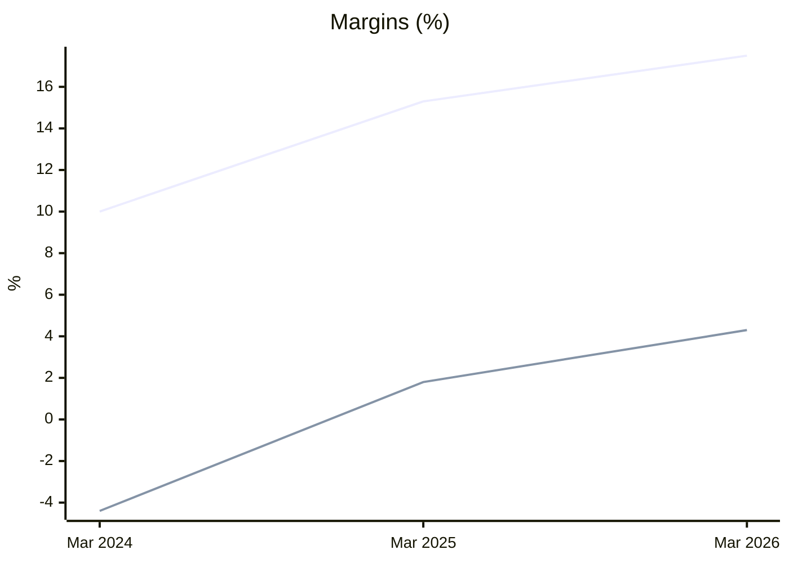
*Series in order: Operating margin, PAT margin.*

**P/E:** 28.3 — live market file (screener.in), trailing (price ₹604.00 as of 2026-08-02).

**Cash flows (₹ cr):**

| | Mar 2024 | Mar 2025 | Mar 2026 |
|---|---:|---:|---:|
| Cash from operations (₹ cr) | 2,321 | 10,151 | 7,855 |
| Cash from investing (₹ cr) | -2,509 | -1,823 | -1,475 |
| Cash from financing (₹ cr) | 164 | -4,793 | -9,883 |
| Net cash flow (₹ cr) | -24.0 | 3,535 | -3,503 |
| Free cash flow (₹ cr) | 367 | 8,896 | 5,502 |

*Source: CashFlow/NiftyTotalMarket/UPL.csv (consolidated, screener.in).*

### The business being separated — its own numbers

**UPL SAS (UPL Sustainable Agri Solutions) — India Crop Protection business, one of four "pure-play" platforms** · unit ₹ crore · Operating profit = EBITDA as reported in the platform-wise presentation disclosures (after SG&A, before depreciation/finance costs/tax); contribution margin also given (FY26 contribution ₹1,033 cr, FY25 ₹866 cr). Revenue is platform revenue on proforma adjustments, excludes group elimination and excludes 'Nurture'. No PAT/PBT line is disclosed for the platform.

| | FY2024 | FY2025 | FY2026 |
|---|---:|---:|---:|
| Revenue (₹ crore) | — | 3,229 | 3,212 |
| Revenue growth (%) | — | — | -0.5% |
| Operating profit (₹ crore) | — | 441 | 548 |
| Operating profit growth (%) | — | — | +24.3% |
| Operating margin (%) | — | 13.7 | 17.1 |
| PAT (₹ crore) | — | — | — |
| PAT growth (%) | — | — | — |

*Sources:* not in pages provided; Presentation May 2026 — page 45

*Latest quarter (Q1 FY27):* revenue 1140, operating profit 340 — Presentation Aug 2026 — page 24

*Not in the pages read:* FY2024 platform figures; PAT/PBT for the platform at any period. Only legal-entity profit shares for UPL Sustainable Agri Solutions Ltd appear (FY24 147, FY25 263/206 restated, FY26 235) — different basis, not used.

*Documents on file:* [Annual Report 2026](https://www.bseindia.com/xml-data/corpfiling/AttachHis/eb12d677-50d7-4495-9f5f-1921ef482847.pdf); [Annual Report 2025](https://www.bseindia.com/xml-data/corpfiling/AttachHis/16ebc6c3-a363-4437-b10d-8e0dfedb9483.pdf); [Annual Report 2024](https://www.bseindia.com/xml-data/corpfiling/AttachHis/8ee29f18-2108-4736-a8f1-7e012f32ce56.pdf); [Presentation Aug 2026](https://www.bseindia.com/stockinfo/AnnPdfOpen.aspx?Pname=2f0f3bf4-eb2a-4b8e-85a4-fa1b252aa4f1.pdf); [Presentation May 2026](https://www.bseindia.com/stockinfo/AnnPdfOpen.aspx?Pname=423093cb-ab1a-4288-abdc-894653fabf37.pdf); [Presentation Feb 2026](https://www.bseindia.com/stockinfo/AnnPdfOpen.aspx?Pname=6bcd0819-5ddb-4516-a762-f7a1141762db.pdf); [Presentation Nov 2025](https://www.bseindia.com/stockinfo/AnnPdfOpen.aspx?Pname=0f944762-33b2-41d9-9bc3-aab7d950cfc9.pdf); [Presentation Aug 2025](https://www.bseindia.com/stockinfo/AnnPdfOpen.aspx?Pname=199792f5-db4d-43f8-bca8-9fc46e15e9b3.pdf); [Presentation May 2025](https://www.bseindia.com/stockinfo/AnnPdfOpen.aspx?Pname=38a2270a-8a9a-4206-8333-bc732990299c.pdf)

**The checklist:**

| Item | Status | Evidence |
|---|---|---|
| Why the spin-off | yes | unrelated businesses separated; value unlocking for shareholders; a weak or capital-heavy business carved away; regulatory / strategic knot; attracting different investors / capital — “…research capabilities, a broad portfolio of registered products and brands across multiple geo graphies and independent management. • The Scheme will create two separate listed entities . UPL 1 , an existing listed comp” |
| Institutional selling likely (small / different business) | partly | the businesses are described as distinct |
| Insider ownership and incentives aligned | partly | …as members of the promoter and promoter group of UPL 2 (collectively, “ UPL 2 Promoters ”), have agreed to voluntarily retain their entire shareholding respectively in UPL 2 and undertake to not transfer,… *(next: the date the management options are priced; promoter holding in the resulting company)* |
| A hidden value revealed (pro-forma, leverage, comparables) | yes | borrowings 23,576 cr (Mar 2026) = 0.46× market cap; P/E 23.0 on Mar 2026 profit vs industry median 36.0 (22 peers) |
| Parent before the spin (clean parent, takeover prelude) | partly | stage exchange_noc — the spin has not happened; the parent can still be bought whole |
| Timing (first year sells, second year gains) | partly | not yet listed — 267 days since the first filing, stage exchange_noc |
| Management discussing it on the calls | yes | 3 mention(s) in the last 12 months of calls — “…are fundamentally different, and we believe Advanta as the eighth largest seeds player globally has a journey and destiny of its own. Obviously, a lot of that value unlock finding the right price will happen through the” |

**On the calls (last 12 months):**

- *Feb 2026* (forward) — “…ing this decision to list the entity? Because as t hings stand today, it's a business which is cash surplus. It's doing exceedingly well. So if at all, there's value unlocking, how is value getting unlocked and for who is the value getting unlocked? Bikash Prasad: So I think as a first the valuation of Advanta is expected to be final…”
- *Feb 2026* (forward) — “…I think the Advanta IPO has, as Bikash said, three objectives. Th ere is, a ) deleve raging for UPL. UPL Limited February 02, 202 6 Page 14 of 17 There is b ) value unlock for KKR. If you recollect KKR partnered with Advanta more than 3 years back when they put in a check of $300 -plus million into Advanta. By the way, the cash t…”
- *Feb 2026* (forward) — “…are fundamentally different, and we believe Advanta as the eighth largest seeds player globally has a journey and destiny of its own. Obviously, a lot of that value unlock finding the right price will happen through the IPO process. And that value does flow through to UPL, both as a shareholder and from a restructuring deleveragi…”

<details><summary>The filings</summary>

| Date | Category | Headline | Attachment |
|---|---|---|---|
| 2026-01-19 | Updates | UPL Limited has informed the Exchange regarding 'Filing of Draft Red Herring Prospectus (DRHP) by Advanta Enterprises Limited, a Subsidiary of the Company.'. | [pdf](https://nsearchives.nseindia.com/corporate/UPL_19012026211323_UPL_Limited_SE_Intimation.pdf) |
| 2026-02-20 | Scheme of Arrangement | UPL Limited has informed the Exchange about Scheme of Arrangement | [pdf](https://nsearchives.nseindia.com/corporate/UPL_20022026153902_Draft_Reg_30_Disclosure__Feb_19__Clean.pdf) |
| 2026-03-04 | Updates | UPL Limited has informed the Exchange regarding 'Uploading of Composite Scheme of Arrangement and certain other documents on the website of the Company'. | [pdf](https://nsearchives.nseindia.com/corporate/UPL_04032026180016_FAQsintimation.pdf) |
| 2026-07-29 | Scheme of Arrangement | UPL Limited has informed the Exchange about receipt of Observation Letters from BSE Limited and National Stock Exchange of India Limited in relation to Composit | [pdf](https://nsearchives.nseindia.com/corporate/UPL_29072026205347_Reg_30_Scheme_of_Arrangement.pdf) |

</details>

## NATCOPHARM — NATCO Pharma Ltd.

**CONFIRMED** (a demerger scheme is on the exchange record) · **PRE-SPIN — study the parent; the pieces do not trade yet** · score 6.4/10 · spin-off · 5 filing(s) from NSE-BM, NSE-deep · first 2025-11-14, latest 2026-09-09

> **Listing:** NOT YET — scheme at 'announced' stage; Natco Crop Health Sciences Limited will list only after NCLT sanction, effectiveness and a record date; indicated timeline: Nov 2025 call: "we will list that entity maybe sometime in 2026 once all the clearances come through"; incorporation of Resulting Company indicated for December 31, 2025 (14 Nov 2025 filing)

**The stages, as filed:** announced (2025-11-14)

**Stated in the filings:** resulting company **Natco Crop Health Sciences Limited**.

**What is being separated, as the documents put it:** The Crop Health Sciences (Agro Chemicals) Division — crop protection products business — into a separate legal entity — class `value_unlocking`.

- *Insiders:* Resulting Company is a wholly-owned subsidiary, 100% held, initial capital Rs.1,00,000; filing answers "No" to promoter/promoter group interest in the entity being acquired. Promoter stake/incentives in new entity not stated.
- *What it reveals:* Agro Chemicals is tiny and barely profitable: H1FY26 revenue Rs.872mn vs pharma Rs.26,047mn, segment loss Rs.(98)mn, FY25 loss Rs.(1,458)mn, segment assets Rs.3,415mn; management says business "is about breaking even now". Parent holds Rs.25,867mn bank balances.
- *Selling pressure:* likely — Very small relative to parent (2% of revenue), different industry (agro-chemicals vs pharma), near-breakeven; index exclusion not stated
- *Parent or spin:* parent · *option pricing date:* not stated
- *Read next:* The 24 March 2026 scheme of arrangement filing — share entitlement ratio, valuation report and assets/liabilities transferred to CHS
- *In their words:* “To demerge the Agro business of the Company into a separate entity , the move shall enable value unlocking of the core business (pharmaceuticals) and enhance long -term growth.”

### Why the demerger — three years of calls and the scheme

NATCO Pharma is demerging its Agrochemicals / Crop Health Sciences business (the 'Demerged Undertaking') out of the listed pharma company into Natco Crop Health Sciences Limited (the 'Resulting Company'), to be listed on BSE and NSE. The scheme's stated core reason is that the risk and reward profiles of the two verticals — Pharmaceutical and Agrochemicals — are different, so segregating them gives management better and more efficient control and a concentrated approach to each. On the calls management gave the commercial version of this: the crop business is tiny inside Natco (turnover of ₹60,62,03,918 as on 31st March 2025, just 1.48% of company turnover) and therefore 'not being valued in our system' next to a very large pharma business, so a separate listing creates visibility and value unlocking plus a 'complete see-through' into crop and pharma separately. Management said the crop business is only now about breaking even, and that as a standalone listed entity it can raise its own capital and grow by itself. In the May/Jun 2026 call the operating logic was added: the customers of the two businesses are quite different, so the demerger gives a more focused approach, and crop sales had grown to ~₹140 crore from ~₹60 crore declared the prior year, with growth to come from products, channel partners (still fewer than peers) and people additions — 'one of the main reasons for demerging and having more focus on the business.' Natco will retain about 20% of the post-listing shareholding to keep supporting a business still at early growth stages and to monitor progress and provide strategic support, with shareholders getting 1 share of ₹2 in the Resulting Company for every 1 share of ₹2 held, so they hold ~80% directly and 100% of the ultimate economic interest. The scheme also cites operational rationalization, ability to leverage each business's financial and operational resources, and letting each attract different sets of investors, strategic partners and lenders. The plan was then deferred: after the Board approved a rights issue of up to ₹1,300 crore on September 9, 2026, the Company said the resulting change to capital structure requires consequential changes to the Scheme, which has received exchange Observation Letters but has not yet been filed with the NCLT.

**How it evolved:** On the Nov 14, 2025 call the demerger surfaced in answer to investor 'Guru', who asked about value unlocking in the ROW business / agro diversification; Rajeev Nannapaneni confirmed the demerger was already announced, that the entity would list 'maybe sometime in 2026 once all the clearances come through', and that shareholders would be 'duly rewarded'. By the May 29, 2026 call (Jun 2026 tag) it had moved from announcement to execution — Rajesh Chebiyam, answering individual investor Neeraj Kayal, said the business was 'in the process of demerging', framing it around different customers, a differentiated/patent-controlled product approach, and scale-up from ~₹60 crore to ~₹140 crore of sales. The Scheme filing then formalised the rationale (different risk-reward, 1.48% of turnover, 1:1 swap, 20% retained stake, BSE/NSE listing), and the September 9, 2026 board outcome pushed the timetable back: the ₹1,300 crore rights issue will change the capital structure, so a revised Scheme — keeping the same swap ratio — will be filed with the exchanges after the rights issue, and nothing has yet gone to the NCLT.

**What management expects from it:** Crop/agrochemicals: dedicated focus on a differentiated, patent-controlled portfolio, its own capital raising, growth from ₹140 crore sales, plus Natco's 20% stake and strategic support while early-stage. Pharma: a clean large-cap pharma entity. Both: better management control, operational efficiencies, efficient capital allocation, own investors/partners/lenders, and value unlocking via a separate BSE/NSE listing giving shareholders see-through value.

**Point by point, with the source:**

- *[Nov 2025](https://www.bseindia.com/stockinfo/AnnPdfOpen.aspx?Pname=ac8f848f-8703-4403-9ae3-cb2d420d47da.pdf)* — The demerger was raised by an investor asking specifically about shareholder value unlocking in the ROW/agro diversification; Rajeev confirmed it was announced and planned, with listing targeted for sometime in 2026 after clearances. “So, we will list that entity maybe sometime in 2026 once all the clearances come through.”
- *[Nov 2025](https://www.bseindia.com/stockinfo/AnnPdfOpen.aspx?Pname=ac8f848f-8703-4403-9ae3-cb2d420d47da.pdf)* — Management's stated mechanism for value unlocking: a separate listing gives the crop business special focus and the ability to raise its own capital independently of Natco. “So, we will list it separately and then we will have special focus on this and it can raise its own capital and grow by itself.”
- *[Nov 2025](https://www.bseindia.com/stockinfo/AnnPdfOpen.aspx?Pname=ac8f848f-8703-4403-9ae3-cb2d420d47da.pdf)* — The problem being solved is that the crop business is too small inside Natco to be valued, sitting next to a very large pharma business; demerger is meant to get it attention and a visible valuation. “I think you will get another business which is not being valued in our system because it is of a very tiny business and a very large business in pharma.”
- *[Nov 2025](https://www.bseindia.com/stockinfo/AnnPdfOpen.aspx?Pname=ac8f848f-8703-4403-9ae3-cb2d420d47da.pdf)* — Management characterised the crop business's current financial state as only around break-even, and said shareholders would get separate visibility into crop and pharma, with real value visible in 2026 though numbers were unpredictable. “Value unlocking means I think what we see is this business now is about breaking even now.”
- *[Nov 2025](https://www.bseindia.com/stockinfo/AnnPdfOpen.aspx?Pname=ac8f848f-8703-4403-9ae3-cb2d420d47da.pdf)* — Asked directly whether the demerger is a shareholder value-unlocking opportunity, Rajeev answered unequivocally yes and said shareholders would be rewarded for the demerger. “So, this business will get more attention and I think shareholders will be duly rewarded for the fact that it has been demerged.”
- *[Jun 2026](https://www.bseindia.com/stockinfo/AnnPdfOpen.aspx?Pname=230327e4-9a77-4095-b46d-b9c836cc9b96.pdf)* — Rajesh Chebiyam, answering individual investor Neeraj Kayal, said the business is in the process of being demerged and gave the primary reason as a more focused approach because the two businesses' customers are quite different. “And one of the primary reasons we felt also it gives a more focused approach because the business, ultimately, the customers are quite different.”
- *[Jun 2026](https://www.bseindia.com/stockinfo/AnnPdfOpen.aspx?Pname=230327e4-9a77-4095-b46d-b9c836cc9b96.pdf)* — The crop business is being built on a pharma-like strategy of differentiated, unique, patent-controlled, limited-competition molecules rather than commodity agrochemicals. “So products which could be unique, which could be patent controlled, limited competition.”
- *[Jun 2026](https://www.bseindia.com/stockinfo/AnnPdfOpen.aspx?Pname=230327e4-9a77-4095-b46d-b9c836cc9b96.pdf)* — Scale cited: crop sales of close to ₹140 crore for the year versus about ₹60 crore declared the previous year, with growth from product launches, channel penetration (fewer channel partners than peers) and people additions. “So in terms of sale, let's say, this year, we ended up close to INR140 crores, right? And as opposed to a declared number for last year was about INR60 crores.”
- *[Jun 2026](https://www.bseindia.com/stockinfo/AnnPdfOpen.aspx?Pname=230327e4-9a77-4095-b46d-b9c836cc9b96.pdf)* — Management tied the growth confidence directly to the demerger, naming focus on the business as a main reason for separating it. “And that's also one of the main reasons for demerging and having more focus on the business.”
- *Scheme* — The formal rationale is that the Board believes the risk and reward of the Pharmaceutical and Agrochemicals verticals are different, so the Agrochemicals Undertaking is being demerged on a going-concern basis into the Resulting Company. “The Board of Directors of the Demerged Company believe that the risk and reward associated with each of the aforesaid business verticals are different.”
- *Scheme* — Size of the demerged business is quantified: Agrochemicals turnover of ₹60,62,03,918 as on 31st March 2025, equal to 1.48% of the listed company's total turnover. “The turnover of the Demerged Undertaking is 1.48% to the total turnover of the Company in the financial year ending 31st March, 2025.”
- *Scheme* — Natco will keep a 20% post-listing stake because the agrochemicals business is still at early growth stages, to continue supporting it, monitor progress and provide strategic support. “Further, the Demerged Company intends to retain the current shareholding in the Resulting Company (20% of post listing shareholding) in order to continue to offer support to the Agrochemicals Business which is still at its early growth stages and help in monitoring the progress and providing strategic support.”

*Not explained on the calls:* No margins, profitability, debt, net worth or valuation for the crop entity; no board/management, NCLT timeline, rights-issue use of proceeds, or revised-scheme details.

*Calls read (36 months):* [Jun 2026](https://www.bseindia.com/stockinfo/AnnPdfOpen.aspx?Pname=230327e4-9a77-4095-b46d-b9c836cc9b96.pdf), [Nov 2025](https://www.bseindia.com/stockinfo/AnnPdfOpen.aspx?Pname=ac8f848f-8703-4403-9ae3-cb2d420d47da.pdf)

### The parent, last three fiscal years (consolidated)

| | Mar 2024 | Mar 2025 | Mar 2026 |
|---|---:|---:|---:|
| Sales (₹ cr) | 3,999 | 4,430 | 4,078 |
| Sales growth (%) | +47.7% | +10.8% | -7.9% |
| Operating profit (₹ cr) | 1,754 | 2,196 | 1,436 |
| Operating profit growth (%) | +87.4% | +25.2% | -34.6% |
| Operating margin (%) | 43.9 | 49.6 | 35.2 |
| PAT (₹ cr) | 1,388 | 1,883 | 1,418 |
| PAT growth (%) | +94.1% | +35.7% | -24.7% |
| PAT margin (%) | 34.7 | 42.5 | 34.8 |
| EPS (₹) | 77.5 | 105 | 79.2 |

*Source: ProfitStatement/NiftyTotalMarket/NATCOPHARM.csv (consolidated, screener.in); growth and margins computed here.*

```mermaid
xychart-beta
    title "Sales, operating profit and PAT (₹ cr)"
    x-axis ["Mar 2024", "Mar 2025", "Mar 2026"]
    y-axis "₹ crore"
    bar [3999, 4430, 4078]
    bar [1754, 2196, 1436]
    bar [1388, 1883, 1418]
```
*Series in order: Sales, Operating profit, PAT.*

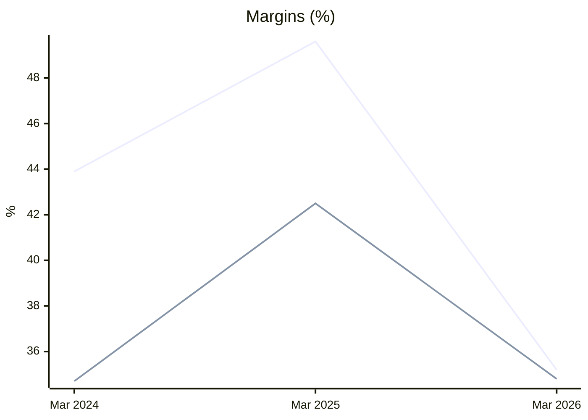
*Series in order: Operating margin, PAT margin.*

**P/E:** 11.6 — live market file (screener.in), trailing (price ₹917.00 as of 2026-08-02).

**Cash flows (₹ cr):**

| | Mar 2024 | Mar 2025 | Mar 2026 |
|---|---:|---:|---:|
| Cash from operations (₹ cr) | 1,212 | 1,697 | 1,768 |
| Cash from investing (₹ cr) | -1,026 | -1,436 | -2,082 |
| Cash from financing (₹ cr) | -247 | -211 | 298 |
| Net cash flow (₹ cr) | -62.0 | 50.0 | -16.0 |
| Free cash flow (₹ cr) | 855 | 1,300 | 1,379 |

*Source: CashFlow/NiftyTotalMarket/NATCOPHARM.csv (consolidated, screener.in).*

### The business being separated — its own numbers

**Agro Chemicals (Crop Health Sciences division / CHS)** · unit ₹ million · Operating profit = 'Segment results' from Ind AS 108 consolidated segment reporting — an EBIT-level measure before finance cost and tax (FY2025 segment result includes a ₹500 mn PPE impairment loss). Segment revenue ties exactly to total revenue from operations, i.e. external revenue with no inter-segment revenue disclosed. No segment-level PAT is disclosed. Note: quarterly presentations report 'Crop Health Sciences' revenue on a slightly different basis (FY25 598, FY26 1,382 vs segment 606, 1,382).

| | FY2024 | FY2025 | FY2026 |
|---|---:|---:|---:|
| Revenue (₹ million) | 1,083 | 606 | 1,382 |
| Revenue growth (%) | — | -44.0% | +128.1% |
| Operating profit (₹ million) | -596 | -1,458 | -198 |
| Operating profit growth (%) | — | -144.6% | +86.4% |
| Operating margin (%) | -55.0 | -241 | -14.3 |
| PAT (₹ million) | — | — | — |
| PAT growth (%) | — | — | — |

*Sources:* Annual Report 2024 — page 329; Annual Report 2025 — pages 302 and 303; Annual Report 2026 — page 316

*Latest quarter (Q1 FY27):* revenue 408, operating profit None — Presentation Aug 2026 — page 26

*Not in the pages read:* Segment PAT/tax for all years; segment EBITDA, depreciation and finance cost; quarterly CHS profit — presentations give CHS revenue only, with P&L reported consolidated.

*Documents on file:* [Annual Report 2026](https://www.bseindia.com/xml-data/corpfiling/AttachHis/0d25dc00-4a7e-4acc-b5a8-d747c870ab2f.pdf); [Annual Report 2025](https://www.bseindia.com/xml-data/corpfiling/AttachHis/08737473-9fef-496b-881b-746b8ab600b1.pdf); [Annual Report 2024](https://www.bseindia.com/xml-data/corpfiling/AttachHis/d5a992a3-1b5a-44b4-8e5b-343b600e56fc.pdf); [Presentation Aug 2026](https://www.bseindia.com/stockinfo/AnnPdfOpen.aspx?Pname=02c8ef3b-6c4b-470e-83f0-69e880a97e9d.pdf); [Presentation Jun 2026](https://www.bseindia.com/stockinfo/AnnPdfOpen.aspx?Pname=f192f32c-197f-430f-b27f-7338ba5ee9a8.pdf); [Presentation Feb 2026](https://www.bseindia.com/stockinfo/AnnPdfOpen.aspx?Pname=236bc8c2-778b-4af2-a104-b4e902651e29.pdf); [Presentation Nov 2025](https://www.bseindia.com/stockinfo/AnnPdfOpen.aspx?Pname=c5fe60cd-6aa5-4ff4-9fd3-1e93a3014e6e.pdf); [Presentation Aug 2025](https://www.bseindia.com/stockinfo/AnnPdfOpen.aspx?Pname=c755548f-c325-46ba-8d7a-8c2108a36a18.pdf); [Presentation Jul 2025](https://www.bseindia.com/stockinfo/AnnPdfOpen.aspx?Pname=5c9d7cd0-d102-42c5-89b3-f91787622f9d.pdf)

**The checklist:**

| Item | Status | Evidence |
|---|---|---|
| Why the spin-off | yes | value unlocking for shareholders; unrelated businesses separated; regulatory / strategic knot — “…listed entity) To demerge the Agro business of the Company into a separate entity , the move shall enable value unlocking of the core business (pharmaceuticals) and enhance long -term growth. Further, it also provides o” |
| Institutional selling likely (small / different business) | partly | the businesses are described as distinct |
| Insider ownership and incentives aligned | unknown | no promoter-continuity or option-pricing language found *(next: the date the management options are priced; promoter holding in the resulting company)* |
| A hidden value revealed (pro-forma, leverage, comparables) | yes | borrowings 714 cr (Mar 2026) = 0.04× market cap; P/E 11.6 on Mar 2026 profit vs industry median 52.7 (45 peers) |
| Parent before the spin (clean parent, takeover prelude) | partly | stage announced — the spin has not happened; the parent can still be bought whole |
| Timing (first year sells, second year gains) | partly | not yet listed — 333 days since the first filing, stage announced |
| Management discussing it on the calls | yes | 9 mention(s) in the last 12 months of calls — “…a lso the people additions. So all these activities are going on. So I think we're fairly confident going forward. And that's also one of the main reasons for demerging and having more focus on the business. Moderator: ” |

**On the calls (last 12 months):**

- *Nov 2025* (forward) — “…ill see. So, I think that is how we want to look at it. Guru: Thank you for that. The other question part of it is like real value. Is there any opportunity of value unlocking for the shareholders when it comes to the ROW business , what would be the value unlocking that we can expect , not accurately, but at least some kind of an in…”
- *Nov 2025* (forward) — “…question part of it is like real value. Is there any opportunity of value unlocking for the shareholders when it comes to the ROW business , what would be the value unlocking that we can expect , not accurately, but at least some kind of an indicative thing on the value unlock that you probably plan for the agro diversification or w…”
- *Nov 2025* (forward) — “…when it comes to the ROW business , what would be the value unlocking that we can expect , not accurately, but at least some kind of an indicative thing on the value unlock that you probably plan for the agro diversification or whatever is in the pipeline ? Rajeev Nannapaneni: I think the idea here is that we will demerge the comp…”
- *Nov 2025* (forward) — “…the value unlock that you probably plan for the agro diversification or whatever is in the pipeline ? Rajeev Nannapaneni: I think the idea here is that we will demerge the company , I think we are planning the demerger , I think we have announced it. So, we will list that entity maybe sometime in 2026 once all the clearances…”
- *Nov 2025* (forward) — “…ro diversification or whatever is in the pipeline ? Rajeev Nannapaneni: I think the idea here is that we will demerge the company , I think we are planning the demerger , I think we have announced it. So, we will list that entity maybe sometime in 2026 once all the clearances come through. Value unlocking means I think what we…”

<details><summary>The filings</summary>

| Date | Category | Headline | Attachment |
|---|---|---|---|
| 2025-11-14 | Outcome of Board Meeting | Outcome of Board Meeting | [pdf](https://nsearchives.nseindia.com/corporate/NATCOPHARM_14112025132546_Outcome14112025.pdf) |
| 2026-03-24 | Outcome of Board Meeting | Outcome of Board Meeting | [pdf](https://nsearchives.nseindia.com/corporate/NATCOPHARM_24032026171413_OutcomeOfBoardMeeting_24032026.pdf) |
| 2026-03-24 | Board Meeting (purpose) | Other business matters To consider Scheme of arrangement (demerger) | [pdf](https://nsearchives.nseindia.com/corporate/NATCOPHARM_18032026155941_BMnotice.pdf) |
| 2026-03-24 | Board Meeting (purpose) | Board Meeting Intimation NATCO PHARMA LIMITED has informed the Exchange about Board Meeting to be held on 24-Mar-2026 to consider Scheme of arrangement. | [pdf](https://nsearchives.nseindia.com/corporate/xbrl/BMintimation_18032026_PRIOR_INTIMATION_WebXMLFile_20260318_160706696.xml) |
| 2026-09-09 | Outcome of Board Meeting | Outcome of Board Meeting pursuant to Regulation 30 read with Schedule III | [pdf](https://nsearchives.nseindia.com/corporate/NATCOPHARM_09092026115332_BoardOutcome09092026.pdf) |

</details>

## ASTRAL — Astral Ltd.

**CONFIRMED** (a demerger scheme is on the exchange record) · **PRE-SPIN — study the parent; the pieces do not trade yet** · score 5.8/10 · spin-off · 6 filing(s) from NSE, NSE-deep · first 2026-06-25, latest 2026-07-29

> **Listing:** NOT YET — scheme at 'announced' stage; the resulting company will list only after NCLT sanction, effectiveness and a record date; no listing timeline stated

**The stages, as filed:** announced (2026-07-05)

**Stated in the filings:** entitlement **1 for every 1**; size hint: 21% of turnover.

**What is being separated, as the documents put it:** Astral's Chemicals/Adhesive Business — adhesives, sealants, construction chemicals — merged into paints-and-coatings subsidiary Astral Chemie — class `value_unlocking`.

- *Insiders:* Promoters and Promoter Group hold 54.22% of Resulting Company post-Scheme (mirroring parent), public 45.78%; MD Sandeep Engineer champions it. No incentive terms stated.
- *What it reveals:* Reveals a chemicals/specialty platform (₹12,663mn turnover, 21% of Astral's ₹59,076mn standalone) combined with the paints and coatings subsidiary, which management says markets currently value at a conglomerate discount.
- *Selling pressure:* likely — Resulting entity is small (21% of turnover), a different industry (chemicals/paints vs plumbing), and newly listed to all holders 1:1.
- *Parent or spin:* — · *option pricing date:* not stated
- *Read next:* The Scheme's definition of Chemicals Business and the demerged undertaking's profit, net worth and debt allocation — not disclosed here.
- *In their words:* “The Scheme eliminates any conglomerate discount and allows the capital markets to distinctively value each independent vertical.”

### Why the demerger — three years of calls and the scheme

Astral Limited says it has grown into two distinct verticals — (a) Plumbing: pipes, fittings, water tanks, faucets and sanitaryware, and (b) Chemicals: adhesives, polyvinyl acetate (PVA), cyanoacrylates, solvent cements, silicone sealants, epoxy resins, construction chemicals, putties and allied products, further scaled into specialty chemicals through recent strategic acquisitions. The Board (approval dated June 25, 2026) adopted a Composite Scheme that (i) demerges the Chemicals/Chemical Undertaking of Astral Limited (the Demerged Company) on a going-concern basis into Astral Chemie Limited, formerly Astral Coatings Private Limited, a 100% subsidiary that already manufactures and supplies paints and coatings for residential, commercial and industrial end-users, and (ii) amalgamates Al-Aziz Plastics Private Limited, another 100% subsidiary making electrofusion fittings, compression fittings, saddles, electrical fittings and allied accessories for gas, water, electricity and solar distribution/transmission, into Astral Limited because it is complementary to the Plumbing Business. The size cited: the Demerged Undertaking's turnover for the year ended March 31, 2026 was ₹12,663 million, 21% of the Demerged Company's total turnover, against Astral Limited's standalone FY26 turnover of ₹59,076 million and net worth of ₹41,058 million; Al-Aziz was small at ₹373 million turnover and ₹215 million net worth. The stated problems it solves: each business has different products, customer segments, operating models, capital requirements, risk profiles and growth opportunities and operates under different macroeconomic environments, regulatory frameworks and market risks, so one corporate roof blurred focus — the demerger puts chemicals plus paints under a single dedicated platform run by a focused leadership team with deep sector-specific expertise, and isolates the operational, cyclical and compliance risks of each business. It is also framed as a capital-structure fix: each entity can independently determine capex, working capital, funding and investment strategy based on its own growth prospects, capital intensity, cash-flow profile and risk-return characteristics, and as separately listed entities both can independently access debt and equity capital and attract strategic and financial investors with different investment objectives. For Al-Aziz, the added reasons are integration of its manufacturing facilities, products and customer relationships with Plumbing, plus reduced legal and regulatory compliance burden and administrative costs. Mechanics are value-neutral to holders: no cash consideration, 1 equity share of Astral Chemie (₹1 face value) for every 1 Astral share (₹1 face value), a mirrored shareholding pattern (promoters 54.22%, public 45.78% post-Scheme versus 100% promoter-held pre-Scheme), Astral's existing shares in Astral Chemie cancelled, no change in Astral's own shareholding, and listing sought on NSE and BSE.

**How it evolved:** The reasoning cannot be traced call by call from the material supplied: the only earnings-call passage provided is [May 2025], and it is entirely about end-market sizing — PVC at about 4.5 million tons in fiscal 25, CPVC at roughly 2.5 lakh tons or about 5% of PVC, and fire-sprinkler pipes as the next leg of CPVC demand — with no mention of a demerger, of the chemicals vertical, or of Astral Coatings/Astral Chemie. The separation therefore appears in these texts only at the Board approval of the Composite Scheme on June 25, 2026, sized off FY26 (year ended March 31, 2026) financials, by which point Astral Coatings Private Limited had already been renamed Astral Chemie Limited and the chemicals portfolio had been expanded 'through recent strategic acquisitions' into specialty chemicals — the one hint of a build-up preceding the announcement. One drafting shift is visible inside the filing itself: the rationale annexure and disclosure tables describe the demerger of the 'Chemical Undertaking'/'Chemicals Business Undertaking', while the press-release text describes 'the demerger of its Adhesive Business', a narrower label for the same undertaking.

**What management expects from it:** Astral Chemie: chemicals combined with paints and coatings on one dedicated platform under focused leadership, yielding operational efficiencies, cost optimisation, specialisation, pooled R&D and technologies, and its own capex, working-capital and funding calls. Astral: plumbing-only focus, strengthened by Al-Aziz's fittings and lower compliance and administrative costs. Both: separate listings, independent debt and equity access, investors matched to each risk profile, isolated cyclical risk.

**Point by point, with the source:**

- *[May 2025](https://www.astralltd.com/wp-content/uploads/2025/05/Analyst-Meet-2025-Transcript.pdf)* — Management sized CPVC at about 2.5 lakh tonnes versus a roughly 4.5 million tonne PVC industry in fiscal 25 — about 5% — calling it a niche product today, confined mainly to hot-and-cold internal plumbing. Nothing in this passage touches the separation. “It is about 2 and half lakh tons now.”
- *[May 2025](https://www.astralltd.com/wp-content/uploads/2025/05/Analyst-Meet-2025-Transcript.pdf)* — Kairav Engineer said the real CPVC expansion depends on fire-sprinkler pipes, where Astral holds UL and local-body approvals, because a building uses more fire pipes than plumbing pipes; Sandeep Engineer added that standards changes are still needed. “CPVC real value unlocking will happen when the ■re products pick up.”
- *Scheme* — The Chemicals Business is described as having diversified across adhesives, PVA, cyanoacrylates, solvent cements, silicone sealants, epoxy resins, construction chemicals and putties, and scaled into specialty chemicals via recent acquisitions, all complementing Astral Chemie's existing paints and coatings business. “The reorganisation will consolidate the Chemicals Business of Demerged Company  with the existing paints and coatings business of the Resulting Company  under a single, dedicated corporate platform managed by a focused leadership team with deep sector -specific expertise.”
- *Scheme* — Size of the carve-out is quantified: the Demerged Undertaking turned over ₹12,663 million in FY26, 21% of Astral's total turnover (standalone FY26 turnover ₹59,076 million, net worth ₹41,058 million). “The turnover of the Demerged Undertaking for the year ended March 31, 2026 stood at ₹  12,663 million .”
- *Scheme* — Capital-allocation independence is the fourth stated principle: each business sets its own capex, working capital and funding according to its own capital intensity and cash-flow profile, and the demerger isolates each one's operational, cyclical and compliance risks. “The reorganisation will enable each business to independently determine its capital expenditure, working- capital requirements, funding and investment strategies based on their respective growth prospects, capital intensity, cash- flow profile and risk -return characteristics.”
- *Scheme* — Separate listing is justified as widening the investor and funding base rather than as an immediate valuation claim — no re-rating or multiple is asserted anywhere in the rationale. “As separately listed entities, the Resulting Company  and Demerged Company will 
have the flexibility, subject to Applicable Laws, to independently access debt and 
equity capital and attract strategic and financial investors interested in different 
investment objectives, thereby aligning investment strategies and risk profiles to each 
business.”
- *Scheme* — Management teams are to be freed to run their own plans: independent capacity expansion, new products, new markets and their own bolt-on acquisitions and collaborations — the same language is repeated for the Al-Aziz amalgamation. “The reorganisation will enable the respective management teams to independently 
formulate and execute business plans, undertake capacity expansion, develop new 
products, enter new markets and pursue focused acquisitions, collaborations and other 
growth opportunities relevant to their respective businesses.”
- *Scheme* — The simultaneous amalgamation folds Al-Aziz Plastics (FY26 turnover ₹373 million, net worth ₹215 million; electrofusion and compression fittings, saddles, electrical fittings) into Astral's Plumbing Business, with compliance-cost reduction cited explicitly; its shares held by Astral are extinguished and it is dissolved without winding up. “The amalgamation will enable the integration of its manufacturing facilities and capabilities, products, and customer relationships with the Plumbing Busi ness, while also reducing legal and regulatory compliances burden and related administrative costs.”
- *Scheme* — Shareholders are kept whole on a mirror basis: 1-for-1 share issue at ₹1 face value, no cash consideration, no change in Astral's shareholding pattern, and Astral Chemie moving from 100% promoter-held to promoters 54.22% / public 45.78%, with NSE and BSE listing sought. ““1 (One) Equity Share of Resulting Company of a face 
value of ₹1/ - each, fully paid- up shall be issued for every 
1 (One) Equity Shares of a face value of ₹ 1/- each, fully 
paid- up held in Demerged Company””
- *Scheme* — The announcement frames the split as a response to two verticals having structurally diverged, requiring separate administrative control — the overarching 'why now'. “Each business has evolved into a distinct business vertical with different products, customer 
segments, operating models, capital requirements, risk profiles and growth opportunities, demanding 
focused operational, financial and administrative expertise.”

*Not explained on the calls:* No call discussed the separation: no margin, valuation, debt-allocation, royalty or management-split detail; no investor, lender or partner named as requesting it; "Adhesive" versus "Chemicals" undertaking unreconciled.

*Calls read (36 months):* [May 2025](https://www.astralltd.com/wp-content/uploads/2025/05/Analyst-Meet-2025-Transcript.pdf)

### The parent, last three fiscal years (consolidated)

| | Mar 2024 | Mar 2025 | Mar 2026 |
|---|---:|---:|---:|
| Sales (₹ cr) | 5,641 | 5,832 | 6,569 |
| Sales growth (%) | +9.4% | +3.4% | +12.6% |
| Operating profit (₹ cr) | 925 | 946 | 1,062 |
| Operating profit growth (%) | +14.2% | +2.3% | +12.3% |
| Operating margin (%) | 16.4 | 16.2 | 16.2 |
| PAT (₹ cr) | 546 | 519 | 535 |
| PAT growth (%) | +15.7% | -4.9% | +3.1% |
| PAT margin (%) | 9.7 | 8.9 | 8.1 |
| EPS (₹) | 20.3 | 19.5 | 19.9 |

*Source: ProfitStatement/NiftyTotalMarket/ASTRAL.csv (consolidated, screener.in); growth and margins computed here.*

```mermaid
xychart-beta
    title "Sales, operating profit and PAT (₹ cr)"
    x-axis ["Mar 2024", "Mar 2025", "Mar 2026"]
    y-axis "₹ crore"
    bar [5641, 5832, 6569]
    bar [925, 946, 1062]
    bar [546, 519, 535]
```
*Series in order: Sales, Operating profit, PAT.*

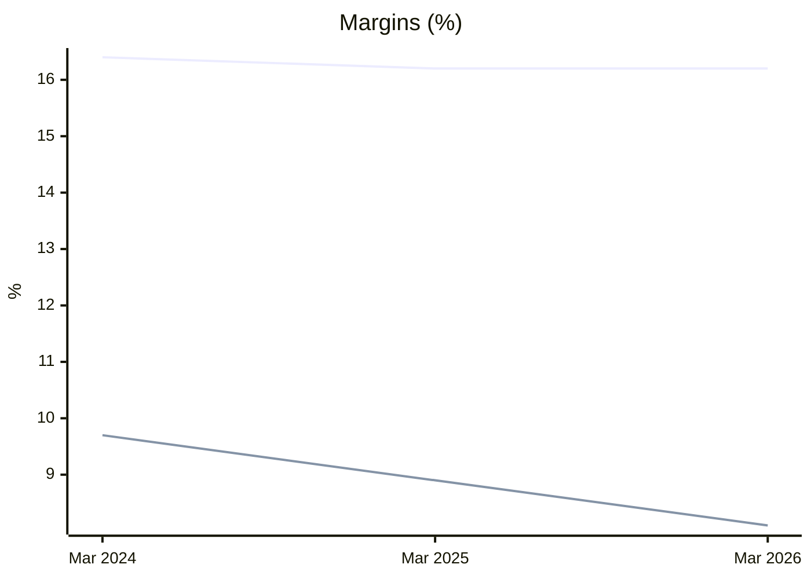
*Series in order: Operating margin, PAT margin.*

**P/E:** 70.6 — live market file (screener.in), trailing (price ₹1,449.00 as of 2026-08-02).

**Cash flows (₹ cr):**

| | Mar 2024 | Mar 2025 | Mar 2026 |
|---|---:|---:|---:|
| Cash from operations (₹ cr) | 823 | 630 | 1,117 |
| Cash from investing (₹ cr) | -541 | -513 | -506 |
| Cash from financing (₹ cr) | -202 | -118 | -328 |
| Net cash flow (₹ cr) | 80.0 | -1.0 | 282 |
| Free cash flow (₹ cr) | 273 | 90.0 | 661 |

*Source: CashFlow/NiftyTotalMarket/ASTRAL.csv (consolidated, screener.in).*

### The business being separated — its own numbers

**Paints and Adhesives (reportable segment; separating entity named Astral Chemie Limited, formerly Astral Coatings Private Limited)** · unit ₹ Million · Operating profit = 'Segment profit' per Ind AS 108 note (segment revenue less identified segment expenses; excludes finance cost, tax and share of JV loss; stated to exclude depreciation, though the FY24 figure reconciles to presentation EBITDA less segment depreciation). Segment revenue is external only — the notes state there were no inter-segment sales in any year. Segment PAT is not disclosed; no segment-level balance of tax exists. Investor presentations give the same business as 'Paints and Adhesives Business' EBITDA (FY24 2,031; FY25 1,948) and PBT before exceptional item (FY24 1,334; FY25 1,005) — Presentation May 2025 page 60. Pages do not isolate the chemicals/adhesives undertaking alone; paints are combined with adhesives in every disclosure.

| | FY2024 | FY2025 | FY2026 |
|---|---:|---:|---:|
| Revenue (₹ Million) | 14,994 | 16,361 | 18,899 |
| Revenue growth (%) | — | +9.1% | +15.5% |
| Operating profit (₹ Million) | 1,396 | 1,150 | 1,034 |
| Operating profit growth (%) | — | -17.6% | -10.1% |
| Operating margin (%) | 9.3 | 7.0 | 5.5 |
| PAT (₹ Million) | — | — | — |
| PAT growth (%) | — | — | — |

*Sources:* Annual Report 2024 — page 220; Annual Report 2025 — page 208; Annual Report 2026 — page 218

*Latest quarter (Q4 FY23 (only quarterly figure on the pages; not a recent quarter)):* revenue 3827, operating profit 579 — Presentation May 2023 — page 55

*Not in the pages read:* Segment-level PAT, tax and finance cost for all years; FY2026 segment EBITDA and PBT; any quarterly segment figures after Q4 FY23; standalone chemicals/adhesives financials separate from paints.

*Documents on file:* [Annual Report 2026](https://www.bseindia.com/xml-data/corpfiling/AttachHis/5772a6ee-bd33-47d5-bbd1-85b269bd26c3.pdf); [Annual Report 2025](https://www.bseindia.com/xml-data/corpfiling/AttachHis/78a2a99f-5d2e-4692-b054-43192a2fc329.pdf); [Annual Report 2024](https://www.bseindia.com/xml-data/corpfiling/AttachHis/455e935e-98ba-4ef9-bd54-c293a46bab7c.pdf); [Presentation May 2026](https://www.astralltd.com/wp-content/uploads/2026/05/Investor-Presentation-May-2026.pdf); [Presentation May 2025](https://www.astralltd.com/wp-content/uploads/2025/05/Astral-Analysts-Meet-PPT-R-1.pdf); [Presentation May 2024](https://astralltd.com/wp-content/uploads/2024/Astral%20Pipes_%20PPWithout%20Video%20for%20TIL.pdf); [Presentation May 2023](https://astralltd.com/wp-content/uploads/2023/05/Astral_2023.pdf)

**The checklist:**

| Item | Status | Evidence |
|---|---|---|
| Why the spin-off | yes | unrelated businesses separated; value unlocking for shareholders; regulatory / strategic knot — “…zation and specialisation for sustained growth and enhance competitive strength by ensuring benefits through focused management of the financial, managerial and technical resources, personnel capabilities, skills, exper” |
| Institutional selling likely (small / different business) | yes | the demerged piece is 21% of turnover; the businesses are described as distinct |
| Insider ownership and incentives aligned | unknown | no promoter-continuity or option-pricing language found *(next: the date the management options are priced; promoter holding in the resulting company)* |
| A hidden value revealed (pro-forma, leverage, comparables) | partly | borrowings 250 cr (Mar 2026) = 0.01× market cap; P/E 72.7 on Mar 2026 profit vs industry median 47.9 (59 peers) *(next: pro-forma P&L of each piece × the peer P/E of its own industry)* |
| Parent before the spin (clean parent, takeover prelude) | partly | stage announced — the spin has not happened; the parent can still be bought whole |
| Timing (first year sells, second year gains) | partly | not yet listed — 110 days since the first filing, stage announced |

<details><summary>The filings</summary>

| Date | Category | Headline | Attachment |
|---|---|---|---|
| 2026-06-25 | Outcome of Board Meeting | Outcome of the Board M eeting held on June 25, 2026 , pursuant to Regulations | [pdf](https://nsearchives.nseindia.com/corporate/ASTRAL_25062026190630_Outcome_of_BM_Astral_25062026.pdf) |
| 2026-06-25 | Scheme of Arrangement | Astral Limited has informed the Exchange about Scheme of Arrangement | [pdf](https://nsearchives.nseindia.com/corporate/ASTRAL_25062026191121_Outcome_of_BM_Astral_25062026.pdf) |
| 2026-07-05 | Outcome of Board Meeting | Astral Limited has informed the Exchange regarding Outcome of Board Meeting held on July 05, 2026 - Update on Composite scheme of Arrangement | [pdf](https://nsearchives.nseindia.com/corporate/ASTRAL_05072026145557_Reg30Astral05072026.pdf) |
| 2026-07-05 | Scheme of Arrangement | Astral Limited has informed the Exchange about Update on Composite Scheme of Arrangement | [pdf](https://nsearchives.nseindia.com/corporate/ASTRAL_05072026150046_Reg30Astral05072026.pdf) |
| 2026-07-29 | Outcome of Board Meeting | Astral Limited has informed the Exchange regarding Outcome of Board Meeting held on July 29, 2026 - Update on Composite Scheme of Arrangement | [pdf](https://nsearchives.nseindia.com/corporate/ASTRAL_29072026190057_Reg_30_of_BM_Astral.pdf) |
| 2026-07-29 | Scheme of Arrangement | Astral Limited has informed the Exchange about Update on the Composite Scheme of Arrangement | [pdf](https://nsearchives.nseindia.com/corporate/ASTRAL_29072026190321_Reg_30_of_BM_Astral.pdf) |

</details>

## APOLLOHOSP — Apollo Hospitals Enterprise Ltd.

**CONFIRMED** (a demerger scheme is on the exchange record) · **PRE-SPIN — study the parent; the pieces do not trade yet** · score 5.7/10 · spin-off · 13 filing(s) from NSE · first 2026-04-03, latest 2026-06-26

> **Listing:** NOT YET — scheme at 'nclt_sanction' stage; the resulting company will list only after NCLT sanction, effectiveness and a record date; indicated timeline: May 2026 call: "hopeful the demerger process is completed by Q4 FY27 as planned earlier" and "by Q4 FY27, end of December or early Q4 FY27 is when Apollo Healthtech should get demerged and listed"; shareholder meeting June 24, 2026, then NCLT "some 3, 4 months to close".

**The stages, as filed:** announced (2026-06-15) → meetings (2026-05-21) → nclt_sanction (2026-04-03)

**What is being separated, as the documents put it:** The "Identified Business Undertaking" of Apollo Hospitals, demerged into Apollo Healthtech Limited, with Apollo Healthco and Keimed merged in — class `value_unlocking`.

- *Insiders:* Demerged Company holdings: Suneeta Reddy (MD) 29,37,066 shares (2.04%), Chairperson 10,43,915 (0.73%), Shobana Kamineni non-executive director. AHL Promoter becomes executive chairperson of Resultant Company; new ESOP scheme; Rasmeli upside-share agreement with Shobana Kamineni and identified employees.
- *What it reveals:* Separation collects Healthco plus Keimed distribution into one listed vehicle targeting a ~INR 25,000 crore run rate, with promoter as executive chairperson, fresh ESOPs, and Rasmeli's upside-sharing — incentives loaded into the new entity, not the parent.
- *Selling pressure:* likely — Resultant Company shares issued to all AHEL shareholders on Record Date 1 and newly listed; healthtech/distribution business distinct from hospitals.
- *Parent or spin:* spin · *option pricing date:* not stated
- *Read next:* Annexure 17 and 33-34: revenue and net-worth of the Identified Business Undertaking versus AHEL; then Annexure 31 valuation report.
- *In their words:* “The Demerged Company has filed the Scheme with the Registrar of Companies on April 15, 2026 in form GNL-1.”

### Why the demerger — three years of calls and the scheme

Apollo Hospitals Enterprise (the Demerged Company) today runs three verticals — Healthcare Services (hospitals), Apollo HealthCo (omnichannel pharmacy and digital health) and AHLL (diagnostics and primary care) — and is carving the omnichannel pharmacy/digital health business (the 'Identified Business Undertaking', carried on directly and through Apollo Healthco Ltd, 'Transferor Company 1') into a separately listed Resultant Company, referred to on the May 2026 call as Apollo Healthtech. Management confirmed in Aug 2025 that 'Apollo HealthCo., as you are seeing in the current form' is what gets demerged and listed, as part of a composite scheme that simultaneously amalgamates Keimed (Transferor Company 2) and AHL into the new entity, consolidating pharmacy distribution in 'an independent company focusing exclusively on digital health and pharmacy distribution.' The stated problem is strategic mismatch: the board says the business is 'distinct from other businesses undertaken by Demerged Company, and necessitates a differentiated strategy aligned to its industry specific risks, market dynamics, and growth trajectory,' so separation enables focus, efficient management and control, cost rationalization, streamlined statutory compliances and economies of scale for both sides. The capital-markets motive is explicit in the filing — the Resultant Company is to 'build a wider capital and financial base, by attracting a different set of investors, strategic partners, lenders and stakeholders' — i.e. a vehicle with its own shareholder base rather than a pharmacy/digital business funded inside a hospital company. Operationally they cite supply-chain integration, higher availability and larger assortment, and improved supply-chain transparency 'preventing the entry of counterfeit or substandard medicines.' The numbers management attached: a combined-entity run rate of INR 25,000 crore of revenue at 7% EBITDA (Feb 2026), Apollo HealthCo crossing INR 10,000 crore of annual revenue for the first time in FY26, a 3,200-crore GMV target with digital breakeven targeted in Q4 (Aug 2025), and management's view that 'the biggest lift' to EBITDA comes once the digital business breaks even. Incentive alignment is also built in: an Upside Agreement dated June 30, 2025 under which Rasmeli shares part of its investment upside with the AHL Promoter (Shobana Kamineni) and identified AHL employees 'in order to incentivise the management,' plus a reconstituted board (AHL Promoter, 3 Resultant-Company-promoter nominees, 1 AHEL nominee, 1 Rasmeli nominee, 6 independent directors).

**How it evolved:** By the Aug 2025 call the structure was already decided and analysts were asking for mechanics: Raman KV mapped the three segments and A. Krishnan confirmed Apollo HealthCo in its then-current form would be demerged and listed, with Keimed merging in for pharmacy synergies; the underlying Upside Agreement is dated June 30, 2025. By Feb 2026 the story had shifted from design to regulatory execution plus a hard financial target — CCI and SEBI approvals obtained, NCLT filed and hearings begun, Keimed's subsidiary network streamlined into 100% subsidiaries, and a stated combined run rate of INR 25,000 crore revenue at 7% EBITDA. In May 2026 management reframed it as a completed-year 'strategic restructuring of the omnichannel pharmacy and digital health business' for 'unlocking long-term value', set the NCLT-convened shareholder meeting for June 24, and reaffirmed (unchanged, 'as planned earlier') listing of Apollo Healthtech by end-December/early Q4 FY27, by which point the entity should show INR 25,000 crore of annualized revenue. Across the three calls the rationale itself never changed; only the timetable, approvals and the revenue milestones hardened.

**What management expects from it:** Resultant Company (Apollo Healthtech): a pure digital-health and pharmacy-distribution vehicle at ~INR 25,000 crore annualized revenue and 7% EBITDA, with its own investors, partners and lenders, supply-chain integration, cost rationalization, scale economies, and EBITDA lift once digital breaks even. AHEL: focus on hospitals plus AHLL, sharper managerial and board attention, and long-term value unlocked across the platform.

**Point by point, with the source:**

- *[Aug 2025](https://www.apollohospitals.com/sites/default/files/2025-08/transcript-of-apollo-hospitals---q1-fy26-earnings-call---13-august-2025.pdf)* — Analyst Raman KV laid out the three-segment structure (hospitals, Apollo HealthCo pharmacy, AHLL diagnostics/primary care) and asked whether the pharmacy business was being demerged; A. Krishnan confirmed Apollo HealthCo in its current form is what gets demerged and listed. “What will happen is Apollo HealthCo., as you are seeing in the current form, is what is going to be demerged and will be list”
- *[Aug 2025](https://www.apollohospitals.com/sites/default/files/2025-08/transcript-of-apollo-hospitals---q1-fy26-earnings-call---13-august-2025.pdf)* — The analyst explicitly asked how the Keimed merger creates synergy for the pharmacy business, i.e. the combination rationale was being probed by investors from the start. “And can you also explain , - how will the merger with Keimed Health be beneficial in terms of synergy for the pharmacy business?”
- *[Aug 2025](https://www.apollohospitals.com/sites/default/files/2025-08/transcript-of-apollo-hospitals---q1-fy26-earnings-call---13-august-2025.pdf)* — Management reaffirmed the digital/pharmacy operating targets underpinning the separated entity: GMV of 3,200 on course per AOP, diagnostics at a 'new normal', and breakeven on course for Q4, with gross margin about 340 bps higher in Q1 vs Q4. “So, the GM V of 3,200 that we spoke about, we continue to be on course.”
- *[Feb 2026](https://drupal-cdn-hfaeddcdbng5hfbg.a01.azurefd.net/sites/default/files/2026-02/transcript-of-ahel-q3fy26-concall_11feb2026.pdf)* — Management tied the composite scheme (Keimed merger + Apollo HealthCo demerger) to a specific scale outcome for the combined entity: INR 25,000 crore of combined revenue at 7% EBITDA. “We have also made progress with respect to the regulatory integration process for the com posite scheme of Keimed merger and demerger of Apollo HealthCo and remain well positioned to capture the full benefits of scale with the combined entity to achieve a run rate of INR 25,000 crore in combined revenues with 7% EBITDA.”
- *[Feb 2026](https://drupal-cdn-hfaeddcdbng5hfbg.a01.azurefd.net/sites/default/files/2026-02/transcript-of-ahel-q3fy26-concall_11feb2026.pdf)* — Obul Reddy gave the regulatory status: CCI and SEBI approvals obtained, NCLT filing made and hearings started, with the next step awaited. “We have obtained Competition Commission approval and SEBI approval. We have filed with NCLT.”
- *[Feb 2026](https://drupal-cdn-hfaeddcdbng5hfbg.a01.azurefd.net/sites/default/files/2026-02/transcript-of-ahel-q3fy26-concall_11feb2026.pdf)* — On the pre-condition that Keimed buy out associates holding stakes in the separate pieces, management said Keimed is on time and has consolidated the structure into wholly owned subsidiaries. “Keimed has progressing on time and Keimed has streamlined the entire subsidiary network, and they are 100% subsidiaries”
- *[May 2026](https://www.apollohospitals.com/sites/default/files/2026-05/transcript-of-apollo-hospitals---q4-fy26-earnings-call.pdf)* — Management characterised the transaction in its own words as a strategic restructuring of the omnichannel pharmacy and digital health business aimed at sharpening focus and unlocking long-term value across the integrated platform. “During the year, we also announced a strategic restructuring of the omnichannel pharmacy and digital health business, an important step towards sharpening focus on unlocking long -term value across our integrated health care platform.”
- *[May 2026](https://www.apollohospitals.com/sites/default/files/2026-05/transcript-of-apollo-hospitals---q4-fy26-earnings-call.pdf)* — Timeline reaffirmed: NCLT-convened shareholder meeting on June 24, demerger completion targeted by Q4 FY27, unchanged from the earlier plan. “The NCLT convened meeting of the shareholders is now being called for on June 24 to obtain the requisite shareholder approval, consequent to which we are hopeful the demerger process is completed by Q4 FY27 as planned earlier.”
- *[May 2026](https://www.apollohospitals.com/sites/default/files/2026-05/transcript-of-apollo-hospitals---q4-fy26-earnings-call.pdf)* — Scale milestones cited for the business being separated: consolidated revenue crossed INR 25,000 crore (INR 25,229 crore) for the first time and Apollo HealthCo alone passed INR 10,000 crore in annual revenue, after Healthcare Services did so in FY25. “Apollo HealthCo also surpassed INR 10,000 crore in annual revenues for the first time following a similar milestone achieved by our Healthcare Services business in FY25.”
- *[May 2026](https://www.apollohospitals.com/sites/default/files/2026-05/transcript-of-apollo-hospitals---q4-fy26-earnings-call.pdf)* — A. Krishnan named the listed entity and the listing window, and said it should show INR 25,000 crore of annualized revenue by that quarter. “And hopefully, by Q4 FY27, end of December or early Q4 FY27 is when Apollo Healthtech should get demerged and listed.”
- *[May 2026](https://www.apollohospitals.com/sites/default/files/2026-05/transcript-of-apollo-hospitals---q4-fy26-earnings-call.pdf)* — Management said the decisive earnings driver for the separated entity is digital breakeven, with store/distribution maturation already visible and the cost structure supporting the growth; they claim to be on course versus published pro forma. “But I think the biggest lift will come the moment the digital business breaks even and then starts contributing to the EBITDA story because if you have to look at the cost structure that is something which is reasonably and this growth should be able to su stain that.”
- *Scheme* — The core board rationale: the Identified Business Undertaking is distinct from AHEL's other businesses and needs its own strategy for its industry-specific risks and growth trajectory, so both companies can focus, manage and control efficiently. “The Scheme would enable carving-out of the Identified Business Undertaking (as defined in the Scheme) , which is distinct from other businesses undertaken by Demerged Company, and necessitates a differentiated strategy aligned to its industry specific risks, market dynamics, and growth trajectory.”

*Not explained on the calls:* No share entitlement ratio, valuation, debt or working-capital allocation, royalty/brand or supply agreements between entities, post-demerger hospital margins, Rasmeli's economics, or who first demanded separation.

*Calls read (36 months):* [Aug 2025](https://www.apollohospitals.com/sites/default/files/2025-08/transcript-of-apollo-hospitals---q1-fy26-earnings-call---13-august-2025.pdf), [Feb 2026](https://drupal-cdn-hfaeddcdbng5hfbg.a01.azurefd.net/sites/default/files/2026-02/transcript-of-ahel-q3fy26-concall_11feb2026.pdf), [May 2026](https://www.apollohospitals.com/sites/default/files/2026-05/transcript-of-apollo-hospitals---q4-fy26-earnings-call.pdf)

### The parent, last three fiscal years (consolidated)

| | Mar 2024 | Mar 2025 | Mar 2026 |
|---|---:|---:|---:|
| Sales (₹ cr) | 19,059 | 21,794 | 25,228 |
| Sales growth (%) | +14.7% | +14.4% | +15.8% |
| Operating profit (₹ cr) | 2,394 | 3,033 | 3,769 |
| Operating profit growth (%) | +15.9% | +26.7% | +24.3% |
| Operating margin (%) | 12.6 | 13.9 | 14.9 |
| PAT (₹ cr) | 935 | 1,505 | 2,003 |
| PAT growth (%) | +10.8% | +61.0% | +33.1% |
| PAT margin (%) | 4.9 | 6.9 | 7.9 |
| EPS (₹) | 62.5 | 101 | 135 |

*Source: ProfitStatement/NiftyTotalMarket/APOLLOHOSP.csv (consolidated, screener.in); growth and margins computed here.*

```mermaid
xychart-beta
    title "Sales, operating profit and PAT (₹ cr)"
    x-axis ["Mar 2024", "Mar 2025", "Mar 2026"]
    y-axis "₹ crore"
    bar [19059, 21794, 25228]
    bar [2394, 3033, 3769]
    bar [935, 1505, 2003]
```
*Series in order: Sales, Operating profit, PAT.*

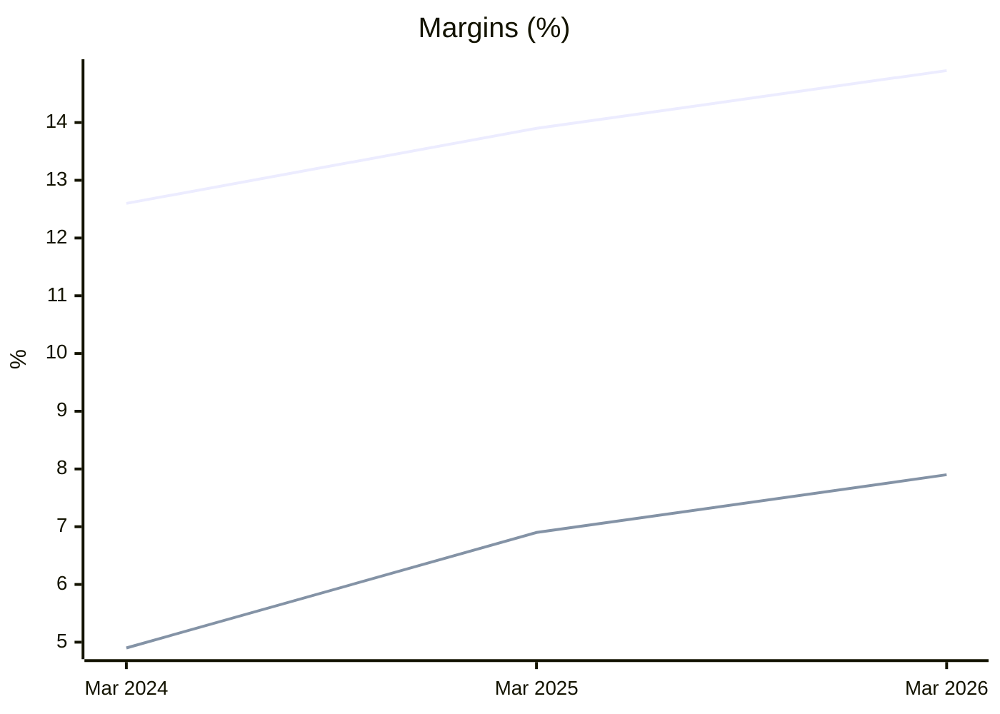
*Series in order: Operating margin, PAT margin.*

**P/E:** 65.8 — live market file (screener.in), trailing (price ₹8,957.00 as of 2026-08-02).

**Cash flows (₹ cr):**

| | Mar 2024 | Mar 2025 | Mar 2026 |
|---|---:|---:|---:|
| Cash from operations (₹ cr) | 1,920 | 2,136 | 2,856 |
| Cash from investing (₹ cr) | -1,537 | -3,381 | -2,148 |
| Cash from financing (₹ cr) | -311 | 1,317 | -478 |
| Net cash flow (₹ cr) | 72.0 | 73.0 | 230 |
| Free cash flow (₹ cr) | 785 | 439 | 925 |

*Source: CashFlow/NiftyTotalMarket/APOLLOHOSP.csv (consolidated, screener.in).*

### The business being separated — its own numbers

**Digital Health & Pharmacy Distribution (Apollo HealthCo / "Total HealthCo" in the quarterly presentations)** · unit ₹ million · operating_profit = reported 'Segment Profit/(loss)', defined in the annual reports as profit before tax earned by the segment without allocation of finance costs — i.e. an EBIT-level measure (the May 2026 presentation shows the same figures on its 'EBIT' line: FY26 3,987 / FY25 1,127). EBITDA is separately disclosed only in the presentations (FY26 4,875; FY25 1,676 — Presentation May 2026 p13). Revenue is segment revenue BEFORE elimination of inter-segment revenue (group-level inter-segment eliminations were 2,002 in FY26, 774 in FY25, 759 in FY24, not split by segment). PAT is the 'PAT (Reported)' line for the segment in the results presentations, not an annual-report disclosure. Latest-quarter operating profit shown is the presentation's EBIT line (Q4FY26 EBITDA was 1,556).

| | FY2024 | FY2025 | FY2026 |
|---|---:|---:|---:|
| Revenue (₹ million) | 78,269 | 90,930 | 108,081 |
| Revenue growth (%) | — | +16.2% | +18.9% |
| Operating profit (₹ million) | -1,309 | 1,127 | 3,987 |
| Operating profit growth (%) | — | +186.1% | +253.8% |
| Operating margin (%) | -1.7 | 1.2 | 3.7 |
| PAT (₹ million) | — | 469 | 3,238 |
| PAT growth (%) | — | — | +590.4% |

*Sources:* Annual Report 2024 — page 438; Annual Report 2025 — page 227 (revenue, segment profit); Presentation May 2026 — page 13 (PAT); Annual Report 2026 — page 225 (revenue, segment profit); Presentation May 2026 — page 13 (PAT)

*Latest quarter (Q4 FY26):* revenue 28482, operating profit 1357 — Presentation May 2026 — page 12

*Not in the pages read:* FY2024 segment PAT; FY2024 segment EBITDA; any Q1 FY27 segment financials (Aug 2026 presentation page carries only bed-expansion data).

*Documents on file:* [Annual Report 2026](https://www.bseindia.com/xml-data/corpfiling/AttachHis/f9b40997-8116-48ba-949a-ca2e7775e3c2.pdf); [Annual Report 2025](https://www.bseindia.com/xml-data/corpfiling/AttachHis/330724b4-fb72-4577-beb0-598b4672f77a.pdf); [Annual Report 2024](https://www.bseindia.com/xml-data/corpfiling/AttachHis/93fc23fd-104c-47e7-bfc9-cf91d3d41e33.pdf); [Presentation Aug 2026](https://www.bseindia.com/stockinfo/AnnPdfOpen.aspx?Pname=0a967b34-eaeb-44d0-82d8-5ff46e9b171f.pdf); [Presentation May 2026](https://www.bseindia.com/stockinfo/AnnPdfOpen.aspx?Pname=7cfb1747-054b-47c2-8073-a98cba8daca0.pdf); [Presentation Feb 2026](https://www.bseindia.com/stockinfo/AnnPdfOpen.aspx?Pname=2256258c-6663-42bc-866c-402f5dcc1cae.pdf); [Presentation Nov 2025](https://www.bseindia.com/stockinfo/AnnPdfOpen.aspx?Pname=4430a828-14c2-4c64-8cff-b68f1a2904f1.pdf); [Presentation Aug 2025](https://drupal-cdn-hfaeddcdbng5hfbg.a01.azurefd.net/sites/default/files/2025-08/ahel-q1fy26-earnings-update.pdf); [Presentation Jun 2025](https://www.bseindia.com/stockinfo/AnnPdfOpen.aspx?Pname=f30907dc-d76c-4a3b-bbf9-7a8b5121223c.pdf)

**The checklist:**

| Item | Status | Evidence |
|---|---|---|
| Why the spin-off | yes | regulatory / strategic knot; attracting different investors / capital; value unlocking for shareholders — “…e Resultant Company to build a wider capital and financial base, by attracting a different set of investors, strategic partners, lenders and stakeholders, as well as promoting overall business growth; vi. Integration of” |
| Institutional selling likely (small / different business) | unknown | size of the demerged piece not stated *(next: pro-forma statements: revenue / assets of the demerged undertaking vs the parent)* |
| Insider ownership and incentives aligned | partly | …rperson Demerged Company – 10,43,915 equity shares (0.73%) 3. Suneeta Reddy Managing Director, KMP Demerged Company – 29,37,066 equity shares (2.04%) 4. Shobana Kamineni Non Executive Direc… | option pricing mentioned: …ecoming effective, Resultant Company shall formulate and establish an employee stock option plan or other stock incentive scheme or benefit programme, in accordance with the applicable laws, and grant such options or securities in Resultant Company similar to or substantially si… *(next: the date the management options are priced; promoter holding in the resulting company)* |
| A hidden value revealed (pro-forma, leverage, comparables) | partly | borrowings 8,493 cr (Mar 2026) = 0.07× market cap; P/E 64.3 on Mar 2026 profit vs industry median 52.6 (45 peers) *(next: pro-forma P&L of each piece × the peer P/E of its own industry)* |
| Parent before the spin (clean parent, takeover prelude) | partly | stage nclt_sanction — the spin has not happened; the parent can still be bought whole |
| Timing (first year sells, second year gains) | partly | not yet listed — 193 days since the first filing, stage nclt_sanction |
| Management discussing it on the calls | yes | 5 mention(s) in the last 12 months of calls — “…en the NCLT process should ta ke it some 3, 4 months to close. And hopefully, by Q4 FY27, end of December or early Q4 FY27 is when Apollo Healthtech should get demerged and listed. That is the plan. And that Transcript ” |

**On the calls (last 12 months):**

- *Feb 2026* (neutral) — “…ance long -term shareholder value. We have also made progress with respect to the regulatory integration process for the com posite scheme of Keimed merger and demerger of Apollo HealthCo and remain well positioned to capture the full benefits of scale with the combined entity to achieve a run rate of INR 25,000 crore in combi…”
- *Feb 2026* (forward) — “…see as expansion. Bino Pathiparampil : Understood. Okay. And finally, an update on wha t is happening on the HealthCo side regarding the corporate action about demerger, et cetera. How is the progress on the Keimed side in terms of accumulation of the different pieces of business that were separate, et cetera, would be great?…”
- *May 2026* (backward) — “…LT convened meeting of the shareholders is now being called for on June 24 to obtain the requisite shareholder approval, consequent to which we are hopeful the demerger process is completed by Q4 FY27 as planned earlier. In terms of financial milestones, I am pleased to share that our consolidated revenues crossed INR 25,000 c…”
- *May 2026* (forward) — “…Can you update us on the timeline for this entire transaction on AHL and when will the new company will come into existence and when will the separation or the demerger will happen? A. Krishnan: So, as we said already that the shareholders, this call is scheduled for June 24, where we should be, which is the NCLT process, conv…”
- *May 2026* (forward) — “…en the NCLT process should ta ke it some 3, 4 months to close. And hopefully, by Q4 FY27, end of December or early Q4 FY27 is when Apollo Healthtech should get demerged and listed. That is the plan. And that Transcript of AHEL Q 4 FY26 Earnings Call Page 14 of 16 Company , when it gets listed, you should be in a position to se…”

<details><summary>The filings</summary>

| Date | Category | Headline | Attachment |
|---|---|---|---|
| 2026-04-03 | Scheme of Arrangement | Apollo Hospitals Enterprise Limited has informed the Exchange about Scheme of Arrangement - update on receipt of NCLT order | [pdf](https://nsearchives.nseindia.com/corporate/APOLLOHOSP_03042026170310_SE_let_NCLT_order.pdf) |
| 2026-04-10 | Scheme of Arrangement | Apollo Hospitals Enterprise Limited has informed the Exchange about Scheme of Arrangement | [pdf](https://nsearchives.nseindia.com/corporate/APOLLOHOSP_10042026152459_SE_let_NCLT_CTC.pdf) |
| 2026-04-18 | Scheme of Arrangement | Apollo Hospitals Enterprise Limited has informed the Exchange about Scheme of Arrangement | [pdf](https://nsearchives.nseindia.com/corporate/APOLLOHOSP_18042026103633_SE_let_NCLT_15042026.pdf) |
| 2026-04-27 | Scheme of Arrangement | Apollo Hospitals Enterprise Limited has informed the Exchange about Scheme of Arrangement | [pdf](https://nsearchives.nseindia.com/corporate/APOLLOHOSP_27042026185704_SE_Communication_27042026.pdf) |
| 2026-05-08 | Scheme of Arrangement | Apollo Hospitals Enterprise Limited has informed the Exchange about Scheme of Arrangement | [pdf](https://nsearchives.nseindia.com/corporate/APOLLOHOSP_08052026182823_SE_LET-order_NCLT.pdf) |
| 2026-05-21 | Scheme of Arrangement | Apollo Hospitals Enterprise Limited has informed the Exchange about Scheme of Arrangement - NCLT Convened meeting of equity shareholders | [pdf](https://nsearchives.nseindia.com/corporate/APOLLOHOSP_21052026222514_SE_equity_shareholders_notice-ocr.pdf) |
| 2026-05-21 | Scheme of Arrangement | Apollo Hospitals Enterprise Limited has informed the Exchange about Scheme of Arrangement - NCLT convened meeting of unsecured creditors | [pdf](https://nsearchives.nseindia.com/corporate/APOLLOHOSP_21052026222637_SE_unsecured_creditors_notice-ocr.pdf) |
| 2026-05-21 | Scheme of Arrangement | Apollo Hospitals Enterprise Limited has informed the Exchange about Scheme of Arrangement - NCLT convened meeting of secured creditors | [pdf](https://nsearchives.nseindia.com/corporate/APOLLOHOSP_21052026222751_SE_secured_creditors_notice-ocr.pdf) |
| 2026-05-25 | Scheme of Arrangement | Apollo Hospitals Enterprise Limited has informed the Exchange about Scheme of Arrangement | [pdf](https://nsearchives.nseindia.com/corporate/APOLLOHOSP_25052026162532_Se_let_advt_intimation.pdf) |
| 2026-06-15 | Scheme of Arrangement | Apollo Hospitals Enterprise Limited has informed the Exchange about Scheme of Arrangement - Additional information in relation to the scheme | [pdf](https://nsearchives.nseindia.com/corporate/APOLLOHOSP_15062026144530_SE_let_addl_info_scheme.pdf) |
| 2026-06-19 | Scheme of Arrangement | Apollo Hospitals Enterprise Limited has informed the Exchange about Scheme of Arrangement | [pdf](https://nsearchives.nseindia.com/corporate/APOLLOHOSP_19062026102054_SE_Communc_19062026.pdf) |
| 2026-06-24 | Scheme of Arrangement | Apollo Hospitals Enterprise Limited has informed the Exchange about Scheme of Arrangement | [pdf](https://nsearchives.nseindia.com/corporate/APOLLOHOSP_24062026205745_se_nclt_proceedings_1.pdf) |
| 2026-06-26 | Scheme of Arrangement | Apollo Hospitals Enterprise Limited has informed the Exchange about Scheme of Arrangement | [pdf](https://nsearchives.nseindia.com/corporate/APOLLOHOSP_26062026115527_SE_Scrutinizer_Report.pdf) |

</details>

## ASTRAMICRO — Astra Microwave Products Ltd.

**CONFIRMED** (a demerger scheme is on the exchange record) · **PRE-SPIN — study the parent; the pieces do not trade yet** · score 5.7/10 · spin-off · 6 filing(s) from NSE, NSE-BM, NSE-deep · first 2026-02-27, latest 2026-06-10

> **Listing:** NOT YET — scheme at 'announced' stage; the resulting company will list only after NCLT sanction, effectiveness and a record date; indicated timeline: Press release dated 27th February 2026: "he Company aims to complete the demerger and list ASTPL by Q1 of FY28, subject to the timely receipt of all approvals."; 10.06.2026 disclosure says shares will be listed on BSE and NSE subject to approvals, no date

**The stages, as filed:** announced (2026-02-27)

**Stated in the filings:** demerged undertaking: ) is proposed to be demerged into.

**What is being separated, as the documents put it:** Astra's Space, Meteorology and Hydrology business, hived off into wholly owned subsidiary ASTPL — class `value_unlocking`.

- *Insiders:* Promoters hold 100% of ASTPL pre-scheme, cancelled on effectiveness; post-scheme ASTPL mirrors AMPL — promoters 6.45%, public 93.55%. No other incentives stated.
- *What it reveals:* Space/Met/Hydrology did ~INR 157 Cr FY26 revenue, only 13.58% of turnover; press release calls it scaled-up, profitable, high-growth, with >750 Cr ISRO orders executed, 250 Cr ISRO plus 285 Cr met order book to FY28.
- *Selling pressure:* likely — Small (13.58% of turnover), distinct sector from parent's pure-play defence; mirror shareholding distributes to all AMPL holders.
- *Parent or spin:* spin · *option pricing date:* not stated
- *Read next:* The Scheme of Arrangement — ASTPL's asset/liability split and standalone financials behind the INR 157 Crores.
- *In their words:* “The Space, Meteorology and Hydrology business operates in a sector with distinct industry characteristics, competitive dynamics, regulatory environment, and risk profile, necessitating a differentiated growth strategy aligned with its specific market opportunities.”

### Why the demerger — three years of calls and the scheme

Astra Microwave Products Limited (AMPL) is demerging its Space, Meteorology and Hydrology business into its wholly owned subsidiary Astra Space Technologies Private Limited (ASTPL), leaving AMPL as a Radar Electronics, Electronic Warfare and Telemetry focused entity — i.e. two sector-focused listed entities. Management framed the core problem as a conglomerate of unlike businesses under one roof: the company does design, development and manufacture of RF and microwave sub-systems across defence, space, meteorology and telecommunication, and the Space/Meteorology/Hydrology piece 'operates in a sector with distinct industry characteristics, competitive dynamics, regulatory environment, and risk profile, necessitating a differentiated growth strategy.' The separated unit is small relative to the parent: turnover of roughly INR 157 crores for FY ended 31 March 2026, 13.58% of total turnover (against group turnover of INR 1157 crores for FY26), so it was arguably starved of dedicated management attention inside a defence-led parent guiding 15–20% FY27 top-line growth. The stated fixes are sharper strategic and operational focus, dedicated management teams pursuing sector-specific growth opportunities, enhanced governance and accountability, a simplified corporate structure, and clearer investment propositions for shareholders. The filing is explicit that a standalone space entity 'would be better positioned to attract investors, strategic partners, lenders, and other stakeholders with sector-specific interests' — the demand cited is from capital providers and partners generally, not any named investor or lender. Mechanically it is a mirror demerger: 1 ASTPL share of INR 2 for every 1 AMPL share of INR 2, no cash consideration, ASTPL's existing 100% promoter-held capital cancelled, post-scheme shareholding 6.45% promoters / 93.55% public, to be listed on BSE and NSE, subject to NCLT, SEBI and exchange approvals. Management also tied the move to capitalizing on emerging opportunities in India and globally, and to value unlocking for shareholders.

**How it evolved:** In the passages supplied, the idea appears only at the Jun 2026 call (transcript dated May 27, 2026), where the Board had given in-principle approval to demerge the space, meteorology and hydrology business and management said the detailed scheme would be shared 'once it is formally approved by board, which is expected over the next few weeks.' That promise was kept on the stated timeline: the Board approved the Scheme of Arrangement on 10 June 2026, on the recommendation of the Independent Directors Committee and Audit Committee, with the filing dated 10.06.2026. So the only observable evolution is in-principle approval plus a qualitative rationale in May 2026, hardening weeks later into a formal scheme with the resulting entity named (ASTPL), the perimeter defined, turnover quantified (INR 157 crores / 13.58%), and a 1:1 share entitlement ratio. No earlier call passages discussing the separation were provided, so nothing can be said from these texts about whether the idea surfaced before May 2026.

**What management expects from it:** Each entity gets a dedicated management team and sector-fit strategy: AMPL concentrates on radar, EW and telemetry with 15–20% FY27 growth and rising R&D; ASTPL gets focused attention, tailored growth strategies and capital allocation, and better access to sector-specific investors, strategic partners and lenders. Group-wide: better capital allocation, improved operational efficiency, stronger governance and accountability, a simpler structure, clearer investment propositions, and value unlocking for shareholders.

**Point by point, with the source:**

- *[Jun 2026](https://www.bseindia.com/stockinfo/AnnPdfOpen.aspx?Pname=78f3aacc-b7ef-4d51-b1e1-d6e5863786b8.pdf)* — Board had only in-principle approved the demerger of the space, meteorology and hydrology business at this stage, presented as a strategic development alongside FY27 growth guidance of 15–20%. “On a strategic front, the Board of Directors have in -principle approved demerger of our space, meteorology, and hydrology business.”
- *[Jun 2026](https://www.bseindia.com/stockinfo/AnnPdfOpen.aspx?Pname=78f3aacc-b7ef-4d51-b1e1-d6e5863786b8.pdf)* — The stated objective was sharper strategic and operational focus for the business segments. “The objective of this move is to create sharper strategic and operational focus for business segments.”
- *[Jun 2026](https://www.bseindia.com/stockinfo/AnnPdfOpen.aspx?Pname=78f3aacc-b7ef-4d51-b1e1-d6e5863786b8.pdf)* — Management listed four structural benefits: dedicated management teams chasing sector-specific growth, better governance and accountability, a simpler corporate structure, and clearer investment propositions for shareholders. “The proposed structure will enable dedicated management teams to pursue sector - specific growth opportunities, enhance governance and accountability, simp lify the corporate structure, and create clearer investment propositions to shareholders.”
- *[Jun 2026](https://www.bseindia.com/stockinfo/AnnPdfOpen.aspx?Pname=78f3aacc-b7ef-4d51-b1e1-d6e5863786b8.pdf)* — The medium-to-long-term payoff was framed as focused growth, better capital allocation and improved operational efficiency, plus the ability to capitalize on emerging opportunities in India and globally. “Over the medium to long term, we believe this initiative will support focused growth, better capital allocation, and improved operational e fficiency.”
- *[Jun 2026](https://www.bseindia.com/stockinfo/AnnPdfOpen.aspx?Pname=78f3aacc-b7ef-4d51-b1e1-d6e5863786b8.pdf)* — Management committed to releasing the detailed scheme within weeks, pending formal board approval — which duly came on 10 June 2026. “We will share the detailed Astra Microwave Products Limited May 27 , 202 6 Page 4 of 19 scheme of demerger once it is formally approved by board, which is expected over the next few weeks.”
- *[Jun 2026](https://www.bseindia.com/stockinfo/AnnPdfOpen.aspx?Pname=78f3aacc-b7ef-4d51-b1e1-d6e5863786b8.pdf)* — Context for scale: Joint MD Dr. M. V. Reddy reported FY26 turnover of INR 1157 crores, in line with guidance, against which the demerged unit's INR 157 crores is ~13.58%. “As mentioned, we achieved turnover of INR1157 crore s, delivering at par with the guidance given in the beginning of the year, that sho”
- *Scheme* — Quantifies the demerged undertaking: approximately INR 157 crores of FY26 turnover, 13.58% of the listed entity's total. “The turnover of the Demerged Undertaking of the Company for the financial year ended 31st March 2026 was approximately INR. 157 Crores , representing 13.58% of the total turnover of the Demerged Company for the said year.”
- *Scheme* — Frames the problem as multiple businesses inside one company — Radar Electronics, Electronic Warfare, Telemetry, Space, Meteorology and Hydrology — with the space cluster to be hived off as a strategic re-alignment. “The Demerged Company is engaged in multiple businesse s, including Radar Electronics, Electronic Warfare, Telemetry, Space, Meteorology and Hydrology.”
- *Scheme* — The intended end-state is two separately listed, sector-focused companies: defence electronics (radar, EW, telemetry) and space/meteorology/hydrology. “The proposed demerger is intended to create two sector - focused listed entities, namely: (a) Radar Electronics, Electronic Warfare and Telemetry business focused entity; and (b) Space, Meteorology and Hydrology focused entity;”
- *Scheme* — Core justification: the space/meteorology/hydrology sector has a different industry structure, competitive set, regulatory regime and risk profile, so it needs its own strategy rather than a defence-led one. “The Space, Meteorology and Hydrology business operates in a sector with distinct industry characteristics, competitive dynamics, regulatory environment, and risk profile, necessitating a differentiated growth strategy aligned with its specific market opportunities.”
- *Scheme* — Names the constituencies the separation is meant to satisfy — investors, strategic partners and lenders with sector-specific interests — though no specific party is identified as having requested it. “A standalone Space, Meteorology and Hydrology entity would be better positioned to attract investors, strategic partners, lenders, and other stakeholders with sector - specific interests.”
- *Scheme* — Expected effects include focused management attention and operational efficiency from a company exclusively dedicated to the space business, tailored growth strategies and capital allocation, and value unlocking for shareholders. “unlocking the value of the Demerged Undertaking for the shareholders of the Demerged Company.”

*Not explained on the calls:* No standalone margins, order book, assets, debt or employee split; no synergy/cost-of-separation estimate; no timeline to listing; no analyst Q&A or named investor pushing it.

*Calls read (36 months):* [Jun 2026](https://www.bseindia.com/stockinfo/AnnPdfOpen.aspx?Pname=78f3aacc-b7ef-4d51-b1e1-d6e5863786b8.pdf)

### The parent, last three fiscal years (consolidated)

| | Mar 2024 | Mar 2025 | Mar 2026 |
|---|---:|---:|---:|
| Sales (₹ cr) | 909 | 1,051 | 1,163 |
| Sales growth (%) | +11.4% | +15.6% | +10.7% |
| Operating profit (₹ cr) | 192 | 269 | 334 |
| Operating profit growth (%) | +32.4% | +40.1% | +24.2% |
| Operating margin (%) | 21.1 | 25.6 | 28.7 |
| PAT (₹ cr) | 121 | 154 | 193 |
| PAT growth (%) | +72.9% | +27.3% | +25.3% |
| PAT margin (%) | 13.3 | 14.7 | 16.6 |
| EPS (₹) | 12.8 | 16.2 | 20.3 |

*Source: ProfitStatement/NiftyTotalMarket/ASTRAMICRO.csv (consolidated, screener.in); growth and margins computed here.*

```mermaid
xychart-beta
    title "Sales, operating profit and PAT (₹ cr)"
    x-axis ["Mar 2024", "Mar 2025", "Mar 2026"]
    y-axis "₹ crore"
    bar [909, 1051, 1163]
    bar [192, 269, 334]
    bar [121, 154, 193]
```
*Series in order: Sales, Operating profit, PAT.*

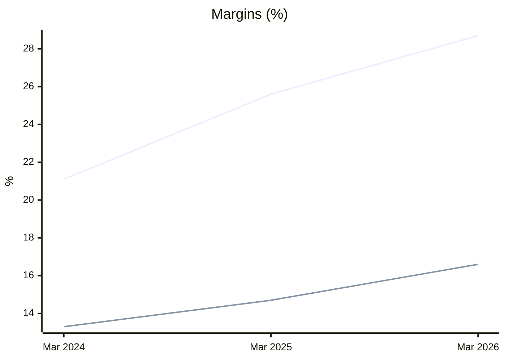
*Series in order: Operating margin, PAT margin.*

**P/E:** 79.9 — close 2026-10-01 ÷ EPS 20.32 (Mar 2026) (price ₹1,624.50 as of 2026-10-01).

**Cash flows (₹ cr):**

| | Mar 2024 | Mar 2025 | Mar 2026 |
|---|---:|---:|---:|
| Cash from operations (₹ cr) | -182 | -90.0 | 387 |
| Cash from investing (₹ cr) | -44.0 | -76.0 | -85.0 |
| Cash from financing (₹ cr) | 232 | 141 | -196 |
| Net cash flow (₹ cr) | 7.0 | -25.0 | 106 |
| Free cash flow (₹ cr) | -229 | -169 | 304 |

*Source: CashFlow/NiftyTotalMarket/ASTRAMICRO.csv (consolidated, screener.in).*

### The business being separated — its own numbers

**Space (demerged undertaking: Space, Meteorology and Hydrology business)** · unit ₹ lakh · No profit line is disclosed for this business. The company reports a single operating segment under Ind AS 108, so there is no segment result/EBIT/EBITDA/PAT for Space. Revenue shown is external sector-wise sales of 'Space' from the MD&A sector-wise sales table (gross, by sector, excluding exports which are reported as a separate line). Meteorology-related revenue is not separable: it is reported combined as 'Metrology/Civil Telecom/Others' (FY2026 Rs. 4,584 lakhs; FY2025 Rs. 3,437 lakhs), which includes non-demerged civil telecom/others, so it was not added to Space.

| | FY2024 | FY2025 | FY2026 |
|---|---:|---:|---:|
| Revenue (₹ lakh) | — | 5,848 | 10,975 |
| Revenue growth (%) | — | — | +87.7% |
| Operating profit (₹ lakh) | — | — | — |
| Operating profit growth (%) | — | — | — |
| Operating margin (%) | — | — | — |
| PAT (₹ lakh) | — | — | — |
| PAT growth (%) | — | — | — |

*Sources:* Annual Report 2024 — pages 191-193, 270-271 (single segment; no sector-wise split on these pages); Annual Report 2026 — page 191

*Not in the pages read:* No Space/Meteorology/Hydrology profit, EBITDA or PAT anywhere; no FY2024 sector split; no quarterly segment revenue (presentations give only order book, e.g. Space 26.3% at 30-06-2026).

*Documents on file:* [Annual Report 2026](https://www.bseindia.com/xml-data/corpfiling/AttachHis/006109cf-3709-427d-8b15-87513e040708.pdf); [Annual Report 2025](https://www.bseindia.com/xml-data/corpfiling/AttachHis/10122c22-40d6-4556-9b87-34a0ab677b28.pdf); [Annual Report 2024](https://www.bseindia.com/xml-data/corpfiling/AttachHis/c307696a-1240-438e-907b-8c9a7c2401de.pdf); [Presentation Aug 2026](https://www.bseindia.com/stockinfo/AnnPdfOpen.aspx?Pname=c4b03964-affd-4c16-a7e2-384c4ab877f4.pdf); [Presentation Jun 2026](https://www.bseindia.com/stockinfo/AnnPdfOpen.aspx?Pname=03c484ea-f8f7-4cee-9b9d-ab2696cf9a5d.pdf); [Presentation Feb 2026](https://www.bseindia.com/stockinfo/AnnPdfOpen.aspx?Pname=261d1e80-99bc-4c41-a6d1-d71577988dc1.pdf); [Presentation Nov 2025](https://www.bseindia.com/stockinfo/AnnPdfOpen.aspx?Pname=f02a1760-94f0-4f9a-9111-3a1f0f1d9b2b.pdf); [Presentation Aug 2025](https://www.bseindia.com/stockinfo/AnnPdfOpen.aspx?Pname=29ae7a47-5b97-4717-9a51-89fcde383fae.pdf); [Presentation May 2025](https://www.bseindia.com/stockinfo/AnnPdfOpen.aspx?Pname=33e6e259-7539-40e1-ba9f-ec37761eae32.pdf)

**The checklist:**

| Item | Status | Evidence |
|---|---|---|
| Why the spin-off | yes | unrelated businesses separated; value unlocking for shareholders; a weak or capital-heavy business carved away; attracting different investors / capital — “…ndertaking s of the Company into a separate entity. The management believes that this move shall enable a focused management attention and operational efficiency by creating an independent company exclusively dedicated ” |
| Institutional selling likely (small / different business) | partly | the businesses are described as distinct |
| Insider ownership and incentives aligned | partly | …res shall be listed on BSE and NSE. Upon the effectiveness of the Scheme, the shareholding of the Resulting Company will mirror the shareholding of the Demerged Company. Brief details of change in sharehol… *(next: the date the management options are priced; promoter holding in the resulting company)* |
| A hidden value revealed (pro-forma, leverage, comparables) | unknown | no pro-forma or market data on file *(next: pro-forma P&L of each piece × the peer P/E of its own industry)* |
| Parent before the spin (clean parent, takeover prelude) | partly | stage announced — the spin has not happened; the parent can still be bought whole |
| Timing (first year sells, second year gains) | partly | not yet listed — 228 days since the first filing, stage announced |
| Management discussing it on the calls | yes | 2 mention(s) in the last 12 months of calls — “…ter capital allocation, and improved operational e fficiency. We will share the detailed Astra Microwave Products Limited May 27 , 202 6 Page 4 of 19 scheme of demerger once it is formally approved by board, which is ex” |

**On the calls (last 12 months):**

- *Jun 2026* (neutral) — “…itability as we move forward. Other key business development happened during the year. On a strategic front, the Board of Directors have in -principle approved demerger of our space, meteorology, and hydrology business. The objective of this move is to create sharper strategic and operational focus for business segments. The p…”
- *Jun 2026* (forward) — “…ter capital allocation, and improved operational e fficiency. We will share the detailed Astra Microwave Products Limited May 27 , 202 6 Page 4 of 19 scheme of demerger once it is formally approved by board, which is expected over the next few weeks. I will now hand over the call to Mr. M. V. Reddy and Atim Kabra, who will pro…”

<details><summary>The filings</summary>

| Date | Category | Headline | Attachment |
|---|---|---|---|
| 2026-02-27 | Outcome of Board Meeting | Plot No. 51(P), Bangalore Aerospace Park, Singanahalli Village, Budigere Post, Bangalore North Taluk, Karnataka - 562149 February 27, 202 6 | [pdf](https://nsearchives.nseindia.com/corporate/ASTRAMICRO_27022026125251_outcomeofBM.pdf) |
| 2026-02-27 | Press Release | Demerger of Space, Meteorology and Hydrology Business into a Separate Listed Entity. | [pdf](https://nsearchives.nseindia.com/corporate/ASTRAMICRO_27022026131954_PressRelease.pdf) |
| 2026-06-10 | Demerger | Announcement of approval of the Scheme of Arrangement by the Board of Directors of Astra Microwave Products Limited ( AMPL / Demerged Company ) pursuant the Reg | [pdf](https://nsearchives.nseindia.com/corporate/ASTRAMICRO_10062026123059_Letter.pdf) |
| 2026-06-10 | Outcome of Board Meeting | Announcement of approval of the Scheme of Arrangement by the Board of Directors of Astra Microwave Products Limited ( AMPL / Demerged Company ) pursuant the Reg | [pdf](https://nsearchives.nseindia.com/corporate/ASTRAMICRO_10062026123601_Letter.pdf) |
| 2026-06-10 | Board Meeting (purpose) | Board Meeting Intimation ASTRA MICROWAVE PRODUCTS LIMITED has informed the Exchange about Board Meeting to be held on 10-Jun-2026 to consider Scheme of arrangem | [pdf](https://nsearchives.nseindia.com/corporate/xbrl/PIBM_532493_162026175623_PRIOR_INTIMATION_WebXMLFile_20260601_175626465.xml) |
| 2026-06-10 | Board Meeting (purpose) | Other business matters Intimation of Board Meeting for consideration of Scheme of Arrangement, as per Regulation 29 of the SEBI (Listing Obligations and Disclos | [pdf](https://nsearchives.nseindia.com/corporate/ASTRAMICRO_01062026175859_Boardmeetingintimation.pdf) |

</details>

## HINDUNILVR — Hindustan Unilever Ltd.

**CONFIRMED** (a demerger scheme is on the exchange record) · **LISTED <1Y — selling-pressure window; the bargain forms here** · score 5.7/10 · spin-off · 13 filing(s) from NSE · first 2025-10-30, latest 2026-02-13

> **Listing:** LISTED — the resulting company trades since about 2025-12-05 (record date 2025-12-05)

**The stages, as filed:** announced (2025-10-30) → listed (2025-11-29)

**Stated in the filings:** entitlement **1 for every 1**; record date 2025-12-05; appointed date 2025-12-01.

**What is being separated, as the documents put it:** HUL's Ice Cream Business Undertaking, demerged into Kwality Wall's (India) Limited, a pure-play India ice cream company — class `value_unlocking`.

- *Insiders:* Promoter/management stake not stated. HUL holders get 1 KWIL share per HUL share. HUL CFO Ritesh Tiwari is non-executive director; Prashant Premrajka executive director & CFO, Chitrank Goel deputy MD.
- *What it reveals:* A #2 India ice cream player with top-tier gross margins whose EBITDA collapsed from 7.1% (FY24-25) to 0.0% (H1 FY25-26) on cocoa, GST and standalone costs — with a margin-recovery roadmap in an 11%-growth market; parent gains 50-60bps margin.
- *Selling pressure:* likely — 1-for-1 shares to every HUL holder of a small, currently zero-EBITDA pure-play cold-chain ice cream company; different industry from FMCG parent.
- *Parent or spin:* spin · *option pricing date:* not stated
- *Read next:* KWIL's information memorandum filed with the Stock Exchanges, especially its "Risk Factors" and the Unilever brand/technology royalty agreement.
- *In their words:* “We expect to complete the demerger by December, with the listing anticipated in Quarter 4 of Financial Year 2026, subject to necessary regulatory approvals”

### Why the demerger — three years of calls and the scheme

The trigger was external to India: after parent Unilever PLC announced its intention to separate its ice cream business globally, HUL's Board ran a comprehensive review through an independent committee and decided to separate its own Ice Cream Business Undertaking. The stated business reason is structural mismatch — the scheme cites ice cream's "different operating model," including differentiated infrastructure for supply and distribution (cold chain), distinct capital allocation needs, and a distinct channel landscape and go-to-market strategy, which do not fit the rest of HUL's FMCG machine. Two routes were weighed on the Oct 2024 call — outright sale, or demerge and list — with the decision criteria explicitly stated as maximising shareholder value while minimising business disruption; HUL chose the demerger into Kwality Wall's (India) Limited (KWIL) on a 1:1 share entitlement ratio (Deloitte India Valuation LLP as registered valuer, Kotak Mahindra Capital fairness opinion), so every HUL shareholder directly owns the new listed ice cream company and can stay invested in its growth. Management sized the business as roughly 3% of HUL's turnover earning low single-digit EBITDA margins versus HUL's ~23%, so the carve-out mechanically lifts HUL's reported EBITDA margin by 50-60 bps (guidance 22-23% becomes an implied 22.5-23.5%), while Ritesh Tiwari argued the loss of 3% of turnover does not change HUL's scale at a kirana store. For the ice cream entity, the case is a focused, experienced, dedicated management team with flexibility to run a distinctive operating model, iconic brands (Kwality Wall's, Cornetto, Magnum) in an attractive high-growth category, and continued access to the portfolio, brand, innovation and technical expertise of the largest global ice cream business. For HUL, it is one of a sequence of portfolio-sharpening moves — divestment of atta and salt, divestment of the water business (Pureit, completed 1 Nov, unlocking circa Rs. 600 crores), and redeployment into high-growth demand spaces via Minimalist (turnover over Rs. 500 crores in FY25) and OZiva (Rs. 100 crores to Rs. 400 crores run rate; remaining 49% bought for Rs. 824 crores) — framed as 'fewer, bigger bets'. The scheme also claims a smoother transition for ice cream's people, and ring-fences ice cream creditors' claims onto the Resulting Company (with NCLT directing HUL to ensure KWIL can meet those obligations). Notably, no investor, lender, partner or regulator is named anywhere as having demanded the separation — the parent's global decision plus the Board's own review are the only sources given.

**How it evolved:** Oct 2024: following Unilever's global announcement, HUL confirms separation in principle but not the mode — an independent committee is weighing sale versus demerger-and-listing, with a route decision targeted by end of the calendar year, and ice cream sized at ~3% of business. Jan 2025: the Board approves the scheme of arrangement to demerge into Kwality Wall's (India) Limited at 1:1, with the detailed business rationale having been laid out at the Capital Markets Day, alongside the Pureit divestment and Minimalist acquisition. Apr 2025 and Oct 2025: execution-only updates — on track with regulatory requirements, completion by end-FY2026, then a specified two-step sequence (demerger in the December quarter with ice cream reported as discontinued, listing in Q4 FY26) plus the first explicit margin arithmetic of 50-60 bps. Feb 2026: demerger completed in the December quarter, with one-time non-cash demerger gain inside reported PAT of Rs. 6,603 crores (+121%), continuing-business EBITDA margin of 23.3%, KWIL listing on 16 February; by May 2026 it is cited retrospectively as a completed portfolio-rotation action already improving the growth mix.

**What management expects from it:** For HUL: ~50-60 bps higher reported EBITDA margin (22-23% guidance becoming an implied 22.5-23.5%), sharper focus and capital redeployed into high-growth spaces (Beauty & Wellbeing, Foods, OZiva, Minimalist), with an improved growth mix and no material loss of kirana-level scale. For KWIL: a leading listed Indian ice cream company with dedicated management, flexibility for its own cold-chain and channel model, continued global brand/innovation/technical support, and value unlock via direct 1:1 shareholding.

**Point by point, with the source:**

- *[Oct 2024](https://www.bseindia.com/stockinfo/AnnPdfOpen.aspx?Pname=a208b4bc-a7a8-4ffc-b0f0-00f1f72b4129.pdf)* — The mode of separation was still open: sale versus demerge-and-list, with an independent committee and then the Board to decide, judged on shareholder value maximisation and minimal business disruption, with a conclusion targeted by end of the year. “And of course, the key objective that the independent committee and hence, Board going forward, will end up making a decision on is -what's the best route in which we can maximize shareholder value and minimize business disruption.”
- *[Oct 2024](https://www.bseindia.com/stockinfo/AnnPdfOpen.aspx?Pname=a208b4bc-a7a8-4ffc-b0f0-00f1f72b4129.pdf)* — Ritesh Tiwari pre-empted the dis-synergy worry on distribution: ice cream is only ~3% of the business, so HUL's scale at a typical kirana store is not materially changed, and normal growth accretion more than replaces it. “So, for typical kirana store, it does not change anywhere materially - the scale at which we operate in the kirana store, it does not impact to start with.”
- *[Oct 2024](https://www.bseindia.com/stockinfo/AnnPdfOpen.aspx?Pname=a208b4bc-a7a8-4ffc-b0f0-00f1f72b4129.pdf)* — The process was explicitly framed as a consequence of the parent's decision, with HUL giving sequential quarterly updates on where it stood. “And the way we have done -- last quarter we communicated where we were in the process after Unilever globally announced its decision to separate.”
- *[Jan 2025](https://www.bseindia.com/stockinfo/AnnPdfOpen.aspx?Pname=f5b86e3e-937f-42e9-940b-ce01bf35a1bc.pdf)* — Board approved the scheme to demerge into Kwality Wall's (India) Limited at a 1:1 entitlement, so the entire shareholding sits directly with HUL shareholders and they participate in the new company's value creation. “Pursuant to the scheme, 1 equity share of the new entity will be allotted for every 1 equity share held in HUL.”
- *[Jan 2025](https://www.bseindia.com/stockinfo/AnnPdfOpen.aspx?Pname=f5b86e3e-937f-42e9-940b-ce01bf35a1bc.pdf)* — The stated benefit for the ice cream entity was management focus and strategic flexibility suited to a business model different from HUL's, in a high-growth category with iconic brands. “The demerger will equip an experienced management with greater focus and flexibility to deploy strategies suited to its distinctive business”
- *[Jan 2025](https://www.bseindia.com/stockinfo/AnnPdfOpen.aspx?Pname=f5b86e3e-937f-42e9-940b-ce01bf35a1bc.pdf)* — The demerger was positioned as part of a run of portfolio choices — after the atta and salt divestment, the water (Pureit) divestment, and alongside the Minimalist acquisition — all aimed at sharper focus and higher-growth demand spaces. “After the divestment of our atta and salt business, we have continued to drive sharper focus in the business this year by making strategic portfolio choices, including divestment of water business and decision to demerge Ice Cream business.”
- *[Jan 2025](https://www.bseindia.com/stockinfo/AnnPdfOpen.aspx?Pname=f5b86e3e-937f-42e9-940b-ce01bf35a1bc.pdf)* — Context for the decision: ice cream revenue was flat year-on-year while HUL held EBITDA at 23.7%, PAT BEI flat at INR7,723 crores and PAT up 6% to INR8,151 crores, with near-term EBITDA guided to the lower end of 23-24%. “Ice Cream revenue remained flat year -on-year.”
- *[Apr 2025](https://www.bseindia.com/stockinfo/AnnPdfOpen.aspx?Pname=57aad284-8283-4c21-8035-99627387a92d.pdf)* — Execution update placing the demerger among value-unlocking portfolio actions (Pureit circa Rs. 600 crores, Minimalist over Rs. 500 crores turnover, OZiva Rs. 100 crores to Rs. 400 crores), with completion guided to end-FY2026. “The demerger of Ice cream business Is progressing on track with regulatory requirements, and we expect It to be completed by the end of financial year 2026.”
- *[Oct 2025](https://www.bseindia.com/stockinfo/AnnPdfOpen.aspx?Pname=2eb875fe-ef79-4b40-88b8-228ccc8be17e.pdf)* — First explicit margin quantification: ice cream runs below HUL's average margin, so its removal adds 50-60 bps to reported EBITDA margin on top of the unchanged 22-23% guidance (which management stressed was not an upgrade). “Coming to EBITDA margin, Ice Cream demerger is expected to result in an improvement of 50-60 bps to the reported margin as Ice Cream business operates at a margin lower than HUL average.”
- *[Oct 2025](https://www.bseindia.com/stockinfo/AnnPdfOpen.aspx?Pname=2eb875fe-ef79-4b40-88b8-228ccc8be17e.pdf)* — Size and profitability of the carved-out business restated — roughly 3% of turnover at low single-digit margin, running even below that this year because of monsoon impact and investments. “Ice Cream, as we had called out even earlier, it's roughly 3-odd percentage of our business. and the business makes low single-digit margin.”
- *[Oct 2025](https://www.bseindia.com/stockinfo/AnnPdfOpen.aspx?Pname=2eb875fe-ef79-4b40-88b8-228ccc8be17e.pdf)* — Mechanics spelled out as two steps: demerger in the December quarter with ice cream reported as discontinued business, then listing in the March quarter, subject to regulatory approvals. “Second, in March quarter at the end of the financial year, we'll end up listing the company.”
- *[Oct 2025](https://www.bseindia.com/stockinfo/AnnPdfOpen.aspx?Pname=2eb875fe-ef79-4b40-88b8-228ccc8be17e.pdf)* — The separated business was deteriorating at the point of exit, hit by an extended monsoon on top of the GST transition. “Ice Cream business declined year on year, impacted by extended monsoon in addition to GST transition.”

*Not explained on the calls:* No standalone KWIL financials, royalty/brand-licence, supply or transition-services terms, no capex or capital-structure plan, no valuation, and no stated reason demerger beat a sale.

*Calls read (36 months):* [Apr 2025](https://www.bseindia.com/stockinfo/AnnPdfOpen.aspx?Pname=57aad284-8283-4c21-8035-99627387a92d.pdf), [Feb 2026](https://www.bseindia.com/stockinfo/AnnPdfOpen.aspx?Pname=38a5c0b9-6eee-4de5-bdd8-98ac200204cc.pdf), [Jan 2025](https://www.bseindia.com/stockinfo/AnnPdfOpen.aspx?Pname=f5b86e3e-937f-42e9-940b-ce01bf35a1bc.pdf), [May 2026](https://www.bseindia.com/stockinfo/AnnPdfOpen.aspx?Pname=55988411-440d-4801-8c08-90a5908c4a04.pdf), [Oct 2024](https://www.bseindia.com/stockinfo/AnnPdfOpen.aspx?Pname=a208b4bc-a7a8-4ffc-b0f0-00f1f72b4129.pdf), [Oct 2025](https://www.bseindia.com/stockinfo/AnnPdfOpen.aspx?Pname=2eb875fe-ef79-4b40-88b8-228ccc8be17e.pdf)

### The parent, last three fiscal years (consolidated)

| | Mar 2024 | Mar 2025 | Mar 2026 |
|---|---:|---:|---:|
| Sales (₹ cr) | 61,896 | 61,328 | 64,468 |
| Sales growth (%) | +2.2% | -0.9% | +5.1% |
| Operating profit (₹ cr) | 14,659 | 14,698 | 15,039 |
| Operating profit growth (%) | +3.6% | +0.3% | +2.3% |
| Operating margin (%) | 23.7 | 24.0 | 23.3 |
| PAT (₹ cr) | 10,282 | 10,671 | 15,059 |
| PAT growth (%) | +1.4% | +3.8% | +41.1% |
| PAT margin (%) | 16.6 | 17.4 | 23.4 |
| EPS (₹) | 43.7 | 45.3 | 64.0 |

*Source: ProfitStatement/NiftyTotalMarket/HINDUNILVR.csv (consolidated, screener.in); growth and margins computed here.*

```mermaid
xychart-beta
    title "Sales, operating profit and PAT (₹ cr)"
    x-axis ["Mar 2024", "Mar 2025", "Mar 2026"]
    y-axis "₹ crore"
    bar [61896, 61328, 64468]
    bar [14659, 14698, 15039]
    bar [10282, 10671, 15059]
```
*Series in order: Sales, Operating profit, PAT.*

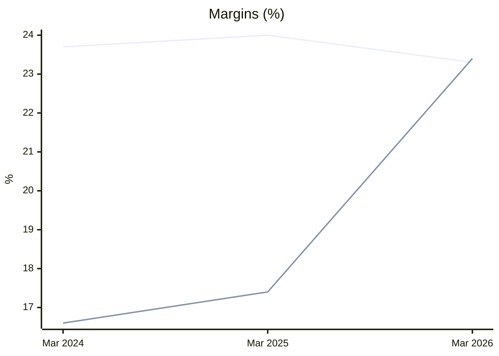
*Series in order: Operating margin, PAT margin.*

**P/E:** 44.8 — live market file (screener.in), trailing (price ₹2,101.00 as of 2026-08-02).

**Cash flows (₹ cr):**

| | Mar 2024 | Mar 2025 | Mar 2026 |
|---|---:|---:|---:|
| Cash from operations (₹ cr) | 15,469 | 11,886 | 10,999 |
| Cash from investing (₹ cr) | -5,324 | 6,473 | -3,676 |
| Cash from financing (₹ cr) | -10,034 | -13,101 | -10,810 |
| Net cash flow (₹ cr) | 111 | 5,258 | -3,487 |
| Free cash flow (₹ cr) | 14,012 | 10,624 | 9,667 |

*Source: CashFlow/NiftyTotalMarket/HINDUNILVR.csv (consolidated, screener.in).*

### The business being separated — its own numbers

**Ice Cream Business (Discontinued Operations) — demerged into Kwality Wall's (India) Limited (KWIL)** · unit ₹ crore · Revenue = 'Segment Revenue from Discontinued Operations'; operating_profit = 'Segment Results from Discontinued Operations' (segment result = profit before other income, finance costs, exceptional items and tax, i.e. EBIT-type); no intersegment transactions, so revenue is external. PAT = 'Profit/(Loss) for the year from Discontinued Operations'; FY2026 PAT of 4,407 includes the large one-off gain recognised on the Ice Cream demerger and is therefore not an operating earnings figure (PBT before exceptional items from discontinued ops was -135). FY2026 discontinued-operations figures cover only the period to the demerger (KWIL demerger completed 30th November 2025), not a full twelve months; FY2025 is a full year, restated as discontinued operations. FY2024 reports ice cream only inside 'Foods & Refreshment' with no separate line.

| | FY2024 | FY2025 | FY2026 |
|---|---:|---:|---:|
| Revenue (₹ crore) | — | 1,793 | 1,257 |
| Revenue growth (%) | — | — | -29.9% |
| Operating profit (₹ crore) | — | 43.0 | -122 |
| Operating profit growth (%) | — | — | -383.7% |
| Operating margin (%) | — | 2.4 | -9.7 |
| PAT (₹ crore) | — | -9.0 | 4,407 |
| PAT growth (%) | — | — | +49066.7% |

*Sources:* Annual Report 2024 — page 213 (ice-cream not separately disclosed; included in Foods & Refreshment); Annual Report 2026 — page 229

*Not in the pages read:* No standalone Ice Cream revenue/profit for FY2024; no quarterly Ice Cream revenue, EBIT or PAT in any presentation page; no Ice Cream assets, capex or depreciation split.

*Documents on file:* [Annual Report 2026](https://www.bseindia.com/xml-data/corpfiling/AttachHis/881493e4-75af-4a7f-8c64-9d0886e63f1d.pdf); [Annual Report 2025](https://www.bseindia.com/xml-data/corpfiling/AttachHis/770bf03e-526d-45d8-8364-13f7fc523289.pdf); [Annual Report 2024](https://www.bseindia.com/xml-data/corpfiling/AttachHis/02d8d87d-90ce-4191-8b3f-4167267aee8a.pdf); [Presentation Sep 2026](https://www.bseindia.com/stockinfo/AnnPdfOpen.aspx?Pname=d9d8d7e9-c5ef-40ef-bbd6-bc832320c0d5.pdf); [Presentation Aug 2026](https://www.bseindia.com/stockinfo/AnnPdfOpen.aspx?Pname=163e0f27-042e-41a9-9db7-14f5d0172218.pdf); [Presentation Feb 2026](https://www.bseindia.com/stockinfo/AnnPdfOpen.aspx?Pname=6e6dea43-db7a-4075-82c6-71024ed4436a.pdf); [Presentation Oct 2025](https://www.bseindia.com/stockinfo/AnnPdfOpen.aspx?Pname=b38b0312-d563-42a1-96e7-d61213c82925.pdf); [Presentation Aug 2025](https://www.bseindia.com/stockinfo/AnnPdfOpen.aspx?Pname=4df29a3d-78e4-47ca-a31b-b709351cf655.pdf); [Presentation Apr 2025](https://www.bseindia.com/stockinfo/AnnPdfOpen.aspx?Pname=935a2031-ae72-4611-92f3-227ee7a569c6.pdf)

**The checklist:**

| Item | Status | Evidence |
|---|---|---|
| Why the spin-off | yes | value unlocking for shareholders; regulatory / strategic knot; a weak or capital-heavy business carved away; unrelated businesses separated — “…s to sharpen focus on their respective businesses and strategies in pursuit of their respective growth and value creation models; (ii) the Ice Cream Business Undertaking (as defined in the Scheme ) operates in an attrac” |
| Institutional selling likely (small / different business) | partly | the businesses are described as distinct |
| Insider ownership and incentives aligned | unknown | no promoter-continuity or option-pricing language found *(next: the date the management options are priced; promoter holding in the resulting company)* |
| A hidden value revealed (pro-forma, leverage, comparables) | yes | borrowings 1,478 cr (Mar 2026) = 0.00× market cap; P/E 32.8 on Mar 2026 profit vs industry median 51.5 (27 peers) |
| Parent before the spin (clean parent, takeover prelude) | no | stage listed — the pieces trade separately now |
| Timing (first year sells, second year gains) | partly | 312 days since listing/record date; first year since listing — the selling-pressure window; watch, size the entry |
| Management discussing it on the calls | yes | 13 mention(s) in the last 12 months of calls — “…ormats of Beauty and Home Care. We have actively rotated our portfolio to sharpen the quality and growth profile of the business. Strategic actions such as the demerger of I ce Cream, along with the investments at O Ziv” |

**On the calls (last 12 months):**

- *Oct 2025* (neutral) — “…rlier, by GST transition. Ice Cream business declined year on year, impacted by extended monsoon in addition to GST transition. As you are aware, the Ice Cream demerger process is currently underway. We expect to complete the demerger by December, with the listing anticipated in Quarter 4 of Financial Year 2026, subject to nec…”
- *Oct 2025* (neutral) — “…, impacted by extended monsoon in addition to GST transition. As you are aware, the Ice Cream demerger process is currently underway. We expect to complete the demerger by December, with the listing anticipated in Quarter 4 of Financial Year 2026, subject to necessary regulatory approvals Moving on to the summary of our perfor…”
- *Oct 2025* (forward) — “…remain firmly committed to investing be hind our business, confident that this continued focus will unlock sustained growth. Coming to EBITDA margin, Ice Cream demerger is expected to result in an improvement of 50-60 bps to the reported margin as Ice Cream business operates at a margin lower than HUL av erage. Our current nea…”
- *Oct 2025* (neutral) — “…Ice Cream business operates at a margin lower than HUL av erage. Our current near to mid-term guidance is 22-23%, hence everything else being equal, Ice Cream demerger adds 50-60 bps to this guidance. September Quarter 2025 Earnings call of Hindustan Unilever Limited Page 12 of 42 We remain committed to executing our strategy…”
- *Oct 2025* (neutral) — “…in guidance for HUL has been upgraded. You clarified on that bit that there was an Ice Cream impact of 50, 60 bps. But if you could clarify becau se –Ice Cream demerger is going to be at the year end. So, when does that benefit happen? That happens in FY'27 essentially, 50-60 bps? Ritesh Tiwari: So yes, currently, where we are…”

<details><summary>The filings</summary>

| Date | Category | Headline | Attachment |
|---|---|---|---|
| 2025-10-30 | Demerger | Sanction of Scheme of Arrangement for demerger of Ice Cream Business by Hon'ble NCLT, Mumbai Bench | [pdf](https://nsearchives.nseindia.com/corporate/HINDUNILVR_30102025210005_SEIntimationFinalOrdersigned.pdf) |
| 2025-11-11 | General Updates | Receipt of copy of Order of Scheme of Arrangement obtained from the Hon ble NCLT, Mumbai Bench | [pdf](https://nsearchives.nseindia.com/corporate/HINDUNILVR_11112025175242_Final_Order_SE_Intimation_signed.pdf) |
| 2025-11-18 | General Updates | Material update in connection with the Scheme of Arrangement Communication received from Kwality Wall s (India) Limited | [pdf](https://nsearchives.nseindia.com/corporate/HINDUNILVR_18112025181853_HULKWILSEIntimationsigned.pdf) |
| 2025-11-23 | General Updates | Material update in connection with the Scheme of Arrangement - Communication received from Kwality Wall's (India) Limited | [pdf](https://nsearchives.nseindia.com/corporate/HINDUNILVR_23112025211049_23112025SEIntimation_signed.pdf) |
| 2025-11-23 | General Updates | Material update in connection with the Scheme of Arrangement - Communication received from Kwality Wall's (India) Limited | [pdf](https://nsearchives.nseindia.com/corporate/HINDUNILVR_23112025214533_InvestorPresentationKWILsigned.pdf) |
| 2025-11-29 | Updates | FAQs on the allotment of shares of Kwality Wall s (India) Limited pursuant to the approved Scheme of Arrangement | [pdf](https://nsearchives.nseindia.com/corporate/HINDUNILVR_29112025134344_SEIntimationFAQs.pdf) |
| 2025-12-01 | General Updates | Material update in connection with the Scheme of Arrangement - Communication received from Kwality Wall's (India) Limited | [pdf](https://nsearchives.nseindia.com/corporate/HINDUNILVR_01122025225329_KWILSEIntimation01122025Final_signed.pdf) |
| 2025-12-10 | General Updates | Material update in connection with the Scheme of Arrangement - Communication received from Kwality Wall's (India) Limited | [pdf](https://nsearchives.nseindia.com/corporate/HINDUNILVR_10122025194900_HULKWILIntiamtionCSResignationsigned.pdf) |
| 2025-12-13 | General Updates | Material update in connection with the Scheme of Arrangement - Communication received from Kwality Wall's (India) Limited | [pdf](https://nsearchives.nseindia.com/corporate/HINDUNILVR_13122025214953_SEIntimationCostofAcquisitionFinalsigned.pdf) |
| 2025-12-30 | General Updates | Material update in connection with the Scheme of Arrangement - Communication received from Kwality Wall's (India) Limited | [pdf](https://nsearchives.nseindia.com/corporate/HINDUNILVR_30122025214126_SEIntimation30122025signed.pdf) |
| 2026-01-05 | General Updates | Material update in connection with the Scheme of Arrangement - Communication received from Kwality Wall's (India) Limited | [pdf](https://nsearchives.nseindia.com/corporate/HINDUNILVR_05012026120352_KWILSEIntimation05012026_signed.pdf) |
| 2026-02-09 | General Updates | Material Update in connection with the Scheme of Arrangement - Communication received from Kwality Wall's (India) Limited | [pdf](https://nsearchives.nseindia.com/corporate/HINDUNILVR_09022026140003_09022026KWILIntimationsigned.pdf) |
| 2026-02-13 | General Updates | Material update in connection with the Scheme of Arrangement - Communication received from Kwality Wall's (India) Limited | [pdf](https://nsearchives.nseindia.com/corporate/HINDUNILVR_13022026140635_SEIntimationKWIL13022026signed.pdf) |

</details>

## LEMONTREE — Lemon Tree Hotels Ltd.

**CONFIRMED** (a demerger scheme is on the exchange record) · **PRE-SPIN — study the parent; the pieces do not trade yet** · score 5.7/10 · spin-off · 3 filing(s) from NSE · first 2026-01-10, latest 2026-09-22

> **Listing:** NOT YET — scheme at 'exchange_noc' stage; Fleur Hotels Limited will list only after NCLT sanction, effectiveness and a record date; indicated timeline: No listing date stated. Jan 9, 2026 filing: listing would be sought for the resulting entity; "its shares will be listed on the Stock Exchanges" after implementation; "a potential separate listing of the Transferee Company"; Appointed Date April 1, 2026; CCI approval granted April 7, 2026 with detailed order awaited; Nov 2025 call said demerger "is in proces[s]"; Feb 2026 call said "the demerger process is underway"

**The stages, as filed:** exchange_noc (2026-09-22)

**Stated in the filings:** resulting company **Fleur Hotels Limited**; pro-forma statements referenced.

**What is being separated, as the documents put it:** Asset-heavy hotel-ownership and development undertaking: 11 operating hotels, 1 under construction, Arum Hotels stake, plus development capabilities — class `value_unlocking`.

- *Insiders:* Promoters Keswani and Spank Management are parties to the SHA/Implementation Agreement; Keswani becomes Fleur's non-retiring executive chairman, with up to 3 LTHL directors on Fleur's 10-member board; LTHL retains 41.03%
- *What it reveals:* Fleur takes 100% of group debt (~Rs 1,300 crore per Jan 2026 call) leaving Lemon Tree zero-debt and asset-light; demerged division is 59.90% of turnover; Coastal Cedar buys APG's 41.09% and may add Rs 960 crore growth capital, pricing the asset platform
- *Selling pressure:* likely — Small entitlement (20 Fleur shares per 311 LTHL shares), newly listed unindexed asset-heavy levered entity versus holders who bought an asset-light brand
- *Parent or spin:* both · *option pricing date:* not stated
- *Read next:* Fleur's pro-forma balance sheet and the valuation report behind the 20:311 share entitlement ratio
- *In their words:* “The Scheme seek to establish the Transferee Company as the principal entity housing the Demerged Hotel Properties assets and investments and establish the Company as the primary platform for hospitality management and brand, of the group.”

### Why the demerger — three years of calls and the scheme

Management says Lemon Tree Hotels has two businesses with fundamentally different economics bundled inside one listed company: an asset-heavy hotel ownership, leasing and development business, and an asset-light management, brand, loyalty, distribution and technology platform. Keswani laid out the economic spread explicitly in Aug 2025 — managing a hotel earns 17% of EBITDA, franchising 10%, leasing requires putting in 10%-20% of capital value for 50%-60% of EBITDA, and owning 100% means taking 100% of EBITDA with 100% of the risk — so under the Composite Scheme of Arrangement Fleur Hotels' mandate becomes building, buying or leasing hotels while Lemon Tree will only manage or franchise and 'will not lease hotels once the Fleur demerger happens.' A second stated problem is the balance sheet being misread: he complained analysts were 'blindly adding the lease liability' to compute debt-to-EBITDA, noting only 60%-65% of debt is bank debt and that continued leasing under Ind AS 116 would keep inflating lease liability and depreciation. The scheme fixes this by transferring all the debt, including Lemon Tree's own, to Fleur — about Rs. 1,300 crore against Fleur EBITDA of roughly Rs. 900 crore / $100 million next year, with Fleur then debating deploying another Rs. 1,300-1,400 crore — leaving Lemon Tree effectively debt-free with fee income available as free cash rather than being redeployed into capital (dividend policy to be decided by the Board within six months). The investor/partner dimension is central: Warburg Pincus has completed the purchase of APG's stake in Fleur, holds 26% fully diluted, and has a Rs. 960 crore commitment deployable only in the next 12 months, because once Fleur lists further capital must come from internal accruals or QIPs — and Warburg 'want to take a large stake in Fleur, put in 100's and 100's million dollars for a chunky return,' which Keswani says cannot be done against a ROFO inside the listed parent. Mechanically Lemon Tree transfers 17 hotels plus development capabilities and its shareholders receive Fleur shares, so they end up owning close to 74% of Fleur (33% direct, ~41% indirect) versus the 59% Lemon Tree owns directly today; the filing puts the retained stake at ~41.03%, subject to dilution from the Proposed Preferential Issue. The filing frames the purpose as segregating a 'distinct and self-sustaining undertaking' to achieve 'operational focus, greater flexibility for capital deployment, and clearer alignment of business objectives,' plus separate listing for 'transparent price discovery and market-driven valuation of the asset-heavy business,' a flexible structure to attract co-development partners without affecting brand operations or control, separate management teams and governance, and — via the amalgamation of two wholly owned subsidiaries into the Company — removal of legal layering, duplication, compliance costs and controllership overheads. Organizationally it was pre-wired: separate Managing Directors (Neelendra Singh for Lemon Tree from October 1, Saurabh for Fleur), with Keswani as Fleur's Executive Chair and ceasing his Lemon Tree executive role from March 2027.

**How it evolved:** It surfaced on the Aug 2025 call as an exploratory step — committees of directors had been set up in both Lemon Tree and Fleur to evaluate transferring assets from Lemon Tree into Fleur by demerger and then listing Fleur, with Keswani refusing to specify shareholding or the mechanism until those committees reported back, while the senior-management change (Neelendra from October 1, Keswani on an 18-month extension as Executive Director) was explicitly made so two people could run the two companies independently. On the Nov 2025 call it was only 'in process' with both boards and their subcommittees in discussion, Keswani promising 'a bunch of interesting things' within three months plus 'some other even more exciting stuff.' By the dedicated Jan 15, 2026 call the Composite Scheme of Arrangement was announced and the rationale became concrete — all debt to Fleur (~Rs. 1,300 crore), Lemon Tree at zero debt, Warburg at 26% fully diluted with Rs. 960 crore deployable in 12 months — and the Feb 2026 call added the consequences (Fleur targeting Rs. 1,000 crore EBITDA, Lemon Tree a net-cash company with a dividend policy due in six months). By Jun 2026 the structure was fixed and pro forma financials were published: Warburg had completed the APG purchase, 17 hotels plus development capabilities move to Fleur, shareholders end at ~74% of Fleur, and the timeline had slipped — CCI approval received in April, shareholder and SEBI approval pending before NCLT filing, with guidance moving from '12 months from Jan' to another 12-15 months, which Kapil Sharma characterized as a one-month delay on a conservative estimate.

**What management expects from it:** Lemon Tree: pure-play asset-light management, brand, loyalty, distribution and digital business — zero debt from next year, high margin, high ROCE, strong free cash from fees, hypercharged franchising/soft brand, dividend policy pending. Fleur: large-scale growth-oriented ownership/leasing PropCo with in-house development, ~Rs. 1,300 crore debt against ~Rs. 900-1,000 crore EBITDA, Warburg capital, listed valuation and price discovery. Both: accountability, focus, value unlocking.

**Point by point, with the source:**

- *[Aug 2025](https://www.bseindia.com/stockinfo/AnnPdfOpen.aspx?Pname=c30ba016-9c4b-4e13-8b0d-a5fb02eb43b7.pdf)* — First disclosure: committees of directors in both Lemon Tree and Fleur were set up to evaluate a demerger of assets from Lemon Tree into Fleur and then list Fleur, making Lemon Tree asset-light and Fleur a PropCo. “So, the intent is that Lemon Tree will then become asset light, a significant shareholder in Fleur and will focus on management, brand and technology as a company, which is, I think , quite common to what have been global trends in this space.”
- *[Aug 2025](https://www.bseindia.com/stockinfo/AnnPdfOpen.aspx?Pname=c30ba016-9c4b-4e13-8b0d-a5fb02eb43b7.pdf)* — The economic logic was spelled out as a fee-vs-capital split: 17% of EBITDA for management, 10% for franchising, 50%-60% for a lease requiring 10%-20% of capital value, 100% of EBITDA with 100% of risk for ownership — so Fleur takes capital-intensive activity and Lemon Tree takes only fees. “Fleur's mandate will be to focus on, at the right value, building, buying, or leasing hotels. Lemon Tree's will only be to manage or franchise. Lemon Tree will not lease hotels once the Fleur demerger happens.”
- *[Aug 2025](https://www.bseindia.com/stockinfo/AnnPdfOpen.aspx?Pname=c30ba016-9c4b-4e13-8b0d-a5fb02eb43b7.pdf)* — A stated problem is market misreading of leverage: analysts added lease liability into debt-to-EBITDA, when only 60%-65% of debt is bank debt and continued leasing under Ind AS 116 would keep inflating lease liability and depreciation. “I noticed that some analysts were saying our debt -to-EBITDA is some very large number. And I think they were just blindly adding the lease liability.”
- *[Aug 2025](https://www.bseindia.com/stockinfo/AnnPdfOpen.aspx?Pname=c30ba016-9c4b-4e13-8b0d-a5fb02eb43b7.pdf)* — Investors were already pressing on mechanics and value unlocking — how much of Fleur Lemon Tree would hold, whether shareholders get one-for-one shares — and management deferred to the two committees' recommendations to the boards. “We have said a potential demerger. How will the demerger work is something that they have to come back with their recommendations to the board too.”
- *[Nov 2025](https://www.bseindia.com/stockinfo/AnnPdfOpen.aspx?Pname=5a3cfc96-c662-414a-bc34-4635bef2415b.pdf)* — Asked by Abhay Khaitan for process and timeline, management said the demerger was still with subcommittees and both full boards, and pre-announced news within three months — plus unspecified additional items. “It is not only the demerger of Fleur, but some other even more exciting stuff, but we will talk about it when the time is right.”
- *[Jan 2026](https://www.bseindia.com/stockinfo/AnnPdfOpen.aspx?Pname=098527b9-fd65-4aa9-9c6d-1ac184b2eda0.pdf)* — Opening remarks set the context as a structural upcycle the group had positioned for — Aurika Mumbai commissioned, a 500-plus room Aurika at Nehru Place secured, ~7,000 rooms signed under third-party management, ~130 hotels and ~11,700 rooms operating — making the reorganization the 'logical and value accretive next step' into two well-capitalized businesses with separate MDs already in place. “The proposed reorganization will result in 2 distinct well-capitalized businesses, Lemon Tree Hotels as a pure -play asset -light company focused on offering hotel management, brand , loyalty distribution and digital services.”
- *[Jan 2026](https://www.bseindia.com/stockinfo/AnnPdfOpen.aspx?Pname=098527b9-fd65-4aa9-9c6d-1ac184b2eda0.pdf)* — Debt is wholly reallocated: Fleur takes 100% of group debt including Lemon Tree's (~Rs. 1,300 crore at demerger) against ~Rs. 900 crore / $100 million EBITDA next year, with a further Rs. 1,300-1,400 crore of deployment under debate; Lemon Tree is left at zero debt. “Firstly, when this demerger happens, all the debt, including the Lemon Tree's debt, after adjustment is being transferred to Fleur. Fleur will have 100% of our debt and Lemon Tree will have zero debt.”
- *[Jan 2026](https://www.bseindia.com/stockinfo/AnnPdfOpen.aspx?Pname=098527b9-fd65-4aa9-9c6d-1ac184b2eda0.pdf)* — A capital partner is a driver: Warburg wants a large direct stake in Fleur and has Rs. 960 crore deployable only within 12 months, because once Fleur lists additional capital must come from internal accruals or QIPs; Warburg is at 26% fully diluted against Lemon Tree's 41%, and more money dilutes Lemon Tree. “So, this is why they want to take a large stake in Fleur, put in 100 's and 100's million dollars for a chunky return.”
- *[Feb 2026](https://www.bseindia.com/stockinfo/AnnPdfOpen.aspx?Pname=b0215f7f-3372-4231-8b2f-7f433eb77faf.pdf)* — Post-scheme Lemon Tree becomes net cash: all assets and debt go to Fleur, significant renovation spend (OPEX over Rs. 100 crore, CAPEX Rs. 70-80 crore) shrinks after FY27, and fee income becomes free cash rather than capital, with a dividend policy for the Board to decide in six months. “Lemon Tree will immediately effectively be a debt -free company from next year. And all the fee income that it earns, which will be fairly significant, will therefore be not redeployed in capital, but will rather be available as free cash.”
- *[Feb 2026](https://www.bseindia.com/stockinfo/AnnPdfOpen.aspx?Pname=b0215f7f-3372-4231-8b2f-7f433eb77faf.pdf)* — Growth is explicitly routed through Fleur post-demerger — greenfield, brownfield and outright acquisitions, including multiple opportunities totalling about 2,500 keys that would be rebranded rather than added as new brands — against the Rs. 1,000 crore Fleur EBITDA figure cited on the post-demerger call. “And I am pretty sure that in the next 12 months, we will show a bunch of additions. Some may be greenfield, some may be brownfield and some may be outright acquisitions.”
- *[Jun 2026](https://www.bseindia.com/stockinfo/AnnPdfOpen.aspx?Pname=a03e8364-4037-407c-8929-d956c0976b96.pdf)* — Final mechanics with pro forma financials published: Warburg completed the APG purchase, Lemon Tree transfers 17 hotels plus development capabilities, shareholders receive Fleur shares and Fleur lists, lifting shareholders' Fleur economics from 59% held via Lemon Tree to ~74% (33% direct, ~41% indirect) before any Warburg primary infusion — delivered against FY26 revenue of Rs. 1,452.7 crore (up 13%) and net EBITDA of Rs. 699.3 crore (up 10%). “Next, Lemon Tree will transfer 17 hotels and development capabilities in exchange for which Lemon Tree shareholders will get Fleur shares, leading to Fleur's listing as a separate entity.”
- *[Jun 2026](https://www.bseindia.com/stockinfo/AnnPdfOpen.aspx?Pname=a03e8364-4037-407c-8929-d956c0976b96.pdf)* — Continuity is preserved by long-term management agreements that give Lemon Tree stable, growing fee income from Fleur and let Fleur underwrite deals faster, with Fleur's hotels fully renovated by demerger; Keswani becomes Fleur's Executive Chair and leaves his Lemon Tree executive role from March 2027. Timeline slipped: CCI approval in April, shareholder and SEBI approval pending before NCLT, guidance now 12-15 months versus the earlier 12 months, described as about a one-month delay. “Post reorganization, Lemon Tree will emerge as a debt -free, high-margin, high ROCE company generating strong free cash flows from fees and brand -related income.”

*Not explained on the calls:* No share-entitlement ratio or valuation basis for the demerger itself, no tax treatment, no specific management-fee rates to Fleur, no dividend policy, no listing-date value estimate.

*Calls read (36 months):* [Aug 2025](https://www.bseindia.com/stockinfo/AnnPdfOpen.aspx?Pname=c30ba016-9c4b-4e13-8b0d-a5fb02eb43b7.pdf), [Feb 2026](https://www.bseindia.com/stockinfo/AnnPdfOpen.aspx?Pname=b0215f7f-3372-4231-8b2f-7f433eb77faf.pdf), [Jan 2026](https://www.bseindia.com/stockinfo/AnnPdfOpen.aspx?Pname=098527b9-fd65-4aa9-9c6d-1ac184b2eda0.pdf), [Jun 2026](https://www.bseindia.com/stockinfo/AnnPdfOpen.aspx?Pname=a03e8364-4037-407c-8929-d956c0976b96.pdf), [Nov 2025](https://www.bseindia.com/stockinfo/AnnPdfOpen.aspx?Pname=5a3cfc96-c662-414a-bc34-4635bef2415b.pdf)

### The parent, last three fiscal years (consolidated)

| | Mar 2024 | Mar 2025 | Mar 2026 |
|---|---:|---:|---:|
| Sales (₹ cr) | 1,071 | 1,286 | 1,444 |
| Sales growth (%) | +22.4% | +20.1% | +12.3% |
| Operating profit (₹ cr) | 523 | 634 | 690 |
| Operating profit growth (%) | +16.7% | +21.2% | +8.8% |
| Operating margin (%) | 48.8 | 49.3 | 47.8 |
| PAT (₹ cr) | 182 | 243 | 288 |
| PAT growth (%) | +29.1% | +33.5% | +18.5% |
| PAT margin (%) | 17.0 | 18.9 | 19.9 |
| EPS (₹) | 1.9 | 2.5 | 2.9 |

*Source: ProfitStatement/NiftyTotalMarket/LEMONTREE.csv (consolidated, screener.in); growth and margins computed here.*

```mermaid
xychart-beta
    title "Sales, operating profit and PAT (₹ cr)"
    x-axis ["Mar 2024", "Mar 2025", "Mar 2026"]
    y-axis "₹ crore"
    bar [1071, 1286, 1444]
    bar [523, 634, 690]
    bar [182, 243, 288]
```
*Series in order: Sales, Operating profit, PAT.*

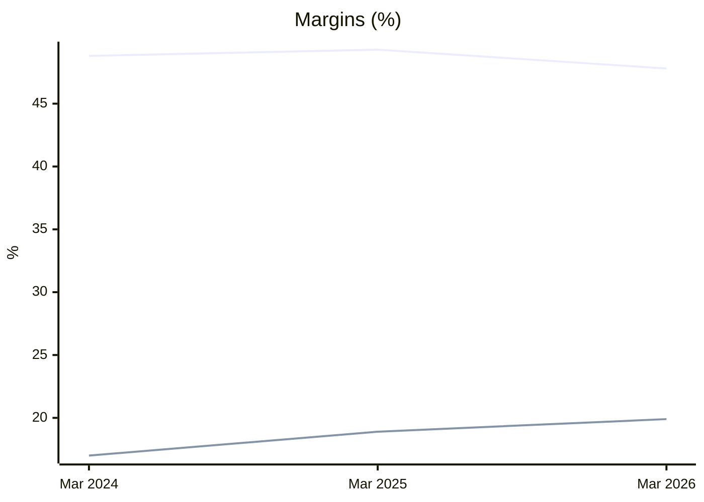
*Series in order: Operating margin, PAT margin.*

**P/E:** 34.9 — live market file (screener.in), trailing (price ₹109.00 as of 2026-08-02).

**Cash flows (₹ cr):**

| | Mar 2024 | Mar 2025 | Mar 2026 |
|---|---:|---:|---:|
| Cash from operations (₹ cr) | 465 | 542 | 542 |
| Cash from investing (₹ cr) | -397 | -127 | -169 |
| Cash from financing (₹ cr) | -59.0 | -392 | -370 |
| Net cash flow (₹ cr) | 10.0 | 22.0 | 3.0 |
| Free cash flow (₹ cr) | 134 | 448 | 406 |

*Source: CashFlow/NiftyTotalMarket/LEMONTREE.csv (consolidated, screener.in).*

### The business being separated — its own numbers

The segment pages read (3 annual report(s) and 11 presentation(s) on file) do not carry this business's own revenue or profit: Fleur's own revenue, EBITDA/operating profit and PAT — annual and quarterly. Pages carry no segment or subsidiary-level P&L for Fleur; only parent fees received from Fleur.

*Documents on file:* [Annual Report 2026](https://www.bseindia.com/xml-data/corpfiling/AttachHis/be00cd57-2cf4-4cb8-ae86-25abf6514c44.pdf); [Annual Report 2025](https://www.bseindia.com/xml-data/corpfiling/AttachHis/c1ba19b8-e632-41bd-95da-996e7ec68b05.pdf); [Annual Report 2024](https://www.bseindia.com/xml-data/corpfiling/AttachHis/909f5daf-1ec8-43b7-a52e-36925fa72a1f.pdf); [Presentation Aug 2026](https://www.bseindia.com/stockinfo/AnnPdfOpen.aspx?Pname=03179e31-3670-48bd-97ad-621254b02e82.pdf); [Presentation Jun 2026](https://www.bseindia.com/stockinfo/AnnPdfOpen.aspx?Pname=48d6e84e-033d-477d-a9c4-37a041824e1d.pdf); [Presentation Feb 2026](https://www.bseindia.com/stockinfo/AnnPdfOpen.aspx?Pname=e55682f6-ab5d-43b2-9e3c-63f601797da3.pdf); [Presentation Jan 2026](https://www.bseindia.com/stockinfo/AnnPdfOpen.aspx?Pname=d182318c-0477-403a-a9d2-38e4f41be0d6.pdf); [Presentation Nov 2025](https://www.bseindia.com/stockinfo/AnnPdfOpen.aspx?Pname=ac49f71d-a895-4efd-b414-5c14334553c9.pdf); [Presentation Aug 2025](https://www.bseindia.com/stockinfo/AnnPdfOpen.aspx?Pname=e9204055-c5f2-49e3-92ae-6427e1c976ae.pdf)

**The checklist:**

| Item | Status | Evidence |
|---|---|---|
| Why the spin-off | yes | regulatory / strategic knot; attracting different investors / capital — “…approval of, in ter alia, the Scheme (including Amalgamation 1, the Amalgamation 2 and the Demerger) by the Competition Commission of India (if and to the extent required); (d) sanction of the Scheme by the NCLT under S” |
| Institutional selling likely (small / different business) | unknown | size of the demerged piece not stated *(next: pro-forma statements: revenue / assets of the demerged undertaking vs the parent)* |
| Insider ownership and incentives aligned | unknown | no promoter-continuity or option-pricing language found *(next: the date the management options are priced; promoter holding in the resulting company)* |
| A hidden value revealed (pro-forma, leverage, comparables) | yes | pro-forma statements are referenced in the filings; borrowings 2,004 cr (Mar 2026) = 0.23× market cap; P/E 30.1 on Mar 2026 profit vs industry median 54.1 (17 peers) |
| Parent before the spin (clean parent, takeover prelude) | partly | stage exchange_noc — the spin has not happened; the parent can still be bought whole |
| Timing (first year sells, second year gains) | partly | not yet listed — 276 days since the first filing, stage exchange_noc |
| Management discussing it on the calls | yes | 19 mention(s) in the last 12 months of calls — “…s that you may have. Moderator: The first question is from the line of Achal Kumar with HSBC. Achal Kumar: I have 2 simple questions . So first, tomorrow after demerger, if Fleur believes that its inventory can be manag” |

**On the calls (last 12 months):**

- *Nov 2025* (forward) — “…I expect we will hit Rs. 12,000. Page 9 of 26 Abhay Khaitan: Understood. That is very helpful. My second question is that if you have any updates on the Fleur demerger, any update that you can provide on what is the process and what is the timeline that we are working with right now on this? Patanjali Keswani: It is in proces…”
- *Nov 2025* (forward) — “…h of interesting things to tell the market, I think, in the next 3 months. Would that be right, Kapil? Kapil Sharma: Yes. Patanjali Keswani: It is not only the demerger of Fleur, but some other even more exciting stuff, but we will talk about it when the time is right. Moderator: Thank you. Next question comes from the line of…”
- *Jan 2026* (forward) — “…Disclosure Requirements) Regulations, 2015, transcript of the Investors & Analysts Conference Call held on January 15, 2026, w.r.t. announced of the Composite Scheme of Arrangement is enclosed. You are requested to take the above information in your record . Thanking you, For Lemon Tree Hotels Limited Pawan Kumar Kumawat Company Secretary…”
- *Jan 2026* (forward) — “…joining us, and I wish you all a belated Happy New Year. The purpose of this call is really to explain the rationale of the timing and logic for this Composite Scheme of Arrangement, which has just been announced. To begin with, I would like to give some context. So please bear with me. As you know, the hospitality sector in India is curre…”
- *Jan 2026* (forward) — “…s structure will provide clarity on accountability and sharper strategic focus as both these entities scale going forward. Against this backdrop, the corporate scheme of arrangement represents a logical and value accretive next step. The proposed reorganization will result in 2 distinct well-capitalized businesses, Lemon Tree Hotels as a p…”

<details><summary>The filings</summary>

| Date | Category | Headline | Attachment |
|---|---|---|---|
| 2026-01-10 | Scheme of Arrangement | Lemon Tree Hotels Limited has informed the Exchange about Scheme of Arrangement | [pdf](https://nsearchives.nseindia.com/corporate/LEMONTREE_10012026000104_LTHL_Outcome.pdf) |
| 2026-04-07 | Updates | Lemon Tree Hotels Limited has informed the Exchange regarding 'Approval of Competition Commission of India for the acquisition of certain equity shares of Fleur | [pdf](https://nsearchives.nseindia.com/corporate/LEMONTREE_07042026204840_Stock_Exchange_Intimation_CCI.pdf) |
| 2026-09-22 | Scheme of Arrangement | Lemon Tree Hotels Limited has informed that the Company has received the Observation Letters with no objection from the NSE and no adverse observations from the | [pdf](https://nsearchives.nseindia.com/corporate/LEMONTREE_22092026213712_Intimation_signed.pdf) |

</details>

## NH — Narayana Hrudayalaya Ltd.

**CONFIRMED** (a demerger scheme is on the exchange record) · **PRE-SPIN — study the parent; the pieces do not trade yet** · score 5.7/10 · spin-off · 18 filing(s) from NSE · first 2025-12-12, latest 2026-04-06

> **Listing:** NOT YET — scheme at 'nclt_sanction' stage; the resulting company will list only after NCLT sanction, effectiveness and a record date; indicated timeline: Per the December 12, 2025 filing: 'The Resulting Entity is a listed entity. There is no requirement of any new listing of shares as there is no consideration involved in the Demerger in view of the Demerged Company being a wholly owned subsidiary of the Resulting Company.'

**The stages, as filed:** meetings (2025-12-18) → nclt_sanction (2026-01-19)

**What is being separated, as the documents put it:** Clinical Services undertaking of NHIC — 10 Bengaluru clinics — demerged into listed parent NHL — class `regulatory_strategic`.

- *Insiders:* Not stated. No change in shareholding pattern; NHIC remains a 100% wholly owned subsidiary of NHL, with no cash consideration and no shares issued.
- *What it reveals:* Clinical Services is tiny — Rs 39.94 crore, 1.11% of NHL standalone FY25 turnover — and was a cost-duplicating dependency; the retained asset-light Aarogyam preventive platform is where NHIC claims growth and 'demonstrated investor interest'.
- *Selling pressure:* unlikely — No shares issued, no new listing, no index change; demerged business is 1.11% of turnover and stays inside listed NHL.
- *Parent or spin:* parent · *option pricing date:* not stated
- *Read next:* NHIC standalone financials — Clinical Services profitability; and the Meridian Medical Research & Hospital amalgamation scheme filed September 27, 2025.
- *In their words:* “The Clinical Services undertaking of NHIC, comprising 10 clinics located in Bengaluru, shall be demerged to NHL.”

### Why the demerger — three years of calls and the scheme

The separation is a demerger of the "Clinical Services" undertaking (the primary/secondary care clinics NHIC runs across Bengaluru) out of NH Integrated Care Private Limited (NHIC) and into the listed parent Narayana Hrudayalaya Limited (NHL), with an Appointed Date of April 1, 2025. Management's stated reason is that the clinics turned out not to be standalone: NHIC was incorporated to run primary and secondary care clinics "independently of hospital-based tertiary care services," but operational experience showed "substantial dependencies on hospital infrastructure" — consultant doctors and specialists primarily engaged at hospitals, advanced diagnostics "not viable at individual clinic locations," and patient pathways requiring tertiary care. Running clinics separately from hospitals forced duplicate administrative functions (finance, HR, procurement, IT, marketing), producing "increased costs, coordination inefficiencies, and the inability to realise economies of scale," and it crowded out NHIC's strategic priority, preventive healthcare. What stays behind in NHIC is Narayana Aarogyam, a preventive platform (health screening, risk assessment, wellness coaching, continuous monitoring) that is said to be structurally hospital-independent: dedicated technology-enabled testing centres, appointment-based services with no on-call specialists or emergency capability, minimal hospitalisation, and predictable resource needs — so it can go digital-first, AI-powered and asset-light, hire specialised digital health talent and pursue population-health partnerships. The filing cites "demonstrated investor interest in technology-enabled preventive healthcare platforms," plus lifestyle disease prevalence and corporate wellness mandates, as the growth case; no lender or partner demand is mentioned. The clinics being moved are small — Rs 39.94 crore of FY25 revenue, 1.11% of NHL's standalone turnover — and the mechanics are neutral: NHIC is already a wholly owned subsidiary, so there is no cash consideration, no share issuance, no change in shareholding and no new listing. On the June 2026 call Viren Shetty tied it directly to the clinic cash burn: sharing corporate overheads with the parent and "demerging the clinic business into the core" is how they expect to moderate costs while still expanding clinics, which they value as a patient feeder generating inpatient referrals for advanced therapies and future One Health insurance subscribers.

**How it evolved:** Of the passages supplied, the Feb 2026 call does not touch this transaction at all — it discusses a different restructuring, the UK Practice Plus carve-out (three legal entities, ~INR 40 crore depreciation for two months, with Sandhya J advising investors to wait for a full quarter). The clinic demerger first surfaces in the supplied material on the Jun 2026 call, where Viren Shetty mentions it almost in passing, as the answer to a question about continuing clinic cash burn: consolidation, shared corporate overheads with the parent, and "demerging the clinic business into the core." The scheme filing then formalises and broadens that same logic — hospital dependency, duplicated admin functions, value unlocking — and reframes the purpose around what remains in NHIC, the Aarogyam preventive healthcare platform, backdated to an Appointed Date of April 1, 2025 (i.e. before either call). No earlier call in the material contains the idea, so its origin and the preventive-healthcare framing appear only in the filing, not in the call record provided.

**What management expects from it:** NHL: clinics folded into the core — unified care pathways, optimised specialist deployment, consolidated admin, procurement/IT/working-capital savings, overheads shared with the parent moderating clinic cash burn, plus a patient feeder into hospitals and One Health insurance. NHIC: pure preventive-care play on Aarogyam — sharper focus, digital/AI asset-light capital allocation, specialised hiring, ecosystem partnerships, value unlocked and "enhanced valuations" for both segments.

**Point by point, with the source:**

- *[Jun 2026](https://www.bseindia.com/stockinfo/AnnPdfOpen.aspx?Pname=d2fc6429-d8b7-42f1-975d-06b898222452.pdf)* — Viren Shetty frames the demerger as a cost/overhead fix: clinics move into the parent ("the core") so corporate overheads and resources are shared rather than duplicated, which is his answer to persistent clinic cash burn. “What we are doing is a little bit of consolidation and a few of the corporate overheads can be worked in a way that we share resources with the parent and we'll be demerging the clinic business into the core that should help with a lot of that.”
- *[Jun 2026](https://www.bseindia.com/stockinfo/AnnPdfOpen.aspx?Pname=d2fc6429-d8b7-42f1-975d-06b898222452.pdf)* — Management says clinic cash burn will continue at a similar run rate into the next year because they keep adding clinics, though fixed-cost leverage should moderate some of it — the pressure the restructuring is meant to relieve. “So you have to assume that a similar run rate of cash burn will continue on the clinics going into next year as well because we still have a significant ambition in terms of growth of clinics in our core geographies.”
- *[Jun 2026](https://www.bseindia.com/stockinfo/AnnPdfOpen.aspx?Pname=d2fc6429-d8b7-42f1-975d-06b898222452.pdf)* — The strategic justification for keeping clinics inside the hospital company: they reach domestic patients who would never otherwise come to Narayana, and feed inpatient referrals for advanced therapies and future One Health insurance customers. “So they act as an excellent feeder for all the hospitals and build up that long -term relationship for patients who tomorrow will subscribe to our One Health plans insurance plans and then become Narayana Health customers.”
- *[Feb 2026](https://www.bseindia.com/stockinfo/AnnPdfOpen.aspx?Pname=1e9deda1-4381-4f4a-b5a4-867a00ef3ed7.pdf)* — This call addresses a separate restructuring, the UK Practice Plus carve-out, not the clinic demerger: Sandhya J explains that Practice Plus's old balance sheet covered three legal entities and the reported numbers are post-carve-out, with lease re-accounting agreed with the statutory auditors. “So , the Practice Plus balance sheet was three legal entities which were there , and this is now after the carve out.”
- *[Feb 2026](https://www.bseindia.com/stockinfo/AnnPdfOpen.aspx?Pname=1e9deda1-4381-4f4a-b5a4-867a00ef3ed7.pdf)* — On the UK numbers (c. INR 40 crore depreciation for two months, per Slide 14), management tells investors the figures are usable going forward but to wait for a full quarter before treating them as representative. “I would just recommend that you wait for Q4, where we get the full effect of all the numbers in our P&L.”
- *Scheme* — Core operational reason: NHIC was set up to run clinics independently of hospital-based tertiary care, but experience showed the clinics depend on hospital-based specialists, hospital-grade diagnostics and tertiary care pathways. “Operational experience has demonstrated  that the Demerged Undertaking has developed substantial dependencies on hospital infrastructure, particularly: (a) consultant doctors and specialists primarily engaged at hospital facilities; (b) advanced diagnostic services not viable at individual clinic locations; and (c) patient care pathways requiring tertiary care at hospital facilities.”
- *Scheme* — Running clinics in a separate company duplicated finance, HR, procurement, IT and marketing, raising costs and blocking economies of scale, and distracted NHIC from its preventive healthcare priority. “Separate operation of clinics and hospitals has necessitated duplicate administrative functions (finance, HR, procurement, IT, marketing), resulting in increased costs, coordination inefficiencies, and the inability to realise economies of scale.”
- *Scheme* — Size and mechanics: the clinics being transferred had FY25 revenue of Rs 39.94 crore, 1.11% of NHL's standalone turnover; because NHIC is wholly owned, there is no cash, no share issue, no shareholding change and no new listing. Appointed Date is April 1, 2025. “The turnover of the Clinical Services undertaking of the Demerged Company for the year ended March 31, 2025 was  Rs. 39.94 crore representing 1.11 % of the total standalone turnover of the Resulting Company for the year ended  March 31, 2025.”
- *Scheme* — What remains in NHIC is Narayana Aarogyam — screening, risk assessment, wellness coaching and continuous monitoring — which is described as structurally independent of hospitals: appointment-based, no on-call specialists or emergency capability, minimal hospitalisation, predictable resource needs. “Aarogyam operates independently of hospital infrastructure through: (a) dedicated technology-enabled preventive testing ce ntres; (b) scheduled appointment-based services without requiring on-call specialists or emergency capabilities; (c) minimal hospitalisation rates; and (d) predictable resource requirements without treatment-based operational variability.”
- *Scheme* — Market/demand case, including the only reference to outside parties wanting this: investor appetite for technology-enabled preventive healthcare platforms, alongside lifestyle disease prevalence, corporate wellness mandates and digital health advances. “The preventive healthcare sector presents  significant growth opportunities from lifestyle disease prevalence, corporate wellness mandates, technological advancements in digital health, and demonstrated investor interest in technology-enabled preventive healthcare platforms.”
- *Scheme* — Post-demerger NHIC becomes a focused preventive-health company: digital-first and AI-powered, asset-light and scalable, with partnerships for population health management, and freedom to recruit specialised digital health expertise. “Post-demerger, the Demerged Company will concentrate exclusively on developing the Aarogyam preventive healthcare platform through: (a) digital-first, AI-powered service delivery; (b) comprehensive screening and monitoring programs; (c) asset-light, scalable expansion; and (d) strategic partnerships for population health management.”
- *Scheme* — Two different business models are being untangled — different value propositions, operating models, risk profiles, capital requirements and growth drivers — so each can run its own strategy. “The Demerged Undertaking and Remaining Un dertaking represent distinct business models with materially different value propositions, operating models, risk profiles, capital requirements, and growth drivers.”

*Not explained on the calls:* Calls never quantify cost savings, Aarogyam's revenue or burn, the Rs 39.94 crore clinics, timelines or approvals; no investor, lender or partner named as requesting it.

*Calls read (36 months):* [Feb 2026](https://www.bseindia.com/stockinfo/AnnPdfOpen.aspx?Pname=1e9deda1-4381-4f4a-b5a4-867a00ef3ed7.pdf), [Jun 2026](https://www.bseindia.com/stockinfo/AnnPdfOpen.aspx?Pname=d2fc6429-d8b7-42f1-975d-06b898222452.pdf)

### The parent, last three fiscal years (consolidated)

| | Mar 2024 | Mar 2025 | Mar 2026 |
|---|---:|---:|---:|
| Sales (₹ cr) | 4,890 | 5,483 | 7,896 |
| Sales growth (%) | +8.1% | +12.1% | +44.0% |
| Operating profit (₹ cr) | 1,168 | 1,298 | 1,641 |
| Operating profit growth (%) | +18.3% | +11.1% | +26.4% |
| Operating margin (%) | 23.9 | 23.7 | 20.8 |
| PAT (₹ cr) | 790 | 791 | 806 |
| PAT growth (%) | +30.1% | +0.1% | +1.9% |
| PAT margin (%) | 16.2 | 14.4 | 10.2 |
| EPS (₹) | 38.6 | 38.7 | 39.4 |

*Source: ProfitStatement/NiftyTotalMarket/NH.csv (consolidated, screener.in); growth and margins computed here.*

```mermaid
xychart-beta
    title "Sales, operating profit and PAT (₹ cr)"
    x-axis ["Mar 2024", "Mar 2025", "Mar 2026"]
    y-axis "₹ crore"
    bar [4890, 5483, 7896]
    bar [1168, 1298, 1641]
    bar [790, 791, 806]
```
*Series in order: Sales, Operating profit, PAT.*

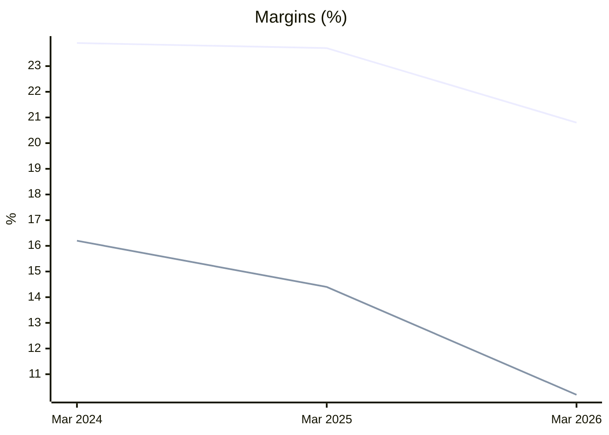
*Series in order: Operating margin, PAT margin.*

**P/E:** 48.1 — live market file (screener.in), trailing (price ₹2,029.00 as of 2026-08-02).

**Cash flows (₹ cr):**

| | Mar 2024 | Mar 2025 | Mar 2026 |
|---|---:|---:|---:|
| Cash from operations (₹ cr) | 1,067 | 986 | 1,621 |
| Cash from investing (₹ cr) | -1,458 | -1,325 | -3,648 |
| Cash from financing (₹ cr) | 488 | 544 | 2,340 |
| Net cash flow (₹ cr) | 97.0 | 205 | 313 |
| Free cash flow (₹ cr) | 99.0 | -93.0 | 753 |

*Source: CashFlow/NiftyTotalMarket/NH.csv (consolidated, screener.in).*

### The business being separated — its own numbers

**Integrated Care Clinics — "NH Integrated Care" (NHIC); shown in presentations as "Clinics (C)" within India Operations and as "Revenue – Integrated Care (Clinics only)"** · unit ₹ million (₹ Mn) · No profit line is disclosed for the clinic business on its own. The annual reports carry only one operating segment, 'Medical and Healthcare related Services', plus 'Others (Insurance)', so segment result/EBIT for the clinic business is not reportable from these pages. Revenue figures are the India-operations clinic revenue split in the investor presentations (domestic, excluding ATHMA and Medha, adjusted for inter-company eliminations); FY26 arithmetic checks: 45,233 hospitals + 609 clinics = 45,842 total, FY25: 40,675 + 407 = 41,082. The only profitability datum touching the clinics is combined: 'EBITDA for NHIC and NHIL stood at INR -674 Mn for FY26' (clinics plus insurance together), and Q1 FY27 shows only a blended 'EBITDA% of India Hospitals and NHIC Clinics together'. Neither is a clinic-only figure, so operating_profit is left null. Note also that the 'discontinued operations' in the FY25/FY26 consolidated accounts (revenue ₹1,342.25 Mn FY25, ₹1,377.37 Mn FY26) is the Jammu unit, not the clinic business.

| | FY2024 | FY2025 | FY2026 |
|---|---:|---:|---:|
| Revenue (₹ million (₹ Mn)) | — | 407 | 609 |
| Revenue growth (%) | — | — | +49.6% |
| Operating profit (₹ million (₹ Mn)) | — | — | — |
| Operating profit growth (%) | — | — | — |
| Operating margin (%) | — | — | — |
| PAT (₹ million (₹ Mn)) | — | — | — |
| PAT growth (%) | — | — | — |

*Sources:* Annual Report 2024 — page 270 (single 'Medical and Healthcare related Services' segment; no clinic-level split on any supplied page); Presentation Jun 2026 — page 8; Presentation Jun 2026 — page 8 (revenue); page 16 gives only combined NHIC+NHIL EBITDA of -674)

*Latest quarter (Q1 FY27):* revenue 171, operating profit None — Presentation Jul 2026 — page 7 (identical in Presentation Aug 2026 — page 7)

*Not in the pages read:* Clinic-only EBITDA/segment result and PAT for every year and quarter; all FY2024 clinic figures; clinic assets, liabilities and capital employed. Only combined NHIC+NHIL EBITDA (-674, FY26) exists.

*Documents on file:* [Annual Report 2026](https://www.bseindia.com/xml-data/corpfiling/AttachHis/38bebdc3-391d-4011-a623-ee332359d606.pdf); [Annual Report 2025](https://www.bseindia.com/xml-data/corpfiling/AttachHis/634348fb-a64f-4ecc-ac82-5b04813d788a.pdf); [Annual Report 2024](https://www.bseindia.com/xml-data/corpfiling/AttachHis/d0c2a0c1-0ae9-4d57-932c-f40d566829c3.pdf); [Presentation Aug 2026](https://www.bseindia.com/stockinfo/AnnPdfOpen.aspx?Pname=fa048ef5-37e6-4ece-b901-1f236eca6bed.pdf); [Presentation Jul 2026](https://www.bseindia.com/stockinfo/AnnPdfOpen.aspx?Pname=1cc315df-69cb-4e61-8df6-a78f57acb6d5.pdf); [Presentation Jun 2026](https://www.bseindia.com/stockinfo/AnnPdfOpen.aspx?Pname=963dd6b8-4d61-4fbf-b3b1-38476be0de8d.pdf); [Presentation Feb 2026](https://www.bseindia.com/stockinfo/AnnPdfOpen.aspx?Pname=fe9331a7-dda4-4c4f-a103-4bc515c0eca7.pdf); [Presentation Nov 2025](https://www.bseindia.com/stockinfo/AnnPdfOpen.aspx?Pname=53ba43e1-25aa-4ce3-a8ab-86ae521c8685.pdf); [Presentation Oct 2025](https://www.bseindia.com/stockinfo/AnnPdfOpen.aspx?Pname=1954e625-532f-45d9-9617-d487a934d8ac.pdf)

**The checklist:**

| Item | Status | Evidence |
|---|---|---|
| Why the spin-off | yes | unrelated businesses separated; value unlocking for shareholders; regulatory / strategic knot — “…stments. 5 5. BENEFITS OF THE SCHEME 5.1 The Demerged Undertaking and Remaining Un dertaking represent distinct business models with materially different value propositions, operating models, risk profiles, capital requ” |
| Institutional selling likely (small / different business) | partly | the businesses are described as distinct |
| Insider ownership and incentives aligned | unknown | no promoter-continuity or option-pricing language found *(next: the date the management options are priced; promoter holding in the resulting company)* |
| A hidden value revealed (pro-forma, leverage, comparables) | partly | borrowings 5,858 cr (Mar 2026) = 0.14× market cap; P/E 51.5 on Mar 2026 profit vs industry median 52.7 (45 peers) *(next: pro-forma P&L of each piece × the peer P/E of its own industry)* |
| Parent before the spin (clean parent, takeover prelude) | partly | stage nclt_sanction — the spin has not happened; the parent can still be bought whole |
| Timing (first year sells, second year gains) | partly | not yet listed — 305 days since the first filing, stage nclt_sanction |
| Management discussing it on the calls | yes | 2 mention(s) in the last 12 months of calls — “…we are doing is a little bit of consolidation and a few of the corporate overheads can be worked in a way that we share resources with the parent and we'll be demerging the clinic business into the core that should help” |

**On the calls (last 12 months):**

- *Feb 2026* (backward) — “…a J: Yes, you should take this number going forward. So , the Practice Plus balance sheet was three legal entities which were there , and this is now after the carve out. There is also the… most of the depreciation is also coming from the leases. And as we consolidated, there was a re -accounting that we did with the statutory…”
- *Jun 2026* (neutral) — “…we are doing is a little bit of consolidation and a few of the corporate overheads can be worked in a way that we share resources with the parent and we'll be demerging the clinic business into the core that should help with a lot of that. But we've s een a lot of positive aspects of running these clinics. We are accessing pat…”

<details><summary>The filings</summary>

| Date | Category | Headline | Attachment |
|---|---|---|---|
| 2025-12-12 | Outcome of Board Meeting | Narayana Hrudayalaya Ltd. has informed the Exchange regarding Board meeting held on December 12, 2025 regarding Approval of the Scheme of Arrangement between NH | [pdf](https://nsearchives.nseindia.com/corporate/Narayana_12122025203257_SE_Demerger_NHL_NHIC_new.pdf) |
| 2025-12-12 | Demerger | Narayana Hrudayalaya Ltd. has informed the Exchange about Approval of the Scheme of Arrangement between NH Integrated Care Private Limited ( Demerged Company/NH | [pdf](https://nsearchives.nseindia.com/corporate/Narayana_12122025204510_SE_Demerger_NHL_NHIC_new.pdf) |
| 2025-12-18 | Shareholders meeting | Narayana Hrudayalaya Ltd. has informed the Exchange about the notice of a meeting of the equity shareholders of the Company, proposed to be held on January 19,  | [pdf](https://nsearchives.nseindia.com/corporate/Narayana_18122025195555_SE_Notice_EGM_and_creditorsDSC.pdf) |
| 2025-12-18 | General Updates | Narayana Hrudayalaya Ltd. has informed the Exchange about the notice of a meeting of Secured creditors of the Company, proposed to be held on January 19, 2026,  | [pdf](https://nsearchives.nseindia.com/corporate/Narayana_18122025200626_SE_Notice_EGM_and_creditorsDSC.pdf) |
| 2025-12-18 | General Updates | Narayana Hrudayalaya Ltd. has informed the Exchange about the notice of a meeting of Unsecured Loan Creditors of the Company, proposed to be held on January 19, | [pdf](https://nsearchives.nseindia.com/corporate/Narayana_18122025201004_SE_Notice_EGM_and_creditorsDSC.pdf) |
| 2025-12-18 | General Updates | Narayana Hrudayalaya Ltd. has informed the Exchange about the notice of a meeting of Unsecured Trade Creditors of the Company, proposed to be held on January 19 | [pdf](https://nsearchives.nseindia.com/corporate/Narayana_18122025201232_SE_Notice_EGM_and_creditorsDSC.pdf) |
| 2026-01-19 | Shareholders meeting | Narayana Hrudayalaya Ltd. has informed the Exchange regarding Summary of proceedings of the General Meeting of the Equity Shareholders of the Company held on Ja | [pdf](https://nsearchives.nseindia.com/corporate/Narayana_19012026183338_Summary_of_Proceedings.pdf) |
| 2026-01-19 | General Updates | Narayana Hrudayalaya Ltd. has informed the Exchange about Summary of proceedings of the General Meeting of the Equity Shareholders, Secured Creditors, Unsecured | [pdf](https://nsearchives.nseindia.com/corporate/Narayana_19012026183908_Summary_of_Proceedings.pdf) |
| 2026-02-26 | Shareholders meeting | Narayana Hrudayalaya Ltd. has informed the Exchange regarding notice of a meeting of the equity shareholders of the Company, proposed to be held on April 02, 20 | [pdf](https://nsearchives.nseindia.com/corporate/Narayana_26022026195517_SE_notice_final.pdf) |
| 2026-02-26 | General Updates | Narayana Hrudayalaya Ltd. has informed the Exchange about notice of a meeting of Secured creditors of the Company, proposed to be held on April 02, 2026, pursua | [pdf](https://nsearchives.nseindia.com/corporate/Narayana_26022026195904_SE_notice_final.pdf) |
| 2026-02-26 | General Updates | Narayana Hrudayalaya Ltd. has informed the Exchange about notice of a meeting of Unsecured creditors of the Company, proposed to be held on April 02, 2026, purs | [pdf](https://nsearchives.nseindia.com/corporate/Narayana_26022026200658_SE_notice_final.pdf) |
| 2026-03-11 | Corrigendum | Narayana Hrudayalaya Ltd. has informed the Exchange regarding Corrigendum to Notice of Extra-Ordinary General Meeting to be held on April 02, 2026 pursuant to t | [pdf](https://nsearchives.nseindia.com/corporate/Narayana_11032026173135_SECorrigendum_to_Notices11032026.pdf) |
| 2026-04-02 | Shareholders meeting | Narayana Hrudayalaya Ltd. has informed the Exchange regarding Summary of proceedings of the General Meeting of the Equity Shareholders of the Company held on Ap | [pdf](https://nsearchives.nseindia.com/corporate/Narayana_02042026161504_SE_Summary_of_proceedings.pdf) |
| 2026-04-02 | General Updates | Narayana Hrudayalaya Ltd. has informed the Exchange about Summary of proceedings of the General Meeting of the Equity Shareholders, Secured Creditors, Unsecured | [pdf](https://nsearchives.nseindia.com/corporate/Narayana_02042026161841_SE_Summary_of_proceedings.pdf) |
| 2026-04-03 | Shareholders meeting | Narayana Hrudayalaya Ltd. has submitted the Exchange a copy Srutinizer's report of General Meeting of the Equity Shareholders of the Company held on April 02, 2 | [pdf](https://nsearchives.nseindia.com/corporate/Narayana_03042026185924_SE_Scruntinizer_report_April_03_2026.pdf) |
| 2026-04-03 | General Updates | Narayana Hrudayalaya Ltd. has informed the Exchange regarding submission of the Scrutinizer's Report for the General Meeting of the Equity Shareholders, Secured | [pdf](https://nsearchives.nseindia.com/corporate/Narayana_03042026190209_SE_Scruntinizer_report_April_03_2026.pdf) |
| 2026-04-06 | Shareholders meeting | Submission of revised Scrutinizer's report of General Meeting of the Equity Shareholders of the Company held on April 02, 2026 pursuant to the Order dated Feb 1 | [pdf](https://nsearchives.nseindia.com/corporate/Narayana_06042026172225_SE_letter_revised_Scrutinizer_report.pdf) |
| 2026-04-06 | General Updates | Narayana Hrudayalaya Ltd. has informed the Exchange regarding submission of the revised Scrutinizer's Report for the General Meeting of the Equity Shareholders, | [pdf](https://nsearchives.nseindia.com/corporate/Narayana_06042026172932_SE_letter_revised_Scrutinizer_report.pdf) |

</details>

## VEDL — Vedanta Ltd.

**CONFIRMED** (a demerger scheme is on the exchange record) · **LISTED <1Y — selling-pressure window; the bargain forms here** · score 5.7/10 · spin-off · 16 filing(s) from NSE · first 2025-10-18, latest 2026-07-30

> **Listing:** LISTED — Talwandi Sabo Power Limited trades since about 2026-04-20

**The stages, as filed:** announced (2026-07-30) → nclt_sanction (2025-12-03) → record_date (2026-04-20)

**Stated in the filings:** resulting company **Talwandi Sabo Power Limited**.

**What is being separated, as the documents put it:** Vedanta's power generation assets into Talwandi Sabo Power Ltd ("Vedanta Power"), alongside aluminium, oil & gas, iron & steel demergers — class `value_unlocking`.

- *Insiders:* Promoter/management stake in the new entity not stated; shareholders of Vedanta Limited receive shares in each of the four resulting listed entities in proportion to existing holdings, ensuring continuity of ownership.
- *What it reveals:* Oil & gas entity MEL's net worth is projected to rise from negative INR 178 crores to positive INR 13,507 crores upon demerger, while that entity also absorbs large uncrystallised GoI claims (counterclaim of 8,596.80 crores).
- *Selling pressure:* likely — Four new sector-specific entities distributed pro-rata to all VEDL holders; index treatment and float size not stated in documents.
- *Parent or spin:* unclear · *option pricing date:* not stated
- *Read next:* The separate NCLT proceeding on the merchant power demerger, plus TSPL's share-entitlement ratio and net-worth certificate in the Scheme.
- *In their words:* “Shareholders of Vedanta Limited will receive equity shares in each of the four resulting listed entities (in addition to their shareholding in Vedanta Limited) in proportion to their existing holdings, ensuring continuity of ownership while enabling direct participation in the growth trajectories of individual businesses.”

### Why the demerger — three years of calls and the scheme

Management framed the separation as a value-unlocking restructuring: in the Nov 2023 call Arun Misra said the Board had approved demerging Vedanta Ltd. into six independent listed entities, 'each one capable of executing its individual business strategies,' with the scheme filed with the stock exchanges in October 2023 and described as creating 'six incredibly competitive, nimble and focused enterprises.' The scheme rationale gives the core logic: each demerged entity gets greater strategic flexibility, sharper market focus and independent access to capital, with management teams aligning decisions to customer needs, investment cycles and commodity-specific dynamics, while investors can 'evaluate and value each business on its own merits' — shareholders receive shares in proportion to existing holdings so ownership continuity is preserved. The resulting companies are Vedanta Aluminium (integrated aluminium, value-added and low-carbon), Vedanta Oil & Gas (via Malco Energy Ltd — India's largest private E&P), Vedanta Power (TSPL and other IPP assets), Vedanta Iron & Steel, and a base metals entity (Vedanta Base Metals Ltd), with the residual Vedanta Limited keeping the Hindustan Zinc stake and acting as 'an incubator for new and emerging businesses.' Chairman Anil Agarwal said each entity 'has the potential to grow manifold, attract strategic investment, and deliver superior value as these sectors are witnessing double digit growth,' and that the demerger is 'also about empowering leadership.' Management repeatedly tied it to scale and leadership depth — Aug 2024 cited '100-plus expats and experienced specialists' ready to run the separate businesses, and Nov 2024/Apr 2025 linked it to leadership in critical minerals and 'Vedanta 2.0' (global leader in critical minerals, energy transition and technology). Valuation was the explicit prize: in Nov 2024 Ajay Goel said 'there is a preponderance of opinion where everybody believes post-de-merger the value of the sums will be the parts will be more than the sum,' and promoter stake (VRL at 56.4% of VEDL) was expected to be worth more after the split. Creditors and regulators were active parties rather than requesters: the company was 'in talks with creditors for debt allocations' (Jan 2024), paid a Rs. 660 crore full-and-final SEPCO settlement 'as part of demerger proceedings' and a Rs. 1,248 crore bank guarantee to NCLAT over the TSPL demerger, and MoPNG/DGH objected over disputed Cairn dues. Throughout, the demerger was presented alongside deleveraging (VRL debt cut $3.7bn over two years, down to $5.5bn, targeting $3bn by 2027) and operating performance (FY25 revenue Rs. 150,725 crores, EBITDA Rs. 43,541 crores, net debt/EBITDA improved to 1.2x) as one of three priorities: 'business delivery, deleveraging, and demerger.'

**How it evolved:** The idea surfaced as a board decision in the Nov 2023 call — six independent listed entities, scheme filed with exchanges in October 2023 — and the Jan 2024 call tracked approvals (exchange NOC passed to SEBI, awaiting SEBI NOC, creditor talks on debt allocation) while loosely describing a future 'portfolio of 17 pure-play companies.' Through Aug 2024 and Nov 2024 it moved to NCLT (first hearing done), with management calling it 'a final step,' stressing scheme flexibility to list each entity as its approval came, and guiding completion 'on or before 31st of March 2025.' Feb 2025 set the shareholder/creditor meeting for Feb 18, which voted in favour, after which Apr 2025 moved to the second motion petition with completion guided to September 2025; the Jul 2025 call slipped that to a Sept–Oct window amid an NCLAT interim stay on the TSPL power demerger and MoPNG objections over Cairn's disputed dues. By the Oct 2025 call the count had become five demerged entities with a final NCLT hearing on November 12 and listing targeted by end-FY26, the SEPCO dispute settled for Rs. 660 crores to clear the path; the NCLT order was pronounced 16.12.2025.

**What management expects from it:** Each entity gets strategic flexibility, sharper market focus, independent capital access, and management aligned to its own commodity cycle; investors value businesses on their own merits. Aluminium: integrated, low-carbon value-add. Oil & Gas: India's largest private E&P. Power: merchant generation growth. Iron & Steel: vertically integrated green steel. Residual Vedanta: Hindustan Zinc stake plus incubator. Sum-of-parts worth more than the whole.

**Point by point, with the source:**

- *[Nov 2023](https://www.vedantalimited.com/uploads/investor-overview/financial-results/Transcript_VEDL_Earnings_Call_2QFY24.pdf)* — Arun Misra announced the Board's approval of a six-way demerger into independent listed entities, with the scheme already filed with the exchanges in October 2023, alongside record Q2 revenue of INR38,546 crores and EBITDA of INR11,834 crores. “Vedanta's Board approved the proposal to demerge the business into six independent listed entities, each one capable of executing its individual business strategies.”
- *[Nov 2023](https://www.vedantalimited.com/uploads/investor-overview/financial-results/Transcript_VEDL_Earnings_Call_2QFY24.pdf)* — The stated purpose was competitiveness, nimbleness and focus, framed as a step in the journey of sustainable growth and greater shareholder value. “The demerger would create six incredibly competitive, nimble and focused enterprises.”
- *[Nov 2023](https://www.vedantalimited.com/uploads/investor-overview/financial-results/Transcript_VEDL_Earnings_Call_2QFY24.pdf)* — CFO Ajay Goel tied the demerger to value unlocking plus a reorientation toward organic growth, in the same quarter the company moved to the new tax regime (one-time MAT write-off of INR6,128 crores, cash tax savings of INR2,040 crores). “I'm very happy to come back to Vedanta. Such a critical time as we embark on our journey of demerger and unlock significant value for shareholders.”
- *[Jan 2024](https://www.vedantalimited.com/uploads/investor-overview/financial-results/vedanta-limited-earnings-call-3qfy24-transcript-25-01-2024.pdf)* — Process update: exchanges had passed their NOC to SEBI, and debt allocation among the entities was being negotiated with creditors before NCLT could convene member and creditor meetings. “Concurrently, we're in talks with creditors for debt allocations.”
- *[Jan 2024](https://www.vedantalimited.com/uploads/investor-overview/financial-results/vedanta-limited-earnings-call-3qfy24-transcript-25-01-2024.pdf)* — Goel described the demerger as a value-unlocking exercise producing a large portfolio of pure-play companies, alongside new avenues in electronics (AvanStrate LCD glass substrates, 700+ patents). “Further, with our ongoing value unlocking exerci se, that is demerger, it will have portfolio of 17 pure -play companies that will enable to create substantial value, not only in the present, but also in coming years.”
- *[Aug 2024](https://www.vedantalimited.com/uploads/investor-overview/financial-results/call-transcript-fy2025.pdf)* — With the scheme filed at NCLT, management said it was in the final stage of creating focused entities with sharper investment propositions, backed by 100-plus expats and specialists ready to lead the separate businesses. “And therefore, we are in the final stage of creating industry - leading focused entities with sharper investment propositions.”
- *[Aug 2024](https://www.vedantalimited.com/uploads/investor-overview/financial-results/call-transcript-fy2025.pdf)* — The NCLT filing was presented as a value-unlocking milestone set against VRL deleveraging — $3.7bn of debt cut over two years, a further $3bn over three years, closing VRL debt of $5.5bn and an S&P upgrade to B-. “On demerger, we have filed the scheme with NCLT. This is a significant milestone towards unlocking the value for all our stakeholders.”
- *[Nov 2024](https://www.vedantalimited.com/uploads/investor-overview/financial-results/Vedanta-Earnings-Nov08-2024.pdf)* — Asked by Ashish Kejriwal whether some entities might be approved and not others, Ajay Agarwal said the scheme's flexibility allows each company to list as its own NCLT, creditor and shareholder approvals arrive, with completion confident on or before 31 March 2025. “Our scheme is extremely flexible , and it allows us as and when each of these companies gets approval from NCLT and along with creditors and shareholders ' approval , has the ability to get listed as and when we have the approval.”
- *[Nov 2024](https://www.vedantalimited.com/uploads/investor-overview/financial-results/Vedanta-Earnings-Nov08-2024.pdf)* — Answering Ritesh on promoter stake signals, Goel argued the sum-of-the-parts case and said VRL's 56.4% holding in Vedanta Limited would not materially change because post-demerger valuation should be more beneficial. “One should also look at the current holding in the context of de -merger and as we all believe, there is a preponderance of opinion where everybody believes post -de-merger the value of the sums will be the parts will be more than the sum and hence maybe stake valuation post -de- merger perhaps will be more beneficial.”
- *[Nov 2024](https://www.vedantalimited.com/uploads/investor-overview/financial-results/Vedanta-Earnings-Nov08-2024.pdf)* — Goel listed demerger as one of three standing commitments alongside business delivery and deleveraging, and said it would enhance leadership in critical minerals. “On demerger, the demerger as you may have noted in its final stages with the shareholders and the cre ditors meeting planned in coming months , set to unlock significant value and enhance our leadership in critical minerals.”
- *[Feb 2025](https://www.vedantalimited.com/uploads/investor-overview/financial-results/VedantaEarnings-transcript-Jan31-2025.pdf)* — Execution stage reached: shareholder and creditor meetings set for Feb 18, against rating upgrades to AA by CRISIL and ICRA, VRL at B+ after a six-notch 12-month improvement, and a 250 bps cut in debt cost. “On the demerger front, we are in the important stage of execution , the shareholders and the creditors meeting scheduled on Feb 18th.”
- *[Apr 2025](https://www.vedantalimited.com/uploads/investor-overview/financial-results/Vedanta-CallTranscript-Apr30-2025_v2.pdf)* — The stated objective was restated as pure-play entities with better strategic focus and operational flexibility, in a year of record revenue of Rs. 150,725 crores, EBITDA of Rs. 43,541 crores and net debt/EBITDA improving to 1.2x from 1.5x. “We are making good progress Vedanta Limited April 30, 2025 Page 4 of 22 Sensitivity: Internal (C3) with our demerger plan, aiming to create pure -play entities that will enhance strategic focus and operational flexibility.”

*Not explained on the calls:* No explanation why six entities became five (base metals dropped), no per-entity debt allocation, segment valuations, standalone financials, or named investor/lender demand driving the split.

*Calls read (36 months):* [Apr 2025](https://www.vedantalimited.com/uploads/investor-overview/financial-results/Vedanta-CallTranscript-Apr30-2025_v2.pdf), [Aug 2024](https://www.vedantalimited.com/uploads/investor-overview/financial-results/call-transcript-fy2025.pdf), [Aug 2025](https://www.vedantalimited.com/uploads/investor-overview/financial-results/2026/Vedanta_Transcript_Jul31_2025.pdf), [Feb 2025](https://www.vedantalimited.com/uploads/investor-overview/financial-results/VedantaEarnings-transcript-Jan31-2025.pdf), [Jan 2024](https://www.vedantalimited.com/uploads/investor-overview/financial-results/vedanta-limited-earnings-call-3qfy24-transcript-25-01-2024.pdf), [Nov 2023](https://www.vedantalimited.com/uploads/investor-overview/financial-results/Transcript_VEDL_Earnings_Call_2QFY24.pdf), [Nov 2024](https://www.vedantalimited.com/uploads/investor-overview/financial-results/Vedanta-Earnings-Nov08-2024.pdf), [Nov 2025](https://www.vedantalimited.com/uploads/investor-overview/financial-results/2026/VEDL_Q2FY26_Transcript.pdf)

### The parent, last three fiscal years (consolidated)

| | Mar 2024 | Mar 2025 | Mar 2026 |
|---|---:|---:|---:|
| Sales (₹ cr) | 143,727 | 62,717 | 78,437 |
| Sales growth (%) | -2.4% | -56.4% | +25.1% |
| Operating profit (₹ cr) | 35,312 | 18,578 | 23,183 |
| Operating profit growth (%) | +2.6% | -47.4% | +24.8% |
| Operating margin (%) | 24.6 | 29.6 | 29.6 |
| PAT (₹ cr) | 7,539 | 20,535 | 25,096 |
| PAT growth (%) | -48.0% | +172.4% | +22.2% |
| PAT margin (%) | 5.2 | 32.7 | 32.0 |
| EPS (₹) | 11.4 | 38.3 | 44.5 |

*Source: ProfitStatement/NiftyTotalMarket/VEDL.csv (consolidated, screener.in); growth and margins computed here.*

```mermaid
xychart-beta
    title "Sales, operating profit and PAT (₹ cr)"
    x-axis ["Mar 2024", "Mar 2025", "Mar 2026"]
    y-axis "₹ crore"
    bar [143727, 62717, 78437]
    bar [35312, 18578, 23183]
    bar [7539, 20535, 25096]
```
*Series in order: Sales, Operating profit, PAT.*

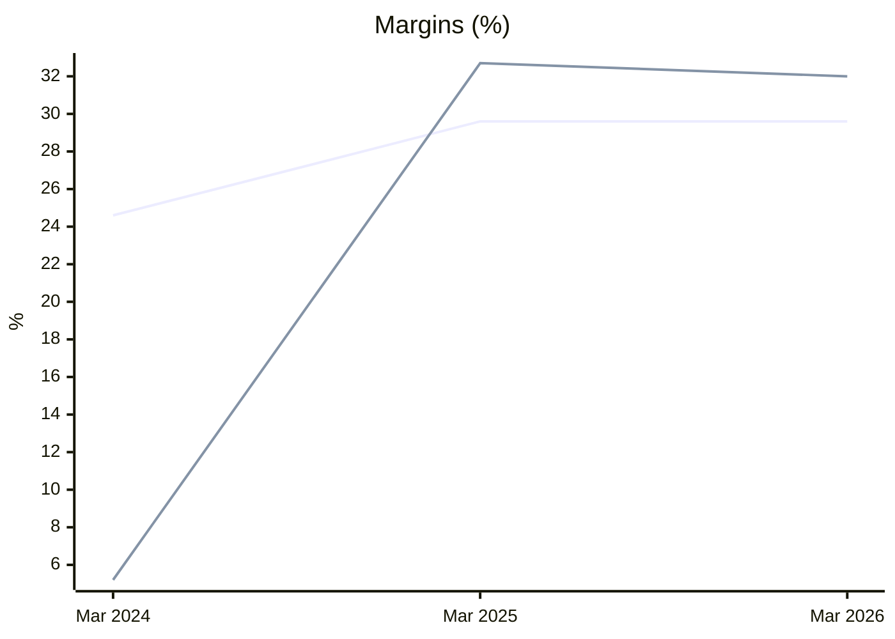
*Series in order: Operating margin, PAT margin.*

**P/E:** 9.39 — live market file (screener.in), trailing (price ₹264.00 as of 2026-08-02).

**Cash flows (₹ cr):**

| | Mar 2024 | Mar 2025 | Mar 2026 |
|---|---:|---:|---:|
| Cash from operations (₹ cr) | 35,654 | 39,562 | 39,499 |
| Cash from investing (₹ cr) | -13,676 | -19,158 | -24,134 |
| Cash from financing (₹ cr) | -26,092 | -19,223 | -13,549 |
| Net cash flow (₹ cr) | -4,114 | 1,181 | 1,816 |
| Free cash flow (₹ cr) | 19,097 | 22,848 | 18,747 |

*Source: CashFlow/NiftyTotalMarket/VEDL.csv (consolidated, screener.in).*

### The business being separated — its own numbers

**Power segment — merchant power (reported from FY2026 under 'Discontinued Operations: Power — thermal power facilities predominantly engaged in generation and sale of commercial power, excluding captive power'; demerger of the Merchant Power Undertaking into Talwandi Sabo Power Limited, TSPL)** · unit ₹ crore · Operating profit = 'Segment results (EBITDA)' as disclosed in consolidated segment reporting (non-GAAP, before depreciation/depletion/amortisation, finance costs, exceptional items and tax). Revenue = external revenue (excludes inter-segment revenue, which was nil for Power in FY2024/FY2025 and ₹170 crore for discontinued Power in FY2026; segment revenue incl. inter-segment = ₹8,891 crore in FY2026) and excludes 'other operating income' (₹39 crore FY2026, ₹19 crore FY2025 for discontinued Power). FY2024 figure is the undivided consolidated Power segment (₹6,153 crore revenue, ₹971 crore EBITDA) — the 2024 report gives no continuing/discontinued split, so it also includes the wind/Mettur power retained by Vedanta. FY2025 and FY2026 use the 'Discontinued Operations — Power' column (the merchant/thermal power business being separated), restated in the FY2026 report; the FY2025 total Power segment as originally reported was ₹6,159 crore revenue / ₹737 crore EBITDA, of which continuing (wind + Mettur) was ₹137 crore / ₹87 crore. No segment-level PAT is disclosed; profit is reported only down to EBITDA per segment, with finance costs and taxes unallocated.

| | FY2024 | FY2025 | FY2026 |
|---|---:|---:|---:|
| Revenue (₹ crore) | 6,153 | 6,022 | 8,721 |
| Revenue growth (%) | — | -2.1% | +44.8% |
| Operating profit (₹ crore) | 971 | 650 | 1,534 |
| Operating profit growth (%) | — | -33.1% | +136.0% |
| Operating margin (%) | 15.8 | 10.8 | 17.6 |
| PAT (₹ crore) | — | — | — |
| PAT growth (%) | — | — | — |

*Sources:* Annual Report 2024 — page 234 (also Annual Report 2025 — page 253); Annual Report 2026 — page 261; Annual Report 2026 — page 260

*Latest quarter (Q4 FY26):* revenue None, operating profit 566 — Presentation Apr 2026 — page 49

*Not in the pages read:* Segment PAT/net profit any year; standalone TSPL entity financials (only debt/cash given); Power segment quarterly revenue; Q4FY26 EBITDA of ₹566 crore covers all power (incl. retained wind/Mettur), not merchant alone.

*Documents on file:* [Annual Report 2026](https://www.bseindia.com/xml-data/corpfiling/AttachHis/3725606c-05f5-40b2-b122-55c0a6e7bdd1.pdf); [Annual Report 2025](https://www.bseindia.com/xml-data/corpfiling/AttachHis/4f41b8d2-e8ed-4dad-b3fd-b9adca371fed.pdf); [Annual Report 2024](https://www.bseindia.com/xml-data/corpfiling/AttachHis/d4d3e3bc-fe5a-4184-b181-b5455d60f11a.pdf); [Presentation Jul 2026](https://www.bseindia.com/stockinfo/AnnPdfOpen.aspx?Pname=b8b95ea1-9d39-4176-9a1a-15f1a2c5c4bd.pdf); [Presentation Apr 2026](https://www.bseindia.com/stockinfo/AnnPdfOpen.aspx?Pname=918fc405-534d-492a-9def-a386f80ba291.pdf); [Presentation Jan 2026](https://www.bseindia.com/stockinfo/AnnPdfOpen.aspx?Pname=48883dba-0b14-4a5e-ad9c-b9e40292ee52.pdf); [Presentation Nov 2025](https://www.bseindia.com/stockinfo/AnnPdfOpen.aspx?Pname=614c7898-dc7a-4f07-bb16-036e9ef8303c.pdf); [Presentation Aug 2025](https://www.bseindia.com/stockinfo/AnnPdfOpen.aspx?Pname=2f4607c8-0394-46f5-a86c-0d36d15c6e74.pdf); [Presentation Jul 2025](https://www.bseindia.com/stockinfo/AnnPdfOpen.aspx?Pname=c67b03ec-8441-4a2e-8b8e-98722a20e4bd.pdf)

**The checklist:**

| Item | Status | Evidence |
|---|---|---|
| Why the spin-off | yes | unrelated businesses separated; regulatory / strategic knot; attracting different investors / capital; value unlocking for shareholders; a weak or capital-heavy business carved away — “…t businesses thereby allowing new opportunities to be explored for each business efficiently and allowing a focused strategy in operations; c. each of the independent companies can attract different sets of investors, s” |
| Institutional selling likely (small / different business) | partly | the businesses are described as distinct |
| Insider ownership and incentives aligned | unknown | no promoter-continuity or option-pricing language found *(next: the date the management options are priced; promoter holding in the resulting company)* |
| A hidden value revealed (pro-forma, leverage, comparables) | yes | borrowings 32,947 cr (Mar 2026) = 0.32× market cap; P/E 4.1 on Mar 2026 profit vs industry median 22.9 (16 peers) |
| Parent before the spin (clean parent, takeover prelude) | no | stage record_date — the pieces trade separately now |
| Timing (first year sells, second year gains) | partly | 176 days since listing/record date; first year since listing — the selling-pressure window; watch, size the entry |
| Management discussing it on the calls | yes | 18 mention(s) in the last 12 months of calls — “…in an unbundled fashion, so each of the new companies' benchmarking is different. In summary, the 3% rate continues and the only change that will be done post -de-merger is in the copper brand fee. So the brand fee for ” |

**On the calls (last 12 months):**

- *Nov 2025* (forward) — “…chromium , cobalt, vanadium, potash and manganese. This brings the total number of secured blocks to 11. We have also made substantial progress on the proposed demerger, which is a pivotal step towards unlocking further shareholder value. The final N CLT hearing is scheduled for November 12, and we expect approvals to follow.…”
- *Nov 2025* (forward) — “…shareholder value. The final N CLT hearing is scheduled for November 12, and we expect approvals to follow. This will set the stage for the listing of all five demerge d entities by the end of FY '26, enabling greater strategic focus and enhanced value creation for all stakeholders. At the start of FY 2026, global markets fac…”
- *Nov 2025* (forward) — “…w petition has been filed against this order, but on accounting basis, we have taken the provision. The second matter is regarding SEPCO settlement. As part of demerger proceedings, a full and final settlement of Rs. 660 Cr has been done with SEPCO , thereby resolving a long -standing dispute, paving the way for a proposed dem…”
- *Nov 2025* (neutral) — “…ger proceedings, a full and final settlement of Rs. 660 Cr has been done with SEPCO , thereby resolving a long -standing dispute, paving the way for a proposed demerger process. Similarly, in Q2 last year, we have recorded net exceptional income of Rs. 1,160 crores, mainly on account of oil and gas impairment reversal. Our EBI…”
- *Nov 2025* (neutral) — “…high cost debt now retired, VRL is positioned to operate on autopilot mode, supported by a dividend payout of 4% to 5% in future and routine brand fee. On the demerger, we are at the final stage. We remain confident of completing our demerger by end of this fiscal, unlocking focused value acros s our five verticals. In summar…”

<details><summary>The filings</summary>

| Date | Category | Headline | Attachment |
|---|---|---|---|
| 2025-10-18 | Updates | Vedanta Limited has informed the Exchange regarding 'Disclosure under Regulation 30 of Securities and Exchange Board of India (Listing Obligations and Disclosur | [pdf](https://nsearchives.nseindia.com/corporate/VEDL_18102025130320_VEDLSEIntimationTSPLOrderSigned.pdf) |
| 2025-12-03 | Acquisition | Pursuant to Regulation 30 of Listing Regulations, as amended from time to time, we wish to inform you that the National Company Law Tribunal Kolkata ( NCLT Kolk | [pdf](https://nsearchives.nseindia.com/corporate/VEDL_03122025212754_VEDLSEIntimationIncabNCLTOrderDec32025signed.pdf) |
| 2025-12-16 | News Verification | The Exchange has sought clarification from Vedanta Limited with respect to recent news item captioned Vedanta demerger decks cleared after Mumbai NCLT approves  | [pdf](-) |
| 2025-12-16 | News Verification | The Exchange has sought clarification from Vedanta Limited with respect to recent news item captioned Vedanta demerger decks cleared after Mumbai NCLT approves  | [pdf](https://nsearchives.nseindia.com/corporate/VEDL_16122025163405_VEDLSEIntimationClarification16122025.pdf) |
| 2025-12-16 | Updates | Vedanta Limited has informed the Exchange regarding 'Update on Scheme of Arrangement for Demerger of Vedanta Limited'. | [pdf](https://nsearchives.nseindia.com/corporate/VEDL_16122025225750_VEDLSEIntimationNCLTOrder16Dec_2025signed.pdf) |
| 2026-01-09 | Updates | Vedanta Limited has informed the Exchange regarding 'Disclosure under Regulation 30 of SEBI (Listing Obligations and Disclosure Requirements) Regulations, 2015  | [pdf](https://nsearchives.nseindia.com/corporate/VEDL_09012026200947_SEIntimationNCLTOrder09Jan2026signed.pdf) |
| 2026-01-21 | Updates | Vedanta Limited has informed the Exchange regarding 'Disclosure under Regulation 30 of the Securities and Exchange Board of India (Listing Obligations and Discl | [pdf](https://nsearchives.nseindia.com/corporate/VEDL_21012026212023_VEDLSEIntimationNCLTOrderCertifiedCopyfinalsigned.pdf) |
| 2026-03-23 | News Verification | The Exchange has sought clarification from Vedanta Limited with respect to recent news item captioned Vedanta moves NCLAT, challenges NCLT nod to Adani's bid fo | [pdf](-) |
| 2026-03-23 | News Verification | The Exchange has sought clarification from Vedanta Limited with respect to recent news item captioned Vedanta moves NCLAT, challenges NCLT nod to Adani's bid fo | [pdf](https://nsearchives.nseindia.com/corporate/VEDL_23032026150222_VEDLReplytoNewsClarificationMarch2026signed.pdf) |
| 2026-03-31 | Updates | Vedanta Limited has informed the Exchange regarding 'Extension of timelines for fulfilment of the conditions precedent under the Composite Scheme of Arrangement | [pdf](https://nsearchives.nseindia.com/corporate/VEDL_31032026171850_VEDLSEIntimation31March2026Outcomesigned.pdf) |
| 2026-04-20 | Record Date | Vedanta Limited has informed the Exchange that Record date for the purpose of Scheme of Arrangement has been fixed as May 01, 2026 | [pdf](https://nsearchives.nseindia.com/corporate/VEDL_20042026170932_VEDLSEIntimationRecordDate20April2026signed.pdf) |
| 2026-04-29 | Updates | Vedanta Limited has informed the Exchange that pursuant to the scheme of demerger being implemented, the Board of Directors has approved the revision of the Com | [pdf](https://nsearchives.nseindia.com/corporate/VEDL_29042026145441_3VEDSIntimationOutcomeofBM29April2026OtherMatterssigned.pdf) |
| 2026-04-29 | Updates | Vedanta Limited has informed the Exchange regarding 'Disclosure under Regulation 30 of Securities and Exchange Board of India (Listing Obligations and Disclosur | [pdf](https://nsearchives.nseindia.com/corporate/VEDL_29042026170031_VEDLSEIntimationDemergerApr2026signed.pdf) |
| 2026-07-30 | Scheme of Arrangement | Vedanta Limited has informed the Exchange about Scheme of Arrangement | [pdf](https://nsearchives.nseindia.com/corporate/VEDL_30072026152112_VEDLSEIntimationDemergerofSurplusAssetsfinalsigned.pdf) |
| 2026-07-30 | Press Release | Vedanta Limited has informed the Exchange regarding a press release dated July 30, 2026, titled "Vedanta Announces Demerger of Surplus Real Estate Assets to Unl | [pdf](https://nsearchives.nseindia.com/corporate/VEDL_30072026152326_VEDLSEIntimationDemergerofSurplusAssetsfinalsigned.pdf) |
| 2026-07-30 | Updates | Vedanta Limited has informed the Exchange regarding ' Intimation under Regulations 30 and 51 of the Securities and Exchange Board of India (Listing Obligations  | [pdf](https://nsearchives.nseindia.com/corporate/VEDL_30072026152434_VEDLSEIntimationDemergerofSurplusAssetsfinalsigned.pdf) |

</details>

## ANANTRAJ — Anant Raj Ltd.

**CONFIRMED** (a demerger scheme is on the exchange record) · **PRE-SPIN — study the parent; the pieces do not trade yet** · score 5.0/10 · spin-off · 3 filing(s) from NSE, NSE-deep · first 2026-07-21, latest 2026-07-21

> **Listing:** NOT YET — scheme at 'announced' stage; the resulting company will list only after NCLT sanction, effectiveness and a record date; no listing timeline stated

**The stages, as filed:** announced (2026-07-21)

**What is being separated, as the documents put it:** The Data Centre and Cloud Services business of ARL and ARCPL, vested in Ashok Cloud Private Limited — class `value_unlocking`.

- *Insiders:* Post-arrangement ACPL: ARL 51%, ARL promoters 28.14% directly, public 20.86%; promoters' ARL holding unchanged at 57.42% (20,66,57,823 shares). No management incentive or ESOP terms stated.
- *What it reveals:* Data Centre Business is only 8.96% of turnover (Rs 145.90 cr of Rs 1,627.72 cr) yet is the 'rapidly growing' AI-ready cloud asset inside a Rs 4,471.64 cr net-worth real estate company; ARL retains 51%, so only 49% is distributed.
- *Selling pressure:* likely — Small relative size (8.96% of turnover), different industry from real estate, and only 49% distributed directly to ARL shareholders
- *Parent or spin:* unclear · *option pricing date:* not stated
- *Read next:* The Composite Scheme itself — asset, liability and debt split of the Demerged Undertaking, and the appointed date
- *In their words:* “The Data Centre Business has evolved significantly over the years and is well poised to chart its own growth path and operate as a separate listed entity focused on the rapidly growing Data Centre Business whilst continuing to leverage ARL's institutional strengths, strong brand equity and goodwill.”

### Why the demerger — three years of calls and the scheme

Management's stated reason is structural: Anant Raj Limited (ARL) today runs two unrelated verticals — a real estate and infrastructure business, and a data centre and cloud services business — and the Data Centre Business is currently split across two entities (ARL itself and its wholly owned subsidiary ARCPL), with assets, employees, investments and operations housed in both. The Composite Scheme therefore does two things in sequence: first amalgamates ARCPL into ARL (no shares issued, since ARCPL is a 100% subsidiary with 25,00,000 shares held by ARL), then demerges the consolidated Data Centre Business out of ARL into Ashok Cloud Private Limited (ACPL), whose business is described as data centre and co-location services, sovereign public cloud, AI-ready cloud infrastructure, DC & DR services, cloud migration and data backup. The problems management says this solves are: (a) a fragmented, intra-group ownership structure, which consolidation simplifies and lets intra-group arrangements be cancelled or rationalised; (b) the data centre business being valued inside a real estate company despite a 'distinct operating profile, growth trajectory, risk-return characteristics and funding requirements', which a separate listing is meant to fix through independent, market-driven recognition and valuation; (c) inability to raise sector-specific capital and pursue data-centre-specific strategic investments and partnerships while buried inside ARL; and (d) divided management attention, which the Scheme replaces with dedicated management focus and decision-making per vertical. The scale disclosure supports the 'hidden inside real estate' argument: for the year to March 31, 2026, the demerged undertaking's turnover is ₹145.90 crore against total turnover of ₹1,627.72 crore, i.e. 8.96% (computed after aggregating ARCPL and ARL post-merger). ARL shareholders are kept whole economically — 1 ACPL share of ₹2 face value for every ARL share of ₹2, giving them 49% directly while ARL retains 51%, so post-scheme ACPL is 79.14% promoter-held (ARL 51% plus ARL promoters 28.14%) and 20.86% public, and ARL's own shareholding pattern is unchanged at 57.42% promoter / 42.58% public across 35,98,76,930 shares. ACPL is to be listed on BSE and NSE via a Rule 19(7) exemption under the SEBI Scheme of Arrangement master circular dated June 20, 2023, with the Board approving on July 21, 2026 and NCLT approval sought under Sections 230–232 of the Companies Act, 2013.

**How it evolved:** No evolution can be reconstructed from the material supplied: the 'CALL PASSAGES' section of the prompt was empty, so there are no earnings-call passages (and no call dates or labels) in the record. The only dated points available are the financial reference date of March 31, 2026 for the turnover split (₹145.90 crore of ₹1,627.72 crore) and the Board's approval of the Composite Scheme on July 21, 2026, announced the same day by press release as creating 'Two Focused Independent Listed Companies'. Within the filing itself the plan is already in final two-step form — ARCPL merged into ARL, then the Data Centre Business demerged into Ashok Cloud — with no earlier variant described.

**What management expects from it:** ARL: a pure real estate and infrastructure developer with its own tailored strategy and unchanged shareholding. Ashok Cloud: a dedicated listed data centre, cloud and AI-workload entity with independent market-driven valuation, sector-specific capital and partnerships, a simpler post-consolidation structure, and dedicated management focus. Shareholders: 100% of ACPL's economic interest (49% direct, 51% via ARL) and unlocked shareholder value. No margin or return targets are given.

**Point by point, with the source:**

- *Scheme* — The starting problem: two unrelated verticals inside one listed company, with the data centre business itself split across ARL and its subsidiary ARCPL (assets, employees, investments and operations in both). “The Anant Raj Limited presently operates two distinct business verticals, namely: (i) a real estate business; and (ii) a data centre and cloud services business ("Data Centre Business").”
- *Scheme* — Management says the data centre business has outgrown its position inside ARL and can run its own growth path as a separate listed entity, while still trading on ARL's brand and goodwill. “The Data Centre Business has evolved significantly over the years and is well poised to chart its own growth path and operate as a separate listed entity focused on the rapidly growing Data Centre Business whilst continuing to leverage ARL's institutional strengths, strong brand equity and goodwill.”
- *Scheme* — Valuation rationale: a separate listing is meant to get the data centre business recognised and valued on its own operating profile, growth, risk-return profile and funding needs rather than as part of a real estate company. “the segregation of the Data Centre Business into a separately listed company would facilitate independent market recognition and valuation of the Data Centre Business, having regard to its distinct operating profile, growth trajectory, risk-return characteristics and funding requirements”
- *Scheme* — Structural cleanup rationale: consolidating the business out of two entities into one simplifies ownership and allows intra-group arrangements to be cancelled or rationalised. “consolidation of the Data Centre Business, resulting in a simpler ownership structure, streamlined operations and cancellation or rationalization of intra-group arrangements”
- *Scheme* — Capital and partnership rationale: as a standalone legal entity, Ashok Cloud can raise sector-specific capital and resources and pursue data-centre-specific strategic investments and partnerships. “the separation of the Data Centre Business into a distinct legal entity will enable Ashok Cloud to effectively attract sector specific resources for its growth requirements and pursue strategic investments, partnerships, thereby unlocking greater value for its shareholders”
- *Scheme* — Focus rationale: each management team gets to set strategy for its own vertical instead of sharing decision-making across real estate and data centres. “the Scheme will enable dedicated management focus and decision-making for each business vertical, allowing the management teams of ARL and Ashok Cloud to pursue business strategies and growth initiatives tailored to their respective operational and market requirements.”
- *Scheme* — The size disclosure: the demerged data centre undertaking is ₹145.90 crore of turnover against ₹1,627.72 crore total, 8.96%, for the year to March 31, 2026 (after aggregating ARCPL with ARL). “Turnover* (in Crores) Demerged Undertaking 145.90 Total 1627.72 Percentage 8.96%”
- *Scheme* — What the demerged business actually is: colocation, sovereign public cloud, AI-ready cloud infrastructure, DC & DR, cloud migration and backup — i.e. operating services, not property. “ACPL is inter alia engaged in the business of providing data centre and Co-Location services, sovereign public cloud services and AI ready Cloud Infrastructure, DC & DR services, including cloud migration, data backup solutions and other allied activities.”
- *Scheme* — Step one is a no-consideration internal merger: ARCPL, a wholly owned subsidiary (25,00,000 shares, 100% held by ARL), folds into ARL with no shares issued. “Since, the Amalgamating Company is a wholly owned subsidiary of Amalgamated Company, no shares of the Amalgamated Company shall be issued or allotted in consideration of Part II of the Composite Scheme i.e. the merger of ARCPL with and into ARL.”
- *Scheme* — Shareholders are made direct owners of 49% of ACPL on a 1:1 share basis, with ARL retaining 51%; post-scheme ACPL is 79.14% promoter (ARL 51% + ARL promoters 28.14%) and 20.86% public, while ARL's 57.42/42.58 pattern is unchanged. “the existing shareholders of ARL shall receive shares in Ashok Cloud (ACPL) pursuant to the demerger, thereby enabling them to directly participate in the future growth and value creation potential of the Data Centre business through a dedicated and focused listed entity, while benefiting from independent market-driven valuation”
- *Scheme* — ACPL's shares are to be listed on BSE and NSE without an IPO, using a Rule 19(7) exemption under the SEBI Scheme of Arrangement master circular of June 20, 2023; ACPL also stays an ARL subsidiary. “the existing shares of ARL in ACPL shall be listed on BSE Limited and the National Stock Exchange of India Limited by seeking exemption under Rule 19(7) of the Securities Contracts (Regulation) Rules, 1957”
- *Scheme* — The July 21, 2026 press release frames the outcome as two focused listed companies — ARL in real estate and infrastructure, Ashok Cloud in next-generation data centre and cloud services including AI workloads. “The restructuring will  enable each business to pursue focused growth strategies  and will unlock shareholder value.”

*Not explained on the calls:* No earnings-call passages were supplied at all. The filing gives no margins, capex, MW capacity, debt or asset allocation, timeline, or any investor, lender or partner request driving it.

### The parent, last three fiscal years (consolidated)

| | Mar 2024 | Mar 2025 | Mar 2026 |
|---|---:|---:|---:|
| Sales (₹ cr) | 1,483 | 2,060 | 2,512 |
| Sales growth (%) | +55.0% | +38.9% | +21.9% |
| Operating profit (₹ cr) | 334 | 492 | 656 |
| Operating profit growth (%) | +69.5% | +47.3% | +33.3% |
| Operating margin (%) | 22.5 | 23.9 | 26.1 |
| PAT (₹ cr) | 271 | 426 | 559 |
| PAT growth (%) | +81.9% | +57.2% | +31.2% |
| PAT margin (%) | 18.3 | 20.7 | 22.3 |
| EPS (₹) | 7.6 | 12.4 | 15.4 |

*Source: ProfitStatement/NiftyTotalMarket/ANANTRAJ.csv (consolidated, screener.in); growth and margins computed here.*

```mermaid
xychart-beta
    title "Sales, operating profit and PAT (₹ cr)"
    x-axis ["Mar 2024", "Mar 2025", "Mar 2026"]
    y-axis "₹ crore"
    bar [1483, 2060, 2512]
    bar [334, 492, 656]
    bar [271, 426, 559]
```
*Series in order: Sales, Operating profit, PAT.*

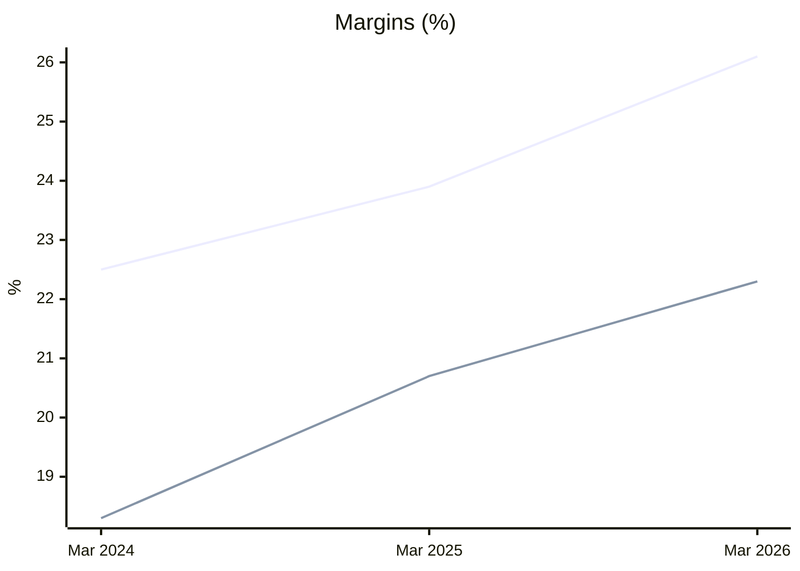
*Series in order: Operating margin, PAT margin.*

**P/E:** 40.5 — live market file (screener.in), trailing (price ₹624.00 as of 2026-08-02).

**Cash flows (₹ cr):**

| | Mar 2024 | Mar 2025 | Mar 2026 |
|---|---:|---:|---:|
| Cash from operations (₹ cr) | -26.0 | 253 | -435 |
| Cash from investing (₹ cr) | 181 | -147 | -231 |
| Cash from financing (₹ cr) | 116 | -81.0 | 1,235 |
| Net cash flow (₹ cr) | 271 | 25.0 | 569 |
| Free cash flow (₹ cr) | -55.0 | 177 | -796 |

*Source: CashFlow/NiftyTotalMarket/ANANTRAJ.csv (consolidated, screener.in).*

### The business being separated — its own numbers

The segment pages read (3 annual report(s) and 11 presentation(s) on file) do not carry this business's own revenue or profit: No full-year, operating-profit or PAT figures for the data centre business. Only part-year revenue: Q2 FY26 ₹35.47 Cr, Q3 FY26 ₹43.57 Cr, H1 FY26 ₹58.42 Cr, 9M FY26 ₹101.99 Cr.

*Documents on file:* [Annual Report 2026](https://www.bseindia.com/xml-data/corpfiling/AttachHis/443e6268-09d2-4ba3-a3a9-4c478098b164.pdf); [Annual Report 2025](https://www.bseindia.com/xml-data/corpfiling/AttachHis/8698030a-7d1b-4cfb-987b-9571f7d1a989.pdf); [Annual Report 2024](https://www.bseindia.com/xml-data/corpfiling/AttachHis/8bf6dcbb-f722-4625-a066-66563b63e047.pdf); [Presentation Aug 2026](https://www.bseindia.com/stockinfo/AnnPdfOpen.aspx?Pname=7b3cf886-7a1d-4250-80fa-57d49521f681.pdf); [Presentation May 2026](https://www.bseindia.com/stockinfo/AnnPdfOpen.aspx?Pname=f24273e2-ebcf-475f-a448-64ffb3febd4e.pdf); [Presentation Jan 2026](https://www.bseindia.com/stockinfo/AnnPdfOpen.aspx?Pname=a1ea76a5-c69c-459a-9c84-75607719fb96.pdf); [Presentation Nov 2025](https://www.bseindia.com/stockinfo/AnnPdfOpen.aspx?Pname=2b3c7361-183e-4598-a569-dff8a843418b.pdf); [Presentation Jul 2025](https://www.bseindia.com/stockinfo/AnnPdfOpen.aspx?Pname=b6452a4f-1cd4-41f2-a11d-8eaea6ba62b1.pdf); [Presentation Apr 2025](https://www.bseindia.com/stockinfo/AnnPdfOpen.aspx?Pname=b79edae8-4090-479d-80be-1a8b4a4fe463.pdf)

**The checklist:**

| Item | Status | Evidence |
|---|---|---|
| Why the spin-off | yes | value unlocking for shareholders; unrelated businesses separated; regulatory / strategic knot; attracting different investors / capital — “…oud (ACPL) pursuant to the demerger, thereby enabling them to directly participate in the future growth and value creation potential of the Data Centre business through a dedicated and focused listed entity, while benef” |
| Institutional selling likely (small / different business) | partly | the businesses are described as distinct |
| Insider ownership and incentives aligned | unknown | no promoter-continuity or option-pricing language found *(next: the date the management options are priced; promoter holding in the resulting company)* |
| A hidden value revealed (pro-forma, leverage, comparables) | partly | borrowings 681 cr (Mar 2026) = 0.03× market cap; P/E 40.2 on Mar 2026 profit vs industry median 39.2 (8 peers) *(next: pro-forma P&L of each piece × the peer P/E of its own industry)* |
| Parent before the spin (clean parent, takeover prelude) | partly | stage announced — the spin has not happened; the parent can still be bought whole |
| Timing (first year sells, second year gains) | partly | not yet listed — 84 days since the first filing, stage announced |

<details><summary>The filings</summary>

| Date | Category | Headline | Attachment |
|---|---|---|---|
| 2026-07-21 | Scheme of Arrangement | Anant Raj Limited has informed the Exchange about Scheme of Arrangement | [pdf](https://nsearchives.nseindia.com/corporate/ANANTRAJ_21072026184608_Outcome_21072026.pdf) |
| 2026-07-21 | Outcome of Board Meeting | Outcome of the Board Meeting of Anant Raj Limited (''Amalgamated Company" I "Demerged | [pdf](https://nsearchives.nseindia.com/corporate/ANANTRAJ_21072026184858_Outcome_21072026.pdf) |
| 2026-07-21 | Press Release | Anant Raj Limited has informed the Exchange regarding a press release dated July 21, 2026, titled "Anant Raj Board Approves Strategic Demerger to Create Two Foc | [pdf](https://nsearchives.nseindia.com/corporate/ANANTRAJ_21072026190031_Intimation_Press_Release_21072026.pdf) |

</details>

## EMBDL — Embassy Developments Ltd.

**CONFIRMED** (a demerger scheme is on the exchange record) · **PRE-SPIN — study the parent; the pieces do not trade yet** · score 5.0/10 · spin-off · 3 filing(s) from NSE · first 2025-12-11, latest 2026-05-04

> **Listing:** NOT YET — scheme at 'nclt_sanction' stage; the resulting company will list only after NCLT sanction, effectiveness and a record date; no listing timeline stated

**The stages, as filed:** nclt_sanction (2025-12-11)

**Stated in the filings:** demerged undertaking: of the answering Respondent.

**What is being separated, as the documents put it:** The power business undertaking of Indiabulls Real Estate (now Embassy Developments), demerged into RattanIndia Enterprises Limited — class `not stated`.

- *Insiders:* not stated for the demerged entity; documents name Rattan India Power Limited as promoter of the borrower and Bellanza, Worldpart, Aalidhra as warrant-converting allottees in the parent
- *What it reveals:* The separation left a retained contingent liability, not value: NCLT held a restructuring scheme does not ipso facto extinguish guarantees, admitting a Rs 3,72,35,67,407.77 Section 7 petition against the parent (stayed by NCLAT).
- *Selling pressure:* unclear — Documents cover a 2011 court-approved demerger only; no size, shareholding, index or industry-difference details are given
- *Parent or spin:* unclear · *option pricing date:* not stated
- *Read next:* The 2012 Corporate Guarantee dated 11.01.2012 and the awaited NCLAT stay order fixing who holds the Rs 372.36 crore guarantee
- *In their words:* “In addition, a restructuring scheme does not ipso facto extinguish existing guarantees unless the creditor expressly executes a written and unconditional release in favour of the guarantor.”

### Why the demerger — three years of calls and the scheme

The supplied texts do not contain a rationale for EMBDL separating a business — no demerger, spin-off, scheme of arrangement or business-separation proposal by Embassy Developments Ltd. is described anywhere in them, and the section labelled "SCHEME RATIONALE" is in fact a Regulation 30 intimation about insolvency litigation plus the annexed NCLT order, not a scheme rationale. The only separation referred to is historical and belongs to another group: a court-approved demerger in 2011 under which the power business was separated from the erstwhile Indiabulls Group, after which Sinnar Thermal Power Limited (STPL) has been part of the Ratan India Group. That demerger is mentioned only as background to a liability dispute, not as a value-creation plan: Canara Bank (e-Syndicate Bank) has alleged EMBDL is liable, as purported corporate guarantor, for repayment of Rs. 372 crore (Rs. 3,72,35,67,407.77 as on 30.12.2024, plus penalties and interest from 01.01.2025) of facilities advanced to STPL — original sanctions of Rs. 144.40 crore (Rs. 100.00 crore rupee term loan dated 26.02.2010, Rs. 15.57 crore cost-overrun Term Loan COR-I dated 26.03.2014, Rs. 28.83 crore COR-II dated 30.08.2016) for a 1350 MW (5 x 270) coal-based thermal power project at Sinnar, Nashik — and filed a Section 7 IBC application, which the NCLT Delhi Bench admitted by order dated 09.12.2025 in C.P. (IB) No. 317/ND/2025. Management says the admission "was not warranted on merits," that EMBDL remains financially sound and fully operational with no enforceable obligation for the Borrower's loans, and that it obtained a stay from NCLAT (admitted and stayed on 11.12.2025 per the intimation), with the next hearing noted in the calls as scheduled for 19 (date truncated). The only forward-looking business content is operational, not structural: confidence in the Rs. 5,000 crore FY'26 pre-sales target off nine-month performance, recent launches, approvals and unsold inventory, and a view that housing-cycle momentum and consolidation toward leading trusted brands give Embassy Development a chance to grow market share. No businesses to be separated, no entity names, no swap ratio, no record date, no requesting investors, lenders or partners, and no stated problem a separation would solve appear in these texts. Any rationale beyond this would have to be supplied from outside the passages, which I have not done.

**How it evolved:** The idea does not surface or evolve in these texts. The [Feb 2026] and [May 2026] passages are word-for-word identical — same Rs. 5,000 crore FY'26 pre-sales target, same "first nine months" framing, same STPL/Canara Bank update and same "next hearing is scheduled for 19" — so they show no change in position, and one of the two labels appears to be a duplicate rather than a distinct quarter. Chronologically, the only dated development is the 09.12.2025 NCLT admission order and the NCLAT stay intimated 11.12.2025, which both calls then report retrospectively as a stay obtained. No third year of calls and no separation discussion is present in the material provided.

**What management expects from it:** Not stated in these texts. Management gives no expectations for any separated entity — no margin, capital-allocation, valuation, re-rating or focus benefits, and no resulting entities to attribute them to. The only expectations expressed are operational: meeting the Rs. 5,000 crore FY'26 pre-sales target, growing market share as the housing cycle holds momentum, and prevailing in the Canara Bank matter while remaining financially sound and fully operational.

**Point by point, with the source:**

- *[Feb 2026](https://www.bseindia.com/stockinfo/AnnPdfOpen.aspx?Pname=b7cf7f6b-7784-42c0-9200-9da5cc5e98ac.pdf)* — The only demerger mentioned is a 2011 court-approved separation of the power business out of the erstwhile Indiabulls Group, cited purely as the origin of the disputed corporate guarantee — not as a current or planned EMBDL separation. “The case relates to facilities availed by Sinnar Thermal Power Limited, in 2011 following a court -approved demerger under which the power business was separated from the erstwhile Indiabulls Group and certain historical corporate guarantee arrangements linked to equity infusion obligations.”
- *[Feb 2026](https://www.bseindia.com/stockinfo/AnnPdfOpen.aspx?Pname=b7cf7f6b-7784-42c0-9200-9da5cc5e98ac.pdf)* — Management quantifies the claim at Rs. 372 crore under an erstwhile corporate guarantee framework, brought by Canara Bank via a Section 7 IBC application, and says STPL has sat with the Ratan India Group since 2011. “Canara Bank has initiated proceedings against the company alleging liability for repayment of loans of Rs. 372 crore under an erstwhile corporate guarantee framework and filed a Section 7 application under the Insolvency and Bankruptcy Code 2016.”
- *[Feb 2026](https://www.bseindia.com/stockinfo/AnnPdfOpen.aspx?Pname=b7cf7f6b-7784-42c0-9200-9da5cc5e98ac.pdf)* — Management rejects the admission on merits and reports a stay from NCLAT, with the next hearing date left truncated in the passage. “Based on the management's assessment and legal advice, we believe the admission was not warranted on merits.”
- *[Feb 2026](https://www.bseindia.com/stockinfo/AnnPdfOpen.aspx?Pname=b7cf7f6b-7784-42c0-9200-9da5cc5e98ac.pdf)* — The forward-looking commentary is operational growth, not restructuring: the Rs. 5,000 crore FY'26 pre-sales target backed by launches, approvals and unsold inventory, plus market-share gains from consolidation toward trusted brands. “As the housing cycle continues to show momentum, we believe Embassy Development has a strong opportunity to grow market share, and that the consolidation towards leading trusted brands will continue.”
- *[May 2026](https://embassyindia.com/wp-content/uploads/2025/12/EDL_Transcript_15022026.pdf)* — This passage is verbatim identical to the Feb 2026 passage — same target, same nine-month framing, same STPL update — so it adds no new separation rationale and shows no evolution of any plan. “first nine months of the year, and with the recent launches, approvals and existing unsold inventory, we remain confident of achie ving our Rs. 5,000 crore FY ‘26 pre -sales target.”
- *Scheme* — The filing labelled as scheme rationale is actually a Regulation 30 intimation dated December 11, 2025 about the NCLT order admitting Canara Bank's Section 7 petition and the NCLAT stay granted the same day; it contains no scheme of arrangement, no businesses to be separated and no rationale section. “Pursuant to Regulation 30 of the SEBI (Listing Obligations and Disclosure Requirements) Regulations, 2015, and in continuation of our earlier intimation issued today regarding the impugned order  passed by the Hon’ble National Company Law Tribunal, Delhi Bench (“ NCLT ”), admitting a petition filed by Canara Bank under Section 7 of the Insolvency and Bankruptcy Code, 2016 (“ IBC”) against Embassy Developments Limited”
- *Scheme* — The filing's substantive assertion is solvency and non-liability, not separation benefits: the Borrower is described as unrelated to EDL or the Embassy Group and itself under insolvency. “The management reiterates its firm belief that EDL remains financially sound, fully operational, and has no enforceable financial obligation or liability relating to the repayment of any loans of the Borrower.”
- *Scheme* — The annexed NCLT order details the guarantee relied on — a Corporate Guarantee dated 30.06.2010 and a Cost Overrun Deed of Undertaking dated 21.11.2016 — and records that Rattan India Power's 17.04.2024 settlement proposal contemplated releasing the corporate guarantor's security on approval. “It is submitted that in the sai d proposal the Promoter has clearly mentioned about release of security of the Corporate Guarantor, i.e., Equinox India Development Limited, once the settlement proposal gets approved.”

*Not explained on the calls:* Everything about a separation: which businesses, structure, ratio, timing, who requested it, problems solved, entity-level benefits, approvals. Also the truncated hearing date and the two calls' identical text.

*Calls read (36 months):* [Feb 2026](https://www.bseindia.com/stockinfo/AnnPdfOpen.aspx?Pname=b7cf7f6b-7784-42c0-9200-9da5cc5e98ac.pdf), [May 2026](https://embassyindia.com/wp-content/uploads/2025/12/EDL_Transcript_15022026.pdf)

### The parent, last three fiscal years (consolidated)

| | Mar 2024 | Mar 2025 | Mar 2026 |
|---|---:|---:|---:|
| Sales (₹ cr) | 414 | 2,180 | 1,732 |
| Sales growth (%) | -29.5% | +426.6% | -20.6% |
| Operating profit (₹ cr) | -425 | 293 | -474 |
| Operating profit growth (%) | -19.4% | +168.9% | -261.8% |
| Operating margin (%) | -103 | 13.4 | -27.4 |
| PAT (₹ cr) | -1,038 | 194 | -872 |
| PAT growth (%) | -70.7% | +118.7% | -549.5% |
| PAT margin (%) | -251 | 8.9 | -50.3 |
| EPS (₹) | -19.2 | 1.6 | -6.3 |

*Source: ProfitStatement/NiftyTotalMarket/EMBDL.csv (consolidated, screener.in); growth and margins computed here.*

```mermaid
xychart-beta
    title "Sales, operating profit and PAT (₹ cr)"
    x-axis ["Mar 2024", "Mar 2025", "Mar 2026"]
    y-axis "₹ crore"
    bar [414, 2180, 1732]
    bar [-425, 293, -474]
    bar [-1038, 194, -872]
```
*Series in order: Sales, Operating profit, PAT.*

```mermaid
xychart-beta
    title "Margins (%)"
    x-axis ["Mar 2024", "Mar 2025", "Mar 2026"]
    y-axis "%"
    line [-102.7, 13.4, -27.4]
    line [-250.7, 8.9, -50.3]
```
*Series in order: Operating margin, PAT margin.*

**P/E:** — — EPS -6.28 for Mar 2026 is not positive (price ₹56.13 as of 2026-10-01).

**Cash flows (₹ cr):**

| | Mar 2024 | Mar 2025 | Mar 2026 |
|---|---:|---:|---:|
| Cash from operations (₹ cr) | -97.0 | 1,461 | 44.0 |
| Cash from investing (₹ cr) | 96.0 | 574 | -79.0 |
| Cash from financing (₹ cr) | -8.0 | -1,971 | 629 |
| Net cash flow (₹ cr) | -10.0 | 64.0 | 595 |
| Free cash flow (₹ cr) | -100 | 1,407 | 44.0 |

*Source: CashFlow/NiftyTotalMarket/EMBDL.csv (consolidated, screener.in).*

### The business being separated — its own numbers

The segment pages read (3 annual report(s) and 11 presentation(s) on file) do not carry this business's own revenue or profit: All power-business figures: revenue, operating profit/EBITDA and PAT for FY2024, FY2025, FY2026 and any quarter. The power business was demerged in FY2010-11 and is not a reportable segment in any of these reports.

*Documents on file:* [Annual Report 2026](https://www.bseindia.com/xml-data/corpfiling/AttachHis/8de6e6b7-d73c-4404-82c0-7455222d2fcb.pdf); [Annual Report 2025](https://www.bseindia.com/xml-data/corpfiling/AttachHis/1eaeaac9-9aae-4653-b5c7-af8115f29d44.pdf); [Annual Report 2024](https://www.bseindia.com/xml-data/corpfiling/AttachHis/6e9fd5ba-80a4-4e7e-ad38-aae2d23cf373.pdf); [Presentation Aug 2026](https://www.bseindia.com/stockinfo/AnnPdfOpen.aspx?Pname=f5f29d27-5399-4eaf-b024-a0f8faec115f.pdf); [Presentation May 2026](https://embassyindia.com/wp-content/uploads/2025/12/EDL_Investor-Update_20052026.pdf); [Presentation Feb 2026](https://embassyindia.com/wp-content/uploads/2025/12/EDL_Investor-Update_09.02.2026.pdf); [Presentation Nov 2025](https://www.bseindia.com/stockinfo/AnnPdfOpen.aspx?Pname=473ab6f7-60e4-4498-84fa-23f2bf26af23.pdf); [Presentation Aug 2025](https://www.bseindia.com/stockinfo/AnnPdfOpen.aspx?Pname=33b936a7-263b-42a6-9835-3a65768fd5e3.pdf); [Presentation Jun 2025](https://www.bseindia.com/stockinfo/AnnPdfOpen.aspx?Pname=7489a6e2-7dbb-432e-88b6-037a4cec4579.pdf)

**The checklist:**

| Item | Status | Evidence |
|---|---|---|
| Why the spin-off | yes | unrelated businesses separated — “…nks to Sinnar Thermal Power Limited (“Borrower ”), an entity currently undergoing insolvency proceedings and unrelated to EDL or the Embassy Group (“ NCLT Order ”), we wish to further inform you that an appeal, filed be” |
| Institutional selling likely (small / different business) | partly | the businesses are described as distinct |
| Insider ownership and incentives aligned | unknown | no promoter-continuity or option-pricing language found *(next: the date the management options are priced; promoter holding in the resulting company)* |
| A hidden value revealed (pro-forma, leverage, comparables) | unknown | no pro-forma or market data on file *(next: pro-forma P&L of each piece × the peer P/E of its own industry)* |
| Parent before the spin (clean parent, takeover prelude) | partly | stage nclt_sanction — the spin has not happened; the parent can still be bought whole |
| Timing (first year sells, second year gains) | partly | not yet listed — 306 days since the first filing, stage nclt_sanction |
| Management discussing it on the calls | yes | 4 mention(s) in the last 12 months of calls — “…was separated from the erstwhile Indiabulls Group and certain historical corporate guarantee arrangements linked to equity infusion obligations. Following the demerger, STPL has been part of the Ratan India Group since ” |

**On the calls (last 12 months):**

- *Feb 2026* (backward) — “…provide an update on ongoing insolvency proceeding. The case relates to facilities availed by Sinnar Thermal Power Limited, in 2011 following a court -approved demerger under which the power business was separated from the erstwhile Indiabulls Group and certain historical corporate guarantee arrangements linked to equity infus…”
- *Feb 2026* (backward) — “…was separated from the erstwhile Indiabulls Group and certain historical corporate guarantee arrangements linked to equity infusion obligations. Following the demerger, STPL has been part of the Ratan India Group since 2011. Canara Bank has initiated proceedings against the company alleging liability for repayment of loans of…”
- *May 2026* (backward) — “…provide an update on ongoing insolvency proceeding. The case relates to facilities availed by Sinnar Thermal Power Limited, in 2011 following a court -approved demerger under which the power business was separated from the erstwhile Indiabulls Group and certain historical corporate guarantee arrangements linked to equity infus…”
- *May 2026* (backward) — “…was separated from the erstwhile Indiabulls Group and certain historical corporate guarantee arrangements linked to equity infusion obligations. Following the demerger, STPL has been part of the Ratan India Group since 2011. Canara Bank has initiated proceedings against the company alleging liability for repayment of loans of…”

<details><summary>The filings</summary>

| Date | Category | Headline | Attachment |
|---|---|---|---|
| 2025-12-11 | Corporate Insolvency Resolution Process | Embassy Developments Limited has informed the Exchange about Corporate Insolvency Resolution Process w.r.t. grant of stay by Hon'ble NCLAT against the impugned  | [pdf](https://nsearchives.nseindia.com/corporate/IBREL_11122025145548_EDL_SE_Intimation_CIRP.pdf) |
| 2025-12-11 | Corporate Insolvency Resolution Process | Please refer attachment for copy of order passed by Hon'ble NCLAT granting stay on impugned order of Hon'ble NCLT. | [pdf](https://nsearchives.nseindia.com/corporate/IBREL_11122025202927_EDL_SE_Intimation_NCLAT_Order_Final.pdf) |
| 2026-05-04 | Corporate Insolvency Resolution Process | The Hon ble NCLAT has, today i.e. May 4, 2026, pronounced its order in favour of the Company, allowing its appeal, and accordingly:(i) The Hon ble NCLAT has set | [pdf](https://nsearchives.nseindia.com/corporate/EMBDL_04052026114407_EDL_Intimation_NCLAT_4May26.pdf) |

</details>

## HSCL — Himadri Speciality Chemical Ltd.

**CONFIRMED** (a demerger scheme is on the exchange record) · **PRE-SPIN — study the parent; the pieces do not trade yet** · score 5.0/10 · spin-off · 3 filing(s) from NSE · first 2026-09-18, latest 2026-09-21

> **Listing:** NOT YET — scheme at 'announced' stage; the resulting company will list only after NCLT sanction, effectiveness and a record date; indicated timeline: Stated 21 September 2026: "The equity shares of the Resulting Company are already listed on BSE Limited and National Stock Exchange of India Limited" and the new shares "shall be listed and/or admitted to trading on BSE Limited and National Stock Exchange of India Limited, subject to the Resulting Company obtaining the requisite approvals from all the relevant authorities"; Appointed Date 1 October 2026; no date for listing of the new shares stated

**The stages, as filed:** announced (2026-09-18)

**Stated in the filings:** demerged undertaking: ) from DBRL to HSCL as a going concern, on an as is where is basis,; size hint: 3.39% of turnover.

**What is being separated, as the documents put it:** The Tyre Business of Dalmia Bharat Refractories Ltd — designing, manufacturing and development of all types of tyre and tyre products — class `regulatory_strategic`.

- *Insiders:* HSCL Promoter & Promoter Group stays 26,48,59,302 shares, 52.49% to 52.47%; DBRL promoters unchanged at 74.99%; HSCL has 53,896 outstanding exercisable employee stock options
- *What it reveals:* HSCL takes in a going-concern tyre business with INR 149.31 crore turnover (3.39% of HSCL turnover) for only 1,76,462 new shares — about 0.035% dilution; profitability, assets and liabilities of the undertaking not stated
- *Selling pressure:* unlikely — New shares are only 1,76,462 of 50,47,50,637 (~0.035%); DBRL holders get 1 share per 260, fractions pooled with a trustee
- *Parent or spin:* spin · *option pricing date:* Valuation report and fairness opinion dated 20 September 2026; ESOP option pricing date not stated (preferential warrants were allotted 14 May 2024 at Rs. 316)
- *Read next:* The Scheme on www.himadri.com — Tyre Business assets, liabilities and profitability behind the INR 149.31 crore turnover
- *In their words:* “The Demerger will enable the Resulting Company to integrate the Tyre Business with its existing carbon black and advanced carbon materials business, thereby strengthening its presence across the tyre value chain.”

### Why the demerger — three years of calls and the scheme

Note on the premise: in this filing HSCL is not separating out one of its own businesses — it is the Resulting Company receiving a business. The Scheme of Arrangement (Sections 230–232, Companies Act 2013), approved by HSCL's Board on 21 September 2026, demerges the 'Tyre Business of DBRL' from Dalmia Bharat Refractories Limited (Demerged Company) into Himadri Speciality Chemical Ltd (Resulting Company) as a going concern on an 'as is where is' basis, with an Appointed Date of 1 October 2026 (or such other date as the NCLT may approve). The Demerged Undertaking comprises all assets, liabilities, contracts, employees, brands, trademarks, licences, permits, approvals and properties attributable to the Tyre Business, defined as designing, manufacturing and development of all types of tyre and tyre products; its turnover as on 31 March 2026 was INR 149.31 crores, or 3.39% of HSCL's total turnover for FY ended 31 March 2026. The Board's stated reasoning is that, given the nature of the Demerged Undertaking, its future requirements and the respective strengths and strategic objectives of HSCL, the demerger gives the Tyre Business 'more focused ownership and robust operating structure' while letting each company direct management attention, capital and resources to businesses aligned with its own capabilities. For HSCL specifically the filing lists six benefits: forward-integration of the Tyre Business with its existing carbon black and advanced carbon materials business to strengthen its presence across the tyre value chain; leverage of its material expertise, R&D, manufacturing and customer relationships for product customisation and expansion across tyre application segments; operational and commercial synergies in raw material sourcing, product development, manufacturing, logistics, distribution, market development, shared services and customer engagement; direct ownership and control enabling coordinated capacity utilisation, modernisation, product expansion and distribution build-out; greater strategic and financial flexibility to align investment, funding and capacity expansion with group strategy; and long-term growth and value creation for HSCL and its stakeholders. Consideration is non-cash: HSCL will issue 1 new equity share of face value INR 1 for every 260 DBRL shares of face value INR 10, per a 20 September 2026 joint valuation report by SSPA & Co and CA Manish Gadia, with a fairness opinion of the same date from Jajodia Equity Advisors Services Limited. The dilution is minimal — HSCL promoter holding moves from 52.49% to 52.47% and public from 47.51% to 47.53% (total shares 50,45,74,175 to 50,47,50,637, plus 53,896 exercisable ESOPs) — and DBRL's own shareholding pattern (promoter 74.99%, public 25.01%) does not change.

**How it evolved:** The prompt's 'CALL PASSAGES' section is empty — no earnings call transcripts from any year were supplied — so the idea's emergence and evolution across calls cannot be reconstructed from these texts, and nothing here records who asked for it (investors, lenders or partners) or how the plan changed. The only datable sequence in the supplied material is internal to the filing: the joint valuation report and the merchant banker's fairness opinion are both dated 20 September 2026; HSCL's Board approved the Scheme at its meeting on 21 September 2026 and disclosed it to BSE and NSE under Regulation 30 on the same date (Ref. No. HSCL/Stock-Ex/2026-27/59); the Appointed Date is set at 1 October 2026, subject to NCLT; and the sizing is measured against FY ended 31 March 2026. No earlier or alternative version of the plan is described.

**What management expects from it:** For HSCL: forward integration of the tyre business with carbon black and advanced carbon materials, a stronger position across the tyre value chain, synergies in sourcing, manufacturing, logistics, distribution and shared services, direct control over capacity utilisation, modernisation and product expansion, more investment and funding flexibility, and long-term value creation. For the Tyre Business: focused ownership, a robust operating structure and sustainable scaling. No margin, valuation or capital figures are given.

**Point by point, with the source:**

- *Scheme* — The transaction is a demerger of DBRL's Tyre Business into HSCL as a going concern on an 'as is where is' basis, effective from the Appointed Date of 1 October 2026 subject to NCLT. “The Appointed Date means I October 2026, or such other date as the Hon 'ble NCL T or such other Appropriate Authority may decide/ approve, being the date with effect from which the Scheme shall become effective and/ or be deemed to have become effective as stated in the Scheme”
- *Scheme* — The Demerged Undertaking is defined to carry across everything attributable to the Tyre Business, which is designing, manufacturing and development of all types of tyre and tyre products. “Tyre Business (more specifically defined in the Scheme) of the Demerged Company inter-alia comprise of designing, manufacturing and development of all types of tyre and tyre products.”
- *Scheme* — The business being moved is small relative to HSCL: INR 149.31 crores of turnover at 31 March 2026, equal to 3.39% of HSCL's total turnover for the preceding financial year. “Turnover of the Demerged Undertaking as on 31 March 2026, was INR 149.31 crores, which constitutes 3.39% of total turnover of Resulting Company in the immediately preceding financial year / based on financials of last financial year (i.e. for year ended 31 March 2026).”
- *Scheme* — The Board's core rationale is focus and resource allocation: focused ownership and a robust operating structure for the Tyre Business, and each company deploying management attention, capital and resources to businesses matching its own strategic capabilities. “The Board of Directors, after considering the nature of the Demerged Undertaking, its future requirements, respective strengths and strategic objectives of Resulting Company, is of the view that the proposed Demerger would provide a more focused ownership and robust operating structure for the Demerged Undertaking, while enabling each of the Companies to deploy its management attention, capital and resources towards businesses aligned with its respective strategic capabilities and long-term objectives.”
- *Scheme* — Benefit (a) — strategic forward integration: the Tyre Business is to be combined with HSCL's existing carbon black and advanced carbon materials business to extend HSCL's position across the tyre value chain. “The Demerger will enable the Resulting Company to integrate the Tyre Business with its existing carbon black and advanced carbon materials business, thereby strengthening its presence across the tyre value chain.”
- *Scheme* — Benefit (b) — HSCL expects to apply its materials expertise, R&D, manufacturing base and customer relationships to customise and expand products across tyre application segments. “The integration will enable the Resulting Company to leverage its material expertise, R&D, manufacturing and customer relationships to support product customisation, development and expansion across various tyre application segments.”
- *Scheme* — Benefit (c) — named synergy sources: raw material sourcing, product development, manufacturing, logistics, distribution, market development, shared services and customer engagement, expected to lift operating efficiency. No quantified synergy figure is given. “The integration is expected to create synergies across raw material sourcing, product development, manufacturing, logistics, distribution, market development, shared services and customer engagement, thereby enhancing operating efficiencies.”
- *Scheme* — Benefit (d) — direct ownership and control is said to be what allows coordinated capacity utilisation, modernisation, product expansion and building out market and distribution channels, implying the current structure constrains this. “The Demerger will provide the Resulting Company with direct ownership and control of the Tyre Business, enabling coordinated capacity utilisation, modernisation, product expansion and development of market and distribution channels.”
- *Scheme* — Benefit (e) — greater strategic and financial flexibility: investment, funding, capacity expansion and growth priorities of the Tyre Business can be aligned with HSCL's broader strategy. “Direct ownership will enable the Resulting Company to align investment, funding, capacity expansion and growth priorities of the Tyre Business with its broader business strategy.”
- *Scheme* — Benefit (f) and the closing statement frame the Scheme as serving shareholders, employees, creditors and other stakeholders, supporting the Tyre Business's sustainable growth while each company focuses on its own objectives. “The proposed Scheme is in the best interest of the respective Companies, their shareholders, employees, creditors and other stakeholders, and is expected to facilitate the sustainable growth of the Demerged Undertaking while enabling each Company to focus on its respective strategic objectives.”
- *Scheme* — Consideration is share-based, not cash: HSCL issues 1 share of FV INR 1 for every 260 DBRL shares of FV INR 10, based on the 20 September 2026 joint valuation by SSPA & Co and CA Manish Gadia, with a fairness opinion from Jajodia Equity Advisors Services Limited. “"I (One) fully paid-up equity shares of face value of INR 1 (one) each of the Resulting Company shall be issued and allotted for every 260 (Two Hundred Sixty) fully paid-up equity shares of face value of INR 10 (ten) each held in the De merged Company ("Share Entitlement Ratio'').”
- *Scheme* — Dilution at HSCL is negligible — promoter 52.49% to 52.47%, public 47.51% to 47.53%, share count 50,45,74,175 to 50,47,50,637 — while DBRL's shareholding pattern is unchanged; HSCL's new shares will be listed on BSE and NSE, where it is already listed. “The Demerged Company will not undergo any change in shareholding pattern as a consequence of the effectiveness of the Scheme.”

*Not explained on the calls:* No earnings-call passages were supplied. Nothing on who requested it, margins, capex, debt, valuation targets, DBRL's motive, tyre capacity or plants, or how the plan changed.

### The parent, last three fiscal years (consolidated)

| | Mar 2024 | Mar 2025 | Mar 2026 |
|---|---:|---:|---:|
| Sales (₹ cr) | 4,185 | 4,613 | 4,661 |
| Sales growth (%) | +0.3% | +10.2% | +1.0% |
| Operating profit (₹ cr) | 645 | 854 | 962 |
| Operating profit growth (%) | +61.7% | +32.4% | +12.6% |
| Operating margin (%) | 15.4 | 18.5 | 20.6 |
| PAT (₹ cr) | 411 | 555 | 755 |
| PAT growth (%) | +90.3% | +35.0% | +36.0% |
| PAT margin (%) | 9.8 | 12.0 | 16.2 |
| EPS (₹) | 8.3 | 11.2 | 14.9 |

*Source: ProfitStatement/NiftyTotalMarket/HSCL.csv (consolidated, screener.in); growth and margins computed here.*

```mermaid
xychart-beta
    title "Sales, operating profit and PAT (₹ cr)"
    x-axis ["Mar 2024", "Mar 2025", "Mar 2026"]
    y-axis "₹ crore"
    bar [4185, 4613, 4661]
    bar [645, 854, 962]
    bar [411, 555, 755]
```
*Series in order: Sales, Operating profit, PAT.*

```mermaid
xychart-beta
    title "Margins (%)"
    x-axis ["Mar 2024", "Mar 2025", "Mar 2026"]
    y-axis "%"
    line [15.4, 18.5, 20.6]
    line [9.8, 12, 16.2]
```
*Series in order: Operating margin, PAT margin.*

**P/E:** 47.4 — live market file (screener.in), trailing (price ₹751.00 as of 2026-08-02).

**Cash flows (₹ cr):**

| | Mar 2024 | Mar 2025 | Mar 2026 |
|---|---:|---:|---:|
| Cash from operations (₹ cr) | 405 | 447 | 382 |
| Cash from investing (₹ cr) | -405 | -235 | -963 |
| Cash from financing (₹ cr) | 7.0 | -271 | 590 |
| Net cash flow (₹ cr) | 7.0 | -60.0 | 10.0 |
| Free cash flow (₹ cr) | 352 | 276 | -63.0 |

*Source: CashFlow/NiftyTotalMarket/HSCL.csv (consolidated, screener.in).*

### The business being separated — its own numbers

The segment pages read (3 annual report(s) and 12 presentation(s) on file) do not carry this business's own revenue or profit: All tyre-business revenue, operating profit and PAT. Pages carry only qualitative tyre commentary (Birla Tyres acquired Oct 2023, commenced Q1FY26, Rs. 306 Cr capex) plus group-level and non-tyre segment numbers.

*Documents on file:* [Annual Report 2026](https://www.bseindia.com/xml-data/corpfiling/AttachHis/8cbe5c4e-369b-466b-8197-fbebde03cb8c.pdf); [Annual Report 2025](https://www.bseindia.com/xml-data/corpfiling/AttachHis/f1782c89-a24f-4983-a98f-aaeaede88f97.pdf); [Annual Report 2024](https://www.bseindia.com/xml-data/corpfiling/AttachHis/51cc71ca-f3f9-4d49-b49e-57a1ca4d2541.pdf); [Presentation Jul 2026](https://www.bseindia.com/stockinfo/AnnPdfOpen.aspx?Pname=4e3e907e-5b52-459d-8ad8-156b1c852014.pdf); [Presentation May 2026](https://www.bseindia.com/stockinfo/AnnPdfOpen.aspx?Pname=fa980d82-dd43-4cf9-8449-a3e68e21ff61.pdf); [Presentation Jan 2026](https://www.bseindia.com/stockinfo/AnnPdfOpen.aspx?Pname=44f06ba4-8d58-4ca2-826f-d371126765c6.pdf); [Presentation Oct 2025](https://www.bseindia.com/stockinfo/AnnPdfOpen.aspx?Pname=2cfc8af2-8a36-4513-9728-17d718efc0ea.pdf); [Presentation Jul 2025](https://www.bseindia.com/stockinfo/AnnPdfOpen.aspx?Pname=819ccae4-5d3e-42ad-be90-ad4d31f6ee37.pdf); [Presentation May 2025](https://www.bseindia.com/stockinfo/AnnPdfOpen.aspx?Pname=cda3f878-ed7c-4dbb-8fb5-1bcdee62cf79.pdf)

**The checklist:**

| Item | Status | Evidence |
|---|---|---|
| Why the spin-off | yes | value unlocking for shareholders — “…ion and growth priorities of the Tyre Business with its broader business strategy. (t) Long-term growth and value creation: The Scheme 1s expected to facilitate greater integration, operational efficiency, investment fl” |
| Institutional selling likely (small / different business) | partly | the demerged piece is 3.39% of turnover |
| Insider ownership and incentives aligned | unknown | no promoter-continuity or option-pricing language found *(next: the date the management options are priced; promoter holding in the resulting company)* |
| A hidden value revealed (pro-forma, leverage, comparables) | partly | borrowings 770 cr (Mar 2026) = 0.02× market cap; P/E 50.2 on Mar 2026 profit vs industry median 35.0 (22 peers) *(next: pro-forma P&L of each piece × the peer P/E of its own industry)* |
| Parent before the spin (clean parent, takeover prelude) | partly | stage announced — the spin has not happened; the parent can still be bought whole |
| Timing (first year sells, second year gains) | partly | not yet listed — 25 days since the first filing, stage announced |

<details><summary>The filings</summary>

| Date | Category | Headline | Attachment |
|---|---|---|---|
| 2026-09-18 | Updates | This is to inform you that a meeting of the Board of Directors ( Board ) of Himadri Speciality Chemical Ltd ( Company ) is scheduled to be held on Monday, 21 Se | [pdf](https://nsearchives.nseindia.com/corporate/HSCL_18092026224508_NoticeofBmstockex21092026.pdf) |
| 2026-09-21 | Outcome of Board Meeting | Himadri Speciality Chemical Limited has informed the Exchange regarding Outcome of Board Meeting held on September 21, 2026 approving Scheme of Arrangement betw | [pdf](https://nsearchives.nseindia.com/corporate/HSCL_21092026100138_Boardoutcome21092026.pdf) |
| 2026-09-21 | Demerger | Himadri Speciality Chemical Limited has informed the Exchange about Scheme of Arrangement between Dalmia Bharat Refractories Limited ( Demerged Company ) and Hi | [pdf](https://nsearchives.nseindia.com/corporate/HSCL_21092026100728_Boardoutcome21092026.pdf) |

</details>

## LENSKART — Lenskart Solutions Ltd.

**CONFIRMED** (a demerger scheme is on the exchange record) · **PRE-SPIN — study the parent; the pieces do not trade yet** · score 5.0/10 · spin-off · 1 filing(s) from NSE-deep · first 2026-02-11, latest 2026-02-11

> **Listing:** NOT YET — scheme at 'announced' stage; the resulting company will list only after NCLT sanction, effectiveness and a record date; no listing timeline stated

**What is being separated, as the documents put it:** Nothing; documents cover amalgamation of two wholly-owned subsidiaries into Lenskart, not a separation — class `regulatory_strategic`.

- *Insiders:* not stated
- *What it reveals:* Transferors are wholly-owned, so no new entity emerges; separate disclosures reveal loss-making overseas subsidiaries Lenskart Singapore and NESO Brands unable to service loan principal and interest, with loans converted to equity.
- *Selling pressure:* unlikely — Transferor companies are wholly-owned subsidiaries being absorbed; documents describe no new shares or separate listing.
- *Parent or spin:* parent · *option pricing date:* not stated; exercise price equals average closing price for 30 days prior to the Grant, with Plans approved by the Board on February 11, 2026
- *Read next:* Scheme Part D — consideration, accounting treatment and dissolution clauses; also the Company's letter dated May 20, 2026.
- *In their words:* “In order to simplify and rationalize the group's corporate structure, the companies have undertaken the present Scheme with a view to streamlining the group's legal framework by eliminating multiple entities and consolidating the business operations under a single corporate entity.”

### Why the demerger — three years of calls and the scheme

The texts provided do not support a separation narrative: the CALL PASSAGES section was supplied empty (no earnings-call text at all), and the filing excerpt is a Scheme of Amalgamation, i.e. a combination rather than a separation, demerger or spin-off. In it, two wholly-owned subsidiaries of the listed parent are being merged into their holding company and dissolved: Dealskart Online Services Private Limited (incorporated 8 September 2011, CIN U74140DL2011PTC224819, PAN AADCD9571D), which provides operations and maintenance (O&M) services to the parent's omni-channel stores PAN India, and Lenskart Eyetech Private Limited (incorporated 2 July 2015, CIN U74110DL2015PTC282327, PAN AACCL8854C), which operates training centres for retail staff. The Transferee Company is Lenskart Solutions Limited (originally incorporated 19 May 2008 as Valyoo Technologies Private Limited, renamed on conversion to a public company on 16 June 2025, CIN L33100DL2008PLC178355), a listed entity on NSE and BSE, engaged in designing, manufacturing, branding and retailing eyewear, and the holding company of both transferors. The only stated motive visible in the excerpt is tax and legal form: the scheme is drawn to comply with the conditions for an 'amalgamation' under Section 2(6) of the Income Tax Act, 2025 and other applicable provisions. The structural plumbing is set out as Parts A–E, covering introduction and rationale, share capital, amalgamation of the transferors into the transferee, consideration, accounting treatment and dissolution of the transferors, and general terms. Beyond this, the substantive 'Purpose and Rationale' clauses of Part A are cut off by the truncation, so no synergy, margin, capital, focus, valuation, investor, lender or partner rationale is stated anywhere in the supplied material. No businesses are identified as being separated, and no numbers, demands from investors/lenders/partners, or management commentary of any kind appear in these texts.

**How it evolved:** No evolution can be traced: the prompt's CALL PASSAGES block contains no passages, so there are no call labels or call dates in evidence, and nothing can be attributed to management across three years of calls. The only dated markers in the supplied text are corporate-history dates in the filing — incorporation on 19 May 2008 as Valyoo Technologies Private Limited, the subsidiaries' incorporations on 8 September 2011 and 2 July 2015, and conversion to a public limited company renamed Lenskart Solutions Limited on 16 June 2025. Within the filing itself the proposal appears only in its final form, as an amalgamation of the two wholly-owned subsidiaries into the listed parent.

**What management expects from it:** Nothing is stated. The supplied excerpt is truncated before Part A's purpose-and-rationale clauses, and no earnings-call text was provided, so there is no management statement on margins, capital, valuation, focus or synergies for any entity. The only articulated expectation is qualifying as a tax-neutral amalgamation under Section 2(6) of the Income Tax Act, 2025.

**Point by point, with the source:**

- *Scheme* — The filing is a scheme of amalgamation (two subsidiaries merging into the parent), not a separation, demerger or spin-off; its structure is laid out in five parts, A through E. “This Scheme of Amalgamation is divided into the following parts:”
- *Scheme* — The only motive stated in the visible text is tax/legal form — the scheme is structured to qualify as an 'amalgamation' under Section 2(6) of the Income Tax Act, 2025. “in compliance with the conditions relating to “amalgamation” as specified under Section 2( 6) of the Income Tax Act, 2025 and other applicable provisions, if any, of the Income Tax Act, 2025 (the “ IT Act ”).”
- *Scheme* — Transferor Company No. 1, Dealskart Online Services Private Limited, runs operations and maintenance for the parent's omni-channel store network across India — a captive service function being absorbed upward. “The Transferor Company No. 1 is engaged in the business of operations and maintenance (O&M) services to Transferee Company omni -channel stores PAN India.”
- *Scheme* — Transferor Company No. 2, Lenskart Eyetech Private Limited, is the retail staff training arm — likewise an internal support function rather than a separable business. “Transferor Company No. 2 is engaged in the business of operating training centers for the retail staff.”
- *Scheme* — Both transferors are wholly owned by the transferee, so the merger involves no minority shareholders and, on an inter-se basis, no change in ultimate ownership. “Transferor Company No. 2 is a wholly -owned subsidiary of the Transferee Company.”
- *Scheme* — The receiving entity is the listed parent, Lenskart Solutions Limited, listed on NSE and BSE and engaged in designing, manufacturing, branding and retailing eyewear. “The Transferee Company is a listed entity on the nationwide Stock Exchanges of India i.e National Stock Exchange of India Ltd. and BSE Limited.”
- *Scheme* — The end state is dissolution of both transferors, with consideration and accounting treatment addressed in Part D — consistent with consolidation, not with creating a separate entity. “Consideration, Accounting Treatment, Dissolution of the Transferor Companies, and Other Relevant Clauses.”
- *Scheme* — The transferee's own objects clause already spans the subsidiaries' activities — online/wholesale eyewear trading, technology for facilitating sales, and manufacture of optical and ophthalmic lenses and frames — so the parent can legally carry on both businesses post-merger. “To carry on the business of designing, engineering, manufacturing, producing, assembling, fabricating, altering, repairing, buying, selling, trading, acquiring, storing, packing, transporting, forwarding, distributing, importing, exporting and disposing of optical and ophthalmic lenses, both glass and plastic, blanks, bifocal blanks, frames, spectacles, spectacle cases, hinges, microscopes, lensometers, telescope, and camera lenses of every description and kind and all component parts, spare parts, accessories, eye and lens testing equipments including gauges, meters, measuring instruments and apparatus for use in connection therewith.”

*Not explained on the calls:* Everything: no call passages were supplied, and the rationale clauses are truncated. No separation is described — only an amalgamation — so no business, number, demand from investors/lenders/partners, benefit or timeline is explained.

### The parent, last three fiscal years (consolidated)

| | Mar 2024 | Mar 2025 | Mar 2026 |
|---|---:|---:|---:|
| Sales (₹ cr) | 5,428 | 6,653 | 8,814 |
| Sales growth (%) | +43.3% | +22.6% | +32.5% |
| Operating profit (₹ cr) | 680 | 977 | 1,754 |
| Operating profit growth (%) | +157.6% | +43.7% | +79.5% |
| Operating margin (%) | 12.5 | 14.7 | 19.9 |
| PAT (₹ cr) | -10.0 | 297 | 501 |
| PAT growth (%) | +84.4% | +3070.0% | +68.7% |
| PAT margin (%) | -0.2 | 4.5 | 5.7 |
| EPS (₹) | -2.3 | 3.8 | 2.8 |

*Source: ProfitStatement/NiftyTotalMarket/LENSKART.csv (consolidated, screener.in); growth and margins computed here.*

```mermaid
xychart-beta
    title "Sales, operating profit and PAT (₹ cr)"
    x-axis ["Mar 2024", "Mar 2025", "Mar 2026"]
    y-axis "₹ crore"
    bar [5428, 6653, 8814]
    bar [680, 977, 1754]
    bar [-10, 297, 501]
```
*Series in order: Sales, Operating profit, PAT.*

```mermaid
xychart-beta
    title "Margins (%)"
    x-axis ["Mar 2024", "Mar 2025", "Mar 2026"]
    y-axis "%"
    line [12.5, 14.7, 19.9]
    line [-0.2, 4.5, 5.7]
```
*Series in order: Operating margin, PAT margin.*

**P/E:** 210.0 — live market file (screener.in), trailing (price ₹561.00 as of 2026-08-02).

**Cash flows (₹ cr):**

| | Mar 2024 | Mar 2025 | Mar 2026 |
|---|---:|---:|---:|
| Cash from operations (₹ cr) | 487 | 1,231 | 1,670 |
| Cash from investing (₹ cr) | 163 | -262 | -2,551 |
| Cash from financing (₹ cr) | -722 | -535 | 1,201 |
| Net cash flow (₹ cr) | -72.0 | 434 | 319 |
| Free cash flow (₹ cr) | 55.0 | 805 | 846 |

*Source: CashFlow/NiftyTotalMarket/LENSKART.csv (consolidated, screener.in).*

### The business being separated — its own numbers

The segment pages read (3 annual report(s) and 3 presentation(s) on file) do not carry this business's own revenue or profit: No separating/demerged business is named or quantified. Revenue, operating profit and PAT for it are absent in all years and quarters; only geographic India/International segment data exists.

*Documents on file:* [Annual Report 2026](https://www.bseindia.com/stockinfo/AnnPdfOpen.aspx?Pname=8e2ed7da-009b-445a-a327-2b18794d0b02.pdf); [Annual Report 2025](https://static.lenskart.com/media/desktop/corporate/Annual_Report_FY_24-25.pdf); [Annual Report 2024](https://static.lenskart.com/media/desktop/corporate/Annual_Report_FY_23-24.pdf); [Presentation May 2026](https://assets.lenskart.com/documents/2026/05/20/ShareholderResult-Q4-2026.pdf?_gl=1*1yzp1fn*_gcl_au*OTAwMTc0NDIzLjE3Nzk1MzQwODU.*_ga*MjExODQzODY0My4xNzc5NTM0MDg1*_ga_0E9YGQ78DV*czE3Nzk1MzQwODUkbzEkZzEkdDE3Nzk1MzQxNjUkajU0JGwwJGgw); [Presentation Feb 2026](https://assets.lenskart.com/documents/2026/02/11/Reg30-ShareholderLetter.pdf); [Presentation Nov 2025](https://www.bseindia.com/stockinfo/AnnPdfOpen.aspx?Pname=9e20f6bb-aa75-4b9b-855d-9ed07a616e3b.pdf)

**The checklist:**

| Item | Status | Evidence |
|---|---|---|
| Why the spin-off | yes | a weak or capital-heavy business carved away — “…of the listed entity) Object of converting pre-existing loans into equity: LK Singapore continues to be a loss-making entity. As it is unable to service the principal and interest obligations, it is proposed to convert ” |
| Institutional selling likely (small / different business) | unknown | size of the demerged piece not stated *(next: pro-forma statements: revenue / assets of the demerged undertaking vs the parent)* |
| Insider ownership and incentives aligned | partly | option pricing mentioned: …g businesses: 1. To consider and approve the ratification of Lenskart Employee Stock Option Plan, 2021 (“ Plan”), as per SEBI (Share Based Employee Benefit and Sweat Equity) Regulations, 2021. 1.1. To grant, issue and allot Employee Stock Options (or such other adjusted figure for any… *(next: the date the management options are priced; promoter holding in the resulting company)* |
| A hidden value revealed (pro-forma, leverage, comparables) | partly | borrowings 3,097 cr (Mar 2026) = 0.03× market cap; P/E 194.8 on Mar 2026 profit vs industry median 46.5 (18 peers) *(next: pro-forma P&L of each piece × the peer P/E of its own industry)* |
| Parent before the spin (clean parent, takeover prelude) | partly | stage announced — the spin has not happened; the parent can still be bought whole |
| Timing (first year sells, second year gains) | partly | not yet listed — 244 days since the first filing, stage announced |

<details><summary>The filings</summary>

| Date | Category | Headline | Attachment |
|---|---|---|---|
| 2026-02-11 | Outcome of Board Meeting | Lenskart Solutions Limited (Earlier known as Lenskart Solutions Private Limited) Corporate Office: Ground Floor, Vipul Tech Square, Golf Course Road, Sector- 43 | [pdf](https://nsearchives.nseindia.com/corporate/LENSKART_11022026154512_Reg30_-_Outcome_BM_-_SE_Intimation_ESOP_Acquisition.pdf) |

</details>

## PRICOLLTD — Pricol Ltd.

**CONFIRMED** (a demerger scheme is on the exchange record) · **PRE-SPIN — study the parent; the pieces do not trade yet** · score 5.0/10 · spin-off · 3 filing(s) from NSE, NSE-deep · first 2026-06-27, latest 2026-06-27

> **Listing:** NOT YET — scheme at 'announced' stage; the resulting company will list only after NCLT sanction, effectiveness and a record date; indicated timeline: Not dated. 27-Jun-2026 filing: "Yes. The equity shares of the Resulting Company shall be listed and admitted to trading on the Stock Exchanges pursuant to the Scheme subject to receipt of requisite approvals"; presentation lists "Listing and trading of new entities on stock exchange" as final milestone after NCLT approval

**Stated in the filings:** entitlement **1 for every 1**; size hint: 4.5% of revenue.

**What is being separated, as the documents put it:** Driver Information & Connected Vehicle Solutions (DICVS) business — smart mobility and integrated automotive electronics — into Pricol Autotech Limited — class `value_unlocking`.

- *Insiders:* Promoters hold 100% of Resulting Company pre-Scheme, 38.51% post-Scheme, mirroring Pricol. Vikram Mohan is Chairman & MD. Plan cites dedicated leadership and "incentive structures fully aligned" to the tech business
- *What it reveals:* DICVS is the larger half — INR 2,424.63 crores, 61.17% of consolidated turnover — and an innovation-led electronics platform valued separately "free from conglomerate discount"; remainder (ACFMS, P3L) is scale-led precision engineering
- *Selling pressure:* likely — Newly listed entity absent from indices; different industry (automotive electronics/software) from the precision-engineering parent holders own
- *Parent or spin:* spin · *option pricing date:* not stated
- *Read next:* Full Scheme of Arrangement on pricol.com/investors — DICVS asset, liability and debt allocation plus standalone segment margins
- *In their words:* “The turnover of the DICVS Business for the financial year ending March 31, 2026, stood at INR 2,424.63 crores.”

### Why the demerger — three years of calls and the scheme

Pricol's board (approval announced June 27, 2026) is demerging its Driver Information & Connected Vehicle Solutions ('DICVS') undertaking — driver information systems including connected, electronic, mechanical and electro-mechanical instrument clusters, integrated infotainment, advanced e-cockpit solutions, telematics, battery management systems and a few sensors — into Pricol Autotech Limited, leaving Pricol Limited with the Actuation, Control & Fluid Management Systems ('ACFMS') and Precision Products ('P3L') businesses. The scale cited is material: DICVS turnover of INR 2,424.63 crores for FY ending March 31, 2026, or 61.17% of consolidated turnover, with management stating both halves have 'acquired sufficient scale and maturity to function more effectively as focused standalone businesses.' The stated problem is that the two sides operate with differing customer needs, competitive dynamics, capital allocation and risk profiles inside one structure, which creates operational complexity, slow decision-making, and shared processes, policies, systems and governance that fit neither business. The fix is two focused platforms — an automotive technology entity and an automotive & industrial precision engineering entity — each with dedicated management, independent capital allocation, and its own governance, described as 'simpler, sharper and more agile' to meet fast-changing technology needs and dynamic market realities. Capital-markets reasoning is explicit: clearer visibility of each business's stakeholder value, growth prospects and investment merits, improved ability to attract strategic and financial investors, greater flexibility to access capital, and unlocking shareholder value. Mechanically it is value-neutral at the shareholder level — no cash consideration, 1:1 share entitlement (1 Pricol Autotech share of INR 1 face value per Pricol share), no change in Pricol's shareholding pattern, and Pricol Autotech's register mirroring Pricol's at 38.51% promoter / 61.49% public, with listing sought on NSE and BSE. Valuation rests on SSPA & Co's Share Entitlement Ratio Report dated 27th June 2026, with a fairness opinion from Saffron Capital Advisors.

**How it evolved:** No earnings call passages were supplied in this prompt — the 'CALL PASSAGES' section is empty, so the call-by-call emergence of the idea cannot be reconstructed from these texts. The only dated evidence here is the scheme filing itself: board approval of the scheme of arrangement announced Coimbatore, June 27th, 2026, with the share entitlement ratio report of the same date (27th June 2026). The filing's own framing — 'Over the years' the DICVS business 'has evolved into a differentiated platform,' and 'Over time with a well thoughtout and clear strategic intent' both businesses reached standalone scale — implies a multi-year build-up to the decision, but the filing does not date those earlier steps.

**What management expects from it:** Pricol Autotech (DICVS): independent strategy, stronger technology capability and integrated-solution partnerships, dedicated leadership. Pricol (ACFMS + P3L): growth from domestic/export fluid management, control and precision components. For both: dedicated management, independent capital allocation, financial flexibility, lower complexity and faster decisions, tailored governance, better visibility of value and growth, easier access to strategic and financial investors and capital, unlocking shareholder value. No margin or return numbers given.

**Point by point, with the source:**

- *Scheme* — The demerged undertaking is the DICVS business, and the filing quantifies it as the majority of the group: INR 2,424.63 crores of turnover in FY ending March 31, 2026, equal to 61.17% of consolidated turnover. “The turnover of the DICVS Business for the financial year ending March 31, 2026, stood at INR 2,424.63 crores. This represents 61.17% of the total consolidated turnover of the Company for the financial year ending March 31, 2026.”
- *Scheme* — Stated strategic motive: build a simpler, sharper, more agile entity able to keep pace with the technology cycle and market conditions specific to DICVS. “The demerger of the DICVS Business is a strategic decision to create a simpler, sharper and more agile corporate entity, to meet the fast changing needs and technologies related to this business and its dynamic market realities.”
- *Scheme* — The core problem named is mismatch inside one company — the two businesses differ on customers, competition, capital allocation and risk, and each has now reached standalone scale. “The Demerged Undertaking and the Remaining Business of the Demerged Company currently operates with differing customer needs, competitive dynamics, capital allocation and risk profiles.”
- *Scheme* — Both halves are said to have outgrown the combined structure, which is the filing's justification for separating now rather than earlier. “Over time with a well thoughtout and clear strategic intent, both the Demerged Undertaking and the Remaining Business of the Demerged Company have acquired sufficient scale and maturity to function more effectively as focused standalone businesses .”
- *Scheme* — Benefit list includes independent capital allocation and faster decision-making via reduced complexity, plus dedicated management teams for each business. “Financial flexibility for each entity to pursue investment decisions aligned with their respective business portfolios and market requirements ;”
- *Scheme* — Explicit investor-facing rationale: separate platforms should make each business's value and growth visible and make it easier to attract strategic and financial investors and access capital. “Creation of focused and independent business platforms for the Demerged Undertaking and the Remaining Business of the Demerged Company, with clear and enhanced visibility of their respective stakeholder value, growth prospects and investment merits, improved abilit y to attract strategic and financial investors to meet the needs of the respective business, greater flexibility to access capital, pursue growth and technology opportunities and implement their respective long -term strategies .”
- *Scheme* — The structure created is two named platforms — an automotive technology entity (Pricol Autotech, DICVS) and an automotive & industrial precision engineering entity (Pricol Limited, holding ACFMS and P3L). “Strategic demerger to create two focused  business platform s – an Automotive Technology Entity and an Automotive  & Industrial  Precision Engineering Entity, for a simpler, sharper and more agile structure meeting the fast -changing technological needs and the dynamic market realities”
- *Scheme* — DICVS is characterised as having evolved into a differentiated platform needing its own long-term strategy, technology capabilities and partnerships for integrated solutions. “The proposed demerger  recognises this evolution and enables the business to pursue independent long -term strategies, strengthen technology capabilities , partnerships for integrated solution offerings  and respond more effectively to changing industry dynamics.”
- *Scheme* — Retained-business case: ACFMS is backed by growing domestic and export footprints in fluid management and control, and P3L is positioned for expanding precision components demand. “The ACFMS and P3L businesses will continue to remain part of Pricol  Limited, with the ACFMS business being supported by growing domestic and export footprint s and opportunities in fluid management and control  solutions , and the P3L business being strategically positioned to capitali se on the expanding opportunity in precision  components.”
- *Scheme* — Consideration is a value-neutral mirror split: no cash, 1:1 entitlement, Pricol Autotech's shareholding mirroring Pricol's (promoters 38.51%, public 61.49% post-scheme), with listing sought on NSE and BSE. “Shareholders of Pricol Limited will receive one fully paid -up equity share of Pricol Autotech Limited for every one fully paid -up equity share held in Pricol Limited (1:1 share entitlement ratio) , resulting in the shareholding of Pricol Autotech Limited mirroring the shareholding of Pricol Limited , subject to the Scheme becoming effective.”
- *Scheme* — CMD Vikram Mohan frames timing as businesses having diverged on customers, technology priorities, capital requirements and growth, making independent operation right now. “Over the years, our businesses have evolved into strong and differentiated platforms with distinct customer needs, technology priorities , capital requirements  and growth opportunities.”
- *Scheme* — Valuation and fairness are documented: SSPA & Co's share entitlement ratio report dated 27th June 2026 with a fairness opinion from SEBI-registered merchant banker Saffron Capital Advisors. “The share entitlement ratio has been arrived basis the Share Entitlement  Ratio Report dated 27th June 2026 issued by SSPA & Co, Chartered Accountants , Registered  Valuer.”

*Not explained on the calls:* No earnings call passages were provided, so no management commentary on timing, debt/asset allocation, margins, capex, who requested the split, or lender, partner and investor pressure.

### The parent, last three fiscal years (consolidated)

| | Mar 2024 | Mar 2025 | Mar 2026 |
|---|---:|---:|---:|
| Sales (₹ cr) | 2,272 | 2,692 | 4,041 |
| Sales growth (%) | +16.0% | +18.5% | +50.1% |
| Operating profit (₹ cr) | 285 | 313 | 469 |
| Operating profit growth (%) | +24.5% | +9.8% | +49.8% |
| Operating margin (%) | 12.5 | 11.6 | 11.6 |
| PAT (₹ cr) | 141 | 167 | 251 |
| PAT growth (%) | +12.8% | +18.4% | +50.3% |
| PAT margin (%) | 6.2 | 6.2 | 6.2 |
| EPS (₹) | 11.5 | 13.7 | 20.6 |

*Source: ProfitStatement/NiftyTotalMarket/PRICOLLTD.csv (consolidated, screener.in); growth and margins computed here.*

```mermaid
xychart-beta
    title "Sales, operating profit and PAT (₹ cr)"
    x-axis ["Mar 2024", "Mar 2025", "Mar 2026"]
    y-axis "₹ crore"
    bar [2272, 2692, 4041]
    bar [285, 313, 469]
    bar [141, 167, 251]
```
*Series in order: Sales, Operating profit, PAT.*

```mermaid
xychart-beta
    title "Margins (%)"
    x-axis ["Mar 2024", "Mar 2025", "Mar 2026"]
    y-axis "%"
    line [12.5, 11.6, 11.6]
    line [6.2, 6.2, 6.2]
```
*Series in order: Operating margin, PAT margin.*

**P/E:** 35.7 — close 2026-10-01 ÷ EPS 20.58 (Mar 2026) (price ₹734.50 as of 2026-10-01).

**Cash flows (₹ cr):**

| | Mar 2024 | Mar 2025 | Mar 2026 |
|---|---:|---:|---:|
| Cash from operations (₹ cr) | 255 | 223 | 281 |
| Cash from investing (₹ cr) | -129 | -377 | -298 |
| Cash from financing (₹ cr) | -69.0 | 142 | 33.0 |
| Net cash flow (₹ cr) | 57.0 | -11.0 | 17.0 |
| Free cash flow (₹ cr) | 117 | 27.0 | -38.0 |

*Source: CashFlow/NiftyTotalMarket/PRICOLLTD.csv (consolidated, screener.in).*

### The business being separated — its own numbers

The segment pages read (3 annual report(s) and 12 presentation(s) on file) do not carry this business's own revenue or profit: All DICVS-specific figures: revenue, EBITDA/segment result, PBT and PAT for FY2024–FY2026 and any quarter. Pages carry only consolidated totals and geographic splits, never business-wise financials.

*Documents on file:* [Annual Report 2026](https://www.bseindia.com/xml-data/corpfiling/AttachHis/6cc3d8a5-a525-41fa-a7ee-f34e6b7b5011.pdf); [Annual Report 2025](https://www.bseindia.com/xml-data/corpfiling/AttachHis/3e0e2438-9308-4d44-a8c0-5a7af26bbe71.pdf); [Annual Report 2024](https://www.bseindia.com/xml-data/corpfiling/AttachHis/12c79cc4-ea38-49aa-ac82-3ca6f9a83a81.pdf); [Presentation Aug 2026](https://www.bseindia.com/stockinfo/AnnPdfOpen.aspx?Pname=46de04ba-a9d9-49d5-aef5-5e16367fa8e5.pdf); [Presentation May 2026](https://www.bseindia.com/stockinfo/AnnPdfOpen.aspx?Pname=ccf69f16-b21f-40cb-99f4-4c618367fadf.pdf); [Presentation Feb 2026](https://www.bseindia.com/stockinfo/AnnPdfOpen.aspx?Pname=5b92a0ac-2755-469f-b8c1-824857d4cca6.pdf); [Presentation Nov 2025](https://www.bseindia.com/stockinfo/AnnPdfOpen.aspx?Pname=52a73d57-b9bd-4c3a-9d91-34d7c3f490c1.pdf); [Presentation Aug 2025](https://www.bseindia.com/stockinfo/AnnPdfOpen.aspx?Pname=1ec6bf04-9586-4d4d-88b6-222c969d044e.pdf); [Presentation May 2025](https://www.bseindia.com/stockinfo/AnnPdfOpen.aspx?Pname=04d6149b-d7dd-4eb3-965f-01e4d4a36f77.pdf)

**The checklist:**

| Item | Status | Evidence |
|---|---|---|
| Why the spin-off | yes | unrelated businesses separated; value unlocking for shareholders; attracting different investors / capital — “…tem P3L – Precision Products • • • • • • • • >Y<pr,cal I\ Strategic Objective for Demerger Strategic Focus Independent growth strategies aligned to distinct industry dynamics, integrated solution and fast changing techn” |
| Institutional selling likely (small / different business) | yes | the demerged piece is 4.5% of revenue; the businesses are described as distinct |
| Insider ownership and incentives aligned | unknown | no promoter-continuity or option-pricing language found *(next: the date the management options are priced; promoter holding in the resulting company)* |
| A hidden value revealed (pro-forma, leverage, comparables) | unknown | no pro-forma or market data on file *(next: pro-forma P&L of each piece × the peer P/E of its own industry)* |
| Parent before the spin (clean parent, takeover prelude) | partly | stage announced — the spin has not happened; the parent can still be bought whole |
| Timing (first year sells, second year gains) | partly | not yet listed — 108 days since the first filing, stage announced |

<details><summary>The filings</summary>

| Date | Category | Headline | Attachment |
|---|---|---|---|
| 2026-06-27 | Outcome of Board Meeting | Intimation of the outcome of the meeting of the Board of Directors of Pricol Limited | [pdf](https://nsearchives.nseindia.com/corporate/PRICOLLTD_27062026152948_sedisclosure.pdf) |
| 2026-06-27 | Demerger | Pricol Limited has informed the Exchange about Demerger | [pdf](https://nsearchives.nseindia.com/corporate/PRICOLLTD_27062026153350_sedisclosure.pdf) |
| 2026-06-27 | Press Release | Pricol Limited submitted the copy of media note with respect to Scheme of Demerger | [pdf](https://nsearchives.nseindia.com/corporate/PRICOLLTD_27062026153703_sedisclosure.pdf) |

</details>

## REFEX — Refex Industries Ltd.

**CONFIRMED** (a demerger scheme is on the exchange record) · **PRE-SPIN — study the parent; the pieces do not trade yet** · score 5.0/10 · spin-off · 6 filing(s) from NSE · first 2026-03-17, latest 2026-08-07

> **Listing:** NOT YET — scheme at 'nclt_sanction' stage; the resulting company will list only after NCLT sanction, effectiveness and a record date; indicated timeline: No listing date stated. Jan 2026 call: "we currently are waiting for some final NOCs from the lenders. As soon as it comes, the scheme is ready to be filed and we are trying our best to ensure that this can happen as soon as possible." Nov 2025 call: asked "at what point do we see that company getting listed completely as a separate unit?" — no timeline given in reply. Process dates on file: BSE/NSE observation letters March 16, 2026; NCLT order June 18, 2026; shareholder and creditor meetings August 5, 2026, all approving.

**The stages, as filed:** exchange_noc (2026-03-17) → meetings (2026-08-05) → nclt_sanction (2026-07-03)

**Stated in the filings:** demerged undertaking: are transferred to the Resulting Company and all the liabilities of Transferor Company; record date 2025-04-01; appointed date 2025-04-01.

**What is being separated, as the documents put it:** The Mobility Undertaking — Refex's EV fleet mobility vertical serving B2B and B2B2C platforms — class `value_unlocking`.

- *Insiders:* Mirror shareholding: RGML is a 100% subsidiary so no valuation was required and all shareholders get matching RML shares. Promoter stake or incentives in RML not stated.
- *What it reveals:* No valuation was ever ascertained for the mobility vertical (management said none was required). RML takes its own debt; RIL carries Rs 158.90 cr secured and Rs 347.67 cr unsecured creditors as on March 31, 2026.
- *Selling pressure:* likely — Mirror shareholding hands 92,973 RIL holders a small, newly listed EV-mobility entity in a different industry with no set valuation.
- *Parent or spin:* unclear · *option pricing date:* not stated
- *Read next:* The Composite Scheme annexed to the Notice dated July 03, 2026 — share entitlement ratio and debt split to RML
- *In their words:* “Post-demerger, the mobility vertical will pursue its growth plan independently with strategic and financial flexibility.”

### Why the demerger — three years of calls and the scheme

Refex Industries Ltd. (RIL) is separating its green mobility (EV passenger transport) business from its core Ash & Coal handling business through a two-step composite scheme: first the amalgamation of its wholly owned subsidiary Refex Green Mobility Limited (RGML) into RIL, then the demerger of the Green Mobility Business Undertaking out of RIL into Refex Mobility Limited (RML), which will be independently listed parallel to RIL with mirror shareholding (no valuation exercise was required because RGML is a 100% subsidiary). The stated reason is structural dissimilarity: the scheme says the nature of risk and competition, financial profiles and return ratios of the Ash & Coal handling business are distinct from the Green Mobility Business, which is 'capable of attracting a different set of investors, lenders, strategic partners and other stakeholders.' Housing an asset-light, cash-generating ash/coal services business (management and an analyst put ash and coal at more than 96% of revenue; Anil Jain said standalone RIL will be 95–100% ash and coal) alongside a fleet business still building scale blurs both stories, so the scheme targets an 'independent global scale company' in mobility, greater management focus in each entity, the ability for investors to hold the two risk profiles separately, and 'focused and sharper capital market access (debt and equity).' Practically, RML takes roughly Rs.220 crores of net assets off RIL's consolidated balance sheet and, per Anil Jain, 'all the debt etc. will also move to that entity,' giving mobility 'more liberty to do its own business' and strategic and financial flexibility; RIL's results will no longer consolidate mobility. The separation sits inside a wider portfolio cleanup in the same period — a strategic call to exit power trading (wound up because 'the margins in power trading were extremely low and this was not in alignment' with the company's focus) and the refrigerant gas business, 'in order to achieve stronger return profiles by redeploying capital and focus towards core businesses.' Lenders are an explicit gating party: in January 2026 the company was 'waiting for some final NOCs from the lenders' before the scheme could be filed. Mobility itself is presented as credible standalone: over INR100 crores of revenue in three years of operation, improving utilization and unit economics, 'steadily progressing towards profitability.' Wind (Venwind Refex Power, Rs.1,860 crores cumulative order book) is explicitly not part of the separation and stays with RIL alongside ash and coal.

**How it evolved:** On the Nov 6, 2025 call the demerger first surfaced as an in-progress composite scheme, framed as unlocking 'focused value creation,' with management deflecting a valuation question (no valuation needed — 100% subsidiary, mirror shareholding) and noting mobility results would stop consolidating. By Jan 21, 2026 it had become concrete and conditional: final lender NOCs pending before filing, NCLT completion guided for end-April, Rs.220 crores of net assets and all mobility debt moving to RML, and RIL recast as a 95–100% ash-and-coal standalone, alongside the fresh decision to exit power trading and refrigerant gases. By the May 27, 2026 (Jun 2026) call the rationale had been restated in capital-allocation language — 'sharper operational focus, clear capital allocation and stronger long-term value discovery' — while the timeline slipped to an NCLT hearing in the first week of June and another 60–75 days, with management insisting its own compliances were 100% done and the delay was purely court process (summer vacation).

**What management expects from it:** RIL becomes a near-pure ash & coal handler — 95–100% of standalone revenue — with capital redeployed from exited power trading and refrigerant gas into core. RML lists in parallel with mirror shareholding, taking ~Rs.220 crores net assets and its own debt, free to raise its own capital and scale fleet toward profitability. Management expects sharper focus, clear capital allocation, value discovery.

**Point by point, with the source:**

- *[Nov 2025](https://www.bseindia.com/stockinfo/AnnPdfOpen.aspx?Pname=f2733f9d-0910-4f38-8c2d-f74a1600e438.pdf)* — Management formally introduced the separation as a two-step composite scheme — RGML merging into RIL, then the Mobility Undertaking demerging into a separately listed Refex Mobility Limited — framed as unlocking focused value for stakeholders. “On this note, I would like to briefly mention that the de-merger of Refex Green Mobility Limited from Refex Industries Limited is in progress through a composite scheme comprising two steps.”
- *[Nov 2025](https://www.bseindia.com/stockinfo/AnnPdfOpen.aspx?Pname=f2733f9d-0910-4f38-8c2d-f74a1600e438.pdf)* — The purpose given for mobility post-separation was independence of strategy and funding, not a trade sale or fundraise disclosed at that point. “Post-demerger, the mobility vertical will pursue its growth plan independently with strategic and financial flexibility.”
- *[Nov 2025](https://www.bseindia.com/stockinfo/AnnPdfOpen.aspx?Pname=f2733f9d-0910-4f38-8c2d-f74a1600e438.pdf)* — Asked by Smit Jain what valuation had been ascribed to the mobility vertical, CFO Dinesh Kumar Agarwal said none was required because RGML is a 100% subsidiary and shareholders get mirror shareholding in the new entity. “As per the company and the process of merger and demerger process there is no valuations requirement to be done since the company holds 100, it is a 100 subsidiary and a mirror shareholding will happen, all the shareholder of Refex Industries Limited will be same shareholding as per the scheme which has been dis”
- *[Nov 2025](https://www.bseindia.com/stockinfo/AnnPdfOpen.aspx?Pname=f2733f9d-0910-4f38-8c2d-f74a1600e438.pdf)* — On a question about ash and coal being over 96% of revenue and future segment margins, Anil Jain said mobility will stop being consolidated once listed, so RIL's reported mix becomes ash/coal plus wind (whose EBITDA margins he said are not very different). “Like we said that we are demerging the mobility business so hopefully in the next few months it will be a separate listed entity and the results will not get consolidated after that.”
- *[Nov 2025](https://www.bseindia.com/stockinfo/AnnPdfOpen.aspx?Pname=f2733f9d-0910-4f38-8c2d-f74a1600e438.pdf)* — The same focus logic was applied to power trading, which was wound up entirely on margin and strategic-fit grounds — evidence the demerger is part of a broader portfolio pruning. “We have decided to wind this up completely because the margins in power trading were extremely low and this was not in alignment with what we were doing where our majority of focus was.”
- *[Jan 2026](https://www.bseindia.com/stockinfo/AnnPdfOpen.aspx?Pname=63755f06-063b-42e8-b635-b18c38eb7a4a.pdf)* — Opening remarks tied the separation to a wider capital-redeployment and return-profile agenda, announcing exits from power trading and refrigerant gases alongside the mobility demerger (Q3 PBT Rs.89 crores, up 24% QoQ; PAT Rs.67 crores, up 29% QoQ). “In order to achieve stronger return profiles by redeploying capital and focus towards core businesses, the management has taken a strategic call to exit power trading and refrigerant gas business.”
- *[Jan 2026](https://www.bseindia.com/stockinfo/AnnPdfOpen.aspx?Pname=63755f06-063b-42e8-b635-b18c38eb7a4a.pdf)* — Answering Ananya Khanna of Alpha Alternatives on timeline and synergies, Anil Jain disclosed lenders as the gating item — final NOCs awaited before the scheme could be filed — and that mobility's debt travels with it; Dinesh Agarwal guided to April completion. “Once it is demerged, the Refex Mobility will run as a separate entity where it will have more liberty to do its own business and also it will have its own, all the debt etc. will also move to that entity.”
- *[Jan 2026](https://www.bseindia.com/stockinfo/AnnPdfOpen.aspx?Pname=63755f06-063b-42e8-b635-b18c38eb7a4a.pdf)* — Pressed by individual investor Vivek Joshi on how assets split, Dinesh Agarwal quantified the transfer at Rs.220 crores of net assets and stressed RIL itself owns no RGML assets — it is a 100% subsidiary going to parallel separate listing. “Okay. So from the net assets, Rs.220 Crores get transferred to Mobility, right?”
- *[Jan 2026](https://www.bseindia.com/stockinfo/AnnPdfOpen.aspx?Pname=63755f06-063b-42e8-b635-b18c38eb7a4a.pdf)* — Asked about the 3–5 year business mix, Anil Jain said standalone RIL becomes almost purely ash and coal handling, with mobility entirely out of consolidation and wind the other consolidated growth leg. “Officially, on a standalone basis, Refex industries will have 100% business, maybe 95% business from ash and coal handling only.”
- *[Jun 2026](https://www.bseindia.com/stockinfo/AnnPdfOpen.aspx?Pname=f1aa0b70-a34f-4c91-8973-009a48c493d3.pdf)* — Management restated the rationale in capital-allocation terms and said key regulatory and procedural milestones were already achieved, with the process on track for operational separation. “We believe this structure will create sharper operational focus, clear capital allocation and stronger long-term value discovery for all the stakeholders.”
- *[Jun 2026](https://www.bseindia.com/stockinfo/AnnPdfOpen.aspx?Pname=f1aa0b70-a34f-4c91-8973-009a48c493d3.pdf)* — Mobility was presented as standalone-viable: INR100 crores+ revenue in three years, improving utilization and operating efficiency, moving toward profitability — supporting the case for an independent listing. “Operationally, the mobility business continues to witness strong growth momentum and has crossed INR100 crores revenue this year with just 3 years of operation.”
- *[Jun 2026](https://www.bseindia.com/stockinfo/AnnPdfOpen.aspx?Pname=f1aa0b70-a34f-4c91-8973-009a48c493d3.pdf)* — Asked by Vidyashankar R whether the demerger was stuck at NCLT or blocked by something else, Dinesh Agarwal said there is no challenge, only court process — hearing expected first week of June, completion in another 60–75 days, with all company-side compliances done. “if we put a time line, another 60 to 75 days, this should get completed.”

*Not explained on the calls:* No mobility valuation, EBITDA, debt quantum or record/listing date; no reason lender NOCs lagged; no explanation why wind stays with RIL or mobility's standalone funding needs.

*Calls read (36 months):* [Jan 2026](https://www.bseindia.com/stockinfo/AnnPdfOpen.aspx?Pname=63755f06-063b-42e8-b635-b18c38eb7a4a.pdf), [Jun 2026](https://www.bseindia.com/stockinfo/AnnPdfOpen.aspx?Pname=f1aa0b70-a34f-4c91-8973-009a48c493d3.pdf), [Nov 2025](https://www.bseindia.com/stockinfo/AnnPdfOpen.aspx?Pname=f2733f9d-0910-4f38-8c2d-f74a1600e438.pdf)

### The parent, last three fiscal years (consolidated)

| | Mar 2024 | Mar 2025 | Mar 2026 |
|---|---:|---:|---:|
| Sales (₹ cr) | 1,383 | 2,259 | 2,277 |
| Sales growth (%) | -15.1% | +63.3% | +0.8% |
| Operating profit (₹ cr) | 146 | 206 | 362 |
| Operating profit growth (%) | -16.6% | +41.1% | +75.7% |
| Operating margin (%) | 10.6 | 9.1 | 15.9 |
| PAT (₹ cr) | 93.0 | 158 | 204 |
| PAT growth (%) | -19.8% | +69.9% | +29.1% |
| PAT margin (%) | 6.7 | 7.0 | 9.0 |
| EPS (₹) | 8.1 | 12.3 | 14.8 |

*Source: ProfitStatement/NiftyTotalMarket/REFEX.csv (consolidated, screener.in); growth and margins computed here.*

```mermaid
xychart-beta
    title "Sales, operating profit and PAT (₹ cr)"
    x-axis ["Mar 2024", "Mar 2025", "Mar 2026"]
    y-axis "₹ crore"
    bar [1383, 2259, 2277]
    bar [146, 206, 362]
    bar [93, 158, 204]
```
*Series in order: Sales, Operating profit, PAT.*

```mermaid
xychart-beta
    title "Margins (%)"
    x-axis ["Mar 2024", "Mar 2025", "Mar 2026"]
    y-axis "%"
    line [10.6, 9.1, 15.9]
    line [6.7, 7, 9]
```
*Series in order: Operating margin, PAT margin.*

**P/E:** 18.3 — close 2026-10-01 ÷ EPS 14.82 (Mar 2026) (price ₹271.30 as of 2026-10-01).

**Cash flows (₹ cr):**

| | Mar 2024 | Mar 2025 | Mar 2026 |
|---|---:|---:|---:|
| Cash from operations (₹ cr) | 3.0 | -248 | 107 |
| Cash from investing (₹ cr) | -42.0 | -105 | -268 |
| Cash from financing (₹ cr) | 62.0 | 602 | 65.0 |
| Net cash flow (₹ cr) | 23.0 | 248 | -95.0 |
| Free cash flow (₹ cr) | -43.0 | -414 | 47.0 |

*Source: CashFlow/NiftyTotalMarket/REFEX.csv (consolidated, screener.in).*

### The business being separated — its own numbers

**Green Mobility (reported as "Electric Vehicle" in FY2024–FY2025 and "Green mobility" in FY2026) — the Refex Green Mobility Limited / Refex Mobility Limited vertical** · unit ₹ lakh · Profit line is the Ind AS 108 'Segment Results' = EBIT before other income, finance cost and exceptional items (pre-tax, pre-interest); not EBITDA and not PBT. Revenue is segment revenue (net sales/income) from the consolidated segment note — the vertical sits in the subsidiary RGML, so it appears only in the consolidated disclosure (standalone notes omit it). No inter-segment revenue is separately disclosed. In FY2026 Green Mobility is classified as a discontinued operation and is excluded from continuing-operation revenue/EBIT. Latest quarter is in ₹ crore, as the presentation reports it.

| | FY2024 | FY2025 | FY2026 |
|---|---:|---:|---:|
| Revenue (₹ lakh) | 1,231 | 3,765 | 9,952 |
| Revenue growth (%) | — | +205.8% | +164.3% |
| Operating profit (₹ lakh) | -737 | -2,684 | -3,824 |
| Operating profit growth (%) | — | -264.0% | -42.5% |
| Operating margin (%) | -59.9 | -71.3 | -38.4 |
| PAT (₹ lakh) | — | — | — |
| PAT growth (%) | — | — | — |

*Sources:* Annual Report 2024 — page 317 (consolidated segment note; same figures repeated in Annual Report 2025 — page 324); Annual Report 2025 — page 324 (consolidated); also Annual Report 2025 — page 82; Annual Report 2026 — page 361 (consolidated segment note; revenue also at Annual Report 2026 — page 79)

*Latest quarter (Q1 FY26):* revenue 17.24, operating profit None — Presentation Aug 2025 — page 7 (figure in ₹ crore)

*Not in the pages read:* Segment PAT/tax, EBITDA, depreciation and finance cost for mobility in all years; Q1 FY27 and FY26 quarterly mobility revenue/profit (Aug 2026 deck shows standalone continuing operations only).

*Documents on file:* [Annual Report 2026](https://www.bseindia.com/xml-data/corpfiling/AttachHis/c6083eca-a123-45b4-b4dd-24dc352859a5.pdf); [Annual Report 2025](https://www.bseindia.com/xml-data/corpfiling/AttachHis/1aba5966-a06b-4bb4-8cf6-1825cf642b14.pdf); [Annual Report 2024](https://www.bseindia.com/xml-data/corpfiling/AttachHis/b113d399-4e15-4ee7-911a-4466f7610d51.pdf); [Presentation Aug 2026](https://www.bseindia.com/stockinfo/AnnPdfOpen.aspx?Pname=076b9ce7-8b98-43a1-9378-84d5d3f9688e.pdf); [Presentation Jul 2026](https://www.bseindia.com/stockinfo/AnnPdfOpen.aspx?Pname=09ab570a-f96a-42ed-aefe-d519bc0afad8.pdf); [Presentation Jun 2026](https://www.bseindia.com/stockinfo/AnnPdfOpen.aspx?Pname=d256b9a2-f2cd-4003-a843-567340b7479c.pdf); [Presentation Jan 2026](https://www.bseindia.com/stockinfo/AnnPdfOpen.aspx?Pname=0d14eec4-d516-4bc2-98a1-c3fa8ded30b1.pdf); [Presentation Nov 2025](https://www.bseindia.com/stockinfo/AnnPdfOpen.aspx?Pname=2a11a425-08c1-4ba7-a788-92ef7bbd6239.pdf); [Presentation Aug 2025](https://www.bseindia.com/stockinfo/AnnPdfOpen.aspx?Pname=bbda6291-7c92-477b-bad8-118a20febcb9.pdf)

**The checklist:**

| Item | Status | Evidence |
|---|---|---|
| Why the spin-off | yes | unrelated businesses separated; value unlocking for shareholders; regulatory / strategic knot; attracting different investors / capital — “…n RIL and RML) thereby allowing new opportunities to be explored for each business efficiently and allowing a focused strategy in operations; (iii) Both RIL and RML can attract different sets of investors, strategic par” |
| Institutional selling likely (small / different business) | partly | the businesses are described as distinct |
| Insider ownership and incentives aligned | unknown | no promoter-continuity or option-pricing language found *(next: the date the management options are priced; promoter holding in the resulting company)* |
| A hidden value revealed (pro-forma, leverage, comparables) | unknown | no pro-forma or market data on file *(next: pro-forma P&L of each piece × the peer P/E of its own industry)* |
| Parent before the spin (clean parent, takeover prelude) | partly | stage nclt_sanction — the spin has not happened; the parent can still be bought whole |
| Timing (first year sells, second year gains) | partly | not yet listed — 210 days since the first filing, stage nclt_sanction |
| Management discussing it on the calls | yes | 18 mention(s) in the last 12 months of calls — “…have any other questions because everything else is quite sticking for us. Dinesh Agarwal: Yes. This is, I mean, ongoing. I mean, there is no challenge in the demerger process. It is a part of NCLT process. We expect ve” |

**On the calls (last 12 months):**

- *Nov 2025* (forward) — “…ients to chart a ready to deploy fleet expansion and improve utilization across B2B and B2B2C platforms. On this note, I would like to briefly mention that the de-merger of Refex Green Mobility Limited from Refex Industries Limited is in progress through a composite scheme comprising two steps. That is, first the merger of RGML…”
- *Nov 2025* (neutral) — “…Limited from Refex Industries Limited is in progress through a composite scheme comprising two steps. That is, first the merger of RGML into RIL, followed by a de-merger of Mobility Undertaking from RIL into a separate listed entity called Refex Mobility Limited, in line with our strategy to unlock focused value creation for al…”
- *Nov 2025* (forward) — “…from RIL into a separate listed entity called Refex Mobility Limited, in line with our strategy to unlock focused value creation for all our stakeholders. Post-demerger, the mobility vertical will pursue its growth plan independently with strategic and financial flexibility. Our wind vertical continues to progress steadily as…”
- *Nov 2025* (neutral) — “…r. Refex Industries Limited November 06, 2025 Page 6 of 15 Smit Jain : Ok, second question was regarding the Refex Mobility Vertical that now we are wanting to hive off to a different listed entity. What valuation is that going to be? Let’s say if I own 100% of Refex, what valuation have we ascertained to this particular verti…”
- *Nov 2025* (forward) — “…t valuation is that going to be? Let’s say if I own 100% of Refex, what valuation have we ascertained to this particular vertical? Because now that it would be demerged from the company, have we reached that number? And at what point do we see that company getting listed completely as a separate unit? Is there a timeline to it…”

<details><summary>The filings</summary>

| Date | Category | Headline | Attachment |
|---|---|---|---|
| 2026-03-17 | General Updates | Disclosure under Regulation 30 and other applicable regulations of the Securities and Exchange Board of India (Listing Obligations and Disclosure Requirements)  | [pdf](https://nsearchives.nseindia.com/corporate/REFEX2002_17032026111030_RIL_STX_Observation_Letter_sd.pdf) |
| 2026-07-03 | Shareholders meeting | Notice of court convened meeting of equity shareholders of Refex Industries Limited to be held on Wednesday, August 05, 2026 at 11:00 AM as per the order of Hon | [pdf](https://nsearchives.nseindia.com/corporate/REFEX2002_03072026161907_RIL_SH_STX_sd.pdf) |
| 2026-07-03 | General Updates | Notice of Court Convened meeting of Secured Creditors of Refex Industries Limited to be held on Wednesday, August 05, 2026 at 11:30 AM as per the order of Hon'b | [pdf](https://nsearchives.nseindia.com/corporate/REFEX2002_03072026164248_RIL_SC_STX_sd.pdf) |
| 2026-07-03 | General Updates | Notice of Court Convened meeting of Unsecured Creditors of Refex Industries Limited to be held on Wednesday, August 05, 2026 at 12:00 PM as per the order of Hon | [pdf](https://nsearchives.nseindia.com/corporate/REFEX2002_03072026164405_RIL_USC_STX_sd.pdf) |
| 2026-08-05 | Shareholders meeting | Intimation under Regulation 30 of SEBI (Listing Obligations and Disclosure Requirements) Regulations 2015 - Proceedings of NCLT convened Equity Shareholders, Se | [pdf](https://nsearchives.nseindia.com/corporate/REFEX2002_05082026230439_RIL.pdf) |
| 2026-08-07 | Shareholders meeting | Submission of Voting Results along with the Consolidated Scrutinizer's Report for the Court Convened meetings of Equity Shareholders, Secured Creditors and Unse | [pdf](https://nsearchives.nseindia.com/corporate/REFEX2002_07082026175813_RIL-NCLT_Convened_meeting_Scrutinizers_Report.pdf) |

</details>

## RELIGARE — Religare Enterprises Ltd.

**CONFIRMED** (a demerger scheme is on the exchange record) · **PRE-SPIN — study the parent; the pieces do not trade yet** · score 5.0/10 · spin-off · 6 filing(s) from NSE · first 2026-02-03, latest 2026-08-07

> **Listing:** NOT YET — scheme at 'exchange_noc' stage; Religare Finvest Limited will list only after NCLT sanction, effectiveness and a record date; indicated timeline: Press release dated February 14, 2026: "The company endeavours to complete the process and list RFL in Q1 of FY28"; NSE letter dated July 07, 2026 requires listing and trading to commence within sixty days of receipt of the NCLT order.

**The stages, as filed:** announced (2026-02-03) → exchange_noc (2026-07-07)

**Stated in the filings:** resulting company **Religare Finvest Limited**.

**What is being separated, as the documents put it:** REL's financial services business — lending, broking, investment activities and ancillary and support services — class `value_unlocking`.

- *Insiders:* No change in REL's shareholding pattern; RFL's post-scheme pattern mirrors REL's 1:1, promoter stake carried over. Post-demerger each entity gets dedicated leadership, already hiring; rewards mapped to business outcomes.
- *What it reveals:* Demerged financial services turnover was only INR 457.29 crore, 6.2% of REL's consolidated turnover — the parent keeps Care Health Insurance, i.e. the bulk. RFL is an unlisted RBI middle-layer NBFC entering public markets with mirror shareholding.
- *Selling pressure:* likely — Small relative business (6.2% of turnover), mirror 1:1 distribution to all REL holders, NBFC in different sector from insurance parent.
- *Parent or spin:* unclear · *option pricing date:* not stated
- *Read next:* RFL's Information Memorandum / abridged prospectus disclosures — revenue, PAT, EBITDA and post-demerger balance sheet.
- *In their words:* “Post-demerger, RFL will be listed on BSE and NSE with mirror image shareholding as REL.”

### Why the demerger — three years of calls and the scheme

Management presents the split as a deliberate strategic step, not housekeeping: on 14 February 2026 the Boards of Religare Enterprises (REL) and Religare Finvest (RFL) approved demerging the group's financial services businesses from its insurance business into two focused, independently listed entities, with REL's lending, broking and ancillary support services moving into RFL on a going-concern basis while the investment in Care Health Insurance stays in REL, leaving REL a pure-play health insurance holding company; REL shareholders get 1 RFL share for every 1 REL share, and RFL (today unlisted, an RBI middle-layer NBFC) is to list in Q1 FY2028. The stated rationale rests on four pillars: (1) streamlined business focus and a simplified structure, giving each side its own business model, growth strategy, capital deployment and performance metrics; (2) unlocking shareholder value through RFL's separate listing, which management says will enhance investor participation, facilitate targeted capital raising for the lending/broking business and allow more efficient allocation of management resources; (3) focused management attention and talent alignment, with dedicated leadership teams per entity so decision-making becomes faster, execution more focused and market response nimbler — explicitly tied to the senior hires under way (Group General Counsel Babu Rao from Bajaj Finance, Group CHRO Indranil Choudhury from UTI Mutual Fund, plus business leaders being identified); and (4) enhanced risk management and compliance, with risk policies and internal compliance frameworks tailored to each segment rather than one blended set. The enabling trigger management cites is the change of control — 'the takeover of REL by Burman Gr[oup]' — alongside strong promoter commitment: subscription to 50% of the preferential/rights issue with an INR750 crore commitment, open-market buying lifting promoter holding to ~30.3% (29.75% fully diluted on warrant conversion against 70.25% public), and an INR1,500 crore raise at REL level earmarked INR600 crore to Care, INR250 crore to housing finance, INR200 crore to broking and ~INR375 crore for general corporate purposes. The problem being solved is a holding company in which an insurer and a cleaned-up but sub-scale lending/broking stack sat together, confusing shareholders, diluting management focus and blocking segment-specific capital raising — against a backdrop of loss-making units (a subsidiary at an INR8.87 crore H1 FY26 loss versus INR6.63 crore in H1 FY25, and an INR5.93 crore loss in Q3 FY26 on revenue of INR7.11 crore versus INR7.79 crore) and badly under-levered lenders (NBFC net worth ~INR800 crore, HFC ~INR200 crore in Nov 2025; RFL later cited at INR900–1,000 crore net worth with ~INR600 crore cash and needing no fresh capital). Management also ties the demerger directly to scale ambitions: 'Our intent is to scale all of these business to make them meaningful and sizable and part of this demerger is on account of this.' Mechanically it is a scheme of arrangement under Sections 230–232 of the Companies Act 2013 needing regulatory, shareholder and creditor approvals, expected to run 15–18 months from Q4 FY26 to Q1 FY28, with no change to REL's or RFL's existing regulatory registrations and, management insists, no operational disruption, no customer impact and no break in employee continuity.

**How it evolved:** On the Nov 2025 call the only demerger actually done was a small one — Religare Broking's e-governance business (a ~56,500-strong distributed-agent network for PAN/TAN/eTDS and bill-payment services) moved into wholly-owned Religare Digital Solutions under an NCLT-approved scheme — while investors did the pushing: Vikas Shrivastav asked what the corporate structure would look like in two years and specifically about 'the demerger of Care and the other two, three subsidiaries from the HoldCo', and Dixit Doshi asked whether value unlocking would come via a Care Health IPO or a demerger; management answered only with leadership hiring and the cleaning up of RFL's legacy issues. By the Feb 2026 call the plan was formal — boards approved it on 14 Feb 2026, and management laid out the four-pillar rationale, the 1:1 share entitlement, the retention of Care in REL and the 15–18 month path to a Q1 FY28 RFL listing. On the May 13, 2026 call the structure was unchanged but shareholder attention had moved past it: Sarvesh Gupta (Maximal Capital) and Vikas Srivastava (RBC) pressed on the holding company discount created by Care remaining a subsidiary of a listed REL and on a reverse merger of Care (noting the 19%-to-26% look-through gap and creeping-acquisition limits), with Arjun Lamba saying Kedaara remains a committed long-term partner, that separating FS from insurance was 'number one', and that the reverse-merger idea would be evaluated and answered later. By the time of the NSE observation letter (July 7, 2026) the scheme had cleared exchange no-objection under Regulation 37 and moved toward NCLT filing.

**What management expects from it:** RFL: an integrated, independently listed financial services platform with its own leadership, risk framework, targeted capital raising and faster decisions, scaling an under-levered NBFC (INR900–1,000 crore net worth, ~INR600 crore cash), housing finance and broking. REL: a pure-play health insurance holdco around Care, growing 24%-plus with INR600 crore infusion. Both: unlocked shareholder value, clearer structure, wider investor participation, no operational or employee disruption.

**Point by point, with the source:**

- *[Nov 2025](https://www.bseindia.com/stockinfo/AnnPdfOpen.aspx?Pname=25fe79a7-8023-4efc-9cd6-43c8dee47d4f.pdf)* — The only separation completed at this point was a sub-level one: Religare Broking's e-governance business (PAN/TAN/eTDS, digital and citizenship services, bill payments, run through ~56,500 distributed agents) was carved into wholly-owned Religare Digital Solutions under an NCLT-approved scheme. “I am happy to share that during the quarter, e -governance business of Religare Broking has been demerged and transferred to Religare Digital Solutions Limited which is a wholly -owned subsidiary of Religare Broking Limited, pursuant to the scheme of arrangement approved by the Honorable NCLT.”
- *[Nov 2025](https://www.bseindia.com/stockinfo/AnnPdfOpen.aspx?Pname=25fe79a7-8023-4efc-9cd6-43c8dee47d4f.pdf)* — An investor, not management, first raised separating Care and other subsidiaries out of the HoldCo, asking what the corporate structure would look like two years out; management had no structural answer and replied on leadership hiring instead. “Specific question I am asking is r egarding the demerger of Care and the other two, three subsidiaries from the HoldCo and in terms of any plans, what are the plans there?”
- *[Nov 2025](https://www.bseindia.com/stockinfo/AnnPdfOpen.aspx?Pname=25fe79a7-8023-4efc-9cd6-43c8dee47d4f.pdf)* — A second investor framed the choice explicitly as IPO versus demerger as the route to unlocking value in Care Health, showing the value-unlock question was shareholder-driven before the scheme existed. “And in terms of your initial comments on the value unlocking, if you can j ust touch upon whether we will be looking for an IPO for the care health business or we will be better off with the de -merger of the business?”
- *[Nov 2025](https://www.bseindia.com/stockinfo/AnnPdfOpen.aspx?Pname=25fe79a7-8023-4efc-9cd6-43c8dee47d4f.pdf)* — Management described the lenders as cleaned up but massively under-levered and un-capitalised — NBFC net worth around INR800 crore and the HFC around INR200 crore, with no equity infused into either — which is the capital-deployment problem the later separate listing is meant to address. “And they continue to have that kind of a net worth because we have not infused any equity in these two businesses so far.”
- *[Feb 2026](https://www.bseindia.com/stockinfo/AnnPdfOpen.aspx?Pname=b273d588-fe12-446c-bee6-b5d6269b6a44.pdf)* — Management introduced the board-approved demerger of the financial services and insurance businesses into two focused listed entities as a strategic imperative aimed at value unlock, business clarity and long-term growth, with the Burman Group takeover of REL cited as the first converging enabling factor. “It is a strategic imperati ve step designed to unlock shareholder value, create business clarity and position the resulting entities for sustained long - term growth.”
- *[Feb 2026](https://www.bseindia.com/stockinfo/AnnPdfOpen.aspx?Pname=b273d588-fe12-446c-bee6-b5d6269b6a44.pdf)* — Pillar one: separating financial services from insurance so each entity has its own business model, growth strategy, capital deployment and performance metrics instead of a blended holding-company profile. “The segregation of financial services from insurance business is to create a focused entity with specific business model, growth strategy, capital deployment and performance metrics for t he teams.”
- *[Feb 2026](https://www.bseindia.com/stockinfo/AnnPdfOpen.aspx?Pname=b273d588-fe12-446c-bee6-b5d6269b6a44.pdf)* — Pillar two: RFL's independent listing is expected to unlock value, widen investor participation, enable targeted capital raising for the lending/broking business and allow more efficient allocation of management resources. “It will facilitate targeted capital raising for this business and enable more efficient allocation of management resources, thereby supporting sustainable growth and long -term value creation by this newly created company.”
- *[Feb 2026](https://www.bseindia.com/stockinfo/AnnPdfOpen.aspx?Pname=b273d588-fe12-446c-bee6-b5d6269b6a44.pdf)* — Pillars three and four: dedicated leadership teams per entity to make decision-making faster and market response nimbler (and to give clear mandates to the senior leaders being hired), plus risk and compliance frameworks tailored to each segment. “The demerger enables implementation of spec ific risk management policies and internal compliance frameworks tailored to ea”
- *[Feb 2026](https://www.bseindia.com/stockinfo/AnnPdfOpen.aspx?Pname=b273d588-fe12-446c-bee6-b5d6269b6a44.pdf)* — Mechanics: REL's lending, broking and ancillary support services go to RFL on a going-concern basis with Care retained in REL; RFL issues shares 1:1 to REL shareholders and then lists, with Religare Broking as its direct subsidiary and Religare Housing Finance as a fellow subsidiary in affordable housing. “The lending, broking and ancillary support services held under REL shall be demer ged into RFL on a going concern basis. The investment in CARE shall continue to be retained in REL.”
- *[Feb 2026](https://www.bseindia.com/stockinfo/AnnPdfOpen.aspx?Pname=b273d588-fe12-446c-bee6-b5d6269b6a44.pdf)* — Process and timeline: a Sections 230–232 scheme requiring regulatory, shareholder and creditor approvals, taking 15–18 months to a Q1 FY28 completion, with no change to existing regulatory registrations and no disruption to operations, customers or employees. “The company expects the entire process to take 15 to 18 months starting from the current quarter and shall culminate in the first quarter of FY ‘28.”
- *[May 2026](https://www.bseindia.com/stockinfo/AnnPdfOpen.aspx?Pname=87938b4d-578d-40b0-89a8-7803462a6057.pdf)* — Management restated the end-state — RFL as an integrated financial services platform, REL as a pure-play health insurance holding company via Care — alongside promoter commitment of INR750 crore (50% of the preferential/rights issue) and a stake lifted to ~30.3% through open-market purchases. “Under the proposed demerger, REL's lending, broking and ancillary financial services business will move to RFL, while REL will become a pure play health insurance holding company through its stake in Care Health Insurance business.”
- *[May 2026](https://www.bseindia.com/stockinfo/AnnPdfOpen.aspx?Pname=87938b4d-578d-40b0-89a8-7803462a6057.pdf)* — Shareholders pushed back that the chosen structure leaves Care as a subsidiary of a listed REL and therefore creates a holding company discount, repeating a concern first raised on the prior call and asking for a reverse merger of Care. “So I think in the last call also, there were concerns raised regarding this demerger process and the hold ing company discount, which can be created because of this sort of a structure.”

*Not explained on the calls:* No swap-ratio or valuation basis, no fix for the Care holding-company discount or reverse merger, truncated Burman-takeover driver, no demerged-segment financials, RBI approval detail, or cost-benefit numbers.

*Calls read (36 months):* [Feb 2026](https://www.bseindia.com/stockinfo/AnnPdfOpen.aspx?Pname=b273d588-fe12-446c-bee6-b5d6269b6a44.pdf), [May 2026](https://www.bseindia.com/stockinfo/AnnPdfOpen.aspx?Pname=87938b4d-578d-40b0-89a8-7803462a6057.pdf), [Nov 2025](https://www.bseindia.com/stockinfo/AnnPdfOpen.aspx?Pname=25fe79a7-8023-4efc-9cd6-43c8dee47d4f.pdf)

### The parent, last three fiscal years (consolidated)

| | Mar 2024 | Mar 2025 | Mar 2026 |
|---|---:|---:|---:|
| Sales (₹ cr) | 6,266 | 7,385 | 8,459 |
| Sales growth (%) | +33.9% | +17.9% | +14.5% |
| Operating profit (₹ cr) | 368 | 356 | 136 |
| Operating profit growth (%) | -23.8% | -3.3% | -61.8% |
| Operating margin (%) | 5.9 | 4.8 | 1.6 |
| PAT (₹ cr) | 347 | 183 | 73.0 |
| PAT growth (%) | -89.1% | -47.3% | -60.1% |
| PAT margin (%) | 5.5 | 2.5 | 0.9 |
| EPS (₹) | 7.1 | 3.8 | 2.6 |

*Source: ProfitStatement/NiftyTotalMarket/RELIGARE.csv (consolidated, screener.in); growth and margins computed here.*

```mermaid
xychart-beta
    title "Sales, operating profit and PAT (₹ cr)"
    x-axis ["Mar 2024", "Mar 2025", "Mar 2026"]
    y-axis "₹ crore"
    bar [6266, 7385, 8459]
    bar [368, 356, 136]
    bar [347, 183, 73]
```
*Series in order: Sales, Operating profit, PAT.*

```mermaid
xychart-beta
    title "Margins (%)"
    x-axis ["Mar 2024", "Mar 2025", "Mar 2026"]
    y-axis "%"
    line [5.9, 4.8, 1.6]
    line [5.5, 2.5, 0.9]
```
*Series in order: Operating margin, PAT margin.*

**P/E:** 87.1 — close 2026-10-01 ÷ EPS 2.58 (Mar 2026) (price ₹224.59 as of 2026-10-01).

**Cash flows (₹ cr):**

| | Mar 2024 | Mar 2025 | Mar 2026 |
|---|---:|---:|---:|
| Cash from operations (₹ cr) | 1,500 | 1,572 | 1,820 |
| Cash from investing (₹ cr) | -1,348 | -1,185 | -2,176 |
| Cash from financing (₹ cr) | -156 | -285 | 690 |
| Net cash flow (₹ cr) | -4.0 | 102 | 334 |
| Free cash flow (₹ cr) | 1,479 | 1,547 | 1,809 |

*Source: CashFlow/NiftyTotalMarket/RELIGARE.csv (consolidated, screener.in).*

### The business being separated — its own numbers

**Financial Services business of REL (demerged undertaking: lending / investment and financing activities, broking activities, investment others, ancillary and support services) — reported in the annual reports as the consolidated segment "Investment and Financing Activities" (figures below) alongside a separate "Broking Related Activities" segment, and in the Feb-2026 investor presentation as a single consolidated segment labelled "Financial Services"** · unit ₹ lakhs for the fiscal-year rows (annual report consolidated segment note); ₹ crore for the quarterly row (investor presentation) · Revenue = External Revenue (excludes inter-segment; inter-segmental revenue printed separately: FY2024 884.40, FY2025 1,236.91, FY2026 947.98 lakhs). Operating profit = 'Segment Results' per Ind AS 108, i.e. segment profit before tax (taxes are disclosed only at total-group level, so segment PAT is not available). Figures are for the 'Investment and Financing Activities' consolidated segment ONLY; the companion 'Broking Related Activities' segment is printed separately and the pages carry NO combined financial-services annual total: Broking external revenue / segment result = FY2024 32,162.30 / 3,999.65; FY2025 31,975.44 / 2,334.85 (restated in AR2026 to 32,169.55 / 2,725.26); FY2026 30,596.56 / 1,799.90 (₹ lakhs). AR2026 also restates FY2025 Investment and Financing to external revenue 10,940.17, total revenue 12,177.08, segment result 149.88 (₹ lakhs), after reclassifying Support Services into Investment & Financing Activities (AR2026 p.154 note (d)). Entity-level P&Ls on the presentation pages, in ₹ crore: Religare Finvest Ltd total income/PBT/PAT = FY2023 275/2,925/2,925, FY2024 127/63/67, FY2025 68/24/24 (Feb 2026 p.46); Religare Broking (incl. subsidiaries) total income/PBT/PAT = FY2024 369.8/53.4/39.7, FY2025 382.7/42.9/31.3, FY2026 373.4/29.6/23.1 (May 2026 p.44).

| | FY2024 | FY2025 | FY2026 |
|---|---:|---:|---:|
| Revenue (₹ lakhs for the fiscal-year rows (annual report consolidated segment note); ₹ crore for the quarterly row (investor presentation)) | 17,286 | 10,001 | 15,148 |
| Revenue growth (%) | — | -42.1% | +51.5% |
| Operating profit (₹ lakhs for the fiscal-year rows (annual report consolidated segment note); ₹ crore for the quarterly row (investor presentation)) | -642 | -470 | 13,143 |
| Operating profit growth (%) | — | +26.7% | +2895.4% |
| Operating margin (%) | -3.7 | -4.7 | 86.8 |
| PAT (₹ lakhs for the fiscal-year rows (annual report consolidated segment note); ₹ crore for the quarterly row (investor presentation)) | — | — | — |
| PAT growth (%) | — | — | — |

*Sources:* Annual Report 2024 — page 270; Annual Report 2025 — page 146; Annual Report 2026 — page 153

*Latest quarter (Q3 FY26):* revenue 143.1, operating profit 8.5 — Presentation Feb 2026 — page 10

*Not in the pages read:* No segment PAT any year; no combined annual lending+broking "Financial Services" total; no Q4 FY26 or Q1 FY27 financial-services segment split (Q1 FY27 is consolidated-only).

*Documents on file:* [Annual Report 2026](https://www.bseindia.com/xml-data/corpfiling/AttachHis/e39a7a22-6788-44a5-98c8-dbca3a254037.pdf); [Annual Report 2025](https://www.bseindia.com/xml-data/corpfiling/AttachHis/e61d192e-af83-47ba-a9b3-aa6139413f14.pdf); [Annual Report 2024](https://www.bseindia.com/xml-data/corpfiling/AttachHis/66dee373-9e76-41dc-b09e-307e8a5f12b8.pdf); [Presentation Aug 2026](https://www.bseindia.com/stockinfo/AnnPdfOpen.aspx?Pname=63b20582-f82d-4d1f-9a76-894e5f09272f.pdf); [Presentation May 2026](https://www.bseindia.com/stockinfo/AnnPdfOpen.aspx?Pname=38ef75a5-c95e-408d-8340-384c9799728a.pdf); [Presentation Feb 2026](https://www.bseindia.com/stockinfo/AnnPdfOpen.aspx?Pname=eeb99c86-3990-40f3-83d8-d3a3c35c4f1d.pdf); [Presentation Nov 2025](https://www.bseindia.com/stockinfo/AnnPdfOpen.aspx?Pname=7f96baab-04ea-4141-8fe8-ccd98f06a06b.pdf); [Presentation May 2016](https://www.bseindia.com/stockinfo/AnnPdfOpen.aspx?Pname=E52C4BD9_6D7E_489D_B2A2_3376D2D725B1_103932.pdf); [Presentation Feb 2016](https://www.bseindia.com/stockinfo/AnnPdfOpen.aspx?Pname=80826086_DB4B_4F12_ABF9_1845EBB9CACF_125427.pdf)

**The checklist:**

| Item | Status | Evidence |
|---|---|---|
| Why the spin-off | yes | unrelated businesses separated; value unlocking for shareholders; regulatory / strategic knot; attracting different investors / capital — “…ate listing of RFL to unlock value for shareholders and enable pursuit of distinct growth opportunities.  Focused management attention: Enable mapping of employee p erformance and rewards to respective business outcome” |
| Institutional selling likely (small / different business) | partly | the businesses are described as distinct |
| Insider ownership and incentives aligned | unknown | no promoter-continuity or option-pricing language found *(next: the date the management options are priced; promoter holding in the resulting company)* |
| A hidden value revealed (pro-forma, leverage, comparables) | unknown | no pro-forma or market data on file *(next: pro-forma P&L of each piece × the peer P/E of its own industry)* |
| Parent before the spin (clean parent, takeover prelude) | partly | stage exchange_noc — the spin has not happened; the parent can still be bought whole |
| Timing (first year sells, second year gains) | partly | not yet listed — 252 days since the first filing, stage exchange_noc |
| Management discussing it on the calls | yes | 16 mention(s) in the last 12 months of calls — “…his. If Kedaara is a long term -- as there are some legal issues, which the previous person asked, can we amend -- is it possible legal ly to amend the current demerger in case you are able, for example, to either get A” |

**On the calls (last 12 months):**

- *Nov 2025* (neutral) — “…ing deep market penetration and brand visibility across India. I am happy to share that during the quarter, e -governance business of Religare Broking has been demerged and transferred to Religare Digital Solutions Limited which is a wholly -owned subsidiary of Religare Broking Limited, pursuant to the scheme of arrangement ap…”
- *Nov 2025* (neutral) — “…roking has been demerged and transferred to Religare Digital Solutions Limited which is a wholly -owned subsidiary of Religare Broking Limited, pursuant to the scheme of arrangement approved by the Honorable NCLT. So I am just coming to the next slide that gives the e -governance business model how we operate. So we operate through a distr…”
- *Nov 2025* (neutral) — “…e foreseeable future? And my second question is what does the corporate structure look like two years from now? Specific question I am asking is r egarding the demerger of Care and the other two, three subsidiaries from the HoldCo and in terms of any plans, what are the plans there? Pratul Gupta: Thanks Vikas for the question.…”
- *Nov 2025* (forward) — “…which we will be lending, if you can give us some broad understanding on that NBFC business, that will be helpful. And in terms of your initial comments on the value unlocking, if you can j ust touch upon whether we will be looking for an IPO for the care health business or we will be better off with the de -merger of the business? T…”
- *Feb 2026* (forward) — “…pta : Thank you, Rahul. Now that we have discussed the quarter gone by, let me get to the other part where we will discuss about reorganization of Religare and demerger of its financial services business. On 14th Feb 2026 this year, the Boards of Religare Enterp rises Limited and Religare Finvest Limited have approved the deme…”

<details><summary>The filings</summary>

| Date | Category | Headline | Attachment |
|---|---|---|---|
| 2026-02-03 | News Verification | The Exchange has sought clarification from Religare Enterprises Limited with respect to recent news item captioned Religare Enterprises likely to announce demer | [pdf](-) |
| 2026-02-03 | News Verification | The Exchange has sought clarification from Religare Enterprises Limited with respect to recent news item captioned Religare Enterprises likely to announce demer | [pdf](https://nsearchives.nseindia.com/corporate/RELIGARE_03022026215719_RELCLARIFICATION.pdf) |
| 2026-02-14 | Demerger | Religare Enterprises Limited has informed the Exchange about Scheme of Arrangement between Religare Enterprises Limited ( Demerged Company / REL ) and Religare  | [pdf](https://nsearchives.nseindia.com/corporate/RELIGARE_14022026205004_RELOUTCOME14022026.pdf) |
| 2026-02-14 | Press Release | Religare Enterprises Limited has informed the Exchange regarding a press release dated February 14, 2026, titled "Religare Enterprises Ltd Announces Strategic D | [pdf](https://nsearchives.nseindia.com/corporate/RELIGARE_14022026205154_RELOUTCOME14022026.pdf) |
| 2026-07-07 | Demerger | Religare Enterprises Limited has informed the Exchange about receipt of Observation Letter with no objection from National Stock Exchange of India Limited and n | [pdf](https://nsearchives.nseindia.com/corporate/RELIGARE_07072026181514_RELUPDATE07072026.pdf) |
| 2026-08-07 | General Updates | Religare Enterprises Limited has informed the Exchange about Intimation under Regulation 30 of SEBI LODR Regulations 2015-Update on Demerger Scheme | [pdf](https://nsearchives.nseindia.com/corporate/RELIGARE_07082026114525_RELUPDATE07082026_RBI.pdf) |

</details>

## INDIAGLYCO — India Glycols Ltd.

**CONFIRMED** (a demerger scheme is on the exchange record) · **LISTED <1Y — selling-pressure window; the bargain forms here** · score 4.3/10 · spin-off · 18 filing(s) from BSE-screener, NSE · first 2025-11-20, latest 2026-10-06

> **Listing:** LISTED — IGL Spirits Limited trades since about 2026-08-21 (record date 2026-08-21)

**The stages, as filed:** exchange_noc (2026-07-31) → nclt_sanction (2026-01-16) → record_date (2026-08-21)

**Stated in the filings:** resulting company **IGL Spirits Limited**; demerged undertaking: s from the Demerged; entitlement **1 for every 3**; record date 2026-08-21; appointed date 2026-04-01.

**What is being separated, as the documents put it:** Bio Pharma undertaking and Spirits & Biofuel undertaking demerged from India Glycols into two new companies — class `not stated`.

- *Insiders:* Not stated beyond voting: Promoter and Promoter Group cast 3,99,67,854 of 4,42,48,626 votes, 100% in favour; shares allotted pro rata to all holders, so promoter holding mirrors across both resulting companies. No incentive detail.
- *What it reveals:* Cost-of-acquisition split prices Spirits & Biofuel highest at 47.62%, Bio Pharma 20.61%, residual India Glycols 31.77%. Parent carries roughly INR1,100 crore term loan at 31 March 2026, with INR467 crore for prepayment; rating on watch list until demerger completes.
- *Selling pressure:* likely — Two new entities handed to every holder (1-for-3 EBL, 1-for-1 IGSL); no index membership or trading history stated.
- *Parent or spin:* spin · *option pricing date:* not stated
- *Read next:* First motion NCLT order dated 15.01.2026 for the scheme rationale, plus the per-unit debt profile promised on the call
- *In their words:* “The Scheme became effective from 1st September, 2026.”

### Why the demerger — three years of calls and the scheme

Management says IGL is being split because its three businesses — the chemicals/green-chemistry business (retained in India Glycols), the Liquor plus Bio-Fuel business (going to IGL Spirits), and the herbal/biopharma business plus the small Bio Polymers (guar gum) business carved out of chemicals (going to Ennature Bio Pharma) — have, in Rupark Sarswat's words, "slightly different priorities, different markets, different drivers," and so should be run and grown independently. The board approved the scheme on 4 February 2025 along with the merger of promoter holding company Kashipur Holdings Limited into IGL, which is intended so that "the promoters will have the direct shareholding of IGL in their names." Anand Singhal sized the three entities on 9MFY25 numbers: India Glycols (chemicals) Rs. 1,079 crores turnover at 13.6% EBITDA margin; IGL Spirits (liquor + biofuel) Rs. 1,628 crores net turnover at 14.4%; Ennature Bio Pharma (biopharma + biopolymer) Rs. 178 crores at 14.9%. The stated benefits are four: independent growth for each business, reduced risk of one business affecting the others, potential value unlock "by drawing focused investors," and clear focus leading to improved management and resource allocation. Mechanically it is an NCLT-route demerger effective 1 April 2026 with all three companies to be listed, requiring SEBI, lender and NCLT approvals over a 12–15 month timeline, and the consortium lead State Bank of India is being engaged on splitting working capital and term debt. The debt split was progressively disclosed: Rs. 1,200 crores long-term debt in May 2025 (Rs. 500 crores chemicals / Rs. 700 crores liquor), then Rs. 1,400 crores in November 2025 split Rs. 600 crores India Glycols / Rs. 800 crores IGL Spirits, against which a Rs. 467 crores raise plus Rs. 180 crores of scheduled repayment was being applied. The demerger has also become the gating item for capital allocation and credit: capex is deferred until after it, and the credit rating sits on watch list with no upgrade possible until completion. Spirits was shown as the higher-return leg (ROCE of 17–18% per May 2025), while an investor challenged the logic of demerging Ennature given its margin collapse, which management conceded as a "margin squeeze" rather than degrowth.

**How it evolved:** The idea surfaced fully formed on the Feb 2025 call, where Sarswat opened with "the initiation of the scheme, which proposes to restructure IGL into three de-merged identities" following the 4 February 2025 board approval, with Singhal giving segment P&Ls, the Kashipur Holdings merger, the 1 April 2026 effective date and a 12–15 month approval runway. Through May 2025, Aug 2025 and Nov 2025 the discussion shifted from rationale to plumbing — allocating long-term debt between the entities (Rs. 500/700 crores, later Rs. 600/800 crores), deferring all large capex until after the split, and defending Ennature's economics against an investor who called its margins trading-like. By Feb 2026 the demerger had become a constraint as well as a plan: the credit rating was frozen on watch list until completion and capex explicitly postponed, and by the Jun 2026 call (transcript dated 18 May 2026) attention was on the NCLT second-motion hearing of 21 May 2026 and hopes of an order in the first ten days of June, after which ROC filing would follow.

**What management expects from it:** Independent growth and focused management for each entity; insulation so one business cannot drag the others; value unlock by attracting focused investors; three separately listed companies effective 1 April 2026, each setting its own capex. Debt splits roughly Rs. 600 crores (chemicals) and Rs. 800 crores (Spirits, the 17–18% ROCE leg), with a rating upgrade expected only once the demerger completes.

**Point by point, with the source:**

- *[Feb 2025](https://www.bseindia.com/stockinfo/AnnPdfOpen.aspx?Pname=1385769f-cd04-4add-bcad-ce6e44567146.pdf)* — Sarswat framed the restructuring as splitting IGL into three de-merged identities, including moving the small Bio Polymers (guar gum) business out of chemicals into Ennature Bio Pharma, because the businesses have different markets and drivers. “They have slightly different priorities, different markets, different drivers, and therefore grow these businesses independently to create more value.”
- *[Feb 2025](https://www.bseindia.com/stockinfo/AnnPdfOpen.aspx?Pname=1385769f-cd04-4add-bcad-ce6e44567146.pdf)* — Singhal listed the four stated benefits of the scheme: independent growth, risk insulation between businesses, value unlock via focused investors, and better management and resource allocation. “Separating the business will reduce the risk of one business affecting the others.”
- *[Feb 2025](https://www.bseindia.com/stockinfo/AnnPdfOpen.aspx?Pname=1385769f-cd04-4add-bcad-ce6e44567146.pdf)* — Segment-level 9MFY25 sizing was given for each proposed entity: chemicals Rs. 1,079 crores at 13.6% EBITDA, Spirits Rs. 1,628 crores net at 14.4%, Ennature Rs. 178 crores at 14.9%. “So, now for the new companies, the India Glycols, which is the Chemical business largely, for 9MFY25 this Company has a turnover of Rs. 1,079 crores with an EBITDA margin of 13.6%.”
- *[Feb 2025](https://www.bseindia.com/stockinfo/AnnPdfOpen.aspx?Pname=1385769f-cd04-4add-bcad-ce6e44567146.pdf)* — The second limb of the scheme — merging promoter holding company Kashipur Holdings Limited into IGL — is to give promoters direct shareholding rather than holding through a vehicle. “The merger of Kashipur Holdings, holding Company with India Glycols, is largely keeping in mind that the promoters will have the direct shareholding of IGL in their names.”
- *[Feb 2025](https://www.bseindia.com/stockinfo/AnnPdfOpen.aspx?Pname=1385769f-cd04-4add-bcad-ce6e44567146.pdf)* — Mechanics and timeline: NCLT route, effective 1 April 2026, 12–15 months of formalities including SEBI, lender and NCLT approvals, with all three companies to be listed. “So this demerger will be effective from 1st April, 26 and all the three companies will be listed on the stock exchange.”
- *[Feb 2025](https://www.bseindia.com/stockinfo/AnnPdfOpen.aspx?Pname=1385769f-cd04-4add-bcad-ce6e44567146.pdf)* — Near-term aim is to run the three as independent P&Ls to drive focus and growth, with listing and potential partners framed as later options for unlocking value. “Of course, these will be different companies, you know, the options after that are obviously listing them and also looking at potentially partners etc. are all there.”
- *[Feb 2025](https://www.bseindia.com/stockinfo/AnnPdfOpen.aspx?Pname=1385769f-cd04-4add-bcad-ce6e44567146.pdf)* — Working capital and term loan allocation across the three entities was still being negotiated with the consortium lead bank, State Bank of India. “Rohit, regarding the working capital allocation to each Company and the term loan allocation, we are talking to the term lender, mainly the State Bank of India, who is the leader in our consortium banking.”
- *[May 2025](https://www.bseindia.com/stockinfo/AnnPdfOpen.aspx?Pname=d532715b-c088-4be2-b619-e7a41528d1e7.pdf)* — First concrete debt allocation: of Rs. 1,200 crores long-term debt, Rs. 500 crores to chemicals and Rs. 700 crores to liquor, including unit-specific expansion debt; Spirits ROCE was cited at 17–18%. “Just to brief you as of now position, we are having about INR 1,200 crores long-term debt in the books of the company, out of which about INR 500 crores will go to the Chemical division and INR 700 crores will go to the liquor division.”
- *Aug 2025* — Capital allocation was put on hold pending the split — only rollover and maintenance capex of Rs. 40–50 crores, with the successor companies to decide capex themselves. “And after the demerger, the separate companies will think over the CapEx.”
- *Aug 2025* — Investor Jaswinder Singh attacked the Ennature leg of the demerger, citing net margin falling from about 33% in 2021 to 2.38%; Sarswat conceded a margin squeeze but denied degrowth, pointing to four-year topline growth. “We are planning to unlock shareholder value by demerging our business units when there is extreme degrowth in that business.”
- *[Nov 2025](https://www.bseindia.com/stockinfo/AnnPdfOpen.aspx?Pname=2c9d5844-41a1-4f6e-9b31-893a125e6567.pdf)* — Debt had risen to about Rs. 1,400 crores and was re-split Rs. 600 crores to India Glycols and Rs. 800 crores to IGL Spirits, with a Rs. 467 crores raise plus Rs. 180 crores of scheduled repayment to be applied against it. “INR 600 crores in India Glycols and INR 800 crores in IGL Spirits.”
- *[Feb 2026](https://www.bseindia.com/stockinfo/AnnPdfOpen.aspx?Pname=203f7ec9-7aed-4447-a8fd-baa9312eabd6.pdf)* — The pending demerger froze the credit rating on watch list, so no rating upgrade — and hence no rating-driven funding-cost relief — until completion; cost savings were instead coming from swapping Rs. 125 crores of debt for 150–200 bps. “So, you will not find the rating improvement till our demerger happens.”

*Not explained on the calls:* No share entitlement ratio, no per-entity valuation, no fix for Ennature's margin squeeze, no final working capital split, overhead allocation, Ennature's debt, or listing date.

*Calls read (36 months):* Aug 2025, [Feb 2025](https://www.bseindia.com/stockinfo/AnnPdfOpen.aspx?Pname=1385769f-cd04-4add-bcad-ce6e44567146.pdf), [Feb 2026](https://www.bseindia.com/stockinfo/AnnPdfOpen.aspx?Pname=203f7ec9-7aed-4447-a8fd-baa9312eabd6.pdf), [Jun 2026](https://www.bseindia.com/stockinfo/AnnPdfOpen.aspx?Pname=ee0fd2a1-60d1-4359-bc99-952a6b3e22b8.pdf), [May 2025](https://www.bseindia.com/stockinfo/AnnPdfOpen.aspx?Pname=d532715b-c088-4be2-b619-e7a41528d1e7.pdf), [Nov 2025](https://www.bseindia.com/stockinfo/AnnPdfOpen.aspx?Pname=2c9d5844-41a1-4f6e-9b31-893a125e6567.pdf)

### The parent, last three fiscal years (consolidated)

| | Mar 2024 | Mar 2025 | Mar 2026 |
|---|---:|---:|---:|
| Sales (₹ cr) | 3,294 | 3,768 | 4,211 |
| Sales growth (%) | +24.3% | +14.4% | +11.8% |
| Operating profit (₹ cr) | 415 | 511 | 649 |
| Operating profit growth (%) | +36.1% | +23.1% | +27.0% |
| Operating margin (%) | 12.6 | 13.6 | 15.4 |
| PAT (₹ cr) | 173 | 231 | 293 |
| PAT growth (%) | +22.7% | +33.5% | +26.8% |
| PAT margin (%) | 5.3 | 6.1 | 7.0 |
| EPS (₹) | 27.9 | 37.3 | 43.7 |

*Source: ProfitStatement/NiftyTotalMarket/INDIAGLYCO.csv (consolidated, screener.in); growth and margins computed here.*

```mermaid
xychart-beta
    title "Sales, operating profit and PAT (₹ cr)"
    x-axis ["Mar 2024", "Mar 2025", "Mar 2026"]
    y-axis "₹ crore"
    bar [3294, 3768, 4211]
    bar [415, 511, 649]
    bar [173, 231, 293]
```
*Series in order: Sales, Operating profit, PAT.*

```mermaid
xychart-beta
    title "Margins (%)"
    x-axis ["Mar 2024", "Mar 2025", "Mar 2026"]
    y-axis "%"
    line [12.6, 13.6, 15.4]
    line [5.3, 6.1, 7]
```
*Series in order: Operating margin, PAT margin.*

**P/E:** 6.8 — close 2026-10-01 ÷ EPS 43.68 (Mar 2026) (price ₹298.80 as of 2026-10-01).

**Cash flows (₹ cr):**

| | Mar 2024 | Mar 2025 | Mar 2026 |
|---|---:|---:|---:|
| Cash from operations (₹ cr) | 439 | 362 | 769 |
| Cash from investing (₹ cr) | -503 | -736 | -767 |
| Cash from financing (₹ cr) | 90.0 | 354 | 23.0 |
| Net cash flow (₹ cr) | 25.0 | -20.0 | 25.0 |
| Free cash flow (₹ cr) | -103 | -391 | -47.0 |

*Source: CashFlow/NiftyTotalMarket/INDIAGLYCO.csv (consolidated, screener.in).*

### The business being separated — its own numbers

**IGL Spirits Limited (Spirits and Biofuel Undertaking — Potable Spirits + Bio-Fuel businesses demerged from India Glycols Ltd.)** · unit ₹ crore · Revenue = Net Revenue (net of State Excise Duty) of the carved-out IGL Spirits entity, external customers; operating_profit = EBITDA as labelled in the demerger deck (FY26 margin 17.6%, FY25 15.8%, FY24 15.4%). Gross Sales for the same entity are higher: ₹8,416 Cr FY26 and ₹7,477 Cr FY25 (Presentation Jun 2026 p23 / Aug 2025 p20; that FY25 page shows net ₹2,207 Cr vs ₹2,219 Cr in the Sep 2026 series). Underlying segment disclosures give EBIT (segment result PBIT) separately for Potable Spirits (FY26 ₹285 Cr on ₹1,331 Cr net rev; FY25 ₹256 Cr on ₹1,163 Cr) and Bio-Fuel (FY26 ₹115 Cr on ₹1,470 Cr; FY25 ₹57 Cr on ₹1,044 Cr). No PAT is disclosed for the entity.

| | FY2024 | FY2025 | FY2026 |
|---|---:|---:|---:|
| Revenue (₹ crore) | 1,460 | 2,219 | 2,801 |
| Revenue growth (%) | — | +52.0% | +26.2% |
| Operating profit (₹ crore) | 224 | 350 | 492 |
| Operating profit growth (%) | — | +56.2% | +40.6% |
| Operating margin (%) | 15.3 | 15.8 | 17.6 |
| PAT (₹ crore) | — | — | — |
| PAT growth (%) | — | — | — |

*Sources:* Presentation Sep 2026 — page 8; Presentation Sep 2026 — page 8 (net sales ₹2,801 Cr / gross ₹8,416 Cr also in Presentation Jun 2026 — page 23)

*Latest quarter (Q1 FY27):* revenue 694, operating profit 120 — Presentation Aug 2026 — page 8

*Not in the pages read:* No PAT for IGL Spirits in any year (only consolidated IGL PAT); no entity-level balance sheet, debt, tax or depreciation split; Q1FY27 PAT also absent.

*Documents on file:* [Annual Report 2026](https://www.bseindia.com/xml-data/corpfiling/AttachHis/a6b8fff3-68da-42e8-8040-74f76eefed17.pdf); [Annual Report 2025](https://www.bseindia.com/xml-data/corpfiling/AttachHis/7ea40985-c46d-400b-b669-59957d7658ab.pdf); [Annual Report 2024](https://www.bseindia.com/xml-data/corpfiling/AttachHis/20671c87-1250-4d68-99c5-5b6258a07de2.pdf); [Presentation Sep 2026](https://www.bseindia.com/stockinfo/AnnPdfOpen.aspx?Pname=6e7d4037-3270-42fc-99fb-5ce8f7e1f498.pdf); [Presentation Aug 2026](https://www.bseindia.com/stockinfo/AnnPdfOpen.aspx?Pname=a8dfb15f-33b5-4366-aadf-7daffd6110d7.pdf); [Presentation Jun 2026](https://www.bseindia.com/stockinfo/AnnPdfOpen.aspx?Pname=f522a026-5bc4-4d6e-92ca-ffe799e869eb.pdf); [Presentation Feb 2026](https://www.bseindia.com/stockinfo/AnnPdfOpen.aspx?Pname=c68849f3-0d26-4447-8688-56a7a3054943.pdf); [Presentation Nov 2025](https://www.bseindia.com/stockinfo/AnnPdfOpen.aspx?Pname=be004a65-e6a0-4ee6-b12d-7fc562bf27d2.pdf); [Presentation Aug 2025](https://www.bseindia.com/stockinfo/AnnPdfOpen.aspx?Pname=e987ca06-bd22-401e-919e-76f80acb1390.pdf)

**The checklist:**

| Item | Status | Evidence |
|---|---|---|
| Why the spin-off | yes | unrelated businesses separated; value unlocking for shareholders; regulatory / strategic knot; a weak or capital-heavy business carved away — “…lear focus, leading to improved management and resource allocation for growth; b. The demerger will enable independent growth for each business, attracting the right talent, offering bett er opportunities for employees;” |
| Institutional selling likely (small / different business) | partly | the businesses are described as distinct |
| Insider ownership and incentives aligned | unknown | no promoter-continuity or option-pricing language found *(next: the date the management options are priced; promoter holding in the resulting company)* |
| A hidden value revealed (pro-forma, leverage, comparables) | unknown | no pro-forma or market data on file *(next: pro-forma P&L of each piece × the peer P/E of its own industry)* |
| Parent before the spin (clean parent, takeover prelude) | no | stage record_date — the pieces trade separately now |
| Timing (first year sells, second year gains) | partly | 53 days since listing/record date; first year since listing — the selling-pressure window; watch, size the entry |
| Management discussing it on the calls | yes | 8 mention(s) in the last 12 months of calls — “…xpected, 21st of May. Is there any expected timeline for the completion of demerger? Anand Singhal: 21st May, we are hopeful that we will get the order for the demerger of the division. And another hope is that in first” |

**On the calls (last 12 months):**

- *Nov 2025* (forward) — “…this INR 467 crores will also be utilized for the repayment or you can say the prepayment of the existing debt. As far as the division is concerned, after the de-merger, there will be three companies. One is India Glycols, other one is IGL Spirits and third one will be the Ennature Bio Pharma. So, in these two companies, India…”
- *Feb 2026* (forward) — “…ose on 31st March 2026 around INR1,100 crores term loan. Apart from this, we are not having any big size capex. And any capex will be undertaken only after the demerger. And our efforts are continuing relating to the prepayment, and we are planning to pay, say, about INR100 crores, INR150 crores in April '26 also. Reason being…”
- *Feb 2026* (forward) — “…in the coming years. Saket Kapoor: When would the ratings happen? Anand Singhal: Rating is in process. Shortly, you will get. But only thing is because of the demerger, the rating is in watch list. Saket Kapoor: Watch list, yes sir. Anand Singhal: So, you will not find the rating improvement till our demerger happens. So, any…”
- *Feb 2026* (forward) — “…s because of the demerger, the rating is in watch list. Saket Kapoor: Watch list, yes sir. Anand Singhal: So, you will not find the rating improvement till our demerger happens. So, any improvement in the rating you will see only after the completion of the demerger. Till that time, the rating will be the same, and we will con…”
- *Feb 2026* (forward) — “…inghal: So, you will not find the rating improvement till our demerger happens. So, any improvement in the rating you will see only after the completion of the demerger. Till that time, the rating will be the same, and we will continue to be in watch list. Saket Kapoor: Okay. But cost of fund will remain then remain the same o…”

<details><summary>The filings</summary>

| Date | Category | Headline | Attachment |
|---|---|---|---|
| 2025-11-20 | General Updates | India Glycols Limited has informed the Exchange about General Updates on the Scheme of Arrangement. | [pdf](https://nsearchives.nseindia.com/corporate/INDIAGLYCO_20112025145105_Reg_30_Disclosure_Observation_Letter-ocr.pdf) |
| 2026-01-16 | Updates | India Glycols Limited has informed the Exchange regarding 'NCLT Order '. | [pdf](https://nsearchives.nseindia.com/corporate/INDIAGLYCO_16012026154638_Reg_30_NCLT_Order.pdf) |
| 2026-02-18 | Updates | India Glycols Limited has informed the Exchange regarding 'Revised Order - NCLT'. | [pdf](https://nsearchives.nseindia.com/corporate/INDIAGLYCO_18022026163516_Reg_30_NCLT_16_02_2026_Final.pdf) |
| 2026-02-20 | Updates | India Glycols Limited has informed the Exchange regarding 'Notice of Meeting of the Unsecured Creditors of India Glycols Limited convened by the Hon'ble Nationa | [pdf](https://nsearchives.nseindia.com/corporate/INDIAGLYCO_20022026144606_Intimation_Notice_Unsecured_Creditor_Meeting.pdf) |
| 2026-05-21 | Updates | India Glycols Limited has informed the Exchange regarding Update on NCLT Hearing''. | [pdf](https://nsearchives.nseindia.com/corporate/INDIAGLYCO_21052026205329_Final_Upload.pdf) |
| 2026-07-03 | General Updates | India Glycols Limited has informed the Exchange about General Updates on the Scheme of Arrangement. | [pdf](https://nsearchives.nseindia.com/corporate/INDIAGLYCO_03072026194503_SE_Intimation_NCLT_Order.pdf) |
| 2026-07-17 | Updates | India Glycols Limited has informed the Exchange regarding 'Update on hearing before NCLT, Allahabad Bench at Prayagraj'. | [pdf](https://nsearchives.nseindia.com/corporate/INDIAGLYCO_17072026182456_SE_Intimation_NCLT.pdf) |
| 2026-07-20 | Updates | India Glycols Limited has informed the Exchange regarding 'Update on Scheme of Arrangement'. | [pdf](https://nsearchives.nseindia.com/corporate/INDIAGLYCO_20072026184456_NCLTOrder.pdf) |
| 2026-07-31 | Updates | India Glycols Limited has informed the Exchange regarding 'Material Update in connection with Ennature Bio Pharma Limited with reference toObservation letter no | [pdf](https://nsearchives.nseindia.com/corporate/INDIAGLYCO_31072026171050_SE.pdf) |
| 2026-08-20 | Updates | India Glycols Limited has informed the Exchange regarding 'Receipt of NCLT Order'. | [pdf](https://nsearchives.nseindia.com/corporate/INDIAGLYCO_20082026201232_Final_UPLOAD_SIGNED.pdf) |
| 2026-08-21 | Record Date | India Glycols Limited has informed the Exchange that Record date for the purpose of Merger/HiveOff is 02-Sep-2026. | [pdf](https://nsearchives.nseindia.com/corporate/INDIAGLYCO_21082026184049_SE_RECORD_DATE.pdf) |
| 2026-08-21 | Updates | India Glycols Limited has informed the Exchange regarding 'Material Update in Connection with Ennature Bio Pharma Limited with reference toObservation letter no | [pdf](https://nsearchives.nseindia.com/corporate/INDIAGLYCO_21082026193154_SE_EBL_Annexures_fINAL_upload.pdf) |
| 2026-08-21 | Updates | India Glycols Limited has informed the Exchange regarding 'Material Update in Connection with IGL Spirits Limited with reference to Observationlefter no. NSE/LI | [pdf](https://nsearchives.nseindia.com/corporate/INDIAGLYCO_21082026193326_SE_IGSL_Annures_Final_Upload.pdf) |
| 2026-09-01 | Updates | India Glycols Limited has informed the Exchange regarding 'Effectiveness of the Scheme of Arrangement'. | [pdf](https://nsearchives.nseindia.com/corporate/INDIAGLYCO_01092026161552_SE_Intimation_Effective_Date.pdf) |
| 2026-09-07 | Updates | India Glycols Limited has informed the Exchange regarding 'Material Update in Connection with IGL Spirits Limited with reference to Observation letter no. NSE/L | [pdf](https://nsearchives.nseindia.com/corporate/INDIAGLYCO_07092026183435_IGL_Spirits_Upload.pdf) |
| 2026-09-07 | Updates | India Glycols Limited has informed the Exchange regarding 'Material Update in Connection with Ennature Bio Pharma Limited with reference to Observation letter n | [pdf](https://nsearchives.nseindia.com/corporate/INDIAGLYCO_07092026184352_SE_EBL_Upload.pdf) |
| 2026-10-06 | Updates | India Glycols Limited has informed the Exchange regarding 'Apportionment of Cost of Acquisition of Equity Shares of India GlycolsLimited ( Demerged Company / th | [pdf](https://nsearchives.nseindia.com/corporate/INDIAGLYCO_06102026180443_Apportionment_of_Cost_of_Acquisition.pdf) |
| 2026-10-06 | Apportionment Of Cost Of Acquisition Of  | Resulting Company 2 And Their Respective Shareholders ('Scheme'/'Scheme Of Arrangement') 6 Oct - India Glycols shares apportioned 31.77%/20.61%/47.62% across de | [pdf](https://www.bseindia.com/xml-data/corpfiling/AttachLive/67e7368c-4760-424d-a45e-87a0f21ece19.pdf) |

</details>

## INOXGREEN — Inox Green Energy Services Ltd.

**CONFIRMED** (a demerger scheme is on the exchange record) · **LISTED <1Y — selling-pressure window; the bargain forms here** · score 4.3/10 · spin-off · 7 filing(s) from NSE · first 2026-03-14, latest 2026-08-24

> **Listing:** LISTED — Inox Renewable Solutions Limited trades since about 2026-08-01 (record date 2026-08-01)

**The stages, as filed:** nclt_sanction (2026-04-28) → effective (2026-05-04) → record_date (2026-07-22) → listed (2026-08-24)

**Stated in the filings:** resulting company **Inox Renewable Solutions Limited**; demerged undertaking: ) of Inox Green Energy Services; entitlement **122 for every 2,000**; record date 2026-08-01.

**What is being separated, as the documents put it:** The Power Evacuation Business (substation / evacuation infrastructure) of Inox Green Energy Services Limited — class `value_unlocking`.

- *Insiders:* Not stated for promoter/management stake in IRSL; documents only state "no promoter shareholder of the Demerged Company is a non-resident" and Inox Green shareholders get 122 IRSL shares per 2,000.
- *What it reveals:* Parent becomes pure-play O&M with depreciation eliminated on demerged asset blocks, so "our PBT would be equivalent to EBITDA"; only ~INR 10 crore revenue leaves. IRSL carries large losses, INR 96.80 crore tax demand and heavy secured/unsecured debt.
- *Selling pressure:* likely — Tiny entitlement (122 shares per 2,000 held) creates small odd-lot positions in a differently-focused EPC/evacuation business newly listed on BSE and NSE.
- *Parent or spin:* both · *option pricing date:* not stated
- *Read next:* Annexure-A Scheme clauses 8.1(b)/8.2(g) and IRSL's standalone financials behind the INR 96.80 crore AY 2023-24 demand.
- *In their words:* “The effectiveness of the proposed Scheme will lead to two listed entities with one entity continuing with the O&M business and other entity carrging on the EPC and Power Evacuation business.”

### Why the demerger — three years of calls and the scheme

Inox Green Energy Services (IGESL) is hiving off its Power Evacuation / substation, connectivity and common-infrastructure business into Inox Renewable Solutions Ltd (IRSL, the renamed Resco Global, which already runs the evacuation and EPC business), so that IGESL becomes a pure-play, zero-capex, annuity wind/solar O&M company and IRSL consolidates all evacuation plus EPC into one entity. The scheme's stated logic is that O&M and power evacuation have separate and distinct risks, rewards, financial profiles, competition and opportunities, and that the evacuation business can attract a different set of investors, strategic partners, lenders and other stakeholders, so consolidating it in IRSL unlocks value and gives each business independent focus; the scheme ends in two listed entities, one O&M and one EPC+evacuation. Management's central operating argument is accounting distortion: roughly INR1,000 crores of gross block sits on IGESL's balance sheet for substations on which it is, in Devansh Jain's words, only a trustee — already paid for by customers — and that block drags about INR50-55 crores of annual depreciation that masks true profitability, so EBITDA has had to be used as a proxy for PAT. Removing it makes the balance sheet 'cleaner and asset light', eliminates the depreciation, raises PBT by that amount (PBT becomes roughly equal to EBITDA and to cash profit, against FY27 EBITDA guidance of upwards of INR600 crores), and significantly improves ROE and ROCE, while only INR4-5 crores (later described as about INR10 crores) of revenue leaves and interest cost is unaffected. The transfer could not be done earlier because moving the historical substations would have required consent from over 200 O&M customers, who management said would have used it to renegotiate contracts and damage the O&M business; all new substations and transmission lines are already being built under Resco, so there is no future evacuation capex in IGESL. Shareholders also get paper: IGESL shareholders receive IRSL shares (management cited broadly 20% of Resco) with automatic listing of IRSL, which had raised INR175 crores at about a INR7,400 crores valuation, and the INR700 odd crores of accumulated tax losses stay with IGESL because they sit at company level, not asset level. The pressure came mainly from analysts and investors who could not isolate O&M EBITDA (Jatin Chawla, Nov 2023) and who repeatedly asked what the demerger does to revenue, depreciation, tax losses and value unlocking; debenture holders representing 100% in value voted unanimously in favour, and shareholders and creditors approved before NCLT sanction.

**How it evolved:** The seed appears in the [Nov 2023] call, where management could not show clean O&M EBITDA because traded-goods margins of INR7-8 crores, IPO charges and the fact that the entity 'had not been demerged from the EPC perspective' were mixed in. By [Aug 2024] the board had appointed consultants and registered valuers for the demerger of the power evacuation business, with a 6-9 month timeline, consequential listing of Resco, and the trustee/200-customer explanation of why it had not happened earlier; [Nov 2024] repeated that status verbatim. In [Feb 2025] the scheme was drafted with BSE/NSE approvals expected in early February and NCLT taking a further 6-9 months, Resco renamed Inox Renewable Solutions, and sizing added (20% of Resco to IGESL holders, INR700 crores tax losses retained); by [Sep 2025] exchange no-objections were in and the scheme filed at NCLT Ahmedabad with the INR1,000 crores gross block / INR50-55 crores depreciation framing, [Nov 2025] added shareholder and creditor approval and recast IRSL as Inox Wind's EPC arm, [Feb 2026] had it in final NCLT hearings, and [Jun 2026] reported NCLT approval with the depreciation already eliminated and IRSL listing pending administrative approvals.

**What management expects from it:** Inox Green: asset-light, zero-capex annuity O&M pure-play; ~INR1,000 crores gross block and INR50-55 crores annual depreciation gone; only ~INR4-10 crores revenue lost, interest cost unchanged; PBT equal to EBITDA (FY27 upwards of INR600 crores) and to cash profit, no cash tax (INR700 crores losses retained); materially better ROE/ROCE. IRSL: consolidated evacuation plus EPC, enhanced focus, unlocked value, automatic listing (INR175 crores raised at ~INR7,400 crores), shares to IGESL holders.

**Point by point, with the source:**

- *[Nov 2023](https://www.bseindia.com/stockinfo/AnnPdfOpen.aspx?Pname=78c2f017-6d71-4c74-bb9e-44b23bfca78e.pdf)* — Analysts could not extract O&M EBITDA because traded-goods margins (INR7-8 crores, under related-party compliance), one-time charges and IPO expenses were mixed in, and because the entity had not been separated from the EPC side — the earliest signal of the structural muddle the demerger later fixes. “Plus, there were various other charges given that this entity had not been demerged from the EPC perspective plus the charges for the IPO.”
- *[Nov 2023](https://www.bseindia.com/stockinfo/AnnPdfOpen.aspx?Pname=78c2f017-6d71-4c74-bb9e-44b23bfca78e.pdf)* — Management admitted the disclosed segment numbers could not be unpicked by investors and offered a separate call with the finance team on one-time and IPO items. “No, you won't be able to find that out because we could not apportion the profit margin on the traded goods in that.”
- *[Aug 2024](https://inoxgreen.com/PDF/MOSL-InoxGreenEnergy-Aug09-2024_IGESL.pdf)* — The board formally appointed consultants and registered valuers to evaluate the demerger of the power evacuation business from Inox Green, with initiation subject to valuation reports and board approval. “The board of Inox Green has appointed consultants and registered valuers for evaluating the demerger of power evacuation business from Inox Green.”
- *[Aug 2024](https://inoxgreen.com/PDF/MOSL-InoxGreenEnergy-Aug09-2024_IGESL.pdf)* — The stated benefit was a cleaner, asset-light balance sheet plus value added through elimination of depreciation. “Demerger of power infrastructure facilities currently on the balance sheet of Inox Green will result in a cleaner and asset light balance sheet.”
- *[Aug 2024](https://inoxgreen.com/PDF/MOSL-InoxGreenEnergy-Aug09-2024_IGESL.pdf)* — Devansh Jain gave a 6-9 month timeline from board approval and said the outcome would be the consequential listing of Resco carrying Inox Green's power evacuation infrastructure. “And post evaluation of reports and subject to the Board approval, the demerger would take place, which would lead to consequential listing of Resco, along with the power evacuation infrastructure of Inox Green.”
- *[Aug 2024](https://inoxgreen.com/PDF/MOSL-InoxGreenEnergy-Aug09-2024_IGESL.pdf)* — The core problem: Inox Green is only a trustee of historical substations already paid for by customers, and they could not be moved to Resco earlier without consent from over 200 O&M customers who would have renegotiated contracts; all new evacuation assets are already built under Resco. “We could not shunt it out from this balance sheet into Resco because that would have entailed taking approval from over 200 customers and then arm twisting us in terms of renegotiating contracts and screwing the entire O&M business.”
- *[Aug 2024](https://inoxgreen.com/PDF/MOSL-InoxGreenEnergy-Aug09-2024_IGESL.pdf)* — Management framed residual Inox Green as a zero-capex annuity O&M business with no land banks and no future power evacuation, its balance sheet 'unnecessarily inflated' by the legacy substations. “Inox Green's balance sheet is unnecessarily inflated thanks to these historical substations which are lying on its balance sheet of which we are actually the trustee.”
- *[Aug 2024](https://inoxgreen.com/PDF/MOSL-InoxGreenEnergy-Aug09-2024_IGESL.pdf)* — Answering investor Bhavya Shah, CFO Manish Garg quantified the P&L impact: no interest-cost effect and only about INR4-5 crores of annual revenue leaving with the demerged assets. “So Bhavya, to be very precise, there would be no impact on the interest cost as such, but a little bit of the revenue will go away, which is a very miniscule number.”
- *[Nov 2024](https://www.inoxgreen.com/PDF/MOSL-InoxGreenEnergy-Oct25-2024.pdf)* — Status repeated unchanged a quarter later — valuers and consultants appointed, process to start after valuation reports and board approval, with the same asset-light and depreciation-elimination rationale. “The demerger of power infra facilities currently on the balance sheet of INOX Green will result in a cleaner and asset -light balance sheet.”
- *[Feb 2025](https://www.bseindia.com/stockinfo/AnnPdfOpen.aspx?Pname=a6149a06-42db-4b82-ae77-0dc15e5abe49.pdf)* — Akhil Jindal told investors to treat EBITDA as the benchmark for PAT because the heavy depreciation now in Inox Green's numbers will transfer to Resco with the assets — an explicit admission that reported profit understates the business. “There is a significant amount of depreciation charges that is being reflected in our current numbers, which would be transferred to Resco as assets get transferred.”
- *[Feb 2025](https://www.bseindia.com/stockinfo/AnnPdfOpen.aspx?Pname=a6149a06-42db-4b82-ae77-0dc15e5abe49.pdf)* — Process detail: BSE/NSE approvals expected in the first week to 15 days of February, then NCLT taking another 6-9 months, with hopes of completion within calendar 2025 and Resco renamed Inox Renewable Solutions Limited being listed. “Once the regulatory approval comes in, the demerger will be done through NCLT and that would take, say, another 6 to 9 months as the case may be.”
- *[Feb 2025](https://www.bseindia.com/stockinfo/AnnPdfOpen.aspx?Pname=a6149a06-42db-4b82-ae77-0dc15e5abe49.pdf)* — Answering investor Deepak Sharma, S.K. Mathusudhana said Inox Green shareholders benefit twice — they receive Resco shares (he cited broadly 10%, then broadly 20% of Resco) and the full depreciation disappears so EBITDA converts to PBT and PAT. “Secondly, after this merger, demerger will get completed, the complete depreciation will be go away from the financial numbers, and our EBITDA would be as Mr. Akhil has said will translate to PAT and P BT.”

*Not explained on the calls:* No share-entitlement ratio (10% vs 20% inconsistent), no IRSL standalone revenue/EBITDA, no explanation of IRSL's Rs 96.8 crore tax demand, debt/net-asset allocation, or customer-trustee legal mechanics.

*Calls read (36 months):* [Aug 2024](https://inoxgreen.com/PDF/MOSL-InoxGreenEnergy-Aug09-2024_IGESL.pdf), [Feb 2025](https://www.bseindia.com/stockinfo/AnnPdfOpen.aspx?Pname=a6149a06-42db-4b82-ae77-0dc15e5abe49.pdf), [Feb 2026](https://www.bseindia.com/stockinfo/AnnPdfOpen.aspx?Pname=d934a5d2-25cf-4a13-92c1-68d279362ad8.pdf), [Jun 2026](https://www.bseindia.com/stockinfo/AnnPdfOpen.aspx?Pname=78c64939-3c62-49ac-9827-562fd6465a1b.pdf), [Nov 2023](https://www.bseindia.com/stockinfo/AnnPdfOpen.aspx?Pname=78c2f017-6d71-4c74-bb9e-44b23bfca78e.pdf), [Nov 2024](https://www.inoxgreen.com/PDF/MOSL-InoxGreenEnergy-Oct25-2024.pdf), [Nov 2025](https://www.bseindia.com/stockinfo/AnnPdfOpen.aspx?Pname=12a9f200-8091-44c1-a30e-eb06b0e51134.pdf), [Sep 2025](https://www.bseindia.com/stockinfo/AnnPdfOpen.aspx?Pname=ac349021-05a3-4a4e-84a8-edb5f23d90bd.pdf)

### The parent, last three fiscal years (consolidated)

| | Mar 2024 | Mar 2025 | Mar 2026 |
|---|---:|---:|---:|
| Sales (₹ cr) | 224 | 236 | 281 |
| Sales growth (%) | -11.8% | +5.4% | +19.1% |
| Operating profit (₹ cr) | 75.0 | 52.0 | 23.0 |
| Operating profit growth (%) | +31.6% | -30.7% | -55.8% |
| Operating margin (%) | 33.5 | 22.0 | 8.2 |
| PAT (₹ cr) | 28.0 | 22.0 | 103 |
| PAT growth (%) | +240.0% | -21.4% | +368.2% |
| PAT margin (%) | 12.5 | 9.3 | 36.7 |
| EPS (₹) | 0.9 | 0.5 | 2.5 |

*Source: ProfitStatement/NiftyTotalMarket/INOXGREEN.csv (consolidated, screener.in); growth and margins computed here.*

```mermaid
xychart-beta
    title "Sales, operating profit and PAT (₹ cr)"
    x-axis ["Mar 2024", "Mar 2025", "Mar 2026"]
    y-axis "₹ crore"
    bar [224, 236, 281]
    bar [75, 52, 23]
    bar [28, 22, 103]
```
*Series in order: Sales, Operating profit, PAT.*

```mermaid
xychart-beta
    title "Margins (%)"
    x-axis ["Mar 2024", "Mar 2025", "Mar 2026"]
    y-axis "%"
    line [33.5, 22, 8.2]
    line [12.5, 9.3, 36.7]
```
*Series in order: Operating margin, PAT margin.*

**P/E:** 62.4 — close 2026-10-01 ÷ EPS 2.55 (Mar 2026) (price ₹159.00 as of 2026-10-01).

**Cash flows (₹ cr):**

| | Mar 2024 | Mar 2025 | Mar 2026 |
|---|---:|---:|---:|
| Cash from operations (₹ cr) | -8.0 | 60.0 | 67.0 |
| Cash from investing (₹ cr) | -63.0 | -637 | -293 |
| Cash from financing (₹ cr) | 79.0 | 572 | 307 |
| Net cash flow (₹ cr) | 8.0 | -5.0 | 81.0 |
| Free cash flow (₹ cr) | -8.0 | 56.0 | 65.0 |

*Source: CashFlow/NiftyTotalMarket/INOXGREEN.csv (consolidated, screener.in).*

### The business being separated — its own numbers

**Power Evacuation (Demerged Undertaking / power evacuation division transferred to Inox Renewable Solutions Limited)** · unit ₹ lakh · Operating profit line is 'Segment Result' per Ind AS 108 (EBIT-level: after segment depreciation, before unallocable other income, finance cost and tax). Segment revenue is external revenue — inter-segment revenue shown as nil for FY2025/FY2026 in this table, and the power evacuation line equals 'External Revenue - Discontinuing Operations-Power Evacuation'. FY2026 PAT is the consolidated discontinued-operations PAT, which for FY2026 relates only to power evacuation (power generation revenue nil); FY2025 discontinued PAT of (1,413.41) mixes power evacuation and power generation, so not attributable. No separate segment PAT is disclosed.

| | FY2024 | FY2025 | FY2026 |
|---|---:|---:|---:|
| Revenue (₹ lakh) | — | 1,536 | 1,456 |
| Revenue growth (%) | — | — | -5.2% |
| Operating profit (₹ lakh) | — | -3,691 | -2,397 |
| Operating profit growth (%) | — | — | +35.1% |
| Operating margin (%) | — | -240 | -165 |
| PAT (₹ lakh) | — | — | -91.0 |
| PAT growth (%) | — | — | — |

*Sources:* Annual Report 2024 — page 285-286 (segments were O&M, EPC, Trading, Power generation; no Power Evacuation segment disclosed); Annual Report 2026 — page 344; Annual Report 2026 — page 344 (revenue, segment result); page 345 (discontinued-operations PAT)

*Not in the pages read:* No FY2024 power-evacuation split; no segment PAT or EBITDA; no FY2025 standalone discontinued PAT for evacuation alone; no quarterly power-evacuation figures in any presentation.

*Documents on file:* [Annual Report 2026](https://www.bseindia.com/xml-data/corpfiling/AttachHis/b54324c2-71c9-4edd-a91c-ca985b6eb13e.pdf); [Annual Report 2025](https://www.bseindia.com/xml-data/corpfiling/AttachHis/85f16bfa-48d0-4325-a4ae-7e6d538ba643.pdf); [Annual Report 2024](https://www.bseindia.com/xml-data/corpfiling/AttachHis/714f8dd4-518a-4c3b-82a9-7836faf8692b.pdf); [Presentation Aug 2026](https://www.bseindia.com/stockinfo/AnnPdfOpen.aspx?Pname=bc5ad076-2009-4694-8c90-5c78a8263f6d.pdf); [Presentation Jun 2026](https://www.bseindia.com/stockinfo/AnnPdfOpen.aspx?Pname=bef648e1-b8b3-4d3c-b02e-ac8659ffc1ba.pdf); [Presentation Feb 2026](https://www.bseindia.com/stockinfo/AnnPdfOpen.aspx?Pname=45b52aa0-41fe-4807-88bc-61e699d7e467.pdf); [Presentation Nov 2025](https://www.bseindia.com/stockinfo/AnnPdfOpen.aspx?Pname=8cf60d96-04b6-4952-8ca4-40aab6e94cfb.pdf); [Presentation Sep 2025](https://www.bseindia.com/stockinfo/AnnPdfOpen.aspx?Pname=f224a1bc-8628-47b2-849b-5638feb03175.pdf); [Presentation May 2025](https://www.bseindia.com/stockinfo/AnnPdfOpen.aspx?Pname=681017d1-d9eb-43af-b61a-4beb6eff43e2.pdf)

**The checklist:**

| Item | Status | Evidence |
|---|---|---|
| Why the spin-off | yes | unrelated businesses separated; value unlocking for shareholders; attracting different investors / capital — “…2025 in CA(CAA)/43(AHh()2025 Inox Green Energy Services Limited & Anr. Page 11 of 46 and opportunities are separate and distinct for the 0&M services business and the Power Evacuation Business. Further, the Power Evacua” |
| Institutional selling likely (small / different business) | partly | the businesses are described as distinct |
| Insider ownership and incentives aligned | unknown | no promoter-continuity or option-pricing language found *(next: the date the management options are priced; promoter holding in the resulting company)* |
| A hidden value revealed (pro-forma, leverage, comparables) | unknown | no pro-forma or market data on file *(next: pro-forma P&L of each piece × the peer P/E of its own industry)* |
| Parent before the spin (clean parent, takeover prelude) | no | stage listed — the pieces trade separately now |
| Timing (first year sells, second year gains) | partly | 73 days since listing/record date; first year since listing — the selling-pressure window; watch, size the entry |
| Management discussing it on the calls | yes | 14 mention(s) in the last 12 months of calls — “…e past 4 years, we've got a virtually zero value company to massive value. We've spun off Inox Green, which has created tremendous value. We're on the verge of demerging Inox Renewable Solutions, which we hope will crea” |

**On the calls (last 12 months):**

- *Nov 2025* (forward) — “…prospects of the company, we believe Inox Green is on track to become the largest renewable O&M player in India. Another positive development is the scheme of demerger of the substa tion business from Inox Green and its subsequent margin into Inox Renewable, receiving approval from shareholders and creditors. This will add va…”
- *Nov 2025* (neutral) — “…add value for both Inox Wind, with subsequent listing of Inox Renewable solution as an EPC arm of Inox Wind, and Inox Green with elimination of depreciation on demergers of the asset blocks With a global shift towards greener power, India has also set ambitious plan for the complete transition to renewable energy. Hy brid proje…”
- *Nov 2025* (neutral) — “…d to consolidate into Inox Green's books in FY '27 post -statutory approvals. We expect our profitability to grow manifold in FY '27 over FY '26. The scheme of demerger of the substation business from Inox Green and its subsequent merger into Inox renewable solutions h as received approvals from shareholders and creditors. Onc…”
- *Feb 2026* (forward) — “…to enhance the speed of execution and increasing margins and reducing the manual dependencies. Finally, I would like to inform our investors that the scheme of demerger of substation business from Inox Green and its subsequent merger into Inox Renewable Solutions is in the final stages of hearing at Hon ’ble NCLT Ahmedabad. On…”
- *Feb 2026* (neutral) — “…ng? Kailash Tarachandani : Yes. And there is a possibility to get north of INR 600 crores. Utkarsh Somaiya : Yes. And since we will have zero depreciation post demerger, and your finance cost is virtually nil, your PBT should be equal to your EBITDA , give or take? Management : So, our PBT would be equivalent to EBITDA. Furthe…”

<details><summary>The filings</summary>

| Date | Category | Headline | Attachment |
|---|---|---|---|
| 2026-03-14 | Scheme of Arrangement | Update on the Scheme of Arrangement between Inox Green Energy Services Limited and Inox Renewable Solutions Limited and their respective shareholders ( Scheme ) | [pdf](https://nsearchives.nseindia.com/corporate/IGESL_14032026182453_IGESL_SE_intimation_regarding_NCLT_order.pdf) |
| 2026-04-28 | Demerger | Inox Green Energy Services Limited has informed the Exchange about the Certified true copy of the final order of Hon'ble NCLT, Ahmedabad Bench. | [pdf](https://nsearchives.nseindia.com/corporate/IGESL_28042026183435_IGESL_SE_Intimation_NCLT_CTC_28042026.pdf) |
| 2026-05-04 | Scheme of Arrangement | Inox Green Energy Services Limited has informed the Exchange about Scheme of Arrangement-Intimation of effective date of Scheme of Arrangement/ Demerger. | [pdf](https://nsearchives.nseindia.com/corporate/IGESL_04052026182821_IGESL_SE_intimation_regarding_NCLT_effective_date_dsc.pdf) |
| 2026-07-22 | Scheme of Arrangement | Inox Green Energy Services Limited has informed the Exchange about fixation of Record Date pursuant to scheme of Arrangement. | [pdf](https://nsearchives.nseindia.com/corporate/IGESL_22072026195858_IGESL_SE_intimation_regarding_NCLT_Record_date_dsc.pdf) |
| 2026-07-22 | Record Date | Inox Green Energy Services Limited has informed the Exchange that Record date pursuant to Scheme of Arrangement. is 01-Aug-2026. | [pdf](https://nsearchives.nseindia.com/corporate/IGESL_22072026222526_IGESL_Record_Date_Scheme.pdf) |
| 2026-07-28 | General Updates | Inox Green Energy Services Limited has informed the Exchange about General Updates - Receipt of NCLT Approval by the Consortium in the matter of Wind World (Ind | [pdf](https://nsearchives.nseindia.com/corporate/IGESL_28072026203453_IGESL_Reg30_WWILf.pdf) |
| 2026-08-24 | Scheme of Arrangement | Intimation regarding allotment of equity shares pursuant to the Scheme of Arrangement between Inox Green Energy Services Limited and Inox Renewable Solutions Li | [pdf](https://nsearchives.nseindia.com/corporate/IGESL_24082026202300_IGESL_SE_intimation_Allotment_IRSL_24082026.pdf) |

</details>

## PICCADIL — Piccadily Agro Industries Ltd.

**CONFIRMED** (a demerger scheme is on the exchange record) · **PRE-SPIN — study the parent; the pieces do not trade yet** · score 4.3/10 · spin-off · 2 filing(s) from NSE · first 2026-04-28, latest 2026-08-17

> **Listing:** NOT YET — scheme at 'exchange_noc' stage; the resulting company will list only after NCLT sanction, effectiveness and a record date; no listing timeline stated

**The stages, as filed:** exchange_noc (2026-08-17)

**What is being separated, as the documents put it:** The Sugar Business of Piccadily Agro Industries, demerged into wholly owned subsidiary Piccadily Food & Essential Limited — class `unrelated`.

- *Insiders:* Scheme creates two listed companies "with proportionate shareholding"; Board approved a Section 232(2)(c) report on effect on promoters and KMP, but promoter stake or incentives in PFEL are not stated
- *What it reveals:* Parent retains Distillery: FY26 segment revenue ₹90,201 lakh, segment result ₹23,872 lakh, assets ₹1,53,410 lakh. Sugar: revenue ₹23,305 lakh, assets ₹10,554 lakh against liabilities ₹22,167 lakh — the spin leaves with negative net assets
- *Selling pressure:* likely — Sugar is a small, seasonal, negative-net-asset segment in a different industry from the Alco-Bev parent holders own
- *Parent or spin:* parent · *option pricing date:* not stated
- *Read next:* Annexure B scheme details and the Scheme on piccadily.com/investor-relations — share entitlement ratio and debt allocation to Sugar
- *In their words:* “The effectiveness of the Scheme would result in the creation of two listed companies with proportionate shareholding with the Resulting Company housing the Sugar Business and the Company housing the Distillery Business.”

### Why the demerger — three years of calls and the scheme

Management frames the demerger as a strategic refocusing: Piccadily wants to be a global alco-bev company, so on the April 29, 2026 call (tagged May 2026) it announced that, with management and Board approval granted the prior day, it had filed a scheme of demerger of the sugar business into a new entity, with KPMG as advisor on the exercise and the scheme filed with SEBI; the next steps are SEBI go-ahead then NCLT, with completion envisaged by FY'27. The stated intent is to 'pool our human and capital resources just for the Alco-Bev business' and focus only on the Alco-Bev brand portfolio, while sugar — described as a 'traditional heritage business' — is separated and listed as its own entity rather than sold (management did not say sale was the plan when asked). The backdrop is an alco-bev business carrying the group: FY26 consolidated PBT up 79% from INR35 crores to INR63 crores on premiumisation (Indri, Cashmir Vodka), standalone revenue up 33% from INR270 crores to INR364 crores, standalone PBT up 17% to INR63 crores and PAT up 14% from INR40 crores to INR46 crores, with the distillery/Alco-Bev business growing 42% in FY26; FY27 is expected to be 'exceptional' at 60%–70% growth, helped by the Indri plant adding INR250–300 crores and the 200 KLPD Chhattisgarh greenfield adding INR300–400 crores, with 3x–4x revenue in 3–4 years and a Scotland malt distillery in the works (land, licences and approvals in place, construction starting). The scheme filing quantifies the demerged sugar division at 20.53% of the listed entity's FY26 turnover and sets a 1-for-9 share entitlement ratio (one PFEL share of INR10 for every nine PAIL shares of INR10), fixed on the sugar undertaking's turnover and assets, with no cash consideration and no change in PAIL's shareholding pattern. The filing's rationale is that separating the businesses lets each give 'focused attention for growth of their core businesses and attract required investments', brings greater business focus and shareholder value, unlocks value through price discovery of the individual entities, creates the right operating architecture with sharper individual strategies and 'clear capital allocation', and lets two separately listed companies attract their own specific investor sets and achieve financial flexibility. Resulting company Piccadily Food & Essentials Limited (PFEL) is currently a wholly owned subsidiary whose pre-scheme capital will be cancelled, and its new shares will be listed on BSE and NSE; the stock exchanges issued No Adverse Observation Letters dated August 14, 2026, intimated August 17, 2026.

**How it evolved:** The supplied material contains only one call — April 29, 2026 (tagged May 2026) — so the idea cannot be traced across the three years claimed; on that call management said only that 'we've been discussing this' before Board approval on April 28, 2026, giving no earlier dated discussion. Within that call it appears three times: first as a formal announcement of the filed scheme with SEBI/KPMG and an FY'27 completion target, then restated in the growth outlook as a demerger 'just to focus on the main Alco-Bev business', and finally in Q&A, where analyst Himanshu Shah asked whether the sugar business would be sold or separately listed and management clarified the intent is separate listing and pooling resources into Alco-Bev, not a sale. The only later step evidenced is procedural: BSE and NSE No Adverse Observation Letters dated August 14, 2026, intimated to the exchanges on August 17, 2026.

**What management expects from it:** PAIL (Alco-Bev): all human and capital resources pooled into one global brand portfolio, enabling 60%–70% FY27 growth and 3x–4x revenue in 3–4 years. PFEL (Sugar): a separately listed heritage business with its own focus, brand and resources. Both: focused attention, ability to attract required investment and business-specific investors, clear capital allocation, financial flexibility, greater shareholder value and value unlock via price discovery.

**Point by point, with the source:**

- *[May 2026](https://www.piccadily.com/themes/piccadily/pdfs/piccadily_transcript_earnings_call_dated_29_4_26.pdf)* — Management announced the demerger of the sugar business into a new entity, filed with SEBI with KPMG as advisor, following Board approval the previous day (April 28, 2026), framed as part of becoming a global alco-bev company focused on its core brand portfolio. “And we've been discussing this and with management approval and Board approval yesterday, now we have filed our scheme of demerger of our sugar business, into a new entity.”
- *[May 2026](https://www.piccadily.com/themes/piccadily/pdfs/piccadily_transcript_earnings_call_dated_29_4_26.pdf)* — The stated purpose of the announcement block was the global alco-bev ambition and concentration on the core brands. “A couple of announcements also, we want to be a global alco-bev company and in that pursuit we want to focus on our core brand portfolio.”
- *[May 2026](https://www.piccadily.com/themes/piccadily/pdfs/piccadily_transcript_earnings_call_dated_29_4_26.pdf)* — KPMG is the partner on the exercise and the scheme was filed with SEBI. “So the entire scheme has been filed with SEBI KPMG is our partner for this exercise.”
- *[May 2026](https://www.piccadily.com/themes/piccadily/pdfs/piccadily_transcript_earnings_call_dated_29_4_26.pdf)* — Process and timeline: SEBI clearance, then NCLT, with completion targeted within FY'27. “Once we get go-ahead from SEBI, we will follow the due process of filing it to NCLT and we envisage to complete this process by FY '27 this year.”
- *[May 2026](https://www.piccadily.com/themes/piccadily/pdfs/piccadily_transcript_earnings_call_dated_29_4_26.pdf)* — In the outlook section the demerger is restated purely as a focus measure, alongside guidance of 60%–70% growth in FY'27, Indri adding INR250–300 crores, Chhattisgarh (200 KLPD) adding INR300–400 crores, and 3x–4x revenue in 3–4 years. “As mentioned earlier, we also in a process of demerger just to focus on the main Alco-Bev business.”
- *[May 2026](https://www.piccadily.com/themes/piccadily/pdfs/piccadily_transcript_earnings_call_dated_29_4_26.pdf)* — Asked by analyst Himanshu Shah whether the sugar business would eventually be sold or separately listed, management said the intent is to pool human and capital resources into Alco-Bev. “Yes, intent is very clear that we want to be a global Alco-Bev company. We want to pool our human and capital resources just for the Alco-Bev business.”
- *[May 2026](https://www.piccadily.com/themes/piccadily/pdfs/piccadily_transcript_earnings_call_dated_29_4_26.pdf)* — Sugar is characterised as a legacy/heritage business to be separated and separately listed — not sold — so the parent can focus only on the Alco-Bev portfolio. “So sugar business is like a traditional heritage business for us. So we want to separate it and list it as a separate entity than our Alco- Bev company and focus only on the Alco-Bev portfolio.”
- *[May 2026](https://www.piccadily.com/themes/piccadily/pdfs/piccadily_transcript_earnings_call_dated_29_4_26.pdf)* — Financial backdrop cited alongside the announcement: consolidated PBT up 79% from INR35 crores to INR63 crores on premiumisation (Indri, Cashmir Vodka), with standalone revenue up 33% to INR364 crores and the distillery/Alco-Bev business growing 42% in FY26. “Similarly, our profitability also grew by 79%, which is PBT from INR35 crores to INR63 crores.”
- *[May 2026](https://www.piccadily.com/themes/piccadily/pdfs/piccadily_transcript_earnings_call_dated_29_4_26.pdf)* — Global brand aspiration used to justify single-business focus: Indri is a top-15 world single malt, targeting top 10 in a year or two and top 5 in 3–5 years, with a Scotland distillery in progress (land, licences and approvals in place). “So currently with Indri we are a top 15 brand in the world in single malts.”
- *Scheme* — The Board's stated core objective is separating the Sugar Business into the Resulting Company (PFEL) in the interests of both companies and their shareholders, employees, creditors and other stakeholders, so each can focus on its core business and attract the investment that business needs. “Demerger of the Demerged Business and Undertaking and transferrmg it to a separate company would enable both the Demergéd Company and. the Resulting Company to provide focused attention for growth of their core businesses and attract required investments for growing that business;”
- *Scheme* — Each entity is to benefit from the portfolio, brand and resources of its own business — Distillery for PAIL, Sugar for PFEL — to sustain growth in its respective industry, with greater business focus and enhanced shareholder value. “Implementation of the Scheme is expected to help bring in greater business focus and enhance shareholder value;”
- *Scheme* — Valuation argument: separate listing creates price discovery for each entity and unlocks value for existing shareholders. “The Scheme would unlock value for the overall-business portfolio through price-discovery of the individual entities for existing shareholders;”

*Not explained on the calls:* No sugar P&L, debt or asset split, PFEL leadership or capital needs; no stated investor, lender or partner demand; no margin or valuation figures; no pre-2026 calls showing earlier discussion.

*Calls read (36 months):* [May 2026](https://www.piccadily.com/themes/piccadily/pdfs/piccadily_transcript_earnings_call_dated_29_4_26.pdf)

### The parent, last three fiscal years (consolidated)

| | Mar 2024 | Mar 2025 | Mar 2026 |
|---|---:|---:|---:|
| Sales (₹ cr) | 742 | 797 | 1,038 |
| Sales growth (%) | +24.1% | +7.4% | +30.2% |
| Operating profit (₹ cr) | 150 | 183 | 233 |
| Operating profit growth (%) | +141.9% | +22.0% | +27.3% |
| Operating margin (%) | 20.2 | 23.0 | 22.4 |
| PAT (₹ cr) | 110 | 102 | 138 |
| PAT growth (%) | +400.0% | -7.3% | +35.3% |
| PAT margin (%) | 14.8 | 12.8 | 13.3 |
| EPS (₹) | 11.6 | 10.8 | 13.9 |

*Source: ProfitStatement/NiftyTotalMarket/PICCADIL.csv (consolidated, screener.in); growth and margins computed here.*

```mermaid
xychart-beta
    title "Sales, operating profit and PAT (₹ cr)"
    x-axis ["Mar 2024", "Mar 2025", "Mar 2026"]
    y-axis "₹ crore"
    bar [742, 797, 1038]
    bar [150, 183, 233]
    bar [110, 102, 138]
```
*Series in order: Sales, Operating profit, PAT.*

```mermaid
xychart-beta
    title "Margins (%)"
    x-axis ["Mar 2024", "Mar 2025", "Mar 2026"]
    y-axis "%"
    line [20.2, 23, 22.4]
    line [14.8, 12.8, 13.3]
```
*Series in order: Operating margin, PAT margin.*

**P/E:** 41.7 — close 2026-10-01 ÷ EPS 13.95 (Mar 2026) (price ₹581.05 as of 2026-10-01).

**Cash flows (₹ cr):**

| | Mar 2024 | Mar 2025 | Mar 2026 |
|---|---:|---:|---:|
| Cash from operations (₹ cr) | 51.0 | -27.0 | 118 |
| Cash from investing (₹ cr) | -30.0 | -270 | -163 |
| Cash from financing (₹ cr) | -10.0 | 292 | 50.0 |
| Net cash flow (₹ cr) | 11.0 | -5.0 | 5.0 |
| Free cash flow (₹ cr) | 29.0 | -270 | -40.0 |

*Source: CashFlow/NiftyTotalMarket/PICCADIL.csv (consolidated, screener.in).*

### The business being separated — its own numbers

**Sugar** · unit ₹ lakh (annual report segment note, 'Amount in lakhs (INR)'); latest-quarter figures are ₹ crore as in the earnings presentation · Operating profit = segment 'Profit/(loss) before unallocated expenditure, finance cost and tax' (segment result / PBIT) per Ind AS 108 note, standalone. Revenue is external: segment note shows 'Less: Inter Segment Revenue - ' (nil), so no inter-segment revenue is included. No segment-level PAT is disclosed (tax, finance cost and unallocable items are reported only at company level).

| | FY2024 | FY2025 | FY2026 |
|---|---:|---:|---:|
| Revenue (₹ lakh (annual report segment note, 'Amount in lakhs (INR)'); latest-quarter figures are ₹ crore as in the earnings presentation) | 27,534 | 24,950 | 23,305 |
| Revenue growth (%) | — | -9.4% | -6.6% |
| Operating profit (₹ lakh (annual report segment note, 'Amount in lakhs (INR)'); latest-quarter figures are ₹ crore as in the earnings presentation) | 390 | -327 | -905 |
| Operating profit growth (%) | — | -184.0% | -176.5% |
| Operating margin (%) | 1.4 | -1.3 | -3.9 |
| PAT (₹ lakh (annual report segment note, 'Amount in lakhs (INR)'); latest-quarter figures are ₹ crore as in the earnings presentation) | — | — | — |
| PAT growth (%) | — | — | — |

*Sources:* Annual Report 2024 — page 121 (standalone Note 37; consolidated Note 38 on page 158 shows same Sugar revenue 27,534.36 and result 389.59); Annual Report 2025 — page 205 (standalone Note 38); Annual Report 2026 — page 142 (standalone Note 38); consolidated page 190 shows Sugar revenue 23,305.03 and loss -904.94

*Latest quarter (Q1 FY27 (quarter ended 30 June 2026)):* revenue 64.8, operating profit None — Presentation Aug 2026 — page 8 ('Revenue from Sugar Vertical', ₹ Cr; column header printed as 'Q1 FY26' but the deck covers the quarter ended 30 June 2026 per pages 1 and 5, and the adjacent column 66.2 is Q1 FY26)

*Not in the pages read:* No segment PAT or EBITDA any year; no segment result/margin in ₹ for Q1 FY27 (only company EBITDA); FY2025 PBIT margin shown only as % (-1.3%) on AR2025 p53; no PFEL/demerger-specific financials on these pages.

*Documents on file:* [Annual Report 2026](https://www.bseindia.com/xml-data/corpfiling/AttachHis/3ca42014-23d1-4a77-9dd3-3f28079ed2c8.pdf); [Annual Report 2025](https://www.bseindia.com/xml-data/corpfiling/AttachHis/a5dc1d1f-888f-4d7d-a239-24df1d818bca.pdf); [Annual Report 2024](https://www.bseindia.com/xml-data/corpfiling/AttachHis/21b43261-f80c-45e6-b922-337e65902621.pdf); [Presentation Aug 2026](https://www.bseindia.com/stockinfo/AnnPdfOpen.aspx?Pname=b2433562-c6fe-411f-b6bb-83d98e625218.pdf); [Presentation Jan 2026](https://www.bseindia.com/stockinfo/AnnPdfOpen.aspx?Pname=098e8742-32fe-4222-8902-9cbd1098c1a3.pdf); [Presentation Nov 2025](https://www.bseindia.com/stockinfo/AnnPdfOpen.aspx?Pname=428cb101-9db0-4ae2-860f-ebf9be7bceb8.pdf); [Presentation Aug 2025](https://www.bseindia.com/stockinfo/AnnPdfOpen.aspx?Pname=ec836cff-71a2-465e-a90c-12508fba0df2.pdf); [Presentation May 2025](https://www.bseindia.com/stockinfo/AnnPdfOpen.aspx?Pname=f0d4fba6-704d-46e7-8f23-5f95fc3dd357.pdf); [Presentation Feb 2025](https://www.bseindia.com/stockinfo/AnnPdfOpen.aspx?Pname=7c84d6b0-dd5e-4da3-913d-e99cd585ddd8.pdf)

**The checklist:**

| Item | Status | Evidence |
|---|---|---|
| Why the spin-off | yes | value unlocking for shareholders; attracting different investors / capital — “…o. LOTIISERIS94PLC032244° PICCADILLY ome SURE 98 capabilities; ° The Scheme would unlock value for the overall-business portfolio through price-discovery of the individual entities for existing sharehol…” |
| Institutional selling likely (small / different business) | unknown | size of the demerged piece not stated *(next: pro-forma statements: revenue / assets of the demerged undertaking vs the parent)* |
| Insider ownership and incentives aligned | unknown | no promoter-continuity or option-pricing language found *(next: the date the management options are priced; promoter holding in the resulting company)* |
| A hidden value revealed (pro-forma, leverage, comparables) | unknown | no pro-forma or market data on file *(next: pro-forma P&L of each piece × the peer P/E of its own industry)* |
| Parent before the spin (clean parent, takeover prelude) | partly | stage exchange_noc — the spin has not happened; the parent can still be bought whole |
| Timing (first year sells, second year gains) | partly | not yet listed — 168 days since the first filing, stage exchange_noc |
| Management discussing it on the calls | yes | 3 mention(s) in the last 12 months of calls — “…to building that distillery over the next couple of years. Himanshu Shah: Over the next couple of years? Management: Yes. Himanshu Shah: Okay. And lastly this demerger of sugar business into a separate I think so a subs” |

**On the calls (last 12 months):**

- *May 2026* (forward) — “…to focus on our core brand portfolio. And we've been discussing this and with management approval and Board approval yesterday, now we have filed our scheme of demerger of our sugar business, into a new entity. So the entire scheme has been filed with SEBI KPMG is our partner for this exercise. Once we get go-ahead from SEBI,…”
- *May 2026* (forward) — “…n exceptional year for us. It's going to be exceptional year where the company is looking to grow at 60% to 70%. As mentioned earlier, we also in a process of demerger just to focus on the main Alco-Bev business. In next 3 to 4 years, we expect revenue to grow by 3x to 4x of the current revenue. We also aspire to be a global…”
- *May 2026* (neutral) — “…to building that distillery over the next couple of years. Himanshu Shah: Over the next couple of years? Management: Yes. Himanshu Shah: Okay. And lastly this demerger of sugar business into a separate I think so a subsidiary wholly owned subsidiary. So what is the intent? Are we looking to sell out eventually this particular…”

<details><summary>The filings</summary>

| Date | Category | Headline | Attachment |
|---|---|---|---|
| 2026-04-28 | Demerger | Scheme of Arrangement and Demerger between Piccadily Agro Industries Limited ('Demerged Company') and Piccadily Food & Essentials Limited ('Resulting Company')  | [pdf](https://nsearchives.nseindia.com/corporate/CSPICCADILY_28042026183919_8dba6b3d-8047-4e81-ad26-e695343ff853.pdf) |
| 2026-08-17 | Demerger | Piccadily Agro Industries Limited has informed the Exchange that Company has received no adverse observation letters dated August 14, 2026 from BSE Limited and  | [pdf](https://nsearchives.nseindia.com/corporate/CSPICCADILY_17082026165215_approval.pdf) |

</details>

## THOMASCOOK — Thomas Cook (India) Ltd.

**CONFIRMED** (a demerger scheme is on the exchange record) · **PRE-SPIN — study the parent; the pieces do not trade yet** · score 4.3/10 · spin-off · 8 filing(s) from NSE, NSE-BM · first 2026-03-20, latest 2026-09-02

> **Listing:** NOT YET — scheme at 'exchange_noc' stage; Sterling Holiday Resorts Limited will list only after NCLT sanction, effectiveness and a record date; indicated timeline: No listing date given. Filing (March 20, 2026): "Yes, the Resulting Company is proposed to be listed on BSE and NSE pursuant to the Scheme upon receipt of requisite approvals from the Stock Exchanges"; consolidation "expected to be completed... within 15 to 18 months from the date of approval of the Scheme by the Board." May 2026 call, Debasis Nandy: "when we took the Board approval for this particular demerger project, we said that it will take us 12 to 15 months. The project is currently on track. We have applied to the NSE and the BSE for relevant approvals."

**The stages, as filed:** announced (2026-03-20) → exchange_noc (2026-09-01)

**Stated in the filings:** resulting company **Sterling Holiday Resorts Limited**; demerged undertaking: Resort Business of TCIL (Demerged Company) are transferred to Sterling Holiday Resorts.

**What is being separated, as the documents put it:** TCIL's resorts and resort management business — 6 resorts under the Nature Trails brand — into SHRL — class `value_unlocking`.

- *Insiders:* Promoters hold 100% of SHRL pre-scheme, 65.55% post (including 7% held by TCIL); ESOP Trust 2.16% via 65,70,000 accelerated ESOP Options 2024. Fairbridge Capital (Mauritius)/Fairfax promotes TCIL with 63.83%.
- *What it reveals:* The demerged undertaking is tiny — INR 70 Crores, ~0.4% of standalone turnover — yet SHRL, the receiving company, is "a leading leisure hospitality company with over 72 resorts, hotels and retreats across 62 locations" that will now be separately listed and valued.
- *Selling pressure:* unclear — Documents state 32.30% indicative public float in a hospitality entity spun from a travel company; nothing stated on index exclusion.
- *Parent or spin:* both · *option pricing date:* not stated
- *Read next:* SHRL standalone financials and the Scheme's share entitlement ratio report behind 81-for-100.
- *In their words:* “The turnover of the Demerged Undertaking for the year ended 31st December 2025 was INR 70 Crores representing ~0.4% of the total standalone turnover of the Company for the year ended 31st December 2025.”

### Why the demerger — three years of calls and the scheme

Thomas Cook (India) Ltd. (TCIL) is carving out its Resorts and Resort Management Business and demerging it into Sterling Holiday Resorts Ltd. (SHRL), its wholly owned hospitality subsidiary, which will then be listed separately on BSE and NSE. The Board's stated logic is a split by industry dynamics: TCIL is a travel company (Travel Services and Financial Services/foreign exchange) that happens to own and operate resorts across India — including curated segments like Adventure Holidays (trekking, kayaking, rafting, zip lining), Educational trips (survival skills, self-defence, nature appreciation) and Corporate Getaways (team building, wellness, leadership) — while SHRL already has deep experience running hotels for a different demographic, so TCIL and SHRL's Boards believe the resort assets 'would reap more benefits on account of expertise of SHRL in similar kind of business.' SHRL's Board separately says SHRL has 'matured over the years' and is 'well poised to chart its own growth path' as a standalone listed company in the fast-growing hospitality industry. The demerged undertaking is small in TCIL's revenue terms — INR 70 crore of turnover for the year ended 31 December 2025, about 0.4% of standalone turnover — so the move is about focus, structure and value rather than size: management (Mahesh Iyer) said the restructuring lets TCIL 'streamline our capital structure and concentrate our resources on our core Travel and Financial Services business,' and that the scheme will 'unlock value for our shareholders.' The demerger rides inside a composite scheme that also (a) merges three dormant, non-operative wholly owned subsidiaries — TC Visa Services (India), Jardin Travel Solutions and Borderless Travel Services — which are 'incurring unnecessary compliance and administrative costs,' and (b) consolidates TCIL's face value 4 Re-1 shares into 1 Rs-4 share, followed by a reduction of face value from Rs 4 to Rs 3 with no payment to shareholders; management said the face-value consolidation plus the dormant-subsidiary merger 'further simplifies our corporate structure and improves our Earnings Per Share.' The scheme says the consolidation should improve key financial ratios so the share price better reflects intrinsic value and conveys 'stronger financial stability and valuation metrics.' No cash changes hands: TCIL shareholders get 81 SHRL shares of Rs 10 each for every 100 TCIL shares of Re 1 each, leaving SHRL at an indicative 65.55% promoter (including 7% retained by TCIL), 2.16% ESOP trust and 32.30% public, with 65,70,000 ESOP 2024 options accelerated; TCIL's own shareholding pattern is unchanged. Timing context matters: FY26 consolidated income rose 3% to INR 83,982 million but EBT fell 14% to INR 3,268 million on the Middle East geopolitical crisis (hitting Desert Adventures, the Middle East destination management unit, and DEI, with ~50% of revenue from UAE), while TCIL sits on roughly INR 16 billion (INR 1,600 crore) of forex float against INR 277 crore debt, i.e. ~INR 730-740 crore net cash.

**How it evolved:** The idea first surfaced from the sell side, not management: on the May 2024 call Dhaval Desai asked whether Sterling's margin profile would hold and whether 'at any point in time in future, would we think of demerging Sterling and listing it separately' — Vikram Lalvani answered only the margin half (hospitality margins run 30-35%, Sterling is already there and should stay at 34-36%) and the passage shows no commitment on the demerger. Nothing further appears until March 2026, when the Board granted in-principle approval for the demerger of the resort business into Sterling Holiday Resorts, announced as a 'strategic divestment.' By the May 2026 call it had become live execution: Mahesh Iyer framed it as capital-structure streamlining and value unlock, Vikram Lalvani confirmed 'the demerger process from Thomas Cook has also been initiated' alongside Sterling's own brand re-architecture over the next 2-4 quarters, and after Ananya Khanna (Alpha Alternatives) asked for timeline clarity, Debasis Nandy said the Board-approved 12-15 month plan is on track, applications are filed with NSE and BSE with queries being answered, and completion is still expected by Q1 FY28 — the original guided timeline.

**What management expects from it:** TCIL: streamlined capital structure, resources concentrated on core Travel and Financial Services, simpler corporate structure and higher EPS from face-value consolidation plus dormant-subsidiary merger, and ratios that better reflect intrinsic value. Sterling/SHRL: own growth path as a listed hospitality player, 34-36% EBITDA margins, stronger operating leverage, rising cash generation, disciplined capital allocation. Both: better focus, improved operational efficiencies and profitability, and unlocked shareholder value.

**Point by point, with the source:**

- *May 2024* — An analyst, not management, raised the separation idea — asking whether Thomas Cook would ever demerge Sterling and list it separately; the passage shows no management answer to that part. “And also, at any point in time in future, would we think of demerging Sterling and listing it separately?”
- *May 2024* — Vikram Lalvani answered only the margin question, positioning Sterling as already at best-in-class hospitality margins (industry 30-35%, several brands still aspiring to 35%) and guiding 34-36% going forward — the profitability case that later underpins a standalone listing. “Now even going forward, it will be in this range of 34% to 36%.”
- *[May 2026](https://www.bseindia.com/stockinfo/AnnPdfOpen.aspx?Pname=d884e7c7-ee2e-41fb-b1b5-e6408e592685.pdf)* — Mahesh Iyer disclosed that the Board granted in-principle approval in March 2026 for demerging the resort business into Sterling Holiday Resorts, describing it as a strategic divestment that will unlock shareholder value. “Before we move on to the segmental analysis, I will discuss the strategic divestment announcement that was made in March 2026, where the Board has granted in -principle approval for the demerger of our resort business into Sterling Holiday Resorts.”
- *[May 2026](https://www.bseindia.com/stockinfo/AnnPdfOpen.aspx?Pname=d884e7c7-ee2e-41fb-b1b5-e6408e592685.pdf)* — For TCIL specifically, the stated benefit is a cleaner capital structure and undivided resource focus on the two core engines — Travel and Financial Services. “For Thomas Cook (India) Limited, this restructuring allows us to streamline our capital structure and concentrate our resources on our core Travel and Financial Services business.”
- *[May 2026](https://www.bseindia.com/stockinfo/AnnPdfOpen.aspx?Pname=d884e7c7-ee2e-41fb-b1b5-e6408e592685.pdf)* — Management bundled the demerger with a face-value consolidation and the absorption of three dormant subsidiaries, citing a simpler corporate structure and higher EPS as direct shareholder benefits. “The consolidation of our face value per share, along with the merger of the three dormant subsidiaries , further simplifies our corporate structure and improves our Earnings Per Share, directly benefiting our shareholders.”
- *[May 2026](https://www.bseindia.com/stockinfo/AnnPdfOpen.aspx?Pname=d884e7c7-ee2e-41fb-b1b5-e6408e592685.pdf)* — Vikram Lalvani said Sterling has attained meaningful scale (Sterling ONE on distributed ledger technology, direct access to 7,000 travel partners and 360 corporates), is planning a full brand re-architecture over the next 2-4 quarters, and that the demerger from Thomas Cook has been initiated in parallel. “In parallel, as you are aware, the demerger process from Thomas Cook has also been initiated.”
- *[May 2026](https://www.bseindia.com/stockinfo/AnnPdfOpen.aspx?Pname=d884e7c7-ee2e-41fb-b1b5-e6408e592685.pdf)* — Lalvani framed Sterling's post-transformation phase as accelerated value creation — faster and better growth with stronger operating leverage, cash generation and disciplined capital allocation — the standalone-entity pitch. “Sterling is now just not growing faster: it is growing better with greater predictability, stronger operating leverag e, increasing cash generation and disciplined capital allocation.”
- *[May 2026](https://www.bseindia.com/stockinfo/AnnPdfOpen.aspx?Pname=d884e7c7-ee2e-41fb-b1b5-e6408e592685.pdf)* — An institutional investor, Ananya Khanna of Alpha Alternatives, pressed management for demerger timeline clarity alongside questions on the weak financial services segment and monsoon risk to resorts. “And third thing, if we could get some clarity on the timeline for the demerger, that would be great.”
- *[May 2026](https://www.bseindia.com/stockinfo/AnnPdfOpen.aspx?Pname=d884e7c7-ee2e-41fb-b1b5-e6408e592685.pdf)* — Debasis Nandy confirmed the process is on track against the 12-15 month plan approved by the Board, with NSE and BSE applications filed and exchange queries being answered, and completion expected by Q1 FY28 per the original timeline. “We expect this process to get completed by Q1 of FY '28, which was the original timeline that we had intimated.”
- *[May 2026](https://www.bseindia.com/stockinfo/AnnPdfOpen.aspx?Pname=d884e7c7-ee2e-41fb-b1b5-e6408e592685.pdf)* — Context for the restructuring: FY26 income rose 3% to INR 83,982 million but EBT fell 14% to INR 3,268 million on the Middle East war, which hit Desert Adventures and DEI (~50% of DEI revenue from UAE). “On a full year basis, while our income increased to INR 83,982 million, a 3% increase on a consolidated basis, our EBT was impacted by the geopolitical crisis and was 14% lower than last year at INR 3,268 million.”
- *[May 2026](https://www.bseindia.com/stockinfo/AnnPdfOpen.aspx?Pname=d884e7c7-ee2e-41fb-b1b5-e6408e592685.pdf)* — Balance-sheet backdrop confirmed on the call: roughly INR 1,600 crore of forex float against INR 277 crore of debt, implying about INR 730-740 crore of net cash; float balances are flat versus December because customers are not travelling and money is sitting on cards. “1,600 crores of float minus the debt of INR 277 crores. So net cash with the company as of now should be closer to about INR 730 crores - INR740 crores.”
- *Scheme* — The demerged undertaking is tiny relative to TCIL's standalone revenue base, sizing the transaction as a focus/structure move rather than a disposal of material revenue. “The turnover of the Demerged Undertaking for the year ended 31st December 2025 was INR 70 Crores representing ~0.4% of the total standalone turnover of the Company for the year ended 31st December 2025.”

*Not explained on the calls:* No basis for the 81:100 ratio or Sterling's standalone financials/valuation; no debt, float or asset allocation between entities; no reason for the Rs 4-to-Rs 3 reduction, lender or partner consents, or why 2026 not 2024.

*Calls read (36 months):* May 2024, [May 2026](https://www.bseindia.com/stockinfo/AnnPdfOpen.aspx?Pname=d884e7c7-ee2e-41fb-b1b5-e6408e592685.pdf)

### The parent, last three fiscal years (consolidated)

| | Mar 2024 | Mar 2025 | Mar 2026 |
|---|---:|---:|---:|
| Sales (₹ cr) | 5,048 | 7,299 | 8,140 |
| Sales growth (%) | +167.4% | +44.6% | +11.5% |
| Operating profit (₹ cr) | 178 | 437 | 478 |
| Operating profit growth (%) | +195.2% | +145.5% | +9.4% |
| Operating margin (%) | 3.5 | 6.0 | 5.9 |
| PAT (₹ cr) | 10.0 | 271 | 258 |
| PAT growth (%) | +103.9% | +2610.0% | -4.8% |
| PAT margin (%) | 0.2 | 3.7 | 3.2 |
| EPS (₹) | 0.1 | 5.5 | 5.4 |

*Source: ProfitStatement/NiftyTotalMarket/THOMASCOOK.csv (consolidated, screener.in); growth and margins computed here.*

```mermaid
xychart-beta
    title "Sales, operating profit and PAT (₹ cr)"
    x-axis ["Mar 2024", "Mar 2025", "Mar 2026"]
    y-axis "₹ crore"
    bar [5048, 7299, 8140]
    bar [178, 437, 478]
    bar [10, 271, 258]
```
*Series in order: Sales, Operating profit, PAT.*

```mermaid
xychart-beta
    title "Margins (%)"
    x-axis ["Mar 2024", "Mar 2025", "Mar 2026"]
    y-axis "%"
    line [3.5, 6, 5.9]
    line [0.2, 3.7, 3.2]
```
*Series in order: Operating margin, PAT margin.*

**P/E:** 18.6 — close 2026-10-01 ÷ EPS 5.41 (Mar 2026) (price ₹100.70 as of 2026-10-01).

**Cash flows (₹ cr):**

| | Mar 2024 | Mar 2025 | Mar 2026 |
|---|---:|---:|---:|
| Cash from operations (₹ cr) | 829 | 717 | 643 |
| Cash from investing (₹ cr) | -437 | -325 | -408 |
| Cash from financing (₹ cr) | -291 | -183 | -189 |
| Net cash flow (₹ cr) | 101 | 210 | 46.0 |
| Free cash flow (₹ cr) | 730 | 609 | 566 |

*Source: CashFlow/NiftyTotalMarket/THOMASCOOK.csv (consolidated, screener.in).*

### The business being separated — its own numbers

**Leisure Hospitality & Resorts business (Sterling Holiday Resorts; labelled "Vacation ownership and resorts business" in the FY24/FY25 revenue break-up tables)** · unit ₹ million · Operating profit = consolidated 'Segment result' (EBIT) as reported in the consolidated segment information note — before unallocated corporate expenditure, interest/finance costs and exceptional items; the quarterly presentations label the same line 'Segment Results (EBIT)'. Revenue is consolidated segment revenue from external customers (the group's segment revenue table carries no inter-segment column for this segment; inter-segment elimination is shown only within Travel & Related Services). Segment PAT is not disclosed.

| | FY2024 | FY2025 | FY2026 |
|---|---:|---:|---:|
| Revenue (₹ million) | 4,557 | 5,006 | 5,336 |
| Revenue growth (%) | — | +9.9% | +6.6% |
| Operating profit (₹ million) | 1,368 | 1,291 | 1,292 |
| Operating profit growth (%) | — | -5.6% | +0.1% |
| Operating margin (%) | 30.0 | 25.8 | 24.2 |
| PAT (₹ million) | — | — | — |
| PAT growth (%) | — | — | — |

*Sources:* Annual Report 2024 — page 179 (revenue); Annual Report 2024 — page 178 (segment result); Annual Report 2025 — page 187 (segment revenue and segment result); Annual Report 2026 — page 212 (segment revenue and segment result)

*Latest quarter (Q1 FY27):* revenue 1614, operating profit 523 — Presentation Aug 2026 — page 8 (income from operations and EBIT); corroborated on Presentation Aug 2026 — page 17

*Not in the pages read:* Segment-level PAT, tax, depreciation and EBITDA for all years; segment net worth and standalone-level resort PAT. Standalone pages cover only room rentals, not the full resort business.

*Documents on file:* [Annual Report 2026](https://www.bseindia.com/xml-data/corpfiling/AttachHis/660529cb-0f66-4622-94cb-f0639fe6e314.pdf); [Annual Report 2025](https://www.bseindia.com/xml-data/corpfiling/AttachHis/10e4b4e3-5735-4774-afd4-0b0e36e7e119.pdf); [Annual Report 2024](https://www.bseindia.com/xml-data/corpfiling/AttachHis/7adef6da-8458-4c97-ab71-33c6b2576d4e.pdf); [Presentation Aug 2026](https://www.bseindia.com/stockinfo/AnnPdfOpen.aspx?Pname=ac39a52b-6db6-4b4f-940d-958dda273585.pdf); [Presentation May 2026](https://www.bseindia.com/stockinfo/AnnPdfOpen.aspx?Pname=ca184c94-1993-41be-af2c-93003c6bef36.pdf); [Presentation Feb 2026](https://www.bseindia.com/stockinfo/AnnPdfOpen.aspx?Pname=5358637c-9d96-4c24-b2ee-4997b7731dd2.pdf); [Presentation Nov 2025](https://www.bseindia.com/stockinfo/AnnPdfOpen.aspx?Pname=a5d21881-05a6-42e3-9788-a0d6f514cef7.pdf); [Presentation Aug 2025](https://www.bseindia.com/stockinfo/AnnPdfOpen.aspx?Pname=4bbf8894-cb45-4abd-bc8e-535540a89910.pdf); [Presentation Jul 2025](https://www.bseindia.com/stockinfo/AnnPdfOpen.aspx?Pname=94b6ddfd-3043-4533-84ae-59ebed552873.pdf)

**The checklist:**

| Item | Status | Evidence |
|---|---|---|
| Why the spin-off | yes | value unlocking for shareholders; a weak or capital-heavy business carved away — “…f its Resorts and Resort Management business into Sterling Holiday Resorts L imited •The d emerger will unlock value for TCIL shareholders by separating the Resorts and Resort M anagement business into SHRL - paving the” |
| Institutional selling likely (small / different business) | unknown | size of the demerged piece not stated *(next: pro-forma statements: revenue / assets of the demerged undertaking vs the parent)* |
| Insider ownership and incentives aligned | unknown | no promoter-continuity or option-pricing language found *(next: the date the management options are priced; promoter holding in the resulting company)* |
| A hidden value revealed (pro-forma, leverage, comparables) | unknown | no pro-forma or market data on file *(next: pro-forma P&L of each piece × the peer P/E of its own industry)* |
| Parent before the spin (clean parent, takeover prelude) | partly | stage exchange_noc — the spin has not happened; the parent can still be bought whole |
| Timing (first year sells, second year gains) | partly | not yet listed — 207 days since the first filing, stage exchange_noc |
| Management discussing it on the calls | yes | 5 mention(s) in the last 12 months of calls — “…ment has been weak. I think despite that, the quarterly performance has been strong. Debasis Nandy: Yes. So when we took the Board approval for this particular demerger project, we said that it will take us 12 to 15 mon” |

**On the calls (last 12 months):**

- *May 2026* (forward) — “…egmental analysis, I will discuss the strategic divestment announcement that was made in March 2026, where the Board has granted in -principle approval for the demerger of our resort business into Sterling Holiday Resorts. This is a significant strategic move for our organization, one that we believe will unlock value for our…”
- *May 2026* (neutral) — “…omplete r e-architecture of the brand that should begin reflecting across customer touch points in the next 2 to 4 quarters. In parallel, as you are aware, the demerger process from Thomas Cook has also been initiated. While we remain watchful of short -term headwinds like weather and impacts on input costs that may impact us,…”
- *May 2026* (forward) — “…w you plan to tide over the impact of mon soon as far as the resort segment is concerned? And third thing, if we could get some clarity on the timeline for the demerger, that would be great. Mahesh Iyer: Yes. So let me pass your questions, Ananya. And I think I'll take one part of the question. I'll let Debasis comment on the…”
- *May 2026* (neutral) — “…eat. Mahesh Iyer: Yes. So let me pass your questions, Ananya. And I think I'll take one part of the question. I'll let Debasis comment on the timelines for the demerger. And then I'll get Vikram to come back and talk about the effect of monsoon and stuff and how he's prepar ing for that. First, your question on foreign exchang…”
- *May 2026* (forward) — “…ment has been weak. I think despite that, the quarterly performance has been strong. Debasis Nandy: Yes. So when we took the Board approval for this particular demerger project, we said that it will take us 12 to 15 months. The project is currently on track. We have applied to the NSE and the BSE for relevant approvals, and we…”

<details><summary>The filings</summary>

| Date | Category | Headline | Attachment |
|---|---|---|---|
| 2026-03-20 | Scheme of Arrangement | Thomas Cook (India) Limited has informed the Exchange about Scheme of Arrangement. | [pdf](https://nsearchives.nseindia.com/corporate/THOMASCOOK_20032026192146_SEBI_Intimation_Post_Board_meeting.pdf) |
| 2026-03-20 | Amalgamation/Merger | Thomas Cook (India) Limited has informed the Exchange about Composite Scheme of Arrangement. | [pdf](https://nsearchives.nseindia.com/corporate/THOMASCOOK_20032026192706_SEBI_Intimation_Post_Board_meeting.pdf) |
| 2026-03-20 | Demerger | Thomas Cook (India) Limited has informed the Exchange about Composite Scheme of Arrangement. | [pdf](https://nsearchives.nseindia.com/corporate/THOMASCOOK_20032026193336_SEBI_Intimation_Post_Board_meeting.pdf) |
| 2026-03-20 | Press Release | Thomas Cook (India) Limited has informed the Exchange regarding a press release dated March 20, 2026, titled "Thomas Cook (India) Limited announces the demerger | [pdf](https://nsearchives.nseindia.com/corporate/THOMASCOOK_20032026195128_Stock_Exchange_Intimation_-Press_Release.pdf) |
| 2026-03-20 | General Updates | Thomas Cook (India) Limited has informed the Exchange about approval of Composite Scheme of Arrangement by Board of Directors of Sterling Holiday Resorts Limite | [pdf](https://nsearchives.nseindia.com/corporate/THOMASCOOK_20032026211611_TCIL_SHRL_intimation_200326.pdf) |
| 2026-03-20 | Board Meeting (purpose) | Board Meeting Intimation THOMAS COOK (INDIA) LIMITED has informed the Exchange about Board Meeting to be held on 20-Mar-2026 to consider and approve Scheme of a | [pdf](https://nsearchives.nseindia.com/corporate/xbrl/500413_17032026-prior_intimation_PRIOR_INTIMATION_WebXMLFile_20260317_230812671.xml) |
| 2026-09-01 | General Updates | Thomas Cook (India) Limited has informed the Exchange about receipt of Observation Letter from BSE Limited in relation to Composite Scheme of Arrangement. | [pdf](https://nsearchives.nseindia.com/corporate/THOMASCOOK_01092026160534_Stock_Exchange_Intimation-_SE_Observation_Letter.pdf) |
| 2026-09-02 | General Updates | Thomas Cook (India) Limited has informed the Exchange about receipt of Observation Letter from National Stock Exchange of India Limited in relation to Composite | [pdf](https://nsearchives.nseindia.com/corporate/THOMASCOOK_02092026135158_Stock_Exchange_Intimation-_NSE_Observation_Letter.pdf) |

</details>

## KITEX — Kitex Garments Ltd.

**CONFIRMED** (a demerger scheme is on the exchange record) · **PRE-SPIN — study the parent; the pieces do not trade yet** · score 4.2/10 · spin-off · 5 filing(s) from BSE-screener, NSE · first 2026-06-23, latest 2026-09-17

> **Listing:** NOT YET — scheme at 'nclt_sanction' stage; the resulting company will list only after NCLT sanction, effectiveness and a record date; no listing timeline stated

**The stages, as filed:** meetings (2026-06-23) → nclt_sanction (2026-07-24)

**Stated in the filings:** demerged undertaking: /Transferor Company.

**What is being separated, as the documents put it:** Not stated; documents name only an undertaking demerged from Kitex Childrenswear Limited into Kitex Garments Limited — class `not stated`.

- *Insiders:* Sabu M Jacob (Managing Director), Sindhu Chandrasekharan (Whole-Time Director), Boby Michael (CFO), Dayana Joseph (CS) authorised to implement; promoter stake not stated
- *What it reveals:* not stated
- *Selling pressure:* unclear — Documents state no share entitlement ratio, issue size, index treatment or industry of the demerged undertaking
- *Parent or spin:* parent · *option pricing date:* not stated
- *Read next:* The Scheme of Arrangement itself with BSE/NSE observation letters dated December 04 and 05, 2025
- *In their words:* “The proposed resolution approving the Scheme was passed by the majority of equity shareholders representing three-fourth in value of the equity shareholders who voted.”

### Why the demerger — three years of calls and the scheme

No earnings-call passages were supplied — the "CALL PASSAGES" section arrived empty — so the reasoning below comes solely from the scheme filing and the July 24, 2026 NCLT-convened meeting notice. The transaction is a demerger of the Textile Business Division of Kitex Childrenswear Limited (KCL, the Demerged Company) into Kitex Garments Limited (KGL, the Resulting Company, listed as KITEX), under Sections 230–232 of the Companies Act, 2013, Section 2(19AA) of the IT Act and the SEBI Scheme Circular. The filing's stated objective is "consolidation of Textile business division of KCL in KGL for better growth so that Kitex Childrenswear Limited can concentrate on its other core activities." The operational trigger given is the existing arrangement in which KCL's textile work was done "as job work with final revenue booked in KGL," while "Considering the huge demand for capacity, KCL has decided to use its full capacity for its own revenue" — i.e. the job-work-into-KGL structure was no longer workable once KCL needed its own capacity. The filing says KCL houses two verticals, Textile Business Division and Remaining Business, whose "nature of risks, returns, growth and competition... are distinct and requires attribution of dissimilar technical and managerial focus"; the textile division employs around 4,900 people and spends on CSR above the statutory limit. The claimed benefits are focused growth, operational efficiencies, business synergies and increased customer focus for textiles; economies of scale and a "common pool of production" by combining similar activities under one entity (KGL being "engaged in the similar business and a pioneer in the said field"); the ability of each business to attract a "different set of investors, strategic partners, lenders and other stakeholders"; insulation and de-risking of the two businesses from one another; and value unlocking through "better price discovery of individual platforms," explicitly to "open-up windows to unlock value through potential divestments and acquisitions." Consideration is new KGL equity shares issued to KCL's shareholders of record on a proportionate basis per the Share Entitlement Ratio, with the undertaking transferring on a going-concern basis at book values, liabilities included. Procedurally, the NCLT Kochi Bench ordered meetings on January 22, 2026 (CA(CAA)/01/KOB/2026), and shareholder and unsecured-creditor meetings were held by video conference on July 24, 2026, with remote e-voting from July 20 to July 23, 2026.

**How it evolved:** The evolution cannot be reconstructed: no earnings-call passages were provided in the prompt, so there are no call dates, no first mention of the idea, and no record of how the structure or perimeter changed over time. The only datable steps visible in the supplied documents are the NCLT Kochi order dated January 22, 2026 directing the meetings, and the equity-shareholder (11:00 A.M.) and unsecured-creditor (2:30 P.M.) meetings held July 24, 2026 after e-voting that ran July 20–23, 2026. At that meeting no shareholder registered to ask a question, so the Q&A was dispensed with and only a chat box was offered — meaning even the meeting record adds no management commentary on rationale.

**What management expects from it:** KGL: all textile operations consolidated under one roof — focused growth, operational efficiency, synergies, economies of scale, a common production pool and better asset utilisation, plus greater customer focus. KCL: freed to concentrate on its other core activities and to use its full capacity for its own revenue. Both: independent capital allocation, their own investors/partners/lenders, mutual de-risking, better price discovery and value unlock, and room for divestments or acquisitions.

**Point by point, with the source:**

- *Scheme* — The stated objective is to consolidate KCL's Textile Business Division into KGL so that KCL can focus on its other core activities. “The main objective of the scheme is for consolidation of Textile business division of KCL in KGL for better growth so that Kitex Childrenswear Limited can concentrate on its other core activities”
- *Scheme* — The operational trigger: textile work was being done as job work with revenue booked in KGL, and KCL now wants its full capacity for its own revenue given demand. “Considering the huge demand for capacity, KCL has decided to use its full capacity for its own revenue”
- *Scheme* — KCL's two verticals are said to differ fundamentally in risk, return, growth and competition, needing different technical and managerial attention. “The nature of risks, returns, growth and competition involved in each such undertaking are distinct and requires attribution of dissimilar technical and managerial focus.”
- *Scheme* — Segregating the textile division is argued to let management pursue independent organic and inorganic growth with greater resources. “The segregation of Textile Business Division of the Demerged Company would allow the management to effectively cater to the independent growth plans (both through organic and inorganic means) by enabling access to availability of increased resources.”
- *Scheme* — KGL is positioned as the natural home because it already runs the same business and is described as a pioneer in it. “Moreover, the Resulting Company is engaged in the similar business and a pioneer in the said field.”
- *Scheme* — Benefit claimed for the textile vertical specifically: sharper growth, efficiency, synergies and customer focus. “facilitate focused growth, operational efficiencies, business synergies and increased customer focus in relation to the Textile Business Division”
- *Scheme* — Separation is justified as letting each business court its own capital providers and counterparties — investors, strategic partners and lenders — and allocate capital efficiently. “Enable each business to address independent business opportunities, pursue efficient capital allocation and attract different set of investors, strategic partners, lenders and other stakeholders.”
- *Scheme* — Combining the like businesses under one roof is expected to deliver scale economies, a shared production pool and better asset utilisation. “By Combining similar business activities under a single entity optimize business operations, achieve economies of scale, create operational efficiency, common pool of production and better utilisation of resources”
- *Scheme* — Shareholder-facing rationale: scale, independent growth plans, more focused management, flexibility and liquidity. “facilitate pursuit of scale and independent growth plans (organically and inorganically) with more focused management, flexibility and liquidity for the shareholders;”
- *Scheme* — Each business is to be ring-fenced from the other's risks. “insulating and de-risking the businesses from one another;”
- *Scheme* — Value-unlock argument rests on separate market pricing of each platform. “unlocking value for the over-all business portfolio through better price discovery of individual platforms.”
- *Scheme* — The restructuring is explicitly framed as enabling future M&A and sell-downs at the subsidiary level. “Consequently, the proposed restructuring is expected to open-up windows to unlock value through potential divestments and acquisitions to achieve the scale of business in respective subsidiaries as well;”

*Not explained on the calls:* No earnings calls were supplied, so nothing on timing, who pushed for it, share entitlement ratio, revenue/margin/capex figures, debt allocation, KCL's retained businesses, or listing plans.

### The parent, last three fiscal years (consolidated)

| | Mar 2024 | Mar 2025 | Mar 2026 |
|---|---:|---:|---:|
| Sales (₹ cr) | 617 | 983 | 667 |
| Sales growth (%) | +10.8% | +59.3% | -32.1% |
| Operating profit (₹ cr) | 101 | 201 | 28.0 |
| Operating profit growth (%) | +65.6% | +99.0% | -86.1% |
| Operating margin (%) | 16.4 | 20.4 | 4.2 |
| PAT (₹ cr) | 56.0 | 136 | -13.0 |
| PAT growth (%) | -1.8% | +142.9% | -109.6% |
| PAT margin (%) | 9.1 | 13.8 | -1.9 |
| EPS (₹) | 2.8 | 7.0 | 0.3 |

*Source: ProfitStatement/NiftyTotalMarket/KITEX.csv (consolidated, screener.in); growth and margins computed here.*

```mermaid
xychart-beta
    title "Sales, operating profit and PAT (₹ cr)"
    x-axis ["Mar 2024", "Mar 2025", "Mar 2026"]
    y-axis "₹ crore"
    bar [617, 983, 667]
    bar [101, 201, 28]
    bar [56, 136, -13]
```
*Series in order: Sales, Operating profit, PAT.*

```mermaid
xychart-beta
    title "Margins (%)"
    x-axis ["Mar 2024", "Mar 2025", "Mar 2026"]
    y-axis "%"
    line [16.4, 20.4, 4.2]
    line [9.1, 13.8, -1.9]
```
*Series in order: Operating margin, PAT margin.*

**P/E:** 388.9 — close 2026-10-01 ÷ EPS 0.3 (Mar 2026) (price ₹116.68 as of 2026-10-01).

**Cash flows (₹ cr):**

| | Mar 2024 | Mar 2025 | Mar 2026 |
|---|---:|---:|---:|
| Cash from operations (₹ cr) | -38.0 | 54.0 | 346 |
| Cash from investing (₹ cr) | -607 | -455 | -341 |
| Cash from financing (₹ cr) | 650 | 390 | 64.0 |
| Net cash flow (₹ cr) | 4.0 | -10.0 | 68.0 |
| Free cash flow (₹ cr) | -655 | -451 | 18.0 |

*Source: CashFlow/NiftyTotalMarket/KITEX.csv (consolidated, screener.in).*

### The business being separated — its own numbers

The segment pages read (3 annual report(s) and 6 presentation(s) on file) do not carry this business's own revenue or profit: No KCL revenue by fiscal year, no KCL operating profit/EBITDA or PAT, no KCL quarterly data. Only an undated 'INR 425 Cr' KCL revenue label (Presentation Apr 2025 — page 7).

*Documents on file:* [Annual Report 2026](https://www.bseindia.com/xml-data/corpfiling/AttachHis/f8855b2d-9268-454e-b4d2-f6f7833b9bce.pdf); [Annual Report 2025](https://www.bseindia.com/xml-data/corpfiling/AttachHis/a89b679d-dc35-495d-ac33-a94b5652d6ab.pdf); [Annual Report 2024](https://www.bseindia.com/xml-data/corpfiling/AttachHis/12bb56f2-f066-419d-9e39-99aac93bf26d.pdf); [Presentation Apr 2025](https://www.bseindia.com/stockinfo/AnnPdfOpen.aspx?Pname=aa96e81b-82f6-414e-83aa-3fe72e579fbf.pdf); [Presentation Sep 2024](http://www.kitexgarments.com/wp-content/uploads/2024/09/Kitex-Presentation-2024-25.pdf); [Presentation Nov 2019](https://www.bseindia.com/stockinfo/AnnPdfOpen.aspx?Pname=d0fb04b2-7a5c-4082-98e6-07bc4c435df8.pdf); [Presentation Aug 2019](https://www.bseindia.com/stockinfo/AnnPdfOpen.aspx?Pname=d00f906e-7b3a-4814-9dac-bfd81eea7c3b.pdf); [Presentation Feb 2019](https://www.bseindia.com/stockinfo/AnnPdfOpen.aspx?Pname=d6910a88-3546-475f-8aeb-2ae8558249ce.pdf); [Presentation Nov 2018](https://www.bseindia.com/stockinfo/AnnPdfOpen.aspx?Pname=e4e00cbe-2fc6-41f3-b6f0-fd7a6e9d6e33.pdf)

**The checklist:**

| Item | Status | Evidence |
|---|---|---|
| Why the spin-off | yes | unrelated businesses separated; value unlocking for shareholders; regulatory / strategic knot — “…n of Textile Business Division of the Demerged Company would allow the management to effectively cater to the independent growth plans (both through organic and inorganic means) by enabling access to availability of inc” |
| Institutional selling likely (small / different business) | partly | the businesses are described as distinct |
| Insider ownership and incentives aligned | unknown | no promoter-continuity or option-pricing language found *(next: the date the management options are priced; promoter holding in the resulting company)* |
| A hidden value revealed (pro-forma, leverage, comparables) | unknown | no pro-forma or market data on file *(next: pro-forma P&L of each piece × the peer P/E of its own industry)* |
| Parent before the spin (clean parent, takeover prelude) | partly | stage nclt_sanction — the spin has not happened; the parent can still be bought whole |
| Timing (first year sells, second year gains) | partly | not yet listed — 112 days since the first filing, stage nclt_sanction |

<details><summary>The filings</summary>

| Date | Category | Headline | Attachment |
|---|---|---|---|
| 2026-06-23 | Scheme of Arrangement | Kitex Garments Limited has informed the Exchange about update on Scheme of Arrangement between Kitex Childrenswear Limited and Kitex Garments Limited and their  | [pdf](https://nsearchives.nseindia.com/corporate/KITEX_23062026123857_KGL_Notice_of_court-convened_meetings_signed.pdf) |
| 2026-07-10 | Scheme of Arrangement | Kitex Garments Limited has informed the Exchange about update on Scheme of Arrangement between Kitex Childrenswear Limited and Kitex Garments Limited and their  | [pdf](https://nsearchives.nseindia.com/corporate/KITEX_10072026191902_Addendum_to_notice_of_meeting_to_shareholders.pdf) |
| 2026-07-24 | Scheme of Arrangement | Kitex Garments Limited has informed the Exchange about Update on Scheme of Arrangement being the proceedings of meetings convened on July 24, 2026 pursuant to t | [pdf](https://nsearchives.nseindia.com/corporate/KITEX_24072026235531_KGL_Proceedings_of_meetings_240726s.pdf) |
| 2026-07-27 | Scheme of Arrangement | Kitex Garments Limited has informed the Exchange about update on Scheme of Arrangement being the voting results along with scrutinizers report with respect to e | [pdf](https://nsearchives.nseindia.com/corporate/KITEX_27072026203249_KGL_VR_CCMs.pdf) |
| 2026-09-17 | Announcement under Regulation 30 (LODR)- | Newspaper publication of notice of hearing as per the direction of Honorable NCLT, Kochi Bench in the matter of Scheme of Arrangement between Kitex Childrenswea | [pdf](https://www.bseindia.com/xml-data/corpfiling/AttachLive/d860400d-13d2-4f7d-aa6e-dd59546c90cb.pdf) |

</details>

## LLOYDSENT — Lloyds Enterprises Ltd.

**CONFIRMED** (a demerger scheme is on the exchange record) · **PRE-SPIN — study the parent; the pieces do not trade yet** · score 4.2/10 · spin-off · 2 filing(s) from NSE · first 2025-12-22, latest 2026-05-16

> **Listing:** NOT YET — scheme at 'exchange_noc' stage; the resulting company will list only after NCLT sanction, effectiveness and a record date; no listing timeline stated

**The stages, as filed:** exchange_noc (2026-05-16)

**Stated in the filings:** demerged undertaking: as defined in the Scheme) of the; entitlement **1 for every 2**.

**What is being separated, as the documents put it:** Real Estate Business Undertaking of Lloyds Enterprises Limited, demerged into Lloyds Realty Limited — class `not stated`.

- *Insiders:* not stated
- *What it reveals:* Real Estate segment is asset-heavy but barely profitable: 9M sales Rs 53.30 cr, segment result Rs 0.88 cr, segment assets Rs 993.09 cr against segment liabilities Rs 553.40 cr; parent keeps Steel, Engineering, Electrical.
- *Selling pressure:* likely — Small real-estate segment (9M sales Rs 53.30 cr of Rs 1,393.28 cr group) separating into a different industry; newly listed entity.
- *Parent or spin:* unclear · *option pricing date:* not stated
- *Read next:* The Composite Scheme itself plus Lloyds Realty Limited's abridged-prospectus disclosure and valuation report in the NCLT shareholder notice.
- *In their words:* “The Board approved the Composite Scheme of Arrangement on December 22, 2025 under Sections 230-232 read with Section 66 of the Companies Act, 2013 for merger of Lloyds Realty Developers Limited ("LRDL" or “Transferor Company 1") and Indrajit Properties Private Limited ("IPPL” or “Transferor Company 2") into Lloyds Enterprises Limited ("LEL” or “Transferee Company” or “Demerged Company” or “Company”) and demerger of Real Estate Business Undertaking of Lloyds Enterprises Limited into Lloyds Realty Limited ("LRL" or “Resulting Company”) ("Scheme").”

### Why the demerger — three years of calls and the scheme

The supplied texts do not contain management's stated reasoning — the only document provided is the NSE observation letter (Ref: NSE/LIST/52937, May 15, 2026) and the opening of the BSE letter (DCS/AMAL/RD/R37/73/2026-27), both procedural, and the 'CALL PASSAGES' section of the prompt is empty. What the filing does establish is structure, not motive: this is a Composite Scheme of Arrangement under sections 230-232 of the Companies Act, 2013 between Lloyds Realty Developers Limited ('Transferor Company 1'), Indrajit Properties Private Limited ('Transferor Company 2'), Lloyds Enterprises Limited ('LEL' or 'Transferee Company') and Lloyds Realty Limited ('Resulting Company'), filed under Regulation 37 of SEBI LODR read with the SEBI Master Circular of June 20, 2023. So two private/unlisted entities are absorbed into listed LEL while a resulting company, Lloyds Realty Limited, is created and taken to listing — implying a realty business is being carved out of LEL into a separately listed vehicle, with shares allotted to LEL shareholders per a share exchange ratio. The exchange explicitly left the rationale to be supplied by the company later, directing LEL to put before shareholders the 'Need for the merger/demerger, rationale of the scheme and swap ratio, synergies of business of the entities involved in the scheme, impact of the scheme on the minority shareholders and cost benefit analysis of the scheme,' plus the valuation report, growth-rate justification, and three years of Revenue, PAT and EBITDA for every entity. Lenders feature only as a consent gate, not as requesters: NOCs are required from lending scheduled commercial banks/financial institutions/debenture trustees per para A(2)(k) of Part-I of the SEBI Master Circular, and any 'Conditions imposed by lenders' must be disclosed with their impact on the scheme. SEBI's own comment of May 15, 2026 requires disclosure of all ongoing adjudication, recovery and enforcement proceedings against the company, its promoters and directors before the NCLT and shareholders. No numbers, margins, segment figures, investor requests or partner demands appear anywhere in the provided text, so any specific rationale would have to be invented — which I will not do.

**How it evolved:** No earnings-call passages were supplied — the 'CALL PASSAGES:' heading in the prompt is followed by nothing, so there is no call-by-call record to trace and no call dates to cite. The only dated evidence is regulatory and terminal rather than formative: the NSE observation letter and SEBI's comments, both dated May 15, 2026, with the no-objection valid for six months from that date within which the scheme must be filed with the NCLT. By that point the structure was already fixed in the draft scheme, and NSE barred further change — 'no changes to the draft scheme except those mandated by the regulators/ authorities / tribunals shall be made without specific written consent of SEBI' — so nothing in these texts shows how or when the idea surfaced or how it was revised.

**What management expects from it:** Nothing. No management statement about margins, capital allocation, valuation re-rating or business focus appears in the supplied texts. The documents provided are an NSE observation letter and the start of a BSE letter, which only direct the company to disclose rationale, synergies and cost-benefit analysis to shareholders later. No expectations for Lloyds Enterprises or Lloyds Realty Limited are stated.

**Point by point, with the source:**

- *Scheme* — The transaction is a four-party composite scheme: Lloyds Realty Developers and Indrajit Properties merge into listed Lloyds Enterprises Ltd., while Lloyds Realty Limited is created as the Resulting Company — i.e. an amalgamation and a demerger executed together. “We refer to your application for Composite Scheme of Arrangement between Lloyds Realty Developers Limited (“Transferor Company 1”) and Indrajit Properties Private Limited (“Transferor Company 2”) and Lloyds Enterprises Limited (“LEL” or “Transferee Company”) and Lloyds Realty Limited (“Resulting Company”) under sections 230 to 232 and other applicable provisions of the Companies Act, 2013 filed with the Exchange under Regulation 37 of SEBI LODR Regulations, 2015, read with SEBI Master circular no. SEBI/HO/CFD/POD-2/P/CIR/2023/93 dated June 20, 2023 and Reg. 94 (2) of SEBI LODR Regulations, 2015.”
- *Scheme* — The separated realty entity is intended to be separately listed, but NSE granted only a conditional no-objection and reserved listing to its own discretion. “However, the listing of shares of Lloyds Realty Limited is at the discretion of the Exchange.”
- *Scheme* — The commercial rationale, synergies, swap ratio and cost-benefit analysis are items NSE ordered the company to disclose to shareholders — they are not stated in this document, confirming the rationale is absent from the filing text provided. “Need for the merger/demerger, rationale of the scheme and swap ratio, synergies of business of the entities involved in the scheme, impact of the scheme on the minority shareholders and cost benefit analysis of the scheme.”
- *Scheme* — Valuation support demanded includes the registered valuer's report plus the projections and justification for the growth rate used — so a valuation exists but no figure from it is reproduced here. “Projections considered for valuation of entities involved along with justification for growth rate considered for valuation”
- *Scheme* — The only hard financial disclosure requirement named is three years of Revenue, PAT and EBITDA with audited financials for every entity in the scheme; none of these numbers appear in the text supplied. “Details of Revenue, PAT and EBIDTA of all the companies involved in the Scheme for last 3 years along with Audited financials for the last three years of all the entities involved in the scheme.”
- *Scheme* — Lenders appear as a consent gate rather than as advocates: NOCs are mandatory from banks, financial institutions and debenture trustees before the scheme can proceed. “No Objection Certificate (NOC) from the lending scheduled commercial banks/financial institutions / debenture trustees as per para A(2)(k) of Part – I of SEBI Master Circular.”
- *Scheme* — Any conditions lenders attached to their consent, and the effect of those conditions on the scheme, must be disclosed to public shareholders — implying lender conditions may exist, though none are described. “Conditions imposed by lenders, if any, may be disclosed to the public shareholders along with the impact of same on the scheme.”
- *Scheme* — SEBI's May 15, 2026 comment requires LEL to place all ongoing adjudication, recovery, prosecution and enforcement actions against the company, promoters and directors before the NCLT and shareholders when seeking approval. ““The entity shall ensure that it discloses all details of ongoing adjudication & recovery proceedings, prosecution initiated and all other enforcement action taken, if any, against the Company, its promoters and directors, before Hon'ble NCLT and shareholders, while seeking approval of the scheme.””
- *Scheme* — Shareholders of the demerged entity receive Lloyds Realty Limited shares per a share exchange ratio, with each holder classified as promoter or public in the resulting company — the standard mirror-shareholding spin-off format. “Undertaking with respect to the association of the promoter and promoter group of the entities involved in the scheme with the public shareholders.”
- *Scheme* — Trading in the new entity must begin within sixty days of the NCLT order, and allotted shares stay frozen in demat until trading permission, with no shareholding or control change permitted between record date and listing. ““There shall be no change in the shareholding pattern or control in Lloyds Realty Limited between the record date and the listing which may affect the status of this approval.””

*Not explained on the calls:* Everything substantive: no earnings-call passages were supplied and the filing text is purely procedural — no rationale, no segment economics, no debt treatment, no valuation, swap ratio, or requester.

### The parent, last three fiscal years (consolidated)

| | Mar 2024 | Mar 2025 | Mar 2026 |
|---|---:|---:|---:|
| Sales (₹ cr) | 958 | 1,488 | 1,756 |
| Sales growth (%) | +152.1% | +55.3% | +18.0% |
| Operating profit (₹ cr) | 89.0 | 118 | 117 |
| Operating profit growth (%) | +74.5% | +32.6% | -0.8% |
| Operating margin (%) | 9.3 | 7.9 | 6.7 |
| PAT (₹ cr) | 175 | 123 | 417 |
| PAT growth (%) | +157.4% | -29.7% | +239.0% |
| PAT margin (%) | 18.3 | 8.3 | 23.7 |
| EPS (₹) | 0.8 | 0.4 | 1.9 |

*Source: ProfitStatement/NiftyTotalMarket/LLOYDSENT.csv (consolidated, screener.in); growth and margins computed here.*

```mermaid
xychart-beta
    title "Sales, operating profit and PAT (₹ cr)"
    x-axis ["Mar 2024", "Mar 2025", "Mar 2026"]
    y-axis "₹ crore"
    bar [958, 1488, 1756]
    bar [89, 118, 117]
    bar [175, 123, 417]
```
*Series in order: Sales, Operating profit, PAT.*

```mermaid
xychart-beta
    title "Margins (%)"
    x-axis ["Mar 2024", "Mar 2025", "Mar 2026"]
    y-axis "%"
    line [9.3, 7.9, 6.7]
    line [18.3, 8.3, 23.7]
```
*Series in order: Operating margin, PAT margin.*

**P/E:** 41.0 — close 2026-10-01 ÷ EPS 1.9 (Mar 2026) (price ₹77.95 as of 2026-10-01).

**Cash flows (₹ cr):**

| | Mar 2024 | Mar 2025 | Mar 2026 |
|---|---:|---:|---:|
| Cash from operations (₹ cr) | -20.0 | 145 | -361 |
| Cash from investing (₹ cr) | -212 | -294 | -1,582 |
| Cash from financing (₹ cr) | 261 | 140 | 2,489 |
| Net cash flow (₹ cr) | 29.0 | -9.0 | 546 |
| Free cash flow (₹ cr) | -2.0 | 76.0 | -294 |

*Source: CashFlow/NiftyTotalMarket/LLOYDSENT.csv (consolidated, screener.in).*

### The business being separated — its own numbers

**Real Estate (reportable segment under Ind AS-108, consolidated) — the Real Estate Business Undertaking to be demerged into Lloyds Realty Limited** · unit ₹ lakhs for FY2024 and FY2025; ₹ crore for FY2026 (as printed in each annual report) · Revenue is 'Segment Revenue: External' (no inter-company transfer allocated to Real Estate in any year, so external = total). Operating profit is the segment result line labelled 'Operating Net Profit' — before finance cost, i.e. segment EBIT excluding interest; segment PBT (after finance cost) is 'Profit Before Tax': FY2024 (130.98) lakhs, FY2025 1,330.14 lakhs, FY2026 0.83 crore (FY2026 includes an exceptional item of (4.09) crore). No PAT is disclosed at segment level — tax is not allocated by segment.

| | FY2024 | FY2025 | FY2026 |
|---|---:|---:|---:|
| Revenue (₹ lakhs for FY2024 and FY2025; ₹ crore for FY2026 (as printed in each annual report)) | 1,748 | 8,388 | 66.9 |
| Revenue growth (%) | — | +379.7% | -99.2% |
| Operating profit (₹ lakhs for FY2024 and FY2025; ₹ crore for FY2026 (as printed in each annual report)) | -169 | 1,535 | 5.7 |
| Operating profit growth (%) | — | +1009.8% | -99.6% |
| Operating margin (%) | -9.7 | 18.3 | 8.5 |
| PAT (₹ lakhs for FY2024 and FY2025; ₹ crore for FY2026 (as printed in each annual report)) | — | — | — |
| PAT growth (%) | — | — | — |

*Sources:* Annual Report 2024 — page 169; Annual Report 2025 — page 230; Annual Report 2026 — page 300

*Not in the pages read:* Segment PAT/tax for all years; any quarterly real-estate segment revenue or profit — Q1 FY27 presentation gives only group and LEWL figures, no real estate numbers.

*Documents on file:* [Annual Report 2026](https://www.bseindia.com/xml-data/corpfiling/AttachHis/82f67229-7245-4268-a22b-49994f6ffe86.pdf); [Annual Report 2025](https://www.bseindia.com/xml-data/corpfiling/AttachHis/5408c4f6-594d-400d-aadf-28e17b39561e.pdf); [Annual Report 2024](https://www.bseindia.com/xml-data/corpfiling/AttachHis/a7a8ca2e-3583-4f27-aebb-5b7d1f551745.pdf); [Presentation Aug 2026](https://www.bseindia.com/stockinfo/AnnPdfOpen.aspx?Pname=0f5d58a2-e1d3-465f-adc5-9ae67e65228e.pdf); [Presentation May 2026](https://www.bseindia.com/stockinfo/AnnPdfOpen.aspx?Pname=1ab3a8e5-a800-4b69-b625-35fe1fc04a32.pdf); [Presentation Feb 2026](https://www.bseindia.com/stockinfo/AnnPdfOpen.aspx?Pname=4ab99cba-2335-421f-95ed-9aed16902edd.pdf); [Presentation Nov 2025](https://www.bseindia.com/stockinfo/AnnPdfOpen.aspx?Pname=66a44a24-9f87-4f73-b5b6-0a3bbb213a59.pdf)

**The checklist:**

| Item | Status | Evidence |
|---|---|---|
| Why the spin-off | yes | unrelated businesses separated; value unlocking for shareholders; regulatory / strategic knot — “…h its subsidiaries, in addi Ɵon to holding strategic investments in other group companies. In order to have focused management on each business ac Ɵvity and value unlocking, it is proposed to re -organize / restructure ” |
| Institutional selling likely (small / different business) | partly | the businesses are described as distinct |
| Insider ownership and incentives aligned | unknown | no promoter-continuity or option-pricing language found *(next: the date the management options are priced; promoter holding in the resulting company)* |
| A hidden value revealed (pro-forma, leverage, comparables) | unknown | no pro-forma or market data on file *(next: pro-forma P&L of each piece × the peer P/E of its own industry)* |
| Parent before the spin (clean parent, takeover prelude) | partly | stage exchange_noc — the spin has not happened; the parent can still be bought whole |
| Timing (first year sells, second year gains) | partly | not yet listed — 295 days since the first filing, stage exchange_noc |

<details><summary>The filings</summary>

| Date | Category | Headline | Attachment |
|---|---|---|---|
| 2025-12-22 | Scheme of Arrangement | Lloyds Enterprises Limited has informed the Exchange about Scheme of Arrangement | [pdf](https://nsearchives.nseindia.com/corporate/SGTL2008_22122025202542_OutcomeofBoardMeeting.pdf) |
| 2026-05-16 | Scheme of Arrangement | Lloyds Enterprises Limited has informed the Exchange about receipt of Observation Letter with No Adverse Observation Letter from BSE Limited and Observation Let | [pdf](https://nsearchives.nseindia.com/corporate/SGTL2008_16052026122256_IntimationMerger.pdf) |

</details>

## MAHSEAMLES — Maharashtra Seamless Ltd.

**CONFIRMED** (a demerger scheme is on the exchange record) · **PRE-SPIN — study the parent; the pieces do not trade yet** · score 4.2/10 · spin-off · 4 filing(s) from BSE-screener, NSE · first 2026-05-22, latest 2026-10-07

> **Listing:** NOT YET — scheme at 'announced' stage; MSL Seamless Tubes Limited will list only after NCLT sanction, effectiveness and a record date; indicated timeline: No date stated; on 22 May 2026 and again on 07 October 2026 the company said "The equity shares of MSTL and USL shall be listed and admitted to trading on BSE and NSE pursuant to the Scheme subject to receipt of requisite approvals from statutory and regulatory authorities"; Appointed Date 01st October 2026, subject to NCLT sanction.

**The stages, as filed:** announced (2026-10-07)

**Stated in the filings:** resulting company **MSL Seamless Tubes Limited**; demerged undertaking: 1 into MSL Seamless Tubes Limited; entitlement **1 for every 5**; appointed date 2026-10-01.

**What is being separated, as the documents put it:** Two seamless pipe plants — Mangaon (125,000 MTPA) and Narketpally, Telangana (200,000 MTPA) — plus solar plants and rig Jindal Explorer — class `value_unlocking`.

- *Insiders:* No cash consideration; mirror 1-for-5 share issue gives Promoter & Promoter Group 1,88,40,507 shares, 70.3008% of each resulting company post-scheme; no other insider incentives stated.
- *What it reveals:* Separation discloses segment size for the first time: Undertaking 1 Rs 793 crore (16.98%) and Undertaking 2 Rs 693 crore (14.84%) of FY2025-26 turnover of Rs 4,671 crore, leaving Rs 3,185 crore (68.18%); rig and 35 MW solar carved out.
- *Selling pressure:* likely — Each resulting company is small — about 15-17% of parent turnover — received as 1 share per 5 held; index membership not stated.
- *Parent or spin:* unclear · *option pricing date:* not stated
- *Read next:* The Scheme itself — asset, liability and debt split and standalone profitability of each undertaking, not just turnover.
- *In their words:* “The rig business has distinct operational and commercial characteristics as compared to the pipe manufacturing business.”

### Why the demerger — three years of calls and the scheme

Maharashtra Seamless Limited (MSL) is splitting into three listed entities: a composite scheme approved by the Board on 07 October 2026 (appointed date 01 October 2026) demerges Demerged Undertaking 1 into MSL Seamless Tubes Limited (MSTL) and Demerged Undertaking 2 into United Seamless Limited (USL), both currently wholly owned subsidiaries whose ₹1,00,000-share pre-scheme capital is cancelled and reissued to MSL shareholders. On FY2025-26 operational turnover, DU1 is ₹793 crore (16.98%), DU2 ₹693 crore (14.84%) and the remainder staying with MSL ₹3,185 crore (68.18%) of ₹4,671 crore total. The Board's stated reason is that MSL runs multiple undertakings with distinct geographies, product profiles, technologies, customer bases, logistics, capital requirements and growth trajectories — specifically three manufacturing plants on three different technology platforms (CPE at Nagothane, MPM at Mangaon, FQM at Telangana) serving different industry segments, plus a drilling/rig business and renewable power assets. The scheme says manufacturing, drilling and renewable energy have different capital intensity and funding needs, so separation permits better assessment of capital needs, focused deployment and flexibility for expansion; renewable assets move with the undertaking they power, for energy-management efficiency and sustainability support. The rig business is called out as having distinct operational and commercial characteristics versus pipe manufacturing, warranting focused management and operational planning. The Board also expects improved transparency through independent financial and operational reporting, better performance evaluation and long-term value creation. It is structured to be value-neutral — 1 share of each resulting company (INR 5) for every 5 MSL shares (INR 5), keeping the same proportionate holding (promoters 70.3008%, public 29.6992%), with no cash consideration, no creditor compromise and listing of MSTL and USL on BSE and NSE. The trigger on the calls was investor pressure on what MSL would do with the rig and its surplus cash.

**How it evolved:** The idea first surfaces on the Nov 2023 call as a rig disposal, not a demerger: analyst Vikash Singh asks whether the plan to sell the single rig has been dropped given strong oil prices and cash flows, and D.P. Jindal says it has not been dropped but they are 'looking for the right time to hive off', adding they already have a plan for ₹852 crore of cash and want investors to benefit from it. By the Nov 2024 call the option set has widened and acquired a date — analyst Rishabh describes it as a plan to 'demerge or sell' the rig business post May 2025 — but Kaushal Bengani declines to give any realisation expectation because the matter had not yet reached the Board. By the scheme filing of 07 October 2026 the plan has changed shape entirely: no sale, and far wider scope than the rig — a two-way demerger of whole operational undertakings (manufacturing plants on different technology platforms, drilling and renewable power assets) into two separately listed companies, with the rig segregation now only one of seven stated benefits.

**What management expects from it:** Three focused, separately listed entities: each undertaking pursuing an independent growth strategy with dedicated management, technology-specific operational focus and strategies tailored to its end-user sectors; operational efficiencies and optimum resource utilisation; better assessment of capital needs, focused deployment and expansion flexibility across manufacturing, drilling and renewables; renewable assets aligned to the businesses they power; independent reporting improving transparency, performance evaluation and long-term stakeholder value. Value-neutral to shareholders.

**Point by point, with the source:**

- *[Nov 2023](https://www.bseindia.com/stockinfo/AnnPdfOpen.aspx?Pname=132dfb4c-b880-4f4e-8e84-430872794cb3.pdf)* — An analyst asks whether the long-stated plan to sell MSL's single rig has been abandoned given good oil prices and strong free cash flow; the Chairman says the plan stands but is waiting on timing. “No, we have not dropped, but we are looking for the right time to hive off.”
- *[Nov 2023](https://www.bseindia.com/stockinfo/AnnPdfOpen.aspx?Pname=132dfb4c-b880-4f4e-8e84-430872794cb3.pdf)* — Pressed on what MSL would do with surplus cash it has no avenues to deploy, D.P. Jindal cites an existing plan for ₹852 crore, openness to opportunities in the same line of business, and a commitment that investors benefit from the cash. “First, we have a plan for these 852 crores, and then we are also open for any new opportunity in the same field of business.”
- *[Nov 2024](https://www.bseindia.com/stockinfo/AnnPdfOpen.aspx?Pname=527a8802-c766-46b3-bf40-c501d9bde473.pdf)* — An analyst frames the rig plan as demerger-or-sale with a post-May 2025 timeline, asking what realisation and how long the process takes — showing the demerger route was already in investors' understanding two years before the scheme. “Also on the rig business that you have, I understand that you are planning to demerge or sell it post May '25.”
- *[Nov 2024](https://www.bseindia.com/stockinfo/AnnPdfOpen.aspx?Pname=527a8802-c766-46b3-bf40-c501d9bde473.pdf)* — Kaushal Bengani refuses any valuation or realisation figure, saying the rig separation is an intention not yet taken to the Board, and that communication will follow Board approval. “We don't have an expectation figure right now because that matter has not yet been discussed at Board level.”
- *[Nov 2024](https://www.bseindia.com/stockinfo/AnnPdfOpen.aspx?Pname=527a8802-c766-46b3-bf40-c501d9bde473.pdf)* — Capex discussion is confined to the ongoing Telangana debottlenecking and what is already in the presentation; no restructuring or separate-capital-pool argument is offered on the call. “We have that. That is why we are doing the debottlenecking at Telangana.”
- *Scheme* — The Board's threshold finding is that MSL houses several undertakings that differ on nearly every operating dimension, justifying reorganisation into separate focused companies with identical proportionate shareholding. “The said undertakings having distinct geographies, product profiles, technologies used, operational requirements, customer profile and base, market focus, logistics consideration, commercial considerations and growth opportunities.”
- *Scheme* — Benefit (a): the three manufacturing sites — Nagothane, Mangaon and Telangana — serve different industry segments and are to become independent verticals with dedicated management. “The manufacturing undertakings at Nagothane, Mangaon and Telangana cater to different industry segments and operate with distinct product portfolios, customer profiles and market dynamics.”
- *Scheme* — Benefit (b): the plants run three different pipe-making technologies, each needing its own specialised management, modernisation path and technical expertise. “The manufacturing facilities operate on different technological platforms, including CPE technology at Nagothane, MPM technology at Mangaon and FQM technology at Telangana, each requiring specialized operational management, modernization initiatives and technical expertise.”
- *Scheme* — Benefit (d) — the capital-allocation argument: pipe manufacturing, drilling and renewable energy have unlike capital intensity and funding profiles, so separation sharpens assessment of capital needs and expansion flexibility. “The manufacturing, drilling and renewable energy businesses have different capital intensity and funding requirements.”
- *Scheme* — Benefit (e): renewable power assets are not pooled centrally but ride along with the undertaking they serve, for energy-management efficiency and sustainability support. “The renewable power assets proposed to be transferred along with the respective undertakings are expected to provide better operational alignment, energy management efficiencies and support sustainability initiatives of the corresponding businesses.”
- *Scheme* — Benefit (f) carries forward the rig question raised on both calls, now as segregation rather than sale, justified by the rig business being commercially unlike pipe making. “The rig business has distinct operational and commercial characteristics as compared to the pipe manufacturing business.”
- *Scheme* — Benefit (g): independent reporting for each entity is expected to improve transparency and performance evaluation and create long-term value — the closest the filing comes to a valuation-rerating argument. “The proposed demerger would result in creation of focused business entities with independent financial and operational reporting, thereby enhancing transparency, improving performance evaluation and facilitating long-term value creation for stakeholders.”

*Not explained on the calls:* No margin, EBITDA, valuation or rerating figures; no asset-to-undertaking mapping; no mention of lenders, partners, investor demands for demerger, timelines, costs, or why sale became demerger.

*Calls read (36 months):* [Nov 2023](https://www.bseindia.com/stockinfo/AnnPdfOpen.aspx?Pname=132dfb4c-b880-4f4e-8e84-430872794cb3.pdf), [Nov 2024](https://www.bseindia.com/stockinfo/AnnPdfOpen.aspx?Pname=527a8802-c766-46b3-bf40-c501d9bde473.pdf)

### The parent, last three fiscal years (consolidated)

| | Mar 2024 | Mar 2025 | Mar 2026 |
|---|---:|---:|---:|
| Sales (₹ cr) | 5,404 | 5,269 | 4,674 |
| Sales growth (%) | -5.5% | -2.5% | -11.3% |
| Operating profit (₹ cr) | 1,199 | 908 | 668 |
| Operating profit growth (%) | +18.6% | -24.3% | -26.4% |
| Operating margin (%) | 22.2 | 17.2 | 14.3 |
| PAT (₹ cr) | 952 | 777 | 701 |
| PAT growth (%) | +24.0% | -18.4% | -9.8% |
| PAT margin (%) | 17.6 | 14.7 | 15.0 |
| EPS (₹) | 71.0 | 58.0 | 52.3 |

*Source: ProfitStatement/NiftyTotalMarket/MAHSEAMLES.csv (consolidated, screener.in); growth and margins computed here.*

```mermaid
xychart-beta
    title "Sales, operating profit and PAT (₹ cr)"
    x-axis ["Mar 2024", "Mar 2025", "Mar 2026"]
    y-axis "₹ crore"
    bar [5404, 5269, 4674]
    bar [1199, 908, 668]
    bar [952, 777, 701]
```
*Series in order: Sales, Operating profit, PAT.*

```mermaid
xychart-beta
    title "Margins (%)"
    x-axis ["Mar 2024", "Mar 2025", "Mar 2026"]
    y-axis "%"
    line [22.2, 17.2, 14.3]
    line [17.6, 14.7, 15]
```
*Series in order: Operating margin, PAT margin.*

**P/E:** 13.4 — close 2026-10-01 ÷ EPS 52.34 (Mar 2026) (price ₹698.75 as of 2026-10-01).

**Cash flows (₹ cr):**

| | Mar 2024 | Mar 2025 | Mar 2026 |
|---|---:|---:|---:|
| Cash from operations (₹ cr) | 1,041 | 610 | 933 |
| Cash from investing (₹ cr) | -722 | -486 | -775 |
| Cash from financing (₹ cr) | -320 | -136 | -123 |
| Net cash flow (₹ cr) | 0.0 | -13.0 | 36.0 |
| Free cash flow (₹ cr) | 1,009 | 586 | 765 |

*Source: CashFlow/NiftyTotalMarket/MAHSEAMLES.csv (consolidated, screener.in).*

### The business being separated — its own numbers

**Steel Pipes & Tubes (the seamless + ERW pipe business; presentations break out the 'Seamless' line within it)** · unit ₹ crore · Operating_profit = 'Segment Results' from standalone segment reporting (segment revenue less segment expense, before finance costs; PBT for the segment is slightly lower — FY24 1,034.89, FY25 740.88, FY26 520.44 after finance cost and FY26 exceptional items of 3.04). Revenue is external: Steel Pipes & Tubes reports nil inter-segment sales in all three years (inter-segment sales arise only in Power-Electricity). Segment-level PAT is not disclosed. Presentations give Seamless-only EBITDA (not revenue): FY24 1,035; FY25 720; FY26 527 (Presentation Aug 2026 — page 9), versus total-company EBITDA of 1,223 / 922 / 684 (Presentation Aug 2026 — page 8).

| | FY2024 | FY2025 | FY2026 |
|---|---:|---:|---:|
| Revenue (₹ crore) | 5,306 | 5,168 | 4,615 |
| Revenue growth (%) | — | -2.6% | -10.7% |
| Operating profit (₹ crore) | 1,037 | 744 | 526 |
| Operating profit growth (%) | — | -28.3% | -29.3% |
| Operating margin (%) | 19.5 | 14.4 | 11.4 |
| PAT (₹ crore) | — | — | — |
| PAT growth (%) | — | — | — |

*Sources:* Annual Report 2024 — page 108; Annual Report 2025 — page 110; Annual Report 2026 — page 112

*Latest quarter (Q1 FY27):* revenue None, operating profit 151 — Presentation Aug 2026 — page 9

*Not in the pages read:* No segment-level PAT in any year; no quarterly revenue for the pipes/seamless business (quarterly pages give only company-wide revenue); Q1 FY27 figure is Seamless-only EBITDA, not the full segment.

*Documents on file:* [Annual Report 2026](https://www.bseindia.com/xml-data/corpfiling/AttachHis/1b4ef7e1-b24f-45e6-b22d-8159746a06c7.pdf); [Annual Report 2025](https://www.bseindia.com/xml-data/corpfiling/AttachHis/8748b566-f758-4f1b-b0bc-95ffca7105c2.pdf); [Annual Report 2024](https://www.bseindia.com/xml-data/corpfiling/AttachHis/c3486d1d-ab32-4b78-ba0b-24c555a4ec6f.pdf); [Presentation Aug 2026](https://www.bseindia.com/stockinfo/AnnPdfOpen.aspx?Pname=8ac4acd4-52bb-45d1-bb95-34cf0f832dda.pdf); [Presentation Feb 2026](https://www.bseindia.com/stockinfo/AnnPdfOpen.aspx?Pname=ba3e4355-0976-4c02-9218-a6dded8df284.pdf); [Presentation Nov 2025](https://www.bseindia.com/stockinfo/AnnPdfOpen.aspx?Pname=c5f5e262-bcdb-408d-9b5c-2be042f288a4.pdf); [Presentation Aug 2025](https://www.bseindia.com/stockinfo/AnnPdfOpen.aspx?Pname=2c8087a8-67a4-4cfa-9d98-cffa71a58f59.pdf); [Presentation Jun 2025](https://www.bseindia.com/stockinfo/AnnPdfOpen.aspx?Pname=ff950d29-37ba-4646-b351-de172d63ce50.pdf); [Presentation Nov 2024](https://www.bseindia.com/stockinfo/AnnPdfOpen.aspx?Pname=306f6056-933f-4b45-a84e-daf8067c4992.pdf)

**The checklist:**

| Item | Status | Evidence |
|---|---|---|
| Why the spin-off | yes | unrelated businesses separated; value unlocking for shareholders — “…businesses through the proposed demerger and transfer of identified operational business undertakings into separate focused companies with mirror shareholding. The proposed restructuring is intended to enable each under” |
| Institutional selling likely (small / different business) | partly | the businesses are described as distinct |
| Insider ownership and incentives aligned | unknown | no promoter-continuity or option-pricing language found *(next: the date the management options are priced; promoter holding in the resulting company)* |
| A hidden value revealed (pro-forma, leverage, comparables) | unknown | no pro-forma or market data on file *(next: pro-forma P&L of each piece × the peer P/E of its own industry)* |
| Parent before the spin (clean parent, takeover prelude) | partly | stage announced — the spin has not happened; the parent can still be bought whole |
| Timing (first year sells, second year gains) | partly | not yet listed — 144 days since the first filing, stage announced |

<details><summary>The filings</summary>

| Date | Category | Headline | Attachment |
|---|---|---|---|
| 2026-05-22 | Scheme of Arrangement | Maharashtra Seamless Limited has informed the Exchange about Scheme of Arrangement | [pdf](https://nsearchives.nseindia.com/corporate/MAHSEAMLES_22052026193239_StockExchangeIntimationDemerger.pdf) |
| 2026-06-15 | General Updates | Maharashtra Seamless Limited has informed the Exchange about update on Scheme of Arrangement | [pdf](https://nsearchives.nseindia.com/corporate/MAHSEAMLES_15062026171330_MSLIntimation.pdf) |
| 2026-10-07 | Scheme of Arrangement | Maharashtra Seamless Limited has informed the Exchange about Scheme of Arrangement | [pdf](https://nsearchives.nseindia.com/corporate/MAHSEAMLES_07102026172556_MSLIntimationDemerger.pdf) |
| 2026-10-07 | Announcement under Regulation 30 (LODR)- | Board approved demerger of two undertakings into MSTL and USL; appointed date 1 Oct 2026. | [pdf](https://www.bseindia.com/xml-data/corpfiling/AttachLive/627a4417-07de-4efe-bd9e-ea6a236cc447.pdf) |

</details>

## THERMAX — Thermax Ltd.

**CONFIRMED** (a demerger scheme is on the exchange record) · **PRE-SPIN — study the parent; the pieces do not trade yet** · score 4.2/10 · spin-off · 3 filing(s) from NSE · first 2026-07-30, latest 2026-07-30

> **Listing:** NOT YET — scheme at 'announced' stage; the resulting company will list only after NCLT sanction, effectiveness and a record date; indicated timeline: Per the July 30, 2026 disclosure: "The equity shares of the Resulting Company are already listed on the Stock exchanges"; the Demerged Company "shall continue as an unlisted company & will remain a wholly-owned subsidiary of the Resulting Company". Appointed Date April 1, 2026; effective on NCLT approval, no date given

**The stages, as filed:** announced (2026-07-30)

**What is being separated, as the documents put it:** Bio-CNG EPC (technology, engineering, procurement, construction) business of Thermax Bioenergy Solutions, merged into listed Thermax Ltd — class `regulatory_strategic`.

- *Insiders:* not stated — documents say only that there will be no change in the Company's shareholding pattern or control structure and no shares will be issued
- *What it reveals:* Reveals a loss-making bioenergy arm: demerged company net worth negative Rs 106.9 crore on Rs 260.9 crore income; Rs 30 crore impairment of TBSPL investment in FY26; Green Solutions segment loss Rs 16.85 crore in Q1 FY27. EPC turnover only 3.67% of parent
- *Selling pressure:* unlikely — No shares issued, no new listing, no shareholding-pattern change; demerged entity stays an unlisted wholly-owned subsidiary
- *Parent or spin:* parent · *option pricing date:* not stated
- *Read next:* Green Solutions segment economics and TBSPL standalone financials — negative net worth Rs 106.9 crore and Rs 30 crore impairment
- *In their words:* “The equity shares of the Resulting Company are already listed on the Stock exchanges.”

### Why the demerger — three years of calls and the scheme

The filing is not a classic value-unlocking spin-off: Thermax is pulling businesses INTO the listed parent and leaving only a residual activity outside. Two linked steps sit in one Scheme of Arrangement and Amalgamation. (1) Amalgamation: a wholly-owned subsidiary engaged in 'setting up Energy Projects, Energy Exchange Platform and providing Energy Services including provision of electrostatic precipitators, regenerative air preheaters and related services' — a shell-sized entity with Rs 10.0 cr paid-up capital, Rs 0.6 cr net worth and Rs 0.8 cr total income as on March 31, 2026 — is merged into Thermax Ltd. (net worth Rs 4,427.09 cr, total income Rs 6,518.2 cr) to 'simplify overall group structure and reduce administrative overheads,' with management claiming 'a significant improvement in certain key financial ratios,' annual group cost savings, and 'stronger financial stability and valuation metrics' that present 'a more accurate picture of the Company's financial strength.' (2) Demerger: the Technology/EPC undertaking of Thermax Bioenergy Solutions Private Limited (incorporated August 12, 2022; CIN U40107PN2022PTC213848; WOS), covering Engineering, Procurement and Construction scope for Bio-CNG projects, is carved out and transferred into Thermax Ltd. because it is 'in line with the business of the Company' — turnover Rs 239.35 cr, or 3.67% of Thermax's FY26 revenue. The stated problem it solves is focus and vertical segregation: once EPC leaves, Bioenergy Solutions is meant to concentrate on its remaining O&M segment, while each entity 'pursue[s] growth opportunities that are more aligned with their own industry dynamics.' Notably, Bioenergy Solutions carries negative net worth of Rs (106.9) cr against Rs 38.0 cr paid-up capital and Rs 260.9 cr total income, which the rationale text never addresses. Both steps are cashless and cosmetically neutral to owners: all transferor/demerged shares are already held by Thermax and its nominees, the transferor's shares 'stand cancelled,' no new shares are issued, and there is no change in the shareholding pattern; Bioenergy Solutions stays an unlisted wholly-owned subsidiary.

**How it evolved:** No earnings-call passages were supplied — the 'CALL PASSAGES:' section of the prompt was empty, so no call-by-call development of the idea can be traced and no call dates exist in the source. The only datable evidence is the scheme filing itself, dated against financials as on March 31, 2026, alongside unaudited standalone and consolidated results for the quarter ended June 30, 2026. Within the filing, the sequencing is logical rather than chronological: Annexure A sets out the amalgamation of the energy-projects/energy-exchange subsidiary, and Annexure B the demerger of the Bio-CNG EPC undertaking into the same listed entity.

**What management expects from it:** For Thermax Ltd.: simpler structure, lower administrative overhead, annual group cost savings, 'significant improvement in certain key financial ratios,' stronger financial-stability and valuation metrics truer to its Rs 4,427 cr net worth, and consolidation of similar EPC work. For Thermax Bioenergy Solutions: an undivided focus on O&M services, with each entity chasing growth suited to its own industry dynamics, yielding better operational efficiency and profitability.

**Point by point, with the source:**

- *Scheme* — Step one is an upstream amalgamation of a wholly-owned energy subsidiary — energy projects, an energy exchange platform, electrostatic precipitators and regenerative air preheaters — into listed Thermax Ltd. “business of setting up Energy Projects, Energy Exchange Platform and providing Energy Services including provision of electrostatic precipitators, regenerative air preheaters and related services etc.”
- *Scheme* — The merger rationale is structural simplification, lower administrative overhead and better financial ratios, not operational separation. “In order to simplify overall group structure and reduce administrative overheads, Management has proposed consolidation of Transferor Company with the Company which is expected to result in a significant improvement in certain key financial ratios.”
- *Scheme* — Management also claims recurring group-level cost savings and long-term shareholder value from the merger. “The proposed merger is also expected to result in annual cost savings for the Thermax Group, thereby enhancing long- term shareholder value”
- *Scheme* — A valuation/perception argument is made explicitly: consolidating resources is meant to signal financial stability and better represent Thermax's balance-sheet strength. “Such consolidation of resources is also anticipated to convey stronger financial stability and valuation metrics, thereby presenting a more accurate picture of the Company's financial strength and long -term prospects.”
- *Scheme* — Step two demerges the EPC undertaking of Thermax Bioenergy Solutions Private Limited — the Technology, Engineering, Procurement and Construction scope for Bio-CNG projects — into Thermax Ltd. “The Scheme of Arrangement and Amalgamation provides for demerger of EPC business undertaking of the Demerged Company which is involved in business of Technology, Engineering, Procurement and Construction scope for Bio-Compressed Natural Gas (Bio CNG) projects.”
- *Scheme* — The EPC carve-out is justified as consolidating like with like, since the demerged activity duplicates the parent's own business. “The demerged undertaking business is in line with the business of the Company and thus the management has decided to consolidate the similar businesses by demerging the EPC segment into the Company.”
- *Scheme* — What is left behind at Bioenergy Solutions is the O&M business, which management says can now be the entity's focus. “The management of Demerged Company believes that the demerger of EPC will help them focus on the remaining segment O&M, wherein they can undertake various operation and maintenance services for projects.”
- *Scheme* — The broader objective is stated as segregating business verticals so each entity follows its own industry dynamics, improving efficiency and profitability. “The main objective of the proposed restructuring, by way of a scheme, is to re- organiz e and segregate the different business verticals and focus on core businesses, in compliance with relevant regulations.”
- *Scheme* — Each entity is expected to chase differently-shaped growth, with margin and efficiency gains cited as the payoff. “In this manner, the two entities can each pursue growth opportunities that are more aligned with their own industry dynamics, leading to improved operational efficiencies and profitability.”
- *Scheme* — The demerged EPC undertaking is sized at Rs 239.35 crore of revenue, a modest 3.67% of Thermax's FY26 consolidated turnover. “The turnover of demerged undertaking as on March 31, 2026 was Rs. 239.35 Crores which consti tutes 3.67% of total turnover of Resulting Company in the immediately preceding financial year / based on financials of last financial year (year ended March 31, 2026).”
- *Scheme* — Both legs are intra-group and cashless — no shares issued, no consideration, and the transferor's shares held by Thermax are simply cancelled. “Further, the shares of the Transferor Company held by the Transferee Company directly, shall stand cancelled with out any further act/instrument or deed.”
- *Scheme* — Public shareholders are unaffected on paper: there is no change in Thermax's shareholding pattern from either step. “There will be no change in the shareholding pattern of the Company pursuant to the Scheme, as no shares are being issued by the Transferee Company in connection with the Scheme.”

*Not explained on the calls:* No earnings-call text was provided, so nothing on who asked for it, lenders/partners, valuation targets, timelines, the Rs (106.9) cr negative net worth, or Bio-CNG strategy.

### The parent, last three fiscal years (consolidated)

| | Mar 2024 | Mar 2025 | Mar 2026 |
|---|---:|---:|---:|
| Sales (₹ cr) | 9,323 | 10,387 | 10,774 |
| Sales growth (%) | +15.2% | +11.4% | +3.7% |
| Operating profit (₹ cr) | 797 | 910 | 1,038 |
| Operating profit growth (%) | +32.6% | +14.2% | +14.1% |
| Operating margin (%) | 8.5 | 8.8 | 9.6 |
| PAT (₹ cr) | 643 | 627 | 720 |
| PAT growth (%) | +42.6% | -2.5% | +14.8% |
| PAT margin (%) | 6.9 | 6.0 | 6.7 |
| EPS (₹) | 54.1 | 53.2 | 60.5 |

*Source: ProfitStatement/NiftyTotalMarket/THERMAX.csv (consolidated, screener.in); growth and margins computed here.*

```mermaid
xychart-beta
    title "Sales, operating profit and PAT (₹ cr)"
    x-axis ["Mar 2024", "Mar 2025", "Mar 2026"]
    y-axis "₹ crore"
    bar [9323, 10387, 10774]
    bar [797, 910, 1038]
    bar [643, 627, 720]
```
*Series in order: Sales, Operating profit, PAT.*

```mermaid
xychart-beta
    title "Margins (%)"
    x-axis ["Mar 2024", "Mar 2025", "Mar 2026"]
    y-axis "%"
    line [8.5, 8.8, 9.6]
    line [6.9, 6, 6.7]
```
*Series in order: Operating margin, PAT margin.*

**P/E:** 93.2 — live market file (screener.in), trailing (price ₹4,306.00 as of 2026-08-02).

**Cash flows (₹ cr):**

| | Mar 2024 | Mar 2025 | Mar 2026 |
|---|---:|---:|---:|
| Cash from operations (₹ cr) | 247 | 1,080 | 542 |
| Cash from investing (₹ cr) | -514 | -1,257 | -565 |
| Cash from financing (₹ cr) | 285 | 123 | 248 |
| Net cash flow (₹ cr) | 19.0 | -55.0 | 224 |
| Free cash flow (₹ cr) | -471 | 180 | -401 |

*Source: CashFlow/NiftyTotalMarket/THERMAX.csv (consolidated, screener.in).*

### The business being separated — its own numbers

**Industrial Infra (the EPC segment — EPC of power plants, boiler & heater high-capacity plants, infra projects, Bio-CNG projects, FGD; includes the Bio-CNG EPC business)** · unit ₹ crore · Profit line is 'Segment Results — profit/(loss) before tax and interest from each segment' (segment PBIT, before interest, unallocable expenditure/income and exceptional items). Segment revenue is gross and includes inter-segment revenue (elimination is disclosed only at total level: FY2024 (357.37), FY2025 (307.57), FY2026 (239.82)). AR2026 restates FY2025 Industrial Infra revenue to 4,694.45 (result unchanged at 110.08); FY2024 exceptional items of 50.63 relate to this segment and sit outside segment result. Quarterly figures are presentation 'Sales' and 'PBIT before exceptional and unallocated overheads'.

| | FY2024 | FY2025 | FY2026 |
|---|---:|---:|---:|
| Revenue (₹ crore) | 4,455 | 4,715 | 4,348 |
| Revenue growth (%) | — | +5.8% | -7.8% |
| Operating profit (₹ crore) | 209 | 110 | 218 |
| Operating profit growth (%) | — | -47.3% | +97.6% |
| Operating margin (%) | 4.7 | 2.3 | 5.0 |
| PAT (₹ crore) | — | — | — |
| PAT growth (%) | — | — | — |

*Sources:* Annual Report 2024 — pages 158, 159; Annual Report 2025 — page 165; Annual Report 2026 — page 172

*Latest quarter (Q1 FY27):* revenue 814, operating profit -71 — Presentation Jul 2026 — pages 14, 15

*Not in the pages read:* No segment-level PAT, tax or EBITDA; no standalone carve-out financials for the EPC/Bio-CNG undertaking itself. Only Thermax Bioenergy Solutions entity P&L exists (FY2024 income 265.14, PAT (17.24); FY2025 571.51, (95.35)).

*Documents on file:* [Annual Report 2026](https://www.bseindia.com/xml-data/corpfiling/AttachHis/c53d3f98-551d-4ed2-871a-7d65f9d21a06.pdf); [Annual Report 2025](https://www.bseindia.com/xml-data/corpfiling/AttachHis/528c0f6f-a78b-41aa-8c0c-d9516e4c4e4e.pdf); [Annual Report 2024](https://www.bseindia.com/xml-data/corpfiling/AttachHis/15ed6da5-0517-4257-9fb5-e36a58458052.pdf); [Presentation Jul 2026](https://www.bseindia.com/stockinfo/AnnPdfOpen.aspx?Pname=2bfccf77-653e-4d58-a3d4-97914220f61d.pdf); [Presentation May 2026](https://www.bseindia.com/stockinfo/AnnPdfOpen.aspx?Pname=3361ee88-86b9-47f1-bd58-e78f249e9163.pdf); [Presentation Feb 2026](https://www.bseindia.com/stockinfo/AnnPdfOpen.aspx?Pname=a6b4bef6-a71c-48a6-9514-a6b9b2617210.pdf); [Presentation Nov 2025](https://www.bseindia.com/stockinfo/AnnPdfOpen.aspx?Pname=06ec559e-0256-4c27-bc93-c1c2bb7a27e3.pdf); [Presentation Aug 2025](https://www.bseindia.com/stockinfo/AnnPdfOpen.aspx?Pname=ed20d048-d1bd-422c-9a3d-86583eda4924.pdf); [Presentation May 2025](https://www.bseindia.com/stockinfo/AnnPdfOpen.aspx?Pname=89a011be-8e9d-415f-a053-852c6a9d176e.pdf)

**The checklist:**

| Item | Status | Evidence |
|---|---|---|
| Why the spin-off | yes | regulatory / strategic knot — “…ncelled on the Effective Date without any further act, instrument. O r deed. The requisite details as required by SEBI Circular No. HO/49/14/14(7)2025 - CFDPOD2/I/3762/2026 dated January 30, 2026, regarding the same are” |
| Institutional selling likely (small / different business) | unknown | size of the demerged piece not stated *(next: pro-forma statements: revenue / assets of the demerged undertaking vs the parent)* |
| Insider ownership and incentives aligned | unknown | no promoter-continuity or option-pricing language found *(next: the date the management options are priced; promoter holding in the resulting company)* |
| A hidden value revealed (pro-forma, leverage, comparables) | partly | borrowings 2,353 cr (Mar 2026) = 0.05× market cap; P/E 71.3 on Mar 2026 profit vs industry median 47.9 (59 peers) *(next: pro-forma P&L of each piece × the peer P/E of its own industry)* |
| Parent before the spin (clean parent, takeover prelude) | partly | stage announced — the spin has not happened; the parent can still be bought whole |
| Timing (first year sells, second year gains) | partly | not yet listed — 75 days since the first filing, stage announced |

<details><summary>The filings</summary>

| Date | Category | Headline | Attachment |
|---|---|---|---|
| 2026-07-30 | Amalgamation/Merger | Thermax Limited has informed the Exchange about Amalgamation/Merger | [pdf](https://nsearchives.nseindia.com/corporate/THERMAXNSE_30072026161015_SEIntimationOutcomesigned.pdf) |
| 2026-07-30 | Demerger | Thermax Limited has informed the Exchange about Demerger | [pdf](https://nsearchives.nseindia.com/corporate/THERMAXNSE_30072026162015_SEIntimationOutcomesigned.pdf) |
| 2026-07-30 | Scheme of Arrangement | Thermax Limited has informed the Exchange about Scheme of Arrangement | [pdf](https://nsearchives.nseindia.com/corporate/THERMAXNSE_30072026163005_SEIntimationOutcomesigned.pdf) |

</details>

## JSWENERGY — JSW Energy Ltd.

**CONFIRMED** (a demerger scheme is on the exchange record) · **PRE-SPIN — study the parent; the pieces do not trade yet** · score 3.6/10 · spin-off · 14 filing(s) from BSE-screener, NSE · first 2026-04-02, latest 2026-10-01

> **Listing:** NOT YET — scheme at 'nclt_sanction' stage; the resulting company will list only after NCLT sanction, effectiveness and a record date; no listing timeline stated

**The stages, as filed:** announced (2026-04-02) → meetings (2026-06-18) → nclt_sanction (2026-06-03)

**Stated in the filings:** appointed date 2025-07-01.

**What is being separated, as the documents put it:** GE Power India Limited's boiler manufacturing business, demerged into JSW Energy Limited — class `regulatory_strategic`.

- *Insiders:* not stated
- *What it reveals:* Not stated; documents disclose only that the boiler manufacturing business moves into JSW Energy, adding in-house boiler technology and manufacturing capability. No financials, valuation or share-exchange terms given.
- *Selling pressure:* unclear — No share-exchange ratio, consideration, size or index treatment stated; JSW Energy is already listed and no new entity lists.
- *Parent or spin:* unclear · *option pricing date:* not stated
- *Read next:* The Scheme and explanatory statement on www.jswenergy.in — share exchange ratio and boiler business financials.
- *In their words:* “We have entered into a Scheme of Arrangement with GE Power India Ltd. to acquire its boiler manufacturing business.”

### Why the demerger — three years of calls and the scheme

On the texts supplied, the separation is not JSW Energy carving out one of its own businesses: it is GE Power India Limited (GEPIL) demerging its boiler manufacturing business into JSW Energy Limited (JSWEL), with GEPIL as Transferor/Demerged Company and JSWEL as Transferee/Resulting Company under Sections 230 to 232 of the Companies Act 2013. The only rationale management actually gives is on the October 2025 call, and it is an acquisition/vertical-integration rationale rather than a separation-of-conglomerate rationale: "This acquisition significantly enhances our in -house capabilities wit h both technology and people which is very critical for equipment manufacturing and supports our thermal power expansion plan." It sits inside a stated growth ambition of "capacity of 30 GW and 40 GWh of energy storage," pursued "in a calibrated and strategic manner" to "ensure predictability in execution." It is explicitly one of a bundle of three same-quarter moves: the GEPIL boiler scheme, completion of a majority stake in KSK Water Infrastructure (which supplies raw water to the 1,800 MW KSK Mahanadi plant and is equipped for a further 1,800 MW), and a battery assembly plant in Pune. Management frames it alongside the SANY wind-turbine manufacturing partnership and the decision to pause its own solar module manufacturing plans — i.e. buying in equipment capability where a partner or an acquisition is available, and dropping in-house build where it is not. The scheme filing text provided contains no rationale section at all: it is BSE/NSE observation-letter language that merely *requires* the company to disclose "Need for the demerger, Rationale of the scheme and swap ratio, Synergies of business of the entities involved in the scheme." Consideration appears to be JSWEL shares to GEPIL shareholders, since the exchanges require a table of GEPIL shareholders, the share exchange ratio, and their "Classification in JSWEL post scheme."

**How it evolved:** Only one call passage was supplied, so no multi-call evolution is observable: on the Oct 2025 call the boiler-business scheme is announced as already signed, listed first of three strategic developments for the quarter, with no prior-call build-up in the provided text. The filing trail then runs NSE's reference letter to SEBI dated December 31, 2025, SEBI's comments dated March 30, 2026, and the NSE observation letter dated April 01, 2026, which gives JSW Energy six months to file the scheme with the NCLT. Nothing in the supplied texts shows the plan's terms changing between those dates; SEBI explicitly bars changes to the draft scheme after filing except those mandated by regulators.

**What management expects from it:** For JSW Energy: in-house boiler technology and people, strengthening equipment manufacturing capability and supporting thermal expansion toward 30 GW and 40 GWh of storage, with greater execution predictability; KSK water secured for 1,800 MW plus 1,800 MW more. For GE Power India: the texts say nothing. No margin, capital-allocation, valuation or re-rating expectation is stated anywhere in the supplied passages.

**Point by point, with the source:**

- *[Oct 2025](https://www.bseindia.com/stockinfo/AnnPdfOpen.aspx?Pname=5c37efcb-8b66-49c8-84e2-9bc99290195b.pdf)* — The scheme is announced as an inbound acquisition of GE Power India's boiler manufacturing business via a Scheme of Arrangement, the first of three strategic developments for the quarter. “We have entered into a Scheme of Arrangement with GE Power India Ltd. to acquire its boiler manufacturing business.”
- *[Oct 2025](https://www.bseindia.com/stockinfo/AnnPdfOpen.aspx?Pname=5c37efcb-8b66-49c8-84e2-9bc99290195b.pdf)* — The stated reason is in-house equipment capability — technology and people — to support thermal expansion; this is the only rationale management gives anywhere in the supplied texts. “This acquisition significantly enhances our in -house capabilities wit h both technology and people which is very critical for equipment manufacturing and supports our thermal power expansion plan.”
- *[Oct 2025](https://www.bseindia.com/stockinfo/AnnPdfOpen.aspx?Pname=5c37efcb-8b66-49c8-84e2-9bc99290195b.pdf)* — The move is framed as part of a selective manufacturing strategy: partner with SANY for wind turbines, acquire boilers, and stop the in-house solar module plan. “This approach aligns with our recent partnership wit h SANY for wind turbine manufacturing and our decision to pause our solar module manufacturing plans .”
- *[Oct 2025](https://www.bseindia.com/stockinfo/AnnPdfOpen.aspx?Pname=5c37efcb-8b66-49c8-84e2-9bc99290195b.pdf)* — The growth frame cited is a 30 GW / 40 GWh storage ambition, to be pursued with execution predictability for all stakeholders. “The opportunity for growth in this sector is immense, and we are committed to pursuing it in a calibrated and strategic manner .”
- *[Oct 2025](https://www.bseindia.com/stockinfo/AnnPdfOpen.aspx?Pname=5c37efcb-8b66-49c8-84e2-9bc99290195b.pdf)* — A parallel vertical-integration step: completed majority stake in KSK Water Infrastructure, sized for 1,800 MW of existing and 1,800 MW of future thermal capacity. “This entity currently supplies raw water to our 1,800 MW KSK Mahanadi Thermal Power Plant and is equipped to support an additional 1,800 MW, ensuring readiness for our future expansion.”
- *Scheme* — The legal structure confirms the direction of the separation: GEPIL is the Demerged Company and JSW Energy the Resulting Company, under Sections 230-232. “Sub: Observation Letter for draft scheme of arrangement amongst GE Power India Limited (Transferor/ Demerged Company ) and JSW Energy Limited (Transferee/ Resulting Company ) and their respective shareholders under Sections 230 to 232 and other applicable provisions of the Companies Act 2013 .”
- *Scheme* — The filing text supplied contains no rationale; the exchanges only mandate that the rationale, swap ratio, synergies and cost-benefit analysis be disclosed to shareholders later. “Need for the demerger, Rationale of the scheme and swap ratio, Synergies of business of the entities involved in the scheme, Impact of the scheme on the shareholders and cost benefit analysis of the scheme.”
- *Scheme* — Lenders are a gating party: NOCs from banks, financial institutions and debenture trustees are required, as is disclosure of any lender-imposed conditions and their impact. “No Objection Certificate (NOC) from the lending scheduled commercial banks/ financial institutions/ debenture trustees as per para A(2)(k) of Part-I of SEBI Master Circular.”
- *Scheme* — Consideration is implied to be JSWEL shares issued to GEPIL shareholders, with promoter/public classification of those holders in JSWEL to be justified. “Details of shareholders of GEPIL and their classification as Promoters and Public shareholders in JSWEL post scheme.”
- *Scheme* — SEBI requires disclosure of all ongoing adjudication, recovery, prosecution and enforcement action against the company, promoters and directors before the NCLT and shareholders. “The Company shall ensure to disclose all details of ongoing adjudication & recovery proceedings, prosecution initiated and all other enforcement action taken, if any, against the Company, its promoters, and directors, before Hon'ble NCLT and shareholders, while seeking approval of the Scheme.”
- *Scheme* — All liabilities of the Transferor Company must transfer to the Transferee, and valuation financials must be no more than six months old. “The Company shall ensure that t he entities involved in the Scheme shall duly comply with various provisions of the Circular and ensure that all the liabilities of the Transferor Company are transferred to the Transferee Company.”
- *Scheme* — Timing constraint: the NSE observation letter of April 01, 2026 is valid for six months, within which the scheme must reach the NCLT. “Kindly note that as required under Regulation 37 of SEBI (Listing Obligations and Disclosure Requirements) Regulations, 2015, the validity of this Observation Letter shall be six months from the date of this Letter, within which the scheme shall be submitted to the NCLT.”

*Not explained on the calls:* No stated rationale from GEPIL's side, no swap ratio, valuation, revenue/EBITDA/PAT of the boiler business, synergy quantum, investor or lender demand for it, timeline, or any analyst Q&A.

*Calls read (36 months):* [Oct 2025](https://www.bseindia.com/stockinfo/AnnPdfOpen.aspx?Pname=5c37efcb-8b66-49c8-84e2-9bc99290195b.pdf)

### The parent, last three fiscal years (consolidated)

| | Mar 2024 | Mar 2025 | Mar 2026 |
|---|---:|---:|---:|
| Sales (₹ cr) | 11,486 | 11,745 | 18,901 |
| Sales growth (%) | +11.2% | +2.3% | +60.9% |
| Operating profit (₹ cr) | 5,382 | 5,221 | 10,068 |
| Operating profit growth (%) | +64.0% | -3.0% | +92.8% |
| Operating margin (%) | 46.9 | 44.5 | 53.3 |
| PAT (₹ cr) | 1,725 | 1,983 | 2,762 |
| PAT growth (%) | +16.6% | +15.0% | +39.3% |
| PAT margin (%) | 15.0 | 16.9 | 14.6 |
| EPS (₹) | 10.5 | 11.2 | 12.7 |

*Source: ProfitStatement/NiftyTotalMarket/JSWENERGY.csv (consolidated, screener.in); growth and margins computed here.*

```mermaid
xychart-beta
    title "Sales, operating profit and PAT (₹ cr)"
    x-axis ["Mar 2024", "Mar 2025", "Mar 2026"]
    y-axis "₹ crore"
    bar [11486, 11745, 18901]
    bar [5382, 5221, 10068]
    bar [1725, 1983, 2762]
```
*Series in order: Sales, Operating profit, PAT.*

```mermaid
xychart-beta
    title "Margins (%)"
    x-axis ["Mar 2024", "Mar 2025", "Mar 2026"]
    y-axis "%"
    line [46.9, 44.5, 53.3]
    line [15, 16.9, 14.6]
```
*Series in order: Operating margin, PAT margin.*

**P/E:** 50.7 — live market file (screener.in), trailing (price ₹555.00 as of 2026-08-02).

**Cash flows (₹ cr):**

| | Mar 2024 | Mar 2025 | Mar 2026 |
|---|---:|---:|---:|
| Cash from operations (₹ cr) | 6,234 | 3,838 | 9,898 |
| Cash from investing (₹ cr) | -8,197 | -22,990 | -18,523 |
| Cash from financing (₹ cr) | 1,675 | 20,223 | 10,617 |
| Net cash flow (₹ cr) | -289 | 1,072 | 1,993 |
| Free cash flow (₹ cr) | -1,798 | -2,868 | -213 |

*Source: CashFlow/NiftyTotalMarket/JSWENERGY.csv (consolidated, screener.in).*

### The business being separated — its own numbers

The segment pages read (3 annual report(s) and 11 presentation(s) on file) do not carry this business's own revenue or profit: All figures. Pages carry no revenue, operating profit/EBITDA, segment result or PAT for the boiler manufacturing business — only a qualitative description of the pending acquisition.

*Documents on file:* [Annual Report 2026](https://www.bseindia.com/xml-data/corpfiling/AttachHis/187219a3-2624-416b-aec5-9bc164690787.pdf); [Annual Report 2025](https://www.bseindia.com/xml-data/corpfiling/AttachHis/f5c96e53-7a16-4307-a496-fefee60f2b73.pdf); [Annual Report 2024](https://www.bseindia.com/xml-data/corpfiling/AttachHis/6c7b8f9c-236b-4f72-901d-de943d162e79.pdf); [Presentation Jul 2026](https://www.bseindia.com/stockinfo/AnnPdfOpen.aspx?Pname=b7fd9d75-281d-4a7f-a249-2b913419230b.pdf); [Presentation May 2026](https://www.bseindia.com/stockinfo/AnnPdfOpen.aspx?Pname=930f9940-b8e5-4f75-a7d5-2fdabee4618f.pdf); [Presentation Jan 2026](https://www.bseindia.com/stockinfo/AnnPdfOpen.aspx?Pname=a5214591-9f7c-49f3-ae62-863a280be31a.pdf); [Presentation Oct 2025](https://www.bseindia.com/stockinfo/AnnPdfOpen.aspx?Pname=22d54c04-ed1f-4afe-858c-7b4a04e05f0f.pdf); [Presentation Aug 2025](https://www.bseindia.com/stockinfo/AnnPdfOpen.aspx?Pname=1c37e860-2ad2-4553-81f6-a4a968bb5e7d.pdf); [Presentation May 2025](https://www.bseindia.com/stockinfo/AnnPdfOpen.aspx?Pname=c8d771cf-0e34-4ffa-b5ed-999368066acb.pdf)

**The checklist:**

| Item | Status | Evidence |
|---|---|---|
| Why the spin-off | unknown | no stated rationale in the filings on file *(next: read the scheme's rationale section / the board's press release)* |
| Institutional selling likely (small / different business) | unknown | size of the demerged piece not stated *(next: pro-forma statements: revenue / assets of the demerged undertaking vs the parent)* |
| Insider ownership and incentives aligned | unknown | no promoter-continuity or option-pricing language found *(next: the date the management options are priced; promoter holding in the resulting company)* |
| A hidden value revealed (pro-forma, leverage, comparables) | partly | borrowings 76,946 cr (Mar 2026) = 0.76× market cap; P/E 36.8 on Mar 2026 profit vs industry median 28.6 (15 peers) *(next: pro-forma P&L of each piece × the peer P/E of its own industry)* |
| Parent before the spin (clean parent, takeover prelude) | partly | stage nclt_sanction — the spin has not happened; the parent can still be bought whole |
| Timing (first year sells, second year gains) | partly | not yet listed — 194 days since the first filing, stage nclt_sanction |
| Management discussing it on the calls | yes | 1 mention(s) in the last 12 months of calls — “…am pleased to share 3 strategic developments during the quarter : 1. Acquisition of GE Power India Ltd.’s Boiler Manufacturing Business: We have entered into a Scheme of Arrangement with GE Power India Ltd. to acquire i” |

**On the calls (last 12 months):**

- *Oct 2025* (neutral) — “…am pleased to share 3 strategic developments during the quarter : 1. Acquisition of GE Power India Ltd.’s Boiler Manufacturing Business: We have entered into a Scheme of Arrangement with GE Power India Ltd. to acquire its boiler manufacturing business. This acquisition significantly enhances our in -house capabilities wit h both technology…”

<details><summary>The filings</summary>

| Date | Category | Headline | Attachment |
|---|---|---|---|
| 2026-04-02 | Demerger | JSW Energy Limited has informed the Exchange about Demerger | [pdf](https://nsearchives.nseindia.com/corporate/KRUTIKAJSWEL_02042026162427_BSENSEObservationletter.pdf) |
| 2026-06-03 | General Updates | JSW Energy Limited has informed the Exchange about the receipt of Order of the Hon ble National Company Law Tribunal, Mumbai Bench ( Hon ble Tribunal ) for hold | [pdf](https://nsearchives.nseindia.com/corporate/KRUTIKAJSWEL_03062026190312_LettertoBSENSEfinal03062026.pdf) |
| 2026-06-18 | Shareholders meeting | JSW Energy Limited has informed the Exchange regarding Notice of NCLT convened meeting of the Equity Shareholders of JSW Energy Limited to be held on July 20, 2 | [pdf](https://nsearchives.nseindia.com/corporate/KRUTIKAJSWEL_18062026214925_LettertoSEnoticetoequityshareholdersFinal.pdf) |
| 2026-06-18 | General Updates | JSW Energy Limited has informed the Exchange about the Notice of NCLT convened meeting of the Equity Shareholders of JSW Energy Limited to be held on 20th July  | [pdf](https://nsearchives.nseindia.com/corporate/KRUTIKAJSWEL_18062026215338_LettertoSEnoticetoequityshareholdersFinal.pdf) |
| 2026-06-18 | Shareholders meeting | JSW Energy Limited has informed the Exchange regarding the Notice of NCLT convened meeting of the Unsecured Creditors of JSW Energy Limited to be held on July 2 | [pdf](https://nsearchives.nseindia.com/corporate/KRUTIKAJSWEL_18062026222502_LettertoSEnoticetounsecuredcreditors_Final.pdf) |
| 2026-06-18 | General Updates | JSW Energy Limited has informed the Exchange about the Notice of NCLT convened meeting of the Unsecured Creditors of JSW Energy Limited to be held on 20th July  | [pdf](https://nsearchives.nseindia.com/corporate/KRUTIKAJSWEL_18062026223032_LettertoSEnoticetounsecuredcreditors_Final.pdf) |
| 2026-06-19 | General Updates | JSW Energy Limited has informed the Exchange about Newspaper Advertisement Notice of the NCLT convened meetings of Equity Shareholders and Unsecured Creditors t | [pdf](https://nsearchives.nseindia.com/corporate/KRUTIKAJSWEL_19062026153401_LettertoBSENSEnewspaperpublicationClean.pdf) |
| 2026-06-20 | General Updates | JSW Energy Limited has informed the Exchange about Notice of the NCLT convened meetings of Equity Shareholders and Unsecured Creditors to approve the proposed s | [pdf](https://nsearchives.nseindia.com/corporate/KRUTIKAJSWEL_20062026132255_LettertoBSENSEnewspaperpublicationCleanBS.pdf) |
| 2026-06-20 | General Updates | JSW Energy Limited has informed the Exchange about Notice of the NCLT convened meetings of Equity Shareholders and Unsecured Creditors to approve the proposed s | [pdf](https://nsearchives.nseindia.com/corporate/KRUTIKAJSWEL_20062026145940_LettertoBSENSEnewspaperpublicationClean.pdf) |
| 2026-07-20 | Shareholders meeting | JSW Energy Limited has informed the Exchange regarding the Outcome and Proceedings of the meetings of Equity Shareholders and Unsecured Creditors convened pursu | [pdf](https://nsearchives.nseindia.com/corporate/KRUTIKAJSWEL_20072026211535_Final.pdf) |
| 2026-07-20 | General Updates | JSW Energy Limited has informed the Exchange regarding the Outcome and Proceedings of the meetings of Equity Shareholders and Unsecured Creditors convened pursu | [pdf](https://nsearchives.nseindia.com/corporate/KRUTIKAJSWEL_20072026211834_Final.pdf) |
| 2026-07-22 | Shareholders meeting | JSW Energy Limited has submitted the Voting Results and Scrutinizer's Reports of the meetings of Equity Shareholders and Unsecured Creditors convened pursuant t | [pdf](https://nsearchives.nseindia.com/corporate/KRUTIKAJSWEL_22072026123650_Final__1_.pdf) |
| 2026-10-01 | General Updates | Intimation of receipt of copy of order sanctioning the Scheme of Arrangementbetween GE Power India Limited ( GEPIL or Demerged Company ) and JSW Energy Limited  | [pdf](https://nsearchives.nseindia.com/corporate/KRUTIKAJSWEL_01102026210850_SEintimationreceiptoforder_sd.pdf) |
| 2026-10-01 | Intimation Of Receipt Of Copy Of Order S | NCLT sanctioned JSW Energy-GE Power India scheme on 1 October 2026. | [pdf](https://www.bseindia.com/xml-data/corpfiling/AttachLive/852b617a-3e02-455e-9126-1fa5145a0908.pdf) |

</details>

## TRIVENI — Triveni Engineering & Industries Ltd.

**CONFIRMED** (a demerger scheme is on the exchange record) · **LISTED <1Y — selling-pressure window; the bargain forms here** · score 3.6/10 · spin-off · 12 filing(s) from NSE · first 2026-05-07, latest 2026-10-09

> **Listing:** LISTED — Triveni Power Transmission Limited trades since about 2026-10-09

**The stages, as filed:** nclt_sanction (2026-05-19) → record_date (2026-07-11) → listed (2026-10-09)

**Stated in the filings:** resulting company **Triveni Power Transmission Limited**.

**What is being separated, as the documents put it:** The power transmission business undertaking of Triveni Engineering, vested into Triveni Power Transmission Limited — class `value_unlocking`.

- *Insiders:* Not stated as a stake or incentive. Every equity shareholder gets 1 TPTL share (face value INR 2) per 3 Triveni shares (INR 1), so holdings mirror the parent.
- *What it reveals:* Separation exposes Power Transmission as a standalone with "its own dynamics": capex programmes "progressing very smoothly", continuing export market, more orders expected near-term. EBITDA-margin impact post-demerger was asked about but not quantified.
- *Selling pressure:* unclear — Documents state only the 1-for-3 ratio and small INR 2 face value; no size, index-exclusion or shareholder-base detail given.
- *Parent or spin:* unclear · *option pricing date:* not stated
- *Read next:* Annexure-21: TPTL abridged-prospectus information (SEBI ICDR Part E) at page 500 of the NCLT notice
- *In their words:* “Consequent upon the Scheme becoming effective, the power transmission business undertaking of the Company stood transferred to and vested into TPTL with effect from the Dernerger Appointed Date i.e. April 1,2026.”

### Why the demerger — three years of calls and the scheme

Triveni is executing a Composite Scheme of Arrangement approved by the Board on 10 December 2024 with two legs: the amalgamation of Sir Shadi Lal Enterprises (SSEL, a ~61.77%-owned subsidiary) into Triveni Engineering & Industries Ltd (TEIL), and the demerger of the Power Transmission Business (PTB) undertaking of TEIL into Triveni Power Transmission Ltd (TPTL), a wholly owned subsidiary that will be separately listed. On the SSEL leg, the scheme says both companies have sugar and distillery manufacturing verticals, so merging them consolidates all sugar, alcohol and ethanol operations into one entity, creating 'operational synergies, economies of scale, optimum utilization of resources,' eliminating duplication, cutting administrative and multi-entity compliance costs (statutory filings, labour law/establishment compliances) and improving the combined entity's 'competitive position and negotiating power.' On the PTB leg, the filing argues PTB and the Residual Business 'address different market segments with unique opportunities and dynamics in terms of business strategy, customer set, geographic focus, competition, capabilities set, talent needs and distinct capital requirements,' so separation lets each sharpen focus, improve competitiveness, operational efficiency and agility; PTB has 'attained a significant size, scale and has a large headroom for growth' and is 'entering the next phase of growth,' which the Board says warrants focused management attention; and because PTB has 'separate growth trajectories, risk profile and capital requirement,' segregation enables 'independent value discovery' and unlocking of value for each business. Tarun Sawhney framed it on the Feb 2025 call purely as 'value unlocking that the Board of Directors has felt very important,' and by Feb 2026 as being 'to unlock value and to drive operational efficiencies.' The growth case was backed with capex: an incremental ₹60 crore approved in Feb 2025 on top of a ₹500 crore programme, taking gears capacity from ~₹400 crore today to ₹700 crore by September 2026, against a global high-speed and turbo gears market of only $650–700 million dominated by European gearbox makers, plus a Swiss subsidiary driving exports and qualification orders in oil and gas (pumps and compressors). Per the filing's FY2024-25 audited-accounts table, the demerger moves roughly ₹36,988.71 lakh of gross revenue and ₹13,693.93 lakh of EBITDA into TPTL (with a corresponding ₹36,689.32 lakh / ₹13,693.93 lakh reduction at TEIL), entitling TEIL shareholders to ONE ₹2 TPTL share for every THREE ₹1 TEIL shares, while SSEL holders get 100 TEIL shares for every 137 SSEL shares. The initiative was Board-driven, not demanded by lenders or partners; investors engaged mainly to contest the structure — Resham Jain of DSP Asset Managers argued the ~30% stake TEIL retains in TPTL means 'the same Holdco discount will be applicable,' to which Sawhney replied there were two reasons and that the Triveni Turbines precedent 'was actually quite a positive one for the Company.'

**How it evolved:** The scheme was announced on 10 December 2024 and first discussed with investors on the Feb 2025 call, where Sawhney laid out both legs, tied it to Board-led value unlocking, paired it with the ₹60 crore gears capex to ₹700 crore by September 2026, guided to NCLT approval 'by the end of this calendar year,' and defended the retained ~30% TPTL stake against Resham Jain's Holdco-discount objection. Through Jun 2025 and Aug 2025 the story became procedural and the timeline slipped — SEBI approval pending, then stock-exchange questions and 'another 30-odd days,' with completion pushed to Q1 of the next fiscal year, while investors asked for granular PTB disclosure ahead of separate listing and Sawhney began describing Board workshops on what the residual sugar/alcohol business does with its investable cash flows to regain 2022-23 margins. By Nov 2025 exchanges had approved and NCLT stakeholder meetings were set for end-November/early-December with culmination guided to Q4 FY26; the Feb 2026 call added the explicit purpose language 'to unlock value and to drive operational efficiencies,' confirmed shareholder and creditor approval in December 2025, and reported systems work so TPTL could 'hit the ground' as a standalone. On the Jun 2026 call Sawhney confirmed the scheme effective 19 May 2026 after NCLT approval, with appointed dates of 1 April 2025 (amalgamation) and 1 April 2026 (demerger), the SSEL record date of 3 June and the TEIL record date within four weeks, and CFO Suresh Taneja held PTB's ~35% PBIT as the go-forward trend.

**What management expects from it:** TPTL: focused management attention, sharpened competitiveness, agility, independent value discovery, ~35% PBIT sustained, gears capacity ₹400→₹700 crore by Sept 2026, export/Swiss-led growth, independent listing. Residual TEIL: all sugar, alcohol and ethanol consolidated in one entity, synergies, economies of scale, fewer entities and compliance costs, better negotiating power, investable cash flows redeployed to regain 2022-23 margin structures.

**Point by point, with the source:**

- *[Feb 2025](https://www.bseindia.com/stockinfo/AnnPdfOpen.aspx?Pname=32ebf539-4c61-4455-9d21-3cc24a97dd7a.pdf)* — First investor call after the 10 December 2024 Board approval; Sawhney framed the Composite Scheme entirely as Board-driven value unlocking, comprising the amalgamation of SSEL (TEIL owns ~61.77%) into TEIL and the vesting of the Power Transmission Business undertaking into wholly owned Triveni Power Transmission Ltd. “I also wanted to provide an update on the Scheme, as you're all aware, this is in conjunction with value unlocking that the Board of Directors has felt very important.”
- *[Feb 2025](https://www.bseindia.com/stockinfo/AnnPdfOpen.aspx?Pname=32ebf539-4c61-4455-9d21-3cc24a97dd7a.pdf)* — The growth case for a standalone PTB was backed by capex approved the previous day: an incremental ₹60 crore on top of a ₹500 crore project already underway, lifting gears capacity from approximately ₹400 crore today to ₹700 crore by September 2026. “The Board meeting of the Directors concluded yesterday had an important announcement of an incremental capex of ₹60 crore for the enhancement of capacity in the Power Transmission business.”
- *[Feb 2025](https://www.bseindia.com/stockinfo/AnnPdfOpen.aspx?Pname=32ebf539-4c61-4455-9d21-3cc24a97dd7a.pdf)* — Sawhney said the ₹700 crore gears capacity had to be in place for business expansion the Board was evaluating, explicitly rejecting a 3-5 year payback horizon for the investment. “We won't be investing so much money into a business that we're going to get 3-5 years from now.”
- *[Feb 2025](https://www.bseindia.com/stockinfo/AnnPdfOpen.aspx?Pname=32ebf539-4c61-4455-9d21-3cc24a97dd7a.pdf)* — Maulik Chaudhari (Monarch Networth Capital) asked for the demerger timeline and PTB's global TAM; Sawhney guided to NCLT approval by end-CY2025 and sized the global high-speed and turbo gears market at $650-700 million, with European gearbox manufacturers as the largest players. “As far as the Scheme of Arrangement is concerned, we anticipate approval from NCLT by the end of this calendar year.”
- *[Feb 2025](https://www.bseindia.com/stockinfo/AnnPdfOpen.aspx?Pname=32ebf539-4c61-4455-9d21-3cc24a97dd7a.pdf)* — Resham Jain (DSP Asset Managers) attacked the structure, arguing that TEIL retaining ~30% of the demerged entity reimports the holding-company discount and replicates the earlier Triveni Turbines arrangement rather than achieving a clean separation. “So why such structure, if the value unlocking has to happen, it should have happened in a clean structure where Triveni would not be holding anything otherwise, the same Holdco discount will be applicable to the Power Transmission business once it gets demerged.”
- *[Feb 2025](https://www.bseindia.com/stockinfo/AnnPdfOpen.aspx?Pname=32ebf539-4c61-4455-9d21-3cc24a97dd7a.pdf)* — Sawhney defended the retained stake with two reasons, the first being that the Triveni Turbines precedent had been good for the company — but the passage cuts off before the second reason is given. “I think the experience with Triveni Turbines was actually quite a positive one for the Company.”
- *[Jun 2025](https://www.bseindia.com/stockinfo/AnnPdfOpen.aspx?Pname=24085d8d-b7bb-42bb-bd4f-8cb00e75ea19.pdf)* — The scheme was sitting with SEBI awaiting approval, with NCLT as the next step; Sawhney said the company was proceeding as per plan. “With respect to the scheme of arrangement that is underway, I'd like to just briefly comment that this lies with SEBI at this particular point in time.”
- *[Jun 2025](https://www.bseindia.com/stockinfo/AnnPdfOpen.aspx?Pname=24085d8d-b7bb-42bb-bd4f-8cb00e75ea19.pdf)* — Resham Jain pressed that PTB's granular economics were poorly understood because it sat inside a much larger company, and asked for customer and industry-mix disclosure ahead of separate listing; Sawhney called it a welcome suggestion and agreed. “And since it was a part of a much larger company, the understanding of this business from the very granular perspective was much lower.”
- *[Jun 2025](https://www.bseindia.com/stockinfo/AnnPdfOpen.aspx?Pname=24085d8d-b7bb-42bb-bd4f-8cb00e75ea19.pdf)* — Sawhney walked Udit Gupta through the remaining mechanics — SEBI approval, then NCLT with court-convened meetings, then automatic listing in four to eight weeks — while conceding the timelines were not fixed. “Upon approval from NCLT, then it is an automatic listing process which takes another anywhere between four to eight -odd weeks, etc.”
- *[Aug 2025](https://www.bseindia.com/stockinfo/AnnPdfOpen.aspx?Pname=a50ea3c4-1d70-4e28-a663-9393cce6158b.pdf)* — Still awaiting regulatory approvals, with continuous SEBI follow-ups and questions answered from the stock exchanges; Sawhney conceded roughly 30 days of slippage while holding to Q1 of the next fiscal year. “If anything, it could add another 30 -odd days.”
- *[Aug 2025](https://www.bseindia.com/stockinfo/AnnPdfOpen.aspx?Pname=a50ea3c4-1d70-4e28-a663-9393cce6158b.pdf)* — Asked by Rajesh Majumdar what the residual sugar/alcohol business does post-demerger beyond ethanol, Sawhney said Board workshops were planned to evaluate options, citing good investable cash flows and the need to recover the margin structure of 2022-23 — nothing concrete yet. “And we have to do something to regain as well as the previous person mentioned the margin structures that we had in 2022-23.”
- *[Nov 2025](https://www.bseindia.com/stockinfo/AnnPdfOpen.aspx?Pname=ec578aab-464f-47c2-8bc5-cb3982d61b3e.pdf)* — Stock exchange approval was in hand and the process moved to NCLT, with stakeholder meetings for the two companies scheduled for end-November and early December and completion guided to Q4 of the fiscal year. “The proposed scheme has been approved by the stock exchanges, and the process is obtaining approval of NCLT.”

*Not explained on the calls:* Why TEIL keeps ~30% of TPTL (second reason cut off) despite the Holdco-discount objection; no PTB revenue/margin or standalone guidance; no debt, lender, employee or scheme-cost detail.

*Calls read (36 months):* [Aug 2025](https://www.bseindia.com/stockinfo/AnnPdfOpen.aspx?Pname=a50ea3c4-1d70-4e28-a663-9393cce6158b.pdf), [Feb 2025](https://www.bseindia.com/stockinfo/AnnPdfOpen.aspx?Pname=32ebf539-4c61-4455-9d21-3cc24a97dd7a.pdf), [Feb 2026](https://www.bseindia.com/stockinfo/AnnPdfOpen.aspx?Pname=2bc4c751-c2b8-4a3a-a75a-a00326d1ee32.pdf), [Jun 2025](https://www.bseindia.com/stockinfo/AnnPdfOpen.aspx?Pname=24085d8d-b7bb-42bb-bd4f-8cb00e75ea19.pdf), [Jun 2026](https://www.bseindia.com/stockinfo/AnnPdfOpen.aspx?Pname=113e1acd-25ed-4260-8b7f-62ac04ca5fd6.pdf), [Nov 2025](https://www.bseindia.com/stockinfo/AnnPdfOpen.aspx?Pname=ec578aab-464f-47c2-8bc5-cb3982d61b3e.pdf)

### The parent, last three fiscal years (consolidated)

| | Mar 2024 | Mar 2025 | Mar 2026 |
|---|---:|---:|---:|
| Sales (₹ cr) | 5,220 | 5,689 | 5,952 |
| Sales growth (%) | -7.1% | +9.0% | +4.6% |
| Operating profit (₹ cr) | 627 | 479 | 407 |
| Operating profit growth (%) | +1.5% | -23.6% | -15.0% |
| Operating margin (%) | 12.0 | 8.4 | 6.8 |
| PAT (₹ cr) | 395 | 238 | 269 |
| PAT growth (%) | -78.0% | -39.7% | +13.0% |
| PAT margin (%) | 7.6 | 4.2 | 4.5 |
| EPS (₹) | 18.1 | 11.1 | 12.3 |

*Source: ProfitStatement/NiftyTotalMarket/TRIVENI.csv (consolidated, screener.in); growth and margins computed here.*

```mermaid
xychart-beta
    title "Sales, operating profit and PAT (₹ cr)"
    x-axis ["Mar 2024", "Mar 2025", "Mar 2026"]
    y-axis "₹ crore"
    bar [5220, 5689, 5952]
    bar [627, 479, 407]
    bar [395, 238, 269]
```
*Series in order: Sales, Operating profit, PAT.*

```mermaid
xychart-beta
    title "Margins (%)"
    x-axis ["Mar 2024", "Mar 2025", "Mar 2026"]
    y-axis "%"
    line [12, 8.4, 6.8]
    line [7.6, 4.2, 4.5]
```
*Series in order: Operating margin, PAT margin.*

**P/E:** 18.8 — close 2026-10-01 ÷ EPS 12.28 (Mar 2026) (price ₹230.92 as of 2026-10-01).

**Cash flows (₹ cr):**

| | Mar 2024 | Mar 2025 | Mar 2026 |
|---|---:|---:|---:|
| Cash from operations (₹ cr) | 100 | -106 | 188 |
| Cash from investing (₹ cr) | -359 | -319 | -163 |
| Cash from financing (₹ cr) | 263 | 395 | -16.0 |
| Net cash flow (₹ cr) | 4.0 | -30.0 | 9.0 |
| Free cash flow (₹ cr) | -255 | -404 | 6.0 |

*Source: CashFlow/NiftyTotalMarket/TRIVENI.csv (consolidated, screener.in).*

### The business being separated — its own numbers

**Power transmission (Power Transmission Business / PTB), Engineering Businesses — standalone segment reporting of Triveni Engineering & Industries Ltd.** · unit ₹ crore · Operating profit = 'Segment Profit/(loss)' i.e. PBIT (segment revenue less segment expenses; excludes finance cost, interest income, unallocated expenses and tax — MD&A labels it 'PBIT (Segment Profit)'). Revenue shown is total segment revenue from operations including inter-segment sales (inter-segment is tiny: FY24 3.10, FY25 0.69, FY26 1.04; external-only revenue was 288.71 / 369.20 / 338.90). Standalone figures; consolidated PT figures are identical. No segment-level PAT is disclosed.

| | FY2024 | FY2025 | FY2026 |
|---|---:|---:|---:|
| Revenue (₹ crore) | 292 | 370 | 340 |
| Revenue growth (%) | — | +26.8% | -8.1% |
| Operating profit (₹ crore) | 107 | 127 | 120 |
| Operating profit growth (%) | — | +18.4% | -5.0% |
| Operating margin (%) | 36.7 | 34.3 | 35.4 |
| PAT (₹ crore) | — | — | — |
| PAT growth (%) | — | — | — |

*Sources:* Annual Report 2025 — page 145 (comparative year ended 31-Mar-24; same figures in ₹ lakhs — revenue 29180.90, segment profit 10708.88 — at Annual Report 2024 — page 146); Annual Report 2025 — page 145 (also MD&A table, Annual Report 2025 — page 89: Turnover 369.89, PBIT 126.80); Annual Report 2026 — page 162

*Latest quarter (Q3 FY26 (3 months ended 31-Dec-2025)):* revenue 79.86, operating profit 28.69 — Presentation Feb 2026 — page 15

*Not in the pages read:* No segment PAT, tax, depreciation-based EBITDA or standalone TPTL accounts. Q1 FY27 (Aug 2026 presentation) omits Power transmission — reported within discontinued operations, no revenue/result given.

*Documents on file:* [Annual Report 2026](https://www.bseindia.com/xml-data/corpfiling/AttachHis/407be97b-dc62-4396-b07c-783e877e1296.pdf); [Annual Report 2025](https://www.bseindia.com/xml-data/corpfiling/AttachHis/b50a1aeb-2a73-46a1-8a98-a02a3b91bbf3.pdf); [Annual Report 2024](https://www.bseindia.com/xml-data/corpfiling/AttachHis/ff2b2236-baa5-4913-9cf6-987eda36a8cb.pdf); [Presentation Aug 2026](https://www.bseindia.com/stockinfo/AnnPdfOpen.aspx?Pname=d7460914-cd28-419f-9573-467254e60bd9.pdf); [Presentation Jun 2026](https://www.bseindia.com/stockinfo/AnnPdfOpen.aspx?Pname=aa015718-7a18-4501-aa00-7962ad1a1aac.pdf); [Presentation May 2026](https://www.bseindia.com/stockinfo/AnnPdfOpen.aspx?Pname=29af85f6-ae3c-4c0a-b775-2eb6311ada5f.pdf); [Presentation Feb 2026](https://www.bseindia.com/stockinfo/AnnPdfOpen.aspx?Pname=5f544e48-7cab-42de-a92a-5e79b66f2eec.pdf); [Presentation Nov 2025](https://www.bseindia.com/stockinfo/AnnPdfOpen.aspx?Pname=ad08b66a-3a4c-4631-a99c-589d7b653b65.pdf); [Presentation Aug 2025](https://www.bseindia.com/stockinfo/AnnPdfOpen.aspx?Pname=263b2e9e-36f7-4958-8537-d4901a6530b8.pdf)

**The checklist:**

| Item | Status | Evidence |
|---|---|---|
| Why the spin-off | yes | regulatory / strategic knot — “…Ltd. He led large-scale global operations, drove significant revenue and profitability growth, strengthened strategic partnerships, and championed sustainability, innovation, and corporate governance initiatives. Ashwat” |
| Institutional selling likely (small / different business) | unknown | size of the demerged piece not stated *(next: pro-forma statements: revenue / assets of the demerged undertaking vs the parent)* |
| Insider ownership and incentives aligned | unknown | no promoter-continuity or option-pricing language found *(next: the date the management options are priced; promoter holding in the resulting company)* |
| A hidden value revealed (pro-forma, leverage, comparables) | unknown | no pro-forma or market data on file *(next: pro-forma P&L of each piece × the peer P/E of its own industry)* |
| Parent before the spin (clean parent, takeover prelude) | no | stage listed — the pieces trade separately now |
| Timing (first year sells, second year gains) | partly | 4 days since listing/record date; first year since listing — the selling-pressure window; watch, size the entry |
| Management discussing it on the calls | yes | 9 mention(s) in the last 12 months of calls — “…anuj Na ngalia from SKP Securities. Please go ahead. Tanuj Na ngalia : Thanks for the opportunity. Can I get to know what is the EBITDA margin impact after the demerger? Do we see any positive side or negative side in t” |

**On the calls (last 12 months):**

- *Nov 2025* (forward) — “…ut delivering an improved performance in FY26 , given all the various situations that our various businesses are incurring . Lastly, I'd like to comment on the scheme of arrangement, the proposed amalgamation with SSEL and the demerger of the Power Transmission business. The proposed scheme has been approved by the stock exchanges, and the…”
- *Nov 2025* (forward) — “…us situations that our various businesses are incurring . Lastly, I'd like to comment on the scheme of arrangement, the proposed amalgamation with SSEL and the demerger of the Power Transmission business. The proposed scheme has been approved by the stock exchanges, and the process is obtaining approval of NCLT . The meetings…”
- *Feb 2026* (forward) — “…l will have had a benefit, and you've seen that benefit in this quarter's results. Lastly, with respect to the proposed scheme of amalgamation of SS EL and the demerger of the Power Transmission busine ss to unlock value and to drive operational efficiencies, the scheme has been approved by shareholders of creditors, this was…”
- *Feb 2026* (neutral) — “…this to happen during under this quarter, this calendar quarter. So on that front, nothing really stands unchanged. We are, of course, as we get closer to this demerger. Looking at the Power Transmission business, gaining a lot of skill set s in terms of ability to operate as a separate company. A lot of systems work is being…”
- *Jun 2026* (backward) — “…We wanted all the senior management team to be present for this very important and in some ways, historic call. I'm delighted to inform you that the composite scheme of arrangement is effective from th e 19th of May, 2026 after the approval of the NCLT. The revenues from operations of the company net of excise stood at ■6,291 crore , and…”

<details><summary>The filings</summary>

| Date | Category | Headline | Attachment |
|---|---|---|---|
| 2026-05-07 | Scheme of Arrangement | Triveni Engineering & Industries Limited has informed the Exchange about Scheme of Arrangement | [pdf](https://nsearchives.nseindia.com/corporate/TRIVENI_07052026193112_NCLT_ORDER_7_5_2026.pdf) |
| 2026-05-14 | Scheme of Arrangement | Triveni Engineering & Industries Limited has informed the Exchange about Scheme of Arrangement - Intimation of receipt of certified copy of Order sanctioning th | [pdf](https://nsearchives.nseindia.com/corporate/TRIVENI_14052026115402_NCLT_ORDER_7_5_2026_INTIMATION.pdf) |
| 2026-05-19 | Scheme of Arrangement | Triveni Engineering & Industries Limited has informed the Exchange about Scheme of Arrangement - Submission of certified copy of Rectification Order passed by t | [pdf](https://nsearchives.nseindia.com/corporate/TRIVENI_19052026130144_TEIL_NCLT_ORDER_18_5_2026.pdf) |
| 2026-05-20 | Scheme of Arrangement | Triveni Engineering & Industries Limited has informed the Exchange about Scheme of Arrangement | [pdf](https://nsearchives.nseindia.com/corporate/TRIVENI_20052026001610_TEIL_Effectiveness.pdf) |
| 2026-06-04 | General Updates | Triveni Engineering & Industries Limited has informed the Exchange about General Updates - Material update in connection with the Composite Scheme of Arrangemen | [pdf](https://nsearchives.nseindia.com/corporate/TRIVENI_04062026185550_TPTL_Material_Update.pdf) |
| 2026-06-09 | Scheme of Arrangement | Triveni Engineering & Industries Limited has informed the Exchange about Scheme of Arrangement | [pdf](https://nsearchives.nseindia.com/corporate/TRIVENI_09062026161816_Allotment_of_Equity_Shares.pdf) |
| 2026-07-11 | Scheme of Arrangement | Triveni Engineering & Industries Limited has informed the Exchange about Scheme of Arrangement - Intimation under Regulation 30 & 42 of the SEBI (LODR) Regulati | [pdf](https://nsearchives.nseindia.com/corporate/TRIVENI_11072026100700_TEIL_RECORD_DATE.pdf) |
| 2026-07-11 | Updates | Triveni Engineering & Industries Limited has informed the Exchange regarding ' Intimation under Regulation 30 & 42 of the SEBI (LODR) Regulations, 2015 about fi | [pdf](https://nsearchives.nseindia.com/corporate/TRIVENI_11072026100950_TEIL_RECORD_DATE.pdf) |
| 2026-07-14 | Record Date | Triveni Engineering & Industries Limited has informed the Exchange that Record date for the purpose of Merger/HiveOff is 22-Jul-2026. | [pdf](https://nsearchives.nseindia.com/corporate/TRIVENI_14072026105638_TEIL_RECORD_DATE.pdf) |
| 2026-07-29 | General Updates | Material update in connection with the Composite Scheme of Arrangement amongst Triveni Engineering & Industries Ltd. (TEIL) and Sir Shadi Lal Enterprises Limite | [pdf](https://nsearchives.nseindia.com/corporate/TRIVENI_29072026171231_TPTL_Disclosure_28_07_2026.pdf) |
| 2026-08-03 | Scheme of Arrangement | Allocation of cost of acquisition of Equity Shares of Triveni Engineering & Industries Ltd. and Triveni Power Transmission Ltd. | [pdf](https://nsearchives.nseindia.com/corporate/TRIVENI_03082026144221_COST_OF_ACQUISITION_TPTL.pdf) |
| 2026-10-09 | Scheme of Arrangement | Triveni Engineering & Industries Limited has informed the Exchange about Scheme of Arrangement -Receipt of Listing and Trading Approvals of TPTL from BSE and NS | [pdf](https://nsearchives.nseindia.com/corporate/TRIVENI_09102026133634_INTIMATION__TPTL_LISTING.pdf) |

</details>

## DIACABS — Diamond Power Infrastructure Ltd.

**CONFIRMED** (a demerger scheme is on the exchange record) · **PRE-SPIN — study the parent; the pieces do not trade yet** · score 3.3/10 · spin-off · 2 filing(s) from NSE, NSE-deep · first 2026-06-06, latest 2026-09-11

> **Listing:** NOT YET — scheme at 'announced' stage; the resulting company will list only after NCLT sanction, effectiveness and a record date; no listing timeline stated

**What is being separated, as the documents put it:** not stated — class `not stated`.

- *Insiders:* not stated
- *What it reveals:* not stated
- *Selling pressure:* unclear — Documents describe no demerger scheme, entity size, or index treatment
- *Parent or spin:* unclear · *option pricing date:* not stated
- *Read next:* Board resolution or scheme of arrangement approving the demerger; none appears in these filings
- *In their words:* “He possesses extensive experience in SEBI regulations, Companies Act compliances, corporate restructuring, amalgamation/demerger schemes and corporate governance matters.”

### Why the demerger — three years of calls and the scheme

The materials supplied do not contain any separation, demerger, spin-off or scheme rationale, so no reasoning can be reconstructed from them. The 'CALL PASSAGES' section is empty — no earnings-call text was included at all. What is labelled 'SCHEME RATIONALE' is not a scheme document: it is (a) a 6 June 2026 Regulation 30 board-outcome filing recording that Mrs. Diksha Sharma stepped down as Company Secretary/Compliance Officer on health and maternity grounds and that Mr. Jayesh Patel was appointed from 7 June 2026, and (b) an 11 September 2026 press release announcing full exit from the NCLT/IBC resolution framework one year early. The only business facts available concern the NCLT exit: the ₹2,401 crore resolution-plan consideration (₹501 crore cash payable over five years to 30 September 2027, plus ₹1,900 crore 30-year bonds at a 0.001% coupon redeemable at an NPV of 16% per annum) prepaid in full in September 2026, availing lender pre-payment discounts; the acquiring consortium of Mr. Rakesh Shah, GSEC and the Monarch Group; clearance of all CBI and ED proceedings predating the IBC acquisition; and eligibility for credit ratings with the entire gross block (Vadodara plant, machinery, rod mills, captive power) freed for bank financing. None of this is framed as, or connected to, a separation of a business. No businesses proposed for separation are named, no demerged undertaking is identified, no swap ratio or record date appears, and no investor, lender or partner is cited as having asked for a separation. Answering the question as posed would require inventing content these texts do not contain.

**How it evolved:** No evolution can be traced: zero earnings-call passages were provided, so there are no call dates to anchor to. The only dated documents are the 6 June 2026 Company Secretary change filing and the 11 September 2026 NCLT-exit press release, neither of which mentions a separation at any stage. The single word in all the material touching restructuring is a line in the incoming Company Secretary's biography referring to prior experience with amalgamation/demerger schemes at other companies.

**What management expects from it:** Nothing is stated about any separation or about resulting entities. The only expectations expressed are for the single existing company post-NCLT exit: eligibility for credit ratings, access to bank and debt-capital-market funding, the entire gross block available as security, no legacy legal overhang, a debt-light balance sheet, and a growth phase scaling MV/EHV cable capacity.

**Point by point, with the source:**

- *Scheme* — The document supplied as the scheme rationale is in fact a Regulation 30 board-outcome filing dated 6 June 2026 about a Company Secretary resignation and appointment; it contains no scheme of arrangement and no separation rationale. “Noted that Mrs. Diksha Sharma, Company Secretary and Compliance Officer, Key Managerial Personnel (ACS:56317) has step down from her said position with effect from close of business hours of June 6, 2026 with a view of health issues and availing maternity leave.”
- *Scheme* — The only reference to demerger anywhere in the material is generic prior-employer experience in the incoming Company Secretary's profile — not a statement about any DICABS transaction. “He possesses extensive experience in SEBI regulations, Companies Act compliances, corporate restructuring, amalgamation/demerger schemes and corporate governance matters.”
- *Scheme* — The 11 September 2026 press release describes a full prepayment of the NCLT resolution-plan consideration, not a business separation: ₹501 crore cash plus ₹1,900 crore of 30-year bonds, ₹2,401 crore in total, settled a year before the 30 September 2027 deadline. “The Company has prepaid, in full, the entire ₹501 crore cash Plus 30 years Bonds aggregating Rs 1900 cr consideration payable to its erstwhile lenders under the NCLT-approved Resolution Plan.”
- *Scheme* — Strategic direction is stated as consolidation and scale-up within one entity — MV/EHV cable capacity, backward integration, customer expansion — with no mention of splitting or housing any business separately. “The Company returned to sustained profitability in FY 2023-26, and its strategic focus now shifts wholly to scaling MV/EHV cable capacity, deepening backward integration, and expanding its customer base as India undertakes the largest grid build-out in its history & the company will not carry its NCLT Tag in large Projects.”
- *Scheme* — Benefits claimed in the press release are attributed solely to exiting the resolution framework — rating eligibility, unencumbered gross block, no legacy CBI/ED overhang — and are not attributed to any separation of a business. “With the Resolution Plan fully implemented and no obligation outstanding towards the erstwhile lenders, the Company is now eligible to obtain credit ratings from recognised rating agencies in the ordinary course — opening access to bank credit, the debt capital markets and institutional investors on standard commercial terms.”

*Not explained on the calls:* Everything: no call passages supplied, no scheme rationale, no businesses named, no demerged undertaking, ratio, requesting stakeholders, financials or timeline for any separation.

### The parent, last three fiscal years (consolidated)

| | Mar 2024 | Mar 2025 | Mar 2026 |
|---|---:|---:|---:|
| Sales (₹ cr) | 343 | 1,115 | 1,910 |
| Sales growth (%) | -69.7% | +225.1% | +71.3% |
| Operating profit (₹ cr) | 43.0 | 67.0 | 224 |
| Operating profit growth (%) | +106.6% | +55.8% | +234.3% |
| Operating margin (%) | 12.5 | 6.0 | 11.7 |
| PAT (₹ cr) | 17.0 | 34.0 | 158 |
| PAT growth (%) | +102.1% | +100.0% | +364.7% |
| PAT margin (%) | 5.0 | 3.0 | 8.3 |
| EPS (₹) | 3.0 | — | — |

*Source: ProfitStatement/NiftyTotalMarket/DIACABS.csv (consolidated, screener.in); growth and margins computed here.*

```mermaid
xychart-beta
    title "Sales, operating profit and PAT (₹ cr)"
    x-axis ["Mar 2024", "Mar 2025", "Mar 2026"]
    y-axis "₹ crore"
    bar [343, 1115, 1910]
    bar [43, 67, 224]
    bar [17, 34, 158]
```
*Series in order: Sales, Operating profit, PAT.*

```mermaid
xychart-beta
    title "Margins (%)"
    x-axis ["Mar 2024", "Mar 2025", "Mar 2026"]
    y-axis "%"
    line [12.5, 6, 11.7]
    line [5, 3, 8.3]
```
*Series in order: Operating margin, PAT margin.*

**P/E:** 115.0 — close 2026-10-01 ÷ EPS 3.0 (Mar 2024) (price ₹345.00 as of 2026-10-01).

**Cash flows (₹ cr):**

| | Mar 2024 | Mar 2025 | Mar 2026 |
|---|---:|---:|---:|
| Cash from operations (₹ cr) | 16.0 | 77.0 | -80.0 |
| Cash from investing (₹ cr) | -19.0 | -69.0 | -143 |
| Cash from financing (₹ cr) | 4.0 | -6.0 | 136 |
| Net cash flow (₹ cr) | 1.0 | 3.0 | -88.0 |
| Free cash flow (₹ cr) | -1.0 | 10.0 | -162 |

*Source: CashFlow/NiftyTotalMarket/DIACABS.csv (consolidated, screener.in).*

### The business being separated — its own numbers

The segment pages read (3 annual report(s) and 7 presentation(s) on file) do not carry this business's own revenue or profit: All figures. The only page given is a safe harbour disclaimer with no segment name, unit, revenue, operating profit, PAT, or quarterly data.

*Documents on file:* [Annual Report 2026](https://www.bseindia.com/xml-data/corpfiling/AttachHis/e85b813c-d946-4105-994f-aacf3804d754.pdf); [Annual Report 2025](https://www.bseindia.com/xml-data/corpfiling/AttachHis/b20c0ca9-ca2a-45cd-a62f-775fba79062f.pdf); [Annual Report 2024](https://www.bseindia.com/xml-data/corpfiling/AttachHis/16ca69dd-265e-4773-b944-0073d4ad9bbf.pdf); [Presentation Aug 2026](https://www.bseindia.com/stockinfo/AnnPdfOpen.aspx?Pname=d10717b6-4d6f-413f-ad96-d52e5560c59a.pdf); [Presentation May 2026](https://nsearchives.nseindia.com/corporate/DIACABS_26052026152852_Investorsupdate26052026.pdf); [Presentation Mar 2026](https://www.bseindia.com/stockinfo/AnnPdfOpen.aspx?Pname=718fc110-1e48-4ef3-9544-798193eac9e3.pdf); [Presentation Aug 2025](https://www.bseindia.com/stockinfo/AnnPdfOpen.aspx?Pname=cee814ce-6dbc-45ae-9975-c622fa6ab9af.pdf); [Presentation Jun 2025](https://www.bseindia.com/stockinfo/AnnPdfOpen.aspx?Pname=2cfdd875-a7f0-42f8-805b-9fb633329d43.pdf); [Presentation Feb 2024](https://dicabs.com/wp-content/uploads/2024/06/INVESTOR-PPT-WEBSITE-2023-2024-DICABS.pdf)

**The checklist:**

| Item | Status | Evidence |
|---|---|---|
| Why the spin-off | yes | a weak or capital-heavy business carved away — “…CLT Framework a Full Year Ahead of Schedule ₹2401 crore Resolution Plan consideration prepaid in full; all legacy legal matters cleared; Company now eligible for credit ratings with its entire gross block free for bank ” |
| Institutional selling likely (small / different business) | unknown | size of the demerged piece not stated *(next: pro-forma statements: revenue / assets of the demerged undertaking vs the parent)* |
| Insider ownership and incentives aligned | unknown | no promoter-continuity or option-pricing language found *(next: the date the management options are priced; promoter holding in the resulting company)* |
| A hidden value revealed (pro-forma, leverage, comparables) | unknown | no pro-forma or market data on file *(next: pro-forma P&L of each piece × the peer P/E of its own industry)* |
| Parent before the spin (clean parent, takeover prelude) | partly | stage announced — the spin has not happened; the parent can still be bought whole |
| Timing (first year sells, second year gains) | partly | not yet listed — 129 days since the first filing, stage announced |

<details><summary>The filings</summary>

| Date | Category | Headline | Attachment |
|---|---|---|---|
| 2026-06-06 | Outcome of Board Meeting | ISIN -INE989C01038 | [pdf](https://nsearchives.nseindia.com/corporate/DIACABS_06062026172834_OutcomeofBM06062026.pdf) |
| 2026-09-11 | Press Release | Diamond Power Infrastructure Limited has informed the Exchange regarding a press release dated September 11, 2026, titled "Diamond Power Exits the NCLT Framewor | [pdf](https://nsearchives.nseindia.com/corporate/DIACABS_11092026104334_Regulation30PressRelease.pdf) |

</details>

## ERIS — Eris Lifesciences Ltd.

**CONFIRMED** (a demerger scheme is on the exchange record) · **PRE-SPIN — study the parent; the pieces do not trade yet** · score 3.3/10 · spin-off · 1 filing(s) from NSE-deep · first 2025-11-24, latest 2025-11-24

> **Listing:** NOT YET — scheme at 'announced' stage; the resulting company will list only after NCLT sanction, effectiveness and a record date; no listing timeline stated

**What is being separated, as the documents put it:** not stated — the documents describe acquisitions (Swiss Parenterals 30% stake, Velbiom probiotics business), not a demerger — class `not stated`.

- *Insiders:* No new entity disclosed. Mr. Naishadh Shah, Director of Swiss, allotted 23,06,372 Eris shares (1.69% fully diluted), locked in; no promoter/promoter group interest in the transaction
- *What it reveals:* not stated. Documents disclose Swiss group turnover of Rs 220.80cr (FY23), Rs 282.97cr (FY24), Rs 351.11cr (FY25), presence in ~80+ countries, valued at Rs 423.30cr for 30%
- *Selling pressure:* unclear — No demerger or share distribution in documents; only a locked-in preferential allotment of 1.69% to one acquiree
- *Parent or spin:* unclear · *option pricing date:* not stated
- *Read next:* Valuation report of Rashmi Shah dated 24 November 2025 supporting the Rs 423.30 crore Swiss consideration
- *In their words:* “Pursuant to the said acquisition, Swiss will become a wholly owned subsidiary of the Company.”

### Why the demerger — three years of calls and the scheme

These texts do not describe a separation, demerger or spin-off at all — they describe the opposite, a buy-in and full consolidation, so no separation rationale can be reconstructed from them. The only transaction explained is Eris Lifesciences' acquisition of the remaining 30% of Swiss Parenterals Limited (parenterals, incorporated 4 February 1997, presence in ~80+ countries) from Mr. Naishadh Shah, a Director of Swiss, taking Eris from 70% to 100% so that Swiss becomes a wholly owned subsidiary. The stated objects are 'fully consolidating its position, enhancing operational synergy, and strengthening its long-term strategic presence', with expected benefits of complete managerial control, full financial consolidation, improved cost efficiencies, streamlined governance and enhanced shareholder value. Consideration is INR 423.30 crore, discharged not in cash but by a preferential issue of up to 23,06,372 equity shares of face value Re. 1 at INR 1,835.35 each (premium INR 1,834.35), taking Mr. Shah from nil to 1.69% on a fully diluted basis, priced per Chapter V of the SEBI ICDR Regulations and a valuation report of 24 November 2025 by Rashmi Shah, Independent Registered Valuer (IBBI/RV/06/2018/10240). It is disclosed as a related party transaction (a transaction with a related party of a subsidiary under Regulation 2(zc) of SEBI LODR), stated to be at arm's length, with no promoter/promoter group/group company interest, no governmental or regulatory approvals required, and completion expected before 31 March 2026. The scale cited for Swiss is group-level turnover of INR 220.80 crore (FY2022-23), INR 282.97 crore (FY2023-24) and INR 351.11 crore (FY2024-25). No business is being carved out, no resulting entity is named, no demerger scheme or rationale clause is present, and no party (investor, lender or partner) is identified as having asked for anything.

**How it evolved:** No earnings call passages were supplied — the 'CALL PASSAGES' section is empty, so there is no call-by-call history to trace. The documentary trail runs only across two Regulation 30 intimations: the Board meeting of 24 November 2025 (2:45 PM to 5:30 PM) approving the 30% Swiss acquisition, the share-swap consideration and a postal ballot with a 21 November 2025 cut-off date; and the intimation of 16 January 2026 recording that shareholders approved by postal ballot on 24 December 2025 and that the Board's Executive Committee approved the allotment of the 23,06,372 shares that day. The plan therefore did not change over time in these texts — it moved from board approval to shareholder approval to allotment without alteration, and the filing explicitly records 'None' against any cancellation or termination of the issuance proposal.

**What management expects from it:** Nothing is said about any separated entity, because none exists here. For Eris post-consolidation they expect complete managerial control, full financial consolidation of Swiss, improved cost efficiencies, streamlined governance, greater operational synergy, a stronger long-term strategic presence and enhanced shareholder value. No margin, capital-structure, leverage or valuation-multiple expectation is quantified, and no guidance is given on dilution impact from the 1.69% share issuance.

**Point by point, with the source:**

- *Scheme* — The transaction is a consolidation, not a separation: Eris proposes to move from its existing 70% holding to 100% ownership of Swiss Parenterals, the stated purpose being consolidation of position, operational synergy and long-term strategic presence. “With the objective of fully consolidating its position, enhancing operational synergy, and strengthening its long-term strategic presence, the Company now proposes to acquire 100% ownership of Swiss.”
- *Scheme* — The benefits management lists are control, accounting and governance benefits rather than the focus/valuation arguments typical of a demerger rationale. “This consolidation is expected to provide complete managerial control, enable full financial consolidation, improve cost efficiencies, streamline governance, and contribute to enhanced shareholder value.”
- *Scheme* — End state of the deal: 16,74,493 Swiss shares (30% of its capital) are acquired and Swiss ceases to have a minority partner. “Pursuant to the said acquisition, Swiss will become a wholly owned subsidiary of the Company.”
- *Scheme* — Consideration of INR 423.30 crore is paid in Eris paper rather than cash, via a preferential allotment to the selling Swiss director Mr. Naishadh Shah at INR 1,835.35 per Re. 1 face value share, giving him 1.69% of Eris on a fully diluted basis. “The acquisition of 30% stake in Swiss by the Company from Mr. Naishadh Shah is proposed to be undertaken for a total purchase consideration of INR 423,30,00,000 (Indian Rupees Four Hundred and Twenty Three Crores and Thirty Lakhs Only), which will be discharged by the Company by way of issuance of up to 23,06,372 (twenty three lakh six thousand three hundred and seventy two) equity shares of the Company on a preferential basis to Mr. Naishadh Shah”
- *Scheme* — The deal is flagged as a material related party transaction because Mr. Shah is a Director of the subsidiary Swiss, requiring postal ballot approval; it is asserted to be at arm's length with no promoter interest. “The transaction is being undertaken at arms' length.”
- *Scheme* — Swiss's cited scale and reach: parenterals sold in roughly 80-plus countries, with group-level turnover rising from INR 220.80 crore in FY2022-23 to INR 282.97 crore in FY2023-24 and INR 351.11 crore in FY2024-25; no regulatory approval is needed and closing is targeted before 31 March 2026. “Country in which the acquired entity has presence : ~80+ countries”
- *Scheme* — The second filing (16 January 2026) confirms execution: shareholder consent by postal ballot on 24 December 2025 and allotment of the full 23,06,372 shares at a premium of INR 1,834.35 approved by the Executive Committee of the Board. “the Executive Committee of the Board of the Directors of the Company at its meeting held today i.e., January 16, 2026 has approved the allotment of 23,06,372 (Twenty-Three Lakh Six Thousand Three Hundred and Seventy-Two) fully paid-up equity shares of face value of Re. 1 (Indian Rupee One) each”

*Not explained on the calls:* No earnings call text was provided and no separation/demerger is described: no carved-out business, resulting entity, swap ratio rationale, requesting investors/lenders/partners, Swiss margins, debt treatment, or dilution/EPS effect.

### The parent, last three fiscal years (consolidated)

| | Mar 2024 | Mar 2025 | Mar 2026 |
|---|---:|---:|---:|
| Sales (₹ cr) | 2,009 | 2,894 | 3,129 |
| Sales growth (%) | +19.2% | +44.1% | +8.1% |
| Operating profit (₹ cr) | 677 | 1,018 | 1,120 |
| Operating profit growth (%) | +25.6% | +50.4% | +10.0% |
| Operating margin (%) | 33.7 | 35.2 | 35.8 |
| PAT (₹ cr) | 397 | 375 | 648 |
| PAT growth (%) | +6.1% | -5.5% | +72.8% |
| PAT margin (%) | 19.8 | 13.0 | 20.7 |
| EPS (₹) | 28.8 | 25.8 | 44.7 |

*Source: ProfitStatement/NiftyTotalMarket/ERIS.csv (consolidated, screener.in); growth and margins computed here.*

```mermaid
xychart-beta
    title "Sales, operating profit and PAT (₹ cr)"
    x-axis ["Mar 2024", "Mar 2025", "Mar 2026"]
    y-axis "₹ crore"
    bar [2009, 2894, 3129]
    bar [677, 1018, 1120]
    bar [397, 375, 648]
```
*Series in order: Sales, Operating profit, PAT.*

```mermaid
xychart-beta
    title "Margins (%)"
    x-axis ["Mar 2024", "Mar 2025", "Mar 2026"]
    y-axis "%"
    line [33.7, 35.2, 35.8]
    line [19.8, 13, 20.7]
```
*Series in order: Operating margin, PAT margin.*

**P/E:** 28.6 — live market file (screener.in), trailing (price ₹1,355.00 as of 2026-08-02).

**Cash flows (₹ cr):**

| | Mar 2024 | Mar 2025 | Mar 2026 |
|---|---:|---:|---:|
| Cash from operations (₹ cr) | 486 | 1,065 | 538 |
| Cash from investing (₹ cr) | -1,828 | -78.0 | -369 |
| Cash from financing (₹ cr) | 1,380 | -881 | -314 |
| Net cash flow (₹ cr) | 38.0 | 105 | -145 |
| Free cash flow (₹ cr) | 357 | 910 | 241 |

*Source: CashFlow/NiftyTotalMarket/ERIS.csv (consolidated, screener.in).*

### The business being separated — its own numbers

The segment pages read (3 annual report(s) and 10 presentation(s) on file) do not carry this business's own revenue or profit: No revenue, operating profit/EBITDA or PAT for EOHPL's Domestic Business in any year or quarter; single-segment reporting and the demerger notes disclose no financials for the business being separated.

*Documents on file:* [Annual Report 2026](https://www.bseindia.com/xml-data/corpfiling/AttachHis/dd6b6273-5f56-493a-85f8-324a5eea3c82.pdf); [Annual Report 2025](https://www.bseindia.com/xml-data/corpfiling/AttachHis/15cd9453-3801-4719-b033-bcec14b26fdd.pdf); [Annual Report 2024](https://www.bseindia.com/xml-data/corpfiling/AttachHis/22a2491c-a188-41d3-9b38-cf59ea6d198b.pdf); [Presentation Jul 2026](https://www.bseindia.com/stockinfo/AnnPdfOpen.aspx?Pname=d4e16e31-9436-4e64-af1c-aee43dc3134d.pdf); [Presentation Feb 2026](https://www.bseindia.com/stockinfo/AnnPdfOpen.aspx?Pname=72b59bc9-f080-4758-a1b5-011cba783b2f.pdf); [Presentation Nov 2025](https://www.bseindia.com/stockinfo/AnnPdfOpen.aspx?Pname=bf3953dd-4192-4e75-bb18-ef12c6218972.pdf); [Presentation Aug 2025](https://www.bseindia.com/stockinfo/AnnPdfOpen.aspx?Pname=43898fb3-5cce-4a07-a7c3-23a5d48ec076.pdf); [Presentation May 2025](https://www.bseindia.com/stockinfo/AnnPdfOpen.aspx?Pname=48d5ff7a-2fcc-4fb8-8145-41787223363b.pdf); [Presentation Feb 2025](https://www.bseindia.com/stockinfo/AnnPdfOpen.aspx?Pname=72908deb-fb0d-4e8f-8d34-bc1eea5aecab.pdf)

**The checklist:**

| Item | Status | Evidence |
|---|---|---|
| Why the spin-off | unknown | no stated rationale in the filings on file *(next: read the scheme's rationale section / the board's press release)* |
| Institutional selling likely (small / different business) | unknown | size of the demerged piece not stated *(next: pro-forma statements: revenue / assets of the demerged undertaking vs the parent)* |
| Insider ownership and incentives aligned | unknown | no promoter-continuity or option-pricing language found *(next: the date the management options are priced; promoter holding in the resulting company)* |
| A hidden value revealed (pro-forma, leverage, comparables) | yes | borrowings 2,359 cr (Mar 2026) = 0.13× market cap; P/E 29.0 on Mar 2026 profit vs industry median 52.7 (45 peers) |
| Parent before the spin (clean parent, takeover prelude) | partly | stage announced — the spin has not happened; the parent can still be bought whole |
| Timing (first year sells, second year gains) | partly | not yet listed — 323 days since the first filing, stage announced |

<details><summary>The filings</summary>

| Date | Category | Headline | Attachment |
|---|---|---|---|
| 2025-11-24 | Outcome of Board Meeting | OUTCOME OF THE BOARD MEETING HELD TODAY, i.e. , MONDAY , NOVEMBER 24, 202 5 | [pdf](https://nsearchives.nseindia.com/corporate/ERIS_24112025180340_Intimationsigned.pdf) |

</details>

## HEGAM — HEG Advanced Materials Ltd.

**CONFIRMED** (a demerger scheme is on the exchange record) · **LISTED <1Y — selling-pressure window; the bargain forms here** · score 3.3/10 · spin-off · 24 filing(s) from BSE-screener, NSE · first 2026-01-09, latest 2026-09-29

> **Listing:** LISTED — HEG Graphite Limited trades since about 2026-07-29

**The stages, as filed:** announced (2026-01-13) → meetings (2026-04-02) → nclt_sanction (2026-08-18) → record_date (2026-08-24) → listed (2026-07-29)

**Stated in the filings:** resulting company **HEG Graphite Limited**; demerged undertaking: — i.e., the Company's graphite business — is to be demerged from HEG Limited into HEG Graphite; entitlement **1 for every 1**; appointed date 2024-04-01; size hint: 0% of ebitda.

**What is being separated, as the documents put it:** HEG's graphite business — graphite electrodes and other carbon products — demerged into HEG Graphite Limited — class `value_unlocking`.

- *Insiders:* Promoter/Promoter Group holds 50,000 shares (100%) of HEG Graphite pre-Scheme, 56.28% post-Scheme on mirror basis; in HEG Limited promoter stake rises 56.28% to 60.72% via BEL amalgamation.
- *What it reveals:* Registered Valuer puts the Graphite Business at Rs. 393.4 per share versus Rs. 124.0 for HEG post-demerger; HEG Graphite post-Scheme holds Rs. 4,329.30 cr assets, Rs. 3,810.32 cr net worth and all Rs. 1,309.63 cr revenue.
- *Selling pressure:* unclear — Documents do not discuss index treatment, shareholder size or listing mechanics; entitlement is 1:1 mirror of existing holders.
- *Parent or spin:* spin · *option pricing date:* not stated
- *Read next:* Valuation Report dated 10 March 2025 (Annexure J) behind the Rs. 393.4 per share Graphite Business value.
- *In their words:* “unlocking the value of each of the businesses for the shareholders of the Demerged Company, attracting different sets of investors, strategic partners, lenders and other stakeholders having a specific interest in the respective businesses and providing better flexibility in accessing capital;”

### Why the demerger — three years of calls and the scheme

Per the scheme's own rationale, HEG Advanced Materials Ltd. (the First Petitioner / Demerged Company, CIN L23109MP1972PLC008290, incorporated 27 October 1972, registered office at Mandideep near Bhopal, Dist. Raisen, M.P.) says its two core businesses — manufacturing graphite electrodes (including other carbon products) and generation of thermal and hydel power — have each 'acquired critical mass' and now each need flexibility and independence to grow faster in a fast-changing, technology- and innovation-driven environment. The filing argues the two have differentiated strategies, different industry-specific risks, different market dynamics and different growth trajectories, and that the nature of competition in each is distinct, so each is capable of attracting a different set of investors, strategic partners, lenders and other stakeholders; a structure 'amenable for future growth' is therefore required. The claimed benefits of segregation are unlocking value of each business for shareholders of the Demerged Company, better flexibility in accessing capital, separating businesses with different risk/return profiles so investors can choose what suits their strategy, focused growth strategy and focused management per business, greater visibility on each business's performance, enhanced operational efficiency, and de-risking the businesses from each other. Alongside the demerger into the Resulting Company (Second Petitioner, CIN U23994MP2024PLC071568, incorporated 4 June 2024, registered office c/o HEG Limited, NH-12, Mandideep), there is an amalgamation leg: the Transferee Company (the same First Petitioner) wants to consolidate the assets and liabilities of the Transferor Company (Third Petitioner) to streamline the corporate structure by consolidating multiple entities and gain efficiency through fewer legal and regulatory compliances and lower administrative costs. The amalgamation is further justified as establishing an 'independent brand identity of future oriented and new age business', combining resources to create synergies, optimally utilise resources, achieve greater economies of scale, and derive operating efficiencies from adopting the Transferor Company's existing technology-enabled processes. The filing concludes the Scheme is in the interests of all stakeholders of the Demerged/Transferee, Transferor and Resulting Companies. Important limitation: no earnings-call passages were supplied in this prompt — the 'CALL PASSAGES' section is empty — so no management commentary, operating or financial figures, segment margins, debt levels, capex, or named investor/lender/partner requests can be attributed, and none are present in the filing text provided (the only quantities given are share capital: authorised Rs 70,00,00,000 and paid-up Rs 38,59,58,810 across 19,29,77,530 equity shares of Rs 2 each for the First Petitioner, with 1,150 forfeited shares aggregating Rs 3,750; Rs 1,00,000 authorised and paid-up across 50,000 shares of Rs 2 each for the Resulting Company).

**How it evolved:** Cannot be reconstructed call by call: the prompt's 'CALL PASSAGES' section was delivered empty, so there are no tagged calls, no dates and no sequence of management statements to trace. The only chronology available is procedural, from the filing: a first-motion joint application CA(CAA) No. 01/MP/2026 was allowed by the NCLT Indore Bench by order dated 26 March 2026 (shareholder and creditor meetings directed for the First and Third Petitioners, dispensed with where there were no such classes or where consent affidavits existed); the second-motion Company Petition CP(CAA) 3 of 2026 was filed on 12 May 2026 and admitted on 14 May 2026, with the order in hand dated 13 August 2026. Whether the plan changed in scope, structure or timing is not shown by any text provided.

**What management expects from it:** Per the filing only, and with no figures: each business gets a separate growth path, focused management, focused strategy and enhanced operational efficiency; shareholders get value unlocked, greater per-business performance visibility, and investor self-selection by risk/return; each entity gets better capital access from its own investors, strategic partners and lenders. The amalgamation leg adds synergies, scale, technology-enabled processes and lower compliance and administrative cost. No margin, valuation or capital-structure targets are quantified.

**Point by point, with the source:**

- *Scheme* — Identifies the two core businesses being separated and states both have reached scale, each needing independence to grow in a fast-changing technology/innovation environment. “Over the course of time, core businesses of the demerged Company viz. manufacturing graphite electrodes (including other carbon products) and generation of thermal and hydel power have acquired critical mass. Each of the said businesses required flexibility and independence to grow faster in the fast-changing technology and innovation driven environment.”
- *Scheme* — Argues the businesses differ in strategy, industry-specific risk, market dynamics and growth trajectory — the conglomerate-mismatch justification. “Each of the core businesses mentioned above has a differentiated strategy, different industry specific risks and operate inter alia under different market dynamics and growth trajectory.”
- *Scheme* — Says each business can attract its own distinct capital providers — investors, strategic partners and lenders — and that a structure amenable to future growth must be created; it does not say any of them requested the separation. “The nature and competition involved in each of the businesses is distinct from others and consequently each business or undertaking is capable of attracting a different set of investors, strategic partners, lenders and other stakeholders.”
- *Scheme* — States the value-unlocking and capital-access benefit for shareholders of the Demerged Company as the lead expected outcome. “unlocking the value of each of the businesses for the shareholders of the Demerged Company, attracting different sets of investors, strategic partners, lenders and other stakeholders having a specific interest in the respective businesses and providing better flexibility in accessing capital;”
- *Scheme* — Frames separation as letting investors self-select by risk/return profile across the two businesses. “segregating different businesses having different risk and return profiles, and providing investors with better flexibility to select investments which best suit their investment strategies and risk profile;”
- *Scheme* — Lists focus, disclosure-visibility, dedicated management and efficiency gains as further benefits. “enabling focused growth strategy for each of the businesses for opportunities specific to each business; (d) creating greater visibility on performance of each of the businesses; (e) providing a separate growth path and focussed management for each of the businesses; (f) enhancing operational efficiency;”
- *Scheme* — The de-risking rationale: each vertical should no longer carry the other's risk. “pursuing growth in the respective business verticals with focused management approach and de-risking the businesses from each other.”
- *Scheme* — Second leg of the composite scheme: the Transferee Company (the same listed entity) absorbs the Transferor Company to cut entity count, compliance burden and administrative cost. “Consolidating the assets and liabilities of the Transferor Company and the Transferee Company would streamline the corporate structure by consolidating multiple entities and enable efficiency in operations and processes through reduction in legal and regulatory compliances and related administrative costs.”
- *Scheme* — The amalgamation is also pitched on branding, synergies, scale and technology adoption from the Transferor Company. “establishing independent brand identity of future oriented and new age business; (b) combining resources, creating synergies, optimally utilising resources and greater economies of scale and deriving operating efficiencies from adoption of existing technology-enabled processes of the Transferor Company;”
- *Scheme* — Structure and parties: the listed 1972-incorporated Demerged Company is also the Transferee; the Resulting Company is a shell incorporated 4 June 2024 with Rs 1,00,000 paid-up capital, registered c/o HEG Limited. “Second Petitioner Company / Resulting Company – (CIN: U23994MP2024PLC071568) was incorporated on June 4, 2024, under the provisions of the Companies Act, 2013, having its registered office at C/o HEG Limited, NH-12, Dist. Raisen, Near Bhopal, Mandideep, Bhopal, Huzur, Madhya Pradesh - 462 046, India.”
- *Scheme* — Procedural timeline and approvals: first motion allowed 26 March 2026 with meetings held or dispensed with on consent affidavits; second motion filed 12 May 2026, admitted 14 May 2026, order 13 August 2026 at NCLT Indore. “The present Company Petition (second motion) was filed on 12th May, 2026 and the same was admitted by this Tribunal by order dated 14th May, 2026.”

*Not explained on the calls:* No call passages were supplied at all; the filing gives no segment financials, margins, debt allocation, capex, management commentary, named investor or lender demands, swap ratio, or listing timeline.

### The parent, last three fiscal years (consolidated)

No stored P&L for this symbol.

**P/E:** — — no price or EPS on file.

No stored cash-flow statement for this symbol.

### The business being separated — its own numbers

**Graphite (including other carbon products) — segment comprising manufacturing of graphite electrodes** · unit ₹ Lakhs · operating_profit = 'Segment result before interest & taxes' (segment EBIT, i.e. after depreciation and amortisation, before interest income/finance cost/tax). Revenue = segment Turnover, which equals External turnover since inter-segment turnover is nil. Figures are from HEG Limited standalone segment reporting (consolidated graphite figures are identical). Note: from FY2025 the two 63 MW thermal power plants were reclassified from 'Power' into the 'Graphite Segment', and FY2024 graphite comparatives were regrouped to ₹31,775.98 lakhs segment result (AR2025 p.107) versus ₹33,089.71 lakhs as originally reported (AR2024 p.94); FY2024 turnover unchanged. Graphite segment depreciation: FY2024 16,394.67 (as reported) / 17,187.50 (regrouped); FY2025 19,754.39; FY2026 21,079.82.

| | FY2024 | FY2025 | FY2026 |
|---|---:|---:|---:|
| Revenue (₹ Lakhs) | 236,107 | 212,005 | 253,956 |
| Revenue growth (%) | — | -10.2% | +19.8% |
| Operating profit (₹ Lakhs) | 33,090 | 21,661 | 27,034 |
| Operating profit growth (%) | — | -34.5% | +24.8% |
| Operating margin (%) | 14.0 | 10.2 | 10.6 |
| PAT (₹ Lakhs) | — | — | — |
| PAT growth (%) | — | — | — |

*Sources:* Annual Report 2024 — page 94; Annual Report 2025 — page 107; Annual Report 2026 — page 111

*Not in the pages read:* No segment-level PAT (tax/interest unallocated), no segment EBITDA line, and no quarterly or half-year graphite figures; the quarterly presentation pages supplied carry only industry and capacity commentary.

*Documents on file:* [Annual Report 2026](https://www.bseindia.com/xml-data/corpfiling/AttachHis/1ee1b27d-6c24-4127-8901-e99deff90773.pdf); [Annual Report 2025](https://www.bseindia.com/xml-data/corpfiling/AttachHis/aca8243e-4261-4a15-a98c-b08a404803d2.pdf); [Annual Report 2024](https://www.bseindia.com/xml-data/corpfiling/AttachHis/fea699ae-8f4c-4de3-bdd9-9e1869e60241.pdf); [Presentation Jul 2026](https://www.bseindia.com/stockinfo/AnnPdfOpen.aspx?Pname=88bdd2bc-5c8c-4533-afa7-016ceccb8057.pdf); [Presentation May 2026](https://www.bseindia.com/stockinfo/AnnPdfOpen.aspx?Pname=a3cf0704-ed2b-4bd3-9732-a1d29bb58ab7.pdf); [Presentation Feb 2026](https://www.bseindia.com/stockinfo/AnnPdfOpen.aspx?Pname=02937e39-6a9f-4cb0-bf5f-c8feea857650.pdf); [Presentation Jan 2026](https://www.bseindia.com/stockinfo/AnnPdfOpen.aspx?Pname=5318bdae-b736-4ccf-82b9-63850266467e.pdf); [Presentation Nov 2025](https://www.bseindia.com/stockinfo/AnnPdfOpen.aspx?Pname=ef87502d-02e7-4ef8-a78f-d4a7f5d349c0.pdf); [Presentation Aug 2025](https://www.bseindia.com/stockinfo/AnnPdfOpen.aspx?Pname=53bf7081-cf5f-4d38-b95d-65ea3698d531.pdf)

**The checklist:**

| Item | Status | Evidence |
|---|---|---|
| Why the spin-off | yes | value unlocking for shareholders; a weak or capital-heavy business carved away; regulatory / strategic knot; attracting different investors / capital — “…e different growth drivers, risk profiles, capital needs and valuation frameworks. The scheme is designed to unlock value for public shareholders by creating two focused listed companies, each with its clear strategy, g” |
| Institutional selling likely (small / different business) | partly | the demerged piece is 0% of ebitda |
| Insider ownership and incentives aligned | unknown | no promoter-continuity or option-pricing language found *(next: the date the management options are priced; promoter holding in the resulting company)* |
| A hidden value revealed (pro-forma, leverage, comparables) | unknown | no pro-forma or market data on file *(next: pro-forma P&L of each piece × the peer P/E of its own industry)* |
| Parent before the spin (clean parent, takeover prelude) | no | stage listed — the pieces trade separately now |
| Timing (first year sells, second year gains) | partly | 76 days since listing/record date; first year since listing — the selling-pressure window; watch, size the entry |

<details><summary>The filings</summary>

| Date | Category | Headline | Attachment |
|---|---|---|---|
| 2026-01-09 | Updates | HEG Limited has informed the Exchange regarding 'Update on Composite Scheme of Arrangement'. | [pdf](https://nsearchives.nseindia.com/corporate/HEG_09012026173208_StxintimationOL09012026S.pdf) |
| 2026-01-09 | General Updates | HEG Limited has informed the Exchange about General Updates on 'Update on Composite Scheme of Arrangement'. | [pdf](https://nsearchives.nseindia.com/corporate/HEG_09012026173902_StxintimationOL09012026S.pdf) |
| 2026-01-13 | General Updates | HEG Limited has informed the Exchange about Demerger Update Webinar Scheduled For January 19, 2026 At 16:00 Hours IST | [pdf](https://nsearchives.nseindia.com/corporate/HEG_13012026190757_Stxintimation13012026.pdf) |
| 2026-01-19 | Updates | HEG Limited has informed the Exchange regarding 'Link for Video Recording of Webinar on Update on Composite Scheme of Arrangement'. | [pdf](https://nsearchives.nseindia.com/corporate/HEG_19012026214810_StxintimationVCLinks.pdf) |
| 2026-01-23 | Analysts/Institutional Investor Meet/Con | HEG Limited has informed the Exchange about Transcript of Webinar on Update on Composite Scheme of Arrangement | [pdf](https://nsearchives.nseindia.com/corporate/HEG_23012026185100_Stxintimation_23012026.pdf) |
| 2026-03-27 | General Updates | HEG Limited has informed the Exchange about 'Update on Composite Scheme of Arrangement'. | [pdf](https://nsearchives.nseindia.com/corporate/HEG_27032026161433_Stxintimation_27032026.pdf) |
| 2026-04-02 | Shareholders meeting | HEG Limited has informed the Exchange regarding Notice of meetings of equity shareholders of HEG Limited ( Company ) convened pursuant to the directions of the  | [pdf](https://nsearchives.nseindia.com/corporate/HEG_02042026201219_Schemeintimation020426f.pdf) |
| 2026-04-02 | General Updates | HEG Limited has informed the Exchange about Notice of meetings of equity shareholders, secured creditors and unsecured creditors of HEG Limited ( Company ) conv | [pdf](https://nsearchives.nseindia.com/corporate/HEG_02042026201346_Schemeintimation020426f.pdf) |
| 2026-05-05 | General Updates | HEG Limited has informed the Exchange about Proceedings of the meetings of the secured creditors of HEG Limited convened pursuant to the directions of the Hon'b | [pdf](https://nsearchives.nseindia.com/corporate/HEG_05052026192617_Stxintimation_Secured05052026.pdf) |
| 2026-05-05 | General Updates | HEG Limited has informed the Exchange about Proceedings of the meetings of the unsecured creditors of HEG Limited convened pursuant to the directions of the Hon | [pdf](https://nsearchives.nseindia.com/corporate/HEG_05052026193229_Stxintimation_Unsecured05052026.pdf) |
| 2026-05-06 | Shareholders meeting | HEG Limited has submitted the Exchange a copy Voting Result and Scrutinizer's Report of NCLT Convened Equity Shareholders Meeting, Secured Creditors Meeting and | [pdf](https://nsearchives.nseindia.com/corporate/HEG_06052026221314_Stxintimation06052026.pdf) |
| 2026-05-06 | General Updates | HEG Limited has informed the Exchange about Voting Result and Scrutinizer's Report of NCLT Convened Equity Shareholders Meeting, Secured Creditors Meeting and U | [pdf](https://nsearchives.nseindia.com/corporate/HEG_06052026221611_Stxintimation06052026.pdf) |
| 2026-07-02 | General Updates | HEG Limited has informed the Exchange about Update on Composite Scheme of Arrangement. | [pdf](https://nsearchives.nseindia.com/corporate/HEG_02072026152733_Stxintimation_02072026S.pdf) |
| 2026-07-24 | Press Release | HEG Limited has informed the Exchange regarding a press release dated July 24, 2026, titled "Press Release being issued by the Company in relation to its Q1 FY2 | [pdf](https://nsearchives.nseindia.com/corporate/HEG_24072026160341_Stxintimation24072026R.pdf) |
| 2026-07-29 | General Updates | HEG Limited has informed the Exchange about Intimation to physical shareholder- Important Action Required- Update KYC Details and Dematerialize your Shares of H | [pdf](https://nsearchives.nseindia.com/corporate/HEG_29072026184211_StxintimationSpecimenLetterSS.pdf) |
| 2026-08-18 | Scheme of Arrangement | HEG Limited has informed the Exchange about copy of the Order passed by the Hon ble National Company Law Tribunal, Indore Bench ( Tribunal ), sanctioning the Co | [pdf](https://nsearchives.nseindia.com/corporate/HEG_18082026191322_Stxintimation18082026.pdf) |
| 2026-08-18 | General Updates | HEG Limited has informed the Exchange about copy of the Order passed by the Hon ble National Company Law Tribunal, Indore Bench ( Tribunal ), sanctioning the Co | [pdf](https://nsearchives.nseindia.com/corporate/HEG_18082026191542_Stxintimation18082026.pdf) |
| 2026-08-19 | Press Release | HEG Limited has informed the Exchange regarding a press release dated August 19, 2026, titled "NCLT Order sanctioning the Composite Scheme of Arrangement". | [pdf](https://nsearchives.nseindia.com/corporate/HEG_19082026200249_Stxintimation_PressRelease.pdf) |
| 2026-08-24 | Outcome of Board Meeting | HEG Limited has informed the Exchange regarding Outcome of Board Meeting held on August 24, 2026 related to Effective Date of Scheme, Record Date for Scheme, Re | [pdf](https://nsearchives.nseindia.com/corporate/HEG_24082026182755_FinalOutcome24082026.pdf) |
| 2026-08-24 | General Updates | HEG Limited has informed the Exchange about Relinquishment of Shri Ravi Jhunjhunwala from the office of Chairman, Managing Director & Chief Executive Officer an | [pdf](https://nsearchives.nseindia.com/corporate/HEG_24082026185355_FinalOutcome24082026.pdf) |
| 2026-08-24 | Change in Management | HEG Limited has informed the Exchange about Cessation of Senior Management Personnel of the Company consequent upon transfer of their employment to HEG Graphite | [pdf](https://nsearchives.nseindia.com/corporate/HEG_24082026191652_FinalOutcome24082026.pdf) |
| 2026-08-24 | Record Date | HEG Limited has informed the Exchange that Record date has been fixed in consultation with the Resulting Company i.e. HEG Graphite Limited as 07-Sep-2026 for de | [pdf](https://nsearchives.nseindia.com/corporate/HEG_24082026194638_FinalOutcome24082026.pdf) |
| 2026-08-25 | Press Release | HEG Limited has informed the Exchange regarding a press release dated August 25, 2026, titled "HEG Demerger to Take Effect from September 1, 2026; Record Date F | [pdf](https://nsearchives.nseindia.com/corporate/HEG_25082026170347_HEG_Final_Press_Realease_Intimation.pdf) |
| 2026-09-29 | Apportionment Of The Cost Of Acquisition | NCLT-approved demerger executed; shareholders receive HEG Graphite shares, with 27.60%/72.40% cost apportionment. | [pdf](https://www.bseindia.com/xml-data/corpfiling/AttachLive/b6a9a434-753d-4da2-8de3-3658d5b3fb76.pdf) |

</details>

## SAMMAANCAP — Sammaan Capital Ltd.

**CONFIRMED** (a demerger scheme is on the exchange record) · **PRE-SPIN — study the parent; the pieces do not trade yet** · score 3.3/10 · spin-off · 7 filing(s) from NSE · first 2026-04-22, latest 2026-09-25

> **Listing:** NOT YET — scheme at 'nclt_sanction' stage; the resulting company will list only after NCLT sanction, effectiveness and a record date; no listing timeline stated

**The stages, as filed:** exchange_noc (2026-04-22) → meetings (2026-09-10) → nclt_sanction (2026-05-07)

**Stated in the filings:** demerged undertaking: shall be transferred to the Resulting Company, which shall have a positive.

**What is being separated, as the documents put it:** The NBFC Business (retail mortgage lending: home loans and LAP) of Sammaan Finserve, transferred to listed parent Sammaan Capital — class `regulatory_strategic`.

- *Insiders:* No shares allotted as consideration (SFL is wholly owned). Directors' only material interest: Naveen Uppal holds 678 and Rajiv Gandhi 2,50,000 fully paid-up SCL shares.
- *What it reveals:* Not a value-releasing spin: assets move up into the listed parent, widening SCL's capital and asset base. The stated residual is SFL's unlisted 'independent fintech structure' planning insurance broking/insurtech, retained by SCL.
- *Selling pressure:* unlikely — No equity consideration issued and no new listed entity; only a 1:1 NCD exchange from SFL to SCL.
- *Parent or spin:* parent · *option pricing date:* not stated
- *Read next:* Valuation Report dated 31.12.2025 by Transaction Square Advisory (Annexure A-14) for the Demerged Undertaking's assets and liabilities.
- *In their words:* “The Demerged Company is a wholly owned subsidiary of the Resulting Company.”

### Why the demerger — three years of calls and the scheme

The stated primary object is to consolidate all NBFC business of the two applicant companies into a single entity. The trigger is regulatory: Sammaan Capital Ltd (SCL), the listed company, was formerly registered with the National Housing Bank as a non-deposit-taking HFC (certificate dated December 28, 2005, registration number 02.0063.05), a licence later surrendered; following a shareholder resolution of September 25, 2023 and an application to RBI for conversion from HFC to NBFC-ICC, SCL received a certificate of registration dated June 28, 2024, number N-14.03624, under Section 45IA of the RBI Act, 1934, and RBI directed while issuing it that no other group entity shall hold an NBFC-ICC/HFC CoR within a prescribed timeline. Because Sammaan Finserve Ltd (SFL) — a wholly owned subsidiary that is itself an NBFC-ICC and is the Demerged Company here, with SCL as the Resulting Company holding its entire equity — also holds such a licence, the demerger transfers SFL's NBFC business to SCL on a going-concern basis to comply. Management argues the merged lending book gets a wider and stronger capital and asset base, pooled resources, knowledge and client relationships, a more diversified product suite on a unified platform, simpler corporate structure, economies of scale, lower administrative and compliance cost and a stronger risk-management architecture. The split also frees SFL, which says it is contemplating entry into the strategically distinct insurance broking and insurtech business and wants a dedicated management and operational structure for it, citing sustained insurance-industry growth, rising dependence on the broking channel, digital disruption, favourable regulatory reform and rising investor interest. Mechanically it is structured as a tax-neutral demerger under Section 2(19AA) of the Income Tax Act, 1961, with no shares issued as consideration since SCL already owns SFL fully, and NCD holders of SFL receiving one NCD of SCL for every one held on identical coupon, tenure, ISIN, redemption price, quantum and security.

**How it evolved:** No earnings-call passages were supplied in this prompt — the CALL PASSAGES section is empty — so the call-by-call evolution cannot be reconstructed from the given texts. The only datable sequence visible inside the filing is the September 25, 2023 shareholder resolution authorising the HFC-to-NBFC conversion application, the RBI certificate of registration of June 28, 2024 carrying the one-licence-per-group condition, the valuation report and fairness opinion both dated December 31, 2025, and the NCLT order dated June 12, 2026 in CA.(CAA)-31/ND/2026. Nothing in the supplied text describes how management first raised the idea publicly or how it changed.

**What management expects from it:** SCL: one consolidated NBFC with a wider capital and asset base, optimised allocation to lending, provisioning and regulatory buffers, better scalability, funding access and long-term credit growth, stronger risk architecture, lower costs. SFL: an independent fintech entity deploying resources to product, platform and digital innovation, with a dedicated structure to scale insurance broking and insurtech. Both: simpler structure, better governance, transparency for shareholders, lenders, rating agencies and regulators.

**Point by point, with the source:**

- *Scheme* — The stated primary object is consolidating the NBFC business activities of both applicant companies under one entity. “The primary purpose and object of the Scheme, as submitted by the Applicant  Companies, is the consolidation of the NBFC Business (defined in the scheme) activities of the Applicant Companies under a single entity.”
- *Scheme* — Both SCL and SFL are RBI-registered NBFC-ICCs; SCL is listed and SFL is its wholly owned subsidiary. “SCL and SFL are NBFC -ICC registered with RBI. SCL is a company with its eq uity shares listed on the Stock Exchanges and SFL is a wholly owned subsidiary of SCL.”
- *Scheme* — SCL's history: an HFC registration with NHB dated December 28, 2005 (number 02.0063.05) that was later surrendered. “SCL was formerly registered with the National Housing Bank to operate as a non -deposit taking Housing Finance Company ("HFC'). pursuant to a certificate of registra tion dated December 28, 2005 bearing registration number 02.0063.05, however this license was later surrendered.”
- *Scheme* — A shareholder resolution of September 25, 2023 and an RBI application led to the NBFC-ICC certificate of registration dated June 28, 2024, number N-14.03624, under Section 45IA. “Subsequently, in terms of the resolution passed by the shareholders of SCL on September 25, 2023 and an application filed by the Company to RBI  for conversion to a non -banking financial company without accepting public deposits ("NBFC -ICC") from an HFC, the Company was granted a certificate of registration ("CoR") dated June 28, 2024, bearing registration number N -14.03624, as an NBFC -ICC by RBI in accordance with Section 451A of Reserve Bank of India Act, I934.”
- *Scheme* — The regulator is the party that effectively demanded the restructuring: RBI barred any other group entity from holding an NBFC-ICC/HFC licence within a prescribed timeline, and the demerger is the compliance mechanism. “While issuing the CoR, RBI directed SCL to ensure that no other entity in the group shall hold CoR as an NBFC -ICC/HFC within the prescribed timeline.”
- *Scheme* — Benefit claimed: a single consolidated NBFC entity with a broader capital and asset base and greater operating efficiency and competitiveness. “Entire NBFC Business activities of SCL and SFL shall be consolidated into a single entity, with a wider and stronger capital and asset base, having greater capacity for conducting its operations more efficiently and competitively;”
- *Scheme* — Benefit claimed: complementarities and synergies producing a diversified product suite on a unified platform and enhanced scalability, raising stakeholder value. “The Companies (as defined hereinafter) have significant complementarities and synergies, and the consolidation of the NBFC businesses carried on by them is strategic  in nature and will lead to efficient business management, synergies in business operations, offering of a more diversified suite of products and services through a unified platform and enhanced scalability of operations, thereby increasing stakeholders' v alue;”
- *Scheme* — Benefit claimed: pooling of credit track record, resources, knowledge and expertise, plus integration of client relationships. “The Companies have a proven track record in the respective businesses of credit, and consolidating those will lead to pooling of resources, knowledge and expertise, and integration of client relationships;”
- *Scheme* — Benefit claimed: a simpler corporate and organisational structure, better operational and management efficiency, streamlined decision-making and economies of scale. “The demerger would help in meeting the long -term objectives of the group of simplifying the existing corporate and organizational structure, improve operational and management efficiencies, streamline business operations and decision -making processes, and also enable greater economies of scale;”
- *Scheme* — Benefit claimed: regulatory alignment, easier compliance, lower administrative burden, cost rationalisation and a stronger risk-management architecture. “The consolidation of the NBFC Business of SFL with SCL will ensure alignment with the applicable regulatory framework, ease of compliance with the applicable regulatory framework, reduced administrative burden, rationalisation of costs, and strengthening of overall risk management architecture;”
- *Scheme* — Capital-allocation split spelled out: SCL to lending, provisioning and regulatory buffers; SFL to product development, platform and digital innovation — with transparency gains named for shareholders, lenders, rating agencies and regulators. “SCL will be able to optimise its capital all ocation towards lending, provisioning and regulatory buffers, while SFL will deploy its resources towards product development, platform enhancement and digital innovation.”
- *Scheme* — The clear demarcation of verticals is said to improve transparency specifically for shareholders, lenders, rating agencies and regulators. “The clear demarcation of the business verticals is expected to improve transparency for stakeholders, including shareholders, lenders, rating agencies and regulators;”

*Not explained on the calls:* No earnings-call passages were provided at all. The filing gives no financials — no book size, capital, margins, provisions or valuation figures — and no appointed date or RBI timeline.

### The parent, last three fiscal years (consolidated)

| | Mar 2024 | Mar 2025 | Mar 2026 |
|---|---:|---:|---:|
| Sales (₹ cr) | — | — | — |
| Sales growth (%) | — | — | — |
| Operating profit (₹ cr) | — | — | — |
| Operating profit growth (%) | — | — | — |
| Operating margin (%) | — | — | — |
| PAT (₹ cr) | 1,214 | -1,807 | -7,145 |
| PAT growth (%) | +7.4% | -248.8% | -295.4% |
| PAT margin (%) | — | — | — |
| EPS (₹) | 16.4 | -21.8 | -61.7 |

*Source: ProfitStatement/NiftyTotalMarket/SAMMAANCAP.csv (consolidated, screener.in); growth and margins computed here.*

```mermaid
xychart-beta
    title "Sales, operating profit and PAT (₹ cr)"
    x-axis ["Mar 2024", "Mar 2025", "Mar 2026"]
    y-axis "₹ crore"
    bar [1214, -1807, -7145]
```
*Series in order: PAT.* *Not plotted (gap in the data): Sales, Operating profit.*

**P/E:** — — EPS -61.66 for Mar 2026 is not positive (price ₹132.48 as of 2026-10-01).

**Cash flows (₹ cr):**

| | Mar 2024 | Mar 2025 | Mar 2026 |
|---|---:|---:|---:|
| Cash from operations (₹ cr) | 140 | 8,772 | -7,466 |
| Cash from investing (₹ cr) | 1,042 | -5,578 | -1,540 |
| Cash from financing (₹ cr) | -2,383 | -2,373 | 14,684 |
| Net cash flow (₹ cr) | -1,201 | 821 | 5,678 |
| Free cash flow (₹ cr) | 85.0 | 8,727 | -7,505 |

*Source: CashFlow/NiftyTotalMarket/SAMMAANCAP.csv (consolidated, screener.in).*

### The business being separated — its own numbers

**Sammaan Finserve Limited (Formerly Indiabulls Commercial Credit Limited) — no separate reportable segment is disclosed; documents state the Group/Company is engaged in a single finance and mortgage-backed lending business** · unit ₹ crore · No segment revenue or segment result/EBIT/EBITDA is disclosed anywhere on these pages — all Segment Reporting notes (AR2024 pp. 258/372, AR2025 pp. 250/368, AR2026 pp. 274/405) state there is no separate reportable segment under Ind AS 108. The only entity-level figure available for the demerging/resulting entity is Sammaan Finserve Limited's 'Share in profit or loss' from the consolidated-schedule table (AR2025 p. 252), i.e. a PAT-equivalent amount as consolidated, not a segment result and not inter-segment adjusted.

| | FY2024 | FY2025 | FY2026 |
|---|---:|---:|---:|
| Revenue (₹ crore) | — | — | — |
| Revenue growth (%) | — | — | — |
| Operating profit (₹ crore) | — | — | — |
| Operating profit growth (%) | — | — | — |
| Operating margin (%) | — | — | — |
| PAT (₹ crore) | 695 | -2,553 | — |
| PAT growth (%) | — | -467.1% | — |

*Sources:* Annual Report 2025 — page 252

*Not in the pages read:* No segment/standalone revenue, operating profit or EBITDA for the demerged NBFC-Home Loans business; no FY2026 or quarterly figures for it. Only SFL's consolidated profit share (FY2024, FY2025) and net assets appear.

*Documents on file:* [Annual Report 2026](https://www.bseindia.com/xml-data/corpfiling/AttachHis/808d76b3-01f2-4d1c-b73d-43de15c930c7.pdf); [Annual Report 2025](https://www.bseindia.com/xml-data/corpfiling/AttachHis/5a7d2d4e-80de-4af6-8f09-362305ab1c92.pdf); [Annual Report 2024](https://www.bseindia.com/xml-data/corpfiling/AttachHis/62451d3c-e5e9-4061-979d-f56a8a77be28.pdf); [Presentation Aug 2026](https://www.bseindia.com/stockinfo/AnnPdfOpen.aspx?Pname=25de6c80-e886-445c-a653-67b786ff6d7e.pdf); [Presentation May 2026](https://www.bseindia.com/stockinfo/AnnPdfOpen.aspx?Pname=01aebd13-5c8a-427a-acfb-69856403afa5.pdf); [Presentation Feb 2026](https://www.bseindia.com/stockinfo/AnnPdfOpen.aspx?Pname=2ecd3a34-244f-47e4-b693-a94f7a2cde0d.pdf); [Presentation Oct 2025](https://www.bseindia.com/stockinfo/AnnPdfOpen.aspx?Pname=a05f6663-2e17-4216-a425-99111d25565d.pdf); [Presentation Aug 2025](https://www.bseindia.com/stockinfo/AnnPdfOpen.aspx?Pname=3a886dfa-4ccd-432b-b432-ae2e50719dbc.pdf); [Presentation May 2025](https://www.bseindia.com/stockinfo/AnnPdfOpen.aspx?Pname=8a388a19-0d24-473f-bee2-4aea899e3d73.pdf)

**The checklist:**

| Item | Status | Evidence |
|---|---|---|
| Why the spin-off | yes | value unlocking for shareholders; regulatory / strategic knot — “…ult in a simpler organisational structure, improved governance, enhanced op erational clarity and long-term value creation for all stakeholders by enabling both SFL and SCL to purs ue their respective grow th strategies” |
| Institutional selling likely (small / different business) | unknown | size of the demerged piece not stated *(next: pro-forma statements: revenue / assets of the demerged undertaking vs the parent)* |
| Insider ownership and incentives aligned | unknown | no promoter-continuity or option-pricing language found *(next: the date the management options are priced; promoter holding in the resulting company)* |
| A hidden value revealed (pro-forma, leverage, comparables) | unknown | no pro-forma or market data on file *(next: pro-forma P&L of each piece × the peer P/E of its own industry)* |
| Parent before the spin (clean parent, takeover prelude) | partly | stage nclt_sanction — the spin has not happened; the parent can still be bought whole |
| Timing (first year sells, second year gains) | partly | not yet listed — 174 days since the first filing, stage nclt_sanction |

<details><summary>The filings</summary>

| Date | Category | Headline | Attachment |
|---|---|---|---|
| 2026-04-22 | Updates | Sammaan Capital Limited has informed the Exchange regarding 'Receipt of Observation Letters with 'no adverse observations' from BSE Limited and no objection fro | [pdf](https://nsearchives.nseindia.com/corporate/IHFL_22042026181005_SCL_Reg_30_Disclosure.pdf) |
| 2026-05-07 | Updates | Sammaan Capital Limited has informed the Exchange regarding 'In continuation to our earlier intimation dated December 31, 2025 informing about the decision take | [pdf](https://nsearchives.nseindia.com/corporate/IHFL_07052026213354_SCL_Reg_30_51_Disclosure_RBI_approval_Scheme.pdf) |
| 2026-06-13 | Updates | Sammaan Capital Limited has informed the Exchange regarding 'This is further to our earlier intimations dated December 31, 2025, April 22, 2026 and May 7, 2026  | [pdf](https://nsearchives.nseindia.com/corporate/IHFL_13062026155450_SCL_Reg_30_51_Disclosure_FMO_Scheme_13June26.pdf) |
| 2026-07-13 | Updates | Sammaan Capital Limited has informed the Exchange regarding 'This is further to our earlier intimation dated June 13, 2026, in relation to the proposed Scheme o | [pdf](https://nsearchives.nseindia.com/corporate/IHFL_13072026183537_SCL_Reg_30_51_Disclosure_FMCO_Scheme_13Jul26.pdf) |
| 2026-09-10 | Shareholders meeting | Summary of Proceedings of Meeting of Equity Shareholders of Sammaan Capital Limited ( the Company ) held on Thursday, September 10, 2026 pursuant to the Order d | [pdf](https://nsearchives.nseindia.com/corporate/IHFL_10092026154305_SCL_NCLT_Proceedings_ShareholdersMeeting.pdf) |
| 2026-09-10 | Shareholders meeting | Please find enclosed Voting Result and Scrutinizer s Report on National Company Law Tribunal, New Delhi Bench, convened meeting of the Equity Shareholders of Sa | [pdf](https://nsearchives.nseindia.com/corporate/IHFL_10092026174919_SCL_Outcome_of_NCLT_EquityShareholders.pdf) |
| 2026-09-25 | Updates | It is hereby informed that the Hon ble National Company Law Tribunal, New Delhi Bench vide its Order dated September 21, 2026, has admitted the Second Motion Pe | [pdf](https://nsearchives.nseindia.com/corporate/IHFL_25092026184549_SCL_Regulation_30_SMP_Order_25Sep2026.pdf) |

</details>

## BAJAJELEC — Bajaj Electricals Ltd

**CONFIRMED** (a demerger scheme is on the exchange record) · **PRE-SPIN — study the parent; the pieces do not trade yet** · score 2.9/10 · spin-off · 1 filing(s) from NSE-deep · first 2026-03-16, latest 2026-03-16

> **Listing:** NOT YET — scheme at 'announced' stage; the resulting company will list only after NCLT sanction, effectiveness and a record date; no listing timeline stated

**What is being separated, as the documents put it:** The EPC (engineering, procurement and construction) business/vertical of Bajaj Electricals — class `not stated`.

- *Insiders:* not stated
- *What it reveals:* Documents state the EPC demerger accompanied Bajaj Electricals becoming a debt-free company and a carve-out of a Lighting Solution vertical, implying the retained consumer/lighting business is cleaner and unlevered; no financials given.
- *Selling pressure:* unclear — Documents give no size, shareholding, index or industry details for the demerged entity.
- *Parent or spin:* unclear · *option pricing date:* not stated
- *Read next:* The scheme of arrangement / board approval for the EPC demerger and the resulting entity's share-entitlement ratio.
- *In their words:* “Under his leadership, he led the demerger of the EPC vertical, transformed BEL into a debt-free company, carved out a Lighting Solution vertical, and streamlined our overall business model.”

### Why the demerger — three years of calls and the scheme

On these texts alone, the separation management actually explains is the demerger of the EPC (Engineering, Procurement & Construction) projects business out of Bajaj Electricals Limited (BEL) into a separately listed entity, Bajel Projects Limited, completed in September 2023; the only other separation mentioned is a Lighting Solutions vertical that was 'carved out' under CFO E.C. Prasad, which the texts never justify. The stated logic for the EPC split was that the two businesses were structurally unalike and were dragging on each other: five years before July 2024 the company was 'burdened with over 2,000 crores in debt' with 'numerous pending EPC orders', a period the Chairman called one 'of uncertainty and significant pressure', and the fix sequence was de-leveraging (debt-free as of March 2022) followed by the September 2023 demerger. Management's post-facto framing in the August 2024 call was that the demerger delivered 'data identity and focus for the 2 distinct businesses' and had shown up in market capitalization, i.e. the separation was pitched as identity, focus and re-rating rather than as a cash-raising or deleveraging event in itself. The cleanest problem it was said to solve was margin opacity in the consumer business: investors argued the EPC business inside BEL made 'the allocation of costs ... an issue', so a stand-alone consumer company would expose the true cost structure and be judged on its own margins. The pressure for clarity came from investors, not lenders or partners — Anuj Sehgal of Manas Asian Equities (Value Fund) pushed in both August and November 2024 that consumer durables had last done double-digit margins in FY12, twelve years earlier, sat at 'low single-digit margins' while smaller peers earned high single-digit to low double-digit EBIT, and asked whether there was a structural issue such as a bloated cost structure or distribution inefficiency. Management's answer (E.C. Prasad, November 2024) was that the double-digit margin guidance stays intact over the long term, that overheads already 'support a turnover of more than INR 6,000 crores' which current revenue does not fill, and that roughly 3-4% of margin would come from operating leverage as turnover returns. Supporting financial markers cited post-separation were Q1 FY25 cash from operations of Rs. 155 crores, surplus cash of Rs. 442 crores as on 30 June 2024, double-digit EBIT margins in the Lighting installations vertical, and a strategy of premiumization, digital transformation and cost competitiveness. The separation also required splitting shared legacy assets: the 1981 Employee Welfare Trust was bifurcated 67:33, described as the net worth ratio of Bajel and BEL at the time of the demerger, with trustees in the same ratio and the holding treated as jointly controlled.

**How it evolved:** In the July 2024 call the demerger is presented retrospectively, as part of Anuj Poddar's exit scorecard — debt-free by March 2022, EPC demerged in September 2023 into Bajel Projects Limited — rather than as a forward-looking plan. In August 2024 management upgraded the claim to a verdict: the demerger was 'a great success' in identity, focus and market capitalization, while the same call (and again in November 2024) saw investor Anuj Sehgal press that the removed cost-allocation excuse had not yet produced double-digit consumer margins, prompting Prasad's 'levers' answer about the INR 6,000 crore-capable cost base and 3-4% operating leverage. By May 2025 the story had moved to mechanics and clean-up — the Employee Welfare Trust finally split 67:33 on the demerger-date net worth ratio — and in the call reported for Nov 2025 (dated October 31, 2025) the frame widened from one demerger to a sequence, crediting the departing CFO with the EPC demerger plus a newly 'carved out' Lighting Solution vertical. The March 16, 2026 filing text supplied here adds nothing on rationale, mentioning the EPC demerger only as a line in an incoming interim CFO's profile.

**What management expects from it:** Two distinct businesses each with its own identity and focus, with value recognised in market capitalization. For BEL: a debt-free, cash-surplus consumer and lighting company (Rs 442 crore surplus cash, Rs 155 crore quarterly operating cash), free of EPC cost-allocation distortion, reaching long-term double-digit margins as returning turnover fills a Rs 6,000 crore-capable cost base (3-4% from operating leverage), with Lighting installations already at double-digit EBIT.

**Point by point, with the source:**

- *[Jul 2024](https://www.bseindia.com/stockinfo/AnnPdfOpen.aspx?Pname=f33035e6-57df-47aa-9eeb-8c2493fbdc94.pdf)* — The Chairman frames the EPC demerger as the completion of a turnaround from a highly levered, order-clogged position: debt of over Rs 2,000 crore five years earlier, debt-free by March 2022, EPC separated in September 2023 into Bajel Projects Limited. “At that time our Company was burdened with over 2,000 crores in debt, and we had numerous pending EPC orders.”
- *[Jul 2024](https://www.bseindia.com/stockinfo/AnnPdfOpen.aspx?Pname=f33035e6-57df-47aa-9eeb-8c2493fbdc94.pdf)* — The demerger is named as one of the three achievements of the outgoing MD & CEO Anuj Poddar, alongside making the company debt-free and executing major projects — i.e. presented as leadership legacy, not as a response to distress at the time of the split. “Additionally in September '23, we successfully demerged our EPC business creating Bajel Projects Limited, which means BEL is no”
- *[Aug 2024](https://www.bseindia.com/stockinfo/AnnPdfOpen.aspx?Pname=82bfb72f-77fc-4e64-8503-08d91cea48e0.pdf)* — Management's explicit rationale-in-hindsight: separation gave each of the two businesses its own identity and focus, and the benefit showed up in market capitalization. “The recent demerger of EPC Projects business, as you will appreciate, has been a great success both in terms of data identity and focus for the 2 distinct businesses and has resulted in fact, on market capitalization.”
- *[Aug 2024](https://www.bseindia.com/stockinfo/AnnPdfOpen.aspx?Pname=82bfb72f-77fc-4e64-8503-08d91cea48e0.pdf)* — Post-demerger BEL is positioned as a cash-generative, liquid standalone consumer and lighting company — Q1 cash from operations of Rs. 155 crores and Rs. 442 crores of surplus cash at 30 June 2024 — pursuing premiumization, digital transformation and cost competitiveness. “Strong balance sheet with surplus cash as on 30th June 2024, is Rs. 442 crores, which reflects a strong liquidity position.”
- *[Aug 2024](https://www.bseindia.com/stockinfo/AnnPdfOpen.aspx?Pname=82bfb72f-77fc-4e64-8503-08d91cea48e0.pdf)* — Lighting installations is flagged as the one vertical already earning double-digit EBIT margins, the same vertical later described as having been carved out. “The Lighting installations vertical continues to do well and has delivered double-digit EBIT margins with promise to continue to do better in succeeding quarters.”
- *[Aug 2024](https://www.bseindia.com/stockinfo/AnnPdfOpen.aspx?Pname=82bfb72f-77fc-4e64-8503-08d91cea48e0.pdf)* — Investor Anuj Sehgal (Manas Asian Equities Value Fund) applies the post-demerger test directly: consumer durables last earned double-digit margins in FY12, twelve years ago, and still runs below smaller peers — is the problem structural (bloated costs, distribution inefficiency)? “What I want to understand is that why is it that the consumer durable business has low single-digit margins, whereas other companies in the similar space with a lesser scale than Bajaj Electricals are able to do high single-digit to low double-digit EBIT margins.”
- *[Nov 2024](https://www.bseindia.com/stockinfo/AnnPdfOpen.aspx?Pname=1bb0e9da-f7c3-4180-be20-430c663a93a7.pdf)* — The clearest statement of the problem the separation was meant to solve comes from an investor, not management: EPC sitting inside BEL made cost allocation to the consumer business an issue, and that excuse is now gone. “Earlier, the reason was that the EPC business was part of the company and the allocation of costs was an issue. Now, of course, that also has been demerged.”
- *[Nov 2024](https://www.bseindia.com/stockinfo/AnnPdfOpen.aspx?Pname=1bb0e9da-f7c3-4180-be20-430c663a93a7.pdf)* — CFO E.C. Prasad holds the long-term double-digit margin guidance and quantifies the gap as under-utilised overhead, with about 3-4% of margin to come from operating leverage as revenue fills a cost base built for over Rs 6,000 crore of turnover. “Actually, we have made a structure or an overhead that can support a turnover of more than INR 6,000 crores, but we are not delivering to that extent today because of the various reasons that we have mentioned earlier.”
- *[May 2025](https://www.bseindia.com/stockinfo/AnnPdfOpen.aspx?Pname=838af522-ba54-43ad-9f3d-ebcd1c2087d7.pdf)* — Mechanics of unwinding shared legacy assets: the 1981 Employee Welfare Trust, left undivided at the time of the demerger, was split 67:33 on what management called the Bajel/BEL net worth ratio at that date, with trustees in the same ratio, producing a jointly controlled JV line in the balance sheet. “But now after that thing has settled down, we have decided that the trust would also be bifurcated in the ratio of 67% to 33%, which was the net worth ratio of the Bajel and BEL at that point in time.”
- *[Nov 2025](https://www.bseindia.com/stockinfo/AnnPdfOpen.aspx?Pname=b9d87e6a-b11a-4d7f-9b1d-4c8842ae228f.pdf)* — The Chairman's farewell to CFO E.C. Prasad (joined November 2019, call dated October 31, 2025) widens the restructuring story from one demerger to a programme: EPC demerger, debt-free balance sheet, a carved-out Lighting Solution vertical and a streamlined business model — the only mention of the Lighting separation in these texts, with no rationale attached. “Under his leadership, he led the demerger of the EPC vertical, transformed BEL into a debt-free company, carved out a Lighting Solution vertical, and streamlined our overall business model.”
- *Scheme* — The filing text supplied is not a scheme rationale: it is the March 16, 2026 board outcome appointing Suketu Shah interim CFO and designating Rahul Pundir as senior management personnel. The EPC demerger appears only as a credential in Shah's profile, alongside a Rs 350 crore rights issue and 'evaluation of strategic investments and brand acquisitions' — no reasoning for any separation is given. “During his tenure with the Company, he has played a key role in several strategic and transformational initiatives, including the successful execution of a ₹350 crore rights issue, the demerger of the EPC business into a separately listed entity, the institutionalization of key financial and governance policies, and the evaluation of strategic investments and brand acquisitions.”

*Not explained on the calls:* The filing excerpt gives no rationale — only CFO appointments. Nothing explains the Lighting Solutions carve-out: structure, swap ratio, timeline, capital allocation, lost synergies, or lender and partner consents.

*Calls read (36 months):* [Aug 2024](https://www.bseindia.com/stockinfo/AnnPdfOpen.aspx?Pname=82bfb72f-77fc-4e64-8503-08d91cea48e0.pdf), [Jul 2024](https://www.bseindia.com/stockinfo/AnnPdfOpen.aspx?Pname=f33035e6-57df-47aa-9eeb-8c2493fbdc94.pdf), [May 2025](https://www.bseindia.com/stockinfo/AnnPdfOpen.aspx?Pname=838af522-ba54-43ad-9f3d-ebcd1c2087d7.pdf), [Nov 2024](https://www.bseindia.com/stockinfo/AnnPdfOpen.aspx?Pname=1bb0e9da-f7c3-4180-be20-430c663a93a7.pdf), [Nov 2025](https://www.bseindia.com/stockinfo/AnnPdfOpen.aspx?Pname=b9d87e6a-b11a-4d7f-9b1d-4c8842ae228f.pdf)

### The parent, last three fiscal years (consolidated)

| | Mar 2024 | Mar 2025 | Mar 2026 |
|---|---:|---:|---:|
| Sales (₹ cr) | 4,639 | 4,826 | 4,461 |
| Sales growth (%) | -5.1% | +4.0% | -7.6% |
| Operating profit (₹ cr) | 260 | 307 | 138 |
| Operating profit growth (%) | -30.7% | +18.1% | -55.0% |
| Operating margin (%) | 5.6 | 6.4 | 3.1 |
| PAT (₹ cr) | 131 | 133 | -91.0 |
| PAT growth (%) | -39.4% | +1.5% | -168.4% |
| PAT margin (%) | 2.8 | 2.8 | -2.0 |
| EPS (₹) | 11.4 | 11.6 | -7.9 |

*Source: ProfitStatement/NiftyTotalMarket/BAJAJELEC.csv (consolidated, screener.in); growth and margins computed here.*

```mermaid
xychart-beta
    title "Sales, operating profit and PAT (₹ cr)"
    x-axis ["Mar 2024", "Mar 2025", "Mar 2026"]
    y-axis "₹ crore"
    bar [4639, 4826, 4461]
    bar [260, 307, 138]
    bar [131, 133, -91]
```
*Series in order: Sales, Operating profit, PAT.*

```mermaid
xychart-beta
    title "Margins (%)"
    x-axis ["Mar 2024", "Mar 2025", "Mar 2026"]
    y-axis "%"
    line [5.6, 6.4, 3.1]
    line [2.8, 2.8, -2]
```
*Series in order: Operating margin, PAT margin.*

**P/E:** — — EPS -7.87 for Mar 2026 is not positive (price ₹299.80 as of 2026-10-01).

**Cash flows (₹ cr):**

| | Mar 2024 | Mar 2025 | Mar 2026 |
|---|---:|---:|---:|
| Cash from operations (₹ cr) | 354 | 347 | 619 |
| Cash from investing (₹ cr) | -449 | -195 | -380 |
| Cash from financing (₹ cr) | -133 | -146 | -137 |
| Net cash flow (₹ cr) | -227 | 6.0 | 103 |
| Free cash flow (₹ cr) | 223 | 318 | 534 |

*Source: CashFlow/NiftyTotalMarket/BAJAJELEC.csv (consolidated, screener.in).*

### The business being separated — its own numbers

**EPC segment of the Company (Power Transmission & Power Distribution business demerged to Bajel Projects Limited) — reported only as "discontinued operations"** · unit ₹ lakhs · The only EPC-specific profit line on these pages is "Profit / (loss) before tax for the year from discontinued operations" i.e. PBT (not a segment result/EBIT/EBITDA), disclosed in the segment-reporting reconciliation (Note 37). FY2024 covers only the stub period to the Aug 31, 2023 demerger effective date (scheme effective Sep 1, 2023), not a full year. No EPC revenue line is given — from FY2024 the reportable segments are only Consumer Products and Lighting Solutions, whose revenue is external with nil inter-segment. Standalone figure shown; consolidated PBT from discontinued operations is (681.26) lakhs (AR2024 p.294).

| | FY2024 | FY2025 | FY2026 |
|---|---:|---:|---:|
| Revenue (₹ lakhs) | — | — | — |
| Revenue growth (%) | — | — | — |
| Operating profit (₹ lakhs) | -553 | — | — |
| Operating profit growth (%) | — | — | — |
| Operating margin (%) | — | — | — |
| PAT (₹ lakhs) | — | — | — |
| PAT growth (%) | — | — | — |

*Sources:* Annual Report 2024 — page 202 (standalone Note 37); consolidated (681.26) on page 294; Annual Report 2025 — pages 260-261, 353-354 (no discontinued-operations/EPC figures; FY2025 line is nil); Annual Report 2026 — pages 257, 353 (no EPC/discontinued-operations line at all)

*Not in the pages read:* EPC revenue, EBIT/EBITDA, PAT and assets/liabilities for all years; any FY2025/FY2026 or quarterly EPC figures — business was demerged effective Sep 1, 2023.

*Documents on file:* [Annual Report 2026](https://www.bseindia.com/xml-data/corpfiling/AttachHis/01f274b6-0397-4906-9682-0bb124b60857.pdf); [Annual Report 2025](https://www.bseindia.com/xml-data/corpfiling/AttachHis/87b5c9b5-1129-455c-9d55-82827d24c2af.pdf); [Annual Report 2024](https://www.bseindia.com/xml-data/corpfiling/AttachHis/118f9fa7-7717-46a1-8cd4-9f7188c56380.pdf); [Presentation Aug 2026](https://www.bseindia.com/stockinfo/AnnPdfOpen.aspx?Pname=f6a2d4d5-c347-4985-8935-455396b485e9.pdf); [Presentation May 2026](https://www.bseindia.com/stockinfo/AnnPdfOpen.aspx?Pname=0d52ab06-bef7-4db2-80bd-47bbbc199d50.pdf); [Presentation Feb 2026](https://www.bseindia.com/stockinfo/AnnPdfOpen.aspx?Pname=d6b88f70-71b5-45d1-a22b-9dda0c581e30.pdf); [Presentation Feb 2025](https://www.bseindia.com/stockinfo/AnnPdfOpen.aspx?Pname=b99e9ed9-ef13-4865-af45-46fca1a261b3.pdf); [Presentation Nov 2024](https://www.bseindia.com/stockinfo/AnnPdfOpen.aspx?Pname=1b733df3-8d5e-4e80-90cf-3123f831d03d.pdf); [Presentation Aug 2024](https://www.bseindia.com/stockinfo/AnnPdfOpen.aspx?Pname=75f80a47-9010-42e1-be44-f8cf6fb70410.pdf)

**The checklist:**

| Item | Status | Evidence |
|---|---|---|
| Why the spin-off | unknown | no stated rationale in the filings on file *(next: read the scheme's rationale section / the board's press release)* |
| Institutional selling likely (small / different business) | unknown | size of the demerged piece not stated *(next: pro-forma statements: revenue / assets of the demerged undertaking vs the parent)* |
| Insider ownership and incentives aligned | unknown | no promoter-continuity or option-pricing language found *(next: the date the management options are priced; promoter holding in the resulting company)* |
| A hidden value revealed (pro-forma, leverage, comparables) | unknown | no pro-forma or market data on file *(next: pro-forma P&L of each piece × the peer P/E of its own industry)* |
| Parent before the spin (clean parent, takeover prelude) | partly | stage announced — the spin has not happened; the parent can still be bought whole |
| Timing (first year sells, second year gains) | partly | not yet listed — 211 days since the first filing, stage announced |
| Management discussing it on the calls | yes | 1 mention(s) in the last 12 months of calls — “…2019 and has played a pivotal role in transforming Bajaj El ectrical. Bajaj Electricals Limited October 31, 202 5 Page 3 of 15 Under his leadership, he led the demerger of the EPC vertical, transformed B EL into a debt ” |

**On the calls (last 12 months):**

- *Nov 2025* (neutral) — “…2019 and has played a pivotal role in transforming Bajaj El ectrical. Bajaj Electricals Limited October 31, 202 5 Page 3 of 15 Under his leadership, he led the demerger of the EPC vertical, transformed B EL into a debt -free company, carved out a Lighting Solution vertical, and streamlined our overall business model. His contr…”

<details><summary>The filings</summary>

| Date | Category | Headline | Attachment |
|---|---|---|---|
| 2026-03-16 | Outcome of Board Meeting | Bajaj Electricals Limited | CIN: L31500MH1938PLC009887 Registered Office: Mulla House, 2nd Floor, 51 Mahatma Gandhi Road, Fort, Mumbai 400 001 Tel: 022 6149 700 | [pdf](https://nsearchives.nseindia.com/corporate/BAJAJELEC_16032026124552_SignedSEIntimationOutcomeoftheBM16032026.pdf) |

</details>

## CELLO — Cello World Ltd.

**CONFIRMED** (a demerger scheme is on the exchange record) · **PRE-SPIN — study the parent; the pieces do not trade yet** · score 2.9/10 · spin-off · 3 filing(s) from NSE, NSE-BM · first 2026-05-15, latest 2026-05-27

> **Listing:** NOT YET — scheme at 'announced' stage; the resulting company will list only after NCLT sanction, effectiveness and a record date; indicated timeline: No separate listing: per May 27, 2026 filing, scheme effective May 27, 2026 (appointed date April 1, 2025); record date June 9, 2026 for allotting CWL shares to WPL shareholders; the demerged Manufacturing Business sits in wholly owned CCPPL and WPL stands dissolved without winding up

**Stated in the filings:** appointed date 2025-04-01.

**What is being separated, as the documents put it:** Wim Plast Limited's Manufacturing Business, demerged into Cello Consumer Products Private Limited; WPL's Remaining Business amalgamated into Cello World — class `not stated`.

- *Insiders:* not stated
- *What it reveals:* The demerged manufacturing business goes to a wholly owned subsidiary, not to shareholders; CWL instead absorbs listed WPL, issuing only 29,75,909 plus 16,77,330 shares against 2,208.85 lakh existing shares — roughly 2% dilution. Standalone subsidiary investments INR 1,10,031.06 lakhs.
- *Selling pressure:* unlikely — Only 46,53,239 new shares issued to WPL's non-CWL shareholders versus 2,208.85 lakh outstanding; no index exclusion stated.
- *Parent or spin:* parent · *option pricing date:* not stated
- *Read next:* Consolidated FY26 results — segment and WPL/CCPPL manufacturing-business numbers behind the 'Share pending issuance' INR 40,929.89 lakhs.
- *In their words:* “Pursuant to the scheme: (a) the Manufacturing Business of WPL has been demerged into CCPPL, a wholly owned subsidiary of the Company, and (b) the Remaining Business of WPL has been amalgamated with the Company, and WPL stands dissolved without winding up.”

### Why the demerger — three years of calls and the scheme

Across these texts the "separation" is really one composite scheme with two legs: a demerger out of Wim Plast Limited (WPL) and the amalgamation of WimPlast into Cello World Limited (CWL), with Cello Consumer Products Private Limited (CCPPL) as the third party to the scheme — per the filing, WPL shareholders receive CWL equity "pursuant to the demerger and the amalgamation, in accordance with Clause 8.1 and Clause 16.1 of the Scheme, respectively." On the November 13, 2024 call, Gaurav Rathod gave exactly two rationales for folding WimPlast back in: first, "we do not see any point in running 2 separate listed entities as the business is not very different"; second, WimPlast's manufacturing footprint "in different parts of the country" can be shared with Cello's other plastic product lines. Management framed the standalone listing as the problem being solved — "standing outside was not making sense, and that's the reason that the merger is happening" — and explicitly ruled out any further break-up of Cello's three verticals, arguing furniture manufacturing "is very, very similar to our other plastic manufactured products." Housekeeping consequences management confirmed: WimPlast first becomes a 100% subsidiary of CWL, WimPlast's ~8% loan to Cello World is extinguished in the merger, and WimPlast shareholders get 86 CWL shares (per the analyst's restatement, which Rathod confirmed). The filing adds the mechanics: NCLT Ahmedabad sanctioned the scheme on May 14, 2026, the Board set May 27, 2026 as Effective Date with Appointed Date April 1, 2025 and June 09, 2026 as Record Date, and WPL's authorised capital combines into CWL's, reclassified to INR 140 crore (28 crore shares of INR 5). On the call tagged Jun 2026 (held May 29, 2026), management reported the scheme effective and FY26 comparatives restated from the beginning of the prior year, alongside FY26 revenue growth of 8.8%, EBITDA of INR526.4 crores (22.7% margin), PAT of INR331.5 crores (14.3% margin), CFO of INR255.1 crores, debt-to-equity of 0.01, capex of INR219 crores (steel bottle line, select consumerware, writing instruments, maintenance) and FY27 capex guidance of ~INR100 crores. No investor, lender or partner is named anywhere as having demanded the restructuring — the only pressure visible is analyst questioning, including Karan's observation that WimPlast traded at 10–12 PE against Cello World's ~60 PE, which management did not engage with as a rationale.

**How it evolved:** By the November 13, 2024 call the merger was already announced and management said it had "previously mentioned this as well," so the origin pre-dates these passages; that call is where the two rationales, the 100% subsidiary step, the 8% intercompany loan and the 86-share entitlement were spelled out under questioning from Deepesh Sancheti (Manya Financial Services) and Karan. Also in Nov 2024, management closed the door on the logical extension — demerging the three unrelated-looking verticals — on synergy grounds, so the direction of travel was consolidation, not separation. The plan then executes rather than changes: NCLT Ahmedabad sanctions it May 14, 2026, the Board declares it effective May 27, 2026 (Appointed Date April 1, 2025; Record Date June 09, 2026), and on the May 29, 2026 call (tagged Jun 2026) management reports completion plus restated comparatives and pending EPS impact. Nothing in these texts shows the rationale itself being revised, re-scoped or re-priced between 2024 and 2026.

**What management expects from it:** No per-entity margin, capital or valuation targets were given. For Cello World: one listed vehicle instead of two, shared use of WimPlast's plants across geographies with other plastic lines, the ~8% WimPlast loan extinguished, WimPlast as 100% subsidiary then amalgamated, and restated comparatives. Management said nothing about what the demerged business or Cello Consumer Products gains.

**Point by point, with the source:**

- *[Nov 2024](https://www.bseindia.com/stockinfo/AnnPdfOpen.aspx?Pname=c77bdd03-cfc6-4d5e-b8b4-dceed9acc301.pdf)* — Asked directly for the rationale, Rathod gave two: running two separate listed entities made no sense given similar businesses, and WimPlast's plants across the country can be shared with Cello's other plastic lines. “So, I think, we previously mentioned this as well, there are 2 rationales, one is that there s - we do not see any point in running 2 separate listed entities as the business is not very different.”
- *[Nov 2024](https://www.bseindia.com/stockinfo/AnnPdfOpen.aspx?Pname=c77bdd03-cfc6-4d5e-b8b4-dceed9acc301.pdf)* — The second rationale was explicitly manufacturing-asset sharing across geographies, not cost savings quantified in rupees. “Secondly, there is a lot of manufacturing facilities that WimPlast has, so in different parts of the country wherein we can share manufacturing facilities with our other plastic product lines.”
- *[Nov 2024](https://www.bseindia.com/stockinfo/AnnPdfOpen.aspx?Pname=c77bdd03-cfc6-4d5e-b8b4-dceed9acc301.pdf)* — Management ruled out demerging Cello's three verticals, saying the merger itself proves the opposite intent and that furniture shares manufacturing with other plastic products. “No, I think - I don't think we arc looking at that because ofherwise, we would have not merged this back into Cello World.”
- *[Nov 2024](https://www.bseindia.com/stockinfo/AnnPdfOpen.aspx?Pname=c77bdd03-cfc6-4d5e-b8b4-dceed9acc301.pdf)* — The problem being solved was stated as WimPlast sitting outside the group; synergy on the manufacturing side, not product-line overlap, was the justification. “Because I feel though they have different produet lines, there is a lot of synergy between these product lines because on the manufacturing side, our furniture s very, very similar to our other plastic manufactured products.”
- *[Nov 2024](https://www.bseindia.com/stockinfo/AnnPdfOpen.aspx?Pname=c77bdd03-cfc6-4d5e-b8b4-dceed9acc301.pdf)* — Share entitlement confirmed: WimPlast shareholders receive 86 Cello World shares (ratio basis not given), after WimPlast first becomes a 100% subsidiary of CWL. “Okay. So cffectively, a WimPlast sharcholder will get 86 shares for - of Cello World.”
- *[Nov 2024](https://www.bseindia.com/stockinfo/AnnPdfOpen.aspx?Pname=c77bdd03-cfc6-4d5e-b8b4-dceed9acc301.pdf)* — An analyst noted the valuation arbitrage — WimPlast at 10–12 PE versus Cello World at ~60 PE — calling it "a very good deal for Cello World"; management did not cite valuation as a rationale. “Now I wanted to understand in terms of Cello World because it's a very good deal for Cello World.”
- *[Nov 2024](https://www.bseindia.com/stockinfo/AnnPdfOpen.aspx?Pname=c77bdd03-cfc6-4d5e-b8b4-dceed9acc301.pdf)* — The intercompany ~8% loan from WimPlast to Cello World is extinguished on merger, which management confirmed without elaboration. “Okay. And also with this merger, the entire money which WimPlast had given to Cello World as a loan for about 8% that also gets merged, right?”
- *[Nov 2024](https://www.bseindia.com/stockinfo/AnnPdfOpen.aspx?Pname=c77bdd03-cfc6-4d5e-b8b4-dceed9acc301.pdf)* — Capex for the new plant under discussion was put at about INR250 crores; management also argued no cannibalisation since glass tumblers and plastic tumblers serve different end uses and channels. “Capex is about INR250 crores.”
- *[Jun 2026](https://www.bseindia.com/stockinfo/AnnPdfOpen.aspx?Pname=42de0942-a266-4ad3-80e5-708476185d0f.pdf)* — Management confirmed the composite scheme among Wimplast, Cello Consumer Products and Cello World became effective 27 May 2026 with appointed date 1 April 2025. “Lastly, Iwould like to inform that composite scheme of arrangement among Wimplast, Cello Consumer Products Limited and the company has become cffective from 27th May 2026, with an appointed date of 1st April 2025 as defined under the scheme.”
- *[Jun 2026](https://www.bseindia.com/stockinfo/AnnPdfOpen.aspx?Pname=42de0942-a266-4ad3-80e5-708476185d0f.pdf)* — Comparatives were restated from the start of the prior year, with EPS impact pending share issuance — so reported FY26 numbers already reflect the combined entity. “Accordingly, our financial comparative has been restated to give cffect to the scheme from the be ginning of the previous year.”
- *[Jun 2026](https://www.bseindia.com/stockinfo/AnnPdfOpen.aspx?Pname=42de0942-a266-4ad3-80e5-708476185d0f.pdf)* — Post-scheme FY26 metrics cited: 8.8% revenue growth, INR526.4 crores EBITDA at 22.7% margin, INR331.5 crores PAT at 14.3% margin, INR255.1 crores CFO, debt-to-equity 0.01, capex INR219 crores, FY27 capex guided to ~INR100 crores. “EBITDA came in at INR526.4 crores, translating into EBITDA margin of 22.7%.”
- *Scheme* — The transaction is a composite scheme among Wim Plast, Cello Consumer Products Private Limited and Cello World under Sections 230–232, sanctioned by NCLT Ahmedabad on May 14, 2026. “The Composite Scheme of Arrangement amongst Wim Plast Limited (“WPL”) and Cello Consumer Products Private Limited (“CCPPL”) and Cello World Limited (“CWL”) and their respective shareholders and creditors under Sections 230 to 232 and other applicable provisions of the Companies Act, 2013 (“Scheme”), as sanctioned by the National Company Law Tribunal, Ahmedabad Bench (“Tribunal") vide its order dated May 14, 2026.”

*Not explained on the calls:* No rationale clause in the filing excerpt; what the demerger transfers to Cello Consumer Products, swap-ratio basis, synergy/cost quantification, promoter-holding effect and any investor or lender demand all unexplained.

*Calls read (36 months):* [Jun 2026](https://www.bseindia.com/stockinfo/AnnPdfOpen.aspx?Pname=42de0942-a266-4ad3-80e5-708476185d0f.pdf), [Nov 2024](https://www.bseindia.com/stockinfo/AnnPdfOpen.aspx?Pname=c77bdd03-cfc6-4d5e-b8b4-dceed9acc301.pdf)

### The parent, last three fiscal years (consolidated)

| | Mar 2024 | Mar 2025 | Mar 2026 |
|---|---:|---:|---:|
| Sales (₹ cr) | 2,000 | 2,136 | 2,324 |
| Sales growth (%) | +11.3% | +6.8% | +8.8% |
| Operating profit (₹ cr) | 509 | 510 | 471 |
| Operating profit growth (%) | +20.9% | +0.2% | -7.6% |
| Operating margin (%) | 25.4 | 23.9 | 20.3 |
| PAT (₹ cr) | 356 | 365 | 332 |
| PAT growth (%) | +24.9% | +2.5% | -9.0% |
| PAT margin (%) | 17.8 | 17.1 | 14.3 |
| EPS (₹) | 15.6 | 16.5 | 15.0 |

*Source: ProfitStatement/NiftyTotalMarket/CELLO.csv (consolidated, screener.in); growth and margins computed here.*

```mermaid
xychart-beta
    title "Sales, operating profit and PAT (₹ cr)"
    x-axis ["Mar 2024", "Mar 2025", "Mar 2026"]
    y-axis "₹ crore"
    bar [2000, 2136, 2324]
    bar [509, 510, 471]
    bar [356, 365, 332]
```
*Series in order: Sales, Operating profit, PAT.*

```mermaid
xychart-beta
    title "Margins (%)"
    x-axis ["Mar 2024", "Mar 2025", "Mar 2026"]
    y-axis "%"
    line [25.4, 23.9, 20.3]
    line [17.8, 17.1, 14.3]
```
*Series in order: Operating margin, PAT margin.*

**P/E:** 21.5 — close 2026-10-01 ÷ EPS 15.01 (Mar 2026) (price ₹323.10 as of 2026-10-01).

**Cash flows (₹ cr):**

| | Mar 2024 | Mar 2025 | Mar 2026 |
|---|---:|---:|---:|
| Cash from operations (₹ cr) | 231 | 262 | 255 |
| Cash from investing (₹ cr) | -256 | -553 | -176 |
| Cash from financing (₹ cr) | 26.0 | 311 | -5.0 |
| Net cash flow (₹ cr) | 2.0 | 20.0 | 75.0 |
| Free cash flow (₹ cr) | -22.0 | 98.0 | 37.0 |

*Source: CashFlow/NiftyTotalMarket/CELLO.csv (consolidated, screener.in).*

### The business being separated — its own numbers

The segment pages read (3 annual report(s) and 11 presentation(s) on file) do not carry this business's own revenue or profit: All WPL / Cello Consumer Products own revenue, operating profit and PAT — annual and quarterly. Pages carry only consolidated Cello World results and one 'Consumer Products' segment; no demerged-business or WPL standalone P&L.

*Documents on file:* [Annual Report 2026](https://www.bseindia.com/xml-data/corpfiling/AttachHis/ae8aa36e-3c4a-4385-8830-e5fa73b36c3e.pdf); [Annual Report 2025](https://www.bseindia.com/xml-data/corpfiling/AttachHis/6a3e08d5-587d-4eea-b071-f08e07d9e60e.pdf); [Annual Report 2024](https://www.bseindia.com/xml-data/corpfiling/AttachHis/1dda2d36-084f-4cc0-8e49-3a96765355a2.pdf); [Presentation Aug 2026](https://www.bseindia.com/stockinfo/AnnPdfOpen.aspx?Pname=a2aafae6-e724-4d2d-80c3-136b93ced33a.pdf); [Presentation Jun 2026](https://www.bseindia.com/stockinfo/AnnPdfOpen.aspx?Pname=3c3d0e64-9b0a-4f4d-ae22-1eea21065cd0.pdf); [Presentation Feb 2026](https://www.bseindia.com/stockinfo/AnnPdfOpen.aspx?Pname=e533968b-115f-417d-ad0e-f62fd6c89c77.pdf); [Presentation Nov 2025](https://www.bseindia.com/stockinfo/AnnPdfOpen.aspx?Pname=a1c2bc2a-1be9-464c-a2f2-2176237bbf88.pdf); [Presentation Aug 2025](https://www.bseindia.com/stockinfo/AnnPdfOpen.aspx?Pname=fd9681ad-7dde-4f0a-adeb-dedb4d4c67a0.pdf); [Presentation May 2025](https://www.bseindia.com/stockinfo/AnnPdfOpen.aspx?Pname=db5fca3f-c490-4075-95d8-7eec427174b0.pdf)

**The checklist:**

| Item | Status | Evidence |
|---|---|---|
| Why the spin-off | unknown | no stated rationale in the filings on file *(next: read the scheme's rationale section / the board's press release)* |
| Institutional selling likely (small / different business) | unknown | size of the demerged piece not stated *(next: pro-forma statements: revenue / assets of the demerged undertaking vs the parent)* |
| Insider ownership and incentives aligned | unknown | no promoter-continuity or option-pricing language found *(next: the date the management options are priced; promoter holding in the resulting company)* |
| A hidden value revealed (pro-forma, leverage, comparables) | unknown | no pro-forma or market data on file *(next: pro-forma P&L of each piece × the peer P/E of its own industry)* |
| Parent before the spin (clean parent, takeover prelude) | partly | stage announced — the spin has not happened; the parent can still be bought whole |
| Timing (first year sells, second year gains) | partly | not yet listed — 151 days since the first filing, stage announced |
| Management discussing it on the calls | yes | 1 mention(s) in the last 12 months of calls — “…t for the maintenance capex. Going ahead for financial year FY27, we expect to do a capex of around INR100 crores. Lastly, Iwould like to inform that composite scheme of arrangement among Wimplast, Cello Consumer Produc” |

**On the calls (last 12 months):**

- *Jun 2026* (forward) — “…t for the maintenance capex. Going ahead for financial year FY27, we expect to do a capex of around INR100 crores. Lastly, Iwould like to inform that composite scheme of arrangement among Wimplast, Cello Consumer Products Limited and the company has become cffective from 27th May 2026, with an appointed date of 1st April 2025 as defined un…”

<details><summary>The filings</summary>

| Date | Category | Headline | Attachment |
|---|---|---|---|
| 2026-05-15 | Scheme of Arrangement | Cello World Limited has informed the Exchange about Scheme of Arrangement | [pdf](https://nsearchives.nseindia.com/corporate/CELLO2023_15052026192852_CWL_Upload_Signed.pdf) |
| 2026-05-27 | Amalgamation/Merger | Cello World Limited has informed the Exchange about Amalgamation/Merger | [pdf](https://nsearchives.nseindia.com/corporate/CELLO2023_27052026225115_BMOutcome.pdf) |
| 2026-05-27 | Board Meeting (purpose) | Board Meeting Intimation CELLO WORLD LIMITED has informed the Exchange about Board Meeting to be held on 27-May-2026 to consider and approve the Yearly Audited  | [pdf](https://nsearchives.nseindia.com/corporate/xbrl/PIBM_544012_225202621228_PRIOR_INTIMATION_WebXMLFile_20260522_212210419.xml) |

</details>

## GABRIEL — Gabriel India Ltd.

**CONFIRMED** (a demerger scheme is on the exchange record) · **LISTED <1Y — selling-pressure window; the bargain forms here** · score 2.9/10 · spin-off · 9 filing(s) from NSE · first 2025-11-18, latest 2026-06-09

> **Listing:** LISTED — Asia Investments Private Limited trades since about 2026-06-09

**The stages, as filed:** exchange_noc (2025-11-18) → meetings (2026-02-10) → nclt_sanction (2026-05-19) → effective (2026-05-22) → record_date (2026-05-20) → listed (2026-06-09)

**Stated in the filings:** resulting company **Asia Investments Private Limited**; demerged undertaking: of Asia Investments Private Limited (“Transferee Company”.

**What is being separated, as the documents put it:** Automotive Undertaking of Asia Investments Private Limited (promoter/holding company), demerged into listed Gabriel India Limited — class `regulatory_strategic`.

- *Insiders:* Asia Investments Private Limited is promoter and holding company; its shareholders receive Gabriel shares (record date May 29, 2026), and AIPL is to get 1,44,04,204 shares, 7.52% post-issue, at INR 1,305.89
- *What it reveals:* Restatement lifts FY26 consolidated EPS from 17.55 to 24.29 and standalone from 14.75 to 14.59; adds Anchemco (FY26 revenue Rs 3,512.88 mn, PAT Rs 153.16 mn) plus associates contributing Rs 1,576.33 mn share of profit FY26
- *Selling pressure:* unclear — Documents state only that AIPL shareholders receive Gabriel shares on record date May 29, 2026; no size, float or index detail
- *Parent or spin:* parent · *option pricing date:* not stated
- *Read next:* Independent valuation supporting INR 463.50 per HMAI share and INR 1,305.89 preferential issue price to promoter AIPL
- *In their words:* “This is a strategic step towards positioning Gabriel India Limited as the ANAND Group's growth vehicle and business consolidation platform for the automotive components sector, thereby enhancing long-term stakeholder value.”

### Why the demerger — three years of calls and the scheme

This is not a carve-out of an existing Gabriel business but a composite scheme that moves promoter-held automotive assets into Gabriel: first the amalgamation of Anchemco India Private Limited into Asia Investment Private Limited (AIPL), then the demerger of AIPL's automotive undertaking into Gabriel India, bringing four promoter-held entities — Anchemco, Dana Anand, Henkel ANAND and ANAND CY Myutec (Dana Anand established 1993) — under the listed company. Management framed three rationales. First, product diversification: Gabriel moves "from a single product company into a diversified product company," with enhanced collaboration with its foreign strategic partners and synergies from economies of scale and shared resources, a wider customer base, supply-chain synergies, a larger product portfolio and a stronger aftermarket presence. Second, simplification of the group structure: consolidating AIPL's demerged automotive undertaking into Gabriel makes Gabriel "the growth engine for the automotive business," the group's vehicle for future growth against a group revenue target of INR50,000 crores by 2030. Third, it answers an explicit investor demand — management said it "addresses the repeated queries of investors on product diversification, M&A" by bringing existing mature JVs under the Gabriel fold. The financing argument was that Gabriel scales up "without any leverage or cash outlay," with roughly 40% EPS accretion on a current-scale basis and enhanced ability to raise funds for future organic and inorganic growth. Execution was made conditional on creditors, NCLT, stock exchanges, shareholders and majority-of-minority approval over a 10-12 month timeline; the NSE observation letter flags that promoter shareholding increases on implementation and tells investors to read all scheme documents before voting.

**How it evolved:** The transaction was announced at a dedicated call on 1 July 2025, where Chairperson Anjali Singh said the Board had approved the composite scheme and management walked through the slides, the four target entities, the two-step merger-then-demerger mechanics, the 40% EPS accretion and a 10-12 month approval timeline, noting the group had been "actively evaluating organic and inorganic opportunities" discussed in prior forums and calls. By the Feb 2026 call the discussion had shifted from rationale to process: NSE NOC received, application filed with NCLT, first-motion hearing in early January, scheme admitted and order pronounced by end-January, with management saying it was on the originally planned timeline. On the May 2026 call the scheme was reported as having received shareholder and NCLT approvals and becoming effective from 22 May 2026, and the conversation moved on to operating matters such as bringing Inalfa technology products to customers. The scheme filing text available (the 17 November 2025 NSE observation letter) contains only disclosure conditions, not management's rationale.

**What management expects from it:** Gabriel becomes a diversified multi-product automotive platform and the group's growth engine toward INR50,000 crores group revenue by 2030: about 40% EPS accretion on current scale, achieved with no leverage or cash outlay, deeper foreign-partner collaboration, wider customers, supply-chain and scale synergies, stronger aftermarket, simplified structure and better capacity to fund future organic and inorganic growth. Promoter shareholding rises.

**Point by point, with the source:**

- *[Jul 2025](https://www.anandgroupindia.com/wp-content/uploads/2025/07/written-transcript_Business-Update-Call.pdf)* — Chairperson Anjali Singh opened a transaction-only call saying the Board had approved a composite scheme of arrangement intended to realign the corporate structure, unlock synergies and sharpen competitiveness. “This scheme of arrangement marks a meaningful step forward in realizing our group's strategic vision, realigning the corporate structure to unlock synergies and enhance our competitive edge.”
- *[Jul 2025](https://www.anandgroupindia.com/wp-content/uploads/2025/07/written-transcript_Business-Update-Call.pdf)* — Gabriel India is positioned as the group's growth vehicle and value-creation platform, against a stated group revenue ambition of INR50,000 crores by 2030. “Gabriel India is set to play a pivotal role in this transformation, serving as our group's vehicle for future growth and the platform for long -term value creation.”
- *[Jul 2025](https://www.anandgroupindia.com/wp-content/uploads/2025/07/written-transcript_Business-Update-Call.pdf)* — Management identified four promoter-held businesses/investments to be acquired through the scheme, having been actively evaluating organic and inorganic opportunities. “S o right now, we are looking at four entities An chemco, Dana Anand, Henkel ANAND and A NAND CY Myutec.”
- *[Jul 2025](https://www.anandgroupindia.com/wp-content/uploads/2025/07/written-transcript_Business-Update-Call.pdf)* — The mechanics are a two-step composite scheme — Anchemco merges into AIPL, followed by a demerger into Gabriel — subject to multiple approvals over 10-12 months. “This is obviously subject to the key approvals from the creditors, NCLT, stock exchanges, shareholders, majority of minority and the time lines that we are looking at is 10 to 12 months subject to the regulatory approvals.”
- *[Jul 2025](https://www.anandgroupindia.com/wp-content/uploads/2025/07/written-transcript_Business-Update-Call.pdf)* — First rationale: diversification away from a single-product (shock absorber) profile, with deeper collaboration with foreign strategic partners and scale/shared-resource synergies, a wider customer base, supply-chain synergies and a bigger aftermarket presence. “We are looking at enhanced collaboration with the foreign strategic partners and obviously, achieving synergies through economies of scale and shared resources.”
- *[Jul 2025](https://www.anandgroupindia.com/wp-content/uploads/2025/07/written-transcript_Business-Update-Call.pdf)* — Third rationale: group-structure simplification, consolidating AIPL's demerged automotive undertaking into Gabriel so Gabriel becomes the group's automotive growth engine. “So this will consolidate the business of demerged undertaking of AIPL into automotive components making Gabriel the growth engine for the automotive business in the future.”
- *[Jul 2025](https://www.anandgroupindia.com/wp-content/uploads/2025/07/written-transcript_Business-Update-Call.pdf)* — Management said the scheme directly answers investors' repeated demands for product diversification and M&A, by bringing the group's existing mature JVs inside the listed company. “And this also add resses the repeated queries of investors on product diversification, M&A by br inging the existing mature JVs under Gabriel fold.”
- *[Jul 2025](https://www.anandgroupindia.com/wp-content/uploads/2025/07/written-transcript_Business-Update-Call.pdf)* — The financial case: scale-up with no debt and no cash outflow, plus EPS accretion quantified at about 40% on a current-scale basis and improved fund-raising capacity. “This helps Gabriel scale up without any leverage or cash outlay, accretion of EPS has been already explained by the Chairperson.”
- *[Jul 2025](https://www.anandgroupindia.com/wp-content/uploads/2025/07/written-transcript_Business-Update-Call.pdf)* — The quantified accretion and the funding benefit for future growth were stated together as 40% on the current scale. “We are looking at a 40% on a current scale basis and the enhanced ability to raise the funds for future organic and inorganic growth.”
- *[Jul 2025](https://www.anandgroupindia.com/wp-content/uploads/2025/07/written-transcript_Business-Update-Call.pdf)* — Asked by Viraj Kacharia about quantified synergies, management offered only short-run examples, saying more would emerge as time unfolds; it also said overseas opportunities were explored but did not qualify. “So I can give you a couple of examples, again of the synergies that we see in the, I would say, in the short run.”
- *[Feb 2026](https://www.anandgroupindia.com/wp-content/uploads/2026/02/Written-Transcript-Q3-FY26.pdf)* — Mohit Srivastava gave a process update: stock exchange NOC received, NCLT application filed, first-motion hearing in early January and the scheme admitted with the order pronounced by end-January. “So on the scheme of arrangement, we received the NOC from st ock exchange and post that, we filed our application to NCLT.”
- *[Feb 2026](https://www.anandgroupindia.com/wp-content/uploads/2026/02/Written-Transcript-Q3-FY26.pdf)* — Management reaffirmed the original 10-12 month timeline was being met, answering Ananya Khanna's question on when statutory approvals would start rolling in. “So we are very much on track what original time we had planned for this scheme and we've been p rogressing very well on this front.”

*Not explained on the calls:* No standalone revenue, margins or EBITDA for the four entities; no swap ratio, valuation basis or quantified synergies; no justification of the promoter stake increase; no AIPL residual-business detail.

*Calls read (36 months):* [Feb 2026](https://www.anandgroupindia.com/wp-content/uploads/2026/02/Written-Transcript-Q3-FY26.pdf), [Jul 2025](https://www.anandgroupindia.com/wp-content/uploads/2025/07/written-transcript_Business-Update-Call.pdf), [May 2026](https://www.anandgroupindia.com/wp-content/uploads/2026/06/Gabriel-India_Q4FY26-Earnings-Call-Transcript.pdf)

### The parent, last three fiscal years (consolidated)

| | Mar 2024 | Mar 2025 | Mar 2026 |
|---|---:|---:|---:|
| Sales (₹ cr) | 3,403 | 4,063 | 4,667 |
| Sales growth (%) | — | +19.4% | +14.9% |
| Operating profit (₹ cr) | 293 | 390 | 438 |
| Operating profit growth (%) | — | +33.1% | +12.3% |
| Operating margin (%) | 8.6 | 9.6 | 9.4 |
| PAT (₹ cr) | 179 | 245 | 252 |
| PAT growth (%) | — | +36.9% | +2.9% |
| PAT margin (%) | 5.3 | 6.0 | 5.4 |
| EPS (₹) | 12.4 | 17.1 | 17.6 |

*Source: ProfitStatement/NiftyTotalMarket/GABRIEL.csv (consolidated, screener.in); growth and margins computed here.*

```mermaid
xychart-beta
    title "Sales, operating profit and PAT (₹ cr)"
    x-axis ["Mar 2024", "Mar 2025", "Mar 2026"]
    y-axis "₹ crore"
    bar [3403, 4063, 4667]
    bar [293, 390, 438]
    bar [179, 245, 252]
```
*Series in order: Sales, Operating profit, PAT.*

```mermaid
xychart-beta
    title "Margins (%)"
    x-axis ["Mar 2024", "Mar 2025", "Mar 2026"]
    y-axis "%"
    line [8.6, 9.6, 9.4]
    line [5.3, 6, 5.4]
```
*Series in order: Operating margin, PAT margin.*

**P/E:** 57.5 — live market file (screener.in), trailing (price ₹1,442.00 as of 2026-08-02).

**Cash flows (₹ cr):**

| | Mar 2024 | Mar 2025 | Mar 2026 |
|---|---:|---:|---:|
| Cash from operations (₹ cr) | 177 | 204 | 345 |
| Cash from investing (₹ cr) | -129 | -149 | -248 |
| Cash from financing (₹ cr) | -28.0 | -81.0 | -19.0 |
| Net cash flow (₹ cr) | 20.0 | -26.0 | 78.0 |
| Free cash flow (₹ cr) | 16.0 | -0.0 | 108 |

*Source: CashFlow/NiftyTotalMarket/GABRIEL.csv (consolidated, screener.in).*

### The business being separated — its own numbers

**Automotive Undertaking of Asia Investments Private Limited (demerged into Gabriel India) — the pages carry no combined P&L for the Undertaking itself; figures below are its largest named constituent, Dana Anand / Dana India Pvt Ltd (JV: Dana World Trade Corp USA 74.9%, GIL/AIPL 25.1%)** · unit ₹ crore · Entity-level (not segment) standalone-company financials of Dana Anand as presented by Gabriel: 'Revenue from Operations' (external, company revenue), operating profit line is EBITDA as the company reports it, and PAT is net profit. Column headings are calendar-style years (2023/2024/2025/2026) in a presentation dated July 2026, read as fiscal years ended March. Other constituents of the Undertaking are disclosed separately in the same deck and are NOT included here: Henkel Anand (FY2024 rev 805, EBITDA 176, PAT 121; FY2025 890/227/161; FY2026 956/205/142 — Presentation Jul 2026 page 22), Anand CY Myutec (FY2024 172/20/11; FY2025 204/25/12; FY2026 235/24/7 — Presentation Jul 2026 page 23), and Anchemco India (FY2024 311/38/18; FY2025 329/38/14 — Presentation Jun 2025 page 16, proforma consolidated).

| | FY2024 | FY2025 | FY2026 |
|---|---:|---:|---:|
| Revenue (₹ crore) | 2,590 | 2,670 | 2,987 |
| Revenue growth (%) | — | +3.1% | +11.9% |
| Operating profit (₹ crore) | 402 | 428 | 481 |
| Operating profit growth (%) | — | +6.5% | +12.4% |
| Operating margin (%) | 15.5 | 16.0 | 16.1 |
| PAT (₹ crore) | 319 | 319 | 352 |
| PAT growth (%) | — | +0.0% | +10.3% |

*Sources:* Presentation Jul 2026 — page 21

*Not in the pages read:* No combined revenue/EBITDA/PAT for AIPL's Automotive Undertaking as a whole, and no quarterly figures for it or any constituent; Q1 FY27 data shown is post-merger Gabriel only.

*Documents on file:* [Annual Report 2026](https://www.bseindia.com/xml-data/corpfiling/AttachHis/58a2e8cd-b465-4227-9659-5c3a871e7f8f.pdf); [Annual Report 2025](https://www.bseindia.com/xml-data/corpfiling/AttachHis/6d1392a1-7396-4f6f-854b-ba628b36a429.pdf); [Annual Report 2024](https://www.bseindia.com/xml-data/corpfiling/AttachHis/2aac302c-9677-459c-b47b-6089c42a949b.pdf); [Presentation Jul 2026](https://www.bseindia.com/stockinfo/AnnPdfOpen.aspx?Pname=5ce09434-9e16-4d59-a69b-cb73206f465c.pdf); [Presentation May 2026](https://www.anandgroupindia.com/wp-content/uploads/2026/05/Q4-FY26-Investor-Presentation.pdf); [Presentation Feb 2026](https://www.bseindia.com/stockinfo/AnnPdfOpen.aspx?Pname=7492e28e-761c-45a7-8ef1-476912ec9f26.pdf); [Presentation Nov 2025](https://www.bseindia.com/stockinfo/AnnPdfOpen.aspx?Pname=1c1b3ed4-448e-4609-9983-d45ccfde9471.pdf); [Presentation Jul 2025](https://www.bseindia.com/stockinfo/AnnPdfOpen.aspx?Pname=708f4098-9990-474b-9151-b5a1b08345a4.pdf); [Presentation Jun 2025](https://www.bseindia.com/stockinfo/AnnPdfOpen.aspx?Pname=dfddf5f7-991f-4c43-9790-dc8680b35dc9.pdf)

**The checklist:**

| Item | Status | Evidence |
|---|---|---|
| Why the spin-off | unknown | no stated rationale in the filings on file *(next: read the scheme's rationale section / the board's press release)* |
| Institutional selling likely (small / different business) | unknown | size of the demerged piece not stated *(next: pro-forma statements: revenue / assets of the demerged undertaking vs the parent)* |
| Insider ownership and incentives aligned | unknown | no promoter-continuity or option-pricing language found *(next: the date the management options are priced; promoter holding in the resulting company)* |
| A hidden value revealed (pro-forma, leverage, comparables) | partly | borrowings 148 cr (Mar 2026) = 0.01× market cap; P/E 82.2 on Mar 2026 profit vs industry median 40.7 (35 peers) *(next: pro-forma P&L of each piece × the peer P/E of its own industry)* |
| Parent before the spin (clean parent, takeover prelude) | no | stage listed — the pieces trade separately now |
| Timing (first year sells, second year gains) | partly | 126 days since listing/record date; first year since listing — the selling-pressure window; watch, size the entry |
| Management discussing it on the calls | yes | 2 mention(s) in the last 12 months of calls — “…e to update you all that the composite scheme involving the amalgamation of Anchemco India Private Limited into Asia Investment Private Limited followed by the demerger of automotive undertaking into Gabriel India has n” |

**On the calls (last 12 months):**

- *Feb 2026* (forward) — “…es. Ananya Khanna: So my question is, when can we expect the statutory approvals to start rolling in for the scheme of arrangement? Mohit Srivastava: So on the scheme of arrangement, we received the NOC from st ock exchange and post that, we filed our application to NCLT. I'm happy to share that the first motion hearing happened in early J…”
- *May 2026* (neutral) — “…e to update you all that the composite scheme involving the amalgamation of Anchemco India Private Limited into Asia Investment Private Limited followed by the demerger of automotive undertaking into Gabriel India has now received key shareholder and NCLT approvals. The scheme is becoming effective from 2 2 nd May 2026. Speaki…”

<details><summary>The filings</summary>

| Date | Category | Headline | Attachment |
|---|---|---|---|
| 2025-11-18 | Scheme of Arrangement | Gabriel India Limited has informed the Exchange about receipt of Observation Letter with No Objection from National Stock Exchange Limited (NSE). | [pdf](https://nsearchives.nseindia.com/corporate/GABRIEL_18112025145824_SEintimation_signed.pdf) |
| 2025-11-18 | Scheme of Arrangement | Gabriel India Limited has informed the Exchange about receipt of Observation Letter with "No Adverse Observation" from BSE Limited | [pdf](https://nsearchives.nseindia.com/corporate/GABRIEL_18112025230647_SE_intimation_signed.pdf) |
| 2026-02-10 | General Updates | Gabriel India Limited has informed the Exchange about Letters sent regarding the Notice of the NCLT Convened Meeting of the Equity Shareholders | [pdf](https://nsearchives.nseindia.com/corporate/GABRIEL_10022026130332_SE_intimation_one_page_signed.pdf) |
| 2026-03-18 | Shareholders meeting | Gabriel India Limited has informed the Exchange regarding Summary of NCLT Convened Meeting held on March 18, 2026 at 11:00 AM and concluded at 11:35 AM | [pdf](https://nsearchives.nseindia.com/corporate/GABRIEL_18032026131019_SE_Intimation_Outcome_final_signed.pdf) |
| 2026-03-18 | Shareholders meeting | Gabriel India Limited has submitted the Exchange the Scrutinizer's report and Voting Results of NCLT Convened Meeting of Equity Shareholders held on March 18, 2 | [pdf](https://nsearchives.nseindia.com/corporate/GABRIEL_18032026175000_SE_intimation_merged_signed.pdf) |
| 2026-05-19 | General Updates | Gabriel India Limited has informed the Exchange about receipt of the certified copy of the NCLT order pursuant to the Composite Scheme of Arrangement | [pdf](https://nsearchives.nseindia.com/corporate/GABRIEL_19052026190240_Order_SEintimation_signed.pdf) |
| 2026-05-20 | Record Date | Gabriel India Limited has informed the Exchange that Record date for the purpose of determining shareholders of demerged undertaking to allot shares is 29-May-2 | [pdf](https://nsearchives.nseindia.com/corporate/GABRIEL_20052026144829_Record_date_Intimation.pdf) |
| 2026-05-22 | Scheme of Arrangement | Gabriel India Limited has informed the Exchange about effective date of the Composite Scheme of Arrangement | [pdf](https://nsearchives.nseindia.com/corporate/GABRIEL_22052026172555_SE_Intimation_Effective_Date_GIL_signed.pdf) |
| 2026-06-09 | General Updates | Gabriel India Limited has informed the Exchange about allotment of shares pursuant to approval of the Composite Scheme of Arrangement | [pdf](https://nsearchives.nseindia.com/corporate/GABRIEL_09062026230855_SE_Intimation_-_Allotment_of_Shares_signed.pdf) |

</details>

## SKFINDUS — SKF India (Industrial) Ltd.

**CONFIRMED** (a demerger scheme is on the exchange record) · **PRE-SPIN — study the parent; the pieces do not trade yet** · score 2.9/10 · spin-off · 1 filing(s) from NSE · first 2026-02-09, latest 2026-02-09

> **Listing:** NOT YET — scheme at 'nclt_sanction' stage; the resulting company will list only after NCLT sanction, effectiveness and a record date; indicated timeline: As stated on February 09, 2026: equity shares "were listed on the Main Board of BSE Limited ("BSE") and National Stock Exchange of India Limited ("NSE") with effect from December 05, 2025", pursuant to NCLT order dated September 26, 2025

**The stages, as filed:** nclt_sanction (2026-02-09)

**What is being separated, as the documents put it:** SKF India's demerged industrial undertaking, transferred to SKF India (Industrial) Limited — class `not stated`.

- *Insiders:* not stated
- *What it reveals:* Industrial undertaking shows 1,731 bps PBT improvement to 9.5%, or 11.5% excluding one-time demerger costs (INR1.8 billion prior quarter, INR183 million this quarter); net working capital 18.7% of sales, down 2.8% QoQ.
- *Selling pressure:* unclear — Documents state only main-board BSE/NSE listing from December 05, 2025; no size, index or shareholder-base detail given.
- *Parent or spin:* spin · *option pricing date:* not stated
- *Read next:* The detailed financials cited on the May 2026 call, for the demerger one-time charges and clean margin base
- *In their words:* “In compliance with the NCLT Order, the equity shares of the Company were listed on the Main Board of BSE Limited ("BSE") and National Stock Exchange of India Limited ("NSE") with effect from December 05, 2025.”

### Why the demerger — three years of calls and the scheme

The texts supplied do not contain any statement of why SKF India is separating the business — neither call passage nor filing gives a rationale, a strategic motive, or a requesting party. What they do establish is the mechanical fact pattern: SKF India Limited (the Demerged Company) demerged its industrial undertaking into SKF India (Industrial) Limited (the Resulting Company), incorporated 17 December 2024, under a Scheme of Arrangement between the two companies and their respective shareholders and creditors, sanctioned by the NCLT on 26 September 2025, with the Resulting Company's shares listed on the Main Board of BSE and NSE from 5 December 2025 and its CIN changed from U28140PN2024PLC236396 to L28140PN2024PLC236396. The separation created a standalone industrial entity whose history is not comparable: management reports quarter-on-quarter because year-on-year figures required extraction from SKF India Limited's books for 17 Dec 2024–31 Mar 2025 and 1 Apr 2025–30 Sep 2025 under Appendix C of Ind AS 103, with management assumptions. The only costs attributed to the separation are one-time: roughly INR 1.8 billion in Q3 FY26 (demerger IT costs, professional services and a large stamp duty on the land transfer from SKF India to SKF India (Industrial) Limited) and INR 183 million in Q4 FY26, mainly demerger-related IT. Q4 FY26 (Jan–Mar) sales were INR 9.5 billion, up 9.8% QoQ, with PBT of 9.5% — a 1,731 bps QoQ improvement — or 11.5% excluding one-offs versus 13.1% in Q3 on the same basis; net working capital fell 2.8% QoQ to 18.7% of sales. The standalone entity's FY mix was roughly 35% distribution, 51% OEM, 6% exports, 4% sales to SKF India and 3% other income, with OEM up 31% YoY (general machinery 7%, wind and defence 7%, heavy 7%, railway 11%, metals 6%) — and management framed OEM as lower-margin business that builds long-term aftermarket. No problem to be solved, no investor, lender or partner request, and no valuation or capital-structure argument appears anywhere in these texts.

**How it evolved:** No evolution can be reconstructed: only one call is supplied (13 May 2026), which discusses the demerger purely as a completed event affecting comparability, one-time costs and margin optics. The document labelled 'scheme rationale' is in fact a 9 February 2026 stock-exchange intimation about the CIN change and listed status, which records the NCLT sanction (26 September 2025) and the 5 December 2025 listing but contains no rationale section. The earlier calls that would show how the idea surfaced and changed are absent from the material provided.

**What management expects from it:** For the separated industrial entity only: demerger costs (INR 1.8bn in Q3, INR 183mn in Q4) mostly ending by end of calendar 2026, PBT margin recovering from 11.5% to a little above 13% as distribution mix normalises against lower-margin OEM, continued working-capital discipline at 18.7% of sales, and OEM wins feeding higher-margin aftermarket. Nothing stated about the retained SKF India entity, capital allocation or valuation.

**Point by point, with the source:**

- *Scheme* — Records the Scheme of Arrangement between SKF India Limited (Demerged Company) and SKF India (Industrial) Limited (Resulting Company) and their shareholders and creditors, sanctioned by NCLT on 26 September 2025. No rationale, motive or requesting party is stated anywhere in the filing text supplied. “We hereby inform you that pursuant to the Order passed by the Hon’ble National Company Law Tribunal (“NCLT”) dated September 26, 2025 sanctioning the Scheme of Arrangement between SKF India Limited (“SKF India” or the “Demerged Company”) and SKF India (Industrial) Limited (“SKF Industrial” or the “Resulting Company” or the “Company”) and their respective shareholders and creditors ( “Scheme”)”
- *Scheme* — The Resulting Company's equity shares were listed on BSE and NSE Main Board effective 5 December 2025 (NSE: SKFINDUS, BSE: 544572), and its CIN and MCA status changed from unlisted to listed. “In compliance with the NCLT Order, the equity shares of the Company were listed on the Main Board of BSE Limited (“BSE”) and National Stock Exchange of India Limited (“NSE”) with effect from December 05, 2025.”
- *[May 2026](https://www.bseindia.com/stockinfo/AnnPdfOpen.aspx?Pname=1289a753-236a-4201-9367-4432f4270674.pdf)* — Pre-demerger financials for 17 Dec 2024–31 Mar 2025 and 1 Apr 2025–30 Sep 2025 were extracted from SKF India Limited's records for the demerged industrial undertaking under Appendix C of Ind AS 103, involving management assumptions. “Please note that financial information from 17th December 2024 to 31st March 2025 and from 1st April 2025 to 30th September 2025 as reported in the presentation shared has been extracted and may involve some assumptions by the management from the financial information of SKF India Limited pertaining to the demerged industrial undertaking.”
- *[May 2026](https://www.bseindia.com/stockinfo/AnnPdfOpen.aspx?Pname=1289a753-236a-4201-9367-4432f4270674.pdf)* — Because of that extraction, management reports quarter-on-quarter rather than year-on-year, comparing Jan–Mar 2026 with Oct–Dec 2025. “So, we are reporting quarter -on-quarter , which is we are comparing here Q3 of the financial year to Q4 of the financial year.”
- *[May 2026](https://www.bseindia.com/stockinfo/AnnPdfOpen.aspx?Pname=1289a753-236a-4201-9367-4432f4270674.pdf)* — Q4 FY26 standalone performance: INR 9.5 billion of sales, up 9.8% QoQ, with PBT at 9.5% — a 1,731 bps QoQ improvement — and net working capital down 2.8% QoQ to 18.7% of sales. “We had a sales growth of 9.8% with INR 9.5 billion of sales.”
- *[May 2026](https://www.bseindia.com/stockinfo/AnnPdfOpen.aspx?Pname=1289a753-236a-4201-9367-4432f4270674.pdf)* — Stripping demerger one-offs, Q4 PBT was 11.5% versus 13.1% in Q3 FY26 — i.e. the headline swing from negative 7.8% to positive 9.5% is largely a one-off artefact of the separation. “If we remove that, remove the impact of that, this quarter we delivered a margin of 11.5% -- or profit before tax of 11.5%.”
- *[May 2026](https://www.bseindia.com/stockinfo/AnnPdfOpen.aspx?Pname=1289a753-236a-4201-9367-4432f4270674.pdf)* — Q3 FY26 one-time demerger charges of about INR 1.8 billion comprised demerger IT costs, professional services and a large stamp duty on the land transfer from SKF India to SKF India (Industrial) Limited. “The one -time charges which happened in the previous quarter and in this quarter included, in the previous quarter, it included some IT -related costs related to the demerger, professional services, and a large stamp duty which was paid related to the land transfer from SKF India to SKF India (Industrial ) Limited.”
- *[May 2026](https://www.bseindia.com/stockinfo/AnnPdfOpen.aspx?Pname=1289a753-236a-4201-9367-4432f4270674.pdf)* — Q4 FY26 carried a further INR 183 million of demerger-related costs, primarily IT. “In this quarter, we again had demerger -related IT costs, primarily that, totalling up to INR 183 million.”
- *[May 2026](https://www.bseindia.com/stockinfo/AnnPdfOpen.aspx?Pname=1289a753-236a-4201-9367-4432f4270674.pdf)* — The underlying 13.1% to 11.5% margin decline was attributed to mix, not to the separation: fast-growing lower-margin OEM against higher-margin distribution, with OEM up 31% YoY. “Our OEM business grew significantly and as a result, the mix of lower margin OEM business compared to higher margin distribution business accounted for most of this drop.”
- *[May 2026](https://www.bseindia.com/stockinfo/AnnPdfOpen.aspx?Pname=1289a753-236a-4201-9367-4432f4270674.pdf)* — Full-year mix of the separated entity: distribution ~35%, OEM ~51%, exports ~6%, sales to SKF India ~4%, other income ~3%; within OEM, railway 11%, general machinery 7%, wind and defence 7%, heavy 7%, metals 6%. “full financial year, our distribution was at around 35% and OEM business was around 51%.”
- *[May 2026](https://www.bseindia.com/stockinfo/AnnPdfOpen.aspx?Pname=1289a753-236a-4201-9367-4432f4270674.pdf)* — A residual related-party link remains post-separation: about 4% of full-year revenue is sale to SKF India. “Exports were at around 6 % and sale to SKF India was at around 4 % and other income was around 3 %.”
- *[May 2026](https://www.bseindia.com/stockinfo/AnnPdfOpen.aspx?Pname=1289a753-236a-4201-9367-4432f4270674.pdf)* — Guidance ties margin normalisation to demerger costs rolling off by end of calendar 2026 plus a mix shift back toward distribution, targeting a little above 13%. “So given the recent demerger expenses, right, by we would say towards the end of this calendar year, we see that mostly normalizing. We should get back to a little more around 13%.”

*Not explained on the calls:* Everything about motive: why separate, who asked, strategic or governance logic, capital and valuation case, what the retained SKF India entity keeps. Earlier calls and the actual rationale text absent.

*Calls read (36 months):* [May 2026](https://www.bseindia.com/stockinfo/AnnPdfOpen.aspx?Pname=1289a753-236a-4201-9367-4432f4270674.pdf)

### The parent, last three fiscal years (consolidated)

| | Mar 2025 | Mar 2026 |
|---|---:|---:|
| Sales (₹ cr) | 721 | 3,440 |
| Sales growth (%) | — | +377.1% |
| Operating profit (₹ cr) | 161 | 390 |
| Operating profit growth (%) | — | +142.2% |
| Operating margin (%) | 22.3 | 11.3 |
| PAT (₹ cr) | 121 | 218 |
| PAT growth (%) | — | +80.2% |
| PAT margin (%) | 16.8 | 6.3 |
| EPS (₹) | 121,310 | 44.0 |

*Source: ProfitStatement/NiftyTotalMarket/SKFINDUS.csv (consolidated, screener.in); growth and margins computed here.*

```mermaid
xychart-beta
    title "Sales, operating profit and PAT (₹ cr)"
    x-axis ["Mar 2025", "Mar 2026"]
    y-axis "₹ crore"
    bar [721, 3440]
    bar [161, 390]
    bar [121, 218]
```
*Series in order: Sales, Operating profit, PAT.*

```mermaid
xychart-beta
    title "Margins (%)"
    x-axis ["Mar 2025", "Mar 2026"]
    y-axis "%"
    line [22.3, 11.3]
    line [16.8, 6.3]
```
*Series in order: Operating margin, PAT margin.*

**P/E:** 62.1 — close 2026-10-01 ÷ EPS 44.03 (Mar 2026) (price ₹2,734.20 as of 2026-10-01).

**Cash flows (₹ cr):**

| | Mar 2025 | Mar 2026 |
|---|---:|---:|
| Cash from operations (₹ cr) | -18.0 | 164 |
| Cash from investing (₹ cr) | -2.0 | -46.0 |
| Cash from financing (₹ cr) | -0.0 | -2.0 |
| Net cash flow (₹ cr) | -20.0 | 116 |
| Free cash flow (₹ cr) | -28.0 | 70.0 |

*Source: CashFlow/NiftyTotalMarket/SKFINDUS.csv (consolidated, screener.in).*

### The business being separated — its own numbers

**SKF India (Industrial) Limited (Resulting Company — demerged Industrial undertaking of SKF India Limited, NSE: SKFINDUS)** · unit INR million (MINR) · Standalone company financials of the Resulting Company (not segment-reporting disclosure). The profit line available is Profit before Tax (PBT) — reported here in 'operating_profit'; it is NOT EBIT/EBITDA/segment result and is after finance costs and other income. No EBITDA or operating-profit line appears on the tagged pages. Revenue is 'Revenue from operations' (total/external as reported by the company; the quarterly sales mix shows ~9% is inter-company sales to SKF India, so revenue includes related-party sales). FY2025 is NOT a full year: it is the stub period 17th December 2024 (incorporation) to 31st March 2025, extracted by management from SKF India Limited's records for the demerged Industrial undertaking per Appendix C of Ind AS 103. FY2026 = year ended 31st March 2026, the first full year, which includes the demerged business only from the Appointed/Effective Date of 1st October 2025 onwards under the Scheme.

| | FY2024 | FY2025 | FY2026 |
|---|---:|---:|---:|
| Revenue (INR million (MINR)) | — | 7,206 | 34,404 |
| Revenue growth (%) | — | — | +377.4% |
| Operating profit (INR million (MINR)) | — | 1,644 | 2,213 |
| Operating profit growth (%) | — | — | +34.6% |
| Operating margin (%) | — | 22.8 | 6.4 |
| PAT (INR million (MINR)) | — | 1,213 | 2,177 |
| PAT growth (%) | — | — | +79.4% |

*Sources:* Annual Report 2026 — page 83 (stated as the previous period 17th December 2024 to 31st March 2025, not a full fiscal year; Presentation May 2026 — page 10 shows the same 7,206 MINR as '4QFY25'); Annual Report 2026 — page 83

*Latest quarter (Q1 FY27 (quarter ended 30th June 2026)):* revenue 9700, operating profit None — Presentation Aug 2026 — page 17 (revenue stated as 'Revenue from Operations 9.7 BINR' = 9,700 MINR; PBT margin 9.0% given, no absolute profit figure)

*Not in the pages read:* FY2024 entirely (company incorporated Dec 2024). No EBITDA/EBIT/operating-profit or segment-result line any year. Q1 FY27 absolute PBT/PAT absent (only 9.0% PBT margin).

*Documents on file:* [Annual Report 2026](https://www.bseindia.com/xml-data/corpfiling/AttachHis/14a18ae7-50d9-407c-b1f9-3fe2268b987e.pdf); [Presentation Aug 2026](https://www.bseindia.com/stockinfo/AnnPdfOpen.aspx?Pname=8956b8b9-d063-4638-be74-d543e3a7ddb6.pdf); [Presentation May 2026](https://www.bseindia.com/stockinfo/AnnPdfOpen.aspx?Pname=58c6120f-ab85-4d9e-a183-9d902375ccc1.pdf)

**The checklist:**

| Item | Status | Evidence |
|---|---|---|
| Why the spin-off | unknown | no stated rationale in the filings on file *(next: read the scheme's rationale section / the board's press release)* |
| Institutional selling likely (small / different business) | unknown | size of the demerged piece not stated *(next: pro-forma statements: revenue / assets of the demerged undertaking vs the parent)* |
| Insider ownership and incentives aligned | unknown | no promoter-continuity or option-pricing language found *(next: the date the management options are priced; promoter holding in the resulting company)* |
| A hidden value revealed (pro-forma, leverage, comparables) | unknown | no pro-forma or market data on file *(next: pro-forma P&L of each piece × the peer P/E of its own industry)* |
| Parent before the spin (clean parent, takeover prelude) | partly | stage nclt_sanction — the spin has not happened; the parent can still be bought whole |
| Timing (first year sells, second year gains) | partly | not yet listed — 246 days since the first filing, stage nclt_sanction |
| Management discussing it on the calls | yes | 6 mention(s) in the last 12 months of calls — “…e land transfer from SKF India to SKF India (Industrial ) Limited. That was a total of around INR1.8 billion in the last quarter. In this quarter, we again had demerger -related IT costs, primarily that, totalling up to” |

**On the calls (last 12 months):**

- *May 2026* (neutral) — “…presentation shared has been extracted and may involve some assumptions by the management from the financial information of SKF India Limited pertaining to the demerged industrial undertaking. These are prepared in accordance with the Appendix C of Ind AS 103 Business Combinations by using the financial information maintained…”
- *May 2026* (forward) — “…These are prepared in accordance with the Appendix C of Ind AS 103 Business Combinations by using the financial information maintained by the SKF India Limited demerged company. Before I turn over the call to the management, I would like to remind you that in this call, some of the remarks contain forward -looking statements w…”
- *May 2026* (backward) — “…e had a 1,731 basis points improvement in our profit before tax, that's at 9.5%. Caveat on that, which is the two bullets you can see at the bottom. Due to the demerger, there were some one -time expenses both in the previous quarter and in this quarter. If we remove that, remove the impact of that, this quarter we delivered a…”
- *May 2026* (backward) — “…f that, this quarter we delivered a margin of 11.5% -- or profit before tax of 11.5%. Again, solid performance given all the changes which were going on in the demerger. And then in net working capital also, we came in strong, reduced our net working capital by 2.8% quarter -on-quarter and delivered 18.7% of sales net working…”
- *May 2026* (backward) — “…e -time charges which happened in the previous quarter and in this quarter included, in the previous quarter, it included some IT -related costs related to the demerger, professional services, and a large stamp duty which was paid related to the land transfer from SKF India to SKF India (Industrial ) Limited. That was a total…”

<details><summary>The filings</summary>

| Date | Category | Headline | Attachment |
|---|---|---|---|
| 2026-02-09 | Updates | We hereby inform you that pursuant to the Order passed by the Hon ble National Company Law Tribunal ( NCLT ) dated September 26, 2025 sanctioning the Scheme of  | [pdf](https://nsearchives.nseindia.com/corporate/SKFINDUS25_09022026164721_NSE.pdf) |

</details>

## AEGISLOG — Aegis Logistics Ltd.

**CONFIRMED** (a demerger scheme is on the exchange record) · **PRE-SPIN — study the parent; the pieces do not trade yet** · score 2.5/10 · spin-off · 1 filing(s) from NSE-deep · first 2026-03-26, latest 2026-03-26

> **Listing:** NOT YET — scheme at 'announced' stage; the resulting company will list only after NCLT sanction, effectiveness and a record date; no listing timeline stated

**What is being separated, as the documents put it:** 36,000 MT specialized Ammonia storage terminal at Pipavav Port, transferred via slump sale to step-down subsidiary ATPL — class `regulatory_strategic`.

- *Insiders:* Not stated for promoters; buyer ATPL is a step-down subsidiary and AVTL an associate company of the Company; no change in the Company's shareholding pattern.
- *What it reveals:* Newly commissioned (August 10, 2026) ammonia terminal valued at INR 525 crores in an arm's-length intra-group sale; earlier 51% HALPG stake (2.49% of turnover, 10.07% of net worth) fetched INR 701.60 crores.
- *Selling pressure:* unlikely — No shares distributed to shareholders; cash consideration with "No change in the shareholding pattern of the Company."
- *Parent or spin:* parent · *option pricing date:* not stated
- *Read next:* The Business Transfer Agreement and arm's-length valuation behind the INR 525 crore consideration; EGM notice on Rs 6,000 crore fund raise.
- *In their words:* “The Transfer of storage terminal for Ammonia to ATPL will consolidate the terminalling services under the Group, enabling operational synergy.”

### Why the demerger — three years of calls and the scheme

The supplied texts do not describe a separation/demerger of a business out of Aegis Logistics Ltd. (AEGISLOG, BSE 500003); they describe two intra-group transfers that consolidate storage/terminalling assets into the Group's terminalling vehicles. First, the scheme rationale section covers the transfer of an Ammonia storage terminal from Aegis Logistics Ltd. (ALL — described as engaged in developing, owning and operating a network of shore-based tank farm installations in India providing logistics solutions for oil, gas, chemicals and petrochemical industries) to ATPL, whose primary business is 'Storage, terminalling facilities of Oil, chemicals and petroleum products.' Management's stated reasoning is threefold: the Ammonia terminal strengthens the Group's position in specialized chemicals and gas logistics and supplies critical infrastructure for growing demand from the fertilizer, industrial and emerging clean-energy value chains; moving it to ATPL consolidates terminalling services under the Group and enables operational synergy; and it can create a new growth platform by leveraging Group expertise in sourcing, logistics and distribution while expanding into a strategically important product segment. The transfer is for cash consideration, is a related-party transaction done at arm's length, and causes no change in the listed company's shareholding pattern. Second, a Board intimation dated October 29, 2025 approves (subject to shareholder approval) the sale by wholly owned subsidiary Aegis Gas (LPG) Private Limited (AGPL) of 51% — 6,21,146 equity shares of INR 10 each — in Hindustan Aegis LPG Limited (HALPG) to associate company Aegis Vopak Terminal Limited (AVTL) for INR 7,01,60,71,920, after which HALPG ceases to be AGPL's subsidiary and the Company's step-down subsidiary; HALPG contributed FY25 turnover of INR 1,68,13,01,000 (2.49%) and net worth of INR 4,47,24,05,330 (10.07%), and completion is set for on or before January 15, 2026. No rationale at all is given in the provided text for the HALPG stake sale beyond the disclosure mechanics, and no investor, lender or partner is named as having asked for either step.

**How it evolved:** No earnings call passages were supplied — the 'CALL PASSAGES' section of the prompt is empty, so there are no call labels or call dates from which to trace how the idea surfaced or changed. The only dated item in the texts is the October 29, 2025 Board meeting (held 11:21 a.m. to 11:48 a.m.) approving the HALPG 51% sale to AVTL, with completion targeted on or before January 15, 2026. The scheme rationale extract is undated and truncated (it begins mid-sentence at disclosure point (j)/(k)), so the sequencing between the Ammonia terminal transfer and the HALPG sale cannot be established from these texts.

**What management expects from it:** Only for the Ammonia terminal transfer: ATPL gains consolidated terminalling operations and operational synergy; the Group gains a stronger position in specialized chemicals/gas logistics, critical fertilizer, industrial and clean-energy infrastructure, and a new growth platform in a strategically important segment. ALL receives cash, unchanged shareholding. No margin, capital-allocation or valuation expectations are stated anywhere; none given for HALPG/AVTL.

**Point by point, with the source:**

- *Scheme* — The stated strategic logic for the Ammonia terminal transfer is positioning in specialized chemicals and gas logistics, serving fertilizer, industrial and emerging clean-energy demand. “The storage terminal for Ammonia strengthens Group’s position in the specialized chemicals and gas logistics sector and provides critical infrastructure to support the growing demand from the fertilizer, industrial and emerging clean energy value chains.”
- *Scheme* — The operational reason given is consolidation of all terminalling services under one Group entity (ATPL) to capture synergy. “The Transfer of storage terminal for Ammonia to ATPL will consolidate the terminalling services under the Group, enabling operational synergy.”
- *Scheme* — Management frames Ammonia as a new growth platform built on existing sourcing, logistics and distribution capability, not merely an asset reshuffle. “It has the potential to create a new growth platform for Group by leveraging the expertise in sourcing, logistics and distribution, while expanding the Group’s presence into a strategically important product segment.”
- *Scheme* — The receiving entity ATPL is defined as a pure storage/terminalling business, versus ALL's broader shore-based tank farm network for oil, gas, chemicals and petrochemicals. “The primary business of ATPL is Storage, terminalling facilities of Oil, chemicals and petroleum products.”
- *Scheme* — Consideration is cash, and the listed entity's shareholder base is unaffected — i.e. no demerger shares are issued to AEGISLOG shareholders. “No change in the shareholding pattern of the Company.”
- *Scheme* — Board intimation of October 29, 2025: AGPL sells 51% (6,21,146 shares of INR 10 each) of HALPG to associate AVTL for INR 7,01,60,71,920, deconsolidating HALPG from the Company. “Pursuant to the completion of this transaction, HALPG will cease as the subsidiary of AGPL and step-down subsidiary of the Company.”
- *Scheme* — Materiality disclosed for HALPG as of March 31, 2025: turnover INR 1,68,13,01,000 (2.49% of the Company) and net worth INR 4,47,24,05,330 (10.07%); no sale agreement was executed because the parties are within the Aegis Group. “No agreement for sale has been entered into as the Companies involved are part of Aegis Group Structure.”
- *Scheme* — The HALPG transaction is acknowledged as a related-party transaction at arm's length, is outside any scheme of arrangement, and is not a slump sale. “Yes, transaction between AGPL and AVTL falls under related party transaction and is done on arms length basis.”
- *Scheme* — Timetable: the HALPG stake sale is to close by mid-January 2026, subject to shareholders' approval. “The transaction will be completed on or before 15th January, 2026.”

*Not explained on the calls:* No earnings call passages were provided. Texts omit any rationale for the HALPG 51% sale, ATPL's full name, valuation basis, capital, margin, debt, leverage or valuation effects, and who requested the restructuring.

### The parent, last three fiscal years (consolidated)

| | Mar 2024 | Mar 2025 | Mar 2026 |
|---|---:|---:|---:|
| Sales (₹ cr) | 7,046 | 6,764 | 8,333 |
| Sales growth (%) | -18.3% | -4.0% | +23.2% |
| Operating profit (₹ cr) | 923 | 1,098 | 1,452 |
| Operating profit growth (%) | +37.4% | +19.0% | +32.2% |
| Operating margin (%) | 13.1 | 16.2 | 17.4 |
| PAT (₹ cr) | 672 | 787 | 1,107 |
| PAT growth (%) | +31.5% | +17.1% | +40.7% |
| PAT margin (%) | 9.5 | 11.6 | 13.3 |
| EPS (₹) | 16.2 | 18.9 | 25.6 |

*Source: ProfitStatement/NiftyTotalMarket/AEGISLOG.csv (consolidated, screener.in); growth and margins computed here.*

```mermaid
xychart-beta
    title "Sales, operating profit and PAT (₹ cr)"
    x-axis ["Mar 2024", "Mar 2025", "Mar 2026"]
    y-axis "₹ crore"
    bar [7046, 6764, 8333]
    bar [923, 1098, 1452]
    bar [672, 787, 1107]
```
*Series in order: Sales, Operating profit, PAT.*

```mermaid
xychart-beta
    title "Margins (%)"
    x-axis ["Mar 2024", "Mar 2025", "Mar 2026"]
    y-axis "%"
    line [13.1, 16.2, 17.4]
    line [9.5, 11.6, 13.3]
```
*Series in order: Operating margin, PAT margin.*

**P/E:** 51.7 — live market file (screener.in), trailing (price ₹1,281.00 as of 2026-08-02).

**Cash flows (₹ cr):**

| | Mar 2024 | Mar 2025 | Mar 2026 |
|---|---:|---:|---:|
| Cash from operations (₹ cr) | 656 | 558 | 2,028 |
| Cash from investing (₹ cr) | -712 | -1,463 | -2,533 |
| Cash from financing (₹ cr) | 256 | 1,283 | 1,606 |
| Net cash flow (₹ cr) | 200 | 378 | 1,101 |
| Free cash flow (₹ cr) | 42.0 | -386 | 1,212 |

*Source: CashFlow/NiftyTotalMarket/AEGISLOG.csv (consolidated, screener.in).*

### The business being separated — its own numbers

The segment pages read (3 annual report(s) and 12 presentation(s) on file) do not carry this business's own revenue or profit: No standalone revenue, EBITDA/EBIT or PAT for AVTL, HALPG, AGPL, the Pipavav specialized storage or 36,000 MT ammonia terminal. Pages disclose only Liquid and Gas Terminal Division segments plus capacity/commissioning dates.

*Documents on file:* [Annual Report 2026](https://www.bseindia.com/xml-data/corpfiling/AttachHis/f5fba98c-ac6c-449d-ae61-6399e84b41dc.pdf); [Annual Report 2025](https://www.bseindia.com/xml-data/corpfiling/AttachHis/d83c9c0d-6933-48dc-b76b-4372a940e8a4.pdf); [Annual Report 2024](https://www.bseindia.com/xml-data/corpfiling/AttachHis/6afcd465-a751-44f6-8136-a57303a96b13.pdf); [Presentation Aug 2026](https://www.bseindia.com/stockinfo/AnnPdfOpen.aspx?Pname=1e4aab73-75ac-412f-86b9-99e186c722ca.pdf); [Presentation Jun 2026](https://www.bseindia.com/stockinfo/AnnPdfOpen.aspx?Pname=d49bc953-4ed0-4a72-9a0d-085525fe2916.pdf); [Presentation Feb 2026](https://www.bseindia.com/stockinfo/AnnPdfOpen.aspx?Pname=595c3a8b-4f39-471b-9655-4d3033aa7286.pdf); [Presentation Nov 2025](https://www.bseindia.com/stockinfo/AnnPdfOpen.aspx?Pname=d67e3f51-6869-44fc-980f-5416d7375772.pdf); [Presentation Aug 2025](https://www.bseindia.com/stockinfo/AnnPdfOpen.aspx?Pname=1e02fd9e-15bd-4798-8568-4565a9d2b17b.pdf); [Presentation Jun 2025](https://www.bseindia.com/stockinfo/AnnPdfOpen.aspx?Pname=363280d4-eece-404c-aafe-698e1d2f203a.pdf)

**The checklist:**

| Item | Status | Evidence |
|---|---|---|
| Why the spin-off | unknown | no stated rationale in the filings on file *(next: read the scheme's rationale section / the board's press release)* |
| Institutional selling likely (small / different business) | unknown | size of the demerged piece not stated *(next: pro-forma statements: revenue / assets of the demerged undertaking vs the parent)* |
| Insider ownership and incentives aligned | unknown | no promoter-continuity or option-pricing language found *(next: the date the management options are priced; promoter holding in the resulting company)* |
| A hidden value revealed (pro-forma, leverage, comparables) | partly | borrowings 4,150 cr (Mar 2026) = 0.09× market cap; P/E 40.6 on Mar 2026 profit vs industry median 11.7 (16 peers) *(next: pro-forma P&L of each piece × the peer P/E of its own industry)* |
| Parent before the spin (clean parent, takeover prelude) | partly | stage announced — the spin has not happened; the parent can still be bought whole |
| Timing (first year sells, second year gains) | partly | not yet listed — 201 days since the first filing, stage announced |

<details><summary>The filings</summary>

| Date | Category | Headline | Attachment |
|---|---|---|---|
| 2026-03-26 | Outcome of Board Meeting | March 26, 2026 To, The Secretary, Market Operations Department, The BSE Ltd. Phiroze Jeejeebhoy Towers, Dalal Street, Fort, Mumbai – 400 001. Capital Market Ope | [pdf](https://nsearchives.nseindia.com/corporate/AEGISCHEM_26032026182718_ALL_OUTCOME_26032026_Signed.pdf) |

</details>

## FLUOROCHEM — Gujarat Fluorochemicals Ltd.

**CONFIRMED** (a demerger scheme is on the exchange record) · **PRE-SPIN — study the parent; the pieces do not trade yet** · score 2.5/10 · spin-off · 1 filing(s) from NSE · first 2026-07-10, latest 2026-07-10

> **Listing:** NOT YET — scheme at 'exchange_noc' stage; the resulting company will list only after NCLT sanction, effectiveness and a record date; no listing timeline stated

**The stages, as filed:** exchange_noc (2026-07-10)

**Stated in the filings:** demerged undertaking: includes mutual fund.

**What is being separated, as the documents put it:** ILFL's Demerged Undertaking, including mutual fund distribution activities and brokerage income thereon, transferred to Inox Holdings and Investments Limited — class `not stated`.

- *Insiders:* not stated; documents only require disclosure of promoter-wise and aggregate promoter group shareholding in GFL, IHIL, ILFL before and after, and proposed reclassification of GFL promoters
- *What it reveals:* ILFL (GFCL's holding company) is being collapsed: its assets and liabilities transfer to GFL and it must surrender its NBFC Certificate of Registration to RBI within fifteen days of the Effective Date
- *Selling pressure:* unclear — not stated; documents are exchange no-objection letters with no size, index or shareholder-flow detail
- *Parent or spin:* unclear · *option pricing date:* not stated
- *Read next:* Explanatory statement to shareholders: revised valuation report, fairness opinion, ILFL/IHIL board resolutions dated March 25, 2026
- *In their words:* “The entity shall ensure that it is disclosed in the explanatory statement, that the ILFL shall surrender its NBFC Certificate of Registration to RBI within fifteen days of the Effective Date of the Scheme.”

### Why the demerger — three years of calls and the scheme

On the evidence supplied, the separation is a holding-company clean-up of the GFL Group rather than an operating-business carve-out: a composite scheme of arrangement among Inox Leasing and Finance Limited (ILFL, the listed/NBFC holding vehicle), Inox Holdings and Investments Limited (IHIL) and Gujarat Fluorochemicals Limited (GFL/GFCL). Management's stated reason, given by Group CFO Akhil Jindal on the Dec 2024 call, is to 'make it a clean structure' so that ownership of GFCL passes directly into the hands of the ultimate shareholders, the promoters, and so that GFCL's holding company ends up 'just holding the GFCL assets rather than the combined' pool of unrelated assets it holds today. The mechanics in the filing match that: ILFL's demerged undertaking — explicitly including its mutual fund distribution activities and the brokerage income generated thereon (clarified by ILFL and IHIL board resolutions dated March 25, 2026) — goes to IHIL, ILFL's remaining assets and liabilities are transferred into GFL, and ILFL is to surrender its NBFC certificate, i.e. the financial-services and investment activities are stripped away from the fluorochemicals asset. A separate perimeter point was clarified on the same call: the existing Fluoropolymers business GFCL reports does not form part of GFCL EV (the EV/battery-materials entity), so fluoropolymers stays with GFCL. The investor-side motive was voiced by Ketan Gandhi of Gandhi Securities, who framed it as unlocking value 'after 20 years' for minority shareholders of the holding company and praised management for doing a demerger that 'takes care of their loyal shareholders'; management did not dispute that framing. Notably, no financial quantification was offered in any of the supplied text — management cited no revenue, EBITDA, capital, holding-company discount or value-unlock numbers. The scheme document supplied is in fact a BSE/NSE observation letter, in which 'the rationale and objectives underlying the proposed scheme' appears only as item (b) on a list of disclosures the exchanges require GFL to make, alongside a cost-benefit analysis, valuation/fairness-opinion details, promoter reclassification for GFL, and any lender-imposed conditions — so the company's own written rationale is requested there, not stated.

**How it evolved:** Only one call passage is supplied, Dec 2024, where the idea is already a live, announced plan: an analyst (Rohit Nagraj) asks a perimeter question confirming Fluoropolymers sits outside GFCL EV, a shareholder (Ketan Gandhi) thanks management for the holding-company restructuring and asks about the Wind business leg, and Akhil Jindal restates the goal as a clean structure with promoters owning GFCL directly. The filing trail then shows the process grinding through regulators: NSE's reference letter to SEBI dated February 18, 2025, ILFL/IHIL clarificatory board resolutions on March 25, 2026 pulling mutual-fund distribution and brokerage income explicitly into the demerged undertaking, SEBI's comments on July 08, 2026 and NSE's observation letter (ref NSE/LIST/45331) on July 09, 2026 with six months' validity to file at NCLT. So the only visible change over time is a narrowing/clarification of what exactly leaves ILFL, not a change of rationale.

**What management expects from it:** A 'clean structure': GFCL's holding company holding only GFCL assets, not a combined pool, with ownership passing directly to the ultimate shareholders/promoters, plus promoter reclassification. The shareholder's expectation, unrebutted, is value unlocked for holding-company minorities after 20 years. Fluoropolymers remains with GFCL, outside GFCL EV. No margin, capital or valuation effects were quantified.

**Point by point, with the source:**

- *[Dec 2024](https://www.bseindia.com/stockinfo/AnnPdfOpen.aspx?Pname=37e4ac6e-039c-4ae9-bb45-9b7becd455ff.pdf)* — Management confirmed the perimeter: the Fluoropolymers business currently reported inside GFCL is not part of GFCL EV, i.e. fluoropolymers stays with the parent and is not swept into the EV entity. “No, no, it does not.”
- *[Dec 2024](https://www.bseindia.com/stockinfo/AnnPdfOpen.aspx?Pname=37e4ac6e-039c-4ae9-bb45-9b7becd455ff.pdf)* — A shareholder framed the restructuring as a 20-year-overdue value unlock specifically for minority shareholders of the holding company — the investor-side demand for the separation. “Sir thank you so much for restructuring of the holding company of the GFL Group, whereby after 20 years, you are unlocking the value, the huge value creation for the minority shareholder of the holding company.”
- *[Dec 2024](https://www.bseindia.com/stockinfo/AnnPdfOpen.aspx?Pname=37e4ac6e-039c-4ae9-bb45-9b7becd455ff.pdf)* — The same shareholder characterised the transaction as a demerger done for the benefit of long-standing shareholders, a framing management did not correct. “I think very few managements takes care of their loyal shareholders by this kind of a demerger.”
- *[Dec 2024](https://www.bseindia.com/stockinfo/AnnPdfOpen.aspx?Pname=37e4ac6e-039c-4ae9-bb45-9b7becd455ff.pdf)* — The shareholder asked specifically about the Wind business leg of the restructuring and whether GFL benefits from it; the question was redirected to Akhil Jindal and the Wind-specific impact was not answered in the passage. “So sir, while demerging this, we are doing some structuring regarding the Wind business of the fluoro.”
- *[Dec 2024](https://www.bseindia.com/stockinfo/AnnPdfOpen.aspx?Pname=37e4ac6e-039c-4ae9-bb45-9b7becd455ff.pdf)* — Group CFO Akhil Jindal gave the core rationale: a clean structure in which GFCL's ownership sits directly with the ultimate shareholders/promoters instead of through a layered holding chain. “By virtue of this demerger, this is our effort to make it a clean structure, where the ownership of GFCL will go directly to the -- in the hand of the ultimate shareholders, which is the promoters.”
- *[Dec 2024](https://www.bseindia.com/stockinfo/AnnPdfOpen.aspx?Pname=37e4ac6e-039c-4ae9-bb45-9b7becd455ff.pdf)* — Jindal added that post-demerger GFCL's holding company will hold only GFCL assets rather than a combined pool — i.e. removing unrelated assets from the holding entity (sentence truncated in the supplied passage). “And to that effect, the holding company of GFCL will be just holding the GFCL assets rather than the combined and the”
- *Scheme* — The transaction is a composite scheme of arrangement among three entities — ILFL, IHIL and GFL — and their shareholders and creditors, under Sections 230-232 of the Companies Act, 2013. “"The proposed Composite Scheme of Arrangement between lnox Leasing and Finance Limited, lnox Holdings and Investments Limited and Gujarat Fluorochemicals Limited and their respective shareholders shall be in compliance with the provisions of Regulation 11 of SEBI (Listing Obligations and Disclosure Requirements) Regulations, 2015."”
- *Scheme* — Board resolutions of ILFL and IHIL dated March 25, 2026 clarified that the Demerged Undertaking includes ILFL's mutual fund distribution activities and the brokerage income from them, which move to IHIL — pinning down what financial-services activity exits. “the Demerged Undertaking includes mutual fund distribution activities (and brokerage income generated thereon) being undertaken by ILFL and that such activities shall stand transferred to IHIL upon implementation of the Scheme.”
- *Scheme* — ILFL's residual assets and liabilities go into GFL, and the exchange requires disclosure of their value and GFL's post-scheme balance sheet — the holding-company assets being folded into the operating company. “j) The value of Assets and liabilities of ILFL being transferred to GFL and post-scheme balance sheet of GFL.”
- *Scheme* — ILFL is to surrender its NBFC certificate, confirming the financing/NBFC activity ceases as part of the restructuring (text truncated in the supplied extract). “e) The Company shall ensure that, it is disclosed in the explanatory statement that, the ILFL shall surrender its NBFC Ce”
- *Scheme* — The scheme entails a proposed reclassification of Promoter and Promoter Group entities for GFL, consistent with management's point about ownership moving directly to the ultimate promoters. “I) Disclose details of proposed reclassification of Promoters and Promoter Group entities for GFL; and the reasons thereof.”
- *Scheme* — Lenders appear only as a conditional disclosure item — the exchange asks that any lender-imposed conditions and their impact on the scheme be disclosed; no lender demand for the separation is evidenced. “m) Conditions imposed by lenders, if any, may be disclosed to the public shareholders along with the impact of same on the draft scheme.”

*Not explained on the calls:* No numbers at all — no revenue, EBITDA, capital or value-unlock figures; the Wind business question went unanswered; no stated rationale text, cost-benefit, share-exchange ratio, or lender conditions.

*Calls read (36 months):* [Dec 2024](https://www.bseindia.com/stockinfo/AnnPdfOpen.aspx?Pname=37e4ac6e-039c-4ae9-bb45-9b7becd455ff.pdf)

### The parent, last three fiscal years (consolidated)

| | Mar 2024 | Mar 2025 | Mar 2026 |
|---|---:|---:|---:|
| Sales (₹ cr) | 4,281 | 4,737 | 4,996 |
| Sales growth (%) | -24.7% | +10.7% | +5.5% |
| Operating profit (₹ cr) | 915 | 1,100 | 1,290 |
| Operating profit growth (%) | -53.4% | +20.2% | +17.3% |
| Operating margin (%) | 21.4 | 23.2 | 25.8 |
| PAT (₹ cr) | 435 | 546 | 574 |
| PAT growth (%) | -67.1% | +25.5% | +5.1% |
| PAT margin (%) | 10.2 | 11.5 | 11.5 |
| EPS (₹) | 52.2 | — | — |

*Source: ProfitStatement/NiftyTotalMarket/FLUOROCHEM.csv (consolidated, screener.in); growth and margins computed here.*

```mermaid
xychart-beta
    title "Sales, operating profit and PAT (₹ cr)"
    x-axis ["Mar 2024", "Mar 2025", "Mar 2026"]
    y-axis "₹ crore"
    bar [4281, 4737, 4996]
    bar [915, 1100, 1290]
    bar [435, 546, 574]
```
*Series in order: Sales, Operating profit, PAT.*

```mermaid
xychart-beta
    title "Margins (%)"
    x-axis ["Mar 2024", "Mar 2025", "Mar 2026"]
    y-axis "%"
    line [21.4, 23.2, 25.8]
    line [10.2, 11.5, 11.5]
```
*Series in order: Operating margin, PAT margin.*

**P/E:** 81.6 — live market file (screener.in), trailing (price ₹4,367.00 as of 2026-08-02).

**Cash flows (₹ cr):**

| | Mar 2024 | Mar 2025 | Mar 2026 |
|---|---:|---:|---:|
| Cash from operations (₹ cr) | 626 | 545 | 961 |
| Cash from investing (₹ cr) | -966 | -1,121 | -1,168 |
| Cash from financing (₹ cr) | 348 | 599 | 367 |
| Net cash flow (₹ cr) | 7.0 | 24.0 | 160 |
| Free cash flow (₹ cr) | -330 | -335 | -291 |

*Source: CashFlow/NiftyTotalMarket/FLUOROCHEM.csv (consolidated, screener.in).*

### The business being separated — its own numbers

The segment pages read (3 annual report(s) and 12 presentation(s) on file) do not carry this business's own revenue or profit: All figures. No tagged page names the Demerged Undertaking, IHIL, ILFL or any mutual fund / mutual fund distribution business; pages carry only GFL Chemicals and EV/Battery Materials data.

*Documents on file:* [Annual Report 2026](https://www.bseindia.com/xml-data/corpfiling/AttachHis/0f007052-5226-429b-ac75-9ce04fd2e41c.pdf); [Annual Report 2025](https://www.bseindia.com/xml-data/corpfiling/AttachHis/59a7fb48-20da-44ad-acab-81ad0d2c5dce.pdf); [Annual Report 2024](https://www.bseindia.com/xml-data/corpfiling/AttachHis/ae3a792a-b3d2-475d-8b4e-10ba32c6d87d.pdf); [Presentation Aug 2026](https://www.bseindia.com/stockinfo/AnnPdfOpen.aspx?Pname=ef1f63aa-7809-4cdd-bbec-cc91569c7705.pdf); [Presentation Jun 2026](https://www.bseindia.com/stockinfo/AnnPdfOpen.aspx?Pname=b8762354-1338-4f01-9644-479141eefde7.pdf); [Presentation Feb 2026](https://www.bseindia.com/stockinfo/AnnPdfOpen.aspx?Pname=a5f93d6a-b3d7-4222-99d2-0cfd7045ee80.pdf); [Presentation Nov 2025](https://www.bseindia.com/stockinfo/AnnPdfOpen.aspx?Pname=a77f7b75-2575-4059-9287-bb24e8ec71ff.pdf); [Presentation Aug 2025](https://www.bseindia.com/stockinfo/AnnPdfOpen.aspx?Pname=7fa16d8a-d63b-4660-87a6-63016863460c.pdf); [Presentation Jun 2025](https://www.bseindia.com/stockinfo/AnnPdfOpen.aspx?Pname=dabda81a-0099-4882-8853-fb9318ae5b5f.pdf)

**The checklist:**

| Item | Status | Evidence |
|---|---|---|
| Why the spin-off | unknown | no stated rationale in the filings on file *(next: read the scheme's rationale section / the board's press release)* |
| Institutional selling likely (small / different business) | unknown | size of the demerged piece not stated *(next: pro-forma statements: revenue / assets of the demerged undertaking vs the parent)* |
| Insider ownership and incentives aligned | unknown | no promoter-continuity or option-pricing language found *(next: the date the management options are priced; promoter holding in the resulting company)* |
| A hidden value revealed (pro-forma, leverage, comparables) | partly | borrowings 2,290 cr (Mar 2026) = 0.05× market cap; P/E 83.6 on Mar 2026 profit vs industry median 35.0 (22 peers) *(next: pro-forma P&L of each piece × the peer P/E of its own industry)* |
| Parent before the spin (clean parent, takeover prelude) | partly | stage exchange_noc — the spin has not happened; the parent can still be bought whole |
| Timing (first year sells, second year gains) | partly | not yet listed — 95 days since the first filing, stage exchange_noc |

<details><summary>The filings</summary>

| Date | Category | Headline | Attachment |
|---|---|---|---|
| 2026-07-10 | Scheme of Arrangement | Gujarat Fluorochemicals Limited has informed the Exchange about Intimation of receipt of No Objection Letters from BSE Limited (BSE) and National Stock Exchange | [pdf](https://nsearchives.nseindia.com/corporate/FLUOROCHEM_10072026124249_GFCL_Intimation_for_NOC_for_Scheme_of_Arrangement_10July2026.pdf) |

</details>

## INTELLECT — Intellect Design Arena Ltd.

**CONFIRMED** (a demerger scheme is on the exchange record) · **PRE-SPIN — study the parent; the pieces do not trade yet** · score 2.5/10 · spin-off · 1 filing(s) from NSE · first 2026-06-08, latest 2026-06-08

> **Listing:** NOT YET — scheme at 'announced' stage; the resulting company will list only after NCLT sanction, effectiveness and a record date; no listing timeline stated

**What is being separated, as the documents put it:** Purple Fabric, Intellect's Enterprise Intelligence Operating System / Business Impact AI platform, carved into an independent Line of Business — class `unrelated`.

- *Insiders:* Deepak Dastrala appointed CEO/Business Head of Purple Fabric, reporting to Arun Jain, and becomes Intellect Management Council member and Senior Management Personnel; no shareholding stated
- *What it reveals:* A fast-scaling AI platform embedded inside Intellect: 45+ clients live, 95%+ accuracy SLA, 18-layer architecture, 550 domain-aware agents, described as a massive long-term value-creation opportunity
- *Selling pressure:* unlikely — Internal Line-of-Business carve-out only; documents state no separate listing, share distribution or index change
- *Parent or spin:* parent · *option pricing date:* not stated
- *Read next:* Purple Fabric segment revenue and profitability in the next quarterly results or segment disclosure
- *In their words:* “This carve-out provides the new LoB with the dedicated resources, freedom, and agility required to accelerate its growth journey and curate its own destiny in the Business Impact AI market.”

### Why the demerger — three years of calls and the scheme

Management frames the separation not as a financial restructuring but as an identity and speed problem: over the last two years Intellect curated two parallel architectural disruptions — eMACH.ai, its composable open-finance platform, and Purple Fabric, its Business Impact AI / Enterprise Intelligence Operating System — and concluded that the 'intrinsic DNA' of the two is 'completely different', so running them inside one structure was constraining both. The trigger cited is market timing: the enterprise AI market is at an inflection point, 'moving rapidly from AI experimentation to scaled, enterprise-wide deployment', which management says makes this the optimal moment to give Purple Fabric an independent identity. The stated problems the carve-out solves are shared/contested resources, lack of freedom and lack of agility; the carve-out gives the new Line of Business 'dedicated resources, freedom, and agility' to accelerate growth and 'curate its own destiny' in the Business Impact AI market. A second, explicitly cultural rationale is organizational design: Purple Fabric is to be an organization in 'flow' — young talent, boundaryless thinking, fluidity — abandoning traditional hierarchy for a networked 'Leadership Circle' model with micro-team, high-speed DNA, which management implies cannot be built inside Intellect's existing structure. Governance is set up accordingly: Deepak Dastrala becomes CEO and Business Head of Purple Fabric, reporting directly to Chairman and Managing Director Arun Jain, joining the Intellect Management Council as Senior Management Personnel, with Arun Jain continuing to mentor him and his leadership circle. The traction numbers offered as justification that Purple Fabric can stand alone are 45+ clients live, a 95%+ accuracy SLA for high-stakes financial workflows where minor errors have 'catastrophic consequences', an 18-layer architecture integrating hundreds of enterprise technologies, and 550 domain-aware agents for multi-agent orchestration. Arun Jain positions the two businesses as complementary rather than overlapping — eMACH.ai as 'foundational architecture', Purple Fabric as the 'critical cognitive intelligence' layer — and justifies the split by the scale of the prize, 'a massive long-term opportunity for value creation'. Note: no earnings call passages were supplied with this request, so the entire reconstruction rests on this single filing/announcement text.

**How it evolved:** No earnings call passages were included in the material provided, so no call-by-call evolution can be traced and no call dates are available. The only sequencing the text itself gives is retrospective: 'over the last two years' Intellect curated eMACH.ai and Purple Fabric in parallel, an effort Arun Jain calls 'a humongous effort', and only now — as the AI market shifts from experimentation to scaled deployment — has the company 'determined that it is the optimal time' to separate Purple Fabric. The structure announced is an independent Line of Business with its own CEO, not a described legal demerger, share-swap or listing, so whether the plan changed over time cannot be established from these texts.

**What management expects from it:** For Purple Fabric: dedicated resources, freedom, agility, maximum focus, faster growth, a young non-hierarchical Leadership Circle culture, and capture of 'a massive long-term opportunity for value creation' in Business Impact AI. For Intellect/eMACH.ai: an undiluted foundational-architecture identity across its banking, wealth, insurance and capital-markets platforms. No margin, capital-allocation, funding or valuation-unlock expectations are quantified or even claimed in the text.

**Point by point, with the source:**

- *Scheme* — The core stated reason is that the two platforms Intellect built in parallel over two years — eMACH.ai and Purple Fabric — have fundamentally incompatible business DNA, despite both reaching global customer adoption. “Over the last two years, Intellect has successfully curated and nurtured two major, parallel architectural disruptions: eMACH.ai and Purple Fabric. While both represent historic milestones from concept to global customer adoption, the company acknowledges that the intrinsic DNA of eMACH.ai and Purple Fabric are completely different.”
- *Scheme* — Timing is justified by an external market inflection — enterprises shifting from AI pilots to enterprise-wide deployment — which management says makes now the optimal moment to grant independence. “As the market approaches an inflection point, moving rapidly from AI experimentation to scaled, enterprise-wide deployment, Intellect has determined that it is the optimal time to give Purple Fabric its independent identity.”
- *Scheme* — The problems the separation is said to solve are resource competition, constrained freedom and slow agility; the fix is a dedicated resource pool and self-determination for the new LoB. “This carve-out provides the new LoB with the dedicated resources, freedom, and agility required to accelerate its growth journey and curate its own destiny in the Business Impact AI market.”
- *Scheme* — A distinct organizational-design rationale: Purple Fabric is to replace hierarchy with a networked 'Leadership Circle', micro-team model that would not fit Intellect's traditional structure. “Moving away from traditional hierarchical structures, Purple Fabric will pioneer a networked "Leadership Circle" model where talent can wear multiple hats and roles, operating with a high-speed, micro-team DNA.”
- *Scheme* — Governance of the carve-out: Deepak Dastrala is named CEO and Business Head of Purple Fabric, reporting directly to Arun Jain, and is elevated to the Intellect Management Council as Senior Management Personnel. “In this role, Deepak will report directly to Arun Jain, Chairman and Managing Director of Intellect Design Arena, who will continue to mentor Deepak and his leadership circle.”
- *Scheme* — The two businesses are positioned as complementary layers, not competitors — eMACH.ai as foundational architecture and Purple Fabric as the cognitive intelligence layer — with unique DNAs as the reason for independent status. “"If eMACH.ai forms our foundational architecture, Purple Fabric provides the critical cognitive intelligence enterprises need to operationalize AI with complete confidence. Curating two major architectural disruptions in parallel over the last two years has been a humongous effort. However, because their intrinsic DNAs are entirely unique, granting Purple Fabric independent LoB status gives it the freedom and dedicated resources to accelerate its growth."”
- *Scheme* — Scale evidence offered for standalone viability: 45+ live clients, a contractual 95%+ accuracy SLA, an 18-layer architecture spanning hundreds of enterprise technologies, and 550 domain-aware agents. “● 45+ Clients Live: Successfully operationalized across global enterprise environments. ● 95%+ Accuracy SLA: Bringing trusted reasoning and execution to zero-uncertainty workflows. ● 18-layer Architecture: Integrating hundreds of enterprise technologies into a unified framework. ● 550 Domain-aware Agents: Enabling advanced multi-agent orchestration and contextual reasoning.”
- *Scheme* — Product justification: Purple Fabric targets high-stakes financial workflows where error tolerance is near zero, which management uses to explain the guaranteed accuracy SLA and the need for autonomous, governed execution. “Purpose-built for high-stakes financial environments where minor errors hold catastrophic consequences, the platform guarantees a 95%+ accuracy SLA to ensure trusted, autonomous execution.”
- *Scheme* — The new CEO frames independence as enabling maximum focus and a shift of the AI conversation from speculative tools to measurable business outcomes with full enterprise governance. “"Backed by our proven 18-layer architecture and 550 domain-aware agents, our new independent structure allows us to scale with maximum focus and help global enterprises operationalize AI with total governance and control."”
- *Scheme* — Residual Intellect is described as retaining a broad financial-technology franchise — eMACH.ai, iTurmeric, the 8012 Design Center, 500+ customers across 61 countries — across eight banking and insurance domains. “Intellect serves over 500+ customers across 61 countries, supported by a global workforce of domain, solution and technology experts.”

*Not explained on the calls:* No earnings-call passages supplied. No financials, revenue, margins, capital or funding needs; no legal demerger structure, share entitlement, listing, timeline, or any investor, lender or partner demand for the split.

### The parent, last three fiscal years (consolidated)

| | Mar 2024 | Mar 2025 | Mar 2026 |
|---|---:|---:|---:|
| Sales (₹ cr) | 2,506 | 2,500 | 3,038 |
| Sales growth (%) | +12.3% | -0.2% | +21.5% |
| Operating profit (₹ cr) | 542 | 531 | 584 |
| Operating profit growth (%) | +23.5% | -2.0% | +10.0% |
| Operating margin (%) | 21.6 | 21.2 | 19.2 |
| PAT (₹ cr) | 323 | 334 | 343 |
| PAT growth (%) | +20.1% | +3.4% | +2.7% |
| PAT margin (%) | 12.9 | 13.4 | 11.3 |
| EPS (₹) | 23.5 | 24.0 | 24.7 |

*Source: ProfitStatement/NiftyTotalMarket/INTELLECT.csv (consolidated, screener.in); growth and margins computed here.*

```mermaid
xychart-beta
    title "Sales, operating profit and PAT (₹ cr)"
    x-axis ["Mar 2024", "Mar 2025", "Mar 2026"]
    y-axis "₹ crore"
    bar [2506, 2500, 3038]
    bar [542, 531, 584]
    bar [323, 334, 343]
```
*Series in order: Sales, Operating profit, PAT.*

```mermaid
xychart-beta
    title "Margins (%)"
    x-axis ["Mar 2024", "Mar 2025", "Mar 2026"]
    y-axis "%"
    line [21.6, 21.2, 19.2]
    line [12.9, 13.4, 11.3]
```
*Series in order: Operating margin, PAT margin.*

**P/E:** 27.3 — live market file (screener.in), trailing (price ₹720.00 as of 2026-08-02).

**Cash flows (₹ cr):**

| | Mar 2024 | Mar 2025 | Mar 2026 |
|---|---:|---:|---:|
| Cash from operations (₹ cr) | 410 | 431 | 510 |
| Cash from investing (₹ cr) | -255 | -244 | -269 |
| Cash from financing (₹ cr) | -49.0 | -63.0 | -113 |
| Net cash flow (₹ cr) | 106 | 124 | 129 |
| Free cash flow (₹ cr) | 237 | 260 | 291 |

*Source: CashFlow/NiftyTotalMarket/INTELLECT.csv (consolidated, screener.in).*

### The business being separated — its own numbers

The segment pages read (3 annual report(s) and 11 presentation(s) on file) do not carry this business's own revenue or profit: All Purple Fabric standalone figures: revenue, EBITDA/segment result, PBT, PAT, assets, headcount — for every year and quarter. Documents disclose one segment only, split by geography; 'Platform Revenue' is group-wide, not Purple Fabric.

*Documents on file:* [Annual Report 2026](https://www.bseindia.com/xml-data/corpfiling/AttachHis/95601362-5bae-4e67-b64b-74e022648402.pdf); [Annual Report 2025](https://www.bseindia.com/xml-data/corpfiling/AttachHis/fa12a730-ac66-4833-abf6-1167dc9dc619.pdf); [Annual Report 2024](https://www.bseindia.com/xml-data/corpfiling/AttachHis/a8d1fa0c-c89a-4114-a404-c70b8dff9426.pdf); [Presentation Aug 2026](https://www.bseindia.com/stockinfo/AnnPdfOpen.aspx?Pname=3244dfdb-f3f0-4f24-b76e-0d34f7c16761.pdf); [Presentation May 2026](https://www.bseindia.com/stockinfo/AnnPdfOpen.aspx?Pname=adf844e4-eec1-41b6-a59c-133f1515d1c1.pdf); [Presentation Feb 2026](https://www.bseindia.com/stockinfo/AnnPdfOpen.aspx?Pname=ab7f1003-fe94-41d1-9235-53b944211014.pdf); [Presentation Nov 2025](https://www.bseindia.com/stockinfo/AnnPdfOpen.aspx?Pname=8a9ccc7f-c3b8-4afa-ba0b-f1e5e2878209.pdf); [Presentation Aug 2025](https://www.bseindia.com/stockinfo/AnnPdfOpen.aspx?Pname=a9ec34c5-dcdc-4417-8d80-a9901dcd8763.pdf); [Presentation Jun 2025](https://www.bseindia.com/stockinfo/AnnPdfOpen.aspx?Pname=7a916272-ccc7-4e53-a787-30b4a72c799a.pdf)

**The checklist:**

| Item | Status | Evidence |
|---|---|---|
| Why the spin-off | unknown | no stated rationale in the filings on file *(next: read the scheme's rationale section / the board's press release)* |
| Institutional selling likely (small / different business) | unknown | size of the demerged piece not stated *(next: pro-forma statements: revenue / assets of the demerged undertaking vs the parent)* |
| Insider ownership and incentives aligned | unknown | no promoter-continuity or option-pricing language found *(next: the date the management options are priced; promoter holding in the resulting company)* |
| A hidden value revealed (pro-forma, leverage, comparables) | partly | borrowings 159 cr (Mar 2026) = 0.02× market cap; P/E 29.4 on Mar 2026 profit vs industry median 24.2 (25 peers) *(next: pro-forma P&L of each piece × the peer P/E of its own industry)* |
| Parent before the spin (clean parent, takeover prelude) | partly | stage announced — the spin has not happened; the parent can still be bought whole |
| Timing (first year sells, second year gains) | partly | not yet listed — 127 days since the first filing, stage announced |

<details><summary>The filings</summary>

| Date | Category | Headline | Attachment |
|---|---|---|---|
| 2026-06-08 | Press Release | Intellect Design Arena Limited has informed the Exchange regarding a press release dated Jun 08, 2026, titled "Press Release - Intellect announces strategic car | [pdf](https://nsearchives.nseindia.com/corporate/INTELLECT_08062026102710_PRdated08062026.pdf) |

</details>

## LAURUSLABS — Laurus Labs Ltd.

**CONFIRMED** (a demerger scheme is on the exchange record) · **PRE-SPIN — study the parent; the pieces do not trade yet** · score 2.5/10 · spin-off · 2 filing(s) from NSE · first 2026-04-07, latest 2026-07-25

> **Listing:** NOT YET — scheme at 'announced' stage; Sriam Labs Private Limited will list only after NCLT sanction, effectiveness and a record date; no listing timeline stated

**Stated in the filings:** resulting company **Sriam Labs Private Limited**.

**What is being separated, as the documents put it:** Unit-1 of Laurus Synthesis Private Limited (the "Identified Business Undertaking"), demerged into a fellow wholly-owned subsidiary — class `not stated`.

- *Insiders:* not stated; documents only say both LSPL and Sriam Labs are wholly-owned subsidiaries of Laurus Labs Limited, with remaining LSPL business amalgamating into Laurus Labs
- *What it reveals:* not stated; the documents describe only an intra-group reorganisation — Unit-1 into a wholly-owned subsidiary and the rest of LSPL absorbed into the listed parent — with no financials, valuation or ratio disclosed
- *Selling pressure:* unlikely — Resulting company stays a wholly-owned unlisted subsidiary; no shares distributed to Laurus Labs public shareholders per documents
- *Parent or spin:* parent · *option pricing date:* not stated
- *Read next:* The Composite Scheme of Arrangement itself — Unit-1 assets, liabilities and valuation/share-issue terms in the NCLT petition
- *In their words:* “The unsecured creditors of both the Transferor Company and the Resulting Company have approved the Composite Scheme of Arrangement.”

### Why the demerger — three years of calls and the scheme

The materials supplied do not contain any statement of why Laurus Labs Ltd. is separating a business: the "CALL PASSAGES" section is empty (no earnings-call text was included), and the three documents filed under "SCHEME RATIONALE" are purely procedural Regulation 30 disclosure letters, not the scheme's rationale section, which is described as "truncated" and in fact contains none of it. What the documents do establish is the structure of the transaction: a Composite Scheme of Arrangement under Sections 230–232 of the Companies Act, 2013 among Laurus Synthesis Private Limited (LSPL, the Demerged/Transferor Company), Sriam Labs Private Limited (Sriam, the Resulting Company) — both wholly-owned subsidiaries of Laurus Labs — and Laurus Labs Limited (Transferee Company). The scheme has two legs: (i) the "Identified Business Undertaking," i.e. Unit-1 of LSPL, is demerged into Sriam Labs; and (ii) the "Remaining Business Undertakings" of LSPL (entire LSPL excluding Unit-1) are amalgamated into Laurus Labs Limited itself. Because both entities are already wholly-owned subsidiaries, this is an internal reorganisation of subsidiary assets rather than a listed-shareholder spin-off, and no share-entitlement ratio, valuation, financials or segment numbers appear in the texts. Procedurally, unsecured creditors of both LSPL and Sriam approved the scheme at NCLT-directed meetings held April 06, 2026 with requisite quorum; the NCLT Amravati Special Branch passed an order on July 24, 2026 directing service of Form CAA-3 notices on authorities, regulators and stakeholders, and set the petition hearing for September 10, 2026. No business reason, no cited metric, no named investor, lender or partner request, and no mention of margins, capital allocation or value unlocking appears anywhere in the supplied material. Any rationale beyond the structural facts above cannot be reconstructed from these texts, and I am not supplying one from memory.

**How it evolved:** Only the filing trail is visible, and it is procedural rather than substantive: the July 25, 2026 letter back-references prior scheme disclosures dated August 21, 2025 and September 05, 2025 (first disclosures), then February 24, 2026 (NCLT direction to convene unsecured-creditor meetings), then April 07, 2026 (creditors of both LSPL and Sriam approved the scheme at meetings held April 06, 2026). On July 25, 2026 the company disclosed the NCLT order pronounced July 24, 2026 directing CAA-3 notices and fixing September 10, 2026 as the next hearing; as of today no outcome of that hearing is in the supplied documents. A further letter dated October 6, 2026 concerns an unrelated INR 12,09,60,500 rights-issue investment in associate Kurnool Renewables Private Limited (holding unchanged at 26%), not the scheme. There are no earnings calls in the input, so no call-by-call evolution of the idea can be traced.

**What management expects from it:** Not stated. The supplied documents contain no management expectation of any kind — nothing on margins, capital allocation, debt, capex, focus, re-rating or valuation for either Laurus Labs, the demerged Unit-1 under Sriam Labs, or the residual LSPL business absorbed into the parent. The texts are structural and procedural only; the rationale section was truncated away and no earnings-call commentary was provided.

**Point by point, with the source:**

- *Scheme* — Leg one of the composite scheme: Unit-1 of Laurus Synthesis Private Limited, labelled the "Identified Business Undertaking," is demerged into Sriam Labs Private Limited, another wholly-owned Laurus subsidiary. No reason for carving out Unit-1 specifically is given. “the demerger of Laurus Synthesis Private Limited (“LSPL” or “Transferor Company” or “Demerged Company”), a wholly-owned subsidiary of Laurus Labs Limited, whereby the Identified Business Undertaking (i.e., Unit-1 of LSPL) shall be demerged into Sriam Labs Private Limited (“Sriam” or “Resulting Company”), a wholly-owned subsidiary of Laurus Labs Limited”
- *Scheme* — Leg two: everything in LSPL other than Unit-1 is absorbed into the listed parent, Laurus Labs Limited, collapsing the subsidiary into the parent rather than listing it separately. “Amalgamation of the Remaining Business Undertakings of LSPL (i.e., entire LSPL excluding Unit-1) with Laurus Labs Limited (“Laurus” or “Transferee Company”).”
- *Scheme* — The scheme is being effected under the court-sanctioned route for compromises and arrangements, involving shareholders and creditors of all three petitioner companies. “and their respective shareholders and creditors under Sections 230 to 232 of the Companies Act, 2013, the Companies (Compromises, Arrangements and Amalgamations) Rules, 2016 and other rules and regulations framed thereunder”
- *Scheme* — Creditor consent is recorded: unsecured creditors of LSPL and Sriam, meeting on April 06, 2026 under NCLT direction with requisite quorum, approved the scheme. This is the only stakeholder approval evidenced; no lender or partner is said to have requested the separation. “The unsecured creditors of both the Transferor Company and the Resulting Company have approved the Composite Scheme of Arrangement.”
- *Scheme* — NCLT Amravati Special Branch pronounced an order on July 24, 2026 directing CAA-3 notices to authorities, regulators and other stakeholders, and fixed the next hearing date; the scheme remained subject to NCLT and other statutory approvals. “Further, Hon’ble NCLT has directed that the next date of hearing of the petition is September 10, 2026 for consideration of the Scheme.”
- *Scheme* — The third document supplied is not scheme-related at all: it reports a rights-issue investment in associate Kurnool Renewables Private Limited, with Laurus's stake unchanged at 26%. It contributes nothing to the separation rationale. “Consequent to this investment, the total holding of the Company in KRPL is 2,11,68,000 equity shares of INR 10/- each and the percentage of shareholding by the Company shall remain same at 26%.”

*Not explained on the calls:* Everything substantive: no earnings-call passages were supplied and the rationale section is truncated, so no stated reason, Unit-1 description, financials, valuation, share ratio, timeline or requesting stakeholder.

### The parent, last three fiscal years (consolidated)

| | Mar 2024 | Mar 2025 | Mar 2026 |
|---|---:|---:|---:|
| Sales (₹ cr) | 5,041 | 5,554 | 6,813 |
| Sales growth (%) | -16.6% | +10.2% | +22.7% |
| Operating profit (₹ cr) | 779 | 1,055 | 1,785 |
| Operating profit growth (%) | -51.1% | +35.4% | +69.2% |
| Operating margin (%) | 15.5 | 19.0 | 26.2 |
| PAT (₹ cr) | 162 | 358 | 890 |
| PAT growth (%) | -79.6% | +121.0% | +148.6% |
| PAT margin (%) | 3.2 | 6.4 | 13.1 |
| EPS (₹) | 3.0 | 6.6 | 16.5 |

*Source: ProfitStatement/NiftyTotalMarket/LAURUSLABS.csv (consolidated, screener.in); growth and margins computed here.*

```mermaid
xychart-beta
    title "Sales, operating profit and PAT (₹ cr)"
    x-axis ["Mar 2024", "Mar 2025", "Mar 2026"]
    y-axis "₹ crore"
    bar [5041, 5554, 6813]
    bar [779, 1055, 1785]
    bar [162, 358, 890]
```
*Series in order: Sales, Operating profit, PAT.*

```mermaid
xychart-beta
    title "Margins (%)"
    x-axis ["Mar 2024", "Mar 2025", "Mar 2026"]
    y-axis "%"
    line [15.5, 19, 26.2]
    line [3.2, 6.4, 13.1]
```
*Series in order: Operating margin, PAT margin.*

**P/E:** 89.8 — live market file (screener.in), trailing (price ₹1,816.00 as of 2026-08-02).

**Cash flows (₹ cr):**

| | Mar 2024 | Mar 2025 | Mar 2026 |
|---|---:|---:|---:|
| Cash from operations (₹ cr) | 666 | 602 | 1,624 |
| Cash from investing (₹ cr) | -822 | -680 | -1,086 |
| Cash from financing (₹ cr) | 250 | 39.0 | -525 |
| Net cash flow (₹ cr) | 93.0 | -39.0 | 13.0 |
| Free cash flow (₹ cr) | -10.0 | 61.0 | 560 |

*Source: CashFlow/NiftyTotalMarket/LAURUSLABS.csv (consolidated, screener.in).*

### The business being separated — its own numbers

The segment pages read (3 annual report(s) and 11 presentation(s) on file) do not carry this business's own revenue or profit: All of it: revenue, operating profit/EBITDA and PAT for Sriam Labs / LSPL Unit-1 for FY2024-FY2026 and any quarter. Pages carry only group and divisional revenue, plus intra-group related-party transaction amounts.

*Documents on file:* [Annual Report 2026](https://www.bseindia.com/xml-data/corpfiling/AttachHis/18ee28e4-bc0d-4763-aa31-a381a4e120fd.pdf); [Annual Report 2025](https://www.bseindia.com/xml-data/corpfiling/AttachHis/92aecede-6030-4ebb-beed-0ac0a6bb9c11.pdf); [Annual Report 2024](https://www.bseindia.com/xml-data/corpfiling/AttachHis/1b9617c3-923d-462a-9b45-5ebad3ce978d.pdf); [Presentation Sep 2026](https://www.bseindia.com/stockinfo/AnnPdfOpen.aspx?Pname=0902c622-2b24-4754-9131-a5c73d7020d4.pdf); [Presentation Jul 2026](https://www.bseindia.com/stockinfo/AnnPdfOpen.aspx?Pname=77667f33-e7ac-4d89-9b67-da44963ef2d0.pdf); [Presentation May 2026](https://www.bseindia.com/stockinfo/AnnPdfOpen.aspx?Pname=1ee50d06-7f2d-4b47-b1f6-0e0334ba2886.pdf); [Presentation Jan 2026](https://www.bseindia.com/stockinfo/AnnPdfOpen.aspx?Pname=b8dd00f6-ba6a-437c-b95c-dc648f332cbd.pdf); [Presentation Oct 2025](https://www.bseindia.com/stockinfo/AnnPdfOpen.aspx?Pname=7e3fd55b-03fd-49b5-9b0b-664609c37d92.pdf); [Presentation Sep 2025](https://www.bseindia.com/stockinfo/AnnPdfOpen.aspx?Pname=3146483d-2e4c-4a3a-b6df-9695d22569a5.pdf)

**The checklist:**

| Item | Status | Evidence |
|---|---|---|
| Why the spin-off | unknown | no stated rationale in the filings on file *(next: read the scheme's rationale section / the board's press release)* |
| Institutional selling likely (small / different business) | unknown | size of the demerged piece not stated *(next: pro-forma statements: revenue / assets of the demerged undertaking vs the parent)* |
| Insider ownership and incentives aligned | unknown | no promoter-continuity or option-pricing language found *(next: the date the management options are priced; promoter holding in the resulting company)* |
| A hidden value revealed (pro-forma, leverage, comparables) | partly | borrowings 2,518 cr (Mar 2026) = 0.03× market cap; P/E 110.3 on Mar 2026 profit vs industry median 52.6 (45 peers) *(next: pro-forma P&L of each piece × the peer P/E of its own industry)* |
| Parent before the spin (clean parent, takeover prelude) | partly | stage announced — the spin has not happened; the parent can still be bought whole |
| Timing (first year sells, second year gains) | partly | not yet listed — 189 days since the first filing, stage announced |

<details><summary>The filings</summary>

| Date | Category | Headline | Attachment |
|---|---|---|---|
| 2026-04-07 | Updates | Laurus Labs Limited has informed the Exchange regarding 'Update on Meetings of Unsecured Creditors in relation to the Composite Scheme of Arrangement'. | [pdf](https://nsearchives.nseindia.com/corporate/LAURUSLABS_07042026171557_UpdationOnUnsecCredMeetings07042026.pdf) |
| 2026-07-25 | General Updates | Laurus Labs Limited has informed the Exchange about Update On Composite Scheme of Arrangement | [pdf](https://nsearchives.nseindia.com/corporate/LAURUSLABS_25072026170941_NCLTOrder25072026.pdf) |

</details>

## SKFINDIA — SKF India Ltd.

**CONFIRMED** (a demerger scheme is on the exchange record) · **LISTED <1Y — selling-pressure window; the bargain forms here** · score 2.1/10 · spin-off · 3 filing(s) from NSE · first 2025-10-17, latest 2025-11-28

> **Listing:** LISTED — the resulting company trades since about 2025-10-15 (record date 2025-10-15)

**The stages, as filed:** exchange_noc (2025-11-28) → listed (2025-10-17)

**Stated in the filings:** record date 2025-10-15.

**What is being separated, as the documents put it:** SKF India's Industrial Business, transferred on a going concern basis to a new listed company — class `not stated`.

- *Insiders:* not stated; mirror-image demerger means the Resulting Company's shareholding pattern mirrors the Demerged Company's on the Record Date; no promoter stake figures or incentives given
- *What it reveals:* Cost-of-acquisition apportionment splits the pre-demerger cost 53.12% to SKF Industrial versus 46.88% to SKF India, implying the industrial business is the larger piece; 4,94,37,963 shares issued 1:1.
- *Selling pressure:* unclear — Documents give 1:1 allotment to all shareholders and BSE/NSE listing, but say nothing on size, index membership or holder mix.
- *Parent or spin:* unclear · *option pricing date:* not stated
- *Read next:* SKF India (Industrial) Limited Information Memorandum, plus paragraph 3 (need and rationale) of the shareholders' notice explanatory statement
- *In their words:* “The Resulting Company will make necessary application(s) for the purpose of listing of its equity shares on the BSE Limited and National Stock Exchange of India Limited (collectively referred to as Stock Exchanges).”

### Why the demerger — three years of calls and the scheme

Management says SKF India is demerging its Industrial business into a new entity, SKF India (Industrial) Limited, leaving Automotive in the listed SKF India Limited, not to fix a problem but because the two businesses have diverged: 'external' drivers differ (Industrial is driven by infrastructure spend and China Plus One; Automotive by EVs and CAFE norms), customer needs differ (Industrial serves many verticals such as steel, heavy, metals, railways, wind; Automotive serves a few large OEMs plus aftermarket), and manufacturing philosophy differs (one needs large-batch processing, the other shorter cycle times, smaller batches and more innovative products). The stated purpose is 'two fit-for-purpose independent companies' that can each accelerate growth and profitability, with independent management focus (separate board, leadership, sales and manufacturing teams), tailored innovation, tailored capital deployment, higher manufacturing efficiency, more agility, and better standalone visibility for investors. Management repeatedly stressed the split is not driven by weakness: FY25 revenue was about Rs 5,000 crore with 17.2% EBITDA, 11.5% PBT, ROCE 28%-29% and ROE 21%-22%, and a five-year CAGR of 16.4% in revenue, 17.4% in PBT and 17.5% in EPS. On economics, carve-out financials submitted to SEBI showed FY23-24 margins of roughly 14%-15% for both sides, similar despite very different mixes because Automotive is 95% localized while Industrial is only about 40% localized and carries more traded product; management expects Industrial margins to normalize upward as localization rises (overall over 80% of components now sourced locally, with a further ~5 percentage point gain targeted in 3-4 years). The split also reclassifies the tractor business (agriculture and electricals), today reported under Automotive, into Industrial, which is why the scheme shows Industrial at 63% of FY24 revenue versus the ~50%-54% quoted in quarterly commentary. Asset allocation was disclosed progressively: Haridwar 100% Automotive (4 lines), Bangalore 7 of 10 lines and ~85% of land to Automotive, Pune 12 of 22 lines Automotive and 10 Industrial with land split 52:48 and a new Industrial factory to be built next to the existing Automotive plant, and manpower 55%-60% Automotive versus 40%-45% Industrial. Costs of the split are real and visible: Q1 FY26 margins fell 530 basis points, partly from one-time demerger IT and consultant costs that management said will continue for the next year to year and a half.

**How it evolved:** By the Feb 13, 2025 Q3 FY25 call the scheme was already filed with the exchanges and three years of carve-out financials were with SEBI, so the discussion was defensive and definitional - reconciling 63% versus 54% Industrial revenue, auto-versus-industrial margins and localization - with investors (Mukesh Saraf, Viraj Kacharia, Ravi Purohit) pressing for pro forma segment numbers ahead of a shareholder vote. Management then held a dedicated Demerger Update Call on April 09, 2025 devoted to rationale, pro forma financials and timeline, and the May 19, 2025 Q4 call formalized the 'two fit-for-purpose independent companies' language and first disclosed the plant-level split (Haridwar to Automotive, Bangalore 80%-85% Automotive, Pune split with a new Industrial factory). The June 30, 2025 investor meet went deeper: it named the external drivers (infrastructure and China Plus One versus EVs and CAFE norms), gave the first forward split guidance (Automotive 10%-12%, Industrial 8%-10% growth to FY28, Industrial faster thereafter, 17%-19% EBITDA maintained), and confirmed separate boards and leadership before the effective date. By the Aug 07, 2025 Q1 FY26 call the rationale was unchanged but execution detail and cost arrived - line-by-line, land and manpower splits, shareholder approval obtained July 14, 2025, NCLT decision expected September - and the scheme documents then record the NSE observation letter of March 28, 2025, the NCLT filing of April 09, 2025, the October 15, 2025 record date and the October 17, 2025 allotment of 4,94,37,963 shares.

**What management expects from it:** Two fit-for-purpose listed companies, each with its own board, leadership, sales and plants: Automotive to press e-mobility leadership, faster launches and capacity calls; Industrial to grow faster per vertical, build a new Pune plant and lift margins as localization rises from ~40%. Both maintain 17%-19% EBITDA, with tailored capital deployment and standalone investor visibility. Carve-out margins start near-identical at 14%-15%.

**Point by point, with the source:**

- *[Feb 2025](https://www.bseindia.com/stockinfo/AnnPdfOpen.aspx?Pname=458af4e6-8be5-4ce2-b4f1-119e53cd4c5a.pdf)* — Management framed the separation as enabling more industry-specific product development and innovation rather than as a fix for a problem. “I would say this gives us the opportunity to actually innovate more and add more products specific to the industries we want to serve”
- *[Feb 2025](https://www.bseindia.com/stockinfo/AnnPdfOpen.aspx?Pname=458af4e6-8be5-4ce2-b4f1-119e53cd4c5a.pdf)* — CFO Ashish Saraf said the carve-out financials submitted to SEBI show near-identical margins for both entities despite Automotive being 95% localized versus Industrial at ~40%, which carries more traded product. “So because of a different mix, the margin based on the carve-out financials, which we recently submitted is going to be very similar for both the companies.”
- *[Feb 2025](https://www.bseindia.com/stockinfo/AnnPdfOpen.aspx?Pname=458af4e6-8be5-4ce2-b4f1-119e53cd4c5a.pdf)* — Vasudevan explained that globally industrial margins are higher, but in India Industrial is dragged by traded product and should normalize as localization increases. “In India because of traded products being higher in industrial, it's a bit lower.”
- *[Feb 2025](https://www.bseindia.com/stockinfo/AnnPdfOpen.aspx?Pname=458af4e6-8be5-4ce2-b4f1-119e53cd4c5a.pdf)* — On a direct question, Saraf put FY23-24 carve-out margins at roughly 14%-15% for each of Automotive and Industrial, while noting no statutory segment accounts exist. “It kind of stood around 14%, 15% each for both of them.”
- *[Feb 2025](https://www.bseindia.com/stockinfo/AnnPdfOpen.aspx?Pname=458af4e6-8be5-4ce2-b4f1-119e53cd4c5a.pdf)* — The 63% Industrial share in the scheme versus ~54% in quarterly commentary is explained by the tractor business (agriculture and electricals), reported today under Automotive, moving to Industrial on separation. “So currently, if you look at our automotive business, we have the tractor business, which is predominantly around agriculture and electricals.”
- *[Feb 2025](https://www.bseindia.com/stockinfo/AnnPdfOpen.aspx?Pname=458af4e6-8be5-4ce2-b4f1-119e53cd4c5a.pdf)* — Investor Ravi Purohit pushed management for 2-3 years of pro forma segment numbers before the shareholder vote, saying he could not locate them; Saraf pointed him to the SEBI-filed carve-out accounts of SKF India. “Just one request. Will it be possible for you to kind of give us at least 2-year or a 3-year pro forma numbers between industrial and automotive, just to get -- see because the thing is it's a big event that is happening and it will be useful if shareholders have all the information before.”
- *Apr 2025* — The company convened a separate 45-minute Demerger Update Call on April 9, 2025 dedicated solely to rationale, pro forma financials for the two entities and timeline, barring questions on routine results. “The purpose of today's call is to provide a comprehensive update on the demerger process, its strategic rationale, expected benefits and next steps.”
- *Apr 2025* — Vasudevan said keeping investors informed on the logic of segregating Automotive from Industrial was itself a priority of the exercise. “And as Ranjan said, we thought it's very important as we are going through this demerger process where we are segregating the Automotive and Industrial business to keep all our valued investors informed around the rationale, the process and the logic behind why we're doing this.”
- *[May 2025](https://www.bseindia.com/stockinfo/AnnPdfOpen.aspx?Pname=78b3fd3b-6609-4f9b-ac56-5ec9fc26a320.pdf)* — The core stated reason: two fit-for-purpose independent companies to accelerate growth and profitability, because the businesses have different macros, customer needs and manufacturing focus. “As you remember, the overall -- the reason for the demerger is we are creating 2 fit-for-purpose independent company, which will accelerate both growth and profitability in both companies.”
- *[May 2025](https://www.bseindia.com/stockinfo/AnnPdfOpen.aspx?Pname=78b3fd3b-6609-4f9b-ac56-5ec9fc26a320.pdf)* — Manufacturing philosophy is cited as a concrete operational conflict inside one company: large-batch production for one business versus short-cycle, small-batch, more innovative production for the other. “The 2 entities will have different kind of manufacturing philosophy, 1 more batch processing, large batch processing; 1 more shorter cycle times, shorter cycles, smaller batches but more innovative products.”
- *[May 2025](https://www.bseindia.com/stockinfo/AnnPdfOpen.aspx?Pname=78b3fd3b-6609-4f9b-ac56-5ec9fc26a320.pdf)* — Benefits listed were independent management focus, better customer value proposition, segment-specific innovation, agility, manufacturing efficiency, tailored capital deployment and standalone investor visibility. “Tailored capital deployment, which is very important also between the 2 SKF India Limited May 19, 2025 Page 5 of 14 entities; and finally, just more visibility for the -- our investors, all of you, to be able to see the performance of the 2 entities independently.”
- *[May 2025](https://www.bseindia.com/stockinfo/AnnPdfOpen.aspx?Pname=78b3fd3b-6609-4f9b-ac56-5ec9fc26a320.pdf)* — First plant-level disclosure: Haridwar fully to Automotive, Bangalore 80%-85% to Automotive, Pune split, with a brand-new Industrial factory to be built next to the existing Automotive plant at Pune. “And Pune: So there will actually be a new factory setup for just industrial, next to the current automotive one.”

*Not explained on the calls:* No rationale paragraph text, no debt/cash, royalty or related-party split, no quantified demerger cost, no valuation or share-entitlement basis, no stated lender, partner or parent-level driver.

*Calls read (36 months):* Apr 2025, [Aug 2025](https://www.bseindia.com/stockinfo/AnnPdfOpen.aspx?Pname=6801dc1e-769f-42ac-9ea4-5ada85787e74.pdf), [Feb 2025](https://www.bseindia.com/stockinfo/AnnPdfOpen.aspx?Pname=458af4e6-8be5-4ce2-b4f1-119e53cd4c5a.pdf), [Jul 2025](https://www.bseindia.com/stockinfo/AnnPdfOpen.aspx?Pname=3d94636c-b87c-4f11-91b6-556b4efcce20.pdf), [May 2025](https://www.bseindia.com/stockinfo/AnnPdfOpen.aspx?Pname=78b3fd3b-6609-4f9b-ac56-5ec9fc26a320.pdf)

### The parent, last three fiscal years (consolidated)

| | Mar 2024 | Mar 2025 | Mar 2026 |
|---|---:|---:|---:|
| Sales (₹ cr) | 4,570 | 4,920 | 3,763 |
| Sales growth (%) | +6.2% | +7.7% | -23.5% |
| Operating profit (₹ cr) | 718 | 745 | 449 |
| Operating profit growth (%) | -4.1% | +3.8% | -39.7% |
| Operating margin (%) | 15.7 | 15.1 | 11.9 |
| PAT (₹ cr) | 552 | 566 | 266 |
| PAT growth (%) | +5.1% | +2.5% | -53.0% |
| PAT margin (%) | 12.1 | 11.5 | 7.1 |
| EPS (₹) | 112 | 115 | 53.8 |

*Source: ProfitStatement/NiftyTotalMarket/SKFINDIA.csv (consolidated, screener.in); growth and margins computed here.*

```mermaid
xychart-beta
    title "Sales, operating profit and PAT (₹ cr)"
    x-axis ["Mar 2024", "Mar 2025", "Mar 2026"]
    y-axis "₹ crore"
    bar [4570, 4920, 3763]
    bar [718, 745, 449]
    bar [552, 566, 266]
```
*Series in order: Sales, Operating profit, PAT.*

```mermaid
xychart-beta
    title "Margins (%)"
    x-axis ["Mar 2024", "Mar 2025", "Mar 2026"]
    y-axis "%"
    line [15.7, 15.1, 11.9]
    line [12.1, 11.5, 7.1]
```
*Series in order: Operating margin, PAT margin.*

**P/E:** 26.9 — close 2026-10-01 ÷ EPS 53.83 (Mar 2026) (price ₹1,450.20 as of 2026-10-01).

**Cash flows (₹ cr):**

| | Mar 2024 | Mar 2025 | Mar 2026 |
|---|---:|---:|---:|
| Cash from operations (₹ cr) | 624 | 203 | 363 |
| Cash from investing (₹ cr) | -158 | -60.0 | -706 |
| Cash from financing (₹ cr) | -204 | -650 | -76.0 |
| Net cash flow (₹ cr) | 262 | -507 | -418 |
| Free cash flow (₹ cr) | 496 | 72.0 | 134 |

*Source: CashFlow/NiftyTotalMarket/SKFINDIA.csv (consolidated, screener.in).*

### The business being separated — its own numbers

**Industrial Business (Demerged Undertaking, transferred to SKF India (Industrial) Limited)** · unit ₹ million (MINR) · Operating profit = EBITDA as labelled in the demerger presentation's segment-wise financial performance (Industrial EBITDA margins 18%/22%/17%/16% for FY22-FY25); PAT is the segment's profit after tax (margins 13%/15%/12%/11%). Revenue is the un-audited indicative/management split of SKF India's standalone revenue into Automotive and Industrial businesses (external sales; no inter-segment line disclosed). The statutory segment notes in all three annual reports state only one business segment ('Bearings') with a geographic split, so they carry no Industrial-only figures. Apr 2025 deck corroborates FY2024 Industrial: revenue 28,979, EBITDA margin 17.2%, PAT margin 12.2%, RoCE 29.1% (un-audited).

| | FY2024 | FY2025 | FY2026 |
|---|---:|---:|---:|
| Revenue (₹ million (MINR)) | 28,979 | 31,909 | — |
| Revenue growth (%) | — | +10.1% | — |
| Operating profit (₹ million (MINR)) | 4,987 | 5,173 | — |
| Operating profit growth (%) | — | +3.7% | — |
| Operating margin (%) | 17.2 | 16.2 | — |
| PAT (₹ million (MINR)) | 3,524 | 3,607 | — |
| PAT growth (%) | — | +2.4% | — |

*Sources:* Presentation Jul 2025 — page 8 (revenue also in Presentation Apr 2025 — page 18); Presentation Jul 2025 — page 8

*Not in the pages read:* No FY2026 Industrial-only revenue/EBITDA/PAT; no Industrial quarterly figures. FY2026 discontinued-operations PAT 1,487.9 (Annual Report 2026 — page 288) covers only Apr–Sep 2025 pre-demerger, not a full year.

*Documents on file:* [Annual Report 2026](https://www.bseindia.com/xml-data/corpfiling/AttachHis/eea31abf-a99b-40f8-94e3-19ff8f2e06d2.pdf); [Annual Report 2025](https://www.bseindia.com/xml-data/corpfiling/AttachHis/2ecd50c2-a585-400f-82a3-e93f9f67f010.pdf); [Annual Report 2024](https://www.bseindia.com/xml-data/corpfiling/AttachHis/129a5235-e25c-48a9-a345-f339b16b8513.pdf); [Presentation Aug 2026](https://www.bseindia.com/stockinfo/AnnPdfOpen.aspx?Pname=6fc8549d-ea2f-4cdf-a02f-c74f2f40e661.pdf); [Presentation May 2026](https://www.bseindia.com/stockinfo/AnnPdfOpen.aspx?Pname=22999b36-438c-4026-8b66-1302cdca34d0.pdf); [Presentation Aug 2025](https://www.bseindia.com/stockinfo/AnnPdfOpen.aspx?Pname=ea8b3635-5385-4cf7-a7e7-35986deec736.pdf); [Presentation Jul 2025](https://www.bseindia.com/stockinfo/AnnPdfOpen.aspx?Pname=15f86335-6c7e-44e0-ada0-bacaf0463f90.pdf); [Presentation May 2025](https://www.bseindia.com/stockinfo/AnnPdfOpen.aspx?Pname=2af85195-591f-45a4-bcfb-8dbfb10e3dcd.pdf); [Presentation Apr 2025](https://www.bseindia.com/stockinfo/AnnPdfOpen.aspx?Pname=620b2cbe-6b9a-4151-b6e2-60401b96233f.pdf)

**The checklist:**

| Item | Status | Evidence |
|---|---|---|
| Why the spin-off | unknown | no stated rationale in the filings on file *(next: read the scheme's rationale section / the board's press release)* |
| Institutional selling likely (small / different business) | unknown | size of the demerged piece not stated *(next: pro-forma statements: revenue / assets of the demerged undertaking vs the parent)* |
| Insider ownership and incentives aligned | unknown | no promoter-continuity or option-pricing language found *(next: the date the management options are priced; promoter holding in the resulting company)* |
| A hidden value revealed (pro-forma, leverage, comparables) | unknown | no pro-forma or market data on file *(next: pro-forma P&L of each piece × the peer P/E of its own industry)* |
| Parent before the spin (clean parent, takeover prelude) | no | stage listed — the pieces trade separately now |
| Timing (first year sells, second year gains) | partly | 363 days since listing/record date; first year since listing — the selling-pressure window; watch, size the entry |
| Management discussing it on the calls | yes | 6 mention(s) in the last 12 months of calls — “…Mandlesha from Anand Rathi Institutional Equities. Mumuksh Mandlesha : Thank you. Sir for the opportunity , firstly, on the cost side. In Q4, how much was the demerger - related impact in the other expenses? And going a” |

**On the calls (last 12 months):**

- *May 2026* (backward) — “…ed has been extracted from consolidated financial stat ements of erstwhile combined entity and may involve some assumptions by the management pertaining to the demerged industrial undertaking. These are prepared in accordance with the Appendix C of Ind AS 103 business combinations by using the financial information maintained…”
- *May 2026* (backward) — “…e cost provision reversal . Now talking about year -on-year change in profit before tax, again, there were certain one -off factors, including costs related to demerger , mix impact as well as the comparability issue, as mentioned in the introductory statement. SKF India Limited May 21, 2026 Page 4 of 16 Now let's move to Slid…”
- *May 2026* (neutral) — “…INR 4.05 billion, which represents a cash conversion ratio of about 85%. Cash flow during the year was also impacted by certain one -off factors related to the demerger and these are expected to smoothen as we move forward, and we look forward for the next fina ncial year. This brings us to the end of financial part of the pre…”
- *May 2026* (forward) — “…profile. What we have seen, of course, is a deterioration on a Y -o-Y basis. Just wanted to get a sense around what would be the one -off costs relating to the demerger in the fourth quarter of FY '26 and FY '26? And with respect to margins, what can be the sustainable margin expectation going ahead into FY '27? Mayank Holani…”
- *May 2026* (backward) — “…be the sustainable margin expectation going ahead into FY '27? Mayank Holani : See if you look at -- in quarter 4 of financial year, there were not too much of demerger -related costs. And if you look at the one -off cos ts, which I mentioned in the Q3 , rather one-off gains in Q3, if we remove them, it was more or less at par…”

<details><summary>The filings</summary>

| Date | Category | Headline | Attachment |
|---|---|---|---|
| 2025-10-17 | Demerger | With reference to our intimation dated 02nd October 2025 informing the Stock Exchange(s) about the Record Date for the purpose of determining the shareholders o | [pdf](https://nsearchives.nseindia.com/corporate/SKFINDIA22_17102025222058_NSE.pdf) |
| 2025-11-21 | Demerger | SKF India Limited has informed the Exchange about the communication for the attention of the shareholders of the Company for apportionment of cost of acquisitio | [pdf](https://nsearchives.nseindia.com/corporate/SKFINDIA25_21112025182518_19_SE_Intimation_on_Cost_apportionment_Signed.pdf) |
| 2025-11-28 | Updates | Compliance Letter w.r.t. Observation Letter dated March 28, 2025 issued by National Stock Exchange of India Limited ( NSE ) in the matter of Scheme of Arrangeme | [pdf](https://nsearchives.nseindia.com/corporate/SKFINDIA25_28112025194055_NSE.pdf) |

</details>

## STAR — Strides Pharma Science Ltd.

**CONFIRMED** (a demerger scheme is on the exchange record) · **SPINNING — record date set; the new entity lists soon** · score 2.1/10 · spin-off · 2 filing(s) from NSE · first 2026-05-20, latest 2026-06-01

> **Listing:** RECORD DATE set; the resulting company not yet listed — resulting companies have typically listed 4–10 weeks after the record date

**The stages, as filed:** nclt_sanction (2026-05-20) → effective (2026-06-01)

**Stated in the filings:** demerged undertaking: of Arco Lab Private Limited, a wholly owned subsidiary of Strides Pharma Science Limited.

**What is being separated, as the documents put it:** Arco Lab's Life Sciences business and Digital Innovation business, demerged into Pivot Path Private Limited — class `not stated`.

- *Insiders:* Promoter/management stake not stated; Pivot Path becomes a wholly owned subsidiary of Strides, which receives all shares per the entitlement ratio; Arco Lab's shares extinguished
- *What it reveals:* Documents reveal no financials or valuation; this is an intra-group reorganisation carving Life Sciences and Digital Innovation out of Arco Lab into a separate wholly owned entity, appointed date April 10, 2025
- *Selling pressure:* unlikely — No shares distributed to Strides' public shareholders; Pivot Path shares are allotted to Strides itself, so no index or retail selling
- *Parent or spin:* parent · *option pricing date:* not stated
- *Read next:* The Scheme document itself, for the share entitlement ratio and the Record Date the boards must fix
- *In their words:* “Pivot Path shall become a wholly owned subsidiary of Strides.”

### Why the demerger — three years of calls and the scheme

The separation management actually explains on these calls is the carve-out and demerger of the Softgel business and Stelis Biopharma (biologics/CDMO) into OneSource Specialty Pharma, announced in the quarter ended Sept 2023 and valued, as the analyst's number was confirmed by Arun Kumar, at around 17x FY24 EBITDA for both softgel and Steriscience. The stated purpose was to combine a very high-margin soft gelatin business with the biologics/drug-device platform to create a 'unique specialty CDMO platform' with a large GLP-1-led contract manufacturing order book (about 15 customers; patents partially off in FY25, main patents only in 2030, so revenue was development/R&D income today and commercial later), and to let Strides shareholders 'participate in value discovery' by holding 44% of OneSource (61% total public shareholding across the three companies). The second, equally explicit driver was balance-sheet repair: against roughly INR3,000 crores of debt, management said the announcement 'solves for the debt to EBITDA ratio' because the combined EBITDA of the two demerged companies was about INR1,200 crores, and INR283 crores of debt moved with the demerger. Third, it ended Strides' contingent exposure to Stelis — corporate guarantees were cut by almost INR600 crores by Feb 2024, with Arun Kumar saying all guarantees 'will go off the book' once listed; by Jan 2025 all guarantees were fully released and by May 2025 the entire INR705 crores of guarantees to Stelis had been closed. Lenders were a direct constituency: all significant NOCs from lenders were obtained, and lenders were accepting because 'there will also be that much less loans in OneSource'; OneSource also gained the ability to raise up to $100 million at relisting, with a bridge facility only until then. Post-demerger the retained Strides business was restated from an April 1, 2024 appointed date and reframed as a focused, bottom-line-led generics business (12%-15% revenue CAGR but much faster EBITDA CAGR), with Q3 FY25 EBITDA margin 18.2%, gross margins held at 58%-59%, ROCE 14.9% vs 9.7% comparable, net debt/EBITDA down to 1.9x, and a INR3,188 crores accounting gain on demerger; management quantified the shareholder outcome as INR78.8 billion distributed 'in the form of demerger and listing'. Note that the filing text supplied here is a different, later transaction — the demerger of Arco Lab's Life Sciences and Digital Innovation business into Pivot Path (appointed date April 10, 2025; NCLT Bengaluru approval May 18/20, 2026; effective June 1, 2026) — and these documents are procedural intimations that contain no rationale section at all.

**How it evolved:** The idea surfaces as an already-announced carve-out in the Sept 25, 2023 call ([Oct 2023]), where valuation (~17x FY24 EBITDA), the 44%/61% shareholding slides and the debt-to-EBITDA fix are debated; the Oct 30, 2023 call ([Nov 2023]) fleshes out the industrial logic (GLP-1 drug-device order book, ~15 customers, patents opening 2025-2030). By the Feb 2024 call it is an execution story — exchange queries, NOCs from lenders, guarantees down INR600 crores, NCLT filing targeted that quarter — and in May 2024 SEBI approval arrives as 'the last step' before a 3-4 quarter court process plus ~60 days to list. The Jan 30, 2025 call ([Feb 2025]) reports it done: OneSource listed, appointed date April 1, 2024, financials restated, all guarantees released; May 2025 and July 2025 ([Aug 2025]) use it as the proof point (INR705 crores guarantees closed, INR78.8 billion distributed, OneSource stake retained as 'a great strategic outcome'), and by May 2026 the softgel exit is only a footnote to resetting the US aspiration to $375-$400 million for FY28.

**What management expects from it:** OneSource: a listed specialty CDMO (softgel plus Stelis biologics, GLP-1 drug-device order book) valued near 17x FY24 EBITDA, able to raise up to $100 million. Retained Strides: INR283 crores debt transferred, INR705 crores guarantees released, net debt/EBITDA 2x then 1.9x, ROCE 14.9% versus 9.7% comparable, gross margins 58%-59%, bottom-line-led 12%-15% growth with faster EBITDA CAGR.

**Point by point, with the source:**

- *[Oct 2023](https://www.bseindia.com/stockinfo/AnnPdfOpen.aspx?Pname=b9b95a97-0bd9-44c8-94ea-cf40759e821d.pdf)* — Management confirmed the analyst's valuation framing: both the softgel business and Steriscience were being valued at about 17x FY24 EBITDA in the scheme. “So the valuation for soft gel as well as the Steriscience is around 17x FY ‘24 EBITDA.”
- *[Oct 2023](https://www.bseindia.com/stockinfo/AnnPdfOpen.aspx?Pname=b9b95a97-0bd9-44c8-94ea-cf40759e821d.pdf)* — Arun Kumar insisted the structure was a full demerger-cum-merger, not a partial one, when asked why it was not a 100% merger. “Well, from what I know, it's a clean 100% demerger, merger into the scheme.”
- *[Oct 2023](https://www.bseindia.com/stockinfo/AnnPdfOpen.aspx?Pname=b9b95a97-0bd9-44c8-94ea-cf40759e821d.pdf)* — The presentation's own rationale, read back by an analyst, was value discovery for Strides shareholders through a 44% holding in OneSource, with 61% being total public shareholding across the merging companies. “In presentation, at one slide you wrote that Strides shareholders to participate in value discovery by holding 44% in OneSource.”
- *[Oct 2023](https://www.bseindia.com/stockinfo/AnnPdfOpen.aspx?Pname=b9b95a97-0bd9-44c8-94ea-cf40759e821d.pdf)* — Asked how INR3,000 crores of debt would be cut, Arun Kumar said the demerger itself fixes leverage because the two demerged businesses carry about INR1,200 crores of combined EBITDA. “So firstly, the announcements we made today solves for the debt to EBITDA ratio, because you'll also appreciate that the combined EBITDA of the two companies are now INR1,200 crores”
- *[Nov 2023](https://www.bseindia.com/stockinfo/AnnPdfOpen.aspx?Pname=ae220251-3a15-4d0c-8e95-b004dbd3c98c.pdf)* — The industrial logic: OneSource was carved out to house the GLP-1/drug-device contract manufacturing order book with ~15 customers, where patents open partially in FY25 and mainly only in 2030, so near-term income is R&D and development batches. “But having said that, we do get a lot of R&D income and we do hold a very large order book for our contract manufacturing opportunities led by GLP in OneSource which in a company that we just announced is a carve-out in the last quarter.”
- *[Feb 2024](https://www.bseindia.com/stockinfo/AnnPdfOpen.aspx?Pname=083aef0d-59d8-4be2-a93e-c019d848d812.pdf)* — De-risking Strides was quantified: corporate guarantees issued by Strides to Stelis were cut by almost INR600 crores and net debt was heading to about INR450 crores including DSRA deposits, with Stelis guided to turn PAT-positive. “We have also reduced our corporate guarantees issued by Strides by almost INR 600 crores and debt -- including new debt that is just being in the process of being secured, will mean that the net debt will come down quite significantly to about INR 450 crores, including DSRA deposits that we have.”
- *[Feb 2024](https://www.bseindia.com/stockinfo/AnnPdfOpen.aspx?Pname=083aef0d-59d8-4be2-a93e-c019d848d812.pdf)* — Lenders were an explicit party to the separation — all significant lender NOCs were secured, and lenders accepted release of Strides' guarantees because the new company would carry correspondingly less debt. “We have received all the significant NOCs from lenders, which has now been secured, and we look positively forward to a great outcome from OneSource.”
- *[Feb 2024](https://www.bseindia.com/stockinfo/AnnPdfOpen.aspx?Pname=083aef0d-59d8-4be2-a93e-c019d848d812.pdf)* — A funding motive: OneSource could raise up to $100 million at relisting, with the new facility taken only as a bridge to the listing, after which Strides' guarantees go off the balance sheet within 12 months. “At th is time, what we have now taken a new facility is only a bridge to the listing.”
- *[Feb 2024](https://www.bseindia.com/stockinfo/AnnPdfOpen.aspx?Pname=083aef0d-59d8-4be2-a93e-c019d848d812.pdf)* — Asked whether Strides was giving up value, Arun Kumar framed Strides shareholders as the principal beneficiaries of OneSource, compensating them for having sustained the business. “Don't forget that the Strides shareholders are the biggest beneficiaries of OneSource.”
- *[May 2024](https://www.bseindia.com/stockinfo/AnnPdfOpen.aspx?Pname=8a6f4065-a876-4d2a-abca-c147ec5b563a.pdf)* — Process milestone: SEBI and stock exchange approvals were received, described as the last step before the NCLT court process, which management expected to take 3-4 quarters plus ~60 days to list. “So we got last night, the demerger approvals from SEBI, which was the last step , prior to the court process of the demerger, which is called the NCLT process.”
- *[Feb 2025](https://www.bseindia.com/stockinfo/AnnPdfOpen.aspx?Pname=eb0f8605-df29-4b18-89a6-1981d2e97582.pdf)* — CFO stated the purpose plainly on completion — a very high-margin softgel business was given up specifically to create a specialty CDMO platform and deliver value through OneSource's listing; appointed date April 1, 2024 and all financials restated. “As Arun mentioned earlier, we demerged a very high -margin soft gelatin business to help create a unique speci alty CDMO platform.”
- *[Feb 2025](https://www.bseindia.com/stockinfo/AnnPdfOpen.aspx?Pname=eb0f8605-df29-4b18-89a6-1981d2e97582.pdf)* — The balance-sheet outcome: INR283 crores of debt transferred to OneSource, INR464 crores of further debt reduction in 9M FY25, net debt INR1,571 crores, net debt/EBITDA at 2x a quarter early, ROCE up to 14.7% from 12.8%, and a INR3,188 crores demerger gain in discontinued operations. “As an update on the guarantees further to the release, all the guarantees that were given to OneSource from Stri des are now fully released, and we do not have any outstanding guarantees as of date.”

*Not explained on the calls:* No rationale text for the Arco Lab-to-Pivot Path demerger; no call mentions Arco Lab, Life Sciences or Digital Innovation, nor any share entitlement ratio, valuation or listing plan.

*Calls read (36 months):* [Aug 2025](https://www.bseindia.com/stockinfo/AnnPdfOpen.aspx?Pname=18a7ad25-fba0-4c37-a54f-e50372724d01.pdf), [Feb 2024](https://www.bseindia.com/stockinfo/AnnPdfOpen.aspx?Pname=083aef0d-59d8-4be2-a93e-c019d848d812.pdf), [Feb 2025](https://www.bseindia.com/stockinfo/AnnPdfOpen.aspx?Pname=eb0f8605-df29-4b18-89a6-1981d2e97582.pdf), [May 2024](https://www.bseindia.com/stockinfo/AnnPdfOpen.aspx?Pname=8a6f4065-a876-4d2a-abca-c147ec5b563a.pdf), [May 2025](https://www.bseindia.com/stockinfo/AnnPdfOpen.aspx?Pname=16b39100-202b-45a3-89a5-d7161626f0d6.pdf), [May 2026](https://www.bseindia.com/stockinfo/AnnPdfOpen.aspx?Pname=7147ef9f-bea3-419e-a8cf-c18af047bfce.pdf), [Nov 2023](https://www.bseindia.com/stockinfo/AnnPdfOpen.aspx?Pname=ae220251-3a15-4d0c-8e95-b004dbd3c98c.pdf), [Oct 2023](https://www.bseindia.com/stockinfo/AnnPdfOpen.aspx?Pname=b9b95a97-0bd9-44c8-94ea-cf40759e821d.pdf)

### The parent, last three fiscal years (consolidated)

| | Mar 2024 | Mar 2025 | Mar 2026 |
|---|---:|---:|---:|
| Sales (₹ cr) | 3,890 | 4,565 | 4,859 |
| Sales growth (%) | +5.5% | +17.4% | +6.4% |
| Operating profit (₹ cr) | 528 | 803 | 925 |
| Operating profit growth (%) | +264.1% | +52.1% | +15.2% |
| Operating margin (%) | 13.6 | 17.6 | 19.0 |
| PAT (₹ cr) | -94.0 | 3,598 | 575 |
| PAT growth (%) | +55.7% | +3927.7% | -84.0% |
| PAT margin (%) | -2.4 | 78.8 | 11.8 |
| EPS (₹) | -7.7 | 390 | 60.3 |

*Source: ProfitStatement/NiftyTotalMarket/STAR.csv (consolidated, screener.in); growth and margins computed here.*

```mermaid
xychart-beta
    title "Sales, operating profit and PAT (₹ cr)"
    x-axis ["Mar 2024", "Mar 2025", "Mar 2026"]
    y-axis "₹ crore"
    bar [3890, 4565, 4859]
    bar [528, 803, 925]
    bar [-94, 3598, 575]
```
*Series in order: Sales, Operating profit, PAT.*

```mermaid
xychart-beta
    title "Margins (%)"
    x-axis ["Mar 2024", "Mar 2025", "Mar 2026"]
    y-axis "%"
    line [13.6, 17.6, 19]
    line [-2.4, 78.8, 11.8]
```
*Series in order: Operating margin, PAT margin.*

**P/E:** 18.0 — close 2026-10-01 ÷ EPS 60.34 (Mar 2026) (price ₹1,084.80 as of 2026-10-01).

**Cash flows (₹ cr):**

| | Mar 2024 | Mar 2025 | Mar 2026 |
|---|---:|---:|---:|
| Cash from operations (₹ cr) | 701 | 684 | 703 |
| Cash from investing (₹ cr) | -150 | -90.0 | -173 |
| Cash from financing (₹ cr) | -693 | -643 | -453 |
| Net cash flow (₹ cr) | -142 | -48.0 | 76.0 |
| Free cash flow (₹ cr) | 672 | 505 | 291 |

*Source: CashFlow/NiftyTotalMarket/STAR.csv (consolidated, screener.in).*

### The business being separated — its own numbers

The segment pages read (3 annual report(s) and 11 presentation(s) on file) do not carry this business's own revenue or profit: Revenue, operating profit/EBITDA and PAT of the separating business for all years and quarters. Pages carry only group/consolidated and Pharmaceutical-segment figures, plus Arcolab investment, loan and Pivot Path sale-proceeds amounts.

*Documents on file:* [Annual Report 2026](https://www.bseindia.com/xml-data/corpfiling/AttachHis/9034cd74-11a8-4022-b264-1470d9c31d9f.pdf); [Annual Report 2025](https://www.bseindia.com/xml-data/corpfiling/AttachHis/7591369b-b3bf-458a-9e6e-710f89f6bd4b.pdf); [Annual Report 2024](https://www.bseindia.com/xml-data/corpfiling/AttachHis/f3fef37a-74ee-491f-87fe-2e2cc48005a0.pdf); [Presentation Aug 2026](https://www.bseindia.com/stockinfo/AnnPdfOpen.aspx?Pname=5c454bf8-5387-4dee-91d5-220cf0681c0a.pdf); [Presentation May 2026](https://www.strides.com/Upload/PDF/strides-q4fy26-investor-presentation.pdf); [Presentation Feb 2026](https://www.bseindia.com/stockinfo/AnnPdfOpen.aspx?Pname=3ada5c53-065b-4cf6-a49a-8e35f2171226.pdf); [Presentation Nov 2025](https://www.bseindia.com/stockinfo/AnnPdfOpen.aspx?Pname=b5e15d98-b7ee-4831-a7ba-e622041afc97.pdf); [Presentation Aug 2025](https://www.bseindia.com/stockinfo/AnnPdfOpen.aspx?Pname=97a20ca8-f543-4456-91e9-a60daa8508c0.pdf); [Presentation May 2025](https://www.bseindia.com/stockinfo/AnnPdfOpen.aspx?Pname=8ff85ea1-cf0c-4816-90bf-e6848599f92a.pdf)

**The checklist:**

| Item | Status | Evidence |
|---|---|---|
| Why the spin-off | unknown | no stated rationale in the filings on file *(next: read the scheme's rationale section / the board's press release)* |
| Institutional selling likely (small / different business) | unknown | size of the demerged piece not stated *(next: pro-forma statements: revenue / assets of the demerged undertaking vs the parent)* |
| Insider ownership and incentives aligned | unknown | no promoter-continuity or option-pricing language found *(next: the date the management options are priced; promoter holding in the resulting company)* |
| A hidden value revealed (pro-forma, leverage, comparables) | unknown | no pro-forma or market data on file *(next: pro-forma P&L of each piece × the peer P/E of its own industry)* |
| Parent before the spin (clean parent, takeover prelude) | no | stage effective — the pieces trade separately now |
| Timing (first year sells, second year gains) | partly | not yet listed — 146 days since the first filing, stage effective |
| Management discussing it on the calls | yes | 1 mention(s) in the last 12 months of calls — “…Komandur: Yes. I just want to give you a perspective of this $400 million. This $400 million is there for the last 2 to 3 years, right? And post that, we had a demerger of our soft -gel business. That's number one. But ” |

**On the calls (last 12 months):**

- *May 2026* (backward) — “…Komandur: Yes. I just want to give you a perspective of this $400 million. This $400 million is there for the last 2 to 3 years, right? And post that, we had a demerger of our soft -gel business. That's number one. But we did not change the $400 million because we want to chase an aspiration. And we believe that we can be betw…”

<details><summary>The filings</summary>

| Date | Category | Headline | Attachment |
|---|---|---|---|
| 2026-05-20 | General Updates | Strides Pharma Science Limited has informed about Pronouncement of Order by the Hon ble NCLT, Bengaluru Bench regarding Scheme of Arrangement for Demerger of De | [pdf](https://nsearchives.nseindia.com/corporate/STRIDES_532531_20052026131652_SEintimationALDemerger.pdf) |
| 2026-06-01 | General Updates | STAR: Strides Pharma Science Limited has informed Effective Date for the Scheme of Demerger involving Arco Lab Private Limited ( Arco Lab ) and Pivot Path Priva | [pdf](https://nsearchives.nseindia.com/corporate/STRIDES_532531_01062026172449_SEIntimationEffectivedate.pdf) |

</details>

## JKPAPER — JK Paper Ltd.

**CONFIRMED** (a demerger scheme is on the exchange record) · **PRE-SPIN — study the parent; the pieces do not trade yet** · score 1.7/10 · spin-off · 4 filing(s) from NSE · first 2025-11-02, latest 2026-03-20

> **Listing:** NOT YET — scheme at 'nclt_sanction' stage; the resulting company will list only after NCLT sanction, effectiveness and a record date; no listing timeline stated

**The stages, as filed:** nclt_sanction (2026-02-03)

**Stated in the filings:** demerged undertaking: of Enviro Tech Ventures Limited into PSV Agro Products Private; appointed date 2024-04-01.

**What is being separated, as the documents put it:** The 'Demerged Undertaking' of Enviro Tech Ventures Ltd transferred to PSV Agro Products Pvt Ltd; its business is not described — class `regulatory_strategic`.

- *Insiders:* not stated
- *What it reveals:* Demerged undertaking goes to an unlisted private company (paid-up capital Rs.1,00,000), not to shareholders; JK Paper instead absorbs packaging subsidiaries and Enviro Tech, with Rs.295.27 crore RPS converted to loan then cancelled and reserves reorganized
- *Selling pressure:* unlikely — Resulting company PSV Agro is an unlisted private company; documents state no distribution of its shares to JK Paper public shareholders
- *Parent or spin:* parent · *option pricing date:* not stated
- *Read next:* Exhibit-21 Scheme Part E with basis of management's share entitlement ratio and assets/liabilities at appointed date
- *In their words:* “Upon effectiveness of Part E of the Scheme, Transferor Company 4 would be left with paper and packaging business and management of Transferor Company 4 and Transferee Company are engaged in the same line of business, and so, the Board of the respective companies have decided to consolidate all paper and packaging business, manufacturing, and trading entities under the Transferee Company”

### Why the demerger — three years of calls and the scheme

The supplied material contains no earnings-call passages at all — only a truncated NCLT order (CP(CAA)/55(AHM)2025 in CA(CAA)/41(AHM)2025, lead petitioner JKPL Utility Packaging Solutions Pvt. Ltd. & Ors.) — so the reasoning below is the filing's alone, and it is stated entirely in placeholder terms (Transferor Companies 1-4, Transferee Company) with no business names, no financial figures and no identified requesting party. The scheme is a multi-part restructuring rather than a described spin-off: (a) three wholly-owned subsidiaries (Transferors 1-3) amalgamate into the Transferee Company because they are in a 'similar line of business' and the boards decided to consolidate all packaging manufacturing and trading entities under one roof, which is expected to give more efficient use of capital assets, supply chain and customer relationships, flexibility in funding the Transferors' capex, elimination of intra-group transactions and the 'cash flow blockages' they cause, fewer shareholding tiers, fewer duplicated legal and regulatory compliances, and savings on administration of separate entities. (b) Redeemable Preference Shares held by the Transferee in Transferor Company 4 are reduced and converted into an unsecured loan so the investment is reflected 'as a liability' — the filing says this is what 'facilitate[s] the demerger from the Transferor Company 4' under Part D — and that loan is then cancelled automatically when Transferor 4 merges in under Part F; the filing asserts this will not impair Transferor 4's liquidity or ability to meet obligations. (c) After Part E, Transferor Company 4 'would be left with paper and packaging business', and because it and the Transferee are in the same line of business, it too is merged in to consolidate all paper and packaging manufacturing and trading entities, again citing structure rationalisation, fewer compliances and lower administrative cost. (d) Reserves are re-organised by setting off the debit balance of Credit Reserve against the existing credit balance 'in order to right-size the balance sheet' so the books 'present a fair representation of the financial position'. Crucially, the demerged business itself — what leaves Transferor Company 4 under Part E, and why — is not described in the excerpt, so the actual separation rationale is absent from the text provided.

**How it evolved:** No earnings calls were provided, so there is no call-by-call evolution to report and none may be supplied from memory. The only datable sequence in the filing is procedural: Appointed Date 01.04.2024; board approval of the scheme on 13.12.2024; documents filed with BSE and NSE on 30.12.2024; stock-exchange observation letters received 08.08.2025; first-motion application filed 15.08.2025 with order 08.09.2025; creditor/shareholder meetings held 01.11.2025 and 02.11.2025 with chairman's report 10.11.2025; second-motion petition filed 12.11.2025 (e-filed 07.11.2025); notice order 20.11.2025, affidavit of service 11.12.2025; RD representation 12.12.2025 and RoC report 18.11.2025, answered by joint affidavit 17.12.2025. The Regional Director objected that the Appointed Date was ante-dated more than a year before filing contrary to MCA Circular 09/2019, and that assets, liabilities and reserves should transfer at standalone rather than consolidated carrying values.

**What management expects from it:** Only group-level effects are stated: consolidation of all packaging, then paper-and-packaging, manufacturing and trading entities under the Transferee Company; more efficient use of capital assets, supply chain and customer relationships; capex funding flexibility; no intra-group cash-flow blockages; fewer shareholding tiers, compliances and administrative costs; and a right-sized balance sheet. Nothing on margins, valuation or per-entity outcomes.

**Point by point, with the source:**

- *Scheme* — Transferors 1-3 are wholly-owned subsidiaries in a similar line of business; the boards decided to consolidate all packaging manufacturing and trading entities under the Transferee Company to use capital assets, supply chain and customer relationships more efficiently. “The Transferor Company 1, Transferor Company 2, Transferor Company 3, and the Transferee Company are engaged in similar line of business, and the Board of the respective companies has decided to consolidate all packaging business, manufacturing, and trading entities under the Transferee Company.”
- *Scheme* — A stated purpose is capex funding flexibility for the three subsidiaries and the removal of intra-group transactions that were trapping cash within the group. “Facilitate flexibility in funding the capex of the Transferor Company 1, Transferor Company 2, Transferor Company 3, eliminate intra-group transactions and consequent cash flow blockages which shall result in efficient utilization of capital”
- *Scheme* — The reduction and conversion of Redeemable Preference Shares into an unsecured loan is explicitly the enabling step for the demerger out of Transferor Company 4, by restating the investment as a liability. “The reduction and conversion of Redeemable Preference Shares (RPS) in the manner proposed in the Scheme would enable the Transferee Company to reflect the true nature of investment in the Transferor Company 4 i.e., as a liability, and thereby, facilitate the demerger from the Transferor Company 4 (as a part of the Scheme);”
- *Scheme* — The converted unsecured loan is cancelled automatically once Transferor Company 4 merges into the Transferee under Part F, with no further instrument required. “The RPS issued by Transferor Company 4 (or the Demerged Company) shall, upon the effectiveness of Part D of the Scheme, be converted into an unsecured loan.”
- *Scheme* — The filing asserts the Part D step leaves Transferor Company 4's liquidity and ability to meet its obligations unaffected. “The Scheme would not affect the ability or liquidity of the Transferor Company 4 to meet its obligations/ commitments in the normal course of business upon effectiveness of the Part D of the Scheme.”
- *Scheme* — After the Part E demerger, Transferor Company 4 retains only the paper and packaging business, which is why it is then merged into the same-line-of-business Transferee Company. “Upon effectiveness of Part E of the Scheme, Transferor Company 4 would be left with paper and packaging business and management of Transferor Company 4 and Transferee Company are engaged in the same line of business, and so, the Board of the respective companies have decided to consolidate all paper and packaging business, manufacturing, and trading entities under the Transferee Company;”
- *Scheme* — Structural simplification is cited for both the amalgamation legs: fewer shareholding tiers and a rationalised corporate structure. “Assist in rationalizing the corporate structure and reduction of shareholding tiers.”
- *Scheme* — Cost and compliance duplication across the separate entities is cited as a problem the consolidation solves. “Result in savings of administration and other costs associated with managing separate entities”
- *Scheme* — The reserve re-organisation sets off the debit balance of Credit Reserve against existing credit balances explicitly to right-size the balance sheet and present a fair view. “The Scheme proposes to set off the debit balance of Credit Reserve arising out of effectiveness of the Scheme as on the Appointed Date against the existing credit balance lying under Transferee Company, in order to right-size the balance sheet;”
- *Scheme* — The regulator challenged the 01.04.2024 Appointed Date as ante-dated more than a year before the 15.08.2025 filing, with no justification in the scheme as MCA Circular 09/2019 requires. “In the scheme, no justification has mentioned about gap of more than one year in filing of application and appointed date.”
- *Scheme* — The petitioners attributed the delay to the listed Transferee's stock-exchange observation process, which took from 30.12.2024 to 08.08.2025. “The Transferee Company received the observation letters from the stock exchanges on 08.08.2025.”
- *Scheme* — The RoC/RD also objected that transfers should be at standalone, not consolidated, carrying values as paras 11.1 and 11.2 provide. “In this regard, it is submitted that all the Assets, Liabilities and reserves of the Transferor Companies are required to be transferred at the respective carrying values in the standalone financial statements of the Transferee Company instead of consolidated financial statements.”

*Not explained on the calls:* No earnings-call passages were supplied; the truncated filing omits the demerger's own rationale, the resulting entities' names and financials, any numbers, and who requested the separation.

### The parent, last three fiscal years (consolidated)

| | Mar 2024 | Mar 2025 | Mar 2026 |
|---|---:|---:|---:|
| Sales (₹ cr) | 6,659 | 6,718 | 7,076 |
| Sales growth (%) | +3.4% | +0.9% | +5.3% |
| Operating profit (₹ cr) | 1,616 | 928 | 924 |
| Operating profit growth (%) | -19.7% | -42.6% | -0.4% |
| Operating margin (%) | 24.3 | 13.8 | 13.1 |
| PAT (₹ cr) | 1,133 | 412 | 274 |
| PAT growth (%) | -6.2% | -63.6% | -33.5% |
| PAT margin (%) | 17.0 | 6.1 | 3.9 |
| EPS (₹) | 66.2 | 24.2 | 14.7 |

*Source: ProfitStatement/NiftyTotalMarket/JKPAPER.csv (consolidated, screener.in); growth and margins computed here.*

```mermaid
xychart-beta
    title "Sales, operating profit and PAT (₹ cr)"
    x-axis ["Mar 2024", "Mar 2025", "Mar 2026"]
    y-axis "₹ crore"
    bar [6659, 6718, 7076]
    bar [1616, 928, 924]
    bar [1133, 412, 274]
```
*Series in order: Sales, Operating profit, PAT.*

```mermaid
xychart-beta
    title "Margins (%)"
    x-axis ["Mar 2024", "Mar 2025", "Mar 2026"]
    y-axis "%"
    line [24.3, 13.8, 13.1]
    line [17, 6.1, 3.9]
```
*Series in order: Operating margin, PAT margin.*

**P/E:** 26.1 — close 2026-10-01 ÷ EPS 14.66 (Mar 2026) (price ₹382.60 as of 2026-10-01).

**Cash flows (₹ cr):**

| | Mar 2024 | Mar 2025 | Mar 2026 |
|---|---:|---:|---:|
| Cash from operations (₹ cr) | 1,376 | 613 | 773 |
| Cash from investing (₹ cr) | -410 | 7.0 | -836 |
| Cash from financing (₹ cr) | -938 | -656 | 175 |
| Net cash flow (₹ cr) | 28.0 | -36.0 | 111 |
| Free cash flow (₹ cr) | 1,140 | 365 | 282 |

*Source: CashFlow/NiftyTotalMarket/JKPAPER.csv (consolidated, screener.in).*

### The business being separated — its own numbers

**Enviro Tech Ventures Limited (Demerged Company; FY2026 shown as Associate "Enviro Tech Ventures Pvt Ltd, formerly named as PSV Agro Products Pvt Ltd" — the Resulting Company)** · unit ₹ crore (10 million) · No revenue or profit line is disclosed for this business anywhere on these pages. The segment note (Note 39 in all three annual reports) reports only two segments — 'Paper & Packaging' and 'Others' — so Enviro Tech is not a reportable segment and has no segment revenue or segment result (PBIT). The only entity-level figures available are from the consolidation schedule (Note 38f, 'share of Net Assets and Profit/(Loss) of Subsidiaries and Joint Venture'): the amount shown is the group's share of that entity's profit/(loss) after tax as consolidated, which I have put in 'pat'. These are standalone-entity shares in consolidated profit, not segment results, and carry no revenue or operating-profit counterpart. Note also that the FY2024 and FY2025 lines are Enviro Tech Ventures Limited excluding its own subsidiary The Sirpur Paper Mills Limited (listed separately), while the FY2026 line is a differently-constituted entity (the Resulting Company, held as an associate), so the three years are not comparable.

| | FY2024 | FY2025 | FY2026 |
|---|---:|---:|---:|
| Revenue (₹ crore (10 million)) | — | — | — |
| Revenue growth (%) | — | — | — |
| Operating profit (₹ crore (10 million)) | — | — | — |
| Operating profit growth (%) | — | — | — |
| Operating margin (%) | — | — | — |
| PAT (₹ crore (10 million)) | -4.7 | -4.9 | 1.6 |
| PAT growth (%) | — | -5.3% | +133.4% |

*Sources:* Annual Report 2024 — page 281; Annual Report 2025 — page 288; Annual Report 2026 — page 271

*Not in the pages read:* Revenue and operating profit/EBIT/EBITDA for Enviro Tech / PSV Agro in all years; no quarterly figures — the investor presentations supplied carry only history and market-share slides, no financials.

*Documents on file:* [Annual Report 2026](https://www.bseindia.com/xml-data/corpfiling/AttachHis/c423f126-b843-4661-ba6f-ca9d2d1f5126.pdf); [Annual Report 2025](https://www.bseindia.com/xml-data/corpfiling/AttachHis/780966ca-fc31-4245-a078-4036e0bab228.pdf); [Annual Report 2024](https://www.bseindia.com/xml-data/corpfiling/AttachHis/68d88172-95f9-4a73-9e83-58099d4713f0.pdf); [Presentation May 2023](https://www.bseindia.com/stockinfo/AnnPdfOpen.aspx?Pname=56913df9-2281-4022-8e4a-46a1b70b39ef.pdf); [Presentation Aug 2022](https://www.bseindia.com/stockinfo/AnnPdfOpen.aspx?Pname=5c71337a-d12d-4329-9058-b731084bfa33.pdf); [Presentation May 2022](https://www.bseindia.com/stockinfo/AnnPdfOpen.aspx?Pname=192a1af5-1bea-4577-9455-48e958f4b858.pdf); [Presentation Aug 2021](https://www.bseindia.com/stockinfo/AnnPdfOpen.aspx?Pname=a7392d45-6e51-420e-8189-7215255f2e5c.pdf); [Presentation Jun 2021](https://www.bseindia.com/stockinfo/AnnPdfOpen.aspx?Pname=f6149469-2b45-45e7-b559-acdf34841221.pdf); [Presentation Nov 2020](https://www.bseindia.com/stockinfo/AnnPdfOpen.aspx?Pname=0178de09-fe0b-41ad-9222-d24d947e3399.pdf)

**The checklist:**

| Item | Status | Evidence |
|---|---|---|
| Why the spin-off | unknown | no stated rationale in the filings on file *(next: read the scheme's rationale section / the board's press release)* |
| Institutional selling likely (small / different business) | unknown | size of the demerged piece not stated *(next: pro-forma statements: revenue / assets of the demerged undertaking vs the parent)* |
| Insider ownership and incentives aligned | unknown | no promoter-continuity or option-pricing language found *(next: the date the management options are priced; promoter holding in the resulting company)* |
| A hidden value revealed (pro-forma, leverage, comparables) | unknown | no pro-forma or market data on file *(next: pro-forma P&L of each piece × the peer P/E of its own industry)* |
| Parent before the spin (clean parent, takeover prelude) | partly | stage nclt_sanction — the spin has not happened; the parent can still be bought whole |
| Timing (first year sells, second year gains) | partly | not yet listed — 345 days since the first filing, stage nclt_sanction |

<details><summary>The filings</summary>

| Date | Category | Headline | Attachment |
|---|---|---|---|
| 2025-11-02 | General Updates | JK Paper Limited has informed the Exchange about Update on the Meetings of Equity Shareholders, Secured Creditors (including Non-Convertible Debentures) and Uns | [pdf](https://nsearchives.nseindia.com/corporate/JKPAPER_02112025191154_STX_Proceedings_2025_NCLT_Meetings.pdf) |
| 2026-02-03 | Scheme of Arrangement | JK Paper Limited has informed the Exchange about Order of Hon'ble National Company Law Tribunal, Ahmedabad Bench dated 3rd February 2026 sanctioning the Scheme. | [pdf](https://nsearchives.nseindia.com/corporate/JKPAPER_03022026170402_STX_Order_scheme_Update.pdf) |
| 2026-03-15 | Scheme of Arrangement | JK Paper Limited has informed the Exchange about Effectiveness of Scheme of Arrangement | [pdf](https://nsearchives.nseindia.com/corporate/JKPAPER_15032026112113_STX_Scheme_Effectiveness_15032026.pdf) |
| 2026-03-20 | Allotment of Securities | JK Paper Limited has informed the Exchange regarding allotment of 1,19,16,427 equity shares pursuant to Scheme of Arrangement/Amalgamation at its meeting held o | [pdf](https://nsearchives.nseindia.com/corporate/JKPAPER_20032026163711_STX_intimation_allotment_20032026.pdf) |

</details>

## SUNTECK — Sunteck Realty Ltd.

**CONFIRMED** (a demerger scheme is on the exchange record) · **PRE-SPIN — study the parent; the pieces do not trade yet** · score 1.7/10 · spin-off · 5 filing(s) from BSE-screener, NSE, NSE-deep · first 2026-10-01, latest 2026-10-01

> **Listing:** NOT YET — scheme at 'announced' stage; the resulting company will list only after NCLT sanction, effectiveness and a record date; indicated timeline: Per the 1st October, 2026 disclosure: "The equity shares of the Resulting Company are already listed on the Stock Exchanges. There is no requirement of any new listing of shares as there is no consideration involved in the Scheme."

**The stages, as filed:** announced (2026-10-01)

**What is being separated, as the documents put it:** Satguru's residential real estate project under "Sunteck City 4th Avenue Undertaking", demerged into listed parent Sunteck Realty Limited — class `regulatory_strategic`.

- *Insiders:* Not stated. Documents only say no shares are issued since Satguru is a wholly owned subsidiary and there is no change in shareholding patterns of Sunteck and Satguru
- *What it reveals:* The demerged undertaking's turnover was Rs. ~869 Crs, ~77% of Sunteck's FY26 consolidated turnover — a single residential project carries most of the listed entity's revenue and now sits directly in Sunteck
- *Selling pressure:* unlikely — No shares issued, no new listing, no consideration; Sunteck's equity already listed and shareholding pattern unchanged
- *Parent or spin:* parent · *option pricing date:* not stated
- *Read next:* The Scheme itself, for the definition of "Sunteck City 4th Avenue Undertaking" and Satguru's assets, liabilities and debt transferred
- *In their words:* “The turnover of the Demerged Business Undertaking of Satguru for the year ended 31 March 2026 was Rs. ~869 Crs representing ~77% of the total consolidated turnover of Sunteck for the year ended 31st March 2026.”

### Why the demerger — three years of calls and the scheme

No earnings-call passages were supplied with this request — the "CALL PASSAGES" section is empty — so everything below comes solely from the Regulation 30 filings dated 1st October, 2026 and the scheme rationale section. The transaction is not a spin-off of a business out of the listed company but the reverse: a demerger of the "Sunteck City 4th Avenue Undertaking", a residential real estate project, out of Satguru Corporate Services Private Limited (the Demerged Company, a wholly owned subsidiary) and into Sunteck Realty Limited (the Resulting Company, the listed entity), on a going concern basis under Sections 230-232 of the Companies Act, 2013. Management characterises it twice in the filing as "essentially an internal reorganisation between Sunteck and its wholly owned subsidiary - Satguru." The stated benefits are three: consolidation of the Demerged Business Undertaking; achieving administrative and operational efficiencies; and efficient pooling and deployment of financial and managerial resources so as to "facilitate project-specific capital allocation and funding strategies." The only quantification given is scale: the Demerged Business Undertaking's turnover for the year ended 31 March 2026 was Rs. ~869 Crs, representing ~77% of Sunteck's total consolidated turnover for FY ended 31st March 2026 — i.e. the group's dominant revenue stream currently sits one level below the listed entity, which is the structural anomaly the scheme removes. Because Satguru is wholly owned, no shares are issued, there is no cash consideration and no share exchange ratio, there is no change in the shareholding patterns of either company, and no fresh listing is required since Sunteck's equity shares are already listed on the Stock Exchanges. The scheme remains subject to requisite statutory and regulatory approvals including the approval of the National Company Law Tribunal. The same board meeting (6.45 p.m. to 7.05 p.m. on Thursday, 1st October, 2026) also approved, on the Audit Committee's recommendation, the appointment of Ernst & Young LLP as Internal Auditor up to 31st March, 2027.

**How it evolved:** No call-by-call evolution can be reconstructed: no earnings-call passages were provided, so there is no dated record of how or when the idea surfaced or changed. The only dated evidence is 1st October, 2026, when the Board of Directors approved the Scheme of Arrangement and the company disclosed it to NSE (Symbol: SUNTECK) and BSE (Scrip Code: 512179) under Regulation 30 read with the SEBI Master Circular dated 30th January, 2026. The filing presents the rationale as settled and final, with no reference to prior discussion, to investor, lender or partner requests, or to any earlier version of the plan.

**What management expects from it:** For Sunteck (Resulting Company): consolidation of the 4th Avenue undertaking into the listed entity, administrative and operational efficiencies, and efficient pooling of financial and managerial resources enabling project-specific capital allocation and funding strategies. For Satguru (Demerged Company): nothing stated. No margin, cost-saving, debt, NAV or valuation-unlocking expectation is quantified anywhere; the only figures given are the undertaking's Rs. ~869 Crs turnover and ~77% share of FY26 consolidated turnover.

**Point by point, with the source:**

- *Scheme* — Direction of the transaction: the project moves up from the wholly owned subsidiary Satguru into the listed parent Sunteck on a going concern basis, not out of the listed company. “The Scheme provides for the demerger and consolidation of the Demerged Business Undertaking (as defined in the Scheme) of Satguru into Sunteck, on a going concern basis.”
- *Scheme* — The business being separated is a single named residential project, the Sunteck City 4th Avenue Undertaking — not a segment or a services arm. “The Demerged Business Undertaking of the Demerged Company comprises of the residential real estate project under “Sunteck City 4th Avenue Undertaking” (as defined in the Scheme).”
- *Scheme* — The only number management cites is the undertaking's scale: Rs. ~869 Crs of turnover, ~77% of Sunteck's consolidated turnover in FY26 — the group's dominant revenue line sitting below the listed entity. “The turnover of the Demerged Business Undertaking of Satguru for the year ended 31 March 2026 was Rs. ~869 Crs representing ~77% of the total consolidated turnover of Sunteck for the year ended 31st March 2026.”
- *Scheme* — Stated benefit one is simply consolidation of the undertaking, with administrative and operational efficiency given as a separate, second benefit. “1. Consolidation of Demerged Business Undertaking  
2. To achieve administrative and operational efficiencies”
- *Scheme* — The capital-structure argument: pooling financial and managerial resources to enable funding and allocation decisions at the level of individual projects. “Efficient pooling and deployment of financial resources, managerial resources and facilitate project-specific capital allocation and funding strategies.”
- *Scheme* — Framed as an internal reorganisation rather than a value-unlocking separation; the characterisation is repeated in both the division description and the shareholding section. “The Scheme is essentially an internal reorganisation between Sunteck and its wholly owned subsidiary - Satguru.”
- *Scheme* — No securities are issued and no shareholder economics change, because the demerged company is already 100% owned. “Since, Satguru is a wholly owned subsidiary of Sunteck, hence, no shares are proposed to be issued pursuant to the Scheme.”
- *Scheme* — No consideration, no exchange ratio and no new listing event for investors to trade around — Sunteck's shares are already listed. “The equity shares of the Resulting Company are already listed on the Stock Exchanges. There is no requirement of any new listing of shares as there is no consideration involved in the Scheme.”
- *Scheme* — Completion risk is regulatory and timing-related: NCLT and other statutory approvals are still outstanding as of the 1st October, 2026 board approval. “The Scheme is subject to the requisite statutory / regulatory approvals including the approval of National Company Law Tribunal.”
- *Scheme* — The approving body and date, disclosed under Regulation 30 to both exchanges; the same short board meeting also appointed EY as Internal Auditor up to 31st March, 2027. “Pursuant to Regulation 30 of SEBI (Listing Obligations and Disclosure Requirements) Regulations, 2015 (“Listing Regulations”), we wish to inform you that Board of Directors at their meeting held today i.e. Thursday, 1st October, 2026 has approved:”

*Not explained on the calls:* No earnings calls supplied, so no management colour, no requester (investors, lenders, partners), no margin, debt, tax, NAV or valuation impact, no timeline, no record date, no Satguru-side effect.

### The parent, last three fiscal years (consolidated)

| | Mar 2024 | Mar 2025 | Mar 2026 |
|---|---:|---:|---:|
| Sales (₹ cr) | 565 | 853 | 1,124 |
| Sales growth (%) | +56.1% | +51.0% | +31.8% |
| Operating profit (₹ cr) | 118 | 186 | 305 |
| Operating profit growth (%) | +84.4% | +57.6% | +64.0% |
| Operating margin (%) | 20.9 | 21.8 | 27.1 |
| PAT (₹ cr) | 71.0 | 150 | 202 |
| PAT growth (%) | +7000.0% | +111.3% | +34.7% |
| PAT margin (%) | 12.6 | 17.6 | 18.0 |
| EPS (₹) | 4.8 | 10.3 | 13.9 |

*Source: ProfitStatement/NiftyTotalMarket/SUNTECK.csv (consolidated, screener.in); growth and margins computed here.*

```mermaid
xychart-beta
    title "Sales, operating profit and PAT (₹ cr)"
    x-axis ["Mar 2024", "Mar 2025", "Mar 2026"]
    y-axis "₹ crore"
    bar [565, 853, 1124]
    bar [118, 186, 305]
    bar [71, 150, 202]
```
*Series in order: Sales, Operating profit, PAT.*

```mermaid
xychart-beta
    title "Margins (%)"
    x-axis ["Mar 2024", "Mar 2025", "Mar 2026"]
    y-axis "%"
    line [20.9, 21.8, 27.1]
    line [12.6, 17.6, 18]
```
*Series in order: Operating margin, PAT margin.*

**P/E:** 20.1 — close 2026-10-01 ÷ EPS 13.92 (Mar 2026) (price ₹279.45 as of 2026-10-01).

**Cash flows (₹ cr):**

| | Mar 2024 | Mar 2025 | Mar 2026 |
|---|---:|---:|---:|
| Cash from operations (₹ cr) | 111 | 190 | -432 |
| Cash from investing (₹ cr) | 249 | -37.0 | -174 |
| Cash from financing (₹ cr) | -353 | -103 | 538 |
| Net cash flow (₹ cr) | 7.0 | 50.0 | -68.0 |
| Free cash flow (₹ cr) | 48.0 | 157 | -585 |

*Source: CashFlow/NiftyTotalMarket/SUNTECK.csv (consolidated, screener.in).*

### The business being separated — its own numbers

**Satguru Corporate Services Private Limited (subsidiary holding the Sunteck City 4th Avenue Undertaking / Demerged Business Undertaking)** · unit ₹ lakh · No segment-level disclosure exists for the Demerged Business Undertaking — both Sunteck Realty's standalone and consolidated accounts report a single reportable segment ('Construction and Development of Real Estate projects and allied activities'), so no segment revenue/result is published. The only entity-level figures on these pages come from the FY2026 Form AOC-I statement of subsidiaries: 'Turnover (including other income)' — i.e. gross revenue inclusive of other income, not external-only segment revenue — and 'Profit/(Loss) before Tax', i.e. PBT (not segment result, EBIT or EBITDA), plus 'Profit/(Loss) after Tax'.

| | FY2024 | FY2025 | FY2026 |
|---|---:|---:|---:|
| Revenue (₹ lakh) | — | — | 87,259 |
| Revenue growth (%) | — | — | — |
| Operating profit (₹ lakh) | — | — | 30,721 |
| Operating profit growth (%) | — | — | — |
| Operating margin (%) | — | — | 35.2 |
| PAT (₹ lakh) | — | — | 22,968 |
| PAT growth (%) | — | — | — |

*Sources:* Annual Report 2026 — page 176

*Not in the pages read:* FY2024 and FY2025 figures for Satguru; any segment-wise revenue/profit for the 4th Avenue Undertaking (single-segment reporting); quarterly data — presentations show only consolidated Sunteck totals.

*Documents on file:* [Annual Report 2026](https://www.bseindia.com/xml-data/corpfiling/AttachHis/1aa6f498-b1f6-4702-bd58-316a95be1b1e.pdf); [Annual Report 2025](https://www.bseindia.com/xml-data/corpfiling/AttachHis/4bb01a6c-30fa-40ba-bb93-e1dadd031cde.pdf); [Annual Report 2024](https://www.bseindia.com/xml-data/corpfiling/AttachHis/496df6b4-be23-43a6-8d3f-87040ed1e85b.pdf); [Presentation Jul 2026](https://www.bseindia.com/stockinfo/AnnPdfOpen.aspx?Pname=387c8da5-73da-47b8-9343-15567d989255.pdf); [Presentation Apr 2026](https://www.bseindia.com/stockinfo/AnnPdfOpen.aspx?Pname=9cf8ee15-33d1-4475-b98b-888c15605232.pdf); [Presentation Feb 2026](https://www.bseindia.com/stockinfo/AnnPdfOpen.aspx?Pname=07276a88-961c-401f-8859-6e8d76c59a62.pdf); [Presentation Oct 2025](https://www.bseindia.com/stockinfo/AnnPdfOpen.aspx?Pname=6b2d5c2c-e1a8-472d-b662-2403609c101d.pdf); [Presentation Jul 2025](https://www.bseindia.com/stockinfo/AnnPdfOpen.aspx?Pname=7741e68f-6ae4-472e-99f7-e141f3bbe5d9.pdf); [Presentation May 2025](https://www.bseindia.com/stockinfo/AnnPdfOpen.aspx?Pname=b970b1f9-e0c4-403e-ad79-e56d8287e23a.pdf)

**The checklist:**

| Item | Status | Evidence |
|---|---|---|
| Why the spin-off | unknown | no stated rationale in the filings on file *(next: read the scheme's rationale section / the board's press release)* |
| Institutional selling likely (small / different business) | unknown | size of the demerged piece not stated *(next: pro-forma statements: revenue / assets of the demerged undertaking vs the parent)* |
| Insider ownership and incentives aligned | unknown | no promoter-continuity or option-pricing language found *(next: the date the management options are priced; promoter holding in the resulting company)* |
| A hidden value revealed (pro-forma, leverage, comparables) | unknown | no pro-forma or market data on file *(next: pro-forma P&L of each piece × the peer P/E of its own industry)* |
| Parent before the spin (clean parent, takeover prelude) | partly | stage announced — the spin has not happened; the parent can still be bought whole |
| Timing (first year sells, second year gains) | partly | not yet listed — 12 days since the first filing, stage announced |

<details><summary>The filings</summary>

| Date | Category | Headline | Attachment |
|---|---|---|---|
| 2026-10-01 | Board Meeting Outcome for Outcome Of Boa | Board approved demerger scheme with Satguru Corporate Services; EY appointed internal auditor till 31 March 2027. | [pdf](https://www.bseindia.com/xml-data/corpfiling/AttachLive/03d03a6a-631f-4802-bce5-25b5c8f80566.pdf) |
| 2026-10-01 | Outcome of Board Meeting | Disclosure under Regulation 30 of Securities and Exchange Board of India (Listing | [pdf](https://nsearchives.nseindia.com/corporate/SUNTECK_01102026201717_SRL.pdf) |
| 2026-10-01 | Demerger | Sunteck Realty Limited has informed the Exchange about Scheme of Arrangement | [pdf](https://nsearchives.nseindia.com/corporate/SUNTECK_01102026202518_SRL.pdf) |
| 2026-10-01 | Announcement under Regulation 30 (LODR)- | On 1 Oct 2026, board approved scheme of arrangement with Satguru Corporate Services and appointed EY as internal auditor. | [pdf](https://www.bseindia.com/xml-data/corpfiling/AttachLive/3dd2c599-9d90-4988-a216-cab5441c90dd.pdf) |
| 2026-10-01 | Announcement under Regulation 30 (LODR)- | Board approved scheme demerging Sunteck City 4th Avenue undertaking from Satguru into Sunteck, subject to approvals. | [pdf](https://www.bseindia.com/xml-data/corpfiling/AttachLive/da241c15-8b05-4df4-b056-3d11d6ed9a55.pdf) |

</details>

---

# Probable spin-offs and listings

## LT — Larsen & Toubro Ltd.

**PROBABLE** (a scheme of arrangement whose nature the documents on file do not settle) · **PRE-SPIN — study the parent; the pieces do not trade yet** · score 5.7/10 · scheme (nature unclear) · 5 filing(s) from NSE · first 2025-12-08, latest 2026-08-04

> **Listing:** NOT YET — scheme at 'meetings' stage; L&T Realty Properties Limited will list only after NCLT sanction, effectiveness and a record date; no listing timeline stated

**The stages, as filed:** announced (2026-03-19) → meetings (2026-08-04)

**Stated in the filings:** resulting company **L&T Realty Properties Limited**; size hint: 0.59% of revenue.

**What is being separated, as the documents put it:** L&T's Realty Undertaking — residential, commercial and mixed-use real estate development business — class `value_unlocking`.

- *Insiders:* Promoter/promoter group interest in resolution stated 'Not Applicable'; no dilution of shareholding — LTRPL remains a wholly-owned subsidiary with no change in ownership or voting rights; management incentives not stated
- *What it reveals:* Realty is only 0.59% of consolidated revenue yet has ~71 million sq ft development potential across Mumbai, Navi Mumbai, Bengaluru, NCR, Chennai, FY26 pre-sales ~₹10,000 Crs (doubled to Rs 94 billion), and is transferred at an enterprise value of ₹6300 Crs
- *Selling pressure:* unlikely — No shares distributed to L&T shareholders; LTRPL stays a wholly-owned subsidiary, so no separate listing or index exclusion
- *Parent or spin:* parent · *option pricing date:* not stated
- *Read next:* The Notice dated June 27, 2026 explanatory statement and valuation basis for the ₹6300 Crs enterprise value
- *In their words:* “The transfer is proposed as a slump sale of the Realty Undertaking on a going -concern basis at an enterprise value of  ₹6300 Cr s. and the consideration will be discharged through the issuance of fully paid up equity shares by L&T Realty Properties Limited to the Company .”

### Why the demerger — three years of calls and the scheme

L&T is not spinning off to shareholders — it is transferring its Realty Undertaking as a going concern to L&T Realty Properties Limited (LTRPL), a wholly-owned subsidiary, by slump sale under a Scheme of Arrangement under Sections 230–232 of the Companies Act, 2013, at an enterprise value of ₹6,300 Cr, with consideration discharged in fully paid-up equity shares of LTRPL issued to L&T, so there is no dilution of shareholding and no change in ownership, voting rights or shareholder interests. Management's stated trigger is that the Realty business has grown in scale and complexity: it has an estimated development potential of approximately 71 million sq ft across Mumbai, Navi Mumbai, Bengaluru, NCR and Chennai, achieved pre-sales of approximately ₹10,000 Cr in FY2025-26 (the May 2026 call described this as pre-sales more than doubling to ₹94 billion, aided by launches in Noida and Panvel), yet contributed only about 0.59% of consolidated revenue — a business too big to run as a business unit but too small to be visible inside the parent. The Board's fix is a dedicated platform giving sharper strategic focus, greater operating agility and enhanced managerial accountability, while the business keeps the L&T brand, governance standards and institutional strengths. The structure is also explicitly a capital-raising and partnering vehicle: it is said to provide greater flexibility to access growth capital, attract strategic partners and engage with sector-focused investors, supporting a five-year plan of accelerated pre-sales growth through land acquisitions, joint developments and selective expansion of the commercial portfolio. A second problem solved is group structure: the Jan 2026 and May 2026 calls frame this as the start of a phased consolidation of all group real estate undertakings into one simplified, scalable platform, rather than assets scattered across entities. Management states the reorganisation has no material impact on L&T's engineering, manufacturing, technology and infrastructure businesses, and that employees, customer relationships, ongoing projects, contracts, approvals and licences move across without interruption. It is presented as part of a wider portfolio clean-up — alongside the concession exits, where SPAs were executed to divest 100% of Nabha Power and L&T's entire stake in Hyderabad Metro, both expected to close in Q1 FY27 — aimed at enhancing capital allocation flexibility and improving valuation visibility.

**How it evolved:** The idea surfaces publicly on the Jan 2026 call, where management says the parent has 'initiated' the transfer of the Realty undertaking to LTRPL via slump sale under a Scheme of Arrangement subject to regulatory approvals, and frames it as the start of a phased consolidation of all real estate assets into a unified platform for scale, agility and financial strength. By the May 2026 call the framing has shifted from announcement to execution and justification: the scheme is described as an approved NCLT scheme of arrangement, consolidation of all group real estate undertakings into a single simplified, scalable structure is called the year's primary focus for Realty, and the business's operating momentum is cited as evidence — pre-sales more than doubling to ₹94 billion in FY26 on Noida and Panvel launches — while concession exits (Nabha Power, Hyderabad Metro) run in parallel. The scheme filing then adds the hard terms and the fuller rationale absent from the calls: the ₹6,300 Cr enterprise value, share-based consideration, ~71 million sq ft development potential, the 0.59% revenue contribution, no shareholder dilution, and the capital-access/valuation-visibility arguments. Shareholders approved it at the NCLT-convened meeting of August 4, 2026 (116 members attending) with the requisite majority, following NCLT orders dated June 12, 16 and 25, 2026.

**What management expects from it:** For Realty/LTRPL: sharper strategic focus, operating agility, managerial accountability, easier access to growth capital, strategic partners and sector-focused investors, and accelerated pre-sales growth over five years from a ~71 msf pipeline, while keeping L&T brand, governance and synergies. For L&T: no dilution, no material impact on core engineering businesses, enhanced capital allocation flexibility and improved valuation visibility.

**Point by point, with the source:**

- *[Jan 2026](https://investors.larsentoubro.com/upload/Analysttrans/FY2026AnalysttransL&T%20Transcript%20Q3FY26.pdf)* — First disclosure that the transfer has been initiated: the Realty business undertaking goes to wholly-owned subsidiary L&T Realty Properties Limited by slump sale under a Scheme of Arrangement, pending regulatory approvals. “The Parent Larsen & Toubro has initiated a transfer of its Realty business undertaking to L&T Realty Properties Limited, a wholly owned subsidiary through a slump-sale under a Scheme of Arrangement subject to regulatory approvals.”
- *[Jan 2026](https://investors.larsentoubro.com/upload/Analysttrans/FY2026AnalysttransL&T%20Transcript%20Q3FY26.pdf)* — Management positions the step as the first phase of consolidating all group real estate into one platform, with the stated aims of scale, agility and financial strength. “This marks the start of a phased consolidation of all real estate assets into a unified platform, positioning L&T Realty for greater scale, agility and financial strength to capitalize on India's real estate growth.”
- *[May 2026](https://investors.larsentoubro.com/upload/Analysttrans/FY2026AnalysttransL&T%20Q4%20FY26%20Earnings%20Call%20Transcript.pdf)* — A year later, structural simplification is described as Realty's primary focus for FY26 — pulling all group real estate undertakings under a single platform. “For the year, the primary focus of the Realty business was to create a simplified and scalable structure through consolidation of all the group Real Estate undertakings under a single platform.”
- *[May 2026](https://investors.larsentoubro.com/upload/Analysttrans/FY2026AnalysttransL&T%20Q4%20FY26%20Earnings%20Call%20Transcript.pdf)* — The transfer is now described as being under an approved NCLT scheme of arrangement, i.e. moved from 'initiated, subject to approvals' to sanctioned. “Accordingly, the company initiated the transfer of its Realty business undertaking to L&T Realty Properties, a wholly-owned subsidiary, through a slump sale under an approved NCLT scheme of arrangement.”
- *[May 2026](https://investors.larsentoubro.com/upload/Analysttrans/FY2026AnalysttransL&T%20Q4%20FY26%20Earnings%20Call%20Transcript.pdf)* — Operating momentum is cited as the justification for a dedicated platform: FY26 pre-sales more than doubled to ₹94 billion, driven by Noida and Panvel launches. “In addition, the Realty business has also more than doubled its pre-sales to Rs 94 billion in FY26, aided by successful launches in Noida and Panvel.”
- *[May 2026](https://investors.larsentoubro.com/upload/Analysttrans/FY2026AnalysttransL&T%20Q4%20FY26%20Earnings%20Call%20Transcript.pdf)* — The Realty restructuring sits inside a broader portfolio exit programme — SPAs signed to divest 100% of Nabha Power and the entire Hyderabad Metro stake, closing Q1 FY27. “The company has executed Share Purchase Agreement (SPA) to divest its 100% stake in Nabha Power and its entire stake in Hyderabad Metro.”
- *Scheme* — The Chairman pre-empts the main investor fear: this is an internal transfer to a wholly-owned subsidiary with no dilution and no change in shareholder rights. “At the outset, let me reassure you that this proposal does not involve any dilution of your shareholding in L&T.”
- *Scheme* — Scale and complexity are given as the trigger; the remedy is a dedicated platform with focus, agility and accountability, while retaining L&T brand and governance. “As the business has grown in scale and complexity, the Board believes that the time is right to house the Realty business under a dedicated platform that can provide sharper strategic focus, greater operating agility and enhanced managerial accountability, while continuing to benefit from the L&T brand, governance standards and institutional strengths built over decades.”
- *Scheme* — The size mismatch is quantified: ~71 million sq ft of development potential across five metros, ₹10,000 Cr FY26 pre-sales, but only ~0.59% of consolidated revenue. “During FY 2025-26, L&T Realty Business Unit achieved pre-sales of approximately ₹ 10,000 Crs and contributed about 0.59 % of the consolidated revenue.”
- *Scheme* — Capital and partnership access is an explicit objective — the structure is meant to court growth capital, strategic partners and sector-focused (real-estate specialist) investors. “The proposed structure will also provide greater flexibility to access growth capital, attract strategic partners and engage with sector-focused investors.”
- *Scheme* — Consideration terms: slump sale on a going-concern basis at ₹6,300 Cr enterprise value, paid for in LTRPL equity shares issued to L&T (no cash leaves the group). “The transfer is proposed as a slump sale of the Realty Undertaking on a going-concern basis at an enterprise value of ₹6300 Crs. and the consideration will be discharged through the issuance of fully paid up equity shares by L&T Realty Properties Limited to the Company.”
- *Scheme* — Stated outcomes for shareholders: capital allocation flexibility and better valuation visibility for the realty assets, which are currently buried in the consolidated entity. “It will create a stronger platform for growth, enhance capital allocation flexibility, improve valuation visibility and position the Realty business to capitalize on the significant opportunities emerging in India's real estate sector.”

*Not explained on the calls:* No investor/lender/partner demand cited; no basis for ₹6,300 Cr EV, no segment margins, debt or land-cost figures, no listing/monetisation timeline; ₹10,000 Cr versus ₹94 bn unreconciled.

*Calls read (36 months):* [Jan 2026](https://investors.larsentoubro.com/upload/Analysttrans/FY2026AnalysttransL&T%20Transcript%20Q3FY26.pdf), [May 2026](https://investors.larsentoubro.com/upload/Analysttrans/FY2026AnalysttransL&T%20Q4%20FY26%20Earnings%20Call%20Transcript.pdf)

### The parent, last three fiscal years (consolidated)

| | Mar 2024 | Mar 2025 | Mar 2026 |
|---|---:|---:|---:|
| Sales (₹ cr) | 221,113 | 255,734 | 285,874 |
| Sales growth (%) | +20.6% | +15.7% | +11.8% |
| Operating profit (₹ cr) | 28,758 | 34,427 | 35,411 |
| Operating profit growth (%) | +5.9% | +19.7% | +2.9% |
| Operating margin (%) | 13.0 | 13.5 | 12.4 |
| PAT (₹ cr) | 15,547 | 17,673 | 18,954 |
| PAT growth (%) | +24.1% | +13.7% | +7.2% |
| PAT margin (%) | 7.0 | 6.9 | 6.6 |
| EPS (₹) | 95.0 | 109 | 117 |

*Source: ProfitStatement/NiftyTotalMarket/LT.csv (consolidated, screener.in); growth and margins computed here.*

```mermaid
xychart-beta
    title "Sales, operating profit and PAT (₹ cr)"
    x-axis ["Mar 2024", "Mar 2025", "Mar 2026"]
    y-axis "₹ crore"
    bar [221113, 255734, 285874]
    bar [28758, 34427, 35411]
    bar [15547, 17673, 18954]
```
*Series in order: Sales, Operating profit, PAT.*

```mermaid
xychart-beta
    title "Margins (%)"
    x-axis ["Mar 2024", "Mar 2025", "Mar 2026"]
    y-axis "%"
    line [13, 13.5, 12.4]
    line [7, 6.9, 6.6]
```
*Series in order: Operating margin, PAT margin.*

**P/E:** 30.8 — live market file (screener.in), trailing (price ₹3,939.00 as of 2026-08-02).

**Cash flows (₹ cr):**

| | Mar 2024 | Mar 2025 | Mar 2026 |
|---|---:|---:|---:|
| Cash from operations (₹ cr) | 18,266 | 9,151 | 16,741 |
| Cash from investing (₹ cr) | 2,179 | -15,479 | -11,380 |
| Cash from financing (₹ cr) | -25,413 | 6,557 | -2,156 |
| Net cash flow (₹ cr) | -4,968 | 228 | 3,204 |
| Free cash flow (₹ cr) | 14,056 | 5,611 | 12,272 |

*Source: CashFlow/NiftyTotalMarket/LT.csv (consolidated, screener.in).*

### The business being separated — its own numbers

**Realty (L&T Realty) — reported as a business within the "Others" segment up to FY2026, and as a standalone "Realty" segment from Q1 FY27 under the new segment classification** · unit ₹ crore · Revenue is net (external) segment revenue as per the published results. For FY2024–FY2026 the presentations disclose Realty revenue in absolute terms but profitability only as an EBITDA margin %: FY2024 34.6%, FY2025 48.4%, FY2026 48.9% (Presentation May 2026 — page 32; same margins repeated in Presentation May 2025 — page 37 and Presentation May 2026 — page 44). No absolute EBITDA/EBIT/PBT and no PAT is given for Realty for any full year, so operating_profit and pat are left null rather than derived. For Q1 FY27 Realty is a reported segment with absolute figures: Net Revenue 1009, EBITDA 372 (36.9%), Depreciation (25), Segment Result 347, Finance Cost & Tax (33), PAT 314 — i.e. the quarterly operating_profit below is EBITDA, and a Realty PAT of ₹314 crore is disclosed for that quarter (Presentation Jul 2026 — page 31). Note Realty full-year revenue (₹2950/2640/2716 crore) is a sub-set of the "Others" segment totals of ₹7626/7065/7093 crore.

| | FY2024 | FY2025 | FY2026 |
|---|---:|---:|---:|
| Revenue (₹ crore) | 2,950 | 2,640 | 2,716 |
| Revenue growth (%) | — | -10.5% | +2.9% |
| Operating profit (₹ crore) | — | — | — |
| Operating profit growth (%) | — | — | — |
| Operating margin (%) | — | — | — |
| PAT (₹ crore) | — | — | — |
| PAT growth (%) | — | — | — |

*Sources:* Presentation May 2026 — page 32

*Latest quarter (Q1 FY27):* revenue 1009, operating profit 372 — Presentation Jul 2026 — page 31

*Not in the pages read:* Realty's absolute full-year EBITDA/PBIT and PAT (only margin % given), its segment assets/liabilities, order book, and any standalone LTRPL financial statements.

*Documents on file:* [Annual Report 2026](https://www.bseindia.com/xml-data/corpfiling/AttachHis/825f9859-e7f2-4e90-8583-01a38850f795.pdf); [Annual Report 2025](https://www.bseindia.com/xml-data/corpfiling/AttachHis/63959ce8-b641-4bd4-9a62-43ab52301856.pdf); [Annual Report 2024](https://www.bseindia.com/xml-data/corpfiling/AttachHis/b59765b4-ed42-48bd-afad-7caa4417d85d.pdf); [Presentation Jul 2026](https://www.bseindia.com/stockinfo/AnnPdfOpen.aspx?Pname=a4d1bc4e-1492-4448-b203-5d6041b48a0e.pdf); [Presentation May 2026](https://www.bseindia.com/stockinfo/AnnPdfOpen.aspx?Pname=d2095c57-89e5-4a19-adb3-0d074ac96126.pdf); [Presentation Jan 2026](https://www.bseindia.com/stockinfo/AnnPdfOpen.aspx?Pname=d35018aa-6e52-4d2f-a36e-82205456c0de.pdf); [Presentation Oct 2025](https://www.bseindia.com/stockinfo/AnnPdfOpen.aspx?Pname=79d47adc-e94d-4ae2-9f11-2053b053b389.pdf); [Presentation Jul 2025](https://www.bseindia.com/stockinfo/AnnPdfOpen.aspx?Pname=ce24f0b7-3769-4f7f-ba0b-8b700d2de060.pdf); [Presentation May 2025](https://www.bseindia.com/stockinfo/AnnPdfOpen.aspx?Pname=d4a102eb-f822-40cd-b836-0590ea3f2229.pdf)

**The checklist:**

| Item | Status | Evidence |
|---|---|---|
| Why the spin-off | yes | value unlocking for shareholders; regulatory / strategic knot — “…term stability and strategic support while enabling the Companies to leverage cross -synergies and enhance value creation across the gr oup. (c) The Scheme will enable the Transferee Company to effectively raise financi” |
| Institutional selling likely (small / different business) | partly | the demerged piece is 0.59% of revenue |
| Insider ownership and incentives aligned | unknown | no promoter-continuity or option-pricing language found *(next: the date the management options are priced; promoter holding in the resulting company)* |
| A hidden value revealed (pro-forma, leverage, comparables) | partly | borrowings 125,497 cr (Mar 2026) = 0.23× market cap; P/E 28.6 on Mar 2026 profit vs industry median 24.9 (12 peers) *(next: pro-forma P&L of each piece × the peer P/E of its own industry)* |
| Parent before the spin (clean parent, takeover prelude) | partly | stage meetings — the spin has not happened; the parent can still be bought whole |
| Timing (first year sells, second year gains) | partly | not yet listed — 309 days since the first filing, stage meetings |
| Management discussing it on the calls | yes | 3 mention(s) in the last 12 months of calls — “…any initiated the transfer of its Realty business undertaking to L&T Realty Properties, a wholly -owned subsidiary, through a slump sale under an approved NCLT scheme of arrangement. In addition, the Realty business has” |

**On the calls (last 12 months):**

- *Jan 2026* (neutral) — “…& Toubro has initiated a transfer of its Realty business undertaking to L&T Realty Properties Limited, a wholly owned subsidiary through a slump -sale under a Scheme of Arrangement s ubject to regulatory approvals. This marks the start of a phased consolidation of all real estate assets into a unified platform, positioning L&T Realty for…”
- *May 2026* (neutral) — “…le platform. Accordingly, the company initiated the transfer of its Realty business undertaking to L&T Realty Properties, a wholly -owned subsidiary, through a slump sale under an approved NCLT scheme of arrangement. In addition, the Realty business has also more than doubled its pre-sales to Rs 94 billion in FY26 , aided by suc…”
- *May 2026* (neutral) — “…any initiated the transfer of its Realty business undertaking to L&T Realty Properties, a wholly -owned subsidiary, through a slump sale under an approved NCLT scheme of arrangement. In addition, the Realty business has also more than doubled its pre-sales to Rs 94 billion in FY26 , aided by successful launches in Noida and Panvel. I come…”

<details><summary>The filings</summary>

| Date | Category | Headline | Attachment |
|---|---|---|---|
| 2025-12-08 | Scheme of Arrangement | Approval of Scheme of Arrangement of Larsen & Toubro Limited and L&T Realty Properties Limited and their respective Shareholders and Creditors under Sections 23 | [pdf](https://nsearchives.nseindia.com/corporate/Subhodh_08122025190237_Regulation30disclosure08122025_sd.pdf) |
| 2026-03-19 | Scheme of Arrangement | Larsen & Toubro Limited has informed the Exchange about Scheme of Arrangement | [pdf](https://nsearchives.nseindia.com/corporate/PAM_19032026161557_NSE_BSE_Response.pdf) |
| 2026-06-24 | Scheme of Arrangement | Larsen & Toubro Limited has informed the Exchange about Scheme of Arrangement | [pdf](https://nsearchives.nseindia.com/corporate/PAM_24062026190028_Reg3024062026signed1.pdf) |
| 2026-08-04 | Shareholders meeting | Larsen & Toubro Limited has informed the Exchange regarding Proceedings of NCLT Convened Meeting held on August 04, 2026. Further, the company has submitted the | [pdf](https://nsearchives.nseindia.com/corporate/PAM_04082026194655_OutcomeNCLTConvenedMeeting04082026_1.pdf) |
| 2026-08-04 | Scheme of Arrangement | Larsen & Toubro Limited has informed the Exchange about Scheme of Arrangement - Summary of Proceedings, Voting Results and Scrutinizer's Report of the NCLT conv | [pdf](https://nsearchives.nseindia.com/corporate/PAM_04082026195008_OutcomeNCLTConvenedMeeting04082026_1.pdf) |

</details>

## CYIENT — Cyient Ltd.

**PROBABLE** (a subsidiary's listing is in motion (DRHP / board approval)) · **PRE-SPIN — study the parent; the pieces do not trade yet** · score 5.6/10 · partial spin-off / listing · 1 filing(s) from NSE-deep · first 2026-03-03, latest 2026-03-03

> **Listing:** IPO / listing of the subsidiary in motion since 2026-03-03; date not fixed

**What is being separated, as the documents put it:** Cyient Semiconductor — the semiconductor business, to be given an independent capital structure and value — class `value_unlocking`.

- *Insiders:* not stated for the new entity; in the parent buyback, promoters, promoter group and persons in control declared their intention not to participate, so their stake rises
- *What it reveals:* Management says significant value unlock is available in Cyient Semiconductor that the parent price does not reflect; separately Cyient is buying back 5.76% at INR 1,125 (INR 720 crore), and DLM's established value accrues to Cyient holders indirectly
- *Selling pressure:* unclear — Documents describe raising capital to establish independent value, not a share distribution; no size, listing or index detail stated
- *Parent or spin:* parent · *option pricing date:* not stated
- *Read next:* The Cyient Semiconductor capital-raise disclosure: valuation, stake sold, and whether a listing or demerger scheme follows
- *In their words:* “Now for Cyient Semiconductor, I think we want to establish an independent value because we believe there is a huge value unlock in Cyient Semiconductor.”

### Why the demerger — three years of calls and the scheme

The separation in question is the carve-out of Cyient's Semiconductor business (turnkey ASIC) out of the parent into a dedicated entity, Cyient Semiconductor — not a demerger of Cyient DLM, which management explicitly declined to separate further. Management's stated logic (July 25, 2024 call, tagged Aug 2024) was that Cyient already had a rare end-to-end semiconductor capability — it can "design these chips, ... fabricate these chips, test these chips, prototype these chips and sell these chips" by leveraging design, FAB, OSAT and testing — and that in a market shifting to analog/sensory-to-digital chips, this deserved a business that could "exclusively and dedicatedly focus on turnkey ASIC" rather than sit inside a services P&L. The explicit template was Cyient DLM: the opportunity was framed "along the lines with the value unlock of Cyient DLM," i.e. a separate structure with its own capital and its own independently established value. The Board approved the spin-off into a different entity (May 2025 call), a dedicated CEO was hired (Suman Narayan for Cyient Semiconductor; Sukamal Banerjee became CEO for the DET business), and by the Jul 2025 call the carve-out was "completed as planned," with the group moving to four reported segments — DET, Semiconductor (a separate subsidiary "with its own leaders, with its own management and with its own structure"), DLM and Others — and DET numbers restated to exclude Semiconductor so the core services business could be judged like-for-like. The problem being solved is structural mismatch: Semiconductor is to be "run as a start-up investment positioned for accelerated growth," which needs capital and risk tolerance that would otherwise dilute the parent's margin and growth optics. The demand side was cited as external pull — "significant interest in the business from our customers, our partners and investors" — with order intake in the first post-carve-out quarter exceeding budget by about 10%. By Apr 2026 the financing was explicitly bifurcated: a buyback at the Cyient level (the Board judging it the right time given capital requirements and where the share price "is and has been") versus a separate fundraise at Cyient Semiconductor to "establish an independent value," sized not large but enough to carry it to breakeven, expected towards the end of a period the transcript cuts off. In Jul 2026, asked by ChrysCapital for a clean DLM demerger, Krishna Bodanapu refused on operating grounds — DLM and Cyient are mutually dependent, engineering deals are won because of the manufacturing capability — confirming that separation is applied only where there is no such interdependence.

**How it evolved:** The idea surfaced on the Aug 2024 (July 25, 2024) call as an intention to create a separate turnkey-ASIC business, pitched explicitly as a repeat of the Cyient DLM value unlock. The Feb 2025 call did not advance the separation — it was about internal sales/performance re-engineering (a new large-deal function, a performance framework rewarding revenue and margin growth, 13 large deals in Q3). By May 2025 Board approval for the spin-off was in hand and Suman Narayan was named CEO of Cyient Semiconductor alongside Sukamal Banerjee taking over DET; the Jul 2025 call declared the carve-out complete, introduced four-segment reporting with DET restated ex-Semiconductor, and reported order intake ~10% above budget. Apr 2026 moved it to the capital stage — a Cyient-level buyback alongside a separate Cyient Semiconductor fundraise to establish independent value and fund the path to breakeven — while Jul 2026 drew the boundary by ruling out a DLM demerger for now.

**What management expects from it:** Cyient Semiconductor: a dedicated start-up entity with its own CEO, management and structure, accelerated growth in turnkey ASIC, its own fundraise to reach breakeven, and an independently established value — a 'huge value unlock' mirroring Cyient DLM. Cyient/DET: a clean like-for-like services P&L free of semiconductor investment drag, diversified across industries and geographies, with capital returned via the INR 720 crore buyback.

**Point by point, with the source:**

- *[Aug 2024](https://www.bseindia.com/stockinfo/AnnPdfOpen.aspx?Pname=ed316a53-ed1f-43d1-a1da-9bfd34ba741f.pdf)* — First articulation of the separation: Cyient already has end-to-end turnkey ASIC capability (design, fabricate, test, prototype, sell) and wants a dedicated business for it, explicitly modelled on the Cyient DLM value unlock. “We already have this ability within Cyient to provide an end to end service offering for these turnkey chip design and now we believe that there is a significant opportunity along the lines with the value unlock of Cyient DLM to actually create a separate business that can exclusively and dedicatedly focus on turnkey ASIC .”
- *[Aug 2024](https://www.bseindia.com/stockinfo/AnnPdfOpen.aspx?Pname=ed316a53-ed1f-43d1-a1da-9bfd34ba741f.pdf)* — Differentiation argument for a standalone semiconductor entity: amid India's FAB and OSAT announcements, Cyient claims to be one of few players spanning design, FAB, OSAT and testing, serving chips that convert real-world analog/sensory signals to digital. “You may have also seen a number of announcements that have been made in the last couple of months on va rious elements of Cyient Limited July 25, 2024 Page 3 of 18 semiconductor, be it semiconductor FABs or semiconductor OSATs , but we believe that we are one of the few and unique companies that are able to provide an end to end solution by leveraging various capabilities including design FAB, OSAT, testing etc.”
- *[Feb 2025](https://www.bseindia.com/stockinfo/AnnPdfOpen.aspx?Pname=a27009a9-8bb7-4a12-818d-3ac6d0ed1a94.pdf)* — No separation update on this call; the structural change discussed was internal — a new dedicated large-deal function supporting sales leaders, plus a performance framework rewarding revenue and margin growth over status quo. “We now have a large steel team working supporting the current sales leaders and sales managers to construct a deal from what we were doing previously , especially as we move towards the selling of technology in a cons ultative model.”
- *[Feb 2025](https://www.bseindia.com/stockinfo/AnnPdfOpen.aspx?Pname=a27009a9-8bb7-4a12-818d-3ac6d0ed1a94.pdf)* — Management framed the gap as 'what we are selling' rather than portfolio structure — the market wanted more technology-driven solutions — and cited 13 large deals signed in Q3 as early evidence of the new discipline. “And the 13 large deals that we have signed in Q3 is also probably it is a little bit early to take it as a trend but also is a good reflection of the focus that we were able to bring into that discipline and to carve out larger deals than what we were doing before.”
- *[May 2025](https://www.cyient.com/hubfs/2025/Investors/Financial%20Information/Q4/Q4_FY25_Earnings_Conference_Call_Transcript.pdf)* — Board approval obtained to spin off Semiconductor as a separate entity, with Suman Narayan appointed CEO of Cyient Semiconductor for his track record of scaling semiconductor organizations. “As you know, we got the permission or we got the approval from the Board to spin off the semiconductor business as a different entity.”
- *[May 2025](https://www.cyient.com/hubfs/2025/Investors/Financial%20Information/Q4/Q4_FY25_Earnings_Conference_Call_Transcript.pdf)* — Parallel leadership separation on the core side: Sukamal Banerjee takes over as CEO with DET presented as a diversified platform not dependent on any single industry, geography or capability. “We are not dependent on any single industry, any single geography, any single capability.”
- *[Jul 2025](https://www.bseindia.com/stockinfo/AnnPdfOpen.aspx?Pname=b58e7631-45d3-4ab1-ac4d-d6dd0ab69ac1.pdf)* — Carve-out declared complete as planned, with Semiconductor to be run as a start-up investment positioned for accelerated growth on the strength of IP, domain expertise, global talent and customer relationships. “Coming to the highlights for this quarter , It is my pleasure to announce that the Semiconductor business carve out process is completed as planned.”
- *[Jul 2025](https://www.bseindia.com/stockinfo/AnnPdfOpen.aspx?Pname=b58e7631-45d3-4ab1-ac4d-d6dd0ab69ac1.pdf)* — Reporting consequence: four segments — DET, Semiconductor as a separate subsidiary with its own leadership and structure, DLM, and Others — with DET restated like-for-like excluding Semiconductor; Semiconductor order intake beat budget by ~10% and drew customer, partner and investor interest. “The focus of this call will remain the DET segment, and to that extent, all numbers for the DET segment are like -for-like to the previous period, which means that the numbers have been restated to exclude our Semiconductor business.”
- *[Apr 2026](https://www.bseindia.com/stockinfo/AnnPdfOpen.aspx?Pname=f1ef641b-69c2-4bef-aeff-abf27149536d.pdf)* — Asked to reconcile a buyback with a simultaneous fundraise, Krishna Bodanapu separated the two: the buyback sits at Cyient (given its capital requirements and the share price level), while the fundraise sits at Cyient Semiconductor to establish an independent value and fund it to breakeven. “So the buyback is for Cyient. The fundraise is for Cyient Semiconductor.”
- *[Apr 2026](https://www.bseindia.com/stockinfo/AnnPdfOpen.aspx?Pname=f1ef641b-69c2-4bef-aeff-abf27149536d.pdf)* — The explicit purpose of raising outside capital in the carved-out entity is price discovery on a value management believes is trapped — a modest raise sized to reach breakeven, timed toward the end of a period the transcript cuts off. “Now for Cyient Semiconductor, I think we want to establish an independent value because we believe there is a huge value unlock in Cyient Semiconductor.”
- *Jul 2026* — Rajas Joshi of ChrysCapital pushed for a clean DLM demerger as a shareholder value unlock for the main Cyient entity — investor pressure for a second separation. “So, as things stand, DLM is a partly owned subsidiary for us and is there a plan for a clean demerger given how things have shaped up over the past few quarters now because that would help with regards to significant value unlock for shareholders in the main Cyient entity ?”
- *Jul 2026* — Management declined a DLM demerger on operating-interdependence grounds: engineering deals are won on the back of DLM's manufacturing capability and vice versa, and a separate capital structure was already the intended route to value unlock. “Right now, we are still not considering that because there is quite a dependence between DLM and Cyient .”

*Not explained on the calls:* No scheme rationale, swap ratio, shareholder entitlement, listing plan, semiconductor revenue/losses, fundraise size or valuation, breakeven date, or tax and related-party treatment.

*Calls read (36 months):* [Apr 2026](https://www.bseindia.com/stockinfo/AnnPdfOpen.aspx?Pname=f1ef641b-69c2-4bef-aeff-abf27149536d.pdf), [Aug 2024](https://www.bseindia.com/stockinfo/AnnPdfOpen.aspx?Pname=ed316a53-ed1f-43d1-a1da-9bfd34ba741f.pdf), [Feb 2025](https://www.bseindia.com/stockinfo/AnnPdfOpen.aspx?Pname=a27009a9-8bb7-4a12-818d-3ac6d0ed1a94.pdf), [Jul 2025](https://www.bseindia.com/stockinfo/AnnPdfOpen.aspx?Pname=b58e7631-45d3-4ab1-ac4d-d6dd0ab69ac1.pdf), Jul 2026, [May 2025](https://www.cyient.com/hubfs/2025/Investors/Financial%20Information/Q4/Q4_FY25_Earnings_Conference_Call_Transcript.pdf)

### The parent, last three fiscal years (consolidated)

| | Mar 2024 | Mar 2025 | Mar 2026 |
|---|---:|---:|---:|
| Sales (₹ cr) | 7,147 | 7,360 | 7,268 |
| Sales growth (%) | +18.8% | +3.0% | -1.2% |
| Operating profit (₹ cr) | 1,303 | 1,138 | 899 |
| Operating profit growth (%) | +29.9% | -12.7% | -21.0% |
| Operating margin (%) | 18.2 | 15.5 | 12.4 |
| PAT (₹ cr) | 703 | 648 | 463 |
| PAT growth (%) | +36.8% | -7.8% | -28.5% |
| PAT margin (%) | 9.8 | 8.8 | 6.4 |
| EPS (₹) | 61.6 | 55.5 | 38.5 |

*Source: ProfitStatement/NiftyTotalMarket/CYIENT.csv (consolidated, screener.in); growth and margins computed here.*

```mermaid
xychart-beta
    title "Sales, operating profit and PAT (₹ cr)"
    x-axis ["Mar 2024", "Mar 2025", "Mar 2026"]
    y-axis "₹ crore"
    bar [7147, 7360, 7268]
    bar [1303, 1138, 899]
    bar [703, 648, 463]
```
*Series in order: Sales, Operating profit, PAT.*

```mermaid
xychart-beta
    title "Margins (%)"
    x-axis ["Mar 2024", "Mar 2025", "Mar 2026"]
    y-axis "%"
    line [18.2, 15.5, 12.4]
    line [9.8, 8.8, 6.4]
```
*Series in order: Operating margin, PAT margin.*

**P/E:** 23.1 — live market file (screener.in), trailing (price ₹848.00 as of 2026-08-02).

**Cash flows (₹ cr):**

| | Mar 2024 | Mar 2025 | Mar 2026 |
|---|---:|---:|---:|
| Cash from operations (₹ cr) | 726 | 790 | 787 |
| Cash from investing (₹ cr) | -537 | -134 | 158 |
| Cash from financing (₹ cr) | -266 | -58.0 | -569 |
| Net cash flow (₹ cr) | -77.0 | 598 | 376 |
| Free cash flow (₹ cr) | 648 | 688 | 693 |

*Source: CashFlow/NiftyTotalMarket/CYIENT.csv (consolidated, screener.in).*

### The business being separated — its own numbers

**Semiconductors (Cyient Semiconductors Private Limited and its subsidiaries; labelled "Cyient Semiconductor" in investor presentations)** · unit ₹ million · Annual profit line is 'Segment results' per Ind AS 108 — a pre-tax, pre-finance-cost EBIT-type measure (revenue less employee benefits, materials, depreciation/amortisation and other expenses, plus allocable other income). Annual revenue is 'Revenue from contracts with customers' as reported per segment, i.e. before the inter-segment elimination, which the Group shows only at total level (₹748 Mn in FY26, ₹110 Mn in FY25) and does not allocate by segment. Segment became a separate reportable segment effective April 1, 2025; FY2025 is the re-presented comparative. No segment-level PAT is disclosed in the annual reports. For the latest quarter the presentation gives EBITDA, EBIT and PAT for the Semiconductor business: Q1FY27 EBITDA -176, EBIT -284 (operating_profit below = EBIT), PAT -362 (PAT after MI and share of associate -342).

| | FY2024 | FY2025 | FY2026 |
|---|---:|---:|---:|
| Revenue (₹ million) | — | 3,008 | 2,283 |
| Revenue growth (%) | — | — | -24.1% |
| Operating profit (₹ million) | — | 468 | -1,078 |
| Operating profit growth (%) | — | — | -330.3% |
| Operating margin (%) | — | 15.6 | -47.2 |
| PAT (₹ million) | — | — | — |
| PAT growth (%) | — | — | — |

*Sources:* Not disclosed — semiconductor business was reported within the DET segment in FY2024 (Annual Report 2024 — pages 399, 400; Annual Report 2026 — page 403); Annual Report 2026 — page 405; Annual Report 2026 — page 404

*Latest quarter (Q1 FY27):* revenue 1697, operating profit -284 — Presentation Jul 2026 — page 25

*Not in the pages read:* No segment PAT, assets-only capital employed aside, for FY25/FY26; no FY2024 semiconductor figures (then inside DET); no standalone semiconductor balance sheet, cash flow or geography split.

*Documents on file:* [Annual Report 2026](https://www.bseindia.com/xml-data/corpfiling/AttachHis/4aba8880-795f-4d0e-996a-db2b186e5b71.pdf); [Annual Report 2025](https://www.bseindia.com/xml-data/corpfiling/AttachHis/3733c731-3f21-4ee2-9652-f58c88c3fc8f.pdf); [Annual Report 2024](https://www.bseindia.com/xml-data/corpfiling/AttachHis/2958fd40-2356-4972-901e-27c551df63b6.pdf); [Presentation Aug 2026](https://www.bseindia.com/stockinfo/AnnPdfOpen.aspx?Pname=38e6f110-5627-428f-b3dd-f3144c103907.pdf); [Presentation Jul 2026](https://www.bseindia.com/stockinfo/AnnPdfOpen.aspx?Pname=3bc91597-22ed-44e5-891c-a326419f3b68.pdf); [Presentation Jun 2026](https://www.bseindia.com/stockinfo/AnnPdfOpen.aspx?Pname=0901e693-da5c-454f-a85a-dbb4895aded8.pdf); [Presentation Apr 2026](https://www.bseindia.com/stockinfo/AnnPdfOpen.aspx?Pname=62da7ef8-93ba-4c88-bbc6-0a866ba92de0.pdf); [Presentation Jan 2026](https://www.bseindia.com/stockinfo/AnnPdfOpen.aspx?Pname=75529bc5-14f7-4e32-9ce4-e140b8cc3a2b.pdf); [Presentation Oct 2025](https://www.bseindia.com/stockinfo/AnnPdfOpen.aspx?Pname=de9b5c50-e779-4afc-9c57-fe5084be007d.pdf)

**The checklist:**

| Item | Status | Evidence |
|---|---|---|
| Why the spin-off | yes | a weak or capital-heavy business carved away — “…on Technology and Engineering. With a bias towards working in high performance global teams, execution of turnaround scenarios and custodianship of sustainable business performance. E xpertise across multiple industry s” |
| Institutional selling likely (small / different business) | unknown | size of the demerged piece not stated *(next: pro-forma statements: revenue / assets of the demerged undertaking vs the parent)* |
| Insider ownership and incentives aligned | unknown | no promoter-continuity or option-pricing language found *(next: the date the management options are priced; promoter holding in the resulting company)* |
| A hidden value revealed (pro-forma, leverage, comparables) | yes | borrowings 431 cr (Mar 2026) = 0.05× market cap; P/E 20.3 on Mar 2026 profit vs industry median 26.3 (25 peers) |
| Parent before the spin (clean parent, takeover prelude) | partly | stage announced — the spin has not happened; the parent can still be bought whole |
| Partial spin-off: price the stub from the listed piece | partly | a subsidiary is being listed; once it trades, stub = parent price − (stake value ÷ parent shares) *(next: stub_value(parent price, parent shares, [(sub price, shares held)]))* |
| Timing (first year sells, second year gains) | partly | not yet listed — 224 days since the first filing, stage announced |
| Management discussing it on the calls | yes | 5 mention(s) in the last 12 months of calls — “…differentiator compared to anybody else in the market. So we believe that the intent of establishing its own capital structure was to provide an avenue towards value unlock. So obviously that value has been established ” |

**On the calls (last 12 months):**

- *Apr 2026* (forward) — “…s for Cyient Semiconductor. I think it's a good opportunity for us to establish the value of Cyient Semiconductor because we believe that there's a significant value unlock tha t is available. So these are two disconnected actions in the sense that the buyback is really - because in Cyient, looking at our capital requirements, lo…”
- *Apr 2026* (forward) — “…elt that it was a good time to do a buyback. Now for Cyient Semiconductor, I think we want to establish an independent value because we believe there is a huge value unlock in Cyient Semiconductor. That's why we're going to raise , again, it doesn't need a huge amount of money, but we're going to raise the money that Cyient Semico…”
- *Jul 2026* (forward) — “…portunity. I had a question regarding our current group structure. So, as things stand, DLM is a partly owned subsidiary for us and is there a plan for a clean demerger given how things have shaped up over the past few quarters now because that would help with regards to significant value unlock for shareholders in the main Cy…”
- *Jul 2026* (forward) — “…us and is there a plan for a clean demerger given how things have shaped up over the past few quarters now because that would help with regards to significant value unlock for shareholders in the main Cyient entity ? Krishna Bodanapu : Right now, we are still not considering that because there is quite a dependence between DLM an…”
- *Jul 2026* (forward) — “…differentiator compared to anybody else in the market. So we believe that the intent of establishing its own capital structure was to provide an avenue towards value unlock. So obviously that value has been established a nd that value is available to the Cyient shareholders, of course indirectly, and will continue with this struct…”

<details><summary>The filings</summary>

| Date | Category | Headline | Attachment |
|---|---|---|---|
| 2026-03-03 | Outcome of Board Meeting | Outcome of Board Meeting | [pdf](https://nsearchives.nseindia.com/corporate/CYIENT_03032026212031_ChangeinManagementSigned.pdf) |

</details>

## DEVYANI — Devyani International Ltd.

**PROBABLE** (a scheme of arrangement whose nature the documents on file do not settle) · **PRE-SPIN — study the parent; the pieces do not trade yet** · score 5.0/10 · scheme (nature unclear) · 1 filing(s) from NSE · first 2026-06-15, latest 2026-06-15

> **Listing:** NOT YET — scheme at 'announced' stage; the resulting company will list only after NCLT sanction, effectiveness and a record date; no listing timeline stated

**The stages, as filed:** announced (2026-06-15)

**What is being separated, as the documents put it:** Nothing is spun off; Sapphire Foods India Limited's entire business amalgamates into Devyani International Limited — class `value_unlocking`.

- *Insiders:* DIL Promoter & Promoter Group falls 61.37% to 47.83%; Sapphire promoters will not become DIL promoters; 17 DIL promoter-group persons seek public reclassification
- *What it reveals:* Merged entity becomes an enlarged Yum franchisee platform (India, Sri Lanka, Nepal, Nigeria, Thailand); group company Arctic buys 18.5% of Sapphire pre-merger; INR 90 crore plus INR 320 crore payable to Yum
- *Selling pressure:* likely — Sapphire holders receive 177 DIL shares per 100; 18.5% block sale; public float rises to 52.17% via promoter reclassification
- *Parent or spin:* neither · *option pricing date:* not stated
- *Read next:* NCLT explanatory statement: valuation reports, fairness opinions and rationale for the 177:100 share exchange ratio; also CCI approval status
- *In their words:* “The Transferor Company and the Transferee Company are under the same line of business, this amalgamation will enable the Transferee Company to absorb the business of Transferor Company completely for carrying on more effectively and beneficially.”

### Why the demerger — three years of calls and the scheme

On these texts alone, there is no stated rationale for separating a business — the documents describe the opposite transaction plus one unrelated operational 'carve-out'. The Jan 2026 filing is a cover letter for a joint call on 'announcement of merger through a Scheme of Arrangement involving Sapphire Foods India Limited ("Transferor Company"), Devyani International Limited ("Transferee Company")' — an amalgamation of Sapphire into Devyani, not a demerger, and the transcript body itself is truncated before any management reasoning is given. The only 'carve out' language anywhere is operational, from the May 2025 call, where CFO Manish Dawar explained how KFC can still earn roughly 20% restaurant operating margin at about Rs.105k ADS: new KFC openings had cannibalised existing stores, so Devyani is resizing formats, carving physical space inside KFC stores for 'newer brands, which are very small kiosk type of formats', and saying 'These brands will be independent' — independence of brand/format within a store, with no mention of a legal entity, scheme, or shareholder event. Supporting margin levers he cited were format change, labour and overhead synergies if ADS stays soft, and continuous landlord rent negotiation. The so-called scheme rationale text supplied is not a rationale at all: it is the NSE observation letter and BSE letter of June 12, 2026 conveying SEBI's comments and 'No objection' under Regulation 37, which merely *require* the companies to disclose 'The rationale and objectives underlying the proposed scheme' to shareholders — the rationale is demanded, never stated. The only shareholder-structure specifics given are a separate SFIL Secondary Sale of up to 5,94,55,837 equity shares, up to 18.5% of Sapphire's share capital as of December 31, 2025, from Sapphire Foods Mauritius Limited to Arctic International Limited, promoter/promoter-group entities of Sapphire and Devyani 'intending to be reclassified in the Public Category in Devyani', and a condition that the scheme be expressly subject to Competition Commission of India approval before NCLT filing.

**How it evolved:** May 2025: carve-out appears only as a store-level idea — space inside cannibalised KFC stores for small kiosk-format 'independent' brands, as one lever to defend ~20% ROM at ~Rs.105k ADS. January 6, 2026 (transcript filed January 13, 2026): the corporate action announced is a merger, Sapphire Foods as transferor into Devyani as transferee, with the SFIL Secondary Sale of up to 18.5% of Sapphire measured as of December 31, 2025 sitting alongside it. June 12, 2026: NSE and BSE issue Regulation 37 observation/no-objection letters adding CCI approval as a pre-NCLT condition and ordering disclosure of the rationale, cost-benefit analysis, valuation methods and promoter reclassification. Across the three documents the direction of travel is consolidation plus promoter reclassification, not separation.

**What management expects from it:** Not stated for any separated entity. The only expectation management quantified is operational: KFC holding close to 20% ROM at about Rs.105k ADS via smaller formats, kiosk-brand space inside cannibalised stores, labour and overhead synergies, and landlord rent negotiation. No margin, capital, valuation or focus claims are made for the Sapphire merger in the supplied text.

**Point by point, with the source:**

- *[May 2025](https://www.bseindia.com/stockinfo/AnnPdfOpen.aspx?Pname=02d9057d-78a8-4ce4-bcef-ccb7ac310600.pdf)* — Dawar said new KFC openings cannibalised existing stores, so Devyani will carve physical space out of KFC boxes for small kiosk-format newer brands, which he described as independent brands — not an independent company. “We are also planning to carve out the space for our newer brands, which are very small kiosk type of formats .”
- *[May 2025](https://www.bseindia.com/stockinfo/AnnPdfOpen.aspx?Pname=02d9057d-78a8-4ce4-bcef-ccb7ac310600.pdf)* — The independence referred to is brand/format independence operating inside existing KFC real estate; no entity, scheme or listing is mentioned. “These brands will be independent, but we will be able to carve out some space for them .”
- *[May 2025](https://www.bseindia.com/stockinfo/AnnPdfOpen.aspx?Pname=02d9057d-78a8-4ce4-bcef-ccb7ac310600.pdf)* — The margin question framing the discussion was holding close to 20% restaurant operating margin at roughly Rs.105k ADS, with levers being format, labour and overhead synergies, and landlord negotiations. “Regarding your earlier question in terms of where these margins are going to be coming from, one is obviously the format that we discussed earlier , and the other one is in case the ADS is a little down, we would have synergies and opportunities from a labor and overheads perspective.”
- *[Jan 2026](https://www.bseindia.com/stockinfo/AnnPdfOpen.aspx?Pname=64b96237-96d4-4e81-b9e0-9f76c47bc775.pdf)* — The January 6, 2026 joint call announced a merger, with Sapphire Foods as transferor company and Devyani as transferee company — a combination, not a separation. “transcript of the Investors & Analysts Conference Call held on January 6, 2026, w.r.t. announcement of merger through a Scheme of Arrangement involving Sapphire Foods India Limited (‘Transferor Company’), Devyani International Limited (‘Transferee Company’) and their respective shareholders is enclosed.”
- *Scheme* — The filing text supplied contains no rationale; SEBI/NSE instead order the companies to disclose the rationale, a cost-benefit analysis and valuation methods to shareholders so they can decide. “b) The rationale and objectives underlying the proposed scheme.”
- *Scheme* — A separate secondary sale of up to 18.5% of Sapphire must be disclosed, and shareholding must be shown both with and without it. “Disclose details of SFIL Secondary Sale i .e. Sal e of up to 5,94,55,837 Equity Shares of the Sapphire representing up to 18.5% of the share capital of the Sapphire as of December 31, 2025, by Sapphire Foods Mauritius Limited to Arctic International Limited.”
- *Scheme* — Certain promoter and promoter-group entities of both companies intend to be reclassified into the public category in Devyani, with reasons to be disclosed. “Disclose details of Promoters and Promoter Group entities of Sapphire and Devyani intending to be reclassified in the Public Category in Devyani, and the reasons thereof.”
- *Scheme* — The regulator made the scheme conditional on Competition Commission of India approval before any NCLT filing — a gating item for timeline risk. ““The entities are advised to ensure that the captioned Scheme of Arrangement is made expressly subject to receipt of approval from the Competition Commission of India (CCl), as applicable; and that the company shall not file the Scheme before the Hon'ble National Company Law Tribunal (NCLT) unless and until the requisite approval from CCI is obtained.””

*Not explained on the calls:* Everything: no demerger rationale, no entity or financials split, no synergy or valuation numbers, no investor, lender or Yum partner demand, and the Jan 2026 transcript body is truncated.

*Calls read (36 months):* [Jan 2026](https://www.bseindia.com/stockinfo/AnnPdfOpen.aspx?Pname=64b96237-96d4-4e81-b9e0-9f76c47bc775.pdf), [May 2025](https://www.bseindia.com/stockinfo/AnnPdfOpen.aspx?Pname=02d9057d-78a8-4ce4-bcef-ccb7ac310600.pdf)

### The parent, last three fiscal years (consolidated)

| | Mar 2024 | Mar 2025 | Mar 2026 |
|---|---:|---:|---:|
| Sales (₹ cr) | 3,556 | 4,951 | 5,611 |
| Sales growth (%) | +18.6% | +39.2% | +13.3% |
| Operating profit (₹ cr) | 565 | 839 | 860 |
| Operating profit growth (%) | -14.0% | +48.5% | +2.5% |
| Operating margin (%) | 15.9 | 16.9 | 15.3 |
| PAT (₹ cr) | -10.0 | -7.0 | -43.0 |
| PAT growth (%) | -103.8% | +30.0% | -514.3% |
| PAT margin (%) | -0.3 | -0.1 | -0.8 |
| EPS (₹) | 0.4 | 0.1 | -0.3 |

*Source: ProfitStatement/NiftyTotalMarket/DEVYANI.csv (consolidated, screener.in); growth and margins computed here.*

```mermaid
xychart-beta
    title "Sales, operating profit and PAT (₹ cr)"
    x-axis ["Mar 2024", "Mar 2025", "Mar 2026"]
    y-axis "₹ crore"
    bar [3556, 4951, 5611]
    bar [565, 839, 860]
    bar [-10, -7, -43]
```
*Series in order: Sales, Operating profit, PAT.*

```mermaid
xychart-beta
    title "Margins (%)"
    x-axis ["Mar 2024", "Mar 2025", "Mar 2026"]
    y-axis "%"
    line [15.9, 16.9, 15.3]
    line [-0.3, -0.1, -0.8]
```
*Series in order: Operating margin, PAT margin.*

**P/E:** — — EPS -0.31 for Mar 2026 is not positive (price ₹127.07 as of 2026-10-01).

**Cash flows (₹ cr):**

| | Mar 2023 | Mar 2024 | Mar 2025 |
|---|---:|---:|---:|
| Cash from operations (₹ cr) | 766 | 900 | 927 |
| Cash from investing (₹ cr) | -1,551 | -461 | -419 |
| Cash from financing (₹ cr) | 889 | -425 | -197 |
| Net cash flow (₹ cr) | 105 | 14.0 | 310 |
| Free cash flow (₹ cr) | 305 | 418 | 486 |

*Source: CashFlow/NiftyTotalMarket/DEVYANI.csv (consolidated, screener.in).*

### The business being separated — its own numbers

The segment pages read (3 annual report(s) and 12 presentation(s) on file) do not carry this business's own revenue or profit: No spun-off business exists: this is an inbound merger of SFIL into DIL. Pages carry no segment revenue, operating profit or PAT for any separated unit; SFIL's own PAT is absent too.

*Documents on file:* [Annual Report 2026](https://www.bseindia.com/xml-data/corpfiling/AttachHis/a2c17e31-9af0-45ed-9f62-15c378f80737.pdf); [Annual Report 2025](https://www.bseindia.com/xml-data/corpfiling/AttachHis/3ca01c36-6065-4ad9-a0e0-fbb644c4dfc3.pdf); [Annual Report 2024](https://www.bseindia.com/xml-data/corpfiling/AttachHis/d5910b5f-ec9a-4396-b39a-e8d52bd6562f.pdf); [Presentation Aug 2026](https://www.bseindia.com/stockinfo/AnnPdfOpen.aspx?Pname=9943782a-e5b8-4f10-a53a-7a9aefc844ed.pdf); [Presentation May 2026](https://www.bseindia.com/stockinfo/AnnPdfOpen.aspx?Pname=80c21b50-b45f-43fa-8824-54e700023a48.pdf); [Presentation Feb 2026](https://www.bseindia.com/stockinfo/AnnPdfOpen.aspx?Pname=596dff46-7ef0-413c-808c-e53947178b0f.pdf); [Presentation Jan 2026](https://www.bseindia.com/stockinfo/AnnPdfOpen.aspx?Pname=97e18429-0ea2-4c8f-b288-e14a54bba561.pdf); [Presentation Nov 2025](https://www.bseindia.com/stockinfo/AnnPdfOpen.aspx?Pname=70cfaade-05d9-4a72-94ad-9dbf662f3ef1.pdf); [Presentation Aug 2025](https://www.bseindia.com/stockinfo/AnnPdfOpen.aspx?Pname=9a65629f-47fa-41f5-b043-d22b5f06075e.pdf)

**The checklist:**

| Item | Status | Evidence |
|---|---|---|
| Why the spin-off | yes | regulatory / strategic knot — “…to ensure that the captioned Scheme of Arrangement is made expressly subject to receipt of approval from the Competition Commission of India (CCI), as applicable; and that the company shall not file the Scheme before th” |
| Institutional selling likely (small / different business) | unknown | size of the demerged piece not stated *(next: pro-forma statements: revenue / assets of the demerged undertaking vs the parent)* |
| Insider ownership and incentives aligned | unknown | no promoter-continuity or option-pricing language found *(next: the date the management options are priced; promoter holding in the resulting company)* |
| A hidden value revealed (pro-forma, leverage, comparables) | partly | borrowings 3,833 cr (Mar 2026) = 0.27× market cap *(next: pro-forma P&L of each piece × the peer P/E of its own industry)* |
| Parent before the spin (clean parent, takeover prelude) | partly | stage announced — the spin has not happened; the parent can still be bought whole |
| Timing (first year sells, second year gains) | partly | not yet listed — 120 days since the first filing, stage announced |
| Management discussing it on the calls | yes | 1 mention(s) in the last 12 months of calls — “…losure Requirements) Regulations, 2015, transcript of the Investors & Analysts Conference Call held on January 6, 2026, w.r.t. announcement of merger through a Scheme of Arrangement involving Sapphire Foods India Limite” |

**On the calls (last 12 months):**

- *Jan 2026* (forward) — “…losure Requirements) Regulations, 2015, transcript of the Investors & Analysts Conference Call held on January 6, 2026, w.r.t. announcement of merger through a Scheme of Arrangement involving Sapphire Foods India Limited (‘Transferor Company’), Devyani International Limited (‘Transferee Company’) and their respective shareholders is enclos…”

<details><summary>The filings</summary>

| Date | Category | Headline | Attachment |
|---|---|---|---|
| 2026-06-15 | Scheme of Arrangement | Devyani International Limited has informed the Exchange about update on Scheme of Arrangement | [pdf](https://nsearchives.nseindia.com/corporate/DEVYANI_15062026174347_SE_Intimation_-_ObserationLetter_merged_DSC.pdf) |

</details>

## NTPC — NTPC Ltd.

**PROBABLE** (a scheme of arrangement whose nature the documents on file do not settle) · **PRE-SPIN — study the parent; the pieces do not trade yet** · score 4.3/10 · scheme (nature unclear) · 1 filing(s) from NSE · first 2025-11-28, latest 2025-11-28

> **Listing:** NOT YET — scheme at 'nclt_sanction' stage; the resulting company will list only after NCLT sanction, effectiveness and a record date; no listing timeline stated

**The stages, as filed:** nclt_sanction (2025-11-28)

**What is being separated, as the documents put it:** Coal mining business hived off from NTPC to NTPC Mining Limited; the NCLT filing itself is an STPL acquisition, not a separation — class `not stated`.

- *Insiders:* not stated
- *What it reveals:* Coal mining business carries an estimated transfer value of ₹10,503 crore, putting a number on mines (Chatti Bariatu, Badam) previously embedded inside NTPC's generation accounts.
- *Selling pressure:* unclear — Documents describe a business transfer agreement to NTPC Mining Limited, not a share distribution to shareholders; no listing or index change stated.
- *Parent or spin:* unclear · *option pricing date:* not stated
- *Read next:* The business transfer agreement for NTPC Mining Limited — the ₹10,503 crore valuation basis and shareholding of the mining entity
- *In their words:* “STPL owns a coal based thermal power plant of 5X270 MW (1350MW) capacity at Sinnar, Nashik, Maharashtra.”

### Why the demerger — three years of calls and the scheme

The supplied texts do not actually contain a stated rationale for a separation — they document two separation-adjacent moves without management's reasoning. The only concrete separation described is the hive-off of NTPC's coal mining business into its wholly-owned subsidiary NTPC Mining Limited (NML): a business transfer agreement was signed at an estimated value of ₹10,503 crore, the Chatti Bariatu and Badam mines had already been transferred as of the October 30, 2025 call, and management said it expects to complete transfer of all remaining mines to NML within the current fiscal. The second thread is NTPC Green Energy, raised only as an investor question in the July 2024 call, where Atul Mehra of Motilal Oswal Asset Management asked whether NTPC would do a 'full-fledged demerger' of NTPC Green or keep it substantially held by NTPC with only a minority offloaded in the IPO — the passage ends before any management answer is given. Critically, the document labelled 'scheme rationale' is not a demerger scheme at all: it is a Regulation 30 intimation dated 28th November 2025 that the NCLT, Delhi approved the resolution plan of the NTPC–MAHAGENCO consortium for Sinnar Thermal Power Limited, a 5x270 MW (1,350 MW) coal-based plant at Sinnar, Nashik, Maharashtra, under CIRP per the IBC — an acquisition, not a separation. So on these texts the structure is: coal mining carved into NML by business transfer at ₹10,503 crore, renewables housed in NTPC Green with an IPO, and no articulated problem being solved, no lender or partner demand, and no margin, capital-allocation or valuation argument on record. Any claim about why NTPC is separating the business would have to come from outside these passages.

**How it evolved:** July 2024: the idea appears only from the buy side — an analyst (Motilal Oswal AM) presses on whether NTPC Green will be a full demerger or just a minority IPO stake sale; the passage carries no management reply. By the call dated October 30, 2025 (tagged Nov 2025), the coal mining hive-off is already executed rather than debated: the business transfer agreement to NTPC Mining Limited is signed at ₹10,503 crore, Chatti Bariatu and Badam are transferred, and the rest are guided to move within the fiscal. The 28th November 2025 filing adds nothing to the separation story, as it concerns the Sinnar Thermal acquisition via CIRP. There is no call in between that explains the shift from investor question to executed carve-out.

**What management expects from it:** Nothing stated. Management described the coal mining hive-off to NTPC Mining Limited only mechanically — agreement signed at ₹10,503 crore, two mines transferred, remainder due this fiscal — with no claim about margins, capital, valuation unlocking or sharper focus for either NTPC or NML, and no answer on NTPC Green's structure.

**Point by point, with the source:**

- *Jul 2024* — An investor, not management, introduced the separation question — asking whether NTPC Green would be fully demerged or merely IPO'd as a minority stake while NTPC retained control. “Would you be considering a full - fledged demerger of the business of NTPC Green, or it will continue to remain substant ially held by NTPC Limited and there will be some minority which will be offloaded in the IPO?”
- *Jul 2024* — The questioner also asked what the thought process behind the IPO itself was; the passage cuts to other questioners (JPMorgan's Koundinya on renewable capacity) with no management answer recorded. “So what is the thought process about the IPO per se?”
- *[Nov 2025](https://www.bseindia.com/stockinfo/AnnPdfOpen.aspx?Pname=73638cb2-aa32-49e8-91ce-6f452625f693.pdf)* — Management confirmed the coal mining business is being hived off to NTPC Mining Limited via a signed business transfer agreement valued at ₹10,503 crore, with the Chatti Bariatu and Badam mines already moved. “Some of the other key developments include business transfer agreement for transfer of coal mines from NTPC to NTPC Mining Limited was signed for hiving off coal mining business at an estimated value of ■10,503 crore and Chatti Bariatu and Badam mines have been transferred.”
- *[Nov 2025](https://www.bseindia.com/stockinfo/AnnPdfOpen.aspx?Pname=73638cb2-aa32-49e8-91ce-6f452625f693.pdf)* — Management gave a timeline: the balance of the mines are to be transferred into NML within the current fiscal year. “We expect to complete transfer of all the remaining mines to NML in the current fiscal.”
- *[Nov 2025](https://www.bseindia.com/stockinfo/AnnPdfOpen.aspx?Pname=73638cb2-aa32-49e8-91ce-6f452625f693.pdf)* — Context given alongside the hive-off was operational rather than structural — DISCOM receivable days improved year on year, with no link drawn to the separation. “Receivables from various DISCOMs improved to 28 days from 33 days last year’s same period.”
- *Scheme* — The filing presented as the scheme rationale is in fact an NCLT approval of the NTPC–MAHAGENCO resolution plan for Sinnar Thermal Power Limited under the IBC — an inbound acquisition, containing no demerger rationale. “the Resolution Plan submitted by the Consortium of Maharashtra State Power Generation Company Limited (MAHAGENCO) and NTPC Limited (“Consortium”) for Sinnar Thermal Power Limited (“STPL”), a company undergoing Corporate Insolvency Resolution Process ("CIRP") under the Insolvency and Bankruptcy Code 2016 ("IBC"), has been approved by the Hon’ble National Company Law Tribunal, Delhi, on 28th November 2025.”
- *Scheme* — The asset involved in that filing is a 1,350 MW coal-based thermal plant, and implementation remains conditional on the plan's terms and the NCLT order. “STPL ow ns a coal base d thermal power plant of 5X270 MW (1350MW) capacity at Sinnar, Nashik, Maharashtra.”

*Not explained on the calls:* No stated reason for the hive-off; no answer on NTPC Green demerger vs minority IPO; no lender, partner or regulatory driver; no financials, debt treatment, or valuation case.

*Calls read (36 months):* Jul 2024, [Nov 2025](https://www.bseindia.com/stockinfo/AnnPdfOpen.aspx?Pname=73638cb2-aa32-49e8-91ce-6f452625f693.pdf)

### The parent, last three fiscal years (consolidated)

| | Mar 2024 | Mar 2025 | Mar 2026 |
|---|---:|---:|---:|
| Sales (₹ cr) | 178,525 | 188,138 | 187,379 |
| Sales growth (%) | +1.3% | +5.4% | -0.4% |
| Operating profit (₹ cr) | 51,469 | 54,355 | 52,816 |
| Operating profit growth (%) | +8.1% | +5.6% | -2.8% |
| Operating margin (%) | 28.8 | 28.9 | 28.2 |
| PAT (₹ cr) | 21,332 | 23,953 | 27,546 |
| PAT growth (%) | +24.6% | +12.3% | +15.0% |
| PAT margin (%) | 11.9 | 12.7 | 14.7 |
| EPS (₹) | 21.5 | 24.2 | 27.9 |

*Source: ProfitStatement/NiftyTotalMarket/NTPC.csv (consolidated, screener.in); growth and margins computed here.*

```mermaid
xychart-beta
    title "Sales, operating profit and PAT (₹ cr)"
    x-axis ["Mar 2024", "Mar 2025", "Mar 2026"]
    y-axis "₹ crore"
    bar [178525, 188138, 187379]
    bar [51469, 54355, 52816]
    bar [21332, 23953, 27546]
```
*Series in order: Sales, Operating profit, PAT.*

```mermaid
xychart-beta
    title "Margins (%)"
    x-axis ["Mar 2024", "Mar 2025", "Mar 2026"]
    y-axis "%"
    line [28.8, 28.9, 28.2]
    line [11.9, 12.7, 14.7]
```
*Series in order: Operating margin, PAT margin.*

**P/E:** 12.1 — live market file (screener.in), trailing (price ₹347.00 as of 2026-08-02).

**Cash flows (₹ cr):**

| | Mar 2024 | Mar 2025 | Mar 2026 |
|---|---:|---:|---:|
| Cash from operations (₹ cr) | 40,099 | 50,436 | 50,902 |
| Cash from investing (₹ cr) | -31,456 | -45,800 | -37,578 |
| Cash from financing (₹ cr) | -8,246 | -4,073 | -11,328 |
| Net cash flow (₹ cr) | 398 | 563 | 1,995 |
| Free cash flow (₹ cr) | 9,358 | 9,431 | 6,895 |

*Source: CashFlow/NiftyTotalMarket/NTPC.csv (consolidated, screener.in).*

### The business being separated — its own numbers

**Coal mining business (6 coal mines being hived off to NTPC Mining Limited) — not a separate reportable segment; subsumed in the 'Others' segment alongside consultancy, energy trading and oil & gas exploration** · unit ₹ crore · No standalone revenue or profit line is disclosed for the coal mining business itself. The only coal-mining-specific profit figures are the PAT of subsidiary NTPC Mining Ltd (NML) in the 'Profit of Subsidiaries' tables of the investor presentations; these reflect only the mines actually transferred from NTPC to NML (five of six transferred during FY26, the sixth effective 1 April 2026), so they understate the business's full economics. Segment disclosures in the annual reports give only the combined 'Others' segment: segment revenue (sale of energy/consultancy/PM&S fee plus other income, before inter-segment elimination in standalone; external plus inter-segment shown separately in consolidated) and 'segment result (including net movements in regulatory deferral account balances)', which is a pre-tax, pre-unallocated-finance-cost measure (≈ segment EBIT), not EBITDA and not coal-mining-only.

| | FY2024 | FY2025 | FY2026 |
|---|---:|---:|---:|
| Revenue (₹ crore) | — | — | — |
| Revenue growth (%) | — | — | — |
| Operating profit (₹ crore) | — | — | — |
| Operating profit growth (%) | — | — | — |
| Operating margin (%) | — | — | — |
| PAT (₹ crore) | — | 3.0 | 59.0 |
| PAT growth (%) | — | — | +1866.7% |

*Sources:* Annual Report 2024 — page 208 (coal mining only described as part of 'Others'; no separate figures); Presentation May 2026 — page 15 (NTPC Mining Ltd PAT, FY25 column); Presentation May 2026 — page 15 (NTPC Mining Ltd PAT, FY26 column)

*Latest quarter (Q1 FY27):* revenue None, operating profit None — Presentation Jul 2026 — page 15 (NTPC Mining Ltd PAT ₹146 crore in Q1 FY27 vs ₹1 crore in Q1 FY26; no revenue or operating profit given)

*Not in the pages read:* No coal-mining revenue, EBITDA/EBIT or segment result anywhere; mining sits inside 'Others'. No FY2024 NML PAT. No quarterly revenue or operating profit for the mining business.

*Documents on file:* [Annual Report 2026](https://www.bseindia.com/xml-data/corpfiling/AttachHis/dbc69766-f1e1-4ecc-9fa9-7599477167db.pdf); [Annual Report 2025](https://www.bseindia.com/xml-data/corpfiling/AttachHis/ba273826-d8ae-4bf6-b346-31875690c34b.pdf); [Annual Report 2024](https://www.bseindia.com/xml-data/corpfiling/AttachHis/39e0cfa7-a5b9-4ef4-9802-ba4248ad306d.pdf); [Presentation Aug 2026](https://www.bseindia.com/stockinfo/AnnPdfOpen.aspx?Pname=16d1bb8f-e344-4bc6-93b4-5380812bbcdc.pdf); [Presentation Jul 2026](https://ntpc.co.in/sites/default/files/conference_call/2026/OFS_Q1_FY27.pdf); [Presentation May 2026](https://ntpc.co.in/sites/default/files/conference_call/2026/NTPC_OFS_31032026.pdf); [Presentation Feb 2026](https://www.ntpc.co.in/sites/default/files/inline-files/OFS%20Q3FY26%20for%20upload_0.pdf); [Presentation Aug 2025](https://www.bseindia.com/stockinfo/AnnPdfOpen.aspx?Pname=2ea7ff14-0ada-4016-a07a-64c09ab62b14.pdf); [Presentation May 2025](https://ntpc.co.in/sites/default/files/inline-files/Operational%20%26%20Financial%20Snapshot_Q4FY25.pdf)

**The checklist:**

| Item | Status | Evidence |
|---|---|---|
| Why the spin-off | unknown | no stated rationale in the filings on file *(next: read the scheme's rationale section / the board's press release)* |
| Institutional selling likely (small / different business) | unknown | size of the demerged piece not stated *(next: pro-forma statements: revenue / assets of the demerged undertaking vs the parent)* |
| Insider ownership and incentives aligned | unknown | no promoter-continuity or option-pricing language found *(next: the date the management options are priced; promoter holding in the resulting company)* |
| A hidden value revealed (pro-forma, leverage, comparables) | yes | borrowings 271,005 cr (Mar 2026) = 0.80× market cap; P/E 12.2 on Mar 2026 profit vs industry median 31.1 (15 peers) |
| Parent before the spin (clean parent, takeover prelude) | partly | stage nclt_sanction — the spin has not happened; the parent can still be bought whole |
| Timing (first year sells, second year gains) | partly | not yet listed — 319 days since the first filing, stage nclt_sanction |
| Management discussing it on the calls | yes | 1 mention(s) in the last 12 months of calls — “…s, Mauritius. Some of the other key developments include business transfer agreement for transfer of coal mines from NTPC to NTPC Mining Limited was signed for hiving off coal mining business at an estimated value of ■1” |

**On the calls (last 12 months):**

- *Nov 2025* (backward) — “…s, Mauritius. Some of the other key developments include business transfer agreement for transfer of coal mines from NTPC to NTPC Mining Limited was signed for hiving off coal mining business at an estimated value of ■10,503 crore and Chatti Bariatu and Badam mines have been transferred. We expect to complete transfer of all the…”

<details><summary>The filings</summary>

| Date | Category | Headline | Attachment |
|---|---|---|---|
| 2025-11-28 | General Updates | NTPC Limited has informed the Exchange about NCLT Approval of Resolution Plan submitted by Consortium of NTPC and MAHAGENCO in CIRP of Sinnar Thermal Power Limi | [pdf](https://nsearchives.nseindia.com/corporate/NTPC2_28112025212206_NTPCSE_28112025.pdf) |

</details>

## BAJAJ-AUTO — Bajaj Auto Ltd.

**PROBABLE** (a subsidiary's listing is in motion (DRHP / board approval)) · **PRE-SPIN — study the parent; the pieces do not trade yet** · score 3.6/10 · partial spin-off / listing · 2 filing(s) from NSE · first 2025-12-02, latest 2026-06-23

> **Listing:** IPO / listing of the subsidiary in motion since 2025-12-02; date not fixed

**What is being separated, as the documents put it:** not stated — class `not stated`.

- *Insiders:* Not stated for any new entity; documents only say Promoters and Promoter Group declared their intention not to participate in the Company's buyback.
- *What it reveals:* not stated; documents show only BACL raising Rs. 500 crore of secured NCDs twice (listed 01 December 2025 and 23 June 2026) and a Rs. 5,632.80 crore parent buyback at INR 12,000 per share.
- *Selling pressure:* unclear — not stated — documents contain no equity separation, size of spun entity, or index-inclusion detail.
- *Parent or spin:* unclear · *option pricing date:* not stated
- *Read next:* A scheme of arrangement or Regulation 30 announcement of the subsidiary listing — absent here; also BACL's standalone financials.
- *In their words:* “Pursuant to Regulation 30 of SEBI (Listing Obligations and Disclosure Requirements) Regulations, 2015, we hereby inform that the Debenture Issuance and Allotment Committee of the Board of Directors of BACL, a wholly owned subsidiary of Bajaj Auto Limited, at its meeting held on 27 November 2025 has approved the allotment of 50,000 (Fifty Thousand) Secured, Rated, Listed, Redeemable, Non-convertible Debentures (NCDs) of face value of INR 1,00,000/- (Rupees One Lakh Only) each for an Issue Size of INR 500,00,00,000 (Rupees Five Hundred Crores Only) on a private placement basis.”

### Why the demerger — three years of calls and the scheme

The materials supplied do not contain any separation, demerger, spin-off or scheme-of-arrangement rationale for Bajaj Auto Ltd., so no reasoning can be reconstructed from them. The 'CALL PASSAGES' section is empty — no earnings-call transcript text was provided for any of the three years, and therefore no management commentary, no named businesses, no cited numbers and no stated problems-to-be-solved are available. The section labelled 'SCHEME RATIONALE' is not a scheme filing at all: it consists of three unrelated Regulation 30 / buyback disclosures. The first (23 June 2026) and second (02 December 2025) are intimations that Bajaj Auto Credit Limited (BACL), a wholly owned subsidiary, allotted 50,000 secured, rated, listed, redeemable non-convertible debentures of INR 1,00,000 face value each — INR 500,19,55,000 in the June 2026 issue and INR 500,00,00,000 in the November 2025 issue — listed on the NSE. The third (29 June 2026) is the Letter of Offer for a buyback of up to 46,94,000 equity shares of INR 10 face value at INR 12,000 per share, aggregating up to INR 5,632.80 crore, representing up to 1.68% of paid-up equity capital, on a proportionate tender-offer basis, with a record date of 24 June 2026 and a buyback window of 1–7 July 2026; the size is 16.93% of standalone and 15.59% of consolidated paid-up capital plus free reserves as at 31 March 2026. None of these documents mentions separating, hiving off, demerging or listing any business, and none states a rationale, a beneficiary entity, a consideration ratio or an affected segment. Since the instruction is to answer from these texts alone and not from memory, the honest answer is that the rationale is absent from the record provided; the texts would need to be re-supplied with the actual call transcripts and the scheme's rationale clauses.

**How it evolved:** No evolution can be traced: the call-passage block was delivered empty, so there are no call dates, no first mention of a separation and no subsequent refinement to report. The only dated documents are a BACL NCD listing intimation of 02 December 2025 (allotment approved 27 November 2025), a further BACL NCD listing intimation of 23 June 2026 (allotment approved 19 June 2026), and a buyback Letter of Offer dated 29 June 2026 following a public announcement dated 19 June 2026. These three are financing and capital-return actions at the parent and its captive-finance subsidiary, not stages of a separation plan.

**What management expects from it:** Nothing is stated. The provided texts carry no management expectation for any separated entity — no margin, capital-allocation, valuation-unlocking or management-focus claim appears, because no separation is described. The only forward-looking content is the buyback's procedural timetable (opening 1 July 2026, closing 7 July 2026, settlement by 14 July 2026) and the NCD listing confirmations.

**Point by point, with the source:**

- *Scheme* — The document tagged as the scheme rationale is in fact a Regulation 30 intimation dated 23 June 2026 about a INR 500.19 crore private-placement NCD issue by Bajaj Auto Credit Limited, a wholly owned subsidiary; it contains no separation rationale. “Sub: Regulation 30 - Intimation regarding issuance , allotment  and listing of Non -convertible Debent ures amounting to Rs. 500Crores  on Private Placement basis by Bajaj Auto Credit Limited (BACL ), a wholly owned subsidiary of Bajaj Auto Limited”
- *Scheme* — A second, earlier intimation dated 02 December 2025 records an identical INR 500 crore NCD allotment by BACL approved on 27 November 2025 and listed on the NSE on 01 December 2025 — again purely a debt-financing disclosure. “at its meeting held on 27 November 2025 has approved the allotment of 50,000 (Fifty Thousand) Secured, Rated, Listed, Redeemable, Non- convertible Debentures (NCDs) of face value of INR 1,00,000/ - (Rupees One Lakh Only) each for an Issue Size of INR 500,00,00,000 (Rupees Five Hundred Crores Only) on a private placement basi s.”
- *Scheme* — The third document is the 29 June 2026 Letter of Offer for a tender-route buyback of up to 46,94,000 shares at INR 12,000 each (up to INR 5,632.80 crore, 1.68% of equity) — a capital-return action, with no reference to any business separation. “OFFER TO BUYBACK UP TO 46,94,000  (FORTY SIX LAKH NINETY FOUR THOUSAND ) FULLY PAID -UP EQUITY SHARES OF THE COMPANY HAVING FACE VALUE OF  INR 10/ - (INDIAN RUPEES TEN ONLY) EACH”
- *Scheme* — The buyback's sizing disclosure is the only place the filings quantify the parent's balance sheet, and it is framed against statutory limits rather than any restructuring need. “The Buyback Size constitutes 16.93 % and 15.59% of the aggregate of the fully paid -up equity share capital and free reserves of the Company as per the latest audited standalone financial statements and audited consolidated financial statements of the Company as on March 31, 2026, respectively, which i s within the statutory limit of 25% of the aggregate of the fully paid -up equity share capital and free reserves of the Company”

*Not explained on the calls:* Everything: call transcripts were empty and the scheme text supplied was NCD and buyback filings, so no separated business, rationale, numbers, requesters, ratio or timeline is explained.

### The parent, last three fiscal years (consolidated)

| | Mar 2024 | Mar 2025 | Mar 2026 |
|---|---:|---:|---:|
| Sales (₹ cr) | 44,870 | 50,995 | 62,905 |
| Sales growth (%) | +23.1% | +13.7% | +23.4% |
| Operating profit (₹ cr) | 8,765 | 9,555 | 13,097 |
| Operating profit growth (%) | +35.6% | +9.0% | +37.1% |
| Operating margin (%) | 19.5 | 18.7 | 20.8 |
| PAT (₹ cr) | 7,708 | 7,325 | 10,574 |
| PAT growth (%) | +27.2% | -5.0% | +44.4% |
| PAT margin (%) | 17.2 | 14.4 | 16.8 |
| EPS (₹) | 276 | 262 | 384 |

*Source: ProfitStatement/NiftyTotalMarket/BAJAJ-AUTO.csv (consolidated, screener.in); growth and margins computed here.*

```mermaid
xychart-beta
    title "Sales, operating profit and PAT (₹ cr)"
    x-axis ["Mar 2024", "Mar 2025", "Mar 2026"]
    y-axis "₹ crore"
    bar [44870, 50995, 62905]
    bar [8765, 9555, 13097]
    bar [7708, 7325, 10574]
```
*Series in order: Sales, Operating profit, PAT.*

```mermaid
xychart-beta
    title "Margins (%)"
    x-axis ["Mar 2024", "Mar 2025", "Mar 2026"]
    y-axis "%"
    line [19.5, 18.7, 20.8]
    line [17.2, 14.4, 16.8]
```
*Series in order: Operating margin, PAT margin.*

**P/E:** 26.9 — live market file (screener.in), trailing (price ₹11,520.00 as of 2026-08-02).

**Cash flows (₹ cr):**

| | Mar 2024 | Mar 2025 | Mar 2026 |
|---|---:|---:|---:|
| Cash from operations (₹ cr) | 6,558 | -1,406 | 2,597 |
| Cash from investing (₹ cr) | -72.0 | -1,053 | -7,018 |
| Cash from financing (₹ cr) | -6,167 | 4,230 | 5,079 |
| Net cash flow (₹ cr) | 319 | 1,771 | 658 |
| Free cash flow (₹ cr) | 5,847 | -2,273 | 1,885 |

*Source: CashFlow/NiftyTotalMarket/BAJAJ-AUTO.csv (consolidated, screener.in).*

### The business being separated — its own numbers

Not extracted — no segment pages found in the stored reports (0 annual report(s) and 0 presentation(s) on file).

**The checklist:**

| Item | Status | Evidence |
|---|---|---|
| Why the spin-off | unknown | no stated rationale in the filings on file *(next: read the scheme's rationale section / the board's press release)* |
| Institutional selling likely (small / different business) | unknown | size of the demerged piece not stated *(next: pro-forma statements: revenue / assets of the demerged undertaking vs the parent)* |
| Insider ownership and incentives aligned | unknown | no promoter-continuity or option-pricing language found *(next: the date the management options are priced; promoter holding in the resulting company)* |
| A hidden value revealed (pro-forma, leverage, comparables) | yes | borrowings 22,713 cr (Mar 2026) = 0.07× market cap; P/E 29.9 on Mar 2026 profit vs industry median 41.6 (35 peers) |
| Parent before the spin (clean parent, takeover prelude) | partly | stage announced — the spin has not happened; the parent can still be bought whole |
| Partial spin-off: price the stub from the listed piece | partly | a subsidiary is being listed; once it trades, stub = parent price − (stake value ÷ parent shares) *(next: stub_value(parent price, parent shares, [(sub price, shares held)]))* |
| Timing (first year sells, second year gains) | partly | not yet listed — 315 days since the first filing, stage announced |

<details><summary>The filings</summary>

| Date | Category | Headline | Attachment |
|---|---|---|---|
| 2025-12-02 | General Updates | Bajaj Auto Limited has informed the Exchange about issuance, allotment and listing of Non-convertible Debentures by Bajaj Auto Credit Limited, a wholly owned su | [pdf](https://nsearchives.nseindia.com/corporate/lkwalimbe_bajajauto_co_in_02122025114217_SE_-_BACL_NCD_Listing.pdf) |
| 2026-06-23 | Updates | Bajaj Auto Limited has informed the Exchange regarding ' issuance, allotment and listing of Non-convertible Debentures by Bajaj Auto Credit Limited, a wholly ow | [pdf](https://nsearchives.nseindia.com/corporate/lkwalimbe_bajajauto_co_in_23062026174005_NCD_Listing_500cr_BACL.pdf) |

</details>

## COALINDIA — Coal India Ltd.

**PROBABLE** (a subsidiary's listing is in motion (DRHP / board approval)) · **PRE-SPIN — study the parent; the pieces do not trade yet** · score 3.6/10 · partial spin-off / listing · 4 filing(s) from NSE · first 2025-12-23, latest 2026-09-02

> **Listing:** IPO / listing of the subsidiary in motion since 2025-12-23; date not fixed — BCCL: "has been listed on BSE Limited and National Stock Exchange of India Limited effective January 19, 2026" (stated 19.01.2026). MCL and SECL: listing "in the upcoming financial year" per MoC memorandum dated 16.12.2025 (stated 23.12.2025); MCL DRHP dated 1st September 2026 filed with SEBI, BSE and NSE, IPO "subject to receipt of applicable approvals, prevailing market conditions" (stated 02.09.2026).

**The stages, as filed:** announced (2025-12-23)

**What is being separated, as the documents put it:** Minority stakes in Coal India's coal-producing subsidiaries, sold via IPO offer-for-sale by the parent — class `regulatory_strategic`.

- *Insiders:* CIL holding in BCCL reduced from 100% to 90% (4,191,300,000 shares); BCCL remains a subsidiary. MCL wholly owned; OFS of up to 661,836,300 shares held by CIL. Incentives not stated.
- *What it reveals:* Separate listings put a market price on subsidiary assets previously buried in the parent: BCCL's 465,700,000 shares sold at Rs 23 each, with CIL retaining 90%. MCL and SECL still unpriced.
- *Selling pressure:* unlikely — Shares are sold through IPO offer-for-sale to willing buyers, not distributed to parent shareholders; documents mention no index or industry mismatch.
- *Parent or spin:* parent · *option pricing date:* not stated
- *Read next:* MCL draft red herring prospectus dated 1 September 2026 — financials and offer-for-sale valuation
- *In their words:* “Ministry of Coal, vide its Office Memorandum I/37811/2025 dated 16.12.2025 had advised CIL to take concrete steps to ensure further listing of subsidiaries namely MCL and SECL in the upcoming financial year.”

### Why the demerger — three years of calls and the scheme

These texts do not contain a demerger or spin-off rationale for Coal India — there is no scheme of arrangement and no rationale section in the filings supplied. What the filings actually document is partial monetisation of wholly-owned coal subsidiaries through minority IPOs structured as Offers for Sale by CIL, not a separation of a business line. The trigger stated is governmental, not strategic: the Ministry of Coal, via Office Memorandum I/37811/2025 dated 16.12.2025, 'advised CIL to take concrete steps to ensure further listing of subsidiaries namely MCL and SECL in the upcoming financial year,' after which the CIL Board gave in-principle approval by circular resolution on 23.12.2025 for both Mahanadi Coalfields Limited (MCL) and South Eastern Coalfields Limited (SECL), to be routed to MoC for onward submission to DIPAM. The executed transaction is Bharat Coking Coal Limited (BCCL): 465,700,000 equity shares of face value ₹10 offered for sale by CIL at ₹23 per share, listed on BSE and NSE effective 19.01.2026, cutting CIL's holding from 100% to 90% (4,657,000,000 to 4,191,300,000 shares), so BCCL ceased to be a wholly-owned subsidiary but remains a subsidiary. The next step is MCL's DRHP dated 1 September 2026, filed with SEBI, BSE and NSE, for an OFS of up to 661,836,300 equity shares of face value ₹2 held by CIL, subject to approvals and market conditions. The only earnings-call passage provided (Feb 2024) runs the other way: asked directly whether renewables/CIL energy would be put into a demerged entity, management said existing subsidiaries and JVs already cover those verticals and that no new entity was under discussion. The sole capital-structure specifics management gave in that call were that coal mine capex would be met from internal accruals, with little debt in FY25 but rising debt in the following year for the renewal and gasification projects. On this evidence the separation is a state-directed stake sale/listing programme for coal-producing subsidiaries (BCCL done, MCL filed, SECL approved in principle), with no management-stated operating or valuation argument on record here.

**How it evolved:** Feb 2024 call: an analyst (Venkatesh Subramanian) raised a demerger of the energy/renewables verticals and management rejected it — subsidiaries and JVs already exist, 'It is not in our discussion right now.' The impetus then came from outside the company: MoC's OM of 16.12.2025 directed further listing of MCL and SECL, and CIL's Board passed in-principle approvals for both on 23.12.2025 for onward submission to DIPAM. Execution followed quickly on a different subsidiary — BCCL disclosures on 03.01.2026 and 14.01.2026, pricing at ₹23 and listing on 19.01.2026 taking CIL to 90%. The programme then advanced to MCL with a DRHP dated 01.09.2026, disclosed 02.09.2026, for an OFS of up to 661,836,300 shares; SECL remains at in-principle stage in these texts.

**What management expects from it:** Nothing is stated. No filing or call passage here claims any benefit — no margin, capital-allocation, capex-funding, focus, re-rating or value-unlocking argument for CIL or for BCCL/MCL/SECL. The only expectations expressed are procedural: listings subject to regulatory approvals, DIPAM routing, and prevailing market conditions. The one capital comment (Feb 2024) concerns internal accruals and project debt, unrelated to any separation.

**Point by point, with the source:**

- *[Feb 2024](https://www.bseindia.com/stockinfo/AnnPdfOpen.aspx?Pname=06da4b0a-5420-4ecc-aa42-737719710147.pdf)* — An analyst explicitly asked whether coal, CIL energy and the alternative-energy investments would be split into a separate demerged entity; management declined, saying the verticals already sit in existing subsidiaries and JVs and no new entity was being considered. “We had already -- some verticals are there for the renewable energy and other projects, for that we had already subsidiaries companies are there. We had already formed the joint ventures and the new companies, so those we'll pursue that. We are not going to create any new subsidy. It is not in our discussion right now.”
- *[Feb 2024](https://www.bseindia.com/stockinfo/AnnPdfOpen.aspx?Pname=06da4b0a-5420-4ecc-aa42-737719710147.pdf)* — On funding, management confirmed coal mine capex comes from internal accruals with minimal FY25 debt, but flagged rising debt in the following year for the renewal and gasification projects. “Yes, you are right because we had just started the renewal, so not much debt will come in the '25. But in the coming year, debt will increase in the renewal and gasification projects.”
- *Scheme* — The listing push is a Ministry of Coal directive, not a company-initiated scheme: MoC's Office Memorandum I/37811/2025 of 16.12.2025 told CIL to progress listings of MCL and SECL in the upcoming financial year. “Ministry of Coal, vide its Office Memorandum I/37811/2025 dated 16.12.2025 had advised CIL to take concrete steps to ensure further listing of subsidiaries namely MCL and SECL in the upcoming financial year.”
- *Scheme* — CIL's Board granted in-principle listing approval for MCL on 23.12.2025 by circular resolution, for communication to MoC and onward submission to DIPAM, subject to regulatory approvals. “Accordingly, CIL Board through circular resolution has accorded in –principle approval for listing of Mahanadi Coalfields Limited (MCL) and the same shall be communicated to MoC for onward submission to DIPAM.”
- *Scheme* — An identical in-principle approval was passed the same day for South Eastern Coalfields Limited (SECL), also wholly owned, also subject to regulatory approvals — so two subsidiaries were cleared in principle simultaneously. “Accordingly, CIL Board through circular resolution has accorded in –principle approval for listing of South Eastern Coalfields Limited (SECL) and the same shall be communicated to MoC for onward submission to DIPAM.”
- *Scheme* — BCCL's IPO was pure Offer for Sale by CIL — 465,700,000 shares of ₹10 face value at ₹23 per share — i.e. cash to the parent, no primary issuance disclosed here. “Bharat Coking Coal Limited, pursuant to its IPO, has sold 465,700,000 Equity Shares at an issue price of ₹ 23 per share which were offered for sale by the Company .”
- *Scheme* — BCCL listed on BSE and NSE effective 19.01.2026 and CIL's stake fell from 100% to 90% (4,657,000,000 to 4,191,300,000 shares), following earlier disclosures of 3 and 14 January 2026. “As a result of the above, the Company 's shareholding in Bharat Coking Coal Limited stands reduced f rom 100% to 90% (i.e., from 4,657,000,000 Equity Shares to 4,191,300,000 Equity Shares) of the issued and paid -up Equity Share capital of Bharat Coking Coal Limited.”
- *Scheme* — Control is explicitly retained — BCCL stops being wholly owned but stays a subsidiary, confirming this is a minority sell-down rather than a separation or loss of consolidation. “Consequent to the above, Bharat Coking Coal ceases to be a wholly -owned subsidiary of the Company. However, it continues to remain a subsidiary of the Company.”
- *Scheme* — MCL's DRHP dated 1 September 2026 was filed with SEBI, BSE and NSE for an OFS of up to 661,836,300 shares of ₹2 face value held by CIL, conditional on approvals and market conditions. “The DRHP filing pertains to the proposed Initial Public Offering (“IPO”) of MCL, comprising an Offer for Sale of up to 661,836,300 equity shares having a face value of INR 2 each, held by Coal India Limited.”

*Not explained on the calls:* No rationale section, no use of proceeds, no valuation/margin/capital logic, no SECL timeline or size, no investor/lender/partner demand cited, no call discussion of these listings.

*Calls read (36 months):* [Feb 2024](https://www.bseindia.com/stockinfo/AnnPdfOpen.aspx?Pname=06da4b0a-5420-4ecc-aa42-737719710147.pdf)

### The parent, last three fiscal years (consolidated)

| | Mar 2024 | Mar 2025 | Mar 2026 |
|---|---:|---:|---:|
| Sales (₹ cr) | 144,762 | 143,369 | 168,400 |
| Sales growth (%) | +4.7% | -1.0% | +17.5% |
| Operating profit (₹ cr) | 47,971 | 47,064 | 41,242 |
| Operating profit growth (%) | +8.5% | -1.9% | -12.4% |
| Operating margin (%) | 33.1 | 32.8 | 24.5 |
| PAT (₹ cr) | 37,369 | 35,302 | 31,071 |
| PAT growth (%) | +17.8% | -5.5% | -12.0% |
| PAT margin (%) | 25.8 | 24.6 | 18.5 |
| EPS (₹) | 60.7 | 57.4 | 50.5 |

*Source: ProfitStatement/NiftyTotalMarket/COALINDIA.csv (consolidated, screener.in); growth and margins computed here.*

```mermaid
xychart-beta
    title "Sales, operating profit and PAT (₹ cr)"
    x-axis ["Mar 2024", "Mar 2025", "Mar 2026"]
    y-axis "₹ crore"
    bar [144762, 143369, 168400]
    bar [47971, 47064, 41242]
    bar [37369, 35302, 31071]
```
*Series in order: Sales, Operating profit, PAT.*

```mermaid
xychart-beta
    title "Margins (%)"
    x-axis ["Mar 2024", "Mar 2025", "Mar 2026"]
    y-axis "%"
    line [33.1, 32.8, 24.5]
    line [25.8, 24.6, 18.5]
```
*Series in order: Operating margin, PAT margin.*

**P/E:** 8.18 — live market file (screener.in), trailing (price ₹414.00 as of 2026-08-02).

**Cash flows (₹ cr):**

| | Mar 2024 | Mar 2025 | Mar 2026 |
|---|---:|---:|---:|
| Cash from operations (₹ cr) | 18,103 | 29,200 | 43,215 |
| Cash from investing (₹ cr) | -4,486 | -10,076 | -33,955 |
| Cash from financing (₹ cr) | -13,899 | -13,308 | -11,801 |
| Net cash flow (₹ cr) | -282 | 5,815 | -2,541 |
| Free cash flow (₹ cr) | 1,353 | 15,960 | 31,191 |

*Source: CashFlow/NiftyTotalMarket/COALINDIA.csv (consolidated, screener.in).*

### The business being separated — its own numbers

The segment pages read (3 annual report(s) and 11 presentation(s) on file) do not carry this business's own revenue or profit: All of them. Pages carry no revenue, operating profit or PAT for BCCL, MCL or SECL; CIL reports no separate segments. Presentation May 2025 pages show only coal resources, rail projects, gasification JVs and CSR — no quarterly financials.

*Documents on file:* [Annual Report 2026](https://www.bseindia.com/xml-data/corpfiling/AttachHis/0a545232-5986-454c-b936-70e14712b84e.pdf); [Annual Report 2025](https://www.bseindia.com/xml-data/corpfiling/AttachHis/5690e342-8065-42d0-b598-274aa8ef4fa9.pdf); [Annual Report 2024](https://www.bseindia.com/xml-data/corpfiling/AttachHis/ecb5c7db-530d-4a07-a38f-392f0007f2a1.pdf); [Presentation Jul 2026](https://www.bseindia.com/stockinfo/AnnPdfOpen.aspx?Pname=32b8c85f-6bdb-47dc-9aef-728e526ec886.pdf); [Presentation Apr 2026](https://www.bseindia.com/stockinfo/AnnPdfOpen.aspx?Pname=eaca51fa-e009-4738-a3dc-5fbc54257fcf.pdf); [Presentation Feb 2026](https://www.bseindia.com/stockinfo/AnnPdfOpen.aspx?Pname=74fd3fb9-d128-435b-9071-2b419b92f44a.pdf); [Presentation Oct 2025](https://www.bseindia.com/stockinfo/AnnPdfOpen.aspx?Pname=26b8819a-3526-4bc9-a999-6d1237473181.pdf); [Presentation Jul 2025](https://d3u7ubx0okog7j.cloudfront.net/documents/presentation310725.pdf); [Presentation May 2025](https://www.bseindia.com/stockinfo/AnnPdfOpen.aspx?Pname=2b6730fa-bcc5-4bd4-99e2-1d8494d61acd.pdf)

**The checklist:**

| Item | Status | Evidence |
|---|---|---|
| Why the spin-off | unknown | no stated rationale in the filings on file *(next: read the scheme's rationale section / the board's press release)* |
| Institutional selling likely (small / different business) | unknown | size of the demerged piece not stated *(next: pro-forma statements: revenue / assets of the demerged undertaking vs the parent)* |
| Insider ownership and incentives aligned | unknown | no promoter-continuity or option-pricing language found *(next: the date the management options are priced; promoter holding in the resulting company)* |
| A hidden value revealed (pro-forma, leverage, comparables) | yes | borrowings 14,072 cr (Mar 2026) = 0.06× market cap; P/E 8.2 on Mar 2026 profit vs industry median 12.9 (16 peers) |
| Parent before the spin (clean parent, takeover prelude) | partly | stage announced — the spin has not happened; the parent can still be bought whole |
| Partial spin-off: price the stub from the listed piece | partly | a subsidiary is being listed; once it trades, stub = parent price − (stake value ÷ parent shares) *(next: stub_value(parent price, parent shares, [(sub price, shares held)]))* |
| Timing (first year sells, second year gains) | partly | not yet listed — 294 days since the first filing, stage announced |

<details><summary>The filings</summary>

| Date | Category | Headline | Attachment |
|---|---|---|---|
| 2025-12-23 | General Updates | Coal India Limited has informed the Exchange about General Updates-In-principle approval of Listing of Mahanadi Coalfields Limited (MCL) a Wholly owned subsidia | [pdf](https://nsearchives.nseindia.com/corporate/COALINDIA_23122025170458_MCLsigned.pdf) |
| 2025-12-23 | General Updates | Coal India Limited has informed the Exchange about General Updates-In-principle approval of Listing of South Eastern Coalfields Limited (SECL), a Wholly owned s | [pdf](https://nsearchives.nseindia.com/corporate/COALINDIA_23122025170609_SECLsigned.pdf) |
| 2026-01-19 | General Updates | Listing of Bharat Coking Coal Limited, a subsidiary of Coal India Limited | [pdf](https://nsearchives.nseindia.com/corporate/COALINDIA_19012026111242_listingbccl.pdf) |
| 2026-09-02 | General Updates | Disclosure under Regulation 30 of SEBI LODR, 2015 Filing of DRHP of Mahanadi Coalfields Limited (MCL), a wholly owned Subsidiary of CIL. | [pdf](https://nsearchives.nseindia.com/corporate/COALINDIA_02092026103250_Draft_letter_to_stock_exchange_DRHP_MCL_signed.pdf) |

</details>

## CRAFTSMAN — Craftsman Automation Ltd.

**PROBABLE** (a scheme of arrangement whose nature the documents on file do not settle) · **PRE-SPIN — study the parent; the pieces do not trade yet** · score 3.6/10 · scheme (nature unclear) · 1 filing(s) from NSE-deep · first 2026-02-13, latest 2026-02-13

> **Listing:** NOT YET — scheme at 'announced' stage; the resulting company will list only after NCLT sanction, effectiveness and a record date; no listing timeline stated

**What is being separated, as the documents put it:** Nothing leaves the listed company; the Aluminium Products business is consolidated into one wholly owned subsidiary, Sunbeam — class `regulatory_strategic`.

- *Insiders:* Not stated. Documents only say the subsidiaries are direct and indirect wholly owned subsidiaries of the Company and the Company's shareholding pattern will not be affected
- *What it reveals:* Scale of the aluminium arm: DRA turnover INR 1,298.52 cr, net worth INR 511.34 cr; Sunbeam turnover INR 1,237.46 cr, net worth only INR 107.43 cr; plus recently acquired step-down land parcels leased to DRA for an approved new aluminium facility
- *Selling pressure:* unlikely — No distribution to listed shareholders; Sunbeam shares issue only to the Company; shareholding pattern of listed entity unaffected
- *Parent or spin:* parent · *option pricing date:* not stated
- *Read next:* The draft Composite Scheme of Arrangement and the share-capital reorganization of Sunbeam (face value changed to INR 1, premium INR 9)
- *In their words:* “Not applicable. The Company is not a party to the proposed Scheme, and the shareholding pattern of the Company will not be affected by the proposed Scheme.”

### Why the demerger — three years of calls and the scheme

The texts describe a consolidation rather than a separation: Craftsman Automation Ltd. (BSE 543276 / NSE CRAFTSMAN) is pulling its aluminium products business together inside one wholly owned subsidiary, not carving a business out. Per the scheme rationale, the Amalgamating Company 3 ("DRA") manufactures precision-engineered aluminium die-cast components, sub-assemblies and products primarily for the automotive sector in India, while the Amalgamated Company ("Sunbeam") is also engaged in manufacturing of aluminium components and related activities — so two entities hold the same business. Separately, Amalgamating Company 2 is in development, ownership and leasing of industrial, logistics and warehousing projects and related infrastructure, and owns land parcels leased to DRA; Amalgamating Company 1 is a wholly owned subsidiary of DRA, and these recently acquired step-down subsidiaries hold land parcels leased to DRA for the development and expansion of its aluminium manufacturing facilities. Management's stated problem is fragmentation: "the Aluminium business and the land and infrastructure required for its expansion are housed in different entities, resulting in the fragmentation of operations and asset ownership." Their stated opportunity is that the aluminium components industry "is poised for substantial growth," which can be "better capitalized" by one focused operating entity with a stronger balance sheet, a broader product and manufacturing base, unified asset ownership and a streamlined organisational structure. The immediate operational trigger is that DRA's board has approved setting up a new aluminium facility on the land parcels leased from the step-down subsidiaries, so consolidation is expected to deliver efficient implementation of the approved expansion plans, seamless development of manufacturing facilities, and alignment of land, infrastructure and operations under a single entity. Mechanically, Companies 1 and 2 merge into DRA with no shares issued (wholly owned), then DRA merges into Sunbeam, whose equity is re-denominated to INR 1 face value and which issues 1 share of INR 1 at a premium of INR 9 for each INR 10 face-value DRA share; the listed company is not a party and its shareholding pattern is unaffected.

**How it evolved:** No earnings call passages were supplied with this prompt, so the idea cannot be traced call by call and no call dates are available. The only dated step in these texts is the board meeting of Friday, 13th February 2026 (5:00–5:15 P.M.), at which the board approved only the initiation of an evaluation process for a potential internal restructuring/consolidation of the aluminium products business at a single wholly owned subsidiary level, plus consolidation of other wholly owned subsidiaries, expressly leaving the mode open (including a scheme of arrangement under Sections 230–232 of the Companies Act, 2013) and the final decision to a later board. The scheme rationale filing is the later stage, where that open-ended evaluation has crystallised into a specific three-step amalgamation of Companies 1 and 2 into DRA and of DRA into Sunbeam, with a stated share exchange ratio.

**What management expects from it:** Merged aluminium entity: stronger balance sheet, broader product and manufacturing base, unified land/asset ownership, streamlined structure, efficient execution of the board-approved new facility, better capture of expected industry growth. Group: simpler structure, improved managerial focus and operational efficiency. No margin, capital or valuation figures given; the listed company's shareholding pattern is unaffected.

**Point by point, with the source:**

- *Scheme* — The core stated problem is structural fragmentation: the aluminium manufacturing business sits in one set of entities while the land and infrastructure needed for its expansion sit in others, splitting operations from asset ownership. “At present, the Aluminium business and the land and infrastructure required for its expansion are housed in different entities, resulting in the fragmentation of operations and asset ownership.”
- *Scheme* — Duplication is explicit — DRA and Sunbeam are both in the same aluminium components business, which is why they are being merged into one. “DRA and Sunbeam are both engaged in manufacturing of Aluminium Components and related activities.”
- *Scheme* — The growth case: management says the aluminium components industry is set for substantial growth, framing the restructuring as positioning for that growth rather than as a fix for weakness. “The Management of the Companies are of the view that the Aluminium Components Industry is poised for substantial growth.”
- *Scheme* — The four claimed benefits of a single focused operating entity are named precisely: stronger balance sheet, broader product and manufacturing base, unified asset ownership, streamlined organisation. “This opportunity can be better capitalized by consolidating the Aluminium business under a single focused operating entity having a stronger balance sheet, a broader product and manufacturing base, unified asset ownership, and a streamlined organizational structure.”
- *Scheme* — The concrete trigger is an already-approved greenfield project: DRA's board has sanctioned a new aluminium plant on land it currently only leases from the recently acquired step-down subsidiaries. “The Board of DRA has approved the setting up of a new Aluminium facility on the land parcels leased from the Step Down Subsidiaries.”
- *Scheme* — Merging the landholding step-down subsidiaries into DRA is justified on execution grounds — faster build-out and ownership of land, infrastructure and operations in one entity instead of an intra-group lease. “It is expected that consolidation of the Step-Down Subsidiaries with DRA will lead to efficient implementation of the approved expansion plans, seamless development of manufacturing facilities, and align ownership of land, infrastructure, and operations under a single entity.”
- *Scheme* — The final leg (DRA into Sunbeam) is justified on holding-structure grounds rather than operational ones. “The proposed consolidation of DRA with Sunbeam is also expected to simplify the corporate structure and improve managerial focus and operational efficiency.”
- *Scheme* — The lessor entity's business is broader than auto components — it is an industrial/logistics/warehousing property vehicle whose land is leased to the aluminium manufacturer. “Amalgamating Company 2 owns land parcels which it has leased to Amalgamating Company 3 for its use.”
- *Scheme* — The business being consolidated is precision aluminium die-casting for Indian automotive customers. “The Amalgamating Company 3 is engaged in the manufacturing of precision-engineered Aluminium die-cast components, sub-assemblies, and products primarily for the automotive sector in India.”
- *Scheme* — Consideration: the two wholly owned legs are share-less, and DRA's shareholders get a 1:1 swap into Sunbeam after Sunbeam's face value is reset from INR 10 to INR 1, with INR 9 of each new share booked as premium. “After reorganization of the equity capital of the Amalgamated Company such that the face value of its equity shares is changed to INR 1/- each, issuance of 1 (One) fully paid-up equity share of the Amalgamated Company having face value of INR 1/- (Indian Rupees One) each at a premium of INR 9/- (Indian Rupees Nine) each, for every 1 (One) fully paid-up equity share of face value INR 10 (Indian Rupees Ten) each held in the Amalgamating Company 3.”
- *Scheme* — This is below-the-line for listed shareholders — the listed parent is not a scheme party and no dilution or shareholding change occurs at CRAFTSMAN level. “Not applicable. The Company is not a party to the proposed Scheme, and the shareholding pattern of the Company will not be affected by the proposed Scheme.”
- *Scheme* — Board disclosure of 13th February 2026: only the evaluation was approved, targeting a single wholly owned subsidiary as the home for the aluminium products business, with the mode and final decision left open. “The Board of Directors of the Company considered and approved the initiation of the evaluation process for a potential internal restructuring/consolidation of the aluminium products business.”

*Not explained on the calls:* No earnings-call passages were supplied, so no management numbers, margin/capex figures, timelines, investor, lender or customer requests, valuation logic, Sunbeam's own business description, or named entities behind DRA/Companies 1-2.

### The parent, last three fiscal years (consolidated)

| | Mar 2024 | Mar 2025 | Mar 2026 |
|---|---:|---:|---:|
| Sales (₹ cr) | 4,452 | 5,690 | 8,069 |
| Sales growth (%) | +39.9% | +27.8% | +41.8% |
| Operating profit (₹ cr) | 879 | 833 | 1,238 |
| Operating profit growth (%) | +28.5% | -5.2% | +48.6% |
| Operating margin (%) | 19.7 | 14.6 | 15.3 |
| PAT (₹ cr) | 337 | 201 | 384 |
| PAT growth (%) | +34.3% | -40.4% | +91.0% |
| PAT margin (%) | 7.6 | 3.5 | 4.8 |
| EPS (₹) | 144 | 81.6 | 161 |

*Source: ProfitStatement/NiftyTotalMarket/CRAFTSMAN.csv (consolidated, screener.in); growth and margins computed here.*

```mermaid
xychart-beta
    title "Sales, operating profit and PAT (₹ cr)"
    x-axis ["Mar 2024", "Mar 2025", "Mar 2026"]
    y-axis "₹ crore"
    bar [4452, 5690, 8069]
    bar [879, 833, 1238]
    bar [337, 201, 384]
```
*Series in order: Sales, Operating profit, PAT.*

```mermaid
xychart-beta
    title "Margins (%)"
    x-axis ["Mar 2024", "Mar 2025", "Mar 2026"]
    y-axis "%"
    line [19.7, 14.6, 15.3]
    line [7.6, 3.5, 4.8]
```
*Series in order: Operating margin, PAT margin.*

**P/E:** 55.1 — live market file (screener.in), trailing (price ₹9,874.00 as of 2026-08-02).

**Cash flows (₹ cr):**

| | Mar 2024 | Mar 2025 | Mar 2026 |
|---|---:|---:|---:|
| Cash from operations (₹ cr) | 513 | 283 | 522 |
| Cash from investing (₹ cr) | -625 | -1,643 | -1,302 |
| Cash from financing (₹ cr) | 148 | 1,393 | 827 |
| Net cash flow (₹ cr) | 36.0 | 34.0 | 47.0 |
| Free cash flow (₹ cr) | -115 | -706 | -647 |

*Source: CashFlow/NiftyTotalMarket/CRAFTSMAN.csv (consolidated, screener.in).*

### The business being separated — its own numbers

**Aluminium Products (consolidated reportable segment)** · unit ₹ lakh (annual report segment tables); quarterly presentation figures are ₹ crore · Operating profit = 'Segment Profit or Loss' per Ind AS 108 segment disclosure, i.e. segment result before unallocable corporate expenditure, other income and finance costs — it is the segment's contribution to Earnings Before Interest & Tax, not EBITDA or PBT. Revenue is segment revenue reconciling to 'Total revenue as per Statement of Profit and Loss' (sales and operational income allocable to the segment; no inter-segment elimination is separately disclosed). Figures taken from CONSOLIDATED segment reporting, which captures the full aluminium business including DR Axion India and Sunbeam Lightweighting Solutions; standalone Craftsman-only Aluminium Products was ₹91,746 lakh revenue / ₹12,902 lakh result in FY2024, ₹1,15,957 / ₹11,600 in FY2025 and ₹1,80,072 / ₹24,202 in FY2026. Quarterly figure is consolidated segment EBIT in ₹ crore.

| | FY2024 | FY2025 | FY2026 |
|---|---:|---:|---:|
| Revenue (₹ lakh (annual report segment tables); quarterly presentation figures are ₹ crore) | 215,361 | 303,275 | 478,875 |
| Revenue growth (%) | — | +40.8% | +57.9% |
| Operating profit (₹ lakh (annual report segment tables); quarterly presentation figures are ₹ crore) | 32,203 | 31,170 | 49,424 |
| Operating profit growth (%) | — | -3.2% | +58.6% |
| Operating margin (%) | 15.0 | 10.3 | 10.3 |
| PAT (₹ lakh (annual report segment tables); quarterly presentation figures are ₹ crore) | — | — | — |
| PAT growth (%) | — | — | — |

*Sources:* Annual Report 2024 — page 125 (revenue); Annual Report 2024 — page 126 (segment profit); Annual Report 2025 — page 239; Annual Report 2026 — page 226 (revenue); Annual Report 2026 — page 227 (segment profit)

*Latest quarter (Q1 FY27):* revenue 1479, operating profit 150 — Presentation Aug 2026 — page 10 (also page 12)

*Not in the pages read:* No segment-level PAT, tax, interest, depreciation or EBITDA for any year — segment disclosure stops at segment result/EBIT; tax and finance costs are only entity-level.

*Documents on file:* [Annual Report 2026](https://www.bseindia.com/xml-data/corpfiling/AttachHis/9b43f718-4050-481b-a648-e7f07b984381.pdf); [Annual Report 2025](https://www.bseindia.com/xml-data/corpfiling/AttachHis/e4ccaa35-5d39-4fac-a952-83b11ad83c53.pdf); [Annual Report 2024](https://www.bseindia.com/xml-data/corpfiling/AttachHis/163520c2-efc1-4bbe-9a84-f710a54c1baf.pdf); [Presentation Aug 2026](https://www.bseindia.com/stockinfo/AnnPdfOpen.aspx?Pname=f63e98f7-6609-4017-a52e-91032cf32c76.pdf); [Presentation May 2026](https://www.bseindia.com/stockinfo/AnnPdfOpen.aspx?Pname=c42326a2-0b18-423e-8e99-eda74d20dc80.pdf); [Presentation Feb 2026](https://www.bseindia.com/stockinfo/AnnPdfOpen.aspx?Pname=8b6dbb7b-8cab-45fd-a654-2c348b98452e.pdf); [Presentation Nov 2025](https://www.bseindia.com/stockinfo/AnnPdfOpen.aspx?Pname=51c69dd7-8e80-4447-bde6-a774ec817478.pdf); [Presentation Aug 2025](https://www.bseindia.com/stockinfo/AnnPdfOpen.aspx?Pname=a7f0db29-cb60-4631-8df0-bb72f95585e4.pdf); [Presentation May 2025](https://www.bseindia.com/stockinfo/AnnPdfOpen.aspx?Pname=32b10f49-66d5-4b6c-b2a6-4a9f7b48598b.pdf)

**The checklist:**

| Item | Status | Evidence |
|---|---|---|
| Why the spin-off | unknown | no stated rationale in the filings on file *(next: read the scheme's rationale section / the board's press release)* |
| Institutional selling likely (small / different business) | unknown | size of the demerged piece not stated *(next: pro-forma statements: revenue / assets of the demerged undertaking vs the parent)* |
| Insider ownership and incentives aligned | unknown | no promoter-continuity or option-pricing language found *(next: the date the management options are priced; promoter holding in the resulting company)* |
| A hidden value revealed (pro-forma, leverage, comparables) | partly | borrowings 3,623 cr (Mar 2026) = 0.14× market cap; P/E 67.2 on Mar 2026 profit vs industry median 40.7 (35 peers) *(next: pro-forma P&L of each piece × the peer P/E of its own industry)* |
| Parent before the spin (clean parent, takeover prelude) | partly | stage announced — the spin has not happened; the parent can still be bought whole |
| Timing (first year sells, second year gains) | partly | not yet listed — 242 days since the first filing, stage announced |
| Management discussing it on the calls | yes | 1 mention(s) in the last 12 months of calls — “…this one? Srinivasan Ravi: Currently, in the next 18 months, we are not looking at any large inorganic subjects. It may be a few crores here and there for some slump sale for taking over some technological area somewher” |

**On the calls (last 12 months):**

- *Nov 2025* (backward) — “…this one? Srinivasan Ravi: Currently, in the next 18 months, we are not looking at any large inorganic subjects. It may be a few crores here and there for some slump sale for taking over some technological area somewhere, it can be possible, but I would rule out any M&A in a big way in the next 18 months. And I do not see any me…”

<details><summary>The filings</summary>

| Date | Category | Headline | Attachment |
|---|---|---|---|
| 2026-02-13 | Outcome of Board Meeting | Outcome of Board Meeting held on Friday, 13th February, 2026, pursuant to | [pdf](https://nsearchives.nseindia.com/corporate/CRAFTSMAN_13022026172312_Craftsmanintimationoutcome.pdf) |

</details>

## MANKIND — Mankind Pharma Ltd.

**PROBABLE** (a scheme of arrangement whose nature the documents on file do not settle) · **PRE-SPIN — study the parent; the pieces do not trade yet** · score 3.6/10 · scheme (nature unclear) · 1 filing(s) from NSE-deep · first 2026-04-13, latest 2026-04-13

> **Listing:** NOT YET — scheme at 'announced' stage; the resulting company will list only after NCLT sanction, effectiveness and a record date; no listing timeline stated

**What is being separated, as the documents put it:** 100% stake in Broadway Hospitality Services Private Limited, a wholly owned subsidiary, sold for cash to outside buyers — class `unrelated`.

- *Insiders:* Buyers AKRK Projects LLP and its Partners "do not belong to the Promoter or Promoter Group of the Company"; no promoter or management stake in the divested entity stated.
- *What it reveals:* Broadway is immaterial to the parent: turnover ₹9.63 cr (0.07%), total income ₹9.90 cr (0.07%), net worth ₹38.99 cr (0.24%), yet sold for ₹49.00 cr — above book net worth, bringing cash to the parent.
- *Selling pressure:* unlikely — Cash sale of a tiny wholly owned subsidiary (0.07% of revenue); no shares distributed to shareholders, so no new listing to be sold.
- *Parent or spin:* parent · *option pricing date:* not stated
- *Read next:* Share Purchase Agreement and any closing adjustment to the ₹49.00 crore consideration; also BSV branded generic slump-sale accounting.
- *In their words:* “As part of the Company’s strategy to divest it’s non-core assets, the Board of Directors of the Company at its meeting held today i.e. July 11, 2026, has approved the divestment of 100% stake in Broadway, to AKRK Projects LLP and Partners and authorised for execution of Share Purchase Agreement.”

### Why the demerger — three years of calls and the scheme

On these texts alone, there is no demerger or spin-off of a pharmaceutical business being explained — the only 'separation' documented is a non-core asset exit: at its July 11, 2026 board meeting Mankind approved divesting 100% of Broadway Hospitality Services Private Limited, a wholly owned subsidiary, to AKRK Projects LLP and Partners for ₹49.00 crore (subject to closing adjustment), to be completed within 90 days, with the stated reason being 'the Company's strategy to divest it's non-core assets'. The size disclosures make the logic plain: Broadway contributed FY26 revenue of ₹9.63 crore (0.07% of the company), total income ₹9.90 crore (0.07%) and net worth ₹38.99 crore (0.24%) — a hospitality business immaterial to a pharma company, sold to a non-promoter, non-related party. The same board approved the opposite leg of the reshaping: a new Netherlands wholly owned subsidiary as an SPV to hold R&D assets and do business development in niche therapies, through joint ventures or strategic interests, with investment of up to EUR 5 million in tranches — i.e. cash out of non-core hospitality, capital into focused R&D/in-licensing. A third, earlier step in the same clean-up was the April 13, 2026 approval to wind up Mankind Pharma Lanka (Private) Limited, a non-operating, non-material Sri Lankan WOS, because 'changed regulatory requirements' made the anticipated business objectives no longer viable. The earnings calls supply the cultural/structural argument rather than any scheme rationale: on Jan 2025 management cited the OTC business as precedent, where they corrected practices by 'hiving off', cutting the number of distributors and bringing in outside talent so one leader no longer ran OTC and pharma together, after which growth improved, and said 80–90% of the analogous changes in the Mankind Pharma Delhi division were complete with one quarter to go. The Nov 2024 call frames the productivity problem behind that focus push: the chronic-focused specialty division has productivity below the company average, newer specialty divisions (MD/DM/KOL-facing, launched in the last 3–4 years) run at about ₹3 lakh PCPM against ₹8–10 lakh in the legacy multi-specialty divisions carrying brands like Telmikind and Amlokind (₹400–500 crore each), and acute versus chronic cannot be carved out because divisions were launched as multi-specialty; chronic was ~28% of the mix five years ago. On BSV, management argued the acquired business is 'a totally different ball game' — super-specialty, critical care, gynec, IVF — with only 5–10% overlap, the exception being the TTK portfolio's 3–4 branded-prescription divisions that move to the Delhi side for optimisation; BSV's PCPM averaged 6.5 last year, but excluding TTK (under 3) the rest is upwards of ₹8 lakh.

**How it evolved:** Nov 05, 2024: the groundwork is diagnostic rather than structural — low-productivity chronic/specialty divisions (~₹3 lakh PCPM vs ₹8–10 lakh legacy), an admission that acute and chronic cannot be carved out of multi-specialty divisions, and BSV described as near-zero overlap except the TTK divisions to be re-homed to Delhi. Jan 2025: the method is named, with OTC as the template — 'hiving off', separate leadership for OTC versus pharma, distributor rationalisation and outside hires — and management says 80–90% of the same changes in the Delhi division are done, one quarter remaining. Then a gap in the supplied record until April 13, 2026, when the board winds up the dormant Sri Lanka WOS, and July 11, 2026, when it converts the 'focus' theme into balance-sheet action: sell Broadway for ₹49 crore as non-core, and seed a Netherlands R&D/niche-therapy SPV with up to EUR 5 million. No call passage here ever discusses the Broadway sale, the Netherlands SPV, or any demerger of a listed business.

**What management expects from it:** Scheme cites only non-core divestment: ₹49 crore cash for a unit at 0.07% of revenue and 0.24% of net worth; up to EUR 5 million goes into a Netherlands R&D/niche-therapy SPV. Calls expect focus gains — split OTC/pharma leadership lifted growth; new specialty divisions at ~3 lakh PCPM versus 8–10 lakh legacy. No margin or valuation targets given.

**Point by point, with the source:**

- *[Nov 2024](https://www.bseindia.com/stockinfo/AnnPdfOpen.aspx?Pname=1fde1a79-c646-4353-b99b-69b0f12d9383.pdf)* — Management conceded that the chronic-focused specialty division runs at productivity below the company average, while legacy divisions mix acute and chronic so chronic PCPM cannot be isolated at company level. “That's w hat we highlighted that only the specia lty division, which is chronic focus ed, the productivity is less than company average.”
- *[Nov 2024](https://www.bseindia.com/stockinfo/AnnPdfOpen.aspx?Pname=1fde1a79-c646-4353-b99b-69b0f12d9383.pdf)* — The productivity gap was quantified: newer specialty divisions sit around ₹3 lakh PCPM, versus ₹8–10 lakh in the multi-specialty divisions carrying ₹400–500 crore brands like Telmikind and Amlokind. “But if you see the brands like Telmikind, Amlokind, these are more than INR400 crores, INR500 crores brand today and the PCPM sitting in the multi -specialty division wou ld be in the region of INR8 lakhs to INR10 lakhs.”
- *[Nov 2024](https://www.bseindia.com/stockinfo/AnnPdfOpen.aspx?Pname=1fde1a79-c646-4353-b99b-69b0f12d9383.pdf)* — Chronic mix had been built up from a low base — about 28% of sales five years earlier — which is why newer chronic/specialty divisions are still immature on productivity. “But to add to Prakash point, around 5 years ago, our chronic contribution was ~28%.”
- *[Nov 2024](https://www.bseindia.com/stockinfo/AnnPdfOpen.aspx?Pname=1fde1a79-c646-4353-b99b-69b0f12d9383.pdf)* — BSV is positioned as a structurally separate super-specialty business (critical care, gynec, IVF) with almost no field overlap with base Mankind — only 5–10%. “BSV is a totally different ball game .”
- *[Nov 2024](https://www.bseindia.com/stockinfo/AnnPdfOpen.aspx?Pname=1fde1a79-c646-4353-b99b-69b0f12d9383.pdf)* — The one integration/reorganisation item is the TTK portfolio: 3–4 branded prescription divisions move to the Delhi side, where optimisation will take place; overlap is otherwise 5–10%. “We see 5 - 10% overlapping that's all, nothing more.”
- *[Nov 2024](https://www.bseindia.com/stockinfo/AnnPdfOpen.aspx?Pname=1fde1a79-c646-4353-b99b-69b0f12d9383.pdf)* — TTK is the drag on acquired productivity: BSV's average PCPM was 6.5 last year, but excluding TTK (under 3) the remainder is upwards of ₹8 lakh. “So BSV PCPM on an average last year was 6.5 .”
- *[Jan 2025](https://www.bseindia.com/stockinfo/AnnPdfOpen.aspx?Pname=09cab4ef-bf88-40b1-be1e-cabdff929690.pdf)* — Management offered the OTC business as the explicit precedent for separation: hiving off, rationalising distributors, bringing in different talent, and ending a mixed culture where one leader ran both OTC and pharma — after which growth improved. “We took the same kind of steps last year in OTC side, where we just accepted that these are certain practices, which need s to be corrected, whether it was number of distributors, whether hiving off, bringing different talent, making sure that it's not a mixed kind of a culture where one guy, one leader is taking care of OTC and pharma both.”
- *[Jan 2025](https://www.bseindia.com/stockinfo/AnnPdfOpen.aspx?Pname=09cab4ef-bf88-40b1-be1e-cabdff929690.pdf)* — The analogous restructuring of the Mankind Pharma Delhi division was said to be 80–90% complete, with roughly one more quarter to finish, led by new leaders hired from outside, and with 'bumps' acknowledged along the way. “80%, 90% changes are complete and the rest would take maybe next 1 quarter I'll say.”
- *[Jan 2025](https://www.bseindia.com/stockinfo/AnnPdfOpen.aspx?Pname=09cab4ef-bf88-40b1-be1e-cabdff929690.pdf)* — Because BSV was consolidated for the first year, management said organic EBITDA growth could not be given as the numbers were not strictly comparable. “Since this is the first year and the numbers are strictly not comparable, because BSV has been”
- *Scheme* — The only separation actually approved is a non-core divestment: 100% of Broadway Hospitality Services Private Limited sold to AKRK Projects LLP and Partners, a non-promoter, non-related party, with completion targeted within 90 days. “As part of the Company’s strategy to divest it’s non-core assets, the Board of Directors of the Company at its meeting held today i.e. July 11, 2026, has approved the divestment of 100% stake in Broadway, to AKRK Projects LLP and Partners and authorised for execution of Share Purchase Agreement.”
- *Scheme* — Consideration is ₹49.00 crore subject to closing adjustment, against Broadway's net worth of ₹38.99 crore — i.e. a premium to book for an immaterial unit. “Total consideration agreed is ₹ 49.00 Crores subject to closing adjustment, if any.”
- *Scheme* — Materiality disclosures show how small the divested business is: FY26 turnover ₹9.63 crore (0.07% of the company), total income ₹9.90 crore (0.07%) and net worth ₹38.99 crore (0.24%). “Turnover/ 
Revenue  9.63   0.07”

*Not explained on the calls:* No demerger scheme, swap ratio, listed-entity structure, timeline, or BSV separation is described; no investor, lender, or partner request, no margin, debt, or valuation targets, and FY25–FY26 calls are missing.

*Calls read (36 months):* [Jan 2025](https://www.bseindia.com/stockinfo/AnnPdfOpen.aspx?Pname=09cab4ef-bf88-40b1-be1e-cabdff929690.pdf), [Nov 2024](https://www.bseindia.com/stockinfo/AnnPdfOpen.aspx?Pname=1fde1a79-c646-4353-b99b-69b0f12d9383.pdf)

### The parent, last three fiscal years (consolidated)

| | Mar 2024 | Mar 2025 | Mar 2026 |
|---|---:|---:|---:|
| Sales (₹ cr) | 10,260 | 12,207 | 14,278 |
| Sales growth (%) | +17.3% | +19.0% | +17.0% |
| Operating profit (₹ cr) | 2,517 | 3,026 | 3,625 |
| Operating profit growth (%) | +32.3% | +20.2% | +19.8% |
| Operating margin (%) | 24.5 | 24.8 | 25.4 |
| PAT (₹ cr) | 1,942 | 2,011 | 1,938 |
| PAT growth (%) | +48.2% | +3.6% | -3.6% |
| PAT margin (%) | 18.9 | 16.5 | 13.6 |
| EPS (₹) | 47.8 | 48.3 | 46.3 |

*Source: ProfitStatement/NiftyTotalMarket/MANKIND.csv (consolidated, screener.in); growth and margins computed here.*

```mermaid
xychart-beta
    title "Sales, operating profit and PAT (₹ cr)"
    x-axis ["Mar 2024", "Mar 2025", "Mar 2026"]
    y-axis "₹ crore"
    bar [10260, 12207, 14278]
    bar [2517, 3026, 3625]
    bar [1942, 2011, 1938]
```
*Series in order: Sales, Operating profit, PAT.*

```mermaid
xychart-beta
    title "Margins (%)"
    x-axis ["Mar 2024", "Mar 2025", "Mar 2026"]
    y-axis "%"
    line [24.5, 24.8, 25.4]
    line [18.9, 16.5, 13.6]
```
*Series in order: Operating margin, PAT margin.*

**P/E:** 47.8 — live market file (screener.in), trailing (price ₹2,470.00 as of 2026-08-02).

**Cash flows (₹ cr):**

| | Mar 2023 | Mar 2024 | Mar 2025 |
|---|---:|---:|---:|
| Cash from operations (₹ cr) | 2,152 | 2,413 | 3,121 |
| Cash from investing (₹ cr) | -2,081 | -12,624 | -181 |
| Cash from financing (₹ cr) | 5.0 | 10,233 | -2,953 |
| Net cash flow (₹ cr) | 77.0 | 22.0 | -12.0 |
| Free cash flow (₹ cr) | 1,771 | 1,895 | 2,387 |

*Source: CashFlow/NiftyTotalMarket/MANKIND.csv (consolidated, screener.in).*

### The business being separated — its own numbers

The segment pages read (3 annual report(s) and 10 presentation(s) on file) do not carry this business's own revenue or profit: Pages carry no Broadway revenue, EBITDA/EBIT, PBT or PAT for any year or quarter — only its name in related-party lists and ₹5.46 crore consolidation goodwill.

*Documents on file:* [Annual Report 2026](https://www.bseindia.com/xml-data/corpfiling/AttachHis/8d06aceb-5f6d-4492-bac3-ad6b6d063172.pdf); [Annual Report 2025](https://www.bseindia.com/xml-data/corpfiling/AttachHis/f4249a79-2986-44b0-b7d4-a24ec3409ba9.pdf); [Annual Report 2024](https://www.bseindia.com/xml-data/corpfiling/AttachHis/b6f4cbc2-fac4-4ed6-9738-115aa45b2eb7.pdf); [Presentation Aug 2026](https://www.bseindia.com/stockinfo/AnnPdfOpen.aspx?Pname=f52efb65-7205-4441-8091-ac2e8c35dbe9.pdf); [Presentation May 2026](https://www.bseindia.com/stockinfo/AnnPdfOpen.aspx?Pname=2d685134-1920-4e18-8f60-6d476c81457a.pdf); [Presentation Feb 2026](https://www.bseindia.com/stockinfo/AnnPdfOpen.aspx?Pname=fa7f58c8-bb30-43c8-8184-df124142ee0b.pdf); [Presentation Nov 2025](https://www.bseindia.com/stockinfo/AnnPdfOpen.aspx?Pname=7951849a-2f16-43f2-a94b-a1740f7d2ca1.pdf); [Presentation Aug 2025](https://www.bseindia.com/stockinfo/AnnPdfOpen.aspx?Pname=9390a370-5720-4b96-8d2c-d1065a2ab458.pdf); [Presentation May 2025](https://www.bseindia.com/stockinfo/AnnPdfOpen.aspx?Pname=6e768a11-e3f8-46fe-be52-d95b8ea90c41.pdf)

**The checklist:**

| Item | Status | Evidence |
|---|---|---|
| Why the spin-off | unknown | no stated rationale in the filings on file *(next: read the scheme's rationale section / the board's press release)* |
| Institutional selling likely (small / different business) | unknown | size of the demerged piece not stated *(next: pro-forma statements: revenue / assets of the demerged undertaking vs the parent)* |
| Insider ownership and incentives aligned | unknown | no promoter-continuity or option-pricing language found *(next: the date the management options are priced; promoter holding in the resulting company)* |
| A hidden value revealed (pro-forma, leverage, comparables) | partly | borrowings 6,312 cr (Mar 2026) = 0.06× market cap; P/E 52.6 on Mar 2026 profit vs industry median 52.7 (45 peers) *(next: pro-forma P&L of each piece × the peer P/E of its own industry)* |
| Parent before the spin (clean parent, takeover prelude) | partly | stage announced — the spin has not happened; the parent can still be bought whole |
| Timing (first year sells, second year gains) | partly | not yet listed — 183 days since the first filing, stage announced |
| Management discussing it on the calls | yes | 1 mention(s) in the last 12 months of calls — “…red to the adjusted EBITDA margin of 25.9% in Q3 '26. This decrease is attributable to exceptional items comprising of New Labo ur Code adoption, stamp duty on slump sale of BSV branded generic business w ithin the grou” |

**On the calls (last 12 months):**

- *Feb 2026* (backward) — “…red to the adjusted EBITDA margin of 25.9% in Q3 '26. This decrease is attributable to exceptional items comprising of New Labo ur Code adoption, stamp duty on slump sale of BSV branded generic business w ithin the group, and impairment of some noncurrent surplus assets. The R&D expenses for the quarter was INR102 crores, which…”

<details><summary>The filings</summary>

| Date | Category | Headline | Attachment |
|---|---|---|---|
| 2026-04-13 | Outcome of Board Meeting | Outcome of the Board Meeting | [pdf](https://nsearchives.nseindia.com/corporate/MANKIND4_13042026152326_Outcome.pdf) |

</details>

## RELIANCE — Reliance Industries Ltd.

**PROBABLE** (a scheme of arrangement whose nature the documents on file do not settle) · **PRE-SPIN — study the parent; the pieces do not trade yet** · score 3.6/10 · scheme (nature unclear) · 1 filing(s) from NSE · first 2026-01-29, latest 2026-01-29

> **Listing:** NOT YET — scheme at 'nclt_sanction' stage; the resulting company will list only after NCLT sanction, effectiveness and a record date; no listing timeline stated

**The stages, as filed:** nclt_sanction (2026-01-29)

**What is being separated, as the documents put it:** The FMCG / consumer products business, RCPL, separated out of the retail business — class `not stated`.

- *Insiders:* not stated
- *What it reveals:* The FMCG arm carries over 5,000 Crores of turnover, up 60% year-on-year, and is being pulled out of retail; retail loses a month of that revenue in Q3 and more, plus margin, from the next quarter.
- *Selling pressure:* unclear — Documents state no size, shareholding, index status or listing detail for the demerged entity.
- *Parent or spin:* unclear · *option pricing date:* not stated
- *Read next:* The RCPL demerger scheme of arrangement, and Q4 retail revenue and margin ex-RCPL
- *In their words:* “On the FMCG side, the demerger happened on 1st December.”

### Why the demerger — three years of calls and the scheme

The business being separated is Reliance's FMCG arm, Reliance Consumer Products Ltd (RCPL) — the Campa-led consumer brands business — which was carved out of Reliance Retail (held as a 100% subsidiary of RRVL) into a direct subsidiary of Reliance Industries, with RRVL's shareholding simply replicated so Reliance Retail shareholders hold the same stake in the demerged entity. On the Jul 2025 call management framed the logic as the FMCG business having outgrown its host: it had built 'an own independent distribution network, which is pretty substantial', run a high-decibel IPL campaign for Campa with high recall, reached double-digit market share in key markets, and was rapidly expanding supply chain and world-class manufacturing and R&D with heavy automation and backward integration to deliver product superiority and the lowest cost. Management stressed that retail and FMCG already operated at arm's length even inside one group, and the demerger makes 'these two become completely independent' — i.e. it formalises a separation that was already economically real rather than creating new synergies. Timing was gated entirely on regulatory approvals: as of Jul 2025 it was 'not yet' done and 'under regulatory approvals'; the demerger became effective 1 December 2025. The scale cited at demerger was over Rs 5,000 crore of turnover, up 60% year on year, supported by a run of brand purchases. The visible consequence for the parent is reporting optics: RCPL revenue sat inside retail through Q2, so reported retail growth fell to 8.1% (Q3, revenue Rs 97,600 crore, EBITDA Rs 6,915 crore, 8% margin) and 7.4% in the Jun-2026 quarter versus 11.6% underlying, with Q4 growth of 11% becoming almost 14% adjusted and full-year 12%. Notably, management never gave a capital, tax, debt, valuation or listing rationale on any of these calls, and the 'scheme rationale' text supplied here is not the RCPL scheme at all.

**How it evolved:** On the Jul 2025 call the FMCG/Campa update ended with the disclosure that the business 'is in the process of being demerged' out of Reliance Retail into an RIL subsidiary, pending regulatory approvals, with Vikash Jain (CLSA) pressing in Q&A on whether it was done and on shareholder mechanics — answered as a 100% RRVL sub that 'will just move out and shareholding will get replicated'. By the Jan 2026 call it was a completed fact: effective 1 December 2025, Rs 5,000+ crore turnover, up 60%, and the discussion shifted entirely from rationale to accounting impact, with Harit Kapoor (Investec) asking for ex-demerger like-to-like growth and the margin hit from the first full clean quarter. In Apr 2026 and Jul 2026 the demerger appeared only as a reporting adjustment — 11% reported versus almost 14% adjusted in Q4, and 7.4% reported versus 11.6% underlying in Q1 FY27. The 'why' was therefore stated once, early, and never revisited or expanded.

**What management expects from it:** RCPL/FMCG becomes a completely independent business under RIL, no longer inside retail, with its own distribution, world-class automated, backward-integrated manufacturing and R&D for product superiority and lowest cost, double-digit share in key markets and 60% growth; RRVL shareholding is replicated; retail's reported growth falls ~1%, with cleaner like-for-like growth of 11.6-14%.

**Point by point, with the source:**

- *[Jul 2025](https://www.bseindia.com/stockinfo/AnnPdfOpen.aspx?Pname=38a33049-ed9e-4544-ace5-a92e5f984f23.pdf)* — Management disclosed the FMCG business was being demerged out of Reliance Retail into a direct subsidiary of Reliance Industries, to become an independent business once regulatory approvals were in place. “It is in the process of being demerged out of Reliance Retail into a subsidiary of Reliance Industries.”
- *[Jul 2025](https://www.bseindia.com/stockinfo/AnnPdfOpen.aspx?Pname=38a33049-ed9e-4544-ace5-a92e5f984f23.pdf)* — The core stated rationale: retail and FMCG already dealt with each other at arm's length, and the demerger makes them fully independent rather than changing how they trade. “And we have, even today we have an arm's length relationship between our retail business and our FMCG business, but then these two become completely independent.”
- *[Jul 2025](https://www.bseindia.com/stockinfo/AnnPdfOpen.aspx?Pname=38a33049-ed9e-4544-ace5-a92e5f984f23.pdf)* — Justification by standalone capability — the FMCG business had built its own substantial distribution network, independent of the retail store network. “the business has built an own independent distribution network, which is pretty substantial.”
- *[Jul 2025](https://www.bseindia.com/stockinfo/AnnPdfOpen.aspx?Pname=38a33049-ed9e-4544-ace5-a92e5f984f23.pdf)* — Evidence of standalone brand traction cited just before announcing the demerger: the IPL Campa campaign and double-digit share in key markets. “We did a very high decibel campaign during IPL for Campa, which has a very high recall. And we now have double digit market share in key markets.”
- *[Jul 2025](https://www.bseindia.com/stockinfo/AnnPdfOpen.aspx?Pname=38a33049-ed9e-4544-ace5-a92e5f984f23.pdf)* — The business case for the separate entity rests on its own manufacturing/R&D build-out — automation and backward integration for product superiority and lowest cost. “We are using world-class, building world-class manufacturing and R&D facilities with a lot of automation and backward integration, which will give us superiority on product as well as the lowest cost and help us win in the market.”
- *[Jul 2025](https://www.bseindia.com/stockinfo/AnnPdfOpen.aspx?Pname=38a33049-ed9e-4544-ace5-a92e5f984f23.pdf)* — Asked by Vikash Jain (CLSA) whether the demerger was complete, Dinesh Taluja said it was still pending regulatory approvals — the only gating factor cited. “Not yet, it is under regulatory approvals.”
- *[Jul 2025](https://www.bseindia.com/stockinfo/AnnPdfOpen.aspx?Pname=38a33049-ed9e-4544-ace5-a92e5f984f23.pdf)* — Anshuman Thakur gave the mechanics: it was a 100% subsidiary of RRVL that simply moves out, with shareholding mirrored so Reliance Retail shareholders hold the same stake. “Today it is 100% sub of RRVL, it will just move out and shareholding will get replicated.”
- *[Jan 2026](https://www.bseindia.com/stockinfo/AnnPdfOpen.aspx?Pname=26290395-526a-441f-a347-c8ac12e4adf3.pdf)* — Demerger confirmed effective 1 December 2025, with RCPL's scale disclosed at over Rs 5,000 crore turnover, up 60% year on year, aided by brand acquisitions. “On the FMCG side, the demerger happened on 1st December. And we are at more than 5,000 Crores of turnover, and this is 60% up on a year-on-year basis.”
- *[Jan 2026](https://www.bseindia.com/stockinfo/AnnPdfOpen.aspx?Pname=26290395-526a-441f-a347-c8ac12e4adf3.pdf)* — RCPL's exit was named as one of three factors in retail's 8.1% reported revenue growth: its full revenue sat in Q2 and has now left the retail P&L. “And then the third part is the RCPL demerger, which was effective during the quarter. So RCPL's entire revenue was included in Q2. Now that revenue has gone out of retail business.”
- *[Jan 2026](https://www.bseindia.com/stockinfo/AnnPdfOpen.aspx?Pname=26290395-526a-441f-a347-c8ac12e4adf3.pdf)* — Harit Kapoor (Investec) pushed for the like-to-like growth and margin impact once the demerger hits a full quarter, estimating roughly a 1% revenue drag — analysts, not lenders or partners, drove the questioning. “This is the first quarter where there is an RCPL demerger and from the next quarter it will be entirely there, so if you could just give us a sense of ex the merger what the like-to-like growth would be for the retail business and a little bit of back of the envelope suggests that it would be like a 1% impact”
- *[Jan 2026](https://www.bseindia.com/stockinfo/AnnPdfOpen.aspx?Pname=26290395-526a-441f-a347-c8ac12e4adf3.pdf)* — Management grouped the demerger with GST rationalization and the Q2/Q3 festive shift as short-term distortions to retail growth optics, not a change in the business's capability. “it is a combination of things unique you do not have this Q2 and Q3 and some RCPL demerger and something to do with GST coming at the same time and accelerating from an EBITDA standpoint, accelerating on quick commerce, lots of things, so you have to see all that in context.”
- *[Apr 2026](https://www.bseindia.com/stockinfo/AnnPdfOpen.aspx?Pname=971d8c86-397a-4780-b843-5a84d3006d0b.pdf)* — Retail's Rs 98,000 crore quarter grew 11% reported but almost 14% adjusted for the RCPL exit; full-year 12% would be higher excluding the demerger. “Now, if you recollect, RCPL business was demerged out in the last quarter adjusted for that, the growth is almost 14%, for the full year the growth is 12% and if you exclude RCPL demerger the growth would be even higher.”

*Not explained on the calls:* No stated scheme rationale, tax/debt or asset allocation, valuation or listing plan, why RIL rather than retail holds it, lender or partner input, or RCPL profitability and capital needs.

*Calls read (36 months):* [Apr 2026](https://www.bseindia.com/stockinfo/AnnPdfOpen.aspx?Pname=971d8c86-397a-4780-b843-5a84d3006d0b.pdf), [Jan 2026](https://www.bseindia.com/stockinfo/AnnPdfOpen.aspx?Pname=26290395-526a-441f-a347-c8ac12e4adf3.pdf), [Jul 2025](https://www.bseindia.com/stockinfo/AnnPdfOpen.aspx?Pname=38a33049-ed9e-4544-ace5-a92e5f984f23.pdf), [Jul 2026](https://www.bseindia.com/stockinfo/AnnPdfOpen.aspx?Pname=c9d3d96a-8b04-4b41-b454-3f98d1f90702.pdf)

### The parent, last three fiscal years (consolidated)

| | Mar 2024 | Mar 2025 | Mar 2026 |
|---|---:|---:|---:|
| Sales (₹ cr) | 899,041 | 962,820 | 1,055,780 |
| Sales growth (%) | +2.6% | +7.1% | +9.7% |
| Operating profit (₹ cr) | 162,498 | 165,598 | 179,065 |
| Operating profit growth (%) | +14.2% | +1.9% | +8.1% |
| Operating margin (%) | 18.1 | 17.2 | 17.0 |
| PAT (₹ cr) | 79,020 | 81,309 | 95,754 |
| PAT growth (%) | +6.7% | +2.9% | +17.8% |
| PAT margin (%) | 8.8 | 8.4 | 9.1 |
| EPS (₹) | 51.5 | 51.5 | 59.7 |

*Source: ProfitStatement/NiftyTotalMarket/RELIANCE.csv (consolidated, screener.in); growth and margins computed here.*

```mermaid
xychart-beta
    title "Sales, operating profit and PAT (₹ cr)"
    x-axis ["Mar 2024", "Mar 2025", "Mar 2026"]
    y-axis "₹ crore"
    bar [899041, 962820, 1.05578e+06]
    bar [162498, 165598, 179065]
    bar [79020, 81309, 95754]
```
*Series in order: Sales, Operating profit, PAT.*

```mermaid
xychart-beta
    title "Margins (%)"
    x-axis ["Mar 2024", "Mar 2025", "Mar 2026"]
    y-axis "%"
    line [18.1, 17.2, 17]
    line [8.8, 8.4, 9.1]
```
*Series in order: Operating margin, PAT margin.*

**P/E:** 23.7 — live market file (screener.in), trailing (price ₹1,308.00 as of 2026-08-02).

**Cash flows (₹ cr):**

| | Mar 2024 | Mar 2025 | Mar 2026 |
|---|---:|---:|---:|
| Cash from operations (₹ cr) | 158,788 | 178,703 | 192,113 |
| Cash from investing (₹ cr) | -113,581 | -137,535 | -101,089 |
| Cash from financing (₹ cr) | -16,646 | -31,891 | -51,549 |
| Net cash flow (₹ cr) | 28,561 | 9,277 | 39,475 |
| Free cash flow (₹ cr) | 21,212 | 41,079 | 70,023 |

*Source: CashFlow/NiftyTotalMarket/RELIANCE.csv (consolidated, screener.in).*

### The business being separated — its own numbers

**RCPL (Reliance Consumer Products Limited) — the FMCG business, demerged from Reliance Retail Ventures Ltd. and a direct subsidiary of RIL from Dec 01, 2025** · unit ₹ crore · No profit line is disclosed for RCPL anywhere in the tagged pages. RCPL/FMCG is not a reportable segment under Ind AS 108 — the four reported segments are O2C, Oil and Gas, Retail and Digital Services, and FMCG sits inside 'Others' (Presentation Apr 2026 p.8, p.11; Presentation Jan 2026 p.9), so no segment result/EBIT/EBITDA/PBT/PAT can be isolated. Revenue figures given are 'gross revenue' as labelled in the quarterly presentations (i.e. before netting of GST, and FY26 gross revenue 'includes RCPL sales before de-merger from RRVL'); they are not segment revenue reconciled to the financial statements.

| | FY2024 | FY2025 | FY2026 |
|---|---:|---:|---:|
| Revenue (₹ crore) | — | — | 22,000 |
| Revenue growth (%) | — | — | — |
| Operating profit (₹ crore) | — | — | — |
| Operating profit growth (%) | — | — | — |
| Operating margin (%) | — | — | — |
| PAT (₹ crore) | — | — | — |
| PAT growth (%) | — | — | — |

*Sources:* not disclosed in the tagged pages; Presentation Apr 2026 — page 32

*Latest quarter (Q1 FY27):* revenue 8600, operating profit None — Presentation Jul 2026 — page 36 (also Presentation Jul 2026 — page 9)

*Not in the pages read:* No EBITDA/EBIT/PBT/PAT for RCPL in any year or quarter; no FY24 or FY25 revenue. Only gross revenue: FY26 ₹22,000 cr, Q4 FY26 ₹7,350 cr, Q3 FY26 ₹5,065 cr, 9M FY26 ~₹15,000 cr, Q1 FY26 ₹4,400 cr, Q1 FY27 ₹8,600 cr.

*Documents on file:* [Annual Report 2026](https://www.bseindia.com/xml-data/corpfiling/AttachHis/cc08294f-ec68-4f15-aaa4-c14a3c4bdfb2.pdf); [Annual Report 2025](https://www.bseindia.com/xml-data/corpfiling/AttachHis/468b09a3-a212-4066-bbaa-4b0ba524d2ce.pdf); [Annual Report 2024](https://www.bseindia.com/xml-data/corpfiling/AttachHis/d473280d-1c2b-4037-8ff9-dfbb82aa2c7e.pdf); [Presentation Jul 2026](https://www.bseindia.com/stockinfo/AnnPdfOpen.aspx?Pname=01d1656c-cf53-4d52-94c3-7ed0edd50271.pdf); [Presentation Apr 2026](https://www.bseindia.com/stockinfo/AnnPdfOpen.aspx?Pname=5145c56f-ff81-4812-9663-f9b2461c4b2c.pdf); [Presentation Jan 2026](https://www.bseindia.com/stockinfo/AnnPdfOpen.aspx?Pname=d0e06e07-5a3e-4bc0-a6a6-76635bc53238.pdf); [Presentation Oct 2025](https://www.bseindia.com/stockinfo/AnnPdfOpen.aspx?Pname=7a050d55-ad53-4d57-8735-cbcf20bb412b.pdf); [Presentation Jul 2025](https://www.bseindia.com/stockinfo/AnnPdfOpen.aspx?Pname=49a01d99-854c-4c3a-b62c-e1fb3619029f.pdf); [Presentation Apr 2025](https://www.bseindia.com/stockinfo/AnnPdfOpen.aspx?Pname=ac3d5e8f-9a84-4510-99e8-71eabcf49a01.pdf)

**The checklist:**

| Item | Status | Evidence |
|---|---|---|
| Why the spin-off | unknown | no stated rationale in the filings on file *(next: read the scheme's rationale section / the board's press release)* |
| Institutional selling likely (small / different business) | unknown | size of the demerged piece not stated *(next: pro-forma statements: revenue / assets of the demerged undertaking vs the parent)* |
| Insider ownership and incentives aligned | unknown | no promoter-continuity or option-pricing language found *(next: the date the management options are priced; promoter holding in the resulting company)* |
| A hidden value revealed (pro-forma, leverage, comparables) | partly | borrowings 402,962 cr (Mar 2026) = 0.23× market cap; P/E 18.5 on Mar 2026 profit vs industry median 11.7 (16 peers) *(next: pro-forma P&L of each piece × the peer P/E of its own industry)* |
| Parent before the spin (clean parent, takeover prelude) | partly | stage nclt_sanction — the spin has not happened; the parent can still be bought whole |
| Timing (first year sells, second year gains) | partly | not yet listed — 257 days since the first filing, stage nclt_sanction |
| Management discussing it on the calls | yes | 13 mention(s) in the last 12 months of calls — “…etail platform. So, these are customers who shopped across at least one of the platforms. In terms of topline growth, as you would recollect, RCPL business was demerged out on 1 st of December. So Q1 had the full revenu” |

**On the calls (last 12 months):**

- *Jan 2026* (neutral) — “…e fact that we have now 1.6 million orders run rate that is what we are doing, and very much on track to be the second largest QC player. On the FMCG side, the demerger happened on 1st December. And we are at more than 5,000 Crores of turnover, and this is 60% up on a year -on-year basis. A lot of purchases of brands that we h…”
- *Jan 2026* (backward) — “…in Q3. So , if you remember, we had a very strong Q2 growth. Some of the sales, which was built in Q3 last year was in Q2. And then the third part is the RCPL demerger, which was effective during the quarter. So RCPL's entire revenue was included in Q2. Now that reve nue has gone out of retail business. EBITDA came in at 6,91…”
- *Jan 2026* (forward) — “…y bottomline , it is accretive for me. Ques tioner ( Harit Kapoor ) Good evening, this is Harit from Investec. This is the first quarter where there is an RCPL demerger and from the next quarter it will be entirely there , so if you could just give us a sense of ex the merger what the like -to-like growth would be for the reta…”
- *Jan 2026* (forward) — “…uld want to kind of know from you, especially because it comes fully in the quarter and more so on the margins as well, h ow much of a margin impact woul d the demerger have from next quarter we start looking at the numbers ? Company Speaker ( Dinesh Taluja ) From a revenue perspective, there is a month of revenue which has go…”
- *Jan 2026* (neutral) — “…xtreme and more so in the context of fairly valid set of explanations because it is a combination of things unique you do not have this Q2 and Q3 and some RCPL demerger and something to do with GST coming at the same time and accelerating from an EBITDA standpoint, accelerating on quick commerce, lots of things , so you have t…”

<details><summary>The filings</summary>

| Date | Category | Headline | Attachment |
|---|---|---|---|
| 2026-01-29 | General Updates | We wish to inform that the Hon ble National Company Law Tribunal, Amaravati Bench ( NCLT ) vide its order dated January 19, 2026 (order uploaded on the NCLT web | [pdf](https://nsearchives.nseindia.com/corporate/kavinavora_29012026165725_SE_29012026.pdf) |

</details>

## TMPV — Tata Motors Passenger Vehicles Ltd.

**PROBABLE** (a scheme of arrangement whose nature the documents on file do not settle) · **LISTED <1Y — selling-pressure window; the bargain forms here** · score 3.6/10 · scheme (nature unclear) · 4 filing(s) from NSE · first 2025-10-09, latest 2025-11-10

> **Listing:** LISTED — the resulting company trades since about 2025-10-15

**The stages, as filed:** listed (2025-10-15)

**What is being separated, as the documents put it:** Commercial Vehicles business undertaking of Tata Motors Limited, demerged into TMLCV, later renamed Tata Motors Limited — class `not stated`.

- *Insiders:* not stated
- *What it reveals:* Demerger accounting recorded a profit of ~Rs. 83,000 Cr on disposal of the CV undertaking, being fair value of CV assets; continuing TMPV retains passenger vehicles plus investments in the Electric Vehicle business and JLR, with net debt ~Rs. 30,000 Cr at March 2026.
- *Selling pressure:* likely — 1:1 shares allotted to all 3,68,23,31,373 TML holders; untradeable Oct 15–Nov 12; record-date price discovery mechanism.
- *Parent or spin:* parent · *option pricing date:* not stated
- *Read next:* TMLCV/Tata Motors Limited information memorandum and the Rs. 83,000 Cr disposal profit and debt allocation in TMPV's accounts
- *In their words:* “In terms of the Scheme, the Commercial Vehicles business undertaking of TML has been demerged into TMLCV and TMPV stands amalgamated with TML.”

### Why the demerger — three years of calls and the scheme

The business being separated is the Commercial Vehicle (CV) business of the erstwhile Tata Motors Limited (TML), which was demerged into a new listed company, TML Commercial Vehicles Limited (TMLCV, subsequently renamed Tata Motors Limited), leaving the residual listed entity — renamed Tata Motors Passenger Vehicles Limited (TMPV) — to carry the passenger vehicle business together with its investments in the Electric Vehicle business and JLR (Scheme letter, Oct 9, 2025). Notably, in the texts supplied, management never states a strategic 'why' (no unlocking-value, focus, or capital-allocation argument is quoted); the reasoning they actually gave is structural and disclosure-related. The single explicit problem the separation was designed to solve is corporate-structure classification: the demerger was executed in two steps — the CV undertaking out of existing TML into the new CV ListCo, and then immediately the PV subsidiary (then called TML, i.e. TMPV) merged upward into the existing listed company — because, as Balaji said in Aug 2024, 'you don't want the top Company to be construed as a CIC [Core Investment Company] and hence this becomes a proper operating company.' The second stated benefit was granularity: in May 2024, having just reported the CV business at Rs. 78,800 Cr FY24 revenue, double-digit EBITDA (~12% in Q4), PBT(bei) of ~Rs. 6,000 Cr and its first ~$1 billion of EBITDA, Balaji said that 'as we demerge this business, you will start hearing more and more granular details.' The mechanics management emphasised were shareholder-neutral: a 1:1 share entitlement (one TMLCV share for every TML share held on the Oct 14, 2025 record date; 368,23,31,373 shares allotted), an asset split expected at broadly 60:40 (60% CV, 40% residual PV, where the 40% is investments in the PV company, the EV company and JLR carried at book value, India standalone only and excluding JLR's own operations), and tax neutrality 'for the CV and PV undertakings as well as the shareholders' (Aug 2024). The whole programme was bundled with other corporate actions management wanted finished first — DVR cancellation (approved by >99.5% majority of minority at the EGM, NCLT order reserved in Aug 2024), the Tata Motors Finance merger, RBI and stock-exchange/SEBI approvals — 'all of them closed before the demerger.' Post-separation evidence in the texts is purely presentational and financial-plumbing: TMPV's segments became JLR plus Tata PV with Tata Technologies and TMH Singapore in 'Others' (Nov 2025); a ~Rs. 83,000 Cr accounting profit on disposal of the CV undertaking (CV valued at ~Rs. 94,000 Cr by third-party agencies versus ~Rs. 11,000 Cr book value transferred) was explicitly a notional gain offset by a ~Rs. 83,000 Cr deemed-dividend contra entry with 'absolutely no impact on either distributable reserves or on our net worth'; and demerger stamp duty sat inside the ~Rs. 4,100 Cr of FY26 exceptionals.

**How it evolved:** The demerger first appears in the May 10, 2024 call only as execution status — 'working at frenetic pace to bring the scheme to the Board for approval' — alongside the DVR EGM's >99.5% majority-of-minority vote, with the CV business flagged as the unit whose disclosure would get more granular. The Aug 2024 call is where the design is explained for the first and only time: two steps, the CIC-avoidance reason for merging PV upward, 1:1 entitlement, broadly 60:40 asset ratio (clarified in Q&A as India standalone only, the 40% being book-value investments in PV, EV and JLR), tax neutrality, a 12–15 month timetable and a July 1, 2025 appointed date. From there it is pure process tracking: Feb 2025 ('progressing well', exchange/SEBI NOCs awaited, effective date 'more like October'), May 13, 2025 ('overwhelming votes in our favor', July 1 appointed / Oct 1 effective, and confirmation that the Tata Capital stake goes with CV), Aug 8, 2025 (NCLT final hearing concluded, judgment reserved, effective date Oct 1 'on plan', with the CV side simultaneously announcing the Iveco acquisition), and the Scheme letters (NCLT orders Aug 25 and Sep 10, 2025; effective Oct 1; record date Oct 14; TMLCV shares listed Nov 12, 2025). Nov 14, 2025 is TMPV's first call as a separately listed entity, Feb 2026 confirms segments unchanged with CV out, and May 14, 2026 quantifies the aftermath — Rs. 3 TMPV plus Rs. 4 TMLCV dividend versus Rs. 6 from erstwhile Tata Motors, and demerger stamp duty within exceptionals. The plan's substance never changed; only the dates firmed up.

**What management expects from it:** Explicitly stated only: a properly structured operating top company (not a CIC), two separately listed entities with 1:1 shareholding, a tax-neutral split roughly 60:40 CV:PV, and far more granular reporting of each business. No margin, capital-allocation or valuation-unlock target is given for either entity; the only quantified outcomes offered after the fact are the notional Rs. 83,000 Cr gain with nil net-worth impact and combined dividends of Rs. 7 versus Rs. 6.

**Point by point, with the source:**

- *[May 2024](https://www.bseindia.com/stockinfo/AnnPdfOpen.aspx?Pname=cfd0020f-d9cc-4148-9606-10eb86705ffd.pdf)* — The demerger is reported as an in-flight corporate action being rushed to the Board, sitting alongside ADR delisting, the Tata Technologies IPO, the Freight Tiger 27% stake and the DVR scheme, which got >99.5% majority-of-minority approval at the EGM. “And of course, on the demerger, we are working at frenetic pace to bring the scheme to the Board for approval.”
- *[May 2024](https://www.bseindia.com/stockinfo/AnnPdfOpen.aspx?Pname=cfd0020f-d9cc-4148-9606-10eb86705ffd.pdf)* — Balaji ties the demerger to better disclosure of the CV business, immediately after reporting its record FY24: Rs. 78,800 Cr revenue, double-digit EBITDA (~12% in Q4), PBT (bei) of almost Rs. 6,000 Cr and its first ~$1 billion of EBITDA. “And as we demerge this business, you will start hearing more and more granular details about this as we go forward.”
- *[Aug 2024](https://www.bseindia.com/stockinfo/AnnPdfOpen.aspx?Pname=1e3235fd-552d-429b-b6b3-26217ccc1c75.pdf)* — The only explicit problem management says the structure solves: after demerging CV into the new CV ListCo, the PV subsidiary is merged up into the existing listed company so the top entity is an operating company rather than a Core Investment Company. “That is important to get done because you don't want the top Company to be construed as a CIC and hence this becomes a proper operating company.”
- *[Aug 2024](https://www.bseindia.com/stockinfo/AnnPdfOpen.aspx?Pname=1e3235fd-552d-429b-b6b3-26217ccc1c75.pdf)* — Mechanics and naming: the new CV company becomes 'TML' and the existing TML becomes Tata Motors Passenger Vehicles; CV investments travel with the CV undertaking and everything left behind is submerged into TMPV; timeline 12–15 months with a July 1, 2025 appointed date. “Along with that, the CV Company, the newly formed CV Company will be renamed as TML and the existing TML Company will be renamed as Tata Motors Passenger Vehicles.”
- *[Aug 2024](https://www.bseindia.com/stockinfo/AnnPdfOpen.aspx?Pname=1e3235fd-552d-429b-b6b3-26217ccc1c75.pdf)* — Shareholders get 1:1 in both entities, the expected asset split is broadly 60:40 CV:PV at the appointed date, and the transaction is tax-neutral for both undertakings and for shareholders. “One of the most important number is the asset ratio as on the appointed date, we expect it to be broadly 60:40, that is 60% as CV 40% as the residual PV that will be there.”
- *[Aug 2024](https://www.bseindia.com/stockinfo/AnnPdfOpen.aspx?Pname=1e3235fd-552d-429b-b6b3-26217ccc1c75.pdf)* — Answering Jinesh Gandhi, Balaji clarifies the 60:40 is only the TML India standalone entity, not JLR, and that the residual 40% is simply book-value investments in the PV company, the EV company and JLR. “So for whatever is remaining is the 40%, they are basically investments that company holds into the PV company, EV company, JLR.”
- *[Aug 2024](https://www.bseindia.com/stockinfo/AnnPdfOpen.aspx?Pname=1e3235fd-552d-429b-b6b3-26217ccc1c75.pdf)* — The demerger was deliberately sequenced after the other corporate actions — RBI and stock-exchange approvals in progress, DVR cancellation with the NCLT order reserved — so all would be closed first. “So all the corporate actions are running at full speed and we intend to get all of them closed before the demerger.”
- *[Feb 2025](https://www.bseindia.com/stockinfo/AnnPdfOpen.aspx?Pname=28345af3-7271-4146-8cf3-8da0f9c73222.pdf)* — Status update with the timetable holding: exchange and SEBI NOCs awaited, operational activities advanced, appointed date July 1 and effective date pushed out to around October 2025; Tata Motors Finance creditors' meeting done with NCLT orders awaited. “And, therefore, we are expecting to have the appointed date as July 1st. If all goes well in terms of just dates from the honorable NCLT and effective date is likely to be more like October this year.”
- *[Jun 2025](https://www.bseindia.com/stockinfo/AnnPdfOpen.aspx?Pname=80350d5e-9578-469f-bf9f-31610098f897.pdf)* — Shareholder approval secured by a large margin and both dates confirmed; Balaji also confirms in Q&A that the Tata Capital stake will sit with the CV business post-demerger. “The demerger update: we had overwhelming votes in our favor and therefore we are on track for an appointed date of July 1st and an effective date of October 1st 2025.”
- *[Aug 2025](https://www.bseindia.com/stockinfo/AnnPdfOpen.aspx?Pname=2a91a004-4cbd-440e-93d3-2ca8967ff37b.pdf)* — Final NCLT hearing concluded with judgment reserved, completion expected within the quarter and effective date October 1 'on plan' — in the same breath as the Iveco acquisition, which belongs to the CV side. “Hot of the press is the demerger. We had the NCLT final hearing today and it has been concluded and the judgment is reserved.”
- *[Nov 2025](https://www.bseindia.com/stockinfo/AnnPdfOpen.aspx?Pname=e6684a03-5a4d-4c7a-8da0-d5b2c52ec7d1.pdf)* — TMPV's first results as a separate listed entity: the automotive segment is now JLR plus Tata Passenger Vehicles, with Tata Technologies and TMH Singapore in 'Others'; prior-period income statements are restated to TMPV only, but prior balance sheets still include CV and are not comparable. “The automotive segment will now comprise of JLR and Tata Passenger Vehicles business.”
- *[Nov 2025](https://www.bseindia.com/stockinfo/AnnPdfOpen.aspx?Pname=e6684a03-5a4d-4c7a-8da0-d5b2c52ec7d1.pdf)* — The ~Rs. 83,000 Cr gain on disposal of the CV undertaking is explained as notional only — CV valued at ~Rs. 94,000 Cr by third parties against ~Rs. 11,000 Cr book value transferred — fully offset by a deemed-dividend contra entry. “As part of demerger accounting entries, we have recorded a profit of ~Rs. 83,000 Cr on disposal of the CV undertaking, which is essentially the fair value of the CV assets, less the book value of net assets transferred.”

*Not explained on the calls:* No strategic rationale — no focus, value-unlock, capital-allocation or valuation argument; no mention of who asked (investors, lenders, partners); no separation costs, dis-synergies, debt allocation or post-split targets.

*Calls read (36 months):* [Aug 2024](https://www.bseindia.com/stockinfo/AnnPdfOpen.aspx?Pname=1e3235fd-552d-429b-b6b3-26217ccc1c75.pdf), [Aug 2025](https://www.bseindia.com/stockinfo/AnnPdfOpen.aspx?Pname=2a91a004-4cbd-440e-93d3-2ca8967ff37b.pdf), [Feb 2025](https://www.bseindia.com/stockinfo/AnnPdfOpen.aspx?Pname=28345af3-7271-4146-8cf3-8da0f9c73222.pdf), [Feb 2026](https://www.bseindia.com/stockinfo/AnnPdfOpen.aspx?Pname=7907e958-7953-4b49-b831-aab03d6e2746.pdf), [Jun 2025](https://www.bseindia.com/stockinfo/AnnPdfOpen.aspx?Pname=80350d5e-9578-469f-bf9f-31610098f897.pdf), [Jun 2026](https://www.bseindia.com/stockinfo/AnnPdfOpen.aspx?Pname=b4d386d7-de53-4409-8e90-187e08cb4a91.pdf), [May 2024](https://www.bseindia.com/stockinfo/AnnPdfOpen.aspx?Pname=cfd0020f-d9cc-4148-9606-10eb86705ffd.pdf), [Nov 2025](https://www.bseindia.com/stockinfo/AnnPdfOpen.aspx?Pname=e6684a03-5a4d-4c7a-8da0-d5b2c52ec7d1.pdf)

### The parent, last three fiscal years (consolidated)

| | Mar 2024 | Mar 2025 | Mar 2026 |
|---|---:|---:|---:|
| Sales (₹ cr) | 434,016 | 366,094 | 335,582 |
| Sales growth (%) | +25.5% | -15.6% | -8.3% |
| Operating profit (₹ cr) | 57,809 | 47,993 | 18,719 |
| Operating profit growth (%) | +81.7% | -17.0% | -61.0% |
| Operating margin (%) | 13.3 | 13.1 | 5.6 |
| PAT (₹ cr) | 31,807 | 28,149 | 82,645 |
| PAT growth (%) | +1082.4% | -11.5% | +193.6% |
| PAT margin (%) | 7.3 | 7.7 | 24.6 |
| EPS (₹) | 94.5 | 75.6 | 224 |

*Source: ProfitStatement/NiftyTotalMarket/TMPV.csv (consolidated, screener.in); growth and margins computed here.*

```mermaid
xychart-beta
    title "Sales, operating profit and PAT (₹ cr)"
    x-axis ["Mar 2024", "Mar 2025", "Mar 2026"]
    y-axis "₹ crore"
    bar [434016, 366094, 335582]
    bar [57809, 47993, 18719]
    bar [31807, 28149, 82645]
```
*Series in order: Sales, Operating profit, PAT.*

```mermaid
xychart-beta
    title "Margins (%)"
    x-axis ["Mar 2024", "Mar 2025", "Mar 2026"]
    y-axis "%"
    line [13.3, 13.1, 5.6]
    line [7.3, 7.7, 24.6]
```
*Series in order: Operating margin, PAT margin.*

**P/E:** 1.45 — live market file (screener.in), trailing (price ₹340.00 as of 2026-08-02).

**Cash flows (₹ cr):**

| | Mar 2024 | Mar 2025 | Mar 2026 |
|---|---:|---:|---:|
| Cash from operations (₹ cr) | 67,915 | 63,102 | 13,041 |
| Cash from investing (₹ cr) | -22,781 | -49,982 | -23,166 |
| Cash from financing (₹ cr) | -37,006 | -18,786 | -1,344 |
| Net cash flow (₹ cr) | 8,128 | -5,666 | -11,469 |
| Free cash flow (₹ cr) | 36,732 | 26,034 | -23,195 |

*Source: CashFlow/NiftyTotalMarket/TMPV.csv (consolidated, screener.in).*

### The business being separated — its own numbers

**Commercial vehicle (Tata Commercial Vehicles) — the CV undertaking demerged into TML Commercial Vehicles Limited effective October 1, 2025** · unit ₹ crore · Operating profit = segment result, i.e. 'Earnings before other income (excluding incentives), finance costs, foreign exchange gain/(loss) (net), exceptional items and tax' (EBIT) as reported in consolidated segment reporting; for the CV segment the segment result equals this EBIT line (no finance-cost adjustment). Revenue is TOTAL segment revenue (external + inter/intra-segment): FY2024 external 76,961 of 78,791 total; FY2025 external 74,049 of 75,055 total. No PAT is disclosed at segment level in annual reports. Quarterly figures are from the investor presentation, where EBITDA/EBIT/PAT are given per segment.

| | FY2024 | FY2025 | FY2026 |
|---|---:|---:|---:|
| Revenue (₹ crore) | 78,791 | 75,055 | — |
| Revenue growth (%) | — | -4.7% | — |
| Operating profit (₹ crore) | 6,483 | 6,814 | — |
| Operating profit growth (%) | — | +5.1% | — |
| Operating margin (%) | 8.2 | 9.1 | — |
| PAT (₹ crore) | — | — | — |
| PAT growth (%) | — | — | — |

*Sources:* Annual Report 2024 — page 372; Annual Report 2025 — page 408; Annual Report 2026 — page 422 (CV absent: segments from July 1, 2025 are only PV and JLR; CV shown only as discontinued operations, PBT ₹1,658 crore before exceptional gain on disposal)

*Latest quarter (Q1 FY26 (quarter ended June 30, 2025) — last quarter CV was reported as a segment):* revenue 17009, operating profit 1650 — Presentation Aug 2025 — page 42

*Not in the pages read:* No segment PAT for FY2024/FY2025; no FY2026 CV revenue or operating profit (demerged Oct 1, 2025, reported only as discontinued operations PBT).

*Documents on file:* [Annual Report 2026](https://www.bseindia.com/xml-data/corpfiling/AttachHis/b37e4ca4-826d-4b6c-b250-fcdf423e6bc4.pdf); [Annual Report 2025](https://www.bseindia.com/xml-data/corpfiling/AttachHis/18f91098-8691-409d-b771-808c48964a4f.pdf); [Annual Report 2024](https://www.bseindia.com/xml-data/corpfiling/AttachHis/0913b647-b205-4a3c-ad9b-8c493f97f972.pdf); [Presentation Aug 2026](https://www.bseindia.com/stockinfo/AnnPdfOpen.aspx?Pname=0a68c514-96c1-4dc5-a628-3eda55a7b541.pdf); [Presentation Jun 2026](https://www.bseindia.com/stockinfo/AnnPdfOpen.aspx?Pname=10059fad-ae2a-4feb-acc2-09659bc3eb1f.pdf); [Presentation May 2026](https://www.bseindia.com/stockinfo/AnnPdfOpen.aspx?Pname=ee5addb0-24c8-45de-9071-c06bf3ba6daa.pdf); [Presentation Feb 2026](https://www.bseindia.com/stockinfo/AnnPdfOpen.aspx?Pname=dd254e14-5794-42bb-8d6f-1caf2bb991e9.pdf); [Presentation Nov 2025](https://www.bseindia.com/stockinfo/AnnPdfOpen.aspx?Pname=66609a3b-bf4c-44fb-936b-35980e120c69.pdf); [Presentation Aug 2025](https://www.bseindia.com/stockinfo/AnnPdfOpen.aspx?Pname=bb4a4687-1e7e-447b-96ff-260c99a71b2a.pdf)

**The checklist:**

| Item | Status | Evidence |
|---|---|---|
| Why the spin-off | unknown | no stated rationale in the filings on file *(next: read the scheme's rationale section / the board's press release)* |
| Institutional selling likely (small / different business) | unknown | size of the demerged piece not stated *(next: pro-forma statements: revenue / assets of the demerged undertaking vs the parent)* |
| Insider ownership and incentives aligned | unknown | no promoter-continuity or option-pricing language found *(next: the date the management options are priced; promoter holding in the resulting company)* |
| A hidden value revealed (pro-forma, leverage, comparables) | yes | borrowings 79,109 cr (Mar 2026) = 0.63× market cap; P/E 1.5 on Mar 2026 profit vs industry median 41.6 (35 peers) |
| Parent before the spin (clean parent, takeover prelude) | no | stage listed — the pieces trade separately now |
| Timing (first year sells, second year gains) | partly | 363 days since listing/record date; first year since listing — the selling-pressure window; watch, size the entry |
| Management discussing it on the calls | yes | 6 mention(s) in the last 12 months of calls — “…o years. The TMLCV has announced Rs. 4 of dividend in the results meeting yesterday. So this actually represents a total dividend of Rs. 7 in the year when the demerger was undertaken and an increase over the Rs. 6 that” |

**On the calls (last 12 months):**

- *Nov 2025* (neutral) — “…eaking to you as we report our ■rst quarterly earnings as a listed entity. Next slide, please. The Safe Harbor statement , as it's the ■rst quarter post the CV demerger , a few hygiene accounting related matters to get out of the way. Our segment reporting will now comprise of automotive segments and others. The automotive seg…”
- *Nov 2025* (neutral) — “…Aspirations Tata Motors Passenger Vehicles Limited November 14, 2025 is something for you to know. Next slide, please. Another accounting matter related to the demerger. As part of demerger accounting entries, we have recorded a pro■t of ~Rs. 83,000 Cr on disposal of the CV undertaking, which is essentially the fair value of t…”
- *Nov 2025* (neutral) — “…rs Passenger Vehicles Limited November 14, 2025 is something for you to know. Next slide, please. Another accounting matter related to the demerger. As part of demerger accounting entries, we have recorded a pro■t of ~Rs. 83,000 Cr on disposal of the CV undertaking, which is essentially the fair value of the CV assets, less th…”
- *Feb 2026* (backward) — “…afe Harbor statement, nothing material to report here. Our reporting segments remain the same. Commercial vehicle business is out I think last quarter post the demerger , everything else is the same. Next slide please. In terms of key business highlights for the quarter, the domestic business has had a pretty busy launch calen…”
- *Jun 2026* (neutral) — “…r the year was Rs. 2,500 Cr, and this excludes about Rs. 4,100 Cr of except ionals for cyber, the labor code impact in India and the stamp duty charges for the demerger. Next slide, please. Tata Motors Passenger Vehicles Limited May 14, 202 6 The Board has approved a dividend of Rs. 3 per share. The cash outflow for the divide…”

<details><summary>The filings</summary>

| Date | Category | Headline | Attachment |
|---|---|---|---|
| 2025-10-09 | Updates | Tata Motors Limited has informed the Exchange regarding 'Shareholder Communication - Composite Scheme of Arrangement amongst Tata Motors Limited, TML Commercial | [pdf](https://nsearchives.nseindia.com/corporate/TATAMOTORSSJS_09102025200440_NSEBSESHAREHOLDERINTIMATION.pdf) |
| 2025-10-15 | General Updates | Tata Motors Limited has informed the Exchange about Allotment of Equity Shares pursuant to the Composite Scheme of Arrangement amongst Tata Motors Limited, TML  | [pdf](https://nsearchives.nseindia.com/corporate/TATAMOTORSSJS_15102025215827_NSEBSEALLOTMENT.pdf) |
| 2025-10-30 | General Updates | Tata Motors Passenger Vehicles Limited has informed the Exchange about change of name of TML Commercial Vehicles Limited to Tata Motors Limited pursuant to the  | [pdf](https://nsearchives.nseindia.com/corporate/TATAMOTORSSJS_30102025175401_NSEBSENAMECHANGE.pdf) |
| 2025-11-10 | General Updates | Tata Motors Passenger Vehicles Limited has informed the Exchange about the listing of equity shares of Tata Motors Limited (formerly TML Commercial Vehicles Lim | [pdf](https://nsearchives.nseindia.com/corporate/TATAMOTORSSJS_10112025220440_NSEBSELISTING.pdf) |

</details>

## ADANIENT — Adani Enterprises Ltd.

**PROBABLE** (a scheme of arrangement whose nature the documents on file do not settle) · **LISTED <1Y — selling-pressure window; the bargain forms here** · score 2.9/10 · scheme (nature unclear) · 4 filing(s) from NSE · first 2025-11-26, latest 2026-04-01

> **Listing:** LISTED — the resulting company trades since about 2026-04-01

**The stages, as filed:** nclt_sanction (2025-11-26) → effective (2026-04-01) → listed (2026-04-01)

**What is being separated, as the documents put it:** Core infrastructure and services platforms — Airports, Roads, ANIL ecosystem and long-term contracted MDOs — class `value_unlocking`.

- *Insiders:* Promoters of the Company are Gautam S. Adani and Rajesh S. Adani; Gautam S. Adani is Executive Chairman. Stake or incentives in any demerged entity not stated.
- *What it reveals:* 80% of EBITDA share now comes from core infrastructure and services businesses; primary capex phase reaching maturity across businesses, so mature scalable platforms sit inside a holding-company-style parent awaiting unlock.
- *Selling pressure:* unclear — not stated
- *Parent or spin:* unclear · *option pricing date:* not stated
- *Read next:* The scheme of arrangement / board approval document for the Airports demerger, with entity-wise EBITDA split
- *In their words:* “AEL is now getting ready for value unlock through demergers.”

### Why the demerger — three years of calls and the scheme

Management frames the separation as the final phase of AEL's incubator playbook: AEL builds, stabilizes and scales businesses and then separates them so each can be valued and funded on its own. In the Aug 2024 call the Board had already approved the first such step — the demerger of the Food FMCG business of Adani Enterprises into Adani Wilmar together with its strategic investments in Adani Commodities LLP — on the stated ground that Food FMCG 'has become self-sustained, performing well and poised for future growth', i.e. it no longer needs the incubator and separating it 'unlocks value for shareholders'. By Apr 2026 the same logic is applied to the infrastructure core: AEL closed FY26 with 80% of EBITDA share from core infrastructure and services businesses, its EBITDA profile 'once again transformed into an Infra-Utility portfolio-style', and management said AEL 'is now getting ready for value unlock through demergers' of Airports, Roads, the ANIL (new energy) ecosystem and long-term contracted MDO/mining services — described as independent, sector-leading, large core infra platforms that are 'ready to turn into value creation mode'. The problem the separation solves, as they put it, is that the initial and primary capex phase is reaching maturity across these businesses and the EBITDA mix has shifted to mature, scalable platforms, so holding them inside an incubator no longer reflects their standalone profile; supporting specifics cited were ANIL expanding capacity by 2.5x, solar module domestic sales up 96% YoY, completion of India's largest greenfield Ganga Expressway in under 3.5 years with a 27-year concession, and (Aug 2024) 730 lane km of road built in the quarter with 3 of 10 under-construction projects over 80% complete. Timing is sequenced by business readiness rather than a fixed date: asked specifically about the Airports demerger, Robbie Singh said airport management is 'comfortable around, say, '27, '28'. Separately, the attached scheme filing text covers a different Adani transaction — a composite scheme amalgamating companies under Adani Green Technology Ltd. to consolidate the green hydrogen ecosystem (solar/wind supply-chain manufacturing, green hydrogen generation, downstream products) under one entity — justified by consolidation of resources, operational and administrative efficiencies, economies of scale, lower overheads, fewer duplicated legal and regulatory compliances, expanded business pre-qualifications and capacity for larger/more complex projects, better access to growth funding, combined management skills, a simpler corporate structure, reduced dependency on external factors across the supply chain and cost optimization. No passage here states that investors, lenders or partners requested any of the separations; the only outside prompting visible is a sell-side analyst (Prateek Kumar) pressing on Airports demerger timing.

**How it evolved:** Aug 2024: the idea surfaces as a concrete first step — the Board approves demerging Food FMCG into Adani Wilmar along with the Adani Commodities LLP strategic investments, justified by that business having become self-sustained, and framed inside AEL's incubation track record. By the Apr 2026 call (quarter and year ended March 31, 2026) it has widened from one consumer business into a programme of demergers across the infrastructure core — Airports, Roads, ANIL and contracted MDO — with management stating 80% of FY26 EBITDA now comes from core infrastructure and services and that AEL is 'getting ready for value unlock through demergers'. In the same Apr 2026 Q&A the plan is explicitly sequenced rather than dated: Airports is deferred to management readiness 'around, say, '27, '28', and Copper is still pre-separation, only crossing the revenue threshold for segment disclosure and to be reported as a separate line item from the next quarter.

**What management expects from it:** AEL retains the incubator role, recycling capital into new businesses (Copper next) while separated platforms — Airports, Roads, ANIL, MDO — become independent, sector-leading entities valued on their own mature, contracted, cash-generating EBITDA rather than inside a conglomerate; Food FMCG grows self-sustained inside Adani Wilmar. The green hydrogen scheme expects scale economies, lower overheads, bigger pre-qualifications, cheaper growth funding and cost optimization.

**Point by point, with the source:**

- *Aug 2024* — The Board approved the first separation — demerging AEL's Food FMCG business into Adani Wilmar, together with AEL's strategic investments in Adani Commodities LLP. “In line with this, the Board of D irectors of Adani Enterprises have approved the demerger of F ood FMCG business o f Adani Enterprise s to Adani Wilm ar, along with its strategic investments in Adani Commodities LLP .”
- *Aug 2024* — The stated test for separating a business is that it has outgrown incubation — Food FMCG was self-sustaining and growing on its own. “The Food FMCG business has become self-sustained , performing well and poised for future growth.”
- *Aug 2024* — The separation is positioned as a continuation of AEL's incubation record of creating sector-leading listed companies and shareholder returns. “Over the years , we have a track record of successfully incubating businesses which are currently leading companies in their respective sectors and delivering substantial returns to their shareholders.”
- *Aug 2024* — Operating evidence cited for the maturing infra businesses: record quarterly road construction and schedule-compliant Ganga Expressway progress. “arter, we have constructed 730 lane kilometer roads, which is the highest for any quarter since its inception.”
- *[Apr 2026](https://www.adanienterprises.com/-/media/Project/Enterprises/Investors/Investor-Downloads/Results-Conference-Call-Transcripts/Q4-FY26-AEL_Earnings-Call_Transcript.pdf)* — The portfolio mix has shifted decisively to infrastructure — 80% of FY26 EBITDA share from core infrastructure and services — which management uses as the precondition for demerging. “AEL's EBITDA profile has once again transformed into an Infra-Utility portfolio -style as we close this financial year with 80% of the EBITDA share coming from core infrastructure and services businesses.”
- *[Apr 2026](https://www.adanienterprises.com/-/media/Project/Enterprises/Investors/Investor-Downloads/Results-Conference-Call-Transcripts/Q4-FY26-AEL_Earnings-Call_Transcript.pdf)* — AEL states outright that it is preparing value unlock through demergers. “AEL is now getting ready for value unlock through demergers.”
- *[Apr 2026](https://www.adanienterprises.com/-/media/Project/Enterprises/Investors/Investor-Downloads/Results-Conference-Call-Transcripts/Q4-FY26-AEL_Earnings-Call_Transcript.pdf)* — The businesses named for separation are Airports, Roads, the ANIL new-energy ecosystem and long-term contracted MDO services, each described as independent and sector-leading. “These businesses are independent, sector -leading , large core infra platform , spread across Airports, Roads, ANIL ecosystem and long -term contract ed MDO services, which are ready to turn into value creation mode.”
- *[Apr 2026](https://www.adanienterprises.com/-/media/Project/Enterprises/Investors/Investor-Downloads/Results-Conference-Call-Transcripts/Q4-FY26-AEL_Earnings-Call_Transcript.pdf)* — Separation is the fourth and final step of an explicit repeatable incubation sequence, with the first three already completed. “Incubation journey is a repeatable playbook for us: build, stabilize, scale and unlock.”
- *[Apr 2026](https://www.adanienterprises.com/-/media/Project/Enterprises/Investors/Investor-Downloads/Results-Conference-Call-Transcripts/Q4-FY26-AEL_Earnings-Call_Transcript.pdf)* — The trigger is capex maturity: the heavy build phase is ending and EBITDA now comes from mature, scalable platforms, so value unlock is the next step. “So what I want to highlight here is that when you take a broader view of an incubator entity like AEL, what emerges is a clear picture where initial and primary capex phase is reaching maturity across businesses and EBITDA mix has shifted to mature scalable platforms and path for value unlock i s taking shape.”
- *[Apr 2026](https://www.adanienterprises.com/-/media/Project/Enterprises/Investors/Investor-Downloads/Results-Conference-Call-Transcripts/Q4-FY26-AEL_Earnings-Call_Transcript.pdf)* — Readiness evidence per platform: Airports with robust EBITDA growth and visibility, ANIL cash-flow generating and expanding capacity 2.5x, Roads and mining services with stable long-term contracted cash flows. “- ANIL, cash flow -generating new energy ecosystem, expanding its capacity by 2.5x.”
- *[Apr 2026](https://www.adanienterprises.com/-/media/Project/Enterprises/Investors/Investor-Downloads/Results-Conference-Call-Transcripts/Q4-FY26-AEL_Earnings-Call_Transcript.pdf)* — Asset-level proof points offered: India's largest greenfield expressway finished in under 3.5 years on a 27-year concession, and 96% growth in domestic solar module sales. “We are pleased to inform you that we have completed India's largest greenfield Ganga Expressway project in a record time of less than 3.5 years.”
- *[Apr 2026](https://www.adanienterprises.com/-/media/Project/Enterprises/Investors/Investor-Downloads/Results-Conference-Call-Transcripts/Q4-FY26-AEL_Earnings-Call_Transcript.pdf)* — An analyst (Prateek Kumar) pushed for the Airports demerger timetable after a strong year-exit; management tied it to business-plan readiness around FY27–FY28 rather than a committed date. “I think from Airports business plan point of view, Prateek, I think the airport team -- airport management would be ready by -- they are comfortable around, say, '27, '28.”

*Not explained on the calls:* No swap ratios, debt allocation, listing dates, holding-company structure, residual AEL profile, tax/regulatory steps, or any stated investor, lender or partner demand driving the demergers.

*Calls read (36 months):* [Apr 2026](https://www.adanienterprises.com/-/media/Project/Enterprises/Investors/Investor-Downloads/Results-Conference-Call-Transcripts/Q4-FY26-AEL_Earnings-Call_Transcript.pdf), Aug 2024

### The parent, last three fiscal years (consolidated)

| | Mar 2024 | Mar 2025 | Mar 2026 |
|---|---:|---:|---:|
| Sales (₹ cr) | 96,421 | 97,895 | 100,469 |
| Sales growth (%) | -24.4% | +1.5% | +2.6% |
| Operating profit (₹ cr) | 11,377 | 14,252 | 13,991 |
| Operating profit growth (%) | +29.0% | +25.3% | -1.8% |
| Operating margin (%) | 11.8 | 14.6 | 13.9 |
| PAT (₹ cr) | 3,335 | 8,005 | 9,951 |
| PAT growth (%) | +37.7% | +140.0% | +24.3% |
| PAT margin (%) | 3.5 | 8.2 | 9.9 |
| EPS (₹) | 25.4 | 55.0 | 72.3 |

*Source: ProfitStatement/NiftyTotalMarket/ADANIENT.csv (consolidated, screener.in); growth and margins computed here.*

```mermaid
xychart-beta
    title "Sales, operating profit and PAT (₹ cr)"
    x-axis ["Mar 2024", "Mar 2025", "Mar 2026"]
    y-axis "₹ crore"
    bar [96421, 97895, 100469]
    bar [11377, 14252, 13991]
    bar [3335, 8005, 9951]
```
*Series in order: Sales, Operating profit, PAT.*

```mermaid
xychart-beta
    title "Margins (%)"
    x-axis ["Mar 2024", "Mar 2025", "Mar 2026"]
    y-axis "%"
    line [11.8, 14.6, 13.9]
    line [3.5, 8.2, 9.9]
```
*Series in order: Operating margin, PAT margin.*

**P/E:** 172.0 — live market file (screener.in), trailing (price ₹3,010.00 as of 2026-08-02).

**Cash flows (₹ cr):**

| | Mar 2024 | Mar 2025 | Mar 2026 |
|---|---:|---:|---:|
| Cash from operations (₹ cr) | 10,312 | 4,513 | 2,357 |
| Cash from investing (₹ cr) | -18,767 | -26,417 | -27,680 |
| Cash from financing (₹ cr) | 8,879 | 22,655 | 28,484 |
| Net cash flow (₹ cr) | 424 | 751 | 3,161 |
| Free cash flow (₹ cr) | -11,934 | -25,002 | -30,993 |

*Source: CashFlow/NiftyTotalMarket/ADANIENT.csv (consolidated, screener.in).*

### The business being separated — its own numbers

**Core infrastructure business being separated — reported in the documents as four separate operating segments: Airport, Road, New Energy Ecosystem (ANIL), Mining Services (long-term contracted MDOs). No combined 'core infrastructure' line is reported.** · unit ₹ crore · Figures are the arithmetic sum of the four reportable segments as printed in the Ind AS 108 segment note. Revenue = 'Revenue from Operations' per segment, i.e. gross/including inter-segment (the inter-segment elimination is given only as a single consolidated line, not by segment). Operating_profit = 'Profit Before Finance Costs, Tax Expense & Other Income (including Exceptional Items)', i.e. segment result / EBIT after depreciation — not EBITDA and not PBT. PAT is not disclosed by segment (finance cost, other income and tax are unallocated), so it is null. FY2024 components (AR2024 p485): revenue Airport 7,905.11, Road 7,177.11, New Energy 8,570.96, Mining Services 2,252.41; result 371.34 / 760.39 / 1,802.34 / 580.35. FY2025 (AR2025 p500): revenue 10,015.71 / 9,694.13 / 13,965.39 / 3,736.21; result 1,434.62 / 1,265.56 / 4,082.07 / 1,453.02. FY2026 (AR2026 p339): revenue 13,215.43 / 6,347.18 / 15,399.00 / 4,445.86; result 2,770.30 / 679.45 / 3,609.00 / 1,709.53. Separately, presentations give EBITDA (not comparable to the above) for Airports FY25 3,480 / FY26 5,394 and ANIL/New Energy FY25 4,776 / FY26 4,532, and state H1 FY26 'emerging core infra' EBITDA of 5,470 cr (Presentation Nov 2025 — page 2).

| | FY2024 | FY2025 | FY2026 |
|---|---:|---:|---:|
| Revenue (₹ crore) | 25,906 | 37,411 | 39,407 |
| Revenue growth (%) | — | +44.4% | +5.3% |
| Operating profit (₹ crore) | 3,514 | 8,235 | 8,768 |
| Operating profit growth (%) | — | +134.3% | +6.5% |
| Operating margin (%) | 13.6 | 22.0 | 22.3 |
| PAT (₹ crore) | — | — | — |
| PAT growth (%) | — | — | — |

*Sources:* Annual Report 2024 — page 485; Annual Report 2025 — page 500; Annual Report 2026 — page 339

*Latest quarter (Q1 FY27):* revenue None, operating profit None — Presentation Jul 2026 — page 3

*Not in the pages read:* No combined core-infrastructure line; segment PAT, tax, finance cost not disclosed. Quarterly data covers only Airports and New Energy (Q1 FY27 income 3,763 and 3,937; EBITDA 1,633 and 972) — Roads and MDOs absent.

*Documents on file:* [Annual Report 2026](https://www.bseindia.com/xml-data/corpfiling/AttachHis/a859a404-0859-451c-b8aa-f163631188c3.pdf); [Annual Report 2025](https://www.bseindia.com/xml-data/corpfiling/AttachHis/731090d0-4769-4c33-be22-689ddceac71b.pdf); [Annual Report 2024](https://www.bseindia.com/xml-data/corpfiling/AttachHis/045307f4-4c12-4e61-9764-d48b84c5b233.pdf); [Presentation Jul 2026](https://www.bseindia.com/stockinfo/AnnPdfOpen.aspx?Pname=87f9b62b-f36b-448a-8882-f051473798ea.pdf); [Presentation Apr 2026](https://www.bseindia.com/stockinfo/AnnPdfOpen.aspx?Pname=09cd12e0-1a3e-4e0c-bcf7-689499810230.pdf); [Presentation Feb 2026](https://www.bseindia.com/stockinfo/AnnPdfOpen.aspx?Pname=12695f71-eddd-4327-be95-2fb2f2f44ffe.pdf); [Presentation Nov 2025](https://www.bseindia.com/stockinfo/AnnPdfOpen.aspx?Pname=8de70047-ce26-4a8e-b11f-7621bc26af13.pdf); [Presentation Jul 2025](https://www.bseindia.com/stockinfo/AnnPdfOpen.aspx?Pname=51e2e786-7289-44df-95f4-781f4fe5935a.pdf); [Presentation May 2025](https://www.bseindia.com/stockinfo/AnnPdfOpen.aspx?Pname=93fe9e4c-2225-468c-87d6-5b5e0b9e2dba.pdf)

**The checklist:**

| Item | Status | Evidence |
|---|---|---|
| Why the spin-off | unknown | no stated rationale in the filings on file *(next: read the scheme's rationale section / the board's press release)* |
| Institutional selling likely (small / different business) | unknown | size of the demerged piece not stated *(next: pro-forma statements: revenue / assets of the demerged undertaking vs the parent)* |
| Insider ownership and incentives aligned | unknown | no promoter-continuity or option-pricing language found *(next: the date the management options are priced; promoter holding in the resulting company)* |
| A hidden value revealed (pro-forma, leverage, comparables) | partly | borrowings 106,622 cr (Mar 2026) = 0.26× market cap; P/E 40.9 on Mar 2026 profit vs industry median 19.4 (16 peers) *(next: pro-forma P&L of each piece × the peer P/E of its own industry)* |
| Parent before the spin (clean parent, takeover prelude) | no | stage listed — the pieces trade separately now |
| Timing (first year sells, second year gains) | partly | 195 days since listing/record date; first year since listing — the selling-pressure window; watch, size the entry |
| Management discussing it on the calls | yes | 6 mention(s) in the last 12 months of calls — “…question for the management. Prateek Kumar: Yes, I was asking regarding the Airport segment, you have exited this year on a strong note. When should we look at demerger of this business, which you have talked about in t” |

**On the calls (last 12 months):**

- *Apr 2026* (forward) — “…folio -style as we close this financial year with 80% of the EBITDA share coming from core infrastructure and services businesses. AEL is now getting ready for value unlock through demergers. These businesses are independent, sector -leading , large core infra platform , spread across Airports, Roads, ANIL ecosystem and long -term…”
- *Apr 2026* (forward) — “…ose this financial year with 80% of the EBITDA share coming from core infrastructure and services businesses. AEL is now getting ready for value unlock through demergers. These businesses are independent, sector -leading , large core infra platform , spread across Airports, Roads, ANIL ecosystem and long -term contract ed MDO s…”
- *Apr 2026* (forward) — “…clear picture where initial and primary capex phase is reaching maturity across businesses and EBITDA mix has shifted to mature scalable platforms and path for value unlock i s taking shape. Adani Enterprises Limited April 30, 2026 Page 3 of 12 Incubation journey is a repeatable playbook for us: build, stabilize, scale and unlock.…”
- *Apr 2026* (forward) — “…ited April 30, 2026 Page 3 of 12 Incubation journey is a repeatable playbook for us: build, stabilize, scale and unlock. We are already past first 3 phases and value unlock is the next phase of our journey. The roadmap we are building is designed not just to perform in the next quarter or quarter after that. It is designed to deli…”
- *Apr 2026* (neutral) — “…umar: Sure. And on Airport segment, again, strong exit to the year. When should we look at this company , this segment looking to monetize or not monetize, but demerger, which we have talked about in the past? Moderator: Ladies and gentlemen, we have lost the line of the management. Please stay connected while I reconnect the…”

<details><summary>The filings</summary>

| Date | Category | Headline | Attachment |
|---|---|---|---|
| 2025-11-26 | Shareholders meeting | Adani Enterprises Limited has informed the Exchange regarding Notice of meeting of Equity shareholders pursuant to the Order passed by the Hon ble National Comp | [pdf](https://nsearchives.nseindia.com/corporate/nishant_joshi_adani_com_26112025213634_AELSEintimationonNCLTMeeting.pdf) |
| 2026-04-01 | Scheme of Arrangement | Adani Enterprises Limited has informed the Exchange about Effective Date of the Composite Scheme of Arrangement | [pdf](https://nsearchives.nseindia.com/corporate/ADANIENT_01042026184830_AELSEintimation01042026.pdf) |
| 2026-04-01 | Record Date | Adani Enterprises Limited has informed the Exchange that the Record date for the purpose of Allotment of equity shares of the Company in accordance with the Com | [pdf](https://nsearchives.nseindia.com/corporate/ADANIENT_01042026185131_AELSEintimation01042026.pdf) |
| 2026-04-01 | Updates | Adani Enterprises Limited has informed the Exchange regarding 'Meeting of Management Committee for Allotment of shares in accordance with the Composite Scheme'. | [pdf](https://nsearchives.nseindia.com/corporate/ADANIENT_01042026185459_AELSEintimation01042026.pdf) |

</details>

## HAPPSTMNDS — Happiest Minds Technologies Ltd.

**PROBABLE** (a scheme of arrangement whose nature the documents on file do not settle) · **PRE-SPIN — study the parent; the pieces do not trade yet** · score 2.9/10 · scheme (nature unclear) · 2 filing(s) from NSE · first 2026-06-05, latest 2026-08-18

> **Listing:** NOT YET — scheme at 'announced' stage; the resulting company will list only after NCLT sanction, effectiveness and a record date; indicated timeline: Said August 31, 2026: 'upon the Scheme becoming effective, the shares of the Transferee Company shall be listed and admitted for trading on BSE Limited and the National Stock Exchange of India Limited'; companies 'expect the transaction to be completed over the next 15 months'.

**What is being separated, as the documents put it:** Nothing is spun off; all of Happiest Minds is amalgamated by absorption into ITC Infotech India Limited — class `regulatory_strategic`.

- *Insiders:* Promoters held 44.21% (6,73,23,400 shares); Ashok Soota and Ashok Soota Medical Research LLP sell 22.106% at INR 390 then INR 400/share, with non-compete and non-solicitation; ITC Limited becomes promoter with ~73.4%.
- *What it reveals:* Promoter exit at INR 390/400 (avg ~INR 395) prices the equity; the 25:81 swap hands holders ITC Infotech, whose June 30, 2026 turnover INR 1,31,682 lakh and net worth INR 2,31,567 lakh exceed Happiest Minds' INR 62,851 lakh and INR 1,77,550 lakh.
- *Selling pressure:* likely — Happiest Minds will be dissolved and delisted; holders get newly listed ITC Infotech shares in an odd 25:81 ratio, forcing index exclusion.
- *Parent or spin:* spin · *option pricing date:* not stated
- *Read next:* The draft Scheme and the PwC / GT Valuation Advisors valuation report dated August 31, 2026 on the company's investor page.
- *In their words:* “ITC Limited  will be the promoter  of the merged company,  with a ~73.4 % stake .”

### Why the demerger — three years of calls and the scheme

The documents do not describe a separation: the only corporate action in these texts is the opposite — an amalgamation in which Happiest Minds Technologies Ltd (Transferor) is absorbed into ITC Infotech India Ltd (Transferee) and then dissolved without being wound up, under definitive agreements and a Merger Framework Agreement dated August 31, 2026 among Happiest Minds, ITC Infotech, Mr Ashok Soota and Ashok Soota Medical Research LLP. Management's stated reasoning is complementarity and scale: Happiest Minds' AI, digital engineering, cloud, data, analytics and cybersecurity capabilities combined with ITC Infotech's enterprise transformation, SAP, PLM, cloud, Industry 4.0 and industry-specific solutions, to create 'a scaled, AI First Global Technology Services Enterprise' targeting US$1 billion of annual revenue by FY28, with 19,000+ employees, 800+ customers and operations in 30+ countries. The scheme rationale lists: a single globally credible platform from combined capabilities, customer relationships and talent pools; greater synergies via shared financial, managerial, technical and marketing resources; increased scale, focus, cross-selling to a larger customer base, productivity and operational efficiencies, stronger partner-ecosystem relationships and augmented intellectual capital; wider professional opportunities and better employee retention; and an enhanced competitive position in domestic and global markets. Two explicitly financial motives are named: greater efficiency in cash management with 'unfettered access' to combined cash flows for funding growth, and augmentation of the Transferee's ability to raise equity and debt capital. Consideration is share-based — 25 ITC Infotech shares of INR 10 each for every 81 Happiest Minds shares of INR 2 each (other than those held by ITC Infotech itself), based on a joint valuation report of August 31, 2026 by PwC Business Consulting Services LLP and GT Valuation Advisors, with a fairness opinion of the same date from ICICI Securities; ITC Infotech's shares are to be listed by virtue of the scheme, and ITC Infotech separately acquires an aggregate minority stake (amount truncated in the text supplied). Happiest Minds' pre-scheme shareholding as on August 31, 2026 was 6,73,23,400 promoter shares (44.21%) and 8,49,51,411 non-promoter shares (55.79%) of 15,22,74,811 total. The only 'carve-out' discussed on the calls is a measurement exercise, not a business separation: management said AI is spread across the company rather than sitting inside the GBS bucket, so they would go project by project across the whole revenue stream and carve out AI-led revenue — not by technology but by the impact or relevance of AI — to disclose what portion of the quarter's INR 625 crores is AI-led, with the exercise to be completed by end-September and reported at the end of Q2. The texts name no investor, lender or partner as having asked for the transaction.

**How it evolved:** Only one call passage is supplied (Jul 2026), and it contains no reference to any merger, demerger or separation of a business — it addresses only how AI-led revenue will be identified and reported, citing SecAIGenie in security as AI work sitting outside GBS, and committing to a carved-out AI-led revenue number by end-September/end-Q2. The corporate action appears for the first time in the August 31, 2026 filings: the press release announcing the ITC Infotech combination, the Merger Framework Agreement of the same date, and the scheme rationale. So on this evidence the idea cannot be traced call by call; there is no three-year arc in the passages given, and no earlier-call foreshadowing to compare against the final structure.

**What management expects from it:** Not a separation, so no per-entity outcomes are given; Happiest Minds is dissolved into ITC Infotech. The combined entity is expected to gain scale, focus, cross-selling across a larger customer base, productivity and operational efficiencies, stronger governance and partner relationships, more efficient cash management with unfettered access to combined cash flows, better equity and debt market access, and employee retention, targeting US$1 billion revenue by FY28. No margin or valuation figures.

**Point by point, with the source:**

- *[Jul 2026](https://www.bseindia.com/stockinfo/AnnPdfOpen.aspx?Pname=bac78e04-41ab-4077-b171-d4593bb411ad.pdf)* — Management said AI is not confined to the GBS reporting bucket but spread across the company — e.g. the SecAIGenie platform inside the security delivery and offerings — so restricting AI work to GBS would hurt growth. “So, AI has taken over many parts of, just to take an example, security.”
- *[Jul 2026](https://www.bseindia.com/stockinfo/AnnPdfOpen.aspx?Pname=bac78e04-41ab-4077-b171-d4593bb411ad.pdf)* — The only carve-out described on the call is analytical: review the entire revenue stream project by project, classify by AI impact/relevance rather than technology, and disclose AI-led revenue as a share of the quarter's INR 625 crores. “So, if we are if we are INR625 crores this quarter, how many crores is led by AI?”
- *[Jul 2026](https://www.bseindia.com/stockinfo/AnnPdfOpen.aspx?Pname=bac78e04-41ab-4077-b171-d4593bb411ad.pdf)* — A timeline was given for that disclosure: the exercise finishes by end-September, with the number published at the end of Q2. “So that's the attempt that we have started, we have a plan that by end of September we will finish that exercise and give you in end of Q2.”
- *Scheme* — The transaction is an amalgamation, not a separation: Happiest Minds is absorbed into ITC Infotech India Limited and dissolved without winding up, under an MFA dated August 31, 2026 also signed by Mr Ashok Soota and Ashok Soota Medical Research LLP. “Post the Scheme becoming effective, the Transferor Company shall be dissolved without being wound up.”
- *Scheme* — First stated benefit is a single global platform built from complementary capabilities, customers and talent, yielding efficiency, governance and long-term value. “Creation of a single, globally credible platform by combining complementary capabilities, customer relationships and talent pools of the Companies, leading to greater operational efficiency, stronger governance and long -term value creation.”
- *Scheme* — Synergies are to come from pooling shared financial, managerial, technical and marketing resources into a unified technology platform and service offering. “Realisation of greater synergies between the businesses of the Transferor Company and Transferee Company and creation of a unified technology platform and service offering, through the use of shared financial, managerial, technical,”
- *Scheme* — Scale, cross-selling to a larger customer base, productivity, partner-ecosystem relationships and intellectual capital are cited as creating value for shareholders, customers, lenders and employees — the only place lenders are mentioned, as beneficiaries rather than requesters. “Increase in scale, focus, innovations in technology and expanded reach with increased growth opportunities, higher cross -selling opportunities to a larger base of customers, enhanced customer experience through integrated capabilities, improvement in produ ctivity and operational efficiencies, development of stronger relationships across the partner ecosystem, usage of augmented intellectual capital and stronger implementation capabilities resulting from the Amalgamation, thereby leading to value creation fo r the shareholders, customers, lenders, employees, etc.”
- *Scheme* — Cash-management efficiency and unrestricted access to the combined cash flows for funding growth is an explicit motive. “Achievement of greater efficiency in cash management of the combined entity, and unfettered access to cash flow generated from the combined businesses which can be deployed more efficiently to fund growth opportunities, in order to maximise shareholder’s v alue.”
- *Scheme* — Improving the Transferee's access to equity and debt capital markets is separately listed as a benefit. “Augmentation of the ability of the Transferee Company to raise capital from equity and debt markets to fund its growth requirements.”
- *Scheme* — Consideration ratio is 25 ITC Infotech shares of INR 10 for every 81 Happiest Minds shares of INR 2, with ITC Infotech shares to be listed by virtue of the scheme. “The Transferee Company shall issue and allot 25 fully paid -up equity shares of INR 10 (Indian Rupees Ten only) each of the Transferee Company for every 81 fully paid up equity shares of INR 2 (Indian Rupees Two only) each held by the shareholders of the Transferor Company  (other than Transferee Company itself) , as on the Record Date .”
- *Scheme* — The ratio rests on a joint valuation report of August 31, 2026 from PwC Business Consulting Services LLP and GT Valuation Advisors, with ICICI Securities providing the fairness opinion; the parties are not related parties. “The share exchange ratio  for the amalgamation is based on the valuation report dated August  31, 2026 , issued jointly by PwC Business Consulting Services LLP (Registration No. IBBI/RV -E/02/2022/158) and GT Valuation Advisors Private Limited (Registration No. IBBI/RV -E/05/2020/134), Registered Valuers .”
- *Scheme* — The press release sets the headline target and scale: US$1 billion revenue by FY28, 19,000+ employees, 800+ customers, 30+ countries, with ITC Infotech also acquiring an aggregate minority stake (figure truncated). “Happiest Minds Technologies announces merger with ITC Infotech to create a scaled, AI First Global Technology Services Enterprise  with US$ 1 billion Revenue by FY281”

*Not explained on the calls:* No call discusses the merger at all: no synergy quantification, margin, valuation or timeline detail, no party shown asking for it, and ITC Infotech's minority stake is truncated.

*Calls read (36 months):* [Jul 2026](https://www.bseindia.com/stockinfo/AnnPdfOpen.aspx?Pname=bac78e04-41ab-4077-b171-d4593bb411ad.pdf)

### The parent, last three fiscal years (consolidated)

| | Mar 2024 | Mar 2025 | Mar 2026 |
|---|---:|---:|---:|
| Sales (₹ cr) | 1,625 | 2,061 | 2,315 |
| Sales growth (%) | +13.7% | +26.8% | +12.3% |
| Operating profit (₹ cr) | 336 | 354 | 403 |
| Operating profit growth (%) | -6.4% | +5.4% | +13.8% |
| Operating margin (%) | 20.7 | 17.2 | 17.4 |
| PAT (₹ cr) | 248 | 185 | 213 |
| PAT growth (%) | +7.4% | -25.4% | +15.1% |
| PAT margin (%) | 15.3 | 9.0 | 9.2 |
| EPS (₹) | 16.3 | 12.1 | 14.0 |

*Source: ProfitStatement/NiftyTotalMarket/HAPPSTMNDS.csv (consolidated, screener.in); growth and margins computed here.*

```mermaid
xychart-beta
    title "Sales, operating profit and PAT (₹ cr)"
    x-axis ["Mar 2024", "Mar 2025", "Mar 2026"]
    y-axis "₹ crore"
    bar [1625, 2061, 2315]
    bar [336, 354, 403]
    bar [248, 185, 213]
```
*Series in order: Sales, Operating profit, PAT.*

```mermaid
xychart-beta
    title "Margins (%)"
    x-axis ["Mar 2024", "Mar 2025", "Mar 2026"]
    y-axis "%"
    line [20.7, 17.2, 17.4]
    line [15.3, 9, 9.2]
```
*Series in order: Operating margin, PAT margin.*

**P/E:** 21.8 — close 2026-10-01 ÷ EPS 13.96 (Mar 2026) (price ₹304.70 as of 2026-10-01).

**Cash flows (₹ cr):**

| | Mar 2024 | Mar 2025 | Mar 2026 |
|---|---:|---:|---:|
| Cash from operations (₹ cr) | 213 | 236 | 261 |
| Cash from investing (₹ cr) | -537 | -731 | -117 |
| Cash from financing (₹ cr) | 363 | 499 | -144 |
| Net cash flow (₹ cr) | 39.0 | 4.0 | 1.0 |
| Free cash flow (₹ cr) | 202 | 225 | 255 |

*Source: CashFlow/NiftyTotalMarket/HAPPSTMNDS.csv (consolidated, screener.in).*

### The business being separated — its own numbers

**Happiest Minds Technologies Limited (whole company, consolidated — Transferor Company being merged into ITC Infotech India Limited; no segment is being spun off)** · unit ₹ Lakhs · Revenue = consolidated operating revenue (external customers only; inter-segment nil). Operating_profit = 'Operating Margin' as the company defines it = EBITDA excluding other income. EBITDA incl. other income was 42,122 (FY24), 46,223 (FY25), 48,836 (FY26), 14,129 (Q1FY27). PAT = reported consolidated profit after tax (not adjusted PAT). Company's own reportable segments are IMSS / PDES / GBS and only 'segment results' (EBIT-like, pre-unallocables) are disclosed per segment; the figures here are the entity-level totals for the business being merged.

| | FY2024 | FY2025 | FY2026 |
|---|---:|---:|---:|
| Revenue (₹ Lakhs) | 162,466 | 206,084 | 231,511 |
| Revenue growth (%) | — | +26.8% | +12.3% |
| Operating profit (₹ Lakhs) | 34,042 | 35,972 | 40,162 |
| Operating profit growth (%) | — | +5.7% | +11.6% |
| Operating margin (%) | 21.0 | 17.5 | 17.3 |
| PAT (₹ Lakhs) | 24,839 | 18,465 | 21,262 |
| PAT growth (%) | — | -25.7% | +15.1% |

*Sources:* Presentation Jul 2026 — page 22 (revenue corroborated by Annual Report 2024 — page 178 and Annual Report 2025 — page 195; PAT 24,839 per Annual Report 2024 — page 178); Presentation Jul 2026 — page 22 (revenue 206,084 and PAT 18,466 per Annual Report 2025 — page 195); Presentation Jul 2026 — page 22 (revenue 231,511 and PAT 21,262 per Annual Report 2026 — page 206)

*Latest quarter (Q1 FY27):* revenue 62851, operating profit 10869 — Presentation Jul 2026 — page 22 (page 11 shows 62,851 revenue and 10,868 operating margin; Q1 FY27 PAT 6,760)

*Not in the pages read:* No separate ITC Infotech financials, no merged/combined-company pro forma, and no per-segment PAT or EBITDA — segments carry only revenue and segment results.

*Documents on file:* [Annual Report 2026](https://www.bseindia.com/xml-data/corpfiling/AttachHis/c492e966-f838-41a4-af94-dd095aa42eae.pdf); [Annual Report 2025](https://www.bseindia.com/xml-data/corpfiling/AttachHis/e74cdd7f-616d-4a4d-8cd9-f55d5679d1ed.pdf); [Annual Report 2024](https://www.bseindia.com/xml-data/corpfiling/AttachHis/ca2f60e0-f21d-45dd-b897-5ad67efa73f2.pdf); [Presentation Sep 2026](https://www.bseindia.com/stockinfo/AnnPdfOpen.aspx?Pname=adaba92d-0592-4405-be88-ae794bbf685c.pdf); [Presentation Jul 2026](https://www.bseindia.com/stockinfo/AnnPdfOpen.aspx?Pname=2664a9ab-3d90-49fd-a1df-8e2f7d2d5be0.pdf); [Presentation Jun 2026](https://www.bseindia.com/stockinfo/AnnPdfOpen.aspx?Pname=fb87716e-e340-4051-8bf6-86c5a15bfc35.pdf); [Presentation Feb 2026](https://www.bseindia.com/stockinfo/AnnPdfOpen.aspx?Pname=846b7ed2-d5b5-49d9-9b65-0b26f4d4f4b8.pdf); [Presentation Nov 2025](https://www.bseindia.com/stockinfo/AnnPdfOpen.aspx?Pname=1d409f31-cc5e-4750-b037-895785ad1b9d.pdf); [Presentation Aug 2025](https://www.bseindia.com/stockinfo/AnnPdfOpen.aspx?Pname=871986cf-644c-4fc1-a098-9c216a5b6675.pdf)

**The checklist:**

| Item | Status | Evidence |
|---|---|---|
| Why the spin-off | unknown | no stated rationale in the filings on file *(next: read the scheme's rationale section / the board's press release)* |
| Institutional selling likely (small / different business) | unknown | size of the demerged piece not stated *(next: pro-forma statements: revenue / assets of the demerged undertaking vs the parent)* |
| Insider ownership and incentives aligned | unknown | no promoter-continuity or option-pricing language found *(next: the date the management options are priced; promoter holding in the resulting company)* |
| A hidden value revealed (pro-forma, leverage, comparables) | unknown | no pro-forma or market data on file *(next: pro-forma P&L of each piece × the peer P/E of its own industry)* |
| Parent before the spin (clean parent, takeover prelude) | partly | stage announced — the spin has not happened; the parent can still be bought whole |
| Timing (first year sells, second year gains) | partly | not yet listed — 130 days since the first filing, stage announced |
| Management discussing it on the calls | yes | 1 mention(s) in the last 12 months of calls — “…our security offerings. It has AI. Now this does not form part of GBS. Which is why we said that we have t o look at our entire revenue stream, go by project, carve out not by technology but what is the impact or releva” |

**On the calls (last 12 months):**

- *Jul 2026* (neutral) — “…our security offerings. It has AI. Now this does not form part of GBS. Which is why we said that we have t o look at our entire revenue stream, go by project, carve out not by technology but what is the impact or relevance of AI, carve it out and then give you this number which is called AI -led revenues of the total. So, if w…”

<details><summary>The filings</summary>

| Date | Category | Headline | Attachment |
|---|---|---|---|
| 2026-06-05 | Scheme of Arrangement | Happiest Minds Technologies Limited has informed the Exchange about Scheme of Arrangement | [pdf](https://nsearchives.nseindia.com/corporate/suhask_05062026194136_SE_Final_order__Puresoftware.pdf) |
| 2026-08-18 | Scheme of Arrangement | Happiest Minds Technologies Limited has informed the Exchange about Scheme of Arrangement | [pdf](https://nsearchives.nseindia.com/corporate/suhask_18082026204306_Reg30AureusFinalOrder18082026.pdf) |

</details>

## IEX — Indian Energy Exchange Ltd.

**PROBABLE** (a subsidiary's listing is in motion (DRHP / board approval)) · **PRE-SPIN — study the parent; the pieces do not trade yet** · score 2.9/10 · partial spin-off / listing · 1 filing(s) from NSE · first 2026-07-15, latest 2026-07-15

> **Listing:** IPO / listing of the subsidiary in motion since 2026-07-15; date not fixed

**What is being separated, as the documents put it:** Indian Gas Exchange Limited (IGX), an associate company of IEX, via IPO offer for sale by IEX — class `not stated`.

- *Insiders:* not stated; documents say only that IEX, the parent/associate holder, is offering for sale up to 16,710,000 IGX equity shares
- *What it reveals:* An IPO price for IEX's IGX holding would mark the value of a stake currently carried inside IEX; documents give no IGX financials, valuation or IEX residual stake
- *Selling pressure:* unlikely — No distribution of IGX shares to IEX shareholders; shares are sold through an offer for sale to new investors
- *Parent or spin:* unclear · *option pricing date:* not stated
- *Read next:* IGX DRHP dated July 14, 2026 — IEX's pre- and post-offer stake, IGX financials, offer structure
- *In their words:* “The Offer comprises of an offer for sale of up to 16,710,000 equity shares by IEX, and remains subject to receipt of applicable approvals, market conditions, and other relevant considerations.”

### Why the demerger — three years of calls and the scheme

The texts supplied do not contain any rationale — this must be stated plainly rather than filled in. The 'CALL PASSAGES' section arrived empty (no earnings-call excerpts at all), and the document labelled 'SCHEME RATIONALE' is not a scheme of arrangement or its rationale section: it is a one-page Regulation 30 intimation letter from IEX to BSE and NSE dated July 15, 2026, signed by Vineet Harlalka, CFO, Company Secretary & Compliance Officer. All that document establishes factually is the mechanism and scale of the separation: Indian Gas Exchange Limited (IGX), described as an associate company of Indian Energy Exchange Limited (IEX), filed a draft red herring prospectus dated July 14, 2026 with SEBI and BSE on July 14, 2026, for a proposed initial public offer of IGX equity shares. The offer is structured purely as an offer for sale of up to 16,710,000 equity shares by IEX — i.e. IEX monetising/diluting its own holding, with no fresh-issue component mentioned — and remains subject to receipt of applicable approvals, market conditions and other relevant considerations. The letter refers back to an earlier intimation dated December 03, 2025, indicating the transaction was first disclosed then, but the content of that intimation is not included here. No reason for the separation, no financial or operating metrics, no named requesting party (investors, lenders or partners), and no expected benefit to either IEX or IGX appears anywhere in the material provided. Any rationale beyond the above would have to come from memory or outside sources, which the instructions forbid.

**How it evolved:** Only two dated waypoints exist in the supplied text, both from filings rather than earnings calls: an initial intimation dated December 03, 2025, which the July letter says this disclosure is 'in furtherance of', and the DRHP filing dated July 14, 2026, intimated to the exchanges on July 15, 2026. Because the CALL PASSAGES section is empty, there is no call-by-call record of how the idea surfaced, how management framed it, or whether the structure (offer for sale of up to 16,710,000 shares by IEX) changed between December 2025 and July 2026. No call labels or call dates can be cited.

**What management expects from it:** Not stated anywhere in the supplied texts. No expectation is expressed for either entity — nothing on margins, capital allocation, value unlocking, valuation or management focus. The filing records only mechanics: IEX selling up to 16,710,000 shares of IGX, its associate company, through an offer for sale in IGX's proposed IPO, subject to approvals and market conditions.

**Point by point, with the source:**

- *Scheme* — The separation is being effected as an IPO of IGX, an associate company of IEX; the DRHP is dated July 14, 2026 and was filed with SEBI and BSE on that date, following an earlier intimation of December 03, 2025. No rationale is given in the document. “In furtherance of our intimation dated December 03, 2025, and in terms of Regulation 30 of the SEBI Listing Regulations, we wish to inform that the Indian Gas Exchange Limited ("IGX"), an associate company of the Indian Energy Exchange Limited ("IEX"), has filed a draft red herring prospectus dated July 14, 2026 ("DRHP"), with the Securities and Exchange Board of India and BSE Limited on July 14, 2026, in connection with the proposed initial public offer of equity shares of IGX ("Offer").”
- *Scheme* — The only quantitative detail disclosed is the size and structure of the transaction: a pure offer for sale by IEX of up to 16,710,000 IGX equity shares, with no fresh issue mentioned, and conditional on approvals and market conditions. “The Offer comprises of an offer for sale of up to 16,710,000 equity shares by IEX, and remains subject to receipt of applicable approvals, market conditions, and other relevant considerations.”
- *Scheme* — The document is an exchange intimation under Regulation 30 of the SEBI LODR Regulations, 2015, signed by IEX's CFO, Company Secretary & Compliance Officer — a disclosure instrument, not a scheme rationale, which is why no commercial reasoning appears in it. “Subject: Intimation under Regulation 30 of the Securities and Exchange Board of India (Listing Obligations and Disclosure Requirements) Regulations, 2015, ("SEBI Listing Regulations") Filling of DRHP of Indian Gas Exchange Limited”

*Not explained on the calls:* Nearly everything: no call passages were supplied and the 'rationale' is only a Reg-30 letter. Missing: reasons, metrics, who asked, IEX stake pre/post, expected benefits.

### The parent, last three fiscal years (consolidated)

| | Mar 2024 | Mar 2025 | Mar 2026 |
|---|---:|---:|---:|
| Sales (₹ cr) | 449 | 537 | 616 |
| Sales growth (%) | +12.0% | +19.6% | +14.7% |
| Operating profit (₹ cr) | 377 | 454 | 520 |
| Operating profit growth (%) | +12.2% | +20.4% | +14.5% |
| Operating margin (%) | 84.0 | 84.5 | 84.4 |
| PAT (₹ cr) | 351 | 429 | 493 |
| PAT growth (%) | +14.7% | +22.2% | +14.9% |
| PAT margin (%) | 78.2 | 79.9 | 80.0 |
| EPS (₹) | 3.9 | 4.8 | 5.5 |

*Source: ProfitStatement/NiftyTotalMarket/IEX.csv (consolidated, screener.in); growth and margins computed here.*

```mermaid
xychart-beta
    title "Sales, operating profit and PAT (₹ cr)"
    x-axis ["Mar 2024", "Mar 2025", "Mar 2026"]
    y-axis "₹ crore"
    bar [449, 537, 616]
    bar [377, 454, 520]
    bar [351, 429, 493]
```
*Series in order: Sales, Operating profit, PAT.*

```mermaid
xychart-beta
    title "Margins (%)"
    x-axis ["Mar 2024", "Mar 2025", "Mar 2026"]
    y-axis "%"
    line [84, 84.5, 84.4]
    line [78.2, 79.9, 80]
```
*Series in order: Operating margin, PAT margin.*

**P/E:** 23.3 — live market file (screener.in), trailing (price ₹132.00 as of 2026-08-02).

**Cash flows (₹ cr):**

| | Mar 2024 | Mar 2025 | Mar 2026 |
|---|---:|---:|---:|
| Cash from operations (₹ cr) | 298 | 427 | 433 |
| Cash from investing (₹ cr) | -24.0 | -196 | -231 |
| Cash from financing (₹ cr) | -183 | -272 | -272 |
| Net cash flow (₹ cr) | 91.0 | -41.0 | -70.0 |
| Free cash flow (₹ cr) | 284 | 420 | 418 |

*Source: CashFlow/NiftyTotalMarket/IEX.csv (consolidated, screener.in).*

### The business being separated — its own numbers

**Indian Gas Exchange Limited (IGX) — associate of IEX, not a reported operating segment** · unit ₹ million (PAT chart labelled "PAT (in million)"; the same FY26 figure is also stated as "PAT INR 42 Cr") · Only a PAT line exists for IGX, shown as a standalone-entity PAT bar chart in IEX's analyst-meet deck (FY24/FY25/FY26). No revenue and no operating-profit/EBITDA/EBIT/segment-result line for IGX appears on any tagged page. IEX's own annual reports state it has only ONE reportable segment (Ind AS 108), so there is no segment-reporting disclosure for the gas business; IGX is disclosed only as an associate (related-party note shows IEX's business support services billed TO IGX — ₹112.94 lakhs FY24 — which is not IGX's own financials).

| | FY2024 | FY2025 | FY2026 |
|---|---:|---:|---:|
| Revenue (₹ million (PAT chart labelled "PAT (in million)"; the same FY26 figure is also stated as "PAT INR 42 Cr")) | — | — | — |
| Revenue growth (%) | — | — | — |
| Operating profit (₹ million (PAT chart labelled "PAT (in million)"; the same FY26 figure is also stated as "PAT INR 42 Cr")) | — | — | — |
| Operating profit growth (%) | — | — | — |
| Operating margin (%) | — | — | — |
| PAT (₹ million (PAT chart labelled "PAT (in million)"; the same FY26 figure is also stated as "PAT INR 42 Cr")) | 230 | 308 | 420 |
| PAT growth (%) | — | +33.6% | +36.5% |

*Sources:* Presentation Jul 2026 — page 32

*Not in the pages read:* No IGX revenue or operating profit/EBITDA on any tagged page; no quarterly IGX figures. Only annual PAT (FY24–FY26) plus FY26 gas volume 76.8 mn MMBtu and DRHP-filing note.

*Documents on file:* [Annual Report 2026](https://www.bseindia.com/xml-data/corpfiling/AttachHis/6b4c0801-5233-47fc-8d66-7de6795f88a4.pdf); [Annual Report 2025](https://www.bseindia.com/xml-data/corpfiling/AttachHis/fbcd5640-0d48-4015-8674-c43757686dbb.pdf); [Annual Report 2024](https://www.bseindia.com/xml-data/corpfiling/AttachHis/35754ce2-aaee-4f63-9a72-564a21605a94.pdf); [Presentation Jul 2026](https://www.bseindia.com/stockinfo/AnnPdfOpen.aspx?Pname=b3ce6c35-25ec-4248-b1a3-1dd0dbb5d5ef.pdf); [Presentation Apr 2026](https://www.bseindia.com/stockinfo/AnnPdfOpen.aspx?Pname=6d8a5f6d-f1db-4710-90ce-1c3e8a057e51.pdf); [Presentation Feb 2026](https://www.bseindia.com/stockinfo/AnnPdfOpen.aspx?Pname=ab1574d4-0de8-4f6d-bc53-309ef7a1b11d.pdf); [Presentation Nov 2025](https://www.bseindia.com/stockinfo/AnnPdfOpen.aspx?Pname=08805b89-400f-4157-bb2f-b40c59dbae47.pdf); [Presentation Jul 2025](https://www.bseindia.com/stockinfo/AnnPdfOpen.aspx?Pname=80528e08-0e06-401d-8c27-02897442d148.pdf); [Presentation Apr 2025](https://www.bseindia.com/stockinfo/AnnPdfOpen.aspx?Pname=8a412546-2713-4839-88ad-52bd7b9043f7.pdf)

**The checklist:**

| Item | Status | Evidence |
|---|---|---|
| Why the spin-off | unknown | no stated rationale in the filings on file *(next: read the scheme's rationale section / the board's press release)* |
| Institutional selling likely (small / different business) | unknown | size of the demerged piece not stated *(next: pro-forma statements: revenue / assets of the demerged undertaking vs the parent)* |
| Insider ownership and incentives aligned | unknown | no promoter-continuity or option-pricing language found *(next: the date the management options are priced; promoter holding in the resulting company)* |
| A hidden value revealed (pro-forma, leverage, comparables) | partly | borrowings 11 cr (Mar 2026) = 0.00× market cap; P/E 23.9 on Mar 2026 profit vs industry median 24.6 (97 peers) *(next: pro-forma P&L of each piece × the peer P/E of its own industry)* |
| Parent before the spin (clean parent, takeover prelude) | partly | stage announced — the spin has not happened; the parent can still be bought whole |
| Partial spin-off: price the stub from the listed piece | partly | a subsidiary is being listed; once it trades, stub = parent price − (stake value ÷ parent shares) *(next: stub_value(parent price, parent shares, [(sub price, shares held)]))* |
| Timing (first year sells, second year gains) | partly | not yet listed — 90 days since the first filing, stage announced |

<details><summary>The filings</summary>

| Date | Category | Headline | Attachment |
|---|---|---|---|
| 2026-07-15 | Updates | Indian Energy Exchange Limited has informed the Exchange regarding 'Filing of DRHP of Indian Gas Exchange Limited , An Associate Company of Indian Energy Exchan | [pdf](https://nsearchives.nseindia.com/corporate/IEX_15072026114919_Signed_IEX_Intimation_IGX_DRHP_14_07_2026.pdf) |

</details>

## AIIL — Authum Investment & Infrastructure Ltd.

**PROBABLE** (a scheme of arrangement whose nature the documents on file do not settle) · **PRE-SPIN — study the parent; the pieces do not trade yet** · score 2.5/10 · scheme (nature unclear) · 2 filing(s) from NSE · first 2026-07-12, latest 2026-07-28

> **Listing:** NOT YET — scheme at 'nclt_sanction' stage; the resulting company will list only after NCLT sanction, effectiveness and a record date; no listing timeline stated

**The stages, as filed:** nclt_sanction (2026-07-12)

**What is being separated, as the documents put it:** not stated — class `not stated`.

- *Insiders:* not stated; documents state only that promoter Mentor Capital Limited is to subscribe up to Rs. 2,450 crores of NCRPS in Authum itself
- *What it reveals:* not stated
- *Selling pressure:* unclear — not stated; no demerged or resulting entity described in these documents
- *Parent or spin:* unclear · *option pricing date:* not stated
- *Read next:* The February 20, 2026 announcement and the NCLT Ahmedabad order dated July 27, 2026 on the Wind World resolution plan
- *In their words:* “The financial commitment of the Company under the Resolution Plan is approx. INR 350,00,00,000 (Indian Rupees Three Hundred and Fifty Crore).”

### Why the demerger — three years of calls and the scheme

The supplied texts do not contain any separation, demerger, spin-off or scheme-of-arrangement rationale for Authum Investment & Infrastructure Ltd. (AIIL), so no reasoning can be reconstructed from them without drawing on outside knowledge. The 'CALL PASSAGES' section was delivered empty — there are no earnings-call extracts from any year, and therefore no management commentary, no investor or lender requests, and no evolving plan to trace. The document labelled 'Scheme Rationale' is in fact not a scheme filing: it is AIIL's Regulation 30 outcome of the Board Meeting of October 16, 2025, which covers three unrelated items — approval of up to 2,45,00,000 Non-Cumulative Non-Convertible Redeemable Preference Shares of Rs. 10 face value issued at Rs. 1,000 (Rs. 990 premium), aggregating up to Rs. 2,450 crores, on private placement to promoter Mentor Capital Limited; the resignation of Non-Executive Director Ms. Alpana Dangi (DIN 01506529) for personal commitments; and a postal-ballot notice (e-voting October 19 to November 17, 2025) seeking approval for Mr. Rajeev RA as Independent Director, the material related-party transaction with Mentor Capital, and the NCRPS issue. The second attachment is a separate Regulation 30 intimation dated August 18, 2026 about AIIL subscribing to a rights issue in its 88.37%-owned subsidiary India SME Asset Reconstruction Company Limited (ISARC), an ARC registered under the SARFAESI Act, 2002. Neither document identifies a business being carved out, a resulting entity, a share-entitlement ratio, or any problem a separation would solve. The only businesses named anywhere are AIIL itself, promoter Mentor Capital Limited, and the ISARC subsidiary — and ISARC is being funded into, not separated out. Answering the question as asked would require inventing facts, so the specifics requested (named businesses, cited numbers, problems solved, who asked for it) are reported as absent rather than supplied.

**How it evolved:** No call-by-call evolution can be shown because no call passages were provided — the transcript section is empty and no call labels or dates exist to cite. The only datable events in the texts are the Board Meeting of October 16, 2025 (NCRPS to the promoter, director resignation, postal ballot) and the intimation of August 18, 2026 (rights-issue subscription in subsidiary ISARC, with ISARC's March 31, 2026 net worth of Rs. 353.29 crores and turnover of Rs. 17.42 crores). Between those two dates the direction visible in the documents is capital being raised from the promoter and pushed down into a subsidiary, which is consolidation of funding rather than separation.

**What management expects from it:** Nothing is stated — the texts contain no expectation for any separated entity: no margin, capital-allocation, valuation or focus benefit, and no post-separation structure. The only forward-looking economics disclosed are the NCRPS terms (15-year tenure, 0.01% p.a. non-cumulative dividend, redemption premium giving a 6.5% IRR) and further equity funding into the 88.37%-held subsidiary ISARC.

**Point by point, with the source:**

- *Scheme* — The document presented as the scheme rationale is actually the Regulation 30 outcome of AIIL's October 16, 2025 board meeting; its first item is a Rs. 2,450 crore NCRPS private placement to promoter Mentor Capital Limited, not a demerger. “Approved the proposal to issue of upto 2,45,00,000 (Two Crores Forty -Five Lakh) Non -Cumulative Non-Convertible Redeemable Preference Shares ("NCRPS") of face value of Rs. 10/ - (Rupees Ten Only) each fully paid -up at a price of Rs. 1000/ - (Rupees One Thousand Only) including premium of Rs. 990/ - (Rupees Nine Hundred and Ninety Only), in one or more tranches, aggregating up to Rs. 2,450 Crores (Rupees Two Thousand Four Hundred and Fifty Crores) to Mentor Capital Limited, Promoter of the Company, on private placement basis, subject to the approval of Shareholders.”
- *Scheme* — The NCRPS terms are the only economics disclosed: 15-year tenure, 0.01% p.a. non-cumulative dividend, unlisted, unsecured, redeemed at a premium sized to a 6.5% IRR — i.e. cheap long-dated promoter capital, with no linkage to any separation. “NCRPS shall be redeemed at premium at the end of the tenure to provide IRR of 6.5% on the issue price.”
- *Scheme* — The same board meeting approved a postal ballot covering the NCRPS issue, a material related-party transaction with Mentor Capital Limited, and an independent director appointment; no scheme of arrangement is put to shareholders. “The Board has approved the draft notice of Postal Ballot to seek shareholders' approval for the appointments of Mr. Rajeev RA (DIN: 03125952) as the Independent Director of the Company Approval of Material Related Party Transaction with Mentor Capital Limited and Issuance of Non -Cumulative Non -Convertible Redeemable Preference Shares.”
- *Scheme* — The only other corporate change disclosed is a director exit attributed to personal commitments, with no reference to restructuring. “Noted the resignation of Ms. Alpana Dangi (DIN: 01506529) as the Non - Executive Director of the Company w.e.f. close of business hours on October 16, 2025 due to her personal commitments.”
- *Scheme* — The August 18, 2026 intimation shows AIIL increasing its commitment to subsidiary ISARC via a 2-for-1 rights issue, paying 25% application money of Rs. 101.625 crores — the opposite direction from a separation. “Pursuant to the Rights Issue offered by ISARC, AIIL has agreed to subscribe 40,65,00,000 equity shares offered to the Company by the Subsidiary Company i.e. India SME Asset Reconstruction Company Limited (ISARC) and have made payment of 25% of the issue price of Rs 10 per Equity Share, i.e., Rs. 2.50/- per Equity Share agg. to Rs. 1,01,62,50,000 /- (Rupees One Hundred and One Crore Sixty-Two Lakhs and Fifty Thousand) as application money on August 18, 2026 offered to the Company pursuant to the Rights Issue offered by ISARC in the ratio of 2 (Two) Equity Shares for every 1 (One) Equity Share held.”
- *Scheme* — AIIL's pre-rights holding in ISARC is stated at 88.37%, confirming ISARC is a consolidated subsidiary being further funded rather than a unit identified for demerger. “AIIL currently holds 20,32,50,000 equity shares of the ISARC agg. to 88.37% of the total issued and paid-up share capital of ISARC.”
- *Scheme* — The only operating metrics given anywhere in the texts are ISARC's balance-sheet and revenue figures as of March 31, 2026, disclosed for the related-party acquisition annexure, not in support of any separation. “Net Worth of ISARC (as of March 31, 2026): Rs. 353.29 Crores.”

*Not explained on the calls:* Everything about the separation: no demerger rationale, no business named, no entity structure, ratio, timeline, or investor/lender asks. No earnings-call passages were supplied.

### The parent, last three fiscal years (consolidated)

| | Mar 2024 | Mar 2025 | Mar 2026 |
|---|---:|---:|---:|
| Sales (₹ cr) | — | — | — |
| Sales growth (%) | — | — | — |
| Operating profit (₹ cr) | — | — | — |
| Operating profit growth (%) | — | — | — |
| Operating margin (%) | — | — | — |
| PAT (₹ cr) | 4,285 | 4,241 | 1,929 |
| PAT growth (%) | -0.4% | -1.0% | -54.5% |
| PAT margin (%) | — | — | — |
| EPS (₹) | 50.5 | 50.0 | 22.7 |

*Source: ProfitStatement/NiftyTotalMarket/AIIL.csv (consolidated, screener.in); growth and margins computed here.*

```mermaid
xychart-beta
    title "Sales, operating profit and PAT (₹ cr)"
    x-axis ["Mar 2024", "Mar 2025", "Mar 2026"]
    y-axis "₹ crore"
    bar [4285, 4241, 1929]
```
*Series in order: PAT.* *Not plotted (gap in the data): Sales, Operating profit.*

**P/E:** 21.8 — live market file (screener.in), trailing (price ₹539.00 as of 2026-08-02).

**Cash flows (₹ cr):**

| | Mar 2024 | Mar 2025 | Mar 2026 |
|---|---:|---:|---:|
| Cash from operations (₹ cr) | 3,291 | 326 | 1,524 |
| Cash from investing (₹ cr) | -2,266 | -290 | -3,958 |
| Cash from financing (₹ cr) | -1,175 | -127 | 2,376 |
| Net cash flow (₹ cr) | -150 | -91.0 | -58.0 |
| Free cash flow (₹ cr) | 3,242 | 253 | 1,184 |

*Source: CashFlow/NiftyTotalMarket/AIIL.csv (consolidated, screener.in).*

### The business being separated — its own numbers

The segment pages read (3 annual report(s) and 5 presentation(s) on file) do not carry this business's own revenue or profit: Separating business unnamed in pages; no segment identifiable as it. Pages show only AIIL segment revenue/result (Investment, Lending, Rental, ARC). No segment PAT, no quarterly presentation pages.

*Documents on file:* [Annual Report 2026](https://www.bseindia.com/xml-data/corpfiling/AttachHis/b024db68-cfd1-4bfd-ac30-cc7e39929e6c.pdf); [Annual Report 2025](https://www.bseindia.com/xml-data/corpfiling/AttachHis/4bb378f8-efc5-448d-a01a-b5c4b88eca5c.pdf); [Annual Report 2024](https://www.bseindia.com/xml-data/corpfiling/AttachHis/06bbe06d-8504-48b1-8f2f-5dae3a330ba2.pdf); [Presentation Feb 2026](https://www.bseindia.com/stockinfo/AnnPdfOpen.aspx?Pname=a117cb0c-a97e-41f2-baed-f9c42ca0becb.pdf); [Presentation Nov 2025](https://www.bseindia.com/stockinfo/AnnPdfOpen.aspx?Pname=a291acc8-3ab0-4258-8283-f8b6f61d2fcf.pdf); [Presentation Jul 2025](https://www.authum.com/admin/uploads/CorporatePresentation14072025signedd.pdf); [Presentation May 2025](https://www.authum.com/admin/uploads/Authum123_26052025152231_CorporatePresentation26052025.pdf); [Presentation Jan 2025](https://www.authum.com/admin/uploads/CorporatePresentation31012025.pdf)

**The checklist:**

| Item | Status | Evidence |
|---|---|---|
| Why the spin-off | unknown | no stated rationale in the filings on file *(next: read the scheme's rationale section / the board's press release)* |
| Institutional selling likely (small / different business) | unknown | size of the demerged piece not stated *(next: pro-forma statements: revenue / assets of the demerged undertaking vs the parent)* |
| Insider ownership and incentives aligned | unknown | no promoter-continuity or option-pricing language found *(next: the date the management options are priced; promoter holding in the resulting company)* |
| A hidden value revealed (pro-forma, leverage, comparables) | partly | P/E 23.7 on Mar 2026 profit vs industry median 24.6 (97 peers) *(next: pro-forma P&L of each piece × the peer P/E of its own industry)* |
| Parent before the spin (clean parent, takeover prelude) | partly | stage nclt_sanction — the spin has not happened; the parent can still be bought whole |
| Timing (first year sells, second year gains) | partly | not yet listed — 93 days since the first filing, stage nclt_sanction |

<details><summary>The filings</summary>

| Date | Category | Headline | Attachment |
|---|---|---|---|
| 2026-07-12 | General Updates | Authum Investment & Infrastructure Limited has informed the Exchange about Updates on NCLT order in relation to Acquisition of Vaz Investment & Infrastructure L | [pdf](https://nsearchives.nseindia.com/corporate/Authum123_12072026000756_Reg30annoucemnetVAZ.pdf) |
| 2026-07-28 | General Updates | Authum Investment & Infrastructure Limited has informed the Exchange about the receipt of NCLT approval in the matter of Wind World (India) Limited | [pdf](https://nsearchives.nseindia.com/corporate/Authum123_28072026152511_SE_Intimation_Reg30_Windworld_updates_signed.pdf) |

</details>

## COFORGE — Coforge Ltd.

**PROBABLE** (a scheme of arrangement whose nature the documents on file do not settle) · **PRE-SPIN — study the parent; the pieces do not trade yet** · score 2.5/10 · scheme (nature unclear) · 2 filing(s) from NSE · first 2025-12-16, latest 2026-03-27

> **Listing:** NOT YET — scheme at 'announced' stage; the resulting company will list only after NCLT sanction, effectiveness and a record date; no listing timeline stated

**The stages, as filed:** announced (2025-12-16)

**What is being separated, as the documents put it:** Nothing is spun off; this is an amalgamation of Cigniti Technologies Limited into Coforge Limited — class `regulatory_strategic`.

- *Insiders:* not stated
- *What it reveals:* Acquired business's EBITDA margin expanded from ~11% to ~19% in five-six quarters; top two accounts scaled from $25m to $75m annually; reported PAT at 14-15%; new US$2.5bn firm with US$2bn AI-led Engineering, Data and Cloud core.
- *Selling pressure:* unclear — Documents do not discuss share-flow; Cigniti minority holders receive 1 Coforge share per Cigniti share held
- *Parent or spin:* parent · *option pricing date:* not stated
- *Read next:* Income Tax Department's reported outstanding demand of Rs 3,04,77,45,392 against Coforge, and Annexure P-14 litigation details
- *In their words:* “Coforge acquired Cigniti to gain access to its tenured relationships, expand its Healthcare business, and grow its presence in the Midwest and Western regions of the US.”

### Why the demerger — three years of calls and the scheme

The texts provided do not describe a separation, spin-off or demerger at all, and no earnings-call passages were supplied — the CALL PASSAGES section is empty, so nothing can be attributed to management commentary. What the filing text describes is the opposite transaction: a Scheme of Amalgamation in which Cigniti Technologies Limited (the Transferor Company, a digital assurance and engineering / software-testing business using AI-driven Continuous Testing and Test Automation, listed on BSE and NSE) is merged into Coforge Limited (the Transferee Company, an IT and IT-enabled services provider across financial services, insurance, travel, transportation and logistics, manufacturing and distribution, and government). The commercial backdrop given is that Coforge had already bought control before the scheme: by 27 December 2024 it held 54% of Cigniti's expanded share capital, having acquired 72,35,865 equity shares between October and December 2024 for approximately INR 10,239 million, and both boards approved the original scheme that same day, 27 December 2024. Consideration was set by a Joint Valuation Report of PwC Business Consulting Services LLP and KPMG Valuation Services LLP at a share exchange ratio of 1:5 (one INR 10 Coforge share for five INR 10 Cigniti shares), with fairness opinions from JM Financial Limited and Axis Capital Limited. That ratio was later restated to 1:1 by a Joint Clarification Note dated 13 June 2025 purely because Coforge split each INR 10 share into five INR 2 shares (board 04 March 2025, shareholders 17 April 2025, record date 04 June 2025); the filing stresses the revised ratio is "mathematically and economically equivalent" to the original and conveys no substantive change in value, with Axis (16 June 2025) and JM Financial (19 June 2025) reconfirming fairness, and both boards approving the amended scheme on 06 July 2025. Critically, the extract itself does not reproduce the rationale: it states the rationale "ha[s] been set out in detail in the First Motion Order dated 17 October 2025" and is only "briefly recapitulated herein", and the recapitulation that follows is procedural — incorporation history, registered-office shifts to Gurugram, share capital, exchange ratio, exchange and tribunal steps — with no stated synergy, margin, capital, focus or valuation reasoning. No investor, lender or partner is identified as having asked for the transaction; stakeholders simply voted in favour, and no objections were received from any shareholder or creditor.

**How it evolved:** No earnings calls were provided, so there is no call-by-call evolution and no call dates to cite. The only sequence available is from the filing: board approval of the original scheme plus the 1:5 valuation and fairness opinions on 27 December 2024, after Coforge's October–December 2024 purchase of 54% of Cigniti; the Coforge stock split (board 04 March 2025, shareholders 17 April 2025, record date 04 June 2025) prompting the 13 June 2025 restatement of the ratio to 1:1 and amended board approvals on 06 July 2025; then NSE and BSE observation letters on 17 and 18 July 2025, the First Motion Order of 17 October 2025, stakeholder meetings on 06 December 2025, Chairperson's Reports of 08 December 2025, the Second Motion petition filed 15 December 2025, and admission by the Tribunal on 09 January 2026. That is a change in transaction mechanics and process, not a change in a separation plan.

**What management expects from it:** Nothing is stated. The supplied texts contain no management expectations for margins, capital allocation, valuation or business focus, and no post-transaction operating or financial targets for either entity. The filing's substantive assertions are limited to consideration being fair (1:1 post-split, economically identical to 1:5) and procedural compliance; benefits are said to be detailed only in the First Motion Order, which is not included.

**Point by point, with the source:**

- *Scheme* — The transaction is an amalgamation of Cigniti Technologies into Coforge, not a separation of any business. “In The Matter Of Scheme Of Amalgamation Between Cigniti Technologies Limited And Coforge Limited”
- *Scheme* — The filing extract does not actually contain the rationale; it defers to the First Motion Order and only summarises formalities. “The main objects, dates of incorporation, authorised and paid-up share capital, and the rationale of the Scheme have been set out in detail in the First Motion Order dated 17 October 2025, and are briefly recapitulated herein.”
- *Scheme* — Coforge had already acquired majority control of Cigniti for about INR 10,239 million before the scheme was approved, on the same date as board approval. “It is pertinent to note that as on 27 December 2024, the Transferee Company already held 54% of the expanded share capital of the Transferor Company, having acquired 72,35,865 equity shares between October and December 2024 for approximately INR 10,239 million.”
- *Scheme* — Cigniti's described business is AI-led software testing / digital assurance, distinct from Coforge's vertical-led IT services business. “The Transferor Company is engaged in providing digital assurance and engineering (software testing) services globally, leveraging AI-driven Continuous Testing and Test Automation solutions, and its equity shares are listed on BSE Limited ("BSE") and the National Stock Exchange of India Limited ("NSE").”
- *Scheme* — The ratio moved from 1:5 to 1:1 only because of Coforge's INR 10 to INR 2 stock split, with no change in economic value to Cigniti holders. “This revised 1:1 ratio is mathematically and economically equivalent to the original 1:5 ratio, the change being purely reflective of the post-split capital structure of the Transferee Company and not representing any substantive change in the economic value accruing to the shareholders of the Transferor Company.”
- *Scheme* — Valuation and fairness were supported by two registered valuers and two merchant bankers at the 1:5 stage. “a Joint Valuation Report was issued by Registered Valuers, PwC Business Consulting Services LLP and KPMG Valuation Services LLP, recommending a Share Exchange Ratio of 1:5”
- *Scheme* — Lenders and shareholders of both companies supported the scheme unanimously or near-unanimously; Coforge's secured creditors voting ₹3,82,07,27,619 in value were all in favour, and Cigniti had no secured creditors. “It is submitted that no objections whatsoever were received from any stakeholder in relation to the Scheme.”
- *Scheme* — Competition clearance was not needed, the combination being exempt. “Notification of the Scheme to the Competition Commission of India is not required, the same being exempted under Schedule I of the CCI (Procedure in regard to the Transaction of Business relating to Combination) Regulations, 2011”

*Not explained on the calls:* Everything substantive: no earnings-call passages were supplied, and the extract omits the actual rationale — no synergy, margin, capital, focus, valuation or stakeholder-demand reasoning, and no separation.

### The parent, last three fiscal years (consolidated)

| | Mar 2024 | Mar 2025 | Mar 2026 |
|---|---:|---:|---:|
| Sales (₹ cr) | 9,009 | 12,051 | 16,403 |
| Sales growth (%) | +12.4% | +33.8% | +36.1% |
| Operating profit (₹ cr) | 1,447 | 1,694 | 2,936 |
| Operating profit growth (%) | +12.9% | +17.1% | +73.3% |
| Operating margin (%) | 16.1 | 14.1 | 17.9 |
| PAT (₹ cr) | 836 | 936 | 1,745 |
| PAT growth (%) | +12.2% | +12.0% | +86.4% |
| PAT margin (%) | 9.3 | 7.8 | 10.6 |
| EPS (₹) | 26.1 | 24.3 | 46.3 |

*Source: ProfitStatement/NiftyTotalMarket/COFORGE.csv (consolidated, screener.in); growth and margins computed here.*

```mermaid
xychart-beta
    title "Sales, operating profit and PAT (₹ cr)"
    x-axis ["Mar 2024", "Mar 2025", "Mar 2026"]
    y-axis "₹ crore"
    bar [9009, 12051, 16403]
    bar [1447, 1694, 2936]
    bar [836, 936, 1745]
```
*Series in order: Sales, Operating profit, PAT.*

```mermaid
xychart-beta
    title "Margins (%)"
    x-axis ["Mar 2024", "Mar 2025", "Mar 2026"]
    y-axis "%"
    line [16.1, 14.1, 17.9]
    line [9.3, 7.8, 10.6]
```
*Series in order: Operating margin, PAT margin.*

**P/E:** 39.8 — live market file (screener.in), trailing (price ₹1,721.00 as of 2026-08-02).

**Cash flows (₹ cr):**

| | Mar 2024 | Mar 2025 | Mar 2026 |
|---|---:|---:|---:|
| Cash from operations (₹ cr) | 903 | 1,237 | 1,792 |
| Cash from investing (₹ cr) | -265 | -2,438 | -435 |
| Cash from financing (₹ cr) | -887 | 1,675 | -1,094 |
| Net cash flow (₹ cr) | -249 | 474 | 263 |
| Free cash flow (₹ cr) | 644 | 680 | 1,197 |

*Source: CashFlow/NiftyTotalMarket/COFORGE.csv (consolidated, screener.in).*

### The business being separated — its own numbers

**Cigniti Technologies Limited (acquired subsidiary, subsequently merged into Coforge Limited; not a reportable segment — its goodwill is allocated to the Americas segment)** · unit ₹ million (INR Mn) · No segment result/EBIT/EBITDA is disclosed for Cigniti anywhere in the tagged pages — the Group's reportable segments are geographic (Americas/EMEA/APAC/India, later Americas/EMEA/ROW), and Cigniti is only disclosed as (i) a material non-controlling-interest subsidiary and (ii) a business combination. Revenue of 15,459 is Cigniti's revenue as consolidated by the Group (NCI note states amounts are before inter-company eliminations). 'pat' 1,897 is 'Profit for the year' in the NCI summarised P&L (AR2025 p.152); the business-combination note (AR2025 p.153) gives PAT of 1,356 for the same revenue of 15,459, stated net of amortisation on intangibles arising out of the acquisition. Both cover only the post-acquisition period (control obtained 5 July 2024), i.e. roughly 9 months, not a full fiscal year. Pro-forma note: had the acquisition occurred on 1 April 2024, Group revenue and PAT would have been higher by 4,685 and 105 respectively.

| | FY2024 | FY2025 | FY2026 |
|---|---:|---:|---:|
| Revenue (₹ million (INR Mn)) | — | 15,459 | — |
| Revenue growth (%) | — | — | — |
| Operating profit (₹ million (INR Mn)) | — | — | — |
| Operating profit growth (%) | — | — | — |
| Operating margin (%) | — | — | — |
| PAT (₹ million (INR Mn)) | — | 1,897 | — |
| PAT growth (%) | — | — | — |

*Sources:* not disclosed in tagged pages; Annual Report 2025 — page 152 (revenue 15,459; profit for the year 1,897); Annual Report 2025 — page 153 (same revenue 15,459 with PAT 1,356 net of acquisition-intangible amortisation)

*Not in the pages read:* Cigniti operating profit/EBIT/EBITDA for all years; FY2024 and FY2026 revenue/profit; any quarterly Cigniti figures. FY2025 figures cover only the post-5-July-2024 post-acquisition period, not a full year.

*Documents on file:* [Annual Report 2026](https://www.bseindia.com/xml-data/corpfiling/AttachHis/b6778798-69aa-4fea-b818-8182497957b3.pdf); [Annual Report 2025](https://www.bseindia.com/xml-data/corpfiling/AttachHis/092cb657-c836-432f-8802-1fa337f1806e.pdf); [Annual Report 2024](https://www.bseindia.com/xml-data/corpfiling/AttachHis/4a9f4e43-9ca2-4956-8d5f-053e45e7a0ef.pdf); [Presentation Sep 2026](https://www.bseindia.com/stockinfo/AnnPdfOpen.aspx?Pname=86403cba-158f-4d53-9016-01cac46ddef7.pdf); [Presentation Jul 2026](https://www.bseindia.com/stockinfo/AnnPdfOpen.aspx?Pname=3c063cf7-0415-4631-a1cb-6c9cedcd84d7.pdf); [Presentation May 2026](https://www.bseindia.com/stockinfo/AnnPdfOpen.aspx?Pname=e1748b92-a29a-47e5-9347-8dca589e1219.pdf); [Presentation Jan 2026](https://www.bseindia.com/stockinfo/AnnPdfOpen.aspx?Pname=b52dfadc-8dae-4228-a8aa-1af7df356aa6.pdf); [Presentation Dec 2025](https://www.bseindia.com/stockinfo/AnnPdfOpen.aspx?Pname=f994402e-89bc-4a7d-a922-46de9d3b387e.pdf); [Presentation Oct 2025](https://www.coforge.com/hubfs/Q2-FY26-Web-Presentation-and-Factsheet.pdf)

**The checklist:**

| Item | Status | Evidence |
|---|---|---|
| Why the spin-off | unknown | no stated rationale in the filings on file *(next: read the scheme's rationale section / the board's press release)* |
| Institutional selling likely (small / different business) | unknown | size of the demerged piece not stated *(next: pro-forma statements: revenue / assets of the demerged undertaking vs the parent)* |
| Insider ownership and incentives aligned | unknown | no promoter-continuity or option-pricing language found *(next: the date the management options are priced; promoter holding in the resulting company)* |
| A hidden value revealed (pro-forma, leverage, comparables) | partly | borrowings 728 cr (Mar 2026) = 0.01× market cap; P/E 43.7 on Mar 2026 profit vs industry median 24.2 (25 peers) *(next: pro-forma P&L of each piece × the peer P/E of its own industry)* |
| Parent before the spin (clean parent, takeover prelude) | partly | stage announced — the spin has not happened; the parent can still be bought whole |
| Timing (first year sells, second year gains) | partly | not yet listed — 301 days since the first filing, stage announced |

<details><summary>The filings</summary>

| Date | Category | Headline | Attachment |
|---|---|---|---|
| 2025-12-16 | General Updates | Coforge Limited has informed the Exchange about Filing of Second Motion Petition with the Hon ble National Company Law Tribunal ( NCLT ) | [pdf](https://nsearchives.nseindia.com/corporate/COFORGE_16122025133006_STX_Intimation-Coforge_SMP.pdf) |
| 2026-03-27 | General Updates | Coforge Limited has informed the Exchange about Reservation of order of Second Motion Petition by the Hon ble National Company Law Tribunal ( NCLT ) | [pdf](https://nsearchives.nseindia.com/corporate/COFORGE_27032026225314_STX_Intimation-Coforge_SMP_Order_Reserve.pdf) |

</details>

## GODREJPROP — Godrej Properties Ltd.

**PROBABLE** (a scheme of arrangement whose nature the documents on file do not settle) · **PRE-SPIN — study the parent; the pieces do not trade yet** · score 2.5/10 · scheme (nature unclear) · 1 filing(s) from NSE · first 2026-08-25, latest 2026-08-25

> **Listing:** NOT YET — scheme at 'nclt_sanction' stage; the resulting company will list only after NCLT sanction, effectiveness and a record date; no listing timeline stated

**The stages, as filed:** nclt_sanction (2026-08-25)

**What is being separated, as the documents put it:** Nothing is separated; wholly owned subsidiary Embellish Houses Private Limited is amalgamated into Godrej Properties Limited — class `regulatory_strategic`.

- *Insiders:* Godrej Industries Ltd holds 44.77% of Godrej Properties; GPL (with nominee Godrej Projects Development Ltd) holds 100% of EHPL; no shares issued as consideration
- *What it reveals:* Absorbed entity carries accumulated losses of Rs 2,479.94 lakhs (Embellish Houses LLP, year ended March 31, 2025); EHPL paid-up capital only Rs 3,66,010; GPL securities premium collected Rs 14,355.52 crores
- *Selling pressure:* unlikely — No shares allotted; transferor shares cancelled and transferor dissolved without winding up; no new listed security created
- *Parent or spin:* parent · *option pricing date:* not stated
- *Read next:* EHPL's unaudited provisional balance sheet as on 31.10.2025 (Annexure A-3) behind the Rs 2,479.94 lakhs losses
- *In their words:* “The Transferee Company is a well-established company engaged in the business of real estate development.”

### Why the demerger — three years of calls and the scheme

The supplied texts do not describe a separation at all — they describe the opposite: an amalgamation (merger) of a wholly owned subsidiary into Godrej Properties Limited, and no demerger, spin-off, carve-out or business separation appears anywhere in them. In the NCLT Mumbai filing (CP(CAA)/25/MB/2026 c/w CA(CAA)/268/MB/2025), the Transferee Company is Godrej Properties Limited, listed on BSE and NSE, and the Transferor Company is Embellish Houses Private Limited (CIN U116810OMH2025PTC460029), incorporated on 31 October 2025 upon conversion of Embellish Houses LLP; both are stated to be 'engaged in the business of real estate development and other related activities.' The stated rationale is purely consolidation and housekeeping: consolidation of the real estate business because of 'several commonalities and synergistic linkages' yielding operational efficiency; a streamlined group structure with fewer legal entities and less multiplicity of legal and regulatory compliances; pooling of technical resources, personnel, capabilities, skills and expertise for optimum use of infrastructure and cost reduction; administrative and operational convenience with elimination of duplicated communication and coordination; rationalising costs by eliminating multiple record-keeping and administrative functions; and reduced time and effort to consolidate financials at group level. Because the Transferor is a wholly owned subsidiary, no shares are issued as consideration and its shares are cancelled, so there is no swap ratio, no value unlocking for shareholders and no new listed entity — mechanically incompatible with a separation thesis. The filing gives an Appointed Date of 1 November 2025 (the text also garbles this once as '07sf November 2025'), an Effective Date tied to filing the certified NCLT order with the ROC Mumbai, and records the Regional Director (WR) report dated 29.04.2026 with routine observations only (creditor and employee protection, Section 232(3)(i) fees, Ind AS 103/AS 14 accounting entries, income tax and GST compliance, stock exchange filing for disclosure since the subsidiary is wholly owned, and two ROC complaints against GPL — SRN J00036911, closed, and Anil Kumar Poddar's SRN 100057751 — both stated not to pertain to the Scheme). The only earnings-call passage provided, from May 2025, contains no separation discussion whatsoever: it is a capital-deployment and guidance answer in which management cites an absolute net debt cap, FY26 collections guidance of Rs. 21,000 crores ('40% higher than our last year's guidance and 20% higher than actuals'), expected healthy operating cash flows whose post-business-development positivity depends on how much business development is done, and Pirojsha Godrej's comment that 'a lot of value unlocking can happen for the business by sustaining the kind of rapid growth we have seen' alongside high imputed returns on equity and capital — i.e., value unlocking through organic growth, not through separating a business.

**How it evolved:** Only one call excerpt was supplied (May 2025), and in it the separation idea never surfaces: the discussion is confined to the net debt cap, Rs. 21,000 crores of FY26 collections guidance, business-development pace and 'value unlocking' via sustained growth, with analyst questions from Pritesh Sheth and Parvez Qazi on cash flows and FY25 sales mix. There is therefore no call-by-call arc to trace, and no earlier or later call in which the proposal is first floated, debated or refined. The only corporate-action document is the amalgamation Scheme, whose timeline runs from the Transferor's incorporation on 31 October 2025 and Appointed Date of 1 November 2025 through the Regional Director's report of 29.04.2026 and the pending NCLT Mumbai petition. On these texts alone, the plan did not evolve from a separation into anything — the separation premise is unsupported and the actual transaction is a consolidation.

**What management expects from it:** Nothing is said about a separation's effects, because no separation is proposed. For the amalgamation the filing claims only operational efficiency from consolidating the real estate business, a leaner group structure, pooled technical and personnel resources, lower administrative and record-keeping costs, and faster group financial consolidation. No margin, capital-allocation or valuation benefit is quantified; the May 2025 call ties value unlocking to sustained growth and high imputed ROE/ROCE instead.

**Point by point, with the source:**

- *Scheme* — The transaction is an amalgamation of a wholly owned subsidiary into Godrej Properties Limited, not a separation; both companies are in real estate development, and the lead benefit cited is consolidating the real estate business to capture commonalities and synergistic linkages for operational efficiency. “Consolidation of real estate bus,ness. There are several commonalities and synergistic linkages, and the consolidation of real estate busrness will result in ope ration al effi ciency;”
- *Scheme* — A second stated benefit is structural simplification — fewer legal entities in the group and reduced duplication of legal and regulatory compliance obligations. “Ensuring a streamlined group structure by reducing the number of legal entities in the group and reducing the multiplicity of legal and regulatory compliances required;”
- *Scheme* — Cost and capability benefits are framed as pooling people and technical resources for better infrastructure utilisation and lower administrative and operating costs. “Pooling of the technical resources, personnel, capabilities, skills and expeftise leading to optimum use of infrastructure, cost reduction and efficiencies, reduction of administrative and operational costs;”
- *Scheme* — Remaining benefits are back-office in nature: eliminating duplicated communication and coordination, removing multiple record-keeping and administrative functions, and shortening group financial consolidation. “Rationalizing cosrs by eliminating multiple record keeping and administrative functions; and Reducing time and efforts for consolidation of financials at the group level.”
- *Scheme* — Because the Transferor is a wholly owned subsidiary, no consideration shares are issued and its shares are simply cancelled — there is no swap ratio, no shareholder-level value unlock and no separately listed entity, which rules out a spin-off reading. “As the Transferor Company is a wholly owned subsidiary of the Transferee Company, no shares of the Transferee Company shall be allotted towards discharge of consideration or in lieu or exchange of the equity shareholding in the Transferor Company.”
- *Scheme* — The entity being merged in is newly formed: Embellish Houses Private Limited was incorporated on 31 October 2025 on conversion of Embellish Houses LLP, with an Appointed Date of 1 November 2025, indicating a tidy-up of a recently converted vehicle rather than the separation of an operating business. “EMBELLISH HOUSES PRIVATE LIMITED, (C I N : U 1 1 68 1 00 MH 2025PTC460029) incorporated on 31st October 2025 upon conversion of Embellish Houses LLP, under the provisions of the Companies Act, 2013.”
- *Scheme* — Creditors and employees are expressly unaffected — no compromise or arrangement with either, and Transferor employees move across without break in service on terms no less favourable, so no lender or employee demand drove the structure. “So far as the interests of the creditors and employees are concerned, the Petitioner Companies submit that there is no compromise or arrangement with creditors under the Scheme; rights and claims of all creditors remain unaffected and will continue to be protected in the ordinary course of bus,ness under the Scheme and applicable law.”
- *[May 2025](https://www.bseindia.com/stockinfo/AnnPdfOpen.aspx?Pname=6e00c373-9b46-4e2f-b812-b63587b906e1.pdf)* — Management's capital discussion is about deployment limits and deal quality under an absolute net debt cap, with willingness to deploy more capital where returns justify it — no mention of separating any business. “So, we are quite happy to deploy further capital if we see good opportunities on an ongoing basis.”
- *[May 2025](https://www.bseindia.com/stockinfo/AnnPdfOpen.aspx?Pname=6e00c373-9b46-4e2f-b812-b63587b906e1.pdf)* — The only quantified guidance given is FY26 collections of Rs. 21,000 crores, 40% above the prior year's guidance and 20% above actuals, with operating cash flows expected to be 'extremely healthy' and post-business-development positivity contingent on the quantum of business development done. “We have guided to Rs. 21,000 crores collections which is 40% higher than our last year's guidance and 20% higher than actuals.”
- *[May 2025](https://www.bseindia.com/stockinfo/AnnPdfOpen.aspx?Pname=6e00c373-9b46-4e2f-b812-b63587b906e1.pdf)* — Pirojsha Godrej attributes 'value unlocking' to sustaining rapid organic growth and high imputed returns on equity and capital — not to any structural separation. “I think a lot of value unlocking can happen for the business by sustaining the kind of rapid growth we have seen.”

*Not explained on the calls:* Everything a separation thesis needs: no demerger, no businesses separated, no investor, lender or partner demand, no financials, valuation, debt allocation or timeline — and only one call excerpt, which never mentions it.

*Calls read (36 months):* [May 2025](https://www.bseindia.com/stockinfo/AnnPdfOpen.aspx?Pname=6e00c373-9b46-4e2f-b812-b63587b906e1.pdf)

### The parent, last three fiscal years (consolidated)

| | Mar 2024 | Mar 2025 | Mar 2026 |
|---|---:|---:|---:|
| Sales (₹ cr) | 3,036 | 4,923 | 5,131 |
| Sales growth (%) | +34.8% | +62.2% | +4.2% |
| Operating profit (₹ cr) | -130 | -74.0 | -453 |
| Operating profit growth (%) | -162.8% | +43.1% | -512.2% |
| Operating margin (%) | -4.3 | -1.5 | -8.8 |
| PAT (₹ cr) | 747 | 1,389 | 1,841 |
| PAT growth (%) | +20.3% | +85.9% | +32.5% |
| PAT margin (%) | 24.6 | 28.2 | 35.9 |
| EPS (₹) | 26.1 | 46.5 | 61.4 |

*Source: ProfitStatement/NiftyTotalMarket/GODREJPROP.csv (consolidated, screener.in); growth and margins computed here.*

```mermaid
xychart-beta
    title "Sales, operating profit and PAT (₹ cr)"
    x-axis ["Mar 2024", "Mar 2025", "Mar 2026"]
    y-axis "₹ crore"
    bar [3036, 4923, 5131]
    bar [-130, -74, -453]
    bar [747, 1389, 1841]
```
*Series in order: Sales, Operating profit, PAT.*

```mermaid
xychart-beta
    title "Margins (%)"
    x-axis ["Mar 2024", "Mar 2025", "Mar 2026"]
    y-axis "%"
    line [-4.3, -1.5, -8.8]
    line [24.6, 28.2, 35.9]
```
*Series in order: Operating margin, PAT margin.*

**P/E:** 39.4 — live market file (screener.in), trailing (price ₹2,106.00 as of 2026-08-02).

**Cash flows (₹ cr):**

| | Mar 2024 | Mar 2025 | Mar 2026 |
|---|---:|---:|---:|
| Cash from operations (₹ cr) | -693 | -2,242 | -2,003 |
| Cash from investing (₹ cr) | -1,974 | -4,273 | 664 |
| Cash from financing (₹ cr) | 3,258 | 6,710 | 938 |
| Net cash flow (₹ cr) | 591 | 194 | -402 |
| Free cash flow (₹ cr) | -1,386 | -2,450 | -2,382 |

*Source: CashFlow/NiftyTotalMarket/GODREJPROP.csv (consolidated, screener.in).*

### The business being separated — its own numbers

The segment pages read (3 annual report(s) and 12 presentation(s) on file) do not carry this business's own revenue or profit: All EHPL figures: revenue, operating profit/EBITDA, PBT and PAT, for every year and quarter. Pages carry only the amalgamation note, not EHPL's own financials.

*Documents on file:* [Annual Report 2026](https://www.bseindia.com/xml-data/corpfiling/AttachHis/14554255-f943-4082-8eb7-9171f7effa7d.pdf); [Annual Report 2025](https://www.bseindia.com/xml-data/corpfiling/AttachHis/7a2bfb2d-c967-4292-b5ae-39695395bc59.pdf); [Annual Report 2024](https://www.bseindia.com/xml-data/corpfiling/AttachHis/e2934416-6c25-47ee-856a-910573839bc5.pdf); [Presentation Aug 2026](https://www.bseindia.com/stockinfo/AnnPdfOpen.aspx?Pname=875646d0-2b70-42ac-a33e-e4dab71ab634.pdf); [Presentation May 2026](https://www.bseindia.com/stockinfo/AnnPdfOpen.aspx?Pname=3c7d6e60-789e-4af5-851e-9096125ce25f.pdf); [Presentation Feb 2026](https://www.bseindia.com/stockinfo/AnnPdfOpen.aspx?Pname=703e62b8-59e2-493d-83d5-321699291b9f.pdf); [Presentation Nov 2025](https://www.bseindia.com/stockinfo/AnnPdfOpen.aspx?Pname=ef7c0ddf-fbc0-4e4d-b539-b914c356eacd.pdf); [Presentation Aug 2025](https://www.bseindia.com/stockinfo/AnnPdfOpen.aspx?Pname=a5755fc1-9ad8-4ded-adbe-3b65c4f326c6.pdf); [Presentation May 2025](https://www.bseindia.com/stockinfo/AnnPdfOpen.aspx?Pname=14e7fe11-9b61-4695-8b30-8446a2f6aa6f.pdf)

**The checklist:**

| Item | Status | Evidence |
|---|---|---|
| Why the spin-off | unknown | no stated rationale in the filings on file *(next: read the scheme's rationale section / the board's press release)* |
| Institutional selling likely (small / different business) | unknown | size of the demerged piece not stated *(next: pro-forma statements: revenue / assets of the demerged undertaking vs the parent)* |
| Insider ownership and incentives aligned | unknown | no promoter-continuity or option-pricing language found *(next: the date the management options are priced; promoter holding in the resulting company)* |
| A hidden value revealed (pro-forma, leverage, comparables) | partly | borrowings 15,894 cr (Mar 2026) = 0.25× market cap; P/E 34.5 on Mar 2026 profit vs industry median 39.8 (8 peers) *(next: pro-forma P&L of each piece × the peer P/E of its own industry)* |
| Parent before the spin (clean parent, takeover prelude) | partly | stage nclt_sanction — the spin has not happened; the parent can still be bought whole |
| Timing (first year sells, second year gains) | partly | not yet listed — 49 days since the first filing, stage nclt_sanction |

<details><summary>The filings</summary>

| Date | Category | Headline | Attachment |
|---|---|---|---|
| 2026-08-25 | Acquisition | Godrej Properties Limited has informed the Exchange that the Hon ble National Company Law Tribunal, Mumbai Bench has vide its order dated August 25, 2026 , appr | [pdf](https://nsearchives.nseindia.com/corporate/GODREJPROP_25082026190035_SEIntimationGRMPL.pdf) |

</details>

## NAUKRI — Info Edge (India) Ltd.

**PROBABLE** (a scheme of arrangement whose nature the documents on file do not settle) · **PRE-SPIN — study the parent; the pieces do not trade yet** · score 2.5/10 · scheme (nature unclear) · 1 filing(s) from NSE · first 2026-05-19, latest 2026-05-19

> **Listing:** NOT YET — scheme at 'nclt_sanction' stage; the resulting company will list only after NCLT sanction, effectiveness and a record date; no listing timeline stated

**The stages, as filed:** nclt_sanction (2026-05-19)

**What is being separated, as the documents put it:** Nothing is separated; four wholly owned subsidiaries are amalgamated into listed parent Info Edge (India) Limited. — class `regulatory_strategic`.

- *Insiders:* not stated — Scheme contemplates no issuance of shares and no arrangement or compromise with the Transferee Company's shareholders; no promoter stake in any new entity is disclosed.
- *What it reveals:* Audited 31.03.2025 net worths disclosed: Info Edge ₹2,77,01,31,45,853; Diphda ₹26,21,41,92,595; Axilly ₹58,78,11,171; Zwayam ₹18,26,10,221; Allcheckdeals ₹13,07,92,820. Diphda also carries 3,48,13,175 0.0001% CCPS of ₹100 each.
- *Selling pressure:* unlikely — No shares issued, no new listed entity, no change in shareholder or creditor rights of the listed Transferee Company.
- *Parent or spin:* neither · *option pricing date:* not stated
- *Read next:* Second-motion petition/final NCLT sanction order; and what makes up Diphda's ₹26.2 bn net worth and its CCPS.
- *In their words:* “The Transferee Company is not proposing any arrangement or compromise with its shareholders and creditors and no shares will be issued pertaining to the said amalgamation.”

### Why the demerger — three years of calls and the scheme

The texts provided do not describe a separation at all — the only rationale document supplied is a Scheme of Amalgamation (NCLT New Delhi, C.A. (CAA) No. 62/ND/2025, order dated 07.04.2026), in which four wholly-owned subsidiaries (Transferor Companies No. 1 to 4, unnamed in the truncated filing) are merged INTO the parent (the Transferee Company, identified only by its 1,93,534 equity shareholders as on 31.03.2025, consistent with the listed parent). The boards of all five companies approved it unanimously by resolutions dated 05.02.2025, with an appointed date of 1st April 2025 or such other date as the NCLT may direct. The stated reasons are purely structural consolidation, not divestiture: because all transferors are wholly owned subsidiaries, the group wants to simplify and streamline the corporate structure by reducing the number of legal entities, eliminating corporate redundancies such as duplicated administrative work, duplicate corporate-governance work streams, and multiplicity of legal and regulatory compliances with their associated costs. It further cites pooling of the transferors' resources with the parent's, greater efficiency in managing the cash balances presently available with the companies plus access to the cash flows generated by the combined business, and greater management focus and control over the combined operations. No business lines, revenue, margin, headcount or valuation figures are cited anywhere in the supplied text; the only numbers are stakeholder counts used to dispense with meetings — Transferor 1: 2 equity shareholders and 2 CCD holders; Transferors 2, 3 and 4: 7 equity shareholders each, with 1 debenture holder, 1 preference shareholder and 1 debenture holder respectively; all four with nil secured and nil unsecured creditors; the parent with 3 secured and 37 unsecured creditors. No investor, lender or partner is identified as having asked for the transaction; the filing says no shares will be issued and no arrangement or compromise is proposed with the parent's shareholders or creditors, so their rights are unaffected. Critically, the 'CALL PASSAGES' section of the prompt is empty — zero earnings-call text was supplied — so management's own spoken rationale, the business being separated, and any cited numbers cannot be reconstructed from these texts.

**How it evolved:** No evolution can be traced: the prompt's 'CALL PASSAGES' section contains no passages, so there are no call dates, no first mention, and no change in the plan to report. The only datable steps inside the supplied filing are the board resolutions of 05.02.2025, the 1st April 2025 appointed date, the 31.03.2025 shareholder/creditor cut-off, and the NCLT order dated 07.04.2026. Whether the idea surfaced on a call, and how it changed, is not answerable from these texts.

**What management expects from it:** For the combined entity only — no separate entities are created. Stated effects: fewer legal entities, lower administrative, governance and compliance costs; pooled resources; more efficient use of existing cash balances and access to combined cash flows; greater management focus and control. No margin, capital-allocation or valuation outcome is quantified or claimed anywhere in the supplied text.

**Point by point, with the source:**

- *Scheme* — The transaction is an amalgamation of four wholly-owned subsidiaries into the parent, not a separation or spin-off; the subsidiaries' full ownership by the parent is itself given as the first reason. “All the Transferor Companies are wholly owned subsidiaries of the Transferee Company.”
- *Scheme* — The core stated benefit is entity-count reduction and removal of duplicated administrative, governance and compliance work plus its costs. “Simplification and streamlining of the corporate structure by reducing the number of legal entities in the group, thereby eliminating corporate redundancies, such as duplication of administrative work, duplicate work streams related to corporate governance, reduction of multiplicity of legal and regulatory compliances, and associated costs thereof .”
- *Scheme* — Resources of the four subsidiaries are to be combined with the parent's. “Pooling of resources of the Transferor Companies with the resources of the Transferee Company .”
- *Scheme* — A treasury/cash rationale: better management of existing cash balances and direct access to the combined business's cash flows. “Greater efficiency in management of cash balances presently available with the C ompanies and access to cash flows generated by the combined business .”
- *Scheme* — Management focus and control are expected to improve over the combined — not separated — operations. “Achievement of greater management focus and control over the combined business operations .”
- *Scheme* — The boards of all five companies approved unanimously on 05.02.2025, with an appointed date of 1 April 2025 subject to the NCLT. “The appointed date as specified in the Scheme is 1st April, 202 5, or such other date as the Hon'ble  National Company Law Tribunal may direct .”
- *Scheme* — No consideration is paid and no dilution occurs — no shares are issued and the parent's shareholders and creditors are untouched, which is why their meetings were dispensed with. “The Transferee Company is not proposing any arrangement or compromise with its shareholders and creditors and no shares will be issued pertaining to the said amalgamation.”
- *Scheme* — A blanket no-prejudice assertion covers all stakeholders, backed by statutory auditors' certificates on the accounting treatment under Section 133 and an affidavit that no inspection, inquiry or investigation is pending against any applicant company. “The Scheme would, thus, have beneficial results for the Transferor  Companies and the Transferee  Company, their shareholders, and all concerned and will not be prejudicial to the interests of any concerned stakeholders .”
- *Scheme* — Stakeholder counts as on 31.03.2025 are the only quantitative detail: the parent has 1,93,534 equity shareholders, 3 secured and 37 unsecured creditors, while every transferor has nil secured and nil unsecured creditors. “The Company h as 1,93,534  (One Lakh Ninety -Three Thousand Five Hundred and Thirty -Four) Equity Shareholders as on 31.03 .2025.”

*Not explained on the calls:* No earnings-call passages were supplied at all. The filing never names the businesses or subsidiaries, quantifies cost savings, or identifies any investor, lender or partner request.

### The parent, last three fiscal years (consolidated)

| | Mar 2024 | Mar 2025 | Mar 2026 |
|---|---:|---:|---:|
| Sales (₹ cr) | 2,536 | 2,850 | 3,285 |
| Sales growth (%) | +8.1% | +12.4% | +15.3% |
| Operating profit (₹ cr) | 711 | 874 | 1,172 |
| Operating profit growth (%) | +104.3% | +22.9% | +34.1% |
| Operating margin (%) | 28.0 | 30.7 | 35.7 |
| PAT (₹ cr) | 595 | 1,310 | 1,763 |
| PAT growth (%) | +950.0% | +120.2% | +34.6% |
| PAT margin (%) | 23.5 | 46.0 | 53.7 |
| EPS (₹) | 8.9 | 14.8 | 22.4 |

*Source: ProfitStatement/NiftyTotalMarket/NAUKRI.csv (consolidated, screener.in); growth and margins computed here.*

```mermaid
xychart-beta
    title "Sales, operating profit and PAT (₹ cr)"
    x-axis ["Mar 2024", "Mar 2025", "Mar 2026"]
    y-axis "₹ crore"
    bar [2536, 2850, 3285]
    bar [711, 874, 1172]
    bar [595, 1310, 1763]
```
*Series in order: Sales, Operating profit, PAT.*

```mermaid
xychart-beta
    title "Margins (%)"
    x-axis ["Mar 2024", "Mar 2025", "Mar 2026"]
    y-axis "%"
    line [28, 30.7, 35.7]
    line [23.5, 46, 53.7]
```
*Series in order: Operating margin, PAT margin.*

**P/E:** 55.9 — live market file (screener.in), trailing (price ₹1,226.00 as of 2026-08-02).

**Cash flows (₹ cr):**

| | Mar 2024 | Mar 2025 | Mar 2026 |
|---|---:|---:|---:|
| Cash from operations (₹ cr) | 702 | 876 | 1,076 |
| Cash from investing (₹ cr) | -852 | -818 | -611 |
| Cash from financing (₹ cr) | 120 | -127 | -363 |
| Net cash flow (₹ cr) | -29.0 | -69.0 | 102 |
| Free cash flow (₹ cr) | 673 | 793 | 1,003 |

*Source: CashFlow/NiftyTotalMarket/NAUKRI.csv (consolidated, screener.in).*

### The business being separated — its own numbers

The segment pages read (3 annual report(s) and 11 presentation(s) on file) do not carry this business's own revenue or profit: Everything: no separated/demerged entity (Allcheckdeals, Axilly Labs, DoSelect, Diphda, Zwayam) appears in any segment or quarterly table; no standalone revenue, operating profit or PAT for such a business exists on these pages.

*Documents on file:* [Annual Report 2026](https://www.bseindia.com/xml-data/corpfiling/AttachHis/a1e5af8e-9b28-475f-aca2-fbf49bd74bab.pdf); [Annual Report 2025](https://www.bseindia.com/xml-data/corpfiling/AttachHis/a955658b-6759-4a11-b62b-4de43f5540e2.pdf); [Annual Report 2024](https://www.bseindia.com/xml-data/corpfiling/AttachHis/5e8272b8-c8e1-4090-b74f-e0081127cc5b.pdf); [Presentation Aug 2026](https://www.bseindia.com/stockinfo/AnnPdfOpen.aspx?Pname=59ae0656-237d-4e20-9147-cf7188ae276a.pdf); [Presentation May 2026](https://www.bseindia.com/stockinfo/AnnPdfOpen.aspx?Pname=0df359ac-8f04-474e-857a-8112fae7a314.pdf); [Presentation Feb 2026](https://www.bseindia.com/stockinfo/AnnPdfOpen.aspx?Pname=94d8a6e8-0ffa-4aca-8036-0f6ec1698c7c.pdf); [Presentation Nov 2025](https://www.bseindia.com/stockinfo/AnnPdfOpen.aspx?Pname=2e7b567c-62ce-486c-9de0-9bacc696e60c.pdf); [Presentation Aug 2025](https://www.bseindia.com/stockinfo/AnnPdfOpen.aspx?Pname=94bde881-cba7-4ac5-a46b-81aa2905bd95.pdf); [Presentation Jun 2025](https://www.bseindia.com/stockinfo/AnnPdfOpen.aspx?Pname=d1ca8fe5-d641-4ccd-a4b0-25964db0d39f.pdf)

**The checklist:**

| Item | Status | Evidence |
|---|---|---|
| Why the spin-off | unknown | no stated rationale in the filings on file *(next: read the scheme's rationale section / the board's press release)* |
| Institutional selling likely (small / different business) | unknown | size of the demerged piece not stated *(next: pro-forma statements: revenue / assets of the demerged undertaking vs the parent)* |
| Insider ownership and incentives aligned | unknown | no promoter-continuity or option-pricing language found *(next: the date the management options are priced; promoter holding in the resulting company)* |
| A hidden value revealed (pro-forma, leverage, comparables) | partly | borrowings 259 cr (Mar 2026) = 0.00× market cap; P/E 45.1 on Mar 2026 profit vs industry median 38.9 (17 peers) *(next: pro-forma P&L of each piece × the peer P/E of its own industry)* |
| Parent before the spin (clean parent, takeover prelude) | partly | stage nclt_sanction — the spin has not happened; the parent can still be bought whole |
| Timing (first year sells, second year gains) | partly | not yet listed — 147 days since the first filing, stage nclt_sanction |

<details><summary>The filings</summary>

| Date | Category | Headline | Attachment |
|---|---|---|---|
| 2026-05-19 | General Updates | Disclosure under Regulation 30 of the Securities and Exchange Board of India (Listing Obligations and Disclosure Requirements) Regulations, 2015- Appeal filed b | [pdf](https://nsearchives.nseindia.com/corporate/NAUKRI2_19052026150854_IEIL-NCLATAppeal.pdf) |

</details>

## PARADEEP — Paradeep Phosphates Ltd.

**PROBABLE** (a scheme of arrangement whose nature the documents on file do not settle) · **LISTED <1Y — selling-pressure window; the bargain forms here** · score 2.5/10 · scheme (nature unclear) · 2 filing(s) from NSE · first 2025-10-13, latest 2025-12-03

> **Listing:** LISTED — the resulting company trades since about 2025-12-03

**The stages, as filed:** listed (2025-12-03)

**What is being separated, as the documents put it:** Nothing is spun off; Mangalore Chemicals & Fertilizers Limited merged into Paradeep Phosphates Limited (amalgamation) — class `regulatory_strategic`.

- *Insiders:* Documents state only that post-IPO ZMPPL (Zuari Group–OCP joint venture) became majority owner with 56.08% stake; Suresh Krishnan is MD & CEO. Post-merger promoter stake not stated
- *What it reveals:* Capacity rises 3.0 to 3.7 million MT with southern India footprint added; share capital rises from 81,63,45,658 to 103,79,68,989 shares, so per-share value depends on whether MCFL synergies exceed roughly 27% dilution
- *Selling pressure:* likely — 22,16,23,331 new shares issued to MCFL holders in 187:100 ratio; 23,217 fractional shares sold in open market
- *Parent or spin:* neither · *option pricing date:* not stated
- *Read next:* First post-merger consolidated results showing EPS on 103,79,68,989 shares and MCFL plant contribution
- *In their words:* “The combined entity enhances PPL's manufacturing scale and market reach, increasing total fertilizer production capacity by over 23% — from 3.0 million to 3.7 million metric tonnes per annum.”

### Why the demerger — three years of calls and the scheme

The materials provided do not contain any rationale for separating a business, so no reasoning can be reconstructed from them. The section labelled 'CALL PASSAGES' is empty — there are no earnings call excerpts, no management quotes, no cited numbers, and no named businesses being separated. The section labelled 'SCHEME RATIONALE' is not a rationale section: it is two post-effectiveness compliance reports dated May 11, 2026 (from Paradeep Phosphates Limited's Audit Committee and its Independent Directors) certifying, under SEBI Master Circular SEBI/HO/CFD/POD-2/P/CIR/2023/93 dated June 20, 2023, that proceeds from the sale of consolidated fractional entitlements were distributed to eligible shareholders. What the texts do establish is a combination rather than a separation: under Part II of the Composite Scheme of Arrangement amongst Mangalore Chemicals & Fertilizers Limited (Transferor) and Paradeep Phosphates Limited (Transferee), approved by NCLT Bengaluru on September 24, 2025 and NCLT Cuttack on September 26, 2025, MCFL merged into PPL as of Effective Date 2 (October 16, 2025) and was dissolved without being wound up; eligible MCFL shareholders on the October 31, 2025 record date received 187 PPL shares of Rs. 10 each for every 100 MCFL shares of Rs. 10 each, with 22,16,23,331 shares allotted on December 3, 2025, including 23,217 fractional shares held by the 'PPL Merger Trust' (Vistra ITCL (India) Limited as trustee), sold in the open market and distributed on May 08, 2026 (gross Rs. 26,01,427.96, TDS Rs. 11,801.00, net Rs. 25,89,626.96). The word 'Composite' implies the scheme had other parts, but no part describing a demerger, its business, or its purpose appears in the supplied text, which is explicitly truncated. Answering the question as asked would require inventing content, which these sources do not support.

**How it evolved:** No evolution can be traced: zero call passages were supplied, so there are no call dates, no first mention of a separation, and no change in the plan to report. The only dated sequence available is procedural and post-approval — NCLT orders September 24 and 26, 2025; merger effective October 16, 2025; record date October 31, 2025; allotment December 3, 2025; fractional proceeds distributed May 08, 2026; certification reports dated May 11, 2026. A further filing fragment dated October 17, 2025 appears but is cut off mid-address with no content.

**What management expects from it:** Nothing is stated. The supplied texts contain no management commentary at all — no expectations for margins, capital allocation, balance-sheet treatment, valuation re-rating, or business focus for any entity. The only forward-looking obligation mentioned is procedural: selling fractional shares within 90 days of allotment and distributing net proceeds.

**Point by point, with the source:**

- *Scheme* — The scheme described is a merger of Mangalore Chemicals & Fertilizers Limited into Paradeep Phosphates Limited under Part II, not a separation; MCFL was dissolved without winding up effective October 16, 2025. “Accordingly, as of 16.10.2025, i.e., Effective Date 2 (as defined in the Scheme) the Transferor Company has merged with and into the Company in accordance with Part II of the Scheme and the Transferor Company stands dissolved without being wound up, without any further act or deed.”
- *Scheme* — Consideration terms: 187 PPL shares of Rs. 10 each for every 100 MCFL shares of Rs. 10 each, with 22,16,23,331 shares allotted on December 3, 2025 to MCFL holders on the October 31, 2025 record date. “In terms of the Scheme, eligible equity shareholders of the Transferor Company as on the record date (i.e. October 31, 2025) were allotted equity shares of the Company on December 03, 2025 in the share exchange ratio of 187 fully paid-up equity share of Rs. 10 each of the Company for every 100 fully paid-up equity shares of Rs. 10 each of the Transferor Company.”
- *Scheme* — The documents' only stated purpose is SEBI-mandated certification that fractional-entitlement sale proceeds (23,217 shares; net Rs. 25,89,626.96, distributed May 08, 2026) reached eligible shareholders — not an explanation of strategic intent. “Based on the above, it is hereby certified that the Company has compensated the eligible equity shareholders by distributing the sale proceeds of the fractional entitlements in accordance with provisions of the Scheme and SEBI Master Circular.”
- *Scheme* — Judicial approval came from two benches, reflecting the two companies' registered offices (Bhubaneswar for PPL, Bengaluru for MCFL). “was approved by the Hon'ble National Company Law Tribunal, Bengaluru Bench vide its Order dated September 24, 2025 and the Hon'ble National Company Law Tribunal, Cuttack Bench vide its Order dated September 26, 2025.”

*Not explained on the calls:* Everything substantive: no call passages supplied, no demerger part, no business named, no stated rationale, synergies, numbers, investor/lender/partner demands, or management expectations.

### The parent, last three fiscal years (consolidated)

| | Mar 2024 | Mar 2025 | Mar 2026 |
|---|---:|---:|---:|
| Sales (₹ cr) | 11,575 | 13,820 | 21,826 |
| Sales growth (%) | -13.2% | +19.4% | +57.9% |
| Operating profit (₹ cr) | 672 | 1,271 | 2,152 |
| Operating profit growth (%) | -17.6% | +89.1% | +69.3% |
| Operating margin (%) | 5.8 | 9.2 | 9.9 |
| PAT (₹ cr) | 100 | 552 | 996 |
| PAT growth (%) | -67.1% | +452.0% | +80.4% |
| PAT margin (%) | 0.9 | 4.0 | 4.6 |
| EPS (₹) | 1.2 | 6.8 | 9.6 |

*Source: ProfitStatement/NiftyTotalMarket/PARADEEP.csv (consolidated, screener.in); growth and margins computed here.*

```mermaid
xychart-beta
    title "Sales, operating profit and PAT (₹ cr)"
    x-axis ["Mar 2024", "Mar 2025", "Mar 2026"]
    y-axis "₹ crore"
    bar [11575, 13820, 21826]
    bar [672, 1271, 2152]
    bar [100, 552, 996]
```
*Series in order: Sales, Operating profit, PAT.*

```mermaid
xychart-beta
    title "Margins (%)"
    x-axis ["Mar 2024", "Mar 2025", "Mar 2026"]
    y-axis "%"
    line [5.8, 9.2, 9.9]
    line [0.9, 4, 4.6]
```
*Series in order: Operating margin, PAT margin.*

**P/E:** 14.1 — live market file (screener.in), trailing (price ₹147.00 as of 2026-08-02).

**Cash flows (₹ cr):**

| | Mar 2024 | Mar 2025 | Mar 2026 |
|---|---:|---:|---:|
| Cash from operations (₹ cr) | 1,437 | 1,386 | -1,012 |
| Cash from investing (₹ cr) | -367 | -597 | -558 |
| Cash from financing (₹ cr) | -1,022 | -6.0 | 998 |
| Net cash flow (₹ cr) | 48.0 | 783 | -571 |
| Free cash flow (₹ cr) | 1,026 | 1,018 | -1,878 |

*Source: CashFlow/NiftyTotalMarket/PARADEEP.csv (consolidated, screener.in).*

### The business being separated — its own numbers

The segment pages read (3 annual report(s) and 11 presentation(s) on file) do not carry this business's own revenue or profit: All MCFL standalone figures: revenue, operating profit/EBITDA, PAT, for every year and quarter. Pages carry only merged PPL+MCFL financials and MCFL sales volumes (785.3 thousand MT, FY25).

*Documents on file:* [Annual Report 2026](https://www.bseindia.com/xml-data/corpfiling/AttachHis/07d55008-83af-4431-be24-19b9fddce9d4.pdf); [Annual Report 2025](https://www.bseindia.com/xml-data/corpfiling/AttachHis/592024ea-8fa3-4b96-acb2-b9fac84b3044.pdf); [Annual Report 2024](https://www.bseindia.com/xml-data/corpfiling/AttachHis/9c834f1e-bfc1-412e-9a44-57b20b3d4594.pdf); [Presentation Jul 2026](https://www.bseindia.com/stockinfo/AnnPdfOpen.aspx?Pname=44e04b77-cbb8-49d0-8b79-f83ccca536fe.pdf); [Presentation May 2026](https://www.bseindia.com/stockinfo/AnnPdfOpen.aspx?Pname=8fdc0fd0-20aa-48e9-a9cc-68d58f799563.pdf); [Presentation Feb 2026](https://www.bseindia.com/stockinfo/AnnPdfOpen.aspx?Pname=b76ae507-313c-4732-a14a-5a3d45fbc1c9.pdf); [Presentation Nov 2025](https://www.bseindia.com/stockinfo/AnnPdfOpen.aspx?Pname=e6767b63-a047-48a4-9704-cecf480bd783.pdf); [Presentation Aug 2025](https://www.bseindia.com/stockinfo/AnnPdfOpen.aspx?Pname=232a85c2-4259-4ff9-bc73-fef8019d4cb0.pdf); [Presentation May 2025](https://www.bseindia.com/stockinfo/AnnPdfOpen.aspx?Pname=cdc3b1aa-1277-4074-8834-8cb480bf3b24.pdf)

**The checklist:**

| Item | Status | Evidence |
|---|---|---|
| Why the spin-off | unknown | no stated rationale in the filings on file *(next: read the scheme's rationale section / the board's press release)* |
| Institutional selling likely (small / different business) | unknown | size of the demerged piece not stated *(next: pro-forma statements: revenue / assets of the demerged undertaking vs the parent)* |
| Insider ownership and incentives aligned | unknown | no promoter-continuity or option-pricing language found *(next: the date the management options are priced; promoter holding in the resulting company)* |
| A hidden value revealed (pro-forma, leverage, comparables) | yes | borrowings 6,906 cr (Mar 2026) = 0.45× market cap; P/E 15.4 on Mar 2026 profit vs industry median 36.0 (22 peers) |
| Parent before the spin (clean parent, takeover prelude) | no | stage listed — the pieces trade separately now |
| Timing (first year sells, second year gains) | partly | 314 days since listing/record date; first year since listing — the selling-pressure window; watch, size the entry |

<details><summary>The filings</summary>

| Date | Category | Headline | Attachment |
|---|---|---|---|
| 2025-10-13 | Scheme of Arrangement | Paradeep Phosphates Limited has informed the Exchange about Scheme of Arrangement | [pdf](https://nsearchives.nseindia.com/corporate/PPLTD_13102025102059_Intimationofeffectivedate1.pdf) |
| 2025-12-03 | General Updates | Paradeep Phosphates Limited has informed the Exchange about Allotment of Equity Shares pursuant to the composite scheme of arrangement by and amongst Mangalore  | [pdf](https://nsearchives.nseindia.com/corporate/PPLTD_03122025123009_Intimationofallotment.pdf) |

</details>

## SUNPHARMA — Sun Pharmaceutical Industries Ltd.

**PROBABLE** (a scheme of arrangement whose nature the documents on file do not settle) · **SPINNING — record date set; the new entity lists soon** · score 2.5/10 · scheme (nature unclear) · 2 filing(s) from NSE · first 2025-10-08, latest 2025-11-22

> **Listing:** RECORD DATE set; the resulting company not yet listed — resulting companies have typically listed 4–10 weeks after the record date

**The stages, as filed:** nclt_sanction (2025-10-08) → effective (2025-11-22)

**What is being separated, as the documents put it:** Nothing; scheme amalgamates five wholly-owned subsidiaries into Sun Pharma, not a demerger or spin-off — class `not stated`.

- *Insiders:* not stated
- *What it reveals:* Documents disclose only a Reclassification of General Reserve of the Company to Retained Earnings, alongside absorption of five wholly-owned subsidiaries; no business valuation, leverage or earnings detail is given.
- *Selling pressure:* unlikely — No demerger, new entity or new listing in the documents; only wholly-owned subsidiaries absorbed into the listed parent.
- *Parent or spin:* parent · *option pricing date:* not stated
- *Read next:* Annexure A, the NCLT Ahmedabad order dated 7 October 2025, and the Scheme's reserve-reclassification amounts
- *In their words:* “Reclassification of General Reserve of the Company to Retained Earnings, and their respective shareholders pursuant to the provisions of Sections 230 to 232 of the Companies Act, 2013, and the relevant rules and regulations made thereunder.”

### Why the demerger — three years of calls and the scheme

The materials supplied do not describe a business separation, and no rationale can be reconstructed from them. The 'CALL PASSAGES' section was delivered empty — there are zero earnings-call excerpts, so no management commentary, no cited numbers, no named businesses, and no stakeholder requests (investors, lenders or partners) are available. The 'scheme rationale' text is not a rationale section at all: it is two Regulation 30 stock-exchange intimations by Sun Pharmaceutical Industries Limited (CIN L24230GJ1993PLC019050; NSE SUNPHARMA / BSE 524715). They disclose a Composite Scheme of Arrangement that is a consolidation, not a separation: the amalgamation of five wholly-owned subsidiaries — Sun Pharmaceutical Medicare Limited, Green Eco Development Centre Limited, Faststone Mercantile Company Private Limited, Realstone Multitrade Private Limited and Skisen Labs Private Limited ('Transferor Companies') — into Sun Pharmaceutical Industries Limited ('Transferee Company'), together with reclassification of the Company's General Reserve to Retained Earnings, under Sections 230 to 232 of the Companies Act, 2013. The filings are purely procedural: NCLT Ahmedabad Bench approved the Scheme by order dated 7 October 2025 (uploaded to the NCLT portal 8 October 2025), the certified copy was filed with the Registrar of Companies on 22 November 2025, and the Scheme became effective that day. No demerger, spin-off, separated business, segment financials, margin, capital or valuation reasoning appears anywhere in the provided text, so any 'why' would have to come from memory, which these instructions forbid.

**How it evolved:** No call-by-call evolution can be traced because no call passages were provided. The only datable sequence in the supplied text is procedural: an earlier communication dated 21 January 2025 (referenced, not included), the NCLT Ahmedabad approval order dated 7 October 2025 disclosed on 8 October 2025, and the RoC filing making the Scheme effective on 22 November 2025. Nothing in these documents shows an idea surfacing, changing scope, or being requested by any stakeholder.

**What management expects from it:** Not stated. The provided filings contain no management expectations — no commentary on margins, capital allocation, debt, valuation re-rating, focus, synergies, cost savings or dividend capacity, and no separate entity whose prospects could be described. They disclose only the amalgamation's structure, the reserve reclassification, the NCLT approval and the effective date.

**Point by point, with the source:**

- *Scheme* — The Scheme is a consolidation of five wholly-owned subsidiaries into the listed parent — the opposite of a separation; the named transferors are Sun Pharmaceutical Medicare, Green Eco Development Centre, Faststone Mercantile, Realstone Multitrade and Skisen Labs. “Amalgamation of Wholly-owned subsidiary companies viz. Sun Pharmaceutical Medicare Limited, Green Eco Development Centre Limited, Faststone Mercantile Company Private Limited, Realstone Multitrade Private Limited, Skisen Labs Private Limited ("Transferor Companies") with Sun Pharmaceutical Industries Limited ("Transferee Company" or "the Company")”
- *Scheme* — The second limb is an accounting reclassification of the General Reserve into Retained Earnings, carried out under Sections 230 to 232 of the Companies Act, 2013; no purpose, quantum or use of the freed reserve is stated. “Reclassification of General Reserve of the Company to Retained Earnings, and their respective shareholders pursuant to the provisions of Sections 230 to 232 of the Companies Act, 2013, and the relevant rules and regulations made thereunder.”
- *Scheme* — Approval milestone: the NCLT Ahmedabad Bench sanctioned the Scheme by order dated 7 October 2025, made available on the NCLT portal on 8 October 2025, following an earlier intimation of 21 January 2025. “the Hon'ble National Company Law Tribunal ("NCLT"), Ahmedabad Bench, having jurisdiction over the Company, vide its order dated 7 October 2025 (which is made available on the NCLT portal today, i.e. 8 October 2025), approved the Composite Scheme of Arrangement”
- *Scheme* — Effectiveness milestone: the certified NCLT order was filed with the Registrar of Companies on 22 November 2025, from which date the Scheme became effective, with all directions complied with. “the certified copy of the order passed by the National Company Law Tribunal sanctioning the Composite Scheme of Arrangement ("Scheme") has been filed with the Registrar of Companies today. Accordingly, the Scheme shall become effective from today, i.e., 22 November 2025.”

*Not explained on the calls:* Everything substantive: no call passages supplied, no rationale section, no separated business, segment numbers, stakeholder requests, swap ratio, timeline logic, or stated benefits.

### The parent, last three fiscal years (consolidated)

| | Mar 2024 | Mar 2025 | Mar 2026 |
|---|---:|---:|---:|
| Sales (₹ cr) | 48,497 | 52,578 | 58,462 |
| Sales growth (%) | +10.5% | +8.4% | +11.2% |
| Operating profit (₹ cr) | 13,018 | 15,114 | 16,501 |
| Operating profit growth (%) | +11.7% | +16.1% | +9.2% |
| Operating margin (%) | 26.8 | 28.7 | 28.2 |
| PAT (₹ cr) | 9,610 | 10,965 | 11,509 |
| PAT growth (%) | +12.9% | +14.1% | +5.0% |
| PAT margin (%) | 19.8 | 20.9 | 19.7 |
| EPS (₹) | 39.9 | 45.5 | 47.8 |

*Source: ProfitStatement/NiftyTotalMarket/SUNPHARMA.csv (consolidated, screener.in); growth and margins computed here.*

```mermaid
xychart-beta
    title "Sales, operating profit and PAT (₹ cr)"
    x-axis ["Mar 2024", "Mar 2025", "Mar 2026"]
    y-axis "₹ crore"
    bar [48497, 52578, 58462]
    bar [13018, 15114, 16501]
    bar [9610, 10965, 11509]
```
*Series in order: Sales, Operating profit, PAT.*

```mermaid
xychart-beta
    title "Margins (%)"
    x-axis ["Mar 2024", "Mar 2025", "Mar 2026"]
    y-axis "%"
    line [26.8, 28.7, 28.2]
    line [19.8, 20.9, 19.7]
```
*Series in order: Operating margin, PAT margin.*

**P/E:** 37.8 — live market file (screener.in), trailing (price ₹1,990.00 as of 2026-08-02).

**Cash flows (₹ cr):**

| | Mar 2024 | Mar 2025 | Mar 2026 |
|---|---:|---:|---:|
| Cash from operations (₹ cr) | 12,135 | 14,072 | 12,419 |
| Cash from investing (₹ cr) | -763 | -5,183 | -10,405 |
| Cash from financing (₹ cr) | -6,710 | -7,906 | -2,513 |
| Net cash flow (₹ cr) | 4,662 | 983 | -498 |
| Free cash flow (₹ cr) | 9,964 | 12,005 | 8,906 |

*Source: CashFlow/NiftyTotalMarket/SUNPHARMA.csv (consolidated, screener.in).*

### The business being separated — its own numbers

The segment pages read (3 annual report(s) and 12 presentation(s) on file) do not carry this business's own revenue or profit: All of them. Pages carry no standalone revenue, operating profit or PAT for the five amalgamating subsidiaries; only consolidated totals and geographic revenue splits are disclosed.

*Documents on file:* [Annual Report 2026](https://www.bseindia.com/xml-data/corpfiling/AttachHis/cb65dea5-416a-4f98-95e2-0b58761b7442.pdf); [Annual Report 2025](https://www.bseindia.com/xml-data/corpfiling/AttachHis/511405ab-48e8-4d89-84af-aaa2e083e816.pdf); [Annual Report 2024](https://www.bseindia.com/xml-data/corpfiling/AttachHis/a1e3c7fc-c47e-4ce8-ad92-b4affd2a9cf8.pdf); [Presentation Sep 2026](https://www.bseindia.com/stockinfo/AnnPdfOpen.aspx?Pname=c37365ed-4a1a-42a6-9eb7-3f6d922f67a4.pdf); [Presentation Aug 2026](https://www.bseindia.com/stockinfo/AnnPdfOpen.aspx?Pname=e6f00b4f-5f46-44d8-a2d2-db50b7cc28ff.pdf); [Presentation May 2026](https://www.bseindia.com/stockinfo/AnnPdfOpen.aspx?Pname=6fb0611b-17c4-4e4b-8730-63f76028c1a1.pdf); [Presentation Feb 2026](https://www.bseindia.com/stockinfo/AnnPdfOpen.aspx?Pname=8ef19f3e-b9ef-4842-9ad9-d0b0120afe72.pdf); [Presentation Dec 2025](https://www.bseindia.com/stockinfo/AnnPdfOpen.aspx?Pname=e01bfcbf-aaae-4101-a746-c13ec04f062e.pdf); [Presentation Sep 2025](https://www.bseindia.com/stockinfo/AnnPdfOpen.aspx?Pname=53bd47d5-f08c-4abf-89dc-c111d452ca8e.pdf)

**The checklist:**

| Item | Status | Evidence |
|---|---|---|
| Why the spin-off | unknown | no stated rationale in the filings on file *(next: read the scheme's rationale section / the board's press release)* |
| Institutional selling likely (small / different business) | unknown | size of the demerged piece not stated *(next: pro-forma statements: revenue / assets of the demerged undertaking vs the parent)* |
| Insider ownership and incentives aligned | unknown | no promoter-continuity or option-pricing language found *(next: the date the management options are priced; promoter holding in the resulting company)* |
| A hidden value revealed (pro-forma, leverage, comparables) | yes | borrowings 4,627 cr (Mar 2026) = 0.01× market cap; P/E 41.5 on Mar 2026 profit vs industry median 52.7 (45 peers) |
| Parent before the spin (clean parent, takeover prelude) | no | stage effective — the pieces trade separately now |
| Timing (first year sells, second year gains) | partly | not yet listed — 370 days since the first filing, stage effective |

<details><summary>The filings</summary>

| Date | Category | Headline | Attachment |
|---|---|---|---|
| 2025-10-08 | Scheme of Arrangement | Sun Pharmaceutical Industries Limited has informed the Exchange about Approval of Composite Scheme of Arrangement by NCLT | [pdf](https://nsearchives.nseindia.com/corporate/SUNHARSH_08102025202235_SEIntimationforNCLTOrder.pdf) |
| 2025-11-22 | Scheme of Arrangement | Sun Pharmaceutical Industries Limited has informed the Exchange about Effective date of Composite Scheme of Arrangement | [pdf](https://nsearchives.nseindia.com/corporate/SUNSEC_22112025140941_IntimationtoSEEffectivedateScheme.pdf) |

</details>

## TATACOMM — Tata Communications Ltd.

**PROBABLE** (a scheme of arrangement whose nature the documents on file do not settle) · **PRE-SPIN — study the parent; the pieces do not trade yet** · score 2.5/10 · scheme (nature unclear) · 1 filing(s) from NSE · first 2026-01-22, latest 2026-01-22

> **Listing:** NOT YET — scheme at 'announced' stage; the resulting company will list only after NCLT sanction, effectiveness and a record date; no listing timeline stated

**What is being separated, as the documents put it:** Non-licensed Business undertaking of Solutions Infini Technologies (India) Private Limited, a wholly-owned subsidiary — class `regulatory_strategic`.

- *Insiders:* Not Applicable — documents state no benefit to promoter / promoter group / group companies; all three entities are and remain wholly-owned subsidiaries of Tata Communications Limited
- *What it reveals:* Nothing revealed to public shareholders: purely intra-group reorganisation, no change in Tata Communications' shareholding pattern, no quantitative effect, valuation, swap ratio or financials of the Non-licensed Business disclosed
- *Selling pressure:* unlikely — No shares issued to listed-company shareholders; no new listing or index change; entities stay wholly-owned subsidiaries
- *Parent or spin:* parent · *option pricing date:* not stated
- *Read next:* The composite Scheme filed with Mumbai NCLT, for the Non-licensed Business undertaking's assets, revenue and profits
- *In their words:* “Upon effectiveness of the Scheme: (a) the Transferee Company and the Surviving Company would continue to be wholly-owned subsidiaries of Tata Communications Limited; and (b) the Transferor Company will be amalgamated into the Surviving Company and shall cease to exist.”

### Why the demerger — three years of calls and the scheme

The texts describe not a listed-entity spin-off but a composite scheme of arrangement among three wholly-owned subsidiaries of Tata Communications Limited, disclosed to NSE/BSE under Regulation 30 on January 22, 2026. Mechanically, the Non-licensed Business undertaking of Solutions Infini Technologies (India) Private Limited (the Transferor Company) is demerged into Novamesh Limited (the Transferee Company), and the residual Solutions Infini entity — which is what retains the licensed business — is then amalgamated into Tata Communications Collaboration Services Private Limited (the Surviving Company), after which the Transferor Company ceases to exist. The Appointed Date is April 1, 2025, with the scheme to be filed before the Mumbai bench of the NCLT under Sections 230–232 of the Companies Act, 2013. The stated reasons are purely structural and cost-driven: operational synergies, centralisation, simplification, streamlining, efficient administration, reduction of administrative costs, and productivity gains from pooling financial, managerial and technical resources, personnel capabilities, skills, expertise and technologies. Management also claims enhanced potential for higher revenues and profits for Novamesh and TC Collaboration Services via synergistic linkages, economies of scale from combining businesses, and rationalisation of the management and administrative structure. A third reason is regulatory: the scheme removes the multiplicity of legal and other regulatory compliances each entity must otherwise carry out separately — the split of licensed versus non-licensed activity being the evident driver — and cuts the running costs and overheads of operating in separate entities. The filing explicitly states no benefit accrues to the promoter/promoter group (marked 'Not Applicable'), no shareholding-pattern change results since all three entities remain wholly-owned subsidiaries, and the scheme is not prejudicial to members, creditors, employees or the general public. No quantitative or qualitative effect was furnished — that row of Annexure A was left blank, merged into the reasons row.

**How it evolved:** Only one call passage was supplied (Oct 2024), and it does not mention this demerger at all; it discusses M&A ambition, the Digital Platforms and Services (DPS) focus area, openness to complementary capacity in core connectivity, and funding inorganic growth through 'monetisation opportunities and value unlocking opportunities' — framing value unlock generally rather than announcing a separation. The separation itself appears only in the January 22, 2026 scheme intimation, roughly fifteen months later, with a backdated Appointed Date of April 1, 2025, implying the restructuring was in motion well before disclosure. The prompt's premise of three years of calls is not borne out by the passages given, so no call-by-call progression of the idea can be traced from these texts.

**What management expects from it:** For Novamesh (receiving the non-licensed business) and TC Collaboration Services (absorbing the residual licensed entity): higher revenues and profits, economies of scale, synergistic linkages, lower administrative costs and overheads, productivity gains from pooled resources, a rationalised management structure, and fewer duplicated legal and regulatory compliances. No margin, capital, valuation or focus figures were quantified; Tata Communications' consolidated ownership is unchanged.

**Point by point, with the source:**

- *Oct 2024* — Management framed funding of inorganic growth around existing monetisation and value-unlocking opportunities, with M&A targeted at Digital Platforms and Services plus complementary capacity in core connectivity — but said nothing about demerging any business. “I think Kabir talked about the several monetisation opportunities and value unlocking opportunities that we have.”
- *Oct 2024* — CFO Kabir Ahmed Shakir stated the three governing M&A criteria — responsible, strategic, value-creating for everyone — and confirmed an active M&A funnel, indicating portfolio reshaping intent without reference to a separation. “It has to be responsible, it has to be strategic, and it has to create value for everyone.”
- *Scheme* — The structure is a two-step composite arrangement: Solutions Infini's Non-licensed Business demerges into Novamesh Limited, then Solutions Infini amalgamates into Tata Communications Collaboration Services and ceases to exist. “a composite scheme of arrangement for the demerger of Solutions Infini Technologies (India) Private Limited's ('Transferor Company') Non-licensed Business undertaking into Novamesh Limited ('Transferee Company') and the subsequent amalgamation of the Transferor Company into Tata Communications Collaboration Services Private Limited ('Surviving Company') ('Scheme') has been approved by the respective board of directors of all the entities involved in the Scheme.”
- *Scheme* — Primary rationale is administrative consolidation — synergies, centralisation and cost reduction through pooling of financial, managerial and technical resources and capabilities. “operational synergies, centralisation, simplification, streamlining and facilitation of efficient administration and reduction of administrative costs and productivity gains by pooling of financial, managerial and technical resources, personnel capabilities, skills, expertise and technologies of the entities;”
- *Scheme* — Second rationale is earnings-led: synergistic linkages and economies of scale are expected to raise revenues and profits at both Novamesh and TC Collaboration Services, partly via management-structure rationalisation. “enhanced potential for higher revenues and profits for the Transferee Company, the Surviving Company and their shareholders.”
- *Scheme* — Third rationale is compliance relief — eliminating duplicated legal and regulatory obligations across three entities and the overheads of running separate entities, consistent with segregating licensed from non-licensed telecom activity. “the Scheme would remove the multiplicity of legal and other regulatory compliances, required to be carried out by the Transferor Company, Transferee Company, and the Surviving Company separately and significantly reduce the various running costs and overheads involved in running the businesses in separate entities; and”
- *Scheme* — No shareholding or promoter consequence: all three entities are and remain wholly-owned subsidiaries of Tata Communications, so there is no listed-level share issuance or dilution. “All the three entities involved in the Scheme are wholly-owned subsidiaries of Tata Communications Limited.”
- *Scheme* — Promoter/group benefit is explicitly disclaimed, and the scheme is asserted to be non-prejudicial to members, creditors, employees and the public. “The Scheme shall not be in any manner prejudicial to the interest of the concerned members, creditors, employees or general public at large.”
- *Scheme* — Timing and process: NCLT Mumbai filing under Sections 230–232, with a retrospective Appointed Date of April 1, 2025, subject to tribunal direction. “The Appointed Date of the Scheme shall be April 1, 2025 or such other date as may be determined in accordance with the terms of the said Scheme or directed or allowed by the jurisdictional NCLT.”

*Not explained on the calls:* No quantification (Annexure A rows 2 blank), no revenue/EBITDA/cost-saving figures, no definition of licensed versus non-licensed scope, no investor, lender or partner demand, no management commentary on any call.

*Calls read (36 months):* Oct 2024

### The parent, last three fiscal years (consolidated)

| | Mar 2024 | Mar 2025 | Mar 2026 |
|---|---:|---:|---:|
| Sales (₹ cr) | 20,969 | 23,109 | 24,803 |
| Sales growth (%) | +17.6% | +10.2% | +7.3% |
| Operating profit (₹ cr) | 4,230 | 4,569 | 4,822 |
| Operating profit growth (%) | -2.0% | +8.0% | +5.5% |
| Operating margin (%) | 20.2 | 19.8 | 19.4 |
| PAT (₹ cr) | 970 | 1,837 | 997 |
| PAT growth (%) | -46.1% | +89.4% | -45.7% |
| PAT margin (%) | 4.6 | 7.9 | 4.0 |
| EPS (₹) | 34.0 | 64.4 | 35.1 |

*Source: ProfitStatement/NiftyTotalMarket/TATACOMM.csv (consolidated, screener.in); growth and margins computed here.*

```mermaid
xychart-beta
    title "Sales, operating profit and PAT (₹ cr)"
    x-axis ["Mar 2024", "Mar 2025", "Mar 2026"]
    y-axis "₹ crore"
    bar [20969, 23109, 24803]
    bar [4230, 4569, 4822]
    bar [970, 1837, 997]
```
*Series in order: Sales, Operating profit, PAT.*

```mermaid
xychart-beta
    title "Margins (%)"
    x-axis ["Mar 2024", "Mar 2025", "Mar 2026"]
    y-axis "%"
    line [20.2, 19.8, 19.4]
    line [4.6, 7.9, 4]
```
*Series in order: Operating margin, PAT margin.*

**P/E:** 48.1 — live market file (screener.in), trailing (price ₹1,756.00 as of 2026-08-02).

**Cash flows (₹ cr):**

| | Mar 2024 | Mar 2025 | Mar 2026 |
|---|---:|---:|---:|
| Cash from operations (₹ cr) | 3,182 | 2,911 | 4,479 |
| Cash from investing (₹ cr) | -2,641 | -2,173 | -1,434 |
| Cash from financing (₹ cr) | -813 | -936 | -2,937 |
| Net cash flow (₹ cr) | -272 | -198 | 108 |
| Free cash flow (₹ cr) | 1,110 | 711 | 2,060 |

*Source: CashFlow/NiftyTotalMarket/TATACOMM.csv (consolidated, screener.in).*

### The business being separated — its own numbers

Not extracted — no segment pages found in the stored reports (0 annual report(s) and 0 presentation(s) on file).

**The checklist:**

| Item | Status | Evidence |
|---|---|---|
| Why the spin-off | unknown | no stated rationale in the filings on file *(next: read the scheme's rationale section / the board's press release)* |
| Institutional selling likely (small / different business) | unknown | size of the demerged piece not stated *(next: pro-forma statements: revenue / assets of the demerged undertaking vs the parent)* |
| Insider ownership and incentives aligned | unknown | no promoter-continuity or option-pricing language found *(next: the date the management options are priced; promoter holding in the resulting company)* |
| A hidden value revealed (pro-forma, leverage, comparables) | partly | borrowings 12,249 cr (Mar 2026) = 0.24× market cap; P/E 50.2 on Mar 2026 profit vs industry median 47.3 (5 peers) *(next: pro-forma P&L of each piece × the peer P/E of its own industry)* |
| Parent before the spin (clean parent, takeover prelude) | partly | stage announced — the spin has not happened; the parent can still be bought whole |
| Timing (first year sells, second year gains) | partly | not yet listed — 264 days since the first filing, stage announced |

<details><summary>The filings</summary>

| Date | Category | Headline | Attachment |
|---|---|---|---|
| 2026-01-22 | Scheme of Arrangement | Tata Communications Limited has informed the Exchange about Composite scheme of arrangement among wholly-owned subsidiaries of the Company. | [pdf](https://nsearchives.nseindia.com/corporate/TATACOMM_22012026202656_18352SchemeofArrangement.pdf) |

</details>

## CCAVENUE — AvenuesAI Ltd.

**PROBABLE** (a subsidiary's listing is in motion (DRHP / board approval)) · **PRE-SPIN — study the parent; the pieces do not trade yet** · score 2.1/10 · partial spin-off / listing · 1 filing(s) from NSE · first 2026-03-31, latest 2026-03-31

> **Listing:** IPO / listing of the subsidiary in motion since 2026-03-31; date not fixed

**What is being separated, as the documents put it:** Rediff.com India Limited, the subsidiary holding the transferred e-commerce Platform Business, via IPO — class `value_unlocking`.

- *Insiders:* not stated
- *What it reveals:* E-commerce Platform Business earned Rs 244.5 mn segment profit on only Rs 544.6 mn Q1 FY27 revenue, versus Rs 434.1 mn on Rs 26,259.4 mn for Payment Business — a small, far higher-margin business inside a low-margin payments parent.
- *Selling pressure:* unlikely — An IPO of a subsidiary, not a share distribution to parent shareholders, so no mechanical selling of received stock.
- *Parent or spin:* parent · *option pricing date:* not stated
- *Read next:* Rediff's Pre-DRHP: standalone financials and whether the offer is fresh issue or offer for sale
- *In their words:* “AvenuesAI will focus on unlocking the strategic value of Rediff.com by combining its established consumer and enterprise digital ecosystem with AvenuesAI's capabilities in payments, AI and digital commerce.”

### Why the demerger — three years of calls and the scheme

Management (Vishal Mehta) framed the separation as making the listed entity a pure payments company and pushing non-payment assets out of the payments regulatory perimeter: asked directly for the rationale on the Aug 2024 call, he said "we are a payments company," that "with a lot of regulations, we believe that digital marketing will be decoupled from payments," and that digital marketing has "a much larger ecosystem" it can address once separated. The business being carved out is ODigMa, the digital-marketing arm, sized at about INR30 crores of annual revenue and less than INR1 crore of annual profitability — i.e. small on revenue and immaterial on profit, which is why management could treat the revenue impact as minor. A second asset cited was the .OOO ("dot triple O") top-level domain, which they admitted they had "not been able to build up a lot of monetization" on inside the company, implying it needs a different owner/vehicle. The mechanism was a composite scheme of arrangement: filed and awaiting regulators as of Nov 2023, NCLT-approved by Nov 2024 with shares allotted to shareholders and a listing-and-trading application pending with the exchanges. Management drew a deliberate line around AI: Phronetic/the AI vertical was put into a separate company for talent reasons ("AI is definitely a separate company, such a talent tool") but explicitly NOT demerged, because it is a platform with "a lot of synergies between what Phronetic is building out on video intelligence and payments" that they want to build and keep. The retained-side logic was also brand/ecosystem: CCAvenue is the B2B, business-facing brand and the acquired Rediff is the consumer-facing brand, giving them "an ecosystem to target both" for payments and financial products (express settlement at a $600 million run rate, bill payments, recharges, tax payments). The cost side was acknowledged in Feb 2025 — one-time legal costs for demergers plus Rediff advertising/bandwidth costs hitting PAT, with management stating they are "not optimizing for PAT" but for growth and cash flows. Shareholder pressure is visible as context rather than as a stated cause: investors pointed to EPS below INR1, a share price "stagnant since many quarters," consistent insider selling and absent institutional investors; no lender or commercial partner is cited anywhere as requesting the separation.

**How it evolved:** By the Nov 2023 call the demerger was already filed and simply waiting on regulators, with no rationale given — the only framing was an investor's hope that EPS would rise above INR1. On the Aug 2024 call the content appears: ODigMa is named and sized (INR30 crores revenue, <INR1 crore profit), the rationale is articulated as regulatory decoupling of digital marketing from payments plus the unmonetized .OOO top-level domain, and the question widens to whether the AI vertical will also be demerged — answered as "set up as a separate company for now" but no demerger commitment. By Nov 2024 execution is largely done (NCLT approval, shares allotted, exchange listing application pending) and management firmly rules out a near-term Phronetic AI demerger in favour of building it for payments synergies, while investors shift to complaining about stagnant price and insider selling; Feb 2025 only adds that demerger legal costs are a one-time drag. The filing-era documents show the restructuring continued past the calls: the Platform Business Undertaking was slump-sold to subsidiary Rediff.com India Limited, leaving standalone operations in a single Payment Business segment, alongside a rights-issue object variation, a 10:1 share consolidation and the rename to AvenuesAI Limited.

**What management expects from it:** Payments stays the regulated core — CCAvenue, CPGS for banks, credit and lending, now a single standalone segment with Rediff adding a consumer brand beside B2B. Digital marketing (ODigMa, ~INR30cr revenue) is freed from payments regulation to chase a much larger ecosystem, with the unmonetized .OOO domain alongside it. Listed shares went directly to shareholders. Focus is cash generation, not PAT or margin percentages.

**Point by point, with the source:**

- *[Nov 2023](https://www.bseindia.com/stockinfo/AnnPdfOpen.aspx?Pname=35f10396-d942-4e5e-8de7-1a8b05496ede.pdf)* — The demerger was already filed with regulators and management offered no rationale at this stage — only a status update and a promise to revert once regulators respond. “We filed for the demerger. So we expect to hear back from the regulators. But as soon as we hear back, we will update you on the same.”
- *[Nov 2023](https://www.bseindia.com/stockinfo/AnnPdfOpen.aspx?Pname=35f10396-d942-4e5e-8de7-1a8b05496ede.pdf)* — Shareholder context for the restructuring: an individual investor tied his expectations to EPS, which was then below INR1, and management promised to work toward it. “We are waiting that our EPS will be increased because it's now below INR1.”
- *[Nov 2023](https://www.bseindia.com/stockinfo/AnnPdfOpen.aspx?Pname=35f10396-d942-4e5e-8de7-1a8b05496ede.pdf)* — On the core business management refused margin-percentage targets, saying the focus is absolute cash generation in a competitive (non-monopoly) market where they are among the top three in India. “So we think that as far as our business is concerned, let's focus on the absolute cash generation and not just percentages while we keep on working on the operating metrics that will help us improve our margins.”
- *[Aug 2024](https://www.bseindia.com/stockinfo/AnnPdfOpen.aspx?Pname=ae3dd25a-c0a9-4630-a605-b7c3cf989dbf.pdf)* — Asked for ODigMa's size, management quantified the demerged digital-marketing business at roughly INR30 crores of annual revenue with under INR1 crore of annual profitability. “ODigMa will be about INR30 crores. And about profitability would be about -- I mean these are annual numbers, and profitability will be about less than INR1 crore.”
- *[Aug 2024](https://www.bseindia.com/stockinfo/AnnPdfOpen.aspx?Pname=ae3dd25a-c0a9-4630-a605-b7c3cf989dbf.pdf)* — The stated rationale, given in answer to a direct question: as a payments company under heavy regulation, digital marketing must be decoupled from payments and can then address a far larger ecosystem. “With a lot of regulations, we believe that digital marketing will be decoupled from payments. And there's a much larger ecosystem that digital marketing can attend into.”
- *[Aug 2024](https://www.bseindia.com/stockinfo/AnnPdfOpen.aspx?Pname=ae3dd25a-c0a9-4630-a605-b7c3cf989dbf.pdf)* — The second limb of the rationale was the .OOO top-level domain, which management conceded they had not been able to monetize meaningfully within the company. “Second is that we have a domain called dot triple O.”
- *[Aug 2024](https://www.bseindia.com/stockinfo/AnnPdfOpen.aspx?Pname=ae3dd25a-c0a9-4630-a605-b7c3cf989dbf.pdf)* — The AI vertical was deliberately treated differently: housed in a separate company mainly as a talent vehicle and an investment bet, with pilots completed and a partial second-phase rollout, but with no demerger commitment. “And we think that while we may not have an answer for you in terms of demerger, but it's definitely set up as a separate company for now.”
- *[Aug 2024](https://www.bseindia.com/stockinfo/AnnPdfOpen.aspx?Pname=ae3dd25a-c0a9-4630-a605-b7c3cf989dbf.pdf)* — Retained-side logic: CCAvenue stays the B2B brand while the acquired Rediff supplies a consumer-facing brand, letting financial products be sold to both businesses and consumers; express settlement was cited at a $600 million run rate. “CCAvenue is business-facing brand, B2B, and Rediff is a consumer-facing brand.”
- *[Nov 2024](https://www.bseindia.com/stockinfo/AnnPdfOpen.aspx?Pname=45080d2c-e4e2-4a35-892c-9d2e120d7330.pdf)* — Execution update: the composite scheme of arrangement had been approved by NCLT, shares allotted to shareholders, and a listing-and-trading application was pending with the exchanges. “So in other words, we believe that NCLT has approved the composite scheme of arrangement. Shares have been allocated to the respective shareholders and the company has filed an application with the exchanges for the approval of listing and trading.”
- *[Nov 2024](https://www.bseindia.com/stockinfo/AnnPdfOpen.aspx?Pname=45080d2c-e4e2-4a35-892c-9d2e120d7330.pdf)* — Management explicitly declined to extend the demerger logic to Phronetic AI, saying it is a platform serving all businesses with direct synergies to payments that they intend to build and keep. “And there's a lot of synergies between what Phronetic is building out on video intelligence and payments.”
- *[Nov 2024](https://www.bseindia.com/stockinfo/AnnPdfOpen.aspx?Pname=45080d2c-e4e2-4a35-892c-9d2e120d7330.pdf)* — Investor framing after the first demerger: despite new businesses and rising revenue, the share price was stagnant with insider selling and no institutional participation. “But share price performance is stagnant since many quarters, with consistent selling coming from insiders.”
- *[Feb 2025](https://www.bseindia.com/stockinfo/AnnPdfOpen.aspx?Pname=bfe2e39e-1de0-4743-bc45-34377d93c443.pdf)* — The separation carried one-time costs — demerger legal fees plus new advertising and bandwidth charges from the Rediff acquisition — which management said would hit PAT, a metric they are not optimizing for. “So there are certain legal costs for demergers.”

*Not explained on the calls:* No scheme rationale text (excerpt covers only rights-issue variation, consolidation, AGM); no share-entitlement ratio, valuation, capital or debt allocation, ODigMa standalone outlook, or stated lender/partner demand.

*Calls read (36 months):* [Aug 2024](https://www.bseindia.com/stockinfo/AnnPdfOpen.aspx?Pname=ae3dd25a-c0a9-4630-a605-b7c3cf989dbf.pdf), [Feb 2025](https://www.bseindia.com/stockinfo/AnnPdfOpen.aspx?Pname=bfe2e39e-1de0-4743-bc45-34377d93c443.pdf), [Nov 2023](https://www.bseindia.com/stockinfo/AnnPdfOpen.aspx?Pname=35f10396-d942-4e5e-8de7-1a8b05496ede.pdf), [Nov 2024](https://www.bseindia.com/stockinfo/AnnPdfOpen.aspx?Pname=45080d2c-e4e2-4a35-892c-9d2e120d7330.pdf)

### The parent, last three fiscal years (consolidated)

| | Mar 2024 | Mar 2025 | Mar 2026 |
|---|---:|---:|---:|
| Sales (₹ cr) | 3,150 | 3,993 | 8,116 |
| Sales growth (%) | +60.6% | +26.8% | +103.3% |
| Operating profit (₹ cr) | 252 | 316 | 351 |
| Operating profit growth (%) | +44.0% | +25.4% | +11.1% |
| Operating margin (%) | 8.0 | 7.9 | 4.3 |
| PAT (₹ cr) | 156 | 236 | 295 |
| PAT growth (%) | +14.7% | +51.3% | +25.0% |
| PAT margin (%) | 5.0 | 5.9 | 3.6 |
| EPS (₹) | 0.5 | 0.7 | 0.8 |

*Source: ProfitStatement/NiftyTotalMarket/CCAVENUE.csv (consolidated, screener.in); growth and margins computed here.*

```mermaid
xychart-beta
    title "Sales, operating profit and PAT (₹ cr)"
    x-axis ["Mar 2024", "Mar 2025", "Mar 2026"]
    y-axis "₹ crore"
    bar [3150, 3993, 8116]
    bar [252, 316, 351]
    bar [156, 236, 295]
```
*Series in order: Sales, Operating profit, PAT.*

```mermaid
xychart-beta
    title "Margins (%)"
    x-axis ["Mar 2024", "Mar 2025", "Mar 2026"]
    y-axis "%"
    line [8, 7.9, 4.3]
    line [5, 5.9, 3.6]
```
*Series in order: Operating margin, PAT margin.*

**P/E:** 19.1 — close 2026-10-01 ÷ EPS 0.8 (Mar 2026) (price ₹15.28 as of 2026-10-01).

**Cash flows (₹ cr):**

| | Mar 2024 | Mar 2025 | Mar 2026 |
|---|---:|---:|---:|
| Cash from operations (₹ cr) | 728 | 72.0 | 537 |
| Cash from investing (₹ cr) | -448 | -644 | -911 |
| Cash from financing (₹ cr) | 178 | 208 | 957 |
| Net cash flow (₹ cr) | 458 | -364 | 582 |
| Free cash flow (₹ cr) | 437 | -304 | 196 |

*Source: CashFlow/NiftyTotalMarket/CCAVENUE.csv (consolidated, screener.in).*

### The business being separated — its own numbers

**E-Commerce Platform Business (the Platform Business Undertaking slump-sold to Rediff.com India Limited)** · unit ₹ million · Revenue is consolidated segment revenue; the documents state total revenue = external revenue for this segment (no inter-segment element). Profit line is 'Segment result' under Ind AS 108 — a pre-unallocated, pre-interest, pre-tax EBIT-type measure, before unallocated corporate expenses, interest and tax. No segment-level PAT is disclosed. FY2024 restated in AR2025/AR2026 for the Scheme of Arrangement: revenue 1,971.34 and segment result 1,114.92 (Annual Report 2025 — page 314); the FY2024 row below is as originally reported.

| | FY2024 | FY2025 | FY2026 |
|---|---:|---:|---:|
| Revenue (₹ million) | 2,179 | 2,059 | 2,275 |
| Revenue growth (%) | — | -5.5% | +10.5% |
| Operating profit (₹ million) | 1,159 | 1,065 | 1,241 |
| Operating profit growth (%) | — | -8.1% | +16.5% |
| Operating margin (%) | 53.2 | 51.7 | 54.6 |
| PAT (₹ million) | — | — | — |
| PAT growth (%) | — | — | — |

*Sources:* Annual Report 2024 — page 292; Annual Report 2025 — page 314; Annual Report 2026 — page 337

*Not in the pages read:* No segment-level PAT/net profit, EBITDA or tax for any year; no quarterly Platform/Rediff segment split — presentations (Q1 FY27 and earlier) give consolidated gross/net revenue, EBITDA and PAT only.

*Documents on file:* [Annual Report 2026](https://www.bseindia.com/xml-data/corpfiling/AttachHis/72205995-2d4c-44ca-ae95-1bf2f78a45de.pdf); [Annual Report 2025](https://www.bseindia.com/xml-data/corpfiling/AttachHis/a36354b2-6c60-4610-8de7-a6536fcc270d.pdf); [Annual Report 2024](https://www.bseindia.com/xml-data/corpfiling/AttachHis/626727c8-7e76-4086-9983-6eca72fb45ca.pdf); [Presentation Aug 2026](https://www.bseindia.com/stockinfo/AnnPdfOpen.aspx?Pname=ffb89b86-9735-4107-a7fd-58b94dc673df.pdf); [Presentation Jun 2026](https://www.bseindia.com/stockinfo/AnnPdfOpen.aspx?Pname=3022e56a-7559-4a6c-83a3-af6a11b040cb.pdf); [Presentation Feb 2026](https://www.bseindia.com/stockinfo/AnnPdfOpen.aspx?Pname=eea13439-d2f7-4976-9741-132260afe5a2.pdf); [Presentation Nov 2025](https://www.bseindia.com/stockinfo/AnnPdfOpen.aspx?Pname=29fd529b-5c40-4fc1-8d40-2068b065550b.pdf); [Presentation Aug 2025](https://www.bseindia.com/stockinfo/AnnPdfOpen.aspx?Pname=d9b3bee8-3cd3-40b9-92a8-800e078d3b39.pdf); [Presentation May 2025](https://www.bseindia.com/stockinfo/AnnPdfOpen.aspx?Pname=e3165e1e-5a10-45c6-b4b5-6560dc5be69b.pdf)

**The checklist:**

| Item | Status | Evidence |
|---|---|---|
| Why the spin-off | unknown | no stated rationale in the filings on file *(next: read the scheme's rationale section / the board's press release)* |
| Institutional selling likely (small / different business) | unknown | size of the demerged piece not stated *(next: pro-forma statements: revenue / assets of the demerged undertaking vs the parent)* |
| Insider ownership and incentives aligned | unknown | no promoter-continuity or option-pricing language found *(next: the date the management options are priced; promoter holding in the resulting company)* |
| A hidden value revealed (pro-forma, leverage, comparables) | unknown | no pro-forma or market data on file *(next: pro-forma P&L of each piece × the peer P/E of its own industry)* |
| Parent before the spin (clean parent, takeover prelude) | partly | stage announced — the spin has not happened; the parent can still be bought whole |
| Partial spin-off: price the stub from the listed piece | partly | a subsidiary is being listed; once it trades, stub = parent price − (stake value ÷ parent shares) *(next: stub_value(parent price, parent shares, [(sub price, shares held)]))* |
| Timing (first year sells, second year gains) | partly | not yet listed — 196 days since the first filing, stage announced |

<details><summary>The filings</summary>

| Date | Category | Headline | Attachment |
|---|---|---|---|
| 2026-03-31 | General Updates | AvenuesAI Limited has informed the Exchange about filing of Pre-DRHP by Rediff.com India Limited, a Subsidiary of our Company in relation to proposed IPO of Equ | [pdf](https://nsearchives.nseindia.com/corporate/INFIBEAM_31032026181448_Intimation31032026.pdf) |

</details>

## LUMAXTECH — Lumax Auto Technologies Ltd.

**PROBABLE** (a scheme of arrangement whose nature the documents on file do not settle) · **PRE-SPIN — study the parent; the pieces do not trade yet** · score 1.7/10 · scheme (nature unclear) · 1 filing(s) from NSE · first 2025-12-15, latest 2025-12-15

> **Listing:** NOT YET — scheme at 'nclt_sanction' stage; the resulting company will list only after NCLT sanction, effectiveness and a record date; no listing timeline stated

**The stages, as filed:** nclt_sanction (2025-12-15)

**What is being separated, as the documents put it:** Nothing; documents describe amalgamation of wholly owned subsidiary IAC International Automotive India into Lumax Auto Technologies — class `not stated`.

- *Insiders:* Transferor is wholly owned subsidiary, so no new shareholding stated; same board re-appointed Dhanesh Kumar Jain as Executive Chairman and Anmol Jain as Managing Director from May 28, 2026
- *What it reveals:* Remaining 25% of IAC India bought May 22, 2025 for Rs 22,095.75 lakhs; consolidated non-controlling interest fell Rs 35,852.95 to 21,496.82 lakhs; standalone borrowings rose to Rs 60,547 lakhs
- *Selling pressure:* unlikely — Amalgamation of an existing wholly owned subsidiary; documents state no new listed entity or share issue
- *Parent or spin:* parent · *option pricing date:* not stated
- *Read next:* Annexure-B, the Regulation 30 disclosure on the Scheme of Arrangement for Amalgamation (truncated here)
- *In their words:* “The Transferor Company is the wholly owned subsidiary of the Transferee Company .”

### Why the demerger — three years of calls and the scheme

The supplied filing text does not describe a separation at all — it is the rationale for an amalgamation (merger) of IAC International Automotive India Private Limited (the "Transferor Company"), a wholly owned subsidiary, into Lumax Auto Technologies Limited (the "Transferee Company"), whose described activities span lighting solutions, moulded parts and frame chassis plus trading of accessories for the automotive industry. Management's stated reasons are: to achieve greater integration, greater financial strength and flexibility and to maximize overall shareholder value; to achieve cost savings from more focused operational efforts, rationalization, standardization and simplification of business processes, productivity improvements and rationalization of administrative expenses; and to obtain operational synergies, greater productivity and economical operations for future growth of the Transferee Company. The filing also cites pooling of managerial, technical and financial resources to increase competitiveness, economies of scale with reduction in overheads (administrative, managerial and other expenditure), organizational efficiency and optimal utilization of funds and resources, and a significant reduction in the multiplicity of legal and regulatory compliances currently borne by two entities. Mechanically it is a cashless, no-new-shares transaction: all equity shares of the Transferor held by the Transferee (directly or through nominees, including single shares held by Mr. Anmol Jain, Mr. Deepak Jain, Mr. Sanjay Mehta, Mr. Vikas Marwah, Mr. Raajesh Kumar Gupta and Mr. Naval Khanna) stand cancelled, and the Transferor's 10,08,459 equity shares and 1,30,207 preference shares go to nil. LATL's shareholding pattern is unchanged pre- and post-arrangement: promoters 3,81,54,430 shares / 55.98%, public 3,00,03,275 / 44.02%, total 6,81,57,705 / 100.00%. The same filing carries two unrelated Regulation 30 disclosures: an investment of up to Rs. 5 crores in Optionally Convertible Redeemable Debentures of wholly owned subsidiary Lumax Resources Private Limited (Rs. 10 face value, 0.01% p.a. coupon, 10-year tenure, 1:1 mandatory conversion at expiry, annual interest, related-party but at arm's length), and a proposed Rs. 0.93 crores (approx.) investment in Power Pulse Trading Solutions Limited, an Independent Power Producer in renewable energy (net worth Rs. 9,188.43 lakhs, PAT Rs. 1,190.18 lakhs, turnover Rs. 1,198.88 lakhs), done purely to qualify LATL as a captive user under the Electricity Act, 2003 and Electricity Rules, 2005 for solar power, with no major impact on the listed entity and completion indicated in about 3 months, for cash and no related-party interest. No business is identified as being separated, demerged or spun off anywhere in the provided text.

**How it evolved:** No evolution can be reconstructed: the prompt's "CALL PASSAGES" section is empty — no earnings-call passages, labels or call dates were supplied, so there is nothing to trace call by call. The only dated references in the filing text are the SEBI Master Circular No. SEBI/HO/CFD/PoD2/CIR/P/0155 dated November 11, 2024, cited for the Regulation 30 disclosures. Within the single filing, the direction of travel is consolidation (absorbing a wholly owned subsidiary) rather than separation.

**What management expects from it:** Only one entity survives, so no per-entity expectations are given. For the merged Lumax Auto Technologies: cost savings, operational synergies, higher productivity, economies of scale, lower administrative and managerial overheads, pooled managerial/technical/financial resources, greater financial strength and flexibility, fewer legal and regulatory compliances, and maximized overall shareholder value. No margin, capital, valuation or quantified synergy figures are stated.

**Point by point, with the source:**

- *Scheme* — The transaction is explicitly labelled an amalgamation/merger, with the stated aim of greater integration, financial strength and flexibility and maximizing shareholder value. “To achieve greater integration and greater financial strength and flexibility, to maximize overall shareholder value.”
- *Scheme* — Cost savings are expected from focus, rationalization and standardization of processes, plus lower administrative expenses. “To achieve cost savings from more focused operational efforts, rationalization, standardization and simplification of business processes, productivity improvements and rationalization of administrative expenses.”
- *Scheme* — Consolidating the Transferor's activities into the Transferee is said to produce operational synergies and support future growth of the Transferee. “The consolidation of activities of the Transferor Company and the Transferee Company by way of amalgamation will lead to operational synergies, greater productivity, and economical operations for the future growth of the Transferee Company.”
- *Scheme* — Pooling managerial, technical and financial resources of the two companies is cited as a competitiveness gain for the merged entity. “The amalgamation will provide for pooling of the managerial, technical and financial resources of the Transferor Company and the Transferee Company which will help in increasing the competitiveness of the Transferee Company.”
- *Scheme* — Economies of scale, overhead reduction and optimal use of funds and resources are claimed, without any quantification. “The amalgamation will result in economies of scale, reduction in overheads including administrative, managerial and other expenditure, operational rationalization, organizational efficiency and optimal utilization of funds and resources.”
- *Scheme* — A compliance-burden argument is made: two sets of legal and regulatory filings collapse into one. “The amalgamation will result in a significant reduction in the multiplicity of legal and regulatory compliances required at present to be carried out by the Transferor Company and the Transferee Company.”
- *Scheme* — No consideration flows and no shares are issued, because IAC International Automotive India Private Limited is already a wholly owned subsidiary; its shares are simply cancelled. “It is clarified that no new shares shall be issued or payment be made in cash whatsoever by the Transferee Company in lieu of shares of the Transferor Company as the Transferor Company is wholly owned subsidiary of the Transferee Company.”
- *Scheme* — LATL's capital structure is untouched: promoters hold 3,81,54,430 shares (55.98%) and public 3,00,03,275 (44.02%) both before and after, on a total of 6,81,57,705 shares. “Promoters 3.81,54.430 55.98 Public 3,00,03,275 44.02 Total 6,81,57,705 100.00”
- *Scheme* — Separately disclosed: up to Rs. 5 crores of 0.01% coupon, 10-year OCRDs in wholly owned subsidiary Lumax Resources Private Limited, a related-party transaction stated to be at arm's length. “To make investment in the form of Optionally Convertible Redeemable Debentures (OCRDs) Up to Rs. 5 Crores (Rupees Five Crores only)”
- *Scheme* — Separately disclosed: a ~Rs. 0.93 crores stake in Power Pulse Trading Solutions Limited, a renewable IPP, taken only to qualify LATL as a captive user for solar power, with no major impact on the listed entity. “The current investment will have no major impact on the Listed Entity and is being done merely for enabling the Company to be qualified as captive user as per Electricity Act, 2003 and Electricity Rules, 2005 for the solar energy to be generated by the power plant of the Target entity.”

*Not explained on the calls:* No earnings-call passages were supplied, and the filing describes an amalgamation, not a separation. No quantified synergies, financials, timelines, valuation impact, or investor/lender/partner requests appear.

### The parent, last three fiscal years (consolidated)

| | Mar 2024 | Mar 2025 | Mar 2026 |
|---|---:|---:|---:|
| Sales (₹ cr) | 2,822 | 3,637 | 4,870 |
| Sales growth (%) | +52.8% | +28.9% | +33.9% |
| Operating profit (₹ cr) | 369 | 465 | 659 |
| Operating profit growth (%) | +83.6% | +26.0% | +41.7% |
| Operating margin (%) | 13.1 | 12.8 | 13.5 |
| PAT (₹ cr) | 167 | 229 | 337 |
| PAT growth (%) | +50.5% | +37.1% | +47.2% |
| PAT margin (%) | 5.9 | 6.3 | 6.9 |
| EPS (₹) | 19.1 | 26.1 | 40.9 |

*Source: ProfitStatement/NiftyTotalMarket/LUMAXTECH.csv (consolidated, screener.in); growth and margins computed here.*

```mermaid
xychart-beta
    title "Sales, operating profit and PAT (₹ cr)"
    x-axis ["Mar 2024", "Mar 2025", "Mar 2026"]
    y-axis "₹ crore"
    bar [2822, 3637, 4870]
    bar [369, 465, 659]
    bar [167, 229, 337]
```
*Series in order: Sales, Operating profit, PAT.*

```mermaid
xychart-beta
    title "Margins (%)"
    x-axis ["Mar 2024", "Mar 2025", "Mar 2026"]
    y-axis "%"
    line [13.1, 12.8, 13.5]
    line [5.9, 6.3, 6.9]
```
*Series in order: Operating margin, PAT margin.*

**P/E:** 48.4 — close 2026-10-01 ÷ EPS 40.91 (Mar 2026) (price ₹1,978.90 as of 2026-10-01).

**Cash flows (₹ cr):**

| | Mar 2024 | Mar 2025 | Mar 2026 |
|---|---:|---:|---:|
| Cash from operations (₹ cr) | 265 | 290 | 460 |
| Cash from investing (₹ cr) | -249 | -216 | -280 |
| Cash from financing (₹ cr) | -40.0 | -53.0 | -170 |
| Net cash flow (₹ cr) | -24.0 | 21.0 | 10.0 |
| Free cash flow (₹ cr) | 167 | 118 | 214 |

*Source: CashFlow/NiftyTotalMarket/LUMAXTECH.csv (consolidated, screener.in).*

### The business being separated — its own numbers

The segment pages read (3 annual report(s) and 12 presentation(s) on file) do not carry this business's own revenue or profit: All IAC-specific revenue, operating profit and PAT for FY2024–FY2026 and any quarter; company reports one segment only and IAC was merged into LATL, not separated.

*Documents on file:* [Annual Report 2026](https://www.bseindia.com/xml-data/corpfiling/AttachHis/8c85b761-c333-48e7-bafe-a8c351594300.pdf); [Annual Report 2025](https://www.bseindia.com/xml-data/corpfiling/AttachHis/b15cd42f-7128-464e-b21c-1997c0ccb9f2.pdf); [Annual Report 2024](https://www.bseindia.com/xml-data/corpfiling/AttachHis/e5be1b0c-b2c4-4f08-b86f-b622fabd7b48.pdf); [Presentation Aug 2026](https://www.bseindia.com/stockinfo/AnnPdfOpen.aspx?Pname=66ac21bb-5dc9-4b2b-a59f-e91debf39767.pdf); [Presentation Jun 2026](https://www.bseindia.com/stockinfo/AnnPdfOpen.aspx?Pname=7de844e4-0053-4ac1-aebb-73c978d54fc5.pdf); [Presentation Feb 2026](https://www.bseindia.com/stockinfo/AnnPdfOpen.aspx?Pname=9a73232a-c744-4ae0-a72d-2eb006252734.pdf); [Presentation Nov 2025](https://www.bseindia.com/stockinfo/AnnPdfOpen.aspx?Pname=19f10e03-1889-41e5-adf1-0b190457ffee.pdf); [Presentation Aug 2025](https://www.bseindia.com/stockinfo/AnnPdfOpen.aspx?Pname=90c9c9d5-1f40-4bc1-afdf-214c0bc94d54.pdf); [Presentation Jun 2025](https://www.bseindia.com/stockinfo/AnnPdfOpen.aspx?Pname=30ddab48-5688-4948-81e3-df9df2b88009.pdf)

**The checklist:**

| Item | Status | Evidence |
|---|---|---|
| Why the spin-off | unknown | no stated rationale in the filings on file *(next: read the scheme's rationale section / the board's press release)* |
| Institutional selling likely (small / different business) | unknown | size of the demerged piece not stated *(next: pro-forma statements: revenue / assets of the demerged undertaking vs the parent)* |
| Insider ownership and incentives aligned | unknown | no promoter-continuity or option-pricing language found *(next: the date the management options are priced; promoter holding in the resulting company)* |
| A hidden value revealed (pro-forma, leverage, comparables) | unknown | no pro-forma or market data on file *(next: pro-forma P&L of each piece × the peer P/E of its own industry)* |
| Parent before the spin (clean parent, takeover prelude) | partly | stage nclt_sanction — the spin has not happened; the parent can still be bought whole |
| Timing (first year sells, second year gains) | partly | not yet listed — 302 days since the first filing, stage nclt_sanction |

<details><summary>The filings</summary>

| Date | Category | Headline | Attachment |
|---|---|---|---|
| 2025-12-15 | Scheme of Arrangement | Lumax Auto Technologies Limited has informed the Exchange about Intimation under Regulation 30 of Securities and Exchange Board of India (Listing Obligations an | [pdf](https://nsearchives.nseindia.com/corporate/LUMAXTECH_15122025182347_LATLIntimationIACorder15122025.pdf) |

</details>

## MTARTECH — MTAR Technologies Ltd.

**PROBABLE** (a scheme of arrangement whose nature the documents on file do not settle) · **PRE-SPIN — study the parent; the pieces do not trade yet** · score 1.7/10 · scheme (nature unclear) · 2 filing(s) from NSE-BM · first 2025-11-05, latest 2025-11-05

> **Listing:** NOT YET — scheme at 'announced' stage; the resulting company will list only after NCLT sanction, effectiveness and a record date; no listing timeline stated

**What is being separated, as the documents put it:** not stated — class `not stated`.

- *Insiders:* not stated
- *What it reveals:* not stated
- *Selling pressure:* unclear — Documents disclose only that a scheme of arrangement would be considered; no size, entity or industry details.
- *Parent or spin:* unclear · *option pricing date:* not stated
- *Read next:* Board outcome of the 5th November 2025 meeting setting out the scheme of arrangement terms.
- *In their words:* “Pursuant to Regulation 29 read with Regulation 33 of the Securities and Exchange Board of India (Listing Obligations and Disclosure Requirements) Regulations, 2015, we wish to inform the Exchanges that the Board Meeting of the Company will be held on Wednesday, 5th November 2025 at 3:30 p.m. at the registered office of the Company to consider and approve inter alia the following:”

### Why the demerger — three years of calls and the scheme

The texts supplied do not contain any separation rationale, and none can be reconstructed from them. The "CALL PASSAGES" section is empty — no earnings-call passages from any of the three years were included, so there is no management commentary to draw on. The document labelled "SCHEME RATIONALE (filing text, truncated)" is not a rationale section at all: it is a Regulation 29/33 board-meeting intimation to BSE (scrip code 543270) and NSE (symbol MTARTECH), dated 30th October 2025 and signed by Company Secretary & Compliance Officer Naina Singh. It states only that the Board would meet on Wednesday, 5th November 2025 at 3:30 p.m. at the registered office to consider and approve, inter alia, the unaudited standalone and consolidated financial results and limited review report for the quarter and half year ended 30th September 2025, item 3 "Scheme of arrangement," and any other business with the Chair's permission. It also notes that the trading window closed per the letter dated 25th September 2025 remains shut until 48 hours after declaration of the results. The only fact about the separation that these texts establish is that a scheme of arrangement was placed before the MTAR Technologies board on 5th November 2025. No business or undertaking is named, no demerged/resulting entity is identified, no financials, segment revenues, margins, capital-allocation or valuation figures are cited, no requesting party (investor, lender or partner) is mentioned, and no stated problem is said to be solved. Supplying the actual call transcripts and the scheme's rationale clauses would be required to answer as asked.

**How it evolved:** No evolution can be traced: zero earnings-call passages were provided, so there are no call dates, no first mention of a separation, and no record of the idea being raised, deferred or reshaped. The single dated data point in the texts is the intimation letter of 30th October 2025 flagging "Scheme of arrangement" as an agenda item for the board meeting of 5th November 2025, with results for the quarter and half year ended 30th September 2025 taken up at the same meeting. Whether the scheme was discussed on earlier calls, and in what form, is not determinable from these documents.

**What management expects from it:** Not stated anywhere in the supplied texts. Management makes no claim about margins, capital allocation, funding, valuation re-rating, management focus, customer or partner alignment, or debt allocation for either entity, because no call commentary and no scheme rationale clauses were provided — only a board-meeting agenda naming a scheme of arrangement.

**Point by point, with the source:**

- *Scheme* — The 30th October 2025 exchange intimation lists a scheme of arrangement as agenda item 3 for the board meeting of 5th November 2025, alongside the Q2/H1 FY26 unaudited results — the only confirmation in these texts that a separation was formally before the board, with no description of it. “3. Scheme of arrangement.”
- *Scheme* — The filing is a Regulation 29 read with Regulation 33 board-meeting intimation, not a rationale document; it conveys only the date, time, venue and agenda of the meeting at which the scheme would be considered. “Pursuant to Regulation 29 read with Regulation 33 of the Securities and Exchange Board of India (Listing Obligations and Disclosure Requirements) Regulations, 2015, we wish to inform the Exchanges that the Board Meeting of the Company will be held on Wednesday, 5th November 2025 at 3:30 p.m.  at the registered office of the Company to consider and approve inter alia  the following:”
- *Scheme* — Insider-trading restrictions were kept in force until 48 hours after the results were declared, per the earlier letter of 25th September 2025 — context around the meeting, but silent on the scheme's purpose. “Further, with reference to our letter dated 25th September 2025 regarding closure of trading window for dealing in shares of the Company, we hereby inform you that pursuant to the Code of Conduct to Regulate, Monitor and Report Trading in Securities of the Company, the trading window for dealing in shares of the Company shall continue to remain closed till 48 hours after declaration of Unaudited financial results, for all the Designated Persons of the Company and their Immediate Relatives on account of consideration of Un-audited Financial results (Consolidated and Standalone) for the quarter and half year ended 30th September 2025.”

*Not explained on the calls:* Everything: which business is being separated, into what entity, the share-entitlement ratio, segment financials, who asked for it, timelines, approvals, and any stated benefit.

### The parent, last three fiscal years (consolidated)

| | Mar 2024 | Mar 2025 | Mar 2026 |
|---|---:|---:|---:|
| Sales (₹ cr) | 581 | 676 | 876 |
| Sales growth (%) | +1.2% | +16.4% | +29.6% |
| Operating profit (₹ cr) | 113 | 121 | 171 |
| Operating profit growth (%) | -26.6% | +7.1% | +41.3% |
| Operating margin (%) | 19.4 | 17.9 | 19.5 |
| PAT (₹ cr) | 56.0 | 53.0 | 94.0 |
| PAT growth (%) | -45.6% | -5.4% | +77.4% |
| PAT margin (%) | 9.6 | 7.8 | 10.7 |
| EPS (₹) | 18.2 | 17.2 | 30.6 |

*Source: ProfitStatement/NiftyTotalMarket/MTARTECH.csv (consolidated, screener.in); growth and margins computed here.*

```mermaid
xychart-beta
    title "Sales, operating profit and PAT (₹ cr)"
    x-axis ["Mar 2024", "Mar 2025", "Mar 2026"]
    y-axis "₹ crore"
    bar [581, 676, 876]
    bar [113, 121, 171]
    bar [56, 53, 94]
```
*Series in order: Sales, Operating profit, PAT.*

```mermaid
xychart-beta
    title "Margins (%)"
    x-axis ["Mar 2024", "Mar 2025", "Mar 2026"]
    y-axis "%"
    line [19.4, 17.9, 19.5]
    line [9.6, 7.8, 10.7]
```
*Series in order: Operating margin, PAT margin.*

**P/E:** 255.1 — close 2026-10-01 ÷ EPS 30.57 (Mar 2026) (price ₹7,797.00 as of 2026-10-01).

**Cash flows (₹ cr):**

| | Mar 2024 | Mar 2025 | Mar 2026 |
|---|---:|---:|---:|
| Cash from operations (₹ cr) | 57.0 | 101 | 197 |
| Cash from investing (₹ cr) | -56.0 | -103 | -353 |
| Cash from financing (₹ cr) | 25.0 | -36.0 | 155 |
| Net cash flow (₹ cr) | 27.0 | -37.0 | -1.0 |
| Free cash flow (₹ cr) | -36.0 | 2.0 | 64.0 |

*Source: CashFlow/NiftyTotalMarket/MTARTECH.csv (consolidated, screener.in).*

### The business being separated — its own numbers

The segment pages read (3 annual report(s) and 12 presentation(s) on file) do not carry this business's own revenue or profit: All figures. The separating business is unnamed and undisclosed; MTAR reports one single segment. Quarterly pages carry only order book, no segment revenue or profit.

*Documents on file:* [Annual Report 2026](https://www.bseindia.com/xml-data/corpfiling/AttachHis/99b4f1ca-070a-4ee0-b54e-37e99d14d78b.pdf); [Annual Report 2025](https://www.bseindia.com/xml-data/corpfiling/AttachHis/7c8ea8be-5bcc-400f-a604-800a8ecbc201.pdf); [Annual Report 2024](https://www.bseindia.com/xml-data/corpfiling/AttachHis/a00799cd-2a2a-4252-bf88-3b9521419bbe.pdf); [Presentation Aug 2026](https://www.bseindia.com/stockinfo/AnnPdfOpen.aspx?Pname=a1cb7bb8-13fd-41c8-9b7d-5e2cb401512f.pdf); [Presentation May 2026](https://www.bseindia.com/stockinfo/AnnPdfOpen.aspx?Pname=77922309-9b2b-4534-a660-cf8fee4a2d51.pdf); [Presentation Feb 2026](https://www.bseindia.com/stockinfo/AnnPdfOpen.aspx?Pname=70495349-6ab6-4445-80c5-779e3031f1cf.pdf); [Presentation Nov 2025](https://www.bseindia.com/stockinfo/AnnPdfOpen.aspx?Pname=d23a1412-cfdb-4bb4-ba71-ea5690b8f41c.pdf); [Presentation Aug 2025](https://www.bseindia.com/stockinfo/AnnPdfOpen.aspx?Pname=11fdc227-6d0e-4b9e-91bb-e2b0da74c964.pdf); [Presentation May 2025](https://www.bseindia.com/stockinfo/AnnPdfOpen.aspx?Pname=0cf36b5c-4457-47e1-9ecc-7c1f3cdecd96.pdf)

**The checklist:**

| Item | Status | Evidence |
|---|---|---|
| Why the spin-off | unknown | no stated rationale in the filings on file *(next: read the scheme's rationale section / the board's press release)* |
| Institutional selling likely (small / different business) | unknown | size of the demerged piece not stated *(next: pro-forma statements: revenue / assets of the demerged undertaking vs the parent)* |
| Insider ownership and incentives aligned | unknown | no promoter-continuity or option-pricing language found *(next: the date the management options are priced; promoter holding in the resulting company)* |
| A hidden value revealed (pro-forma, leverage, comparables) | unknown | no pro-forma or market data on file *(next: pro-forma P&L of each piece × the peer P/E of its own industry)* |
| Parent before the spin (clean parent, takeover prelude) | partly | stage announced — the spin has not happened; the parent can still be bought whole |
| Timing (first year sells, second year gains) | partly | not yet listed — 342 days since the first filing, stage announced |

<details><summary>The filings</summary>

| Date | Category | Headline | Attachment |
|---|---|---|---|
| 2025-11-05 | Board Meeting (purpose) | Financial Results/Other business matters To consider and approve the financial results for the period ended September 30, 2025, Scheme of Arrangement and other  | [pdf](https://nsearchives.nseindia.com/corporate/MTARTECH_30102025152729_Intimation.pdf) |
| 2025-11-05 | Board Meeting (purpose) | Board Meeting Intimation MTAR TECHNOLOGIES LIMITED has informed the Exchange about Board Meeting to be held on 05-Nov-2025 to consider and approve the Half Year | [pdf](https://nsearchives.nseindia.com/corporate/xbrl/PRIOR_INTIMATION_69721_1561311_30102025032925_WEB.xml) |

</details>

## PFOCUS — Prime Focus Ltd.

**PROBABLE** (a scheme of arrangement whose nature the documents on file do not settle) · **PRE-SPIN — study the parent; the pieces do not trade yet** · score 1.7/10 · scheme (nature unclear) · 3 filing(s) from NSE · first 2026-05-07, latest 2026-05-12

> **Listing:** NOT YET — scheme at 'nclt_sanction' stage; the resulting company will list only after NCLT sanction, effectiveness and a record date; no listing timeline stated

**The stages, as filed:** nclt_sanction (2026-05-08)

**What is being separated, as the documents put it:** Not a spin-off; documents describe RMWL's film and media services business transferred to Prime Focus under a 2014 BTA — class `not stated`.

- *Insiders:* Mr. Namit Malhotra, promoter of the Corporate Debtor, executed a Personal Guarantee dated 25.05.2021 unconditionally guaranteeing repayment of all sums due under the Loan Agreement.
- *What it reveals:* Company claims it is financially viable with wealth of more than Rs. 20,000 crores, yet faces admitted CIRP over Rs. 353.79 crores default; Studio booked at fair value Rs. 200.14 crores without occupation certificates.
- *Selling pressure:* unclear — No demerger, record date or listing in documents; filing concerns Section 7 CIRP admission and NCLAT stay.
- *Parent or spin:* neither · *option pricing date:* not stated
- *Read next:* NCLAT order from the 11.05.2026 hearing, and Commercial Suit (L) No. 21566 of 2023 pending in Bombay High Court.
- *In their words:* “It is stated that the CD is a financially viable company and the initiation of CIRP would hinder the company's wealth of more than Rs. 20,000 Crores.”

### Why the demerger — three years of calls and the scheme

The material supplied does not support an answer to the question as asked: there is no separation, demerger, or spin-off rationale anywhere in it. The 'CALL PASSAGES' section is empty — no earnings call passages from any year were included, so there is no management commentary, no cited numbers, no named businesses being separated, and no party (investor, lender or partner) asking for a separation. The text labelled 'SCHEME RATIONALE' is not a scheme rationale section at all; it is a Regulation 30 disclosure by Prime Focus Limited dated May 8, 2026 plus the enclosed NCLT and NCLAT orders, concerning the admission of an insolvency petition. Those documents state that on 6 May 2026 the NCLT Mumbai Bench admitted a Section 7 IBC petition in CP (IB)/845/MB/2023 filed by Reliance Alpha Services Private Limited against the Company, appointed NPV Insolvency Professionals Private Limited (formerly Mantrah Insolvency Professional Private Limited) as IRP, and recorded a default of Rs. 353,79,74,505 (approx. Rs. 353.79 crores, inclusive of interest on a Rs. 200 crores principal), with the date of default given as 01.12.2021; on 8 May 2026 the NCLAT directed that the IRP take no further steps until 11.05.2026. The only business transfer described is inbound and historical, not a separation: a Business Transfer Agreement dated 19.11.2014 under which assets and liabilities of Reliance Mediaworks Limited — including a 'Definitive Debt Amount' not exceeding Rs. 200 crores and three assigned BOT studio agreements (Studio Types VII, VIII and IX) — were transferred to Prime Focus, followed by an Inter-Corporate Deposit agreement dated 07.04.2015 for up to Rs. 900 crores and a Loan Agreement dated 25.02.2019. Answering why a business is being separated would require inventing content these texts do not contain, so no rationale is asserted here.

**How it evolved:** No call-by-call evolution can be traced: zero earnings call passages were provided and none are tagged, so there are no call dates to attribute anything to. The only dated sequence in the material is litigation, not strategy: a Section 7 petition with default dated 01.12.2021, a loan recall notice dated 06.07.2023, the petition CP (IB)/845/MB/2023, the NCLT admission order pronounced 06.05.2026, the Company's disclosures of May 7 and May 8, 2026, and the NCLAT interim direction of 08.05.2026 staying IRP action until 11.05.2026. Nothing in that sequence describes a separation idea surfacing or changing.

**What management expects from it:** Nothing. The supplied texts contain no management statements of any kind — no earnings call content was provided, and the filing excerpt is a tribunal-order disclosure with no expectations stated for margins, capital, valuation or focus for any entity, separated or otherwise.

**Point by point, with the source:**

- *Scheme* — The filing text is an insolvency disclosure, not a scheme rationale: the NCLT admitted a Section 7 IBC petition against Prime Focus Limited on 6 May 2026 and appointed an IRP. “NCLT Oral Order:  The oral pronouncement dated 6th May 2026 by the Hon’ble National Company Law Tribunal (“ NCLT ”), Mumbai Bench, in CP (IB)/845/MB/2023, admitting a petition filed under Section 7 of the Insolvency and Bankruptcy Code, 2016 (“ IBC”) against Prime Focus Limited (“ Company ”)”
- *Scheme* — The admitted default is Rs. 353.79 crores including interest on a Rs. 200 crores principal; the financial creditor is Reliance Alpha Services Private Limited. “amount of default is Rs. 353,79,74,505/ - (approximately Rs. 353.79 crores, inclusive of interest on principal amount of Rs. 20 0 crores) .”
- *Scheme* — An NCLAT interim direction obtained on a director's appeal froze the IRP's actions until 11 May 2026. “the Interim Resolution Professional (“IRP”) shall not take any 
further steps in pursuance of the impugned NCLT order .”
- *Scheme* — The only business transfer in the text is inbound and dated 2014 — assets and liabilities moving from Reliance Mediaworks into Prime Focus, including debt of up to Rs. 200 crores and three BOT studio assignments — not a separation of a business out of Prime Focus. “It is stated that the Corporate Debtor and one Reliance Mediaworks  Limited 
executed a Business Transfer Agreement dated 19.11. 2014 (the “ BTA”).”
- *Scheme* — The default date and the loan recall are specified, with the Company disputing default and claiming ongoing commercial discussions, which the creditor denied. “The date of default is mentioned as 01.12.2021.”
- *Scheme* — A personal guarantee from promoter Namit Malhotra backs the facility. “It is stated that the Applicant  is holding Personal Guarantee dated 25.05. 2021 
of Mr. Namit Malhotra, a promotor of the Corporate Debtor.”

*Not explained on the calls:* Everything: no call passages supplied, no scheme rationale text, no businesses named for separation, no drivers, no requesting parties, no financial or valuation expectations.

### The parent, last three fiscal years (consolidated)

| | Mar 2024 | Mar 2025 | Mar 2026 |
|---|---:|---:|---:|
| Sales (₹ cr) | 4,644 | 3,951 | 3,599 |
| Sales growth (%) | +37.2% | -14.9% | -8.9% |
| Operating profit (₹ cr) | 975 | 253 | 787 |
| Operating profit growth (%) | +22.3% | -74.1% | +211.1% |
| Operating margin (%) | 21.0 | 6.4 | 21.9 |
| PAT (₹ cr) | 194 | -488 | -458 |
| PAT growth (%) | +211.5% | -351.5% | +6.1% |
| PAT margin (%) | 4.2 | -12.4 | -12.7 |
| EPS (₹) | 4.9 | -13.5 | -12.6 |

*Source: ProfitStatement/NiftyTotalMarket/PFOCUS.csv (consolidated, screener.in); growth and margins computed here.*

```mermaid
xychart-beta
    title "Sales, operating profit and PAT (₹ cr)"
    x-axis ["Mar 2024", "Mar 2025", "Mar 2026"]
    y-axis "₹ crore"
    bar [4644, 3951, 3599]
    bar [975, 253, 787]
    bar [194, -488, -458]
```
*Series in order: Sales, Operating profit, PAT.*

```mermaid
xychart-beta
    title "Margins (%)"
    x-axis ["Mar 2024", "Mar 2025", "Mar 2026"]
    y-axis "%"
    line [21, 6.4, 21.9]
    line [4.2, -12.4, -12.7]
```
*Series in order: Operating margin, PAT margin.*

**P/E:** — — EPS -12.57 for Mar 2026 is not positive (price ₹301.55 as of 2026-10-01).

**Cash flows (₹ cr):**

| | Mar 2024 | Mar 2025 | Mar 2026 |
|---|---:|---:|---:|
| Cash from operations (₹ cr) | -32.0 | 295 | 1,024 |
| Cash from investing (₹ cr) | -317 | -352 | -590 |
| Cash from financing (₹ cr) | 335 | 133 | 43.0 |
| Net cash flow (₹ cr) | -15.0 | 76.0 | 478 |
| Free cash flow (₹ cr) | -337 | -68.0 | 495 |

*Source: CashFlow/NiftyTotalMarket/PFOCUS.csv (consolidated, screener.in).*

### The business being separated — its own numbers

The segment pages read (3 annual report(s) and 9 presentation(s) on file) do not carry this business's own revenue or profit: All figures. Pages carry only single-segment consolidated and geographic data; no standalone revenue, EBITDA or PAT for the film/media services (RMWL) undertaking, and no quarterly split for it.

*Documents on file:* [Annual Report 2026](https://www.bseindia.com/xml-data/corpfiling/AttachHis/1d244089-f442-4686-b713-03847588ed3b.pdf); [Annual Report 2025](https://www.bseindia.com/xml-data/corpfiling/AttachHis/2150ab67-cc8d-4769-beb6-2ba251a8e59f.pdf); [Annual Report 2024](https://www.bseindia.com/xml-data/corpfiling/AttachHis/383dc9d8-3b8a-4b46-bef2-a51223452c9c.pdf); [Presentation Sep 2026](https://www.bseindia.com/stockinfo/AnnPdfOpen.aspx?Pname=2fdb2208-b794-4932-8383-5906f39f0ad2.pdf); [Presentation May 2026](https://www.bseindia.com/stockinfo/AnnPdfOpen.aspx?Pname=865e45df-504a-4d66-9433-93b4e73aa3e8.pdf); [Presentation Jan 2026](https://www.bseindia.com/stockinfo/AnnPdfOpen.aspx?Pname=d8a33581-15e7-4d1a-b015-fb62680d1feb.pdf); [Presentation Jul 2021](https://www.bseindia.com/stockinfo/AnnPdfOpen.aspx?Pname=59b1062e-100f-4e4f-b1ef-10390f633edd.pdf); [Presentation Nov 2020](https://www.bseindia.com/stockinfo/AnnPdfOpen.aspx?Pname=bea8fabc-8af1-4046-a07c-fa2dfe8cb79f.pdf); [Presentation Sep 2020](https://www.bseindia.com/stockinfo/AnnPdfOpen.aspx?Pname=f56a06a8-ca18-4913-a991-13f6a4a2eb59.pdf)

**The checklist:**

| Item | Status | Evidence |
|---|---|---|
| Why the spin-off | unknown | no stated rationale in the filings on file *(next: read the scheme's rationale section / the board's press release)* |
| Institutional selling likely (small / different business) | unknown | size of the demerged piece not stated *(next: pro-forma statements: revenue / assets of the demerged undertaking vs the parent)* |
| Insider ownership and incentives aligned | unknown | no promoter-continuity or option-pricing language found *(next: the date the management options are priced; promoter holding in the resulting company)* |
| A hidden value revealed (pro-forma, leverage, comparables) | unknown | no pro-forma or market data on file *(next: pro-forma P&L of each piece × the peer P/E of its own industry)* |
| Parent before the spin (clean parent, takeover prelude) | partly | stage nclt_sanction — the spin has not happened; the parent can still be bought whole |
| Timing (first year sells, second year gains) | partly | not yet listed — 159 days since the first filing, stage nclt_sanction |

<details><summary>The filings</summary>

| Date | Category | Headline | Attachment |
|---|---|---|---|
| 2026-05-07 | General Updates | Prime Focus Limited has informed the Exchange about Intimation regarding oral pronouncement by NCLT, Mumbai Bench filed under Section 7 of the Insolvency and Ba | [pdf](https://nsearchives.nseindia.com/corporate/PFOCUS_07052026164959_PrimeFocusLtd_Regulation30_CIRP_Disclosure.pdf) |
| 2026-05-08 | General Updates | Prime Focus Limited has informed the Exchange about updates on orders of NCLT and NCLAT. | [pdf](https://nsearchives.nseindia.com/corporate/PFOCUS_08052026213645_Reg30DisclosureforNCLTNCLATOrderssigned.pdf) |
| 2026-05-12 | General Updates | Prime Focus Limited has informed the Exchange about Stay of NCLT order for CIRP - Update on appellate proceedings before the Hon ble NCLAT in Comp. App. (AT) (I | [pdf](https://nsearchives.nseindia.com/corporate/PFOCUS_12052026203220_PFLNCLATReg30signed.pdf) |

</details>

## PRIVISCL — Privi Speciality Chemicals Ltd.

**PROBABLE** (a scheme of arrangement whose nature the documents on file do not settle) · **PRE-SPIN — study the parent; the pieces do not trade yet** · score 1.7/10 · scheme (nature unclear) · 1 filing(s) from NSE · first 2026-05-06, latest 2026-05-06

> **Listing:** NOT YET — scheme at 'exchange_noc' stage; the resulting company will list only after NCLT sanction, effectiveness and a record date; no listing timeline stated

**The stages, as filed:** exchange_noc (2026-05-06)

**What is being separated, as the documents put it:** Nothing; the Scheme is an amalgamation of two unlisted Privi companies into listed PSCL — class `not stated`.

- *Insiders:* not stated; Annexure F lists promoter and promoter group shareholding in PSCL, PFSPL and PBPL before and after the Scheme, but figures are not in these pages
- *What it reveals:* not stated; the documents list a valuation report by RBSA Valuation Advisors LLP, a fairness opinion by Vivro Financial Services, and 3-year Revenue/PAT/EBITDA of all three entities, but no figures appear
- *Selling pressure:* unclear — not stated; no new entity is being listed and no share entitlement or shareholding change figures appear in these pages
- *Parent or spin:* parent · *option pricing date:* not stated
- *Read next:* Annexure B valuation report (pages 95-117) for the share exchange ratio, then Annexure F promoter shareholding
- *In their words:* “The Scheme, if approved by the equity shareholders, will be subject to the subsequent approval of NCLT and such other approvals, permissions and sanctions of regulatory or other authorities, as may be necessary.”

### Why the demerger — three years of calls and the scheme

The supplied texts do not describe a separation: the only filing text provided is the rationale for a Scheme of Amalgamation (a merger), in which Transferor Company 1 and Transferor Company 2 are absorbed into the Transferee Company, and no earnings-call passages were included at all (the CALL PASSAGES section is empty), so nothing here can be attributed to management on a call. The stated reasoning is wholly consolidation logic: the two transferors are 'engaged in the similar line of business' as the transferee, so merging is said to improve operational capabilities and market competitiveness, enrich the combined product offerings and expand the customer base locally and globally. The filing cites optimum use of infrastructure, cost reduction and efficiencies, productivity gains, logistics advantages, lower administrative and operational costs, and a reduction in the number of legal entities; it also cites pooling of assets, intellectual property, technical know-how, trade secrets and brands, and combining distribution and marketing resources. A specific aim is creating an integrated value chain to raise the degree of vertical integration in the products segment, plus greater efficiency in cash and debt management with 'unfettered access to cash flow generated by the combined business' for better capital deployment and debt management. Governance motives are explicit: simplified management structure and strategic focus, elimination of duplication and multiplicity of compliance requirements, and better control over the business and financial conduct of the Transferee Company. The only hard numbers in the excerpt are the reclassified authorised capital (33,00,10,000 equity shares of Rs.10 each = Rs. 3,30,01,00,000 plus 50,00,000 preference shares of Rs.10 each = Rs. 5,00,00,000, total Rs. 3,35,01,00,000) and unsecured creditors as on 31st March 2026 — Transferee 955 creditors / Rs. 537,88,23,955; Transferor 1 192 creditors / Rs. 14,75,57,745; Transferor 2 56 creditors / Rs. 77,45,460. Structurally, Transferor Company 2 is a wholly owned subsidiary of the Transferee, while Transferor Company 1's promoters are already part of the Transferee's promoter group, so new shares issued under the Scheme only adjust their shareholding proportionately with no new promoter designated. No business, segment, product or company is named anywhere in the provided text, PRIVISCL included, and no party is identified as having asked for the transaction.

**How it evolved:** No call passages were provided, so the idea's origin and evolution cannot be traced and no call dates exist in the source. The only datable facts in the filing excerpt are the creditor positions stated as on 31st March 2026 and an authorised-capital reclassification implied to accompany the Scheme. Whether the structure changed over time, and from what, is not shown in these texts.

**What management expects from it:** One combined entity, not separate ones: stronger operational capability and market competitiveness, economies of scale, lower administrative and compliance cost, a vertically integrated value chain, improved cash flows with unfettered access to combined cash for better capital deployment and debt management, simplified management and strategic focus, and maximised shareholder value. No margin, valuation or capital figures are given.

**Point by point, with the source:**

- *Scheme* — The transaction is an amalgamation of two transferor companies into the transferee, justified on the ground that all three are in the same line of business — not a separation of any business. “The Transferor Company 1 and the Transferor Company 2 are engaged in the similar line of business as the Transferee Company.”
- *Scheme* — Core commercial claim: stronger operations and competitiveness, broader products and customers, both domestic and global. “The amalgamation will enhance and strengthen the Transferee Company's business by improving its operational capabilities and market competitiveness. It aims to enrich the combined product offerings and expand the customer base both locally and globally.”
- *Scheme* — Single-entity consolidation is pitched as cost and infrastructure efficiency plus fewer legal entities. “Consolidation as a single entity shall provide several benefits like optimum use of infrastructure, cost reduction and efficiencies, productivity gains and logistic advantages and reduction of administrative and operational costs, reducing the number of legal entities, thereby significantly contributing to the future growth and maximizing shareholder value.”
- *Scheme* — Vertical integration of the product segment is named as an explicit objective. “Creating an integrated value chain to enhance degree of vertical integration in the products segment;”
- *Scheme* — Capital-structure motive: pooled cash flows removing intra-group frictions, for better deployment and debt management. “Enabling greater efficiency in cash and debt management and unfettered access to cash flow generated by the combined business, which can be deployed more efficiently, to maximize shareholders value and better debt management;”
- *Scheme* — Governance and compliance motive: simpler management, less duplicated compliance, tighter control over business and financial conduct. “The proposed amalgamation would not only create economies of scale but also simplify management and strategic focus, leading to improved long-term performance.”
- *Scheme* — Duplication of compliance and administrative overhead across entities is cited as a problem being removed. “Simplification of management structure, elimination of duplication and multiplicity of compliance requirements, rationalization of administrative expenses, better administration and cost reduction (including reduction in administrative and other common costs).”
- *Scheme* — Transferor Company 2 is already a wholly owned subsidiary, so its absorption is a clean-up of an existing same-business entity. “The Transferor Company 2 is a wholly owned subsidiary of the Transferee Company and engaged in similar line of business and the proposed amalgamation pursuant to this Scheme will create synergies amongst the business;”
- *Scheme* — Creditors are addressed pre-emptively: no prejudice, no additional burden, no adverse effect on shareholders or creditors of any of the three companies. “There is no likelihood that any creditor of the Transferor Company 1, Transferor Company 2 or the Transferee Company will be prejudiced as a result of the Scheme.”
- *Scheme* — Unsecured creditor exposure as on 31st March 2026 is disclosed for each company, the transferee's being by far the largest at about Rs. 538 crore across 955 creditors versus Rs. 14.76 crore (192) and Rs. 0.77 crore (56) for the transferors. “As on 31st March, 2026, the Unsecured Creditors of the Transferee Company stood at 955 (Nine-Hundred Fifty-Five) Unsecured Creditors having value of Rs. 537,88,23,955/-.”
- *Scheme* — Authorised capital is reclassified and amended to Rs. 3,35,01,00,000 — 33,00,10,000 equity shares of Rs.10 each and 50,00,000 preference shares of Rs.10 each. “33,00,10,000 Equity Shares of Rs.10/- each 3,30,01,00,000”
- *Scheme* — No promoter change: Transferor Company 1's promoters are already in the transferee's promoter group, so the share issue only rebalances existing holdings. “The Promoters and Promoter Group of Transferor Company 1 are already part of the Promoter and Promoter Group of the Transferee Company.”

*Not explained on the calls:* Everything: no call passages supplied, no company, business or segment names, no segment financials, margins, valuation, debt, timeline, or who requested the transaction.

### The parent, last three fiscal years (consolidated)

| | Mar 2024 | Mar 2025 | Mar 2026 |
|---|---:|---:|---:|
| Sales (₹ cr) | 1,752 | 2,101 | 2,564 |
| Sales growth (%) | +9.0% | +19.9% | +22.0% |
| Operating profit (₹ cr) | 329 | 458 | 651 |
| Operating profit growth (%) | +75.0% | +39.2% | +42.1% |
| Operating margin (%) | 18.8 | 21.8 | 25.4 |
| PAT (₹ cr) | 95.0 | 185 | 317 |
| PAT growth (%) | +352.4% | +94.7% | +71.4% |
| PAT margin (%) | 5.4 | 8.8 | 12.4 |
| EPS (₹) | 24.3 | 47.8 | 83.8 |

*Source: ProfitStatement/NiftyTotalMarket/PRIVISCL.csv (consolidated, screener.in); growth and margins computed here.*

```mermaid
xychart-beta
    title "Sales, operating profit and PAT (₹ cr)"
    x-axis ["Mar 2024", "Mar 2025", "Mar 2026"]
    y-axis "₹ crore"
    bar [1752, 2101, 2564]
    bar [329, 458, 651]
    bar [95, 185, 317]
```
*Series in order: Sales, Operating profit, PAT.*

```mermaid
xychart-beta
    title "Margins (%)"
    x-axis ["Mar 2024", "Mar 2025", "Mar 2026"]
    y-axis "%"
    line [18.8, 21.8, 25.4]
    line [5.4, 8.8, 12.4]
```
*Series in order: Operating margin, PAT margin.*

**P/E:** 42.7 — close 2026-10-01 ÷ EPS 83.77 (Mar 2026) (price ₹3,573.00 as of 2026-10-01).

**Cash flows (₹ cr):**

| | Mar 2024 | Mar 2025 | Mar 2026 |
|---|---:|---:|---:|
| Cash from operations (₹ cr) | 354 | 281 | 550 |
| Cash from investing (₹ cr) | -180 | -294 | -358 |
| Cash from financing (₹ cr) | -171 | 39.0 | -198 |
| Net cash flow (₹ cr) | 4.0 | 26.0 | -6.0 |
| Free cash flow (₹ cr) | 212 | -17.0 | 230 |

*Source: CashFlow/NiftyTotalMarket/PRIVISCL.csv (consolidated, screener.in).*

### The business being separated — its own numbers

The segment pages read (3 annual report(s) and 12 presentation(s) on file) do not carry this business's own revenue or profit: All PFSPL/PBPL standalone figures: revenue, operating profit/EBITDA and PAT for FY2024–FY2026 and any quarter. Pages give only single-segment group revenue and related-party transaction amounts.

*Documents on file:* [Annual Report 2026](https://www.bseindia.com/xml-data/corpfiling/AttachHis/8c95994f-e135-46f6-9251-e974655252bd.pdf); [Annual Report 2025](https://www.bseindia.com/xml-data/corpfiling/AttachHis/cd42ec2b-7313-402d-ac4f-04c1678a0c4c.pdf); [Annual Report 2024](https://www.bseindia.com/xml-data/corpfiling/AttachHis/d8b42e98-5f1b-4129-af0c-3db7e385da29.pdf); [Presentation Aug 2026](https://www.bseindia.com/stockinfo/AnnPdfOpen.aspx?Pname=176a2631-4c3c-4453-ab91-f2314610bcf7.pdf); [Presentation May 2026](https://www.bseindia.com/stockinfo/AnnPdfOpen.aspx?Pname=c091a33b-875a-49bc-8b29-fd9c6d81cf02.pdf); [Presentation Feb 2026](https://www.bseindia.com/stockinfo/AnnPdfOpen.aspx?Pname=372822d9-daaa-4c7c-b340-11582272325e.pdf); [Presentation Nov 2025](https://www.bseindia.com/stockinfo/AnnPdfOpen.aspx?Pname=18ae73e7-4b19-40b9-8c8a-a7faddbc78ef.pdf); [Presentation Aug 2025](https://www.bseindia.com/stockinfo/AnnPdfOpen.aspx?Pname=63fa212f-9d3d-43f9-9bbd-f489b75a2e4b.pdf); [Presentation May 2025](https://www.bseindia.com/stockinfo/AnnPdfOpen.aspx?Pname=08de0417-dbe7-41cd-b874-99a6e3535992.pdf)

**The checklist:**

| Item | Status | Evidence |
|---|---|---|
| Why the spin-off | unknown | no stated rationale in the filings on file *(next: read the scheme's rationale section / the board's press release)* |
| Institutional selling likely (small / different business) | unknown | size of the demerged piece not stated *(next: pro-forma statements: revenue / assets of the demerged undertaking vs the parent)* |
| Insider ownership and incentives aligned | unknown | no promoter-continuity or option-pricing language found *(next: the date the management options are priced; promoter holding in the resulting company)* |
| A hidden value revealed (pro-forma, leverage, comparables) | unknown | no pro-forma or market data on file *(next: pro-forma P&L of each piece × the peer P/E of its own industry)* |
| Parent before the spin (clean parent, takeover prelude) | partly | stage exchange_noc — the spin has not happened; the parent can still be bought whole |
| Timing (first year sells, second year gains) | partly | not yet listed — 160 days since the first filing, stage exchange_noc |

<details><summary>The filings</summary>

| Date | Category | Headline | Attachment |
|---|---|---|---|
| 2026-05-06 | Scheme of Arrangement | Privi Speciality Chemicals Limited has informed the Exchange regarding receipt of observation letter from BSE Limited in relation to Scheme of amalagamation bet | [pdf](https://nsearchives.nseindia.com/corporate/FAIRCHEMDP_06052026175731_Disclosurereg30NOCfromBSE.pdf) |

</details>

## TVSMOTOR — TVS Motor Company Ltd.

**PROBABLE** (a scheme of arrangement whose nature the documents on file do not settle) · **LISTED <1Y — selling-pressure window; the bargain forms here** · score 1.7/10 · scheme (nature unclear) · 1 filing(s) from NSE · first 2026-03-06, latest 2026-03-06

> **Listing:** LISTED — the resulting company trades since about 2026-03-06

**The stages, as filed:** listed (2026-03-06)

**What is being separated, as the documents put it:** Nothing separated; wholly owned subsidiary Sundaram Auto Components Limited amalgamated into parent TVS Motor Company Limited — class `regulatory_strategic`.

- *Insiders:* not stated; no consideration issued as transferor is a wholly owned subsidiary, and its entire share capital held by TVS Motor and nominees stands cancelled
- *What it reveals:* Transferor is small and cash-rich: FY25 income Rs 0.97 cr, PBT Rs 6.98 cr, yet paid Rs 100.27 cr interim dividend from Rs 157.35 cr distributable reserves, leaving Rs 57.08 cr; disputed tax/GST dues pending
- *Selling pressure:* unlikely — No shares issued, no new listing; transferor dissolved without winding up, so no distributed stock to be sold
- *Parent or spin:* parent · *option pricing date:* not stated
- *Read next:* Scheme clause 9 accounting treatment and TVS Motor standalone accounts for capital reserve and absorbed tax/GST contingencies
- *In their words:* “Since the Transferor Company is wholly owned subsidiary of the Transferee Company, upon amalgamation of the Transferor Company with the Transferee Company, no consideration shall be issued by the Transferee Company.”

### Why the demerger — three years of calls and the scheme

The supplied texts do not support the premise of a separation/demerger: the CALL PASSAGES section is empty (no earnings-call text was provided), and the only rationale text given is for an amalgamation — the opposite transaction. Per Clause C of the Scheme, Sundaram Auto Components Limited (the Transferor Company, a wholly owned subsidiary) is being consolidated INTO its holding company (the Transferee Company, named only as 'Anr' in this extract, so the texts do not confirm which entity it is), 'with the objective of simplifying the group structure.' Four benefits are cited: (i) streamlining the corporate structure and consolidating assets and liabilities to create 'synergies of operations' and 'expansion and long-term sustainable growth' enhancing value for the Transferee Company's stakeholders; (ii) reducing 'the multiplicity of legal and regulatory compliances through rationalization'; (iii) reducing administrative responsibilities and multiplicity of records, with 'cost savings and elimination of duplicate expenses'; and (iv) achieving 'optimal and efficient utilization of capital' plus operational and management efficiencies. Mechanics confirm it is a wholly-internal consolidation, not a separation: no consideration is issued because the Transferor is a wholly owned subsidiary (Clause 8), the Transferor's entire share capital held by the Transferee is cancelled, the Transferor is dissolved without winding up and struck off the RoC records (Clause 11), its authorised share capital is combined into the Transferee's (Clause 12), and accounting follows the Pooling of Interest Method under Appendix C of Ind AS 103 (common-control combination) at carrying values from the Transferee's consolidated financials. The Appointed Date is the opening hours of 01.04.2025, which the Regional Director asked be fixed as 1 April 2025 under Section 232(6). No figures of any kind — revenue, margins, capital employed, valuation — appear anywhere in the supplied text, and no investor, lender or partner is identified as having asked for the transaction.

**How it evolved:** No earnings-call passages were supplied, so the idea's emergence and evolution across calls cannot be reconstructed at all, and no call dates exist in the material. The only datable sequence is procedural, from the NCLT Chennai filing CP(CAA)/95(CHE)2025 in CA(CAA)/79(CHE)2025: statutory notices to the Regional Director (Southern Region), Registrar of Companies Chennai, the Income Tax Department and the Official Liquidator all dated 14.01.2026, a Tamil newspaper publication on 17.01.2026, and the Regional Director's report filed 02.03.2026 under S.R. No. 897 — all against an Appointed Date of 01.04.2025. The RD also flagged that the Transferor has 7 equity shareholders and had filed MGT-6 but not BEN-2, and raised an observation on the Transferor's audited balance sheet for the year ended 31.03.2024 (text truncated).

**What management expects from it:** Only for the combined (Transferee) entity, and only qualitatively: operating synergies, expansion and long-term sustainable growth, enhanced stakeholder value, simpler structure with fewer legal/regulatory compliances, lower administrative cost from eliminating duplicate records and expenses, and optimal, efficient capital utilisation with better operational and management efficiency. No margin, capital or valuation figures are stated, and nothing is said about a second standalone entity because none survives.

**Point by point, with the source:**

- *Scheme* — The stated object is group-structure simplification via consolidation of a wholly owned subsidiary (Sundaram Auto Components Limited) into its holding company — an amalgamation, not a separation of a business. “With the objective of simplifying the group structure, it is proposed to consolidate the  assets and liabilities of the Transferor Company with the Transferee Company, its holding  company.”
- *Scheme* — Benefit (i): streamlining the corporate structure and pooling assets and liabilities is said to create operating synergies, expansion and long-term sustainable growth, enhancing value for the holding company's stakeholders. “Streamlining of the corporate structure and consolidation of assets and liabilities of the Transferor Company with the Transferee Company, leading to synergies of  operations and resulting in the expansion and long -term sustainable growth, which  will enhance value for various stakeholders of the Transferee Company;”
- *Scheme* — Benefit (ii): the compliance burden of maintaining a separate legal entity is cut by rationalising duplicated legal and regulatory obligations. “Simplification of corporate structure by reducing the multiplicity of legal and  regulatory compliances through rationalization;”
- *Scheme* — Benefit (iii): administrative load, duplicate record-keeping and duplicate expenses are removed, producing cost savings — no quantification of those savings is given. “Reduction of administrative responsibilities, multiplicity of records and legal and  regulatory compliances, cost savings and elimination of duplicate expenses; and”
- *Scheme* — Benefit (iv): capital is to be deployed more efficiently once held in one entity, with better operational and management efficiency. “Achieve optimal and efficient utilization of capital, enhance operational and  management efficiencies.”
- *Scheme* — No shares or cash change hands because the target is already 100% owned; the Transferee's investment and the Transferor's share capital are simply cancelled — confirming this is an internal clean-up, with no value transfer to outside shareholders. “8.1 Since the Transferor Company is wholly owned subsidiary of the Transferee Company, upon amalgamation of the Transferor Company with the Transferee Company, no consideration shall be issued by the Transferee Company.”
- *Scheme* — The subsidiary ceases to exist entirely — dissolved without winding up and struck off the RoC register from the Effective Date — which is incompatible with a spin-off or demerger where a business continues in a separate listed vehicle. “On the Scheme becoming effective, the Transferor Company shall stand dissolved without being wound up and the Board and any committees thereof shall without any further act, instrument or deed be and stand discharged.”
- *Scheme* — Accounting is common-control pooling of interests at carrying values from the Transferee's consolidated accounts, with intercompany balances cancelled and any surplus/deficit to Capital Reserve — so no fair-value step-up or P&L gain arises. “The Transferee Company shall record the assets and liabilities, if any, of the Transferor Company vested in it pursuant to this Scheme, at the carrying values as appearing in the consolidated financial statements of the Transferee Company.”
- *Scheme* — Employees transfer on terms no less favourable with continuity of service and transfer of PF, gratuity, superannuation and NPS balances; the Transferor's authorised capital is combined into the Transferee's without fresh stamp duty or RoC fees. “For this purpose, the filing fees and stamp duty already paid by the Transferor Company on its authorized share capital shall be utilized and applied to the increased share capital of the Transferee Company, and shall be deemed to have been so paid by the Transferee Company on such combined authorised share capital and accordingly, the Transferee Company shall not be required to pay any fees/ stamp duty on the authorised share capital so increased.”

*Not explained on the calls:* Everything: no earnings-call text was supplied; no numbers, no named businesses beyond the Transferor, no Transferee identity, no requesting investors, lenders or partners, and no separation at all — the filing describes an amalgamation.

### The parent, last three fiscal years (consolidated)

| | Mar 2024 | Mar 2025 | Mar 2026 |
|---|---:|---:|---:|
| Sales (₹ cr) | 38,779 | 44,089 | 56,070 |
| Sales growth (%) | +21.3% | +13.7% | +27.2% |
| Operating profit (₹ cr) | 5,435 | 6,588 | 8,352 |
| Operating profit growth (%) | +35.0% | +21.2% | +26.8% |
| Operating margin (%) | 14.0 | 14.9 | 14.9 |
| PAT (₹ cr) | 1,779 | 2,380 | 3,186 |
| PAT growth (%) | +35.9% | +33.8% | +33.9% |
| PAT margin (%) | 4.6 | 5.4 | 5.7 |
| EPS (₹) | 35.5 | 47.1 | 63.5 |

*Source: ProfitStatement/NiftyTotalMarket/TVSMOTOR.csv (consolidated, screener.in); growth and margins computed here.*

```mermaid
xychart-beta
    title "Sales, operating profit and PAT (₹ cr)"
    x-axis ["Mar 2024", "Mar 2025", "Mar 2026"]
    y-axis "₹ crore"
    bar [38779, 44089, 56070]
    bar [5435, 6588, 8352]
    bar [1779, 2380, 3186]
```
*Series in order: Sales, Operating profit, PAT.*

```mermaid
xychart-beta
    title "Margins (%)"
    x-axis ["Mar 2024", "Mar 2025", "Mar 2026"]
    y-axis "%"
    line [14, 14.9, 14.9]
    line [4.6, 5.4, 5.7]
```
*Series in order: Operating margin, PAT margin.*

**P/E:** 59.2 — live market file (screener.in), trailing (price ₹4,313.00 as of 2026-08-02).

**Cash flows (₹ cr):**

| | Mar 2024 | Mar 2025 | Mar 2026 |
|---|---:|---:|---:|
| Cash from operations (₹ cr) | -1,253 | 3,503 | 1,867 |
| Cash from investing (₹ cr) | -1,481 | -2,899 | -2,964 |
| Cash from financing (₹ cr) | 3,239 | 1,155 | 909 |
| Net cash flow (₹ cr) | 505 | 1,759 | -189 |
| Free cash flow (₹ cr) | -2,363 | 1,044 | -1,280 |

*Source: CashFlow/NiftyTotalMarket/TVSMOTOR.csv (consolidated, screener.in).*

### The business being separated — its own numbers

**Sundaram Auto Components Limited (reported in FY2024 consolidated segment note as the "Automotive components" business segment)** · unit ₹ crore · Revenue = SACL standalone 'Turnover' from Form AOC-I (FY2025 = continuing 0.97 + discontinued 744.64 = 745.61). Operating profit for FY2024 is the consolidated segment line 'Segment-wise results before interest and tax' (EBIT) for Automotive components, on total sales of 763.79 incl. inter-segment 398.39 (external sales only 365.40); no comparable EBIT line is disclosed for the business in FY2025 or FY2026. PAT = SACL standalone 'Profit after taxation' (FY2025 = continuing -6.30 + discontinued 29.91 = 23.61); the FY2024 consolidated segment PAT for Automotive components is 19.15 vs 19.25 standalone. Segment PBT FY2024 28.73 (segment note) / 28.83 (AOC-I); FY2025 PBT = -6.99 continuing + 22.48 discontinued.

| | FY2024 | FY2025 | FY2026 |
|---|---:|---:|---:|
| Revenue (₹ crore) | 765 | 746 | — |
| Revenue growth (%) | — | -2.5% | — |
| Operating profit (₹ crore) | 40.1 | — | — |
| Operating profit growth (%) | — | — | — |
| Operating margin (%) | 5.2 | — | — |
| PAT (₹ crore) | 19.2 | 23.6 | — |
| PAT growth (%) | — | +22.6% | — |

*Sources:* Annual Report 2024 — page 170 (AOC-I); operating profit from Annual Report 2024 — page 169 (segment note); Annual Report 2025 — page 182 (AOC-I; continuing + discontinued operations); Annual Report 2026 — pages 200-202 (Sundaram Auto Components Limited no longer appears in the segment note or AOC-I subsidiary list)

*Not in the pages read:* No standalone quarterly/half-year figures for Sundaram Auto Components in any presentation (all are TVSM-level); no FY2025 or FY2026 EBIT/EBITDA, and no FY2026 revenue or PAT.

*Documents on file:* [Annual Report 2026](https://www.bseindia.com/xml-data/corpfiling/AttachHis/4e988d1e-e2c9-40c8-aa8d-8760675c59d6.pdf); [Annual Report 2025](https://www.bseindia.com/xml-data/corpfiling/AttachHis/23df052a-7d0d-4f73-acf1-3170d353957e.pdf); [Annual Report 2024](https://www.bseindia.com/xml-data/corpfiling/AttachHis/4dacb4b8-66a7-43eb-bec5-e18324b2fcd5.pdf); [Presentation Jul 2026](https://www.bseindia.com/stockinfo/AnnPdfOpen.aspx?Pname=5243fdf7-e6b2-4831-b9e1-5aff8df27a9c.pdf); [Presentation May 2026](https://nsearchives.nseindia.com/corporate/TVSMOTOR_13052026133518_NSEBSEIntimation_sd.pdf); [Presentation Feb 2026](https://www.bseindia.com/stockinfo/AnnPdfOpen.aspx?Pname=70fe38d8-643d-4326-8111-c1d4c3262896.pdf); [Presentation Oct 2025](https://www.bseindia.com/stockinfo/AnnPdfOpen.aspx?Pname=fa27c602-e52e-43dc-98dd-805ee47faa82.pdf); [Presentation Aug 2025](https://nsearchives.nseindia.com/corporate/TVSMOTOR_31072025135214_NSEBSEIntimation_sd.pdf); [Presentation May 2025](https://www.bseindia.com/stockinfo/AnnPdfOpen.aspx?Pname=61ca9a7e-7506-42be-8fb6-f9e1839ecae3.pdf)

**The checklist:**

| Item | Status | Evidence |
|---|---|---|
| Why the spin-off | unknown | no stated rationale in the filings on file *(next: read the scheme's rationale section / the board's press release)* |
| Institutional selling likely (small / different business) | unknown | size of the demerged piece not stated *(next: pro-forma statements: revenue / assets of the demerged undertaking vs the parent)* |
| Insider ownership and incentives aligned | unknown | no promoter-continuity or option-pricing language found *(next: the date the management options are priced; promoter holding in the resulting company)* |
| A hidden value revealed (pro-forma, leverage, comparables) | partly | borrowings 32,791 cr (Mar 2026) = 0.16× market cap; P/E 64.3 on Mar 2026 profit vs industry median 40.7 (35 peers) *(next: pro-forma P&L of each piece × the peer P/E of its own industry)* |
| Parent before the spin (clean parent, takeover prelude) | no | stage listed — the pieces trade separately now |
| Timing (first year sells, second year gains) | partly | 221 days since listing/record date; first year since listing — the selling-pressure window; watch, size the entry |

<details><summary>The filings</summary>

| Date | Category | Headline | Attachment |
|---|---|---|---|
| 2026-03-06 | General Updates | TVS Motor Company Limited has informed the Exchange about receipt of listing and trading approval from National Stock Exchange of India Limited and BSE Limited  | [pdf](https://nsearchives.nseindia.com/corporate/TVSMOTOR_06032026213826_BSENSEIntimationListingofNCRPSSD.pdf) |

</details>

## VIYASH — Viyash Scientific Ltd.

**PROBABLE** (a scheme of arrangement whose nature the documents on file do not settle) · **PRE-SPIN — study the parent; the pieces do not trade yet** · score 1.7/10 · scheme (nature unclear) · 3 filing(s) from NSE · first 2025-11-20, latest 2025-12-16

> **Listing:** NOT YET — scheme at 'nclt_sanction' stage; the resulting company will list only after NCLT sanction, effectiveness and a record date; no listing timeline stated

**The stages, as filed:** nclt_sanction (2025-11-20)

**What is being separated, as the documents put it:** not stated — the documents describe a composite scheme of amalgamation, not a separation of any business — class `not stated`.

- *Insiders:* not stated
- *What it reveals:* Documents consolidate nine Viyash-group entities into listed Sequent Scientific effective April 01, 2025; some transferors carry negative other equity (S.V. Labs (7,635.87) lakh; Vandana (680.49) lakh) while Symed shows 72,083.62 lakh other equity.
- *Selling pressure:* unclear — not stated — no share exchange ratio, shareholding pattern or index treatment appears in the text provided
- *Parent or spin:* neither · *option pricing date:* not stated
- *Read next:* The Scheme document itself — its rationale clause and share exchange ratio/valuation report
- *In their words:* “The Registered Offices of the Amalgamated Company, Transferor Companies, Amalgamating Companies and Transferee Companies are situated in the State of Telangana.”

### Why the demerger — three years of calls and the scheme

The materials supplied do not support a reconstruction of a separation rationale, and I will not supply one from memory. No earnings call passages were included — the "CALL PASSAGES" section is empty — so there is no management commentary, no cited numbers, and no statement of who asked for a separation. The one document provided is not a scheme rationale section either: it is a Viyash Scientific Limited (formerly SeQuent Scientific Limited) stock-exchange letter enclosing a Crisil Ratings press release dated January 16, 2026 withdrawing the ratings on Symed Labs Limited's bank facilities. Crucially, the corporate action it documents is the opposite of a separation: it is a two-step consolidation — Symed Labs amalgamated into Viyash Lifesciences Pvt Ltd (deemed effective for Symed on November 27, 2025), and then Viyash amalgamated into SeQuent Scientific Ltd (deemed effective for Viyash on December 16, 2025), under an NCLT Hyderabad Bench order dated November 18, 2025. The only stated reason for any action in the text is procedural: Crisil withdrew the ratings because Symed ceased to exist post-amalgamation, in accordance with its withdrawal policy. The text does describe the businesses now under one roof — SeQuent, incorporated 1985, an animal health pharmaceuticals company with seven manufacturing facilities globally, five R&D centres and presence in over 100 countries; Viyash, incorporated 2019, a mid-tier API and formulations player with nine Indian plants (~2,000 kilolitre) and one US formulation facility; and Symed, incorporated 1998, with ~50 APIs, four API plants and one R&D centre around Hyderabad, all USFDA-approved and catering exclusively to overseas markets — plus Carlyle's ~53% stake in SeQuent as of March 31, 2025 and its 74% (July 2021) to 100% (July 2024) buildup in Symed. None of that is offered as a reason to separate anything. To answer the actual question, I need the earnings call transcripts and the demerger scheme's rationale clauses.

**How it evolved:** No evolution can be traced: zero call passages were provided, so there are no call dates to sequence. The only dated sequence in the text is the consolidation itself — NCLT Hyderabad order November 18, 2025; Symed into Viyash deemed effective November 27, 2025; Viyash into SeQuent deemed effective December 16, 2025; Crisil rating withdrawal published January 16, 2026. Rating history shows Symed on Crisil A/Watch Developing from October 29, 2024 through October 20, 2025 (previously Crisil A/Stable on August 4, 2023), which is consistent with a pending merger, but no document here explains it.

**What management expects from it:** Not stated anywhere in the supplied texts. No management expectation for margins, capital allocation, valuation re-rating, focus, debt placement, or shareholder entitlement appears, because no earnings call passages were provided and the only filing text is a rating-withdrawal notice whose sole rationale is Crisil's own withdrawal policy.

**Point by point, with the source:**

- *Scheme* — The document is a Crisil rating withdrawal, and the stated trigger is a two-step amalgamation (consolidation), not a separation of any business. “Crisil Ratings has withdrawn its ratings on the bank facilities of Symed Labs Ltd (Symed), following the amalgamation of Symed with Viyash Lifesciences Pvt Ltd (Viyash) and, subsequently, Viyash's amalgamation with Sequent Scientific Ltd (Sequent).”
- *Scheme* — The scheme of arrangement referenced was sanctioned by NCLT Hyderabad on November 18, 2025, with effectiveness dates of November 27, 2025 (Symed into Viyash) and December 16, 2025 (Viyash into SeQuent). “On November 27, 2025, the amalgamation of Symed with Viyash is deemed effective for Symed, and subsequently , on December 16, 2025, the amalgamation of Viyash with Sequent is deemed effective for Viyash-following the filing of the National Company Law Tribunal order dated November 18, 2025, Hyderabad Bench, sanctioning the scheme of arrangement , with the Registrar of Companies by Symed and Viyash respectively.”
- *Scheme* — The only rationale articulated anywhere in the text is procedural and belongs to the rating agency, not management: Symed ceased to exist, so the ratings lapsed under policy. “Consequent to the amalgamation, Symed has ceased to exist.”
- *Scheme* — Crisil explicitly frames its action as policy-driven, with no commercial or strategic reasoning given. “Crisil Ratings has applied its policy on withdrawal of ratings.”
- *Scheme* — The businesses now combined are described: SeQuent is the animal health platform, while Viyash and Symed are human-health API/formulations assets — a possible later separation axis, but the text never proposes one. “Incorporated in 1985, SeQuent is a leading animal health pharmaceuticals company with a global footprint, presence in formulations and API segments across multiple markets and customers .”
- *Scheme* — Viyash is characterised as a mid-tier API and formulations player with nine Indian plants (~2,000 kilolitre capacity) and one US formulation facility, mostly USFDA-approved. “It has nine manufacturing facilities in India with a combined capacity of ~2,000 kilolitre and one formulation facility in the US.”
- *Scheme* — Symed's API business was export-only with four USFDA-approved plants and roughly 50 APIs around Hyderabad. “All the plants are approved by the United States Food and Drug Administration (USFDA) and cater exclusively to the overseas markets.”
- *Scheme* — Ownership context: Carlyle-backed Viyash went from 74% of Symed in July 2021 to 100% in July 2024 by buying out the founders; Carlyle held ~53% of SeQuent at March 31, 2025. “Global private equity firm, Carlyle-backed pharmaceutical company, Viyash, took a majority stake (74%) in Symed in July 2021 and subsequently increased it to 100% in July 2024, post the acquisition of the balance stake held by Dr G Mohan Rao and Dr Parthasaradi Reddy, founders of Symed.”
- *Scheme* — The only financials in the text are Symed's Crisil-adjusted standalone numbers — revenue Rs 785 crore (FY2025) vs Rs 709 crore (FY2024), PAT Rs 120 crore vs Rs 101 crore, PAT margin 15.4% vs 14.2%, adjusted debt/networth 0.03x vs 0.18x, interest coverage 36.66x vs 20.81x — none of them tied to any separation argument. “PAT Margin % 15.4 14.2”

*Not explained on the calls:* Everything: no earnings call passages were supplied, no demerger rationale, no business being separated, no management commentary, numbers, investor/lender/partner requests, timelines, synergies, or valuation reasoning.

### The parent, last three fiscal years (consolidated)

| | Mar 2024 | Mar 2025 | Mar 2026 |
|---|---:|---:|---:|
| Sales (₹ cr) | 1,370 | 3,007 | 3,420 |
| Sales growth (%) | -3.6% | +119.5% | +13.7% |
| Operating profit (₹ cr) | 61.0 | 387 | 653 |
| Operating profit growth (%) | +408.3% | +534.4% | +68.7% |
| Operating margin (%) | 4.5 | 12.9 | 19.1 |
| PAT (₹ cr) | -30.0 | 16.0 | 225 |
| PAT growth (%) | +75.4% | +153.3% | +1306.2% |
| PAT margin (%) | -2.2 | 0.5 | 6.6 |
| EPS (₹) | -1.4 | 0.9 | 4.1 |

*Source: ProfitStatement/NiftyTotalMarket/VIYASH.csv (consolidated, screener.in); growth and margins computed here.*

```mermaid
xychart-beta
    title "Sales, operating profit and PAT (₹ cr)"
    x-axis ["Mar 2024", "Mar 2025", "Mar 2026"]
    y-axis "₹ crore"
    bar [1370, 3007, 3420]
    bar [61, 387, 653]
    bar [-30, 16, 225]
```
*Series in order: Sales, Operating profit, PAT.*

```mermaid
xychart-beta
    title "Margins (%)"
    x-axis ["Mar 2024", "Mar 2025", "Mar 2026"]
    y-axis "%"
    line [4.5, 12.9, 19.1]
    line [-2.2, 0.5, 6.6]
```
*Series in order: Operating margin, PAT margin.*

**P/E:** 57.1 — close 2026-10-01 ÷ EPS 4.06 (Mar 2026) (price ₹231.75 as of 2026-10-01).

**Cash flows (₹ cr):**

| | Mar 2024 | Mar 2025 | Mar 2026 |
|---|---:|---:|---:|
| Cash from operations (₹ cr) | 31.0 | 345 | 323 |
| Cash from investing (₹ cr) | -6.0 | -448 | -84.0 |
| Cash from financing (₹ cr) | -1.0 | 87.0 | -123 |
| Net cash flow (₹ cr) | 23.0 | -16.0 | 115 |
| Free cash flow (₹ cr) | 19.0 | 258 | 225 |

*Source: CashFlow/NiftyTotalMarket/VIYASH.csv (consolidated, screener.in).*

### The business being separated — its own numbers

The segment pages read (3 annual report(s) and 10 presentation(s) on file) do not carry this business's own revenue or profit: Separating business not named; no segment revenue, EBITDA/EBIT or PAT for it in any year or quarter. Only single-segment geographic revenue and Formulations/APIs revenue exist.

*Documents on file:* [Annual Report 2026](https://www.bseindia.com/xml-data/corpfiling/AttachHis/17cd6a28-1b10-49f6-becb-ec659003ffc6.pdf); [Annual Report 2025](https://www.bseindia.com/xml-data/corpfiling/AttachHis/79ef1252-b695-4b03-b5ef-c853705fdca0.pdf); [Annual Report 2024](https://www.bseindia.com/xml-data/corpfiling/AttachHis/b8423de9-79fe-4ffb-ab9a-482725ba162f.pdf); [Presentation Aug 2026](https://www.bseindia.com/stockinfo/AnnPdfOpen.aspx?Pname=24c9c8ae-50fd-4b39-8752-ebf166a14c42.pdf); [Presentation Jun 2026](https://www.bseindia.com/stockinfo/AnnPdfOpen.aspx?Pname=44f1a1ac-18e6-4b29-af83-69b6569bfba5.pdf); [Presentation Feb 2026](https://www.bseindia.com/stockinfo/AnnPdfOpen.aspx?Pname=aa67a964-c0c4-457c-9c54-532ec458ca4b.pdf); [Presentation Nov 2025](https://www.bseindia.com/stockinfo/AnnPdfOpen.aspx?Pname=faecb00c-1f79-4dd2-a81d-d3fb6336fbae.pdf); [Presentation Aug 2025](https://www.bseindia.com/stockinfo/AnnPdfOpen.aspx?Pname=f0d6e338-4de1-429c-aac2-a94682a694ed.pdf); [Presentation May 2025](https://www.bseindia.com/stockinfo/AnnPdfOpen.aspx?Pname=58080066-33d3-49be-8c38-e66df62f1330.pdf)

**The checklist:**

| Item | Status | Evidence |
|---|---|---|
| Why the spin-off | unknown | no stated rationale in the filings on file *(next: read the scheme's rationale section / the board's press release)* |
| Institutional selling likely (small / different business) | unknown | size of the demerged piece not stated *(next: pro-forma statements: revenue / assets of the demerged undertaking vs the parent)* |
| Insider ownership and incentives aligned | unknown | no promoter-continuity or option-pricing language found *(next: the date the management options are priced; promoter holding in the resulting company)* |
| A hidden value revealed (pro-forma, leverage, comparables) | unknown | no pro-forma or market data on file *(next: pro-forma P&L of each piece × the peer P/E of its own industry)* |
| Parent before the spin (clean parent, takeover prelude) | partly | stage nclt_sanction — the spin has not happened; the parent can still be bought whole |
| Timing (first year sells, second year gains) | partly | not yet listed — 327 days since the first filing, stage nclt_sanction |

<details><summary>The filings</summary>

| Date | Category | Headline | Attachment |
|---|---|---|---|
| 2025-11-20 | Scheme of Arrangement | Certified order passed by NCLT Hyderabad Bench | [pdf](https://nsearchives.nseindia.com/corporate/SEQUENT1_20112025184524_CO.pdf) |
| 2025-11-28 | Scheme of Arrangement | Sequent Scientific Limited has informed the Exchange about Scheme of Arrangement | [pdf](https://nsearchives.nseindia.com/corporate/SEQUENT1_28112025103648_Effective_Date_1_Disclosure.pdf) |
| 2025-12-16 | Scheme of Arrangement | Sequent Scientific Limited has informed the Exchange about Scheme of Arrangement-Update | [pdf](https://nsearchives.nseindia.com/corporate/SEQUENT1_16122025190249_Outcome_BM_Dec_16_2025.pdf) |

</details>

---

# Indicated only

## SUNTV — Sun TV Network Ltd.

**INDICATED** (news verification / denial only — no scheme filed) · **RUMOURED — news verification / denial only; no scheme filed** · score 3.3/10 · spin-off · 3 filing(s) from BSE-screener, NSE · first 2026-09-30, latest 2026-09-30

> **Listing:** no scheme filed; listing not in prospect

**What is being separated, as the documents put it:** Sun TV's sports division, per a CNBC TV18 news rumour the company says it cannot comment on — class `not stated`.

- *Insiders:* not stated
- *What it reveals:* not stated
- *Selling pressure:* unclear — not stated; documents describe only an unconfirmed rumour, with no size, entity or index details
- *Parent or spin:* unclear · *option pricing date:* not stated
- *Read next:* Segment disclosures for sports revenue and margin in the latest annual report; any Regulation 30 board announcement
- *In their words:* “The aforesaid news item is a rumour and the Company cannot comment on market rumours.”

### Why the demerger — three years of calls and the scheme

No rationale on file: no call passages and no scheme rationale text.

**The checklist:**

| Item | Status | Evidence |
|---|---|---|
| Why the spin-off | unknown | no stated rationale in the filings on file *(next: read the scheme's rationale section / the board's press release)* |
| Institutional selling likely (small / different business) | unknown | size of the demerged piece not stated *(next: pro-forma statements: revenue / assets of the demerged undertaking vs the parent)* |
| Insider ownership and incentives aligned | unknown | no promoter-continuity or option-pricing language found *(next: the date the management options are priced; promoter holding in the resulting company)* |
| A hidden value revealed (pro-forma, leverage, comparables) | yes | borrowings 106 cr (Mar 2026) = 0.01× market cap; P/E 13.9 on Mar 2026 profit vs industry median 39.4 (3 peers) |
| Parent before the spin (clean parent, takeover prelude) | partly | stage rumoured — the spin has not happened; the parent can still be bought whole |
| Timing (first year sells, second year gains) | partly | not yet listed — 13 days since the first filing, stage rumoured |

<details><summary>The filings</summary>

| Date | Category | Headline | Attachment |
|---|---|---|---|
| 2026-09-30 | News Verification | The Exchange has sought clarification from Sun TV Network Limited with respect to recent news item captioned Possible Demerger of SUN TV's sports division.. The | [pdf](-) |
| 2026-09-30 | News Verification | The Exchange has sought clarification from Sun TV Network Limited with respect to recent news item captioned Possible Demerger of SUN TV's sports division.. The | [pdf](https://nsearchives.nseindia.com/corporate/SUNTV1_30092026141339_SunTVreply30092026.pdf) |
| 2026-09-30 | Rumour verification - Regulation 30(11) | Sun TV denies CNBC-TV18 rumor of possible sports division demerger. | [pdf](https://www.bseindia.com/xml-data/corpfiling/AttachLive/3ba24309-c89e-4952-8d1d-9370bfcfa599.pdf) |

</details>

## PRESTIGE — Prestige Estates Projects Ltd.

**INDICATED** (proposal withdrawn on 2026-09-25) · **WITHDRAWN — the proposal was pulled; watch for a return** · score 2.9/10 · partial spin-off / listing · 1 filing(s) from NSE · first 2026-09-25, latest 2026-09-25

> **Listing:** WITHDRAWN on 2026-09-25 — the proposal was pulled; no listing

**What is being separated, as the documents put it:** Subsidiary Prestige Hospitality Ventures Limited (hospitality arm) via IPO of its equity shares; DRHP now withdrawn — class `not stated`.

- *Insiders:* not stated
- *What it reveals:* not stated — documents disclose no financials, segment size or leverage; they reveal only that the hospitality arm is housed in a separate subsidiary, PHVL, that Prestige had intended to list
- *Selling pressure:* unclear — No share distribution occurs; the IPO was withdrawn and documents give no size or index detail
- *Parent or spin:* unclear · *option pricing date:* not stated
- *Read next:* The withdrawn PHVL DRHP dated April 24, 2025, for hospitality revenue, EBITDA and debt
- *In their words:* “However, the board of directors of PHVL has decided to withdraw the DRHP on account of strategic considerations and uncertain market conditions, pursuant to its resolution dated September 25, 2026 and corresponding communication dated September 25, 2026 made to the book running lead managers to the Offer.”

### Why the demerger — three years of calls and the scheme

No rationale on file: no call passages and no scheme rationale text.

**The checklist:**

| Item | Status | Evidence |
|---|---|---|
| Why the spin-off | unknown | no stated rationale in the filings on file *(next: read the scheme's rationale section / the board's press release)* |
| Institutional selling likely (small / different business) | unknown | size of the demerged piece not stated *(next: pro-forma statements: revenue / assets of the demerged undertaking vs the parent)* |
| Insider ownership and incentives aligned | unknown | no promoter-continuity or option-pricing language found *(next: the date the management options are priced; promoter holding in the resulting company)* |
| A hidden value revealed (pro-forma, leverage, comparables) | partly | borrowings 17,659 cr (Mar 2026) = 0.25× market cap; P/E 53.3 on Mar 2026 profit vs industry median 39.2 (8 peers) *(next: pro-forma P&L of each piece × the peer P/E of its own industry)* |
| Parent before the spin (clean parent, takeover prelude) | partly | stage withdrawn — the spin has not happened; the parent can still be bought whole |
| Partial spin-off: price the stub from the listed piece | partly | a subsidiary is being listed; once it trades, stub = parent price − (stake value ÷ parent shares) *(next: stub_value(parent price, parent shares, [(sub price, shares held)]))* |
| Timing (first year sells, second year gains) | partly | not yet listed — 18 days since the first filing, stage withdrawn |

<details><summary>The filings</summary>

| Date | Category | Headline | Attachment |
|---|---|---|---|
| 2026-09-25 | General Updates | Prestige Estates Projects Limited has informed the Exchange about the withdrawal of DRHP by Subsidiary | [pdf](https://nsearchives.nseindia.com/corporate/PRESTIGE_25092026182037_Emerald_-_PEPL_DRHP_Withdrawal_Intimaiton.pdf) |

</details>

## ASTERDM — Aster DM Quality Care Ltd.

**INDICATED** (a scheme of arrangement whose nature the documents on file do not settle) · **PRE-SPIN — study the parent; the pieces do not trade yet** · score 2.5/10 · scheme (nature unclear) · 1 filing(s) from NSE · first 2026-02-04, latest 2026-02-04

> **Listing:** NOT YET — scheme at 'meetings' stage; the resulting company will list only after NCLT sanction, effectiveness and a record date; indicated timeline: Per 14 August 2026 letter: "The aforesaid Equity Shares of the Company will be listed and available for trading from Monday, 17 August 2026"; NSE letter of August 14, 2026 says listed and admitted to dealings from August 17, 2026; operations commenced July 01, 2026.

**The stages, as filed:** meetings (2026-02-04)

**What is being separated, as the documents put it:** Nothing is separated; documents describe amalgamation of Quality Care India Limited into Aster DM Healthcare Limited — class `value_unlocking`.

- *Insiders:* Dr. Azad Moopen continues as Executive Chairman and Mr. Varun Khanna leads as Managing Director and Group CEO of the combined entity; stakes not stated.
- *What it reveals:* 35,35,51,410 new shares issued to 84 QCIL holders versus 51,81,21,029 existing — large new free float; combined 39 hospitals, 28 cities, 10,600 beds rising to over 15,000; QCIL secured creditors Rs.4,83,89,56,699.
- *Selling pressure:* likely — 353.5 million shares, ~40% of enlarged capital, allotted to only 84 Transferor Company shareholders and admitted to trading 17 August 2026.
- *Parent or spin:* neither · *option pricing date:* not stated
- *Read next:* Share Exchange Ratio Report and Fairness Opinion (Annexures 28 & 29), then first post-merger consolidated results.
- *In their words:* “With a view to consolidate the business interests of the Parties (as defined below), the Parties have decided that the Transferor Company with all its business interests, be amalgamated with and into the Transferee Company .”

### Why the demerger — three years of calls and the scheme

No rationale on file: no call passages and no scheme rationale text.

**The checklist:**

| Item | Status | Evidence |
|---|---|---|
| Why the spin-off | unknown | no stated rationale in the filings on file *(next: read the scheme's rationale section / the board's press release)* |
| Institutional selling likely (small / different business) | unknown | size of the demerged piece not stated *(next: pro-forma statements: revenue / assets of the demerged undertaking vs the parent)* |
| Insider ownership and incentives aligned | unknown | no promoter-continuity or option-pricing language found *(next: the date the management options are priced; promoter holding in the resulting company)* |
| A hidden value revealed (pro-forma, leverage, comparables) | partly | borrowings 2,220 cr (Mar 2026) = 0.03× market cap; P/E 167.8 on Mar 2026 profit vs industry median 52.6 (45 peers) *(next: pro-forma P&L of each piece × the peer P/E of its own industry)* |
| Parent before the spin (clean parent, takeover prelude) | partly | stage meetings — the spin has not happened; the parent can still be bought whole |
| Timing (first year sells, second year gains) | partly | not yet listed — 251 days since the first filing, stage meetings |

<details><summary>The filings</summary>

| Date | Category | Headline | Attachment |
|---|---|---|---|
| 2026-02-04 | Shareholders meeting | Aster DM Healthcare Limited has informed the Exchange regarding Notice of NCLT Convened Shareholders Meeting to be held on March 10, 2026 | [pdf](https://nsearchives.nseindia.com/corporate/ASTERDM2_04022026194052_Intimation.pdf) |

</details>

## OLAELEC — Ola Electric Mobility Ltd.

**INDICATED** (news verification / denial only — no scheme filed) · **RUMOURED — news verification / denial only; no scheme filed** · score 2.5/10 · scheme (nature unclear) · 2 filing(s) from NSE · first 2026-07-07, latest 2026-07-08

> **Listing:** no scheme filed; listing not in prospect

**What is being separated, as the documents put it:** not stated — class `not stated`.

- *Insiders:* Documents name only the Promoter, Mr. Bhavish Aggarwal, and Chairman/Managing Director; no stake or incentive in any new entity is stated.
- *What it reveals:* not stated
- *Selling pressure:* unclear — Documents cover only a rights issue of partly paid-up shares; no demerger, resulting entity or index change is stated.
- *Parent or spin:* unclear · *option pricing date:* not stated
- *Read next:* 'Objects of the Issue', page 78 — use of the ₹999.74 crore and which subsidiaries receive it.
- *In their words:* “In continuation to our intimation on the outcome of the Board Meeting dated October 07, 2026, wherein the Company is proposing to undertake Rights Issue of 37,02,72,665 partly paid-up Equity Shares of face value ₹10 each ("Rights Equity Shares") at an issue price of ₹27 each (including a premium of ₹17 per Rights Equity Share), aggregating up to ₹ 9,99,73,61,955 crores to the eligible equity shareholders of the Company in the ratio of 2 (Two) Rights Equity Shares for every 25 (Twenty-Five) fully paid-up Equity Shares held by eligible shareholders on the record date i.e. Tuesday, October 13, 2026.”

### Why the demerger — three years of calls and the scheme

No rationale on file: no call passages and no scheme rationale text.

**The checklist:**

| Item | Status | Evidence |
|---|---|---|
| Why the spin-off | unknown | no stated rationale in the filings on file *(next: read the scheme's rationale section / the board's press release)* |
| Institutional selling likely (small / different business) | unknown | size of the demerged piece not stated *(next: pro-forma statements: revenue / assets of the demerged undertaking vs the parent)* |
| Insider ownership and incentives aligned | unknown | no promoter-continuity or option-pricing language found *(next: the date the management options are priced; promoter holding in the resulting company)* |
| A hidden value revealed (pro-forma, leverage, comparables) | partly | borrowings 2,763 cr (Mar 2026) = 0.15× market cap *(next: pro-forma P&L of each piece × the peer P/E of its own industry)* |
| Parent before the spin (clean parent, takeover prelude) | partly | stage rumoured — the spin has not happened; the parent can still be bought whole |
| Timing (first year sells, second year gains) | partly | not yet listed — 98 days since the first filing, stage rumoured |

<details><summary>The filings</summary>

| Date | Category | Headline | Attachment |
|---|---|---|---|
| 2026-07-07 | News Verification | The Exchange has sought clarification from Ola Electric Mobility Limited with respect to recent news item captioned Ola Electric Shares Slip 5% Amid Reports Of  | [pdf](-) |
| 2026-07-08 | News Verification | The Exchange has sought clarification from Ola Electric Mobility Limited with respect to recent news item captioned Ola Electric Shares Slip 5% Amid Reports Of  | [pdf](https://nsearchives.nseindia.com/corporate/OLAELECTRIC_08072026103801_Stock_Exchange_Clarification_NSE.pdf) |

</details>

## Rights and preferential offerings — who is buying

A rights issue hands the paper to existing holders; a preferential issue of equity or warrants hands it to named buyers at a fixed price. The notes' question is the same for both: are the insiders putting money in? Promoters taking warrants (25% upfront, 18 months to convert) is insiders betting on the stock; paper placed with outsiders is dilution. Each row names the buyers the filings name.

| Company | Instrument | Size | Price | Who is buying | Promoters in? | Stage | Latest filing |
|---|---|---|---|---|---|---|---|
| **ABCAPITAL** | equity shares | Rs. 4,000 crore (Rupees Four Thousand crore only); on allotment, Rs. … | Rs. 356.02 per Equity Share (including a premium of Rs. 346.02 per Eq… | **Grasim Industries Limited** (promoter); **Suryaja Investments Pte. Ltd., Singapore (an Aditya Birla Group entity and promoter group of the Company)** (promoter group); **International Finance Corporation ("Investor" or "IFC")** (non-promoter) | yes (Not stated as a percentage; filing states "Rs 3,080 Cr… | allotted | 2026-06-23 |
| **AEQUS** | warrants | INR 6,499,999,819.50/- (approximately ₹650 crore) | 231.55 | **Mellwood Trustee Services Private Limited (Trustee of Melligeri Private Family Foundation)** (promoter) | yes (100% (sole investor is the Promoter; 1 investor)) | board approved | 2026-09-25 |
| **AFFLE** | warrants | Rs. 275,09,50,000 received as Warrant Subscription Price @ 25% of the… | Rs. 1,487 per warrant (including a premium of Rs. 1,485 per warrant) | **Affle Holdings Pte. Ltd.** (promoter) | yes (100% — all 74,00,000 warrants allotted to Affle Holdin… | converted | 2026-08-14 |
| **AIIL** | equity shares | Rs. 131,62,23,000/- (One thirty-one Crore Sixty-two lakhs twenty-thre… | Rs. 16.81 (Rupees Sixteen and Eighty One Paise only) including a prem… | **Authum Investment & Infrastructure Limited (allottee of MIRC Electronics Limited's preferential allotment)** (non-promoter) | yes | allotted | 2025-10-09 |
| **ANURAS** | equity shares | ₹ 829,03,27,552.00 (Indian Rupees Eight Hundred Twenty-Nine Crore Thr… | ₹ 299.00 (Indian Rupees Two Hundred Ninety-Nine only) per Offer Share | **Anupam Rasayan India Limited (Acquirer)** (non-promoter); **Mates Visa Consultancy Private Limited (Person Acting in Concert)** (non-promoter) | yes | announced | 2026-09-09 |
| **ATHERENERG** | warrants | INR 1,99,99,99,680 for the Equity Shares (INR 199.99 crore) and INR 9… | INR 1,230 per Equity Share (including a premium of INR 1,229 each); I… | India-Japan Fund ("IJF"), registered with SEBI as a Category II Alternative Investment Fund (registration number IN/AIF2/23-24/1324), represented by and acting through its investment manager, National Investment and Infrastructure Fund Limited (institution); **Hero MotoCorp Limited** (promoter); **Mr. Tarun Sanjay Mehta** (promoter); **Mr. Swapnil Babanlal Jain** (promoter) | yes (not stated as a percentage; all 79,36,507 Warrants agg… | allotted | 2026-08-25 |
| **BAJAJFINSV** | warrants | not exceeding Rs. 5,800 Crore (Rupees Five Thousand Eight Hundred Cro… | not stated — to be determined by the Board of Bajaj Finance Limited i… | **Bajaj Finserv Limited (the Company; promoter of Bajaj Finance Limited, holding 51.30% of its paid-up equity share capital)** (promoter) | yes | board approved | 2026-10-01 |
| **BAJFINANCE** | warrants | aggregate amount not exceeding Rs. 5,800 Crore (Rupees Five Thousand … | not stated — "Issue price will be determined at a later stage in acco… | **Bajaj Finserv Limited ("Proposed Allottee"), promoter and holding company** (promoter) | yes (100% of the preferential issue — sole proposed allotte… | board approved | 2026-10-01 |
| **BALRAMCHIN** | equity shares | Rs. 450,00,00,393/- (Rupees Four Hundred Fifty Crore Three Hundred Ni… | Rs. 483/- per Equity Share (including a premium of Rs. 482/-) | **Vivek Saraogi** (promoter); **Sumedha Saraogi** (promoter); **Meenakshi Mercantiles Limited** (promoter group); **TATA Small Cap Fund (Scheme of TATA Mutual Fund)** (non-promoter); **IKIGAI Emerging Equity Fund (Scheme of IKIGAI Asset Holdings Investment Trust, Category III AIF)** (non-promoter) +6 more | yes (not stated as a percentage; computed from the table, p… | completed | 2026-06-30 |
| **BALUFORGE** | equity shares | Rs. 46,17,00,000 (stated as 'Total Consideration Received (75%)'; the… | Rs. 360/- per share (including a premium of Rs. 350 per share) | **Trimaan Jaspalsingh Chandock** (promoter group); **Rakesh Hasmukhlal Kanabar** (non-promoter); **Harish Vasudevan** (non-promoter) | yes (not stated as a percentage; 15,00,000 of 17,10,000 sha… | converted | 2026-03-09 |
| **BBOX** | warrants | Rs. 2,13,07,08,204 total consideration received for the 51,09,612 Equ… | Rs. 417/- per Warrant / per Equity Share (face value Rs. 2/- plus pre… | **Essar Telecom Limited** (promoter); **Sanjeev Verma** (non-promoter); **Deepak Kumar Bansal** (non-promoter); **Ushma Mehta** (non-promoter); **Eva Vaidya** (non-promoter) | yes (not stated as a percentage; promoter Essar Telecom Lim… | converted | 2026-03-30 |
| **BELRISE** | other | ₹20,000.00 Million | — | **Shrikant Shankar Badve** (promoter); **Supriya Shrikant Badve** (promoter); **Sumedh Shrikant Badve** (promoter); **Promoter Group** (promoter group) | yes | in-principle approval | 2026-05-24 |
| **BIOCON** | equity shares | 17,12,79,553 securities | Rs. 405.78 per equity share | **Mylan Inc.** (non-promoter); **Serum Institute Life Sciences Private Limited** (non-promoter); **Tata Capital Growth Fund II** (non-promoter); **Activ Pine LLP** (non-promoter) | yes (not stated (all four allottees shown as Non-Promoter)) | allotted | 2026-06-29 |
| **BORORENEW** | equity shares | Rs. 371.49 crores | 535 | **Niveshaay Hedgehogs Fund** (non-promoter); **Abakkus Diversified Alpha Fund-2** (non-promoter); **Dharmapal Satyapal Limited** (non-promoter); **Nuvama Enhanced Dynamic Growth Equity (Edge) Fund** (non-promoter); **Niveshaay Sambhav Fund** (non-promoter) +73 more | yes (nil — all 78 allottees belong to the Non-Promoter cate… | allotted | 2026-08-14 |
| **BOSCHLTD** | equity shares | — | not stated (only face value of Rs. 10/- each is stated) | **promoters (not individually named in the filing)** (promoter) | yes (100% (entire issue of 2460 equity shares is to promote… | in-principle approval | 2026-06-03 |
| **CHOICEIN** | warrants | INR 130,50,00,000 (Rupees One Hundred Thirty Crore and Fifty Lakh Onl… | INR. 300/- Per Warrant (face value INR 10/- each) | **M/s. Plutus Wealth Management LLP** (non-promoter); **M/s. Soansrishti Properties Private Limited (Formerly known as M/s. Rupang Properties Private Limited)** (promoter group) | yes (Not stated as a percentage; the filing shows 31,21,000… | converted | 2025-12-05 |
| **COFORGE** | equity shares | 38,50,00,000 securities | ₹1,815.91 | **Shareholders of Cigniti Technologies Limited (Transferor Company)** (non-promoter) | yes | completed | 2026-05-23 |
| **CUPID** | warrants | not stated (25% upfront paid: Rs. 82,88,31,250; approx. Rs. 73.86 Cro… | Rs. 328.25 per warrant convertible into equity share | **Cupid Limited (acquirer/subscriber of warrants issued by Baazar Style Retail Limited)** (non-promoter) | yes (not stated (filing states "the promoter / promoter gro… | converted | 2026-09-26 |
| **DCBBANK** | equity shares | INR 82,99,99,978/- (Indian Rupees Eighty-Two Crores Ninety-Nine Lakhs… | INR 137/- per Subscription Share (including a premium of INR 127/- pe… | **Aga Khan Fund for Economic Development S.A.** (promoter) | yes (100% — the sole allottee is described as "one of the p… | allotted | 2025-10-10 |
| **EMBDL** | warrants | INR 87,36,30,698.38/- (Indian Rupees Eighty Seven Crore Thirty Six La… | INR 111.51 (including the premium of INR 109.51) per Equity Share | Bellanza Developers Private Limited (not stated); Worldpart Limited (not stated); Aalidhra Textool Engineers Private Limited (not stated) | yes | converted | 2026-10-12 |
| **ERIS** | equity shares | INR 423,30,00,000 (Indian Rupees Four Hundred and Twenty Three Crores… | 1,835.35 | **Mr. Naishadh Shah (Director, Swiss Parenterals Limited)** (non-promoter) | yes (not stated (filing states: "No promoter/ promoter grou… | allotted | 2026-01-16 |
| **FEDERALBNK** | warrants | Rs. 6,196,51,07,761 (Rupees Six thousand one hundred ninety-six crore… | 227 | **Asia II Topco XIII Pte. Ltd. (described by the Bank as funds managed by Blackstone)** (non-promoter) | yes (Nil - "The Bank does not have any promoters.") | allotted | 2026-02-16 |
| **FIVESTAR** | equity shares | not stated as an aggregate; per allottee total consideration of INR 2… | 770.00 | **Lakshmipathy Deenadayalan, Promoter, Chairman & Managing Director** (promoter); **Srikanth Gopalakrishnan, Joint Managing Director & CFO** (non-promoter) | yes (not stated as a % of the issue; 2,60,000 of the 3,10,0… | converted | 2026-04-24 |
| **GABRIEL** | equity shares | INR 18,81,03,05,962/- (Indian Rupees One Thousand Eight Hundred and E… | INR 1,305.89 per equity share | **Asia Investments Private Limited (Promoter and holding company of the Company)** (promoter) | yes (100% - sole proposed allottee is Asia Investments Priv… | board approved | 2026-09-11 |
| **GMRP&UI** | warrants | Warrants: "aggregating to an amount upto Rs. 400 crore"; Equity Share… | Rs. 120.88 each per Convertible Warrant (including premium of Rs. 115… | **Hyderabad Jabilli Properties Private Limited** (promoter group); **Synergy Industrials, Metals and Power Holdings Limited** (non-promoter); **Credit Solutions India Trust** (non-promoter) | yes (not stated as a percentage; the filing states the enti… | allotted | 2026-01-28 |
| **GPIL** | warrants | not stated (filing states only receipt of Rs.1,25,00,03,475/-, being … | Rs.245/- (Rupees Two Hundred Forty Five only) per Warrant | **Mrs. Sarita Devi Agrawal** (promoter group); **Mr. Dinesh Agrawal** (promoter); **Mr. Kumar Agrawal** (promoter group); **Hanuman Prasad Agrawal (HUF)** (promoter group); **Mrs. Meena Gupta** (non-promoter) +2 more | yes (not stated as a percentage; per the allottee table 97,… | allotted | 2026-10-08 |
| **GRANULES** | warrants | not stated for the warrants as an aggregate — filing states only that… | Rs. 585/- per warrant (and Rs. 585/- per equity share) | **Mrs. Chigurupati Uma Devi** (promoter group); **Mrs. Chigurupati Priyanka** (promoter group); **Mrs. Pragnya Chigurupati** (promoter group); **Mr. Harsha Chigurupati** (promoter group); **Dr. Venkata Srinivas Pullela** (non-promoter) +8 more | yes (not stated as a percentage; per Annexure I(A) the Prom… | allotted | 2026-02-23 |
| **GRASIM** | equity shares | Rs. 28,79,99,99,722.62 (Rupees Two Thousand Eight Hundred and Seventy… | 356.02 | **Grasim Industries Limited** (promoter) | yes (not stated (total issue size not disclosed; Grasim's h… | allotted | 2026-06-23 |
| **HDFCLIFE** | equity shares | 1,45,23,906 securities | — | **HDFC Bank Limited** (promoter) | yes (100% (entire issue to promoter HDFC Bank Limited; its … | in-principle approval | 2026-04-23 |
| **HFCL** | equity shares | ₹175 Crore | 10 (face value ₹10 each) | **HFCL Limited** (non-promoter); **Mr. Anant Nahata** (non-promoter); **Mr. Sushant Mohan Gupta** (non-promoter); **Mrs. Shubhra Gupta** (non-promoter); **BAS Engineering Private Limited** (non-promoter) +1 more | yes (not stated; filing states promoters/promoter group of … | board approved | 2026-05-25 |
| **HSCL** | warrants | Rs. 7,29,48,600/- (Rupees Seven Crore Twenty-Nine Lakh Forty-Eight Th… | Rs. 316/- (Rupees Three Hundred Sixteen only) per warrant [warrant su… | **Avijit Sasmal** (non-promoter); **Rajesh Kumar Chokhani** (non-promoter); **Arindam Mahata** (non-promoter); **Mukund Choudhary** (non-promoter); **Dinesh Kumar Verma** (non-promoter) +9 more | yes (not stated (all 14 exercising allottees are listed und… | converted | 2025-11-10 |
| **IDEA** | warrants | aggregating upto Rs. 4,730 Crore | Rs. 11/- per Warrant (face value Rs. 10/- at a premium of Re. 1/-) | **Suryaja Investments Pte. Ltd., Singapore (an Aditya Birla Group entity and a member of the Promoter Group)** (promoter group) | yes (100% — the sole investor (1 (One) investor) is a Promo… | allotted | 2026-06-22 |
| **INDIAGLYCO** | other | ₹466.99 Crore | ₹915 | Shareholders of India Glycols Limited (Demerged Company) on the Record Date, 2nd September, 2026 (public) | yes | allotted | 2025-11-26 |
| **INOXGREEN** | equity shares | 49,04,520 securities | ₹1451 | not named in the filings on file | yes | shareholders approved | 2026-01-28 |
| **IRB** | other | ₹20,000 million (Twenty Thousands Million) for the institutional plac… | ₹63/- per Unit (institutional placement); Rs. 65 per unit (preferenti… | Anahera Investment PTE LTD (FPI) (institution); Arvesta Financial Services Private Limited (NBFC) (institution); Prazim Trading And Investment Company Private Limited (DII) (institution); NPS TR A/C ICICI Pension Fund Scheme C TIER I / NPS TR AC ICICI Pension Fund Scheme C - Tier II (Pension Fund) (institution); NEO Alternatives Investment Trust - Neo Treasury Plus Fund (AIF) (institution) +2 more | yes (not stated as a percentage; the Sponsor's Rs.351 crore… | allotted | 2026-09-29 |
| **JIOFIN** | warrants | 50,00,00,000 securities | equity shares of face value of Rs. 10/- each at a premium of Rs. 306.… | **Sikka Ports & Terminals Limited** (promoter group); **Jamnagar Utilities & Power Private Limited** (promoter group) | yes (100% - both allottees are members of the promoter grou… | converted | 2026-04-21 |
| **JSFB** | warrants | not stated (aggregate not given; INR 102,76,00,818.00 received as of … | — | **2i Capital PCC** (non-promoter); **Capri Global Ventures Private Limited** (non-promoter); **ICM Finance Private Limited** (non-promoter); **Singularity Large Value Fund III** (non-promoter); **Utpal Hemendra Sheth** (non-promoter) +1 more | yes | allotted | 2026-06-24 |
| **JSWENERGY** | other | ₹10,000 crore | ₹525 | JTPM Metal Traders Limited; the JTPM Metal Traders Limited | yes | listed | 2026-02-26 |
| **KIMS** | warrants | Rs. 1,499,999,944.50 (Rupees One hundred forty-nine crore ninety-nine… | not stated (implied ₹779.00 per warrant from the 25% subscription mon… | **Dr. Abhinay Bollineni** (promoter); **Mr. Adwik Bollineni** (promoter); **Bharas Ventures LLP (a limited liability partnership with Dr. Bhaskara Rao Bollineni and Ms. Rajyasri Bollineni, both Promoters of the Company, having made the entire capital contribution)** (promoter group) | yes (100% (all 77,02,182 warrants to promoters/promoter gro… | allotted | 2026-08-20 |
| **KPIGREEN** | warrants | ₹4,75,00,30,000/- (Rupees Four Hundred Seventy-Five Crores and Thirty… | ₹470.30 (Rupees Four Hundred Seventy and Paise Thirty) per Warrant, i… | **Quyosh Energia Private Limited** (promoter group) | yes (100% — "Number of Investors: 1 (One)", the sole allott… | allotted | 2026-02-18 |
| **LLOYDSENGG** | equity shares | 3,57,80,117 securities | ₹71 | Promoters | yes | board approved | 2026-08-17 |
| **LLOYDSME** | equity shares | Rs. 38,74,45,500 (balance 65% subscription amount received on this co… | Rs. 740 per warrant (face value Rs. 1 + premium of Rs. 739 per share)… | **C Vasudevaan** (non-promoter); **Vidhya Shree C** (non-promoter); **M Indira** (non-promoter); **V Kamala** (non-promoter); **Ravindranath N K** (non-promoter) +3 more | yes (nil for this tranche — all 8,05,500 shares allotted to… | converted | 2026-03-13 |
| **MFSL** | equity shares | up to Rs. 389 crores | INR 151.90 per equity share including a share premium of INR 141.90 p… | **Axis Bank Limited** (promoter); **Axis Capital Limited** (promoter); **Axis Securities Limited** (promoter) | yes (100% — the sole subscriber, Axis Bank Limited, is cate… | board approved | 2026-04-02 |
| **NAZARA** | warrants | ₹500 crores | 260 | **…nvestment and Holding Private Limited (name truncated in source)** (promoter group); **Classic Enterprises** (non-promoter); **Founders Collective** (non-promoter) | yes | board approved | 2026-10-12 |
| **NEOGEN** | equity shares | Rs. 1,61,00,00,000 (Rupees One Hundred and Sixty One Crores only) | Rs. 1,610 per Equity Share (including a premium of Rs. 1,600 per Equi… | **Cadamba Solutions Private Limited** (promoter group) | yes (100% (the sole proposed allottee, Cadamba Solutions Pr… | board approved | 2026-09-26 |
| **OPTIEMUS** | warrants | Rs. 11,22,65,750/- | 672.25 | **Arunima Mittal** (non-promoter) | yes (0% (sole allottee is Non-Promoter)) | converted | 2026-08-11 |
| **PCBL** | warrants | Rs. 336,00,00,000 (Rupees Three hundred and thirty six crores only) | Rs. 280/- (Rupees two hundred and eighty only) per Warrant (including… | **Rainbow Investments Limited** (promoter); **Quest Capital Markets Limited** (promoter group); **STEL Holdings Limited** (promoter group) | yes (100% (all 1,60,00,000 warrants to promoter / promoter … | converted | 2025-11-03 |
| **PCJEWELLER** | warrants | ₹ 447,60,42,031.20 (balance amount received on this conversion, being… | ₹ 5.62 per equity share (including a premium of ₹ 4.62 per share) pos… | **Pooja Garg** (promoter group); **Eminence Global Fund PCC-Eubilia Capital Partners Fund I** (non-promoter); **Hello Money Advisors LLP** (non-promoter); **Griebs Commosales LLP** (non-promoter); **Manju Poddar** (non-promoter) +36 more | yes (not stated as a % of the issue; in the April 10, 2026 … | converted | 2026-04-10 |
| **PFOCUS** | other | 46,26,68,572 securities | — | Promoter | yes | listed | 2025-12-10 |
| **PICCADIL** | other | 6,36,942 securities | — | Promoter | yes | announced | 2025-11-29 |
| **PIRAMALFIN** | not stated | ₹1750.03 crore | ₹2,110 | promoter; Nithyam Realty Private Limited | yes | announced | 2026-10-05 |
| **QPOWER** | other | — | — | **Shareholders of Winwin Speciality Insulators Limited** (non-promoter) | yes | announced | 2026-09-23 |
| **RBA** | equity shares | up to INR 14,64,54,64,260 | INR 70 (Indian Rupees Seventy) per fully paid-up equity share of face… | **Lenexis Foodworks Private Limited (Acquirer 1)** (non-promoter); **Aayush Agrawal Trust (Acquirer 2)** (non-promoter); **Inspira Foodworks Private Limited (formerly Inspira Realty 1 Private Limited) (Acquirer 3)** (non-promoter); **Mr. Aayush Madhusudan Agrawal (Acquirer 4)** (non-promoter); **Inspira Agro Trading LLC (person acting in concert with the Acquirers)** (non-promoter) | yes | in-principle approval | 2026-06-02 |
| **RBLBANK** | equity shares | INR 117,353,299,774.34 (One hundred seventeen billion, three hundred … | ₹280.00 per equity share (Offer Price), plus Applicable Interest of ₹… | **Emirates NBD Bank (P.J.S.C.), a public joint stock company incorporated under the laws of Dubai, United Arab Emirates** (non-promoter) | yes | in-principle approval | 2026-06-18 |
| **REFEX** | other | 1,11,70,000 securities | ₹468 | non-promoter | yes | announced | 2026-05-07 |
| **RELIGARE** | equity shares | 1985816 securities | — | All the members (shareholders) of Religare Enterprises Limited holding fully paid-up equity shares on the Record Date — to be allotted equity shares of Religare Finvest Limited (public) | yes (not stated; "RFL's post-scheme equity shareholding pat… | in-principle approval | 2026-08-06 |
| **RKFORGE** | warrants | not stated (balance amount received on this conversion: Rs. 52,76,25,… | Rs. 2,100/- per warrant [warrant subscription price Rs. 525/- + warra… | **Riddhi Portfolio Private Limited** (non-promoter) | yes | converted | 2026-09-24 |
| **SAMMAANCAP** | other | 33,00,00,111 securities | ₹139 | **Non-convertible debenture holders of Sammaan Finserve Limited (Demerged Company) — to receive NCDs of Sammaan Capital Limited; no equity shares are being issued to anyone** (non-promoter) | yes | in-principle approval | 2026-03-31 |
| **SPARC** | warrants | INR 5,99,98,58,000/- (Indian Rupees Five Hundred Ninety Nine Crores N… | 155.80 | **Shanghvi Finance Private Limited** (promoter group) | yes (100% - the entire issue is to Shanghvi Finance Private… | allotted | 2026-05-19 |
| **STLTECH** | warrants | Rs. 498,30,00,000 (Rupees Four Hundred Ninety Eight Crores Thirty Lak… | Rs. 110 (Rupees One Hundred Ten only) per Warrant (including the warr… | **Twin Star Overseas Limited** (promoter) | yes (100% (sole allottee is the promoter; 4,53,00,000 of 4,… | board approved | 2026-03-30 |
| **SUDARSCHEM** | warrants | Rs. 24,98,41,200/- (25% upfront) + Rs. 74,95,13,800/- (balance 75%); … | 1,019.75 | **Mr. Rajesh Balkrishna Rathi (Global Chairman and Managing Director and Promoter)** (promoter) | yes (100% — sole investor, "No. of Investor (s): 1 (One)", … | converted | 2026-06-16 |
| **SUNTECK** | other | 11764705 securities | ₹425 | Promoter | yes | announced | 2026-01-23 |
| **TDPOWERSYS** | equity shares | ₹75,00,00,000/- (Rupees Seventy-Five Crore only) | ₹600 per Equity Share (including a premium of ₹599 per Equity Share) | **Nikhil Kumar** (promoter); **Mohib Nomanbhai Khericha** (promoter) | yes (100% (both allottees categorised as Promoter; 12,50,00… | completed | 2026-10-07 |
| **TEGA** | equity shares | Rs. 17,13,28,58,764 | 1,994 (including premium of Rs. 1,984) per equity share, face value R… | **NIHAL FISCAL SERVICES PRIVATE LIMITED** (promoter); **MEHUL MOHANKA** (promoter); **MADAN MOHAN MOHANKA** (promoter); **MANJU MOHANKA** (promoter); **ARVAN MOHANKA FAMILY TRUST** (promoter group) +63 more | yes (approx. 8.99% (7,72,313 of 85,92,206 shares to Promote… | allotted | 2025-11-29 |
| **TEXRAIL** | warrants | Rs. 107,07,54,832.50/- (balance subscription amount @ Rs. 144.75/- pe… | Rs. 193/- per warrant | **M/s Adventz Finance Private Limited ('Adventz')** (promoter group); **M/s Samena Green Limited ('Samena')** (non-promoter) | yes | converted | 2025-10-09 |
| **TI** | equity shares | Rs. 1,080.53 Crores | Rs. 286.50/- per Warrant (being an amount equivalent to the 75% of th… | **Axana Estates LLP** (non-promoter); **TIMF Holdings** (non-promoter); **Arpit Khandelwal** (non-promoter); **QRG Investments and Holdings Limited** (non-promoter); **Param Capital** (non-promoter) +29 more | yes (not stated (no allottee in this allotment is identifie… | allotted | 2025-11-24 |
| **WELENT** | warrants | Rs. 9,99,99,99,975 [not exceeding Rs. 1,000 Crore] | 525 | **Welspun Group Master Trust, through its Trustee Balkrishan Goenka** (promoter); **Authum Investment and Infrastructure Limited** (non-promoter); **Aryavardhan Trading LLP** (non-promoter); **Garnet Shelters Private Limited** (non-promoter); **Winro Commercial (India) Limited** (non-promoter) +8 more | yes (not stated as a percentage; promoter allotment is 71,2… | allotted | 2025-12-01 |
| **YATHARTH** | other | INR 31,50,00,02,910.60 (Indian Rupees Three Thousand One Hundred and … | INR 985.17 per Subscription Security (equity share and per warrant al… | **Rasmalai Limited, a company incorporated under the laws of Cyprus (PAN AANCD0341F, registered address Kennedy 23, Globe House, Ground & 1st Floors, 1075, Nicosia, Cyprus)** (non-promoter) | yes (Nil — the entire issue goes to one non-promoter invest… | board approved | 2026-09-17 |
| **ZAGGLE** | warrants | Rs. 14,99,99,991.75 received being 25% of issue price (aggregate issu… | Rs. 567/- per Warrant (face value Re. 1/- plus premium of Rs. 566/-) | **RAN Ventures Private Limited** (promoter group); **Bennett Coleman and Company Limited (BCCL)** (non-promoter) | yes (not stated as a percentage (Promoter Group allottee RA… | allotted | 2025-12-16 |
| **ZEEL** | warrants | aggregating upto ₹ 31,43,51,80,938/- (Rupees Three Thousand One Hundr… | Rs. 126/- per warrant (inclusive of Warrant Subscription Price of Rs.… | **Sunbright Mauritius Investments Limited** (promoter group) | yes (100% – 1 (One) investor, Sunbright Mauritius Investmen… | allotted | 2026-08-27 |
| **AADHARHFC** | equity shares | ₹ 53,66,13,56,710 (Maximum Consideration: ₹ 53,35,37,01,898 assuming … | 469.97 per Equity Share (plus Applicable Interest of ₹ 2.71 per Equit… | **BCP Asia II Holdco VII Pte. Ltd. (Acquirer), a Singapore private limited company** (non-promoter); **Blackstone Capital Partners (CYM) IX AIV – F L.P. (PAC 1)** (non-promoter); **Blackstone Capital Partners Asia II L.P. (PAC 2)** (non-promoter) | yes (not stated — the offer is made to and the shares are b… | in-principle approval | 2026-01-27 |
| **ACI** | rights equity shares | Upto Rs. 170,00,00,000 (Rupees One Hundred Seventy Crores only) | ₹10 (face value of Rs. 10 (Rupees Ten) per share) | **Archean Chemical Industries Limited (subscribing to the rights issue of its wholly owned subsidiary Acume Chemicals Private Limited)** (promoter) | yes (100% — "The Company presently holds 100% of the equity… | board approved | 2026-05-30 |
| **ADANIENT** | rights equity shares | aggregating up to ₹ 24,930.30 crores | ₹ 1,800.00 per Rights Equity Share (including a premium of ₹ 1,799.00… | Eligible Equity Shareholders of the Company as on the Record Date (Monday, November 17, 2025), and Renouncees (public) | yes | in-principle approval | 2026-09-30 |
| **AEQUS** | warrants | INR 6,499,999,819.50/- (Indian Rupees Six Billion Four Hundred Ninety… | INR 231.55/- per warrant (including a premium of INR 221.55/- each) | **Mellwood Trustee Services Private Limited (Trustee of Melligeri Private Family Foundation)** (promoter) | yes (100% — the sole investor (Number of Investor: 1 (One))… | board approved | 2026-09-25 |
| **AIIL** | equity shares | Rs. 1,01,62,50,000/- (Rupees One Hundred and One Crore Sixty-Two Lakh… | Rs. 10 per Equity Share (face value Rs. 10 each), of which 25% i.e. R… | **Authum Investment & Infrastructure Limited (AIIL)** (promoter) | yes | announced | 2026-08-18 |
| **AMBER** | rights equity shares | approx. Rs. 296.02 Crore | — | **Amber Enterprises India Limited** (promoter) | yes | board approved | 2026-04-21 |
| **ANANDRATHI** | equity shares | ₹5,49,00,000 | ₹10 each (being the face value) | **Anand Rathi Wealth Limited (holding company of the issuer, Anand Rathi FME (IFSC) Private Limited)** (promoter) | yes (100% — the rights issue is subscribed entirely by Anan… | allotted | 2026-09-02 |
| **ANURAS** | equity shares | ₹ 829,03,27,552.00 (Indian Rupees Eight Hundred Twenty-Nine Crore Thr… | ₹ 299.00 (Indian Rupees Two Hundred Ninety-Nine only) per Offer Share | **Anupam Rasayan India Limited (Acquirer)** (non-promoter); **Mates Visa Consultancy Private Limited (Person Acting in Concert)** (non-promoter) | yes | announced | 2026-07-21 |
| **ASHOKA** | equity shares | Rs.4.00 Crore (cost of acquisition stated as Rs.4,00,22,500/-) | ₹10 per share (equity shares of Rs.10/- each, fully paid) | **Ashoka Buildcon Limited (the Company), holding company of Viva Infrastructure Limited** (promoter) | yes (100% — entire allotment to the holding company; VIL co… | allotted | 2026-03-30 |
| **ATHERENERG** | other | up to INR 1,200 Crores in aggregate — INR 1,99,99,99,680 (INR 199.99 … | INR 1,230 per Equity Share (including a premium of INR 1,229) and INR… | **India-Japan Fund (IJF), SEBI-registered Category II Alternative Investment Fund (IN/AIF2/23-24/1324), represented by and acting through its investment manager, National Investment and Infrastructure Fund Limited** (non-promoter); **Hero MotoCorp Limited** (promoter); **Mr. Tarun Sanjay Mehta** (promoter); **Mr. Swapnil Babanlal Jain** (promoter) | yes (not stated as a percentage; promoters (Hero MotoCorp, … | allotted | 2026-07-15 |
| **AXISCADES** | other | aggregating upto Rs. 200 Crores (size of issue: not exceeding Rs. 200… | ₹1,00,000 face value per NCD | **not stated — described only as "eligible investor(s)" in a private placement** (non-promoter) | yes | board approved | 2026-09-05 |
| **BAJFINANCE** | warrants | an aggregate amount not exceeding Rs. 5,800 Crore (Rupees Five Thousa… | not stated — "Issue price will be determined at a later stage in acco… | **Bajaj Finserv Limited ("Proposed Allottee"), promoter and holding company** (promoter) | yes (100% of the preferential issue — "number of investors:… | board approved | 2026-04-29 |
| **BLACKBUCK** | equity shares | ₹ 21,99,99,956/- (Rupees Twenty-One Crore Ninety-Nine Lakh Ninety-Nin… | ₹64.55 per equity share (face value ₹10 each at a premium of ₹54.55 p… | **BlackBuck Limited (formerly Zinka Logistics Solutions Limited) — the listed parent, subscribing to the rights issue of its wholly owned subsidiary TZF Logistics Solutions Private Limited** (promoter) | yes (100% — the entire rights issue was subscribed by the h… | allotted | 2026-09-28 |
| **BRIGADE** | warrants | Rs. 180,04,98,000/- (Rupees One Hundred Eighty Crores Four Lakhs Nine… | ₹526/- per Warrant (Face Value ₹10/- at a premium of ₹516/-) | **M/s. Mysore Holdings Private Limited** (promoter group) | yes (100% (sole allottee is a Promoter Group Entity; "Numbe… | board approved | 2026-07-15 |
| **CGCL** | equity shares | Rs. 200/- crore (Rupees Two Hundred Crore only) | ₹274 | **Capri Global Capital Limited (subscribing to the rights issue of its wholly owned subsidiary Capri Global Housing Finance Limited)** (promoter) | yes | board approved | 2026-03-23 |
| **COROMANDEL** | rights equity shares | not exceeding Rs. 250 Crores (Rupees Two Hundred and Fifty Crores) | — | **Coromandel International Limited** (promoter) | yes | board approved | 2025-12-01 |
| **GMRP&UI** | other | upto Rs. 800 crore (Equity Shares) + upto Rs. 400 crore (Warrants); t… | Rs. 120.88 each (including premium of Rs. 115.88), same for Equity Sh… | **Synergy Industrials, Metals and Power Holdings Limited (named "Synergy Industrial and Power Metals Limited" in the superseded December 17, 2025 version)** (non-promoter); **Credit Solutions India Trust** (non-promoter); **Hyderabad Jabilli Properties Private Limited** (promoter group) | yes (not stated as a percentage; the promoter group entity … | allotted | 2025-12-17 |
| **GPIL** | warrants | not stated (Rs.1,25,00,03,475 received, being 25% of the total issue … | 245 | **Mrs. Sarita Devi Agrawal** (promoter group); **Mr. Dinesh Agrawal** (promoter); **Mr. Kumar Agrawal** (promoter group); **Hanuman Prasad Agrawal (HUF)** (promoter group); **Mrs. Meena Gupta** (non-promoter) +2 more | yes (not stated as a percentage; 97,96,200 of 2,04,08,220 w… | allotted | 2025-12-31 |
| **GREAVESCOT** | rights equity shares | INR 530 Crore | — | **Greaves Cotton Limited (GCL)** (promoter); **Abdul Latif Jameel Green Mobility Solutions (ALJ)** (non-promoter) | yes (approximately 62.48% (INR 331.12 crore of the INR 530 … | completed | 2026-08-03 |
| **HCG** | rights equity shares | aggregating up to ₹42,468.18 lakhs | ₹ 512.00 per Rights Equity Share (including a premium of ₹ 502.00 per… | Eligible Equity Shareholders as on the Record Date (Monday, March 2, 2026) and Renouncees, in the ratio of 1 Rights Equity Share for every 17 Equity Shares held (public); **Hector Asia Holdings II Pte. Ltd.** (promoter); **Catalyst Trusteeship Limited** (promoter); **Dr. B.S Ajaikumar** (promoter) | yes | in-principle approval | 2026-08-06 |
| **INOXWIND** | rights equity shares | Rs. 1249.33 crore | — | the Promoter | yes | completed | 2025-11-14 |
| **IOB** | equity shares | Rs. 5000 Crores (including premium, if any) equity capital; Ten crore… | — | **Permanent employees of the Bank, whether working in India or outside India (under Employees Share Purchase Scheme, IOB-ESPS 2026-27)** (non-promoter) | yes | board approved | 2026-05-21 |
| **JMFINANCIL** | equity shares | ₹ 162.59 crore | ₹10/- per share (stated as "equity shares of face value of ₹ 10/- eac… | **JM Financial Credit Solutions Limited (JMFCSL), wholly owned subsidiary of JM Financial Limited and holding company of the issuer JMFARC** (promoter) | yes (not stated (JMFCSL's holding in JMFARC increased from … | allotted | 2026-09-28 |
| **JSWDULUX** | equity shares | up to INR 2997,11,18,266.54 (Indian Rupees Two Thousand Nine Hundred … | 3,231.77 | **JSW Paints Limited (Acquirer)** (non-promoter); **JTPM Metal Traders Limited (PAC 1)** (non-promoter); **JSW EduInfra Private Limited (PAC 2)** (non-promoter) | yes | in-principle approval | 2026-08-11 |
| **KIMS** | warrants | Rs. 1,499,999,944.50 (Rupees One hundred forty-nine crore ninety-nine… | — | **Dr. Abhinay Bollineni** (promoter); **Mr. Adwik Bollineni** (promoter); **Bharas Ventures LLP, a limited liability partnership with Dr. Bhaskara Rao Bollineni (being Promoter of the Company) and Ms. Rajyasri Bollineni (being Promoter of the Company) having made the entire capital contribution** (promoter group) | yes (100% — all allottees are Promoters or Promoter Group; … | allotted | 2026-03-11 |
| **LAURUSLABS** | equity shares | INR 12,09,60,500/- (Indian Rupees Twelve Crores Nine Lakhs Sixty Thou… | INR 10/- each (face value) | **Laurus Labs Limited** (non-promoter) | yes | completed | 2026-10-06 |
| **LLOYDSENGG** | equity shares | — | ₹32 | **Equity shareholders of Lloyds Infrastructure & Construction Limited (LICL) (individual names not stated)** (non-promoter); **Equity shareholders of Metalfab Hightech Private Limited (MHPL) (individual names not stated)** (non-promoter) | yes | in-principle approval | 2026-08-06 |
| **LOTUSDEV** | rights equity shares | Rs. 99,00,000/- + Rs. 2,96,00,000/- + Rs. 96,00,000/-; aggregate not … | ₹10/- per share (each of the three subsidiaries) | **Sri Lotus Developers and Realty Limited (the Company) — as subscriber/allottee in the rights issue of Veera Desai Projects Private Limited** (promoter); **Sri Lotus Developers and Realty Limited (the Company) — as subscriber/allottee in the rights issue of Dhiti Projects Private Limited** (promoter); **Sri Lotus Developers and Realty Limited (the Company) — as subscriber/allottee in the rights issue of Prasati Projects Private Limited** (promoter) | yes (not stated as a percentage; the three issuers are desc… | completed | 2026-07-04 |
| **MEESHO** | equity shares | Up to Rs. 100 Crores (in one or more tranches) | ₹111 | **Meesho Limited** (promoter) | yes | board approved | 2026-07-23 |
| **MFSL** | equity shares | aggregate investment of up to Rs. 389 crores | ₹151.90 per equity share (including share premium of ₹141.90 per equi… | **Axis Bank Limited** (promoter); **Axis Capital Limited** (promoter); **Axis Securities Limited** (promoter) | yes (100% — the entire 2,50,56,200 shares go to Axis Bank L… | board approved | 2026-03-12 |
| **MUTHOOTFIN** | rights equity shares | LKR 1,09,65,84,451 (approximately ₹31,80,09,491 / INR 31.80 Crores) | LKR 33.30 per share | **Muthoot Finance Limited** (promoter) | yes | allotted | 2026-09-09 |
| **OLAELEC** | rights equity shares | up to ₹999.74 crore | 27 | Eligible Equity Shareholders of Ola Electric Mobility Limited as on the Record Date, October 13, 2026 (and Renouncees who acquire Rights Entitlements from them) (public) | yes | in-principle approval | 2026-10-07 |
| **PATANJALI** | other | INR 5,00,00,000/- (Rupees Five Crore Only) | ₹10 per preference share (Rs. 10/- each) | **Patanjali Foods Limited (subscriber; issuer is its wholly-owned subsidiary Contemporary Agro Private Limited)** (promoter) | yes | allotted | 2026-06-19 |
| **PAYTM** | rights equity shares | upto INR 2,250 Crores (Indian Rupees Two Thousand two Hundred and Fif… | — | **One 97 Communications Limited (subscribing to the rights issue of its wholly owned subsidiary Paytm Payments Services Limited)** (promoter) | yes | board approved | 2025-11-04 |
| **PIRAMALFIN** | not stated | ₹1,750.03 crore | ₹2,110 | Nithyam Realty Private Limited; promoter | yes | announced | 2026-08-24 |
| **RBA** | equity shares | up to INR 14,64,54,64,260 (total consideration), representing 26.00% … | 70.00 per Equity Share of face value INR 10 each, plus Applicable Int… | **Lenexis Foodworks Private Limited (Acquirer 1)** (non-promoter); **Aayush Agrawal Trust (Acquirer 2), represented by sole trustee Mr. Aayush Madhusudan Agrawal** (non-promoter); **Inspira Foodworks Private Limited (formerly Inspira Realty 1 Private Limited) (Acquirer 3)** (non-promoter); **Mr. Aayush Madhusudan Agrawal (Acquirer 4)** (non-promoter); **Inspira Agro Trading LLC (PAC, UAE)** (non-promoter) | yes | in-principle approval | 2026-05-26 |
| **RBLBANK** | equity shares | INR 117,353,299,774.34 (One hundred seventeen billion, three hundred … | ₹280.00 per Equity Share (Offer Price), plus Applicable Interest of ₹… | **Emirates NBD Bank (P.J.S.C.)** (non-promoter) | yes | in-principle approval | 2026-06-01 |
| **RENUKA** | rights equity shares | Rs. 573.65 Mn. (as on 31st October 2025) | not stated (shares are fully paid-up equity shares of KBK at Face Val… | **Shree Renuka Sugars Limited (the Company, parent of KBK Chem-Engineering Private Limited)** (promoter) | yes (100% — 'Percentage of shareholding / control acquired:… | board approved | 2025-11-06 |
| **SAMMAANCAP** | other | ₹5,652.75 crore | ₹139 | **Non-convertible debenture holders of Sammaan Finserve Limited (Demerged Company)** (non-promoter) | yes | in-principle approval | 2026-08-14 |
| **SHAILY** | equity shares | 2,416 securities | — | **eligible employees (under the Company's ESOP Plan 2019)** (non-promoter) | yes | allotted | 2026-05-19 |
| **SPARC** | warrants | INR 5,99,98,58,000/- (Indian Rupees Five Hundred Ninety Nine Crores N… | 155.80 | **Shanghvi Finance Private Limited** (promoter group) | yes (100% (sole allottee is a member of the promoter group;… | allotted | 2026-01-14 |
| **THANGAMAYL** | rights equity shares | Rs. 510 crore | — | **Balarama Govinda Das** (promoter); **BA Ramesh** (promoter); **N.B. Kumar** (promoter); **Promoters (aggregate, via conversion of unsecured loans)** (promoter) | yes (not stated as a %; Rs.178.50 crore of the Rs.510 crore… | completed | 2025-11-03 |
| **ZEEL** | warrants | aggregating upto ₹ 31,43,51,80,938/- (Rupees Three Thousand One Hundr… | Rs. 126/- per warrant (Warrant Subscription Price Rs. 31.50 + Warrant… | **Sunbright Mauritius Investments Limited** (promoter group); **Sunbright Mauritius Investments Limited** (promoter group) | yes (100% — sole allottee is Promoter Group entity Sunbrigh… | allotted | 2026-07-01 |
| **AUBANK** | other | — | — | not named in the filings on file | unknown | announced | 2026-04-27 |
| **BHARTIARTL** | equity shares | 146,761,335 securities | — | Indian Continent Investment Limited ('ICIL') (not stated) | no | allotted | 2026-06-23 |
| **IIFLCAPS** | other | — | — | not named in the filings on file | unknown | rumoured | 2026-04-22 |
| **JAYNECOIND** | warrants | INR 200,00,00,013.42 (Indian Rupees Two Hundred Crore and Thirteen an… | INR 89.13 per Subscription Warrant | M/s. Vibrant Enterprises (partnership firm) — the "Investor" (not stated); Smt. Nisha Jayaswal (partner of Vibrant Enterprises) (not stated); Smt. Rita Jayaswal (partner of Vibrant Enterprises) (not stated); Smt. Karishma Jayaswal (partner of Vibrant Enterprises) (not stated); Smt. Hargunn Jayaswal (partner of Vibrant Enterprises) (not stated) +3 more | no | allotted | 2026-10-01 |
| **MINDACORP** | warrants | INR 420.75 Crores | INR 550/- per Warrant | not named in the filings on file | unknown | allotted | 2026-02-05 |
| **RPOWER** | warrants | — | — | not named in the filings on file | unknown | announced | 2026-04-28 |
| **SHRIRAMFIN** | equity shares | Rs.3,96,17,98,28,781.15 (Rupees Thirty Nine Thousand Six Hundred and … | 840.93 | MUFG Bank Ltd., a company incorporated under the laws of Japan, having its registered office at 1-4-5, Marunouchi, Chiyoda-ku, Tokyo, Japan (institution) | no | allotted | 2026-04-10 |
| **TITAGARH** | warrants | Rs. 199.99 Crores | — | not named in the filings on file | unknown | allotted | 2026-05-14 |
| **WOCKPHARMA** | other | ₹10 Crores | — | not named in the filings on file | unknown | board approved | 2026-05-04 |
| **YESBANK** | other | — | — | not named in the filings on file | unknown | announced | 2026-06-29 |
| **ADANIENSOL** | equity shares | an aggregate amount not exceeding ₹ 10,000 crore (Rupees Ten Thousand… | — | not named in the filings on file | unknown | board approved | 2026-07-01 |
| **ADVENZYMES** | equity shares | not exceeding ₹697,000,000 (Rupees Six Hundred and Ninety Seven Milli… | not exceeding ₹500/- (Rupees Five Hundred only) per Equity Share (Max… | not named in the filings on file | unknown (nil — the Buyback shall not be made from the Promo… | board approved | 2026-06-06 |
| **AEGISLOG** | other | An amount aggregating up to Rs.6,000 Crores | — | not named in the filings on file | unknown | board approved | 2026-09-28 |
| **APARINDS** | other | Up to an aggregate amount not exceeding INR 2,500 crores or an equiva… | — | not named in the filings on file | unknown | board approved | 2026-06-30 |
| **APOLLO** | — | — | — | not named in the filings on file | unknown | announced | 2026-10-05 |
| **ARVIND** | other | Upto an aggregate amount not exceeding Rs.600 Crores (Rupees Six Hund… | — | not named in the filings on file | unknown | board approved | 2026-07-03 |
| **BHARATFORG** | equity shares | aggregating ₹16,500.00 million | ₹1,320/- per share (including a securities premium of ₹1,318/- per sh… | not stated (issued through Qualified Institutional Placement to qualified institutional buyers) (institution) | no | completed | 2026-08-10 |
| **CCAVENUE** | rights equity shares | Rs. 3,499.93 Million (share application money of Rs. 5/- per share); … | Rs.10/- per share (including Rs. 9/- premium), of which Rs. 5/- per s… | Eligible Equity Shareholders (not individually named) (public) | no | converted | 2026-09-11 |
| **CEMPRO** | equity shares | an aggregate amount not exceeding ₹ 5,000 Crore (Rupees Five Thousand… | — | not named in the filings on file | unknown | board approved | 2026-07-23 |
| **COALINDIA** | equity shares | 2,22,000 securities | ₹ 23 per share | not stated (public) | no | completed | 2026-07-27 |
| **DALBHARAT** | other | up to an aggregate amount of Rs.4,000 Crore | — | not named in the filings on file | unknown | board approved | 2026-05-23 |
| **EMBDL** | warrants | balance consideration aggregating to INR 87,36,30,698.38/- (Indian Ru… | INR 111.51 (including the premium of INR 109.51) per Equity Share | Bellanza Developers Private Limited (not stated); Worldpart Limited (not stated); Aalidhra Textool Engineers Private Limited (not stated) | no | converted | 2026-07-07 |
| **EQUITASBNK** | other | Up to Rs. 500,00,00,000/- (Rupees Five Hundred Crores only) | face value of Rs.1,00,000/- (Rupees One Lakh only) each | not named in the filings on file | unknown | board approved | 2026-09-16 |
| **ETHOSLTD** | rights equity shares | Upto Rs 40,990.50 lakh | — | not named in the filings on file | unknown | completed | 2026-08-03 |
| **FEDFINA** | other | upto Rs. 500,00,00,000/- (Rupees Five Hundred Crores Only) | face value of Rs. 1,00,000/- (Rupees One Lakh only) each | not named in the filings on file | unknown | board approved | 2026-08-25 |
| **FORTIS** | other | — | — | not named in the filings on file | unknown | announced | 2025-10-09 |
| **GRAVITA** | rights equity shares | approximately Rs. 94.81/- Crores only | — | not named in the filings on file | unknown | board approved | 2026-09-30 |
| **HCC** | rights equity shares | ₹999.99 Crore | — | Eligible applicants in the Rights Issue (basis of allotment finalised with BSE Limited) (public) | no | completed | 2026-08-18 |
| **HINDZINC** | other | up to ₹ 1400 Crore, comprising of (i) STRPP 1 – up to ₹ 420 Crore, an… | — | not named in the filings on file | unknown | board approved | 2026-01-23 |
| **IIFL** | other | An aggregate amount of up to and not exceeding ₹10,000 Crore (Rupees … | — | not named in the filings on file | unknown | board approved | 2026-06-27 |
| **JKCEMENT** | other | — | — | the Scheme of amalgamation of Toshali Cements Private Limited | unknown | completed | 2026-07-18 |
| **JSWINFRA** | equity shares | 25,00,00,000 securities | — | not named in the filings on file | unknown | board approved | 2026-02-20 |
| **KITEX** | other | — | — | not named in the filings on file | unknown | announced | 2026-08-14 |
| **KRN** | equity shares | up to ₹ 500 Crore (Rupees Five Hundred Crore only) | — | not stated (qualified institutional investors under QIP; filing states "names of the investors" disclosure is "Not applicable" as it is not a preferential issue) (institution) | no | board approved | 2026-03-13 |
| **LLOYDSENT** | rights equity shares | — | ₹39 per share (First and Final Call of ₹19.50 per Equity Share, being… | not named in the filings on file | unknown | board approved | 2026-02-09 |
| **MANAPPURAM** | — | — | — | not named in the filings on file | unknown | announced | 2026-04-02 |
| **MINDACORP** | warrants | INR 420.75 Crores | INR 550/- per Warrant | not named in the filings on file | unknown | allotted | 2026-09-24 |
| **NATCOPHARM** | rights equity shares | ₹13,000 million | ₹750 per share (including premium) | Eligible equity shareholders as on the record date (entitlement 2 Equity Shares for every 21 Equity Shares held); renunciation of rights entitlement permitted (public) | no | board approved | 2026-09-28 |
| **NETWEB** | other | up to and not exceeding ₹ 1200.00 Crore (Rupees One Thousand Two Hund… | — | not named in the filings on file | unknown | board approved | 2026-07-01 |
| **PETRONET** | other | — | — | not named in the filings on file | unknown | announced | 2026-02-12 |
| **PRSMJOHNSN** | other | up to an aggregate amount not exceeding ₹ 500 Crores (equity/equity-l… | — | not named in the filings on file | unknown | board approved | 2026-05-14 |
| **RCF** | other | ₹ 395.00 crore | — | SBICAP Trust | unknown | completed | 2026-08-13 |
| **REFEX** | other | 1,64379 securities | — | inform you that Venwind Refex Power Limited | unknown | announced | 2026-04-26 |
| **SHAREINDIA** | other | — | — | meet its capital | unknown | announced | 2026-09-15 |
| **SHRIPISTON** | other | — | — | not named in the filings on file | unknown | announced | 2026-05-11 |
| **SOBHA** | rights equity shares | Issue Size (Rs. Crore) : 1999.028 Crore | — | not named in the filings on file | unknown | completed | 2026-07-20 |
| **STARCEMENT** | other | — | — | not named in the filings on file | unknown | announced | 2025-10-14 |
| **TEGA** | equity shares | Rs. 95,39,99,390/- i.e. upto approximately Rs. 95.40 Crores | 1,994 | AP Jupiter Holdings II, Ltd. (public) | no (not stated (sole proposed allottee is categorised as Pu… | board approved | 2026-08-22 |
| **UNIONBANK** | equity shares | capital raising not exceeding ₹ 8,000 crore, of which equity capital … | — | not named in the filings on file | unknown | board approved | 2026-05-26 |
| **VIPIND** | other | Upto an aggregate amount not exceeding ₹ 500 crores (Rupees Five Hund… | — | not named in the filings on file | unknown | board approved | 2026-09-18 |
| **ZYDUSLIFE** | equity shares | not exceeding INR 1100,00,00,000/- (Indian Rupees One Thousand One Hu… | INR 1,260/- per Equity Share (buyback price, payable in cash; revised… | not named in the filings on file | unknown | board approved | 2025-11-06 |

<details><summary>Each offering, with the filing's own words</summary>

**ABCAPITAL — Aditya Birla Capital Ltd.** · preferential issue / warrants · 3 filing(s), 2026-05-20 → 2026-06-23
- purpose: Meeting growth objectives including augmentation of the capital base, funding requirements for lending business and other general corporate purposes such as investment in subsidiaries/joint ventures/associates.; pricing: Preferential issue in accordance with Chapter V of the SEBI ICDR Regulations, 2018 — "undertaken at the price of Rs. 356.02 per equity share, as per SEBI ICDR Regulations"; no explicit floor price, discount or premium to market stated; warrants: not applicable — fully paid-up equity shares, not convertibles; "In case of convertibles... Not Applicable"; promoters' intent: not applicable (preferential allotment, not a rights issue); Grasim subscribes 8,08,94,331 shares taking its stake from 52.27% to 52.30% on a fully diluted basis, and Suryaja Investments Pte. Ltd. (promoter group) takes 56,17,661 shares (0.20%)
- “The Board of Directors of Aditya Birla Capital Limited (“ABCL”) approved preferential issuance of Rs. 2,880 crores to Grasim Industries Limited (Promoter), Rs. 200 crores to Suryaja Investment Pte Limited, Singapore (an Aditya Birla Group entity) and Rs. 920 crores to International Finance Corporation (IFC), aimed at strengthening the capital base and meeting the requirement for its next phase of growth.”
- filing: [Aditya Birla Capital Limited has informed the Exchange regarding allotment of 112353236 securities pursuant to Preferent](https://nsearchives.nseindia.com/corporate/ABCAPITAL_23062026094529_Allotment_preferential_issuesigned.pdf)

**AEQUS — Aequs Ltd.** · preferential issue / warrants · 3 filing(s), 2026-09-25 → 2026-09-25
- purpose: Fund capacity expansion across aerospace and consumer businesses, including Hosur facility development, investment in subsidiaries and joint ventures, general corporate purposes, and support borrowing program; pricing: Floor price determined under Regulation 164 of SEBI (ICDR) Regulations, 2018 — the higher of the 90-trading-day and the 10-trading-day VWAP preceding the relevant date of September 22, 2026; includes a premium of INR 221.55/- per warrant; warrants: 50 per cent payable upfront (INR 3,250,000,000/- / ₹325 crore at subscription and allotment, twice the regulatory minimum); warrants exercisable within 18 months from allotment, conversion on or before December 31, 2027, else ₹325 crore forfeited
- “The Board of Directors of Aequs Limited (“Aequs” or the “Company”) , has approved the preferential issue of up to 2,80,71,690 warrants, each convertible into one fully paid-up equity share of face value ₹10 , to Mellwood Trustee Services Private Limited (Trustee of the Melligeri Private Family Foundation) (“Promoter”), a member of the Promoter Group, aggregating to approximately ₹650 crore.”
- filing: [Fund Raising Prior Intimation of Board Meeting scheduled to be held on September 25, 2026, Inter alia 1. To consider and](https://nsearchives.nseindia.com/corporate/AEQUSLIMITED_21092026215124_Prior_intimation_of_BM.pdf)

**AFFLE — Affle 3i Ltd.** · preferential issue / warrants · 2 filing(s), 2026-06-18 → 2026-08-14
- warrants: 25% of the warrant issue price paid upfront; balance 75% (Rs. 1,115.25 per warrant) on conversion; tenure shall not exceed 18 months from the date of allotment, exercisable in one or more tranches, unexercised warrants lapse and amount paid stands forfeited
- “Further to our intimation dated June 18, 2026, regarding allotment of 74,00,000 (Seventy Four Lakhs) convertible warrants to Affle Holdings Pte. Ltd., the Promoter of the Company ("allottee"), we would like to inform that the Company has allotted 34,964 (Thirty Four Thousand Nine Hundred and Sixty Four) equity shares of face value of Rs. 2 (Rupees Two) each to the allottee.”
- filing: [Affle 3i Limited has informed the Exchange regarding allotment of 34964 equity shares pursuant to conversion of warrants](https://nsearchives.nseindia.com/corporate/AFFLE_14082026165716_Allotment_intimation_warrants_conversion.pdf)

**AIIL — Authum Investment & Infrastructure Ltd.** · preferential issue / warrants · 1 filing(s), 2025-10-09 → 2025-10-09
- purpose: To provide working capital to MIRC and sustain its growth trajectory; Authum to acquire and maintain 21.25% stake throughout the term of the Share Purchase and Shareholders' Agreement.
- “This is to inform that pursuant to allotment of 7,83,00,000 Equity shares of face value Re. 1/- issued at Rs. 16.81/- by MIRC Electronics Limited (MIRC) (CIN: L32300MH1981PLC023637) a Company listed on BSE and NSE on account of preferential allotment, Authum holds 21.25 % (Including Pre-holding of 0.07%) of equity shares of MIRC Electronics Limited with an overall investment of the Company in MIRC aggregating to Rs. 131,62,23,000/- (One thirty-one Crore Sixty-two lakhs twenty-three thousand Only) for allotment of 7,83,00,000 Equity shares.”
- filing: [Authum Investment & Infrastructure Limited has informed regarding Disclosure of material issue pertaining to acquisition](https://nsearchives.nseindia.com/corporate/Authum123_09102025231538_AuthumDisclosure30MIRC.pdf)

**ANURAS — Anupam Rasayan India Ltd.** · preferential issue / warrants · 2 filing(s), 2026-09-07 → 2026-09-09
- purpose: Mandatory open offer to acquire 26.00% of the Expanded Voting Share Capital of Bliss GVS Pharma Limited from Public Shareholders, pursuant to the Share Purchase Agreement / Underlying Transaction; pricing: not stated (open offer price determined under the SEBI (SAST) Regulations, 2011; Relevant Period 1 May 2025 to 30 April 2026 — no SEBI ICDR floor or market discount/premium stated in the text provided)
- “Submission of a copy of the Letter of Offer sent to the Public Shareholders of Bliss GVS Pharma Limited ("Target Company") regarding the Open Offer for acquisition of fully paid-up equity shares of face value of ₹ 1/- (Rupee One only) each, representing 26.00% (twenty six percent) of the Expanded Voting Share Capital of the Target Company from the Public Shareholders, by Anupam Rasayan India Limited ("Acquirer") together with Mates Visa Consultancy Private Limited, in its capacity as person acting in concert ("PAC") with the Acquirer for the purpose of the Open Offer, pursuant to and in compliance with the requirements of the Securities and Exchange Board of India (Substantial Acquisition of Shares and Takeovers) Regulations, 2011, as amended.”
- filing: [Anupam Rasayan India Limited has informed the Exchange about acquisition of equity shares in Tanfac Industries Limited p](https://nsearchives.nseindia.com/corporate/ANURAS_09092026183541_ARILSLDSTX20260909058Reg30DisclosureTanfacAcquisitionUpdate.pdf)

**ATHERENERG — Ather Energy Ltd.** · preferential issue / warrants · 2 filing(s), 2026-07-15 → 2026-08-25
- pricing: Floor price under Regulation 164(4) of SEBI ICDR Regulations for the Equity Shares to India-Japan Fund (a QIB) is INR 1,175.74 per Equity Share; approved issue price of INR 1,230 is INR 54.26 higher than the floor price. Floor price under Regulation 164(1) for the warrants to the promoters is INR 1,175.74 per Equity Share (upon conversion); approved issue price of INR 1,260 is INR 84.26 higher than the floor price. Relevant Date: July 15, 2026; warrants: An amount equivalent to 25% of the Warrant Issue Price payable at the time of subscription and allotment; remaining 75% payable upon exercise/conversion. Tenure shall not exceed 18 months from the date of allotment, convertible in one or more tranches at the warrant holder's option; unconverted warrants lapse and amounts paid stand forfeited; promoters' intent: not stated (not a rights issue; promoters are subscribing to the warrant leg of the preferential issue — post-preferential fully diluted holding of Hero MotoCorp Limited rises from 28.69% to 29.88%, Mr. Tarun Sanjay Mehta 4.80% to 4.73%, Mr. Swapnil Babanlal Jain 4.80% to 4.73%)
- “A. Number of investors : 4 (four) allottees , namely, India -Japan Fund (represented by and acting through its investment manager, National Investment and Infrastructure Fund Limited), Hero MotoCorp Limited, Mr. Tarun Sanjay Mehta and Mr. Swapnil Babanlal Jain.”
- filing: [Ather Energy Limited has informed the Exchange regarding allotment of 1626016 fully paid-up equity shares and 7936507 co](https://nsearchives.nseindia.com/corporate/ATHERENERGY_25082026193729_SEIntimationAllotmentFINAL1signed.pdf)

**BAJAJFINSV — Bajaj Finserv Ltd.** · preferential issue / warrants · 1 filing(s), 2026-10-01 → 2026-10-01
- purpose: Promoter participation in Bajaj Finance's capital raise to signify support and commitment, lending confidence to prospective investors; not driven by immediate capital needs.; pricing: SEBI ICDR floor price: "shall not be less than the floor price as per Regulation 164(1) under Chapter V of the SEBI ICDR Regulations, subject to necessary adjustment in pricing in terms of Regulation 166(1)&(2) of SEBI ICDR Regulations, if required or applicable"; promoters' intent: not stated (not a rights issue); on its own participation the filing states: "the Company has expressed its interest to participate in a manner that will signify its support and commitment to Bajaj Finance Limited, which in turn would lend confidence to the prospective investors. The intention of the Promoter to participate is not driven on the immediate capital needs of Bajaj Finance Limited."
- “The Board at its meeting held on 1 October 2026 has approved subscription to Warrants convertible into equivalent number of Equity Shares for an aggregate cash consideration not exceeding Rs. 5,800 Crore (Rupees Five Thousand Eight Hundred Crore only), in accordance with Chapter V of the Securities and Exchange Board of India (Issue of Capital and Disclosure Requirements) Regulations, 2018, as amended ("SEBI ICDR Regulations") and other applicable laws, by way of preferential allotment on a private placement basis to be issued by Bajaj Finance Limited, a subsidiary of the Company.”
- filing: [Bajaj Finserv Limited has informed the Exchange about subscription of warrants convertible into equivalent number of Equ](https://nsearchives.nseindia.com/corporate/walimbelk_01102026233519_BFS_SEIntimationletter_Final.pdf)

**BAJFINANCE — Bajaj Finance Ltd.** · preferential issue / warrants · 3 filing(s), 2026-10-01 → 2026-10-01
- pricing: not stated (only that pricing will be in accordance with Chapter V of SEBI ICDR Regulations, 2018 / applicable law); warrants: "a minimum of 25% of the consideration shall be payable on the date of allotment and balance 75% shall be payable at the time of allotment of Equity Shares pursuant to the exercise of options against the warrants"; tenure to convert: eighteen months from the date of allotment, failing which the consideration paid stands forfeited; promoters' intent: not stated (not a rights issue)
- “Name of the investors — Bajaj Finserv Limited ("Proposed Allottee"), promoter and holding company”
- filing: [Fund Raising To consider, inter alia, proposal for raising of funds through any or all of various methods including by w](https://nsearchives.nseindia.com/corporate/BAJFINANCE_23092026203115_BSENSE_Prior_intimation.pdf)

**BALRAMCHIN — Balrampur Chini Mills Ltd.** · preferential issue / warrants · 6 filing(s), 2026-04-23 → 2026-06-30
- purpose: Fund revised PLA project capex (Rs. 2,850 cr to Rs. 3,080 cr) and up to Rs. 160 crores for a new Lactogypsum/gypsum board plant at Kumbhi, Uttar Pradesh.; pricing: Issued "in accordance with the Chapter V of the Securities and Exchange Board of India (Issue of Capital and Disclosure Requirements) Regulations, 2018"; no floor price figure or discount/premium to market is stated; warrants: not applicable — fully paid-up equity shares, not warrants; "the Company has received the share application / allotment money along with Application Form from all the 11 (Eleven) allottees"; promoters' intent: not applicable (preferential issue, not a rights issue); promoters Vivek Saraogi, Sumedha Saraogi and promoter group Meenakshi Mercantiles Limited subscribed and were allotted their full stated amounts, raising Vivek Saraogi from 2.66% to 3.68%, Sumedha Saraogi from 2.66% to 2.71% and Meenakshi Mercantiles from 3.21% to 3.66%
- “Issue, offer and allot up to 93,16,771 (Ninety-Three Lakhs Sixteen Thousand Seven Hundred Seventy-One) fully paid-up equity shares of face value Re. 1/- (Rupee One only) each (" Equity Shares") for cash at a price of Rs. 483/- (Rupees Four Hundred Eighty-Three only) per Equity Share ... to the below mentioned Promoters, member of Promoter Group and Non-Promoters proposed allottee(s), (" Investors" or "Proposed A1lottees "), on a preferential basis (" Preferential Issue ")”
- filing: [Balrampur Chini Mills Limited has informed the Exchange regarding 'Intimation of receipt of Trading Approval for 93,16,7](https://nsearchives.nseindia.com/corporate/SUNILBCML_30062026184825_BCML_Intiimation_Trading_Approval.pdf)

**BALUFORGE — Balu Forge Industries Ltd.** · preferential issue / warrants · 5 filing(s), 2025-12-30 → 2026-03-09
- warrants: 25% of the consideration was received on allotment of warrants, balance 75% received on exercise/conversion; tenure to convert not stated
- “Name of the Investor (Non-Promoter and Promoter Group) Trimaan Jaspalsingh Chandock Rakesh Hasmukhlal Kanabar Harish Vasudevan”
- filing: [Balu Forge Industries Limited has informed the Exchange regarding allotment of 1710000 securities pursuant to Preferenti](https://nsearchives.nseindia.com/corporate/BALUFORGE_09032026192301_Intimation.pdf)

**BBOX — Black Box Ltd.** · preferential issue / warrants · 9 filing(s), 2025-10-18 → 2026-03-30
- pricing: not stated (only stated as "Preferential allotment in accordance with the Securities and Exchange Board of India (Issue of Capital and Disclosure Requirements) Regulations, 2018 and other applicable laws" - no floor price, discount or premium to market disclosed); warrants: 25% of the issue price received upfront at subscription/allotment of each Warrant; balance 75% on exercise; convertible within 18 (Eighteen) months from the date of allotment of the Warrants (allotted September 27, 2024); promoters' intent: not stated (not a rights issue)
- “We refer to our intimation no. BBOX/SD/SE/2024/75 dated September 27, 2024 regarding allotment of 92,65,215 Convertible Warrants at a price of Rs. 417/- per Warrant to 25 allottees (Promoter & Non-Promoter category) with a right to the Warrant holders to apply for and be allotted 1 (One) Equity Share of the face value of Rs. 2/- each of the Company at a Premium of Rs. 415/- per share for each Warrant within a period of 18 (Eighteen) months from the date of allotment of the Warrants against the receipt of initial subscription amount (25% of the issue price).”
- filing: [Black Box Limited has informed the Exchange regarding a press release dated March 30, 2026, titled "Black Box Completes ](https://nsearchives.nseindia.com/corporate/BBOX_30032026105006_SE_Intimation_PR_WarrantsCompletion.pdf)

**BELRISE — Belrise Industries Ltd.** · preferential issue / warrants · 1 filing(s), 2026-05-24 → 2026-05-24
- “One Hundred and Forty ('140') fully paid-up Equity shares of INR 5 (Indian Rupees five only) each of Transferee Company shall be issued and allotted for every One ('1') fully paid-up Equity Share of INR 10 (Indian Rupees Ten only) each held in Transferor Company 1”
- filing: [Annexure BDetails under Regulation 30 of the SEBI Listing Regulations read with the master circular dated January 30, 20](https://nsearchives.nseindia.com/corporate/BELRISE_24052026204604_BELRISE_Intimation_of_Fund_Raising_24052026.pdf)

**BIOCON — Biocon Ltd.** · preferential issue / warrants · 3 filing(s), 2025-12-06 → 2026-06-29
- purpose: Consideration (share swap) for acquisition of 26,19,17,480 equity shares of Biocon Biologics Limited from the four allottees; no cash proceeds.; pricing: not stated (issue made in accordance with Chapter V of the SEBI (Issue of Capital and Disclosure Requirements) Regulations, 2018; no floor price or discount/premium to market disclosed)
- “completed acquisition of 26,19,17,480 equity shares of BBL from (a) Mylan Inc. ("Mylan"); (b) Serum Institute Life Sciences Private Limited; (c) Tata Capital Growth Fund II; and (d) Activ Pine LLP (collectively referred as "Allotees")”
- filing: [Biocon Limited has informed the Exchange regarding allotment of 8786362 securities pursuant to Preferential Issue at its](https://nsearchives.nseindia.com/corporate/Bioconlimited_29062026232036_SEIntimation.pdf)

**BORORENEW — Borosil Renewables Ltd.** · preferential issue / warrants · 8 filing(s), 2025-10-17 → 2026-08-14
- warrants: not applicable — fully paid equity shares, not warrants
- “Pursuant to Regulation 30 of the Securities and Exchange Board of India (Listing Obligations and Disclosure Requirements) Regulations, 2015 ('SEBI Listing Regulations'), as amended, we would like to inform you that the Management Committee of Board of Directors of Borosil Renewables Limited (the "Company") at its meeting held today, i.e. October 17, 2025, has approved the allotment of 69,43,691 equity shares of face value of Re. 1 each at the price of Rs. 535 (including a premium of Rs. 534) per equity share, to the persons belonging to Non-Promoter category, on a preferential basis, as per the details set forth in Annexure A.”
- filing: [BOROSIL RENEWABLES LIMITED has informed the Exchange about Forfeiture of 1,12,578 warrants pursuant to non-receipt of ba](https://nsearchives.nseindia.com/corporate/BORORENEW12_14082026124746_INTIMATIONUPLOAD.pdf)

**BOSCHLTD — Bosch Ltd.** · preferential issue / warrants · 2 filing(s), 2026-04-08 → 2026-06-03
- warrants: not applicable
- “Issue of 2460 Equity Shares of Rs. 10/- each to promoters on Preferential Basis.”
- filing: [Bosch Limited has informed the Exchange about receipt of in-principle approval from the Stock Exchanges for allotment of](https://nsearchives.nseindia.com/corporate/BOSCHLTD2025_03062026142740_Letter2SE03062026.pdf)

**CHOICEIN — Choice International Ltd.** · preferential issue / warrants · 3 filing(s), 2025-11-12 → 2025-12-05
- pricing: "Preferential allotment of Warrants Convertible in to Equity Shares in accordance with Chapter V of the SEBI ICDR Regulations and other applicable law." No discount/premium to market stated; warrants: "25 % of the Consideration amount i.e INR. 75/- Per Warrant had been received by the Company at the time of allotment of Warrant & the Balance 75 % of the Consideration amounting to INR.225/- Per Warrant has been received by the Company on the Exercise of the Warrants"; tenure: to be exercised within 18 Months of the date of allotment of Warrant i.e. June 06, 2024; promoters' intent: not stated (not a rights issue)
- “Out of the above, 40,00,000 Equity Shares have been allotted to M/s. Plutus Wealth Management LLP against a consideration amount of INR 90 Crores, and 18,00,000 Equity Shares have been allotted to M/s. Soansrishti Properties Private Limited (Formerly known as M/s. Rupang Properties Private Limited) against a consideration amount of INR 40.50 Crores.”
- filing: [Allotment of 79,87,667 Equity Shares by Securities Allotment Committee of the Company on exercise of Warrants.](https://nsearchives.nseindia.com/corporate/CHOICE_05122025160621_upload.pdf)

**COFORGE — Coforge Ltd.** · preferential issue / warrants · 5 filing(s), 2025-12-26 → 2026-05-23
- purpose: Amalgamation of Cigniti Technologies Limited into Coforge Limited; no issue proceeds stated — shares issued as consideration under the Scheme; pricing: Share Exchange Ratio of 1:1 per Joint Valuation Report dated 27 December 2024 read with Clarification Note dated 13 June 2025 by PwC Business Consulting Services LLP and KPMG Valuation Services LLP; fairness confirmed by JM Financial Limited and Axis Capital Limited
- “The share exchange ratio, based on the Joint Valuation Report dated 27 December 2024 read with the Clarification Note dated 13 June 2025 issued by PwC and KPMG and approved by the Boards, provides that shareholders of the Transferor Company (Cigniti Technologies Limited) shall receive 1 (one) equity share of INR 2 each in the Transferee Company (Coforge Limited) for every 1 (one) equity share of INR 10 held by them.”
- filing: [Coforge Limited has informed the Exchange about Receipt of in-principle approval for listing from Stock Exchanges for pr](https://nsearchives.nseindia.com/corporate/COFORGE_23052026180101_Intimation_for_listing_approval.pdf)

**CUPID — Cupid Ltd.** · preferential issue / warrants · 4 filing(s), 2026-01-21 → 2026-09-26
- purpose: Strategic investment strengthening Cupid's retail presence and consumer reach; scaling Cupid's FMCG product portfolio across Style Baazar's 283+ (expanding to 500+) stores; pricing: not stated (described only as the "predetermined price of ₹328.25/- per Equity Share"; conversion "as per timelines specified under the provisions of SEBI (ICDR) Regulations, 2018"); warrants: 25% i.e. Rs. 82,88,31,250 paid upfront towards allotment of warrants; balance 75% payable at the time of exercise of right of conversion; warrants to be converted within the timelines specified under SEBI (ICDR) Regulations, 2018 (15,00,000 converted on May 15, 2026; 86,00,000 outstanding; upto 30,00,000 now approved for conversion in one or more tranches)
- “The Board of Directors, at its meeting held on January 21, 2026, had already approved investment in 1,01,00,000 Warrants of Baazar Style at ₹328.25/- per Warrant, out of which 15,00,000 Warrants were converted into Equity Shares on May 15, 2026.”
- filing: [Cupid Limited has informed the Exchange about Conversion of upto 30,00,000Warrants, in or more tranches, of Baazar Style](https://nsearchives.nseindia.com/corporate/CUPID_26092026170609_SE_Intimation_Conversion_of_Warrants.pdf)

**DCBBANK — DCB Bank Ltd.** · preferential issue / warrants · 1 filing(s), 2025-10-10 → 2025-10-10
- pricing: not stated (only that the Preferential Allotment is in accordance with the SEBI ICDR Regulations, 2018; no floor price or market discount/premium disclosed); warrants: not stated (equity shares, not warrants; "equity shares allotted shall be fully paid up")
- “Sub: Intimation of allotment of equity shares to Aga Khan Fund for Economic Development S.A. ("Allottee") pursuant to preferential issue of equity shares.”
- filing: [DCB Bank Limited has informed the Exchange regarding allotment of 6058394 securities pursuant to Preferential Issue at i](https://nsearchives.nseindia.com/corporate/ujwal727_10102025175908_BSENSEDisclosureAllotmentOfEquitySharesToAKFED.pdf)

**EMBDL — Embassy Developments Ltd.** · preferential issue / warrants · 4 filing(s), 2025-10-13 → 2026-10-12
- pricing: Issued under preferential offer in terms of Chapter V of SEBI ICDR Regulations at INR 111.51 per Equity Share (face value INR 2 plus premium INR 109.51); no ICDR floor price or discount/premium to market stated; warrants: 25% of the Issue Price paid upfront at allotment of Warrants on May 21, 2024; balance 75% payable, and each Warrant convertible into 1 Equity Share, within 18 (eighteen) months from the date of allotment of Warrants, in one or more tranches
- “Pursuant to (a) exercise of such right for conversion by Bellanza (for entire 80,96,067 outstanding Warrants held by it), by Worldpart (for entire 8,50,000 outstanding Warrants held by it) & by Aalidhra (for entire 15,00,000 outstanding Warrants held by it) aggregating to 1,04,46,067 Warrants ("Exercised Warrants")”
- filing: [Allotment of 3,25,18,900 Convertible Warrants on Preferential Basis.](https://nsearchives.nseindia.com/corporate/EMBDL_12102026114201_EDL_SE_Intimation_Warrants_Allotment_s.pdf)

**ERIS — Eris Lifesciences Ltd.** · preferential issue / warrants · 2 filing(s), 2025-11-24 → 2026-01-16
- purpose: Consideration other than cash: to discharge INR 423.30 crore consideration for acquiring the remaining 30% stake in Swiss Parenterals Limited, making it a wholly owned subsidiary.; pricing: Price determined in accordance with Chapter V of the SEBI ICDR Regulations, for a consideration other than cash; swap ratio determined based on valuation report of Ms. Rashmi Shah, Independent Registered Valuer (Reg. No. IBBI/RV/06/2018/10240) dated 24 November 2025
- “Notice of Postal Ballot to the shareholders of the Company to, inter alia, obtain their consent for the issuance of 23,06,372 (twenty three lakhs six thousand three hundred and seventy two) equity shares of the Company to Mr. Naishadh Shah (Director, Swiss Parenterals Limited) on a preferential basis, for consideration other than cash, and to approve a material related party transaction related to the acquisition of shares in Swiss Parenterals Limited from Mr. Naishadh Shah.”
- filing: [Eris Lifesciences Limited has informed the Exchange regarding allotment of 2306372 securities pursuant to Preferential I](https://nsearchives.nseindia.com/corporate/ERIS_16012026204831_intimationsigned.pdf)

**FEDERALBNK — Federal Bank Ltd.** · preferential issue / warrants · 5 filing(s), 2025-10-20 → 2026-02-16
- pricing: In accordance with Chapter V of the SEBI ICDR Regulations, 2018; Rs. 227 per warrant comprising face value Rs. 2 and premium of Rs. 225 per equity share; no floor price or discount/premium to market stated; warrants: 25% of the Warrant Issue Price payable at subscription (Rs. 1,549,12,76,941 received), balance 75% payable at allotment of equity shares on exercise; tenor 18 months from date of allotment (may be reduced per the Investment Agreement), convertible in one or more tranches, unconverted warrants lapse and amounts paid stand forfeited
- “Pursuant to Regulation 30 of the SEBI (Listing Obligations and Disclosure Requirements) Regulations, 2015, we wish to inform you that the Bank will be hosting an Investor / Analyst conference call to discuss the proposed preferential issue of warrants to funds managed by Blackstone, as approved by the Board of Directors at its meeting held on October 24, 2025.”
- filing: [The Federal Bank Limited has informed the Exchange about Allotment of warrants of the Federal Bank Limited to Asia II To](https://nsearchives.nseindia.com/corporate/FEDERALBNK_16022026115718_FBL_Reg_30__Allotment_of_warrants_1600226_SIGNED.pdf)

**FIVESTAR — Five-Star Business Finance Ltd.** · preferential issue / warrants · 2 filing(s), 2026-03-24 → 2026-04-24
- pricing: Warrant price of INR 770.00 (face value of INR 1.00 and premium of INR 769.00); preferential allotment under Chapter V of SEBI ICDR Regulations; warrants: 25% of the total issue price paid upfront (INR 192.50 per share), balance 75% (INR 577.50 per share) paid on conversion; warrants valid for 18 months from allotment i.e. upto April 24, 2026
- “Mr Lakshmipathy Deenadayalan – Promoter, Chairman & Managing Director 2,60,000 2,60,000 10.36% 10.44%”
- filing: [Five-Star Business Finance Limited has informed the Exchange about Forfeiture of upfront consideration and lapse of Shar](https://nsearchives.nseindia.com/corporate/FIVESTAR_24042026164636_Stock_exchange_intimation.pdf)

**GABRIEL — Gabriel India Ltd.** · preferential issue / warrants · 4 filing(s), 2026-07-21 → 2026-09-11
- purpose: Issued for consideration other than cash as part consideration for acquiring 4,81,34,427 shares (28.99%) of HL Mando Anand India Private Limited from Asia Investments Private Limited; pricing: not stated (no SEBI ICDR floor price or market discount/premium disclosed; the acquisition consideration is stated to be 'determined based on an independent valuation'); warrants: not stated (equity shares issued fully paid-up; no warrants, no convertibles - 'In case of convertibles... NA')
- “The Company has approved issuance and allotment of equity shares of the Company on a preferential basis, for consideration other than cash, to Asia Investments Private Limited (Promoter and holding company of the Company), as part consideration for the acquisition by the Company, from Asia Investments Private Limited , of equity shares of HL Mando ANAND India Private Limited (formerly known as Mando Automotive India Private Limited ).”
- filing: [Gabriel India Limited has informed the Exchange regarding allotment of 1,44,04,204 equity shares to Asia Investments pri](https://nsearchives.nseindia.com/corporate/GABRIEL_11092026221007_Stock_exchange_intimation_signed.pdf)

**GMRP&UI — GMR Power and Urban Infra Ltd.** · preferential issue / warrants · 4 filing(s), 2025-12-17 → 2026-01-28
- purpose: not stated — the filings describe it only as "raising of funds by way of issuance of Equity shares & Convertible Warrants ... on a preferential basis"; no specific use of proceeds given; pricing: "The floor price as per the provisions of Regulation 164 of Chapter V of the SEBI (Issue of Capital and Disclosure Requirements) Regulations, 2018 (SEBI ICDR Regulations) is Rs. 120.88 per Warrant." — issue price is set at the ICDR floor price; no discount or premium to market stated; warrants: 25% of the consideration paid upfront ("after receipt of 25% of the consideration amount"); convertible into an equal number of Equity Shares within 18 months from the date of allotment i.e. January 28, 2026, on payment of the balance 75% at conversion; "the unexercised Warrants shall lapse and the amount paid by the Warrant Allottee shall stand forfeited"; promoters' intent: not stated — this is a preferential issue on private placement basis, not a rights issue; the only promoter-side statement is that the Warrants go "to the proposed allottee as indicated in Annexure belonging to the promoter group entity"
- “"…also considering 3,30,90,668 Warrants which have been approved for issuance and allotment to Hyderabad Jabilli Properties Private Limited have been fully subscribed by the Warrant Allottee and have been allotted all the Equity Shares of Rs. 5 each upon conversion of Warrants."”
- filing: [GMR Power and Urban Infra Limited has informed the Exchange about allotment of equity shares and warrants on preferentia](https://nsearchives.nseindia.com/corporate/GPUIL_28012026112315_FinalReg30Allotment.pdf)

**GPIL — Godawari Power & Ispat Ltd.** · preferential issue / warrants · 5 filing(s), 2025-10-29 → 2026-10-08
- pricing: not stated as a floor price or discount/premium to market; issue made as "Preferential Issue under Chapter V of the SEBI (Issue of Capital and Disclosure Requirement) Regulations, 2018 and other applicable law"; Re.1/- face value at a premium of Rs.244/- per share; warrants: 25% of the total issue price paid upfront (Rs.1,25,00,03,475/- received); remaining 75% (conversion price) payable on conversion, exercisable in one or more tranches within 18 months from the date of allotment (14.11.2025), failing which unconverted warrants lapse and the amount paid stands forfeited; promoters' intent: not stated (not a rights issue; promoters/promoter group are themselves allottees of 97,96,200 warrants)
- “a) Names of the investors 1. Mrs. Sarita Devi Agrawal 2. Mr. Dinesh Agrawal 3. Mr. Kumar Agrawal 4. Hanuman Prasad Agrawal (HUF) 5. Mrs. Meena Gupta 6. Shree Nakoda Pipe Impex Private Limited 7. Meridien Realtech Private Limited”
- filing: [Godawari Power And Ispat limited has informed the Exchange regarding allotment of 2,72,000 Equity Shares of Re 1/- each,](https://nsearchives.nseindia.com/corporate/GPIL_08102026152112_GPILNSEBSEWARRANTCONVERSION08102026.pdf)

**GRANULES — Granules India Ltd.** · preferential issue / warrants · 2 filing(s), 2026-02-23 → 2026-02-23
- pricing: Rs. 585/- per warrant / per equity share "as per the provisions of Regulation 164 of Chapter V of the SEBI ICDR Regulations"; no discount or premium to market stated; warrants: "An amount equivalent to 25% of the consideration of the warrants ie., Rs. 365.625 crores were received from the investors and the balance 75% of the total consideration shall be payable at the time of conversion"; exercisable in one or more tranches within 18 (eighteen) months from allotment, after which unexercised warrants lapse and the 25% paid is forfeited; promoters' intent: not stated (not a rights issue)
- “The Company allotted 2,50,00,000 (Two crores & fifty lakhs warrants, convertible into an equivalent number of fully paid-up equity shares having a face value of Rs. 1/- each at a price of Rs. 585/- per warrant to members of the Promoter Group & Non-Promoter Group Category.”
- filing: [Granules India Limited has informed the Exchange regarding allotment of 2,50,00,000 Convertible warrants pursuant to Pre](https://nsearchives.nseindia.com/corporate/GRANULES_23022026165828_NSEBSEOUTCOME.pdf)

**GRASIM — Grasim Industries Ltd.** · preferential issue / warrants · 1 filing(s), 2026-06-23 → 2026-06-23
- purpose: Meeting ABCL's growth objectives: augmentation of capital base, repayment of loans, funding the lending business, general corporate purposes including investment in subsidiaries/JVs/associates; pricing: Issue price of Rs. 356.02 including a premium of Rs. 346.02 per Equity Share over face value of Rs. 10; determination of the price pursuant to the preferential issue stated to be strictly in compliance with Chapter V of the SEBI (ICDR) Regulations, 2018 (no discount/premium to market price stated)
- “With regard to the above, this is to inform that ABCL has allotted today, i.e. on 23rd June 2026, 8,08,94,331 Equity Shares to the Company, at a price of Rs. 356.02 (Rupees Three Hundred Fifty-Six and Paise Two only) per Equity Share of face value of Rs 10 each, that is at a premium of Rs. 346.02 (Rupees Three Hundred Forty-Six and Paise Two only) per Equity Share, for an aggregate consideration of Rs. 28,79,99,99,722.62.”
- filing: [Acquisition of additional stake through participation in Preferential Issue of equity shares of Aditya Birla Capital Lim](https://nsearchives.nseindia.com/corporate/GRASIM_23062026121629_SEIntimation.pdf)

**HDFCLIFE — HDFC Life Insurance Company Ltd.** · preferential issue / warrants · 1 filing(s), 2026-04-23 → 2026-04-23
- “This is with reference to the Notice of Postal Ballot ("Notice") issued to the Members of HDFC Life Insurance Company Limited ("the Company") on April 16, 2026 in relation to the proposed issue of 1,45,23,906 equity shares on preferential and private placement basis to its promoter, HDFC Bank Limited, which, inter alia, contains disclosures relating to the shareholding pattern of the Company before and after the proposed issue.”
- filing: [HDFC Life Insurance Company Limited has informed the Exchange regarding 'Disclosure under Regulation 30 of the Securitie](https://nsearchives.nseindia.com/corporate/PRASAD_23042026224451_SE_IntimationPrefUpdate.pdf)

**HFCL — HFCL Ltd.** · preferential issue / warrants · 2 filing(s), 2026-03-25 → 2026-05-25
- purpose: Not a preferential issue by HFCL; shares issued by unlisted subsidiary HASPL to consolidate HFCL's defence, aerostructure, radar and thermal weapon sight businesses
- “Pursuant to the transaction contemplated under the share subscription agreement executed amongst the parties mentioned in point (a) above (“SSA”), HASPL will issue 17,50,00,000 equity shares having face value of ₹10 each, aggregating to ₹175 Crore to the identified investors/shareholders, in accordance with the terms of the SSA and applicable law.”
- filing: [HFCL Limited has informed the Exchange regarding Outcome of the Committee Meeting of the Board of Directors of the Compa](https://nsearchives.nseindia.com/corporate/AHMED_25052026170332_HFCL_STX_Announcement_Warrant_25052026.pdf)

**HSCL — Himadri Speciality Chemical Ltd.** · preferential issue / warrants · 3 filing(s), 2025-10-16 → 2025-11-10
- warrants: 25% of the issue price (Rs. 79/- per warrant) paid on allotment of warrants on 14 May 2024; balance 75% (Rs. 237/- per warrant) paid on exercise; tenure to convert not stated
- “This is in furtherance to the intimation given by the Himadri Speciality Chemical Ltd ("Company") on 14 May 2024 w.r.t. allotment of 1,08,17,000 (One Crore Eight Lakh Seventeen Thousand) warrants, each exchangeable into one equity share of face value of Re. 1/- each, ("Warrants") at an issue price ("Warrant Issue Price") of Rs. 316/- (Rupees Three Hundred Sixteen only) [including the warrant subscription price (Rs. 79/- per warrant) and the warrant exercise price (Rs. 237/- per warrant)] on preferential basis to 28 allottees ("Warrant Holders"), as per the list forming part of the said letter.”
- filing: [Himadri Speciality Chemical Limited has informed the Exchange regarding allotment of 24000 equity shares pursuant to exe](https://nsearchives.nseindia.com/corporate/HSCL_10112025164016_SEIntimation_Allotmentofshares_10112025.pdf)

**IDEA — Vodafone Idea Ltd.** · preferential issue / warrants · 3 filing(s), 2026-05-16 → 2026-06-22
- pricing: Preferential issue under Chapter V of SEBI ICDR Regulations, 2018; relevant date for determining the minimum price is Tuesday, 12 May 2026 (no discount/premium to market stated); warrants: 25% of the Warrant Exercise Price payable on subscription, balance 75% on exercise; exercisable in one or more tranches within 18 months from allotment, failing which the warrant lapses and the 25% is forfeited
- “Pursuant to the approval granted by the Board of Directors of the Company at its meeting held on 16 May 2026 and special resolution passed by the members of the Company at Extra-Ordinary General Meeting held on 11 June 2026 approving issuance of warrants on preferential basis, the Capital Raising Committee of the Board of Directors of the Company at its meeting held today i.e. 22 June 2026, considered and approved the allotment of 430 Crore warrants to Suryaja Investments Pte. Ltd. (an Aditya Birla Group entity and a member of the Promoter Group) for cash at an issue price of Rs. 11/- per warrant, against receipt of 25% of the issue price i.e. Rs. 2.75 per warrant aggregating to Rs.1,182.50 Crore.”
- filing: [Vodafone Idea Limited has informed the Exchange regarding allotment of 430 Crore warrants to Suryaja Investments Pte. Lt](https://nsearchives.nseindia.com/corporate/IDEA_22062026194854_SEAllotmentintimationsigned.pdf)

**INDIAGLYCO — India Glycols Ltd.** · preferential issue / warrants · 2 filing(s), 2025-11-24 → 2025-11-26
- purpose: Demerger: transfer and vesting of Bio Pharma and Spirits & Biofuel Undertakings into Resulting Companies; shares issued as consideration to shareholders
- “In accordance with the provisions of the Scheme, Resulting Company 1 and Resulting Company 2 have allotted Equity Shares of Rs. 5/- each to the shareholders of the Demerged Company whose names appeared in the Register of Members maintained by the Depositories as on the Record Date, i.e., Wednesday, 2nd September, 2026.”
- filing: [India Glycols Limited has informed the Exchange regarding 'Successful allotment of Equity Shares on Preferential Basis.'](https://nsearchives.nseindia.com/corporate/INDIAGLYCO_26112025173802_SuccessfulallotmentofEquitySharesonPreferentialBasis.pdf)

**INOXGREEN — Inox Green Energy Services Ltd.** · preferential issue / warrants · 8 filing(s), 2025-10-27 → 2026-01-28
- purpose: No fund-raising; shares issued by Inox Renewable Solutions as consideration for demerger of Inox Green's Power Evacuation Business to shareholders of the Demerged Company
- “It is submitted that the Scheme contemplates increase in the authorised share capital of the Resulting Company for issuance and allotment of shares to the shareholders of the Demerged Company, and therefore the Petitioner Compmies may be directed to comply with the provisions of Section 61 of the Companies Act, 2013 and to pay the applicable stamp duty and registration fees while filing the relevant forms with the Registrar of Companies.”
- filing: [Inox Green Energy Services Limited has informed the Exchange regarding allotment of 19890000 securities pursuant to Pref](https://nsearchives.nseindia.com/corporate/IGESL_28012026173413_IGESL_Intimation_28012026.pdf)

**IRB — IRB Infrastructure Developers Ltd.** · preferential issue / warrants · 3 filing(s), 2025-10-08 → 2026-09-29
- purpose: To partly fund acquisition of two BOT highway assets - Solapur Yedeshi NH211 and Chittorgarh Gulabpura NH79 - from IRB Infrastructure Trust, and general purposes.; pricing: Issue Price of ₹63/- per Unit "which includes a discount of ₹1.26/- per Unit (1.96% of the Floor Price, as determined in terms of the SEBI InvIT Regulations and Master Circular) to the Floor Price"; warrants: not stated (no warrants; units allotted and paid in full in cash); promoters' intent: not applicable (not a rights issue); the Sponsor states it invested "Rs.351Crs in IRB InvIT Fund through preferential issue of units, to maintain its (approx.) 16% stake in IRB InvIT Fund"
- “The Sponsors IRB Infrastructure Developers Ltd has also invested Rs.351Crs in IRB InvIT Fund through preferential issue of units, to maintain its (approx.) 16% stake in IRB InvIT Fund.”
- filing: [IRB Infrastructure Developers Limited has informed the Exchange regarding 'Company sponsored IRB InvIT Fund completes Fu](https://nsearchives.nseindia.com/corporate/IRB_29092026090259_SE_Discl_InvIT_QIP.pdf)

**JIOFIN — Jio Financial Services Ltd.** · preferential issue / warrants · 1 filing(s), 2026-04-21 → 2026-04-21
- warrants: not stated (percentage paid upfront and tenure to convert not disclosed in this filing); warrants were allotted on September 3, 2025 and 25,00,00,000 converted on April 21, 2026
- “This is further to our disclosure dated September 3, 2025, intimating the allotment of 50,00,00,000 (Fifty crore) warrants to Sikka Ports & Terminals Limited and Jamnagar Utilities & Power Private Limited, members of the promoter group of the Company on preferential basis.”
- filing: [Allotment of 25,00,00,000 equity shares upon conversion of warrants allotted on Preferential basis](https://nsearchives.nseindia.com/corporate/JIOFINANCIAL_21042026112820_JFSL.pdf)

**JSFB — Jana Small Finance Bank Ltd.** · preferential issue / warrants · 1 filing(s), 2026-06-24 → 2026-06-24
- pricing: not stated (issue made under Chapter V of the SEBI (Issue of Capital and Disclosure Requirements) Regulations, 2018; no floor price or market discount/premium disclosed); warrants: not stated as a percentage; "As of the date of allotment of the Subscription Warrants, the Investors have paid an amount of INR 102,76,00,818.00 to the Company, and the balance amount will be paid upon exercise and conversion of the Subscription Warrants"; tenure to convert not stated (only "within the timelines prescribed under the ICDR Regulations" for the GWC allotment)
- “Further to our disclosure made to the stock exchanges on May 18, 2026 (Ref: JSFB/SEC/2026-27/20), we wish to inform that the Board of directors ("Board") of Jana Small Finance Bank Limited ("Company"), have considered and approved the allotment of 88,43,000 warrants, each carrying a right to subscribe to 1 (one) fully paid-up equity share of the Company ("Subscription Warrants") to Singularity Large Value Fund III, ICM Finance Private Limited, 2i Capital PCC, Capri Global Ventures Private Limited and Utpal Hemendra Sheth (collectively referred to as "Investors").”
- filing: [Jana Small Finance Bank Limited has informed the Exchange regarding allotment of 8843000 securities pursuant to Preferen](https://nsearchives.nseindia.com/corporate/rashmi_m_jana_bank_in_24062026201229_Allotment-24June2026.pdf)

**JSWENERGY — JSW Energy Ltd.** · preferential issue / warrants · 8 filing(s), 2025-12-12 → 2026-02-26
- “not stated”
- filing: [JSW Energy Limited has informed the Exchange about disclosure under Regulation 30 of the Securities and Exchange Board o](https://nsearchives.nseindia.com/corporate/KRUTIKAJSWEL_26022026211212_JSWEL_INtimationOfTradingApproval26022026.pdf)

**KIMS — Krishna Institute of Medical Sciences Ltd.** · preferential issue / warrants · 3 filing(s), 2026-06-13 → 2026-08-20
- warrants: 25% of the issue price paid upfront as warrant subscription money; convertible into equity shares within 18 months from the date of allotment, balance 75% payable at the time of exercise
- “Further we wish to inform you that upon receipt of 25 % of the issue price of the said Warrants (i.e., warrant subscription money), the Finance and Investment Committee of the Board has by way of a resolution passed by circulation on 19 August 2026 (Wednesday) at 18:45 hrs (IST), approved the allotment of 77,02,182 (seventy-seven lakh two thousand one hundred and eighty-two) warrants on a preferential basis by the Company to the Allottees (namely Dr. Abhinay Bollineni (Promoter), Mr. Adwik Bollineni (Promoter) and Bharas Ventures LLP (a Promoter Group entity)), in dematerialized form”
- filing: [Krishna Institute of Medical Sciences Limited has informed the Exchange regarding allotment of 7702182 fully convertible](https://nsearchives.nseindia.com/corporate/KIMS_20082026005000_Allotment_warrants.pdf)

**KPIGREEN — KPI Green Energy Ltd.** · preferential issue / warrants · 4 filing(s), 2025-12-17 → 2026-02-18
- pricing: Issue price "not being less than the price as determined in accordance with the provisions of Chapter V of the SEBI (Issue of Capital and Disclosure Requirements) Regulations, 2018" i.e. the SEBI ICDR floor price; Relevant Date fixed as Wednesday, December 17, 2025. No discount/premium to market stated.; warrants: 25% of the Warrant Price paid by the allottee at the time of allotment, balance 75% payable on exercise; tenor 18 months from the date of allotment, convertible in one or more tranches
- “Allotment of 1,01,00,000 (One Crore One Lakh) fully convertible equity warrants ("Warrants") at an exercise price of ₹470.30 (Rupees Four Hundred Seventy and Paise Thirty) (including a premium of ₹465.30 (Rupees Four Hundred Sixty Five and Paise Thirty) per Warrant on a preferential basis to "Quyosh Energia Private Limited", an entity belonging to the promoter group category.”
- filing: [KPI Green Energy Limited has informed the Exchange regarding allotment of 1,01,00,000 fully convertible equity warrants ](https://nsearchives.nseindia.com/corporate/KPIGLOBAL_18022026123013_KPI_Allotment_Outcome_BM_18022026_Signed.pdf)

**LLOYDSENGG — Lloyds Engineering Works Ltd.** · preferential issue / warrants · 4 filing(s), 2026-06-18 → 2026-08-17
- purpose: Not a fund raise; merger by absorption of LICL, MHPL and TIPL into LEWL to create a unified engineering and infrastructure company with combined scale and synergies.; pricing: Share Entitlement Ratio Report dated December 29, 2025 issued by Bansi S. Mehta Valuers LLP, Registered Valuer- Securities & Financial Assets, with Fairness Opinion dated December 29, 2025 by Mark Corporate Advisors; 1798 equity shares of INR 1 each of LEWL for every 1,500 equity shares of INR 1 each of LICL, and 94 equity shares of INR 1 each of LEWL for every 5 equity shares of INR 10 each of MHPL
- “Issuance of shares to the shareholders of LICL and MHPL pursuant to the merger and cancellation of existing equity shares in the LICL, MHPL and TIPL held by LEWL.”
- filing: [LLOYDS ENGINEERING WORKS LIMITED has informed the Exchange about the Acquisition of Shares through Preferential Issue](https://nsearchives.nseindia.com/corporate/LSIL_17082026213442_OutcomeIntimation.pdf)

**LLOYDSME — Lloyds Metals And Energy Ltd.** · preferential issue / warrants · 6 filing(s), 2025-10-21 → 2026-03-13
- pricing: in compliance with the provisions of Chapter V of the SEBI (Issue of Capital and Disclosure Requirements) Regulations 2018 and the terms of allotment of the warrants; warrants: Rs. 259 per warrant (35% of issue price) received as initial subscription amount at allotment; balance Rs. 481 (65%) received now on exercise; 0 warrants pending conversion for these allottees
- “The Board of Directors have considered and approved the allotment of 8,05,500 equity shares of the Company with a face value of Rs. 1 (Rupees One) each, at a premium of Rs. 739 (Rupees Seven Hundred and Thirty-Nine) per share, pursuant to the exercise and conversion of 8,05,500 convertible warrants against receipt of the balance subscription amount of Rs. 481 (Rupees Four Hundred and Eighty-One) per warrant (i.e. 65% of the issue price), to the following Allottees:”
- filing: [Lloyds Metals And Energy Limited has informed the Exchange regarding allotment of 17620550 securities pursuant to Prefer](https://nsearchives.nseindia.com/corporate/LLOYDSME_13032026185121_20260313_Outcome_of_Board_Meeting_13032026.pdf)

**MFSL — Max Financial Services Ltd.** · preferential issue / warrants · 1 filing(s), 2026-04-02 → 2026-04-02
- purpose: To meet Axis Max Life's funding requirements to support its future growth initiatives; pricing: Fair market value of shares determined by Registered Valuers and Category 1 Merchant Bankers using the discounted cash flow method as arrived at as per extant regulations (not a SEBI ICDR floor — Axis Max Life is unlisted); issue made 'at fair market value'
- “the Board of Directors of Axis Max Life Insurance Limited ("Axis Max Life"), considered a proposal for raising of funds to meet its funding requirements by way of issuance of equity shares of Rs. 10/- each of Axis Max Life to Axis Bank Limited for an aggregate investment of up to Rs. 389 crores in Axis Max Life.”
- filing: [Max Financial Services Limited has informed the Exchange regarding 'Disclosure under the Regulation 30 of SEBI (Listing ](https://nsearchives.nseindia.com/corporate/Max_02042026232614_SEDMFSL02042026.pdf)

**NAZARA — Nazara Technologies Ltd.** · preferential issue / warrants · 8 filing(s), 2026-03-30 → 2026-10-12
- “…nvestment and Holding Private Limited (Promoter Group), Classic Enterprises, and Founders Collective. The participation from the Promoter Group at the issue price further reinforces alignment and long-term confidence in the Company's growth strategy.”
- filing: [Nazara Technologies Limited informs the Exchange regarding allotment of 2,38,81,711 Equity Shares by way of Preferential](https://nsearchives.nseindia.com/corporate/NAZARA_12102026184557_BMOutcomeFinal.pdf)

**NEOGEN — NEOGEN CHEMICALS LTD.** · preferential issue / warrants · 7 filing(s), 2026-02-11 → 2026-09-26
- purpose: not stated in this text; proceeds to be kept in a separate bank account and used for objects specified in the explanatory statement, which is not included here; pricing: Determined in accordance with the pricing guidelines prescribed under Regulation 164 of Chapter V of SEBI ICDR Regulations; Relevant Date under Regulation 161 fixed as Friday, February 27, 2026 (30 days prior to the EGM); price is not less than the price arrived at as per Chapter V of SEBI ICDR Regulations. No discount/premium to market price stated.; warrants: not applicable (equity shares, not warrants); allottee must bring in entire 100% of the consideration on or prior to the date of allotment, and shares to be allotted within 15 days of shareholder approval or of receipt of pending SEBI/Stock Exchange approval; promoters' intent: not stated (not a rights issue; preferential issue to a Promoter Group member only)
- “1. Cadamba Solutions Private Limited Promoter Group 10,00,000”
- filing: [Neogen Chemicals Limited has informed regarding Disclosure pertaining to approval by the Board of Neogen Morita New Mate](https://nsearchives.nseindia.com/corporate/NEOGEN_26092026195328_NMLPI.pdf)

**OPTIEMUS — Optiemus Infracom Ltd.** · preferential issue / warrants · 4 filing(s), 2025-12-16 → 2026-08-11
- warrants: not stated; Warrants were allotted on February 08, 2025 and converted on December 16, 2025
- “Preferential Allotment Committee of the Board of Directors of Optiemus Infracom Limited ("the Company") at its meeting held today i.e., Tuesday, December 16, 2025, has, inter alia, considered and approved the allotment of 1,67,000 Equity Shares of face value of Rs. 10/- each pursuant to the conversion of 1,67,000 Fully Convertible Warrants ("Warrants"), allotted on February 08, 2025, at an issue price of Rs. 672.25/- each aggregating to Rs. 11,22,65,750/- to the following allottee belonging to "Non-Promoter" Category by way of preferential allotment on a private placement basis: 1 Arunima Mittal Non-Promoter 1,67,000”
- filing: [Optiemus Infracom Limited has informed the Exchange regarding allotment of 167250 equity shares pursuant to conversion o](https://nsearchives.nseindia.com/corporate/OPTIEMUS_11082026115808_OILOutcomeOfPACMeeting11082026.pdf)

**PCBL — PCBL Chemical Ltd.** · preferential issue / warrants · 1 filing(s), 2025-11-03 → 2025-11-03
- warrants: 25% (Rs. 70/- per warrant) paid on allotment of warrants on 7th May, 2024; balance 75% (Rs. 210/- per warrant) paid on exercise, converted into equity shares on 3rd November, 2025; tenure not stated
- “1. Rainbow Investments Limited Promoter 1,36,00,000 2. Quest Capital Markets Limited Promoter Group 12,00,000 3. STEL Holdings Limited Promoter Group 12,00,000”
- filing: [PCBL Chemical Limited has informed the Exchange regarding allotment of 16000000 securities pursuant to Preferential Issu](https://nsearchives.nseindia.com/corporate/PCBL_03112025182805_AllotmentofEquityShares.pdf)

**PCJEWELLER — PC Jeweller Ltd.** · preferential issue / warrants · 3 filing(s), 2026-01-22 → 2026-04-10
- pricing: not stated — only that conversion/allotment is "in accordance with the provisions of the SEBI (Issue of Capital and Disclosure Requirements) Regulations, 2018"; price of ₹5.62 includes premium of ₹4.62 per share; warrants: balance 75% of the Issue Price (₹ 42.15 per Warrant) received on conversion, implying 25% paid upfront; tenure to convert not stated (Warrants allotted per intimations dated September 30, 2024 and October 11, 2024)
- “Pursuant to Regulation 30 of the SEBI (Listing Obligations and Disclosure Requirements) Regulations, 2015 and in continuation to our earlier intimations dated September 30, 2024 and October 11, 2024 regarding allotment of total 48,08,02,500 Fully Convertible Warrants ("Warrants") by way of preferential allotment on private placement basis to the persons belonging to 'Promoter Group' and 'Non-Promoter, Public Category', we would like to further inform that the Board of Directors of the Company vide a resolution passed by Circulation on April 10, 2026 has allotted 106,19,31,680 (One Hundred Six Crore Nineteen Lakh Thirty One Thousand Six Hundred Eighty) equity shares having face value of ₹ 1/- (Rupee One Only) each, on conversion of 10,61,93,168 (Ten Crore Sixty One Lakh Ninety Three Thousand One Hundred Sixty Eight) Warrants, to 32 Allottees belonging to 'Promoter Group' and 'Non-Promoter, Public Category'.”
- filing: [PC Jeweller Limited has informed regarding Allotment of 106,19,31,680 equity shares on conversion of Fully Convertible W](https://nsearchives.nseindia.com/corporate/PCJEWELLER_10042026193130_WarrantsConverionIntimation100426.pdf)

**PFOCUS — Prime Focus Ltd.** · preferential issue / warrants · 4 filing(s), 2025-11-04 → 2025-12-10
- “not stated”
- filing: [The Exchange has sought clarification from Prime Focus Limited with respect to recent news item captioned ELP advises Pr](https://nsearchives.nseindia.com/corporate/PFOCUS_10122025161646_Regulation_30-clarification_price_movement_PFL_signed.pdf)

**PICCADIL — Piccadily Agro Industries Ltd.** · preferential issue / warrants · 1 filing(s), 2025-11-29 → 2025-11-29
- “not stated”
- filing: [Piccadily Agro Industries Limited has informed the Exchange about BSE granted listing approval to 6,36,942 Equity shares](https://nsearchives.nseindia.com/corporate/CSPICCADILY_29112025125126_BSE_Listing_636942.pdf)

**PIRAMALFIN — Piramal Finance Ltd.** · preferential issue / warrants · 4 filing(s), 2026-08-24 → 2026-10-05
- “not stated”
- filing: [Piramal Finance Limited has informed the Exchange regarding allotment of 8294000 warrants on a preferential basis to Pro](https://nsearchives.nseindia.com/corporate/Piramalcapital_05102026115714_SEintimation_Allotment_final_sd.pdf)

**QPOWER — QUALITY POWER ELECTRICAL EQUIPMENTS Ltd.** · preferential issue / warrants · 2 filing(s), 2026-09-02 → 2026-09-23
- purpose: Preferential issue to shareholders of Winwin Speciality Insulators Limited as part of closure of transaction; pricing: Chapter V of SEBI (Issue of Capital and Disclosure Requirements) Regulations, 2018, as amended
- “To approve the proposal for preferential issue of equity shares and/or convertible warrants to shareholders of Winwin Speciality Insulators Limited as part of closure of transaction, in accordance with the provisions of Chapter V of the Securities and Exchange Board of India (Issue of Capital and Disclosure Requirements) Regulations, 2018, as amended, the Companies Act, 2013 and the rules made thereunder, and other applicable laws, as amended subject to receipt of all requisite approvals, consents and permissions, including the approval of the members of the Company, National Stock Exchange of Limited, BSE Limited and any other regulatory authority.”
- filing: [Fund Raising/Other business matters To consider the issue of Shares through Preferential Issue/Allotment, for cash and/o](https://nsearchives.nseindia.com/corporate/QPOWER1234_20092026211753_BoardMeetingIntimation20092026Sign.pdf)

**RBA — Restaurant Brands Asia Ltd.** · preferential issue / warrants · 3 filing(s), 2026-01-20 → 2026-06-02
- purpose: Mandatory open offer under Regulations 3(1) and 4 of SEBI (SAST) Regulations to acquire up to 26% of Expanded Voting Share Capital from public shareholders; no use of proceeds stated; pricing: not stated (open offer price under Regulation 18(11) and 18(11A) of SEBI (SAST) Regulations, 2011; no SEBI ICDR floor or premium/discount to market stated)
- “Open Offer by Lenexis Foodworks Private Limited ("Acquirer 1"), Aayush Agrawal Trust ("Acquirer 2"), Inspira Foodworks Private Limited (formerly Inspira Realty 1 Private Limited) ("Acquirer 3") and Mr. Aayush Madhusudan Agrawal ("Acquirer 4" and collectively the Acquirer 1, Acquirer 2, Acquirer 3 and Acquirer 4 are referred to as "Acquirers") together with Inspira Agro Trading LLC ("PAC") in its capacity as a person acting in concert with the Acquirers, to acquire upto 20,80,61,717 Equity shares of ₹ 10/- each for cash at a price of ₹ 70.00/- per Equity Share.”
- filing: [Restaurant Brands Asia Limited has informed the Exchange regarding allotment of 85714285 securities pursuant to Preferen](https://nsearchives.nseindia.com/corporate/RBA_02062026214221_FinalUpload.pdf)

**RBLBANK — RBL Bank Ltd.** · preferential issue / warrants · 1 filing(s), 2026-06-18 → 2026-06-18
- purpose: not stated; acquisition of control of RBL Bank by Emirates NBD, with resulting shareholding capped at 75.00% of Expanded Voting Share Capital; pricing: Offer Price determined under the SEBI (SAST) Regulations, 2011 (open offer under Regulations 3(1) and 4); interest of 10.00% per annum for 31 days' delay added per Regulation 18(11)/18(11A) as directed by SEBI. No SEBI ICDR floor or discount/premium to market stated in this text
- “Emirates NBD Bank (P.J.S.C.)(the "Acquirer") has announced an Open Offer to acquire up to 415,586,443 fully-paid-up equity shares of face value INR 10/- each ("Equity Shares") from the Public Shareholders of the Target Company, representing 26.00% of the Expanded Voting Share Capital of the Target Company, at a price of INR 282.38, being the aggregate of (a) the Offer Price of INR 280 and the Applicable Interest of INR 2.38 per Equity Share, aggregating to a total consideration of INR 117,353,299,774.34.”
- filing: [RBL Bank Limited has informed the Exchange about Allotment of equity shares by way of a preferential issue on a private ](https://nsearchives.nseindia.com/corporate/RBLBANK_18062026110911_RBLReg30SEIntimation18062026Signed.pdf)

**REFEX — Refex Industries Ltd.** · preferential issue / warrants · 1 filing(s), 2026-05-07 → 2026-05-07
- “not stated”
- filing: [Intimation of Lapse & Forfeiture of Convertible Warrants Issued Under SEBI (Issue Of Capital And Disclosure Requirements](https://nsearchives.nseindia.com/corporate/REFEX2002_07052026164930_RIL_Reg30_Forfeit_warrant_May26.pdf)

**RELIGARE — Religare Enterprises Ltd.** · preferential issue / warrants · 4 filing(s), 2025-12-05 → 2026-08-06
- purpose: Not a capital raise; demerger of REL's financial services undertaking into RFL to create two focused listed entities and unlock shareholder value.; pricing: not stated; share exchange ratio of "1 fully paid-up equity share of the Resulting Company having face value of INR 10 (Indian Rupee Ten) each for every 1 (One) fully paid-up equity share of INR 10 (Indian Rupee Ten) each of the Demerged Company"
- “Upon the Scheme becoming effective and in consideration of the transfer and vesting of the Demerged Undertaking from REL to RFL in terms of this Scheme, RFL shall, issue and allot equity shares to all the members of REL, holding fully paid-up equity shares on the Record Date (as defined in the Scheme).”
- filing: [Religare Enterprises Limited has informed the Exchange regarding allotment of 3500000 Equity Shares pursuant to Conversi](https://nsearchives.nseindia.com/corporate/RELIGARE_06082026110703_RELANNOUNCEMENT06082026.pdf)

**RKFORGE — Ramkrishna Forgings Ltd.** · preferential issue / warrants · 5 filing(s), 2025-11-12 → 2026-09-24
- pricing: not stated beyond "in accordance with the provisions of the SEBI ICDR Regulations"; warrants: warrant subscription price Rs. 525/- per warrant (25%) paid upfront; balance Rs. 1,575/- (75% of Warrant Issue price) on exercise; tenure to convert not stated
- “This is in furtherance to the intimation given by the Company on 14 August 2025 w.r.t. allotment of 9,75,000 (Nine Lakh Seventy Five Thousand) warrants, each convertible into one equity share of face value of Rs. 2/- each, ("Warrants") at an issue price ("Warrant Issue Price") of Rs. 2,100/- (Rupees Two Thousand One Hundred only) each [including the warrant subscription price (Rs. 525/- per warrant) and the warrant exercise price (Rs. 1,575/- per warrant)] on preferential basis to Riddhi Portfolio Private Limited ("warrant holder").”
- filing: [Ramkrishna Forgings Limited has informed the Exchange regarding allotment of 3400000 equity shares pursuant to exercise ](https://nsearchives.nseindia.com/corporate/RKFORGE_24092026135858_STExchCMCOutcome24Sep26.pdf)

**SAMMAANCAP — Sammaan Capital Ltd.** · preferential issue / warrants · 4 filing(s), 2025-11-07 → 2026-03-31
- purpose: Consolidation of the NBFC business activities of both companies under a single entity, to comply with RBI's direction that no other group entity hold NBFC-ICC/HFC registration.
- “Upon the scheme of arrangement becoming effective, no shares of the Resulting Company are being allotted as consideration for the demerger from the Demerged Company under the Scheme of Arrangement .”
- filing: [Sammaan Capital Limited has informed the Exchange that In terms of Regulations 30, 51 and other applicable provisions of](https://nsearchives.nseindia.com/corporate/IHFL_31032026105753_SCL_Allotment_Intimation_31Mar26.pdf)

**SPARC — Sun Pharma Advanced Research Company Ltd.** · preferential issue / warrants · 2 filing(s), 2026-01-14 → 2026-05-19
- purpose: not stated beyond 'raising funds by the Company through a preferential issue of securities, including convertible warrants'; no specific use of proceeds disclosed; pricing: not stated (issue made under Chapter V of SEBI ICDR Regulations, 2018; no floor price or discount/premium to market disclosed); warrants: 25% upfront - INR 38.95 per Warrant (being at least 25% of the issue price) paid on allotment, balance INR 116.85 on exercise; convertible into one equity share each within 18 months from allotment, failing which Warrants lapse and the subscription price is forfeited
- “the Securities Allotment Committee of the Company, has approved and allotted 3,85,10,000 (Three Crores Eighty Five Lakh Ten Thousand) warrants ("Warrants") to Shanghvi Finance Private Limited ("Allottee") at an issue price of INR 155.80/- (Indian Rupees One Hundred and Fifty Five and Eighty paisa only) per Warrant ("Warrant Issue Price") on preferential basis”
- filing: [Sun Pharma Advanced Research Company Limited has informed the Exchange regarding allotment of 3,85,10,000 Warrants pursu](https://nsearchives.nseindia.com/corporate/SPARC_19052026123138_Outcome19052026.pdf)

**STLTECH — Sterlite Technologies Ltd.** · preferential issue / warrants · 4 filing(s), 2026-02-07 → 2026-03-30
- pricing: SEBI ICDR floor price: "the Warrant Issue Price for the preferential issue is not less than the floor price arrived at in accordance with Regulation 164 of Chapter V of the SEBI ICDR Regulations"; Relevant Date February 2, 2026 (30 days prior to EGM) under Regulation 161; warrants: 25% of the Warrant Issue Price payable at allotment, balance 75% at exercise; tenure not exceeding 18 months from date of allotment, exercisable in one or more tranches, unexercised warrants lapse and amount paid stands forfeited
- “Approval for the issuance of warrants convertible into Equity Shares to Twin Star Overseas Limited, Promoter of the Company on a Preferential basis:”
- filing: [Sterlite Technologies Limited has informed the Exchange regarding allotment of convertible warrants pursuant to Preferen](https://nsearchives.nseindia.com/corporate/STLTECH_30032026122441_SEIntimationallotmentsigned.pdf)

**SUDARSCHEM — Sudarshan Chemical Industries Ltd.** · preferential issue / warrants · 2 filing(s), 2026-06-10 → 2026-06-16
- pricing: Priced under Chapter V of SEBI ICDR Regulations, 2018; issue price of Rs. 1,019.75 (face value Rs. 2 + premium Rs. 1,017.75) described as "a premium of about 16 percent to the market price on June 10, 2026"; warrants: 25% of the Warrants Issue Price (Rs. 254.94 per Warrant) received at the time of subscription (allotment 13th December, 2024); remaining 75% (Rs. 764.81 per Warrant) remitted on exercise, with conversion/allotment of equity shares on 10th June, 2026; tenure not stated
- “PUNE, India, June 16, 2026: Sudarshan Chemical Industries Limited (Sudarshan) today confirmed that Mr. Rajesh Rathi, Global Chairman and Managing Director and Promoter, has exercised the 9,80,000 convertible warrants allotted to him in December 2024 and converted them into equity shares of the company.”
- filing: [Sudarshan Chemical Industries Limited has informed the Exchange regarding a press release dated Jun 16, 2026, titled "Ch](https://nsearchives.nseindia.com/corporate/SUDARSCHEM_16062026162706_SEintimationPressReleaseSigned.pdf)

**SUNTECK — Sunteck Realty Ltd.** · preferential issue / warrants · 2 filing(s), 2025-12-05 → 2026-01-23
- “not stated”
- filing: [Sunteck Realty Limited has informed the Exchange regarding allotment of 352941 Equity shares pursuant to conversion of w](https://nsearchives.nseindia.com/corporate/SUNTECK_23012026165703_SRL.pdf)

**TDPOWERSYS — TD Power Systems Ltd.** · preferential issue / warrants · 4 filing(s), 2026-09-12 → 2026-10-07
- pricing: Preferential issue in accordance with Chapter V of SEBI (ICDR) Regulations, 2018; in-principle approvals were for an issue price of "not less than Rs. 600/- per Equity Share" — no explicit floor price computation or discount/premium to market stated
- “We hereby inform you that, the Company has received trading approvals from BSE Ltd vide its letter bearing reference no. 20261006-15 dated October 06, 2026 and from the National Stock Exchange of India Limited vide its letter bearing reference no. NSE/LIST/57849 dated October 06, 2026 for trading of 12,50,000 Equity Shares of face value of Rs.1 each, allotted to the Promoters on a preferential basis at an issue price of Rs. 600/- per Equity Share.”
- filing: [TD Power Systems Limited has informed the Exchange regarding 'Receipt of Trading Approval For 12,50,000 Equity Shares Al](https://nsearchives.nseindia.com/corporate/TDPOWERSYS_07102026114016_Trading_Approval-_sg.pdf)

**TEGA — Tega Industries Ltd.** · preferential issue / warrants · 1 filing(s), 2025-11-29 → 2025-11-29
- warrants: not stated (fully paid-up equity shares, not warrants)
- “1 NIHAL FISCAL SERVICES PRIVATE LIMITED Promoter 2,20,661 43,99,98,034”
- filing: [Tega Industries Limited has informed the Exchange regarding allotment of 8592206 securities pursuant to Preferential Iss](https://nsearchives.nseindia.com/corporate/TEGA_29112025000403_Intimation_of_Allotment_sd.pdf)

**TEXRAIL — Texmaco Rail & Eng. Ltd.** · preferential issue / warrants · 1 filing(s), 2025-10-09 → 2025-10-09
- warrants: Balance payment of 75% of the consideration (Rs. 144.75/- per warrant) received on conversion, implying 25% paid upfront at allotment on 12th April 2024; warrants issued 12th April 2024 and remaining 3,74,750 unexercised warrants would lapse on 12th October 2025
- “This is in furtherance of the intimation given by the Company on 12th April, 2024, wherein we informed you that the Company had allotted 38,86,010 convertible warrants each to M/s Adventz Finance Private Limited ('Adventz'), Promoter Group and M/s Samena Green Limited ('Samena'), Non-Promoter (Public) on 12th April, 2024, by way of a preferential allotment on a private placement basis.”
- filing: [Texmaco Rail & Engineering Limited has informed the Exchange regarding allotment of 7397270 securities pursuant to Prefe](https://nsearchives.nseindia.com/corporate/TEXRAIL_09102025174240_Finaloutcome.pdf)

**TI — Tilaknagar Industries Ltd.** · preferential issue / warrants · 2 filing(s), 2025-11-20 → 2025-11-24
- pricing: not stated (only that allotment was made in accordance with Chapter V of the SEBI ICDR Regulations, 2018 and the terms of allotment of the warrants); warrants: Rs. 286.50/- per warrant, equal to 75% of the exercise price of Rs. 382/-, was the remaining amount received at conversion (implying 25% paid earlier on warrant allotment); tenure to convert not stated
- “The Finance Committee of the Board of Directors of the Company, at its meeting held today i.e. November 20, 2025, has, inter alia, considered and approved allotment of 3,77,15,000 (Three Crores Seventy Seven Lacs Fifteen Thousand Only) equity shares having face value of Rs. 10/- fully paid up to the warrant holders as per Annexure A consequent to the Warrant holders having exercised their right for conversion of Warrants into equity shares.”
- filing: [Tilaknagar Industries Limited has informed the Exchange regarding allotment of 930000 securities pursuant to Preferentia](https://nsearchives.nseindia.com/corporate/gthakur_24112025180034_TIOutcomewarrantsconversion.pdf)

**WELENT — Welspun Enterprises Ltd.** · preferential issue / warrants · 2 filing(s), 2025-10-15 → 2025-12-01
- pricing: not stated (issue price of Rs. 525/- comprises face value Rs. 10/- plus premium of Rs. 515/-; issued 'in terms of the provisions of the Companies Act, 2013, the SEBI (Issue of Capital and Disclosure Requirements) Regulations, 2018'; no floor price or market discount/premium disclosed); warrants: 25% of the warrant issue price paid upfront (Rs. 2,49,99,99,994 received in aggregate); convertible into 1 equity share each at any time on or before expiry of 18 months from allotment i.e. December 01, 2025, in one or more tranches; unconverted warrants lapse and amounts paid stand forfeited
- “In this re gard, kindly note that the Allotment Committee of the Board of Directors, at its meeting held today, i.e., Monday, December 01, 2025, has, pursuant to the receipt of Rs. 2,49,99,99,994/ - (Rupees Two Hundred Forty -Nine Crore Ninety -Nine Lakh Ninety -Nine Tho usand Nine Hundred Ninety -Four Only), being 25% of the aggregate consideration payable towards subscription of the warrants by all allottees, considered and approved the allotment of 1,90,47,619 (One Crore Ninety Lakh Forty -Seven Thousand Six Hundred Ninet een) convertible warrants to persons belonging to the Promoter and Non -Promoter Category as detailed in "Annexure -A1".”
- filing: [Welspun Enterprises Limited has informed the Exchange regarding allotment of 19047619 securities pursuant to Preferentia](https://nsearchives.nseindia.com/corporate/WELENT_01122025191122_Intimation.pdf)

**YATHARTH — Yatharth Hospital & Trauma Care Services Ltd.** · preferential issue / warrants · 1 filing(s), 2026-09-17 → 2026-09-17
- purpose: not stated — the filing describes it only as a minority investment for cash consideration; no use of proceeds is disclosed; pricing: Chapter V SEBI ICDR; Relevant Date 15th September 2026; floor price determined under Chapter V is INR 984.70 per Subscription Security, and the Subscription Price of INR 985.17 "is not lower than the floor price determined in accordance with Regulation 164(1) read with Regulation 166A of Chapter V of SEBI ICDR Regulations" (a marginal premium of INR 0.47 to floor); warrants: 25% of the warrant price, being INR 246.29 per warrant, payable upfront at subscription; balance 75%, INR 738.88, payable on exercise. Tenure "shall not exceed 15 (fifteen) months or 18 (eighteen) months, from the date of their issue and allotment as per the terms of the Subscription Warrants", exercisable in full or part in one or more tranches; upfront amount forfeited if unexercised. Warrants carry no dividend or voting rights.; promoters' intent: not stated (not a rights issue)
- “Name of the investors: Rasmalai Limited, a company/entity incorporated under the laws of Cyprus.”
- filing: [We hereby submit Issuance and allotment of equity shares and warrants of the Company by way of preferential issue on a p](https://nsearchives.nseindia.com/corporate/YATHARTH_17092026144932_Outcome_Final.pdf)

**ZAGGLE — Zaggle Prepaid Ocean Services Ltd.** · preferential issue / warrants · 2 filing(s), 2025-12-15 → 2025-12-16
- pricing: Issue price of Rs. 567 per warrant determined 'in accordance with provisions of Chapter V of Securities and Exchange Board of India (Issue of Capital and Disclosure Requirements) Regulations, 2018'; no discount or premium to market price stated; warrants: 25% of the issue price paid upfront; balance 75% payable within 18 months from the date of allotment, warrants locked in for specified period under Chapter V of SEBI ICDR Regulations, 2018
- “1 RAN Ventures Private Limited 3,52,734 5,00,00,044.50 Promoter Group 2 Bennett Coleman and Company Limited 7,05,467 9,99,99,947.25 Non Promoter”
- filing: [Zaggle Prepaid Ocean Services Limited has informed the Exchange regarding allotment of 1058201 Warrants pursuant to Pref](https://nsearchives.nseindia.com/corporate/ZAGGLE_16122025132213_Outcome_of_Board_Meeting-_Dec_16.pdf)

**ZEEL — Zee Entertainment Enterprises Ltd.** · preferential issue / warrants · 3 filing(s), 2026-07-01 → 2026-08-27
- pricing: premium of 11.86% to the price as per SEBI ICDR Regulations, 2018 and premium of 16.33% to the closing market price as on July 1, 2026 on NSE; Pricing Report and Valuation Report from a Registered Valuer under Regulations 164(1) and 166A considered; warrants: 25% of the Warrant Issue Price (Rs. 31.5/- per Warrant) paid upfront on subscription/allotment; balance 75% (Rs. 94.5/- per Warrant) payable on exercise, convertible in one or more tranches within a maximum period of 18 months from the date of allotment, failing which Warrants lapse and the upfront amount is forfeited
- “The warrants are proposed to be allotted to Sunbright Mauritius Investments Limited”
- filing: [Zee Entertainment Enterprises Limited has informed the Exchange regarding Disclosure under Regulation 30 of the SEBI (Li](https://nsearchives.nseindia.com/corporate/ZEEL_27082026203455_SEDisclosureoutcomefinals.pdf)

**AADHARHFC — Aadhar Housing Finance Ltd.** · rights offering · 1 filing(s), 2026-01-27 → 2026-01-27
- purpose: Mandatory open offer triggered by the Share Purchase Agreement / Underlying Transaction for substantial acquisition and change of control of the Target Company; no proceeds to the company; pricing: Not an ICDR preferential/rights pricing — cash open offer price of ₹ 469.97 per Equity Share determined in accordance with the SEBI (SAST) Regulations, 2011 (Regulations 3(1) and 4); no discount or premium to market stated; warrants: not applicable — no warrants; financial arrangements are an Escrow Amount of ₹ 55,00,00,000 plus Bank Guarantee 1 and Bank Guarantee 2 of ₹ 3,07,50,00,000 each from Kotak Mahindra Bank Limited; promoters' intent: not stated — this is an open offer under SEBI (SAST), not a rights issue; the Existing Promoter Group (the Seller, along with BCP Asia (SG) Holdings Co. Pte Ltd. and Singapore VII Holding Co. Pte. Ltd.) is selling under the Share Purchase Agreement, and the Seller may retain up to 9.99% if a Proportionate Scale Down applies
- “Open offer being made by the Acquirer and PACs to the Public Shareholders of the Target to acquire up to 11,35,25,761 Equity Shares representing 25.82% of the Expanded Voting Share Capital, at a price of ₹ 469.97 per Equity Share along with the Applicable Interest of ₹ 2.71 per Equity Share”
- filing: [JM Financial Limited has Submitted to the Exchange a copy of Letter of Offer.](https://nsearchives.nseindia.com/corporate/team_sandeshc_27012026102905_LOF.pdf)

**ACI — Archean Chemical Industries Ltd.** · rights offering · 1 filing(s), 2026-05-30 → 2026-05-30
- purpose: Strengthening Acume Chemicals' capital base for future business expansion and operational requirements; improving capacity utilisation and product mix; strengthening the subsidiary's balance sheet and reducing external borrowings.; pricing: not stated (subscription at face value of Rs. 10 per share; no ICDR/market-price basis stated, as the issuer is an unlisted wholly owned subsidiary); promoters' intent: "The Company proposes to invest an amount not exceeding Rs. 170,00,00,000 (Rupees One Hundred Seventy Crores Only), by subscribing to equity shares of Acume Chemicals, in one or more tranches, pursuant to the said rights issue. The investment will be made in stages." Subscription "is being undertaken on a rights basis in proportion to the Company's existing shareholding" and "is proposed to be completed in one or more tranches within one month from the date of the rights offer."
- “Pursuant to the provisions of Regulation 30 read with Part A of Schedule III of SEBI (Listing Obligations and Disclosure Requirements), Regulations, 2015, ("SEBI LODR") we wish to inform you that, pursuant to the approval accorded by the Board of Directors at its meeting held on May 11, 2026, the Company is commencing subscription to the rights issue of its wholly owned subsidiary, Acume Chemicals Private Limited ("Acume Chemicals").”
- filing: [Archean Chemical Industries Limited has informed regarding subscription to the rights issue of equity shares of its whol](https://nsearchives.nseindia.com/corporate/ARCHEAN_30052026123438_Intimation_Acume.pdf)

**ADANIENT — Adani Enterprises Ltd.** · rights offering · 14 filing(s), 2025-11-11 → 2026-09-30
- warrants: not applicable (not warrants); partly paid-up shares: ₹900.00 on application (50% of Issue Price), balance ₹900.00 in two Calls — First Call on or about January 12–27, 2026 and Second and Final Call on or about March 2–16, 2026
- “This is in continuation to our earlier announcement dated November 4 , 2025 and November 11 , 2025, wherein the Company is proposing to undertake a Rights Issue of 13,85,01,687 partly paid-up Equity Shares of face value of ₹ 1 each ("Rights Equity Shares") at an issue price of ₹ 1,800.00 each (including a premium of ₹ 1,799.00 per Rights Equity Share), aggregating up to ₹ 24,930.30 crores to the eligible equity shareholders of the Company in the ratio of 3 (three) Rights Equity Shares for every 25 (twenty-five) fully paid-up Equity Shares held by eligible shareholders on the record date i.e. Monday , November 17 , 2025.”
- filing: [Adani Enterprises Limited has informed the Exchange regarding Outcome of Rights Issue Committee Meeting held on Wednesda](https://nsearchives.nseindia.com/corporate/nishant_joshi_adani_com_30092026171121_OutcomeRICommittee30092026.pdf)

**AEQUS — Aequs Ltd.** · rights offering · 1 filing(s), 2026-09-25 → 2026-09-25
- purpose: Fund capacity expansion across aerospace and consumer businesses, including Hosur facility development, investment in subsidiaries and joint ventures, general corporate purposes, and equity base supporting term borrowings; pricing: Floor price determined under Regulation 164 of SEBI ICDR Regulations, 2018 — the higher of the 90-trading-day and the 10-trading-day VWAP preceding the relevant date of September 22, 2026; no discount or premium to market stated; warrants: 50% of issue size — INR 3,250,000,000/- (₹325 crore) payable at subscription/allotment, twice the regulatory minimum; exercisable within 18 months from allotment, with conversion on payment of balance consideration on or before December 31, 2027, failing which the ₹325 crore is forfeited; promoters' intent: Not a rights issue; promoter is the sole subscriber: "The Company has received an investment commitment letter dated September 25, 2026 from Investor, confirming its intention to subscribe to the warrants for Cash Consideration" and "Promoter has undertaken to pay the balance consideration in full, irrespective of the market price of the Company's shares at the time of exercise."
- “The Board of Directors of Aequs Limited ("Aequs" or the "Company"), has approved the preferential issue of up to 2,80,71,690 warrants, each convertible into one fully paid-up equity share of face value ₹10, to Mellwood Trustee Services Private Limited (Trustee of the Melligeri Private Family Foundation) ("Promoter"), a member of the Promoter Group, aggregating to approximately ₹650 crore.”
- filing: [Outcome of meeting of Board of Directors of Aequs Limited (“the Company”) held on](https://nsearchives.nseindia.com/corporate/AEQUSLIMITED_25092026180457_Outcome_of_Board_Meeting_FINAL.pdf)

**AIIL — Authum Investment & Infrastructure Ltd.** · rights offering · 2 filing(s), 2025-10-16 → 2026-08-18
- purpose: To serve the subsidiary ISARC to meet its capital requirement for general business operations; pricing: not stated (issued at Face Value of Rs. 10 each); warrants: 25% of the issue price (Rs. 2.50 per Equity Share) paid as application money on August 18, 2026; balance on receipt of call letters — not a warrant issue, no conversion tenure stated; promoters' intent: "AIIL has agreed to subscribe 40,65,00,000 equity shares offered to the Company by the Subsidiary Company i.e. India SME Asset Reconstruction Company Limited (ISARC)" pursuant to the Rights Issue "in the ratio of 2 (Two) Equity Shares for every 1 (One) Equity Share held"; "The Company shall make further payments, post receipt of call letters from the subsidiary" — i.e. full subscription of its entitlement; no renunciation or oversubscription stated
- “Pursuant to the Rights Issue offered by ISARC, AIIL has agreed to subscribe 40,65,00,000 equity shares offered to the Company by the Subsidiary Company i.e. India SME Asset Reconstruction Company Limited (ISARC) and have made payment of 25% of the issue price of Rs 10 per Equity Share, i.e., Rs. 2.50/- per Equity Share agg. to Rs. 1,01,62,50,000 /- (Rupees One Hundred and One Crore Sixty-Two Lakhs and Fifty Thousand) as application money on August 18, 2026.”
- filing: [Authum Investment & Infrastructure Limited has informed the Exchange about Subscribing to Shares of its Subsidiary Compa](https://nsearchives.nseindia.com/corporate/Authum123_18082026213744_REG30ISARC.pdf)

**AMBER — Amber Enterprises India Ltd.** · rights offering · 4 filing(s), 2026-03-19 → 2026-04-21
- purpose: Additional investment by Amber in its material subsidiary IL JIN Electronics; objects and impact section truncated in filing text; promoters' intent: the Company has approved to make an additional investment approx. Rs. 296.02 Crore in IL JIN, by subscribing to the said Rights Issue
- “In furtherance of our today's intimation dated 19th March, 2026, and pursuant to Regulation 30 of the Securities and Exchange Board of India (Listing Obligations and Disclosure Requirements) Regulations, 2015, as amended ("SEBI LODR Regulations"), we hereby inform the Stock Exchanges that, pursuant to the Rights Issue approved by the Board of Directors of IL JIN Electronics (India) Private Limited ("IL JIN"), a material subsidiary of Amber Enterprises India Limited ("Amber" or "the Company"), the Company has approved to make an additional investment approx. Rs. 296.02 Crore in IL JIN, by subscribing to the said Rights Issue.”
- filing: [Pursuant to Regulation 30 of LODR Regulations, we wish to inform the exchange that in context of Rights issue process of](https://nsearchives.nseindia.com/corporate/AMBER_21042026193145_SEIntimationAllotmentofsharespursuanttorightissue21042026.pdf)

**ANANDRATHI — Anand Rathi Wealth Ltd.** · rights offering · 1 filing(s), 2026-09-02 → 2026-09-02
- purpose: Subsidiary to set up a fund management entity to undertake fund management activities through Alternate Investment Fund (AIF) at IFSCA, GIFT City; pricing: At face value of ₹10 per equity share; no SEBI ICDR floor or market-linked basis stated (unlisted wholly owned subsidiary); promoters' intent: "The Rights issue is subscribed by the Company and the consideration is paid through Banking Channel as cash consideration."
- “Anand Rathi Wealth Limited ("Company") has infused additional capital through subscribing Rights Issue of Equity Shares of its wholly owned subsidiary, Anand Rathi FME (IFSC) Private Limited ("Subsidiary").”
- filing: [Anand Rathi Wealth Limited has informed the Exchange about Intimation of further investment through subscribing right is](https://nsearchives.nseindia.com/corporate/ANANDRATHI_02092026165549_IFSCASd.pdf)

**ANURAS — Anupam Rasayan India Ltd.** · rights offering · 2 filing(s), 2026-06-09 → 2026-07-21
- purpose: Open offer under SEBI (SAST) Regulations to acquire 26.00% of the Target's Expanded Voting Share Capital from Public Shareholders, triggered by the Share Purchase Agreement.
- “This Open Offer is being made by the Acquirer and the PAC, pursuant to and in compliance with the provisions of Regulation 3(1), Regulation 4 and other applicable regulations of the SEBI (SAST) Regulations.”
- filing: [Anupam Rasayan India Limited has informed the Exchange about Letter of Offer regarding the open offer for acquisition of](https://nsearchives.nseindia.com/corporate/ANURAS_21072026213132_ARILSLDSTX20260721034LOF.pdf)

**ASHOKA — Ashoka Buildcon Ltd.** · rights offering · 2 filing(s), 2026-03-25 → 2026-03-30
- purpose: not stated as use of proceeds; investment in wholly owned subsidiary VIL, which 'belongs to infrastructure and real estate business and shall add value to the business of Company'; warrants: not applicable — equity shares of Rs.10/- each fully paid-up, cash consideration; promoters' intent: not stated (rights issue of the unlisted subsidiary already subscribed and allotted in full to the Company)
- “Pursuant to Regulation 30 of the SEBI (Listing Obligations and Disclosure Requirements) Regulations, 2015, please be informed that Ashoka Buildcon Limited ("the Company") has been allotted 40,02,250 equity shares of Rs.10/- each aggregating Rs.4.00 Crore, under Rights Issue, by Viva Infrastructure Limited (VIL), a wholly owned subsidiary of the Company, at its meeting held today i.e. March 25, 2026.”
- filing: [Ashoka Buildcon Limited has informed the Exchange about Intimation regarding allotment of shares under Rights issue to t](https://nsearchives.nseindia.com/corporate/ASHOKA_30032026161150_477_ABL_BSE_NSE_AIL_Allotment_300326.pdf)

**ATHERENERG — Ather Energy Ltd.** · rights offering · 2 filing(s), 2026-06-12 → 2026-07-15
- pricing: SEBI ICDR floor price of INR 1,175.74 per Equity Share (Reg. 164(4) for the QIB equity allotment; Reg. 164(1) for the promoter warrants); the INR 1,230 equity price is INR 54.26 above the floor and the INR 1,260 warrant price is INR 84.26 above the floor; warrants: 25% of the Warrant Issue Price paid at subscription and allotment, remaining 75% payable on conversion; tenure not exceeding 18 months from the date of allotment, convertible in one or more tranches, unconverted Warrants lapse and amounts paid stand forfeited; promoters' intent: not stated — this is a preferential issue on a private placement basis, not a rights issue; the three promoters subscribed in full to the 79,36,507 Warrants allotted to them
- “A. Number of investors: 4 (four) allottees, namely, India-Japan Fund (represented by and acting through its investment manager, National Investment and Infrastructure Fund Limited), Hero MotoCorp Limited, Mr. Tarun Sanjay Mehta and Mr. Swapnil Babanlal Jain.”
- filing: [Outcome of th e Board Meeting held on July 15, 2026](https://nsearchives.nseindia.com/corporate/ATHERENERGY_15072026141631_SEintimationOutcomeofBM.pdf)

**AXISCADES — AXISCADES Technologies Ltd.** · rights offering · 1 filing(s), 2026-09-05 → 2026-09-05
- purpose: Acquisition of Cloud Wave Technologies Private Limited, a Bengaluru-based precision engineering and manufacturing company, and financing related transaction expenses.; pricing: not stated (debt instrument; coupon 12.50% p.a. payable quarterly, tenor upto 60 months); warrants: not stated (non-convertible instrument; quarterly repayments start at end of 6 months, maturity upto 60 months with company prepayment and investor put options)
- “Private Placement to eligible investor(s)”
- filing: [Outcome of the Board Meeting](https://nsearchives.nseindia.com/corporate/AXISCADES_05092026134103_BMoutcome_05092026.pdf)

**BAJFINANCE — Bajaj Finance Ltd.** · rights offering · 1 filing(s), 2026-04-29 → 2026-04-29
- pricing: not stated beyond "in accordance with applicable law"; preferential issue made under Chapter V of the SEBI (Issue of Capital and Disclosure Requirements) Regulations, 2018; warrants: "a minimum of 25% of the consideration shall be payable on the date of allotment and balance 75% shall be payable at the time of allotment of Equity Shares pursuant to the exercise of options against the warrants"; exercise within eighteen months from the date of allotment, failing which the consideration paid stands forfeited; promoters' intent: not stated (not a rights issue; promoter Bajaj Finserv Limited is the sole proposed allottee of the preferential issue of warrants)
- “Name of the investors  Bajaj Finserv Limited ("Proposed Allottee"), promoter and holding company”
- filing: [Outcome of Meeting of Board of Directors](https://nsearchives.nseindia.com/corporate/BAJFINANCE_29042026165631_Fundraising.pdf)

**BLACKBUCK — Blackbuck Ltd.** · rights offering · 2 filing(s), 2026-09-28 → 2026-09-28
- purpose: To facilitate development, growth and expansion of the wholly owned subsidiary's business, support working capital, and meet RBI/PSS Act regulatory requirements applicable to PPI issuers.; pricing: not stated (unlisted wholly owned subsidiary; only face value ₹10 plus premium ₹54.55 disclosed); warrants: not stated (not a warrant issue; cash consideration remitted through normal banking channel); promoters' intent: "the Company has invested 21,99,99,956/- ... in the equity shares of TZF ... by way of subscription to Rights Issue"; "Being a wholly owned subsidiary, there is no change in the shareholding percentage of the Company in TZF, pursuant to this investment."
- “The Company has subscribed  34,08,210 Equity Shares of TZF for a total consideration of ₹ 21,99,99,956 /- (Rupees Twenty -One Crore Ninety -Nine Lakh Ninety -Nine Thousand Nine Hundred and Fifty -Six only) .”
- filing: [BlackBuck invested ₹21.999 crore in WOS TZF via rights issue on September 28, 2026.](https://www.bseindia.com/xml-data/corpfiling/AttachLive/25f6f5e6-9961-4ae7-97fa-26908d6cf6d0.pdf)

**BRIGADE — Brigade Enterprises Ltd.** · rights offering · 1 filing(s), 2026-07-15 → 2026-07-15
- pricing: In accordance with Chapter V of SEBI (Issue of Capital and Disclosure Requirements) Regulations, 2018; relevant date July 14, 2026 (30 days prior to the AGM considering the proposal); warrants: % paid upfront not stated; convertible into 1 equity share each, exercisable any time within 18 months from date of allotment, in one or more tranches; unexercised warrants lapse and amount paid stands forfeited
- “Name of the Investors M/s. Mysore Holdings Private Limited, Promoter Group Entity”
- filing: [Ref: BEL/NSEBSE/BMD/150720 26 July 15, 2026 Listing Department Department of Corporate Services](https://nsearchives.nseindia.com/corporate/BRIGADE_15072026191643_Outcome_of_BM15072026.pdf)

**CGCL — Capri Global Capital Ltd.** · rights offering · 2 filing(s), 2026-01-29 → 2026-03-23
- purpose: Not stated beyond 'further investments' in the equity shares of wholly owned housing finance subsidiary CGHFL.; warrants: not applicable; promoters' intent: "Further investments of Rs. 200/-crore (Rupees Two Hundred Crore only) in the equity shares of Capri Global Housing Finance Limited (“CGHFL”), a wholly owned subsidiary of the Company by way of subscription to Right Issue." No statement on renunciation or oversubscription.
- “Further investments of Rs. 200/-crore (Rupees Two Hundred Crore only) in the equity shares of Capri Global Housing Finance Limited (“CGHFL”), a wholly owned subsidiary of the Company by way of subscription to Right Issue.”
- filing: [Capri Global Capital Limited has informed the Exchange about General Updates on Allotment of shares to the Company by Ca](https://nsearchives.nseindia.com/corporate/CGCL_23032026185608_Reg30_Allotment_of_shares_CGHFL.pdf)

**COROMANDEL — Coromandel International Ltd.** · rights offering · 1 filing(s), 2025-12-01 → 2025-12-01
- purpose: not stated; NACL board approved raising funds up to Rs. 250 Crores through rights issue of equity shares, with no stated use of proceeds; pricing: not stated (issue price to be determined later; rights issue in accordance with SEBI (Issue of Capital and Disclosure Requirements) Regulations, 2018); promoters' intent: Approved the subscription to the Rights Issue to the full extent of the Company's rights entitlement, and further, to subscribe to additional equity shares, including the unsubscribed portion, if any, for an aggregate amount of up to Rs. 250 Crores.
- “Approved the subscription to the Rights Issue to the full extent of the Company's rights entitlement, and further, to subscribe to additional equity shares, including the unsubscribed portion, if any, for an aggregate amount of up to Rs. 250 Crores.”
- filing: [InƟmaƟon under RegulaƟon 30 of the SEBI (LisƟng ObligaƟons and Disclosure](https://nsearchives.nseindia.com/corporate/COROMANDELINT_01122025193454_CIL_outcome_of_Board_Meeting_Dec12025_SD.pdf)

**GMRP&UI — GMR Power and Urban Infra Ltd.** · rights offering · 1 filing(s), 2025-12-17 → 2025-12-17
- purpose: not stated beyond "raising of funds by way of issuance of Equity shares & Convertible Warrants ... on a preferential basis"; no specific use of proceeds disclosed; pricing: SEBI ICDR floor price: "The floor price as per the provisions of Regulation 164 of Chapter V of the SEBI (Issue of Capital and Disclosure Requirements) Regulations, 2018 (SEBI ICDR Regulations) is Rs. 120.88 per Warrant." — i.e. priced at the Reg. 164 floor, no stated discount or premium to market; warrants: 25% of the consideration paid on allotment (Rs. 99,99,99,987), balance 75% payable at the time of conversion; tenure "shall not exceed 18 months from the date of allotment i.e. January 28, 2026", exercisable in one or more tranches, unexercised Warrants lapse and the amount paid stands forfeited; promoters' intent: not applicable — this is a preferential issue on a private placement basis under Chapter V of the SEBI ICDR Regulations, not a rights issue, so there is no subscription/renunciation statement; the filing states the Warrant tranche is "to the proposed allottee as indicated in Annexure belonging to the promoter group entity"
- “(*the post -preferential shareholding is on a fully diluted basis and has been prepared with shareholding as on December 11, 2025, on the basis that the Equity Shares Allottees would have subscribed to all the Equity Shares and also considering 3,30,90,668 Warrants which have been approved for issuance and allotment to Hyderabad Jabilli Properties Private Limited have been fully subscribed by the Warrant Allottee and have been allotted all the Equity Shares of Rs. 5 each upon conversion of Warrants.”
- filing: [Preferential issue of equity shares of face value of Rs. 5 each (the “Equity Shares”) and](https://nsearchives.nseindia.com/corporate/GPUIL_17122025184431_OutcomeBoardMeeting.pdf)

**GPIL — Godawari Power & Ispat Ltd.** · rights offering · 3 filing(s), 2025-12-04 → 2025-12-31
- warrants: 25% of the total issue price paid upfront (Rs.1,25,00,03,475); remaining 75% payable on conversion, exercisable in one or more tranches within 18 months from the date of allotment (14.11.2025), unconverted warrants lapse and money forfeited
- “Names of the investors 1. Mrs. Sarita Devi Agrawal 2. Mr. Dinesh Agrawal 3. Mr. Kumar Agrawal 4. Hanuman Prasad Agrawal (HUF) 5. Mrs. Meena Gupta 6. Shree Nakoda Pipe lmpex Private Limited 7. Meridien Realtech Private Limited”
- filing: [Godawari Power And Ispat limited has informed the Exchange regarding 'Updates regarding to act as Specific Investor in t](https://nsearchives.nseindia.com/corporate/GPIL_31122025133158_GPILNSEBSEUPDATESDGML31122025.pdf)

**GREAVESCOT — Greaves Cotton Ltd.** · rights offering · 4 filing(s), 2026-07-09 → 2026-08-03
- purpose: Capital expenditure, working capital and general corporate purposes; next generation products, battery management systems, power trains, new age technology development; promoters' intent: GCL's Board approved subscription "to the full extent of the Company's rights entitlement, aggregating up to approximately ₹331.12 crore", and "Authorized the Risk, Strategy and Investment Committee to consider and if deem fit approve, subscription, either directly or through affiliates, to any equity shares that remain unsubscribed pursuant to the rights issue"; the issue was "fully subscribed by the existing shareholders in proportion to their existing shareholding"
- “The investment is fully subscribed by the existing shareholders in proportion to their existing shareholding , including Greaves Cotton Limited (GCL) and Abdul Latif Jameel Green Mobility Solutions (ALJ) , reaffirming their continued confidence in GEML's strong momentum and its role in advancing India's clean mobility transition.”
- filing: [Greaves Cotton Limited has informed the Exchange regarding a press release dated August 03, 2026, issued by Greaves Elec](https://nsearchives.nseindia.com/corporate/GREAVESCOT_03082026101629_GCL_PR_GEMLRIsd.pdf)

**HCG — Healthcare Global Enterprises Ltd.** · rights offering · 12 filing(s), 2026-02-17 → 2026-08-06
- “ISSUE OF UP TO 8,294,566* FULLY PAID -UP EQUITY SHARES OF FACE VALUE OF ₹10 EACH OF OUR COMPANY (THE "RIGHTS EQUITY SHARES") FOR CASH AT A PRICE OF ₹ 512.00 PER RIGHTS EQUITY SHARE (INCLUDING A PREMIUM OF ₹ 502.00 PER RIGHTS EQUITY SHARE) ("ISSUE PRICE") AGGREGATING UP TO ₹42,468.18 LAKHS* ON A RIGHTS BASIS TO THE ELIGIBLE EQUITY SHAREHOLDERS OF OUR COMPANY IN THE RATIO OF 1 (ONE ) RIGHTS EQUITY SHARE FOR EVERY 17 (SEVENTEEN ) FULLY PAID -UP EQUITY SHARES HELD BY THE ELIGIBLE EQUITY SHAREHOLDERS ON THE RECORD DATE, THAT IS ON MONDAY, MARCH 2, 2026 ("RECORD DATE") (THE "ISSUE").”
- filing: [Pursuant to the Regulation 32(6) of SEBI (Listing Obligations and Disclosure Requirements) Regulations, 2015 read with R](https://nsearchives.nseindia.com/corporate/HCG1_06082026203432_SE_Intimation_Monitoring_Agency_30_June_2026.pdf)

**INOXWIND — Inox Wind Ltd.** · rights offering · 1 filing(s), 2025-11-14 → 2025-11-14
- purpose: Rs. 560 cr redemption of 0.01% NCPRPS issued to the Promoter; Rs. 159 cr company borrowings; Rs. 250 cr investment in subsidiary IRSL debt repayment; Rs. 273.70 cr general corporate purposes; Rs. 6.63 cr issue expenses
- “not stated”
- filing: [Report of the Monitoring Agency with respect to utilisation of proceeds from Rights Issue of the Company](https://nsearchives.nseindia.com/corporate/INOXWIND_14112025220413_IWL_MonitoringReport.pdf)

**IOB — Indian Overseas Bank** · rights offering · 1 filing(s), 2026-05-21 → 2026-05-21
- purpose: not stated; described only as the Capital Plan of the Bank for FY 2026-27
- “Offer of 10,00,00,000 (Ten crore) new equity shares of face value of Rs.10/- (Rupees Ten only) each, ranking pari passu with the existing equity shares of the Bank, within the overall limit of ₹5,000 crores (including share premium), to such permanent employees, whether working in India or outside India under Employees Share Purchase Scheme referred to as IOB-ESPS 2026-27, subject to necessary approvals.”
- filing: [Outcome of Board Meeting held on 21.05.2026](https://nsearchives.nseindia.com/corporate/IOB_21052026172936_CORRECTED_BSE_NSE_OUTCOME_OF_BOARD_MEETING_1_.pdf)

**JMFINANCIL — JM Financial Ltd.** · rights offering · 1 filing(s), 2026-09-28 → 2026-09-28
- purpose: "to meet its working capital requirements, finance its growth plans of the business and for its general corporate purposes"; promoters' intent: not stated (allotment already completed: "JMFCSL has subscribed to and has been allotted 16,25,85,928 equity shares")
- “Pursuant to the rights offer made by JMFARC, JMFCSL has subscribed to and has been allotted 16,25,85,928 equity shares of the face value of ₹ 10/- each for an amount aggregating ₹ 162.59 crore.”
- filing: [JMFCSL invested ₹162.59 crore in JMFARC rights issue, raising holding to 84.87%.](https://www.bseindia.com/xml-data/corpfiling/AttachLive/3a8a9712-eebd-452c-a8eb-389b55683f30.pdf)

**JSWDULUX — JSW Dulux Ltd.** · rights offering · 3 filing(s), 2025-10-14 → 2026-08-11
- purpose: not stated; cash consideration to Public Shareholders tendering shares, offer funded by external debt funding sources, triggered by the SPA Underlying Transaction; pricing: Offer Price of INR 3,231.77 per Equity Share determined in accordance with the SEBI (SAST) Regulations, 2011; no ICDR floor or market discount/premium stated in the text provided
- “JSW Paints Limited ("Acquirer") along with JTPM Metal Traders Limited ("PAC 1") and JSW EduInfra Private Limited ("PAC 2"), in their capacity as persons acting in concert with the Acquirer, has announced an open offer for acquisition of up to 1,18,40,482 (one crore eighteen lakh forty thousand four hundred and eighty two) fully paid-up equity shares of face value of INR 10 (Indian Rupees Ten only) each from the Public Shareholders of the Target Company, representing up to 26% (twenty-six per cent.) of the Voting Share Capital of the Target Company at a price of INR 3,231.77 (Indian Rupees Three Thousand Two Hundred and Thirty One point Seven Seven only) per Equity Share ("Offer Price").”
- filing: [Sub -division/Split of Equity Shares and alteration in Memorandum and Articles](https://nsearchives.nseindia.com/corporate/AKZOINDIA_11082026164657_JSWDuluxReg30disclosureStockSplit11August26.pdf)

**KIMS — Krishna Institute of Medical Sciences Ltd.** · rights offering · 1 filing(s), 2026-03-11 → 2026-03-11
- warrants: 25% of the issue price paid upfront as warrant subscription money; convertible into equity shares within 18 (Eighteen) months from the date of allotment, balance 75% payable at the time of exercise
- “Further we wish to inform you that upon receipt of 25 % of the issue price of the said Warrants (i.e., warrant subscription money), the Finance and Investment Committee of the Board has by way of a resolution passed by circulation on 19 August 2026 (Wednesday) at 18:45 hrs (IST), approved the allotment of 77,02,182 (seventy-seven lakh two thousand one hundred and eighty-two) warrants on a preferential basis by the Company to the Allottees (namely Dr. Abhinay Bollineni (Promoter), Mr. Adwik Bollineni (Promoter) and Bharas Ventures LLP (a Promoter Group entity)), in dematerialized form, as set out in the table below:”
- filing: [Outcome of the meeting of the Board of Directors of Krishna Institute of Medical Sciences Limited](https://nsearchives.nseindia.com/corporate/KIMS_11032026133509_Outcome.pdf)

**LAURUSLABS — Laurus Labs Ltd.** · rights offering · 1 filing(s), 2026-10-06 → 2026-10-06
- “In continuation to our intimation dated March 28, 2025 with regard to acquisition of equity shares in Kurnool Renewables Private Limited ("KRPL"), an associate company of Laurus Labs Limited ("Company"), and in terms of Regulation 30 of the SEBI (Listing Obligations and Disclosure Requirements) Regulations, 2015, we would like to inform you that the Company has invested INR 12,09,60,500/- (Indian Rupees Twelve Crores Nine Lakhs Sixty Thousand and Five Hundred only) and acquired 1,20,96,050 (One Crore Twenty Lakhs Ninety Six Thousand and Fifty) equity shares of KRPL at face value of INR 10/- each aggregating to an amount of INR 12,09,60,500/- (Indian Rupees Twelve Crores Nine Lakhs Sixty Thousand and Five Hundred only) by way of rights issue.”
- filing: [Laurus Labs invested ₹12.10 crore in KRPL rights issue; stake remains 26%.](https://www.bseindia.com/xml-data/corpfiling/AttachLive/b8532ed8-a540-439d-af0b-ea5a7ca6551c.pdf)

**LLOYDSENGG — Lloyds Engineering Works Ltd.** · rights offering · 6 filing(s), 2026-01-15 → 2026-08-06
- purpose: No cash proceeds; shares issued as merger consideration to create a unified engineering and infrastructure company leveraging LICL's Rs. 4500 crore order book; pricing: Share Entitlement Ratio Report dated December 29, 2025 issued by Bansi S. Mehta Valuers LLP, with Fairness Opinion dated December 29, 2025 from Mark Corporate Advisors; swap ratios: 1798 equity shares of INR 1/- each of LEWL for every 1,500 equity shares of INR 1/- each of LICL, and 94 equity shares of INR 1/- each of LEWL for every 5 equity shares of INR 10/- each of MHPL
- “Issuance of shares to the shareholders of LICL and MHPL pursuant to the merger and cancellation of existing equity shares in the LICL, MHPL and TIPL held by LEWL.”
- filing: [LLOYDS ENGINEERING WORKS LIMITED has informed the Exchange about the variation in the object of the Rights Issue of shar](https://nsearchives.nseindia.com/corporate/LSIL_06082026165925_Variation_in_the_object_of_Rights_Issue_final_signed.pdf)

**LOTUSDEV — SRI LOTUS DEVELOPERS AND REALTY Ltd.** · rights offering · 1 filing(s), 2026-07-04 → 2026-07-04
- purpose: Further investment by the Company in its wholly owned subsidiaries by subscribing to their rights issues; subsidiaries' use of proceeds not stated.; promoters' intent: not stated; the filing says only that the Company 'had made applications in the respective Rights Issues made by these companies' and has now 'received allotment confirmations'
- “With reference to the above and in continuation of our earlier disclosure dated July 3, 2026 informing you about further investment proposed to be made by the Company in the Wholly Owned Subsidiaries of the Company by subscribing to rights issue of shares, we wish to inform you that the Company has received allotment confirmations (Date of Allotment: July 4, 2026) from all the following Wholly Owned Subsidiaries in which the Company had made applications in the respective Rights Issues made by these companies.”
- filing: [Sri Lotus Developers and Realty Limited has informed the Exchange about Completion of Acquisition in its Wholly Owned Su](https://nsearchives.nseindia.com/corporate/SRILOTUS_04072026152336_RightIssueWOSCompletion.pdf)

**MEESHO — Meesho Ltd.** · rights offering · 3 filing(s), 2026-05-06 → 2026-07-23
- purpose: Support overall business operations and growth of MPPL, enhance capabilities, scale operations, meet business and regulatory requirements, improve operational efficiency; promoters' intent: The Company (holder of 99.99% of MPPL) will subscribe to the rights issue/further issue of capital of MPPL in one or more tranches, for such number of additional shares and at such price as may be offered by MPPL, for an aggregate amount not exceeding Rs. 100 Crores
- “Approved further investment in the equity shares of Meesho Payments Private Limited ('MPPL'), a subsidiary of the Company, for an aggregate amount not exceeding Rs. 100 Crores, by way of subscribing to the rights issue/further issue of capital, in one or more tranches, for such number of additional shares and at such price as may be offered by MPPL.”
- filing: [Outcome of the Board Meeting held on July 23 , 2026](https://nsearchives.nseindia.com/corporate/MEESHO_23072026165559_MLBMOutcome23072026.pdf)

**MFSL — Max Financial Services Ltd.** · rights offering · 1 filing(s), 2026-03-12 → 2026-03-12
- purpose: To meet Axis Max Life's funding requirements and support its future growth initiatives.; pricing: Not a SEBI ICDR-priced issue; price is "the fair market value of shares determined by the Registered Valuers and Category 1 Merchant Bankers using the discounted cash flow method as arrived at as per extant regulations"; warrants: not stated (fully paid-up equity shares, not warrants); promoters' intent: not stated (this is a preferential allotment by subsidiary Axis Max Life, not a rights issue; no renunciation/subscription intent disclosed)
- “In line with the applicable provisions of SEBI LODR , we hereby inform that the Board of Directors of Axis Max Life Insurance Limited ("Axis Max Life"), considered a proposal for raising of funds to meet its funding requirements by way of issuance of equity shares of Rs. 10/- each of Axis Max Life to Axis Bank Limited for an aggregate investment of up to Rs. 389 crores in Axis Max Life.”
- filing: [Outcome of the meeting of the Board of Directors (“Board”) of Max Financial Services](https://nsearchives.nseindia.com/corporate/Max_12032026171859_SEDOUTCOMEOFBM12032026.pdf)

**MUTHOOTFIN — Muthoot Finance Ltd.** · rights offering · 1 filing(s), 2026-09-09 → 2026-09-09
- purpose: To increase capital structure of the Subsidiary
- “At the meeting of the Board of Directors of Muthoot Finance Limited held on, August 01, 2026, the Board has approved the subscription of 3,29,30,464 Ordinary Voting Shares in the Rights Issue of its subsidiary, Asia Asset Finance PLC, at a price of LKR 33.30 per share, aggregating to LKR 1,09,65,84,451 (approximately ₹31,80,09,491 / INR 31.80 Crores) and Asia Asset Finance PLC has completed the allotment of 3,29,30,464 Ordinary Voting Shares to Muthoot Finance Limited on September 08, 2026.”
- filing: [Muthoot Finance subscribed to Asia Asset Finance PLC rights issue: 3.29 crore shares for LKR 10.97 crore.](https://www.bseindia.com/xml-data/corpfiling/AttachLive/72b7fc26-8ffe-4089-8104-824545e72f41.pdf)

**OLAELEC — Ola Electric Mobility Ltd.** · rights offering · 14 filing(s), 2026-09-05 → 2026-10-07
- pricing: not stated (₹27 per Rights Equity Share includes a premium of ₹17 over face value of ₹10; no SEBI ICDR floor or market discount/premium disclosed in the text provided); warrants: not a warrant issue; partly paid-up Rights Equity Shares — ₹16.20 per share (60% of the Issue Price) payable on Application, balance ₹10.80 (40%) on the First and Final Call, expected to be completed on or prior to October 31, 2027
- “ISSUE OF UP TO 37,02,72,665 PARTLY PAID-UP EQUITY SHARES OF FACE VALUE ₹10 EACH OF OUR COMPANY (THE "RIGHTS EQUITY SHARES") AT A PRICE OF ₹ 27 PER RIGHTS EQUITY SHARE (INCLUDING A PREMIUM OF ₹ 17 PER RIGHTS EQUITY SHARE) ("ISSUE PRICE") AGGREGATING UP TO ₹ 999.74 CRORE* ON A RIGHTS BASIS TO THE ELIGIBLE EQUITY SHAREHOLDERS OF OUR COMPANY IN THE RATIO OF 2 (TWO) RIGHTS EQUITY SHARE FOR EVERY 25 (TWENTY FIVE) FULLY PAID-UP EQUITY SHARES OF ₹10 EACH OF OUR COMPANY HELD BY THE ELIGIBLE EQUITY SHAREHOLDERS ON THE RECORD DATE, THAT IS ON OCTOBER 13, 2026 ("RECORD DATE") (THE "ISSUE").”
- filing: [Ola Electric filed LOF for ₹999.74 crore rights issue on October 7, 2026; record date October 13.](https://www.bseindia.com/xml-data/corpfiling/AttachLive/d3473aa8-ff46-4d87-90ef-3eee53687884.pdf)

**PATANJALI — Patanjali Foods Ltd.** · rights offering · 1 filing(s), 2026-06-19 → 2026-06-19
- purpose: Further investment in wholly-owned subsidiary engaged in farming, agriculture and plantation; shareholding to remain 100% unchanged. Use of proceeds not stated.; promoters' intent: "Currently, the Company is holding 100% share capital of CAPL and with the current investment, the Company's shareholding percentage in CAPL will remain unchanged."
- “Pursuant to Regulation 30(6) read with para A(1) in Part A of Schedule III of the Securities and Exchange Board of India (Listing Obligations and Disclosure Requirements) Regulations, 2015 ("Listing Regulations"), as amended read with SEBI Circular No. HO/49/14/14(7)2025-CFD-POD2/I/3762/2026 dated January 30, 2026, we hereby inform that the Patanjali Foods Limited ("the Company") has made a further investment in Contemporary Agro Private Limited (CAPL), a wholly-owned subsidiary (WOS) of the Company, by way of subscribing 50,00,000 (Fifty Lakh) Zero Percent Redeemable Preference Shares of Rs. 10/- each through a right issue.”
- filing: [Patanjali Foods Limited has informed the Exchange about Investment through Rights Issue in Contemporary Agro Private Lim](https://nsearchives.nseindia.com/corporate/RUCHI_19062026120929_Letter.pdf)

**PAYTM — One 97 Communications Ltd.** · rights offering · 1 filing(s), 2025-11-04 → 2025-11-04
- purpose: To strengthen PPSL's net worth, pay for acquisition of offline merchant payment business, fund working capital needs, and support its continued leadership in the merchant payments business.; promoters' intent: "Additional investments by the Company by way of subscription to the Right Issue of equity shares of its wholly owned subsidiary, namely Paytm Payments Services Limited (“PPSL”), for an amount upto INR 2,250 Crores… subject to necessary approvals, as applicable."
- “Additional investments by the Company by way of subscription to the Right Issue of equity shares of its wholly owned subsidiary, namely Paytm Payments Services Limited (“PPSL”), for an amount upto INR 2,250 Crores (Indian Rupees Two Thousand two Hundred and Fifty Crores only), subject to necessary approvals, as applicable.”
- filing: [Corporate Office - One Skymark, Tower -D, Plot No. H -10B, Sector -98, Noida -201304 T: +91120 4770770 F: +91120 4770771](https://nsearchives.nseindia.com/corporate/PAYTM_04112025214117_SE_Disclosure_Board_meeting_Outcome_sd.pdf)

**PIRAMALFIN — Piramal Finance Ltd.** · rights offering · 1 filing(s), 2026-08-24 → 2026-08-24
- “not stated”
- filing: [24th August , 2026 BSE Limited 1st Floor, New Trading Wing, Rotunda Building, P.J. Towers, Dalal Street, Fort, Mumbai - ](https://nsearchives.nseindia.com/corporate/Piramalcapital_24082026103611_PFL_Outcome_BM_24082026_sd.pdf)

**RBA — Restaurant Brands Asia Ltd.** · rights offering · 1 filing(s), 2026-05-26 → 2026-05-26
- purpose: No proceeds to the company — mandatory open offer under Regulations 3(1) and 4 of SEBI (SAST) triggered by the Underlying Transaction (SSA and SPA) to acquire control.; pricing: Not an ICDR pricing — this is a mandatory open offer price under SEBI (SAST) Regulations; the filing states the Offer Price of INR 70 'is the price arrived at in accordance with R[egulations]' of the SEBI (SAST) Regulations, payable per Regulation 18(11) and 18(11A) with 10% p.a. interest for 20 days' delay; 'There is no differential pricing in this Offer.' No discount/premium to market stated in the text provided; warrants: not stated (not warrants; Cash Escrow Amount of INR 14,75,00,000 and Bank Guarantee of INR 221,65,00,000 furnished as financial arrangements); promoters' intent: not stated (not a rights issue; shares are being tendered BY Public Shareholders TO the Acquirers — 'from the Public Shareholders')
- “Open Offer by Lenexis Foodworks Private Limited ("Acquirer 1"), Aayush Agrawal Trust ("Acquirer 2"), Inspira Foodworks Private Limited (formerly Inspira Realty 1 Private Limited) ("Acquirer 3") and Mr. Aayush Madhusudan Agrawal ("Acquirer 4" and collectively the Acquirer 1, Acquirer 2, Acquirer 3 and Acquirer 4 are referred to as "Acquirers") together with Inspira Agro Trading LLC ("PAC") in its capacity as a person acting in concert with the Acquirers, to acquire upto 20,80,61,717 Equity shares of ₹ 10/- each for cash at a price of ₹ 70.00/- per Equity Share along with the Applicable Interest of INR 0.39 (Indian Paise Thirty Nine) per Equity Share, payable in cash, in accordance with the provisions of regulation 18(11) and 18(11A) of the Securities and Exchange Board of India (Substantial Acquisition of Shares and Takeovers) Regulations, 2011 ("SEBI SAST Regulations") for a total consideration of up to INR 14,64,54,64,260, to the Public shareholders of Restaurant Brands Asia Limited ("Target Company").”
- filing: [Motilal Oswal Investment Advisors Ltd has submitted to the Exchange a copy of letter of Offer.](https://nsearchives.nseindia.com/corporate/team_bbodade_26052026175530_RBA.pdf)

**RBLBANK — RBL Bank Ltd.** · rights offering · 4 filing(s), 2025-11-05 → 2026-06-01
- purpose: Mandatory open offer under Regulations 3(1) and 4 of SEBI (SAST) Regulations to acquire up to 26% from Public Shareholders pursuant to the Underlying Transaction/Investment Agreement.
- “Emirates NBD Bank (P.J.S.C.)(the "Acquirer") has announced an Open Offer to acquire up to 415,586,443 fully-paid-up equity shares of face value INR 10/- each ("Equity Shares") from the Public Shareholders of the Target Company, representing 26.00% of the Expanded Voting Share Capital of the Target Company, at a price of INR 282.38, being the aggregate of (a) the Offer Price of INR 280 and the Applicable Interest of INR 2.38 per Equity Share, aggregating to a total consideration of INR 117,353,299,774.34 ... payable in cash.”
- filing: [J.P. Morgan India Private Limited has Submitted to the Exchange a copy of Letter of Offer.](https://nsearchives.nseindia.com/corporate/team_sandeshc_01062026112411_RBL.pdf)

**RENUKA — Shree Renuka Sugars Ltd.** · rights offering · 1 filing(s), 2025-11-06 → 2025-11-06
- purpose: Conversion of loan into equity to strengthen KBK's capital structure, reduce indebtedness, de-leverage and improve profitability; no fresh infusion of capital.; pricing: not stated (filing only states the conversion 'is being done on an arm's length basis'); warrants: not applicable; promoters' intent: "The Company wishes to subscribe the entire issue subject to subscription by any other shareholder."
- “The Company wishes to subscribe the entire issue subject to subscription by any other shareholder.”
- filing: [Shree Renuka Sugars Limited has informed the Exchange about Acquisition/Investment in its wholly-owned subsidiary throug](https://nsearchives.nseindia.com/corporate/RENUKA_06112025193046_BMOutcome.pdf)

**SAMMAANCAP — Sammaan Capital Ltd.** · rights offering · 10 filing(s), 2025-10-17 → 2026-08-14
- purpose: Consolidation of the NBFC business activities of Sammaan Capital and Sammaan Finserve under a single entity, to comply with RBI's single-CoR direction
- “Upon the scheme of arrangement becoming effective, no shares of the Resulting Company are being allotted as consideration for the demerger from the Demerged Company under the Scheme of Arrangement .”
- filing: [Pursuant to the Regulation 32(6) of the Securities and Exchange Board of India (Listing Obligations and Disclosure Requi](https://nsearchives.nseindia.com/corporate/IHFL_14082026182605_SCL_SE_Intimation_Monitoring_Agency_Report.pdf)

**SHAILY — Shaily Engineering Plastics Ltd.** · rights offering · 2 filing(s), 2026-05-19 → 2026-05-19
- “During the year ended March 31, 2025, the Company has alloted 87,583 equity shores (quarter ended March 31, 2025 2,416 equity shares) of " 2/· each to eligible employees upon exercise of Option under the Company's ESOP Plan 2019.”
- filing: [Outcome of Board Meeting held on 19th May 202 6](https://nsearchives.nseindia.com/corporate/Shailyengineering_19052026181735_Outcome_of_Board_Meeting_19052026_Signed.pdf)

**SPARC — Sun Pharma Advanced Research Company Ltd.** · rights offering · 1 filing(s), 2026-01-14 → 2026-01-14
- purpose: Raising funds by the Company through a preferential issue of securities; specific use of proceeds not stated; pricing: not stated (only that the Warrants are issued in accordance with Chapter V of the SEBI ICDR Regulations, 2018; no floor price, discount or premium to market disclosed); warrants: INR 38.95 per Warrant, being at least 25% of the issue price, paid upfront as Warrant Subscription Price; balance INR 116.85 payable on exercise; convertible within 18 months from allotment, failing which the Warrants lapse and the subscription price is forfeited; promoters' intent: not stated (preferential issue, not a rights issue)
- “the Securities Allotment Committee of the Company, has approved and allotted 3,85,10,000 (Three Crores Eighty Five Lakh Ten Thousand) warrants ("Warrants") to Shanghvi Finance Private Limited ("Allottee") at an issue price of INR 155.80/- (Indian Rupees One Hundred and Fifty Five and Eighty paisa only) per Warrant ("Warrant Issue Price") on preferential basis”
- filing: [Disclosure of event pursuant to Regulation 30 (2) and Regulation 30(7) read with](https://nsearchives.nseindia.com/corporate/SPARC_14012026192534_SPARCBoardOutcome.pdf)

**THANGAMAYL — Thangamayil Jewellery Ltd.** · rights offering · 1 filing(s), 2025-11-03 → 2025-11-03
- purpose: Capex for six new retail stores (Rs.8.71 cr), inventory for new stores (Rs.401.03 cr), general corporate purposes (Rs.97.67 cr), rights issue expenses (Rs.2.59 cr)
- “Issue size (in crore) : Rs. 510 crore (Out of this, Rs.178.50 crore was received from promoters in the form of unsecured loans which got converted into equity and the remaining amount of Rs.331.50 crore was received through the allotment account).”
- filing: [Report of Monitoring Agency U/R 16 of SEBI (LODR) Regulations,2015 with regard to utilization of proceeds of Rights Issu](https://nsearchives.nseindia.com/corporate/THANGAMAYL_03112025165627_Q2MONITORINGAGENCYREPORT.pdf)

**ZEEL — Zee Entertainment Enterprises Ltd.** · rights offering · 1 filing(s), 2026-07-01 → 2026-07-01
- pricing: premium of 11.86% to the price as per SEBI ICDR, Regulations, 2018 and premium of 16.33% to the closing market price as on July 1, 2026 on NSE; Pricing Report and Valuation Report from a Registered Valuer under Regulations 164(1) and 166A; warrants: 25% of the Warrant Issue Price (Rs. 31.5/- per warrant) paid upfront at subscription/allotment; balance 75% (Rs. 94.5/-) on exercise, convertible in one or more tranches within a maximum period of 18 months from the date of allotment, failing which warrants lapse and amounts paid stand forfeited; promoters' intent: not stated (this is a preferential issue on a private placement basis, not a rights issue)
- “The warrants are proposed to be allotted to Sunbright Mauritius Investments Limited”
- filing: [Outcome of the Board Meeting held on July 1, 202 6](https://nsearchives.nseindia.com/corporate/ZEEL_01072026211858_SEDisclosureBMoutcome1726EOGM.pdf)

**AUBANK — AU Small Finance Bank Ltd.** · preferential issue / warrants · 1 filing(s), 2026-04-27 → 2026-04-27
- purpose: Annual renewal of fund raising limits via equity (private placement/QIP/preferential allotment) and debt instruments including bonds and non-convertible debentures.
- “not stated”
- filing: [Financial Results/Dividend/Fund Raising The meeting of the Board of Directors of the Bank will be held on Monday, April ](https://nsearchives.nseindia.com/corporate/SUMIT1_20042026184904_BM_Prior_Intimation_April_2026_1.pdf)

**BHARTIARTL — Bharti Airtel Ltd.** · preferential issue / warrants · 2 filing(s), 2026-05-13 → 2026-06-23
- purpose: Consideration for acquisition of 16.3% (595,204,251 shares) of Airtel Africa plc from ICIL, raising the Company's effective Airtel Africa stake to ~79%.
- “The ‘Special Committee of Directors for Preferential Issue’ of the Company, has today, approved the allotment of 146,761,335 fully paid-up equity shares of face value of INR 5 each to ICIL, on a preferential basis.”
- filing: [Bharti Airtel Limited has informed the Exchange about update on composite transaction comprising issuance of 146,761,335](https://nsearchives.nseindia.com/corporate/BHARTIARTL_23062026092348_STXDislcosureAllotmenttoICIL.pdf)

**IIFLCAPS — IIFL Capital Services Ltd.** · preferential issue / warrants · 2 filing(s), 2026-04-21 → 2026-04-22
- “not stated”
- filing: [The Exchange has sought clarification from IIFL Capital Services Limited with respect to recent news item captioned Fair](https://nsearchives.nseindia.com/corporate/IIFLSEC_22042026103106_SEintimation.pdf)

**JAYNECOIND — Jayaswal Neco Industries Ltd.** · preferential issue / warrants · 1 filing(s), 2026-10-01 → 2026-10-01
- pricing: not stated (issue made in accordance with Chapter V of SEBI ICDR Regulations, 2018; no floor price or discount/premium disclosed); warrants: 25% of the aggregate warrant subscription amount paid upfront (INR 50,00,00,003.36); exercisable in one or more tranches within 18 months from the date of allotment
- “the Board of Directors of the Company had approved to create, offer, issue and allot 2,24,39,134 warrants ("Subscription Warrants") to M/s. Vibrant Enterprises, a partnership firm through its partners namely, Smt. Nisha Jayaswal, Smt. Rita Jayaswal, Smt. Karishma Jayaswal, Smt. Hargunn Jayaswal, Smt. Ankita Jayaswal, Jyotikant Investments Private Limited and Vibrant Electronics Private Limited ("Investor")”
- filing: [Jayaswal Neco Industries Limited has informed the Exchange regarding allotment of 22439134 warrants pursuant to Preferen](https://nsearchives.nseindia.com/corporate/JAYNECOIND3_01102026114607_REG30_01102026_ALLOTMENT_OF_SHARES.pdf)

**MINDACORP — Minda Corporation Ltd.** · preferential issue / warrants · 2 filing(s), 2025-11-06 → 2026-02-05
- purpose: Debt repayment (INR 420.75 crore); warrants: 25% of the Warrant Issue Price (INR 550/- per Warrant) received till June 2025, i.e. INR 105.19 crore; conversion tenure not stated
- “not stated”
- filing: [Minda Corporation Limited has informed the Exchange regarding 'Monitoring Agency Report on the utilization of proceeds r](https://nsearchives.nseindia.com/corporate/MINDACORP_05022026181453_NSEBSE.pdf)

**RPOWER — Reliance Power Ltd.** · preferential issue / warrants · 2 filing(s), 2026-04-27 → 2026-04-28
- warrants: % paid upfront not stated; amount paid thereon stands forfeited/lapsed; prescribed conversion period of 18 months
- “Further to our letter s dated October 28, 2024 , May 07, 2025 and May 20, 2025, and pursuant to Regulation 30 of the Listing Regulations read with applicable SEBI Circular, we wish to inform you that 12.50 crore outstanding warrants issued by the Company stand lapsed along with the amount paid thereon, consequent to non -conversion of the same during the prescribed period of 18 months.”
- filing: [Reliance Power Limited Update on Outstanding Warrants](https://nsearchives.nseindia.com/corporate/RPOWER_28042026220437_Reliance_Power_Lapse_of_Warrants_Disclosure_28042026.pdf)

**SHRIRAMFIN — Shriram Finance Ltd.** · preferential issue / warrants · 4 filing(s), 2026-02-03 → 2026-04-10
- pricing: not stated (issue made in accordance with Chapter V of SEBI ICDR Regulations, 2018; no floor price or discount/premium to market disclosed); warrants: not applicable
- “We inform you that the Board of Directors of the Company at its meeting held today i.e. April 8, 2026 has, inter-alia, approved the allotment of 47,11,21,055 fully paid-up Equity Shares of face value of Rs.2/- each fully paid-up of the Company at an issue price of Rs.840.93 per equity share (including a premium of Rs.838.93 per equity share) aggregating to Rs.3,96,17,98,28,781.15 by way of a preferential issue on a private placement basis to MUFG Bank Ltd. in terms of the Investment Agreement dated December 19, 2025 executed between, among others, the Company and MUFG Bank Ltd.”
- filing: [Shriram Finance Limited has informed the Exchange about Intimation of receipt of Listing & Trading Approval for 47,11,21](https://nsearchives.nseindia.com/corporate/Mathew_10042026165226_Intimationbsensetradingapproval.pdf)

**TITAGARH — Titagarh Rail Systems Ltd.** · preferential issue / warrants · 3 filing(s), 2025-11-04 → 2026-05-14
- purpose: Working Capital Loan Repayment Rs. 100.00 Crores; General Corporate Purpose Rs. 49.99 Crores; Reimbursement of Capital Expenditure Rs. 50.00 Crores; warrants: 25% of the issue size i.e. Rs. 49.99 Crores received as upfront consideration/subscription amount; balance 75% on conversion during the tenure of 18 months of the warrants
- “not stated”
- filing: [TITAGARH RAIL SYSTEMS LIMITED has informed the Exchange about Statement of Deviation(S) Or Variation(S) In Utilisation o](https://nsearchives.nseindia.com/corporate/TWL_14052026104839_Q4StatementofDeviation14052026.pdf)

**WOCKPHARMA — Wockhardt Ltd.** · preferential issue / warrants · 2 filing(s), 2026-05-04 → 2026-05-04
- purpose: not stated — enabling resolution for raising of funds, no use of proceeds specified
- “not stated”
- filing: [Pursuant to Regulation 30 and 33 of Listing Regulations read with Schedule III of Securities and Exchange Board of India](https://nsearchives.nseindia.com/corporate/WOCKPHARMA_04052026153235_OutcomeofBM04052026_outcome_only_recognized.pdf)

**YESBANK — Yes Bank Ltd.** · preferential issue / warrants · 1 filing(s), 2026-06-29 → 2026-06-29
- “not stated”
- filing: [Fund Raising YES Bank Ltd has informed NSE that the meeting of the Board of Directors of the Company is scheduled on 29/](https://nsearchives.nseindia.com/corporate/YESBANK_23062026174900_YBL_SEIntimationJune_2026_Signed.pdf)

**ADANIENSOL — Adani Energy Solutions Ltd.** · rights offering · 1 filing(s), 2026-07-01 → 2026-07-01
- pricing: not stated ("at such price or prices as may be permissible under applicable law"; QIP under Chapter VI of SEBI ICDR Regulations, 2018)
- “Qualified institutional placements ("QIP") in accordance with the provisions of Chapter VI of the Securities and Exchange Board of India (Issue of Capital and Disclosure Requirements) Regulations, 2018, Section 42 and other applicable provisions of the Companies Act, 2013, the Companies (Prospectus and Allotment of Securities) Rules, 2014 and other applicable laws, or through any other permissible mode and/or combination thereof as may be considered appropriate under applicable law.”
- filing: [Adani Energy Solutions Ltd Tel +91 79 2555 7555 Adani Corporate House Fax +91 79 2555 7177 Shantigram, Near Vaishno Devi](https://nsearchives.nseindia.com/corporate/ADANITRANS_01072026161541_AESLBMOUTCOME.pdf)

**ADVENZYMES — Advanced Enzyme Tech Ltd.** · rights offering · 1 filing(s), 2026-06-06 → 2026-06-06
- purpose: Not an issue — an open-market buyback: efficient utilisation of surplus cash, returning excess funds to shareholders, enhancement of shareholder value, flexibility to shareholders.; pricing: Premium to market: 42.42% and 42.43% over 3-month VWAP on BSE and NSE; 58.95% and 58.88% over 2-week VWAP; 56.62% and 56.63% over 1-month VWAP; 58.73% and 58.68% over closing price prior to intimation dated August 01, 2026; promoters' intent: "since the Buyback is being implemented by way of open market purchases through the Stock Exchanges, the Buyback shall not be made by the Company from the Promoters, members of the Promoter Group and Persons in control of the Company"; promoter/promoter group holdings remain frozen at ISIN level from August 08, 2026 till closing of the offer, and neither they nor their Associates shall deal in the Equity Shares
- “The Promoters, Promoter Group, and the Persons in Control of the Company shall not participate in the Buyback.”
- filing: [Further to the intimation letter dated August 02, 2025, we hereby inform that the Companyhas completed an additional inv](https://nsearchives.nseindia.com/corporate/AETL_06062026204331_Intimation06062026.pdf)

**AEGISLOG — Aegis Logistics Ltd.** · rights offering · 1 filing(s), 2026-09-28 → 2026-09-28
- “The Board has approved the proposal of raising of funds, in one or more tranches, whether rupee denominated or denominated in one or more foreign currencies, Securities through one or more public issue(s), preferential issue(s), private placement(s), qualified institutions placement(s) and/or any combination thereof or any other method as may be permitted under applicable laws, subject to the approval of shareholders and/or other regulatory / statutory approvals as may be required.”
- filing: [Outcome of the Board Meeting - Intimation under Regulation 30 of the Securities](https://nsearchives.nseindia.com/corporate/AEGISCHEM_28092026114512_ALL_SE_Outcome_Fundraising_28092026_S.pdf)

**APARINDS — Apar Industries Ltd.** · rights offering · 1 filing(s), 2026-06-30 → 2026-06-30
- “in case of preferential issue the listed entity shall disclose the following additional details to the stock exchange(s): i. names of the investors; ... To be determined by the Board or a duly constituted Committee thereof.”
- filing: [Outcome of meeting of Board of Directors of APAR Industries Limited (the “Company”)](https://nsearchives.nseindia.com/corporate/APARINDS_30062026112913_Outcome30062026FR.pdf)

**APOLLO — Apollo Micro Systems Ltd.** · rights offering · 1 filing(s), 2026-10-05 → 2026-10-05
- no filing text on file
- filing: [Cumulative Capital Private Limited has Submitted to the Exchange a copy of Letter of Offer.](https://nsearchives.nseindia.com/corporate/team_sandeshc_05102026105341_APOLLO.zip)

**ARVIND — Arvind Ltd.** · rights offering · 1 filing(s), 2026-07-03 → 2026-07-03
- pricing: not stated beyond "at such price or prices as may be permissible under applicable law"; QIP to be made in accordance with Chapter VI of SEBI ICDR Regulations, 2018
- “Qualified Institutions Placements (' QIP') in accordance with the provisions of Chapter VI of the Securities and Exchange Board of India (Issue of Capital and Disclosure Requirements) Regulations, 2018, Section 42 and other applicable provisions of the Companies Act, 2013, the Companies (Prospectus and Allotment of Securities) Rules, 2014 and other applicable laws, or preferential allotment or through any other permissible mode and/or combination thereof as may be considered appropriate under applicable law.”
- filing: [Outcome of the Board Meeting](https://nsearchives.nseindia.com/corporate/ARVIND1_03072026125435_AL_BMOutcome_03072026.pdf)

**BHARATFORG — Bharat Forge Ltd.** · rights offering · 1 filing(s), 2026-08-10 → 2026-08-10
- purpose: Unspent amount of ₹5,500.39 million utilised for acquisition of AAM India Manufacturing Corporation Private Limited; entire QIP proceeds utilised as on September 30, 2025.
- “During the quarter and nine months ended December 31, 2024; the Company issued 12,500,000 equity shares of face value of ₹ 2 each through Qualified Institutional Placement ("QIP") at an issue price of ₹ 1,320/- per share (including a securities premium of ₹ 1,318/- per share), aggregating ₹ 16,500.00 million.”
- filing: [B H A R A T F O R G E CIN L25209PN1961PLC012046 BHARAT FORGE LIMITED, MUNDHWA, PUNE 411 036, MAHARASHTRA, INDIA. Phone :](https://nsearchives.nseindia.com/corporate/ANILSHINDE_10082026140418_SEIntimationOutcomeofBM_final.pdf)

**CCAVENUE — AvenuesAI Ltd.** · rights offering · 11 filing(s), 2025-11-10 → 2026-09-11
- purpose: Investment in Infibeam Projects Management (loan prepayment), Nueromind Technologies (AI software/technology), Rediff.com India (digital and payment ecosystem expansion), unidentified acquisitions, general corporate purposes, issue expenses; warrants: not applicable (rights issue, not warrants); Rs. 5/- per share received as application money upfront, balance Rs. 5/- per share received as First and Final Call Money
- “During the previous year, the Company had allotted 69,99,85,723 partly paid-up Equity Shares of Face Value Re.1/- each at an issue price of Rs.10/- (including Rs. 9/- premium) on a rights basis to eligible Equity Shareholders against receipt of share application money of Rs. 5/- per share (including Rs. 4.50 premium) aggregating to Rs. 3,499.93 Million.”
- filing: [AvenuesAI Limited has informed the Exchange regarding Outcome of Rights Issue Committee Meeting - Conversion and Forfeit](https://nsearchives.nseindia.com/corporate/INFIBEAM_11092026181121_RIOutcome11092026.pdf)

**CEMPRO — Cemindia Projects Ltd.** · rights offering · 1 filing(s), 2026-07-23 → 2026-07-23
- pricing: not stated — "at such price or prices as may be permissible under applicable law"
- “not stated”
- filing: [Outcome of the meeting of the Board of Directors (“Board”) of Cemindia Projects](https://nsearchives.nseindia.com/corporate/ITD_23072026154416_st_exch_intim_BM_3_outcome_fundraising_SIGNED.pdf)

**COALINDIA — Coal India Ltd.** · rights offering · 1 filing(s), 2026-07-27 → 2026-07-27
- purpose: not stated; shares were offered for sale by Coal India Limited, reducing its stake in Bharat Coking Coal from 100% to 90%
- “In accordance with Regulation 30 of the Listing Regulations and in furtherance of the disclosures made by the Company dated January 3, 2026 and January 14, 2026, we wish to inform that Bharat Coking Coal Limited, pursuant to its IPO, has sold 465,700,000 Equity Shares at an issue price of ₹ 23 per share which were offered for sale by the Company.”
- filing: [Investment in Rights Issue of CIL Rajasthan Akshay Urja Limited (CRAUL) a subsidiary of CIL](https://nsearchives.nseindia.com/corporate/COALINDIA_27072026184728_right_issue.pdf)

**DALBHARAT — Dalmia Bharat Ltd.** · rights offering · 1 filing(s), 2026-05-23 → 2026-05-23
- “not stated”
- filing: [Outcome of Board Meeting held on May 23, 2026](https://nsearchives.nseindia.com/corporate/DALBHARAT_23052026173406_DBL_BM_Outcome_23052026.pdf)

**EMBDL — Embassy Developments Ltd.** · rights offering · 1 filing(s), 2026-07-07 → 2026-07-07
- pricing: issued "under preferential offer in terms of Chapter V of SEBI ICDR Regulations"; no floor price, discount or premium to market stated; warrants: 25% of the Issue Price paid upfront on allotment of Warrants (May 21, 2024); balance 75% payable on conversion within 18 (eighteen) months from the date of allotment of Warrants, in one or more tranches
- “Pursuant to (a) exercise of such right for conversion by Bellanza (for entire 80,96,067 outstanding Warrants held by it), by Worldpart (for entire 8,50,000 outstanding Warrants held by it) & by Aalidhra (for entire 15,00,000 outstanding Warrants held by it) aggregating to 1,04,46,067 Warrants ("Exercised Warrants"); and (b) receipt of balance consideration aggregating to INR 87,36,30,698.38/-, being 75% of the Issue Price on these Exercised Warrants, from respective warrant-holders, the Company has today i.e. on October 13, 2025, issued and allotted 1,04,46,067 fully-paid equity shares.”
- filing: [Outcome of the meeting of Board’s constituted committee of Embassy Developments Limited (the “Company”)](https://nsearchives.nseindia.com/corporate/EMBDL_07072026000941_EDL_SE_Outcome.pdf)

**EQUITASBNK — Equitas Small Finance Bank Ltd.** · rights offering · 1 filing(s), 2026-09-16 → 2026-09-16
- purpose: Raising of capital; to be categorized as Lower Tier II Capital in compliance with Basel II framework on Capital Adequacy
- “Issuance on private placement basis to one or more prospective eligible investors”
- filing: [Disclosure under Regulation 30 of the Securities and Exchange Board of India (Listing](https://nsearchives.nseindia.com/corporate/EQUITASBNK_16092026115422_OutcomeofBoardmeeting.pdf)

**ETHOSLTD — Ethos Ltd.** · rights offering · 3 filing(s), 2025-11-11 → 2026-08-03
- purpose: Funding working capital requirements of the Company Rs 31,000.00 lakh; general corporate purposes Rs 9,611.48 lakh; issue related expenses Rs 379.02 lakh
- “not stated”
- filing: [Report of the Monitoring Agency with respect to utilization of proceeds of the Rights Issue of Ethos Limited for the qua](https://nsearchives.nseindia.com/corporate/ETHOS_03082026172250_Cover_letter.pdf)

**FEDFINA — Fedbank Financial Services Ltd.** · rights offering · 3 filing(s), 2026-03-03 → 2026-08-25
- “Pursuant to the provisions of Regulations 30 and 51 read with Schedule III of the SEBI (Listing Obligations and Disclosure requirements) 2015 ("SEBI Regulations") and other applicable regulations, if any, we hereby inform that the Board of Directors at their meeting held today i.e. March 03, 2026 has inter- alia, considered and approved the issuance of upto 50,000 (Fifty Thousand) Rated, Listed, Unsecured, Non-Cumulative, Redeemable, Subordinated, Non-Convertible Debentures having a face value of Rs. 1,00,000/- (Rupees One Lakh only) each aggregating upto to Rs. 500,00,00,000/- (Rupees Five Hundred Crores Only) on a private placement basis to one or more prospective investors.”
- filing: [Intimation under Regulations 30 and 51 SEBI (Listing Obligations and Disclosure requirements)](https://nsearchives.nseindia.com/corporate/FEDFINA_25082026163218_OutcomeoftheBM25082026_Final_Signed.pdf)

**FORTIS — Fortis Healthcare Ltd.** · rights offering · 1 filing(s), 2025-10-09 → 2025-10-09
- “not stated”
- filing: [HSBC Securities and Capital Markets (India) Private Limited has Submitted to the Exchange a copy of Letter of Offer.](https://nsearchives.nseindia.com/corporate/team_sandeshc_09102025171706_FHL.zip)

**GRAVITA — Gravita India Ltd.** · rights offering · 1 filing(s), 2026-09-30 → 2026-09-30
- purpose: To support RMIL strategic initiatives; raise of additional capital by subsidiary Rashtriya Metal Industries Limited
- “not stated”
- filing: [Material subsidiary RMIL approved rights issue to raise about Rs. 94.81 crore for strategic initiatives.](https://www.bseindia.com/xml-data/corpfiling/AttachLive/0876ebd4-2b72-42f4-974f-107610a80dc7.pdf)

**HCC — Hindustan Construction Co. Ltd.** · rights offering · 3 filing(s), 2025-12-22 → 2026-08-18
- purpose: Strengthens balance sheet and credit profile while supporting ongoing deleveraging and long-term growth strategy
- “Equity Shares will be allotted to eligible applicants in accordance with the basis of allotment finalised in consultation with the designated Stock Exchange, BSE Limited.”
- filing: [AGM approved raising up to ₹800 crore via QIP, preferential allotment, rights issue or combination.](https://www.bseindia.com/xml-data/corpfiling/AttachLive/68d36c1d-4b84-4cc9-9f02-b1b52f41fa25.pdf)

**HINDZINC — Hindustan Zinc Ltd.** · rights offering · 1 filing(s), 2026-01-23 → 2026-01-23
- “not stated”
- filing: [- Outcome of the meeting of Committee of Directors held on Friday, January 23, 2026](https://nsearchives.nseindia.com/corporate/HINDZINCNSE_23012026095847_SECOD23012026.pdf)

**IIFL — IIFL Finance Ltd.** · rights offering · 1 filing(s), 2026-06-27 → 2026-06-27
- purpose: Not stated beyond general fund raising; enabling resolution only, no use of proceeds specified
- “not stated”
- filing: [Outcome of the Board Meeting](https://nsearchives.nseindia.com/corporate/IIFL_27062026135829_Outcome_27062026.pdf)

**JKCEMENT — J.K. Cement Ltd.** · rights offering · 1 filing(s), 2026-07-18 → 2026-07-18
- purpose: Amalgamation of wholly owned subsidiary Toshali Cements with J.K. Cement for business consolidation, synergies, simplification of structure; no securities issued or proceeds raised
- “All equity shares of the Amalgamating Company are held by the Amalgamated Company along with its nominecs, thereby making the Amalgamating Company a ‘Wholly-Owned Subsidiary’ of the Amalgamated Company.”
- filing: [Outcome of Board Meeting held today i.e. July 18, 2026 – Integrated Filing (Financial](https://nsearchives.nseindia.com/corporate/JKCEMENT_18072026155722_OUTCOMEBMUFR30062026.pdf)

**JSWINFRA — JSW Infrastructure Ltd.** · rights offering · 1 filing(s), 2026-02-20 → 2026-02-20
- purpose: Support the Company's multi-year expansion program and enable compliance with SEBI's Minimum Public Shareholding requirement
- “Further to our intimation dated 16th February, 2026, the Board of Directors of the Company have approved raising of funds through issuance of up to 25,00,00,000 (Twenty-Five Crore) Equity Shares of face value of Rs. 2/- each, through one or more of following modes viz. Qualified Institutional Placement, Further Public Offer, Rights Issue or through any other permissible mode, in accordance with the relevant provisions of applicable law, subject to approval from the Members of the Company through an enabling resolution and the receipt of statutory / regulatory and other approvals as may be applicable.”
- filing: [INFRASTRUCTURE LTD. Regd. Office: JSW Centre,](https://nsearchives.nseindia.com/corporate/JSWINFRA_20022026165755_IntimationBMFeb2026.pdf)

**KITEX — Kitex Garments Ltd.** · rights offering · 1 filing(s), 2026-08-14 → 2026-08-14
- purpose: not stated; filing covers shareholder/creditor voting results approving a Scheme of Arrangement (demerger) between Kitex Childrenswear Limited and Kitex Garments Limited
- “not stated”
- filing: [Raising of Funds](https://nsearchives.nseindia.com/corporate/KITEX_14082026164105_KGL_Reg_30_Fund_Raisings.pdf)

**KRN — KRN HEAT EXCHANGER AND REFRIGERATION Ltd.** · rights offering · 1 filing(s), 2026-03-13 → 2026-03-13
- pricing: Qualified Institutions Placement under Chapter VI of SEBI (ICDR) Regulations, 2018; "inclusive of such discount or premium to market price or prices permitted under applicable law", at such price or prices as may be permissible under applicable laws
- “Raising of funds by way of a qualified institutions placement to investors through issuance of equity shares”
- filing: [Outcome of the meeting of the Board of Directors of KRN Heat Exchanger and](https://nsearchives.nseindia.com/corporate/KRNHEAT_13032026191809_outcomeofbmsigned.pdf)

**LLOYDSENT — Lloyds Enterprises Ltd.** · rights offering · 3 filing(s), 2026-01-08 → 2026-02-09
- “The Rights Issue Committee of Board of Directors has considered and approved the making of the First and Final Call on 25,44,25,324 partly paid up equity shares of 50% of issue price of ₹ 39 per share i.e. ₹ 19.50 per Equity Share (comprising ₹ 0.50 towards paid-up value and ₹ 19.00 towards premium) vide Right Issue Committee meeting dated January 8, 2026.”
- filing: [Outcome of the Board Meeting of Lloyds Enterprises Limited held on Monday, 09th February,](https://nsearchives.nseindia.com/corporate/SGTL2008_09022026142711_OutcomeofBoardMeeting.pdf)

**MANAPPURAM — Manappuram Finance Ltd.** · rights offering · 2 filing(s), 2026-03-25 → 2026-04-02
- no filing text on file
- filing: [Kotak Mahindra Capital Company Ltd has submitted to the Exchange a copy of Pre-offer advertisement in accordance with Re](https://nsearchives.nseindia.com/corporate/team_bbodade_02042026162701_Manappuram.zip)

**MINDACORP — Minda Corporation Ltd.** · rights offering · 4 filing(s), 2026-07-20 → 2026-09-24
- purpose: Debt Repayment (INR 420.75 crore; INR 105.19 crore received and utilised towards this object); warrants: 25% of the Warrant Issue Price (INR 550/- per Warrant) received till June 2025; conversion tenure not stated
- “not stated”
- filing: [Outcome of Board Meeting of Minda Corporation Limited held on Thursday, September 24, 2026](https://nsearchives.nseindia.com/corporate/MINDACORP_24092026125000_BMoutcome24926signed.pdf)

**NATCOPHARM — NATCO Pharma Ltd.** · rights offering · 6 filing(s), 2026-09-09 → 2026-09-28
- warrants: not applicable - not a warrant issue
- “…e equity shares on rights basis in the ratio of 2 : 21, i.e 2 Equity Shares for every 21 Equity Shares held at an Issue Price of Rs. 750 per share (including a p…”
- filing: [Natco Pharma approved rights issue of up to 17,058,082 shares at ₹750, aggregating up to ₹12,794 million.](https://www.bseindia.com/xml-data/corpfiling/AttachLive/59db9b53-64d4-4b60-86e0-281fee2d2641.pdf)

**NETWEB — Netweb Technologies India Ltd.** · rights offering · 1 filing(s), 2026-07-01 → 2026-07-01
- purpose: not stated — only "raising of funds" for cash through issuance of securities; no use of proceeds disclosed; pricing: not stated — "at such price or prices as may be permissible under applicable laws" (including any premium or discount permitted under applicable law), to be determined by the Fund Raising Committee
- “not stated”
- filing: [Outcome of Board Meeting pursuant to Regulation 30 of the Securities and Exchange](https://nsearchives.nseindia.com/corporate/NETWEB1234_01072026204226_Outcome_BM_01072026.pdf)

**PETRONET — Petronet LNG Ltd.** · rights offering · 1 filing(s), 2026-02-12 → 2026-02-12
- “not stated”
- filing: [Petronet LNG Limited has submitted to the Exchange, the financial results for the period ended December 31, 2025.Pursuan](https://nsearchives.nseindia.com/corporate/PETRONET_12022026174407_OutcomeofBoardMeeting12022026si.pdf)

**PRSMJOHNSN — Prism Johnson Ltd.** · rights offering · 1 filing(s), 2026-05-14 → 2026-05-14
- purpose: not stated (described only as "raising further capital" / "raising of funds"); pricing: not stated (issue to be in accordance with SEBI (Issue of Capital and Disclosure Requirements) Regulations, 2018)
- “In case of preferential issue the listed entity shall disclose the following additional details to the stock exchange(s): i. names of the investors; ... To be decided by the Board of Directors or Fund Raising Committee of the Company from time to time.”
- filing: [May 14, 2026 The National Stock Exchange of India Limited, Exchange Plaza, Bandra-Kurla Complex, Bandra (East), Mumbai –](https://nsearchives.nseindia.com/corporate/PRSMJOHNSN_14052026140045_SEIntimationFundRaising.pdf)

**RCF — Rashtriya Chemicals & Fertilizers Ltd.** · rights offering · 2 filing(s), 2025-11-14 → 2026-08-13
- “not stated”
- filing: [Outcome of the Board Meeting in accordance with the SEBI (Listing Obligations and](https://nsearchives.nseindia.com/corporate/RCF_13082026154849_Cover_letter.pdf)

**REFEX — Refex Industries Ltd.** · rights offering · 1 filing(s), 2026-04-26 → 2026-04-26
- “not stated”
- filing: [Disclosure under Regulation 30 of the Securities and Exchange Board of India (Listing Obligations and Disclosure Require](https://nsearchives.nseindia.com/corporate/REFEX2002_26042026001802_RIL_VRPL_STX_SD.pdf)

**SHAREINDIA — Share India Securities Ltd.** · rights offering · 1 filing(s), 2026-09-15 → 2026-09-15
- “not stated”
- filing: [Pursuant to Regulation 30 of the SEBI (LODR) Regulations, 2015, please find enclosed herewith the intimation regarding t](https://nsearchives.nseindia.com/corporate/SISL_15092026174654_Reg30_silverleaf150926.pdf)

**SHRIPISTON — SPR Auto Technologies Ltd.** · rights offering · 1 filing(s), 2026-05-11 → 2026-05-11
- “not stated”
- filing: [Fund Raising To consider Fund Raising: In continuation of our earlier intimation dated May 3, 2026, and pursuant to Regu](https://nsearchives.nseindia.com/corporate/SHRIPISTON_07052026115335_PRIORINTIMATIONREVISED.pdf)

**SOBHA — Sobha Ltd.** · rights offering · 4 filing(s), 2025-10-17 → 2026-07-20
- purpose: Repayment/prepayment of certain borrowings (Rs. 905 crore), project-related expenses for ongoing and forthcoming projects, purchase of equipment and machinery, acquisition of unidentified land parcels and general corporate purposes.
- “not stated”
- filing: [Sobha Limited has informed the Exchange about the Monitoring Agency Report related to Rights Issue for the quarter ended](https://nsearchives.nseindia.com/corporate/SOBHA_20072026170303_Monitoring_agency_report_Q1_FY2026-27.pdf)

**STARCEMENT — Star Cement Ltd.** · rights offering · 1 filing(s), 2025-10-14 → 2025-10-14
- “not stated”
- filing: [Fund Raising Pursuant to Regulation 29(1), 29(2) of the SEBI (Listing Obligations and Disclosure Requirements) Regulatio](https://nsearchives.nseindia.com/corporate/STARCEMENT_09102025155831_Intimation_of_BM-09-10-2025.pdf)

**TEGA — Tega Industries Ltd.** · rights offering · 1 filing(s), 2026-08-22 → 2026-08-22
- pricing: Stated only as being "in accordance with Chapter V of the Securities and Exchange Board of India (Issue of Capital and Disclosure Requirements) Regulations, 2018"; no floor price or discount/premium to market is stated. Issue price of Rs. 1,994 includes a premium of Rs. 1,984 over the Rs. 10 face value.
- “The creation, issue, and offer of 4,78,435 equity shares of the Company, of face value of Rs. 10/- (Rupees Ten) each fully paid up ("Equity Shares"), through preferential issue on private placement basis, for cash consideration, to AP Jupiter Holdings II, Ltd. ("Proposed Allottee")”
- filing: [Outcome of the Board Meeting held on Saturday, August 22, 2026](https://nsearchives.nseindia.com/corporate/TEGA_22082026111332_Outcome_of_Board_Meeting_sd.pdf)

**UNIONBANK — Union Bank of India** · rights offering · 3 filing(s), 2026-05-26 → 2026-05-26
- purpose: not stated (Capital Plan of the Bank to raise capital)
- “Raising of equity capital not exceeding ₹ 3,000 Crore in tranche(s) within the overall limit of ₹ 8,000 Crore , through Public Issue (i.e. F urther Public Offer) and/or Rights Issue and/or Private Placements including Qualified Institutions Placements and/or Preferential Allotment or a combination(s) thereof to any eligible institutions and/or through any other mode(s) subject to the approval of Government of India, other regulatory authorities and approval of Shareholders of the Bank .”
- filing: [Outcome of the Meeting of Board of Directors held on May 26, 202 6.](https://nsearchives.nseindia.com/corporate/UNIONBANK_26052026143438_BM_Outcome_Capital_Plan.pdf)

**VIPIND — V.I.P. Industries Ltd.** · rights offering · 2 filing(s), 2025-10-23 → 2026-09-18
- purpose: Accelerate ongoing growth initiatives, fund working capital, enhance capabilities supporting long-term value creation and market leadership in the luggage and travel ecosystem
- “not stated”
- filing: [VIP Industries Limited has informed the Exchange that the Board its meeting held today, i.e., Friday, September 18, 2026](https://nsearchives.nseindia.com/corporate/VIPINDUSTRIES_18092026160937_SEUpload.pdf)

**ZYDUSLIFE — Zydus Lifesciences Ltd.** · rights offering · 1 filing(s), 2025-11-06 → 2025-11-06
- “OFFER TO BUYBACK NOT EXCEEDING 87,30,158 (EIGHTY SEVEN LAKH THIRTY THOUSAND ONE HUNDRED AND FIFTY EIGHT) FULLY PAID-UP EQUITY SHARES OF THE COMPANY, HAVING FACE VALUE OF INR 1/- (INDIAN RUPEE ONE ONLY) EACH ("EQUITY SHARES"), REPRESENTING 0.87% OF THE TOTAL NUMBER OF EQUITY SHARES IN THE PAID-UP SHARE CAPITAL OF THE COMPANY, FROM THE EQUITY SHAREHOLDERS/ BENEFICIAL OWNERS OF EQUITY SHARES OF THE COMPANY AS ON MAY 29, 2026 ("RECORD DATE") ON A PROPORTIONATE BASIS, THROUGH THE "TENDER OFFER" ROUTE AT A PRICE OF INR 1,260/- (INDIAN RUPEES ONE THOUSAND TWO HUNDRED AND SIXTY ONLY) PER EQUITY SHARE, PAYABLE IN CASH”
- filing: [Outcome of the meeting of the Board of Directors of Zydus Lifesciences Limited (“the](https://nsearchives.nseindia.com/corporate/Cadilahc_06112025130423_OutcomeofBM_Others.pdf)

</details>

## Indicated on the calls, not yet filed

Companies whose management used forward-looking spin-off / demerger / listing language in the last 12 months of calls but have no restructuring filing on file.

| Company | Forward-looking / all mentions | Latest forward call | Example |
|---|---:|---|---|
| **GODREJAGRO** | 6 / 8 | Feb 2026 | “…ers. So I think that is the way we'll come back to you, but those are the pie ces we are keeping in mind. Regarding whether there will be a demerger or whether value unlock, I think those are pieces ” |
| **DBL** | 4 / 4 | Feb 2026 | “…our company, we will obviously come and also discuss the various options and opportunities that can be done. The hiving off, let's say, coal business is -- or demerging of that business is -- a part ” |
| **SBIN** | 4 / 4 | May 2026 | “…e results better than expected because I have been present and looking at the transcript, saw it as a knee jerk reaction but with your clarification and lot of value unlocking hopefully your directio” |
| **HINDPETRO** | 3 / 3 | Oct 2025 | “…mulated losses that you'll have to absorb. So Vikas, I want your thoughts on at an overall portfolio level, how should one think about HPCL from a deleveraging/value unlocking perspective or capital ” |
| **QUESS** | 2 / 9 | May 2026 | “…. That would be a medium term. So, that is how we should kind of look at it. To your question on the discontinued project, as you would remember, closer to our demerger timeline, we had said any busi” |
| **DEEPAKFERT** | 2 / 7 | Jun 2026 | “…comes from the line of Parth Kotak with Plus91 Asset Management. Parth Kotak: Most of my questions have been answered. Sir, a couple of questions. One, on the demerger front, any expected time lines?” |
| **SURYAROSNI** | 2 / 4 | Jun 2026 | “…ta from Countercyclical Investments. Please go ahead. Love Gupta: Thank you for the opportunity, sir. So, I wanted to understand if there is any update on the demerger of the Lighting and Consumer Du” |
| **KRBL** | 2 / 2 | Nov 2025 | “…ess will be shifted into that subsidiary company. Hitesh Goel : But sir, subsidiary also the funds will flow from KRBL only, right? I mean can't we do a proper demerger? Anoop Kumar Gupta: Yes, funds” |
| **SAATVIKGL** | 2 / 2 | Feb 2026 | “…r answer I was saying that with Saatvik the value unlocking is around the corner and that is because since our cell manufacturing is about to begin. And so the value unlocking from cell manufacturing” |
| **ABLBL** | 1 / 5 | Feb 2026 | “…ization area for this fundraise and by when are you looking to, when are you intending to raise it? Management: Thanks, Vidisha. Yeah, you know, at the time of demerger, the company got the borrowing” |
| **GROWW** | 1 / 2 | Apr 2026 | “…formula, but it's difficult to predict how much will be the real revenue growth in the next year. Neeraj Toshniwal: Okay, got it. And on the -- if you want to carve out the cost of acquisition like t” |
| **KIRLOSENG** | 1 / 2 | Nov 2025 | “…tisfying. On October 10, we announced the restructuring of our B2C business. The Board approved the transfer of B2C business within KOEL stand- alone by way of slump sale as a growing conc ern to its” |

---

## How this was built

- **Filings:** NSE's corporate-announcements feed read month by month for the 2025-10-08 → 2026-10-12 window and filtered to the 750 official NiftyTotalMarket constituents; BSE via its daily RSS (accumulating) and the BSE-sourced per-company lists on screener.in. Each filing is classified by category and headline, its attachment reduced to text and re-classified from the text. Stored in `IndividualStockAnalysis/India/Announcements/NiftyTotalMarket/`.
- **Confidence:** confirmed = a Demerger / Scheme filing or a scheme text that demerges is on the exchange record; probable = a subsidiary listing in motion or a scheme whose nature the documents do not settle; indicated = news verification, denial or calls alone.
- **Listing:** from the record date and listing filings; where neither exists, what the filings and calls say about timing, or that nothing is stated. The 4–10 week note is the typical gap between record date and listing seen in these filings, not a forecast.
- **Rationale:** every passage in the last 36 months of the stored calls where the separation was discussed, plus the scheme's rationale section, read by the judge; each point links to its transcript. Transcripts and presentations are indexed in `InvestorPresentations/NiftyTotalMarket/_concall_links.csv`.
- **Parent numbers:** the stored consolidated P&L and cash-flow statements (screener.in); growth and margins computed here. P/E from the live Nifty 500 market file, else latest stored close ÷ latest fiscal-year EPS. Charts are Mermaid xychart blocks (render on GitHub).
- **Segment numbers:** the last three annual reports and twelve quarterly presentations (`AnnualReports/`, `InvestorPresentations/`, page-marked text), their segment-reporting pages read by the judge with document and page per number; growth and margins computed here. Where the pages do not carry the figures, the report says so.
- **Judge:** claude-opus-5 read the schemes, three years of calls and the segment pages; reads only the documents shown to it, must quote, cached per document hash and model.
- **Score:** share of checklist items answered yes (1) or partly (½), on 10 — visibility of the pattern in the documents, not stock quality.
- **Coverage:** `_coverage.csv` lists, per highlighted company, which of the above was found and which was not.
