# Spin-offs and demergers — NiftyTotalMarket

*Run 2026-11-08 · filings window 2025-10-14 → 2026-11-07 · 4454 restructuring filings across 561 companies · 28 confirmed demergers, 117 probable, 28 indicated, 498 rights / preferential offerings, 790 other restructurings · judge: claude-opus-5 read the schemes, three years of calls and the segment pages.*

**The method, in one paragraph.** Spin-offs are where the notes say the bargains hide: the new stock is sold by holders who never chose it for about a year, the parent is often the better buy before the split, insiders tell you what they think through the stock and options they take in the new entity, and a pro-forma statement plus the peer P/E prices what the market is ignoring. This report puts the CONFIRMED demergers first — a demerger scheme on the exchange record — each with when the new entity lists, why management is doing it (three years of calls, with the transcript each point came from), the parent's last three years with charts, P/E and cash flows, and the separated business's own numbers from the annual reports and presentations, page-cited. Probable and indicated cases follow, then every other restructuring on file.

## Confirmed demergers

| Company | Resulting entity | Stage | Listing | Score | Verdict |
|---|---|---|---|---:|---|
| **UPL** | UPL Global Sustainable Agri Solutions Limited | exchange_noc | NOT YET (exchange_noc); timeline stated | 7.1 | PRE-SPIN |
| **ASTRAMICRO** | Astra Space Technologies Private Limited | meetings | NOT YET (meetings); timeline stated | 6.4 | PRE-SPIN |
| **LEMONTREE** | Fleur Hotels Limited | nclt_sanction | NOT YET (nclt_sanction); timeline stated | 6.4 | PRE-SPIN |
| **NATCOPHARM** | Natco Crop Health Sciences Limited | exchange_noc | NOT YET (exchange_noc) | 6.4 | PRE-SPIN |
| **VEDL** | Talwandi Sabo Power Limited | record_date | LISTED since ~2026-04-20 | 6.4 | LISTED <1Y |
| **ASTRAL** | Chemicals Business Undertaking — adhesives, sealants, construction che… | announced | NOT YET (announced); timeline stated | 5.8 | PRE-SPIN |
| **APOLLOHOSP** | Apollo's omnichannel pharmacy and digital health business, demerged in… | nclt_sanction | NOT YET (nclt_sanction); timeline stated | 5.7 | PRE-SPIN |
| **HINDUNILVR** | HUL's Ice Cream business undertaking, demerged into Kwality Wall's (In… | listed | LISTED since ~2025-12-05 | 5.7 | LISTED <1Y |
| **SKFINDIA** | The Industrial business (Demerged Undertaking) — bearings for infrastr… | record_date | LISTED since ~2025-10-15 | 5.7 | LISTED 1–2Y |
| **TMPV** | The Commercial Vehicles business, demerged from Tata Motors Limited in… | record_date | LISTED since ~2025-10-14 | 5.7 | LISTED 1–2Y |
| **ANANTRAJ** | The Data Centre and Cloud Services business of ARL and ARCPL, vested i… | announced | NOT YET (announced) | 5.0 | PRE-SPIN |
| **HSCL** | Dalmia Bharat Refractories' Tyre Business — designing, manufacturing a… | announced | NOT YET (announced); timeline stated | 5.0 | PRE-SPIN |
| **MOTHERSON** | Automotive Manufacturing and Services Business (Demerged Undertaking) … | announced | NOT YET (announced) | 5.0 | PRE-SPIN |
| **PRICOLLTD** | Pricol Autotech Limited | announced | NOT YET (announced); timeline stated | 5.0 | PRE-SPIN |
| **RELIGARE** | Religare Finvest Limited | exchange_noc | NOT YET (exchange_noc); timeline stated | 5.0 | PRE-SPIN |
| **SKFINDUS** | SKF India's Industrial Undertaking — bearings and units, condition mon… | listed | THIS IS THE SPIN-OFF — listed 2025-12-05 | 5.0 | LISTED <1Y |
| **TMCV** | Tata Motors' commercial vehicle business (trucks, buses, pick-ups, van… | listed | THIS IS THE SPIN-OFF — listed 2025-11-12 | 5.0 | LISTED <1Y |
| **INDIAGLYCO** | Ennature Bio Pharma Limited | listed | LISTED since ~2026-08-20 | 4.3 | LISTED <1Y |
| **INOXGREEN** | Inox Renewable Solutions Limited | record_date | LISTED since ~2026-08-01 | 4.3 | LISTED <1Y |
| **PICCADIL** | The Sugar Business — white crystal sugar, allied and food products — d… | exchange_noc | NOT YET (exchange_noc); timeline stated | 4.3 | PRE-SPIN |
| **THOMASCOOK** | Sterling Holiday Resorts Limited | nclt_sanction | NOT YET (nclt_sanction); timeline stated | 4.3 | PRE-SPIN |
| **DBREALTY** | Horizontal Ventures Private Limited | effective | RECORD DATE set; listing pending | 4.2 | SPINNING |
| **HEGAM** | HEG Graphite Limited | record_date | LISTED since ~2026-09-07 | 4.2 | LISTED <1Y |
| **MAHSEAMLES** | MSL Seamless Tubes Limited | announced | NOT YET (announced); timeline stated | 4.2 | PRE-SPIN |
| **ABLBL** | Madura Fashion and Lifestyle ('MFL') Business — branded apparels (garm… | listed | THIS IS THE SPIN-OFF — listed 2025-06-23 | 3.6 | LISTED 1–2Y |
| **CELLO** | Wim Plast's manufacturing business (moulded furniture, allied products… | meetings | NOT YET (meetings) | 3.6 | PRE-SPIN |
| **STAR** | Arco Lab's Life Sciences business and Digital Innovation business — it… | effective | RECORD DATE set; listing pending | 3.6 | SPINNING |
| **TRIVENI** | Triveni Power Transmission Limited | listed | LISTED since ~2026-10-09 | 3.6 | LISTED <1Y |

## Probable and indicated

| Company | What | Confidence | Stage | Listing | Score |
|---|---|---|---|---|---:|
| **POLYMED** | scheme (nature unclear) | probable — a scheme of arrangement whose nature the documents on file d | announced | NOT YET (announced) | 6.7 |
| **INOXWIND** | spin-off | probable — a filing's text names a demerger; no scheme filing names it  | announced | NOT YET (announced); timeline stated | 6.4 |
| **SBIN** | partial spin-off / listing | probable — a subsidiary's listing is in motion (DRHP / board approval) | announced | IPO in motion since 2026-03-19 | 6.2 |
| **ASHOKLEY** | scheme (nature unclear) | probable — a scheme of arrangement whose nature the documents on file d | nclt_sanction | NOT YET (nclt_sanction); timeline stated | 5.8 |
| **CYIENT** | spin-off | probable — a filing's text names a demerger; no scheme filing names it  | announced | NOT YET (announced) | 5.7 |
| **ENRIN** | scheme (nature unclear) | probable — a scheme of arrangement whose nature the documents on file d | announced | NOT YET (announced); timeline stated | 5.7 |
| **JSWSTEEL** | partial spin-off / listing | probable — a subsidiary's listing is in motion (DRHP / board approval) | nclt_sanction | IPO in motion since 2026-04-17 | 5.6 |
| **AIIL** | spin-off | probable — a filing's text names a demerger; no scheme filing names it  | nclt_sanction | NOT YET (nclt_sanction) | 5.0 |
| **AXISCADES** | scheme (nature unclear) | probable — a scheme of arrangement whose nature the documents on file d | announced | NOT YET (announced) | 5.0 |
| **BLACKBUCK** | partial spin-off / listing | probable — a subsidiary's listing is in motion (DRHP / board approval) | meetings | IPO in motion since 2025-12-15 | 5.0 |
| **CPPLUS** | spin-off | probable — a filing's text names a demerger; no scheme filing names it  | meetings | NOT YET (meetings) | 5.0 |
| **EMBDL** | spin-off | probable — a filing's text names a demerger; no scheme filing names it  | effective | RECORD DATE set; listing pending | 5.0 |
| **GMRAIRPORT** | scheme (nature unclear) | probable — a scheme of arrangement whose nature the documents on file d | announced | NOT YET (announced) | 5.0 |
| **HDFCBANK** | partial spin-off / listing | probable — a subsidiary's listing is in motion (DRHP / board approval) | announced | IPO in motion since 2026-01-17 | 5.0 |
| **KPIL** | partial spin-off / listing | probable — a subsidiary's listing is in motion (DRHP / board approval) | announced | IPO in motion since 2026-01-16 | 5.0 |
| **LLOYDSENGG** | scheme (nature unclear) | probable — a scheme of arrangement whose nature the documents on file d | exchange_noc | NOT YET (exchange_noc) | 5.0 |
| **MANKIND** | scheme (nature unclear) | probable — a scheme of arrangement whose nature the documents on file d | announced | NOT YET (announced) | 5.0 |
| **NMDC** | spin-off | probable — a filing's text names a demerger; no scheme filing names it  | effective | RECORD DATE set; listing pending | 5.0 |
| **POWERINDIA** | spin-off | probable — a filing's text names a demerger; no scheme filing names it  | meetings | NOT YET (meetings) | 5.0 |
| **QUESS** | spin-off | probable — a filing's text names a demerger; no scheme filing names it  | announced | NOT YET (announced); timeline stated | 5.0 |
| **RELIANCE** | spin-off | probable — a filing's text names a demerger; no scheme filing names it  | effective | RECORD DATE set; listing pending | 5.0 |
| **SCI** | spin-off | probable — a filing's text names a demerger; no scheme filing names it  | announced | NOT YET (announced) | 5.0 |
| **SIEMENS** | spin-off | probable — a filing's text names a demerger; no scheme filing names it  | effective | RECORD DATE set; listing pending | 5.0 |
| **UNITDSPR** | scheme (nature unclear) | probable — a scheme of arrangement whose nature the documents on file d | announced | NOT YET (announced) | 5.0 |
| **PREMIERENE** | partial spin-off / listing | probable — a subsidiary's listing is in motion (DRHP / board approval) | announced | IPO in motion since 2026-08-06 | 4.4 |
| **SAATVIKGL** | partial spin-off / listing | probable — a subsidiary's listing is in motion (DRHP / board approval) | announced | IPO in motion since 2026-02-04 | 4.4 |
| **TRAVELFOOD** | partial spin-off / listing | probable — a subsidiary's listing is in motion (DRHP / board approval) | announced | IPO in motion since 2026-08-13 | 4.4 |
| **AMBER** | partial spin-off / listing | probable — a subsidiary's listing is in motion (DRHP / board approval) | nclt_sanction | IPO in motion since 2026-04-30 | 4.3 |
| **EMMVEE** | partial spin-off / listing | probable — a subsidiary's listing is in motion (DRHP / board approval) | meetings | IPO in motion since 2025-12-02 | 4.3 |
| **FIRSTCRY** | partial spin-off / listing | probable — a subsidiary's listing is in motion (DRHP / board approval) | meetings | IPO in motion since 2025-12-26 | 4.3 |
| **JSWCEMENT** | partial spin-off / listing | probable — a subsidiary's listing is in motion (DRHP / board approval) | nclt_sanction | IPO in motion since 2025-11-17 | 4.3 |
| **NTPC** | scheme (nature unclear) | probable — a scheme of arrangement whose nature the documents on file d | nclt_sanction | NOT YET (nclt_sanction) | 4.3 |
| **ORKLAINDIA** | partial spin-off / listing | probable — a subsidiary's listing is in motion (DRHP / board approval) | meetings | IPO in motion since 2026-07-25 | 4.3 |
| **SAGILITY** | spin-off | probable — a filing's text names a demerger; no scheme filing names it  | announced | NOT YET (announced) | 4.3 |
| **INDUSTOWER** | scheme (nature unclear) | probable — a scheme of arrangement whose nature the documents on file d | announced | NOT YET (announced) | 4.2 |
| **KRN** | scheme (nature unclear) | probable — a scheme of arrangement whose nature the documents on file d | meetings | NOT YET (meetings) | 4.2 |
| **M&M** | scheme (nature unclear) | probable — a scheme of arrangement whose nature the documents on file d | announced | NOT YET (announced) | 4.2 |
| **NAM-INDIA** | scheme (nature unclear) | probable — a scheme of arrangement whose nature the documents on file d | announced | NOT YET (announced) | 4.2 |
| **POWERMECH** | spin-off | probable — a filing's text names a demerger; no scheme filing names it  | meetings | NOT YET (meetings) | 4.2 |
| **TRITURBINE** | spin-off | probable — a filing's text names a demerger; no scheme filing names it  | announced | NOT YET (announced) | 4.2 |
| **ADANIPORTS** | partial spin-off / listing | probable — a subsidiary's listing is in motion (DRHP / board approval) | effective | IPO in motion since 2026-04-21 | 3.6 |
| **BAJAJ-AUTO** | partial spin-off / listing | probable — a subsidiary's listing is in motion (DRHP / board approval) | announced | IPO in motion since 2025-12-02 | 3.6 |
| **BANKBARODA** | partial spin-off / listing | probable — a subsidiary's listing is in motion (DRHP / board approval) | announced | IPO in motion since 2026-09-08 | 3.6 |
| **CAPLIPOINT** | partial spin-off / listing | probable — a subsidiary's listing is in motion (DRHP / board approval) | announced | IPO in motion since 2025-12-08 | 3.6 |
| **COALINDIA** | partial spin-off / listing | probable — a subsidiary's listing is in motion (DRHP / board approval) | announced | IPO in motion since 2025-12-23 | 3.6 |
| **GPIL** | partial spin-off / listing | probable — a subsidiary's listing is in motion (DRHP / board approval) | announced | IPO in motion since 2026-07-24 | 3.6 |
| **GREAVESCOT** | partial spin-off / listing | probable — a subsidiary's listing is in motion (DRHP / board approval) | announced | IPO in motion since 2026-10-29 | 3.6 |
| **HFCL** | spin-off | probable — a filing's text names a demerger; no scheme filing names it  | announced | NOT YET (announced) | 3.6 |
| **ICICIBANK** | partial spin-off / listing | probable — a subsidiary's listing is in motion (DRHP / board approval) | announced | IPO in motion since 2025-12-06 | 3.6 |
| **PFC** | partial spin-off / listing | probable — a subsidiary's listing is in motion (DRHP / board approval) | exchange_noc | IPO in motion since 2026-06-28 | 3.6 |
| **TATATECH** | scheme (nature unclear) | probable — a scheme of arrangement whose nature the documents on file d | announced | NOT YET (announced); timeline stated | 3.6 |
| **COHANCE** | scheme (nature unclear) | probable — a scheme of arrangement whose nature the documents on file d | announced | NOT YET (announced) | 3.3 |
| **ENDURANCE** | scheme (nature unclear) | probable — a scheme of arrangement whose nature the documents on file d | announced | NOT YET (announced) | 3.3 |
| **GESHIP** | scheme (nature unclear) | probable — a scheme of arrangement whose nature the documents on file d | announced | NOT YET (announced) | 3.3 |
| **GODREJIND** | scheme (nature unclear) | probable — a scheme of arrangement whose nature the documents on file d | announced | NOT YET (announced) | 3.3 |
| **HCLTECH** | spin-off | probable — a filing's text names a demerger; no scheme filing names it  | announced | NOT YET (announced) | 3.3 |
| **HINDALCO** | scheme (nature unclear) | probable — a scheme of arrangement whose nature the documents on file d | announced | NOT YET (announced) | 3.3 |
| **INDHOTEL** | scheme (nature unclear) | probable — a scheme of arrangement whose nature the documents on file d | announced | NOT YET (announced) | 3.3 |
| **ITC** | spin-off | probable — a filing's text names a demerger; no scheme filing names it  | announced | NOT YET (announced) | 3.3 |
| **LICHSGFIN** | scheme (nature unclear) | probable — a scheme of arrangement whose nature the documents on file d | nclt_sanction | NOT YET (nclt_sanction) | 3.3 |
| **MEESHO** | spin-off | probable — a filing's text names a demerger; no scheme filing names it  | meetings | NOT YET (meetings) | 3.3 |
| **PWL** | scheme (nature unclear) | probable — a scheme of arrangement whose nature the documents on file d | announced | NOT YET (announced) | 3.3 |
| **TRIDENT** | scheme (nature unclear) | probable — a scheme of arrangement whose nature the documents on file d | announced | NOT YET (announced) | 3.3 |
| **WELENT** | scheme (nature unclear) | probable — a scheme of arrangement whose nature the documents on file d | announced | NOT YET (announced) | 3.3 |
| **ABFRL** | spin-off | probable — a filing's text names a demerger; no scheme filing names it  | effective | RECORD DATE set; listing pending | 2.9 |
| **ADANIPOWER** | partial spin-off / listing | probable — a subsidiary's listing is in motion (DRHP / board approval) | announced | IPO in motion since 2026-02-24 | 2.9 |
| **BAJAJELEC** | spin-off | probable — a filing's text names a demerger; no scheme filing names it  | announced | NOT YET (announced) | 2.9 |
| **CAPILLARY** | partial spin-off / listing | probable — a subsidiary's listing is in motion (DRHP / board approval) | meetings | IPO in motion since 2026-02-10 | 2.9 |
| **GAIL** | partial spin-off / listing | probable — a subsidiary's listing is in motion (DRHP / board approval) | announced | IPO in motion since 2026-07-31 | 2.9 |
| **IEX** | partial spin-off / listing | probable — a subsidiary's listing is in motion (DRHP / board approval) | announced | IPO in motion since 2026-07-15 | 2.9 |
| **NIACL** | partial spin-off / listing | probable — a subsidiary's listing is in motion (DRHP / board approval) | announced | IPO in motion since 2026-09-09 | 2.9 |
| **NLCINDIA** | partial spin-off / listing | probable — a subsidiary's listing is in motion (DRHP / board approval) | record_date | IPO in motion since 2026-11-04 | 2.9 |
| **OSWALPUMPS** | partial spin-off / listing | probable — a subsidiary's listing is in motion (DRHP / board approval) | announced | IPO in motion since 2025-11-13 | 2.9 |
| **STLTECH** | scheme (nature unclear) | probable — a scheme of arrangement whose nature the documents on file d | announced | NOT YET (announced); timeline stated | 2.9 |
| **SUDARSCHEM** | spin-off | probable — a filing's text names a demerger; no scheme filing names it  | announced | NOT YET (announced) | 2.9 |
| **TRENT** | partial spin-off / listing | probable — a subsidiary's listing is in motion (DRHP / board approval) | announced | IPO in motion since 2026-10-23 | 2.9 |
| **ANANDRATHI** | scheme (nature unclear) | probable — a scheme of arrangement whose nature the documents on file d | announced | NOT YET (announced) | 2.5 |
| **ARE&M** | spin-off | probable — a filing's text names a demerger; no scheme filing names it  | meetings | NOT YET (meetings) | 2.5 |
| **ASHAPURMIN** | spin-off | probable — a filing's text names a demerger; no scheme filing names it  | meetings | NOT YET (meetings) | 2.5 |
| **ASTERDM** | scheme (nature unclear) | probable — a scheme of arrangement whose nature the documents on file d | listed | LISTED since ~2026-06-25 | 2.5 |
| **BOSCHLTD** | spin-off | probable — a filing's text names a demerger; no scheme filing names it  | announced | NOT YET (announced) | 2.5 |
| **CASTROLIND** | scheme (nature unclear) | probable — a scheme of arrangement whose nature the documents on file d | announced | NOT YET (announced); timeline stated | 2.5 |
| **EIEL** | scheme (nature unclear) | probable — a scheme of arrangement whose nature the documents on file d | meetings | NOT YET (meetings) | 2.5 |
| **ELGIEQUIP** | scheme (nature unclear) | probable — a scheme of arrangement whose nature the documents on file d | announced | NOT YET (announced) | 2.5 |
| **GMDCLTD** | scheme (nature unclear) | probable — a scheme of arrangement whose nature the documents on file d | announced | NOT YET (announced) | 2.5 |
| **INTELLECT** | spin-off | probable — a filing's text names a demerger; no scheme filing names it  | announced | NOT YET (announced) | 2.5 |
| **IXIGO** | scheme (nature unclear) | probable — a scheme of arrangement whose nature the documents on file d | announced | NOT YET (announced) | 2.5 |
| **JPPOWER** | scheme (nature unclear) | probable — a scheme of arrangement whose nature the documents on file d | nclt_sanction | NOT YET (nclt_sanction) | 2.5 |
| **JUBLFOOD** | scheme (nature unclear) | probable — a scheme of arrangement whose nature the documents on file d | announced | NOT YET (announced) | 2.5 |
| **MAXHEALTH** | scheme (nature unclear) | probable — a scheme of arrangement whose nature the documents on file d | nclt_sanction | NOT YET (nclt_sanction) | 2.5 |
| **MINDACORP** | scheme (nature unclear) | probable — a scheme of arrangement whose nature the documents on file d | announced | NOT YET (announced) | 2.5 |
| **NSLNISP** | spin-off | probable — a filing's text names a demerger; no scheme filing names it  | announced | NOT YET (announced) | 2.5 |
| **PAYTM** | scheme (nature unclear) | probable — a scheme of arrangement whose nature the documents on file d | announced | NOT YET (announced) | 2.5 |
| **PFOCUS** | scheme (nature unclear) | probable — a scheme of arrangement whose nature the documents on file d | nclt_sanction | NOT YET (nclt_sanction) | 2.5 |
| **PIDILITIND** | scheme (nature unclear) | probable — a scheme of arrangement whose nature the documents on file d | announced | NOT YET (announced) | 2.5 |
| **SHILPAMED** | scheme (nature unclear) | probable — a scheme of arrangement whose nature the documents on file d | announced | NOT YET (announced) | 2.5 |
| **SOLARINDS** | scheme (nature unclear) | probable — a scheme of arrangement whose nature the documents on file d | meetings | NOT YET (meetings) | 2.5 |
| **SONACOMS** | scheme (nature unclear) | probable — a scheme of arrangement whose nature the documents on file d | announced | NOT YET (announced) | 2.5 |
| **TATACAP** | spin-off | probable — a filing's text names a demerger; no scheme filing names it  | announced | NOT YET (announced) | 2.5 |
| **TATACOMM** | scheme (nature unclear) | probable — a scheme of arrangement whose nature the documents on file d | announced | NOT YET (announced) | 2.5 |
| **THYROCARE** | scheme (nature unclear) | probable — a scheme of arrangement whose nature the documents on file d | announced | NOT YET (announced) | 2.5 |
| **TORNTPOWER** | scheme (nature unclear) | probable — a scheme of arrangement whose nature the documents on file d | announced | NOT YET (announced) | 2.5 |
| **BLUESTONE** | partial spin-off / listing | probable — a subsidiary's listing is in motion (DRHP / board approval) | announced | IPO in motion since 2026-09-02 | 2.1 |
| **CCAVENUE** | partial spin-off / listing | probable — a subsidiary's listing is in motion (DRHP / board approval) | announced | IPO in motion since 2026-03-31 | 2.1 |
| **EDELWEISS** | partial spin-off / listing | probable — a subsidiary's listing is in motion (DRHP / board approval) | announced | IPO in motion since 2026-01-20 | 2.1 |
| **BORORENEW** | spin-off | probable — a filing's text names a demerger; no scheme filing names it  | announced | NOT YET (announced) | 1.7 |
| **CGCL** | scheme (nature unclear) | probable — a scheme of arrangement whose nature the documents on file d | listed | LISTED since ~2026-10-30 | 1.7 |
| **GMMPFAUDLR** | scheme (nature unclear) | probable — a scheme of arrangement whose nature the documents on file d | announced | NOT YET (announced) | 1.7 |
| **GMRP&UI** | scheme (nature unclear) | probable — a scheme of arrangement whose nature the documents on file d | announced | NOT YET (announced) | 1.7 |
| **HCG** | scheme (nature unclear) | probable — a scheme of arrangement whose nature the documents on file d | announced | NOT YET (announced) | 1.7 |
| **KSB** | scheme (nature unclear) | probable — a scheme of arrangement whose nature the documents on file d | announced | NOT YET (announced) | 1.7 |
| **MOIL** | spin-off | probable — a filing's text names a demerger; no scheme filing names it  | announced | NOT YET (announced) | 1.7 |
| **NESTLEIND** | scheme (nature unclear) | probable — a scheme of arrangement whose nature the documents on file d | record_date | LISTED since ~2026-07-10 | 1.7 |
| **PNCINFRA** | scheme (nature unclear) | probable — a scheme of arrangement whose nature the documents on file d | announced | NOT YET (announced) | 1.7 |
| **TEXRAIL** | scheme (nature unclear) | probable — a scheme of arrangement whose nature the documents on file d | announced | NOT YET (announced) | 1.7 |
| **TSFINV** | scheme (nature unclear) | probable — a scheme of arrangement whose nature the documents on file d | nclt_sanction | NOT YET (nclt_sanction) | 1.7 |
| **VIKRAMSOLR** | scheme (nature unclear) | probable — a scheme of arrangement whose nature the documents on file d | nclt_sanction | NOT YET (nclt_sanction) | 1.7 |
| **GICRE** | scheme (nature unclear) | indicated — management spoke of it on the calls; nothing filed yet | indicated_on_calls | indicated on calls; nothing filed | 5.7 |
| **ZEEL** | spin-off | indicated — management spoke of it on the calls; nothing filed yet | indicated_on_calls | indicated on calls; nothing filed | 5.0 |
| **ADANIENT** | spin-off | indicated — the judge read the filed scheme as not this company's demerg | indicated_on_calls | indicated on calls; nothing filed | 4.3 |
| **BHARTIARTL** | scheme (nature unclear) | indicated — management spoke of it on the calls; nothing filed yet | indicated_on_calls | indicated on calls; nothing filed | 4.3 |
| **DBL** | spin-off | indicated — management spoke of it on the calls; nothing filed yet | indicated_on_calls | indicated on calls; nothing filed | 4.3 |
| **DEEPAKFERT** | spin-off | indicated — management spoke of it on the calls; nothing filed yet | indicated_on_calls | indicated on calls; nothing filed | 4.3 |
| **GODREJAGRO** | spin-off | indicated — management spoke of it on the calls; nothing filed yet | indicated_on_calls | indicated on calls; nothing filed | 4.3 |
| **HINDZINC** | spin-off | indicated — management spoke of it on the calls; nothing filed yet | indicated_on_calls | indicated on calls; nothing filed | 4.3 |
| **IIFL** | spin-off | indicated — management spoke of it on the calls; nothing filed yet | indicated_on_calls | indicated on calls; nothing filed | 4.3 |
| **JMFINANCIL** | spin-off | indicated — management spoke of it on the calls; nothing filed yet | indicated_on_calls | indicated on calls; nothing filed | 4.3 |
| **KRBL** | spin-off | indicated — management spoke of it on the calls; nothing filed yet | indicated_on_calls | indicated on calls; nothing filed | 4.3 |
| **PTC** | scheme (nature unclear) | indicated — management spoke of it on the calls; nothing filed yet | indicated_on_calls | indicated on calls; nothing filed | 4.3 |
| **SJVN** | partial spin-off / listing | indicated — management spoke of it on the calls; nothing filed yet | indicated_on_calls | indicated on calls; nothing filed | 3.8 |
| **ABDL** | spin-off | indicated — management spoke of it on the calls; nothing filed yet | indicated_on_calls | indicated on calls; nothing filed | 3.6 |
| **ANURAS** | spin-off | indicated — management spoke of it on the calls; nothing filed yet | indicated_on_calls | indicated on calls; nothing filed | 3.6 |
| **DCMSHRIRAM** | spin-off | indicated — management spoke of it on the calls; nothing filed yet | indicated_on_calls | indicated on calls; nothing filed | 3.6 |
| **GROWW** | spin-off | indicated — management spoke of it on the calls; nothing filed yet | indicated_on_calls | indicated on calls; nothing filed | 3.6 |
| **HDBFS** | spin-off | indicated — management spoke of it on the calls; nothing filed yet | indicated_on_calls | indicated on calls; nothing filed | 3.6 |
| **JAINREC** | scheme (nature unclear) | indicated — management spoke of it on the calls; nothing filed yet | indicated_on_calls | indicated on calls; nothing filed | 3.6 |
| **SBILIFE** | spin-off | indicated — management spoke of it on the calls; nothing filed yet | indicated_on_calls | indicated on calls; nothing filed | 3.6 |
| **TBOTEK** | spin-off | indicated — management spoke of it on the calls; nothing filed yet | indicated_on_calls | indicated on calls; nothing filed | 3.6 |
| **SUNTV** | spin-off | indicated — news verification / denial only — no scheme filed | rumoured | no scheme filed | 3.3 |
| **BIOCON** | partial spin-off / listing | indicated — news verification / denial only — no scheme filed | rumoured | no scheme filed | 2.9 |
| **DATAMATICS** | spin-off | indicated — management spoke of it on the calls; nothing filed yet | indicated_on_calls | indicated on calls; nothing filed | 2.9 |
| **PRESTIGE** | partial spin-off / listing | indicated — proposal withdrawn on 2026-09-25 | withdrawn | WITHDRAWN 2026-09-25 | 2.9 |
| **STYRENIX** | spin-off | indicated — management spoke of it on the calls; nothing filed yet | indicated_on_calls | indicated on calls; nothing filed | 2.9 |
| **SURYAROSNI** | spin-off | indicated — management spoke of it on the calls; nothing filed yet | indicated_on_calls | indicated on calls; nothing filed | 2.9 |
| **OLAELEC** | scheme (nature unclear) | indicated — news verification / denial only — no scheme filed | rumoured | no scheme filed | 2.5 |

<details><summary>Other restructurings on file (mergers, slump sales, rights, capital actions) — 790</summary>

| Company | What | Stage | First filing | Filings |
|---|---|---|---|---:|
| AMBUJACEM | not a spin-off for this company's holders (inbound demerger — the scheme names Ambuja Cements Ltd. as the Resulting Company: a business is demerged INTO it and its own shareholders receive no new listing ("…To consider and approve the Scheme of Arrangement between Sanghi Industries Limited (Transferor Company) and Ambuja Cements Limited (Transferee Company) and th")) | effective | 2025-11-20 | 19 |
| LT | not a spin-off for this company's holders (the judge read a slump sale / business transfer) | meetings | 2025-12-08 | 8 |
| NH | not a spin-off for this company's holders (inbound demerger — the scheme names Narayana Hrudayalaya Ltd. as the Resulting Company: a business is demerged INTO it and its own shareholders receive no new listing ("…Approval of the Scheme of Arrangement between NH Integrated Care Private Limited (“Demerged Company/NHIC”), Narayana Hrudayalaya Limited (“Resulting Company/NH")) | nclt_sanction | 2025-12-12 | 25 |
| REFEX | not a spin-off for this company's holders (inbound demerger — the scheme names Refex Industries Ltd. as the Resulting Company: a business is demerged INTO it and its own shareholders receive no new listing ("…me of Amalgamation and AJTangement amongst Ref ex Green Mobility Limited ('·Transferor Company" or "RGML") ) | nclt_sanction | 2026-01-21 | 37 |
| BELRISE | not a spin-off for this company's holders (inbound demerger — the scheme names Belrise Industries Ltd. as the Resulting Company: a business is demerged INTO it and its own shareholders receive no new listing ("…ents) Regulation, 2015 – Scheme of Amalgamation between H-One India Private Limited (Transferor Company) and Belrise Industries Limited (Transferee Company) an")) | exchange_noc | 2025-11-11 | 3 |
| CIEINDIA | not a spin-off for this company's holders (the judge read the complete documents: nothing is separated) | announced | 2026-09-25 | 1 |
| COCHINSHIP | not a spin-off for this company's holders (the judge read a slump sale / business transfer) | announced | 2026-09-09 | 1 |
| DABUR | not a spin-off for this company's holders (inbound demerger — the scheme names Dabur India Ltd. as the Resulting Company: a business is demerged INTO it and its own shareholders receive no new listing ("…rvation Letter for draft Scheme of Amalgamation between Sesa Care Private Limited (“Transferor Company”) And Dabur India Limited (“Transferee Company”) and the")) | nclt_sanction | 2025-12-05 | 10 |
| DLF | not a spin-off for this company's holders (the judge read a slump sale / business transfer) | announced | 2026-02-03 | 5 |
| GRASIM | not a spin-off for this company's holders (the judge read a slump sale / business transfer) | announced | 2025-12-29 | 1 |
| RBLBANK | not a spin-off for this company's holders (inbound demerger — a business is demerged INTO RBL Bank Ltd.) | announced | 2026-05-29 | 1 |
| SUZLON | not a spin-off for this company's holders (the judge read the complete documents: nothing is separated) | nclt_sanction | 2025-11-08 | 4 |
| TVSMOTOR | not a spin-off for this company's holders (inbound demerger — the scheme names TVS Motor Company Ltd. as the Resulting Company: a business is demerged INTO it and its own shareholders receive no new listing ("…”) Ref : Composite Scheme of Arrangement amongst TVS Motor Services Limited (“Transferor Company”) and TVS Motor Company Limited (“Transferee Company” or “Deme")) | nclt_sanction | 2026-03-06 | 8 |
| JSWDULUX | not a spin-off for this company's holders (the judge read a slump sale / business transfer) | announced | 2025-11-13 | 3 |
| RAYMONDLSL | not a spin-off for this company's holders (inbound demerger — a business is demerged INTO Raymond Lifestyle Ltd.) | announced | 2026-11-03 | 2 |
| AUROPHARMA | not a spin-off for this company's holders (the judge read a slump sale / business transfer) | announced | 2026-04-06 | 1 |
| AWL | not a spin-off for this company's holders (the judge read the complete documents: nothing is separated) | announced | 2026-01-27 | 1 |
| BLS | not a spin-off for this company's holders (the judge read a slump sale / business transfer) | announced | 2025-11-11 | 1 |
| EMCURE | not a spin-off for this company's holders (the judge read a slump sale / business transfer) | announced | 2026-07-11 | 2 |
| KITEX | not a spin-off for this company's holders (inbound demerger — the scheme names Kitex Garments Ltd. as the Resulting Company: a business is demerged INTO it and its own shareholders receive no new listing ("…out modification(s), the Scheme of Arrangement between Kitex Childre nswear Limited (“Demerged Company”) and Kitex Garments Limited (“Resulting Company”) and t")) | nclt_sanction | 2026-02-13 | 7 |
| LLOYDSENT | not a spin-off for this company's holders (inbound demerger — the scheme names Lloyds Enterprises Ltd. as the Resulting Company: a business is demerged INTO it and its own shareholders receive no new listing ("…ed(“Transferor Company 1” or “LRDL”), Indrajit Properties Private Limited(“Transferor Company 2” or “IPPL”), Lloyds Enterprises Limited (“Transferee Company” o")) | exchange_noc | 2025-11-11 | 6 |
| TATASTEEL | not a spin-off for this company's holders (inbound demerger — the scheme names Tata Steel Ltd. as the Resulting Company: a business is demerged INTO it and its own shareholders receive no new listing ("…Company. Accordingly, Rujuvalika Investments Limited (Transferor Company) is a wholly owned subsidiary of Tata Steel Limited (Transferee Company). The said sub")) | effective | 2025-11-14 | 9 |
| THERMAX | not a spin-off for this company's holders (inbound demerger — a business is demerged INTO Thermax Ltd.) | nclt_sanction | 2026-01-03 | 6 |
| ULTRACEMCO | not a spin-off for this company's holders (inbound demerger — a business is demerged INTO UltraTech Cement Ltd.) | announced | 2026-01-24 | 2 |
| KIRLOSENG | not a spin-off for this company's holders (the judge read a slump sale / business transfer) | announced | 2026-03-10 | 1 |
| TATACONSUM | not a spin-off for this company's holders (the judge read the complete documents: nothing is separated) | announced | 2026-06-30 | 1 |
| ABB | not a spin-off for this company's holders (the judge read a slump sale / business transfer) | announced | 2026-01-26 | 3 |
| ABREL | not a spin-off for this company's holders (the judge read a slump sale / business transfer) | meetings | 2026-10-22 | 1 |
| ARVIND | not a spin-off for this company's holders (the judge read a slump sale / business transfer) | effective | 2025-12-05 | 2 |
| ERIS | not a spin-off for this company's holders (the judge read an acquisition or stake purchase) | announced | 2025-11-24 | 1 |
| ETERNAL | not a spin-off for this company's holders (the judge read a slump sale / business transfer) | announced | 2025-12-09 | 5 |
| HEXT | not a spin-off for this company's holders (the judge read a slump sale / business transfer) | meetings | 2026-09-09 | 1 |
| IIFLCAPS | not a spin-off for this company's holders (the judge read a slump sale / business transfer) | announced | 2026-05-07 | 3 |
| LUMAXTECH | not a spin-off for this company's holders (inbound demerger — the scheme names Lumax Auto Technologies Ltd. as the Resulting Company: a business is demerged INTO it and its own shareholders receive no new listing ("…rangement for Amalgamation of IAC International Automotive India Private Limited ('Transferor Company') with Lumax Auto Technologies Limited ('Transferee Compa")) | effective | 2025-11-08 | 13 |
| SAMMAANCAP | not a spin-off for this company's holders (inbound demerger — the scheme names Sammaan Capital Ltd. as the Resulting Company: a business is demerged INTO it and its own shareholders receive no new listing ("…ulations ”) Ref: Scheme of Arrangement between Sammaan Finserve Limited (“Demerged Company”/ “SFL”) and Sammaan Capital Limited (“Resulting Company” / “SCL”) a")) | nclt_sanction | 2025-12-31 | 8 |
| GABRIEL | not a spin-off for this company's holders (inbound demerger — the scheme names Gabriel India Ltd. as the Resulting Company: a business is demerged INTO it and its own shareholders receive no new listing ("…(the “Transferee Company” for Part C of the Scheme and the “Demerged Company” for Part D of the Scheme)) | effective | 2025-11-18 | 16 |
| ROUTE | not a spin-off for this company's holders (the judge read an acquisition or stake purchase) | announced | 2026-01-29 | 1 |
| SANOFICONR | spin-off | listed | 2025-11-12 | 2 |
| AARTIIND | not a spin-off for this company's holders (the judge read a slump sale / business transfer) | announced | 2026-06-24 | 1 |
| AARTIPHARM | not a spin-off for this company's holders (inbound demerger — the scheme names Aarti Pharmalabs Ltd. as the Resulting Company: a business is demerged INTO it and its own shareholders receive no new listing ("…f stamp duty on the Scheme of Arrangement (Demerger) between Aarti Industries Limited (Demerged Company) and Aarti Pharmalabs Limited (Resulting Company) sanct")) | announced | 2026-09-02 | 3 |
| AEGISLOG | not a spin-off for this company's holders (the judge read a slump sale / business transfer) | meetings | 2026-03-26 | 2 |
| ASAHIINDIA | not a spin-off for this company's holders (the judge read the complete documents: nothing is separated) | announced | 2026-03-24 | 2 |
| BIKAJI | not a spin-off for this company's holders (the judge read a slump sale / business transfer) | announced | 2026-01-27 | 3 |
| BLUESTARCO | not a spin-off for this company's holders (the judge read a slump sale / business transfer) | announced | 2026-08-14 | 2 |
| EPL | not a spin-off for this company's holders (inbound demerger — the scheme names EPL Ltd. as the Resulting Company: a business is demerged INTO it and its own shareholders receive no new listing ("…application for scheme of amalgamation of lndovida India Private Limited (Transferor Company/ lndovida) with EPL Limited (Transferee Company/ EPL) under Sectio")) | meetings | 2025-11-13 | 2 |
| FLUOROCHEM | not a spin-off for this company's holders (inbound demerger — the scheme names Gujarat Fluorochemicals Ltd. as the Resulting Company: a business is demerged INTO it and its own shareholders receive no new listing ("…Gujarat Fluorochemicals Limited, lnox Holdings and Investments Limited, ("Resulting Company" or "IHIL") and Gujarat Fluorochemicals Limited ("Transferee Compan")) | exchange_noc | 2026-07-10 | 3 |
| JSLL | not a spin-off for this company's holders (the judge read the complete documents: nothing is separated) | announced | 2026-05-08 | 4 |
| JSWENERGY | not a spin-off for this company's holders (inbound demerger — the scheme names JSW Energy Ltd. as the Resulting Company: a business is demerged INTO it and its own shareholders receive no new listing ("…India (“NSE”) in relation to Scheme of Arrangement between GE Power India Limited (“Demerged Company”) and JSW Energy Limited (“Resulting Company” or “the Comp")) | nclt_sanction | 2026-04-02 | 16 |
| KPITTECH | not a spin-off for this company's holders (the judge read the complete documents: nothing is separated) | announced | 2026-10-28 | 4 |
| LAURUSLABS | not a spin-off for this company's holders (inbound demerger — the scheme names Laurus Labs Ltd. as the Resulting Company: a business is demerged INTO it and its own shareholders receive no new listing ("…y ”), Sriam Labs Private Limited (“Resulting Company ”), both wholly -owned Subsidiaries of the Company and Laurus Labs Limited (“Transferee Company ” or “the ")) | nclt_sanction | 2026-01-23 | 6 |
| MARICO | not a spin-off for this company's holders (the judge read the complete documents: nothing is separated) | announced | 2026-01-27 | 1 |
| RAINBOW | not a spin-off for this company's holders (the judge read the complete documents: nothing is separated) | announced | 2026-07-29 | 2 |
| RITES | not a spin-off for this company's holders (the judge read a slump sale / business transfer) | announced | 2026-08-19 | 1 |
| SWIGGY | not a spin-off for this company's holders (the judge read a slump sale / business transfer) | announced | 2026-09-07 | 1 |
| VIJAYA | not a spin-off for this company's holders (inbound demerger — the scheme names Vijaya Diagnostic Centre Ltd. as the Resulting Company: a business is demerged INTO it and its own shareholders receive no new listing ("…s of the Scheme of Amalgamation of Medinova Diagnostic Services Limited (“Transferor Company”) with and into Vijaya Diagnostic Centre Limited (“Transferee Comp")) | announced | 2026-01-08 | 3 |
| 3MINDIA | not a spin-off for this company's holders (the judge read the complete documents: nothing is separated) | announced | 2026-06-26 | 1 |
| ASIANPAINT | not a spin-off for this company's holders (inbound demerger — a business is demerged INTO Asian Paints Ltd.) | effective | 2026-03-10 | 2 |
| AWFIS | not a spin-off for this company's holders (the judge read a slump sale / business transfer) | announced | 2026-01-05 | 3 |
| METROPOLIS | not a spin-off for this company's holders (the judge read a slump sale / business transfer) | announced | 2026-08-20 | 1 |
| PURVA | not a spin-off for this company's holders (the judge read a slump sale / business transfer) | announced | 2026-07-06 | 2 |
| QPOWER | not a spin-off for this company's holders (the judge read an acquisition or stake purchase) | announced | 2026-05-13 | 2 |
| SUNTECK | not a spin-off for this company's holders (inbound demerger — the scheme names Sunteck Realty Ltd. as the Resulting Company: a business is demerged INTO it and its own shareholders receive no new listing ("…eir meeting held today i.e. Thursday, 1st October, 2026 has approved: 1. The Scheme of Arrangement between Sunteck Realty Limited (“Resulting Company”) or (“Su")) | announced | 2026-03-13 | 7 |
| SWSOLAR | not a spin-off for this company's holders (the judge read the complete documents: nothing is separated) | announced | 2026-03-06 | 1 |
| TIMETECHNO | not a spin-off for this company's holders (the judge read the complete documents: nothing is separated) | announced | 2026-09-29 | 2 |
| JKPAPER | not a spin-off for this company's holders (inbound demerger — the scheme names JK Paper Ltd. as the Resulting Company: a business is demerged INTO it and its own shareholders receive no new listing ("…rivate Limited ("Transferor Company 2"), Horizon Packs Private Limited ("Transferor Company 3") with and into JK Paper Limited ("Transferee Company") and reduc")) | effective | 2026-02-03 | 8 |
| NTPC | capital reduction | rumoured | 2026-10-20 | 1 |
| ZEEL | merger | rumoured | 2025-12-02 | 2 |
| IRCON | merger | rumoured | 2026-03-06 | 2 |
| NAZARA | merger | withdrawn | 2026-05-12 | 2 |
| ABB | capital reduction | rumoured | 2026-01-29 | 2 |
| RVNL | merger | rumoured | 2026-03-06 | 2 |
| JSFB | merger | rumoured | 2026-08-25 | 2 |
| INOXWIND | merger | announced | 2025-11-14 | 5 |
| IPCALAB | merger | announced | 2026-01-13 | 7 |
| PARADEEP | merger | meetings | 2025-12-03 | 9 |
| SUZLON | slump sale | announced | 2026-07-28 | 1 |
| JSWSTEEL | slump sale | meetings | 2025-12-03 | 7 |
| UPL | merger | listed | 2026-02-20 | 5 |
| ASHOKLEY | merger | nclt_sanction | 2025-11-27 | 6 |
| ASTRAL | merger | announced | 2026-06-25 | 3 |
| HEXT | merger | meetings | 2025-12-18 | 11 |
| ICICIBANK | merger | announced | 2026-09-18 | 1 |
| INFY | capital reduction | announced | 2025-11-10 | 4 |
| IPCALAB | merger | announced | 2026-01-13 | 2 |
| IPCALAB | slump sale | announced | 2026-01-13 | 3 |
| ITC | slump sale | announced | 2025-12-17 | 6 |
| LLOYDSENGG | merger | nclt_sanction | 2025-12-29 | 12 |
| LLOYDSENT | merger | exchange_noc | 2025-12-22 | 10 |
| MAXHEALTH | merger | nclt_sanction | 2025-11-14 | 9 |
| MOTHERSON | merger | announced | 2025-12-22 | 16 |
| NCC | merger | nclt_sanction | 2026-01-31 | 1 |
| NCC | merger | nclt_sanction | 2026-01-31 | 2 |
| PIRAMALFIN | merger | nclt_sanction | 2025-11-18 | 16 |
| SAPPHIRE | merger | exchange_noc | 2026-01-01 | 16 |
| SUNPHARMA | merger | nclt_sanction | 2026-04-27 | 2 |
| SUZLON | merger | meetings | 2025-11-08 | 3 |
| USHAMART | slump sale | announced | 2025-12-23 | 6 |
| ACC | merger | nclt_sanction | 2025-12-22 | 4 |
| ACC | merger | nclt_sanction | 2025-12-22 | 12 |
| AMBUJACEM | merger | record_date | 2025-11-26 | 18 |
| AXISCADES | slump sale | meetings | 2026-05-26 | 9 |
| BELRISE | merger | meetings | 2025-11-11 | 8 |
| CYIENT | capital reduction | record_date | 2026-04-23 | 20 |
| HAPPSTMNDS | merger | nclt_sanction | 2026-02-20 | 11 |
| HFCL | slump sale | meetings | 2026-01-13 | 14 |
| JSWDULUX | slump sale | announced | 2025-11-13 | 5 |
| JSWSTEEL | capital reduction | announced | 2026-01-23 | 1 |
| LEMONTREE | merger | nclt_sanction | 2026-01-10 | 6 |
| LT | merger | nclt_sanction | 2026-02-16 | 7 |
| NH | merger | nclt_sanction | 2026-01-19 | 10 |
| ONESOURCE | merger | exchange_noc | 2025-11-11 | 6 |
| PERSISTENT | merger | announced | 2026-03-03 | 8 |
| SKFINDIA | merger | exchange_noc | 2025-11-28 | 2 |
| ABB | slump sale | meetings | 2026-01-26 | 6 |
| ABFRL | merger | effective | 2026-02-05 | 6 |
| AFFLE | merger | announced | 2026-11-01 | 2 |
| ALKEM | merger | announced | 2026-02-13 | 1 |
| ALKEM | merger | meetings | 2026-02-06 | 3 |
| ANANTRAJ | merger | announced | 2026-05-11 | 5 |
| APOLLOHOSP | merger | record_date | 2025-12-24 | 12 |
| ASTRAMICRO | merger | meetings | 2026-08-22 | 1 |
| AUROPHARMA | capital reduction | record_date | 2026-04-06 | 9 |
| AUROPHARMA | slump sale | announced | 2026-01-01 | 7 |
| AXISCADES | merger | announced | 2026-05-26 | 2 |
| BAJAJ-AUTO | capital reduction | record_date | 2026-05-06 | 15 |
| BAJAJFINSV | capital reduction | announced | 2026-01-08 | 2 |
| BANKBARODA | merger | announced | 2026-01-30 | 3 |
| CARBORUNIV | slump sale | announced | 2025-12-31 | 2 |
| CCAVENUE | slump sale | announced | 2025-11-13 | 11 |
| CHOICEIN | merger | nclt_sanction | 2026-05-12 | 6 |
| CHOICEIN | merger | nclt_sanction | 2026-05-12 | 6 |
| CHOICEIN | slump sale | announced | 2026-07-09 | 3 |
| CIEINDIA | merger | nclt_sanction | 2026-04-23 | 6 |
| COCHINSHIP | slump sale | meetings | 2026-09-09 | 2 |
| CPPLUS | merger | meetings | 2026-02-26 | 1 |
| DABUR | merger | nclt_sanction | 2025-12-05 | 14 |
| DATAMATICS | capital reduction | announced | 2026-01-28 | 3 |
| DELHIVERY | merger | nclt_sanction | 2026-01-31 | 2 |
| DELHIVERY | merger | nclt_sanction | 2026-01-31 | 2 |
| DEVYANI | merger | nclt_sanction | 2025-12-30 | 15 |
| DEVYANI | merger | nclt_sanction | 2025-12-30 | 16 |
| DLF | merger | announced | 2026-01-14 | 6 |
| DYNAMATECH | slump sale | announced | 2026-10-24 | 1 |
| EPL | merger | meetings | 2025-11-13 | 10 |
| ESCORTS | slump sale | announced | 2026-02-10 | 3 |
| GESHIP | capital reduction | announced | 2026-08-27 | 11 |
| GPIL | merger | announced | 2026-03-11 | 4 |
| GRASIM | slump sale | announced | 2025-12-29 | 1 |
| GRASIM | merger | announced | 2025-12-29 | 1 |
| GROWW | merger | meetings | 2025-12-19 | 3 |
| HEXT | slump sale | announced | 2026-10-28 | 5 |
| HINDUNILVR | slump sale | announced | 2026-02-12 | 3 |
| HINDUNILVR | merger | announced | 2026-02-12 | 3 |
| INDHOTEL | merger | announced | 2025-12-19 | 6 |
| INOXGREEN | merger | nclt_sanction | 2026-03-14 | 2 |
| ITC | merger | effective | 2025-12-19 | 12 |
| JKTYRE | merger | effective | 2025-11-19 | 5 |
| JKTYRE | merger | effective | 2025-11-19 | 12 |
| JSWSTEEL | merger | effective | 2025-12-03 | 9 |
| KAJARIACER | capital reduction | record_date | 2026-04-30 | 19 |
| KFINTECH | merger | announced | 2026-09-01 | 1 |
| KFINTECH | merger | announced | 2026-09-01 | 1 |
| KIMS | merger | announced | 2026-11-04 | 1 |
| KOTAKBANK | merger | announced | 2026-01-24 | 5 |
| KPIL | slump sale | announced | 2026-01-07 | 4 |
| KPIL | merger | announced | 2026-01-07 | 4 |
| LENSKART | merger | meetings | 2026-02-11 | 4 |
| LENSKART | merger | meetings | 2026-02-11 | 12 |
| LENSKART | capital reduction | meetings | 2026-02-11 | 4 |
| LODHA | merger | indicated_on_calls | 2025-11-01 | 1 |
| LT | slump sale | announced | 2025-12-08 | 7 |
| LUPIN | slump sale | announced | 2026-02-12 | 3 |
| MANKIND | merger | announced | 2026-07-11 | 5 |
| MANKIND | slump sale | announced | 2026-07-11 | 4 |
| MUTHOOTFIN | merger | meetings | 2026-08-31 | 3 |
| NAUKRI | merger | nclt_sanction | 2026-01-03 | 9 |
| NAUKRI | slump sale | announced | 2026-01-03 | 8 |
| NAVA | capital reduction | announced | 2026-01-05 | 2 |
| NAVA | merger | announced | 2026-06-22 | 1 |
| NESTLEIND | slump sale | announced | 2026-01-30 | 3 |
| ONESOURCE | merger | exchange_noc | 2026-01-14 | 6 |
| ONESOURCE | slump sale | announced | 2026-01-23 | 2 |
| PARADEEP | merger | announced | 2025-12-03 | 6 |
| PFC | merger | exchange_noc | 2026-02-03 | 12 |
| PHOENIXLTD | merger | effective | 2026-09-05 | 3 |
| PIRAMALFIN | merger | nclt_sanction | 2025-12-30 | 7 |
| PWL | merger | meetings | 2025-12-19 | 1 |
| RBLBANK | merger | meetings | 2025-11-12 | 4 |
| REFEX | merger | nclt_sanction | 2026-03-27 | 8 |
| RRKABEL | slump sale | announced | 2026-09-24 | 5 |
| SBIN | slump sale | announced | 2026-07-11 | 1 |
| SBIN | merger | announced | 2026-07-11 | 1 |
| SHAREINDIA | merger | nclt_sanction | 2026-08-21 | 4 |
| TANLA | capital reduction | announced | 2026-04-24 | 1 |
| TATASTEEL | slump sale | announced | 2026-08-14 | 3 |
| TCS | merger | announced | 2025-12-10 | 6 |
| THOMASCOOK | merger | nclt_sanction | 2025-11-12 | 13 |
| TMCV | merger | announced | 2026-01-29 | 7 |
| TVSMOTOR | merger | nclt_sanction | 2026-05-08 | 9 |
| UNITDSPR | slump sale | announced | 2026-03-24 | 3 |
| UNITDSPR | merger | announced | 2026-03-24 | 3 |
| URBANCO | merger | meetings | 2026-01-29 | 1 |
| VIJAYA | slump sale | announced | 2026-08-06 | 7 |
| VIYASH | merger | record_date | 2025-11-18 | 13 |
| WIPRO | capital reduction | nclt_sanction | 2026-04-16 | 12 |
| ZYDUSLIFE | capital reduction | record_date | 2026-05-19 | 17 |
| ZYDUSLIFE | slump sale | announced | 2025-11-19 | 5 |
| ADANIENT | merger | record_date | 2025-11-17 | 10 |
| BELRISE | slump sale | meetings | 2026-08-04 | 4 |
| CHALET | merger | announced | 2026-02-02 | 2 |
| CHALET | merger | announced | 2026-02-02 | 2 |
| DALBHARAT | merger | announced | 2026-01-16 | 1 |
| DALBHARAT | slump sale | announced | 2026-05-22 | 2 |
| GROWW | slump sale | announced | 2026-01-14 | 2 |
| HAPPSTMNDS | merger | nclt_sanction | 2026-06-05 | 3 |
| HINDZINC | merger | announced | 2026-04-13 | 1 |
| IFBIND | merger | indicated_on_calls | 2026-06-01 | 1 |
| INDIAGLYCO | merger | record_date | 2025-11-14 | 9 |
| INOXGREEN | slump sale | nclt_sanction | 2026-10-07 | 3 |
| INOXWIND | slump sale | announced | 2026-06-29 | 1 |
| JSWDULUX | merger | announced | 2025-11-13 | 4 |
| JSWDULUX | capital reduction | announced | 2026-08-11 | 2 |
| KIRLOSENG | slump sale | announced | 2025-11-11 | 7 |
| LEMONTREE | slump sale | announced | 2026-09-14 | 2 |
| NTPC | slump sale | announced | 2026-04-01 | 2 |
| ORIENTCEM | merger | exchange_noc | 2025-12-22 | 4 |
| PERSISTENT | merger | announced | 2026-08-02 | 1 |
| PREMIERENE | slump sale | announced | 2026-09-17 | 1 |
| PREMIERENE | merger | announced | 2026-09-17 | 1 |
| SIEMENS | slump sale | effective | 2025-12-08 | 3 |
| STAR | slump sale | announced | 2026-06-27 | 1 |
| THOMASCOOK | capital reduction | nclt_sanction | 2026-03-20 | 7 |
| THOMASCOOK | slump sale | announced | 2026-02-05 | 3 |
| TI | slump sale | announced | 2025-12-01 | 2 |
| TRIVENI | merger | record_date | 2025-12-19 | 17 |
| UPL | slump sale | announced | 2026-07-29 | 1 |
| AARTIIND | merger | meetings | 2026-06-24 | 2 |
| ABCAPITAL | merger | nclt_sanction | 2025-11-14 | 5 |
| ABREL | slump sale | announced | 2025-12-17 | 5 |
| ADANIPORTS | slump sale | announced | 2026-06-30 | 1 |
| ADANIPOWER | slump sale | nclt_sanction | 2026-05-21 | 4 |
| AMBER | merger | nclt_sanction | 2026-03-30 | 9 |
| AMBER | slump sale | announced | 2026-03-30 | 2 |
| ASTERDM | merger | listed | 2026-01-22 | 26 |
| AWFIS | slump sale | meetings | 2025-11-11 | 11 |
| AWL | slump sale | announced | 2026-01-27 | 2 |
| AWL | merger | announced | 2026-01-27 | 2 |
| BLS | slump sale | announced | 2025-11-11 | 3 |
| BLS | merger | announced | 2025-11-11 | 3 |
| CEMPRO | merger | meetings | 2026-07-23 | 1 |
| CMSINFO | capital reduction | record_date | 2026-05-14 | 13 |
| DIXON | slump sale | announced | 2026-10-30 | 1 |
| DRREDDY | slump sale | announced | 2026-04-07 | 1 |
| DRREDDY | merger | announced | 2026-04-07 | 1 |
| EMAMILTD | capital reduction | announced | 2026-09-17 | 13 |
| EMCURE | merger | announced | 2026-04-01 | 3 |
| EMCURE | slump sale | announced | 2026-07-11 | 1 |
| EMMVEE | merger | meetings | 2025-12-02 | 1 |
| GODIGIT | merger | nclt_sanction | 2026-04-23 | 9 |
| GODIGIT | merger | nclt_sanction | 2025-12-19 | 12 |
| HINDCOPPER | merger | meetings | 2026-08-27 | 1 |
| ICICIBANK | capital reduction | announced | 2026-04-18 | 2 |
| IDBI | slump sale | announced | 2026-02-21 | 1 |
| IDBI | merger | announced | 2026-02-21 | 1 |
| INFY | merger | announced | 2026-09-03 | 1 |
| INFY | merger | announced | 2025-11-14 | 3 |
| INFY | slump sale | announced | 2025-11-14 | 2 |
| JKCEMENT | merger | announced | 2026-01-17 | 4 |
| JKLAKSHMI | merger | announced | 2026-02-03 | 3 |
| JSWCEMENT | merger | nclt_sanction | 2025-11-17 | 8 |
| KITEX | merger | meetings | 2026-07-10 | 2 |
| KOTAKBANK | slump sale | announced | 2026-03-21 | 3 |
| LTTS | slump sale | announced | 2026-03-25 | 6 |
| M&M | slump sale | announced | 2026-02-10 | 6 |
| M&M | merger | announced | 2026-02-10 | 5 |
| MFSL | merger | announced | 2026-01-28 | 2 |
| NAM-INDIA | slump sale | announced | 2026-03-14 | 3 |
| NAM-INDIA | merger | announced | 2026-03-14 | 2 |
| NAUKRI | merger | record_date | 2025-12-06 | 19 |
| ORKLAINDIA | merger | meetings | 2026-07-25 | 1 |
| PAYTM | slump sale | announced | 2025-11-28 | 4 |
| PAYTM | merger | announced | 2025-12-22 | 3 |
| PNB | merger | announced | 2026-05-05 | 1 |
| POWERMECH | merger | meetings | 2025-11-20 | 2 |
| PRESTIGE | slump sale | announced | 2026-06-19 | 3 |
| PRESTIGE | merger | announced | 2026-06-19 | 3 |
| PVRINOX | capital reduction | announced | 2026-08-31 | 12 |
| PVRINOX | merger | announced | 2026-01-26 | 2 |
| SAPPHIRE | merger | exchange_noc | 2026-01-01 | 15 |
| SHILPAMED | merger | nclt_sanction | 2026-01-15 | 3 |
| SMLMAH | slump sale | meetings | 2026-07-29 | 6 |
| SONACOMS | slump sale | meetings | 2026-07-22 | 3 |
| TATASTEEL | merger | effective | 2026-03-05 | 16 |
| TECHM | merger | announced | 2025-11-13 | 13 |
| THELEELA | merger | meetings | 2026-03-16 | 1 |
| THERMAX | merger | nclt_sanction | 2025-11-11 | 12 |
| THERMAX | slump sale | announced | 2026-01-03 | 1 |
| TIMETECHNO | merger | meetings | 2026-08-26 | 13 |
| TITAGARH | slump sale | announced | 2025-12-31 | 6 |
| TITAGARH | merger | announced | 2025-12-31 | 4 |
| VBL | merger | announced | 2026-07-02 | 4 |
| VIYASH | merger | record_date | 2025-11-08 | 14 |
| WAAREEENER | merger | announced | 2026-06-24 | 7 |
| WELSPUNLIV | capital reduction | record_date | 2026-05-15 | 10 |
| ZAGGLE | merger | meetings | 2026-02-12 | 2 |
| ABDL | capital reduction | announced | 2026-05-21 | 1 |
| ABDL | merger | announced | 2026-08-03 | 1 |
| ADANIENT | slump sale | announced | 2025-12-02 | 5 |
| APOLLOHOSP | capital reduction | announced | 2026-05-27 | 1 |
| CRAFTSMAN | merger | announced | 2026-02-13 | 9 |
| CRAFTSMAN | merger | announced | 2025-12-19 | 6 |
| CRAFTSMAN | slump sale | announced | 2025-12-19 | 4 |
| DCMSHRIRAM | slump sale | announced | 2025-12-19 | 5 |
| DCMSHRIRAM | merger | announced | 2025-12-19 | 5 |
| DEVYANI | slump sale | announced | 2025-12-30 | 2 |
| EMBDL | merger | effective | 2025-11-24 | 9 |
| EMBDL | slump sale | effective | 2026-01-29 | 8 |
| FORTIS | slump sale | announced | 2026-10-28 | 3 |
| GABRIEL | merger | meetings | 2025-11-18 | 4 |
| GABRIEL | slump sale | announced | 2026-02-27 | 2 |
| HFCL | merger | announced | 2026-01-13 | 2 |
| KEC | merger | announced | 2026-01-30 | 1 |
| KEC | merger | announced | 2026-01-30 | 2 |
| KEC | slump sale | announced | 2026-01-30 | 1 |
| LODHA | merger | meetings | 2026-06-10 | 3 |
| LODHA | slump sale | announced | 2026-06-10 | 1 |
| PHOENIXLTD | merger | nclt_sanction | 2026-09-05 | 2 |
| PHOENIXLTD | capital reduction | nclt_sanction | 2025-11-12 | 3 |
| SAATVIKGL | merger | meetings | 2025-12-17 | 1 |
| SHAREINDIA | merger | record_date | 2026-02-05 | 18 |
| SIEMENS | capital reduction | nclt_sanction | 2026-09-25 | 3 |
| SJVN | merger | announced | 2026-10-30 | 1 |
| TATACONSUM | slump sale | announced | 2026-06-30 | 1 |
| TATACONSUM | merger | announced | 2026-06-30 | 1 |
| TI | merger | meetings | 2026-01-09 | 2 |
| TI | merger | meetings | 2026-01-09 | 2 |
| VEDL | slump sale | record_date | 2026-04-20 | 2 |
| VEDL | merger | record_date | 2026-04-20 | 2 |
| ZEEL | slump sale | announced | 2026-03-26 | 1 |
| ABB | merger | announced | 2026-01-26 | 1 |
| ABSLAMC | merger | meetings | 2025-11-19 | 1 |
| ACE | slump sale | announced | 2026-04-30 | 2 |
| ACE | merger | announced | 2026-04-30 | 2 |
| ADANIPORTS | merger | effective | 2026-04-01 | 3 |
| AHLUCONT | merger | announced | 2026-02-02 | 6 |
| AIIL | merger | meetings | 2025-11-12 | 1 |
| ALKEM | slump sale | announced | 2025-12-30 | 1 |
| APLAPOLLO | slump sale | announced | 2026-06-27 | 3 |
| APLAPOLLO | merger | announced | 2026-06-27 | 3 |
| ASIANPAINT | merger | effective | 2026-03-10 | 4 |
| ASTERDM | slump sale | announced | 2026-11-06 | 3 |
| AUROPHARMA | merger | nclt_sanction | 2026-02-09 | 6 |
| AXISBANK | merger | announced | 2026-03-06 | 1 |
| BAJAJHLDNG | capital reduction | announced | 2026-01-08 | 2 |
| BAJFINANCE | slump sale | announced | 2025-12-02 | 1 |
| BAJFINANCE | merger | announced | 2025-12-02 | 1 |
| BANKBARODA | capital reduction | announced | 2026-03-27 | 1 |
| BANKBARODA | slump sale | announced | 2026-09-08 | 1 |
| BANKINDIA | capital reduction | announced | 2026-05-22 | 1 |
| BBOX | merger | announced | 2026-02-12 | 3 |
| BBTC | slump sale | announced | 2026-03-26 | 3 |
| BBTC | merger | announced | 2026-03-26 | 3 |
| BHARATFORG | merger | announced | 2026-02-02 | 5 |
| BHARATFORG | slump sale | announced | 2026-02-02 | 3 |
| BOSCHLTD | slump sale | announced | 2026-02-06 | 2 |
| BPCL | merger | announced | 2026-09-11 | 1 |
| CAMPUS | merger | announced | 2026-08-17 | 1 |
| CESC | merger | announced | 2026-07-31 | 1 |
| CIEINDIA | slump sale | announced | 2026-06-25 | 1 |
| CIPLA | merger | nclt_sanction | 2026-03-19 | 9 |
| CIPLA | slump sale | announced | 2026-01-23 | 3 |
| COFORGE | merger | record_date | 2025-12-06 | 9 |
| DBREALTY | merger | effective | 2025-11-14 | 5 |
| DCBBANK | merger | meetings | 2026-04-06 | 2 |
| DIACABS | merger | nclt_sanction | 2026-06-06 | 2 |
| DIACABS | merger | meetings | 2025-11-17 | 3 |
| DLF | slump sale | announced | 2026-02-03 | 2 |
| ECLERX | capital reduction | record_date | 2025-12-05 | 10 |
| EIDPARRY | slump sale | announced | 2026-02-12 | 1 |
| EIDPARRY | merger | announced | 2026-02-12 | 1 |
| ENDURANCE | merger | announced | 2025-12-29 | 3 |
| ENDURANCE | slump sale | announced | 2026-06-24 | 1 |
| ERIS | merger | announced | 2025-11-24 | 4 |
| ERIS | capital reduction | announced | 2025-11-24 | 3 |
| ERIS | slump sale | announced | 2026-03-20 | 2 |
| ETERNAL | slump sale | announced | 2025-12-09 | 5 |
| ETERNAL | merger | announced | 2025-12-09 | 5 |
| GESHIP | slump sale | announced | 2025-12-22 | 1 |
| GESHIP | merger | announced | 2025-12-22 | 1 |
| GHCL | capital reduction | announced | 2025-11-17 | 1 |
| GLAND | merger | announced | 2026-07-31 | 1 |
| GODREJIND | slump sale | announced | 2026-01-28 | 3 |
| GODREJIND | merger | announced | 2026-01-28 | 3 |
| GPIL | capital reduction | announced | 2025-11-14 | 4 |
| GPIL | slump sale | announced | 2026-07-24 | 2 |
| HCG | slump sale | announced | 2025-11-12 | 9 |
| HDFCBANK | merger | meetings | 2026-02-03 | 2 |
| HEGAM | merger | effective | 2026-07-14 | 7 |
| IDEA | merger | announced | 2025-12-31 | 2 |
| IKS | merger | meetings | 2026-04-23 | 5 |
| INDGN | merger | announced | 2026-01-01 | 2 |
| INDHOTEL | slump sale | announced | 2025-12-19 | 3 |
| INDIACEM | merger | announced | 2025-12-02 | 3 |
| INDIACEM | slump sale | announced | 2025-12-02 | 1 |
| INDIANB | slump sale | announced | 2026-09-09 | 1 |
| INDIANB | merger | announced | 2026-09-09 | 1 |
| IOB | merger | announced | 2026-02-27 | 1 |
| ITCHOTELS | capital reduction | meetings | 2025-11-18 | 1 |
| JINDALSAW | slump sale | announced | 2026-04-27 | 1 |
| JINDALSAW | merger | announced | 2026-04-27 | 1 |
| JKTYRE | slump sale | announced | 2025-11-19 | 2 |
| JSL | merger | announced | 2026-06-25 | 3 |
| JUBLPHARMA | slump sale | announced | 2026-02-06 | 1 |
| LALPATHLAB | slump sale | nclt_sanction | 2026-03-10 | 1 |
| LUMAXTECH | merger | record_date | 2025-11-08 | 30 |
| LUPIN | capital reduction | announced | 2026-03-30 | 4 |
| M&MFIN | merger | announced | 2026-08-05 | 1 |
| MARUTI | merger | announced | 2025-12-01 | 4 |
| MAXHEALTH | slump sale | nclt_sanction | 2026-01-29 | 2 |
| MEDANTA | merger | record_date | 2026-02-04 | 6 |
| MEDANTA | slump sale | record_date | 2026-04-27 | 6 |
| MEESHO | merger | meetings | 2026-01-13 | 3 |
| MTARTECH | merger | nclt_sanction | 2026-01-29 | 5 |
| NCC | capital reduction | announced | 2026-05-15 | 1 |
| NHPC | merger | announced | 2026-06-01 | 5 |
| NLCINDIA | merger | announced | 2026-09-03 | 1 |
| OBEROIRLTY | merger | nclt_sanction | 2026-04-07 | 1 |
| ONGC | merger | announced | 2026-04-25 | 1 |
| PCJEWELLER | merger | meetings | 2026-07-24 | 1 |
| PFC | slump sale | announced | 2025-12-12 | 14 |
| PFOCUS | slump sale | nclt_sanction | 2025-11-12 | 11 |
| PINELABS | merger | effective | 2026-01-13 | 3 |
| POWERGRID | merger | announced | 2026-02-04 | 1 |
| POWERGRID | merger | announced | 2025-12-20 | 4 |
| PRIVISCL | merger | nclt_sanction | 2026-05-06 | 5 |
| PRIVISCL | merger | nclt_sanction | 2025-11-15 | 14 |
| PWL | slump sale | announced | 2026-03-06 | 1 |
| RECLTD | merger | announced | 2026-02-12 | 7 |
| RECLTD | slump sale | announced | 2026-01-09 | 16 |
| RECLTD | merger | meetings | 2026-02-03 | 15 |
| SAMMAANCAP | merger | nclt_sanction | 2026-02-04 | 4 |
| SARDAEN | merger | announced | 2025-11-10 | 3 |
| SBFC | merger | meetings | 2025-11-14 | 1 |
| SHRIPISTON | merger | meetings | 2026-07-03 | 1 |
| SHRIRAMFIN | merger | announced | 2025-11-14 | 2 |
| SHRIRAMFIN | slump sale | announced | 2026-03-11 | 1 |
| SHYAMMETL | merger | nclt_sanction | 2026-01-24 | 7 |
| SHYAMMETL | slump sale | announced | 2026-01-24 | 5 |
| SIGNATURE | slump sale | announced | 2026-02-14 | 4 |
| SIGNATURE | merger | announced | 2026-02-14 | 2 |
| SUNPHARMA | merger | effective | 2025-11-22 | 2 |
| SYNGENE | slump sale | announced | 2026-05-18 | 1 |
| SYNGENE | merger | announced | 2026-05-18 | 1 |
| SYRMA | merger | nclt_sanction | 2026-01-29 | 5 |
| TCS | slump sale | announced | 2026-03-09 | 1 |
| TENNIND | merger | meetings | 2026-04-01 | 1 |
| THELEELA | slump sale | announced | 2026-03-16 | 1 |
| TRANSRAILL | merger | meetings | 2026-08-10 | 1 |
| TRENT | merger | announced | 2025-11-21 | 4 |
| TRENT | slump sale | announced | 2025-11-21 | 2 |
| TRENT | capital reduction | announced | 2025-11-21 | 2 |
| TRIDENT | slump sale | announced | 2026-02-09 | 2 |
| TRIDENT | merger | announced | 2026-02-09 | 2 |
| TRITURBINE | capital reduction | record_date | 2026-02-03 | 2 |
| USHAMART | merger | announced | 2025-12-23 | 1 |
| WAAREEENER | slump sale | announced | 2026-06-24 | 2 |
| WELCORP | merger | announced | 2026-03-19 | 4 |
| WELCORP | slump sale | announced | 2026-06-09 | 1 |
| WELENT | merger | announced | 2026-03-19 | 5 |
| WELENT | slump sale | announced | 2026-07-29 | 2 |
| WIPRO | merger | nclt_sanction | 2025-12-02 | 5 |
| ZENSARTECH | merger | announced | 2026-07-29 | 4 |
| ZYDUSLIFE | merger | announced | 2025-11-19 | 5 |
| CELLO | merger | announced | 2026-05-15 | 4 |
| DATAMATICS | merger | announced | 2026-05-21 | 4 |
| FORTIS | merger | effective | 2026-01-16 | 4 |
| FORTIS | merger | effective | 2025-12-04 | 5 |
| IFBIND | merger | announced | 2026-05-14 | 1 |
| ORIENTCEM | merger | meetings | 2025-12-22 | 6 |
| PICCADIL | capital reduction | announced | 2026-04-21 | 1 |
| RELIANCE | merger | effective | 2025-12-01 | 2 |
| ROUTE | slump sale | announced | 2026-01-29 | 6 |
| ROUTE | merger | announced | 2026-01-29 | 1 |
| SIEMENS | merger | effective | 2026-05-26 | 4 |
| SUDARSCHEM | slump sale | announced | 2025-12-30 | 2 |
| SUDARSCHEM | merger | announced | 2025-12-30 | 2 |
| AADHARHFC | capital reduction | announced | 2026-05-26 | 1 |
| ABCAPITAL | slump sale | announced | 2026-04-17 | 1 |
| ABREL | capital reduction | announced | 2026-05-18 | 1 |
| ACMESOLAR | merger | announced | 2026-09-18 | 1 |
| ADVENZYMES | capital reduction | announced | 2026-08-08 | 20 |
| AEGISLOG | slump sale | announced | 2026-03-26 | 3 |
| AEGISLOG | capital reduction | announced | 2026-05-19 | 1 |
| AEGISLOG | merger | announced | 2026-08-24 | 1 |
| AEGISVOPAK | slump sale | announced | 2026-03-26 | 5 |
| AEGISVOPAK | merger | announced | 2026-03-26 | 3 |
| AEGISVOPAK | capital reduction | announced | 2026-05-19 | 1 |
| AEQUS | merger | nclt_sanction | 2026-02-25 | 9 |
| AFFLE | slump sale | announced | 2026-06-13 | 1 |
| AGARWALEYE | merger | effective | 2026-02-17 | 10 |
| AGARWALEYE | merger | record_date | 2026-02-17 | 14 |
| AIAENG | capital reduction | record_date | 2026-01-30 | 7 |
| ANANDRATHI | slump sale | announced | 2025-12-18 | 1 |
| ANANDRATHI | merger | announced | 2025-12-18 | 1 |
| ARE&M | merger | meetings | 2025-11-25 | 1 |
| ASAHIINDIA | merger | nclt_sanction | 2026-01-30 | 4 |
| ASAHIINDIA | slump sale | announced | 2026-03-24 | 2 |
| ASHAPURMIN | merger | meetings | 2026-03-27 | 1 |
| ATLANTAELE | merger | meetings | 2026-08-27 | 1 |
| ATUL | capital reduction | announced | 2026-10-23 | 6 |
| BDL | capital reduction | announced | 2025-11-13 | 1 |
| BERGEPAINT | merger | announced | 2026-05-13 | 1 |
| BHEL | merger | announced | 2026-03-19 | 2 |
| BIKAJI | merger | announced | 2026-01-27 | 8 |
| BIKAJI | slump sale | announced | 2026-08-26 | 1 |
| BLACKBUCK | slump sale | announced | 2026-05-11 | 3 |
| BLUESTARCO | slump sale | announced | 2026-08-14 | 3 |
| BLUESTARCO | merger | announced | 2026-08-06 | 2 |
| BLUESTARCO | capital reduction | announced | 2026-08-06 | 1 |
| BORORENEW | slump sale | announced | 2025-12-23 | 1 |
| BORORENEW | merger | announced | 2025-12-23 | 1 |
| BOSCHLTD | merger | announced | 2026-02-17 | 2 |
| CAMS | slump sale | announced | 2025-12-17 | 1 |
| CARBORUNIV | merger | announced | 2025-12-31 | 1 |
| CCAVENUE | merger | announced | 2026-08-11 | 5 |
| CGPOWER | slump sale | announced | 2026-02-25 | 2 |
| CGPOWER | merger | announced | 2026-02-25 | 2 |
| COFORGE | merger | announced | 2025-12-16 | 3 |
| CRISIL | merger | announced | 2026-07-21 | 2 |
| DEEPAKNTR | capital reduction | announced | 2026-05-28 | 1 |
| ECLERX | merger | announced | 2026-10-28 | 1 |
| EDELWEISS | slump sale | announced | 2026-02-10 | 1 |
| EDELWEISS | merger | announced | 2026-02-10 | 1 |
| EIEL | merger | announced | 2025-11-25 | 1 |
| ELGIEQUIP | slump sale | announced | 2026-07-11 | 2 |
| ELGIEQUIP | merger | announced | 2026-07-11 | 2 |
| EXIDEIND | merger | announced | 2026-05-13 | 1 |
| FIRSTCRY | slump sale | announced | 2025-12-26 | 5 |
| FLUOROCHEM | slump sale | announced | 2026-05-26 | 1 |
| FLUOROCHEM | merger | exchange_noc | 2026-07-10 | 1 |
| GAIL | capital reduction | nclt_sanction | 2026-07-10 | 1 |
| GAIL | merger | announced | 2026-07-31 | 1 |
| GAIL | slump sale | announced | 2026-10-30 | 1 |
| GODREJCP | slump sale | announced | 2025-11-10 | 1 |
| GODREJPROP | merger | nclt_sanction | 2026-07-09 | 7 |
| GODREJPROP | capital reduction | nclt_sanction | 2026-08-25 | 1 |
| GRAVITA | slump sale | announced | 2025-11-15 | 2 |
| GRAVITA | merger | announced | 2025-11-15 | 2 |
| HCG | merger | announced | 2026-03-26 | 3 |
| HGINFRA | slump sale | announced | 2026-03-19 | 6 |
| HGINFRA | merger | announced | 2026-03-19 | 6 |
| HONASA | merger | announced | 2025-11-12 | 4 |
| ICICIAMC | slump sale | announced | 2026-03-02 | 5 |
| ICICIPRULI | merger | announced | 2026-07-06 | 1 |
| IFCI | merger | announced | 2026-01-29 | 2 |
| IRB | merger | announced | 2026-08-26 | 2 |
| IRB | merger | announced | 2025-12-01 | 4 |
| IRB | slump sale | announced | 2026-09-22 | 1 |
| IXIGO | slump sale | announced | 2026-08-13 | 1 |
| IXIGO | merger | announced | 2026-08-13 | 1 |
| JSLL | slump sale | announced | 2026-05-08 | 4 |
| JSLL | merger | announced | 2026-05-08 | 4 |
| JSWCEMENT | slump sale | announced | 2025-11-17 | 3 |
| JSWENERGY | merger | announced | 2026-04-02 | 1 |
| JUBLFOOD | slump sale | announced | 2025-12-29 | 1 |
| JUBLFOOD | merger | announced | 2025-12-29 | 1 |
| KALYANKJIL | slump sale | announced | 2026-09-30 | 1 |
| KALYANKJIL | merger | announced | 2026-09-30 | 1 |
| KANSAINER | merger | nclt_sanction | 2025-12-16 | 8 |
| KANSAINER | slump sale | announced | 2025-12-16 | 1 |
| KIMS | slump sale | announced | 2026-08-20 | 1 |
| KIRLOSBROS | slump sale | announced | 2025-12-05 | 1 |
| KIRLOSBROS | merger | announced | 2025-12-05 | 1 |
| KNRCON | slump sale | announced | 2025-12-25 | 5 |
| KNRCON | merger | announced | 2025-12-25 | 5 |
| KPITTECH | merger | announced | 2026-10-28 | 4 |
| LALPATHLAB | merger | record_date | 2025-12-09 | 5 |
| LAURUSLABS | merger | nclt_sanction | 2026-01-23 | 7 |
| LAURUSLABS | slump sale | announced | 2026-04-30 | 2 |
| LTTS | capital reduction | announced | 2026-05-11 | 1 |
| MAHSEAMLES | slump sale | announced | 2026-01-16 | 2 |
| MAHSEAMLES | merger | announced | 2026-01-16 | 2 |
| MARICO | slump sale | announced | 2026-01-27 | 1 |
| MARICO | merger | announced | 2026-01-27 | 1 |
| METROPOLIS | slump sale | announced | 2026-02-04 | 5 |
| MGL | merger | record_date | 2026-02-07 | 4 |
| MINDACORP | slump sale | announced | 2026-09-24 | 4 |
| MINDACORP | merger | announced | 2026-09-24 | 4 |
| MOTHERSON | slump sale | announced | 2026-01-19 | 8 |
| MOTHERSON | capital reduction | announced | 2026-03-23 | 6 |
| MRPL | merger | announced | 2026-01-29 | 2 |
| NAUKRI | capital reduction | announced | 2026-10-23 | 1 |
| NBCC | merger | announced | 2026-07-14 | 4 |
| NBCC | merger | exchange_noc | 2026-04-17 | 5 |
| NBCC | capital reduction | announced | 2026-02-13 | 1 |
| NEWGEN | merger | announced | 2026-10-23 | 2 |
| NEWGEN | merger | announced | 2026-10-23 | 2 |
| NEWGEN | capital reduction | announced | 2026-05-05 | 1 |
| NIACL | slump sale | announced | 2026-09-09 | 1 |
| NIACL | merger | announced | 2026-09-09 | 1 |
| NIVABUPA | capital reduction | announced | 2026-05-26 | 1 |
| NLCINDIA | slump sale | record_date | 2026-01-01 | 6 |
| NUVOCO | slump sale | announced | 2026-10-15 | 1 |
| NUVOCO | merger | announced | 2026-10-15 | 1 |
| OBEROIRLTY | merger | effective | 2026-04-07 | 2 |
| OLAELEC | capital reduction | announced | 2026-03-26 | 1 |
| PARKHOSPS | slump sale | announced | 2026-06-05 | 1 |
| PARKHOSPS | merger | announced | 2026-06-05 | 1 |
| PFOCUS | merger | announced | 2026-03-30 | 10 |
| PIDILITIND | slump sale | announced | 2026-04-29 | 3 |
| PIDILITIND | merger | announced | 2026-04-29 | 3 |
| PIDILITIND | capital reduction | announced | 2026-05-19 | 1 |
| PINELABS | merger | effective | 2026-03-27 | 3 |
| PNBHOUSING | merger | record_date | 2026-07-10 | 5 |
| PNGJL | merger | meetings | 2026-09-21 | 1 |
| POLICYBZR | merger | announced | 2025-12-06 | 1 |
| POLICYBZR | merger | announced | 2025-12-06 | 1 |
| POLYCAB | merger | nclt_sanction | 2026-02-28 | 3 |
| PPLPHARMA | merger | announced | 2026-01-29 | 1 |
| PVRINOX | slump sale | announced | 2026-01-26 | 1 |
| RADICO | merger | announced | 2026-06-05 | 1 |
| RAINBOW | slump sale | announced | 2026-07-29 | 2 |
| RAINBOW | merger | announced | 2026-07-29 | 2 |
| RAMCOCEM | merger | announced | 2026-06-01 | 2 |
| RHIM | merger | announced | 2026-01-30 | 3 |
| RITES | slump sale | announced | 2026-08-19 | 1 |
| RITES | merger | announced | 2026-08-19 | 1 |
| RKFORGE | merger | nclt_sanction | 2026-02-28 | 2 |
| RKFORGE | merger | nclt_sanction | 2026-01-27 | 4 |
| RUBICON | merger | record_date | 2026-02-03 | 8 |
| SAILIFE | merger | announced | 2026-11-05 | 1 |
| SBICARD | capital reduction | announced | 2026-05-13 | 2 |
| SCHNEIDER | merger | announced | 2026-05-13 | 1 |
| SHILPAMED | slump sale | announced | 2026-01-15 | 1 |
| SHRIRAMFIN | capital reduction | announced | 2026-09-16 | 2 |
| SOLARINDS | merger | meetings | 2026-04-24 | 1 |
| SONACOMS | merger | announced | 2026-07-22 | 1 |
| SONATSOFTW | merger | effective | 2026-06-11 | 2 |
| SONATSOFTW | merger | effective | 2026-06-11 | 2 |
| SPLPETRO | capital reduction | announced | 2026-05-30 | 1 |
| SUNDARMFIN | merger | nclt_sanction | 2026-04-17 | 1 |
| SWIGGY | slump sale | announced | 2026-09-07 | 1 |
| SWIGGY | merger | announced | 2026-09-07 | 1 |
| TATACAP | merger | announced | 2025-12-23 | 1 |
| TATACHEM | slump sale | announced | 2026-04-14 | 1 |
| TATACHEM | merger | announced | 2026-04-14 | 1 |
| TATACOMM | merger | announced | 2026-01-15 | 6 |
| TATACOMM | slump sale | announced | 2026-01-15 | 4 |
| TECHM | merger | announced | 2026-06-29 | 1 |
| TECHM | slump sale | announced | 2025-11-13 | 9 |
| TEGA | slump sale | announced | 2026-01-30 | 1 |
| TEGA | merger | announced | 2026-01-30 | 1 |
| TEGA | capital reduction | announced | 2026-01-30 | 1 |
| THYROCARE | slump sale | announced | 2026-07-23 | 4 |
| THYROCARE | merger | nclt_sanction | 2026-09-01 | 4 |
| TIMKEN | merger | nclt_sanction | 2026-07-24 | 1 |
| TIMKEN | merger | nclt_sanction | 2026-05-13 | 6 |
| TIPSMUSIC | capital reduction | record_date | 2026-04-23 | 23 |
| TORNTPHARM | merger | announced | 2026-07-17 | 1 |
| TORNTPHARM | slump sale | announced | 2026-03-30 | 2 |
| TORNTPOWER | slump sale | announced | 2025-11-11 | 5 |
| TORNTPOWER | merger | announced | 2026-03-30 | 2 |
| TRITURBINE | merger | announced | 2026-04-15 | 1 |
| TVSMOTOR | slump sale | announced | 2026-05-15 | 1 |
| TVSMOTOR | capital reduction | announced | 2026-05-29 | 1 |
| TVSSCS | merger | effective | 2026-07-11 | 3 |
| TVSSCS | merger | effective | 2026-07-11 | 3 |
| ULTRACEMCO | slump sale | announced | 2026-01-16 | 1 |
| ULTRACEMCO | merger | announced | 2026-01-16 | 1 |
| UNITDSPR | capital reduction | announced | 2026-05-14 | 1 |
| UNOMINDA | merger | announced | 2026-08-04 | 5 |
| VBL | slump sale | announced | 2026-07-06 | 1 |
| VIJAYA | merger | announced | 2026-01-08 | 7 |
| WELSPUNLIV | merger | announced | 2026-03-19 | 6 |
| WELSPUNLIV | slump sale | announced | 2026-07-24 | 3 |
| WOCKPHARMA | slump sale | meetings | 2026-05-04 | 2 |
| YESBANK | slump sale | announced | 2026-01-06 | 1 |
| ZYDUSWELL | capital reduction | announced | 2026-05-18 | 1 |
| 360ONE | slump sale | announced | 2026-04-18 | 2 |
| 3MINDIA | slump sale | announced | 2026-06-26 | 1 |
| 3MINDIA | merger | announced | 2026-06-26 | 1 |
| AARTIDRUGS | capital reduction | announced | 2026-02-03 | 1 |
| ACI | merger | announced | 2026-03-19 | 1 |
| ADANIPOWER | merger | effective | 2026-08-05 | 4 |
| ADVENZYMES | merger | announced | 2026-08-13 | 1 |
| AEQUS | merger | announced | 2026-09-18 | 2 |
| AEQUS | slump sale | announced | 2026-09-18 | 1 |
| ALIVUS | slump sale | announced | 2026-08-18 | 1 |
| ANGELONE | slump sale | record_date | 2026-01-15 | 6 |
| ARVIND | merger | announced | 2026-05-07 | 1 |
| ASHOKA | slump sale | announced | 2025-11-26 | 1 |
| ASHOKA | merger | announced | 2025-11-26 | 1 |
| AURIONPRO | merger | announced | 2026-10-31 | 1 |
| AWFIS | merger | announced | 2025-12-23 | 4 |
| BBOX | slump sale | announced | 2026-05-22 | 2 |
| BIOCON | capital reduction | record_date | 2026-01-28 | 2 |
| BLACKBUCK | merger | announced | 2026-05-11 | 1 |
| BSE | merger | effective | 2026-04-23 | 1 |
| CAPILLARY | slump sale | announced | 2026-11-02 | 1 |
| CAPILLARY | merger | announced | 2026-11-02 | 1 |
| CGCL | merger | listed | 2026-10-16 | 2 |
| CGCL | capital reduction | listed | 2026-10-30 | 1 |
| CORONA | capital reduction | announced | 2026-05-12 | 1 |
| CRAMC | capital reduction | announced | 2026-05-14 | 1 |
| CSBBANK | merger | announced | 2026-09-25 | 3 |
| ELLEN | slump sale | announced | 2026-01-31 | 2 |
| ENTERO | slump sale | announced | 2025-11-12 | 5 |
| ENTERO | merger | announced | 2026-05-06 | 1 |
| EPL | capital reduction | announced | 2026-08-11 | 1 |
| FIRSTCRY | merger | listed | 2025-11-27 | 6 |
| GHCL | slump sale | announced | 2026-02-20 | 1 |
| GHCL | merger | announced | 2026-02-20 | 1 |
| GMMPFAUDLR | slump sale | announced | 2025-12-16 | 1 |
| GMMPFAUDLR | merger | announced | 2025-12-16 | 1 |
| GMRP&UI | slump sale | announced | 2026-06-08 | 2 |
| GMRP&UI | merger | announced | 2026-06-08 | 2 |
| GOKEX | merger | meetings | 2026-01-31 | 5 |
| GSFC | slump sale | announced | 2026-06-26 | 2 |
| GSFC | merger | announced | 2026-06-26 | 2 |
| GVT&D | merger | announced | 2026-05-13 | 1 |
| HCC | slump sale | announced | 2026-04-01 | 1 |
| HCC | merger | announced | 2026-04-01 | 1 |
| HEGAM | slump sale | announced | 2025-11-10 | 10 |
| HEGAM | capital reduction | announced | 2026-05-19 | 1 |
| HERITGFOOD | merger | announced | 2026-10-23 | 2 |
| IIFLCAPS | slump sale | announced | 2025-12-30 | 4 |
| IIFLCAPS | merger | announced | 2026-09-11 | 2 |
| JKLAKSHMI | merger | announced | 2026-02-03 | 2 |
| JLHL | merger | nclt_sanction | 2025-11-18 | 1 |
| JLHL | merger | nclt_sanction | 2025-11-18 | 1 |
| JYOTHYLAB | merger | announced | 2026-05-09 | 2 |
| KANSAINER | merger | nclt_sanction | 2026-09-25 | 2 |
| KRN | slump sale | announced | 2026-02-06 | 2 |
| KSB | slump sale | announced | 2026-09-28 | 1 |
| KSB | merger | announced | 2026-09-28 | 1 |
| KTKBANK | capital reduction | announced | 2026-05-25 | 1 |
| LLOYDSENT | capital reduction | announced | 2025-11-11 | 1 |
| LLOYDSENT | slump sale | announced | 2026-02-09 | 1 |
| LUMAXTECH | slump sale | announced | 2026-05-08 | 2 |
| LXCHEM | merger | announced | 2026-02-05 | 1 |
| LXCHEM | capital reduction | announced | 2026-10-15 | 1 |
| M&M | capital reduction | announced | 2026-05-01 | 1 |
| MASTEK | merger | announced | 2026-08-17 | 1 |
| MASTEK | merger | announced | 2026-01-09 | 5 |
| MASTEK | slump sale | announced | 2026-01-09 | 3 |
| MEDPLUS | capital reduction | announced | 2026-11-06 | 3 |
| METROPOLIS | merger | announced | 2026-08-20 | 1 |
| NEOGEN | slump sale | announced | 2026-08-31 | 2 |
| NEOGEN | merger | announced | 2026-08-31 | 1 |
| NETWORK18 | merger | meetings | 2026-09-17 | 1 |
| NETWORK18 | merger | announced | 2026-03-25 | 2 |
| PARAS | slump sale | announced | 2025-12-26 | 3 |
| PARAS | merger | announced | 2025-12-26 | 3 |
| PFOCUS | capital reduction | announced | 2026-09-04 | 4 |
| PNCINFRA | slump sale | announced | 2026-03-27 | 1 |
| PNCINFRA | merger | announced | 2026-03-27 | 1 |
| PNGJL | slump sale | announced | 2026-08-20 | 5 |
| POLYCAB | merger | effective | 2026-02-28 | 2 |
| PRICOLLTD | merger | announced | 2026-01-29 | 3 |
| PRSMJOHNSN | slump sale | announced | 2025-12-18 | 3 |
| PRSMJOHNSN | merger | announced | 2025-12-18 | 3 |
| PRUDENT | slump sale | announced | 2026-01-28 | 1 |
| PURVA | merger | announced | 2026-02-12 | 9 |
| PURVA | slump sale | announced | 2026-06-26 | 5 |
| QPOWER | merger | announced | 2026-05-13 | 2 |
| RUBICON | merger | announced | 2026-02-03 | 2 |
| SAMMAANCAP | capital reduction | announced | 2025-11-11 | 4 |
| SANDUMA | merger | announced | 2025-11-20 | 1 |
| SFL | merger | announced | 2026-01-20 | 2 |
| SMARTWORKS | capital reduction | nclt_sanction | 2026-08-24 | 5 |
| SMARTWORKS | merger | announced | 2026-06-15 | 1 |
| SUNTECK | slump sale | announced | 2026-03-13 | 2 |
| SUNTECK | merger | announced | 2026-03-13 | 2 |
| SWSOLAR | slump sale | announced | 2026-03-06 | 1 |
| SWSOLAR | merger | announced | 2026-03-06 | 1 |
| TEXRAIL | slump sale | announced | 2025-12-20 | 5 |
| TEXRAIL | merger | announced | 2025-12-20 | 5 |
| TORNTPHARM | merger | record_date | 2026-03-24 | 10 |
| TSFINV | merger | nclt_sanction | 2026-09-09 | 2 |
| VGUARD | merger | announced | 2026-01-28 | 5 |
| WAAREERTL | slump sale | announced | 2026-08-27 | 3 |
| WAAREERTL | merger | announced | 2026-08-27 | 3 |
| WAAREERTL | capital reduction | announced | 2026-03-13 | 1 |
| WEWORK | capital reduction | nclt_sanction | 2026-07-16 | 6 |
| ARVIND | slump sale | effective | 2026-01-30 | 1 |
| JKPAPER | merger | effective | 2026-02-03 | 3 |
| JYOTHYLAB | capital reduction | record_date | 2026-11-04 | 7 |
| SFL | merger | listed | 2026-01-16 | 5 |
| TANLA | merger | effective | 2025-11-27 | 1 |
| TANLA | merger | effective | 2025-11-27 | 1 |

</details>

---

# Confirmed demergers — in full

## UPL — UPL Ltd.

**CONFIRMED** (a demerger scheme is on the exchange record) · **PRE-SPIN — study the parent; the pieces do not trade yet** · score 7.1/10 · spin-off · 9 filing(s) from CALLS, NSE · first 2026-01-19, latest 2026-08-01

> **Listing:** NOT YET — scheme at 'exchange_noc' stage; UPL Global Sustainable Agri Solutions Limited will list only after NCLT sanction, effectiveness and a record date; indicated timeline: Press release February 20, 2026: "The transaction is expected to be completed within 12 –15 months"; NSE letter July 29, 2026: listing steps and trading "within sixty days of receipt of the order of the Hon'ble High Court/NCLT"; November 2, 2026 results still say Scheme awaits shareholder, regulator and NCLT approvals.

**The stages, as filed:** exchange_noc (2026-07-29)

**Stated in the filings:** resulting company **UPL Global Sustainable Agri Solutions Limited**; entitlement **1 for every 1**.

**What is being separated, as the documents put it:** India plus international crop protection business, consolidated into a listed pure-play crop protection platform — class `value_unlocking`.

- *Insiders:* UPL 2 Promoters indicatively 71.56% post-Scheme, voluntarily locked 18 months from Listing Date; Upswing Trust 16.78% public with one board nominee; Mike Frank CEO of UPL Global.
- *What it reveals:* Separates the group's largest earner: UPL Cayman FY25 turnover USD 4,187 Mn, net worth USD 1,599 Mn, 140+ countries, 16% innovation rate; parent left as diversified agro/specialty holdco. Group net debt USD 1.6bn; split not stated.
- *Selling pressure:* likely — Every UPL 1 holder gets 1 UPL 2 share in a newly listed entity; promoters locked 18 months, so only public can sell.
- *Parent or spin:* spin · *option pricing date:* not stated
- *Read next:* UPL 2 Information Memorandum / abridged prospectus: assets and liabilities, debt and lender conditions transferred to the resulting company.
- *In their words:* ““Bringing our crop protection businesses under one platform creates the world's second largest listed pure-play crop protection platform.””

### Why the demerger — three years of calls and the scheme

Management framed the separation as the final step of a structure-simplification project begun in 2022, when the India crop protection business was carved into UPL Sustainable Agri Solutions (UPL SAS) while the international crop protection business sat under UPL Crop Protection Holdings (UPL Cayman, 77.78% UPL-owned). The Feb 20, 2026 Composite Scheme does three things in order: merges UPL SAS into UPL Limited (1,000 UPL shares for every 48 UPL SAS shares), demerges the India Crop Protection business into UPL Global Sustainable Agri Solutions (UPL 2) on a 1:1 entitlement, and merges UPL Cayman into UPL 2 (1,000 UPL 2 shares for every 213 UPL Cayman shares) — leaving UPL Limited as a diversified agro/specialty-chemicals platform (SUPERFORM, Advanta, new verticals) and UPL 2 as what Mike Frank called the world's second largest listed pure-play crop protection platform, present in 140+ countries. The stated problems it solves: a conglomerate discount (Bikash Prasad: the market applies 'a single conglomerate multiple' and sum-of-parts is unclear), value trapped at platform level (Toshan Tamhane said the KKR and Alpha Wave private valuations were not flowing through to UPL Limited), a complex holding structure, and the fact that crop protection and seeds have fundamentally different cash-flow and capital-allocation needs — explicitly citing Corteva's announced crop-protection/seeds split as precedent. Separation is meant to give each entity its own capital structure, governance and board focus so each can raise capital independently and attract a different investor, lender and strategic-partner set; Jai Shroff said these businesses 'need an independent life' and claimed they can grow 3x-4x faster than peers. Management said the precondition was deleveraging, which it declared done at the May 2026 CMD: gross debt down from $3.8bn (FY24) to $2.3bn (-40%), net debt $3.1bn to $1.6bn (-48%), gearing 4.6x to below 1.6x, after repaying $400m perpetuals and $500m of loans and extending another $400m to March 2029 — Shroff said leverage 'was an issue which kept the multiple of the company. That is I'm sure gone away now.' The push came from several directions: analysts and rating agencies (five explicit feedback items Prasad catalogued, including the ~INR5,000 crore of below-EBITDA line items and short-term liquidity), platform investors KKR and Alpha Wave seeking value realisation (Advanta's Jan 19, 2026 DRHP is an offer-for-sale with KKR selling 2.2% and UPL Limited 7.8%, proceeds 'largely for deleveraging of the group balance sheet'), and the Upswing Trust, an existing 5% UPL SAS investor that swapped 22.21% of UPL Corp Cayman into UPL Cayman (completed July 31, 2026) and ends with 16.78% of UPL 2 plus one board nomination right. Notably, at least one large holder pushed back: Old Bridge's Tarang Agarwal called the announced structure 'fairly detrimental to the current shareholders' and likely to trigger 'a significant HoldCo discount,' and Prasad said the feedback tracker would go 'unfiltered to the board' within a month or two, while noting at least 10 structures had already been evaluated.

**How it evolved:** On the Aug 1, 2025 Q1 FY26 call the idea surfaced only as a line in Jai Shroff's press release: Bikash Prasad said advisors were just being engaged 'to explore unlocking value across all platforms,' with no structure chosen and deleveraging framed as the near-term priority; by the Nov 6, 2025 Q2 call it had hardened into 'restructuring or strategic fundraising, potential liquidity events like IPO' across platforms, alongside the DECCO-into-Advanta integration, and was explicitly linked to funding the FY27 $900m maturities. On the Feb 2, 2026 Q3 call the first concrete step landed — Advanta's DRHP filed Jan 19, 2026 — with management guiding to 'IPO and restructuring within a period of 1 to 3 years' and Toshan Tamhane giving the industrial logic (crop protection vs seeds cash flows, the Corteva split, Advanta's 'destiny of its own'), while Tarang Agarwal already questioned whether UPL shareholders gained anything. The Scheme itself was approved by the board on Feb 20, 2026 and by the May 11, 2026 Capital Markets Day the debate had shifted from whether to separate to how: Agarwal attacked the chosen structure as HoldCo-discount-creating and asked for alternatives, Shroff and Prasad defended it while promising to take investor feedback to the board, and the process then moved through CCI approval (June 2-3, 2026), BSE/NSE observation letters (July 29, 2026) and completion of the Cayman swap and ESOP swap (July 31, 2026), with Nov 2, 2026 results confirming no accounting effect yet pending NCLT and shareholder approvals.

**What management expects from it:** UPL Limited: a diversified agro and specialty-chemicals platform (SUPERFORM, Advanta, new verticals), lower debt, better ROE. UPL 2: a pure-play crop protection platform with its own capital structure, governance and board focus, manufacturing/R&D/market-access synergies, independent fundraising, a wider investor and lender base, and growth management claims at 3x-4x peers. For holders: clearer sum-of-parts, removing the conglomerate discount.

**Point by point, with the source:**

- *[Aug 2025](https://www.upl-ltd.com/financial_result_and_report_pdfs/r3nhTBqvvaJwil4Yfw2svFbm3ssp7pXGaXZJVwLM/UPL---Q1FY26---Earnings-call-transcript.pdf)* — First acknowledgement: advisors only just being engaged, no structure decided, timeline unknown; purpose stated as unlocking value across platforms, tied to deleveraging the balance sheet over one to two years. “The idea behind engaging advisors is to explore unlocking value across all platforms.”
- *[Aug 2025](https://www.upl-ltd.com/financial_result_and_report_pdfs/r3nhTBqvvaJwil4Yfw2svFbm3ssp7pXGaXZJVwLM/UPL---Q1FY26---Earnings-call-transcript.pdf)* — Prasad linked the strategic options directly to balance-sheet repair rather than to growth at that stage. “However, as we continue to evaluate various strategic options to unlock value across the platform, our focus will be to significantly deleverage our balance sheet over the next year or two.”
- *[Nov 2025](https://www.upl-ltd.com/financial_result_and_report_pdfs/UPL-Q2FY26-Earnings-call-transcript.pdf)* — The option set was named for the first time — restructuring, strategic fundraising, IPO — across all platforms, after DECCO was folded into Advanta in September 2025. “UPL continues to evaluate various strategic opportunities to unlock shareholders' value across platforms, including restructuring or strategic fundraising, potential liquidity events like IPO.”
- *[Nov 2025](https://www.upl-ltd.com/financial_result_and_report_pdfs/UPL-Q2FY26-Earnings-call-transcript.pdf)* — Asked how the ~$900m of FY27 maturities would be met, Prasad made the value-unlock actions part of the funding answer. “We had indicated during Q1 earnings call and press release that we are looking at various options to unlock shareholders' value. And if some of those we decide to take, that would also help in terms of deleveraging the balance sheet.”
- *Feb 2026* — Advanta DRHP filed 19 Jan 2026 as the first concrete corporate action, with a stated 1-3 year window for IPOs and restructuring across all platforms. “As we have communicated earlier, we remain focused in evaluating various corporate actions for all our platforms, including IPO and restructuring within a period of 1 to 3 years.”
- *Feb 2026* — The Advanta IPO is an offer for sale, not primary: KKR selling 2.2% and UPL Limited 7.8%, with proceeds going to the group, chiefly to cut debt. “But it will come to the group largely for deleveraging of the group balance sheet.”
- *Feb 2026* — Tamhane gave the industrial rationale — crop protection and seeds need different capital and cash-flow profiles — and cited Corteva's split as the global precedent, calling Advanta the eighth largest seeds player. “we believe that the needs of crop protection in terms of the cash flows, capital allocation are very different from that of the seeds business.”
- *Feb 2026* — Management conceded that the private-round valuations of platform stakes (KKR, Alpha Wave) were not being reflected in UPL Limited's own price — the trapped-value argument. “Because , if you look at the valuation that KKR and subsequently Alpha Wave came in at , at least we feel that the full value of that is no t flowing through to UPL Limited.”
- *Scheme* — The 20 Feb 2026 Composite Scheme consolidates UPL SAS (India crop protection) and UPL Cayman (global crop protection) into UPL 2 to create a pure-play crop protection platform with its own management. “The Scheme proposes to consolidate  the India Crop Protection Business held in UPL SAS and Global Crop Protection Business held in UPL Cayman, under a single entity, creating a focused, pure -play crop protection platform.”
- *Scheme* — Independent capital raising and capital-structure optimisation for each of the two listed entities is given as a core benefit, alongside a wider investor, lender and partner base and sharper board focus. “The Scheme will allow UPL 1 and UPL 2 to raise capital independently, allowing each entity to optimize its capital structure and pursue business opportunities more efficiently and effectively.”
- *Scheme* — Mechanics and ratios: UPL SAS merges into UPL at 1,000:48, India crop protection demerges into UPL 2 at 1:1, UPL Cayman merges into UPL 2 at 1,000:213; no cash consideration; UPL 2 ends 71.56% promoter / 28.44% public with Upswing Trust at 16.78%, and promoters locked in for 18 months. “1 (One)  equity share of UPL 2 of INR 2 each fully paid -up for every 1 (One)  equity share of UPL 1 of INR 2 each fully paid -up.”
- *Scheme* — Scale claim and leadership: Mike Frank, CEO of UPL Corp, becomes CEO of UPL Global, which management says will be the second largest listed pure-play crop protection company, in 140+ countries with 9 R&D centres and 25 formulation sites. “Bringing our crop protection businesses under one platform creates the world's second largest  listed pure- play crop protection platform.”

*Not explained on the calls:* No quantified synergies, no debt/cost split between the two entities, no SUPERFORM-to-UPL 2 supply pricing, no resolution of the HoldCo-discount objection, no Advanta IPO interaction.

*Calls read (36 months):* Feb 2026

### The parent, last three fiscal years (consolidated)

| | Mar 2024 | Mar 2025 | Mar 2026 |
|---|---:|---:|---:|
| Sales (₹ cr) | 43,098 | 46,637 | 51,839 |
| Sales growth (%) | -19.6% | +8.2% | +11.2% |
| Operating profit (₹ cr) | 4,297 | 7,128 | 9,078 |
| Operating profit growth (%) | -57.9% | +65.9% | +27.4% |
| Operating margin (%) | 10.0 | 15.3 | 17.5 |
| PAT (₹ cr) | -1,878 | 820 | 2,220 |
| PAT growth (%) | -142.5% | +143.7% | +170.7% |
| PAT margin (%) | -4.4 | 1.8 | 4.3 |
| EPS (₹) | -14.2 | 10.6 | 22.8 |

*Source: ProfitStatement/NiftyTotalMarket/UPL.csv (consolidated, screener.in); growth and margins computed here.*

```mermaid
xychart-beta
    title "Sales, operating profit and PAT (₹ cr)"
    x-axis ["Mar 2024", "Mar 2025", "Mar 2026"]
    y-axis "₹ crore"
    bar [43098, 46637, 51839]
    bar [4297, 7128, 9078]
    bar [-1878, 820, 2220]
```
*Series in order: Sales, Operating profit, PAT.*

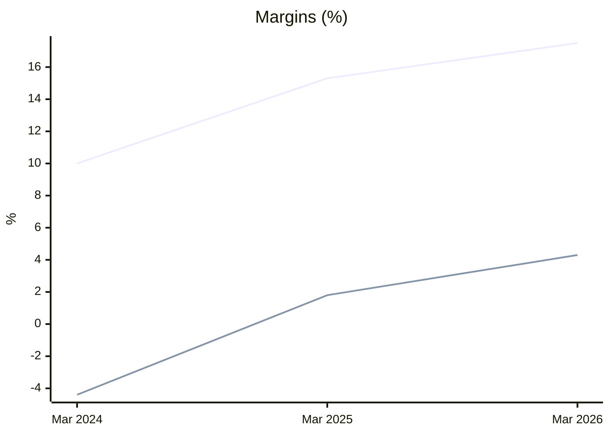
*Series in order: Operating margin, PAT margin.*

**P/E:** 28.3 — live market file (screener.in), trailing (price ₹604.00 as of 2026-08-02).

**Cash flows (₹ cr):**

| | Mar 2024 | Mar 2025 | Mar 2026 |
|---|---:|---:|---:|
| Cash from operations (₹ cr) | 2,321 | 10,151 | 7,855 |
| Cash from investing (₹ cr) | -2,509 | -1,823 | -1,475 |
| Cash from financing (₹ cr) | 164 | -4,793 | -9,883 |
| Net cash flow (₹ cr) | -24.0 | 3,535 | -3,503 |
| Free cash flow (₹ cr) | 367 | 8,896 | 5,502 |

*Source: CashFlow/NiftyTotalMarket/UPL.csv (consolidated, screener.in).*

### The business being separated — its own numbers

**UPL SAS — India Crop Protection business (proforma "pure-play" platform; excludes 'Nurture'); the entity is UPL Global Sustainable Agri Solutions Limited (FKA UPL Agri Science Private Ltd)** · unit ₹ crore · Operating profit = EBITDA as reported in management's platform-wise proforma disclosure (Contribution less SG&A; Contribution margin and EBITDA margin also given). Revenue is platform revenue on proforma adjustments and WITHOUT group elimination, so it includes sales that may be inter-platform; it is not an Ind AS 108 reportable segment (the audited segments are only Crop protection / Seeds & Post-Harvest / Non-Agro). For Q2/H1 FY27 the deck also gives EBIT (Q2FY27 ₹203 cr, 22.0% margin; H1FY27 ₹532 cr, 25.8%). No PBT or PAT is disclosed for this platform at any period.

| | FY2024 | FY2025 | FY2026 |
|---|---:|---:|---:|
| Revenue (₹ crore) | — | 3,229 | 3,212 |
| Revenue growth (%) | — | — | -0.5% |
| Operating profit (₹ crore) | — | 441 | 548 |
| Operating profit growth (%) | — | — | +24.3% |
| Operating margin (%) | — | 13.7 | 17.1 |
| PAT (₹ crore) | — | — | — |
| PAT growth (%) | — | — | — |

*Sources:* not carried by the provided pages; Presentation May 2026 — page 45

*Latest quarter (Q2 FY27):* revenue 921, operating profit 214 — Presentation Nov 2026 — page 40

*Not in the pages read:* No FY2024 platform figures; no PAT/PBT, tax, finance cost or balance-sheet data for UPL SAS in any year or quarter.

*Documents on file:* [Annual Report 2026](https://www.bseindia.com/xml-data/corpfiling/AttachHis/eb12d677-50d7-4495-9f5f-1921ef482847.pdf); [Annual Report 2025](https://www.bseindia.com/xml-data/corpfiling/AttachHis/16ebc6c3-a363-4437-b10d-8e0dfedb9483.pdf); [Annual Report 2024](https://www.bseindia.com/xml-data/corpfiling/AttachHis/8ee29f18-2108-4736-a8f1-7e012f32ce56.pdf); [Presentation Nov 2026](https://www.bseindia.com/stockinfo/AnnPdfOpen.aspx?Pname=e2744e2f-a37b-4275-8a9c-599b8af670da.pdf); [Presentation Aug 2026](https://www.bseindia.com/stockinfo/AnnPdfOpen.aspx?Pname=2f0f3bf4-eb2a-4b8e-85a4-fa1b252aa4f1.pdf); [Presentation May 2026](https://www.bseindia.com/stockinfo/AnnPdfOpen.aspx?Pname=423093cb-ab1a-4288-abdc-894653fabf37.pdf); [Presentation Feb 2026](https://www.bseindia.com/stockinfo/AnnPdfOpen.aspx?Pname=6bcd0819-5ddb-4516-a762-f7a1141762db.pdf); [Presentation Nov 2025](https://www.bseindia.com/stockinfo/AnnPdfOpen.aspx?Pname=0f944762-33b2-41d9-9bc3-aab7d950cfc9.pdf); [Presentation Aug 2025](https://www.bseindia.com/stockinfo/AnnPdfOpen.aspx?Pname=199792f5-db4d-43f8-bca8-9fc46e15e9b3.pdf)

**The checklist:**

| Item | Status | Evidence |
|---|---|---|
| Why the spin-off | yes | value unlocking for shareholders; a weak or capital-heavy business carved away; unrelated businesses separated; regulatory / strategic knot; attracting different investors / capital — “…hings stand today, it's a business which is cash surplus. It's doing exceedingly well. So if at all, there's value unlocking, how is value getting unlocked and for who is the value getting unlocked? Bikash Prasad: So I ” |
| Institutional selling likely (small / different business) | partly | the businesses are described as distinct |
| Insider ownership and incentives aligned | partly | …as members of the promoter and promoter group of UPL 2 (collectively, “ UPL 2 Promoters ”), have agreed to voluntarily retain their entire shareholding respectively in UPL 2 and undertake to not transfer,… *(next: the date the management options are priced; promoter holding in the resulting company)* |
| A hidden value revealed (pro-forma, leverage, comparables) | yes | borrowings 23,576 cr (Mar 2026) = 0.46× market cap; P/E 23.0 on Mar 2026 profit vs industry median 36.0 (22 peers) |
| Parent before the spin (clean parent, takeover prelude) | partly | stage exchange_noc — the spin has not happened; the parent can still be bought whole |
| Timing (first year sells, second year gains) | partly | not yet listed — 293 days since the first filing, stage exchange_noc |
| Management discussing it on the calls | yes | 3 mention(s) in the last 12 months of calls — “…are fundamentally different, and we believe Advanta as the eighth largest seeds player globally has a journey and destiny of its own. Obviously, a lot of that value unlock finding the right price will happen through the” |

**On the calls (last 12 months):**

- *Feb 2026* (forward) — “…ing this decision to list the entity? Because as t hings stand today, it's a business which is cash surplus. It's doing exceedingly well. So if at all, there's value unlocking, how is value getting unlocked and for who is the value getting unlocked? Bikash Prasad: So I think as a first the valuation of Advanta is expected to be final…”
- *Feb 2026* (forward) — “…I think the Advanta IPO has, as Bikash said, three objectives. Th ere is, a ) deleve raging for UPL. UPL Limited February 02, 202 6 Page 14 of 17 There is b ) value unlock for KKR. If you recollect KKR partnered with Advanta more than 3 years back when they put in a check of $300 -plus million into Advanta. By the way, the cash t…”
- *Feb 2026* (forward) — “…are fundamentally different, and we believe Advanta as the eighth largest seeds player globally has a journey and destiny of its own. Obviously, a lot of that value unlock finding the right price will happen through the IPO process. And that value does flow through to UPL, both as a shareholder and from a restructuring deleveragi…”

<details><summary>The filings</summary>

| Date | Category | Headline | Attachment |
|---|---|---|---|
| 2026-01-19 | Updates | UPL Limited has informed the Exchange regarding 'Filing of Draft Red Herring Prospectus (DRHP) by Advanta Enterprises Limited, a Subsidiary of the Company.'. | [pdf](https://nsearchives.nseindia.com/corporate/UPL_19012026211323_UPL_Limited_SE_Intimation.pdf) |
| 2026-02-01 | Earnings call Feb 2026 | …ing this decision to list the entity? Because as t hings stand today, it's a business which is cash surplus. It's doing exceedingly well. So if at all, there's |  |
| 2026-02-01 | Earnings call Feb 2026 | …I think the Advanta IPO has, as Bikash said, three objectives. Th ere is, a ) deleve raging for UPL. UPL Limited February 02, 202 6 Page 14 of 17 There is b )  |  |
| 2026-02-01 | Earnings call Feb 2026 | …are fundamentally different, and we believe Advanta as the eighth largest seeds player globally has a journey and destiny of its own. Obviously, a lot of that  |  |
| 2026-02-20 | Scheme of Arrangement | UPL Limited has informed the Exchange about Scheme of Arrangement | [pdf](https://nsearchives.nseindia.com/corporate/UPL_20022026153902_Draft_Reg_30_Disclosure__Feb_19__Clean.pdf) |
| 2026-02-20 | Press Release | UPL Limited has informed the Exchange regarding a press release dated February 20, 2026, titled "UPL Announces the Creation of World s Second Largest Listed Pur | [pdf](https://nsearchives.nseindia.com/corporate/UPL_20022026154546_Draft_Reg_30_Disclosure__Feb_19__Clean.pdf) |
| 2026-03-04 | Updates | UPL Limited has informed the Exchange regarding 'Uploading of Composite Scheme of Arrangement and certain other documents on the website of the Company'. | [pdf](https://nsearchives.nseindia.com/corporate/UPL_04032026180016_FAQsintimation.pdf) |
| 2026-07-29 | Scheme of Arrangement | UPL Limited has informed the Exchange about receipt of Observation Letters from BSE Limited and National Stock Exchange of India Limited in relation to Composit | [pdf](https://nsearchives.nseindia.com/corporate/UPL_29072026205347_Reg_30_Scheme_of_Arrangement.pdf) |
| 2026-08-01 | Other Restructuring | UPL Limited has informed the Exchange about Restructuring | [pdf](https://nsearchives.nseindia.com/corporate/UPL_01082026111409_Reg30_Completion_of_Swap_transaction_Final.pdf) |

</details>

## ASTRAMICRO — Astra Microwave Products Ltd.

**CONFIRMED** (a demerger scheme is on the exchange record) · **PRE-SPIN — study the parent; the pieces do not trade yet** · score 6.4/10 · spin-off · 15 filing(s) from CALLS, NSE, NSE-BM, NSE-deep · first 2026-02-27, latest 2026-10-29

> **Listing:** NOT YET — scheme at 'meetings' stage; Astra Space Technologies Private Limited will list only after NCLT sanction, effectiveness and a record date; indicated timeline: Press release 27 February 2026: "The Company aims to complete the demerger and list ASTPL by Q1 of FY28, subject to the timely receipt of all approvals." NSE letter 29 October 2026 requires steps for listing completed and trading commenced within sixty days of receipt of the NCLT order

**The stages, as filed:** announced (2026-05-26) → exchange_noc (2026-10-29) → meetings (2026-08-22)

**Stated in the filings:** resulting company **Astra Space Technologies Private Limited**; demerged undertaking: ) is proposed to be demerged into; size hint: 10.6% of ebitda.

**What is being separated, as the documents put it:** Space, Meteorology and Hydrology business of Astra Microwave, demerged into Astra Space Technologies Private Limited — class `regulatory_strategic`.

- *Insiders:* Promoters hold 100% of ASTPL pre-scheme, 6.45% post-scheme (mirror of AMPL). MD S. Gurunatha Reddy resigned from AMPL w.e.f. 30 September 2026 to oversee the demerger and join ASTPL as a Director; CFO Rahul Rungta moved to ASTPL as CFO; MD/WTD bonus criteria include 10% weightage for "Other intiatives of corporate restructuring like merger/demerger"
- *What it reveals:* Separation reveals a scaled-up, profitable, high-growth space/weather business: INR 157 crores FY26 turnover (13.58% of total), ~16% of FY26 revenue, cumulative INR 750 crore ISRO orders plus INR 250 crore to FY28, meteorology INR 330 crore executed with INR 285 crore order book to FY28; margins described as better than defence
- *Selling pressure:* likely — Small relative to parent (13.58% of turnover, stated 10.6% of EBITDA), mirror-shareholding spin of a distinct sector with no index membership
- *Parent or spin:* both · *option pricing date:* not stated
- *Read next:* The Scheme of Arrangement and valuation/share entitlement report, plus ASTPL's abridged-prospectus financials in the shareholder notice
- *In their words:* “The Space, Meteorology and Hydrology business operates in a sector with distinct industry characteristics, competitive dynamics, regulatory environment, and risk profile, necessitating a differentiated growth strategy aligned with its specific market opportunities.”

### Why the demerger — three years of calls and the scheme

Management frames the separation as a strategic re-alignment of a company that had grown into two very different businesses: Radar Electronics, Electronic Warfare and Telemetry on one side, and Space, Meteorology and Hydrology on the other, the latter being carved into Astra Space Technologies Private Limited (ASTPL), a wholly owned subsidiary that will be listed separately while AMPL continues as a pure-play Defence and Aerospace company retaining its JVs (Astra Rafael Comsys) and other wholly owned subsidiaries. The stated objective is sharper strategic and operational focus, with dedicated management teams free to pursue sector-specific growth, plus enhanced governance and accountability, a simpler corporate structure, clearer investment propositions and a broader investor base. The Scheme filing is explicit that Space/Met/Hydrology 'operates in a sector with distinct industry characteristics, competitive dynamics, regulatory environment, and risk profile', so it needs a differentiated growth strategy and its own capital allocation, and that a standalone entity is better placed to attract investors, strategic partners, lenders and other stakeholders with sector-specific interests. The press release adds the capital angle bluntly: Space and Weather is a scaled-up, profitable, high-growth opportunity in satellite design/assembly and satellite data, but it is capital-intensive and execution-dependent, and the demerger 'creates the structural clarity to attract capital and talent at scale'. The numbers cited are modest but real: the demerged undertaking did roughly INR157 crores of FY26 turnover, 13.58% of AMPL's total (space plus meteorology was ~16% of FY26 revenue); cumulative ISRO orders of over INR750 crores across two decades with INR250 crores still to execute by FY28, and over INR330 crores of met/hydrology contracts with a INR285 crores book to FY28; at December 2025 the standalone order book of INR2,226 crores already contained INR249 crores of space and INR369 crores of metrology/hydrology. Consideration is a 1:1 share entitlement (one INR2 ASTPL share for every INR2 AMPL share), no cash, so ASTPL's shareholding mirrors AMPL's (promoters indicatively 6.45%, public 93.55%), with listing sought on BSE and NSE and completion targeted by Q1 FY28. Leadership was split to match: Managing Director S. Gurunatha Reddy stepped down on 30 September 2026 to oversee the demerger and join ASTPL as a Director, Dr M. V. Reddy became MD of AMPL from 1 October 2026, and CFO Rahul Rungta had already moved to ASTPL in February 2026. The texts name no investor, lender or partner as having demanded the split; it is presented throughout as board-initiated, with the benefit framed as 'unlocking the value of the Demerged Undertaking for the shareholders of the Demerged Company'.

**How it evolved:** The idea surfaces obliquely as a valuation argument: on 14 Aug 2025 Atim Kabra says the separately incorporated space subsidiary is 'very, very valuable' given how thinly-revenued space peers are priced, and on 13 Nov 2025 he extrapolates space alone to near AMPL's whole market capitalisation while flagging heavy space investment and Astra SAT-1; on 13 Feb 2026 he turns to financing, saying the balance sheet must be 'creative' so blue-sky projects are not starved, and teases 'a few very interesting options'. Structurally it moves fast after that: CFO Rahul Rungta is shifted to ASTPL on 11-12 Feb 2026, the Board grants in-principle approval on 27 Feb 2026 with a same-day press release (revised the same day), and SGR announces it on the 27 May 2026 call. The Board approved the full Scheme of Arrangement on 10 June 2026 with the 1:1 ratio and the INR157 crores / 13.58% disclosure, SGR's exit as MD was confirmed on 10 Aug 2026 effective 30 Sep 2026, and BSE/NSE observation letters with no adverse observations/no objection arrived on 29 Oct 2026.

**What management expects from it:** AMPL: a pure-play defence/aerospace company keeping JVs and subsidiaries, with simpler structure, focused management and better capital allocation. ASTPL: an independently listed, profitable, high-growth space-and-weather platform spanning upstream hardware, integration and data, able to attract sector-specific investors, partners, lenders and talent. Both: sharper focus, improved operational efficiency, clearer investment propositions and unlocked shareholder value over the medium to long term.

**Point by point, with the source:**

- *CALL Aug 2025* — A year before the demerger was announced, management had already carved space into a separate wholly owned subsidiary (Astra Space Technologies Private Limited) with its own hiring and Bangalore clean rooms, and Atim Kabra pitched it as undervalued inside AMPL on a space order book of about INR230-239 crores. “And given where companies with very limited indigenous capabilities are valued, you might find that our space business is actually very, very valuable.”
- *CALL Nov 2025* — Kabra sharpened the hidden-value argument, saying space peers with almost no revenue were being valued at $750-800 million and that extrapolating Astra's space business alone approached AMPL's entire market capitalisation. “Companies are raising money at like $750 million, $800 million valuation with hardly any revenue numbers to their credit.”
- *CALL Feb 2026* — Two weeks before the Board's in-principle approval, Kabra devoted his remarks to the criticality of adequate financing for development and 'blue sky' projects and hinted at structural options to come, while the standalone order book of INR2,226 crores contained INR249 crores of space and INR369 crores of metrology and hydrology. “So watch the space. There are a few very interesting options as they crystallize, we'll be letting you know.”
- *CALL Jun 2026* — S. G. Reddy announced the Board's in-principle approval of the demerger of the space, meteorology and hydrology business and listed the objectives: dedicated management teams, better governance, a simpler structure and clearer investment propositions, with the formal scheme to follow within weeks; space and meteorology were ~16% of FY26 revenue of INR1,157 crores. “The objective of this move is to create sharper strategic and operational focus for business segments.”
- *CALL Jun 2026* — Management tied the restructuring to global as well as Indian opportunity and to capital allocation and efficiency over the medium to long term, alongside FY27 guidance of 15-20% growth and FY26 operating cash flow of INR370 crores versus minus INR99 crores. “Furthermore, this restructuring will position us to capitalize on emerging opportunities both in India and globally.”
- *Scheme* — The 27 Feb 2026 press release states the purpose as unlocking shareholder value and creating two focused listed platforms - AMPL for Defence and Aerospace, ASTPL for Space, Meteorology and Hydrology - and lists broader investor base, better oversight and less structural complexity as benefits. “The proposed demerger is aimed at unlocking shareholder value and enhancing strategic focus across business verticals.”
- *Scheme* — The same release argues the space and weather business is profitable and high-growth but capital-hungry and execution-dependent, and that the separation is what makes it possible to raise capital and hire for it at scale, on a 20-year base of over INR750 crores of cumulative ISRO orders and over INR330 crores of met/hydrology contracts. “The Indian and global markets are opening simultaneously, India's geopolitical positioning is aligned with this opportunity, and the demerger of ASTPL creates the structural clarity required to attract capital and talent at scale.”
- *Scheme* — The 10 June 2026 Scheme of Arrangement filing gives the formal rationale, including that the segment faces a different regulatory and risk environment and needs its own strategy, and that a standalone entity is better placed to attract investors, strategic partners and lenders. “The Space, Meteorology and Hydrology business operates in a sector with distinct industry characteristics, competitive dynamics, regulatory environment, and risk profile, necessitating a differentiated growth strategy aligned with its specific market opportunities.”
- *Scheme* — The filing sizes the demerged undertaking and sets the terms: no cash consideration, a 1:1 share entitlement ratio so ASTPL's shareholding mirrors AMPL's (promoters 6.45%, public 93.55% indicatively), transfer on a going-concern basis, and listing on BSE and NSE targeted by Q1 FY28. “The turnover of the Demerged Undertaking of the Company for the financial year ended 31st March 2026 was approximately INR. 157 Crores, representing 13.58% of the total turnover of the Demerged Company for the said year.”
- *Scheme* — Management was reorganised around the split: CFO Rahul Rungta moved to ASTPL in February 2026, MD S. Gurunatha Reddy resigned effective 30 September 2026 to oversee the demerger and join ASTPL's board, and Dr M. V. Reddy was elevated to MD of AMPL from 1 October 2026; BSE and NSE issued no-adverse-observation/no-objection letters on 29 October 2026. “In continuation to my earlier letter dated 03/04/2026 informing my resignation from the post of Managing Director wish to inform you that I am resigning from the position Directorship also with effect from the close of business hours on 30th September, 2026, to oversee the ongoing demerger of the Space and Meteorology business pursuant to the Scheme of Arrangement.”

*Not explained on the calls:* No valuation basis, standalone ASTPL financials, margins, capex, debt or working-capital split, transaction costs, or who initiated it; calls never field demerger questions.

*Calls read (36 months):* [Jun 2026](https://www.bseindia.com/stockinfo/AnnPdfOpen.aspx?Pname=78f3aacc-b7ef-4d51-b1e1-d6e5863786b8.pdf)

### The parent, last three fiscal years (consolidated)

| | Mar 2024 | Mar 2025 | Mar 2026 |
|---|---:|---:|---:|
| Sales (₹ cr) | 909 | 1,051 | 1,163 |
| Sales growth (%) | +11.4% | +15.6% | +10.7% |
| Operating profit (₹ cr) | 192 | 269 | 334 |
| Operating profit growth (%) | +32.4% | +40.1% | +24.2% |
| Operating margin (%) | 21.1 | 25.6 | 28.7 |
| PAT (₹ cr) | 121 | 154 | 193 |
| PAT growth (%) | +72.9% | +27.3% | +25.3% |
| PAT margin (%) | 13.3 | 14.7 | 16.6 |
| EPS (₹) | 12.8 | 16.2 | 20.3 |

*Source: ProfitStatement/NiftyTotalMarket/ASTRAMICRO.csv (consolidated, screener.in); growth and margins computed here.*

```mermaid
xychart-beta
    title "Sales, operating profit and PAT (₹ cr)"
    x-axis ["Mar 2024", "Mar 2025", "Mar 2026"]
    y-axis "₹ crore"
    bar [909, 1051, 1163]
    bar [192, 269, 334]
    bar [121, 154, 193]
```
*Series in order: Sales, Operating profit, PAT.*

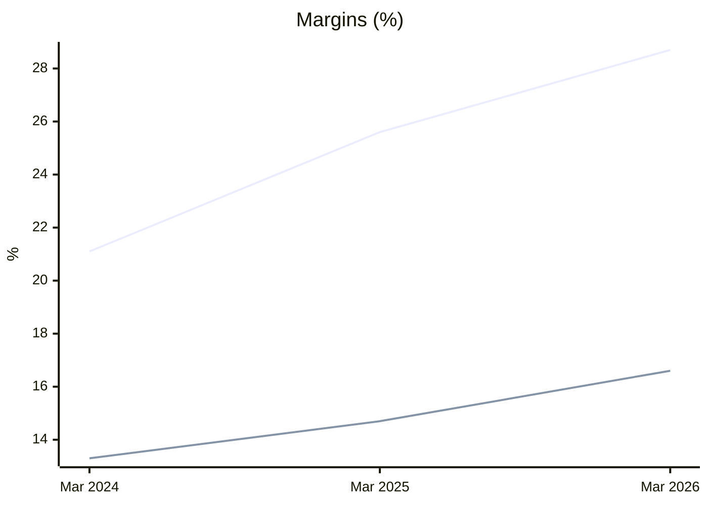
*Series in order: Operating margin, PAT margin.*

**P/E:** 79.9 — close 2026-10-01 ÷ EPS 20.32 (Mar 2026) (price ₹1,624.50 as of 2026-10-01).

**Cash flows (₹ cr):**

| | Mar 2024 | Mar 2025 | Mar 2026 |
|---|---:|---:|---:|
| Cash from operations (₹ cr) | -182 | -90.0 | 387 |
| Cash from investing (₹ cr) | -44.0 | -76.0 | -85.0 |
| Cash from financing (₹ cr) | 232 | 141 | -196 |
| Net cash flow (₹ cr) | 7.0 | -25.0 | 106 |
| Free cash flow (₹ cr) | -229 | -169 | 304 |

*Source: CashFlow/NiftyTotalMarket/ASTRAMICRO.csv (consolidated, screener.in).*

### The business being separated — its own numbers

**Space (sector-wise sales line; the Demerged Undertaking is the Space, Meteorology and Hydrology business, for which no combined line is given)** · unit ₹ lakhs · No profit line exists for this business: the company reports a SINGLE product segment under Ind AS 108 (AR2024 p191/p270, AR2025 p215/p288, AR2026 p251/p326), so there is no segment result/EBIT/EBITDA/PBT by business. Revenue shown is standalone 'Sector-wise Sales' from MD&A (AR2026 p191) — external revenue; 'Exports (including deemed exports)' of Rs. 16,228 lakhs (FY26) / 10,959 lakhs (FY25) is a separate line there, so any space/met export content is excluded from the Space figure. Meteorology is reported combined as 'Metrology/Civil Telecom/Others' (FY26 4,584; FY25 3,437) and Hydrology has no revenue line at all.

| | FY2024 | FY2025 | FY2026 |
|---|---:|---:|---:|
| Revenue (₹ lakhs) | — | 5,848 | 10,975 |
| Revenue growth (%) | — | — | +87.7% |
| Operating profit (₹ lakhs) | — | — | — |
| Operating profit growth (%) | — | — | — |
| Operating margin (%) | — | — | — |
| PAT (₹ lakhs) | — | — | — |
| PAT growth (%) | — | — | — |

*Sources:* no sector-wise split disclosed on the Annual Report 2024 pages provided; Annual Report 2026 — page 191

*Not in the pages read:* No operating profit, EBITDA or PAT for the demerged business in any year; no FY2024 sector split; no Hydrology or standalone Meteorology revenue; no quarterly segment revenue.

*Documents on file:* [Annual Report 2026](https://www.bseindia.com/xml-data/corpfiling/AttachHis/006109cf-3709-427d-8b15-87513e040708.pdf); [Annual Report 2025](https://www.bseindia.com/xml-data/corpfiling/AttachHis/10122c22-40d6-4556-9b87-34a0ab677b28.pdf); [Annual Report 2024](https://www.bseindia.com/xml-data/corpfiling/AttachHis/c307696a-1240-438e-907b-8c9a7c2401de.pdf); [Presentation Aug 2026](https://www.bseindia.com/stockinfo/AnnPdfOpen.aspx?Pname=c4b03964-affd-4c16-a7e2-384c4ab877f4.pdf); [Presentation Jun 2026](https://www.bseindia.com/stockinfo/AnnPdfOpen.aspx?Pname=03c484ea-f8f7-4cee-9b9d-ab2696cf9a5d.pdf); [Presentation Feb 2026](https://www.bseindia.com/stockinfo/AnnPdfOpen.aspx?Pname=261d1e80-99bc-4c41-a6d1-d71577988dc1.pdf); [Presentation Nov 2025](https://www.bseindia.com/stockinfo/AnnPdfOpen.aspx?Pname=f02a1760-94f0-4f9a-9111-3a1f0f1d9b2b.pdf); [Presentation Aug 2025](https://www.bseindia.com/stockinfo/AnnPdfOpen.aspx?Pname=29ae7a47-5b97-4717-9a51-89fcde383fae.pdf); [Presentation May 2025](https://www.bseindia.com/stockinfo/AnnPdfOpen.aspx?Pname=33e6e259-7539-40e1-ba9f-ec37761eae32.pdf)

**The checklist:**

| Item | Status | Evidence |
|---|---|---|
| Why the spin-off | yes | unrelated businesses separated; value unlocking for shareholders; a weak or capital-heavy business carved away; attracting different investors / capital — “…ndertaking s of the Company into a separate entity. The management believes that this move shall enable a focused management attention and operational efficiency by creating an independent company exclusively dedicated ” |
| Institutional selling likely (small / different business) | yes | the demerged piece is 10.6% of ebitda; the businesses are described as distinct |
| Insider ownership and incentives aligned | partly | …res shall be listed on BSE and NSE. Upon the effectiveness of the Scheme, the shareholding of the Resulting Company will mirror the shareholding of the Demerged Company. Brief details of change in sharehol… *(next: the date the management options are priced; promoter holding in the resulting company)* |
| A hidden value revealed (pro-forma, leverage, comparables) | unknown | no pro-forma or market data on file *(next: pro-forma P&L of each piece × the peer P/E of its own industry)* |
| Parent before the spin (clean parent, takeover prelude) | partly | stage meetings — the spin has not happened; the parent can still be bought whole |
| Timing (first year sells, second year gains) | partly | not yet listed — 254 days since the first filing, stage meetings |
| Management discussing it on the calls | yes | 2 mention(s) in the last 12 months of calls — “…ter capital allocation, and improved operational e fficiency. We will share the detailed Astra Microwave Products Limited May 27 , 202 6 Page 4 of 19 scheme of demerger once it is formally approved by board, which is ex” |

**On the calls (last 12 months):**

- *Jun 2026* (neutral) — “…itability as we move forward. Other key business development happened during the year. On a strategic front, the Board of Directors have in -principle approved demerger of our space, meteorology, and hydrology business. The objective of this move is to create sharper strategic and operational focus for business segments. The p…”
- *Jun 2026* (forward) — “…ter capital allocation, and improved operational e fficiency. We will share the detailed Astra Microwave Products Limited May 27 , 202 6 Page 4 of 19 scheme of demerger once it is formally approved by board, which is expected over the next few weeks. I will now hand over the call to Mr. M. V. Reddy and Atim Kabra, who will pro…”

<details><summary>The filings</summary>

| Date | Category | Headline | Attachment |
|---|---|---|---|
| 2026-02-27 | Outcome of Board Meeting | Plot No. 51(P), Bangalore Aerospace Park, Singanahalli Village, Budigere Post, Bangalore North Taluk, Karnataka - 562149 February 27, 202 6 | [pdf](https://nsearchives.nseindia.com/corporate/ASTRAMICRO_27022026125251_outcomeofBM.pdf) |
| 2026-02-27 | Outcome of Board Meeting | Astra Microwave Products Limited has informed the Exchange regarding Outcome of Board Meeting held on February 27, 2026. | [pdf](https://nsearchives.nseindia.com/corporate/ASTRAMICRO_27022026125251_outcomeofBM.pdf) |
| 2026-02-27 | Press Release | Demerger of Space, Meteorology and Hydrology Business into a Separate Listed Entity. | [pdf](https://nsearchives.nseindia.com/corporate/ASTRAMICRO_27022026131954_PressRelease.pdf) |
| 2026-02-27 | Press Release (Revised) | Astra Microwave Products Limited has informed the Exchange regarding a revised press release dated February 27, 2026, titled "Revised Press Release". | [pdf](https://nsearchives.nseindia.com/corporate/ASTRAMICRO_27022026193116_revisedPressReleasesigned.pdf) |
| 2026-04-03 | Press Release | Astra Microwave Products Limited has informed the Exchange regarding a press release dated April 03, 2026, titled "Press Release - Stepping down from the positi | [pdf](https://nsearchives.nseindia.com/corporate/ASTRAMICRO_03042026182957_PressReleasefull.pdf) |
| 2026-05-26 | Press Release | Astra Microwave Products Limited has informed the Exchange regarding a press release dated May 26, 2026, titled "Press Release on the Audited Financial Results  | [pdf](https://nsearchives.nseindia.com/corporate/ASTRAMICRO_26052026165633_PressRelease.pdf) |
| 2026-06-01 | Earnings call Jun 2026 | …ter capital allocation, and improved operational e fficiency. We will share the detailed Astra Microwave Products Limited May 27 , 202 6 Page 4 of 19 scheme of | [pdf](https://www.bseindia.com/stockinfo/AnnPdfOpen.aspx?Pname=78f3aacc-b7ef-4d51-b1e1-d6e5863786b8.pdf) |
| 2026-06-10 | Demerger | Announcement of approval of the Scheme of Arrangement by the Board of Directors of Astra Microwave Products Limited ( AMPL / Demerged Company ) pursuant the Reg | [pdf](https://nsearchives.nseindia.com/corporate/ASTRAMICRO_10062026123059_Letter.pdf) |
| 2026-06-10 | Outcome of Board Meeting | Announcement of approval of the Scheme of Arrangement by the Board of Directors of Astra Microwave Products Limited ( AMPL / Demerged Company ) pursuant the Reg | [pdf](https://nsearchives.nseindia.com/corporate/ASTRAMICRO_10062026123601_Letter.pdf) |
| 2026-06-10 | Board Meeting (purpose) | Board Meeting Intimation ASTRA MICROWAVE PRODUCTS LIMITED has informed the Exchange about Board Meeting to be held on 10-Jun-2026 to consider Scheme of arrangem | [pdf](https://nsearchives.nseindia.com/corporate/xbrl/PIBM_532493_162026175623_PRIOR_INTIMATION_WebXMLFile_20260601_175626465.xml) |
| 2026-06-10 | Board Meeting (purpose) | Other business matters Intimation of Board Meeting for consideration of Scheme of Arrangement, as per Regulation 29 of the SEBI (Listing Obligations and Disclos | [pdf](https://nsearchives.nseindia.com/corporate/ASTRAMICRO_01062026175859_Boardmeetingintimation.pdf) |
| 2026-08-10 | Outcome of Board Meeting | Astra Microwave Products Limited has submitted to the Exchange, the Un-Audited financial results for the period ended Jun 30, 2026. | [pdf](https://nsearchives.nseindia.com/corporate/ASTRAMICRO_10082026131039_OutcomeofBoardMeeting.pdf) |
| 2026-08-10 | Outcome of Board Meeting | Astra Microwave Products Limited has informed the Exchange regarding Outcome of Board Meeting held on August 10, 2026. | [pdf](https://nsearchives.nseindia.com/corporate/ASTRAMICRO_10082026131830_OutcomeofBoardMeeting.pdf) |
| 2026-08-22 | Shareholders meeting | Astra Microwave Products Limited has informed the Exchange regarding Notice of Annual General Meeting to be held on September 18, 2026 | [pdf](https://nsearchives.nseindia.com/corporate/ASTRAMICRO_22082026141503_AGMNotice.pdf) |
| 2026-10-29 | Scheme of Arrangement | Receipt of Observation letter with no adverse observations/No Objection letter from the Stock Exchanges on the Scheme of Demerger. | [pdf](https://nsearchives.nseindia.com/corporate/ASTRAMICRO_29102026164303_NOCLetter.pdf) |

</details>

## LEMONTREE — Lemon Tree Hotels Ltd.

**CONFIRMED** (a demerger scheme is on the exchange record) · **PRE-SPIN — study the parent; the pieces do not trade yet** · score 6.4/10 · spin-off · 29 filing(s) from CALLS, NSE · first 2026-01-10, latest 2026-09-22

> **Listing:** NOT YET — scheme at 'nclt_sanction' stage; Fleur Hotels Limited will list only after NCLT sanction, effectiveness and a record date; indicated timeline: Press release of 9 January 2026: "The entire process to listing of Fleur is expected to be completed within 12 to 15 months"; on the 29 May 2026 call Keswani said 12 months from then if NCLT is quick, otherwise 18 months; NSE observation letter of 22 September 2026 requires trading to commence within sixty days of the NCLT order

**The stages, as filed:** exchange_noc (2026-09-22) → nclt_sanction (2026-01-10)

**Stated in the filings:** resulting company **Fleur Hotels Limited**; demerged undertaking: ), w ill be demerged into Fleur Hotels; appointed date 2026-04-01; pro-forma statements referenced.

**What is being separated, as the documents put it:** Asset-heavy hotel ownership and development undertaking: 12 hotels (11 operating, 1 under construction) plus development capabilities, demerged into Fleur Hotels — class `value_unlocking`.

- *Insiders:* Promoters Patanjali Govind Keswani and Spank Management hold 22.28% of LTH, 7.34% directly in Fleur post-scheme; Keswani non-retiring Executive Chairman of Fleur, turns non-executive at Lemon Tree March 2027
- *What it reveals:* Fleur becomes India's largest hotel owner by rooms (5,556 rooms, 39 hotels; FY25 revenue Rs 1,189 cr, net EBITDA Rs 509 cr), carries all group debt, and gets Warburg's Rs 960 crore; Lemon Tree is left debt-free, 80% EBITDA-margin fee business
- *Selling pressure:* likely — Odd-lot entitlement (20 Fleur shares per 311 LTH shares) in a newly listed asset-heavy company whose investor base differs from asset-light Lemon Tree
- *Parent or spin:* both · *option pricing date:* not stated
- *Read next:* Fleur's pro-forma financials in the Q4 FY26 presentation (FY27 net EBITDA ~Rs 850 crore) and Fleur's Information Memorandum
- *In their words:* “This structure ensures that the shareholders of the Company directly participate in the economic value of the hotel-ownership and development undertaking through listed shares of the Transferee Company.”

### Why the demerger — three years of calls and the scheme

Management framed the demerger as splitting one company that had been doing two businesses with two different investor bases: an asset-heavy business that designs, develops, finances and owns hotels (pension funds, insurance companies betting on inflation, repricing and annuity yield) and an asset-light business that monetises brand, management, loyalty, distribution and technology with almost no capital intensity. Keswani said Lemon Tree had only built hotels in 2004-2007 because owners would not hand their hotels to an unknown brand, and that with the brand now widely recognised (MakeMyTrip's CEO told him 20-25% of occupancy comes from them the moment a Lemon Tree opens) there was no reason to keep owning assets rather than monetise the brand — explicitly the Marriott/Host Hotels and Hilton/Park Hotels playbook. Mechanically (Composite Scheme approved 9 Jan 2026, appointed date 1 April 2026): Carnation Hotels and Hamstede Living merge into LTH; Oriole Dr. Fresh, Canary, Sukhsagar and Manakin merge into Fleur against shares to LTH; and the Demerged Undertaking — 11 operating hotels plus Aurika Shimla under construction, the investment in Arum (Aurika Shillong, 165 rooms) and the entire development capability/team with exclusivity on all future ownership, leasing and development — demerges into Fleur, with 20 Fleur shares for every 311 LTH shares (demerged division turnover Rs 23,037.34 lakh, 59.90% of LTH standalone turnover; 1,563 operating rooms across 15 hotels per the presentation, 1,820 keys/17 hotels per the press release). A second stated problem was conflict of interest: development capability was moved to Fleur with 'Chinese firewalls' so Fleur shareholders could never feel Lemon Tree was cherry-picking the best assets for itself, and Lemon Tree must refer new acquisition/development opportunities to Fleur. All group debt (about Rs 1,300 crore at demerger, Rs 1,500 crore total borrowings at FY26-end, cost of debt 7.42%) goes to Fleur, leaving Lemon Tree debt-free with only technology and marketing spend, forcing the Board to frame a dividend/shareholder-reward policy. Warburg Pincus (Coastal Cedar Investments B.V.) bought APG's entire 41.09% of Fleur and committed up to Rs 960 crore of primary equity, giving Fleur roughly Rs 3,000 crore of deployable capital at 1:1 debt-equity against 2,500+ rooms under active discussion and Aurika Nehru Place (572 rooms, ~Rs 700 crore); post-scheme LTH shareholders own ~74% of Fleur (32.96% direct plus ~41% through LTH) versus the 59% LTH owns today, and Fleur lists separately for 'transparent price discovery and market-driven valuation of the asset-heavy business'.

**How it evolved:** The idea was first visible as a Fleur listing aspiration in the Nov 2024 call, where Keswani said debt-freedom would come sooner 'if we list Fleur before that' and put an IPO 'within the next 2-3 years at most'; in the Aug 2025 call he disclosed that committees of directors had been set up in both Lemon Tree and Fleur to evaluate transferring LTH's assets into Fleur via a demerger and listing it, alongside splitting the management teams (Neelendra Singh for LTH from 1 October, Saurabh Shatdal for Fleur), with listing hoped for end-CY2026. In the Nov 2025 call it was 'in process' with a Board subcommittee and a promise of 'some other even more exciting stuff' within three months; the scheme, the Warburg/APG transactions and the 74%/26% shareholding math were announced in the Jan 2026 (15 January) dedicated call with a 12-15 month path to listing. By the Feb 2026 call Keswani confirmed the scheme was effective from 1 April and, responding to Ashish Kumar's request, promised pro forma financials for both entities; those pro formas appeared with the Jun 2026 (29 May) results, where CCI approval (April 2026), Warburg's completed purchase of APG's stake and a longer 12-18 month NCLT-dependent timeline were given, followed by NSE/BSE observation letters on 22 September 2026.

**What management expects from it:** Lemon Tree: debt-free, fee/brand/tech-only, EBITDA margin from ~60% pro forma to 70-80% steady state, ~60% PAT margin, high ROCE, free cash funding dividends. Fleur: India's largest owner (5,600 rooms, 39 hotels), net EBITDA Rs 850 crore FY27 and Rs 1,000+ crore FY28, ~48%+ post-fee margins, Warburg-backed capital for 2,500+ rooms, capital growth not dividends, and separately listed for market valuation.

**Point by point, with the source:**

- *[Jan 2026](https://www.bseindia.com/stockinfo/AnnPdfOpen.aspx?Pname=098527b9-fd65-4aa9-9c6d-1ac184b2eda0.pdf)* — Asked directly by Kunal Lakhan (CLSA) what was wrong with the old structure, Keswani said the hotel business has two subsets with two different investor types — developers/owners wanting chunky yield and inflation-linked annuity returns versus asset-light investors betting on brand and management — and Lemon Tree was a combination of both. “We have actually separated 2 types of businesses. One is asset heavy, long -term appreciating asset, capital intensive. It has a different kind of investor, and this business has a very different kind of investor, and we wanted to actually attract both types of investors.”
- *[Jan 2026](https://www.bseindia.com/stockinfo/AnnPdfOpen.aspx?Pname=098527b9-fd65-4aa9-9c6d-1ac184b2eda0.pdf)* — He explained the historical accident being corrected: hotels were built only to establish the brand, and with the brand now established the company should monetise it instead of owning assets. “We were forced to build hotels to build our brand. But once we build our brand, technically, we do not need hotels because now it is time for Lemon Tree to monetize its brand, which is enormous recall.”
- *[Jan 2026](https://www.bseindia.com/stockinfo/AnnPdfOpen.aspx?Pname=098527b9-fd65-4aa9-9c6d-1ac184b2eda0.pdf)* — The transfer of the development capability and exclusive development mandate to Fleur was driven by a conflict-of-interest problem — Fleur minorities fearing Lemon Tree would keep the best projects for itself — and was solved with firewalls. “Development capability was an issue which was raised in order to maximize Fleur's growth, we did not want shareholders of Fleur to ever feel that Lemon Tree when it recommends any assets was cherry -picking, which means Lemon Tree would say, I have got this very nice asset in Delhi, why should I offer it to Fleur.”
- *[Jan 2026](https://www.bseindia.com/stockinfo/AnnPdfOpen.aspx?Pname=098527b9-fd65-4aa9-9c6d-1ac184b2eda0.pdf)* — All of Lemon Tree's debt moves to Fleur: Fleur carries roughly Rs 1,300 crore of debt against a ~Rs 900 crore net EBITDA and can borrow another ~Rs 1,300 crore, while Lemon Tree goes to zero debt. “Firstly, when this demerger happens, all the debt, including the Lemon Tree's debt, after adjustment is being transferred to Fleur. Fleur will have 100% of our debt and Lemon Tree will have zero debt.”
- *[Jan 2026](https://www.bseindia.com/stockinfo/AnnPdfOpen.aspx?Pname=098527b9-fd65-4aa9-9c6d-1ac184b2eda0.pdf)* — Keswani justified keeping a ~41% indirect stake in Fleur (challenged by Jinesh Joshi on hold-co discount) as Lemon Tree retaining 'skin in the game' as Fleur's manager, with natural dilution as Fleur raises capital; he quantified that Rs 1,000 crore deployed by Fleur generates ~Rs 350 crore of turnover, Rs 170-180 crore EBITDA and ~Rs 30 crore of fees for Lemon Tree. “We felt it was prudent to have significant skin in the game at this stage, which means that going forward, it is very possible that Lemon Tree may dilute or even increase its stake over time; this will obviously be a Board decision .”
- *[Jan 2026](https://www.bseindia.com/stockinfo/AnnPdfOpen.aspx?Pname=098527b9-fd65-4aa9-9c6d-1ac184b2eda0.pdf)* — Warburg's Rs 960 crore primary commitment plus Fleur's own cash and 1:1 debt gives roughly Rs 3,000 crore to deploy pre-listing against 2,500 rooms in active discussion; Keswani guided Fleur to over Rs 1,000 crore net EBITDA by FY28 and Lemon Tree to 80% EBITDA margin / 60% PAT margin. “We have potentially about Rs 3,000 crores available to deploy in this growth before we list.”
- *[Jun 2026](https://www.bseindia.com/stockinfo/AnnPdfOpen.aspx?Pname=a03e8364-4037-407c-8929-d956c0976b96.pdf)* — Opening the call with pro forma financials for both entities, Keswani described the transaction as simple — Warburg has bought APG's Fleur stake, Lemon Tree transfers 17 hotels and development capabilities in exchange for Fleur shares to LTH shareholders, and Fleur lists. “This scheme will result in 2 distinct financially sound businesses.”
- *[Jun 2026](https://www.bseindia.com/stockinfo/AnnPdfOpen.aspx?Pname=a03e8364-4037-407c-8929-d956c0976b96.pdf)* — He restated the economic outcome for each entity: Lemon Tree debt-free, high-margin, high-ROCE and fee/brand-driven; Fleur the consolidated owner of a fully renovated portfolio, post-scheme India's largest hotel platform by inventory at 5,600 rooms and 39 operational hotels. “Post the reorganization , Lemon Tree will emerge as a debt -free, high-margin, high ROCE company generating strong free cash flows from fees and brand -related income.”
- *[Jun 2026](https://www.bseindia.com/stockinfo/AnnPdfOpen.aspx?Pname=a03e8364-4037-407c-8929-d956c0976b96.pdf)* — Shareholder arithmetic: LTH shareholders end up with close to 74% of Fleur (33% direct, ~41% through Lemon Tree) versus the 59% Lemon Tree directly owns in Fleur today, before Warburg's primary infusion; Keswani also said he will cease to be executive at Lemon Tree from March 2027 and focus on Fleur as Executive Chair. “Post reorganization , Lemon Tree shareholders will effectively own close to 74% of Fleur Hotels, 33% directly and about 41% indirectly through Lemon Tree.”
- *[Jun 2026](https://www.bseindia.com/stockinfo/AnnPdfOpen.aspx?Pname=a03e8364-4037-407c-8929-d956c0976b96.pdf)* — Answering Achal Kumar, Keswani confirmed Fleur will be brand-agnostic post-demerger and may hand assets to other operators — Lemon Tree has no automatic right to Fleur's hotels and must earn them on results. “Yes. But Lemon Tree must be able to deliver best results to get it . Just because Lemon Tree has skin in the game with Fleur does not mean that it has an automatic right to any asset that Fleur develops.”
- *[Jun 2026](https://www.bseindia.com/stockinfo/AnnPdfOpen.aspx?Pname=a03e8364-4037-407c-8929-d956c0976b96.pdf)* — On capital allocation after the split, Lemon Tree is expected to need almost no capital and move to distributing profits, while Fleur will retain capital for growth rather than pay dividends. “Lemon Tree will not need any significant capital other than potentially investments in technology or in marketing and so on. It will be essentially a zero -debt cash accretive company.”
- *[Feb 2026](https://www.bseindia.com/stockinfo/AnnPdfOpen.aspx?Pname=b0215f7f-3372-4231-8b2f-7f433eb77faf.pdf)* — Keswani confirmed the scheme is effective from 1 April and that Lemon Tree becomes debt-free from next year, with all assets and debt going to Fleur and fee income becoming free cash; the Board must decide a dividend policy within six months. “What will happen is in the scheme of demerger, all the assets of Lemon Tree, including its debt will be transferred to Fleur. Lemon Tree will immediately effectively be a debt -free company from next year.”

*Not explained on the calls:* Absolute valuation of the demerged undertaking and Warburg's price for APG's stake, Fleur's issue price, hold-co discount size, post-demerger ROE, and fate of the two retained leases.

*Calls read (36 months):* [Aug 2025](https://www.bseindia.com/stockinfo/AnnPdfOpen.aspx?Pname=c30ba016-9c4b-4e13-8b0d-a5fb02eb43b7.pdf), [Feb 2026](https://www.bseindia.com/stockinfo/AnnPdfOpen.aspx?Pname=b0215f7f-3372-4231-8b2f-7f433eb77faf.pdf), [Jan 2026](https://www.bseindia.com/stockinfo/AnnPdfOpen.aspx?Pname=098527b9-fd65-4aa9-9c6d-1ac184b2eda0.pdf), [Jun 2026](https://www.bseindia.com/stockinfo/AnnPdfOpen.aspx?Pname=a03e8364-4037-407c-8929-d956c0976b96.pdf), [Nov 2025](https://www.bseindia.com/stockinfo/AnnPdfOpen.aspx?Pname=5a3cfc96-c662-414a-bc34-4635bef2415b.pdf)

### The parent, last three fiscal years (consolidated)

| | Mar 2024 | Mar 2025 | Mar 2026 |
|---|---:|---:|---:|
| Sales (₹ cr) | 1,071 | 1,286 | 1,444 |
| Sales growth (%) | +22.4% | +20.1% | +12.3% |
| Operating profit (₹ cr) | 523 | 634 | 690 |
| Operating profit growth (%) | +16.7% | +21.2% | +8.8% |
| Operating margin (%) | 48.8 | 49.3 | 47.8 |
| PAT (₹ cr) | 182 | 243 | 288 |
| PAT growth (%) | +29.1% | +33.5% | +18.5% |
| PAT margin (%) | 17.0 | 18.9 | 19.9 |
| EPS (₹) | 1.9 | 2.5 | 2.9 |

*Source: ProfitStatement/NiftyTotalMarket/LEMONTREE.csv (consolidated, screener.in); growth and margins computed here.*

```mermaid
xychart-beta
    title "Sales, operating profit and PAT (₹ cr)"
    x-axis ["Mar 2024", "Mar 2025", "Mar 2026"]
    y-axis "₹ crore"
    bar [1071, 1286, 1444]
    bar [523, 634, 690]
    bar [182, 243, 288]
```
*Series in order: Sales, Operating profit, PAT.*

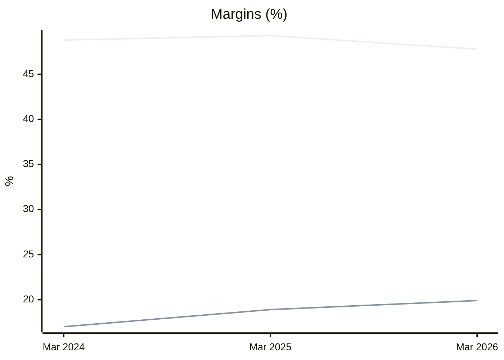
*Series in order: Operating margin, PAT margin.*

**P/E:** 34.9 — live market file (screener.in), trailing (price ₹109.00 as of 2026-08-02).

**Cash flows (₹ cr):**

| | Mar 2024 | Mar 2025 | Mar 2026 |
|---|---:|---:|---:|
| Cash from operations (₹ cr) | 465 | 542 | 542 |
| Cash from investing (₹ cr) | -397 | -127 | -169 |
| Cash from financing (₹ cr) | -59.0 | -392 | -370 |
| Net cash flow (₹ cr) | 10.0 | 22.0 | 3.0 |
| Free cash flow (₹ cr) | 134 | 448 | 406 |

*Source: CashFlow/NiftyTotalMarket/LEMONTREE.csv (consolidated, screener.in).*

### The business being separated — its own numbers

The segment pages read (3 annual report(s) and 12 presentation(s) on file) do not carry this business's own revenue or profit: All Fleur-level figures: revenue, operating profit/EBITDA and PAT, for every year and quarter. Pages carry no segment disclosure and no Fleur standalone statements — only fees LTH earns from Fleur.

*Documents on file:* [Annual Report 2026](https://www.bseindia.com/xml-data/corpfiling/AttachHis/be00cd57-2cf4-4cb8-ae86-25abf6514c44.pdf); [Annual Report 2025](https://www.bseindia.com/xml-data/corpfiling/AttachHis/c1ba19b8-e632-41bd-95da-996e7ec68b05.pdf); [Annual Report 2024](https://www.bseindia.com/xml-data/corpfiling/AttachHis/909f5daf-1ec8-43b7-a52e-36925fa72a1f.pdf); [Presentation Nov 2026](https://www.bseindia.com/stockinfo/AnnPdfOpen.aspx?Pname=1ac80a6c-afd8-4045-851e-e859aac57105.pdf); [Presentation Aug 2026](https://www.bseindia.com/stockinfo/AnnPdfOpen.aspx?Pname=03179e31-3670-48bd-97ad-621254b02e82.pdf); [Presentation Jun 2026](https://www.bseindia.com/stockinfo/AnnPdfOpen.aspx?Pname=48d6e84e-033d-477d-a9c4-37a041824e1d.pdf); [Presentation Feb 2026](https://www.bseindia.com/stockinfo/AnnPdfOpen.aspx?Pname=e55682f6-ab5d-43b2-9e3c-63f601797da3.pdf); [Presentation Jan 2026](https://www.bseindia.com/stockinfo/AnnPdfOpen.aspx?Pname=d182318c-0477-403a-a9d2-38e4f41be0d6.pdf); [Presentation Nov 2025](https://www.bseindia.com/stockinfo/AnnPdfOpen.aspx?Pname=ac49f71d-a895-4efd-b414-5c14334553c9.pdf)

**The checklist:**

| Item | Status | Evidence |
|---|---|---|
| Why the spin-off | yes | regulatory / strategic knot; attracting different investors / capital; value unlocking for shareholders; unrelated businesses separated — “…approval of, in ter alia, the Scheme (including Amalgamation 1, the Amalgamation 2 and the Demerger) by the Competition Commission of India (if and to the extent required); (d) sanction of the Scheme by the NCLT under S” |
| Institutional selling likely (small / different business) | partly | the businesses are described as distinct |
| Insider ownership and incentives aligned | unknown | no promoter-continuity or option-pricing language found *(next: the date the management options are priced; promoter holding in the resulting company)* |
| A hidden value revealed (pro-forma, leverage, comparables) | yes | pro-forma statements are referenced in the filings; borrowings 2,004 cr (Mar 2026) = 0.23× market cap; P/E 30.1 on Mar 2026 profit vs industry median 54.1 (17 peers) |
| Parent before the spin (clean parent, takeover prelude) | partly | stage nclt_sanction — the spin has not happened; the parent can still be bought whole |
| Timing (first year sells, second year gains) | partly | not yet listed — 302 days since the first filing, stage nclt_sanction |
| Management discussing it on the calls | yes | 19 mention(s) in the last 12 months of calls — “…s that you may have. Moderator: The first question is from the line of Achal Kumar with HSBC. Achal Kumar: I have 2 simple questions . So first, tomorrow after demerger, if Fleur believes that its inventory can be manag” |

**On the calls (last 12 months):**

- *Nov 2025* (forward) — “…I expect we will hit Rs. 12,000. Page 9 of 26 Abhay Khaitan: Understood. That is very helpful. My second question is that if you have any updates on the Fleur demerger, any update that you can provide on what is the process and what is the timeline that we are working with right now on this? Patanjali Keswani: It is in proces…”
- *Nov 2025* (forward) — “…h of interesting things to tell the market, I think, in the next 3 months. Would that be right, Kapil? Kapil Sharma: Yes. Patanjali Keswani: It is not only the demerger of Fleur, but some other even more exciting stuff, but we will talk about it when the time is right. Moderator: Thank you. Next question comes from the line of…”
- *Jan 2026* (forward) — “…Disclosure Requirements) Regulations, 2015, transcript of the Investors & Analysts Conference Call held on January 15, 2026, w.r.t. announced of the Composite Scheme of Arrangement is enclosed. You are requested to take the above information in your record . Thanking you, For Lemon Tree Hotels Limited Pawan Kumar Kumawat Company Secretary…”
- *Jan 2026* (forward) — “…joining us, and I wish you all a belated Happy New Year. The purpose of this call is really to explain the rationale of the timing and logic for this Composite Scheme of Arrangement, which has just been announced. To begin with, I would like to give some context. So please bear with me. As you know, the hospitality sector in India is curre…”
- *Jan 2026* (forward) — “…s structure will provide clarity on accountability and sharper strategic focus as both these entities scale going forward. Against this backdrop, the corporate scheme of arrangement represents a logical and value accretive next step. The proposed reorganization will result in 2 distinct well-capitalized businesses, Lemon Tree Hotels as a p…”

<details><summary>The filings</summary>

| Date | Category | Headline | Attachment |
|---|---|---|---|
| 2025-11-01 | Earnings call Nov 2025 | …I expect we will hit Rs. 12,000. Page 9 of 26 Abhay Khaitan: Understood. That is very helpful. My second question is that if you have any updates on the Fleur  | [pdf](https://www.bseindia.com/stockinfo/AnnPdfOpen.aspx?Pname=5a3cfc96-c662-414a-bc34-4635bef2415b.pdf) |
| 2025-11-01 | Earnings call Nov 2025 | …h of interesting things to tell the market, I think, in the next 3 months. Would that be right, Kapil? Kapil Sharma: Yes. Patanjali Keswani: It is not only the | [pdf](https://www.bseindia.com/stockinfo/AnnPdfOpen.aspx?Pname=5a3cfc96-c662-414a-bc34-4635bef2415b.pdf) |
| 2026-01-01 | Earnings call Jan 2026 | …Disclosure Requirements) Regulations, 2015, transcript of the Investors & Analysts Conference Call held on January 15, 2026, w.r.t. announced of the Composite  | [pdf](https://www.bseindia.com/stockinfo/AnnPdfOpen.aspx?Pname=098527b9-fd65-4aa9-9c6d-1ac184b2eda0.pdf) |
| 2026-01-01 | Earnings call Jan 2026 | …joining us, and I wish you all a belated Happy New Year. The purpose of this call is really to explain the rationale of the timing and logic for this Composite | [pdf](https://www.bseindia.com/stockinfo/AnnPdfOpen.aspx?Pname=098527b9-fd65-4aa9-9c6d-1ac184b2eda0.pdf) |
| 2026-01-01 | Earnings call Jan 2026 | …s structure will provide clarity on accountability and sharper strategic focus as both these entities scale going forward. Against this backdrop, the corporate | [pdf](https://www.bseindia.com/stockinfo/AnnPdfOpen.aspx?Pname=098527b9-fd65-4aa9-9c6d-1ac184b2eda0.pdf) |
| 2026-01-01 | Earnings call Jan 2026 | …is our thought. The way we look at risk mitigation and management on the asset -heavy side of the businesses. I am talking now about Fleur. Firstly, when this  | [pdf](https://www.bseindia.com/stockinfo/AnnPdfOpen.aspx?Pname=098527b9-fd65-4aa9-9c6d-1ac184b2eda0.pdf) |
| 2026-01-01 | Earnings call Jan 2026 | …will have 100% of our debt and Lemon Tree will have zero debt. Okay. So, what will Fleur's debt be on an ongoing basis by end of next year, by the time of this | [pdf](https://www.bseindia.com/stockinfo/AnnPdfOpen.aspx?Pname=098527b9-fd65-4aa9-9c6d-1ac184b2eda0.pdf) |
| 2026-01-01 | Earnings call Jan 2026 | …ber 1, number 2 are they going to increase their stake at the level of what APG has in Fleur currently? Patanjali Keswani: See, currently, when you do the full | [pdf](https://www.bseindia.com/stockinfo/AnnPdfOpen.aspx?Pname=098527b9-fd65-4aa9-9c6d-1ac184b2eda0.pdf) |
| 2026-01-01 | Earnings call Jan 2026 | …stions have already been addressed. And one question is sir, as of now as a consolidated level, our ROE is at 18 -odd percentage. My question is that after the | [pdf](https://www.bseindia.com/stockinfo/AnnPdfOpen.aspx?Pname=098527b9-fd65-4aa9-9c6d-1ac184b2eda0.pdf) |
| 2026-01-10 | Scheme of Arrangement | Lemon Tree Hotels Limited has informed the Exchange about Scheme of Arrangement | [pdf](https://nsearchives.nseindia.com/corporate/LEMONTREE_10012026000104_LTHL_Outcome.pdf) |
| 2026-01-10 | Press Release | Lemon Tree Hotels Limited has informed the Exchange regarding a press release dated January 09, 2026, titled "Press Release ". | [pdf](https://nsearchives.nseindia.com/corporate/LEMONTREE_10012026000942_Press_Release.pdf) |
| 2026-01-10 | Memorandum of Understanding/Agreements | Lemon Tree Hotels Limited has informed the Exchange about Agreements | [pdf](https://nsearchives.nseindia.com/corporate/LEMONTREE_10012026001744_LTHL_Outcome.pdf) |
| 2026-01-10 | Updates | Lemon Tree Hotels Limited has informed the Exchange regarding 'Investor Presentation'. | [pdf](https://nsearchives.nseindia.com/corporate/LEMONTREE_10012026023213_Investor_Presentation.pdf) |
| 2026-02-01 | Earnings call Feb 2026 | …on a few Aurikas. But would it be fair for us to assume that all the other own room addition that is going to happen from Fleur end will only happen after the  | [pdf](https://www.bseindia.com/stockinfo/AnnPdfOpen.aspx?Pname=b0215f7f-3372-4231-8b2f-7f433eb77faf.pdf) |
| 2026-02-01 | Earnings call Feb 2026 | …uired chain? Tha t is the first question. And secondly, if you can just guide on the overall CAPEX for next 2 -3 years. And since we mentioned during the Fleur | [pdf](https://www.bseindia.com/stockinfo/AnnPdfOpen.aspx?Pname=b0215f7f-3372-4231-8b2f-7f433eb77faf.pdf) |
| 2026-02-01 | Earnings call Feb 2026 | …ther Rs. 70 crore - Rs. 80 crore . It is significant numbers, which will all shrink dramatically after FY27. Page 20 of 20 What will happen is in the scheme of | [pdf](https://www.bseindia.com/stockinfo/AnnPdfOpen.aspx?Pname=b0215f7f-3372-4231-8b2f-7f433eb77faf.pdf) |
| 2026-02-06 | Outcome of Board Meeting | Lemon Tree Hotels Limited has submitted to the Exchange, the financial results for the period ended December 31, 2025. | [pdf](https://nsearchives.nseindia.com/corporate/LEMONTREE_06022026221032_Outcome.pdf) |
| 2026-04-07 | Updates | Lemon Tree Hotels Limited has informed the Exchange regarding 'Approval of Competition Commission of India for the acquisition of certain equity shares of Fleur | [pdf](https://nsearchives.nseindia.com/corporate/LEMONTREE_07042026204840_Stock_Exchange_Intimation_CCI.pdf) |
| 2026-05-23 | Granting/withdrawal/surrender/cancellati | Lemon Tree Hotels Limited has informed the Exchange about the approval of Competition Commission of India | [pdf](https://nsearchives.nseindia.com/corporate/LEMONTREE_23052026131309_Intimation.pdf) |
| 2026-06-01 | Earnings call Jun 2026 | …which, Saurabh, the Managing Director of Fleur Hotels, who will share an update on Fleur's business development. And lastly, I will then share an update on the | [pdf](https://www.bseindia.com/stockinfo/AnnPdfOpen.aspx?Pname=a03e8364-4037-407c-8929-d956c0976b96.pdf) |
| 2026-06-01 | Earnings call Jun 2026 | …advantage in the market where good assets do not always come packaged neatly. Now I hand over the forum to Pat anjali to give an update on composite scheme of  | [pdf](https://www.bseindia.com/stockinfo/AnnPdfOpen.aspx?Pname=a03e8364-4037-407c-8929-d956c0976b96.pdf) |
| 2026-06-01 | Earnings call Jun 2026 | …e forum to Pat anjali to give an update on composite scheme of demerger. Patanjali Keswani: I want to take this opportunity to continue the conversation on the | [pdf](https://www.bseindia.com/stockinfo/AnnPdfOpen.aspx?Pname=a03e8364-4037-407c-8929-d956c0976b96.pdf) |
| 2026-06-01 | Earnings call Jun 2026 | …cheme. This time with the results we have shared pro forma financials for both Lemon Tree Hotels Limited and Fleur Hotels Limited as they would appear upon the | [pdf](https://www.bseindia.com/stockinfo/AnnPdfOpen.aspx?Pname=a03e8364-4037-407c-8929-d956c0976b96.pdf) |
| 2026-06-01 | Earnings call Jun 2026 | …fees and brand -related income. Fleur Hotels will consolidate ownership of our group's existing hotels, all of which will be fully renovated by the time of the | [pdf](https://www.bseindia.com/stockinfo/AnnPdfOpen.aspx?Pname=a03e8364-4037-407c-8929-d956c0976b96.pdf) |
| 2026-06-01 | Earnings call Jun 2026 | …2 months in Jan. Now the slide mentions that it will take another 12 to 15 months for SEBI and other approvals. Can you just highlight the new timeline for the | [pdf](https://www.bseindia.com/stockinfo/AnnPdfOpen.aspx?Pname=a03e8364-4037-407c-8929-d956c0976b96.pdf) |
| 2026-06-01 | Earnings call Jun 2026 | …20 of 25 Patanjali Keswani: Margin . Well, pre -fees, these same stores should be in the late 50s, pre -fees. Nikhil Poptani : During the January call for the  | [pdf](https://www.bseindia.com/stockinfo/AnnPdfOpen.aspx?Pname=a03e8364-4037-407c-8929-d956c0976b96.pdf) |
| 2026-09-14 | Agreements | Lemon Tree Hotels Limited has informed the Exchange about Joint Venture Agreement has been executed between Carnation Hotels Private Limited, a wholly owned sub | [pdf](https://nsearchives.nseindia.com/corporate/LEMONTREE_14092026205917_Stock_Exchange_Intimation_JV_Agreement.pdf) |
| 2026-09-14 | General Updates | Lemon Tree Hotels Limited has informed the Exchange about Sale or disposal of subsidiary. Pursuant to the execution of the Joint Venture Agreement (JVA), RJ Cor | [pdf](https://nsearchives.nseindia.com/corporate/LEMONTREE_14092026211842_Stock_Exchange_Intimation_JV_Agreement.pdf) |
| 2026-09-22 | Scheme of Arrangement | Lemon Tree Hotels Limited has informed that the Company has received the Observation Letters with no objection from the NSE and no adverse observations from the | [pdf](https://nsearchives.nseindia.com/corporate/LEMONTREE_22092026213712_Intimation_signed.pdf) |

</details>

## NATCOPHARM — NATCO Pharma Ltd.

**CONFIRMED** (a demerger scheme is on the exchange record) · **PRE-SPIN — study the parent; the pieces do not trade yet** · score 6.4/10 · spin-off · 20 filing(s) from CALLS, NSE, NSE-BM, NSE-deep · first 2025-11-14, latest 2026-09-09

> **Listing:** NOT YET — scheme at 'exchange_noc' stage; Natco Crop Health Sciences Limited will list only after NCLT sanction, effectiveness and a record date; no listing timeline stated

**The stages, as filed:** announced (2026-03-24) → exchange_noc (2026-09-09)

**Stated in the filings:** resulting company **Natco Crop Health Sciences Limited**.

**What is being separated, as the documents put it:** Agrochemicals (Crop Health Sciences) division — pesticides, insecticides, herbicides, biostimulants — demerged into Natco Crop Health Sciences Limited — class `value_unlocking`.

- *Insiders:* Promoter and Promoter Group hold 8,84,65,126 of 17,91,09,870 shares (~49%); 1:1 entitlement carries that stake into the Resulting Company. Demerged Company retains 20% post-listing; director P.S.R.K. Prasad sits on Natco Crop Health Sciences' board.
- *What it reveals:* Demerged turnover was only ₹60.62 crore, 1.48% of total; FY25 agro segment result was a ₹1,458 million loss. Management says it reached ~₹140 crore sales and roughly EBITDA breakeven. Separation removes a loss-maker from pharma and exposes an early-growth agro business.
- *Selling pressure:* likely — Tiny (1.48% of turnover), loss-making, different industry; 4,22,879 pharma shareholders receive 1:1 agrochemical shares, with parent holding 20%.
- *Parent or spin:* parent · *option pricing date:* not stated
- *Read next:* The revised Scheme to be filed with Stock Exchanges post Rights Issue — check the share swap ratio and agro segment numbers.
- *In their words:* “The segregation is also expected to unlock the value of the business verticals of the Demerged Company.”

### Why the demerger — three years of calls and the scheme

NATCO is demerging its Crop Health Sciences (Agrochemicals) division into Natco Crop Health Sciences Limited, leaving the listed parent as a pure pharmaceutical company (FDFs, APIs, oncology-led branded/complex generics). Management's stated reason is that the two verticals carry different risk-reward profiles and serve entirely different customers — Rajesh Chebiyam said the demerger "gives a more focused approach because the business, ultimately, the customers are quite different" — so a dedicated management, channel and product strategy (differentiated, patent-controlled, limited-competition molecules like the fungicide GLANZ and CTPR combinations) can be run without competing for attention inside a much larger pharma P&L. The second reason is valuation and capital: agro turnover was only INR 60.62 crore in FY25, i.e. 1.48% of total turnover, against FY25 group revenue of INR 4,784 crore and PAT of INR 1,883.4 crore, and Rajeev Nannapaneni said shareholders "will get another business which is not being valued in our system because it is of a very tiny business and a very large business in pharma"; separately listed, "it can raise its own capital and grow by itself." The timing was deliberately set after the division approached breakeven — segment loss of about INR 150 crore in FY25 (including a INR 50 crore non-cash PP&E impairment taken in Q4 FY25), narrowing to a INR 3.2 crore loss in Q1 FY26 on INR 34.7 crore of sales, EBITDA-positive at INR 52.4 crore of sales in Q2 FY26, and roughly INR 140 crore of FY26 sales versus INR 60 crore the prior year, against the INR 150–170 crore management had said was needed for EBITDA breakeven. The Scheme adds the corporate-finance logic: focused growth, operational rationalisation, optimum use of resources, and the ability for each business to "address independent business opportunities, pursue efficient capital allocation and attract different sets of investors, strategic partners, lenders and other stakeholders," plus unlocking the value of the verticals. Shareholders get 1 share of the resulting company for every 1 NATCO share, with NATCO retaining 20% of the post-listing equity to keep supporting a business "still at its early growth stages" — so holders retain 100% of the ultimate economic interest (80% direct, 20% through NATCO). The push came from public-market shareholders, not lenders or partners: an investor on the Nov 14, 2025 call asked directly about "value unlocking for the shareholders," and management separately cited shareholder feedback that NATCO's profit base was too concentrated. Agro is almost entirely domestic ("predominantly domestic" sales, with 25–30% input cost inflation flagged in 2026), which management contrasts with the export-weighted pharma business.

**How it evolved:** On the Feb 13, 2025 and May 29, 2025 calls there was no demerger talk — only agro losses, the INR 50 crore impairment and a INR 120–170 crore breakeven target; the Aug 13, 2025 call reported the loss down to INR 3.2 crore with still no mention. The board gave in-principle approval to evaluate the demerger on Sep 25, 2025, and Rajeev first discussed it publicly on the Nov 14, 2025 call ("demerge this business from the main company and list it separately... targeting that for the year 2026"), framing it as value unlocking plus the ability to raise its own capital; the board approved incorporating the wholly-owned resulting company on Nov 14, 2025. On Feb 12, 2026 the timeline was guided to "October, November" 2026 (8–9 months), and the Scheme itself was approved on Mar 24, 2026 with a 1:1 share entitlement, appointed date Oct 1, 2026 and 20% retained by NATCO; the May 29, 2026 call reiterated focus and different customers as the primary reason. By Sep 9, 2026 the Scheme had stock-exchange observation letters but had not been filed with the NCLT, because the INR 1,279.36 crore rights issue at INR 750/share (allotted Oct 23, 2026) changes the capital structure — the board decided to re-cut and re-file the Scheme after the rights issue while keeping the same swap ratio.

**What management expects from it:** Agro: dedicated management focus, its own capital raising, differentiated limited-competition products, growth past breakeven from roughly INR 140 crore sales. Pharma: a cleaner, focused oncology/complex-generics entity. For shareholders: value unlocked in a business "not being valued in our system," a complete see-through into both, operational efficiency, efficient capital allocation, and distinct investor/lender bases.

**Point by point, with the source:**

- *[Nov 2025](https://www.bseindia.com/stockinfo/AnnPdfOpen.aspx?Pname=ac8f848f-8703-4403-9ae3-cb2d420d47da.pdf)* — First public confirmation of the plan: demerge Crop Health Sciences out of the parent and list it separately, targeted for 2026, disclosed alongside the division reaching roughly EBITDA breakeven at INR 52.4 crore of quarterly sales. “I think we have announced earlier that we will demerge this business from the main company and list it separately and we are targeting that for the year 2026.”
- *[Nov 2025](https://www.bseindia.com/stockinfo/AnnPdfOpen.aspx?Pname=ac8f848f-8703-4403-9ae3-cb2d420d47da.pdf)* — Rajeev defines the value-unlock logic in response to an investor question: separate listing gives the business special focus and the ability to raise its own capital and grow independently, now that it is breaking even. “Value unlocking means I think what we see is this business now is about breaking even now. So, we will list it separately and then we will have special focus on this and it can raise its own capital and grow by itself.”
- *[Nov 2025](https://www.bseindia.com/stockinfo/AnnPdfOpen.aspx?Pname=ac8f848f-8703-4403-9ae3-cb2d420d47da.pdf)* — The core valuation argument: the agro business is too small to be valued inside a pharma company of NATCO's size, and shareholders will get a complete see-through into both businesses. “I think you will get another business which is not being valued in our system because it is of a very tiny business and a very large business in pharma.”
- *[Feb 2026](https://www.bseindia.com/stockinfo/AnnPdfOpen.aspx?Pname=7ea4dc21-a77e-4e6d-967e-2da2d51bc890.pdf)* — Timeline guidance: the process has started, with an internal goal of completing in the next 8–9 months (around October–November 2026), but no firm date committed. “I think we have started the process. So , I think roughly, we're thinking by October, November, but I don't want to say any definite time lines, but this is our, what should I say, goal to do.”
- *[Jun 2026](https://www.bseindia.com/stockinfo/AnnPdfOpen.aspx?Pname=230327e4-9a77-4095-b46d-b9c836cc9b96.pdf)* — Management's clearest operating rationale, from the head of Crop Health Sciences: a focused approach is needed because the agro customer base is entirely different from pharma, with FY26 agro sales of about INR 140 crore versus INR 60 crore the year before. “So, as you're aware, so we're in the process of demerging the business. And one of the primary reasons we felt also it gives a more focused approach because the business, ultimately, the customers are quite different.”
- *[Jun 2026](https://www.bseindia.com/stockinfo/AnnPdfOpen.aspx?Pname=230327e4-9a77-4095-b46d-b9c836cc9b96.pdf)* — Growth plans — new differentiated, patent-controlled, limited-competition products, more channel partners and more people — are tied directly back to the demerger as the reason for sharper focus. “So I think we're fairly confident going forward. And that's also one of the main reasons for demerging and having more focus on the business.”
- *Scheme* — The Mar 24, 2026 Scheme of Arrangement grounds the demerger in differing risk-reward profiles of the pharmaceutical and agrochemicals verticals; agro turnover was INR 60.62 crore in FY25, 1.48% of total company turnover. “The Board of Directors of the Demerged Company believe that the risk and reward associated with each of the aforesaid business verticals are different.”
- *Scheme* — The Scheme's capital-markets rationale: each business can chase its own opportunities, allocate capital efficiently and attract its own investor and lender base, alongside focused growth, operational rationalisation and value unlocking. “Each business would be able to address independent business opportunities, pursue efficient capital allocation and attract different sets of investors, strategic partners, lenders and other stakeholders.”
- *Scheme* — NATCO keeps 20% of the post-listing equity of the resulting company so it can keep funding and strategically supporting an early-stage business; shareholders get 1 new share for every 1 NATCO share, retaining 100% of the ultimate economic interest (80% direct plus 20% indirect). “Further, the Demerged Company intends to retain the current shareholding in the Resulting Company (20% of post listing shareholding) in order to continue to offer support to the Agrochemicals Business which is still at its early growth stages and help in monitoring the progress and providing strategic support.”
- *Scheme* — The Nov 14, 2025 board filing states the purpose as unlocking value in the core pharmaceutical business while giving each entity operational flexibility, dedicated management and separate brand positioning. “To demerge the Agro business of the Company into a separate entity, the move shall enable value unlocking of the core business (pharmaceuticals) and enhance long -term growth.”
- *[Jun 2025](https://www.bseindia.com/stockinfo/AnnPdfOpen.aspx?Pname=d43e2593-6819-4d99-b9a6-c3019c901490.pdf)* — Pre-demerger baseline for why the division was a drag: a INR 50 crore non-cash impairment on agro property, plant and machinery in Q4 FY25, FY25 agro revenue of about INR 60 crore, and INR 160–170 crore needed just to be EBITDA positive. “So, I think this year, we feel we are going to hit that critical mass where we'll start breaking even. We are doing about INR60 crores net revenue last year. So, I think we need to hit about INR160 crores to INR170 crores at least to have that EBITDA positive.”
- *Scheme* — The Sep 9, 2026 board update: the Scheme had received observation letters from both exchanges but was not filed with the NCLT because the INR 1,300 crore rights issue changes the capital structure, so the Scheme will be amended and re-filed post-issue with the swap ratio unchanged. “The fund raising by way of a Rights Issue proposed at the meeting of the board of directors held on September 09, 2026 is expected to result in change to the Company's capital structure and shareholding pattern and consequently would require necessary changes to the Scheme.”

*Not explained on the calls:* No standalone agro financials, debt/asset split, valuation or swap-ratio basis; no post-demerger profitability, capital needs, board/management, listing date, or revised Scheme terms.

*Calls read (36 months):* [Jun 2026](https://www.bseindia.com/stockinfo/AnnPdfOpen.aspx?Pname=230327e4-9a77-4095-b46d-b9c836cc9b96.pdf), [Nov 2025](https://www.bseindia.com/stockinfo/AnnPdfOpen.aspx?Pname=ac8f848f-8703-4403-9ae3-cb2d420d47da.pdf)

### The parent, last three fiscal years (consolidated)

| | Mar 2024 | Mar 2025 | Mar 2026 |
|---|---:|---:|---:|
| Sales (₹ cr) | 3,999 | 4,430 | 4,078 |
| Sales growth (%) | +47.7% | +10.8% | -7.9% |
| Operating profit (₹ cr) | 1,754 | 2,196 | 1,436 |
| Operating profit growth (%) | +87.4% | +25.2% | -34.6% |
| Operating margin (%) | 43.9 | 49.6 | 35.2 |
| PAT (₹ cr) | 1,388 | 1,883 | 1,418 |
| PAT growth (%) | +94.1% | +35.7% | -24.7% |
| PAT margin (%) | 34.7 | 42.5 | 34.8 |
| EPS (₹) | 77.5 | 105 | 79.2 |

*Source: ProfitStatement/NiftyTotalMarket/NATCOPHARM.csv (consolidated, screener.in); growth and margins computed here.*

```mermaid
xychart-beta
    title "Sales, operating profit and PAT (₹ cr)"
    x-axis ["Mar 2024", "Mar 2025", "Mar 2026"]
    y-axis "₹ crore"
    bar [3999, 4430, 4078]
    bar [1754, 2196, 1436]
    bar [1388, 1883, 1418]
```
*Series in order: Sales, Operating profit, PAT.*

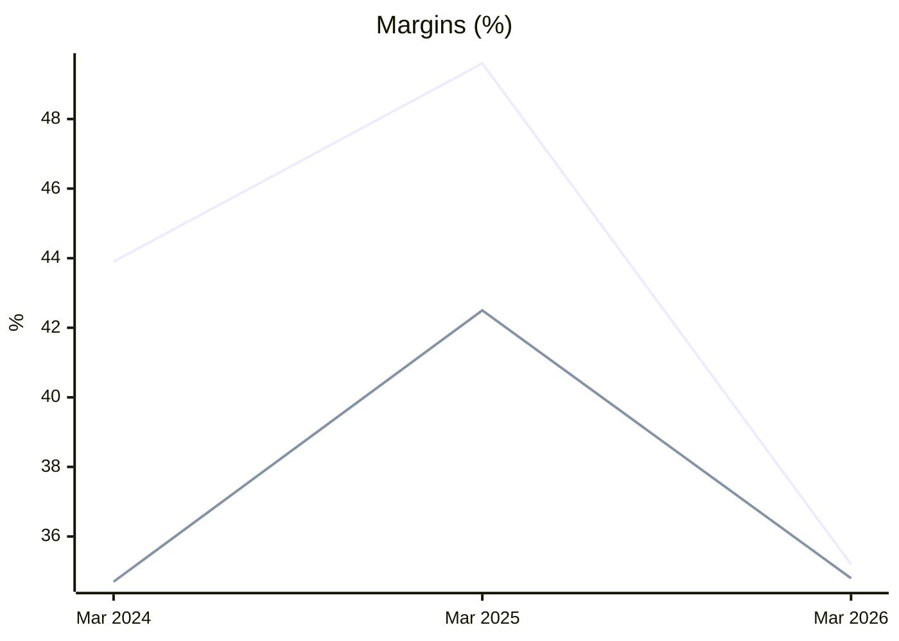
*Series in order: Operating margin, PAT margin.*

**P/E:** 11.6 — live market file (screener.in), trailing (price ₹917.00 as of 2026-08-02).

**Cash flows (₹ cr):**

| | Mar 2024 | Mar 2025 | Mar 2026 |
|---|---:|---:|---:|
| Cash from operations (₹ cr) | 1,212 | 1,697 | 1,768 |
| Cash from investing (₹ cr) | -1,026 | -1,436 | -2,082 |
| Cash from financing (₹ cr) | -247 | -211 | 298 |
| Net cash flow (₹ cr) | -62.0 | 50.0 | -16.0 |
| Free cash flow (₹ cr) | 855 | 1,300 | 1,379 |

*Source: CashFlow/NiftyTotalMarket/NATCOPHARM.csv (consolidated, screener.in).*

### The business being separated — its own numbers

**Agro Chemicals (Crop Health Sciences division / CHS)** · unit ₹ million · Profit line is the Ind AS 108 'Segment results' from consolidated segment reporting — a pre-finance-cost, pre-tax result (total segment result less finance cost = consolidated PBT), i.e. effectively segment EBIT including the FY2025 ₹500 mn PP&E impairment charged to this segment. Revenue is 'Segment revenue' which sums exactly to consolidated total revenue from operations; no inter-segment revenue is separately disclosed, so it is treated as external. Quarterly presentations report a 'Crop Health Sciences' revenue line only (FY25 598 / FY26 1,382 vs segment-note 606 / 1,382) with no segment-level profit.

| | FY2024 | FY2025 | FY2026 |
|---|---:|---:|---:|
| Revenue (₹ million) | 1,083 | 606 | 1,382 |
| Revenue growth (%) | — | -44.0% | +128.1% |
| Operating profit (₹ million) | -596 | -1,458 | -198 |
| Operating profit growth (%) | — | -144.6% | +86.4% |
| Operating margin (%) | -55.0 | -241 | -14.3 |
| PAT (₹ million) | — | — | — |
| PAT growth (%) | — | — | — |

*Sources:* Annual Report 2024 — page 329; Annual Report 2025 — pages 302, 303; Annual Report 2026 — page 316

*Latest quarter (Q1 FY27):* revenue 408, operating profit None — Presentation Aug 2026 — page 26

*Not in the pages read:* Segment PAT, tax, depreciation, EBITDA and finance cost are not disclosed by segment; no quarterly segment profit; Natco Crop Health Sciences Limited standalone financials absent.

*Documents on file:* [Annual Report 2026](https://www.bseindia.com/xml-data/corpfiling/AttachHis/0d25dc00-4a7e-4acc-b5a8-d747c870ab2f.pdf); [Annual Report 2025](https://www.bseindia.com/xml-data/corpfiling/AttachHis/08737473-9fef-496b-881b-746b8ab600b1.pdf); [Annual Report 2024](https://www.bseindia.com/xml-data/corpfiling/AttachHis/d5a992a3-1b5a-44b4-8e5b-343b600e56fc.pdf); [Presentation Aug 2026](https://www.bseindia.com/stockinfo/AnnPdfOpen.aspx?Pname=02c8ef3b-6c4b-470e-83f0-69e880a97e9d.pdf); [Presentation Jun 2026](https://www.bseindia.com/stockinfo/AnnPdfOpen.aspx?Pname=f192f32c-197f-430f-b27f-7338ba5ee9a8.pdf); [Presentation Feb 2026](https://www.bseindia.com/stockinfo/AnnPdfOpen.aspx?Pname=236bc8c2-778b-4af2-a104-b4e902651e29.pdf); [Presentation Nov 2025](https://www.bseindia.com/stockinfo/AnnPdfOpen.aspx?Pname=c5fe60cd-6aa5-4ff4-9fd3-1e93a3014e6e.pdf); [Presentation Aug 2025](https://www.bseindia.com/stockinfo/AnnPdfOpen.aspx?Pname=c755548f-c325-46ba-8d7a-8c2108a36a18.pdf); [Presentation Jul 2025](https://www.bseindia.com/stockinfo/AnnPdfOpen.aspx?Pname=5c9d7cd0-d102-42c5-89b3-f91787622f9d.pdf)

**The checklist:**

| Item | Status | Evidence |
|---|---|---|
| Why the spin-off | yes | value unlocking for shareholders; unrelated businesses separated; regulatory / strategic knot — “…t it. Guru: Thank you for that. The other question part of it is like real value. Is there any opportunity of value unlocking for the shareholders when it comes to the ROW business , what would be the value unlocking th” |
| Institutional selling likely (small / different business) | partly | the businesses are described as distinct |
| Insider ownership and incentives aligned | unknown | no promoter-continuity or option-pricing language found *(next: the date the management options are priced; promoter holding in the resulting company)* |
| A hidden value revealed (pro-forma, leverage, comparables) | yes | borrowings 714 cr (Mar 2026) = 0.04× market cap; P/E 11.6 on Mar 2026 profit vs industry median 52.7 (45 peers) |
| Parent before the spin (clean parent, takeover prelude) | partly | stage exchange_noc — the spin has not happened; the parent can still be bought whole |
| Timing (first year sells, second year gains) | partly | not yet listed — 359 days since the first filing, stage exchange_noc |
| Management discussing it on the calls | yes | 9 mention(s) in the last 12 months of calls — “…a lso the people additions. So all these activities are going on. So I think we're fairly confident going forward. And that's also one of the main reasons for demerging and having more focus on the business. Moderator: ” |

**On the calls (last 12 months):**

- *Nov 2025* (forward) — “…ill see. So, I think that is how we want to look at it. Guru: Thank you for that. The other question part of it is like real value. Is there any opportunity of value unlocking for the shareholders when it comes to the ROW business , what would be the value unlocking that we can expect , not accurately, but at least some kind of an in…”
- *Nov 2025* (forward) — “…question part of it is like real value. Is there any opportunity of value unlocking for the shareholders when it comes to the ROW business , what would be the value unlocking that we can expect , not accurately, but at least some kind of an indicative thing on the value unlock that you probably plan for the agro diversification or w…”
- *Nov 2025* (forward) — “…when it comes to the ROW business , what would be the value unlocking that we can expect , not accurately, but at least some kind of an indicative thing on the value unlock that you probably plan for the agro diversification or whatever is in the pipeline ? Rajeev Nannapaneni: I think the idea here is that we will demerge the comp…”
- *Nov 2025* (forward) — “…the value unlock that you probably plan for the agro diversification or whatever is in the pipeline ? Rajeev Nannapaneni: I think the idea here is that we will demerge the company , I think we are planning the demerger , I think we have announced it. So, we will list that entity maybe sometime in 2026 once all the clearances…”
- *Nov 2025* (forward) — “…ro diversification or whatever is in the pipeline ? Rajeev Nannapaneni: I think the idea here is that we will demerge the company , I think we are planning the demerger , I think we have announced it. So, we will list that entity maybe sometime in 2026 once all the clearances come through. Value unlocking means I think what we…”

<details><summary>The filings</summary>

| Date | Category | Headline | Attachment |
|---|---|---|---|
| 2025-11-01 | Earnings call Nov 2025 | …ill see. So, I think that is how we want to look at it. Guru: Thank you for that. The other question part of it is like real value. Is there any opportunity of | [pdf](https://www.bseindia.com/stockinfo/AnnPdfOpen.aspx?Pname=ac8f848f-8703-4403-9ae3-cb2d420d47da.pdf) |
| 2025-11-01 | Earnings call Nov 2025 | …question part of it is like real value. Is there any opportunity of value unlocking for the shareholders when it comes to the ROW business , what would be the  | [pdf](https://www.bseindia.com/stockinfo/AnnPdfOpen.aspx?Pname=ac8f848f-8703-4403-9ae3-cb2d420d47da.pdf) |
| 2025-11-01 | Earnings call Nov 2025 | …when it comes to the ROW business , what would be the value unlocking that we can expect , not accurately, but at least some kind of an indicative thing on the | [pdf](https://www.bseindia.com/stockinfo/AnnPdfOpen.aspx?Pname=ac8f848f-8703-4403-9ae3-cb2d420d47da.pdf) |
| 2025-11-01 | Earnings call Nov 2025 | …the value unlock that you probably plan for the agro diversification or whatever is in the pipeline ? Rajeev Nannapaneni: I think the idea here is that we will | [pdf](https://www.bseindia.com/stockinfo/AnnPdfOpen.aspx?Pname=ac8f848f-8703-4403-9ae3-cb2d420d47da.pdf) |
| 2025-11-01 | Earnings call Nov 2025 | …ro diversification or whatever is in the pipeline ? Rajeev Nannapaneni: I think the idea here is that we will demerge the company , I think we are planning the | [pdf](https://www.bseindia.com/stockinfo/AnnPdfOpen.aspx?Pname=ac8f848f-8703-4403-9ae3-cb2d420d47da.pdf) |
| 2025-11-01 | Earnings call Nov 2025 | …I think we are planning the demerger , I think we have announced it. So, we will list that entity maybe sometime in 2026 once all the clearances come through.  | [pdf](https://www.bseindia.com/stockinfo/AnnPdfOpen.aspx?Pname=ac8f848f-8703-4403-9ae3-cb2d420d47da.pdf) |
| 2025-11-01 | Earnings call Nov 2025 | …nk the real value, I think you will see it in 2026. What numbers and all, very hard to predict right now . Guru: That is understood. I mean, can we expect some | [pdf](https://www.bseindia.com/stockinfo/AnnPdfOpen.aspx?Pname=ac8f848f-8703-4403-9ae3-cb2d420d47da.pdf) |
| 2025-11-01 | Earnings call Nov 2025 | …rry about that. I think my question more is not on numbers. More of like indicative comments from your side on would that be a good opportunity for shareholder | [pdf](https://www.bseindia.com/stockinfo/AnnPdfOpen.aspx?Pname=ac8f848f-8703-4403-9ae3-cb2d420d47da.pdf) |
| 2025-11-01 | Earnings call Nov 2025 | …nk my question more is not on numbers. More of like indicative comments from your side on would that be a good opportunity for shareholder value unlocking, the | [pdf](https://www.bseindia.com/stockinfo/AnnPdfOpen.aspx?Pname=ac8f848f-8703-4403-9ae3-cb2d420d47da.pdf) |
| 2025-11-01 | Earnings call Nov 2025 | …ess and a very large business in pharma. So, this business will get more attention and I think shareholders will be duly rewarded for the fact that it has been | [pdf](https://www.bseindia.com/stockinfo/AnnPdfOpen.aspx?Pname=ac8f848f-8703-4403-9ae3-cb2d420d47da.pdf) |
| 2025-11-14 | Outcome of Board Meeting | Outcome of Board Meeting | [pdf](https://nsearchives.nseindia.com/corporate/NATCOPHARM_14112025132546_Outcome14112025.pdf) |
| 2026-03-24 | Outcome of Board Meeting | Outcome of Board Meeting | [pdf](https://nsearchives.nseindia.com/corporate/NATCOPHARM_24032026171413_OutcomeOfBoardMeeting_24032026.pdf) |
| 2026-03-24 | Outcome of Board Meeting | Natco Pharma Limited has informed the Exchange regarding Outcome of Board Meeting held on March 24, 2026 | [pdf](https://nsearchives.nseindia.com/corporate/NATCOPHARM_24032026171413_OutcomeOfBoardMeeting_24032026.pdf) |
| 2026-03-24 | Board Meeting (purpose) | Other business matters To consider Scheme of arrangement (demerger) | [pdf](https://nsearchives.nseindia.com/corporate/NATCOPHARM_18032026155941_BMnotice.pdf) |
| 2026-03-24 | Board Meeting (purpose) | Board Meeting Intimation NATCO PHARMA LIMITED has informed the Exchange about Board Meeting to be held on 24-Mar-2026 to consider Scheme of arrangement. | [pdf](https://nsearchives.nseindia.com/corporate/xbrl/BMintimation_18032026_PRIOR_INTIMATION_WebXMLFile_20260318_160706696.xml) |
| 2026-06-01 | Earnings call Jun 2026 | …any color on that and our business? Rajeev Nannapaneni : That's a good question. So, I think my colleague, Rajesh will answer and he'll also tell us abo ut our | [pdf](https://www.bseindia.com/stockinfo/AnnPdfOpen.aspx?Pname=230327e4-9a77-4095-b46d-b9c836cc9b96.pdf) |
| 2026-06-01 | Earnings call Jun 2026 | …my colleague, Rajesh will answer and he'll also tell us abo ut our demerging process as well. Rajesh Chebiyam: So, as you're aware, so we're in the process of  | [pdf](https://www.bseindia.com/stockinfo/AnnPdfOpen.aspx?Pname=230327e4-9a77-4095-b46d-b9c836cc9b96.pdf) |
| 2026-06-01 | Earnings call Jun 2026 | …a lso the people additions. So all these activities are going on. So I think we're fairly confident going forward. And that's also one of the main reasons for  | [pdf](https://www.bseindia.com/stockinfo/AnnPdfOpen.aspx?Pname=230327e4-9a77-4095-b46d-b9c836cc9b96.pdf) |
| 2026-09-09 | Outcome of Board Meeting | Outcome of Board Meeting pursuant to Regulation 30 read with Schedule III | [pdf](https://nsearchives.nseindia.com/corporate/NATCOPHARM_09092026115332_BoardOutcome09092026.pdf) |
| 2026-09-09 | Outcome of Board Meeting | Natco Pharma Limited has informed the Exchange regarding Outcome of Board Meeting held on September 09, 2026. | [pdf](https://nsearchives.nseindia.com/corporate/NATCOPHARM_09092026115332_BoardOutcome09092026.pdf) |

</details>

## VEDL — Vedanta Ltd.

**CONFIRMED** (a demerger scheme is on the exchange record) · **LISTED <1Y — selling-pressure window; the bargain forms here** · score 6.4/10 · spin-off · 43 filing(s) from CALLS, NSE, NSE-register · first 2025-12-03, latest 2026-10-03

> **Listing:** LISTED — Talwandi Sabo Power Limited trades since about 2026-04-20

**The stages, as filed:** announced (2026-07-30) → nclt_sanction (2025-12-03) → record_date (2026-04-20)

**Stated in the filings:** resulting company **Talwandi Sabo Power Limited**; pro-forma statements referenced; size hint: 11% of ebitda.

**What is being separated, as the documents put it:** Merchant Power Undertaking — Vedanta's merchant thermal power generation business (Athena, Meenakshi), demerged into Talwandi Sabo Power Limited — class `value_unlocking`.

- *Insiders:* Each Resulting Company issued 1 share for every 1 Vedanta share, so promoter group (Vedanta Resources, 54.72% of VEDL as on June 30, 2026) carried over pro rata; promoters excluded from VEDL ESOS/ESPP 2026
- *What it reveals:* Separation reveals leverage: Vedanta Power's net debt/EBITDA 4.7x, highest of the five, though debt is mostly structural long-term PFC/REC with 7-10 year maturities; residual Vedanta sits at 0.30x with AA+/stable
- *Selling pressure:* likely — 1:1 shares pushed to every Vedanta holder; thermal power unrelated to parent's metals/mining mandate; most levered of the five entities
- *Parent or spin:* parent · *option pricing date:* not stated
- *Read next:* Vedanta Power Limited's own post-listing results and production release, plus Athena Unit 1 restart update and its PFC/REC debt maturity schedule
- *In their words:* “The de-merger has been architected with precision on capital structure, aligning debt with earning strength and growth stage of each resulting company.”

### Why the demerger — three years of calls and the scheme

Management framed the separation as the core of "Vedanta 2.0": breaking one monolithic diversified natural-resources company into five independent, sector-specific pure-play listed companies — Vedanta Limited (residual: Zinc India/HZL, Zinc International, Copper, Ferrochrome/FACOR, Nickel), Vedanta Aluminium Metal Ltd, Vedanta Power/Talwandi Sabo Power (merchant power), Vedanta Oil & Gas/Malco Energy (Cairn), and Vedanta Iron & Steel — so that each could "chart out their own growth trajectory and attract respective thematic investors" rather than being valued as a conglomerate (Apr 2026, Apr 2025: "pure-play entities that will enhance strategic focus and operational flexibility"). The stated problem was that a single balance sheet and single capital-allocation process blurred very different businesses: Zinc India at 56% EBITDA margin and $959/t COP, aluminium at 38% margin, versus a Copper trading business running ~1% margin, and a power business that wants to add 10–12 GW. The fix was a capital structure "architected with precision… aligning debt with earning strength and growth stage of each resulting company": of $5.5bn net debt (group leverage 0.95x), $3.5bn goes to Aluminium (1.3x), Power sits at 4.7x on long-dated PFC/REC paper, Vedanta Limited keeps ~$1bn (0.4x), while Oil & Gas is nil-debt and Iron & Steel carries no more than $0.2bn. Specific frictions the split removes: the Copper brand fee drops from 3% to 0.75% on ~$3.1–3.2bn of revenue (~$65m, +2.25% to EBITDA), taking Copper margin from ~1% toward at least 5% in FY27; the dividend policy moves from "prescriptive" to "descriptive", from rule-based (minimum 30% of profit) to principle-based, and the mandate to upstream Hindustan Zinc dividends within six months falls away; Ajay Goel also called it "an opportunity… from taxation viewpoint" via recast balance sheets, accumulated losses and unabsorbed depreciation. Third parties shaped the terms: lenders demanded debt allocation be "broadly aligned with the bankers as a precondition for granting NOC"; the Ministry of Petroleum & Natural Gas objected at NCLT over ~$512–520m of disputed dues and was satisfied only by a Vedanta corporate guarantee covering the full alleged claims, with any arbitration outcome ring-fenced to Oil & Gas; creditor SEPCO was settled in full for ₹660 crore "as part of demerger proceedings… paving the way for a proposed demerger process", and a ₹1,248 crore cash-backed bank guarantee was lodged with NCLAT over the TSPL power demerger. Management also pointed to equity-side demand — "many anchor investors domestically and globally are very keen to come in the cap table" of the de-merged entities as a fresh deleveraging avenue for VRL's remaining $4.7bn. Three months after listing, the Board extended the same logic to a second, vertical separation: ~2,264 acres and ~53,185 sq ft of surplus real estate (22 assets, only ₹1.26 crore of FY26 turnover, 0.001% of standalone revenue) into Vedanta Property Platforms Ltd at 1 share for every 20, because the portfolio was "historically subject to limited focused utilisation, resulting in sub-optimal visibility… and value realization."

**How it evolved:** The demerger was already a live execution item by the Feb 2025 call (Jan 31, 2025), where Ajay Goel flagged the Feb 18 shareholder/creditor meetings as "the important stage of execution"; on the Apr 2025 call (Apr 30, 2025) Deshnee Naidoo recast it as creating "pure-play entities" under Vedanta 2.0 with completion guided for September 2025. It then slipped repeatedly on legal and stakeholder hurdles — Aug 2025 (Jul 31, 2025) disclosed the NCLT second-motion part-hearing of July 2 with the next date Aug 20, an NCLAT interim stay on the TSPL power order, and the MoPNG objection; Nov 2025 (Oct 31, 2025) resolved SEPCO for ₹660 crore and MoPNG via a Vedanta corporate guarantee, guiding to a final Nov 12 hearing and five listings by FY26-end. Jan 2026 (Jan 29, 2026) reported NCLT approval on Dec 16, 2025 (power on Jan 9, 2026) and shifted the detail toward mechanics — bank NOCs conditioned on debt allocation, recast balance sheets, tax structuring — targeting Apr 1 effectiveness; Apr 2026 (Apr 29, 2026) set the record date at May 1 with mid-June listing, 4 extra shares per share, and added two new rationales not previously spelled out: the Copper brand-fee cut to 0.75% and five independent dividend policies. By the Jul 30, 2026 filings the plan had extended beyond the original five, with a sixth vertical split of surplus real estate into Vedanta Property Platforms Ltd at 1:20.

**What management expects from it:** Five pure-plays each chasing its own growth and thematic investors; debt matched to earnings — Oil & Gas nil, Iron & Steel <$0.2bn, Aluminium 1.3x, Power 4.7x, Vedanta Ltd 0.4x; Copper brand fee 3%→0.75% lifting margin ~1%→5%+; independent dividend policies with HZL upstream mandate dropped; tax efficiency from recast balance sheets; anchor investors entering entity cap tables to deleverage VRL; real estate platform targeting ₹30,000 crore+.

**Point by point, with the source:**

- *[Feb 2025](https://www.vedantalimited.com/uploads/investor-overview/financial-results/VedantaEarnings-transcript-Jan31-2025.pdf)* — The demerger was already at the shareholder/creditor-vote stage, pitched purely as investor value unlock, with no operational rationale given on this call. “On the demerger front, we are in the important stage of execution , the shareholders and the creditors meeting scheduled on Feb 18th. This transformative step is poised to unlock significant value for our investors.”
- *[Apr 2025](https://www.vedantalimited.com/uploads/investor-overview/financial-results/Vedanta-CallTranscript-Apr30-2025_v2.pdf)* — First explicit statement of the design goal — pure-play entities for strategic focus and operational flexibility — inside the Vedanta 2.0 ambition of a $100bn critical minerals, energy and technology powerhouse; completion then guided for September 2025. “We are making good progress with our demerger plan, aiming to create pure-play entities that will enhance strategic focus and operational flexibility.”
- *[Apr 2025](https://www.vedantalimited.com/uploads/investor-overview/financial-results/Vedanta-CallTranscript-Apr30-2025_v2.pdf)* — A shareholder (Ashish Kejriwal, Nuvama) pressed that mining leases — Sijimali bauxite and the coal blocks held under Vedanta Limited — must first be transferred to Vedanta Aluminium before the split can complete; management confirmed a parallel approvals plan. “Ashish, you are right. This is part of the overall approvals that we have in our sight.”
- *[Aug 2025](https://www.vedantalimited.com/uploads/investor-overview/financial-results/2026/Vedanta_Transcript_Jul31_2025.pdf)* — Execution stalled in two forums at once: the NCLT second-motion petition was part-heard on July 2 with the next date Aug 20, and NCLAT granted an interim stay on the TSPL power demerger order, backed by a ₹1,248 crore fully cash-backed bank guarantee over the SEPCO creditor matter. “Separately, the NCL AT has granted an interim stay on TSPL, our power demerger order by NCLT, with the next hearing scheduled on 4th August.”
- *[Aug 2025](https://www.vedantalimited.com/uploads/investor-overview/financial-results/2026/Vedanta_Transcript_Jul31_2025.pdf)* — The Ministry of Petroleum & Natural Gas objected at NCLT, questioning whether the demerged, standalone Cairn oil & gas P&L could absorb disputed dues if arbitration went against Vedanta — i.e. a regulator worrying that separation strips a weaker entity of parent support. “In the last NCLT hearing, they did express concern about the payments of any of the disputed dues that may become payable by Cairn in case the ongoing arbitration ruling, as we have all learned now, comes in their favor.”
- *[Nov 2025](https://www.vedantalimited.com/uploads/investor-overview/financial-results/2026/VEDL_Q2FY26_Transcript.pdf)* — A long-standing SEPCO creditor dispute was settled in full for ₹660 crore (part of ₹1,547 crore of net exceptional items that quarter) explicitly to clear the path for the scheme. “As part of demerger proceedings, a full and final settlement of Rs. 660 Cr has been done with SEPCO , thereby resolving a long -standing dispute, paving the way for a proposed demerger process.”
- *[Nov 2025](https://www.vedantalimited.com/uploads/investor-overview/financial-results/2026/VEDL_Q2FY26_Transcript.pdf)* — MoPNG's objection — over roughly $512–520m of alleged claims — was resolved not by cash but by a Vedanta corporate guarantee covering the full extent of the claims, so the demerged oil & gas entity would not carry the obligation. “Their concern has been taken care of by us providing a corporate guarantee from Vedanta.”
- *[Nov 2025](https://www.vedantalimited.com/uploads/investor-overview/financial-results/2026/VEDL_Q2FY26_Transcript.pdf)* — Five simultaneous listings by FY26-end were framed as the vehicle for sharper strategic focus, with Goel adding that it unlocks "focused value across our five verticals". “This will set the stage for the listing of all five demerge d entities by the end of FY '26, enabling greater strategic focus and enhanced value creation for all stakeholders.”
- *[Jan 2026](https://www.vedantalimited.com/uploads/investor-overview/financial-results/2026/Transcript_29Jan2026.pdf)* — After NCLT approval on Dec 16, 2025 (power order Jan 9, 2026), the rationale was stated as three things at once — sharper strategy, stronger standalone balance sheets, faster growth — with Q3 results already reported under Ind AS 105 demerger accounting. “This marks a defining moment in our journey, one that empowers our businesses to sharpen the strategies, strengthen the balance sheets and accelerate growth with the aim of unlocking shareholder value.”
- *[Jan 2026](https://www.vedantalimited.com/uploads/investor-overview/financial-results/2026/Transcript_29Jan2026.pdf)* — Lenders drove the capital-structure design: debt allocation across the five entities had to be agreed with banks before they would issue no-objection certificates, with $6.7bn of Vedanta India consol net debt split by asset ratio and each entity's own cash-generation and debt-servicing capability. “When we went to the banker seeking NOC, in that case, debt allocation was broadly aligned with the bankers as a precondition for granting NOC for demerger approval.”
- *[Jan 2026](https://www.vedantalimited.com/uploads/investor-overview/financial-results/2026/Transcript_29Jan2026.pdf)* — Goel named taxation and deleveraging as further gains — recast balance sheets, accumulated losses and unabsorbed depreciation per entity — alongside the intent to make oil & gas and iron & steel debt-free, funded partly by the ₹3,000 crore HZL OFS. “One thing I can confirm to the entire audience and to the stakeholders at large, that demerger in fact, becomes an opportunity across the areas.”
- *[Apr 2026](https://www.vedantalimited.com/uploads/investor-overview/financial-results/2026/Vedanta-Transcript-Apr29-2026.pdf)* — Final articulation: five sector-specific pure-play companies whose purpose is independent growth paths and dedicated thematic investor bases; record date May 1, 2026, one Vedanta share yielding four additional shares, listing targeted by Q1 FY27 (mid-June). “This will entail creation of five independent sector -specific pure -play companies, allowing each company to chart out their own growth trajectory and attract respective thematic investors.”

*Not explained on the calls:* No per-entity EBITDA/valuation targets, no quantified stranded corporate or listing costs, no reason the other four brand fees stay at 3%, no real-estate monetisation timeline or revenue model.

*Calls read (36 months):* [Apr 2025](https://www.vedantalimited.com/uploads/investor-overview/financial-results/Vedanta-CallTranscript-Apr30-2025_v2.pdf), [Aug 2024](https://www.vedantalimited.com/uploads/investor-overview/financial-results/call-transcript-fy2025.pdf), [Aug 2025](https://www.vedantalimited.com/uploads/investor-overview/financial-results/2026/Vedanta_Transcript_Jul31_2025.pdf), [Feb 2025](https://www.vedantalimited.com/uploads/investor-overview/financial-results/VedantaEarnings-transcript-Jan31-2025.pdf), Jan 2024, [Nov 2023](https://www.vedantalimited.com/uploads/investor-overview/financial-results/Transcript_VEDL_Earnings_Call_2QFY24.pdf), [Nov 2024](https://www.vedantalimited.com/uploads/investor-overview/financial-results/Vedanta-Earnings-Nov08-2024.pdf), [Nov 2025](https://www.vedantalimited.com/uploads/investor-overview/financial-results/2026/VEDL_Q2FY26_Transcript.pdf)

### The parent, last three fiscal years (consolidated)

| | Mar 2024 | Mar 2025 | Mar 2026 |
|---|---:|---:|---:|
| Sales (₹ cr) | 143,727 | 62,717 | 78,437 |
| Sales growth (%) | -2.4% | -56.4% | +25.1% |
| Operating profit (₹ cr) | 35,312 | 18,578 | 23,183 |
| Operating profit growth (%) | +2.6% | -47.4% | +24.8% |
| Operating margin (%) | 24.6 | 29.6 | 29.6 |
| PAT (₹ cr) | 7,539 | 20,535 | 25,096 |
| PAT growth (%) | -48.0% | +172.4% | +22.2% |
| PAT margin (%) | 5.2 | 32.7 | 32.0 |
| EPS (₹) | 11.4 | 38.3 | 44.5 |

*Source: ProfitStatement/NiftyTotalMarket/VEDL.csv (consolidated, screener.in); growth and margins computed here.*

```mermaid
xychart-beta
    title "Sales, operating profit and PAT (₹ cr)"
    x-axis ["Mar 2024", "Mar 2025", "Mar 2026"]
    y-axis "₹ crore"
    bar [143727, 62717, 78437]
    bar [35312, 18578, 23183]
    bar [7539, 20535, 25096]
```
*Series in order: Sales, Operating profit, PAT.*

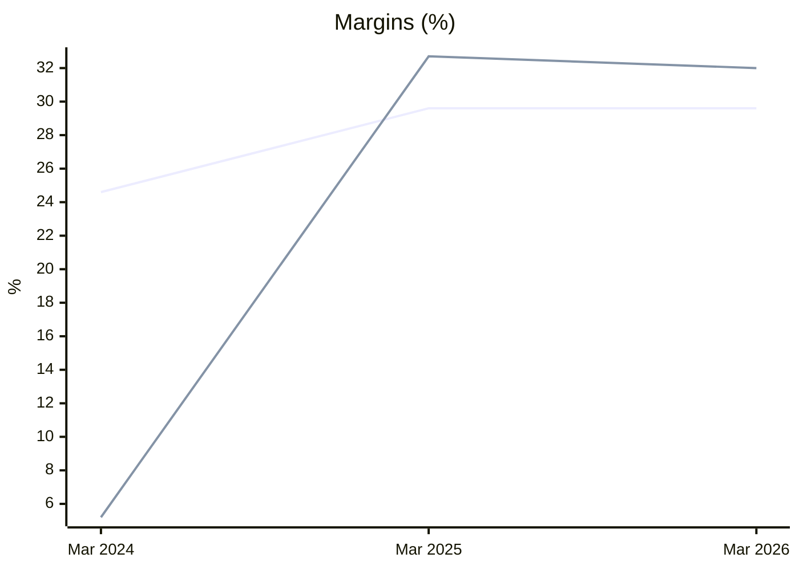
*Series in order: Operating margin, PAT margin.*

**P/E:** 9.39 — live market file (screener.in), trailing (price ₹264.00 as of 2026-08-02).

**Cash flows (₹ cr):**

| | Mar 2024 | Mar 2025 | Mar 2026 |
|---|---:|---:|---:|
| Cash from operations (₹ cr) | 35,654 | 39,562 | 39,499 |
| Cash from investing (₹ cr) | -13,676 | -19,158 | -24,134 |
| Cash from financing (₹ cr) | -26,092 | -19,223 | -13,549 |
| Net cash flow (₹ cr) | -4,114 | 1,181 | 1,816 |
| Free cash flow (₹ cr) | 19,097 | 22,848 | 18,747 |

*Source: CashFlow/NiftyTotalMarket/VEDL.csv (consolidated, screener.in).*

### The business being separated — its own numbers

**Power (Merchant Power Undertaking — reported as the 'Power' business segment under discontinued operations from FY2026)** · unit ₹ crore · Operating profit = segment results (EBITDA), a non-GAAP measure as reported by the CODM; revenue is external revenue (excludes inter-segment: nil in FY2024/FY2025, ₹170 crore in FY2026 for discontinued Power, and excludes other operating income). FY2026 and FY2025 figures are the 'Power' segment under DISCONTINUED operations (the demerged merchant/thermal power business, excluding captive power); the separate continuing-operations Power segment (Mettur + wind) is excluded — FY2026: external revenue 135, EBITDA 89; FY2025: external revenue 137, EBITDA 87 (Annual Report 2026 — pages 260, 261). FY2024 is the undivided consolidated Power segment (no continuing/discontinued split was presented), so it includes the retained wind/Mettur power. Consolidated-level segment reporting only; the full-year FY2025 Power segment as originally reported in AR2025 was external revenue 6,159 and EBITDA 737 (Annual Report 2025 — page 252). Segment PAT is not disclosed.

| | FY2024 | FY2025 | FY2026 |
|---|---:|---:|---:|
| Revenue (₹ crore) | 6,153 | 6,022 | 8,721 |
| Revenue growth (%) | — | -2.1% | +44.8% |
| Operating profit (₹ crore) | 971 | 650 | 1,534 |
| Operating profit growth (%) | — | -33.1% | +136.0% |
| Operating margin (%) | 15.8 | 10.8 | 17.6 |
| PAT (₹ crore) | — | — | — |
| PAT growth (%) | — | — | — |

*Sources:* Annual Report 2024 — page 234; Annual Report 2026 — page 261; Annual Report 2026 — page 260

*Latest quarter (Q4 FY26):* revenue None, operating profit 566 — Presentation Apr 2026 — page 49

*Not in the pages read:* No segment PAT/net profit, no quarterly Power revenue, no standalone merchant-power entity (TSPL/Athena/Meenakshi) P&L; FY2024 has no continuing/discontinued Power split.

*Documents on file:* [Annual Report 2026](https://www.bseindia.com/xml-data/corpfiling/AttachHis/3725606c-05f5-40b2-b122-55c0a6e7bdd1.pdf); [Annual Report 2025](https://www.bseindia.com/xml-data/corpfiling/AttachHis/4f41b8d2-e8ed-4dad-b3fd-b9adca371fed.pdf); [Annual Report 2024](https://www.bseindia.com/xml-data/corpfiling/AttachHis/d4d3e3bc-fe5a-4184-b181-b5455d60f11a.pdf); [Presentation Oct 2026](https://www.bseindia.com/stockinfo/AnnPdfOpen.aspx?Pname=49dc0908-347a-4af4-ab1c-0d0cfac26c4b.pdf); [Presentation Jul 2026](https://www.bseindia.com/stockinfo/AnnPdfOpen.aspx?Pname=b8b95ea1-9d39-4176-9a1a-15f1a2c5c4bd.pdf); [Presentation Apr 2026](https://www.bseindia.com/stockinfo/AnnPdfOpen.aspx?Pname=918fc405-534d-492a-9def-a386f80ba291.pdf); [Presentation Jan 2026](https://www.bseindia.com/stockinfo/AnnPdfOpen.aspx?Pname=48883dba-0b14-4a5e-ad9c-b9e40292ee52.pdf); [Presentation Nov 2025](https://www.bseindia.com/stockinfo/AnnPdfOpen.aspx?Pname=614c7898-dc7a-4f07-bb16-036e9ef8303c.pdf); [Presentation Aug 2025](https://www.bseindia.com/stockinfo/AnnPdfOpen.aspx?Pname=2f4607c8-0394-46f5-a86c-0d36d15c6e74.pdf)

**The checklist:**

| Item | Status | Evidence |
|---|---|---|
| Why the spin-off | yes | value unlocking for shareholders; a weak or capital-heavy business carved away; unrelated businesses separated; regulatory / strategic knot; attracting different investors / capital — “…he listing of all five demerge d entities by the end of FY '26, enabling greater strategic focus and enhanced value creation for all stakeholders. At the start of FY 2026, global markets fac…” |
| Institutional selling likely (small / different business) | yes | the demerged piece is 11% of ebitda; the businesses are described as distinct |
| Insider ownership and incentives aligned | unknown | no promoter-continuity or option-pricing language found *(next: the date the management options are priced; promoter holding in the resulting company)* |
| A hidden value revealed (pro-forma, leverage, comparables) | yes | pro-forma statements are referenced in the filings; borrowings 32,947 cr (Mar 2026) = 0.32× market cap; P/E 4.1 on Mar 2026 profit vs industry median 22.9 (16 peers) |
| Parent before the spin (clean parent, takeover prelude) | no | stage record_date — the pieces trade separately now |
| Timing (first year sells, second year gains) | partly | 202 days since listing/record date; first year since listing — the selling-pressure window; watch, size the entry |
| Management discussing it on the calls | yes | 18 mention(s) in the last 12 months of calls — “…in an unbundled fashion, so each of the new companies' benchmarking is different. In summary, the 3% rate continues and the only change that will be done post -de-merger is in the copper brand fee. So the brand fee for ” |

**On the calls (last 12 months):**

- *Nov 2025* (forward) — “…chromium , cobalt, vanadium, potash and manganese. This brings the total number of secured blocks to 11. We have also made substantial progress on the proposed demerger, which is a pivotal step towards unlocking further shareholder value. The final N CLT hearing is scheduled for November 12, and we expect approvals to follow.…”
- *Nov 2025* (forward) — “…shareholder value. The final N CLT hearing is scheduled for November 12, and we expect approvals to follow. This will set the stage for the listing of all five demerge d entities by the end of FY '26, enabling greater strategic focus and enhanced value creation for all stakeholders. At the start of FY 2026, global markets fac…”
- *Nov 2025* (forward) — “…w petition has been filed against this order, but on accounting basis, we have taken the provision. The second matter is regarding SEPCO settlement. As part of demerger proceedings, a full and final settlement of Rs. 660 Cr has been done with SEPCO , thereby resolving a long -standing dispute, paving the way for a proposed dem…”
- *Nov 2025* (neutral) — “…ger proceedings, a full and final settlement of Rs. 660 Cr has been done with SEPCO , thereby resolving a long -standing dispute, paving the way for a proposed demerger process. Similarly, in Q2 last year, we have recorded net exceptional income of Rs. 1,160 crores, mainly on account of oil and gas impairment reversal. Our EBI…”
- *Nov 2025* (neutral) — “…high cost debt now retired, VRL is positioned to operate on autopilot mode, supported by a dividend payout of 4% to 5% in future and routine brand fee. On the demerger, we are at the final stage. We remain confident of completing our demerger by end of this fiscal, unlocking focused value acros s our five verticals. In summar…”

<details><summary>The filings</summary>

| Date | Category | Headline | Attachment |
|---|---|---|---|
| 2025-11-01 | Earnings call Nov 2025 | …chromium , cobalt, vanadium, potash and manganese. This brings the total number of secured blocks to 11. We have also made substantial progress on the proposed | [pdf](https://www.vedantalimited.com/uploads/investor-overview/financial-results/2026/VEDL_Q2FY26_Transcript.pdf) |
| 2025-11-01 | Earnings call Nov 2025 | …shareholder value. The final N CLT hearing is scheduled for November 12, and we expect approvals to follow. This will set the stage for the listing of all five | [pdf](https://www.vedantalimited.com/uploads/investor-overview/financial-results/2026/VEDL_Q2FY26_Transcript.pdf) |
| 2025-11-01 | Earnings call Nov 2025 | …w petition has been filed against this order, but on accounting basis, we have taken the provision. The second matter is regarding SEPCO settlement. As part of | [pdf](https://www.vedantalimited.com/uploads/investor-overview/financial-results/2026/VEDL_Q2FY26_Transcript.pdf) |
| 2025-11-01 | Earnings call Nov 2025 | …or as I put it, a key catalyst for the acquisition from our side. And I also want to make the point that this split doesn't impact our deleveraging plan or our | [pdf](https://www.vedantalimited.com/uploads/investor-overview/financial-results/2026/VEDL_Q2FY26_Transcript.pdf) |
| 2025-11-01 | Earnings call Nov 2025 | …r rebidding, and we feel quite confident that Jaiprakash is coming to Vedanta. Deshnee Naidoo: Maybe then again , Ashish, I will take the other question around | [pdf](https://www.vedantalimited.com/uploads/investor-overview/financial-results/2026/VEDL_Q2FY26_Transcript.pdf) |
| 2025-11-01 | Earnings call Nov 2025 | …ly mentioned, the financial risk in recovering some of these at this point , alleged claims from the business and basically questioning whether the P &L of the | [pdf](https://www.vedantalimited.com/uploads/investor-overview/financial-results/2026/VEDL_Q2FY26_Transcript.pdf) |
| 2025-11-01 | Earnings call Nov 2025 | …antee that does cover up , cover us for the full extent of the alleged claims at this point, Ritesh. Of course, all of these numbers will be finalized once the | [pdf](https://www.vedantalimited.com/uploads/investor-overview/financial-results/2026/VEDL_Q2FY26_Transcript.pdf) |
| 2025-12-03 | Acquisition | Pursuant to Regulation 30 of Listing Regulations, as amended from time to time, we wish to inform you that the National Company Law Tribunal Kolkata ( NCLT Kolk | [pdf](https://nsearchives.nseindia.com/corporate/VEDL_03122025212754_VEDLSEIntimationIncabNCLTOrderDec32025signed.pdf) |
| 2025-12-16 | News Verification | The Exchange has sought clarification from Vedanta Limited with respect to recent news item captioned Vedanta demerger decks cleared after Mumbai NCLT approves  | [pdf](-) |
| 2025-12-16 | News Verification | The Exchange has sought clarification from Vedanta Limited with respect to recent news item captioned Vedanta demerger decks cleared after Mumbai NCLT approves  | [pdf](https://nsearchives.nseindia.com/corporate/VEDL_16122025163405_VEDLSEIntimationClarification16122025.pdf) |
| 2025-12-16 | Updates | Vedanta Limited has informed the Exchange regarding 'Update on Scheme of Arrangement for Demerger of Vedanta Limited'. | [pdf](https://nsearchives.nseindia.com/corporate/VEDL_16122025225750_VEDLSEIntimationNCLTOrder16Dec_2025signed.pdf) |
| 2026-01-01 | Earnings call Jan 2026 | …the strategies, strengthen the balance sheets and accelerate growth with the aim of unlocking shareholder value. On the 16th of December, the NCLT approved our | [pdf](https://www.vedantalimited.com/uploads/investor-overview/financial-results/2026/Transcript_29Jan2026.pdf) |
| 2026-01-01 | Earnings call Jan 2026 | …FY26 has been a quarter of immense significance for Vedanta, marked by remarkable performance, both operationally and financially, and crucial progress made on | [pdf](https://www.vedantalimited.com/uploads/investor-overview/financial-results/2026/Transcript_29Jan2026.pdf) |
| 2026-01-01 | Earnings call Jan 2026 | …nd and pricing being favorable, and we expect these conditions to sustain going forward. On results presentation, following NCLT order on December 16, '25, the | [pdf](https://www.vedantalimited.com/uploads/investor-overview/financial-results/2026/Transcript_29Jan2026.pdf) |
| 2026-01-01 | Earnings call Jan 2026 | …in our improved balance sheet, cash flow visibility and strategic direction clarity. Vedanta Limite d January 29, 2026 Sensitivity: Internal (C3) Moving on to  | [pdf](https://www.vedantalimited.com/uploads/investor-overview/financial-results/2026/Transcript_29Jan2026.pdf) |
| 2026-01-01 | Earnings call Jan 2026 | …ed balance sheet, cash flow visibility and strategic direction clarity. Vedanta Limite d January 29, 2026 Sensitivity: Internal (C3) Moving on to “Demerger and | [pdf](https://www.vedantalimited.com/uploads/investor-overview/financial-results/2026/Transcript_29Jan2026.pdf) |
| 2026-01-01 | Earnings call Jan 2026 | …key regulatory and operational matters work ed through, we remain committed to completing demerger as earlier guided, targeting April 1st as effective date of  | [pdf](https://www.vedantalimited.com/uploads/investor-overview/financial-results/2026/Transcript_29Jan2026.pdf) |
| 2026-01-09 | Updates | Vedanta Limited has informed the Exchange regarding 'Disclosure under Regulation 30 of SEBI (Listing Obligations and Disclosure Requirements) Regulations, 2015  | [pdf](https://nsearchives.nseindia.com/corporate/VEDL_09012026200947_SEIntimationNCLTOrder09Jan2026signed.pdf) |
| 2026-01-21 | Updates | Vedanta Limited has informed the Exchange regarding 'Disclosure under Regulation 30 of the Securities and Exchange Board of India (Listing Obligations and Discl | [pdf](https://nsearchives.nseindia.com/corporate/VEDL_21012026212023_VEDLSEIntimationNCLTOrderCertifiedCopyfinalsigned.pdf) |
| 2026-01-29 | Press Release | Vedanta Limited has announced the press release titled "Vedanta Ltd. reports record-breaking Q3: Profit surges 60% to &#8377;7,807 crore, Revenue up 19% YoY" | [pdf](https://nsearchives.nseindia.com/corporate/VEDL_29012026155958_VEDLSEIntimationOutcomeofBM29Jan2026PRandIRPPTsigned.pdf) |
| 2026-03-23 | News Verification | The Exchange has sought clarification from Vedanta Limited with respect to recent news item captioned Vedanta moves NCLAT, challenges NCLT nod to Adani's bid fo | [pdf](-) |
| 2026-03-23 | News Verification | The Exchange has sought clarification from Vedanta Limited with respect to recent news item captioned Vedanta moves NCLAT, challenges NCLT nod to Adani's bid fo | [pdf](https://nsearchives.nseindia.com/corporate/VEDL_23032026150222_VEDLReplytoNewsClarificationMarch2026signed.pdf) |
| 2026-03-31 | Updates | Vedanta Limited has informed the Exchange regarding 'Extension of timelines for fulfilment of the conditions precedent under the Composite Scheme of Arrangement | [pdf](https://nsearchives.nseindia.com/corporate/VEDL_31032026171850_VEDLSEIntimation31March2026Outcomesigned.pdf) |
| 2026-04-01 | Earnings call Apr 2026 | …o zero net debt businesses. Other three businesses' net debt to EBITDA ratios will be in line with their debt serving capabilities. At Vedanta group level pre  | [pdf](https://www.vedantalimited.com/uploads/investor-overview/financial-results/2026/Vedanta-Transcript-Apr29-2026.pdf) |
| 2026-04-01 | Earnings call Apr 2026 | …ong performance and notable advancements across strategic focus areas. The upcoming de -merger marks Vedanta's transition into a future new phase of growth and | [pdf](https://www.vedantalimited.com/uploads/investor-overview/financial-results/2026/Vedanta-Transcript-Apr29-2026.pdf) |
| 2026-04-01 | Earnings call Apr 2026 | …arwal: Yes. So after the demerger how would the dividend policies look like for each of the entities? Ajay Goel: So that is a one change that will entail post  | [pdf](https://www.vedantalimited.com/uploads/investor-overview/financial-results/2026/Vedanta-Transcript-Apr29-2026.pdf) |
| 2026-04-01 | Earnings call Apr 2026 | …in an unbundled fashion, so each of the new companies' benchmarking is different. In summary, the 3% rate continues and the only change that will be done post  | [pdf](https://www.vedantalimited.com/uploads/investor-overview/financial-results/2026/Vedanta-Transcript-Apr29-2026.pdf) |
| 2026-04-01 | Earnings call Apr 2026 | …form, what will be net debt to EBITDA, all of them. So if you look at overall Vedanta right now, $5.5 billion net debt and debt to EBITDA almost 0.95. Now pre  | [pdf](https://www.vedantalimited.com/uploads/investor-overview/financial-results/2026/Vedanta-Transcript-Apr29-2026.pdf) |
| 2026-04-01 | Earnings call Apr 2026 | …respective entity. So it's already factored in. Pallav Agarwal: Yes, so I get that . So, Bloom Fountain is a holding company of which particular company of the | [pdf](https://www.vedantalimited.com/uploads/investor-overview/financial-results/2026/Vedanta-Transcript-Apr29-2026.pdf) |
| 2026-04-20 | Record Date | Vedanta Limited has informed the Exchange that Record date for the purpose of Scheme of Arrangement has been fixed as May 01, 2026 | [pdf](https://nsearchives.nseindia.com/corporate/VEDL_20042026170932_VEDLSEIntimationRecordDate20April2026signed.pdf) |
| 2026-04-20 | Sale or disposal | Vedanta Limited has informed the Exchange about the Board approval for transfer of VEDL shareholding in Bharat Aluminium Company Limited to Vedanta Aluminium Me | [pdf](https://nsearchives.nseindia.com/corporate/VEDL_20042026171108_VEDLSEIntimationRecordDate20April2026signed.pdf) |
| 2026-04-29 | Press Release | Vedanta Limited has informed the Exchange regarding a press release dated April 29, 2026, titled "Vedanta Delivers its Best-Ever Financial Performance -PAT jump | [pdf](https://nsearchives.nseindia.com/corporate/VEDL_29042026144722_2VEDLSEIntimationOutcomeofBM29April2026PressReleaseandIRPPTsigned.pdf) |
| 2026-04-29 | Updates | Vedanta Limited has informed the Exchange that pursuant to the scheme of demerger being implemented, the Board of Directors has approved the revision of the Com | [pdf](https://nsearchives.nseindia.com/corporate/VEDL_29042026145441_3VEDSIntimationOutcomeofBM29April2026OtherMatterssigned.pdf) |
| 2026-04-29 | Updates | Vedanta Limited has informed the Exchange regarding 'Disclosure under Regulation 30 of Securities and Exchange Board of India (Listing Obligations and Disclosur | [pdf](https://nsearchives.nseindia.com/corporate/VEDL_29042026170031_VEDLSEIntimationDemergerApr2026signed.pdf) |
| 2026-05-01 | Record Date (corporate-actions register) | Record date 2026-05-01 for Demerger — NSE corporate-actions register |  |
| 2026-05-15 | Amendment(s) | Intimation under Regulations 30 and 30A of Securities and Exchange Board of India ( SEBI ) (Listing Obligations and Disclosure Requirements) Regulations, 2015,  | [pdf](https://nsearchives.nseindia.com/corporate/VEDL_15052026174133_VEDLDisclosureApexARReg305AIntimationsigned.pdf) |
| 2026-05-16 | Updates | Vedanta Limited has informed the Exchange regarding 'Apportionment of cost of acquisition of Equity Shares of Vedanta Limited, Vedanta Aluminium Metal Limited,  | [pdf](https://nsearchives.nseindia.com/corporate/VEDL_16052026123241_VEDLSEIntimationCostofApportionmentsigned.pdf) |
| 2026-07-03 | Updates | Vedanta Limited has informed the Exchange regarding 'Production Release '. | [pdf](https://nsearchives.nseindia.com/corporate/VEDL_03072026161913_SE_Intimation-Production_Release-July_2026_signed.pdf) |
| 2026-07-30 | Press Release | Vedanta Limited has informed the Exchange regarding a press release dated July 30, 2026, titled "Vedanta Limited Q1-FY27 Profit surges 152% YoY on Record Operat | [pdf](https://nsearchives.nseindia.com/corporate/VEDL_30072026151113_VEDLSEIntimationPressReleaseIRPPTfinalsigned.pdf) |
| 2026-07-30 | Scheme of Arrangement | Vedanta Limited has informed the Exchange about Scheme of Arrangement | [pdf](https://nsearchives.nseindia.com/corporate/VEDL_30072026152112_VEDLSEIntimationDemergerofSurplusAssetsfinalsigned.pdf) |
| 2026-07-30 | Press Release | Vedanta Limited has informed the Exchange regarding a press release dated July 30, 2026, titled "Vedanta Announces Demerger of Surplus Real Estate Assets to Unl | [pdf](https://nsearchives.nseindia.com/corporate/VEDL_30072026152326_VEDLSEIntimationDemergerofSurplusAssetsfinalsigned.pdf) |
| 2026-07-30 | Updates | Vedanta Limited has informed the Exchange regarding ' Intimation under Regulations 30 and 51 of the Securities and Exchange Board of India (Listing Obligations  | [pdf](https://nsearchives.nseindia.com/corporate/VEDL_30072026152434_VEDLSEIntimationDemergerofSurplusAssetsfinalsigned.pdf) |
| 2026-10-03 | Updates | Vedanta Limited has informed the Exchange regarding ' Production Release of the Company for quarter ended September 30, 2026'. | [pdf](https://nsearchives.nseindia.com/corporate/VEDL_03102026180708_SEIntimationProductionReleasefinalsigned.pdf) |

</details>

## ASTRAL — Astral Ltd.

**CONFIRMED** (a demerger scheme is on the exchange record) · **PRE-SPIN — study the parent; the pieces do not trade yet** · score 5.8/10 · spin-off · 8 filing(s) from NSE, NSE-deep · first 2026-03-23, latest 2026-07-29

> **Listing:** NOT YET — scheme at 'announced' stage; the resulting company will list only after NCLT sanction, effectiveness and a record date; indicated timeline: June 25, 2026: "Upon the effectiveness of the Scheme and subject to receipt of regulatory approvals, the New Shares will be listed on the Stock Exchanges" — no date given; Scheme withdrawn July 29, 2026, so no listing

**Stated in the filings:** entitlement **1 for every 1**; size hint: 21% of turnover.

**What is being separated, as the documents put it:** Chemicals Business Undertaking — adhesives, sealants, construction chemicals — into Astral Chemie, merging with its paints/coatings business — class `value_unlocking`.

- *Insiders:* Promoters and Promoter Group hold 100% of Resulting Company pre-Scheme, 54.22% post-Scheme (mirror of parent); MD Sandeep Engineer's son Saumya runs adhesives and paints.
- *What it reveals:* Chemicals turnover ₹12,663 million, 21% of Astral's ₹59,076 million; adhesive India EBITDA 15.1%, UK turned 6.5% positive, paints still loss-making (₹6 crore in Q4) — yet consultant said scale insufficient to stand alone.
- *Selling pressure:* unlikely — Board withdrew the Scheme on July 29, 2026; no shares of the Resulting Company will be issued or listed.
- *Parent or spin:* parent · *option pricing date:* not stated
- *Read next:* Independent Consultant's scale findings on the Chemical Business; next quarterly segment numbers for adhesives and paints.
- *In their words:* “Accordingly, the Board has decided to withdraw the Composite Scheme of Arrangement now, and no further steps will be undertaken in relation to the proposed the Composite Scheme of Arrangement.”

### Why the demerger — three years of calls and the scheme

Astral's board approved a Composite Scheme on 25 June 2026 that would (i) demerge the Chemicals Business Undertaking — adhesives, sealants, polyvinyl acetate, cyanoacrylates, solvent cements, silicone sealants, epoxy resins, construction chemicals, putties and specialty chemicals added 'through recent strategic acquisitions of DSS' — out of Astral Limited into its wholly-owned subsidiary Astral Chemie Limited (formerly Astral Coatings Pvt Ltd), which already holds the Paints & Coatings (Gem/Astral Paints) business, and (ii) amalgamate another wholly-owned subsidiary, Al-Aziz Plastics Pvt Ltd (electrofusion/compression fittings, saddles; FY26 turnover ₹373 mn, net worth ₹215 mn), back into Astral alongside Plumbing. The chemicals undertaking was ₹12,663 mn of FY26 turnover, 21% of Astral's ₹59,076 mn standalone revenue (net worth ₹41,058 mn); in the 20 May 2026 analyst meet management described the same mix as 'piping 72%, paint and adhesive 28%' of consolidated sales. The stated reasons: the two verticals have different products, customers, operating models, capital requirements, risk profiles, regulatory frameworks and growth opportunities, so each needs a dedicated leadership team and a specialised board instead of 'overlapping boardroom priorities'; combining all chemical verticals (adhesive, paint, specialty chemicals) under one umbrella was said to yield 'huge cost saving in Plants, Warehousing, Marketing and R&D' from shared labs, machinery and technical staff; capital deployment discipline — eliminating 'internal capital allocation conflicts', letting each vertical set its own capex, working capital and funding, and explicitly helping 'Bathware business in capital allocation discipline' while 'liberating the existing management to focus exclusively on the core plumbing business'; and value unlocking — the Scheme 'eliminates any conglomerate discount', lets global investors, institutions and shareholders back either vertical, and gives 'credit rating agencies, lenders, and research analysts … a clean, unbundled view of each Business vertical's financial and operating metrics'. The Al-Aziz merger was justified on the opposite logic: its fittings and Astral's pipes are interdependent ('their standalone utility is limited'), so merging internalises the supply chain, adds PAN-India plants/depots/field staff, centralises overlapping HDPE, specialty polymer and metallic insert buying for bulk discounts, and removes a separate legal entity's compliance and duplicate roles. Consideration was non-cash: 1 Astral Chemie share of ₹1 for every 1 Astral share held (1:1), Astral Chemie's pre-scheme capital cancelled, so its shareholding mirrored Astral's (promoters 54.22%, public 45.78%) with NSE/BSE listing to be sought; Al-Aziz shares simply extinguished with no new issue. No lender, partner or named investor is recorded as having asked for the split — the only requesters cited are 'various stakeholders, including shareholders, investors and other market participants', and their post-announcement feedback is what stopped it: on 5 July 2026 the board ordered a comprehensive independent review by 'any one of the big four or equivalent firm' (report within 30 days), and on 29 July 2026 that Independent Consultant 'recommended not to proceed … in the present form in light of the current scale of the Chemical Business'. The board withdrew the Scheme entirely, saying it 'may not be in the best interests of the Company and its shareholders' at this stage and that the chemicals demerger 'may be considered once it achieves scale and has financial strength to fund its organic and inorganic growth' — consistent with the chemicals segment's own May 2026 commentary that it was only now ready to scale (adhesives India targeting ₹2,000 cr and paints ₹1,000 cr in 3-4 years, paints still EBITDA-negative with a ₹6 cr Q4 loss).

**How it evolved:** The separation does not appear in any earnings call in the record: the 12 Aug 2025 (Q1 FY26), 6 Nov 2025 (Q2 FY26) and 20 May 2026 analyst-meet transcripts discuss only CPVC backward integration, the Al-Aziz and Nexelon acquisitions, UK/paint turnarounds and ROE pressure, and the 5 Feb 2026 'call' is only an exchange letter with an audio link, no transcript. What the calls do show is mounting investor pressure on the diversification (Sujit Jain on falling ROE and 2x capex overruns in Aug 2025; Sudeep Jain asking for per-acquisition sales/margin/cash-conversion/ROCE disclosure; questions in May 2025 on whether Astral would exit the UK), against management saying the opposite — 'we are not looking to exit any business' (Aug 2025) and 'we also are not looking at any other segments now than whatever the four segments we are in' (20 May 2026). The idea surfaces fully formed in the 25 June 2026 board filing and press release, is put under big-four independent review on 5 July 2026 after 'feedback from various stakeholders post the announcement', and is withdrawn on 29 July 2026 on the consultant's advice, with the demerger deferred until the chemicals business has scale.

**What management expects from it:** Chemicals (adhesives, sealants, construction chemicals plus Gem/Astral paints) gains dedicated leadership, shared R&D/plant/warehouse/marketing cost savings, its own capex and funding decisions, and separately listed equity; Astral keeps plumbing and absorbs Al-Aziz fittings for procurement scale and fewer compliances. Both get ring-fenced capital allocation, unbundled metrics for lenders and analysts, no conglomerate discount, specialised boards.

**Point by point, with the source:**

- *Scheme* — The 25 June 2026 board approved a composite two-part restructuring: demerge the Chemicals Business (adhesives, sealants, construction chemicals, specialty chemicals from the DSS acquisitions) into wholly-owned Astral Chemie (which holds paints and coatings), and merge Al-Aziz Plastics back into Astral with Plumbing. “Each business has evolved into a distinct business vertical with different products, customer segments, operating models, capital requirements, risk profiles and growth opportunities, demanding focused operational, financial and administrative expertise.”
- *Scheme* — The demerged chemicals undertaking was sized at ₹12,663 million of FY26 turnover, 21% of Astral's ₹59,076 million standalone revenue; Al-Aziz was tiny at ₹373 million turnover and ₹215 million net worth. “The turnover of the Demerged Undertaking for the year ended March 31, 2026 stood at ₹ 12,663 million.”
- *Scheme* — Capital-allocation conflict between verticals was an explicit problem the split was meant to solve, including freeing the Bathware business and letting plumbing management stop splitting attention. “At the same time it will help Bathware business in capital allocation discipline, seamlessly enabling the new management to focus exclusively on driving growth across the core chemical, Adhesive & Sealant, paint, and specialty chemical portfolios, while concurrently liberating the existing management to focus exclusively on the core plumbing business, thereby ensuring that both independent verticals benefit from concentrated domain expertise, optimized operations, and enhanced long-term stakeholder value.”
- *Scheme* — Valuation was named directly: separate listings were to remove the holding-company/conglomerate discount and give lenders, rating agencies and analysts unbundled metrics for each vertical. “The Scheme eliminates any conglomerate discount and allows the capital markets to distinctively value each independent vertical.”
- *Scheme* — Sandeep Engineer framed it as the businesses having outgrown shared management, with shareholders getting 1 Astral Chemie share for each Astral share (1:1) and continuing to own both. “We believe these businesses have now reached a stage where dedicated leadership, greater accountability, sharper strategic focus and independent capital allocation can meaningfully accelerate their next phase of growth.”
- *Scheme* — The Al-Aziz leg used the reverse argument — integration rather than separation — because its fittings need Astral's pipes to be sellable, plus HDPE/polymer procurement scale, PAN-India depots and fewer duplicate compliances. “Given that the Transferee Company's fittings cannot function independently and inherently require specific piping systems manufactured by the Transferor Company, their standalone utility is limited.”
- *Scheme* — Ten days after announcing it, the board put the whole Scheme under a big-four independent review because of shareholder/investor/market feedback, with recommendations due in 30 days. “the management has received feedback from various stakeholders post the announcement of the Scheme. In view of the feedback received, the Board has decided to undertake a comprehensive independent review of the Scheme.”
- *Scheme* — On 29 July 2026 the Scheme was withdrawn outright: the independent consultant judged the chemicals business too small to stand alone in that form. “The Independent Consultant has recommended not to proceed with the Composite Scheme of Arrangement in the present form in light of the current scale of the Chemical Business.”
- *Scheme* — The demerger was deferred rather than abandoned in principle, conditional on the chemicals business reaching scale and being able to self-fund growth and acquisitions. “the demerger of the Chemical Business may be considered once it achieves scale and has financial strength to fund its organic and inorganic growth.”
- *[May 2026](https://www.astralltd.com/wp-content/uploads/2026/05/Analysts-Meet-2026-Transcript.pdf)* — Six weeks before the announcement, management still presented the chemicals division as an in-house platform just reaching its scaling phase, with adhesives India targeting ₹2,000 crore and paints ₹1,000 crore in 3-4 years and paints not yet EBITDA-positive (₹6 crore Q4 loss) — the very scale shortfall later cited for withdrawal. “The vision is to touch 2000 as fast as we can and we are sure that in next 3 to four years we'll be touching 2000 plus in Indian revenue not UK will be separate.”
- *[May 2026](https://www.astralltd.com/wp-content/uploads/2026/05/Analysts-Meet-2026-Transcript.pdf)* — Hiranand Savlani framed the company's history as plumbing then chemical diversification, with the chemical platform 'ready' to scale under Astral — no hint of hiving it off. “1996 to 2014 was the plumbing era where the focus was on the plumbing side of the business.”
- *[May 2026](https://www.astralltd.com/wp-content/uploads/2026/05/Analysts-Meet-2026-Transcript.pdf)* — The segment mix disclosed on the call (72% piping / 28% paint+adhesive consolidated) is the economic basis of the later split, though the Scheme's 21% is on standalone turnover, which excludes the UK adhesive business. “This is basically piping is contributing 72% and paint and adhesive is contributing 28%.”

*Not explained on the calls:* No margin, cost-saving or valuation numbers quantified; DSS acquisition unexplained; Astral Chemie standalone financials, advisor identity, and which stakeholders objected never disclosed; calls never mentioned the demerger.

*Calls read (36 months):* [May 2025](https://www.astralltd.com/wp-content/uploads/2025/05/Analyst-Meet-2025-Transcript.pdf)

### The parent, last three fiscal years (consolidated)

| | Mar 2024 | Mar 2025 | Mar 2026 |
|---|---:|---:|---:|
| Sales (₹ cr) | 5,641 | 5,832 | 6,569 |
| Sales growth (%) | +9.4% | +3.4% | +12.6% |
| Operating profit (₹ cr) | 925 | 946 | 1,062 |
| Operating profit growth (%) | +14.2% | +2.3% | +12.3% |
| Operating margin (%) | 16.4 | 16.2 | 16.2 |
| PAT (₹ cr) | 546 | 519 | 535 |
| PAT growth (%) | +15.7% | -4.9% | +3.1% |
| PAT margin (%) | 9.7 | 8.9 | 8.1 |
| EPS (₹) | 20.3 | 19.5 | 19.9 |

*Source: ProfitStatement/NiftyTotalMarket/ASTRAL.csv (consolidated, screener.in); growth and margins computed here.*

```mermaid
xychart-beta
    title "Sales, operating profit and PAT (₹ cr)"
    x-axis ["Mar 2024", "Mar 2025", "Mar 2026"]
    y-axis "₹ crore"
    bar [5641, 5832, 6569]
    bar [925, 946, 1062]
    bar [546, 519, 535]
```
*Series in order: Sales, Operating profit, PAT.*

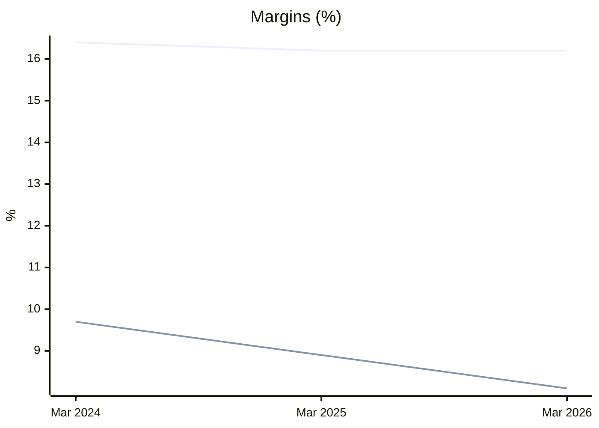
*Series in order: Operating margin, PAT margin.*

**P/E:** 70.6 — live market file (screener.in), trailing (price ₹1,449.00 as of 2026-08-02).

**Cash flows (₹ cr):**

| | Mar 2024 | Mar 2025 | Mar 2026 |
|---|---:|---:|---:|
| Cash from operations (₹ cr) | 823 | 630 | 1,117 |
| Cash from investing (₹ cr) | -541 | -513 | -506 |
| Cash from financing (₹ cr) | -202 | -118 | -328 |
| Net cash flow (₹ cr) | 80.0 | -1.0 | 282 |
| Free cash flow (₹ cr) | 273 | 90.0 | 661 |

*Source: CashFlow/NiftyTotalMarket/ASTRAL.csv (consolidated, screener.in).*

### The business being separated — its own numbers

**Paints and Adhesives (reportable segment; the Chemicals/Adhesive Business Undertaking being demerged is not reported separately on these pages)** · unit ₹ Million · operating_profit = 'Segment profit' per Ind AS 108 note 37 — segment revenue less directly attributable/allocated segment expenses, BEFORE finance cost, depreciation & amortisation, tax and share of JV results (so EBITDA-like, not EBIT). Segment revenue is external only; the notes state there were no inter-segment sales. Segment depreciation is disclosed separately (Paints & Adhesives: FY2024 590, FY2025 801, FY2026 933). Investor presentations label the same business 'Paints and Adhesives Business' and give EBITDA (FY2024 2,031; FY2025 1,948) and PBT before exceptional items (FY2024 1,334; FY2025 1,005) — Presentation May 2025 — page 60; these differ from the AR segment-profit line.

| | FY2024 | FY2025 | FY2026 |
|---|---:|---:|---:|
| Revenue (₹ Million) | 14,994 | 16,361 | 18,899 |
| Revenue growth (%) | — | +9.1% | +15.5% |
| Operating profit (₹ Million) | 1,396 | 1,150 | 1,034 |
| Operating profit growth (%) | — | -17.6% | -10.1% |
| Operating margin (%) | 9.3 | 7.0 | 5.5 |
| PAT (₹ Million) | — | — | — |
| PAT growth (%) | — | — | — |

*Sources:* Annual Report 2024 — page 220 (also Annual Report 2025 — page 208); Annual Report 2025 — page 208 (also Annual Report 2026 — page 218); Annual Report 2026 — page 218

*Not in the pages read:* No standalone Chemicals/Adhesive-only undertaking financials (pages give combined Paints and Adhesives); no segment PAT, no segment EBIT; no quarterly segment data; no FY2026 presentation segment slide.

*Documents on file:* [Annual Report 2026](https://www.bseindia.com/xml-data/corpfiling/AttachHis/5772a6ee-bd33-47d5-bbd1-85b269bd26c3.pdf); [Annual Report 2025](https://www.bseindia.com/xml-data/corpfiling/AttachHis/78a2a99f-5d2e-4692-b054-43192a2fc329.pdf); [Annual Report 2024](https://www.bseindia.com/xml-data/corpfiling/AttachHis/455e935e-98ba-4ef9-bd54-c293a46bab7c.pdf); [Presentation May 2026](https://www.astralltd.com/wp-content/uploads/2026/05/Investor-Presentation-May-2026.pdf); [Presentation May 2025](https://www.astralltd.com/wp-content/uploads/2025/05/Astral-Analysts-Meet-PPT-R-1.pdf); [Presentation May 2024](https://astralltd.com/wp-content/uploads/2024/Astral%20Pipes_%20PPWithout%20Video%20for%20TIL.pdf); [Presentation May 2023](https://astralltd.com/wp-content/uploads/2023/05/Astral_2023.pdf)

**The checklist:**

| Item | Status | Evidence |
|---|---|---|
| Why the spin-off | yes | unrelated businesses separated; value unlocking for shareholders; regulatory / strategic knot — “…zation and specialisation for sustained growth and enhance competitive strength by ensuring benefits through focused management of the financial, managerial and technical resources, personnel capabilities, skills, exper” |
| Institutional selling likely (small / different business) | yes | the demerged piece is 21% of turnover; the businesses are described as distinct |
| Insider ownership and incentives aligned | unknown | no promoter-continuity or option-pricing language found *(next: the date the management options are priced; promoter holding in the resulting company)* |
| A hidden value revealed (pro-forma, leverage, comparables) | partly | borrowings 250 cr (Mar 2026) = 0.01× market cap; P/E 72.7 on Mar 2026 profit vs industry median 47.9 (59 peers) *(next: pro-forma P&L of each piece × the peer P/E of its own industry)* |
| Parent before the spin (clean parent, takeover prelude) | partly | stage announced — the spin has not happened; the parent can still be bought whole |
| Timing (first year sells, second year gains) | partly | not yet listed — 230 days since the first filing, stage announced |

<details><summary>The filings</summary>

| Date | Category | Headline | Attachment |
|---|---|---|---|
| 2026-03-23 | General Updates | Astral Limited has informed the Exchange about Grant of patent MULTIPORT WATER OUTLET to Al-Aziz Plastics Private Limited a wholly Owned Subsidiary of the Compa | [pdf](https://nsearchives.nseindia.com/corporate/ASTRAL_23032026175333_Intimation_of_Grant_of_Patent.pdf) |
| 2026-06-25 | Outcome of Board Meeting | Outcome of the Board M eeting held on June 25, 2026 , pursuant to Regulations | [pdf](https://nsearchives.nseindia.com/corporate/ASTRAL_25062026190630_Outcome_of_BM_Astral_25062026.pdf) |
| 2026-06-25 | Outcome of Board Meeting | Astral Limited has informed the Exchange regarding Outcome of Board Meeting held on Jun 25, 2026 | [pdf](https://nsearchives.nseindia.com/corporate/ASTRAL_25062026190630_Outcome_of_BM_Astral_25062026.pdf) |
| 2026-06-25 | Scheme of Arrangement | Astral Limited has informed the Exchange about Scheme of Arrangement | [pdf](https://nsearchives.nseindia.com/corporate/ASTRAL_25062026191121_Outcome_of_BM_Astral_25062026.pdf) |
| 2026-07-05 | Outcome of Board Meeting | Astral Limited has informed the Exchange regarding Outcome of Board Meeting held on July 05, 2026 - Update on Composite scheme of Arrangement | [pdf](https://nsearchives.nseindia.com/corporate/ASTRAL_05072026145557_Reg30Astral05072026.pdf) |
| 2026-07-05 | Scheme of Arrangement | Astral Limited has informed the Exchange about Update on Composite Scheme of Arrangement | [pdf](https://nsearchives.nseindia.com/corporate/ASTRAL_05072026150046_Reg30Astral05072026.pdf) |
| 2026-07-29 | Outcome of Board Meeting | Astral Limited has informed the Exchange regarding Outcome of Board Meeting held on July 29, 2026 - Update on Composite Scheme of Arrangement | [pdf](https://nsearchives.nseindia.com/corporate/ASTRAL_29072026190057_Reg_30_of_BM_Astral.pdf) |
| 2026-07-29 | Scheme of Arrangement | Astral Limited has informed the Exchange about Update on the Composite Scheme of Arrangement | [pdf](https://nsearchives.nseindia.com/corporate/ASTRAL_29072026190321_Reg_30_of_BM_Astral.pdf) |

</details>

## APOLLOHOSP — Apollo Hospitals Enterprise Ltd.

**CONFIRMED** (a demerger scheme is on the exchange record) · **PRE-SPIN — study the parent; the pieces do not trade yet** · score 5.7/10 · spin-off · 25 filing(s) from CALLS, NSE · first 2025-12-24, latest 2026-06-26

> **Listing:** NOT YET — scheme at 'nclt_sanction' stage; the resulting company will list only after NCLT sanction, effectiveness and a record date; indicated timeline: On May 21, 2026 management said the NCLT-convened shareholder meeting was called for June 24 and they were "hopeful the demerger process is completed by Q4 FY27 as planned earlier," with "end of December or early Q4 FY27" when Apollo Healthtech should get demerged and listed; NSE's December 23, 2025 observation letter requires trading to commence within sixty days of receipt of the NCLT order

**The stages, as filed:** exchange_noc (2025-12-24) → meetings (2026-05-21) → nclt_sanction (2026-04-03)

**What is being separated, as the documents put it:** Apollo's omnichannel pharmacy and digital health business, demerged into a separately listed company — class `value_unlocking`.

- *Insiders:* Promoter group held 4,02,87,130 shares (voted 100% for). Shobana Kamineni to be Executive Chairperson of Resultant Company; Rasmeli-funded upside share agreement (max 9% of upside at 4x MOIC) to her and identified employees; new ESOP to be established
- *What it reveals:* A pharmacy/digital platform at ~INR 25,000 crore run-rate revenue with 6.5-7% targeted EBITDA margin, digital losses near breakeven, Keimed distribution consolidated; promoter and investor incentives concentrated in the spin, not the hospital parent
- *Selling pressure:* likely — Shares distributed to all 1.75 lakh AHEL holders in a different industry (pharmacy distribution/digital health) than the hospital parent they own
- *Parent or spin:* spin · *option pricing date:* not stated
- *Read next:* The Scheme's Demerger Share Entitlement Ratio and the Part E abridged-prospectus disclosures for Apollo Healthtech
- *In their words:* “During the year, we also announced a strategic restructuring of the omnichannel pharmacy and digital health business, an important step towards sharpening focus on unlocking long-term value across our integrated health care platform.”

### Why the demerger — three years of calls and the scheme

The business being separated is AHEL's omnichannel pharmacy and digital health vertical — Apollo HealthCo, comprising the ~7,500-store Apollo Pharmacy retail/front-end network and the Apollo 24/7 digital platform (46mn users, INR 528 cr quarterly platform GMV) — which is being demerged into Apollo Healthtech Ltd, with Apollo Healthco Ltd and the promoter-linked distributor Keimed Private Limited (which supplies ~60,000 pharmacy stores) amalgamated into the same vehicle, which is then renamed Apollo Healthco Limited and listed; hospital-based pharmacies stay inside Healthcare Services, since as A. Krishnan put it in Aug 2025, 'what we are spinning out is only the retail pharmacies and the online.' The Scheme's own rationale states the problem plainly: the Identified Business Undertaking is 'distinct from other businesses undertaken by the Demerged Company' and 'necessitates a differentiated strategy aligned to its industry specific risks, market dynamics, and growth trajectory', so separation lets hospitals and retail/digital each focus on 'their respective businesses, efficient management, and control', consolidates HealthCo's and Keimed's distribution 'in an independent company focusing exclusively on digital health and pharmacy distribution', and lets the new entity 'build a wider capital and financial base, by attracting a different set of investors, strategic partners, lenders and stakeholders' — plus supply-chain integration, wider assortment, 'improved transparency in the supply chain preventing the entry of counterfeit or substandard medicines', administrative efficiency, board/managerial rationalisation and economies of scale. The financial case management repeated for six straight quarters is scale plus margin convergence: pro-forma combined revenue of INR 4,430 cr in Q1 FY26 (~INR 17,000 cr run-rate, INR 19,000 cr for FY26) becoming a INR 25,000 cr run-rate at 7% EBITDA by Q4 FY27; Sanjiv Gupta's arithmetic was that a 3.2% blended FY25 margin is already 6.4% once Apollo 24/7's losses and the accelerated ESOP charge are stripped out, with offline pharmacy going 7.4%→8-9% on private label (15.5% of pharmacy sales) and Keimed 3.1%→3.5%. The loss drag has in fact collapsed — digital cash losses fell from INR 111 cr (Q4 FY24) and INR 101 cr (Q2 FY25) to INR 29 cr in Q3 FY26 and INR 16 cr in Q4 FY26, with breakeven ex-ESOP guided to Q1 FY27 and including ESOP (~INR 50 cr FY27) by Q3 FY27 — and Apollo HealthCo crossed INR 10,000 cr of annual revenue in FY26, making it listable on its own. Keimed's merger was justified on concrete synergies: shared technology, data, people and product categories, cheaper dark stores (22 today) to push beyond the top six metros to the next ten cities, and private-label penetration across Keimed's franchise base. The push is not purely internal: Rasmeli Limited, the investor holding Class A/B compulsorily convertible preference shares in Apollo Healthco, receives a nominee director in the Resultant Company and signed a June 30, 2025 Upside Agreement sharing up to 9% of its own upside (only above 4x MOIC) with Ms. Shobana Kamineni — proposed Executive Chairperson — and identified employees; after shareholder and proxy-adviser pushback the Company issued clarifications on June 15 and June 19, 2026 adding 10% fall-away thresholds on nomination rights, tiered caps on promoter nominees, an individual 5% waiver, six independent directors and a Lead Independent Director. A second, separate separation was announced in May 2026: AHLL's Apollo Cradle and fertility verticals (INR 450 cr FY26 revenue, INR 45 cr IGAAP EBITDA) were combined with Cloudnine at INR 1,550 cr — 35x EBITDA — for cash plus a 9.9% stake, with the INR 750 cr of cash redeployed into primary care and diagnostics, which management called the funnel into Apollo.

**How it evolved:** The idea surfaced before this window as the 'strategic intent' for Apollo HealthCo (Aug 14, 2024 call) and was tracked through Feb 11, 2025 and the May 31, 2025 (Jun 2025) call purely as the Keimed merger 'progressing well', with a ~15-month timeline and Sanjiv Gupta's 3.2%→7% FY27 margin bridge; the composite Scheme itself was board-approved and filed on June 30, 2025. On the Aug 13, 2025 call management first spelled out the full shape — Apollo HealthCo as it stands gets demerged and separately listed by Q4 FY27, all steps within 18-21 months, only retail plus online moving out, Keimed folded in for technology/data/people/product synergies. Nov 7, 2025 and Feb 11, 2026 were process updates (statutory steps on track; CCI and SEBI approvals obtained, NSE no-objection Dec 23, 2025, NCLT filed and hearings begun, Keimed's subsidiaries consolidated to 100%), and the May 21, 2026 call set the NCLT-convened shareholder meeting for June 24, 2026 with completion still Q4 FY27. In the final stretch the plan changed on governance rather than structure: clarifications dated June 15 and June 19, 2026 added nomination-right fall-away thresholds in response to shareholder feedback, and on June 24, 2026 the Scheme passed with 90.44% of all votes and 85.71% of public votes in favour, but 14.31% of institutional votes against.

**What management expects from it:** Apollo Healthtech becomes a pure-play pharmacy and digital health company: INR 25,000 cr run-rate revenue at 6.5-7% EBITDA by Q4 FY27 (FY26 exit 4.3%), digital at breakeven, Keimed 3.1%-to-3.5%, offline pharmacy 8-9% on private label, its own investors, lenders and board. AHEL keeps hospitals and AHLL at 25.4% ROCE, redeploying cash into beds, primary care and diagnostics.

**Point by point, with the source:**

- *[Aug 2024](https://www.apollohospitals.com/apollo_pdf/Transcript-of-Apollo-Hospitals-Q1-FY25.pdf)* — Earliest reference in the window: integration of the acquired distribution business plus offline pharmacy growth is framed as the path to HealthCo's 'strategic intent' over three years, before any demerger language appears. “Transaction integration and healthy growth in offline pharmacy distribution revenues will drive Apollo HealthCo towards its stated strategic intent in the next 3 years.”
- *[Feb 2025](https://cdn.apollohospitals.com/apollohospitals/apollo_pdf/Transcript-of-Apollo-Hospitals-Q3-FY25.pdf)* — The restructuring is still presented as a merger-plus-breakeven story, with Sanjiv Gupta quantifying the FY27 target for the combined entity at INR 25,000 crore of revenue and 6-7% EBITDA, against a then run-rate of ~INR 17,000 crore at 6.5% excluding digital losses. “So, we are looking at about INR 25,000 crore of revenue and about 6% to 7% of EBITDA in FY 27.”
- *[Jun 2025](https://www.apollohospitals.com/sites/default/files/2025-06/transcript-of-apollo-hospitals---q4-fy25-earnings-call---1-.pdf)* — Suneeta Reddy's closing remarks on the Q4 FY25 call tie the Keimed merger explicitly to scale and margin durability in pharmacy, not to a listing. “The Keimed merger process is also progressing well, which will further enhance scale and margin resilience in our Pharmacy business.”
- *[Jun 2025](https://www.apollohospitals.com/sites/default/files/2025-06/transcript-of-apollo-hospitals---q4-fy25-earnings-call---1-.pdf)* — Sanjiv Gupta gave the margin bridge that underpins the 7% target: removing Apollo 24/7's operating losses and the ESOP charge (INR 100 cr in FY26, falling to a third thereafter) lifts the blended 3.2% to 6.4% even on then-current numbers. “If I remove these two things, if I assume these two things even today and remove these losses and the ESOP cost, the new number that comes for the EBITDA percentage is 6.4%.”
- *[Aug 2025](https://www.apollohospitals.com/sites/default/files/2025-08/transcript-of-apollo-hospitals---q1-fy26-earnings-call---13-august-2025.pdf)* — First explicit statement on a call of the demerger and separate listing, with the 18-21 month timetable and the INR 25,000 crore / 7% EBITDA end-state for the scheme concluding by FY27. “The strategic reorganization of our omni -channel pharmacy and digital health business is proceeding as planned , and we expect to complete all steps within 18 to 21 months, a timeline that we had earlier announced.”
- *[Aug 2025](https://www.apollohospitals.com/sites/default/files/2025-08/transcript-of-apollo-hospitals---q1-fy26-earnings-call---13-august-2025.pdf)* — A. Krishnan confirmed the mechanics in answer to an investor: HealthCo in its current form is the entity being demerged and listed by Q4 FY27, by which time Keimed's NCLT merger will also have happened. “What will happen is Apollo HealthCo., as you are seeing in the current form, is what is going to be demerged and will be listed separately by Q4 of FY27.”
- *[Aug 2025](https://www.apollohospitals.com/sites/default/files/2025-08/transcript-of-apollo-hospitals---q1-fy26-earnings-call---13-august-2025.pdf)* — Scope limit made explicit — hospital-based pharmacies stay with Healthcare Services; only the ~6,500-store retail chain and the online business leave, alongside Keimed, which supplies about 60,000 third-party pharmacy stores. “The hospital -based pharmacies continues as part of hospitals, which I am sure you know, but it is something that , remember, what we are spinning out is only the retail pharmacies and the online out of that.”
- *[Aug 2025](https://www.apollohospitals.com/sites/default/files/2025-08/transcript-of-apollo-hospitals---q1-fy26-earnings-call---13-august-2025.pdf)* — Madhivanan Balakrishnan listed the Keimed synergies: shared technology, data and people, cheaper dark stores (22 at the time) enabling expansion from the top 6 cities to the next 10 and beyond, and private label (then 14.6% of sales) pushed across Keimed's franchises. “So , technology, data, people, and product categories , all the four synergies should start playing out as this merger comes in place.”
- *[Nov 2025](https://drupal-cdn-hfaeddcdbng5hfbg.a01.azurefd.net/sites/default/files/2025-11/transcript-of-apollo-hospitals---q2-fy26-earnings-call---7-november-2025....pdf)* — Process update framing the combination as the way to capture scale benefits inside HealthCo; separately Madhivanan said merging Keimed, Apollo Pharmacy and the digital business would release further cost synergies from the next financial year. “The statutory processes for the restructuring within Apollo HealthCo and the Keimed merger continue to proceed as per plan, and we remain well positioned to capture the full benefit of scale within Apollo HealthCo.”
- *[Feb 2026](https://drupal-cdn-hfaeddcdbng5hfbg.a01.azurefd.net/sites/default/files/2026-02/transcript-of-ahel-q3fy26-concall_11feb2026.pdf)* — Regulatory progress is reported and the combined-entity target is restated verbatim as INR 25,000 crore run-rate revenue with 7% EBITDA. “We have also made progress with respect to the regulatory integration process for the com posite scheme of Keimed merger and demerger of Apollo HealthCo and remain well positioned to capture the full benefits of scale with the combined entity to achieve a run rate of INR 25,000 crore in combined revenues with 7% EBITDA.”
- *[Feb 2026](https://drupal-cdn-hfaeddcdbng5hfbg.a01.azurefd.net/sites/default/files/2026-02/transcript-of-ahel-q3fy26-concall_11feb2026.pdf)* — Obul Reddy itemised the approvals obtained (CCI, SEBI) and the NCLT filing, and confirmed Keimed had been cleaned up so that its subsidiaries are 100% owned before the merger. “We have obtained Competition Commission approval and SEBI approval. We have filed with NCLT.”
- *[May 2026](https://www.apollohospitals.com/sites/default/files/2026-05/transcript-of-apollo-hospitals---q4-fy26-earnings-call.pdf)* — The purpose is stated in value terms for the first time in opening remarks — sharpening focus and unlocking long-term value across the integrated platform — in the same breath as HealthCo crossing INR 10,000 crore of annual revenue. “During the year, we also announced a strategic restructuring of the omnichannel pharmacy and digital health business, an important step towards sharpening focus on unlocking long -term value across our integrated health care platform.”

*Not explained on the calls:* Calls never discussed the share entitlement ratio, debt/cash split, AHEL's residual stake, Keimed's purchase valuation or related-party pricing, the 14.31% institutional dissent, or the Upside Agreement.

*Calls read (36 months):* [Aug 2025](https://www.apollohospitals.com/sites/default/files/2025-08/transcript-of-apollo-hospitals---q1-fy26-earnings-call---13-august-2025.pdf), [Feb 2026](https://drupal-cdn-hfaeddcdbng5hfbg.a01.azurefd.net/sites/default/files/2026-02/transcript-of-ahel-q3fy26-concall_11feb2026.pdf), [May 2026](https://www.apollohospitals.com/sites/default/files/2026-05/transcript-of-apollo-hospitals---q4-fy26-earnings-call.pdf)

### The parent, last three fiscal years (consolidated)

| | Mar 2024 | Mar 2025 | Mar 2026 |
|---|---:|---:|---:|
| Sales (₹ cr) | 19,059 | 21,794 | 25,228 |
| Sales growth (%) | +14.7% | +14.4% | +15.8% |
| Operating profit (₹ cr) | 2,394 | 3,033 | 3,769 |
| Operating profit growth (%) | +15.9% | +26.7% | +24.3% |
| Operating margin (%) | 12.6 | 13.9 | 14.9 |
| PAT (₹ cr) | 935 | 1,505 | 2,003 |
| PAT growth (%) | +10.8% | +61.0% | +33.1% |
| PAT margin (%) | 4.9 | 6.9 | 7.9 |
| EPS (₹) | 62.5 | 101 | 135 |

*Source: ProfitStatement/NiftyTotalMarket/APOLLOHOSP.csv (consolidated, screener.in); growth and margins computed here.*

```mermaid
xychart-beta
    title "Sales, operating profit and PAT (₹ cr)"
    x-axis ["Mar 2024", "Mar 2025", "Mar 2026"]
    y-axis "₹ crore"
    bar [19059, 21794, 25228]
    bar [2394, 3033, 3769]
    bar [935, 1505, 2003]
```
*Series in order: Sales, Operating profit, PAT.*

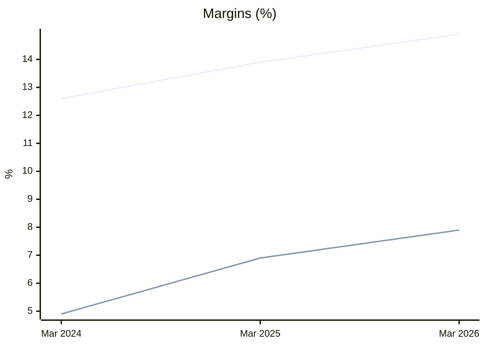
*Series in order: Operating margin, PAT margin.*

**P/E:** 65.8 — live market file (screener.in), trailing (price ₹8,957.00 as of 2026-08-02).

**Cash flows (₹ cr):**

| | Mar 2024 | Mar 2025 | Mar 2026 |
|---|---:|---:|---:|
| Cash from operations (₹ cr) | 1,920 | 2,136 | 2,856 |
| Cash from investing (₹ cr) | -1,537 | -3,381 | -2,148 |
| Cash from financing (₹ cr) | -311 | 1,317 | -478 |
| Net cash flow (₹ cr) | 72.0 | 73.0 | 230 |
| Free cash flow (₹ cr) | 785 | 439 | 925 |

*Source: CashFlow/NiftyTotalMarket/APOLLOHOSP.csv (consolidated, screener.in).*

### The business being separated — its own numbers

**Digital Health & Pharmacy Distribution (Apollo HealthCo / Apollo 24|7 — omnichannel pharmacy distribution & digital health)** · unit ₹ million · operating_profit = segment profit/(loss) per Ind AS 108 segment reporting, i.e. profit before tax earned by the segment WITHOUT allocation of finance costs (identical to the 'EBIT' line for the Digital Health & Pharmacy Distribution column in the investor presentations: FY26 3,987 and FY25 1,127 reconcile exactly). Revenue is segment revenue before elimination of inter-segment revenue (group-level inter-segment eliminations were 2,002 / 774 / 759 mn in FY26 / FY25 / FY24 and are not split by segment). Segment EBITDA (post 24|7 cost and ESOP) per presentation: FY26 4,875, FY25 1,676, Q4FY26 1,556. PAT is the segment PAT (reported) from the presentation column, not from the audited segment note.

| | FY2024 | FY2025 | FY2026 |
|---|---:|---:|---:|
| Revenue (₹ million) | 78,269 | 90,930 | 108,081 |
| Revenue growth (%) | — | +16.2% | +18.9% |
| Operating profit (₹ million) | -1,309 | 1,127 | 3,987 |
| Operating profit growth (%) | — | +186.1% | +253.8% |
| Operating margin (%) | -1.7 | 1.2 | 3.7 |
| PAT (₹ million) | — | 469 | 3,238 |
| PAT growth (%) | — | — | +590.4% |

*Sources:* Annual Report 2024 — page 438; Annual Report 2025 — page 227 (revenue, segment profit); Presentation May 2026 — page 13 (PAT); Annual Report 2026 — page 225 (revenue, segment profit); Presentation May 2026 — page 13 (PAT)

*Latest quarter (Q4 FY26):* revenue 28482, operating profit 1357 — Presentation May 2026 — page 12

*Not in the pages read:* FY2024 segment PAT; standalone Apollo Healthtech / Keimed-only financials; segment revenue net of inter-segment; any Q1/Q2 FY27 figures (Aug 2026 pages carry no financials).

*Documents on file:* [Annual Report 2026](https://www.bseindia.com/xml-data/corpfiling/AttachHis/f9b40997-8116-48ba-949a-ca2e7775e3c2.pdf); [Annual Report 2025](https://www.bseindia.com/xml-data/corpfiling/AttachHis/330724b4-fb72-4577-beb0-598b4672f77a.pdf); [Annual Report 2024](https://www.bseindia.com/xml-data/corpfiling/AttachHis/93fc23fd-104c-47e7-bfc9-cf91d3d41e33.pdf); [Presentation Aug 2026](https://www.bseindia.com/stockinfo/AnnPdfOpen.aspx?Pname=0a967b34-eaeb-44d0-82d8-5ff46e9b171f.pdf); [Presentation May 2026](https://www.bseindia.com/stockinfo/AnnPdfOpen.aspx?Pname=7cfb1747-054b-47c2-8073-a98cba8daca0.pdf); [Presentation Feb 2026](https://www.bseindia.com/stockinfo/AnnPdfOpen.aspx?Pname=2256258c-6663-42bc-866c-402f5dcc1cae.pdf); [Presentation Nov 2025](https://www.bseindia.com/stockinfo/AnnPdfOpen.aspx?Pname=4430a828-14c2-4c64-8cff-b68f1a2904f1.pdf); [Presentation Aug 2025](https://drupal-cdn-hfaeddcdbng5hfbg.a01.azurefd.net/sites/default/files/2025-08/ahel-q1fy26-earnings-update.pdf); [Presentation Jun 2025](https://www.bseindia.com/stockinfo/AnnPdfOpen.aspx?Pname=f30907dc-d76c-4a3b-bbf9-7a8b5121223c.pdf)

**The checklist:**

| Item | Status | Evidence |
|---|---|---|
| Why the spin-off | yes | regulatory / strategic knot; attracting different investors / capital; value unlocking for shareholders — “…ions of the Listing Regulation s. On September 24. 2025 , we had intimated of the receipt of approval of the Competition Commission of India for the transactions contemplated under the Scheme. In furth erance to that, w” |
| Institutional selling likely (small / different business) | unknown | size of the demerged piece not stated *(next: pro-forma statements: revenue / assets of the demerged undertaking vs the parent)* |
| Insider ownership and incentives aligned | partly | …rperson Demerged Company – 10,43,915 equity shares (0.73%) 3. Suneeta Reddy Managing Director, KMP Demerged Company – 29,37,066 equity shares (2.04%) 4. Shobana Kamineni Non Executive Direc… | option pricing mentioned: …ecoming effective, Resultant Company shall formulate and establish an employee stock option plan or other stock incentive scheme or benefit programme, in accordance with the applicable laws, and grant such options or securities in Resultant Company similar to or substantially si… *(next: the date the management options are priced; promoter holding in the resulting company)* |
| A hidden value revealed (pro-forma, leverage, comparables) | partly | borrowings 8,493 cr (Mar 2026) = 0.07× market cap; P/E 64.3 on Mar 2026 profit vs industry median 52.6 (45 peers) *(next: pro-forma P&L of each piece × the peer P/E of its own industry)* |
| Parent before the spin (clean parent, takeover prelude) | partly | stage nclt_sanction — the spin has not happened; the parent can still be bought whole |
| Timing (first year sells, second year gains) | partly | not yet listed — 319 days since the first filing, stage nclt_sanction |
| Management discussing it on the calls | yes | 5 mention(s) in the last 12 months of calls — “…en the NCLT process should ta ke it some 3, 4 months to close. And hopefully, by Q4 FY27, end of December or early Q4 FY27 is when Apollo Healthtech should get demerged and listed. That is the plan. And that Transcript ” |

**On the calls (last 12 months):**

- *Feb 2026* (neutral) — “…ance long -term shareholder value. We have also made progress with respect to the regulatory integration process for the com posite scheme of Keimed merger and demerger of Apollo HealthCo and remain well positioned to capture the full benefits of scale with the combined entity to achieve a run rate of INR 25,000 crore in combi…”
- *Feb 2026* (forward) — “…see as expansion. Bino Pathiparampil : Understood. Okay. And finally, an update on wha t is happening on the HealthCo side regarding the corporate action about demerger, et cetera. How is the progress on the Keimed side in terms of accumulation of the different pieces of business that were separate, et cetera, would be great?…”
- *May 2026* (backward) — “…LT convened meeting of the shareholders is now being called for on June 24 to obtain the requisite shareholder approval, consequent to which we are hopeful the demerger process is completed by Q4 FY27 as planned earlier. In terms of financial milestones, I am pleased to share that our consolidated revenues crossed INR 25,000 c…”
- *May 2026* (forward) — “…Can you update us on the timeline for this entire transaction on AHL and when will the new company will come into existence and when will the separation or the demerger will happen? A. Krishnan: So, as we said already that the shareholders, this call is scheduled for June 24, where we should be, which is the NCLT process, conv…”
- *May 2026* (forward) — “…en the NCLT process should ta ke it some 3, 4 months to close. And hopefully, by Q4 FY27, end of December or early Q4 FY27 is when Apollo Healthtech should get demerged and listed. That is the plan. And that Transcript of AHEL Q 4 FY26 Earnings Call Page 14 of 16 Company , when it gets listed, you should be in a position to se…”

<details><summary>The filings</summary>

| Date | Category | Headline | Attachment |
|---|---|---|---|
| 2025-12-24 | General Updates | Apollo Hospitals Enterprise Limited has informed the Exchange about General Updates | [pdf](https://nsearchives.nseindia.com/corporate/APOLLOHOSP_24122025100948_NSE_observation_letter.pdf) |
| 2025-12-24 | General Updates | Apollo Hospitals Enterprise Limited has informed the Exchange about General Updates | [pdf](https://nsearchives.nseindia.com/corporate/APOLLOHOSP_24122025130730_BSE_observation_letter.pdf) |
| 2026-02-01 | Earnings call Feb 2026 | …see as expansion. Bino Pathiparampil : Understood. Okay. And finally, an update on wha t is happening on the HealthCo side regarding the corporate action about | [pdf](https://drupal-cdn-hfaeddcdbng5hfbg.a01.azurefd.net/sites/default/files/2026-02/transcript-of-ahel-q3fy26-concall_11feb2026.pdf) |
| 2026-02-10 | Outcome of Board Meeting | Apollo Hospitals Enterprise Limited has submitted to the Exchange, the financial results for the period ended December 31, 2025. | [pdf](https://nsearchives.nseindia.com/corporate/APOLLOHOSP_10022026174926_SE_communication_10022026.pdf) |
| 2026-02-10 | Record Date | Apollo Hospitals Enterprise Limited has informed the Exchange that Record date for the purpose of Interim Dividend is 16-Feb-2026. | [pdf](https://nsearchives.nseindia.com/corporate/APOLLOHOSP_10022026180253_SE_communication_10022026.pdf) |
| 2026-02-10 | Press Release | Apollo Hospitals Enterprise Limited has informed the Exchange regarding a press release dated February 10, 2026, titled "Apollo Hospitals announces Q3FY26 resul | [pdf](https://nsearchives.nseindia.com/corporate/APOLLOHOSP_10022026181122_SE_communication_10022026.pdf) |
| 2026-04-03 | Scheme of Arrangement | Apollo Hospitals Enterprise Limited has informed the Exchange about Scheme of Arrangement - update on receipt of NCLT order | [pdf](https://nsearchives.nseindia.com/corporate/APOLLOHOSP_03042026170310_SE_let_NCLT_order.pdf) |
| 2026-04-10 | Scheme of Arrangement | Apollo Hospitals Enterprise Limited has informed the Exchange about Scheme of Arrangement | [pdf](https://nsearchives.nseindia.com/corporate/APOLLOHOSP_10042026152459_SE_let_NCLT_CTC.pdf) |
| 2026-04-18 | Scheme of Arrangement | Apollo Hospitals Enterprise Limited has informed the Exchange about Scheme of Arrangement | [pdf](https://nsearchives.nseindia.com/corporate/APOLLOHOSP_18042026103633_SE_let_NCLT_15042026.pdf) |
| 2026-04-27 | Scheme of Arrangement | Apollo Hospitals Enterprise Limited has informed the Exchange about Scheme of Arrangement | [pdf](https://nsearchives.nseindia.com/corporate/APOLLOHOSP_27042026185704_SE_Communication_27042026.pdf) |
| 2026-05-01 | Earnings call May 2026 | …Can you update us on the timeline for this entire transaction on AHL and when will the new company will come into existence and when will the separation or the | [pdf](https://www.apollohospitals.com/sites/default/files/2026-05/transcript-of-apollo-hospitals---q4-fy26-earnings-call.pdf) |
| 2026-05-01 | Earnings call May 2026 | …en the NCLT process should ta ke it some 3, 4 months to close. And hopefully, by Q4 FY27, end of December or early Q4 FY27 is when Apollo Healthtech should get | [pdf](https://www.apollohospitals.com/sites/default/files/2026-05/transcript-of-apollo-hospitals---q4-fy26-earnings-call.pdf) |
| 2026-05-08 | Scheme of Arrangement | Apollo Hospitals Enterprise Limited has informed the Exchange about Scheme of Arrangement | [pdf](https://nsearchives.nseindia.com/corporate/APOLLOHOSP_08052026182823_SE_LET-order_NCLT.pdf) |
| 2026-05-21 | Shareholders meeting | Apollo Hospitals Enterprise Limited has informed the Exchange regarding Notice of Court Convened General Meeting to be held on Jun 24, 2026 | [pdf](https://nsearchives.nseindia.com/corporate/APOLLOHOSP_21052026222159_SE_equity_shareholders_notice-ocr.pdf) |
| 2026-05-21 | Scheme of Arrangement | Apollo Hospitals Enterprise Limited has informed the Exchange about Scheme of Arrangement - NCLT Convened meeting of equity shareholders | [pdf](https://nsearchives.nseindia.com/corporate/APOLLOHOSP_21052026222514_SE_equity_shareholders_notice-ocr.pdf) |
| 2026-05-21 | Scheme of Arrangement | Apollo Hospitals Enterprise Limited has informed the Exchange about Scheme of Arrangement - NCLT convened meeting of unsecured creditors | [pdf](https://nsearchives.nseindia.com/corporate/APOLLOHOSP_21052026222637_SE_unsecured_creditors_notice-ocr.pdf) |
| 2026-05-21 | Scheme of Arrangement | Apollo Hospitals Enterprise Limited has informed the Exchange about Scheme of Arrangement - NCLT convened meeting of secured creditors | [pdf](https://nsearchives.nseindia.com/corporate/APOLLOHOSP_21052026222751_SE_secured_creditors_notice-ocr.pdf) |
| 2026-05-25 | Scheme of Arrangement | Apollo Hospitals Enterprise Limited has informed the Exchange about Scheme of Arrangement | [pdf](https://nsearchives.nseindia.com/corporate/APOLLOHOSP_25052026162532_Se_let_advt_intimation.pdf) |
| 2026-05-25 | General Updates | Apollo Hospitals Enterprise Limited has informed the Exchange about General Updates | [pdf](https://nsearchives.nseindia.com/corporate/APOLLOHOSP_25052026162631_Se_let_advt_intimation.pdf) |
| 2026-06-15 | Scheme of Arrangement | Apollo Hospitals Enterprise Limited has informed the Exchange about Scheme of Arrangement - Additional information in relation to the scheme | [pdf](https://nsearchives.nseindia.com/corporate/APOLLOHOSP_15062026144530_SE_let_addl_info_scheme.pdf) |
| 2026-06-19 | Scheme of Arrangement | Apollo Hospitals Enterprise Limited has informed the Exchange about Scheme of Arrangement | [pdf](https://nsearchives.nseindia.com/corporate/APOLLOHOSP_19062026102054_SE_Communc_19062026.pdf) |
| 2026-06-24 | Shareholders meeting | Apollo Hospitals Enterprise Limited has informed the Exchange regarding Proceedings of Court Convened General Meeting held on Jun 24, 2026 along with a copy of  | [pdf](https://nsearchives.nseindia.com/corporate/APOLLOHOSP_24062026205613_se_nclt_proceedings_1.pdf) |
| 2026-06-24 | Scheme of Arrangement | Apollo Hospitals Enterprise Limited has informed the Exchange about Scheme of Arrangement | [pdf](https://nsearchives.nseindia.com/corporate/APOLLOHOSP_24062026205745_se_nclt_proceedings_1.pdf) |
| 2026-06-26 | Shareholders meeting | Apollo Hospitals Enterprise Limited has submitted the Exchange a copy Srutinizers report of Court Convened General Meeting held on Jun 24, 2026. Further, the co | [pdf](https://nsearchives.nseindia.com/corporate/APOLLOHOSP_26062026115108_SE_Scrutinizer_Report.pdf) |
| 2026-06-26 | Scheme of Arrangement | Apollo Hospitals Enterprise Limited has informed the Exchange about Scheme of Arrangement | [pdf](https://nsearchives.nseindia.com/corporate/APOLLOHOSP_26062026115527_SE_Scrutinizer_Report.pdf) |

</details>

## HINDUNILVR — Hindustan Unilever Ltd.

**CONFIRMED** (a demerger scheme is on the exchange record) · **LISTED <1Y — selling-pressure window; the bargain forms here** · score 5.7/10 · spin-off · 17 filing(s) from CALLS, NSE, NSE-register · first 2025-11-11, latest 2026-02-13

> **Listing:** LISTED — the resulting company trades since about 2025-12-05 (record date 2025-12-05)

**The stages, as filed:** exchange_noc (2025-11-23) → nclt_sanction (2025-11-11) → effective (2025-11-18) → record_date (2025-11-18) → listed (2026-02-13)

**Stated in the filings:** entitlement **1 for every 1**; record date 2025-12-05; appointed date 2025-12-01.

**What is being separated, as the documents put it:** HUL's Ice Cream business undertaking, demerged into Kwality Wall's (India) Limited on a going-concern basis — class `value_unlocking`.

- *Insiders:* Promoter stake in KWIL not stated; HUL's own shareholding in KWIL was reduced and cancelled and KWIL ceased to be a subsidiary. KWIL has a dedicated management team (Chitrank Goel, Deputy MD; Prashant Premrajka, CFO) drawn from HUL.
- *What it reveals:* Cost apportionment puts KWIL at only 1.91% of HUL's value versus 98.09%, set on net assets as at 30 November 2025 — a small, separately listed ice-cream pure-play, 2,34,95,91,262 shares of Re 1, with Kwality Wall's, Cornetto and Magnum.
- *Selling pressure:* likely — Very small relative size (1.91% of pre-demerger cost basis) distributed 1:1 to every HUL holder; a separate ice-cream company versus a large FMCG parent.
- *Parent or spin:* parent · *option pricing date:* not stated
- *Read next:* KWIL's first standalone results and balance sheet — the net assets behind the 1.91% cost apportionment.
- *In their words:* “The Scheme has come into effect on 1st December , 2025, being the Effective Date (as defined under the Scheme ).”

### Why the demerger — three years of calls and the scheme

The business being separated is HUL's Ice Cream business — the Kwality Wall's, Cornetto and Magnum brands — demerged into a new listed entity, Kwality Wall's (India) Limited (KWIL), under a Scheme of Arrangement sanctioned by NCLT Mumbai (orders dated 30 October 2025 and 6 November 2025), effective 1 December 2025, with KWIL listing on 16 February 2026. The Scheme's stated benefit is the 'creation of a leading listed ice cream company in India with focused management having greater flexibility to deploy strategies suited to the Ice Cream business's distinctive operating model and market dynamics, to realise its full potential' — i.e. the structural argument is that ice cream does not fit HUL's FMCG operating model. The financial case management gave on the calls is size and dilution: Ice Cream is 'roughly 3-odd percentage of our business' and 'makes low single-digit margin', below the HUL average, so CFO Ritesh Tiwari guided that removing it adds 50–60bps to reported EBITDA margin on top of the 22–23% guidance (later restated by Niranjan Gupta as a 50bps benefit, giving an implied 22.5–23.5% band). FY26 also showed the category's volatility — Ice Cream 'declined year on year, impacted by extended monsoon in addition to GST transition' in the September quarter — reinforcing the seasonality/operating-model argument. Mechanically it was a two-step process: demerger completed in the December quarter with Ice Cream reported as a discontinued business, then listing in Q4 FY26; shareholders received 1 KWIL share of Re.1 for every 1 HUL share (2,34,95,91,262 shares allotted on 1:1), with cost of acquisition apportioned 98.09% HUL / 1.91% KWIL. The December quarter reported PAT of Rs. 6,603 crores (up 121%) included a 'one-time non-cash gain arising from Ice Cream demerger', and HUL flagged it would lose PLI benefits that had flowed through the P&L via Ice Cream. By May 2026 Priya Nair framed it as portfolio rotation — 'strategic actions such as the demerger of Ice Cream, along with the investments at OZiva and Minimalist, are already enhancing the growth mix of the portfolio' — while explicitly keeping Foods (Tea, Coffee, Horlicks/Boost, Kissan) 'outside the perimeter of the Unilever transaction that we have done'.

**How it evolved:** In the Apr 2025 call (24 April 2025, FY25 results) it was already an in-flight action — 'progressing on track with regulatory requirements', completion expected by end of FY26 — the original announcement rationale sitting in earlier calls not included here. By the Oct 2025 call (23 October 2025) the plan was firmed and quantified: demerger in the December quarter with Ice Cream shown as a discontinued business, listing in Q4 FY26, ~3% of business at low single-digit margin, 50–60bps reported-margin accretion, plus the admission that Ice Cream had declined on extended monsoon and GST transition. In the Feb 2026 call (12 February 2026) it was done — demerger completed in December, KWIL listing announced for 16 February 2026, a one-time non-cash demerger gain in reported PAT, and the guided EBITDA band reset to an implied 22.5–23.5%. By the May 2026 call (30 April 2026) it was cited retrospectively as one of the portfolio actions improving HUL's growth mix, alongside Minimalist and OZiva.

**What management expects from it:** For HUL: ~50–60bps uplift to reported EBITDA margin (22–23% guidance becoming an implied 22.5–23.5%), since Ice Cream, ~3% of turnover, earned low single-digit margins; a better growth mix; a one-time non-cash gain; loss of PLI income. For KWIL: dedicated management, singular focus and flexibility to capture India's growing ice cream opportunity.

**Point by point, with the source:**

- *Scheme* — The Scheme's stated rationale is a focused, separately listed ice cream company with management flexibility suited to the business's own operating model and market dynamics. “Creation of a leading listed ice cream company in India with focused management having greater flexibility to deploy strategies suited to the Ice Cream businesses' distinctive operating model and market dynamics, to realise its full potential”
- *Scheme* — Mechanics: 1:1 entitlement of Re.1 KWIL shares to HUL shareholders on the 5 December 2025 record date; 2,34,95,91,262 shares were allotted and cost of acquisition was apportioned 98.09% HUL / 1.91% KWIL. “for every 1 (one) equity share of face value of Re. 1/- fully paid up held in HUL, 1 (one) equity share of face value of Re. 1/- credited as fully paid up in KWIL”
- *CALL Apr 2025* — At FY25 results the demerger was already in motion, with regulatory work on track and completion targeted by end of FY26 — no fresh rationale was restated. “The demerger of Ice cream business is progressing on track with regulatory requirements, and we expect it to be completed by the end of financial year 2026.”
- *CALL Oct 2025* — Ritesh Tiwari quantified the dilution being removed: Ice Cream is about 3% of HUL's business at low single-digit margin, running even below that in FY26 because of monsoon and investment. “Ice Cream, as we had called out even earlier, it's roughly 3-odd percentage of our business. and the business makes low single-digit margin.”
- *CALL Oct 2025* — The margin benefit was sized at 50–60bps on reported EBITDA, explicitly because Ice Cream earns below the HUL average — on top of the unchanged 22–23% guidance. “Coming to EBITDA margin, Ice Cream demerger is expected to result in an improvement of 50-60 bps to the reported margin as Ice Cream business operates at a margin lower than HUL average.”
- *CALL Oct 2025* — The category's volatility was on display in the quarter being separated, and the process was described as two-step: demerger/discontinued-business reporting in Q3, listing in Q4 FY26. “Ice Cream business declined year on year, impacted by extended monsoon in addition to GST transition. As you are aware, the Ice Cream demerger process is currently underway.”
- *CALL Feb 2026* — On completion, Priya Nair justified it by dedicated leadership and undivided focus letting KWIL chase India's growing ice cream opportunity; listing was set for 16 February 2026. “With a dedicated management team and singular focus, we are confident that KWIL is well positioned to capitalise on the growing market opportunity in India and deliver sustained performance.”
- *CALL Feb 2026* — Niranjan Gupta confirmed the guidance arithmetic — the old 22–23% band plus a 50bps demerger benefit, i.e. an implied 22.5–23.5% — and reported a one-time non-cash demerger gain inside the Rs. 6,603 crores reported PAT. “So, our guided range has been that 22% to 23%. We also outlined that the range, therefore, you will see a benefit of the ice cream demerger to the extent of 50 basis points.”
- *CALL May 2026* — A year on, the demerger is presented as one of several portfolio-rotation moves lifting the quality and growth profile of what remains. “Strategic actions such as the demerger of Ice Cream, along with the investments at OZiva and Minimalist, are already enhancing the growth mix of the portfolio.”
- *CALL May 2026* — Asked whether Unilever's global retreat from foods implies more separations, Priya Nair drew the boundary: HUL's Foods (Tea, Coffee, Horlicks/Boost, Kissan) is deliberately outside the transaction perimeter and remains a strategic priority. “So therefore that, combined with the opportunities that exist in India in Foods, is the reason why Foods is outside the perimeter of the Unilever transaction that we have done, and Foods continues to be a very important area and focus of strategy for HUL.”

*Not explained on the calls:* Never explained: original announcement rationale (older transcripts omitted/scanned), KWIL standalone financials and capital structure, Unilever's global ice-cream separation, and whether any investor, lender or partner requested it.

*Calls read (36 months):* [Apr 2025](https://www.bseindia.com/stockinfo/AnnPdfOpen.aspx?Pname=57aad284-8283-4c21-8035-99627387a92d.pdf), [Feb 2026](https://www.bseindia.com/stockinfo/AnnPdfOpen.aspx?Pname=38a5c0b9-6eee-4de5-bdd8-98ac200204cc.pdf), [Jan 2025](https://www.bseindia.com/stockinfo/AnnPdfOpen.aspx?Pname=f5b86e3e-937f-42e9-940b-ce01bf35a1bc.pdf), [May 2026](https://www.bseindia.com/stockinfo/AnnPdfOpen.aspx?Pname=55988411-440d-4801-8c08-90a5908c4a04.pdf), [Oct 2024](https://www.bseindia.com/stockinfo/AnnPdfOpen.aspx?Pname=a208b4bc-a7a8-4ffc-b0f0-00f1f72b4129.pdf), [Oct 2025](https://www.bseindia.com/stockinfo/AnnPdfOpen.aspx?Pname=2eb875fe-ef79-4b40-88b8-228ccc8be17e.pdf)

### The parent, last three fiscal years (consolidated)

| | Mar 2024 | Mar 2025 | Mar 2026 |
|---|---:|---:|---:|
| Sales (₹ cr) | 61,896 | 61,328 | 64,468 |
| Sales growth (%) | +2.2% | -0.9% | +5.1% |
| Operating profit (₹ cr) | 14,659 | 14,698 | 15,039 |
| Operating profit growth (%) | +3.6% | +0.3% | +2.3% |
| Operating margin (%) | 23.7 | 24.0 | 23.3 |
| PAT (₹ cr) | 10,282 | 10,671 | 15,059 |
| PAT growth (%) | +1.4% | +3.8% | +41.1% |
| PAT margin (%) | 16.6 | 17.4 | 23.4 |
| EPS (₹) | 43.7 | 45.3 | 64.0 |

*Source: ProfitStatement/NiftyTotalMarket/HINDUNILVR.csv (consolidated, screener.in); growth and margins computed here.*

```mermaid
xychart-beta
    title "Sales, operating profit and PAT (₹ cr)"
    x-axis ["Mar 2024", "Mar 2025", "Mar 2026"]
    y-axis "₹ crore"
    bar [61896, 61328, 64468]
    bar [14659, 14698, 15039]
    bar [10282, 10671, 15059]
```
*Series in order: Sales, Operating profit, PAT.*

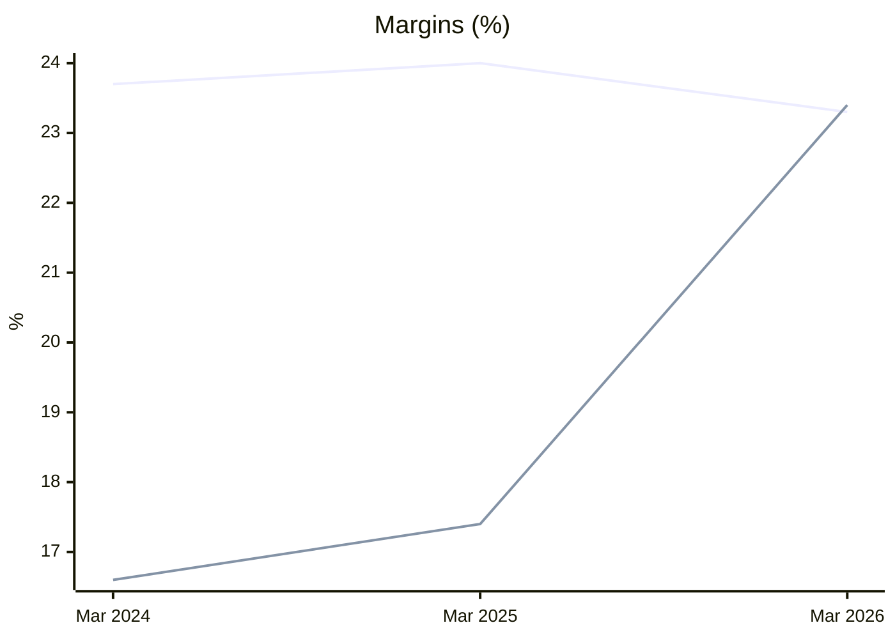
*Series in order: Operating margin, PAT margin.*

**P/E:** 44.8 — live market file (screener.in), trailing (price ₹2,101.00 as of 2026-08-02).

**Cash flows (₹ cr):**

| | Mar 2024 | Mar 2025 | Mar 2026 |
|---|---:|---:|---:|
| Cash from operations (₹ cr) | 15,469 | 11,886 | 10,999 |
| Cash from investing (₹ cr) | -5,324 | 6,473 | -3,676 |
| Cash from financing (₹ cr) | -10,034 | -13,101 | -10,810 |
| Net cash flow (₹ cr) | 111 | 5,258 | -3,487 |
| Free cash flow (₹ cr) | 14,012 | 10,624 | 9,667 |

*Source: CashFlow/NiftyTotalMarket/HINDUNILVR.csv (consolidated, screener.in).*

### The business being separated — its own numbers

**Ice Cream Business (reported as 'Discontinued Operations' in the FY2025-26 segment note; Demerged Undertaking demerged into Kwality Wall's (India) Limited, KWIL)** · unit ₹ crore · Revenue = 'Segment Revenue from Discontinued Operations' (segment revenue; note states there are no intersegment transactions, so effectively external). Operating profit = 'Segment Results from Discontinued Operations', i.e. segment result = profit before other income, finance costs, exceptional items and tax (EBIT-type, not EBITDA). PAT = 'Profit/(Loss) for the year from Discontinued Operations'. FY2026 figures cover only part of the year (Kwality Wall's ceased to be a subsidiary / demerger effective 30th November, 2025), and FY2026 PAT of 4,407 is dominated by the one-off positive impact of the Ice Cream demerger accounted per the approved scheme, not by trading profit; FY2026 PBT before exceptional items from discontinued operations was (135). No separate Ice Cream disclosure exists for FY2024 — it sat inside the 'Foods & Refreshment' segment.

| | FY2024 | FY2025 | FY2026 |
|---|---:|---:|---:|
| Revenue (₹ crore) | — | 1,793 | 1,257 |
| Revenue growth (%) | — | — | -29.9% |
| Operating profit (₹ crore) | — | 43.0 | -122 |
| Operating profit growth (%) | — | — | -383.7% |
| Operating margin (%) | — | 2.4 | -9.7 |
| PAT (₹ crore) | — | -9.0 | 4,407 |
| PAT growth (%) | — | — | +49066.7% |

*Sources:* Annual Report 2024 — page 213 (ice cream reported only within 'Foods & Refreshment'; no separate figures); Annual Report 2026 — page 229

*Not in the pages read:* No Ice Cream quarterly revenue/margin in any presentation (only 'demerger completed, KWIL listing underway'); no FY2024 ice-cream split; no EBITDA, assets or capex for the undertaking.

*Documents on file:* [Annual Report 2026](https://www.bseindia.com/xml-data/corpfiling/AttachHis/881493e4-75af-4a7f-8c64-9d0886e63f1d.pdf); [Annual Report 2025](https://www.bseindia.com/xml-data/corpfiling/AttachHis/770bf03e-526d-45d8-8364-13f7fc523289.pdf); [Annual Report 2024](https://www.bseindia.com/xml-data/corpfiling/AttachHis/02d8d87d-90ce-4191-8b3f-4167267aee8a.pdf); [Presentation Nov 2026](https://www.bseindia.com/stockinfo/AnnPdfOpen.aspx?Pname=c54cbd79-ba64-4bcc-b114-b5ad02c75ade.pdf); [Presentation Oct 2026](https://www.bseindia.com/stockinfo/AnnPdfOpen.aspx?Pname=aecfd799-4d6c-49d4-9d7b-221d87d1352d.pdf); [Presentation Sep 2026](https://www.bseindia.com/stockinfo/AnnPdfOpen.aspx?Pname=d9d8d7e9-c5ef-40ef-bbd6-bc832320c0d5.pdf); [Presentation Aug 2026](https://www.bseindia.com/stockinfo/AnnPdfOpen.aspx?Pname=163e0f27-042e-41a9-9db7-14f5d0172218.pdf); [Presentation Feb 2026](https://www.bseindia.com/stockinfo/AnnPdfOpen.aspx?Pname=6e6dea43-db7a-4075-82c6-71024ed4436a.pdf); [Presentation Oct 2025](https://www.bseindia.com/stockinfo/AnnPdfOpen.aspx?Pname=b38b0312-d563-42a1-96e7-d61213c82925.pdf)

**The checklist:**

| Item | Status | Evidence |
|---|---|---|
| Why the spin-off | yes | value unlocking for shareholders; regulatory / strategic knot; a weak or capital-heavy business carved away; unrelated businesses separated — “…s to sharpen focus on their respective businesses and strategies in pursuit of their respective growth and value creation models; (ii) the Ice Cream Business Undertaking (as defined in the Scheme ) operates in an attrac” |
| Institutional selling likely (small / different business) | partly | the businesses are described as distinct |
| Insider ownership and incentives aligned | unknown | no promoter-continuity or option-pricing language found *(next: the date the management options are priced; promoter holding in the resulting company)* |
| A hidden value revealed (pro-forma, leverage, comparables) | yes | borrowings 1,478 cr (Mar 2026) = 0.00× market cap; P/E 32.8 on Mar 2026 profit vs industry median 51.5 (27 peers) |
| Parent before the spin (clean parent, takeover prelude) | no | stage listed — the pieces trade separately now |
| Timing (first year sells, second year gains) | partly | 338 days since listing/record date; first year since listing — the selling-pressure window; watch, size the entry |
| Management discussing it on the calls | yes | 7 mention(s) in the last 12 months of calls — “…ormats of Beauty and Home Care. We have actively rotated our portfolio to sharpen the quality and growth profile of the business. Strategic actions such as the demerger of I ce Cream, along with the investments at O Ziv” |

**On the calls (last 12 months):**

- *Feb 2026* (backward) — “…-based with all categories contributing and it was competitive as we continued to gain turnover weighted market share. As you are aware, we have completed the demerger of the I ce Cream business this quarter. The numbers on this slide reflect performance of the continuing business, excluding I ce Cream. EBITDA at Rs. 3,788 cr…”
- *Feb 2026* (backward) — “…year. Reported Profit After Tax for the period at Rs. 6,603 crores grew 121% year -on- year. This includes several one- off impacts arising from the I ce Cream demerger and O Ziva fair valuation in the quarter. It also includes the base effect of the December Quarter 2025 Earnings call of Hindustan Unilever Limited Page 4 of…”
- *Feb 2026* (neutral) — “…st year. December Quarter 2025 Earnings call of Hindustan Unilever Limited Page 9 of 34 And the second item is one- time non -cash gain arising from I ce Cream demerger accounted for in accordance with the approved scheme of demerger and applicable accounting standards. The detailed amounts on each of these is there in the not…”
- *Feb 2026* (backward) — “…r Limited Page 9 of 34 And the second item is one- time non -cash gain arising from I ce Cream demerger accounted for in accordance with the approved scheme of demerger and applicable accounting standards. The detailed amounts on each of these is there in the notes to accounts. Consequently, the reported profit after tax for t…”
- *Feb 2026* (neutral) — “…utritiona lab Private Limited, we are selling the stake to USV Private Limited for a consideration of Rs. 307 crores. We also recently concluded the I ce Cream demerger process in December. With a dedicated management team and singular focus, we are confident that KWIL is well positioned to capitali se on the growing market op…”

<details><summary>The filings</summary>

| Date | Category | Headline | Attachment |
|---|---|---|---|
| 2025-11-11 | General Updates | Receipt of copy of Order of Scheme of Arrangement obtained from the Hon ble NCLT, Mumbai Bench | [pdf](https://nsearchives.nseindia.com/corporate/HINDUNILVR_11112025175242_Final_Order_SE_Intimation_signed.pdf) |
| 2025-11-18 | Record Date | Intimation of Record Date | [pdf](https://nsearchives.nseindia.com/corporate/HINDUNILVR_18112025175401_SEIntimationRecordDate18112025signed.pdf) |
| 2025-11-18 | General Updates | Material update in connection with the Scheme of Arrangement Communication received from Kwality Wall s (India) Limited | [pdf](https://nsearchives.nseindia.com/corporate/HINDUNILVR_18112025181853_HULKWILSEIntimationsigned.pdf) |
| 2025-11-23 | General Updates | Material update in connection with the Scheme of Arrangement - Communication received from Kwality Wall's (India) Limited | [pdf](https://nsearchives.nseindia.com/corporate/HINDUNILVR_23112025211049_23112025SEIntimation_signed.pdf) |
| 2025-11-23 | General Updates | Material update in connection with the Scheme of Arrangement - Communication received from Kwality Wall's (India) Limited | [pdf](https://nsearchives.nseindia.com/corporate/HINDUNILVR_23112025214533_InvestorPresentationKWILsigned.pdf) |
| 2025-11-29 | Updates | FAQs on the allotment of shares of Kwality Wall s (India) Limited pursuant to the approved Scheme of Arrangement | [pdf](https://nsearchives.nseindia.com/corporate/HINDUNILVR_29112025134344_SEIntimationFAQs.pdf) |
| 2025-12-01 | General Updates | Material update in connection with the Scheme of Arrangement - Communication received from Kwality Wall's (India) Limited | [pdf](https://nsearchives.nseindia.com/corporate/HINDUNILVR_01122025225329_KWILSEIntimation01122025Final_signed.pdf) |
| 2025-12-05 | Record Date (corporate-actions register) | Record date 2025-12-05 for Demerger — NSE corporate-actions register |  |
| 2025-12-10 | General Updates | Material update in connection with the Scheme of Arrangement - Communication received from Kwality Wall's (India) Limited | [pdf](https://nsearchives.nseindia.com/corporate/HINDUNILVR_10122025194900_HULKWILIntiamtionCSResignationsigned.pdf) |
| 2025-12-13 | General Updates | Material update in connection with the Scheme of Arrangement - Communication received from Kwality Wall's (India) Limited | [pdf](https://nsearchives.nseindia.com/corporate/HINDUNILVR_13122025214953_SEIntimationCostofAcquisitionFinalsigned.pdf) |
| 2025-12-30 | General Updates | Material update in connection with the Scheme of Arrangement - Communication received from Kwality Wall's (India) Limited | [pdf](https://nsearchives.nseindia.com/corporate/HINDUNILVR_30122025214126_SEIntimation30122025signed.pdf) |
| 2026-01-05 | General Updates | Material update in connection with the Scheme of Arrangement - Communication received from Kwality Wall's (India) Limited | [pdf](https://nsearchives.nseindia.com/corporate/HINDUNILVR_05012026120352_KWILSEIntimation05012026_signed.pdf) |
| 2026-02-01 | Earnings call Feb 2026 | …range still? Niranjan Gupta: So, our guided range has been that 22% to 23%. We also outlined that the range, therefore, you will see a benefit of the ice cream | [pdf](https://www.bseindia.com/stockinfo/AnnPdfOpen.aspx?Pname=38a5c0b9-6eee-4de5-bdd8-98ac200204cc.pdf) |
| 2026-02-09 | General Updates | Material Update in connection with the Scheme of Arrangement - Communication received from Kwality Wall's (India) Limited | [pdf](https://nsearchives.nseindia.com/corporate/HINDUNILVR_09022026140003_09022026KWILIntimationsigned.pdf) |
| 2026-02-12 | Acquisition | Hindustan Unilever Limited has informed the Exchange about Acquisition | [pdf](https://nsearchives.nseindia.com/corporate/HINDUNILVR_12022026100904_SEIntimationMA12022026signed.pdf) |
| 2026-02-12 | Diversification/Disinvestment | Divestment of Stake in Nutritionalab | [pdf](https://nsearchives.nseindia.com/corporate/HINDUNILVR_12022026101937_SEIntimationMA12022026signed.pdf) |
| 2026-02-13 | General Updates | Material update in connection with the Scheme of Arrangement - Communication received from Kwality Wall's (India) Limited | [pdf](https://nsearchives.nseindia.com/corporate/HINDUNILVR_13022026140635_SEIntimationKWIL13022026signed.pdf) |

</details>

## SKFINDIA — SKF India Ltd.

**CONFIRMED** (a demerger scheme is on the exchange record) · **LISTED 1–2Y — the second-year window** · score 5.7/10 · spin-off · 9 filing(s) from CALLS, NSE, NSE-register · first 2025-10-15, latest 2026-08-20

> **Listing:** LISTED — the resulting company trades since about 2025-10-15 (record date 2025-10-15)

**The stages, as filed:** exchange_noc (2025-11-28) → nclt_sanction (2025-11-15) → record_date (2025-10-15)

**Stated in the filings:** record date 2025-10-15; size hint: 15% of ebitda.

**What is being separated, as the documents put it:** The Industrial business (Demerged Undertaking) — bearings for infrastructure, manufacturing, railways, energy — into SKF India (Industrial) Limited — class `value_unlocking`.

- *Insiders:* Mirror-image demerger: 1 SKF Industrial share per SKF India share; Resulting Company's shareholding pattern mirrors the parent on the record date, so no valuation was carried out. Management incentives in the new entity not stated
- *What it reveals:* Industrial carries 53.12% of the cost base versus 46.88% automotive, so the spun half is larger. Retained automotive guides only 11-12% PBT, 15.3% EBITDA, below Schaeffler/Timken ~20%; management says industrial is a little higher margin business than automotive
- *Selling pressure:* likely — New separate listing of the larger half; every automotive-focused shareholder automatically received industrial shares in a different end-market
- *Parent or spin:* spin · *option pricing date:* not stated
- *Read next:* SKF India (Industrial) Limited's Information Memorandum and its own results — industrial margins and the inter-company trading/rent arrangement
- *In their words:* “The demerger gives us the strategic clarity to sharpen our priorities, accelerate growth, and unlock greater value for all stakeholders.”

### Why the demerger — three years of calls and the scheme

SKF India separated its Industrial bearings business out of the listed company into SKF India (Industrial) Limited, leaving SKF India Ltd as a pure-play Automotive bearings company (management called it a "reverse carve-out" mirroring SKF AB's global split of Automotive, ~30% of group revenue versus 34-35% in India). Management's stated logic rested on three pillars: fundamentally different macro drivers (Automotive: EV/CAFE and BS-VII emission norms, 30% EV penetration target by 2030, premiumization/SUVs, last-mile commercial vehicles; Industrial: infrastructure spend, Make in India/NIP/PLI, China-Plus-One, railways/metro/Vande Bharat, wind and renewables doubling by 2030); different customer needs (a few large auto OEMs needing application-specific, longer-cycle engineered products — 60-65% engineered order in Auto versus ~25-30% in Industrial — against hundreds of industrial verticals wanting uptime, condition monitoring and remanufacturing); and a different manufacturing philosophy (Auto = large batch, small/medium bearings, automation and cycle-time efficiency; Industrial = wide assortment, small/large sizes, flexible lines with fast changeover plus a large traded component). The problems they said this solves: management attention split across two unlike businesses, capital allocation that could not be tailored (Auto was short of capacity, Industrial needed a brand-new Pune plant and localization from ~30-35% toward 70%), slow decision-making and launches, mismatched innovation cycles, and poor financial visibility for investors in a combined P&L. Operationally the split was defined down to the line: Bangalore 10 lines (7 Auto, 3 Industrial, with those 3 moving to Pune so Bangalore becomes 100% Auto), Pune 22 lines (12 Auto, 10 Industrial), Haridwar 4 lines all Auto; land 85:15 in Bangalore, 52:48 in Pune, 100% Auto in Haridwar; manpower 55-60% Auto versus 40-45% Industrial; cash allocated on the two businesses' last three years of profits. Shareholders received one SKF Industrial share of Rs 10 for every SKF India share held (PwC Business Consulting share entitlement report dated 24 December 2024; Saffron Capital fairness opinion 25 December 2024), with pre-demerger cost of acquisition apportioned 46.88% to SKF India and 53.12% to SKF Industrial. Pro forma FY24 economics shown to investors were Auto ~18% EBITDA and Industrial ~17%, both ~16% PBT, off a combined FY24 revenue of INR 45.7 billion; FY25 combined revenue was INR 4,919.9 crore (+7.65%) with PBT INR 763.1 crore (+3.71%). Nobody external demanded the separation — it was a group-level decision, with investors on the calls supportive (one explicitly "wholeheartedly supported" it) while pressing for structural clarity given SKF would still have three Indian entities including the unlisted SKF Engineering & Lubrication (Ahmedabad plant, global technical centre, lubrication and sealing factories); no lender or partner requirement was ever cited.

**How it evolved:** The demerger was announced in Q4 CY2024 and first explained in detail on a dedicated update call on 9 April 2025, which laid out the three macro/customer/manufacturing drivers, the six enablers (management focus, manufacturing efficiency, tailored capital, agility, innovation, investor visibility), pro forma FY24 carve-out financials and a 12-15 month timeline, plus an aspiration of "2 to 3 more points" of EBITDA. By the 19 May 2025 Q4 call the plant allocation had firmed up (Haridwar 100% Auto, Bangalore ~80-85% Auto, a new Industrial factory beside the Pune plant), and the 30 June 2025 investor meet added line-by-line, land and manpower splits, segment revenue mixes from FY22-FY25, three-year guidance (Auto 10-12%, Industrial 8-10% to FY28, margins held at 17-19%) and a step-up in capex from ~INR 150 crore to roughly INR 350-400 crore a year (INR 450-500 crore Pune industrial plant by 2028, INR 500-600 crore Auto capex to 2030); the NCLT-convened shareholder meeting on 14 July 2025 approved the 1:1 scheme, and the 6-7 August 2025 AGM and Q1 FY26 call quantified the cost for the first time (INR 184 million in Q1, mostly SAP/IT separation and consultants, 1.5-2% margin drag running into H1 FY27, plus stamp duty on asset transfer) while conceding the businesses were "so deeply integrated" that separation was complex. After NCLT sanction on 26 September 2025, effectiveness on 1 October 2025 and a 15 October 2025 record date, the story changed tone: the 21 May 2026 call presented SKF India as a standalone automotive company guiding to only 11-12% PBT margin (FY26 EBITDA 15.3%) with investors complaining that disclosure had "dropped substantially" post-demerger and that margins were far below what was promised in the run-up to the demerger vote, management answering that royalty was unchanged and this was a transition.

**What management expects from it:** Two fit-for-purpose entities growing faster and more profitably: automotive 10-12% and industrial 8-10% growth to FY28, both holding 17-19% EBITDA with 2-3 points of upside later; sharper management focus, tailored capital deployment and manufacturing efficiency, plus separate financial visibility attracting more aligned investors.

**Point by point, with the source:**

- *Apr 2025* — The stated purpose: two independent, fit-for-purpose companies that each accelerate growth and profitability, driven by three differences — industry dynamics, customer needs and manufacturing philosophy. “The intention of this demerger is to create 2 fit-for-purposes independent companies, which will accelerate both growth and profitability of both companies.”
- *Apr 2025* — Management summarised the rationale as three separate axes of difference, with manufacturing efficiency and customer service as the payoff. “So to summarize, macro drivers are different. Customer drivers and innovation is different; and third, the manufacturing itself, the process of manufacturing itself is very different, what will make us most efficient and help us serve the customer needs.”
- *Apr 2025* — Manufacturing philosophy was the concrete operating problem: Auto runs large batches of small/medium bearings for few OEMs with automation and economies of scale, while Industrial needs flexible lines, customised solutions and a large traded/regional component. “Automotive has a large batch sizes with small and medium-sized bearings.”
- *Apr 2025* — Margin ambition attached to the separation: 2-3 percentage points of EBITDA upside in both businesses, from more efficient manufacturing, procurement and value-based pricing of premium products such as ceramic and energy-efficient bearings. “So I would say while the margins are typically relatively thin, we would hope that we can get at least 2 to 3 more points on our EBITDA going forward.”
- *Apr 2025* — Shareholders were told the split was economically neutral — a mirror shareholding with a 1:1 share issue and listing of SKF Industrial on both exchanges. “The new company will mirror the shareholding of the existing listed company with each shareholder of SKF India receiving one share of SKF Industrial as a consideration of the demerger.”
- *[May 2025](https://www.bseindia.com/stockinfo/AnnPdfOpen.aspx?Pname=78b3fd3b-6609-4f9b-ac56-5ec9fc26a320.pdf)* — Investor visibility into the two businesses' separate performance was explicitly listed as one of the demerger benefits, alongside tailored capital deployment and two different manufacturing philosophies. “and finally, just more visibility for the -- our investors, all of you, to be able to see the performance of the 2 entities independently.”
- *[May 2025](https://www.bseindia.com/stockinfo/AnnPdfOpen.aspx?Pname=78b3fd3b-6609-4f9b-ac56-5ec9fc26a320.pdf)* — Pro forma FY24 carve-out economics given to investors: Automotive ~18% EBITDA, Industrial ~17%, both around 16% PBT, with capex set to double from INR 130-150 crore as a new Industrial plant is built next to the existing Pune site. “So if you look at FY '24, our EBITDA margins for automotive was around 18%. And industrial was around 17%.”
- *[Jul 2025](https://www.bseindia.com/stockinfo/AnnPdfOpen.aspx?Pname=3d94636c-b87c-4f11-91b6-556b4efcce20.pdf)* — The asset split was disclosed line by line — Bangalore 10 lines 70:30 with three lines moving to Pune so Bangalore becomes 100% Automotive, Pune 52:48 land, Haridwar 100% Automotive, manpower roughly 55:45. “There are three main plants, as we said, Bangalore, Pune and Haridwar. Bangalore, today there are 10 lines that will be split in the ratio of 70 to 30.”
- *[Jul 2025](https://www.bseindia.com/stockinfo/AnnPdfOpen.aspx?Pname=3d94636c-b87c-4f11-91b6-556b4efcce20.pdf)* — Three-year guidance for the two entities: Automotive 10-12% growth, Industrial 8-10% (held back until the new Pune plant and localization land in FY27-28), with margins maintained at 17-19% and upside beyond FY28. “Next 3 years till '28, we expect growth in automotive to be in the 10 % to 12% range, industrial to be a little lower, 8% to 10% range.”
- *[Jul 2025](https://www.bseindia.com/stockinfo/AnnPdfOpen.aspx?Pname=3d94636c-b87c-4f11-91b6-556b4efcce20.pdf)* — Capital allocation was the hard constraint being fixed: a brand-new Industrial-only Pune plant (DGBB, TRB, unitised bearings) costing INR 450-500 crore by 2028 plus INR 350-450 crore of additional lines, on top of INR 500-600 crore of Automotive capex to 2030. “Pune, we will be setting up a new plant, fully industrial, for industrial, making primarily DGBBs, which are deep groove ball bearings, tapered roller bearings, and unitized bearings, which are UCs.”
- *[Aug 2025](https://www.bseindia.com/stockinfo/AnnPdfOpen.aspx?Pname=6801dc1e-769f-42ac-9ea4-5ada85787e74.pdf)* — At the NCLT-convened shareholder meeting, management conceded the separation was complex precisely because the two businesses were deeply intertwined, and said the total demerger cost was still being accumulated. “As you know, it's a complex project primarily because the businesses both automotive and industrial, they are so deeply integrated that having two independent businesses is a complex process.”
- *[Aug 2025](https://www.bseindia.com/stockinfo/AnnPdfOpen.aspx?Pname=6801dc1e-769f-42ac-9ea4-5ada85787e74.pdf)* — An existing institutional shareholder (Ravi Purohit) publicly backed the demerger while asking why India would still be left with three SKF entities when the group was simplifying structures; management said no merger of entities was contemplated until the demerger completed. “And first of all, we'd like to congratulate and have wholeheartedly supported this demerger initiative that SKF Group is undertaking.”

*Not explained on the calls:* Never quantified: total demerger cost, dis-synergies, inter-entity trading/rent/service charges, or why post-demerger margins (11-12% PBT) fall far below the 16-19% promised pre-demerger.

*Calls read (36 months):* Apr 2025, [Aug 2025](https://www.bseindia.com/stockinfo/AnnPdfOpen.aspx?Pname=6801dc1e-769f-42ac-9ea4-5ada85787e74.pdf), [Feb 2025](https://www.bseindia.com/stockinfo/AnnPdfOpen.aspx?Pname=458af4e6-8be5-4ce2-b4f1-119e53cd4c5a.pdf), [Jul 2025](https://www.bseindia.com/stockinfo/AnnPdfOpen.aspx?Pname=3d94636c-b87c-4f11-91b6-556b4efcce20.pdf), [May 2025](https://www.bseindia.com/stockinfo/AnnPdfOpen.aspx?Pname=78b3fd3b-6609-4f9b-ac56-5ec9fc26a320.pdf)

### The parent, last three fiscal years (consolidated)

| | Mar 2024 | Mar 2025 | Mar 2026 |
|---|---:|---:|---:|
| Sales (₹ cr) | 4,570 | 4,920 | 3,763 |
| Sales growth (%) | +6.2% | +7.7% | -23.5% |
| Operating profit (₹ cr) | 718 | 745 | 449 |
| Operating profit growth (%) | -4.1% | +3.8% | -39.7% |
| Operating margin (%) | 15.7 | 15.1 | 11.9 |
| PAT (₹ cr) | 552 | 566 | 266 |
| PAT growth (%) | +5.1% | +2.5% | -53.0% |
| PAT margin (%) | 12.1 | 11.5 | 7.1 |
| EPS (₹) | 112 | 115 | 53.8 |

*Source: ProfitStatement/NiftyTotalMarket/SKFINDIA.csv (consolidated, screener.in); growth and margins computed here.*

```mermaid
xychart-beta
    title "Sales, operating profit and PAT (₹ cr)"
    x-axis ["Mar 2024", "Mar 2025", "Mar 2026"]
    y-axis "₹ crore"
    bar [4570, 4920, 3763]
    bar [718, 745, 449]
    bar [552, 566, 266]
```
*Series in order: Sales, Operating profit, PAT.*

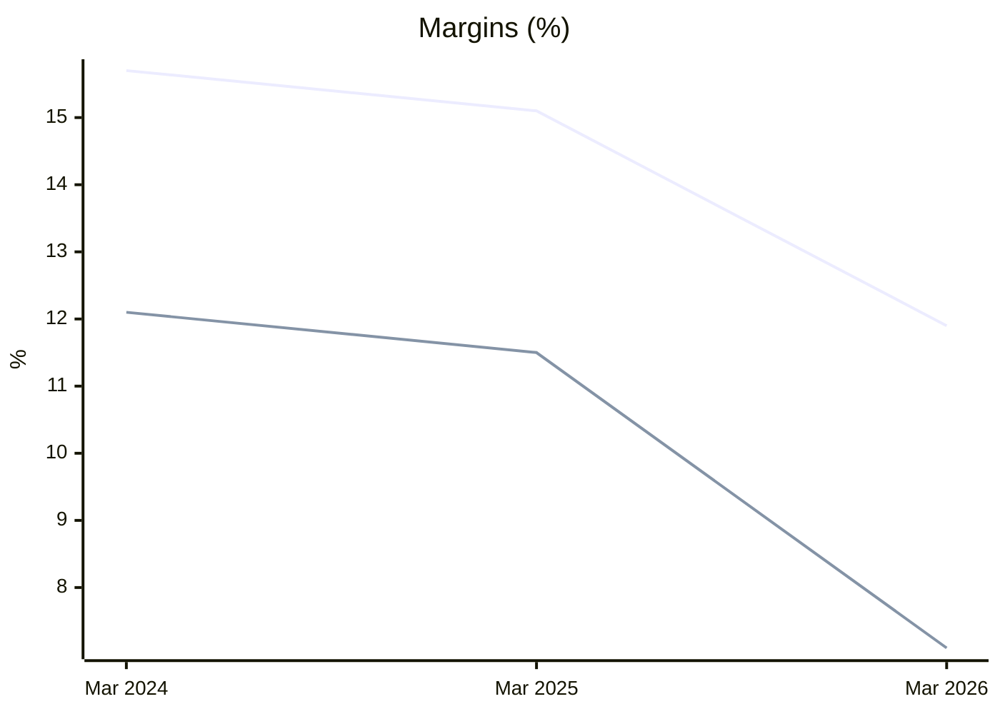
*Series in order: Operating margin, PAT margin.*

**P/E:** 26.9 — close 2026-10-01 ÷ EPS 53.83 (Mar 2026) (price ₹1,450.20 as of 2026-10-01).

**Cash flows (₹ cr):**

| | Mar 2024 | Mar 2025 | Mar 2026 |
|---|---:|---:|---:|
| Cash from operations (₹ cr) | 624 | 203 | 363 |
| Cash from investing (₹ cr) | -158 | -60.0 | -706 |
| Cash from financing (₹ cr) | -204 | -650 | -76.0 |
| Net cash flow (₹ cr) | 262 | -507 | -418 |
| Free cash flow (₹ cr) | 496 | 72.0 | 134 |

*Source: CashFlow/NiftyTotalMarket/SKFINDIA.csv (consolidated, screener.in).*

### The business being separated — its own numbers

**Industrial (Industrial Business / Demerged Undertaking, now SKF India (Industrial) Limited)** · unit ₹ million (MINR) · operating_profit = EBITDA as disclosed in the demerger presentation's segment-wise financial performance charts; pat = PAT of the segment. Revenue is the segment's total revenue (exports allocated into the two businesses), since Industrial + Automotive revenue sums exactly to company revenue (31,909 + 17,290 = 49,199.2 MINR FY2025; 28,979 + 16,722 = 45,701 MINR FY2024); segment EBITDA and PAT likewise sum to company EBITDA 8,469 and PAT 5,658 (FY2025) and PAT 5,517.7 (FY2024). Earlier years on the same page: FY2022 revenue 24,985 / EBITDA 4,430 / PAT 3,139; FY2023 revenue 28,980 / EBITDA 6,421 / PAT 4,424. Annual-report segment notes carry no Automotive/Industrial split (one segment, 'Bearings').

| | FY2024 | FY2025 | FY2026 |
|---|---:|---:|---:|
| Revenue (₹ million (MINR)) | 28,979 | 31,909 | — |
| Revenue growth (%) | — | +10.1% | — |
| Operating profit (₹ million (MINR)) | 4,987 | 5,173 | — |
| Operating profit growth (%) | — | +3.7% | — |
| Operating margin (%) | 17.2 | 16.2 | — |
| PAT (₹ million (MINR)) | 3,524 | 3,607 | — |
| PAT growth (%) | — | +2.4% | — |

*Sources:* Presentation Jul 2025 — page 8

*Not in the pages read:* FY2026 Industrial revenue/EBITDA/PAT absent (demerged 1-Oct-2025; FY26 pages are SKF India automotive-only, with discontinued-ops PAT 1,487.9 MINR for part-year). No Industrial-entity quarterly figures on these pages.

*Documents on file:* [Annual Report 2026](https://www.bseindia.com/xml-data/corpfiling/AttachHis/eea31abf-a99b-40f8-94e3-19ff8f2e06d2.pdf); [Annual Report 2025](https://www.bseindia.com/xml-data/corpfiling/AttachHis/2ecd50c2-a585-400f-82a3-e93f9f67f010.pdf); [Annual Report 2024](https://www.bseindia.com/xml-data/corpfiling/AttachHis/129a5235-e25c-48a9-a345-f339b16b8513.pdf); [Presentation Nov 2026](https://www.bseindia.com/stockinfo/AnnPdfOpen.aspx?Pname=921a9654-3781-443c-b89a-de70c964ab75.pdf); [Presentation Aug 2026](https://www.bseindia.com/stockinfo/AnnPdfOpen.aspx?Pname=6fc8549d-ea2f-4cdf-a02f-c74f2f40e661.pdf); [Presentation May 2026](https://www.bseindia.com/stockinfo/AnnPdfOpen.aspx?Pname=22999b36-438c-4026-8b66-1302cdca34d0.pdf); [Presentation Aug 2025](https://www.bseindia.com/stockinfo/AnnPdfOpen.aspx?Pname=ea8b3635-5385-4cf7-a7e7-35986deec736.pdf); [Presentation Jul 2025](https://www.bseindia.com/stockinfo/AnnPdfOpen.aspx?Pname=15f86335-6c7e-44e0-ada0-bacaf0463f90.pdf); [Presentation May 2025](https://www.bseindia.com/stockinfo/AnnPdfOpen.aspx?Pname=2af85195-591f-45a4-bcfb-8dbfb10e3dcd.pdf)

**The checklist:**

| Item | Status | Evidence |
|---|---|---|
| Why the spin-off | yes | unrelated businesses separated; value unlocking for shareholders — “…merger? Different Market Dynamics Distinct Customer Needs Focused Capital Allocation Faster Decision Making Independent Growth Strategies SKF India (Industrial) Limited Focused on infrastructure and manufacturing, servi” |
| Institutional selling likely (small / different business) | yes | the demerged piece is 15% of ebitda; the businesses are described as distinct |
| Insider ownership and incentives aligned | unknown | no promoter-continuity or option-pricing language found *(next: the date the management options are priced; promoter holding in the resulting company)* |
| A hidden value revealed (pro-forma, leverage, comparables) | unknown | no pro-forma or market data on file *(next: pro-forma P&L of each piece × the peer P/E of its own industry)* |
| Parent before the spin (clean parent, takeover prelude) | no | stage record_date — the pieces trade separately now |
| Timing (first year sells, second year gains) | yes | 389 days since listing/record date; second year since listing — where the notes found the largest gains |
| Management discussing it on the calls | yes | 6 mention(s) in the last 12 months of calls — “…Mandlesha from Anand Rathi Institutional Equities. Mumuksh Mandlesha : Thank you. Sir for the opportunity , firstly, on the cost side. In Q4, how much was the demerger - related impact in the other expenses? And going a” |

**On the calls (last 12 months):**

- *May 2026* (backward) — “…ed has been extracted from consolidated financial stat ements of erstwhile combined entity and may involve some assumptions by the management pertaining to the demerged industrial undertaking. These are prepared in accordance with the Appendix C of Ind AS 103 business combinations by using the financial information maintained…”
- *May 2026* (backward) — “…e cost provision reversal . Now talking about year -on-year change in profit before tax, again, there were certain one -off factors, including costs related to demerger , mix impact as well as the comparability issue, as mentioned in the introductory statement. SKF India Limited May 21, 2026 Page 4 of 16 Now let's move to Slid…”
- *May 2026* (neutral) — “…INR 4.05 billion, which represents a cash conversion ratio of about 85%. Cash flow during the year was also impacted by certain one -off factors related to the demerger and these are expected to smoothen as we move forward, and we look forward for the next fina ncial year. This brings us to the end of financial part of the pre…”
- *May 2026* (forward) — “…profile. What we have seen, of course, is a deterioration on a Y -o-Y basis. Just wanted to get a sense around what would be the one -off costs relating to the demerger in the fourth quarter of FY '26 and FY '26? And with respect to margins, what can be the sustainable margin expectation going ahead into FY '27? Mayank Holani…”
- *May 2026* (backward) — “…be the sustainable margin expectation going ahead into FY '27? Mayank Holani : See if you look at -- in quarter 4 of financial year, there were not too much of demerger -related costs. And if you look at the one -off cos ts, which I mentioned in the Q3 , rather one-off gains in Q3, if we remove them, it was more or less at par…”

<details><summary>The filings</summary>

| Date | Category | Headline | Attachment |
|---|---|---|---|
| 2025-10-15 | Record Date (corporate-actions register) | Record date 2025-10-15 for Demerger — NSE corporate-actions register |  |
| 2025-11-15 | Press Release | In compliance with Regulation 30 of SEBI (Listing Obligations and Disclosure Requirements) Regulations, 2015, please find enclosed herewith the copy of Press Re | [pdf](https://nsearchives.nseindia.com/corporate/SKFINDIA25_15112025132755_NSE.pdf) |
| 2025-11-21 | Demerger | SKF India Limited has informed the Exchange about the communication for the attention of the shareholders of the Company for apportionment of cost of acquisitio | [pdf](https://nsearchives.nseindia.com/corporate/SKFINDIA25_21112025182518_19_SE_Intimation_on_Cost_apportionment_Signed.pdf) |
| 2025-11-28 | Updates | Compliance Letter w.r.t. Observation Letter dated March 28, 2025 issued by National Stock Exchange of India Limited ( NSE ) in the matter of Scheme of Arrangeme | [pdf](https://nsearchives.nseindia.com/corporate/SKFINDIA25_28112025194055_NSE.pdf) |
| 2026-02-06 | Press Release | In compliance with Regulation 30 of SEBI (Listing Obligations and Disclosure Requirements) Regulations, 2015, please find enclosed herewith the copy of Press Re | [pdf](https://nsearchives.nseindia.com/corporate/SKFINDIA25_06022026203743_NSE.pdf) |
| 2026-05-01 | Earnings call May 2026 | …profile. What we have seen, of course, is a deterioration on a Y -o-Y basis. Just wanted to get a sense around what would be the one -off costs relating to the | [pdf](https://www.bseindia.com/stockinfo/AnnPdfOpen.aspx?Pname=fa739605-3c56-43bc-8950-6cc1db2e700e.pdf) |
| 2026-05-01 | Earnings call May 2026 | …r onwards when after separation, it will be more clear because you will have stable performance. Viraj : Sir, just to follow -up on this. See if I look at pre  | [pdf](https://www.bseindia.com/stockinfo/AnnPdfOpen.aspx?Pname=fa739605-3c56-43bc-8950-6cc1db2e700e.pdf) |
| 2026-08-14 | Updates | We are enclosing herewith the Business Presentation made by Mr. Shailesh Kumar Sharma,Managing Director of the Company, during the 65th Annual General Meeting h | [pdf](https://nsearchives.nseindia.com/corporate/SKFINDIA22_14082026200419_NSE.pdf) |
| 2026-08-20 | Updates | We are enclosing herewith Transcript of the 65th Annual General Meeting of the company held on 14th August 2026. | [pdf](https://nsearchives.nseindia.com/corporate/SKFINDIA25_20082026163549_NSE.pdf) |

</details>

## TMPV — Tata Motors Passenger Vehicles Ltd.

**CONFIRMED** (a demerger scheme is on the exchange record) · **LISTED 1–2Y — the second-year window** · score 5.7/10 · spin-off · 21 filing(s) from NSE, NSE-register · first 2025-10-14, latest 2026-11-01

> **Listing:** LISTED — the resulting company trades since about 2025-10-14

**The stages, as filed:** meetings (2025-11-28) → record_date (2025-10-14)

**Stated in the filings:** demerged undertaking: , undertaking.

**What is being separated, as the documents put it:** The Commercial Vehicles business, demerged from Tata Motors Limited into TML Commercial Vehicles Limited, now renamed Tata Motors Limited — class `regulatory_strategic`.

- *Insiders:* Tata Sons Private Limited is Promoter; promoter group held 1,565,402,703 of 3,682,582,902 shares (~42.5%), mirrored 1:1 in the resulting company. P B Balaji (4,93,186 shares) is a director of the CV entity.
- *What it reveals:* Separation leaves the parent as cars/SUVs plus JLR: India PV net cash ~Rs.7,000 Cr with 15% FY26 volume growth, over 40% EV share, while JLR carries Rs.33,000 Cr net debt and 0.7% EBIT; CV took 31.15% of cost base.
- *Selling pressure:* likely — Every PV holder received 1:1 shares in a smaller, different-industry commercial-vehicle entity (31.15% of apportioned cost); index effects not stated.
- *Parent or spin:* parent · *option pricing date:* not stated
- *Read next:* Clause 9 of the Composite Scheme (NCLT orders August 25 / September 10, 2025) on share-based incentives, plus TMCV's own standalone results
- *In their words:* “In this regard, we wish to inform that TMCV has intimated the Company today that it has received approval from BSE Limited and National Stock Exchange of India Limited for listing and trading of its equity shares, effective November 12, 2025.”

### Why the demerger — three years of calls and the scheme

The separation at issue is the demerger of the Commercial Vehicles business out of the old Tata Motors Limited into TML Commercial Vehicles Limited, executed together with the amalgamation of the PV subsidiary back into the listed parent, under one Composite Scheme of Arrangement sanctioned by NCLT Mumbai (orders of August 25, 2025 and a rectification order of September 10, 2025), with an appointed date of July 1, 2025 and effective date of October 1, 2025. The Scheme states only two objectives in these texts: to transfer the Commercial Vehicles undertaking to the Resulting Company 'on a going concern basis' in compliance with Section 2(19AA) of the Income-tax Act, and to amalgamate Tata Motors Passenger Vehicles Limited into TML 'with an objective of consolidating the Passenger Vehicles Business with TML', after which TML was renamed Tata Motors Passenger Vehicles Limited and TMLCVL renamed Tata Motors Limited (w.e.f. October 13, 2025). The result is that, as the postal ballot puts it, 'the Commercial Vehicle and Passenger Vehicle businesses of the Company are housed in two separate entities', each with its own reconstituted board and KMP (Shailesh Chandra as MD & CEO of TMPV from October 1, 2025; P B Balaji moved from Group CFO to CEO of Jaguar Land Rover from November 17, 2025), and TMPV left reporting one automotive segment of JLR plus Tata Passenger Vehicles, 'other than CV segment moving out'. Shareholders were handed direct ownership of both: 1 TMLCVL share for every 1 TML share held on the October 14, 2025 record date, with historical cost apportioned 31.15% to the CV entity and 68.85% to TMPV, and the new CV shares listed from November 12, 2025. Management's only economic framing on the calls is accounting and capital: a notional demerger gain of ~Rs. 83,000 Cr (CV business valued at ~Rs. 94,000 Cr by third-party agencies against ~Rs. 11,000 Cr book value of net assets transferred), fully offset by a contra deemed-dividend entry so there is 'absolutely no impact on either distributable reserves or on our net worth'; an India PV business that is net cash (~Rs. 5,000 Cr at Q3 FY26, ~Rs. 7,000 Cr at FY26-end) which 'gives a lot of flex to fund the rich product investment cycle'; and the two entities now declaring dividends separately (Rs. 3 at TMPV plus Rs. 4 at TMLCV, 'a total dividend of Rs. 7 in the year when the demerger was undertaken' versus Rs. 6 before). Costs disclosed are stamp duty: a Rs. 400 Cr provision in Q3 FY26, included within about Rs. 4,100 Cr of FY26 exceptionals. No investor, lender or partner is named anywhere in these texts as having asked for the separation; the only stakeholder input recorded is the shareholder vote, which management described as 'overwhelming votes in our favor', and the nine AGM resolutions passed in July 2026.

**How it evolved:** On the Feb 2025 call (Q3 FY25, January 29, 2025) the demerger was already a filed corporate action awaiting exchange/SEBI NOC, with appointed date July 1 and effective date around October 1, 2025; by the Jun 2025 call (Q4 FY25, May 13, 2025) the shareholder vote had passed overwhelmingly and both dates were reconfirmed, and on the Aug 2025 call (Q1 FY26, August 8, 2025) the NCLT final hearing had concluded that same day with judgment reserved and the October 1 effective date 'on plan'. The Nov 2025 call (Q2 FY26, November 14, 2025) was the first set of results reported post-separation, where management walked through the demerger accounting entries, the Rs. 83,000 Cr notional gain and contra deemed dividend, and the new segment structure. Thereafter the subject narrows to residuals and costs: the Feb 2026 call (February 5, 2026) notes CV is out of the segments and books a Rs. 400 Cr stamp duty provision, and the Jun 2026 call (May 14, 2026) folds stamp duty into FY26 exceptionals and frames the two separate dividends as Rs. 7 combined; the strategic 'why' is never revisited on any of these six calls.

**What management expects from it:** Stated only indirectly: CV and PV housed in two separate listed entities, each with its own board, leadership and dividend (Rs. 3 + Rs. 4 vs Rs. 6 before); TMPV consolidating PV, EV and JLR under one automotive segment, with a net-cash India business (Rs. 7,000 Cr) giving flexibility to fund its product investment cycle while JLR carries Rs. 33,000 Cr net debt.

**Point by point, with the source:**

- *Scheme* — The Scheme bundles two steps: hiving off the Commercial Vehicles undertaking into TMLCVL on a going concern basis (structured to qualify under Section 2(19AA) of the Income-tax Act), and amalgamating the PV subsidiary into the listed parent — the only explicit objective language in any document supplied. “Amalgamation of TMLPV with TML with an objective of consolidating the Passenger Vehicles Business with TML and consequent dissolution of TMLPV without being wound up.”
- *Scheme* — The November 2025 postal ballot explains the consequence the separation was meant to produce — two self-standing entities — and uses it as the reason to rebuild both boards, appointing Shailesh Chandra MD & CEO of TMPV from October 1, 2025 and P B Balaji as a non-executive director while he became CEO of Jaguar Land Rover from November 17, 2025. “In view of the above, it was proposed to reconstitute the Board of Directors of both  the entities .”
- *Scheme* — Shareholders were given direct ownership of both businesses rather than cash, at a strict 1:1 entitlement on the October 14, 2025 record date, with historical cost of acquisition apportioned 31.15% to the CV entity and 68.85% to TMPV; the CV shares were approved for listing and trading from November 12, 2025. “1 (one) share of the Resulting Company (face value of INR 2/- each fully paid up), for every 1 (one) share of the Demerged Company (face value of INR 2/- each fully paid up) of the same class of shares outstanding and as held by such shareholder in the Demerged Company, without any further application, act or deed (‘Share Entitlement Ratio’).”
- *Scheme* — At the 81st AGM (July 8, 2026) the Chairman and the MD & CEO presented the demerger as completed and as the platform for TMPV's own roadmap, pairing it with JLR's new Panapakkam, Tamil Nadu production and with long-term growth aspirations to FY31 on a consolidated basis. “He highlighted the demerger of Commercial Vehicles business into a separate legal entity and commencement of commercial production by JLR at Panapakkam, Tamil Nadu reflecting the synergy between the Company and JLR.”
- *[Feb 2025](https://www.bseindia.com/stockinfo/AnnPdfOpen.aspx?Pname=28345af3-7271-4146-8cf3-8da0f9c73222.pdf)* — The demerger was presented purely as a corporate action on track — filings with the exchanges and SEBI complete, operational carve-out work advanced, appointed date July 1 and effective date around October 1, 2025 — alongside the parallel Tata Motors Finance merger into Tata Capital. “Operational activities are in an advanced stage and progressing as per plan.”
- *[Jun 2025](https://www.bseindia.com/stockinfo/AnnPdfOpen.aspx?Pname=80350d5e-9578-469f-bf9f-31610098f897.pdf)* — Management reported that shareholders had backed the Scheme decisively and that both the appointed and effective dates were intact; asked about asset allocation, Balaji confirmed the Tata Capital stake would sit with the CV business after separation. “we had overwhelming votes in our favor and therefore we are on track for an appointed date of July 1st”
- *[Aug 2025](https://www.bseindia.com/stockinfo/AnnPdfOpen.aspx?Pname=2a91a004-4cbd-440e-93d3-2ca8967ff37b.pdf)* — The NCLT final hearing concluded on the day of the call with judgment reserved, which management said would let them complete the demerger within the quarter for an October 1 effective date; the same slide carried the CV side's Iveco acquisition, i.e. each business already pursuing its own agenda. “Hot of the press is the demerger.”
- *[Nov 2025](https://www.bseindia.com/stockinfo/AnnPdfOpen.aspx?Pname=e6684a03-5a4d-4c7a-8da0-d5b2c52ec7d1.pdf)* — First results after separation: the demerger produced a ~Rs. 83,000 Cr book gain on disposal of the CV undertaking (CV valued at ~Rs. 94,000 Cr by third-party agencies versus ~Rs. 11,000 Cr book value of net assets transferred), but it is entirely notional with no effect on net worth or distributable reserves. “But this is only a notional gain as there is a contra entry of ~Rs. 83,000 Cr as a deemed dividend.”
- *[Nov 2025](https://www.bseindia.com/stockinfo/AnnPdfOpen.aspx?Pname=e6684a03-5a4d-4c7a-8da0-d5b2c52ec7d1.pdf)* — Reporting was simplified to one automotive segment comprising JLR and Tata Passenger Vehicles plus 'others' (mainly Tata Technologies and Tata Motors Holdings Pte Singapore); prior-period income statements were restated to TMPV only, while prior balance sheets still include CV and are not comparable. “The automotive segment will now comprise of JLR and Tata Passenger Vehicles business.”
- *[Nov 2025](https://www.bseindia.com/stockinfo/AnnPdfOpen.aspx?Pname=e6684a03-5a4d-4c7a-8da0-d5b2c52ec7d1.pdf)* — Capital framing of the standalone PV entity: the India business is net cash, which management said gives flexibility to fund its heavy product investment cycle; one residual link to CV remains — the Rs. 6,500 Cr PLI cap still applies to PV and CV together because the original 2021 application was made as a Group. “We had applied originally in 2021 as a Group.”
- *[Feb 2026](https://www.bseindia.com/stockinfo/AnnPdfOpen.aspx?Pname=7907e958-7953-4b49-b831-aab03d6e2746.pdf)* — CV is confirmed out of the reporting perimeter with nothing else changed, and the first demerger cost is booked — a Rs. 400 Cr stamp duty provision within Rs. 1,600 Cr of quarterly exceptionals alongside JLR cyber and India wage-bill charges. “Commercial vehicle business is out I think last quarter post the demerger , everything else is the same.”
- *[Jun 2026](https://www.bseindia.com/stockinfo/AnnPdfOpen.aspx?Pname=b4d386d7-de53-4409-8e90-187e08cb4a91.pdf)* — FY26 exceptionals of about Rs. 4,100 Cr include demerger stamp duty; separately, the two entities now set dividends independently — Rs. 3 per share at TMPV (about Rs. 1,100 Cr outflow) plus Rs. 4 at TMLCV — which management framed as more total distribution than the pre-demerger company paid. “So this actually represents a total dividend of Rs. 7 in the year when the demerger was undertaken and an increase over the Rs. 6 that we have paid for the last two years.”

*Not explained on the calls:* No value-unlock, focus, valuation or synergy argument; no demerger costs/benefits beyond stamp duty; no dis-synergies, debt-allocation logic, or any investor, lender or partner request.

*Calls read (36 months):* [Aug 2024](https://www.bseindia.com/stockinfo/AnnPdfOpen.aspx?Pname=1e3235fd-552d-429b-b6b3-26217ccc1c75.pdf), [Aug 2025](https://www.bseindia.com/stockinfo/AnnPdfOpen.aspx?Pname=2a91a004-4cbd-440e-93d3-2ca8967ff37b.pdf), [Feb 2025](https://www.bseindia.com/stockinfo/AnnPdfOpen.aspx?Pname=28345af3-7271-4146-8cf3-8da0f9c73222.pdf), [Feb 2026](https://www.bseindia.com/stockinfo/AnnPdfOpen.aspx?Pname=7907e958-7953-4b49-b831-aab03d6e2746.pdf), [Jun 2025](https://www.bseindia.com/stockinfo/AnnPdfOpen.aspx?Pname=80350d5e-9578-469f-bf9f-31610098f897.pdf), [Jun 2026](https://www.bseindia.com/stockinfo/AnnPdfOpen.aspx?Pname=b4d386d7-de53-4409-8e90-187e08cb4a91.pdf), [May 2024](https://www.bseindia.com/stockinfo/AnnPdfOpen.aspx?Pname=cfd0020f-d9cc-4148-9606-10eb86705ffd.pdf), [Nov 2025](https://www.bseindia.com/stockinfo/AnnPdfOpen.aspx?Pname=e6684a03-5a4d-4c7a-8da0-d5b2c52ec7d1.pdf)

### The parent, last three fiscal years (consolidated)

| | Mar 2024 | Mar 2025 | Mar 2026 |
|---|---:|---:|---:|
| Sales (₹ cr) | 434,016 | 366,094 | 335,582 |
| Sales growth (%) | +25.5% | -15.6% | -8.3% |
| Operating profit (₹ cr) | 57,809 | 47,993 | 18,719 |
| Operating profit growth (%) | +81.7% | -17.0% | -61.0% |
| Operating margin (%) | 13.3 | 13.1 | 5.6 |
| PAT (₹ cr) | 31,807 | 28,149 | 82,645 |
| PAT growth (%) | +1082.4% | -11.5% | +193.6% |
| PAT margin (%) | 7.3 | 7.7 | 24.6 |
| EPS (₹) | 94.5 | 75.6 | 224 |

*Source: ProfitStatement/NiftyTotalMarket/TMPV.csv (consolidated, screener.in); growth and margins computed here.*

```mermaid
xychart-beta
    title "Sales, operating profit and PAT (₹ cr)"
    x-axis ["Mar 2024", "Mar 2025", "Mar 2026"]
    y-axis "₹ crore"
    bar [434016, 366094, 335582]
    bar [57809, 47993, 18719]
    bar [31807, 28149, 82645]
```
*Series in order: Sales, Operating profit, PAT.*

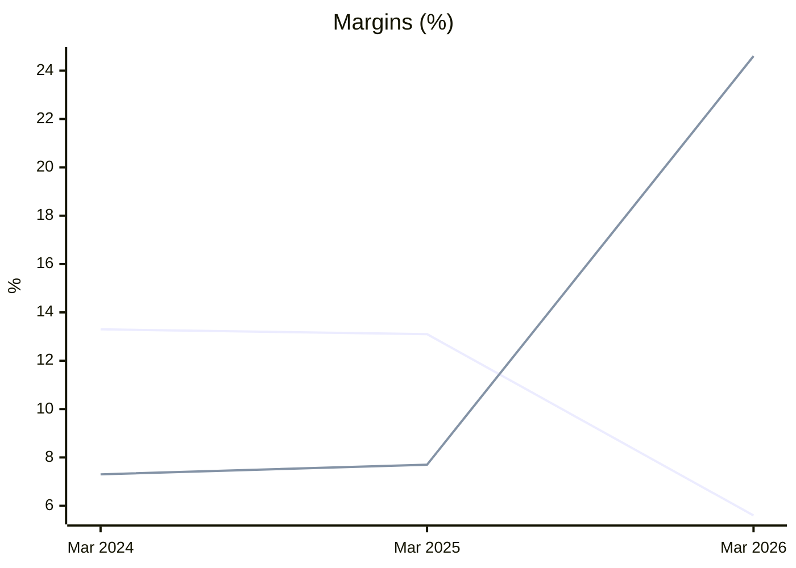
*Series in order: Operating margin, PAT margin.*

**P/E:** 1.45 — live market file (screener.in), trailing (price ₹340.00 as of 2026-08-02).

**Cash flows (₹ cr):**

| | Mar 2024 | Mar 2025 | Mar 2026 |
|---|---:|---:|---:|
| Cash from operations (₹ cr) | 67,915 | 63,102 | 13,041 |
| Cash from investing (₹ cr) | -22,781 | -49,982 | -23,166 |
| Cash from financing (₹ cr) | -37,006 | -18,786 | -1,344 |
| Net cash flow (₹ cr) | 8,128 | -5,666 | -11,469 |
| Free cash flow (₹ cr) | 36,732 | 26,034 | -23,195 |

*Source: CashFlow/NiftyTotalMarket/TMPV.csv (consolidated, screener.in).*

### The business being separated — its own numbers

**Tata Commercial Vehicles (CV business / Commercial Vehicles segment, demerged into TML Commercial Vehicles Ltd.)** · unit ₹ crore · Revenue = 'Total revenues' for the Tata Commercial Vehicle reportable sub-segment, i.e. external revenue PLUS inter-/intra-segment revenue (FY24: 76,961 external + 1,830 inter-segment; FY25: 74,049 external + 1,006 inter-segment). Operating profit = segment result as reported: 'Earnings before other income (excluding incentives), finance costs, foreign exchange gain/(loss) (net), exceptional items and tax' = segment EBIT (no exceptional items deducted; CV exceptional loss was 833 in FY24 and 266 in FY25). Standalone-report EBIT margin is 8.2% FY24 and 9.1% FY25. PBT (before exceptional items) for the CV business is disclosed only in the Integrated Report highlights: ₹6,102 crore for FY24 (Annual Report 2024 — page 35); no CV PAT is disclosed in any tagged page. Latest quarter figures are from the Q1 FY26 investor presentation where CV was still a reported segment: revenue from operations 17,009, EBITDA 2,074 (12.2% margin), EBIT 1,650, PBT (bei) 1,657, PAT 1,617.

| | FY2024 | FY2025 | FY2026 |
|---|---:|---:|---:|
| Revenue (₹ crore) | 78,791 | 75,055 | — |
| Revenue growth (%) | — | -4.7% | — |
| Operating profit (₹ crore) | 6,483 | 6,814 | — |
| Operating profit growth (%) | — | +5.1% | — |
| Operating margin (%) | 8.2 | 9.1 | — |
| PAT (₹ crore) | — | — | — |
| PAT growth (%) | — | — | — |

*Sources:* Annual Report 2025 — page 409 (re-presented); same figures Annual Report 2024 — page 372 (78,791.21 / 6,483.46) and Annual Report 2024 — page 217; Annual Report 2025 — page 408; also Annual Report 2025 — page 252; Annual Report 2026 — page 421/422: CV ceased to be a reportable segment from July 1, 2025 (demerger effective October 1, 2025); FY26 segment note carries only Passenger Vehicles and JLR

*Latest quarter (Q1 FY26 (quarter ended June 30, 2025) — last quarter in which CV is reported as a segment):* revenue 17009, operating profit 2074 — Presentation Aug 2025 — page 42 (EBITDA 2,074; EBIT 1,650; PBT bei 1,657; PAT 1,617)

*Not in the pages read:* CV PAT for FY24/FY25; CV PBT for FY25; any FY26 full-year CV figures (demerged, segment discontinued from July 1, 2025); CV EBITDA for FY24/FY25 in ₹ crore (only 10.8% margin, FY24).

*Documents on file:* [Annual Report 2026](https://www.bseindia.com/xml-data/corpfiling/AttachHis/b37e4ca4-826d-4b6c-b250-fcdf423e6bc4.pdf); [Annual Report 2025](https://www.bseindia.com/xml-data/corpfiling/AttachHis/18f91098-8691-409d-b771-808c48964a4f.pdf); [Annual Report 2024](https://www.bseindia.com/xml-data/corpfiling/AttachHis/0913b647-b205-4a3c-ad9b-8c493f97f972.pdf); [Presentation Aug 2026](https://www.bseindia.com/stockinfo/AnnPdfOpen.aspx?Pname=0a68c514-96c1-4dc5-a628-3eda55a7b541.pdf); [Presentation Jun 2026](https://www.bseindia.com/stockinfo/AnnPdfOpen.aspx?Pname=10059fad-ae2a-4feb-acc2-09659bc3eb1f.pdf); [Presentation May 2026](https://www.bseindia.com/stockinfo/AnnPdfOpen.aspx?Pname=ee5addb0-24c8-45de-9071-c06bf3ba6daa.pdf); [Presentation Feb 2026](https://www.bseindia.com/stockinfo/AnnPdfOpen.aspx?Pname=dd254e14-5794-42bb-8d6f-1caf2bb991e9.pdf); [Presentation Nov 2025](https://www.bseindia.com/stockinfo/AnnPdfOpen.aspx?Pname=66609a3b-bf4c-44fb-936b-35980e120c69.pdf); [Presentation Aug 2025](https://www.bseindia.com/stockinfo/AnnPdfOpen.aspx?Pname=bb4a4687-1e7e-447b-96ff-260c99a71b2a.pdf)

**The checklist:**

| Item | Status | Evidence |
|---|---|---|
| Why the spin-off | yes | value unlocking for shareholders; a weak or capital-heavy business carved away; regulatory / strategic knot — “…imization, including initiatives that extend product life, improve reuse, refurbishment, and enable circular value creation across the product lifecycle. Additionally, the Company is in the process of setting revenue-ba” |
| Institutional selling likely (small / different business) | unknown | size of the demerged piece not stated *(next: pro-forma statements: revenue / assets of the demerged undertaking vs the parent)* |
| Insider ownership and incentives aligned | unknown | no promoter-continuity or option-pricing language found *(next: the date the management options are priced; promoter holding in the resulting company)* |
| A hidden value revealed (pro-forma, leverage, comparables) | yes | borrowings 79,109 cr (Mar 2026) = 0.63× market cap; P/E 1.5 on Mar 2026 profit vs industry median 41.6 (35 peers) |
| Parent before the spin (clean parent, takeover prelude) | no | stage record_date — the pieces trade separately now |
| Timing (first year sells, second year gains) | yes | 390 days since listing/record date; second year since listing — where the notes found the largest gains |
| Management discussing it on the calls | yes | 6 mention(s) in the last 12 months of calls — “…o years. The TMLCV has announced Rs. 4 of dividend in the results meeting yesterday. So this actually represents a total dividend of Rs. 7 in the year when the demerger was undertaken and an increase over the Rs. 6 that” |

**On the calls (last 12 months):**

- *Nov 2025* (neutral) — “…eaking to you as we report our ■rst quarterly earnings as a listed entity. Next slide, please. The Safe Harbor statement , as it's the ■rst quarter post the CV demerger , a few hygiene accounting related matters to get out of the way. Our segment reporting will now comprise of automotive segments and others. The automotive seg…”
- *Nov 2025* (neutral) — “…Aspirations Tata Motors Passenger Vehicles Limited November 14, 2025 is something for you to know. Next slide, please. Another accounting matter related to the demerger. As part of demerger accounting entries, we have recorded a pro■t of ~Rs. 83,000 Cr on disposal of the CV undertaking, which is essentially the fair value of t…”
- *Nov 2025* (neutral) — “…rs Passenger Vehicles Limited November 14, 2025 is something for you to know. Next slide, please. Another accounting matter related to the demerger. As part of demerger accounting entries, we have recorded a pro■t of ~Rs. 83,000 Cr on disposal of the CV undertaking, which is essentially the fair value of the CV assets, less th…”
- *Feb 2026* (backward) — “…afe Harbor statement, nothing material to report here. Our reporting segments remain the same. Commercial vehicle business is out I think last quarter post the demerger , everything else is the same. Next slide please. In terms of key business highlights for the quarter, the domestic business has had a pretty busy launch calen…”
- *Jun 2026* (neutral) — “…r the year was Rs. 2,500 Cr, and this excludes about Rs. 4,100 Cr of except ionals for cyber, the labor code impact in India and the stamp duty charges for the demerger. Next slide, please. Tata Motors Passenger Vehicles Limited May 14, 202 6 The Board has approved a dividend of Rs. 3 per share. The cash outflow for the divide…”

<details><summary>The filings</summary>

| Date | Category | Headline | Attachment |
|---|---|---|---|
| 2025-10-14 | Record Date (corporate-actions register) | Record date 2025-10-14 for Demerger — NSE corporate-actions register |  |
| 2025-11-10 | General Updates | Tata Motors Passenger Vehicles Limited has informed the Exchange about the listing of equity shares of Tata Motors Limited (formerly TML Commercial Vehicles Lim | [pdf](https://nsearchives.nseindia.com/corporate/TATAMOTORSSJS_10112025220440_NSEBSELISTING.pdf) |
| 2025-11-12 | Updates | Tata Motors Passenger Vehicles Limited has informed the Exchange regarding 'Apportionment of cost of acquisition of Equity Shares of Tata Motors Passenger Vehic | [pdf](https://nsearchives.nseindia.com/corporate/TATAMOTORSSJS_12112025224654_NSEBSECOAFINAL.pdf) |
| 2025-11-28 | Shareholders meeting | Notice of Postal Ballot for Tata Motors Passenger Vehicles Limited (formerly Tata Motors Limited). | [pdf](https://nsearchives.nseindia.com/corporate/TATAMOTORSSJS_28112025190050_Lettertoexchangesforpostalballotfinal.pdf) |
| 2026-01-08 | General Updates | Tata Motors Passenger Vehicles Limited has informed the Exchange about General Updates | [pdf](https://nsearchives.nseindia.com/corporate/TATAMOTORSSJS_08012026190458_LetterNSEBSEPaarthav.pdf) |
| 2026-02-01 | Press Release | Tata Motors Passenger Vehicles Limited has informed the Exchange regarding a press release dated February 01, 2026, titled "Tata Motors Passenger Vehicles Limit | [pdf](https://nsearchives.nseindia.com/corporate/TATAMOTORSSJS_01022026100623_NSEBSEPVSALESRELEASE.pdf) |
| 2026-03-01 | Press Release | Tata Motors Passenger Vehicles Limited has informed the Exchange regarding a press release dated March 01, 2026, titled "Tata Motors Passenger Vehicles Limited  | [pdf](https://nsearchives.nseindia.com/corporate/TATAMOTORSSJS_01032026125037_NSEBSEPVSALES.pdf) |
| 2026-05-01 | Press Release | Tata Motors Passenger Vehicles Limited has informed the Exchange regarding a press release dated May 01, 2026, titled "Tata Motors Passenger Vehicles Limited (f | [pdf](https://nsearchives.nseindia.com/corporate/TATAMOTORSSJS_01052026120940_PVSalesRelease.pdf) |
| 2026-06-01 | Press Release | Tata Motors Passenger Vehicles Limited has informed the Exchange regarding a press release dated Jun 01, 2026, titled "Tata Motors Passenger Vehicles Limited (f | [pdf](https://nsearchives.nseindia.com/corporate/TATAMOTORSSJS_01062026142321_PVSALESRELEASE.pdf) |
| 2026-06-01 | Press Release (Revised) | Tata Motors Passenger Vehicles Limited has informed the Exchange regarding a revised press release dated Jun 01, 2026, titled "Tata Motors Passenger Vehicles Li | [pdf](https://nsearchives.nseindia.com/corporate/TATAMOTORSSJS_01062026152002_NSEBSEREVISED.pdf) |
| 2026-06-12 | Press Release | Tata Motors Passenger Vehicles Limited has informed the Exchange regarding a press release dated Jun 12, 2026, titled "Tata Motors Passenger Vehicles Limited (f | [pdf](https://nsearchives.nseindia.com/corporate/TATAMOTORSSJS_12062026112654_NSEBSEPricehike.pdf) |
| 2026-06-15 | Updates | Tata Motors Passenger Vehicles Limited has informed the Exchange regarding 'Business Responsibility and Sustainability Report for the Financial Year 2025-26'. | [pdf](https://nsearchives.nseindia.com/corporate/TATAMOTORSSJS_15062026221011_NSEBSEBRSR.pdf) |
| 2026-07-01 | Press Release | Tata Motors Passenger Vehicles Limited has informed the Exchange regarding a press release dated July 01, 2026, titled "Tata Motors Passenger Vehicles Limited ( | [pdf](https://nsearchives.nseindia.com/corporate/TATAMOTORSSJS_01072026142534_PVSALESRELEASE.pdf) |
| 2026-07-08 | Shareholders meeting | Tata Motors Passenger Vehicles Limited has informed the Exchange regarding Proceedings of Annual General Meeting held on July 08, 2026. Further, the company has | [pdf](https://nsearchives.nseindia.com/corporate/TATAMOTORSSJS_08072026195508_PVvotingresult.pdf) |
| 2026-08-01 | Press Release | Tata Motors Passenger Vehicles Limited has informed the Exchange regarding a press release dated August 01, 2026, titled "Tata Motors Passenger Vehicles Limited | [pdf](https://nsearchives.nseindia.com/corporate/TATAMOTORSSJS_01082026114014_NSEBSEJULYSALES.pdf) |
| 2026-08-21 | Press Release | Tata Motors Passenger Vehicles Limited has informed the Exchange regarding a press release dated August 21, 2026, titled "Tata Motors Passenger Vehicles Limited | [pdf](https://nsearchives.nseindia.com/corporate/TATAMOTORSSJS_21082026084714_NSEBSEPriceHike.pdf) |
| 2026-08-25 | Press Release | Tata Motors Passenger Vehicles Limited has informed the Exchange regarding a press release dated August 25, 2026, titled "Tata Motors Passenger Vehicles, Tata C | [pdf](https://nsearchives.nseindia.com/corporate/TATAMOTORSSJS_25082026170822_NSEBSEPressRelease.pdf) |
| 2026-09-01 | Press Release | Tata Motors Passenger Vehicles Limited has informed the Exchange regarding a press release dated September 01, 2026, titled "Tata Motors Passenger Vehicles Limi | [pdf](https://nsearchives.nseindia.com/corporate/TATAMOTORSSJS_01092026131220_AugSalesRelease.pdf) |
| 2026-10-01 | Press Release | Tata Motors Passenger Vehicles Limited has informed the Exchange regarding a press release dated October 01, 2026, titled "Tata Motors Passenger Vehicles Limite | [pdf](https://nsearchives.nseindia.com/corporate/TATAMOTORSSJS_01102026131705_NSEBSEQ2FY27.pdf) |
| 2026-10-12 | Press Release | Tata Motors Passenger Vehicles Limited has informed the Exchange regarding a press release dated October 12, 2026, titled "Stellantis and Tata Motors Passenger  | [pdf](https://nsearchives.nseindia.com/corporate/TATAMOTORSSJS_12102026155833_NSEBSETraverse.pdf) |
| 2026-11-01 | Press Release | Tata Motors Passenger Vehicles Limited has informed the Exchange regarding a press release dated November 01, 2026, titled "Tata Motors Passenger Vehicles Limit | [pdf](https://nsearchives.nseindia.com/corporate/TATAMOTORSSJS_01112026123417_NSEBSESalesRelease.pdf) |

</details>

## ANANTRAJ — Anant Raj Ltd.

**CONFIRMED** (a demerger scheme is on the exchange record) · **PRE-SPIN — study the parent; the pieces do not trade yet** · score 5.0/10 · spin-off · 6 filing(s) from NSE, NSE-deep · first 2026-05-11, latest 2026-07-21

> **Listing:** NOT YET — scheme at 'announced' stage; the resulting company will list only after NCLT sanction, effectiveness and a record date; no listing timeline stated

**The stages, as filed:** announced (2026-07-21)

**What is being separated, as the documents put it:** The Data Centre and Cloud Services business of ARL and ARCPL, vested in Ashok Cloud Private Limited — class `value_unlocking`.

- *Insiders:* ARL promoters hold 57.42% of ARL; post-scheme ACPL is 28.14% promoters directly plus 51% held by ARL (79.14% total), public 20.86%. Promoter-group Anish Sarin oversees data-centre rollout.
- *What it reveals:* Demerged Undertaking turnover Rs 145.90 cr is only 8.96% of Rs 1,627.72 cr; management cites ~75% data-centre EBITDA margin, 357 MW planned capacity, Rs 20,000 cr capex, net-cash parent with Rs 4,471.64 cr net worth.
- *Selling pressure:* likely — Small (8.96% of turnover), only 20.86% public float in ACPL, and a digital-infrastructure business alien to real-estate holders.
- *Parent or spin:* both · *option pricing date:* not stated
- *Read next:* The full Composite Scheme: asset/liability split and valuation of the Demerged Undertaking versus ACPL's Rs 74.86 cr rights issue.
- *In their words:* “The Data Centre Business has evolved significantly over the years and is well poised to chart its own growth path and operate as a separate listed entity focused on the rapidly growing Data Centre Business whilst continuing to leverage ARL's institutional strengths, strong brand equity and goodwill.”

### Why the demerger — three years of calls and the scheme

Management says Anant Raj Ltd today runs two unlike businesses under one roof — the legacy real estate/infrastructure business (residential townships, luxury housing, commercial leasing, hospitality) and a data centre & cloud services business — and that the Data Centre Business is itself split across two entities, Anant Raj Limited and its wholly owned Anant Raj Cloud Private Limited (ARCPL), with assets, employees, investments and operations housed in both. The Composite Scheme therefore first amalgamates ARCPL into ARL and then demerges the whole Data Centre Business out of ARL into Ashok Cloud Private Limited (ACPL), so all of it sits in one dedicated, separately listed company. The stated problems it solves: the two verticals differ 'significantly in their nature, risk profile, competitive dynamics, and capital requirements', and the Board recorded on May 11, 2026 that keeping both in one company 'does not adequately reflect the true potential and intrinsic value of each business segment, thereby impacting stakeholder returns'; the split is meant to give independent market-driven valuation of a pure-play digital infrastructure asset, dedicated management focus, a simpler ownership structure with intra-group arrangements cancelled/rationalised, and the ability to attract sector-specific capital, strategic investors and partnerships. The numbers cited: the Demerged Undertaking did ₹145.90 cr turnover in FY26 versus ₹1,627.72 cr aggregated (8.96%); ARCPL turnover ₹136.20 cr and net worth ₹49.45 cr versus ARL's ₹1,491.52 cr turnover and ₹4,471.64 cr net worth; ACPL had nil turnover and ₹0.04 cr net worth and was capitalised days earlier via a ₹74.86 cr rights issue (37,43,22,553 shares at ₹2). Scale is the driver: the Board noted an MOU with the Govt. of Andhra Pradesh for 50 MW IT load taking total planned capacity to 357 MW IT load, requiring about ₹20,000 cr of investment — against a real estate business management repeatedly said should carry as little debt as possible. Mechanically, ARL shareholders get 1 ACPL share of ₹2 for every 1 ARL share of ₹2, giving them 49% of ACPL directly (promoters 28.14%, public 20.86%) while ARL retains 51%, so ACPL stays a subsidiary and ARL holders keep 100% of the ultimate economic interest; ACPL will be listed on BSE and NSE under the Rule 19(7) exemption. The ask came from the equity market side — an investor asked about a demerger as early as the Apr 2024 call, and analysts kept pressing for separate real estate vs data centre reporting — not from lenders or partners, who are never cited as requesting it.

**How it evolved:** On the Apr 25, 2024 call Arpit Shah of Stallion Asset asked outright whether there were plans to demerge the business and Amit Sarin refused — 'too soon', focus on execution — while describing the cloud venture as a half-megawatt pilot with TCIL. By the Oct 30, 2024 call (Q2 FY25) management was framing the group as 'two full-fledged divisions' (real estate plus a technology division) with a ₹2,100 cr fundraise earmarked purely for data centre/cloud, and Raj Sarraf pushed for separate data centre revenue disclosure; on the Nov 12, 2025 call (Q2/H1 FY26) the CFO called the company 'at an important inflection point' with a 'legacy real estate business' alongside the data centre/cloud 'future ready platform', the ₹1,100 cr QIP was done, and analysts again asked for a separate segment/EBITDA breakup, which management declined on the 10%-of-revenue threshold. The demerger itself was never discussed on any of the three calls: it surfaced in the May 11, 2026 board note (which recorded the need for merger/demerger and set up a committee of Amit Sarin, Ashim Sarin, Manoj Goyal and Pankaj Gupta to frame a scheme), then was executed as the ACPL rights-issue funding on July 20, 2026 and the Composite Scheme approved on July 21, 2026.

**What management expects from it:** Ashok Cloud: pure-play digital-infrastructure valuation and independent market recognition, sector-specific growth capital, partnerships and acquisitions, dedicated leadership, consolidated ownership (75% EBITDA-margin colocation/cloud, 357 MW plan, ~₹20,000 cr capex). Anant Raj: sharper focus on real estate, infrastructure and hospitality, low debt, continued execution. Both: operational efficiency, agility, faster decision-making, transparency, unlocked shareholder value, with holders participating directly in each.

**Point by point, with the source:**

- *[Apr 2024](https://www.bseindia.com/stockinfo/AnnPdfOpen.aspx?Pname=03aa7997-f0a0-4f9b-8373-f4a4684da92d.pdf)* — An investor (Arpit Shah, Stallion Asset) directly asked about demerging the data centre business; management declined to engage, calling the business too young and prioritising execution toward the 300 MW mark in four years. “We are too soon to say anything on that. Let's focus on execution, Arpit.”
- *[Apr 2024](https://www.bseindia.com/stockinfo/AnnPdfOpen.aspx?Pname=03aa7997-f0a0-4f9b-8373-f4a4684da92d.pdf)* — Management set out the different capital philosophies that later justify separation: real estate was to be net debt-free by December 2024 and the only debt acceptable would be lease rental discounting, including against long 10-15 year data centre leases. “And the only debt which Anant Raj is open to taking is LRD and this is one of the best items for LRD because you have long-term leases and good clients.”
- *[Nov 2024](https://www.bseindia.com/stockinfo/AnnPdfOpen.aspx?Pname=27b8b856-615a-44a5-8be4-157fd1831d5c.pdf)* — Management began describing the group as two separate divisions — the historic real estate 'bread and butter' and a new technology division of colocation and cloud — the same two-vertical framing the Scheme later uses. “So Anant Raj Limited will now have two full-fledged divisions. Real estate division which is the historical, the division of the company, the bread and butter of the company as of now and plus the technology division, in which we will be data center, co-location infrastructure and cloud.”
- *[Nov 2024](https://www.bseindia.com/stockinfo/AnnPdfOpen.aspx?Pname=27b8b856-615a-44a5-8be4-157fd1831d5c.pdf)* — The ₹2,100 cr fundraise (₹100 cr promoters, ₹2,000 cr market) was ring-fenced entirely for the data centre/cloud build-out, with real estate funded from internal accruals — distinct funding requirements per vertical, with cloud capex cited at ~₹100 cr per MW on top of ₹26 cr colocation capex. “This is purely data center, sir. This fund is going to be purely for data centers. For our real estate, we are completely funded with our internal sources.”
- *[Nov 2024](https://www.bseindia.com/stockinfo/AnnPdfOpen.aspx?Pname=27b8b856-615a-44a5-8be4-157fd1831d5c.pdf)* — An analyst (Raj Sarraf of Finvestors) asked for data centre revenue to be reported separately from real estate because it would become the major contributor; management conceded the point. “Sir, both the revenues are going to be substantial and we will be breaking them up, sir . We will do that definitely.”
- *[Nov 2025](https://www.bseindia.com/stockinfo/AnnPdfOpen.aspx?Pname=3ac557ff-2c8f-4014-b2d4-e7e582aa0e59.pdf)* — The CFO positioned the company at an 'inflection point' with a legacy real estate business and a separate future-ready data centre/cloud platform — H1 FY26 revenue ₹1,223.2 cr of which data centre only ₹58.42 cr, ₹1,100 cr QIP completed, net cash positive, ~₹700 cr capital employed in data centres at 75% EBITDA margin. “Our legacy real estate business continues to deliver a consistent growth and strengthen our leadership in high demanding markets. At the same time, our Data Center and Cloud initiatives are shaping up the future ready platform that positions us as a diversified resilient enterprise s.”
- *[Nov 2025](https://www.bseindia.com/stockinfo/AnnPdfOpen.aspx?Pname=3ac557ff-2c8f-4014-b2d4-e7e582aa0e59.pdf)* — Investors (Sri Gopal of StockHifi, Ashwani Sharma of Emkay) again pressed for separate real estate vs data centre revenue and EBITDA reporting; management said formal segment disclosure was not yet triggered because data centre revenue was under 10% of the total. “In this, you have to give segmental breakup once you do 10%.”
- *[Nov 2025](https://www.bseindia.com/stockinfo/AnnPdfOpen.aspx?Pname=3ac557ff-2c8f-4014-b2d4-e7e582aa0e59.pdf)* — Asked whether the company should lever up to scale data centres faster, management refused on the grounds that real estate is the backbone and must stay low-debt — a tension a separately funded data centre entity resolves. Capacity plans were 63 MW by Dec 2026, 117 MW by FY28 and 307 MW by FY31-32. “And as it is, we feel that our backbone is still real estate, which will always be. And we feel that real estate should be as low on debt as possible.”
- *Scheme* — The May 11, 2026 board note first records the need for a merger/demerger, citing differing nature, risk profile, competitive dynamics and capital requirements, plus the 357 MW IT load plan (after the 50 MW Andhra Pradesh MOU) needing about ₹20,000 cr; a committee of Amit Sarin, Ashim Sarin, Manoj Goyal and Pankaj Gupta was formed to design it. “The Board of Directors have considered that the Company is presently engaged in two distinct business undertakings, namely Real Estate Development and Data Center Services, which differ significantly in their nature, risk profile, competitive dynamics, and capital requirements and continuing both businesses under a single corporate does not adequately reflect the true potential and intrinsic value of each business segment, thereby impacting stakeholder returns.”
- *Scheme* — The July 21, 2026 Scheme explains the data centre business is split across ARL and ARCPL, so ARCPL is first merged into ARL and the combined Data Centre Business then demerged into Ashok Cloud — consolidating it in one entity and creating two focused listed companies. “The Data Centre Business is presently conducted through ARL and ARCPL, with various assets, employees, investments and business operations pertaining to the Data Centre Business being housed across both entities.”
- *Scheme* — Stated benefit one: independent market recognition and valuation of the data centre business given its distinct operating profile, growth trajectory, risk-return characteristics and funding needs; demerged undertaking turnover was ₹145.90 cr, 8.96% of ₹1,627.72 cr for FY26. “the segregation of the Data Centre Business into a separately listed company would facilitate independent market recognition and valuation of the Data Centre Business, having regard to its distinct operating profile, growth trajectory, risk-return characteristics and funding requirements;”
- *Scheme* — Stated benefit two: a distinct legal entity lets Ashok Cloud attract sector-specific capital, investors, acquisitions and partnerships, with simpler ownership and intra-group arrangements cancelled or rationalised. “the separation of the Data Centre Business into a distinct legal entity will enable Ashok Cloud to effectively attract sector specific resources for its growth requirements and pursue strategic investments, partnerships, thereby unlocking greater value for its shareholders;”

*Not explained on the calls:* Calls never mention the demerger; no appointed date, debt/cash/asset split, valuation or swap basis, why ARL keeps 51%, how ₹20,000 cr capex gets funded, or listing timeline.

### The parent, last three fiscal years (consolidated)

| | Mar 2024 | Mar 2025 | Mar 2026 |
|---|---:|---:|---:|
| Sales (₹ cr) | 1,483 | 2,060 | 2,512 |
| Sales growth (%) | +55.0% | +38.9% | +21.9% |
| Operating profit (₹ cr) | 334 | 492 | 656 |
| Operating profit growth (%) | +69.5% | +47.3% | +33.3% |
| Operating margin (%) | 22.5 | 23.9 | 26.1 |
| PAT (₹ cr) | 271 | 426 | 559 |
| PAT growth (%) | +81.9% | +57.2% | +31.2% |
| PAT margin (%) | 18.3 | 20.7 | 22.3 |
| EPS (₹) | 7.6 | 12.4 | 15.4 |

*Source: ProfitStatement/NiftyTotalMarket/ANANTRAJ.csv (consolidated, screener.in); growth and margins computed here.*

```mermaid
xychart-beta
    title "Sales, operating profit and PAT (₹ cr)"
    x-axis ["Mar 2024", "Mar 2025", "Mar 2026"]
    y-axis "₹ crore"
    bar [1483, 2060, 2512]
    bar [334, 492, 656]
    bar [271, 426, 559]
```
*Series in order: Sales, Operating profit, PAT.*

```mermaid
xychart-beta
    title "Margins (%)"
    x-axis ["Mar 2024", "Mar 2025", "Mar 2026"]
    y-axis "%"
    line [22.5, 23.9, 26.1]
    line [18.3, 20.7, 22.3]
```
*Series in order: Operating margin, PAT margin.*

**P/E:** 40.5 — live market file (screener.in), trailing (price ₹624.00 as of 2026-08-02).

**Cash flows (₹ cr):**

| | Mar 2024 | Mar 2025 | Mar 2026 |
|---|---:|---:|---:|
| Cash from operations (₹ cr) | -26.0 | 253 | -435 |
| Cash from investing (₹ cr) | 181 | -147 | -231 |
| Cash from financing (₹ cr) | 116 | -81.0 | 1,235 |
| Net cash flow (₹ cr) | 271 | 25.0 | 569 |
| Free cash flow (₹ cr) | -55.0 | 177 | -796 |

*Source: CashFlow/NiftyTotalMarket/ANANTRAJ.csv (consolidated, screener.in).*

### The business being separated — its own numbers

**Data Centre & Cloud Services business (Ashok Cloud Pvt. Ltd. / Anant Raj Cloud Private Limited); revenue reported as "Revenue from Data Center, Infrastructure and Allied services"** · unit ₹ crore · No profit line exists for this business on these pages. Both standalone and consolidated accounts state a single reportable segment (real estate development) under Ind AS 108, so no segment result/EBIT/EBITDA/PBT is disclosed for the data centre business. The only own figure is a revenue disclosure in the quarterly presentations — 'Revenue from Data Center, Infrastructure and Allied services', a component of consolidated revenue from operations (external; inter-segment treatment not stated). All headline Revenue/EBITDA/PAT charts are consolidated company totals that merely 'include Data Center & Cloud Services', not the business standalone.

| | FY2024 | FY2025 | FY2026 |
|---|---:|---:|---:|
| Revenue (₹ crore) | — | — | 176 |
| Revenue growth (%) | — | — | — |
| Operating profit (₹ crore) | — | — | — |
| Operating profit growth (%) | — | — | — |
| Operating margin (%) | — | — | — |
| PAT (₹ crore) | — | — | — |
| PAT growth (%) | — | — | — |

*Sources:* Annual Report 2024 — page 252 (single reportable segment; no data centre figures); Annual Report 2025 — page 154 (consolidated P&L only; no data centre breakout); Presentation May 2026 — page 7

*Latest quarter (Q2 FY27):* revenue 115.41, operating profit None — Presentation Oct 2026 — page 8

*Not in the pages read:* No standalone EBITDA/PBT/PAT, assets or costs for the data centre business in any year; FY2024 and FY2025 data centre revenue also absent — single reportable segment disclosed.

*Documents on file:* [Annual Report 2026](https://www.bseindia.com/xml-data/corpfiling/AttachHis/443e6268-09d2-4ba3-a3a9-4c478098b164.pdf); [Annual Report 2025](https://www.bseindia.com/xml-data/corpfiling/AttachHis/8698030a-7d1b-4cfb-987b-9571f7d1a989.pdf); [Annual Report 2024](https://www.bseindia.com/xml-data/corpfiling/AttachHis/8bf6dcbb-f722-4625-a066-66563b63e047.pdf); [Presentation Oct 2026](https://www.bseindia.com/stockinfo/AnnPdfOpen.aspx?Pname=a2512159-2289-49d9-9269-e9ffdc3bca4d.pdf); [Presentation Aug 2026](https://www.bseindia.com/stockinfo/AnnPdfOpen.aspx?Pname=7b3cf886-7a1d-4250-80fa-57d49521f681.pdf); [Presentation May 2026](https://www.bseindia.com/stockinfo/AnnPdfOpen.aspx?Pname=f24273e2-ebcf-475f-a448-64ffb3febd4e.pdf); [Presentation Jan 2026](https://www.bseindia.com/stockinfo/AnnPdfOpen.aspx?Pname=a1ea76a5-c69c-459a-9c84-75607719fb96.pdf); [Presentation Nov 2025](https://www.bseindia.com/stockinfo/AnnPdfOpen.aspx?Pname=2b3c7361-183e-4598-a569-dff8a843418b.pdf); [Presentation Jul 2025](https://www.bseindia.com/stockinfo/AnnPdfOpen.aspx?Pname=b6452a4f-1cd4-41f2-a11d-8eaea6ba62b1.pdf)

**The checklist:**

| Item | Status | Evidence |
|---|---|---|
| Why the spin-off | yes | unrelated businesses separated; a weak or capital-heavy business carved away; value unlocking for shareholders; regulatory / strategic knot; attracting different investors / capital — “…total planned capacity. The Board of Directors have considered that the Company is presently engaged in two distinct business undertakings, namely Real Estate Development and Data Center Services, which differ significa” |
| Institutional selling likely (small / different business) | partly | the businesses are described as distinct |
| Insider ownership and incentives aligned | unknown | no promoter-continuity or option-pricing language found *(next: the date the management options are priced; promoter holding in the resulting company)* |
| A hidden value revealed (pro-forma, leverage, comparables) | partly | borrowings 681 cr (Mar 2026) = 0.03× market cap; P/E 40.2 on Mar 2026 profit vs industry median 39.2 (8 peers) *(next: pro-forma P&L of each piece × the peer P/E of its own industry)* |
| Parent before the spin (clean parent, takeover prelude) | partly | stage announced — the spin has not happened; the parent can still be bought whole |
| Timing (first year sells, second year gains) | partly | not yet listed — 181 days since the first filing, stage announced |

<details><summary>The filings</summary>

| Date | Category | Headline | Attachment |
|---|---|---|---|
| 2026-05-11 | Outcome of Board Meeting | Anant Raj Limited has submitted to the Exchange, the financial results for the period ended March 31, 2026. | [pdf](https://nsearchives.nseindia.com/corporate/ANANTRAJ_11052026182706_Outcome_11052026.pdf) |
| 2026-05-11 | Updates | Anant Raj Limited has informed the Exchange regarding 'Code of Practices and Procedures for Fair Disclosure of Unpublished Price Sensitive Information'. | [pdf](https://nsearchives.nseindia.com/corporate/ANANTRAJ_11052026190844_Outcome_11052026.pdf) |
| 2026-07-21 | Scheme of Arrangement | Anant Raj Limited has informed the Exchange about Scheme of Arrangement | [pdf](https://nsearchives.nseindia.com/corporate/ANANTRAJ_21072026184608_Outcome_21072026.pdf) |
| 2026-07-21 | Outcome of Board Meeting | Outcome of the Board Meeting of Anant Raj Limited (''Amalgamated Company" I "Demerged | [pdf](https://nsearchives.nseindia.com/corporate/ANANTRAJ_21072026184858_Outcome_21072026.pdf) |
| 2026-07-21 | Outcome of Board Meeting | Anant Raj Limited has informed the Exchange regarding Outcome of Board Meeting held on July 21, 2026. | [pdf](https://nsearchives.nseindia.com/corporate/ANANTRAJ_21072026184858_Outcome_21072026.pdf) |
| 2026-07-21 | Press Release | Anant Raj Limited has informed the Exchange regarding a press release dated July 21, 2026, titled "Anant Raj Board Approves Strategic Demerger to Create Two Foc | [pdf](https://nsearchives.nseindia.com/corporate/ANANTRAJ_21072026190031_Intimation_Press_Release_21072026.pdf) |

</details>

## HSCL — Himadri Speciality Chemical Ltd.

**CONFIRMED** (a demerger scheme is on the exchange record) · **PRE-SPIN — study the parent; the pieces do not trade yet** · score 5.0/10 · spin-off · 3 filing(s) from NSE · first 2026-09-18, latest 2026-09-21

> **Listing:** NOT YET — scheme at 'announced' stage; the resulting company will list only after NCLT sanction, effectiveness and a record date; indicated timeline: Stated 21 September 2026: HSCL equity 'already listed on BSE Limited and National Stock Exchange of India Limited'; the new shares 'shall be listed and/or admitted to trading' on both, subject to requisite approvals; no date given. Appointed Date 1 October 2026

**The stages, as filed:** announced (2026-09-18)

**Stated in the filings:** demerged undertaking: ) from DBRL to HSCL as a going concern, on an as is where is basis,; size hint: 3.39% of turnover.

**What is being separated, as the documents put it:** Dalmia Bharat Refractories' Tyre Business — designing, manufacturing and development of all types of tyre and tyre products — class `regulatory_strategic`.

- *Insiders:* HSCL Promoter & Promoter Group 26,48,59,302 shares, 52.49% pre-Scheme to 52.47% post; DBRL promoters stay 74.99%, unchanged. HSCL has 53,896 outstanding exercisable employee stock options
- *What it reveals:* A ₹149.31 crore-turnover tyre business (3.39% of HSCL turnover) moves in for only 1,76,462 new shares — promoter stake dilutes just 0.02pp. Management targets ₹3,000 crore Birla Tyres top line in 4-5 years; EBITDA breakeven not yet reached
- *Selling pressure:* unlikely — Only 1,76,462 new shares on 50.45 crore base; 1-for-260 entitlement leaves most DBRL holders fractions pooled with a trustee
- *Parent or spin:* parent · *option pricing date:* not stated
- *Read next:* The Scheme on www.himadri.com — Demerged Undertaking's assets, liabilities and Birla Tyres' standalone profitability
- *In their words:* “The Demerger will enable the Resulting Company to integrate the Tyre Business with its existing carbon black and advanced carbon materials business, thereby strengthening its presence across the tyre value chain.”

### Why the demerger — three years of calls and the scheme

Read against the documents, HSCL is not separating a business of its own — it is the receiving side of a separation: the 21 September 2026 Scheme demerges the Tyre Business (Birla Tyres, Balasore) out of Dalmia Bharat Refractories Limited (DBRL, the Demerged Company) and vests it in HSCL (the Resulting Company) as a going concern on an as-is-where-is basis with appointed date 1 October 2026, with no cash consideration — only 1 new HSCL share of Re 1 for every 260 DBRL shares of Rs 10, which adds just 1,76,462 shares and moves promoter holding from 52.49% to 52.47% (50,45,74,175 to 50,47,50,637 shares). The Board's stated reasons are: strategic forward integration of tyres with HSCL's existing carbon black and advanced carbon materials business; leveraging HSCL's material expertise, R&D, manufacturing and customer relationships for tyre product customisation; synergies across raw material sourcing, product development, manufacturing, logistics, distribution, market development, shared services and customer engagement; direct ownership and control to coordinate capacity utilisation, modernisation and product expansion; and greater strategic and financial flexibility to align investment, funding and capacity expansion — plus 'more focused ownership and a robust operating structure' so each company can direct management attention and capital to its own strengths. The business being moved is small and loss-making for now: turnover of the Demerged Undertaking was INR 149.31 crores at 31 March 2026, just 3.39% of HSCL's turnover (management separately cited Birla Tyres FY26 topline of INR 187 crores, INR 60+ crores in Q3FY26, INR 26 crores in Q2FY26, INR 5 crores in Q1FY26 and INR 127 crores in Q1FY27), with commercial operations only from 29 May 2025, EBITDA breakeven/cash-positive guided 'in this financial year' (FY27), and a target of INR 3,000 crores topline in 4-5 years. The problem it solves, as the calls make plain, is the awkward interim structure: tyres were manufactured on DBRL's balance sheet and merely bought and resold by wholly-owned Himadri Clean Energy, so HSCL booked tyre revenue but no tyre profit — 'we don't have any positive or negative impact as such as of now' (Jan 2026), 'we have not consolidated' (Apr 2026), and 'once it becomes part of Himadri, then the numbers will come' (Jul 2026). Direct ownership also lines up with the heavy spend already running through tyres — roughly INR 250-300 crores of additional capex in FY26 continuing for three years, and INR 500 crores of the ~INR 2,000 crores FY27-28 capex earmarked for Birla Tyres to convert Truck & Bus Bias capacity to OTR/OHT and commission a PCR line by FY28 for EV/SUV tyres. Notably, nobody on these calls says investors, lenders or partners demanded the step: analysts repeatedly pushed for tyre consolidation and segment numbers (Sanjesh Jain, Jul 2025; Dhruvin Kadakia, Apr 2026; Bhavin Chheda, Jul 2026) and Bharat Shah of ASK questioned whether a B2C tyre business was a distraction from speciality chemicals, but the Scheme is presented purely as a Board decision backed by a valuation report and a fairness opinion, with no lender or JV-partner request disclosed.

**How it evolved:** Through FY26 management framed Birla Tyres as deliberately arm's-length: on the Jul 18, 2025 call it was 'a standalone business' with its own P&L, HSCL explicitly selling it no carbon black, and when asked when the manufacturing entity would come inside HSCL the answer was flat — 'there is no intention as such now as of date.' The Oct 24, 2025 and Jan 21, 2026 calls kept the trading structure (Himadri Clean Energy buying from DBRL and reselling, so tyre margin landed nowhere in HSCL), while distributors grew 20 → 29 → 36; by Apr 27, 2026 the line was 'we have not consolidated — once we consolidate, then we can discuss this,' and on Jul 16, 2026 the CMD said tyres still sit on Dalmia Refractory's balance sheet and 'once it becomes part of Himadri, then the numbers will come,' alongside a INR 500 crore tyre capex plan. The Board then gave notice on 18 September 2026 and approved the demerger Scheme on 21 September 2026 (valuation and fairness opinion both dated 20 September 2026), with 1 October 2026 as the appointed date.

**What management expects from it:** For HSCL: forward integration across the tyre value chain, synergies in sourcing, product development, logistics, distribution and shared services, direct control over capacity utilisation, modernisation, OTR/PCR expansion, and flexibility to fund it — tyres reaching EBITDA breakeven in FY27 and INR 3,000 crores topline in 4-5 years. For DBRL: focused ownership, with management attention and capital redirected to its own strategic businesses.

**Point by point, with the source:**

- *[May 2025](https://www.bseindia.com/stockinfo/AnnPdfOpen.aspx?Pname=0c1a9508-b961-438a-8682-231850034afe.pdf)* — At the outset the tyre entry was positioned as deliberately non-integrated: Himadri would not supply carbon black to Birla Tyres because it could sell the same black at a premium elsewhere, and each business kept its own P&L. “However, it is important to note that Himadri will not be selling any carbon black to Birla Tyres.”
- *[Jul 2025](https://www.bseindia.com/stockinfo/AnnPdfOpen.aspx?Pname=0fd7bd5d-bcd3-4fba-90f2-35cf68ef18a1.pdf)* — Asked directly when the tyre manufacturing entity would be brought inside Himadri, management ruled it out at the time, calling Birla Tyres a standalone business acquired for about INR 300 crores against assets worth INR 3,400 crores. “No, there is no intention as such now as of date of its coming into Himadri.”
- *[Jul 2025](https://www.bseindia.com/stockinfo/AnnPdfOpen.aspx?Pname=0fd7bd5d-bcd3-4fba-90f2-35cf68ef18a1.pdf)* — Bharat Shah of ASK Investment Managers challenged the fit of a B2C tyre business inside a B2B speciality chemicals company; the CMD defended it as the ready-made launching pad into B2C with a 40-year brand, run by a separate vertical head. “See, today or tomorrow I have to go into B2C.”
- *[Oct 2025](https://www.bseindia.com/stockinfo/AnnPdfOpen.aspx?Pname=aa57deae-a594-4ed8-b2da-ed898e0b6a65.pdf)* — Six months into operations tyre sales were immaterial (INR 26 crores in Q2FY26 against INR 5 crores in Q1FY26), with 29 distributors and over 350 dealers and the year treated as a start-up phase. “So, this year is like a start-up. To be very frank, we are not considering this as any revenue.”
- *[Jan 2026](https://www.bseindia.com/stockinfo/AnnPdfOpen.aspx?Pname=1448ca83-4f42-4c4c-92fc-6ecb61d0192b.pdf)* — The interim structure was spelled out: tyres were made under the Dalmia Bharat Refractories partnership and merely bought and resold by Himadri Clean Energy, so no tyre profit or loss reached HSCL on INR 60+ crores of quarterly tyre revenue. “So in Himadri, in Himadri Clean Energy, we are buying from Dalmia Refractory and selling the Birla Tyres. So we don't have any positive or negative impact as such as of now.”
- *[May 2026](https://www.bseindia.com/stockinfo/AnnPdfOpen.aspx?Pname=4d692690-5309-49f1-9328-33ae32723066.pdf)* — Asked for tyre volumes and realisation, management refused on the ground that tyres were not consolidated — only clubbed into an 'others' segment with mining — while disclosing FY26 tyre topline of INR 187 crores and a INR 3,000 crore ambition in four years. “Tyre still now, we have not consolidated. Once we consolidate, then we can discuss this.”
- *[Jul 2026](https://www.bseindia.com/stockinfo/AnnPdfOpen.aspx?Pname=aba2c1e9-bf26-4569-afee-2e8b196215cb.pdf)* — On Bhavin Chheda's question whether the INR 127 crore quarterly tyre revenue was EBITDA positive, the CMD said not yet and tied the missing profit disclosure explicitly to the business sitting on DBRL's balance sheet pending transfer into Himadri. “So now Birla Tyres is reflected on Dalmia Refractory balance sheet. So once it becomes part of Himadri, then the numbers will come.”
- *[Jul 2026](https://www.bseindia.com/stockinfo/AnnPdfOpen.aspx?Pname=aba2c1e9-bf26-4569-afee-2e8b196215cb.pdf)* — The capital case for direct ownership: INR 500 crores of the ~INR 2,000 crore FY27-FY28 capex is for Birla Tyres, funding phased TBB-to-OTR conversion, modernisation/automation, 400+ new SKUs and a PCR line by FY28, with breakeven guided for FY27. “We reach EBITDA breakeven in this financial year only. We will be cash positive.”
- *Scheme* — The Board's first stated benefit is forward integration — folding the tyre business into HSCL's carbon black and advanced carbon materials platform to own more of the tyre value chain, reversing the earlier 'separate P&Ls, no internal carbon black sales' stance. “The Demerger will enable the Resulting Company to integrate the Tyre Business with its existing carbon black and advanced carbon materials business, thereby strengthening its presence across the tyre value chain.”
- *Scheme* — Control and funding flexibility are cited as the operating rationale: direct ownership lets HSCL coordinate capacity utilisation, modernisation, product expansion and distribution, and align tyre investment and funding with group strategy. “Direct ownership will enable the Resulting Company to align investment, funding, capacity expansion and growth priorities of the Tyre Business with its broader business strategy.”
- *Scheme* — Scale of what moves: the Demerged Undertaking (all assets, liabilities, contracts, employees, brands, trademarks, licences of DBRL's tyre business) had turnover of INR 149.31 crores at 31 March 2026, only 3.39% of HSCL's turnover. “Turnover of the Demerged Undertaking as on 31 March 2026, was INR 149.31 crores, which constitutes 3.39% of total turnover of Resulting Company in the immediately preceding financial year / based on financials of last financial year (i.e. for year ended 31 March 2026).”
- *Scheme* — Consideration is non-cash and barely dilutive: 1 HSCL share per 260 DBRL shares, based on a 20 September 2026 valuation by SSPA & Co and CA Manish Gadia with a fairness opinion from Jajodia Equity Advisors; promoter holding moves 52.49% to 52.47%. “1 (One) fully paid-up equity shares of face value of INR 1 (one) each of the Resulting Company shall be issued and allotted for every 260 (Two Hundred Sixty) fully paid-up equity shares of face value of INR 10 (ten) each held in the Demerged Company”

*Not explained on the calls:* No reason given for DBRL exiting or for reversing the Jul 2025 'no intention' stance; no tyre EBITDA, debt, or treatment of HSCL's INR 300 crore stake, NCDs or HBTMPL 49%.

### The parent, last three fiscal years (consolidated)

| | Mar 2024 | Mar 2025 | Mar 2026 |
|---|---:|---:|---:|
| Sales (₹ cr) | 4,185 | 4,613 | 4,661 |
| Sales growth (%) | +0.3% | +10.2% | +1.0% |
| Operating profit (₹ cr) | 645 | 854 | 962 |
| Operating profit growth (%) | +61.7% | +32.4% | +12.6% |
| Operating margin (%) | 15.4 | 18.5 | 20.6 |
| PAT (₹ cr) | 411 | 555 | 755 |
| PAT growth (%) | +90.3% | +35.0% | +36.0% |
| PAT margin (%) | 9.8 | 12.0 | 16.2 |
| EPS (₹) | 8.3 | 11.2 | 14.9 |

*Source: ProfitStatement/NiftyTotalMarket/HSCL.csv (consolidated, screener.in); growth and margins computed here.*

```mermaid
xychart-beta
    title "Sales, operating profit and PAT (₹ cr)"
    x-axis ["Mar 2024", "Mar 2025", "Mar 2026"]
    y-axis "₹ crore"
    bar [4185, 4613, 4661]
    bar [645, 854, 962]
    bar [411, 555, 755]
```
*Series in order: Sales, Operating profit, PAT.*

```mermaid
xychart-beta
    title "Margins (%)"
    x-axis ["Mar 2024", "Mar 2025", "Mar 2026"]
    y-axis "%"
    line [15.4, 18.5, 20.6]
    line [9.8, 12, 16.2]
```
*Series in order: Operating margin, PAT margin.*

**P/E:** 47.4 — live market file (screener.in), trailing (price ₹751.00 as of 2026-08-02).

**Cash flows (₹ cr):**

| | Mar 2024 | Mar 2025 | Mar 2026 |
|---|---:|---:|---:|
| Cash from operations (₹ cr) | 405 | 447 | 382 |
| Cash from investing (₹ cr) | -405 | -235 | -963 |
| Cash from financing (₹ cr) | 7.0 | -271 | 590 |
| Net cash flow (₹ cr) | 7.0 | -60.0 | 10.0 |
| Free cash flow (₹ cr) | 352 | 276 | -63.0 |

*Source: CashFlow/NiftyTotalMarket/HSCL.csv (consolidated, screener.in).*

### The business being separated — its own numbers

The segment pages read (3 annual report(s) and 13 presentation(s) on file) do not carry this business's own revenue or profit: No tyre-business revenue, EBITDA/segment result or PAT on any page — annual or quarterly. Pages carry only qualitative tyre commentary, capex (₹306 Cr) and Q1FY26 commencement timing.

*Documents on file:* [Annual Report 2026](https://www.bseindia.com/xml-data/corpfiling/AttachHis/8cbe5c4e-369b-466b-8197-fbebde03cb8c.pdf); [Annual Report 2025](https://www.bseindia.com/xml-data/corpfiling/AttachHis/f1782c89-a24f-4983-a98f-aaeaede88f97.pdf); [Annual Report 2024](https://www.bseindia.com/xml-data/corpfiling/AttachHis/51cc71ca-f3f9-4d49-b49e-57a1ca4d2541.pdf); [Presentation Oct 2026](https://www.himadri.com/home/uploads/performance/financial_info_doc/1792249427_Investor_presentation.pdf); [Presentation Jul 2026](https://www.bseindia.com/stockinfo/AnnPdfOpen.aspx?Pname=4e3e907e-5b52-459d-8ad8-156b1c852014.pdf); [Presentation May 2026](https://www.bseindia.com/stockinfo/AnnPdfOpen.aspx?Pname=fa980d82-dd43-4cf9-8449-a3e68e21ff61.pdf); [Presentation Jan 2026](https://www.bseindia.com/stockinfo/AnnPdfOpen.aspx?Pname=44f06ba4-8d58-4ca2-826f-d371126765c6.pdf); [Presentation Oct 2025](https://www.bseindia.com/stockinfo/AnnPdfOpen.aspx?Pname=2cfc8af2-8a36-4513-9728-17d718efc0ea.pdf); [Presentation Jul 2025](https://www.bseindia.com/stockinfo/AnnPdfOpen.aspx?Pname=819ccae4-5d3e-42ad-be90-ad4d31f6ee37.pdf)

**The checklist:**

| Item | Status | Evidence |
|---|---|---|
| Why the spin-off | yes | value unlocking for shareholders — “…ion and growth priorities of the Tyre Business with its broader business strategy. (t) Long-term growth and value creation: The Scheme 1s expected to facilitate greater integration, operational efficiency, investment fl” |
| Institutional selling likely (small / different business) | partly | the demerged piece is 3.39% of turnover |
| Insider ownership and incentives aligned | unknown | no promoter-continuity or option-pricing language found *(next: the date the management options are priced; promoter holding in the resulting company)* |
| A hidden value revealed (pro-forma, leverage, comparables) | partly | borrowings 770 cr (Mar 2026) = 0.02× market cap; P/E 50.2 on Mar 2026 profit vs industry median 35.0 (22 peers) *(next: pro-forma P&L of each piece × the peer P/E of its own industry)* |
| Parent before the spin (clean parent, takeover prelude) | partly | stage announced — the spin has not happened; the parent can still be bought whole |
| Timing (first year sells, second year gains) | partly | not yet listed — 51 days since the first filing, stage announced |

<details><summary>The filings</summary>

| Date | Category | Headline | Attachment |
|---|---|---|---|
| 2026-09-18 | Updates | This is to inform you that a meeting of the Board of Directors ( Board ) of Himadri Speciality Chemical Ltd ( Company ) is scheduled to be held on Monday, 21 Se | [pdf](https://nsearchives.nseindia.com/corporate/HSCL_18092026224508_NoticeofBmstockex21092026.pdf) |
| 2026-09-21 | Outcome of Board Meeting | Himadri Speciality Chemical Limited has informed the Exchange regarding Outcome of Board Meeting held on September 21, 2026 approving Scheme of Arrangement betw | [pdf](https://nsearchives.nseindia.com/corporate/HSCL_21092026100138_Boardoutcome21092026.pdf) |
| 2026-09-21 | Demerger | Himadri Speciality Chemical Limited has informed the Exchange about Scheme of Arrangement between Dalmia Bharat Refractories Limited ( Demerged Company ) and Hi | [pdf](https://nsearchives.nseindia.com/corporate/HSCL_21092026100728_Boardoutcome21092026.pdf) |

</details>

## MOTHERSON — Samvardhana Motherson International Ltd.

**CONFIRMED** (a demerger scheme is on the exchange record) · **PRE-SPIN — study the parent; the pieces do not trade yet** · score 5.0/10 · spin-off · 2 filing(s) from NSE · first 2026-10-16, latest 2026-10-26

> **Listing:** NOT YET — scheme at 'announced' stage; the resulting company will list only after NCLT sanction, effectiveness and a record date; no listing timeline stated

**Stated in the filings:** demerged undertaking: of Samvardhana.

**What is being separated, as the documents put it:** Automotive Manufacturing and Services Business (Demerged Undertaking) of Samvardhana Motherson Innovative Solutions Limited, transferred into listed parent SAMIL — class `value_unlocking`.

- *Insiders:* Not stated. Demerged Company is a 100% subsidiary of the Resulting Company, so no shares are issued; documents give no promoter or management stake or incentive details
- *What it reveals:* Internal pull-up, not a separation: an automotive manufacturing and services business already owned 100% moves into the listed entity, with SMISL's Remaining Business retained. Pre- and post-arrangement net worth of both companies is positive; amalgamating SMAS has negative net worth
- *Selling pressure:* unlikely — No shares issued, no new listed entity, no index change; wholly owned subsidiaries within the same group
- *Parent or spin:* parent · *option pricing date:* not stated
- *Read next:* Scheme of Arrangement, Annexure F (pages 555-625), Clause 5 of Part B: assets/liabilities of the Demerged Undertaking
- *In their words:* “Since the Demerged Company is 100% (one hundred percent) subsidiary of the Resulting Company, no shares will be issued by the Resulting Company.”

### Why the demerger — three years of calls and the scheme

Two distinct things are going on, and only one of them is explained in detail. The hard, documented action is a composite scheme of arrangement approved by SAMIL's board on 07.02.2025 and sanctioned by NCLT Mumbai on 26.10.2026, with an Appointed Date of 01.04.2024: the 'Automotive Manufacturing and Services Business' (the Demerged Undertaking) is carved out of wholly owned subsidiary Samvardhana Motherson Innovative Solutions Limited (SMISL) and vested in listed parent Samvardhana Motherson International Limited (SAMIL), while SMISL's 'Remaining Business' stays behind; alongside it, Samvardhana Motherson Auto System Private Limited (SMAS) amalgamates into SAMIL and Motherson Machinery and Automations Limited (MMAL) amalgamates into SMISL, both amalgamating companies dissolving without winding up and their share capital simply cancelled. Management's stated reasons for the demerger are focused management attention and leadership, independence and flexibility over each business's cash flows so projects can be run 'more consistently and advantageously', a leaner and more focused organisation, a reduction in layers of investments producing a simpler structure, more transparent shareholding with better visibility and accountability, and enhanced shareholder value. The merger legs are justified separately as eliminating multiple group entities, pooling financial, human, technological and managerial resources, cutting duplicated administrative expenses and overheads and compliances, better day-to-day coordination, and unlocking synergies across products, customers, technology and manufacturing. No valuation, ratio or cash changes hands: because SMISL is a 100% subsidiary, 'no shares will be issued by the Resulting Company', and SMAS/MMAL shareholders likewise get nothing — the scheme is pure structural plumbing within wholly owned entities. Separately and far more loudly, the Sep 2025 investor meet framed a different kind of separation as a Vision 2030 deliverable: having 'successfully took out MSWIL', management said many businesses are 'ripe to now leave the SAMIL fold and be independently listed on their own', explicitly flagging aerospace (grown 550x in five years, ~USD 250mn revenue, >USD 1bn order book then, USD 1.6bn by May 2026) as 'probably ripe for the independence'. Nobody outside management — no investor, lender, customer or JV partner — is cited as asking for either; the RD, ROC and Official Liquidator raised only process points (SMAS's negative net worth, protection of creditors, BEN-2 filings, Income Tax scrutiny), and the Petitioners answered that nothing in the Companies Act bars merging a negative-net-worth company and that both demerged and resulting net worth are positive.

**How it evolved:** The idea first appears as corporate action on 07.02.2025 (board approval, intimated to exchanges 28.02.2025), then NCLT first motion on 30.05.2025 and further service affidavits through 18.09.2025; the earnings calls never mention it. The only management articulation comes at the Sep 2025 investor meet, where Vaaman Sehgal makes 'independent companies from SAMIL' a Vision 2030 target, citing the MSWIL precedent and naming aerospace as the likeliest candidate. The Aug 2025, Nov 2025, Feb 2026 and May 2026 calls say nothing about any separation — they stay on European restructuring, consumer electronics GF1/GF2/GF3, aerospace order book and acquisitions (Atsumitec, Yutaka Giken, Nexans Autoelectric). Final NCLT sanction landed 26.10.2026, binding from the 01.04.2024 Appointed Date, with SMAS and MMAL dissolved.

**What management expects from it:** Per the Scheme: focused management attention, independent control of each business's cash flows, a leaner organisation with higher operational efficiency, fewer investment layers and a simpler, more transparent structure with better accountability, lower duplicated overheads and compliance cost, pooled resources, product/customer/technology synergies, and enhanced shareholder value. Per Sep 2025: independently listed companies unlocking shareholder value, aerospace first.

**Point by point, with the source:**

- *[Sep 2025](https://www.bseindia.com/stockinfo/AnnPdfOpen.aspx?Pname=52763e10-5ff5-49dd-bb00-3f519df3db3c.pdf)* — Vaaman Sehgal makes separation an explicit Vision 2030 deliverable, citing the already-completed MSWIL (Motherson Sumi Wiring India) carve-out as the template for more businesses leaving the SAMIL fold as separately listed companies. “We successfully took out MSWIL, which has been extremely successful for us. And we believe that many companies are ripe to now leave the SAMIL fold and be independently listed on their own.”
- *[Sep 2025](https://www.bseindia.com/stockinfo/AnnPdfOpen.aspx?Pname=52763e10-5ff5-49dd-bb00-3f519df3db3c.pdf)* — He frames the purpose as value unlocking for shareholders from businesses incubated inside SAMIL that can now stand alone, and says it will go beyond divisions to multiple independent companies. “We're going to create a lot more independent companies from SAMIL, which they have been incubated and stand on their own feet and unlock a tremendous amount of value for all our shareholders.”
- *[Sep 2025](https://www.bseindia.com/stockinfo/AnnPdfOpen.aspx?Pname=52763e10-5ff5-49dd-bb00-3f519df3db3c.pdf)* — Aerospace is singled out as the most likely candidate for independence, right after Kunal Bajaj's segment reporting 550x growth in five years, ~USD 250mn revenue and over USD 1bn order book from a standing start. “Ladies and gentlemen, one of the most exciting verticals, probably ripe for the independence that I spoke about, and a lot of things are going to happen in this vertical.”
- *Scheme* — Clause 3.1(i): the core stated reason for hiving the Automotive Manufacturing and Services Business out of SMISL and into SAMIL is focused management attention and leadership. “To ensure focused management attention and leadership it is proposed to segregate the Demerged Undertaking from the Demerged Company into the Resulting Company.”
- *Scheme* — Clause 3.1(ii): the separation is justified as giving each business independent control over its own cash flows and project funding decisions. “The structure post Demerger will provide independence and flexibility to the management in decisions regarding the use of their respective cash flow under various projects.”
- *Scheme* — Clause 3.1(iii)–(iv): efficiency and shareholder-value arguments — a leaner, focused organisation and a focused operating strategy in the interest of shareholders, employees and other stakeholders. “Overall, Demerger would enhance operational efficiency and effectiveness by creating leaner and focused organisation.”
- *Scheme* — Clause 3.1(v)–(vi): the structural problems being solved are stacked investment layers and opaque shareholding inside the group holding chain. “The Demerger will facilitate a reduction of layers of investments, leading to a simpler structure.”
- *Scheme* — Clause 3.2: the two amalgamation legs (SMAS into SAMIL, MMAL into SMISL) are justified on entity-count reduction, resource pooling and removal of duplicated administrative expenses, overheads and compliances. “Simplification of the corporate structure by elimination of multiple entities in the group.”
- *Scheme* — Clause 3.2(v): the mergers are also expected to unlock cross-business synergies, the same language used across Motherson's acquisition rationales. “Unlocking potential synergies across  products, customers, technology and manufacturing excellence.”
- *Scheme* — Clauses 14.1, 25.1–25.2 and 37.1: no consideration, no share issuance and no ratio — all participating entities are wholly owned, so SMAS's and MMAL's capital is simply cancelled on the Effective Date and both dissolve without winding up. “Since the Demerged Company is 100% (one hundred percent) subsidiary of the Resulting Company, no shares will be issued by the Resulting Company.”
- *Scheme* — The Registrar of Companies flagged that SMAS carried a negative net worth as at 31.03.2025; the Petitioners answered that nothing in the Companies Act bars merging such a company and that both Demerged and Resulting Company net worth is positive post-arrangement. “From the Financials of the Amalgamating  Company 1 i.e. Samvardhana Motherson  Auto System P rivate Limited  as at  31.03.2025, it is observed that the  company is having negative net worth.”
- *Scheme* — The scheme is backdated: the Appointed Date is 01.04.2024, with the First Motion application filed 06.03.2025 to stay inside the one-year window under section 232(6), and NCLT sanction only arriving 26.10.2026. “The Appointed Date  fixed under the proposed Scheme of A rrangement  is 01.04.2024.”

*Not explained on the calls:* No revenue, EBITDA, assets or employee numbers for the Demerged Undertaking; no margin, capital-allocation or valuation math; no listing timetable; no named candidate entities; no mention on any earnings call.

### The parent, last three fiscal years (consolidated)

| | Mar 2024 | Mar 2025 | Mar 2026 |
|---|---:|---:|---:|
| Sales (₹ cr) | 98,692 | 113,663 | 126,104 |
| Sales growth (%) | +25.4% | +15.2% | +10.9% |
| Operating profit (₹ cr) | 9,322 | 10,760 | 12,124 |
| Operating profit growth (%) | +51.2% | +15.4% | +12.7% |
| Operating margin (%) | 9.4 | 9.5 | 9.6 |
| PAT (₹ cr) | 3,020 | 4,146 | 4,086 |
| PAT growth (%) | +80.8% | +37.3% | -1.4% |
| PAT margin (%) | 3.1 | 3.6 | 3.2 |
| EPS (₹) | 2.7 | 3.6 | 3.7 |

*Source: ProfitStatement/NiftyTotalMarket/MOTHERSON.csv (consolidated, screener.in); growth and margins computed here.*

```mermaid
xychart-beta
    title "Sales, operating profit and PAT (₹ cr)"
    x-axis ["Mar 2024", "Mar 2025", "Mar 2026"]
    y-axis "₹ crore"
    bar [98692, 113663, 126104]
    bar [9322, 10760, 12124]
    bar [3020, 4146, 4086]
```
*Series in order: Sales, Operating profit, PAT.*

```mermaid
xychart-beta
    title "Margins (%)"
    x-axis ["Mar 2024", "Mar 2025", "Mar 2026"]
    y-axis "%"
    line [9.4, 9.5, 9.6]
    line [3.1, 3.6, 3.2]
```
*Series in order: Operating margin, PAT margin.*

**P/E:** 37.3 — live market file (screener.in), trailing (price ₹151.00 as of 2026-08-02).

**Cash flows (₹ cr):**

| | Mar 2024 | Mar 2025 | Mar 2026 |
|---|---:|---:|---:|
| Cash from operations (₹ cr) | 7,569 | 6,286 | 11,284 |
| Cash from investing (₹ cr) | -6,644 | -4,836 | -6,136 |
| Cash from financing (₹ cr) | 1,281 | -2,551 | -3,275 |
| Net cash flow (₹ cr) | 2,205 | -1,101 | 1,873 |
| Free cash flow (₹ cr) | 3,559 | 1,853 | 5,373 |

*Source: CashFlow/NiftyTotalMarket/MOTHERSON.csv (consolidated, screener.in).*

### The business being separated — its own numbers

The segment pages read (3 annual report(s) and 11 presentation(s) on file) do not carry this business's own revenue or profit: All of them. No page identifies or quantifies a 'Demerged Undertaking' / 'Automotive Manufacturing' business — no revenue, operating profit, PAT, or quarterly figures for the separated entity.

*Documents on file:* [Annual Report 2026](https://www.bseindia.com/xml-data/corpfiling/AttachHis/9215f9ac-ff95-424a-94a5-d02e672f8e57.pdf); [Annual Report 2025](https://www.bseindia.com/xml-data/corpfiling/AttachHis/8a6f1edb-acae-4b15-92aa-6635e56e25c5.pdf); [Annual Report 2024](https://www.bseindia.com/xml-data/corpfiling/AttachHis/0c2d31c2-b4e3-4f2f-90d5-aa58d770e789.pdf); [Presentation Nov 2026](https://www.bseindia.com/stockinfo/AnnPdfOpen.aspx?Pname=e2713ad9-a14b-414b-8dac-a5f60346bf71.pdf); [Presentation Aug 2026](https://www.bseindia.com/stockinfo/AnnPdfOpen.aspx?Pname=529a26ca-0108-49d8-800a-0caa7d0bcee2.pdf); [Presentation May 2026](https://www.bseindia.com/stockinfo/AnnPdfOpen.aspx?Pname=d177524d-1ad8-4334-bbb9-f44a6b6f82fb.pdf); [Presentation Feb 2026](https://www.bseindia.com/stockinfo/AnnPdfOpen.aspx?Pname=c40d03e0-c4a3-4fec-a407-03457227c51e.pdf); [Presentation Nov 2025](https://www.bseindia.com/stockinfo/AnnPdfOpen.aspx?Pname=046bd784-6a0e-4b08-835d-62ca5227b776.pdf); [Presentation Aug 2025](https://www.bseindia.com/stockinfo/AnnPdfOpen.aspx?Pname=54ff6e6e-9e59-4c40-a6c3-a732acc474f5.pdf)

**The checklist:**

| Item | Status | Evidence |
|---|---|---|
| Why the spin-off | yes | unrelated businesses separated — “…Demerger pursuant to this Scheme is expected, inter - alia, to result in following benefits: (i) To ensure focused management attention and leadership it is proposed to segregate the Demerged Undertaking from the Demerg” |
| Institutional selling likely (small / different business) | partly | the businesses are described as distinct |
| Insider ownership and incentives aligned | unknown | no promoter-continuity or option-pricing language found *(next: the date the management options are priced; promoter holding in the resulting company)* |
| A hidden value revealed (pro-forma, leverage, comparables) | partly | borrowings 19,170 cr (Mar 2026) = 0.12× market cap; P/E 38.9 on Mar 2026 profit vs industry median 41.6 (35 peers) *(next: pro-forma P&L of each piece × the peer P/E of its own industry)* |
| Parent before the spin (clean parent, takeover prelude) | partly | stage announced — the spin has not happened; the parent can still be bought whole |
| Timing (first year sells, second year gains) | partly | not yet listed — 23 days since the first filing, stage announced |

<details><summary>The filings</summary>

| Date | Category | Headline | Attachment |
|---|---|---|---|
| 2026-10-16 | General Updates | Samvardhana Motherson International Limited has submitted with the Stock Exchange a disclosure on voluntary dissolution of indirect subsidiary of the Company. | [pdf](https://nsearchives.nseindia.com/corporate/MOTHERSON_16102026204559_Stock_Exchange_Disclosure_Dissolution_16102026.pdf) |
| 2026-10-26 | Scheme of Arrangement | Samvardhana Motherson International Limited has informed the Exchange about Scheme of Arrangement. | [pdf](https://nsearchives.nseindia.com/corporate/MOTHERSON_26102026193347_Approval_of_Scheme.pdf) |

</details>

## PRICOLLTD — Pricol Ltd.

**CONFIRMED** (a demerger scheme is on the exchange record) · **PRE-SPIN — study the parent; the pieces do not trade yet** · score 5.0/10 · spin-off · 6 filing(s) from NSE, NSE-deep · first 2026-06-27, latest 2026-11-04

> **Listing:** NOT YET — scheme at 'announced' stage; Pricol Autotech Limited will list only after NCLT sanction, effectiveness and a record date; indicated timeline: No date stated; 27 June 2026 filing: "Yes. The equity shares of the Resulting Company shall be listed and admitted to trading on the Stock Exchanges pursuant to the Scheme subject to receipt of requisite approvals from statutory and regulatory authorities" — proposed on NSE and BSE, shown as the last of six milestones after NCLT approval

**Stated in the filings:** resulting company **Pricol Autotech Limited**; entitlement **1 for every 1**; appointed date 2026-06-27; size hint: 4.5% of revenue.

**What is being separated, as the documents put it:** Driver Information & Connected Vehicle Solutions (DICVS) business — instrument clusters, infotainment, e-cockpit, telematics, battery management, some sensors — class `value_unlocking`.

- *Insiders:* Promoters 100% of Resulting Company pre-Scheme (via Pricol), cancelled; post-Scheme promoters 38.51%, public 61.49% — mirroring Pricol. Vikram Mohan Chairman & MD; "dedicated leadership, specialised talent and incentive structures"
- *What it reveals:* The separated DICVS business is the larger half — INR 2,424.63 crores, 61.17% of FY26 consolidated turnover — a high-growth electronics/technology platform; separation seeks "appropriate valuation benchmarks for each business, free from conglomerate discount"
- *Selling pressure:* unlikely — Not a small stub: 61.17% of consolidated turnover, same automotive sector, 1:1 mirror shareholding; documents state no index or size effects
- *Parent or spin:* spin · *option pricing date:* Share Entitlement Ratio Report dated 27th June 2026 by SSPA & Co, with Fairness Opinion from Saffron Capital Advisors
- *Read next:* The Scheme of Arrangement on pricol.com/investors — DICVS carve-out assets, debt and EBITDA assigned to Pricol Autotech
- *In their words:* “The turnover of the DICVS Business for the financial year ending March 31, 2026, stood at INR 2,424.63 crores.”

### Why the demerger — three years of calls and the scheme

Pricol's board, on 27 June 2026, approved demerging the Driver Information & Connected Vehicle Solutions (DICVS) undertaking — connected/electronic/mechanical/electro-mechanical instrument clusters, infotainment, e-cockpit, telematics, battery management systems and some sensors — into a newly incorporated wholly-owned company, Pricol Autotech Limited, leaving Pricol Limited with Actuation, Control & Fluid Management Systems (ACFMS) and the Precision Products polymer business (P3L, acquired from Sundaram Auto Components on 1 February 2025). DICVS was not a small tail: its FY26 turnover was INR 2,424.63 crores, 61.17% of the INR 3,963.85 crore consolidated revenue, and on the 15 May 2026 call management put the mix at roughly 60% DICVS, 20% ACFMS, 20% P3L. The stated problem is that the two halves had drifted apart on "differing customer needs, competitive dynamics, capital allocation and risk profiles" while both had reached "sufficient scale and maturity to function more effectively as focused standalone businesses" — an innovation-led electronics platform (software, display/chip partnerships like the exclusive BOE MOU, 4.5% of revenue on R&D, semiconductor and technology-disruption risk) versus a scale-led manufacturing platform (capacity, automation, tooling, commodity cost and cyclicality risk). The calls show the underlying economics the split addresses: DICVS at INR 2,100–2,200 crores with 12.5–13% EBITDA, ACFMS at ~INR 600 crores targeting 30–35% growth, and polymer at INR 850–900 crores at ~9.5%, a business management said "will never have a 13 to 15% EBITDA because it is a component company" — plus competing claims on one balance sheet, with INR 680–700 crores of capex planned for FY27 alone. The filing says the separation will give each entity financial flexibility for its own investment decisions, reduce operational complexity and speed decision-making, provide "independent and dedicated management teams," let each tailor processes, systems and governance, and deliver "clear market recognition and appropriate valuation benchmarks for each business, free from conglomerate discount," improving the ability to attract strategic and financial investors. Shareholders get 1 new Pricol Autotech share per Pricol share (1:1, INR 1 face value), so the 38.51% promoter / 61.49% public pattern is mirrored, with no cash consideration and listing sought on NSE and BSE. Notably, no investor, lender, customer or partner is named anywhere as having asked for the separation: it is presented as a board-initiated strategic decision, supported by Veda Corporate Advisors, Khaitan & Co, Ramani & Shankar, PwC, SSPA & Co (share entitlement ratio) and Saffron Capital (fairness opinion).

**How it evolved:** Across all eleven calls from 9 November 2023 to 15 May 2026 the separation is never mentioned — what evolves is the three-vertical structure that makes it possible: DICVS/ACFMS running at ~69:31 in May 2024, the TVS-group plastics acquisition announced on the 30 January 2025 call and closed 1 February 2025, and by 7 November 2025 three verticals with explicitly divergent profiles (DICVS INR 2,100–2,200 cr at 12.5–13%, ACFMS ~INR 600 cr growing 30–35%, polymer INR 850–900 cr at 9.5%). The only visible pre-announcement trace is the 30 January 2026 call, where a question about a newly incorporated subsidiary was answered as flexibility for technology partnerships and the BOE MOU, not as a carve-out vehicle; the 15 May 2026 call likewise discussed only capex, headwinds and polymer value-addition. The plan surfaces fully formed in the 27 June 2026 board filing, media note and presentation, and is then carried as a one-line note in the 30 July 2026 and 4 November 2026 results, with Pricol Autotech Limited, Coimbatore appearing in the consolidated subsidiary list and approvals from the exchanges, NCLT, shareholders and creditors still pending.

**What management expects from it:** Pricol Autotech: an innovation-led electronics platform funded for talent, software, global R&D and overseas M&A, with higher content per vehicle. Pricol Limited: scale-led ACFMS plus polymer, funded for capacity, automation and domestic M&A, riding exports and disc-brake/ABS mandates. For both: separate valuation benchmarks free of conglomerate discount, tailored capital allocation, dedicated leadership, faster decisions, and easier access to strategic and financial investors.

**Point by point, with the source:**

- *Scheme* — The core stated problem: the DICVS undertaking and the remaining ACFMS/P3L business had come to differ on customers, competition, capital allocation and risk, and each had grown big enough to stand alone. “The Demerged Undertaking and the Remaining Business of the Demerged Company currently operates with differing customer needs, competitive dynamics, capital allocation and risk profiles.”
- *Scheme* — Scale of what is leaving: DICVS turnover of INR 2,424.63 crores in FY26, i.e. 61.17% of consolidated turnover — the majority of the company, not a tail business. “The turnover of the DICVS Business for the financial year ending March 31, 2026, stood at INR 2,424.63 crores. This represents 61.17% of the total consolidated turnover of the Company for the financial year ending March 31, 2026.”
- *Scheme* — Valuation is an explicit objective — the presentation names the conglomerate discount as the thing being removed by giving each business its own benchmark. “Clear market recognition and appropriate valuation benchmarks for each business, free from conglomerate discount”
- *Scheme* — Capital allocation is framed as structurally incompatible: Autotech's money goes to talent, software, global R&D centres and overseas acquisitions, while Pricol Ltd's goes to plants, automation and domestic acquisitions. “Talent, product development, software, global R&D centres, tech investments & overseas acquisitions”
- *Scheme* — The two entities are also said to carry different risk books — technology/semiconductor risk on one side, cyclicality and commodity/execution risk on the other. “Technology disruption, product innovation cycles & semiconductor ecosystem risks”
- *Scheme* — Operational benefits claimed: dedicated management teams, faster decisions, and the ability to tailor processes, policies, systems and governance per business. “This demerger will provide each of the businesses with independent and dedicated management teams enabling clear market access and a clean operating model, allowing them to better leverage growth opportunities in the domestic and international markets”
- *Scheme* — Consideration and ownership: no cash, a 1:1 share entitlement so Pricol Autotech mirrors the 38.51% promoter / 61.49% public pattern, with listing to be sought on NSE and BSE. “Shareholders of Pricol Limited will receive one fully paid-up equity share of Pricol Autotech Limited for every one fully paid-up equity share held in Pricol Limited (1:1 share entitlement ratio), resulting in the shareholding of Pricol Autotech Limited mirroring the shareholding of Pricol Limited, subject to the Scheme becoming effective.”
- *Scheme* — Vikram Mohan's framing of timing — the businesses have become differentiated enough that independence, not scale, is now the constraint. “We believe this is the right time for each business to operate independently with dedicated leadership, sharper strategic focus and greater operational agility.”
- *[Feb 2026](https://www.bseindia.com/stockinfo/AnnPdfOpen.aspx?Pname=26bade69-10e6-4c8a-81c7-8d7391d0be51.pdf)* — The only pre-announcement trace on any call: a newly incorporated subsidiary (Pricol Autotech was later the resulting company) was explained purely as flexibility for technology partnerships such as the BOE MOU, with no mention of a carve-out. “Considering all these aspects, we wanted to have the flexibility and have a company in place.”
- *[May 2026](https://www.bseindia.com/stockinfo/AnnPdfOpen.aspx?Pname=ceafd440-d32e-4124-b0d8-0986c8098710.pdf)* — One month before the board approval, management sized the three verticals that the scheme then split 60:40 — DICVS against ACFMS plus P3L. “On the DICVS our revenue is about 60% of our total revenue, and ACFMS is about 20% and P3L would be about 20%.”
- *[Nov 2025](https://www.bseindia.com/stockinfo/AnnPdfOpen.aspx?Pname=aca6af66-645a-45a7-a8e0-c1e158f53fe5.pdf)* — The divergent financial profiles the split formalises were laid out on this call: DICVS at INR 2,100–2,200 crores and 12.5–13% margin, ACFMS at ~INR 600 crores targeting 30–35% growth, polymer at INR 850–900 crores at ~9.5%. “And the DICVS vertical will be at around INR 2,100 crores to INR 2,200 crores, and the margin is likely to be at around 12.5% to 13%.”
- *[May 2025](https://www.bseindia.com/stockinfo/AnnPdfOpen.aspx?Pname=464bedf8-3c0b-4544-9b8e-ff2c0a9706a4.pdf)* — Management stated the structural margin ceiling difference between the electronics business and the newly acquired polymer component business — the economic gap that later justifies separate valuation frameworks. “Pricol Precision Products will never have a 13 to 15% EBITDA because it is a component company.”

*Not explained on the calls:* No explanation of who asked, debt/asset split, Autotech's standalone P&L or margin targets, dis-synergies and duplicated costs, listing timeline, or named management teams; no earnings call ever discussed it.

### The parent, last three fiscal years (consolidated)

| | Mar 2024 | Mar 2025 | Mar 2026 |
|---|---:|---:|---:|
| Sales (₹ cr) | 2,272 | 2,692 | 4,041 |
| Sales growth (%) | +16.0% | +18.5% | +50.1% |
| Operating profit (₹ cr) | 285 | 313 | 469 |
| Operating profit growth (%) | +24.5% | +9.8% | +49.8% |
| Operating margin (%) | 12.5 | 11.6 | 11.6 |
| PAT (₹ cr) | 141 | 167 | 251 |
| PAT growth (%) | +12.8% | +18.4% | +50.3% |
| PAT margin (%) | 6.2 | 6.2 | 6.2 |
| EPS (₹) | 11.5 | 13.7 | 20.6 |

*Source: ProfitStatement/NiftyTotalMarket/PRICOLLTD.csv (consolidated, screener.in); growth and margins computed here.*

```mermaid
xychart-beta
    title "Sales, operating profit and PAT (₹ cr)"
    x-axis ["Mar 2024", "Mar 2025", "Mar 2026"]
    y-axis "₹ crore"
    bar [2272, 2692, 4041]
    bar [285, 313, 469]
    bar [141, 167, 251]
```
*Series in order: Sales, Operating profit, PAT.*

```mermaid
xychart-beta
    title "Margins (%)"
    x-axis ["Mar 2024", "Mar 2025", "Mar 2026"]
    y-axis "%"
    line [12.5, 11.6, 11.6]
    line [6.2, 6.2, 6.2]
```
*Series in order: Operating margin, PAT margin.*

**P/E:** 35.7 — close 2026-10-01 ÷ EPS 20.58 (Mar 2026) (price ₹734.50 as of 2026-10-01).

**Cash flows (₹ cr):**

| | Mar 2024 | Mar 2025 | Mar 2026 |
|---|---:|---:|---:|
| Cash from operations (₹ cr) | 255 | 223 | 281 |
| Cash from investing (₹ cr) | -129 | -377 | -298 |
| Cash from financing (₹ cr) | -69.0 | 142 | 33.0 |
| Net cash flow (₹ cr) | 57.0 | -11.0 | 17.0 |
| Free cash flow (₹ cr) | 117 | 27.0 | -38.0 |

*Source: CashFlow/NiftyTotalMarket/PRICOLLTD.csv (consolidated, screener.in).*

### The business being separated — its own numbers

The segment pages read (3 annual report(s) and 13 presentation(s) on file) do not carry this business's own revenue or profit: All DICVS/Pricol Autotech figures: no segment revenue, operating profit, PAT or quarterly data. Pages carry only group-level consolidated totals and a single-segment statement; DICVS named once (Presentation Feb 2026 p.15, a Kaizen award) with no financials.

*Documents on file:* [Annual Report 2026](https://www.bseindia.com/xml-data/corpfiling/AttachHis/6cc3d8a5-a525-41fa-a7ee-f34e6b7b5011.pdf); [Annual Report 2025](https://www.bseindia.com/xml-data/corpfiling/AttachHis/3e0e2438-9308-4d44-a8c0-5a7af26bbe71.pdf); [Annual Report 2024](https://www.bseindia.com/xml-data/corpfiling/AttachHis/12c79cc4-ea38-49aa-ac82-3ca6f9a83a81.pdf); [Presentation Nov 2026](https://www.bseindia.com/stockinfo/AnnPdfOpen.aspx?Pname=d250e973-ae0f-44c2-9b71-74f4c0073884.pdf); [Presentation Aug 2026](https://www.bseindia.com/stockinfo/AnnPdfOpen.aspx?Pname=46de04ba-a9d9-49d5-aef5-5e16367fa8e5.pdf); [Presentation May 2026](https://www.bseindia.com/stockinfo/AnnPdfOpen.aspx?Pname=ccf69f16-b21f-40cb-99f4-4c618367fadf.pdf); [Presentation Feb 2026](https://www.bseindia.com/stockinfo/AnnPdfOpen.aspx?Pname=5b92a0ac-2755-469f-b8c1-824857d4cca6.pdf); [Presentation Nov 2025](https://www.bseindia.com/stockinfo/AnnPdfOpen.aspx?Pname=52a73d57-b9bd-4c3a-9d91-34d7c3f490c1.pdf); [Presentation Aug 2025](https://www.bseindia.com/stockinfo/AnnPdfOpen.aspx?Pname=1ec6bf04-9586-4d4d-88b6-222c969d044e.pdf)

**The checklist:**

| Item | Status | Evidence |
|---|---|---|
| Why the spin-off | yes | unrelated businesses separated; value unlocking for shareholders; attracting different investors / capital — “…tem P3L – Precision Products • • • • • • • • >Y<pr,cal I\ Strategic Objective for Demerger Strategic Focus Independent growth strategies aligned to distinct industry dynamics, integrated solution and fast changing techn” |
| Institutional selling likely (small / different business) | yes | the demerged piece is 4.5% of revenue; the businesses are described as distinct |
| Insider ownership and incentives aligned | unknown | no promoter-continuity or option-pricing language found *(next: the date the management options are priced; promoter holding in the resulting company)* |
| A hidden value revealed (pro-forma, leverage, comparables) | unknown | no pro-forma or market data on file *(next: pro-forma P&L of each piece × the peer P/E of its own industry)* |
| Parent before the spin (clean parent, takeover prelude) | partly | stage announced — the spin has not happened; the parent can still be bought whole |
| Timing (first year sells, second year gains) | partly | not yet listed — 134 days since the first filing, stage announced |

<details><summary>The filings</summary>

| Date | Category | Headline | Attachment |
|---|---|---|---|
| 2026-06-27 | Outcome of Board Meeting | Intimation of the outcome of the meeting of the Board of Directors of Pricol Limited | [pdf](https://nsearchives.nseindia.com/corporate/PRICOLLTD_27062026152948_sedisclosure.pdf) |
| 2026-06-27 | Outcome of Board Meeting | Pricol Limited has informed the Exchange regarding Outcome of Board Meeting held on Jun 27, 2026. | [pdf](https://nsearchives.nseindia.com/corporate/PRICOLLTD_27062026152948_sedisclosure.pdf) |
| 2026-06-27 | Demerger | Pricol Limited has informed the Exchange about Demerger | [pdf](https://nsearchives.nseindia.com/corporate/PRICOLLTD_27062026153350_sedisclosure.pdf) |
| 2026-06-27 | Press Release | Pricol Limited submitted the copy of media note with respect to Scheme of Demerger | [pdf](https://nsearchives.nseindia.com/corporate/PRICOLLTD_27062026153703_sedisclosure.pdf) |
| 2026-07-30 | Outcome of Board Meeting | Pricol Limited has submitted to the Exchange, the financial results for the period ended Jun 30, 2026. | [pdf](https://nsearchives.nseindia.com/corporate/PRICOLLTD_30072026174524_sedisclosure_sd.pdf) |
| 2026-11-04 | Outcome of Board Meeting | Pricol Limited has submitted to the Exchange, the financial results for the period ended September 30, 2026. | [pdf](https://nsearchives.nseindia.com/corporate/PRICOLLTD_04112026152908_sedisclosure.pdf) |

</details>

## RELIGARE — Religare Enterprises Ltd.

**CONFIRMED** (a demerger scheme is on the exchange record) · **PRE-SPIN — study the parent; the pieces do not trade yet** · score 5.0/10 · spin-off · 21 filing(s) from CALLS, NSE · first 2026-02-03, latest 2026-08-07

> **Listing:** NOT YET — scheme at 'exchange_noc' stage; Religare Finvest Limited will list only after NCLT sanction, effectiveness and a record date; indicated timeline: On February 14, 2026: "The company endeavours to complete the process and list RFL in Q1 of FY28"; Feb 16, 2026 call: process to take 15 to 18 months, culminating in Q1 FY28; NSE letter of July 07, 2026 requires listing and trading within sixty days of the NCLT order; as of August 7, 2026 RBI had not acceded to the no-objection request

**The stages, as filed:** announced (2026-02-03) → exchange_noc (2026-07-07)

**Stated in the filings:** resulting company **Religare Finvest Limited**.

**What is being separated, as the documents put it:** REL's financial services business — lending, broking, investment activities and ancillary support services — transferred to Religare Finvest Limited — class `value_unlocking`.

- *Insiders:* Burman promoter group 30.56% as on June 04, 2026 (~34% post warrant conversion); subscribed ₹750 crore of ₹1,500 crore warrants; RFL shareholding will mirror REL's 1:1
- *What it reveals:* RFL is debt-free with ₹898.8 crore net worth, 261.9% CRAR and ~₹591 crore cash, yet the demerged undertaking was only 6.2% of FY25 consolidated turnover; REL retains Care Health, where management says the value is
- *Selling pressure:* likely — Small (6.2% of FY25 turnover), issued 1:1 to every REL holder, and documents say it suits a different set of investors
- *Parent or spin:* both · *option pricing date:* not stated
- *Read next:* The next intimation on RBI no-objection after its August 6, 2026 refusal — the scheme's gating approval
- *In their words:* “The Company has received a letter dated August 6, 2026, from the RBI, conveying that the application has been examined and that the request has not been acceded to.”

### Why the demerger — three years of calls and the scheme

Religare is demerging its entire financial services business — SME/MSME lending (Religare Finvest), retail broking plus e-governance (Religare Broking and its subsidiary Religare Digital Solutions), affordable housing finance (Religare Housing Development Finance, already an RFL subsidiary), and the related investment and ancillary/support activities — out of the listed holdco REL into RFL, which will itself be listed, leaving REL as a pure-play holder of its 63.2% stake in Care Health Insurance; REL shareholders get 1 RFL share for every REL share, and RFL's pre-scheme capital held by REL is cancelled so RFL's shareholding mirrors REL's. Management framed it as three converging conditions rather than a reaction to distress: the Burman Group's completed takeover as promoters (open offer concluded Feb 2025, board reconstituted July 2025, promoters at 29.75% fully diluted in Feb 2026 and ~30.3% by May 2026 after ~4% of open-market buying, heading to ~34% on warrant conversion), the INR1,500 crore preferential warrant raise subscribed 50:50 by the Burmans and marquee investors (earmarked INR600 crore to Care, INR250 crore to housing finance, INR200 crore to broking, INR75 crore to repay REL's own debt and INR375 crore general corporate purpose), and the fact that the businesses had reached an inflection point where "each business also operates with different capital requirements, risk frameworks, manpower talent and growth trajectories." The stated problems it solves are a conglomerate structure in which insurance (FY26 GWP INR11,417 crore, PBT INR539 crore on 'n' basis, 19.7% retail SAHI share) drowns out a tiny financial services segment (FY25 demerged-undertaking turnover of only INR457.29 crore, 6.2% of consolidated revenue), investors who cannot value the two halves, and management bandwidth: the scheme's four pillars are streamlined focus/simplified structure, value unlocking plus targeted capital raising through a separate RFL listing, dedicated leadership with sector-specific talent and performance-linked rewards, and risk/compliance frameworks tailored to each segment. The financial services side is being restarted from a cleaned-up base — RFL is debt-free with all legacy promoter-era diversion issues provided or written off (including the full INR750 crore Lakshmi Vilas Bank FD), RBI's Corrective Action Plan lifted in July 2025 and bank fraud tags removed, leaving ~INR591 crore cash, ~INR900 crore net worth, 261% CRAR, NOF of INR821 crore and only a ~INR60 crore core SME book — so Arjun Lamba tied the demerger directly to scaling: "Our intent is to scale all of these business to make them meaningful and sizable and part of this demerger is on account of this." Who asked for it: shareholders and analysts had been pressing since the first call back in Nov 2025 (Vikas Shrivastav on demerging Care and removing the holdco discount, Dixit Doshi on IPO vs demerger of Care), and after the announcement nearly every questioner — Umang Shah, Adarsh, Hitaindra Pradhan, Ravi Purohit, Niharika Karnani, Sarvesh Gupta — argued the value sits in Care and demanded a reverse merger giving direct Care shares, citing the Max Financial precedent. Management conceded the point but said IRDAI's 25–26% promoter requirement cannot be met while the Burmans' look-through stake in Care is only ~18–19%, so this was "the first step in that direction," done after evaluating structural alternatives with leading advisors; Lamba refused to amend the scheme and would not commit to a timeline for a second one. Execution has since run into the regulator: exchanges gave no-objection/no-adverse-observation letters on 7 July 2026, but on 6–7 August 2026 RBI informed REL and RFL that their application for no-objection/prior approval "has not been acceded to," and the companies said they would engage further with the regulator.

**How it evolved:** On the Nov 2025 call (Q2/H1 FY26, the first investor call after the Burman takeover) there was no plan — Vikas Shrivastav asked directly what the structure would look like in two years and whether Care would be demerged from the holdco, and CFO Pratul Gupta would only say the board was evaluating options and wanted to make the businesses "larger, better, stronger" before any capital-market action, while Dixit Doshi asked whether Care would be IPO'd or demerged. A Moneycontrol report on 3 Feb 2026 that REL would demerge and list Care drew an exchange query, which REL denied as a disclosable event; eleven days later, on 14 Feb 2026, the REL and RFL boards approved the scheme — and the Feb 2026 call (16 Feb) was where Gupta laid out the full rationale, the four pillars, the 1:1 ratio, the 15–18 month timetable and a Q1 FY28 RFL listing, while every analyst pushed back that Care, not financial services, should have been separated. By the May 2026 call (13 May, Q4/FY26) the framing had shifted from Gupta's structural logic to Executive Director Arjun Lamba's: separating FS from insurance was "number one," the promoters had bought ~4% more stock toward the IRDAI threshold, and he declined to amend the scheme while leaving a later reverse merger of Care open "at an appropriate stage." The 7 July 2026 exchange observation letters cleared the way, but the 7 Aug 2026 filings disclosed RBI had refused to accede to the application, leaving the scheme stalled pending further engagement.

**What management expects from it:** REL becomes a pure-play health insurance holdco around Care (GWP INR11,417 crore, PBT INR539 crore 'n' basis, combined ratio heading from 101.4% to ~100% in two years on operating leverage, 18–24% growth). RFL becomes an integrated, separately listed financial services platform — debt-free, ~INR900 crore net worth, ~INR591 crore cash, 261% CRAR — able to leverage to industry norms, raise targeted capital, hire sector-specific leadership on performance-linked rewards, run tailored risk frameworks, and unlock value via mirror 1:1 listing.

**Point by point, with the source:**

- *[Nov 2025](https://www.bseindia.com/stockinfo/AnnPdfOpen.aspx?Pname=25fe79a7-8023-4efc-9cd6-43c8dee47d4f.pdf)* — Asked outright about demerging Care and the other subsidiaries from the holdco and about removing the holdco discount, Pratul Gupta said nothing was decided — the board was weighing options and wanted to strengthen the businesses first, after the INR1,500 crore raise, before any capital-market action. “On the second question about how the structure will look like in some future time, what I can very clearly assure you is that the management and the Board is evaluating various options which can add value to the shareholders.”
- *[Nov 2025](https://www.bseindia.com/stockinfo/AnnPdfOpen.aspx?Pname=25fe79a7-8023-4efc-9cd6-43c8dee47d4f.pdf)* — Investors were already framing the choice as Care IPO versus demerger; Dixit Doshi asked it explicitly alongside questions on NBFC yields, showing the separation idea originated with shareholders rather than management. “And in terms of your initial comments on the value unlocking, if you can just touch upon whether we will be looking for an IPO for the care health business or we will be better off with the de -merger of the business?”
- *[Feb 2026](https://www.bseindia.com/stockinfo/AnnPdfOpen.aspx?Pname=b273d588-fe12-446c-bee6-b5d6269b6a44.pdf)* — Gupta presented the demerger as a strategic imperative rather than a housekeeping exercise, announced two days after the REL and RFL boards approved it on 14 Feb 2026. “It is a strategic imperati ve step designed to unlock shareholder value, create business clarity and position the resulting entities for sustained long -term growth.”
- *[Feb 2026](https://www.bseindia.com/stockinfo/AnnPdfOpen.aspx?Pname=b273d588-fe12-446c-bee6-b5d6269b6a44.pdf)* — The trigger was three converging conditions — the Burman takeover as promoters, the INR1,500 crore warrant raise covering funding needs for the foreseeable future, and the businesses reaching a scale that demands specialised focus. “Each business also operates with different capital requirements, risk frameworks, manpower talent and growth trajectories.”
- *[Feb 2026](https://www.bseindia.com/stockinfo/AnnPdfOpen.aspx?Pname=b273d588-fe12-446c-bee6-b5d6269b6a44.pdf)* — Mechanics: lending, broking and ancillary support services move from REL to RFL on a going-concern basis, the Care stake stays in REL, RFL issues one share per REL share and then lists, with a 15–18 month process ending in Q1 FY28. “The lending, broking and ancillary support services held under REL shall be demer ged into RFL on a going concern basis. The investment in CARE shall continue to be retained in REL.”
- *[Feb 2026](https://www.bseindia.com/stockinfo/AnnPdfOpen.aspx?Pname=b273d588-fe12-446c-bee6-b5d6269b6a44.pdf)* — A separate RFL listing is meant to unlock value, widen investor participation and let that business raise its own capital — the second of four stated pillars. “The independent listing of RFL is expected to unlock shareholder value and enhance investor participation.”
- *[Feb 2026](https://www.bseindia.com/stockinfo/AnnPdfOpen.aspx?Pname=b273d588-fe12-446c-bee6-b5d6269b6a44.pdf)* — Analysts attacked the design immediately: Umang Shah argued demerging Care directly would have removed the holdco discount on the asset that carries most of the value. “I'm a bit puzzled why we chose to demerge financial services and not CARE directly?”
- *[Feb 2026](https://www.bseindia.com/stockinfo/AnnPdfOpen.aspx?Pname=b273d588-fe12-446c-bee6-b5d6269b6a44.pdf)* — Gupta positioned this as stage one of a longer restructuring, with a Care reverse merger possible later once unspecified milestones and minimum-shareholding thresholds are met. “Well, I think this is -- as I mentioned, this is the first step in that direction.”
- *[Feb 2026](https://www.bseindia.com/stockinfo/AnnPdfOpen.aspx?Pname=b273d588-fe12-446c-bee6-b5d6269b6a44.pdf)* — The binding constraint on a Care reverse merger is the IRDAI promoter-shareholding rule against a Burman look-through stake in Care of only ~18–19%, which Gupta confirmed when Vikas Srivastava spelled out the law. “So you are right in terms of the fact that the look - through shareholding of the promoter group today in CARE is at around 18% to 19%.”
- *[Feb 2026](https://www.bseindia.com/stockinfo/AnnPdfOpen.aspx?Pname=b273d588-fe12-446c-bee6-b5d6269b6a44.pdf)* — Management said the structure was chosen after a full review of alternatives with external advisors, and promised no operational, customer or employee disruption during implementation. “This has resulted after comprehensive evalu ation of various structural alternatives which were discussed with leading advisors.”
- *[May 2026](https://www.bseindia.com/stockinfo/AnnPdfOpen.aspx?Pname=87938b4d-578d-40b0-89a8-7803462a6057.pdf)* — Arjun Lamba restated the core purpose as separating financial services from insurance to give shareholders a clean, understandable structure and management a single focus, while acknowledging the holdco-discount complaint. “And for us, number one has been to separate the FS business from the insurance business and to provide a clean structure so that the shareholders can understand, th e management can be very focused in doing what they have to do.”
- *[May 2026](https://www.bseindia.com/stockinfo/AnnPdfOpen.aspx?Pname=87938b4d-578d-40b0-89a8-7803462a6057.pdf)* — Lamba linked the demerger to the capital allocation plan — INR600 crore to Care, INR250 crore to housing finance, INR200 crore to broking, ~INR375 crore general corporate purpose, with RFL needing none given ~INR900–1,000 crore net worth and ~INR600 crore cash. “Our intent is to scale all of these business to make them meaningful and sizable and part of this demerger is on account of this.”

*Not explained on the calls:* No cost-benefit or synergy quantification, no RFL valuation or AUM/ROE targets, no holdco-discount fix or Care reverse-merger timeline, no stated path to IRDAI's 26%, and no RBI-rejection reasoning.

*Calls read (36 months):* [Feb 2026](https://www.bseindia.com/stockinfo/AnnPdfOpen.aspx?Pname=b273d588-fe12-446c-bee6-b5d6269b6a44.pdf), [May 2026](https://www.bseindia.com/stockinfo/AnnPdfOpen.aspx?Pname=87938b4d-578d-40b0-89a8-7803462a6057.pdf), [Nov 2025](https://www.bseindia.com/stockinfo/AnnPdfOpen.aspx?Pname=25fe79a7-8023-4efc-9cd6-43c8dee47d4f.pdf)

### The parent, last three fiscal years (consolidated)

| | Mar 2024 | Mar 2025 | Mar 2026 |
|---|---:|---:|---:|
| Sales (₹ cr) | 6,266 | 7,385 | 8,459 |
| Sales growth (%) | +33.9% | +17.9% | +14.5% |
| Operating profit (₹ cr) | 368 | 356 | 136 |
| Operating profit growth (%) | -23.8% | -3.3% | -61.8% |
| Operating margin (%) | 5.9 | 4.8 | 1.6 |
| PAT (₹ cr) | 347 | 183 | 73.0 |
| PAT growth (%) | -89.1% | -47.3% | -60.1% |
| PAT margin (%) | 5.5 | 2.5 | 0.9 |
| EPS (₹) | 7.1 | 3.8 | 2.6 |

*Source: ProfitStatement/NiftyTotalMarket/RELIGARE.csv (consolidated, screener.in); growth and margins computed here.*

```mermaid
xychart-beta
    title "Sales, operating profit and PAT (₹ cr)"
    x-axis ["Mar 2024", "Mar 2025", "Mar 2026"]
    y-axis "₹ crore"
    bar [6266, 7385, 8459]
    bar [368, 356, 136]
    bar [347, 183, 73]
```
*Series in order: Sales, Operating profit, PAT.*

```mermaid
xychart-beta
    title "Margins (%)"
    x-axis ["Mar 2024", "Mar 2025", "Mar 2026"]
    y-axis "%"
    line [5.9, 4.8, 1.6]
    line [5.5, 2.5, 0.9]
```
*Series in order: Operating margin, PAT margin.*

**P/E:** 87.1 — close 2026-10-01 ÷ EPS 2.58 (Mar 2026) (price ₹224.59 as of 2026-10-01).

**Cash flows (₹ cr):**

| | Mar 2024 | Mar 2025 | Mar 2026 |
|---|---:|---:|---:|
| Cash from operations (₹ cr) | 1,500 | 1,572 | 1,820 |
| Cash from investing (₹ cr) | -1,348 | -1,185 | -2,176 |
| Cash from financing (₹ cr) | -156 | -285 | 690 |
| Net cash flow (₹ cr) | -4.0 | 102 | 334 |
| Free cash flow (₹ cr) | 1,479 | 1,547 | 1,809 |

*Source: CashFlow/NiftyTotalMarket/RELIGARE.csv (consolidated, screener.in).*

### The business being separated — its own numbers

**Financial Services (REL consolidated segment reporting; the lending + broking/E-Governance businesses being demerged, excluding Insurance)** · unit ₹ crore · Operating_profit = 'Segment Performance', which the document defines as Profit/(Loss) before Tax for the segment. Segment revenue is stated as 'before inter-segment revenue adjustments' (i.e. includes inter-segment), per footnote on Presentation May 2026 p.10. No segment-level PAT is disclosed. Annual reports instead split this business into 'Investment and Financing Activities' and 'Broking Related Activities' (₹ lakhs) and report 'Segment Results', so they carry no single 'Financial Services' line.

| | FY2024 | FY2025 | FY2026 |
|---|---:|---:|---:|
| Revenue (₹ crore) | — | — | 538 |
| Revenue growth (%) | — | — | — |
| Operating profit (₹ crore) | — | — | 152 |
| Operating profit growth (%) | — | — | — |
| Operating margin (%) | — | — | 28.3 |
| PAT (₹ crore) | — | — | — |
| PAT growth (%) | — | — | — |

*Sources:* not carried on the supplied pages; Presentation May 2026 — page 10

*Latest quarter (Q4 FY26):* revenue 166.4, operating profit 127.5 — Presentation May 2026 — page 10

*Not in the pages read:* No FY24/FY25 'Financial Services' segment figures; no segment PAT any year; Q1FY27 pages give only REL consolidated P&L and Care insurance, no Financial Services segment split.

*Documents on file:* [Annual Report 2026](https://www.bseindia.com/xml-data/corpfiling/AttachHis/e39a7a22-6788-44a5-98c8-dbca3a254037.pdf); [Annual Report 2025](https://www.bseindia.com/xml-data/corpfiling/AttachHis/e61d192e-af83-47ba-a9b3-aa6139413f14.pdf); [Annual Report 2024](https://www.bseindia.com/xml-data/corpfiling/AttachHis/66dee373-9e76-41dc-b09e-307e8a5f12b8.pdf); [Presentation Aug 2026](https://www.bseindia.com/stockinfo/AnnPdfOpen.aspx?Pname=63b20582-f82d-4d1f-9a76-894e5f09272f.pdf); [Presentation May 2026](https://www.bseindia.com/stockinfo/AnnPdfOpen.aspx?Pname=38ef75a5-c95e-408d-8340-384c9799728a.pdf); [Presentation Feb 2026](https://www.bseindia.com/stockinfo/AnnPdfOpen.aspx?Pname=eeb99c86-3990-40f3-83d8-d3a3c35c4f1d.pdf); [Presentation Nov 2025](https://www.bseindia.com/stockinfo/AnnPdfOpen.aspx?Pname=7f96baab-04ea-4141-8fe8-ccd98f06a06b.pdf); [Presentation May 2016](https://www.bseindia.com/stockinfo/AnnPdfOpen.aspx?Pname=E52C4BD9_6D7E_489D_B2A2_3376D2D725B1_103932.pdf); [Presentation Feb 2016](https://www.bseindia.com/stockinfo/AnnPdfOpen.aspx?Pname=80826086_DB4B_4F12_ABF9_1845EBB9CACF_125427.pdf)

**The checklist:**

| Item | Status | Evidence |
|---|---|---|
| Why the spin-off | yes | value unlocking for shareholders; unrelated businesses separated; regulatory / strategic knot; attracting different investors / capital; a weak or capital-heavy business carved away — “…broad understanding on that NBFC business, that will be helpful. And in terms of your initial comments on the value unlocking, if you can j ust touch upon whether we will be looking for an IPO for the care health busine” |
| Institutional selling likely (small / different business) | partly | the businesses are described as distinct |
| Insider ownership and incentives aligned | unknown | no promoter-continuity or option-pricing language found *(next: the date the management options are priced; promoter holding in the resulting company)* |
| A hidden value revealed (pro-forma, leverage, comparables) | unknown | no pro-forma or market data on file *(next: pro-forma P&L of each piece × the peer P/E of its own industry)* |
| Parent before the spin (clean parent, takeover prelude) | partly | stage exchange_noc — the spin has not happened; the parent can still be bought whole |
| Timing (first year sells, second year gains) | partly | not yet listed — 278 days since the first filing, stage exchange_noc |
| Management discussing it on the calls | yes | 16 mention(s) in the last 12 months of calls — “…his. If Kedaara is a long term -- as there are some legal issues, which the previous person asked, can we amend -- is it possible legal ly to amend the current demerger in case you are able, for example, to either get A” |

**On the calls (last 12 months):**

- *Nov 2025* (neutral) — “…ing deep market penetration and brand visibility across India. I am happy to share that during the quarter, e -governance business of Religare Broking has been demerged and transferred to Religare Digital Solutions Limited which is a wholly -owned subsidiary of Religare Broking Limited, pursuant to the scheme of arrangement ap…”
- *Nov 2025* (neutral) — “…roking has been demerged and transferred to Religare Digital Solutions Limited which is a wholly -owned subsidiary of Religare Broking Limited, pursuant to the scheme of arrangement approved by the Honorable NCLT. So I am just coming to the next slide that gives the e -governance business model how we operate. So we operate through a distr…”
- *Nov 2025* (neutral) — “…e foreseeable future? And my second question is what does the corporate structure look like two years from now? Specific question I am asking is r egarding the demerger of Care and the other two, three subsidiaries from the HoldCo and in terms of any plans, what are the plans there? Pratul Gupta: Thanks Vikas for the question.…”
- *Nov 2025* (forward) — “…which we will be lending, if you can give us some broad understanding on that NBFC business, that will be helpful. And in terms of your initial comments on the value unlocking, if you can j ust touch upon whether we will be looking for an IPO for the care health business or we will be better off with the de -merger of the business? T…”
- *Feb 2026* (forward) — “…pta : Thank you, Rahul. Now that we have discussed the quarter gone by, let me get to the other part where we will discuss about reorganization of Religare and demerger of its financial services business. On 14th Feb 2026 this year, the Boards of Religare Enterp rises Limited and Religare Finvest Limited have approved the deme…”

<details><summary>The filings</summary>

| Date | Category | Headline | Attachment |
|---|---|---|---|
| 2025-11-01 | Earnings call Nov 2025 | …which we will be lending, if you can give us some broad understanding on that NBFC business, that will be helpful. And in terms of your initial comments on the | [pdf](https://www.bseindia.com/stockinfo/AnnPdfOpen.aspx?Pname=25fe79a7-8023-4efc-9cd6-43c8dee47d4f.pdf) |
| 2026-02-01 | Earnings call Feb 2026 | …pta : Thank you, Rahul. Now that we have discussed the quarter gone by, let me get to the other part where we will discuss about reorganization of Religare and | [pdf](https://www.bseindia.com/stockinfo/AnnPdfOpen.aspx?Pname=b273d588-fe12-446c-bee6-b5d6269b6a44.pdf) |
| 2026-02-01 | Earnings call Feb 2026 | …siness model, growth strategy, capital deployment and performance metrics for t he teams. Secondly, unlocking shareholder value through a separate listing. The | [pdf](https://www.bseindia.com/stockinfo/AnnPdfOpen.aspx?Pname=b273d588-fe12-446c-bee6-b5d6269b6a44.pdf) |
| 2026-02-01 | Earnings call Feb 2026 | …nt. This improves monitoring and control of risk associated with them. Now moving to Slide 38. Let me just outline the proposed structure more clearly. This is | [pdf](https://www.bseindia.com/stockinfo/AnnPdfOpen.aspx?Pname=b273d588-fe12-446c-bee6-b5d6269b6a44.pdf) |
| 2026-02-01 | Earnings call Feb 2026 | …ocess. For the remaining, REL is as it exists today. The listed entity shall continue to hold its entire stake in Care Health Insurance as it do es today. This | [pdf](https://www.bseindia.com/stockinfo/AnnPdfOpen.aspx?Pname=b273d588-fe12-446c-bee6-b5d6269b6a44.pdf) |
| 2026-02-01 | Earnings call Feb 2026 | …exists today. The listed entity shall continue to hold its entire stake in Care Health Insurance as it do es today. This demerger will be implemented through a | [pdf](https://www.bseindia.com/stockinfo/AnnPdfOpen.aspx?Pname=b273d588-fe12-446c-bee6-b5d6269b6a44.pdf) |
| 2026-02-01 | Earnings call Feb 2026 | …e 12 of 25 Umang Shah : So firstly, congrats on the demerger proceeding. And my question is related to that only. So I mean , I'm a bit puzzled why we chose to | [pdf](https://www.bseindia.com/stockinfo/AnnPdfOpen.aspx?Pname=b273d588-fe12-446c-bee6-b5d6269b6a44.pdf) |
| 2026-02-03 | News Verification | The Exchange has sought clarification from Religare Enterprises Limited with respect to recent news item captioned Religare Enterprises likely to announce demer | [pdf](-) |
| 2026-02-03 | News Verification | The Exchange has sought clarification from Religare Enterprises Limited with respect to recent news item captioned Religare Enterprises likely to announce demer | [pdf](https://nsearchives.nseindia.com/corporate/RELIGARE_03022026215719_RELCLARIFICATION.pdf) |
| 2026-02-14 | Demerger | Religare Enterprises Limited has informed the Exchange about Scheme of Arrangement between Religare Enterprises Limited ( Demerged Company / REL ) and Religare  | [pdf](https://nsearchives.nseindia.com/corporate/RELIGARE_14022026205004_RELOUTCOME14022026.pdf) |
| 2026-02-14 | Press Release | Religare Enterprises Limited has informed the Exchange regarding a press release dated February 14, 2026, titled "Religare Enterprises Ltd Announces Strategic D | [pdf](https://nsearchives.nseindia.com/corporate/RELIGARE_14022026205154_RELOUTCOME14022026.pdf) |
| 2026-05-01 | Earnings call May 2026 | …this stake is expected to rise further. During the last quarter, the respective Boards of Religare Enterprises Limited and Religare Finvest Limited approved a  | [pdf](https://www.bseindia.com/stockinfo/AnnPdfOpen.aspx?Pname=87938b4d-578d-40b0-89a8-7803462a6057.pdf) |
| 2026-05-01 | Earnings call May 2026 | …rds of Religare Enterprises Limited and Religare Finvest Limited approved a demerger scheme to create 2 separately listed focused en tities. Under the proposed | [pdf](https://www.bseindia.com/stockinfo/AnnPdfOpen.aspx?Pname=87938b4d-578d-40b0-89a8-7803462a6057.pdf) |
| 2026-05-01 | Earnings call May 2026 | …ove to RFL, while REL will become a pure play health insurance holding company through its stake in Care Health Insurance business. Post the impleme ntation of | [pdf](https://www.bseindia.com/stockinfo/AnnPdfOpen.aspx?Pname=87938b4d-578d-40b0-89a8-7803462a6057.pdf) |
| 2026-05-01 | Earnings call May 2026 | …riate stage. Sarvesh Gupta: Okay. And if we were to go down on that path, can this be being done parallelly? Or it has to be done sequentially once the current | [pdf](https://www.bseindia.com/stockinfo/AnnPdfOpen.aspx?Pname=87938b4d-578d-40b0-89a8-7803462a6057.pdf) |
| 2026-05-01 | Earnings call May 2026 | …ting with it. So that obviously does not require any capital. Our intent is to scale all of these business to make them meaningful and sizable and part of this | [pdf](https://www.bseindia.com/stockinfo/AnnPdfOpen.aspx?Pname=87938b4d-578d-40b0-89a8-7803462a6057.pdf) |
| 2026-05-12 | Press Release | Religare Enterprises Limited has informed the Exchange regarding a press release dated May 12, 2026, titled "Religare Enterprises Limited FY26 consolidated reve | [pdf](https://nsearchives.nseindia.com/corporate/RELIGARE_12052026221023_RELPRESS12052026.pdf) |
| 2026-06-30 | Updates | Religare Enterprises Limited has informed the Exchange regarding 'General Updates Credit Rating of Religare Housing Development Finance Corporation Limited , a  | [pdf](https://nsearchives.nseindia.com/corporate/RELIGARE_30062026180805_RELUPDATE30062026.pdf) |
| 2026-07-07 | Demerger | Religare Enterprises Limited has informed the Exchange about receipt of Observation Letter with no objection from National Stock Exchange of India Limited and n | [pdf](https://nsearchives.nseindia.com/corporate/RELIGARE_07072026181514_RELUPDATE07072026.pdf) |
| 2026-08-07 | General Updates | Religare Enterprises Limited has informed the Exchange about Intimation under Regulation 30 of SEBI LODR Regulations 2015-Update on Demerger Scheme | [pdf](https://nsearchives.nseindia.com/corporate/RELIGARE_07082026114525_RELUPDATE07082026_RBI.pdf) |
| 2026-08-07 | General Updates | Religare Enterprises Limited has informed the Exchange about Intimation under Regulation 30 of SEBI LODR Regulations 2015 | [pdf](https://nsearchives.nseindia.com/corporate/RELIGARE_07082026115024_RELUPDATE07082026_RBI.pdf) |

</details>

## SKFINDUS — SKF India (Industrial) Ltd.

**CONFIRMED** (this company IS the resulting company of SKF India Limited's demerger, listed on 2025-12-05 — the spun entity in its first year) · **LISTED <1Y — selling-pressure window; the bargain forms here** · score 5.0/10 · spin-off · 10 filing(s) from CALLS, NSE · first 2026-02-03, latest 2026-08-12

> **Listing:** THIS COMPANY IS THE SPIN-OFF — the resulting company of SKF India Limited's demerger, listed on 2025-12-05 (338 days ago)

**The stages, as filed:** nclt_sanction (2026-02-09) → listed (2025-12-05)

**Stated in the filings:** demerged undertaking: ) (as defined in; size hint: 2.6% of profit.

**What is being separated, as the documents put it:** SKF India's Industrial Undertaking — bearings and units, condition monitoring and services for industrial sectors — into SKF India (Industrial) Limited — class `value_unlocking`.

- *Insiders:* not stated — documents disclose only 49,437,963 shares allotted 1:1 to all SKF India shareholders on record date October 15, 2025; no promoter stake or management incentive given
- *What it reveals:* A clean, growing standalone bearings business: Q1 FY27 revenue +18.3% to Rs 9,707.7mn, underlying PBT 11.5–13.6% once Rs 1,961mn demerger costs are excluded, negligible finance cost, net assets credited to Capital Reserve; management guides ~13% near-term and 15% by FY29-30
- *Selling pressure:* unclear — Documents state only the 1:1 allotment to every parent shareholder and the December 5, 2025 listing; no index, size or shareholder-flow detail given
- *Parent or spin:* spin · *option pricing date:* not stated
- *Read next:* The Scheme of Arrangement's definition of the Demerged Undertaking, and SKF India Limited's post-demerger (automotive) standalone numbers
- *In their words:* “The results come against the backdrop of SKF's demerger into two sector-focused, strategically independent organizations, enabling sharper market orientation, faster decision-making, and enhanced long-term value creation for shareholders, marking a pivotal step in SKF's 102-year India journey.”

### Why the demerger — three years of calls and the scheme

The separation is the demerger of the Industrial undertaking of SKF India Limited (automotive remaining with SKF India Ltd.) into SKF India (Industrial) Limited, a company incorporated 17 December 2024 purely to receive it, sanctioned by NCLT Mumbai on 26 September 2025 with appointed/effective date 1 October 2025, a 1:1 share exchange (49,437,963 shares to SKF India holders on the 15 October 2025 record date) and listing on BSE/NSE from 5 December 2025. Management's stated reason is sector focus: the Q3 FY25-26 release frames it as 'SKF's demerger into two sector-focused, strategically independent organizations, enabling sharper market orientation, faster decision-making, and enhanced long-term value creation for shareholders,' a 'pivotal step in SKF's 102-year India journey,' with the industrial entity 'more agile and focused,' able to 'respond faster to market needs' and 'tailor it's manufacturing capabilities' for manufacturing, railways, renewables, cement and heavy engineering. On the 13 May 2026 call the operating logic is spelled out as the ACES strategy to 2028 (accelerate localization, commercial excellence, disciplined execution, one SKF) plus the point that industrial economics differ structurally from automotive — 'industrial business is all about flexibility in the channels... because the lot size, unlike automotive, is smaller' — and that localization lets it re-enter segments it had exited (wind, freight railways, agricultural tractors). Dedicated capacity is the second half of the logic: the Board approved a new Pune factory on 3 February 2026, part of INR 800 crore+ capex to FY29-30 (including INR 350-400 crore of DGBB/TRB channel additions), commissioning end-CY2028, because the business is 'running out of capacity' and currently relies on SKF India job work. The cost of separating was explicit: INR 1,800.8 million of exceptional demerger charges in Q3 FY26 (IT, professional fees, large stamp duty/transfer premium on the land transferred from SKF India), INR 1,961 million for nine months, and a further INR 183 million of demerger IT cost in Q4, which turned reported Q3 PBT to negative INR 671.4 million against INR 1,129.4 million before exceptionals. Management's payoff case is margin recovery to ~13% once demerger costs lapse by end-CY2026, ~15% by FY29-30 and an aspiration of 16-18%, on 8%+ growth; interim performance cited was Q4 FY26 sales INR 9,457.2 million (+9.8% QoQ, +31% YoY), PBT 9.5% reported and 11.5% ex-one-offs, net working capital down 2.8% to 18.7% of sales, then Q1 FY27 revenue INR 9,707.7 million (+18.3% YoY) at 9.0% PBT.

**How it evolved:** These texts contain no pre-demerger call, so the origin of the idea is not on record here; the earliest document is the Scheme itself (NCLT order 26 September 2025, effective 1 October 2025, listing 5 December 2025). The 4 February 2026 press release, reporting the first post-demerger quarter, carries the only explicit rationale statement (two sector-focused independent organizations, sharper orientation, faster decisions, shareholder value) alongside INR 1,800.8 million of separation costs, and the same Board meeting on 3 February 2026 approved the new Pune factory — converting the rationale into standalone capacity. By the 13 May 2026 Q4/FY26 call the framing had shifted from justification to execution: the ACES strategy 'as we are now a separate listed entity,' INR 800 crore+ capex, re-entry into previously exited wind/railway/tractor business, and a margin path of 13% near term to 15% by FY29-30. The 12 August 2026 Q1 FY27 release continues the 'focused, independent business' framing with 18.3% YoY growth at 9% PBT.

**What management expects from it:** For SKF India (Industrial): sharper market orientation, faster decisions, agility and manufacturing tailored to industrial lot sizes; ~8% growth with PBT recovering to ~13% by end-CY2026, ~15% by FY29-30 (16-18% aspiration); net working capital 19-20% of sales; INR 800 crore+ own capex and a new Pune plant replacing SKF India job work; shareholder value via two independent listed entities.

**Point by point, with the source:**

- *Scheme* — The Scheme of Arrangement between SKF India Limited (Demerged Company) and SKF India (Industrial) Limited (Resulting Company) transferred the Industrial Undertaking on a going-concern basis at carrying values, with the difference credited to Capital Reserve; NCLT order dated 26 September 2025, appointed and effective date 1 October 2025. “The Scheme, among other provisions, entails the demerger of the Demerged Undertaking from the Demerged Company into the Resulting Company on a going concern basis.”
- *Scheme* — The only explicit statement of purpose in the filings: two sector-focused, independent organizations for sharper market orientation, faster decision-making and shareholder value, after 102 years of SKF in India. “The results come against the backdrop of SKF's demerger into two sector-focused, strategically independent organizations, enabling sharper market orientation, faster decision-making, and enhanced long-term value creation for shareholders, marking a pivotal step in SKF's 102-year India journey.”
- *Scheme* — MD Mukund Vasudevan's rationale in the 4 February 2026 Q3 FY25-26 release: agility, speed of response and manufacturing tailored to industrial customers, serving manufacturing, railways, renewables, cement and heavy engineering. “As a more agile and focused industrial entity, SKF India (Industrial) is well-positioned to respond faster to market needs, tailor it's manufacturing capabilities, and support India's accelerating infrastructure and manufacturing build-out.”
- *Scheme* — Separation cost quantified as exceptional items: INR 1,800.8 million in Q3 FY26 and INR 1,961 million for nine months for IT cost, professional services and stamp duty including transfer premium on land acquired under the Scheme — which pushed reported Q3 PBT to negative INR 671.4 million versus INR 1,129.4 million before exceptionals. “During the quarter and nine months ended 31 December 2025, the Company accounted certain demerger expenses for IT Cost, professional services and stamp duty, including estimated transfer premium payable to statutory authorities to effect transfer of registration of land acquired under the Scheme, aggregating to Rs. 1,800.8 million and Rs. 1,961 million, respectively, which have been included under "Exceptional items".”
- *Scheme* — The Board meeting of 3 February 2026 — the same meeting that approved the first post-demerger results — approved a new standalone factory at Pune, the capacity leg of the separation. “We wish to inform you that the Board of Directors of the Company at its meeting held today, i.e. on February 03, 2026, has approved the setting up of a new factory /plant at Pune, Maharashtra.”
- *[May 2026](https://www.bseindia.com/stockinfo/AnnPdfOpen.aspx?Pname=1289a753-236a-4201-9367-4432f4270674.pdf)* — Management re-stated the ACES strategy (accelerate localization, commercial excellence, disciplined execution, one SKF, defined through 2028) explicitly because the company is now separately listed and needs its own growth and profitability narrative. “I thought it's important to reiterate our strategy as we are now a separate listed entity as SKF India (Industrial) and I think it helps to kind of say what are we trying to do and how are we trying to grow and make our business more profitable.”
- *[May 2026](https://www.bseindia.com/stockinfo/AnnPdfOpen.aspx?Pname=1289a753-236a-4201-9367-4432f4270674.pdf)* — The structural case for separate industrial management: industrial runs on small lot sizes and channel flexibility unlike automotive — the Pune TRB example raised capacity from 600,000 to 886,000 pieces, cut cost ~18% and improved changeover/flexibility 20% and new-product lead time 35%. “Flexibility, which is key, which is industrial business is all about flexibility in the channels, which means we can switch between one product and another because the lot size, unlike automotive, is smaller.”
- *[May 2026](https://www.bseindia.com/stockinfo/AnnPdfOpen.aspx?Pname=1289a753-236a-4201-9367-4432f4270674.pdf)* — A concrete problem the focused, localized entity solves: segments previously abandoned on cost/margin grounds — wind, freight railways, agricultural tractors — are being re-entered via localization, including a 32.5 crore tractor OEM win and ZF/Suzlon wind orders that drove 91% QoQ wind growth. “The reason you are right, we did exit wind business . Because of localization we are now getting back into it.”
- *[May 2026](https://www.bseindia.com/stockinfo/AnnPdfOpen.aspx?Pname=1289a753-236a-4201-9367-4432f4270674.pdf)* — Residual entanglement with the automotive entity persists: SKF India (Industrial) manufactures for SKF India Automotive (~4% of FY26 sales), pays royalty/trademark (up ~INR 60 million QoQ) and a transfer-pricing margin on services, and SKF India job-works for it until the new plant starts. “We are , till that new plant comes up , comes about, we are continuing to do some our SKF India entity is continuing to manufacture some for us on a job work basis.”
- *[May 2026](https://www.bseindia.com/stockinfo/AnnPdfOpen.aspx?Pname=1289a753-236a-4201-9367-4432f4270674.pdf)* — The one-off separation charges continued into Q4 FY26 at INR 183 million, so reported PBT of 9.5% was 11.5% adjusted (versus 13.1% adjusted in Q3), with the remaining gap blamed on OEM mix (OEM up from 46% to 50%) and full bonus accrual. “In this quarter, we again had demerger -related IT costs, primarily that, totalling up to INR 183 million.”
- *[May 2026](https://www.bseindia.com/stockinfo/AnnPdfOpen.aspx?Pname=1289a753-236a-4201-9367-4432f4270674.pdf)* — Margin roadmap post-separation: back to ~13% once demerger costs end around end-CY2026, ~15% by FY29-30 through localization, operational efficiency and S&A leverage, with 16-18% only an aspiration held back by OEM mix, competition and depreciation from the new plant. “So given the recent demerger expenses, right, by we would say towards the end of this calendar year, we see that mostly normalizing. We should get back to a little more around 13%.”
- *[May 2026](https://www.bseindia.com/stockinfo/AnnPdfOpen.aspx?Pname=1289a753-236a-4201-9367-4432f4270674.pdf)* — Standalone capital plan: INR 800 crore+ capex FY26-27 to FY29-30, a large part for the new Pune plant plus DGBB and TRB channel additions (the INR 350-400 crore earlier flagged), operational mid-2028 and fully ramped by end-CY2028, with growth of ~8% in the interim. “So, on capex, the overall plan for the between FY 26, FY27 to FY 29, FY30, we are looking at doing a capex spend of around INR 800 crores plus, which includes a significant chunk of investment on the new Pune plant which we are in the process of setting up.”

*Not explained on the calls:* No pre-demerger call rationale; no named requester (investors, lenders, partners); no synergy loss, standalone-cost, tax or valuation quantification; nothing on the automotive entity's economics or arm's-length agreement terms.

*Calls read (36 months):* [May 2026](https://www.bseindia.com/stockinfo/AnnPdfOpen.aspx?Pname=1289a753-236a-4201-9367-4432f4270674.pdf)

### The parent, last three fiscal years (consolidated)

| | Mar 2025 | Mar 2026 |
|---|---:|---:|
| Sales (₹ cr) | 721 | 3,440 |
| Sales growth (%) | — | +377.1% |
| Operating profit (₹ cr) | 161 | 390 |
| Operating profit growth (%) | — | +142.2% |
| Operating margin (%) | 22.3 | 11.3 |
| PAT (₹ cr) | 121 | 218 |
| PAT growth (%) | — | +80.2% |
| PAT margin (%) | 16.8 | 6.3 |
| EPS (₹) | 121,310 | 44.0 |

*Source: ProfitStatement/NiftyTotalMarket/SKFINDUS.csv (consolidated, screener.in); growth and margins computed here.*

```mermaid
xychart-beta
    title "Sales, operating profit and PAT (₹ cr)"
    x-axis ["Mar 2025", "Mar 2026"]
    y-axis "₹ crore"
    bar [721, 3440]
    bar [161, 390]
    bar [121, 218]
```
*Series in order: Sales, Operating profit, PAT.*

```mermaid
xychart-beta
    title "Margins (%)"
    x-axis ["Mar 2025", "Mar 2026"]
    y-axis "%"
    line [22.3, 11.3]
    line [16.8, 6.3]
```
*Series in order: Operating margin, PAT margin.*

**P/E:** 62.1 — close 2026-10-01 ÷ EPS 44.03 (Mar 2026) (price ₹2,734.20 as of 2026-10-01).

**Cash flows (₹ cr):**

| | Mar 2025 | Mar 2026 |
|---|---:|---:|
| Cash from operations (₹ cr) | -18.0 | 164 |
| Cash from investing (₹ cr) | -2.0 | -46.0 |
| Cash from financing (₹ cr) | -0.0 | -2.0 |
| Net cash flow (₹ cr) | -20.0 | 116 |
| Free cash flow (₹ cr) | -28.0 | 70.0 |

*Source: CashFlow/NiftyTotalMarket/SKFINDUS.csv (consolidated, screener.in).*

### The business being separated — its own numbers

**SKF India (Industrial) Limited — Industrial business demerged from SKF India Limited** · unit INR million (MINR) · Annual figures are the Resulting Company's own standalone P&L lines (not segment reporting): 'Revenue from operations' (external) and Profit before Tax / Profit after Tax. No EBIT/EBITDA or segment-result line is disclosed on these pages, so operating_profit is left null; PBT for the year ended 31 March 2026 was INR 2,212.7 Mn and for the stub period 17 Dec 2024–31 Mar 2025 was INR 1,644.0 Mn (PAT 1,213.1 Mn) (Annual Report 2026 — page 83). Quarterly revenue in the presentations is 'Revenue from Operations' and includes inter-company sales to SKF India (9% of mix, 4QFY26) (Presentation May 2026 — page 10). Q1 FY27 revenue is stated as 9.7 BINR, i.e. 9,700 MINR, with a PBT margin of 9.0% (not an operating margin).

| | FY2024 | FY2025 | FY2026 |
|---|---:|---:|---:|
| Revenue (INR million (MINR)) | — | — | 34,404 |
| Revenue growth (%) | — | — | — |
| Operating profit (INR million (MINR)) | — | — | — |
| Operating profit growth (%) | — | — | — |
| Operating margin (%) | — | — | — |
| PAT (INR million (MINR)) | — | — | 2,177 |
| PAT growth (%) | — | — | — |

*Sources:* not disclosed on the provided pages (company incorporated 17 December 2024); Annual Report 2026 — page 83 (only a stub period 17 Dec 2024–31 Mar 2025 is reported: revenue 7,206.1 Mn, PBT 1,644.0 Mn, PAT 1,213.1 Mn — not a full fiscal year, so FY2025 left null); Annual Report 2026 — page 83

*Latest quarter (Q1 FY27):* revenue 9700, operating profit None — Presentation Aug 2026 — page 17

*Not in the pages read:* No FY2024/FY2025 full-year figures (company new; FY25 is a 17 Dec 2024–31 Mar 2025 stub). No EBIT/EBITDA/segment-result or quarterly profit amounts — only PBT and a 9.0% Q1 FY27 PBT margin.

*Documents on file:* [Annual Report 2026](https://www.bseindia.com/xml-data/corpfiling/AttachHis/14a18ae7-50d9-407c-b1f9-3fe2268b987e.pdf); [Presentation Aug 2026](https://www.bseindia.com/stockinfo/AnnPdfOpen.aspx?Pname=8956b8b9-d063-4638-be74-d543e3a7ddb6.pdf); [Presentation May 2026](https://www.bseindia.com/stockinfo/AnnPdfOpen.aspx?Pname=58c6120f-ab85-4d9e-a183-9d902375ccc1.pdf)

**The checklist:**

| Item | Status | Evidence |
|---|---|---|
| Why the spin-off | yes | value unlocking for shareholders — “…pendent organizations, enabling sharper market orientation, faster decision -making, and enhanced long -term value creation for shareholders, marking a pivotal step in SKF’s 102 -year India journey. SKF India (Industria” |
| Institutional selling likely (small / different business) | partly | the demerged piece is 2.6% of profit |
| Insider ownership and incentives aligned | unknown | no promoter-continuity or option-pricing language found *(next: the date the management options are priced; promoter holding in the resulting company)* |
| A hidden value revealed (pro-forma, leverage, comparables) | unknown | no pro-forma or market data on file *(next: pro-forma P&L of each piece × the peer P/E of its own industry)* |
| Parent before the spin (clean parent, takeover prelude) | partly | stage nclt_sanction — the spin has not happened; the parent can still be bought whole |
| Timing (first year sells, second year gains) | partly | not yet listed — 278 days since the first filing, stage nclt_sanction |
| Management discussing it on the calls | yes | 6 mention(s) in the last 12 months of calls — “…e land transfer from SKF India to SKF India (Industrial ) Limited. That was a total of around INR1.8 billion in the last quarter. In this quarter, we again had demerger -related IT costs, primarily that, totalling up to” |

**On the calls (last 12 months):**

- *May 2026* (neutral) — “…presentation shared has been extracted and may involve some assumptions by the management from the financial information of SKF India Limited pertaining to the demerged industrial undertaking. These are prepared in accordance with the Appendix C of Ind AS 103 Business Combinations by using the financial information maintained…”
- *May 2026* (forward) — “…These are prepared in accordance with the Appendix C of Ind AS 103 Business Combinations by using the financial information maintained by the SKF India Limited demerged company. Before I turn over the call to the management, I would like to remind you that in this call, some of the remarks contain forward -looking statements w…”
- *May 2026* (backward) — “…e had a 1,731 basis points improvement in our profit before tax, that's at 9.5%. Caveat on that, which is the two bullets you can see at the bottom. Due to the demerger, there were some one -time expenses both in the previous quarter and in this quarter. If we remove that, remove the impact of that, this quarter we delivered a…”
- *May 2026* (backward) — “…f that, this quarter we delivered a margin of 11.5% -- or profit before tax of 11.5%. Again, solid performance given all the changes which were going on in the demerger. And then in net working capital also, we came in strong, reduced our net working capital by 2.8% quarter -on-quarter and delivered 18.7% of sales net working…”
- *May 2026* (backward) — “…e -time charges which happened in the previous quarter and in this quarter included, in the previous quarter, it included some IT -related costs related to the demerger, professional services, and a large stamp duty which was paid related to the land transfer from SKF India to SKF India (Industrial ) Limited. That was a total…”

<details><summary>The filings</summary>

| Date | Category | Headline | Attachment |
|---|---|---|---|
| 2026-02-03 | Outcome of Board Meeting | Pursuant to Regulation 30 and 33 of SEBI (Listing Obligations and Disclosure Requirements) Regulations, 2015 ( SEBI LODR ) (read with Schedule III) including ci | [pdf](https://nsearchives.nseindia.com/corporate/SKFINDUS25_03022026215638_NSE.pdf) |
| 2026-02-03 | Updates | Pursuant to Regulation 30 and 33 of SEBI (Listing Obligations and Disclosure Requirements) Regulations, 2015 ( SEBI LODR ) (read with Schedule III) including ci | [pdf](https://nsearchives.nseindia.com/corporate/SKFINDUS25_03022026221110_NSE.pdf) |
| 2026-02-04 | Press Release | Pursuant to Regulation 30 of SEBI (Listing Obligations and Disclosure Requirements) Regulations, 2015, we hereby submit the copy of Press Release in connection  | [pdf](https://nsearchives.nseindia.com/corporate/SKFINDUS25_04022026185842_NSE.pdf) |
| 2026-02-09 | Updates | We hereby inform you that pursuant to the Order passed by the Hon ble National Company Law Tribunal ( NCLT ) dated September 26, 2025 sanctioning the Scheme of  | [pdf](https://nsearchives.nseindia.com/corporate/SKFINDUS25_09022026164721_NSE.pdf) |
| 2026-05-01 | Earnings call May 2026 | …These are prepared in accordance with the Appendix C of Ind AS 103 Business Combinations by using the financial information maintained by the SKF India Limited | [pdf](https://www.bseindia.com/stockinfo/AnnPdfOpen.aspx?Pname=1289a753-236a-4201-9367-4432f4270674.pdf) |
| 2026-05-01 | Earnings call May 2026 | …extractions from SKF India and some assumptions. But if you look at quarter -on-quarter , big jump from negative 7.8% to positive 9.5%. But that involved some  | [pdf](https://www.bseindia.com/stockinfo/AnnPdfOpen.aspx?Pname=1289a753-236a-4201-9367-4432f4270674.pdf) |
| 2026-05-01 | Earnings call May 2026 | …ning, sir, and how much price hikes w e have taken from the OEM and distribution level? And also, I mean, the going ahead, sir, with the capacity additions and | [pdf](https://www.bseindia.com/stockinfo/AnnPdfOpen.aspx?Pname=1289a753-236a-4201-9367-4432f4270674.pdf) |
| 2026-05-01 | Earnings call May 2026 | …he extent possible and then Ashish can add on. Let me answer your second question first, which is on how do we see the margins going ahead. So given the recent | [pdf](https://www.bseindia.com/stockinfo/AnnPdfOpen.aspx?Pname=1289a753-236a-4201-9367-4432f4270674.pdf) |
| 2026-05-01 | Earnings call May 2026 | …right, by we would say towards the end of this calendar year, we see that mostly normalizing. We should get back to a little more around 13%. So, most of those | [pdf](https://www.bseindia.com/stockinfo/AnnPdfOpen.aspx?Pname=1289a753-236a-4201-9367-4432f4270674.pdf) |
| 2026-08-12 | Press Release | Pursuant to Regulation 30 of SEBI (Listing Obligations and Disclosure Requirements) Regulations, 2015, please find attached the Press Release issued by Company  | [pdf](https://nsearchives.nseindia.com/corporate/SKFINDUS25_12082026163401_NSE.pdf) |

</details>

## TMCV — Tata Motors Ltd.

**CONFIRMED** (this company IS the resulting company of a demerger, listed on 2025-11-12 — the spun entity in its first year) · **LISTED <1Y — selling-pressure window; the bargain forms here** · score 5.0/10 · spin-off · 29 filing(s) from NSE, NSE-deep · first 2025-12-01, latest 2026-11-07

> **Listing:** THIS COMPANY IS THE SPIN-OFF — the resulting company of the parent's demerger, listed on 2025-11-12 (361 days ago)

**The stages, as filed:** listed (2025-11-12)

**Stated in the filings:** demerged undertaking: ) to the Company on a going; appointed date 2025-07-01.

**What is being separated, as the documents put it:** Tata Motors' commercial vehicle business (trucks, buses, pick-ups, vans), demerged into TML Commercial Vehicles Limited, now renamed Tata Motors Limited — class `not stated`.

- *Insiders:* Promoter stake not stated. Under the Tata Motors Limited Share-based Long Term Incentive Scheme (Board-approved March 11, 2026), participants' outstanding Demerged Company PSUs convert into up to 23,07,647 new-company PSUs at Rs. 2, 0.062% dilution.
- *What it reveals:* A high-quality pure-play CV business: FY26 revenue ~Rs. 77,000 crores, EBITDA margin 13.2% (vs 7.8% in FY23), first double-digit EBIT at 11%, FCF Rs. 9,200 crores (12% of revenue), Auto ROCE 72%, net cash Rs. 7,500 crores standalone.
- *Selling pressure:* unclear — Documents state only that shares listed on BSE and NSE effective 12 November 2025; no index, float or shareholder-disposition detail given.
- *Parent or spin:* spin · *option pricing date:* March 11, 2026 (Board approved TML SLTI Scheme; Exercise Price Rs. 2 per PSU, face value)
- *Read next:* Q1 FY27 results: commodity pass-through after the April 2% price increase, and the Iveco bridge-loan refinancing equity/debt mix.
- *In their words:* “Demerger being effective from 1st of October 2025, Tata Motors is now a pure play commercial vehicle company, and this is a defining shift that changes how we think is most appropriate to present our financials.”

### Why the demerger — three years of calls and the scheme

Management presents the separation as a Composite Scheme of Arrangement under Sections 230–232, sanctioned by the NCLT Mumbai Bench amongst Tata Motors Limited (the demerged company, now Tata Motors Passenger Vehicles Limited), TML Commercial Vehicles Limited (the resulting company) and Tata Motors Passenger Vehicles Limited (amalgamated into the demerged entity), effective 1 October 2025; the resulting company was renamed Tata Motors Limited on 29 October 2025 and its shares listed on BSE/NSE (ticker TMCV) on 12 November 2025, with outstanding PSUs replaced one-for-one under a new scheme covering up to 23,07,647 shares (0.062% dilution). The stated problem the split solves is a reporting and identity one: 'Historically, we reported a CV segment. It was an internal construct that carved out CV operations from within the erstwhile combined entity. That was a practical necessity then' — from Q4 FY26 the company reports standalone financials including the Tata Cummins joint operation as its primary lens, giving 'a cleaner, more complete, and more directly comparable picture'. The separation cost ₹960 crore of one-time demerger expense booked in Q3 FY26 (part of ₹1,500 crore standalone / ₹1,600 crore consolidated exceptionals, alongside ₹603 crore of new labour code and ₹82 crore of Iveco acquisition cost). The pure-play case is argued with numbers: FY26 revenue ₹77,000 crore (vs ₹66,000 crore FY23), EBITDA margin up from 7.8% (FY23) to 13.2% (FY26) — ~550bps of 'structural improvement' — EBITDA doubled from ₹5,100 crore to ₹10,200 crore, PBT before exceptionals ₹8,700 crore, first-ever double-digit EBIT at 11% (the CV segment first crossed it at 10.6% in Q3 FY26), FCF ₹9,200 crore or 12% of revenue, Auto ROCE 72%, cash conversion cycle of negative 31 days, net cash ₹7,500 crore standalone and ₹13,700 crore consolidated, and a maiden final dividend of ₹4/share (~₹1,500 crore outflow). Cyclicality is the second problem: non-cyclical revenue (parts & service, Fleet Edge digital subscriptions, Smart City e-bus operations) is compounding at 2.7x the cyclical CAGR, 'deliberately building this mix', and Q4 working-capital sinks historically concentrated in Q4 have been spread through the year. Third, the standalone CV entity became the acquisition vehicle: its own balance sheet and a committed EUR 3.825 billion bridge from Morgan Stanley and MUFG funded an all-cash voluntary totalitarian tender offer for Iveco Group N.V. at EUR 14.10 (raised to EUR 14.40), valuing Iveco at ~EUR 3.82 billion, creating ~EUR 21 billion (INR 2,28,000 crore+) of combined revenue and ~590k units with Europe ~46%/India ~32%/South America ~8%/RoW ~14% and 'substantially no overlap' — expected to 'drive better operating leverage by spreading its capital investments over larger volumes, generating operating efficiencies and reducing the cash flow volatility inherent in the commercial vehicles sector', plus enhancing Iveco's FPT powertrain business. Structural simplification continues inside the CV entity: TMF Holdings Limited and TMF Business Services Limited (wholly owned subsidiaries) are being amalgamated into it, and Tata Motor Finance had already been folded into Tata Capital (whose October 2025 IPO priced 20–25% below the merger valuation, forcing a ₹2,000 crore mark-to-market loss in Q2 FY26 and a ₹295 crore write-back in Q3).

**How it evolved:** In the Nov 2025 call (Q2 FY26, 13 November 2025) management reported the split as done rather than argued for it — demerger effective 1 October, CV listing completed as TMCV 'as committed previously', Iveco approvals underway and the bridge loan secured. In the Feb 2026 call (Q3 FY26, 29 January 2026) the cost showed up as a ₹960 crore one-time demerger exceptional while the CV segment hit a double-digit EBIT margin (10.6%) for the first time and Iveco approvals were guided to end-March. In the May 2026 call (Q4 FY26, 13 May 2026) the framing shifted decisively: 'Tata Motors is now a pure play commercial vehicle company... a defining shift', the old carved-out CV segment was retired in favour of standalone reporting, three-year pure-play metrics were laid out, and Iveco closure slipped to Q2 FY27 pending French and Spanish financial-regulator approvals. Filings then show execution: offer launched 4 September 2026, 89.42% tendered by 27 October 2026, 96.29% after the reopening on 6 November 2026, triggering the Dutch legal squeeze-out, alongside the TMF Holdings/TMF Business Services amalgamation notices.

**What management expects from it:** Pure-play CV: cleaner, comparable standalone reporting including Tata Cummins joint operations; teens (not mid-teens) EBITDA guidance, double-digit EBIT, capex 2–4% of revenue, FCF ~12% of revenue, 72% ROCE, net cash ₹7,500cr standalone/₹13,700cr consolidated funding a ₹4 dividend and the Iveco bid; with Iveco, ~EUR21bn revenue, operating leverage over larger volumes, less cash-flow volatility. No PV-entity commentary.

**Point by point, with the source:**

- *CALL Nov 2025* — First call of the separated entity: management confirmed the demerger took effect 1 October 2025 and that the CV business was listed as Tata Motors Limited under ticker TMCV on both exchanges, describing it as a commitment delivered. “We successfully completed the demerger with Effective date of 1st October.”
- *CALL Nov 2025* — Comparatives had to be derived because the resulting company only came into existence in June 2024 — a direct consequence of the scheme structure. “the prior period financials in this presentation, they reflect the impact of the demerger as it has just been effective since the Company’s incorporation that happened in June 2024.”
- *CALL Nov 2025* — The newly separated CV entity immediately tied up its own acquisition financing for Iveco through a bridge loan, with refinancing options (equity or debt) left open. “On the Iveco acquisition, the regulatory approvals are underway and the initial funding through bridge loan has been secured.”
- *CALL Feb 2026* — The separation carried an explicit one-time cost of ₹960 crore, booked as an exceptional item in Q3 FY26 within ₹1,500 crore of standalone exceptionals (with ₹603 crore labour code and ₹82 crore Iveco acquisition cost). “Demerger cost has been around ₹960 crore.”
- *CALL Feb 2026* — Management flagged the demerger and labour-code charges as non-recurring, separating transaction cost from underlying performance. “And both these are going to be one-time for us. We don't expect this on a recurring basis.”
- *CALL Feb 2026* — The CV business crossed a double-digit EBIT margin for the first time as a standalone reporting unit — the profitability milestone used to validate the standalone case. “The CV segment also achieved the milestone of a double-digit EBIT margin for the first time, which now stands at 10.6%.”
- *CALL May 2026* — The clearest statement of what the separation achieved: a pure-play commercial vehicle company, which management calls a defining shift that changes how the business should be presented. “Demerger being effective from 1st of October 2025, Tata Motors is now a pure play commercial vehicle company, and this is a defining shift that changes how we think is most appropriate to present our financials.”
- *CALL May 2026* — The problem the split solves, as stated: the CV business was previously visible only as an internal carve-out construct inside the combined entity. “Historically, we reported a CV segment. It was an internal construct that carved out CV operations from within the erstwhile combined entity. That was a practical necessity then.”
- *CALL May 2026* — Post-demerger reporting switched to standalone financials including the Tata Cummins joint operation as the primary lens, for transparency and comparability. “This gives you a cleaner, more complete, and more directly comparable picture of the business going forward.”
- *CALL May 2026* — The margin record cited as structural rather than cyclical: 7.8% to 13.2% EBITDA over three years, with EBITDA doubling from ₹5,100 crore to ₹10,200 crore and FY26 EBIT at 11%. “EBITDA margins have expanded from 7.8% in FY23 to 13.2% in FY26. That's nearly 550 bps of structural improvement over three years.”
- *CALL May 2026* — Capital-efficiency case for the standalone entity: ₹9,200 crore FCF (12% of revenue), ₹2,800 crore reinvested, Auto ROCE of 72%, negative 31-day cash conversion cycle, net cash ₹7,500 crore standalone and ₹13,700 crore consolidated. “Finally, the Auto ROCE stands at 72% is an industry-leading number, when EBIT doubles, capital discipline holds, returns follow.”
- *CALL May 2026* — Deliberate de-cyclicalisation of the standalone business via parts & service, Fleet Edge digital and Smart City e-buses, growing far faster than the cyclical truck business. “Over the period, non-cyclical CAGR is running at 2.7x the cyclical CAGR. We've been deliberately building this mix, and this is now showing up meaningfully in the numbers.”

*Not explained on the calls:* Why separate at all — no pre-demerger call is in the record: no stated valuation-unlock, synergy or capital-allocation rationale, no investor, lender or partner named as requesting it, no entitlement ratio.

*Calls read (36 months):* [May 2026](https://www.bseindia.com/stockinfo/AnnPdfOpen.aspx?Pname=8750a2fe-b7eb-4623-a4e0-761ad925095d.pdf), [Nov 2025](https://www.bseindia.com/stockinfo/AnnPdfOpen.aspx?Pname=de69063f-f7db-4e86-948e-d57b85c6c447.pdf)

### The parent, last three fiscal years (consolidated)

No stored P&L for this symbol.

**P/E:** 40.6 — live market file (screener.in), trailing (price ₹437.00 as of 2026-08-02).

**Cash flows (₹ cr):**

| | Mar 2025 | Mar 2026 |
|---|---:|---:|
| Cash from operations (₹ cr) | 8,547 | 14,981 |
| Cash from investing (₹ cr) | 456 | -3,892 |
| Cash from financing (₹ cr) | -7,970 | -5,223 |
| Net cash flow (₹ cr) | 1,033 | 5,866 |
| Free cash flow (₹ cr) | 7,005 | 12,878 |

*Source: CashFlow/NiftyTotalMarket/TMCV.csv (consolidated, screener.in).*

### The business being separated — its own numbers

**Automotive — Commercial vehicle (reported as the "Commercial Vehicles Segment"; the entity is Tata Motors Limited, formerly TML Commercial Vehicles Limited)** · unit ₹ crore · Revenue = segment external revenue (no inter-segment/intra-segment revenue reported for the commercial vehicle segment). Operating_profit = 'Segment results' = Earnings before other income (excluding incentives), finance costs, foreign exchange gain/(loss) (net), exceptional items and tax — i.e. a segment EBIT measure, not EBITDA or PBT. PAT is NOT disclosed at segment level; the pat values shown are the whole consolidated entity's 'Profit for the year' (Tata Motors CV Group, of which commercial vehicles is the dominant segment) from MD&A — for reference only. FY2025 is not a full year: the entity was incorporated 23 June 2024, so the period is 23 June 2024 to 31 March 2025. Standalone financials give no segment note (single segment, Ind AS 108 para 4 exemption).

| | FY2024 | FY2025 | FY2026 |
|---|---:|---:|---:|
| Revenue (₹ crore) | — | 57,244 | 82,611 |
| Revenue growth (%) | — | — | +44.3% |
| Operating profit (₹ crore) | — | 5,172 | 8,727 |
| Operating profit growth (%) | — | — | +68.7% |
| Operating margin (%) | — | 9.0 | 10.6 |
| PAT (₹ crore) | — | 3,195 | 3,030 |
| PAT growth (%) | — | — | -5.2% |

*Sources:* not in pages — entity incorporated 23 June 2024, no FY2024 figures reported; Annual Report 2026 — page 345 (segment revenue and segment result, period 23 Jun 2024–31 Mar 2025); PAT from Annual Report 2026 — page 218; Annual Report 2026 — page 343 (segment revenue and segment result, year ended 31 Mar 2026); PAT from Annual Report 2026 — page 218

*Latest quarter (Q2 FY27 (quarter ended 30 September 2026)):* revenue 23930, operating profit 2806 — Presentation Oct 2026 — page 21 (Standalone including Joint operations Tata Cummins; revenue from operations ₹23,930 Cr, EBITDA ₹2,806 Cr; consolidated equivalents on page 22 are ₹25,338 Cr revenue / ₹2,770 Cr EBITDA)

*Not in the pages read:* No FY2024 data (entity incorporated Jun 2024); FY2025 is a 9-month stub period; segment-level PAT and segment-level EBITDA are not disclosed in any page.

*Documents on file:* [Annual Report 2026](https://www.bseindia.com/xml-data/corpfiling/AttachHis/c733587d-fcc8-432d-89fe-1e37630d8896.pdf); [Presentation Oct 2026](https://www.bseindia.com/stockinfo/AnnPdfOpen.aspx?Pname=8006a3e6-fbcf-4c50-8b24-90499c74e0a8.pdf); [Presentation Aug 2026](https://www.bseindia.com/stockinfo/AnnPdfOpen.aspx?Pname=d6811390-f13f-4512-ba90-c485f42bba13.pdf); [Presentation Jun 2026](https://www.bseindia.com/stockinfo/AnnPdfOpen.aspx?Pname=5715fdb0-e972-4e46-b3de-39aca7a034ab.pdf); [Presentation May 2026](https://www.bseindia.com/stockinfo/AnnPdfOpen.aspx?Pname=de2b8a83-d95f-4c72-a6b8-011f36cd4ecc.pdf); [Presentation Feb 2026](https://www.bseindia.com/stockinfo/AnnPdfOpen.aspx?Pname=a3053a41-2c61-4a29-971e-91224e8f569b.pdf); [Presentation Jan 2026](https://www.bseindia.com/stockinfo/AnnPdfOpen.aspx?Pname=8f6f6fda-20e3-4603-a325-7b9d7de97051.pdf)

**The checklist:**

| Item | Status | Evidence |
|---|---|---|
| Why the spin-off | yes | value unlocking for shareholders; a weak or capital-heavy business carved away; regulatory / strategic knot — “…t of Indian mobility solutions through vehicles and offerings that combine scale, reliability an d sustained value creation for our customers.” Tata Yodha: A rugged, last -mile mobility platform, built t o operate where” |
| Institutional selling likely (small / different business) | unknown | size of the demerged piece not stated *(next: pro-forma statements: revenue / assets of the demerged undertaking vs the parent)* |
| Insider ownership and incentives aligned | unknown | no promoter-continuity or option-pricing language found *(next: the date the management options are priced; promoter holding in the resulting company)* |
| A hidden value revealed (pro-forma, leverage, comparables) | partly | borrowings 5,615 cr (Mar 2026) = 0.03× market cap; P/E 50.3 on Mar 2026 profit vs industry median 48.1 (59 peers) *(next: pro-forma P&L of each piece × the peer P/E of its own industry)* |
| Parent before the spin (clean parent, takeover prelude) | partly | stage announced — the spin has not happened; the parent can still be bought whole |
| Timing (first year sells, second year gains) | partly | not yet listed — 342 days since the first filing, stage announced |
| Management discussing it on the calls | yes | 3 mention(s) in the last 12 months of calls — “…er to Mr. G.V. Ramanan . G.V. Ramanan Thank you, Sneha. Go to the next slide, please. Before we get into the numbers, a quick word on the presentation format. Demerger being effective from 1 st of October 2025, Tata Mot” |

**On the calls (last 12 months):**

- *Nov 2025* (backward) — “…and I just want to draw your attention to the accounting standards para adding the prior period financials in this presentation, they reflect the impact of the demerger as it has just been effective since the Company’s incorporation that happened in June 2024. Accordingly, the Q1 numbers that are included here within H1 FY25 n…”
- *Nov 2025* (backward) — “…,000 public chargers in 150 -plus cities for electric SCVs. Next page, please. Q2 FY26 was full of significant corporate actions. We successfully completed the demerger with Effective date of 1st October. And as committed previously , we are pleased to share that the listing of the commercial vehicle business is also completed…”
- *May 2026* (neutral) — “…er to Mr. G.V. Ramanan . G.V. Ramanan Thank you, Sneha. Go to the next slide, please. Before we get into the numbers, a quick word on the presentation format. Demerger being effective from 1 st of October 2025, Tata Motors is now a pure play commercial vehicle company, and this is a defining shift that changes how we think is…”

<details><summary>The filings</summary>

| Date | Category | Headline | Attachment |
|---|---|---|---|
| 2025-12-01 | Press Release | Tata Motors Limited has informed the Exchange regarding a press release dated December 01, 2025, titled "Tata Motors Limited (formerly TML Commercial Vehicles L | [pdf](https://nsearchives.nseindia.com/corporate/TMLCOMMERCIAL_01122025142853_SalesReleaseletterfinal.pdf) |
| 2026-01-29 | Outcome of Board Meeting | Tata Motors Limited has submitted to the Exchange, the financial results for the period ended December 31, 2025. | [pdf](https://nsearchives.nseindia.com/corporate/TMLCOMMERCIAL_29012026162752_NSEBSELETTERFINAL.pdf) |
| 2026-01-29 | Outcome of Board Meeting | Intimation of outcome of the Board Meeting under Regulation 30 and Regulation 51 | [pdf](https://nsearchives.nseindia.com/corporate/TMLCOMMERCIAL_29012026165033_NSEBSEFUSION.pdf) |
| 2026-01-29 | Outcome of Board Meeting | Tata Motors Limited has informed the Exchange regarding Outcome of Board Meeting held on January 29, 2026. | [pdf](https://nsearchives.nseindia.com/corporate/TMLCOMMERCIAL_29012026165033_NSEBSEFUSION.pdf) |
| 2026-01-29 | Amalgamation/Merger | Tata Motors Limited has informed the Exchange about Amalgamation/Merger | [pdf](https://nsearchives.nseindia.com/corporate/TMLCOMMERCIAL_29012026165323_NSEBSEFUSION.pdf) |
| 2026-02-01 | Press Release | Tata Motors Limited has informed the Exchange regarding a press release dated February 01, 2026, titled "Tata Motors Limited (formerly TML Commercial Vehicles L | [pdf](https://nsearchives.nseindia.com/corporate/TMLCOMMERCIAL_01022026112004_NSEBSECVSALESRELEASE.pdf) |
| 2026-02-10 | Press Release | Tata Motors Limited has informed the Exchange regarding a press release dated February 10, 2026, titled " PT Tata Motors Distribusi Indonesia, a wholly owned in | [pdf](https://nsearchives.nseindia.com/corporate/TMLCOMMERCIAL_10022026160621_NSEBSELETTERFINAL.pdf) |
| 2026-03-01 | Press Release | Tata Motors Limited has informed the Exchange regarding a press release dated March 01, 2026, titled "Tata Motors Limited (formerly TML Commercial Vehicles Limi | [pdf](https://nsearchives.nseindia.com/corporate/TMLCOMMERCIAL_01032026123543_NSEBSECVSALES.pdf) |
| 2026-03-02 | News Verification | The Exchange has sought clarification from Tata Motors Limited with respect to recent news item captioned Tata Motors signs MoU with VOC Port Authority to deplo | [pdf](https://nsearchives.nseindia.com/corporate/TMLCOMMERCIAL_02032026080516_FinalNSEBSE.pdf) |
| 2026-03-02 | News Verification | The Exchange has sought clarification from Tata Motors Limited with respect to recent news item captioned Indonesia puts vehicle imports from Tata Motors and Ma | [pdf](https://nsearchives.nseindia.com/corporate/TMLCOMMERCIAL_02032026230827_NSEBSENEWSCLARIFICATION.pdf) |
| 2026-03-11 | General Updates | Tata Motors Limited has informed the Exchange about approval and adoption of Tata Motors Limited Share-based Long Term Incentive Scheme | [pdf](https://nsearchives.nseindia.com/corporate/TMLCOMMERCIAL_11032026193606_NSEBSELETTERESOPSCHEMEF.pdf) |
| 2026-03-13 | Press Release | Tata Motors Limited has informed the Exchange regarding a press release dated March 13, 2026, titled "Tata Motors to power India s next era of mass mobility; wi | [pdf](https://nsearchives.nseindia.com/corporate/TMLCOMMERCIAL_13032026121116_NSEBSEBusordersigned.pdf) |
| 2026-03-16 | Press Release | Tata Motors Limited has informed the Exchange regarding a press release dated March 16, 2026, titled "Tata Motors Limited (formerly TML Commercial Vehicles Limi | [pdf](https://nsearchives.nseindia.com/corporate/TMLCOMMERCIAL_16032026165927_CVPricehike.pdf) |
| 2026-04-01 | Press Release | Tata Motors Limited has informed the Exchange regarding a press release dated April 01, 2026, titled "Tata Motors Limited (formerly TML Commercial Vehicles Limi | [pdf](https://nsearchives.nseindia.com/corporate/TMLCOMMERCIAL_01042026132709_NSEBSELETTERFINAL.pdf) |
| 2026-05-01 | Press Release | Tata Motors Limited has informed the Exchange regarding a press release dated May 01, 2026, titled "Tata Motors Limited (formerly TML Commercial Vehicles Limite | [pdf](https://nsearchives.nseindia.com/corporate/TMLCOMMERCIAL_01052026115541_CVSalesRelease.pdf) |
| 2026-06-01 | Press Release | Tata Motors Limited has informed the Exchange regarding a press release dated Jun 01, 2026, titled "Press Release Tata Motors Limited (formerly TML Commercial V | [pdf](https://nsearchives.nseindia.com/corporate/TMLCOMMERCIAL_01062026134603_NSEBSE.pdf) |
| 2026-06-06 | Updates | Tata Motors Limited has informed the Exchange regarding 'Business Responsibility and Sustainability Report for the Financial Year 2025-26'. | [pdf](https://nsearchives.nseindia.com/corporate/TMLCOMMERCIAL_06062026214429_NSEBSEBRSR.pdf) |
| 2026-06-18 | Press Release | Tata Motors Limited has informed the Exchange regarding a press release dated June 18, 2026, titled "Tata Motors Limited (formerly TML Commercial Vehicles Limit | [pdf](https://nsearchives.nseindia.com/corporate/TMLCOMMERCIAL_18062026110634_NSEBSEPRICEHIKE.pdf) |
| 2026-07-01 | Press Release | Tata Motors Limited has informed the Exchange regarding a press release dated July 01, 2026, titled "Tata Motors Limited (formerly TML Commercial Vehicles Limit | [pdf](https://nsearchives.nseindia.com/corporate/TMLCOMMERCIAL_01072026141712_CVSALESRELEASE.pdf) |
| 2026-08-01 | Press Release | Tata Motors Limited has informed the Exchange regarding a press release dated August 01, 2026, titled "Tata Motors Limited (formerly TML Commercial Vehicles Lim | [pdf](https://nsearchives.nseindia.com/corporate/TMLCOMMERCIAL_01082026142609_nsebsesalesigned.pdf) |
| 2026-09-01 | Press Release | Tata Motors Limited has informed the Exchange regarding a press release dated September 01, 2026, titled "Tata Motors Limited Monthly Sales - August 2026". | [pdf](https://nsearchives.nseindia.com/corporate/TMLCOMMERCIAL_01092026114402_finalsalesNSEBSE.pdf) |
| 2026-09-05 | Press Release | Tata Motors Limited has informed the Exchange regarding a press release dated September 05, 2026, titled "Tata Motors launches recommended all-cash Voluntary to | [pdf](https://nsearchives.nseindia.com/corporate/TMLCOMMERCIAL_05092026013217_IVECOPR.pdf) |
| 2026-09-09 | General Updates | Tata Motors Limited has informed the Exchange about notices to Shareholders and Creditors regarding Composite Scheme of Amalgamation amongst Tata Motors Limited | [pdf](https://nsearchives.nseindia.com/corporate/TMLCOMMERCIAL_09092026231222_NSEBSETMF.pdf) |
| 2026-09-17 | Press Release | Tata Motors Limited has informed the Exchange regarding a press release dated September 17, 2026, titled " Tata Motors Limited (formerly TML Commercial Vehicles | [pdf](https://nsearchives.nseindia.com/corporate/TMLCOMMERCIAL_17092026114446_NSEBSELETTER.pdf) |
| 2026-10-01 | Press Release | Tata Motors Limited has informed the Exchange regarding a press release dated October 01, 2026, titled "Tata Motors Limited (formerly TML Commercial Vehicles Li | [pdf](https://nsearchives.nseindia.com/corporate/TMLCOMMERCIAL_01102026133344_NSEBSE.pdf) |
| 2026-10-27 | Press Release | Tata Motors Limited has informed the Exchange regarding a press release dated October 27, 2026, titled "Amazon Collaborates with Tata Motors to Deploy 3,000 Ele | [pdf](https://nsearchives.nseindia.com/corporate/TMLCOMMERCIAL_27102026125127_NSEBSELETTER_Press_release.pdf) |
| 2026-10-27 | Press Release | Tata Motors Limited has informed the Exchange regarding a press release dated October 27, 2026, titled "TML CV Holdings B.V., an Indirect Wholly Owned Subsidiar | [pdf](https://nsearchives.nseindia.com/corporate/TML2_27102026195840_NSEBSELETTER.pdf) |
| 2026-11-01 | Press Release | Tata Motors Limited has informed the Exchange regarding a press release dated November 01, 2026, titled "Tata Motors Limited (formerly TML Commercial Vehicles L | [pdf](https://nsearchives.nseindia.com/corporate/TMLCOMMERCIAL_01112026124958_NSEBSE.pdf) |
| 2026-11-07 | Press Release | Tata Motors Limited has informed the Exchange regarding a press release dated November 07, 2026, titled "TML CV Holdings B.V., an Indirect Wholly Owned Subsidia | [pdf](https://nsearchives.nseindia.com/corporate/TMLCOMMERCIAL_07112026002910_final.pdf) |

</details>

## INDIAGLYCO — India Glycols Ltd.

**CONFIRMED** (a demerger scheme is on the exchange record) · **LISTED <1Y — selling-pressure window; the bargain forms here** · score 4.3/10 · spin-off · 42 filing(s) from BSE-screener, CALLS, NSE, NSE-register · first 2025-11-14, latest 2026-11-02

> **Listing:** LISTED — Ennature Bio Pharma Limited trades since about 2026-08-20 (record date 2026-08-20)

**The stages, as filed:** exchange_noc (2025-11-20) → meetings (2026-03-24) → nclt_sanction (2026-01-16) → effective (2026-10-06) → record_date (2026-08-21) → listed (2026-11-02)

**Stated in the filings:** resulting company **Ennature Bio Pharma Limited**; demerged undertaking: s from the Demerged; entitlement **1 for every 3**; record date 2026-08-20; appointed date 2026-04-01.

**What is being separated, as the documents put it:** The Bio Pharma (Biopharma) Undertaking — bio-pharma and bio-polymers businesses, plant-based APIs, nutraceuticals and nicotine derivatives — class `value_unlocking`.

- *Insiders:* Promoter family controls it: Pragya Bhartia Barwale Managing Director 5 years (ran the division to Rs 200 crore revenue); father U.S. Bhartia and sister Pooja Jhaver non-executive directors; promoters held 3,99,67,854 of 6,70,26,765 IGL shares, voted 100% in favour.
- *What it reveals:* Tax cost apportionment assigns Ennature 20.61% of value on only ~2% of group revenue (FY26 segment revenue Rs 207.77 crore, EBIT Rs 7.23 crore, 3.5%, down from 20.76 crore EBIT in FY25), with segment assets Rs 426.42 crore versus liabilities Rs 92.49 crore — a depressed-margin, asset-heavy business management says is being rebuilt into branded nutraceuticals.
- *Selling pressure:* likely — Smallest of three entities, only 2,23,42,255 shares on a 1-for-3 ratio creating odd lots; pharma/nutraceuticals unrelated to chemicals or spirits holders bought.
- *Parent or spin:* spin · *option pricing date:* not stated
- *Read next:* Ennature Bio Pharma's Information Memorandum (board-approved 8 September 2026) — standalone balance sheet, debt allocation and segment margin trend.
- *In their words:* “Ennature Bio Pharma Limited will house the bio-pharma and bio-polymers businesses.”

### Why the demerger — three years of calls and the scheme

Management presented the separation as a focus-and-investor-base argument, not a rescue: India Glycols was running four structurally different businesses under one listing — Bio-based Specialties & Performance Chemicals (BSPC, including the 49% Clariant IGL Specialty Chemicals JV into which IGL sells ethylene oxide), Potable Spirits (country liquor/IMIL plus IMFL, with the Amrut and Bacardi tie-ups), Bio-Fuel/ethanol-ENA sold at government-administered prices to OMCs, and Ennature Biopharma (thiocolchicoside, nicotine, nutraceuticals) with biopolymers. On 4 February 2025 the board approved splitting these into India Glycols (chemicals, glycols, bio-glycols, new specialties, industrial gases, plus the Clariant JV), IGL Spirits (spirits + bio-fuel/ENA) and Ennature Bio Pharma (biopharma + biopolymers), all three to be listed via the NCLT route. CEO Rupark Sarswat said the purpose was to run the companies differently with much more focus and to allow potential investments in different businesses because different investors have different appetites; CFO Anand Singhal listed the benefits as independent growth for each business, reducing the risk of one business affecting the others, unlocking value by drawing focused investors, and clearer focus leading to improved management and resource allocation — while insisting the structure would not unduly increase the cost base. Scale was quantified with 9MFY25 numbers: chemicals Rs 1,079 cr at 13.6% EBITDA margin, IGL Spirits Rs 1,628 cr net at 14.4%, Ennature Bio Pharma Rs 178 cr at 14.9% (against FY24 BSPC Rs 1,626 cr, Bio-Fuel Rs 512 cr, Potable Spirits Rs 5,575 cr gross). Capital allocation was the hard constraint: big capex was frozen until after the demerger, long-term debt was pre-allocated with the SBI-led consortium (about Rs 500 cr chemicals / Rs 700 cr liquor out of Rs 1,200 cr in May 2025, restated to Rs 600 cr / Rs 800 cr out of about Rs 1,400 cr in November 2025), the Rs 467 cr preferential allotment at Rs 915/share in November 2025 went entirely into prepaying debt, and the credit rating was parked on watch-list with no upgrade possible until the demerger completed. Management simultaneously defended keeping bio-fuel with spirits rather than with chemicals, arguing captive multi-feedstock ethanol/ENA gives backward integration, quality control, scale and resilience even if it dilutes percentage margin, and that plant proximity and the EO-to-JV link preserve synergies. By FY26 the residual chemicals business was pitched as under-earning for want of focus and in-house cost streamlining, with the contracted sale of a further 24% of the Clariant JV in FY29 expected to make the chemicals entity debt-free. The scheme was sanctioned by NCLT Allahabad on 17 July 2026, became effective 1 September 2026 (appointed date 1 April 2026), with IGL Spirits and Ennature Bio Pharma listing and trading from 2–4 November 2026.

**How it evolved:** First disclosed on the 6 February 2025 call as a composite scheme that also folded promoter holding company Kashipur Holdings into IGL so promoters would hold IGL directly; by the 21 May 2025 call it was accompanied by a Rs 500 cr/Rs 700 cr debt split, and the board on 16 May 2025 dropped the KHL amalgamation to pursue the demerger alone. The 11 August 2025 and 18 November 2025 calls hardened the mechanics — three named entities, capex deferred to the post-demerger companies, debt restated to Rs 600 cr/Rs 800 cr, and a Rs 467 cr promoter-and-associates preferential issue to cut debt — while an investor on the August call openly questioned demerging a unit in degrowth. The 12 February 2026 call added that the credit rating would stay on watch-list and no sizeable capex would be sanctioned until completion, and the 18 May 2026 call was spent waiting on the NCLT hearing of 21 May. Shareholders (4,42,48,625 of 4,42,48,626 votes) and unsecured creditors (100% by value) approved on 24 March 2026; NCLT sanctioned on 17 July 2026, effective 1 September 2026, record date 2 September 2026, with trading in both new entities from 4 November 2026.

**What management expects from it:** Chemicals: cost streamlining, higher-value performance chemicals, improving EBIT (11.7% FY26), JV stake sale funding a debt-free unit by FY29. IGL Spirits: premiumisation toward ~22% EBIT margins on captive ENA, geographic and CSD expansion. Ennature: branded nutraceuticals margin recovery. All three: dedicated focus, own capital allocation, focused investors, value unlock.

**Point by point, with the source:**

- *CALL Feb 2025* — Rupark Sarswat first unveiled the three-way restructuring, initially to sit inside the IGL group before listing. “So, essentially what we are trying to do is to restructure these businesses into three separate companies, for the time being within the IGL group.”
- *CALL Feb 2025* — The core stated reason: different businesses need different strategies and attract different pools of capital. “And also, to allow potential investments in different businesses because different investors tend to have a different focus for investments.”
- *CALL Feb 2025* — CFO Anand Singhal framed one benefit as ring-fencing contagion between segments (relevant given Ennature's margin collapse and the chemicals/EO price squeeze). “Separating the business will reduce the risk of one business affecting the others.”
- *CALL Feb 2025* — Anand gave the pro-forma 9MFY25 size and margins of each proposed entity — chemicals Rs 1,079 cr at 13.6%, spirits+biofuel Rs 1,628 cr at 14.4%, Ennature Rs 178 cr at 14.9%. “IGL Spirits, which is proposed to be the other Company which will be having the Liquor business and the Bio-Fuel business, is having 9MFY25 turnover of Rs. 1,628, this is on net basis with 14.4% EBITDA margin.”
- *CALL Feb 2025* — Anand confirmed the NCLT route, a 12-15 month timetable, 1 April 2026 appointed date and listing of all three entities. “So, this demerger will be effective from 1st April, 26 and all the three companies will be listed on the stock exchange.”
- *CALL Feb 2025* — Investors pushed on listing of the biggest piece, noting over 75% of the business would sit in IGL Spirits. “Sir, my first question regarding post restructuring, more than 75% of business comes from IGL Spirits. Is there any plan to list that entity?”
- *CALL Feb 2025* — Lender involvement: working capital and term loan allocation across the three companies had to be negotiated with the SBI-led consortium and was not yet confirmed. “Rohit, regarding the working capital allocation to each Company and the term loan allocation, we are talking to the term lender, mainly the State Bank of India, who is the leader in our consortium banking.”
- *CALL Feb 2025* — Rupark stressed the split must not create duplicate overheads; corporate resources would stay shared with an allocation mechanism. “The principle of demerger to start with is to continue to run the businesses under one umbrella, but differently as in separately from a strategic perspective, but not unduly increasing the cost base.”
- *CALL Feb 2025* — Asked by Saket Kapoor whether clubbing government-priced bio-fuel with liquor would dilute the IMFL valuation, Rupark defended it as backward integration, quality control and scale. “Well, percentage margin is one factor, but the overall profitability and resilience of the business also improves.”
- *CALL May 2025* — First debt allocation disclosed: Rs 1,200 cr long-term debt split roughly Rs 500 cr to chemicals and Rs 700 cr to liquor, with annual repayments of Rs 150-160 cr (spirits) and Rs 90 cr (chemicals). “Just to brief you as of now position, we are having about INR 1,200 crores long-term debt in the books of the company, out of which about INR 500 crores will go to the Chemical division and INR 700 crores will go to the liquor division.”
- *CALL Aug 2025* — Rupark restated the rationale and the exact clustering — spirits with ethanol/bio-fuel into IGL Spirits, chemicals with the Clariant JV, Ennature with biopolymers. “The idea is that different investors have different appetites for different kind of businesses.”
- *CALL Aug 2025* — Growth capex was explicitly deferred to the post-demerger entities; FY26 limited to rollover and Rs 40-50 cr maintenance capex. “And after the demerger, the separate companies will think over the CapEx.”

*Not explained on the calls:* Never quantified: value unlock, standalone corporate costs, inter-company ENA/EO transfer pricing, shared Kashipur utilities, debt-covenant consents; no investor, lender or partner was named as having requested it.

*Calls read (36 months):* Aug 2025, [Feb 2025](https://www.bseindia.com/stockinfo/AnnPdfOpen.aspx?Pname=1385769f-cd04-4add-bcad-ce6e44567146.pdf), [Feb 2026](https://www.bseindia.com/stockinfo/AnnPdfOpen.aspx?Pname=203f7ec9-7aed-4447-a8fd-baa9312eabd6.pdf), [Jun 2026](https://www.bseindia.com/stockinfo/AnnPdfOpen.aspx?Pname=ee0fd2a1-60d1-4359-bc99-952a6b3e22b8.pdf), [May 2025](https://www.bseindia.com/stockinfo/AnnPdfOpen.aspx?Pname=d532715b-c088-4be2-b619-e7a41528d1e7.pdf), [Nov 2025](https://www.bseindia.com/stockinfo/AnnPdfOpen.aspx?Pname=2c9d5844-41a1-4f6e-9b31-893a125e6567.pdf)

### The parent, last three fiscal years (consolidated)

| | Mar 2024 | Mar 2025 | Mar 2026 |
|---|---:|---:|---:|
| Sales (₹ cr) | 3,294 | 3,768 | 4,211 |
| Sales growth (%) | +24.3% | +14.4% | +11.8% |
| Operating profit (₹ cr) | 415 | 511 | 649 |
| Operating profit growth (%) | +36.1% | +23.1% | +27.0% |
| Operating margin (%) | 12.6 | 13.6 | 15.4 |
| PAT (₹ cr) | 173 | 231 | 293 |
| PAT growth (%) | +22.7% | +33.5% | +26.8% |
| PAT margin (%) | 5.3 | 6.1 | 7.0 |
| EPS (₹) | 27.9 | 37.3 | 43.7 |

*Source: ProfitStatement/NiftyTotalMarket/INDIAGLYCO.csv (consolidated, screener.in); growth and margins computed here.*

```mermaid
xychart-beta
    title "Sales, operating profit and PAT (₹ cr)"
    x-axis ["Mar 2024", "Mar 2025", "Mar 2026"]
    y-axis "₹ crore"
    bar [3294, 3768, 4211]
    bar [415, 511, 649]
    bar [173, 231, 293]
```
*Series in order: Sales, Operating profit, PAT.*

```mermaid
xychart-beta
    title "Margins (%)"
    x-axis ["Mar 2024", "Mar 2025", "Mar 2026"]
    y-axis "%"
    line [12.6, 13.6, 15.4]
    line [5.3, 6.1, 7]
```
*Series in order: Operating margin, PAT margin.*

**P/E:** 6.8 — close 2026-10-01 ÷ EPS 43.68 (Mar 2026) (price ₹298.80 as of 2026-10-01).

**Cash flows (₹ cr):**

| | Mar 2024 | Mar 2025 | Mar 2026 |
|---|---:|---:|---:|
| Cash from operations (₹ cr) | 439 | 362 | 769 |
| Cash from investing (₹ cr) | -503 | -736 | -767 |
| Cash from financing (₹ cr) | 90.0 | 354 | 23.0 |
| Net cash flow (₹ cr) | 25.0 | -20.0 | 25.0 |
| Free cash flow (₹ cr) | -103 | -391 | -47.0 |

*Source: CashFlow/NiftyTotalMarket/INDIAGLYCO.csv (consolidated, screener.in).*

### The business being separated — its own numbers

**Ennature Biopharma (Bio Pharma Undertaking, demerged into Ennature Bio Pharma Limited)** · unit ₹ lakh · Annual figures from Ind AS 108 standalone segment tables: revenue is Gross Segment Revenue (External Customers) only, with no inter-segment revenue reported; profit line is 'Segment Result (PBIT)' i.e. segment EBIT before interest, tax and exceptional items. Consolidated segment tables show identical Ennature Biopharma figures. No segment-level PAT is disclosed (interest and tax are reported only at company level), so pat is null for all years. Latest-quarter figures are from the investor presentation and are in ₹ crore (not lakh), are net revenue (not gross) and EBITDA (not PBIT), for the demerged entity Ennature Bio Pharma Limited.

| | FY2024 | FY2025 | FY2026 |
|---|---:|---:|---:|
| Revenue (₹ lakh) | 20,515 | 21,937 | 20,777 |
| Revenue growth (%) | — | +6.9% | -5.3% |
| Operating profit (₹ lakh) | 3,860 | 2,076 | 723 |
| Operating profit growth (%) | — | -46.2% | -65.2% |
| Operating margin (%) | 18.8 | 9.5 | 3.5 |
| PAT (₹ lakh) | — | — | — |
| PAT growth (%) | — | — | — |

*Sources:* Annual Report 2024 — page 146; Annual Report 2025 — page 150; Annual Report 2026 — page 152

*Latest quarter (Q1 FY27):* revenue 90, operating profit 10 — Presentation Aug 2026 — page 8

*Not in the pages read:* Segment PAT, tax, interest, depreciation-adjusted EBITDA for FY24-FY26; quarterly figures are ₹ crore net revenue/EBITDA, not lakh gross revenue/PBIT.

*Documents on file:* [Annual Report 2026](https://www.bseindia.com/xml-data/corpfiling/AttachHis/a6b8fff3-68da-42e8-8040-74f76eefed17.pdf); [Annual Report 2025](https://www.bseindia.com/xml-data/corpfiling/AttachHis/7ea40985-c46d-400b-b669-59957d7658ab.pdf); [Annual Report 2024](https://www.bseindia.com/xml-data/corpfiling/AttachHis/20671c87-1250-4d68-99c5-5b6258a07de2.pdf); [Presentation Sep 2026](https://www.bseindia.com/stockinfo/AnnPdfOpen.aspx?Pname=6e7d4037-3270-42fc-99fb-5ce8f7e1f498.pdf); [Presentation Aug 2026](https://www.bseindia.com/stockinfo/AnnPdfOpen.aspx?Pname=a8dfb15f-33b5-4366-aadf-7daffd6110d7.pdf); [Presentation Jun 2026](https://www.bseindia.com/stockinfo/AnnPdfOpen.aspx?Pname=f522a026-5bc4-4d6e-92ca-ffe799e869eb.pdf); [Presentation Feb 2026](https://www.bseindia.com/stockinfo/AnnPdfOpen.aspx?Pname=c68849f3-0d26-4447-8688-56a7a3054943.pdf); [Presentation Nov 2025](https://www.bseindia.com/stockinfo/AnnPdfOpen.aspx?Pname=be004a65-e6a0-4ee6-b12d-7fc562bf27d2.pdf); [Presentation Aug 2025](https://www.bseindia.com/stockinfo/AnnPdfOpen.aspx?Pname=e987ca06-bd22-401e-919e-76f80acb1390.pdf)

**The checklist:**

| Item | Status | Evidence |
|---|---|---|
| Why the spin-off | yes | value unlocking for shareholders; a weak or capital-heavy business carved away; unrelated businesses separated; regulatory / strategic knot — “…r intermediaries or agencies etc., as may be directed by the NCLT. Further, post deliberations, to continue value creation for its stakeholders, the Board of Directors in its meeting held on 16th May 2025 has decided to” |
| Institutional selling likely (small / different business) | partly | the businesses are described as distinct |
| Insider ownership and incentives aligned | unknown | no promoter-continuity or option-pricing language found *(next: the date the management options are priced; promoter holding in the resulting company)* |
| A hidden value revealed (pro-forma, leverage, comparables) | unknown | no pro-forma or market data on file *(next: pro-forma P&L of each piece × the peer P/E of its own industry)* |
| Parent before the spin (clean parent, takeover prelude) | no | stage listed — the pieces trade separately now |
| Timing (first year sells, second year gains) | partly | 80 days since listing/record date; first year since listing — the selling-pressure window; watch, size the entry |
| Management discussing it on the calls | yes | 8 mention(s) in the last 12 months of calls — “…xpected, 21st of May. Is there any expected timeline for the completion of demerger? Anand Singhal: 21st May, we are hopeful that we will get the order for the demerger of the division. And another hope is that in first” |

**On the calls (last 12 months):**

- *Nov 2025* (forward) — “…this INR 467 crores will also be utilized for the repayment or you can say the prepayment of the existing debt. As far as the division is concerned, after the de-merger, there will be three companies. One is India Glycols, other one is IGL Spirits and third one will be the Ennature Bio Pharma. So, in these two companies, India…”
- *Feb 2026* (forward) — “…ose on 31st March 2026 around INR1,100 crores term loan. Apart from this, we are not having any big size capex. And any capex will be undertaken only after the demerger. And our efforts are continuing relating to the prepayment, and we are planning to pay, say, about INR100 crores, INR150 crores in April '26 also. Reason being…”
- *Feb 2026* (forward) — “…in the coming years. Saket Kapoor: When would the ratings happen? Anand Singhal: Rating is in process. Shortly, you will get. But only thing is because of the demerger, the rating is in watch list. Saket Kapoor: Watch list, yes sir. Anand Singhal: So, you will not find the rating improvement till our demerger happens. So, any…”
- *Feb 2026* (forward) — “…s because of the demerger, the rating is in watch list. Saket Kapoor: Watch list, yes sir. Anand Singhal: So, you will not find the rating improvement till our demerger happens. So, any improvement in the rating you will see only after the completion of the demerger. Till that time, the rating will be the same, and we will con…”
- *Feb 2026* (forward) — “…inghal: So, you will not find the rating improvement till our demerger happens. So, any improvement in the rating you will see only after the completion of the demerger. Till that time, the rating will be the same, and we will continue to be in watch list. Saket Kapoor: Okay. But cost of fund will remain then remain the same o…”

<details><summary>The filings</summary>

| Date | Category | Headline | Attachment |
|---|---|---|---|
| 2025-11-01 | Earnings call Nov 2025 | …this INR 467 crores will also be utilized for the repayment or you can say the prepayment of the existing debt. As far as the division is concerned, after the  | [pdf](https://www.bseindia.com/stockinfo/AnnPdfOpen.aspx?Pname=2c9d5844-41a1-4f6e-9b31-893a125e6567.pdf) |
| 2025-11-14 | Outcome of Board Meeting | India Glycols Limited has submitted to the Exchange, the financial results for the period ended September 30, 2025. | [pdf](https://nsearchives.nseindia.com/corporate/INDIAGLYCO_14112025173946_FRFinal.pdf) |
| 2025-11-20 | General Updates | India Glycols Limited has informed the Exchange about General Updates on the Scheme of Arrangement. | [pdf](https://nsearchives.nseindia.com/corporate/INDIAGLYCO_20112025145105_Reg_30_Disclosure_Observation_Letter-ocr.pdf) |
| 2025-11-26 | Updates | India Glycols Limited has informed the Exchange regarding 'Successful allotment of Equity Shares on Preferential Basis.'. | [pdf](https://nsearchives.nseindia.com/corporate/INDIAGLYCO_26112025173802_SuccessfulallotmentofEquitySharesonPreferentialBasis.pdf) |
| 2026-01-16 | Updates | India Glycols Limited has informed the Exchange regarding 'NCLT Order '. | [pdf](https://nsearchives.nseindia.com/corporate/INDIAGLYCO_16012026154638_Reg_30_NCLT_Order.pdf) |
| 2026-02-01 | Earnings call Feb 2026 | …ose on 31st March 2026 around INR1,100 crores term loan. Apart from this, we are not having any big size capex. And any capex will be undertaken only after the | [pdf](https://www.bseindia.com/stockinfo/AnnPdfOpen.aspx?Pname=203f7ec9-7aed-4447-a8fd-baa9312eabd6.pdf) |
| 2026-02-01 | Earnings call Feb 2026 | …in the coming years. Saket Kapoor: When would the ratings happen? Anand Singhal: Rating is in process. Shortly, you will get. But only thing is because of the  | [pdf](https://www.bseindia.com/stockinfo/AnnPdfOpen.aspx?Pname=203f7ec9-7aed-4447-a8fd-baa9312eabd6.pdf) |
| 2026-02-01 | Earnings call Feb 2026 | …s because of the demerger, the rating is in watch list. Saket Kapoor: Watch list, yes sir. Anand Singhal: So, you will not find the rating improvement till our | [pdf](https://www.bseindia.com/stockinfo/AnnPdfOpen.aspx?Pname=203f7ec9-7aed-4447-a8fd-baa9312eabd6.pdf) |
| 2026-02-01 | Earnings call Feb 2026 | …inghal: So, you will not find the rating improvement till our demerger happens. So, any improvement in the rating you will see only after the completion of the | [pdf](https://www.bseindia.com/stockinfo/AnnPdfOpen.aspx?Pname=203f7ec9-7aed-4447-a8fd-baa9312eabd6.pdf) |
| 2026-02-10 | Outcome of Board Meeting | India Glycols Limited has submitted to the Exchange, the financial results for the period ended December 31, 2025. | [pdf](https://nsearchives.nseindia.com/corporate/INDIAGLYCO_10022026172013_FRDEC2025.pdf) |
| 2026-02-18 | Updates | India Glycols Limited has informed the Exchange regarding 'Revised Order - NCLT'. | [pdf](https://nsearchives.nseindia.com/corporate/INDIAGLYCO_18022026163516_Reg_30_NCLT_16_02_2026_Final.pdf) |
| 2026-02-20 | Updates | India Glycols Limited has informed the Exchange regarding 'Notice of Meeting of the Unsecured Creditors of India Glycols Limited convened by the Hon'ble Nationa | [pdf](https://nsearchives.nseindia.com/corporate/INDIAGLYCO_20022026144606_Intimation_Notice_Unsecured_Creditor_Meeting.pdf) |
| 2026-03-24 | Shareholders meeting | India Glycols Limited has informed the Exchange regarding Proceedings of Court Convened General Meeting held on March 24, 2026. Further, the company has submitt | [pdf](https://nsearchives.nseindia.com/corporate/INDIAGLYCO_24032026201628_OutcomeSM.pdf) |
| 2026-03-24 | Updates | India Glycols Limited has informed the Exchange regarding 'Outcome of Court Convened Meeting of Unsecured Creditors along with Voting Results and Scruitiniser R | [pdf](https://nsearchives.nseindia.com/corporate/INDIAGLYCO_24032026202051_OutcomeCM.pdf) |
| 2026-04-10 | Updates | India Glycols Limited has informed the Exchange regarding 'Please refer to attachment.'. | [pdf](https://nsearchives.nseindia.com/corporate/INDIAGLYCO_10042026204741_Disclosure_NCLT_Order.pdf) |
| 2026-05-14 | Outcome of Board Meeting | India Glycols Limited has submitted to the Exchange, the financial results for the period ended March 31, 2026. | [pdf](https://nsearchives.nseindia.com/corporate/INDIAGLYCO_14052026173640_OutcomeofBM.pdf) |
| 2026-05-14 | Updates | India Glycols Limited has informed the Exchange regarding 'Outcome of the Board Meeting'. | [pdf](https://nsearchives.nseindia.com/corporate/INDIAGLYCO_14052026174320_OutcomeofBM.pdf) |
| 2026-05-21 | Updates | India Glycols Limited has informed the Exchange regarding Update on NCLT Hearing''. | [pdf](https://nsearchives.nseindia.com/corporate/INDIAGLYCO_21052026205329_Final_Upload.pdf) |
| 2026-06-01 | Earnings call Jun 2026 | …ll give you the debt profile of all these three units, which is in process and I will share with you. Balasubramanian: Okay, sir. So, my second question on the | [pdf](https://www.bseindia.com/stockinfo/AnnPdfOpen.aspx?Pname=ee0fd2a1-60d1-4359-bc99-952a6b3e22b8.pdf) |
| 2026-06-01 | Earnings call Jun 2026 | …question on the scheme of arrangement is submitted by NCLT. I think the hearing is expected, 21st of May. Is there any expected timeline for the completion of  | [pdf](https://www.bseindia.com/stockinfo/AnnPdfOpen.aspx?Pname=ee0fd2a1-60d1-4359-bc99-952a6b3e22b8.pdf) |
| 2026-06-01 | Earnings call Jun 2026 | …xpected, 21st of May. Is there any expected timeline for the completion of demerger? Anand Singhal: 21st May, we are hopeful that we will get the order for the | [pdf](https://www.bseindia.com/stockinfo/AnnPdfOpen.aspx?Pname=ee0fd2a1-60d1-4359-bc99-952a6b3e22b8.pdf) |
| 2026-07-03 | General Updates | India Glycols Limited has informed the Exchange about General Updates on the Scheme of Arrangement. | [pdf](https://nsearchives.nseindia.com/corporate/INDIAGLYCO_03072026194503_SE_Intimation_NCLT_Order.pdf) |
| 2026-07-17 | Updates | India Glycols Limited has informed the Exchange regarding 'Update on hearing before NCLT, Allahabad Bench at Prayagraj'. | [pdf](https://nsearchives.nseindia.com/corporate/INDIAGLYCO_17072026182456_SE_Intimation_NCLT.pdf) |
| 2026-07-20 | Updates | India Glycols Limited has informed the Exchange regarding 'Update on Scheme of Arrangement'. | [pdf](https://nsearchives.nseindia.com/corporate/INDIAGLYCO_20072026184456_NCLTOrder.pdf) |
| 2026-07-31 | Updates | India Glycols Limited has informed the Exchange regarding 'Material Update in connection with Ennature Bio Pharma Limited with reference toObservation letter no | [pdf](https://nsearchives.nseindia.com/corporate/INDIAGLYCO_31072026171050_SE.pdf) |
| 2026-08-04 | Updates | India Glycols Limited has informed the Exchange regarding ''. | [pdf](https://nsearchives.nseindia.com/corporate/INDIAGLYCO_04082026181434_SE_Disclosure_SMP_ED_IGSL_F.pdf) |
| 2026-08-12 | Outcome of Board Meeting | India Glycols Limited has submitted to the Exchange, the financial results for the period ended Jun 30, 2026. | [pdf](https://nsearchives.nseindia.com/corporate/INDIAGLYCO_12082026170334_Outcome.pdf) |
| 2026-08-20 | Updates | India Glycols Limited has informed the Exchange regarding 'Receipt of NCLT Order'. | [pdf](https://nsearchives.nseindia.com/corporate/INDIAGLYCO_20082026201232_Final_UPLOAD_SIGNED.pdf) |
| 2026-08-21 | General Updates | India Glycols Limited has informed the Exchange about General Updates | [pdf](https://nsearchives.nseindia.com/corporate/INDIAGLYCO_21082026183925_SE_RECORD_DATE.pdf) |
| 2026-08-21 | Record Date | India Glycols Limited has informed the Exchange that Record date for the purpose of Merger/HiveOff is 02-Sep-2026. | [pdf](https://nsearchives.nseindia.com/corporate/INDIAGLYCO_21082026184049_SE_RECORD_DATE.pdf) |
| 2026-08-21 | Updates | India Glycols Limited has informed the Exchange regarding 'Material Update in Connection with Ennature Bio Pharma Limited with reference toObservation letter no | [pdf](https://nsearchives.nseindia.com/corporate/INDIAGLYCO_21082026193154_SE_EBL_Annexures_fINAL_upload.pdf) |
| 2026-08-21 | Updates | India Glycols Limited has informed the Exchange regarding 'Material Update in Connection with IGL Spirits Limited with reference to Observationlefter no. NSE/LI | [pdf](https://nsearchives.nseindia.com/corporate/INDIAGLYCO_21082026193326_SE_IGSL_Annures_Final_Upload.pdf) |
| 2026-09-01 | Updates | India Glycols Limited has informed the Exchange regarding 'Effectiveness of the Scheme of Arrangement'. | [pdf](https://nsearchives.nseindia.com/corporate/INDIAGLYCO_01092026161552_SE_Intimation_Effective_Date.pdf) |
| 2026-09-02 | Record Date (corporate-actions register) | Record date 2026-09-02 for Demerger — NSE corporate-actions register |  |
| 2026-09-07 | Updates | India Glycols Limited has informed the Exchange regarding 'Material Update in Connection with IGL Spirits Limited with reference to Observation letter no. NSE/L | [pdf](https://nsearchives.nseindia.com/corporate/INDIAGLYCO_07092026183435_IGL_Spirits_Upload.pdf) |
| 2026-09-07 | Updates | India Glycols Limited has informed the Exchange regarding 'Material Update in Connection with Ennature Bio Pharma Limited with reference to Observation letter n | [pdf](https://nsearchives.nseindia.com/corporate/INDIAGLYCO_07092026184352_SE_EBL_Upload.pdf) |
| 2026-09-08 | Updates | India Glycols Limited has informed the Exchange regarding 'Material Update in Connection with IGL Spirits Limited'. | [pdf](https://nsearchives.nseindia.com/corporate/INDIAGLYCO_08092026190119_SE_Disclosure_ISL.pdf) |
| 2026-09-08 | Updates | India Glycols Limited has informed the Exchange regarding 'Material Update in Connection with Ennature Bio Pharma Limited'. | [pdf](https://nsearchives.nseindia.com/corporate/INDIAGLYCO_08092026191115_SE_Disclosure_EBL.pdf) |
| 2026-10-06 | Updates | India Glycols Limited has informed the Exchange regarding 'Apportionment of Cost of Acquisition of Equity Shares of India GlycolsLimited ( Demerged Company / th | [pdf](https://nsearchives.nseindia.com/corporate/INDIAGLYCO_06102026180443_Apportionment_of_Cost_of_Acquisition.pdf) |
| 2026-10-06 | Apportionment Of Cost Of Acquisition Of  | Resulting Company 2 And Their Respective Shareholders ('Scheme'/'Scheme Of Arrangement') 6 Oct - India Glycols shares apportioned 31.77%/20.61%/47.62% across de | [pdf](https://www.bseindia.com/xml-data/corpfiling/AttachLive/67e7368c-4760-424d-a45e-87a0f21ece19.pdf) |
| 2026-11-02 | Updates | India Glycols Limited has informed the Exchange regarding 'Material Update'. | [pdf](https://nsearchives.nseindia.com/corporate/INDIAGLYCO_02112026231155_Intimation_ISL_.pdf) |
| 2026-11-02 | Updates | India Glycols Limited has informed the Exchange regarding 'Material Update'. | [pdf](https://nsearchives.nseindia.com/corporate/INDIAGLYCO_02112026231843_Intimation_EBL_.pdf) |

</details>

## INOXGREEN — Inox Green Energy Services Ltd.

**CONFIRMED** (a demerger scheme is on the exchange record) · **LISTED <1Y — selling-pressure window; the bargain forms here** · score 4.3/10 · spin-off · 21 filing(s) from CALLS, NSE, NSE-register · first 2026-03-14, latest 2026-08-24

> **Listing:** LISTED — Inox Renewable Solutions Limited trades since about 2026-08-01 (record date 2026-08-01)

**The stages, as filed:** nclt_sanction (2026-03-14) → effective (2026-05-04) → record_date (2026-07-22)

**Stated in the filings:** resulting company **Inox Renewable Solutions Limited**; demerged undertaking: ) of Inox Green Energy Services; entitlement **122 for every 2,000**; record date 2026-08-01.

**What is being separated, as the documents put it:** Power Evacuation Business (substation/evacuation infrastructure) demerged from Inox Green into Inox Renewable Solutions Limited — class `value_unlocking`.

- *Insiders:* Inox Wind Limited, promoter/holding company, directly holds 51.13% of Inox Green and receives mirror IRSL shares; directors/KMP hold only token stakes (Bindu Saxena 12,640; Sanjeev Jain 3,362). No separate incentive disclosed.
- *What it reveals:* Demerger strips ~Rs 1,000 crore gross block and Rs 50-55 crore annual depreciation from Inox Green, lifting profit, ROE/ROCE; parent keeps ~50%-margin O&M with Rs 700 crore tax shield. IRSL carries listed NCDs, secured/unsecured debt and a Rs 96.80 crore tax demand.
- *Selling pressure:* likely — Only 122 IRSL shares per 1,000 held: tiny 4,89,82,030-share float, newly listed EPC/evacuation business in a different line from O&M
- *Parent or spin:* parent · *option pricing date:* not stated
- *Read next:* IRSL listing/trading approval and its balance sheet: Rs 96.80 crore AY2023-24 tax demand, secured/unsecured debt, accumulated losses
- *In their words:* “122 equity shares of IRSL (face value Rs. 10/- each) shall be issued for every 1,000 equity shares (face value Rs. 10/- each) held in Inox Green Energy Services Limited.”

### Why the demerger — three years of calls and the scheme

The business being separated is Inox Green's Power Evacuation / substation business — the commissioned substations, 33kV and EHV transmission lines and common evacuation infrastructure sitting on IGESL's balance sheet — which is being demerged out of Inox Green Energy Services Ltd (the wind/solar O&M arm) and merged into Inox Renewable Solutions Ltd (IRSL, formerly Resco Global Wind Services, the group's EPC arm and a subsidiary of parent Inox Wind), with Appointed Date 1 October 2024. Management's core argument is that these assets are not needed to run O&M at all — they exist to deliver turnkey/EPC solutions — so they only inflate IGESL's balance sheet and depress its returns: Inox Green was described as merely the 'trustee' of substations customers had already paid for, and the asset block was explained as a legacy of IGESL having once housed both the EPC and O&M businesses, where the pre-IPO slump sale of EPC to Resco could not carry over already-commissioned infra because that would have required consent from over 200 customers who would have reopened O&M contracts — hence the NCLT scheme route. The quantified benefit moved from a net block of ~INR750 crore (Aug 2024) to a gross block of ~INR1,000 crore leaving the books, with annual depreciation of ~INR50–55 crore eliminated (quarterly depreciation had been running INR13–17 crore, i.e. ~INR12 crore added to quarterly PAT), against only a token revenue loss — first put at INR4–5 crore a year, then INR3–4 crore a quarter, and finally ~INR10 crore. With no depreciation, virtually nil finance cost and ~INR700 crore of carried-forward tax losses that stay at company level (losses attach to the company, not the asset), management says EBITDA converts to PBT, PAT and cash profit, so the ~INR600 crore FY27 EBITDA guidance is effectively all operating cash, and ROE/ROCE improve 'significantly'. The scheme's own rationale adds that O&M and Power Evacuation have separate and distinct risk, reward, financial profile, competition and opportunity sets, that evacuation infra can attract a different investor/partner/lender base, that consolidating the same line of business into IRSL unlocks value and focus, and that the outcome is two listed entities — a pure-play O&M company and an EPC/evacuation company — each free to pursue its own strategy. Consideration is paid in IRSL shares to IGESL shareholders (122 IRSL shares per 1,000 IGESL shares; management earlier framed it as IGESL shareholders owning ~20% of Resco, 10% minority and 10% promoters), with IRSL automatically listing — which management (Devansh Jain, Sanjeev Agarwal) says 'unlocks substantial value' for both Inox Wind and Inox Green and gives a shareholder the choice of holding the O&M business, the infrastructure business, or the whole value chain via Inox Wind. No lender or counterparty demand was cited; secured creditors, unsecured creditors, warrant and debenture holders and shareholders all approved the scheme unanimously or with requisite majority, and analysts/retail holders (Hansal Thakkar on rationalising subsidiaries, Pradyumna Choudhary and Pradeep Motwani on timelines and value unlocking for minority shareholders) pushed management on it rather than originating it.

**How it evolved:** The idea first surfaced as a board action on the 9 Aug 2024 call (Q1 FY25), where consultants and registered valuers had been appointed to evaluate demerging the power evacuation business for a 'cleaner and asset light balance sheet', and Devansh Jain explained on that same call why the infra could not be moved at the pre-IPO EPC slump sale (200+ customer consents); by the 25 Oct 2024 call (tagged Nov 2024) valuation was underway with a quantified ~INR12 crore quarterly PAT uplift and IGESL shareholders to receive Resco shares, and the board approved the scheme on 13 Nov 2024 with Appointed Date 1 Oct 2024. On 31 Jan 2025 (Feb 2025 tag) Akhil Jindal promised an 'asset-light balance sheet' with no depreciation 'next year', ~20% of Resco to IGESL shareholders and confirmation that the ~INR700 crore tax losses stay with IGESL; by 1 Sep 2025 exchange no-objections were in and the scheme was filed at NCLT Ahmedabad with the figure firmed up at ~INR1,000 crore gross block and INR50–55 crore depreciation plus ROE/ROCE gains, and on 14 Nov 2025 shareholder and creditor approvals were announced. The 13 Feb 2026 call put it in 'final stages of hearing' with only ~INR10 crore of revenue leaving, and the 29 May 2026 call confirmed NCLT approval (order 13 Mar 2026); filings then show the scheme effective 4 May 2026, record date 1 Aug 2026 and 4,89,82,030 IRSL shares allotted on 24 Aug 2026 — with the only real change in plan being management's Sep 2025 rejection of any further demerger of IGESL/IRSL out of Inox Wind itself.

**What management expects from it:** Inox Green: pure-play, asset-light, zero-capex O&M annuity — ~INR1,000 crore gross block and INR50–55 crore depreciation gone, only ~INR10 crore revenue lost, ~50% EBITDA margins converting to PBT/PAT/cash via a INR700 crore tax shield, FY27 EBITDA upwards of INR600 crore nearly all cash, materially better ROE/ROCE. IRSL: consolidated EPC/evacuation platform, separately listed, its own investors and lenders, value unlocked for Inox Wind and Inox Green holders.

**Point by point, with the source:**

- *[Feb 2024](https://inoxgreen.com/PDF/Transcription%20of%20INOX%20Green%20Energy%20-%20Q3%20FY24%20Earnings%20Conference%20Call.pdf)* — Early framing of IGESL as an asset-light annuity business with all future common-infrastructure capex deliberately routed to Resco, not Inox Green — the precursor logic to removing the legacy block. “And any future CapEx which we intend to incur in developing our common infra will be done in Resco and not under Inox Green.”
- *[Aug 2024](https://inoxgreen.com/PDF/MOSL-InoxGreenEnergy-Aug09-2024_IGESL.pdf)* — The board formally started the process by appointing consultants and registered valuers, with the stated purpose of a cleaner, asset-light balance sheet and depreciation elimination. “Demerger of power infrastructure facilities currently on the balance sheet of Inox Green will result in a cleaner and asset light balance sheet.”
- *[Aug 2024](https://inoxgreen.com/PDF/MOSL-InoxGreenEnergy-Aug09-2024_IGESL.pdf)* — Devansh Jain gave the historical reason the assets were stranded at IGESL: moving commissioned substations at the pre-IPO EPC slump sale would have needed consent from over 200 customers who would have renegotiated O&M contracts. “We could not shunt it out from this balance sheet into Resco because that would have entailed taking approval from over 200 customers and then arm twisting us in terms of renegotiating contracts and screwing the entire O&M business.”
- *[Aug 2024](https://inoxgreen.com/PDF/MOSL-InoxGreenEnergy-Aug09-2024_IGESL.pdf)* — He characterised IGESL as only the trustee of substations customers had already paid for, so the balance sheet was inflated for no economic reason; net block then put at ~INR750 crore and the model described as zero-capex annuity. “Inox Green's balance sheet is unnecessarily inflated thanks to these historical substations which are lying on its balance sheet of which we are actually the trustee.”
- *[Nov 2024](https://www.inoxgreen.com/PDF/MOSL-InoxGreenEnergy-Oct25-2024.pdf)* — First quantification of the trade-off: only ~INR3–4 crore of quarterly revenue exits while the entire depreciation goes, adding ~INR12 crore to quarterly PAT; consideration to IGESL holders is Resco shares. “Excluding the substation business , the revenue would be down by around Rs. 3 crores or Rs. 4 crores on a quarterly basis , and the whole depreciation will go away. So, broadly that will add around Rs. 12-odd crore in the bottom line on a quarterly basis.”
- *[Feb 2025](https://www.bseindia.com/stockinfo/AnnPdfOpen.aspx?Pname=a6149a06-42db-4b82-ae77-0dc15e5abe49.pdf)* — Akhil Jindal set the end-state: an asset-light balance sheet with no depreciation as a continuing item, so EBITDA becomes the benchmark for PAT; Mathusudhana added IGESL shareholders would own ~20% of Resco (10% minority, 10% promoters). “So when you're looking into the next year's balance sheet of Inox Green, it would be an asset - light balance sheet. And it would also have no depreciation charges as a continued item.”
- *[Feb 2025](https://www.bseindia.com/stockinfo/AnnPdfOpen.aspx?Pname=a6149a06-42db-4b82-ae77-0dc15e5abe49.pdf)* — Confirmed the ~INR700 crore of accumulated tax losses are not stripped out with the assets, because losses sit at company level — key to EBITDA converting to cash PAT. “So the tax losses would be on a company level, not on an asset level. So the tax losses will remain in this company.”
- *[Feb 2025](https://www.bseindia.com/stockinfo/AnnPdfOpen.aspx?Pname=a6149a06-42db-4b82-ae77-0dc15e5abe49.pdf)* — Answering whether depreciation simply becomes opex, management argued the evacuation and common infrastructure is irrelevant to O&M delivery and belongs with the turnkey/EPC business. “So as far as the power evacuation and the common infrastructure, we have developed is not required for O&M services per se. That is required for further providing a turnkey solution to the customers.”
- *[Sep 2025](https://www.bseindia.com/stockinfo/AnnPdfOpen.aspx?Pname=ac349021-05a3-4a4e-84a8-edb5f23d90bd.pdf)* — With exchange no-objections received and the scheme filed at NCLT Ahmedabad, the benefit was firmed up at ~INR1,000 crore gross block off the books, INR50–55 crore of annual depreciation eliminated and higher ROE/ROCE. “Once the scheme is approved by the NCLT, the gross block of around INR1,000 crore will be off our balance sheet and subsequently the depreciation of approximately INR50 crores to INR55 crores annually will be eliminated , thereby increasing the PBT by that amount.”
- *[Sep 2025](https://www.bseindia.com/stockinfo/AnnPdfOpen.aspx?Pname=ac349021-05a3-4a4e-84a8-edb5f23d90bd.pdf)* — Asked by a shareholder whether IGESL and IRSL would be demerged out of Inox Wind to IWL holders, management refused — the only separation intended was the infra assets into Resco, which then lists, giving holders a choice of exposure. “And I think from a shareholder's perspective, a shareholder has got now a choice to hold any part of the business. He can hold the O&M business, he can hold the infrastructure business, he can hold the entire value chain together under Inox Wind.”
- *[Nov 2025](https://www.bseindia.com/stockinfo/AnnPdfOpen.aspx?Pname=12a9f200-8091-44c1-a30e-eb06b0e51134.pdf)* — Shareholder and creditor approvals obtained; the benefit framed as two-sided — IRSL listing as Inox Wind's EPC arm, and depreciation elimination at Inox Green. “This will add value for both Inox Wind, with subsequent listing of Inox Renewable solution as an EPC arm of Inox Wind, and Inox Green with elimination of depreciation on demergers of the asset blocks”
- *[Nov 2025](https://www.bseindia.com/stockinfo/AnnPdfOpen.aspx?Pname=12a9f200-8091-44c1-a30e-eb06b0e51134.pdf)* — Devansh Jain put the value-unlocking claim explicitly on the demerger plus subsequent listing of IRSL. “I believe that the de -merger and subsequent listing of Inox Renewable Solutions will unlock substantial value for both Inox Wind and Inox Green.”

*Not explained on the calls:* No IRSL pro-forma revenue/EBITDA (declined), no economics of the transferred block, how evacuation charges re-route, stamp-duty/tax cost, IRSL listing date, dividend policy; revenue-loss figures drifted inconsistently.

*Calls read (36 months):* [Aug 2024](https://inoxgreen.com/PDF/MOSL-InoxGreenEnergy-Aug09-2024_IGESL.pdf), [Feb 2025](https://www.bseindia.com/stockinfo/AnnPdfOpen.aspx?Pname=a6149a06-42db-4b82-ae77-0dc15e5abe49.pdf), [Feb 2026](https://www.bseindia.com/stockinfo/AnnPdfOpen.aspx?Pname=d934a5d2-25cf-4a13-92c1-68d279362ad8.pdf), [Jun 2026](https://www.bseindia.com/stockinfo/AnnPdfOpen.aspx?Pname=78c64939-3c62-49ac-9827-562fd6465a1b.pdf), [Nov 2023](https://www.bseindia.com/stockinfo/AnnPdfOpen.aspx?Pname=78c2f017-6d71-4c74-bb9e-44b23bfca78e.pdf), [Nov 2024](https://www.inoxgreen.com/PDF/MOSL-InoxGreenEnergy-Oct25-2024.pdf), [Nov 2025](https://www.bseindia.com/stockinfo/AnnPdfOpen.aspx?Pname=12a9f200-8091-44c1-a30e-eb06b0e51134.pdf), [Sep 2025](https://www.bseindia.com/stockinfo/AnnPdfOpen.aspx?Pname=ac349021-05a3-4a4e-84a8-edb5f23d90bd.pdf)

### The parent, last three fiscal years (consolidated)

| | Mar 2024 | Mar 2025 | Mar 2026 |
|---|---:|---:|---:|
| Sales (₹ cr) | 224 | 236 | 281 |
| Sales growth (%) | -11.8% | +5.4% | +19.1% |
| Operating profit (₹ cr) | 75.0 | 52.0 | 23.0 |
| Operating profit growth (%) | +31.6% | -30.7% | -55.8% |
| Operating margin (%) | 33.5 | 22.0 | 8.2 |
| PAT (₹ cr) | 28.0 | 22.0 | 103 |
| PAT growth (%) | +240.0% | -21.4% | +368.2% |
| PAT margin (%) | 12.5 | 9.3 | 36.7 |
| EPS (₹) | 0.9 | 0.5 | 2.5 |

*Source: ProfitStatement/NiftyTotalMarket/INOXGREEN.csv (consolidated, screener.in); growth and margins computed here.*

```mermaid
xychart-beta
    title "Sales, operating profit and PAT (₹ cr)"
    x-axis ["Mar 2024", "Mar 2025", "Mar 2026"]
    y-axis "₹ crore"
    bar [224, 236, 281]
    bar [75, 52, 23]
    bar [28, 22, 103]
```
*Series in order: Sales, Operating profit, PAT.*

```mermaid
xychart-beta
    title "Margins (%)"
    x-axis ["Mar 2024", "Mar 2025", "Mar 2026"]
    y-axis "%"
    line [33.5, 22, 8.2]
    line [12.5, 9.3, 36.7]
```
*Series in order: Operating margin, PAT margin.*

**P/E:** 62.4 — close 2026-10-01 ÷ EPS 2.55 (Mar 2026) (price ₹159.00 as of 2026-10-01).

**Cash flows (₹ cr):**

| | Mar 2024 | Mar 2025 | Mar 2026 |
|---|---:|---:|---:|
| Cash from operations (₹ cr) | -8.0 | 60.0 | 67.0 |
| Cash from investing (₹ cr) | -63.0 | -637 | -293 |
| Cash from financing (₹ cr) | 79.0 | 572 | 307 |
| Net cash flow (₹ cr) | 8.0 | -5.0 | 81.0 |
| Free cash flow (₹ cr) | -8.0 | 56.0 | 65.0 |

*Source: CashFlow/NiftyTotalMarket/INOXGREEN.csv (consolidated, screener.in).*

### The business being separated — its own numbers

**Power Evacuation (Demerged Undertaking / power evacuation division of Inox Green Energy Services Ltd., transferred to Inox Renewable Solutions Limited)** · unit ₹ lakh · Revenue = 'Segment Revenue' for the Power Evacuation segment, which equals external revenue (no inter-segment revenue in the FY26/FY25 segment table; also shown as '1B External Revenue - Discontinuing Operations-Power Evacuation'). Operating profit = 'Segment Result', i.e. an EBIT-level figure after segment depreciation (FY25 segment depreciation ₹5,226.86 lakh; FY26 nil) but before unallocable other income, finance cost and tax. PAT is not disclosed per segment; the FY2026 figure shown is consolidated 'Net Profit/(Loss) After Tax - Discontinuing Operations' (₹-90.97 lakh), which for FY2026 relates only to the power evacuation division (power generation discontinued ops were nil in FY2026). The FY2025 discontinued-operations PAT of ₹-1,413.41 lakh mixes power evacuation and power generation, so it is not attributed here.

| | FY2024 | FY2025 | FY2026 |
|---|---:|---:|---:|
| Revenue (₹ lakh) | — | 1,536 | 1,456 |
| Revenue growth (%) | — | — | -5.2% |
| Operating profit (₹ lakh) | — | -3,691 | -2,397 |
| Operating profit growth (%) | — | — | +35.1% |
| Operating margin (%) | — | -240 | -165 |
| PAT (₹ lakh) | — | — | -91.0 |
| PAT growth (%) | — | — | — |

*Sources:* Annual Report 2024 — page 285/286 (segments disclosed are O&M, EPC, Trading, Power generation only; no Power Evacuation segment); Annual Report 2026 — page 344; Annual Report 2026 — pages 344 and 345

*Not in the pages read:* No FY2024 power-evacuation segment split; no segment PAT line any year (FY2026 PAT inferred from discontinued operations); no quarterly power-evacuation revenue or profit in any presentation.

*Documents on file:* [Annual Report 2026](https://www.bseindia.com/xml-data/corpfiling/AttachHis/b54324c2-71c9-4edd-a91c-ca985b6eb13e.pdf); [Annual Report 2025](https://www.bseindia.com/xml-data/corpfiling/AttachHis/85f16bfa-48d0-4325-a4ae-7e6d538ba643.pdf); [Annual Report 2024](https://www.bseindia.com/xml-data/corpfiling/AttachHis/714f8dd4-518a-4c3b-82a9-7836faf8692b.pdf); [Presentation Aug 2026](https://www.bseindia.com/stockinfo/AnnPdfOpen.aspx?Pname=bc5ad076-2009-4694-8c90-5c78a8263f6d.pdf); [Presentation Jun 2026](https://www.bseindia.com/stockinfo/AnnPdfOpen.aspx?Pname=bef648e1-b8b3-4d3c-b02e-ac8659ffc1ba.pdf); [Presentation Feb 2026](https://www.bseindia.com/stockinfo/AnnPdfOpen.aspx?Pname=45b52aa0-41fe-4807-88bc-61e699d7e467.pdf); [Presentation Nov 2025](https://www.bseindia.com/stockinfo/AnnPdfOpen.aspx?Pname=8cf60d96-04b6-4952-8ca4-40aab6e94cfb.pdf); [Presentation Sep 2025](https://www.bseindia.com/stockinfo/AnnPdfOpen.aspx?Pname=f224a1bc-8628-47b2-849b-5638feb03175.pdf); [Presentation May 2025](https://www.bseindia.com/stockinfo/AnnPdfOpen.aspx?Pname=681017d1-d9eb-43af-b61a-4beb6eff43e2.pdf)

**The checklist:**

| Item | Status | Evidence |
|---|---|---|
| Why the spin-off | yes | unrelated businesses separated; value unlocking for shareholders; attracting different investors / capital — “…2025 in CA(CAA)/43(AHh()2025 Inox Green Energy Services Limited & Anr. Page 11 of 46 and opportunities are separate and distinct for the 0&M services business and the Power Evacuation Business. Further, the Power Evacua” |
| Institutional selling likely (small / different business) | partly | the businesses are described as distinct |
| Insider ownership and incentives aligned | unknown | no promoter-continuity or option-pricing language found *(next: the date the management options are priced; promoter holding in the resulting company)* |
| A hidden value revealed (pro-forma, leverage, comparables) | unknown | no pro-forma or market data on file *(next: pro-forma P&L of each piece × the peer P/E of its own industry)* |
| Parent before the spin (clean parent, takeover prelude) | no | stage record_date — the pieces trade separately now |
| Timing (first year sells, second year gains) | partly | 99 days since listing/record date; first year since listing — the selling-pressure window; watch, size the entry |
| Management discussing it on the calls | yes | 14 mention(s) in the last 12 months of calls — “…e past 4 years, we've got a virtually zero value company to massive value. We've spun off Inox Green, which has created tremendous value. We're on the verge of demerging Inox Renewable Solutions, which we hope will crea” |

**On the calls (last 12 months):**

- *Nov 2025* (forward) — “…prospects of the company, we believe Inox Green is on track to become the largest renewable O&M player in India. Another positive development is the scheme of demerger of the substa tion business from Inox Green and its subsequent margin into Inox Renewable, receiving approval from shareholders and creditors. This will add va…”
- *Nov 2025* (neutral) — “…add value for both Inox Wind, with subsequent listing of Inox Renewable solution as an EPC arm of Inox Wind, and Inox Green with elimination of depreciation on demergers of the asset blocks With a global shift towards greener power, India has also set ambitious plan for the complete transition to renewable energy. Hy brid proje…”
- *Nov 2025* (neutral) — “…d to consolidate into Inox Green's books in FY '27 post -statutory approvals. We expect our profitability to grow manifold in FY '27 over FY '26. The scheme of demerger of the substation business from Inox Green and its subsequent merger into Inox renewable solutions h as received approvals from shareholders and creditors. Onc…”
- *Feb 2026* (forward) — “…to enhance the speed of execution and increasing margins and reducing the manual dependencies. Finally, I would like to inform our investors that the scheme of demerger of substation business from Inox Green and its subsequent merger into Inox Renewable Solutions is in the final stages of hearing at Hon ’ble NCLT Ahmedabad. On…”
- *Feb 2026* (neutral) — “…ng? Kailash Tarachandani : Yes. And there is a possibility to get north of INR 600 crores. Utkarsh Somaiya : Yes. And since we will have zero depreciation post demerger, and your finance cost is virtually nil, your PBT should be equal to your EBITDA , give or take? Management : So, our PBT would be equivalent to EBITDA. Furthe…”

<details><summary>The filings</summary>

| Date | Category | Headline | Attachment |
|---|---|---|---|
| 2025-11-01 | Earnings call Nov 2025 | …prospects of the company, we believe Inox Green is on track to become the largest renewable O&M player in India. Another positive development is the scheme of  | [pdf](https://www.bseindia.com/stockinfo/AnnPdfOpen.aspx?Pname=12a9f200-8091-44c1-a30e-eb06b0e51134.pdf) |
| 2026-02-01 | Earnings call Feb 2026 | …to enhance the speed of execution and increasing margins and reducing the manual dependencies. Finally, I would like to inform our investors that the scheme of | [pdf](https://www.bseindia.com/stockinfo/AnnPdfOpen.aspx?Pname=d934a5d2-25cf-4a13-92c1-68d279362ad8.pdf) |
| 2026-02-01 | Earnings call Feb 2026 | …oceed. Prit Nagersheth : Yes. Hi. S ir, I want to understand, again on Inox Green , post the demerger, how much revenue will come off? Management : So post the | [pdf](https://www.bseindia.com/stockinfo/AnnPdfOpen.aspx?Pname=d934a5d2-25cf-4a13-92c1-68d279362ad8.pdf) |
| 2026-02-01 | Earnings call Feb 2026 | …Financial Group Investments. Please proceed. Pradyumna Choudhary : Yes. Hi. Just on Inox Renewable Solutions, d o we have any specific timeline in terms of the | [pdf](https://www.bseindia.com/stockinfo/AnnPdfOpen.aspx?Pname=d934a5d2-25cf-4a13-92c1-68d279362ad8.pdf) |
| 2026-03-14 | Scheme of Arrangement | Update on the Scheme of Arrangement between Inox Green Energy Services Limited and Inox Renewable Solutions Limited and their respective shareholders ( Scheme ) | [pdf](https://nsearchives.nseindia.com/corporate/IGESL_14032026182453_IGESL_SE_intimation_regarding_NCLT_order.pdf) |
| 2026-04-28 | Demerger | Inox Green Energy Services Limited has informed the Exchange about the Certified true copy of the final order of Hon'ble NCLT, Ahmedabad Bench. | [pdf](https://nsearchives.nseindia.com/corporate/IGESL_28042026183435_IGESL_SE_Intimation_NCLT_CTC_28042026.pdf) |
| 2026-05-04 | Scheme of Arrangement | Inox Green Energy Services Limited has informed the Exchange about Scheme of Arrangement-Intimation of effective date of Scheme of Arrangement/ Demerger. | [pdf](https://nsearchives.nseindia.com/corporate/IGESL_04052026182821_IGESL_SE_intimation_regarding_NCLT_effective_date_dsc.pdf) |
| 2026-06-01 | Earnings call Jun 2026 | …ill be the largest renewable O&M company in India in the near future and is well placed to become one of the largest , globally by 2030. Further, the scheme of | [pdf](https://www.bseindia.com/stockinfo/AnnPdfOpen.aspx?Pname=78c64939-3c62-49ac-9827-562fd6465a1b.pdf) |
| 2026-06-01 | Earnings call Jun 2026 | …rsheth: Got you. My second question was regarding -- could we get a sense of the top line and the EBITDA profile for the Inox Renewable business given that the | [pdf](https://www.bseindia.com/stockinfo/AnnPdfOpen.aspx?Pname=78c64939-3c62-49ac-9827-562fd6465a1b.pdf) |
| 2026-06-01 | Earnings call Jun 2026 | …for the Inox Renewable business given that the demerger dates will be announced pretty soon. Management: We cannot say at this point in time. I think once that | [pdf](https://www.bseindia.com/stockinfo/AnnPdfOpen.aspx?Pname=78c64939-3c62-49ac-9827-562fd6465a1b.pdf) |
| 2026-06-01 | Earnings call Jun 2026 | …We cannot say at this point in time. I think once that demerged, we'll elucidate more plans. At this point in time, it's part and parcel of Inox Wind. Once its | [pdf](https://www.bseindia.com/stockinfo/AnnPdfOpen.aspx?Pname=78c64939-3c62-49ac-9827-562fd6465a1b.pdf) |
| 2026-06-01 | Earnings call Jun 2026 | …e past 4 years, we've got a virtually zero value company to massive value. We've spun off Inox Green, which has created tremendous value. We're on the verge of | [pdf](https://www.bseindia.com/stockinfo/AnnPdfOpen.aspx?Pname=78c64939-3c62-49ac-9827-562fd6465a1b.pdf) |
| 2026-06-01 | Earnings call Jun 2026 | …se proceed. Inox Wind and Inox Green Energy Services Limited May 2 9, 202 6 Page 17 of 19 Pradeep Motwani: I wanted to know approximately how long the upcoming | [pdf](https://www.bseindia.com/stockinfo/AnnPdfOpen.aspx?Pname=78c64939-3c62-49ac-9827-562fd6465a1b.pdf) |
| 2026-06-01 | Earnings call Jun 2026 | …oned that it would be completed in about three to four months ? Will it create the unlocking value for shareholders, minor shareholders sir? Devansh Jain : So, | [pdf](https://www.bseindia.com/stockinfo/AnnPdfOpen.aspx?Pname=78c64939-3c62-49ac-9827-562fd6465a1b.pdf) |
| 2026-07-22 | Scheme of Arrangement | Inox Green Energy Services Limited has informed the Exchange about fixation of Record Date pursuant to scheme of Arrangement. | [pdf](https://nsearchives.nseindia.com/corporate/IGESL_22072026195858_IGESL_SE_intimation_regarding_NCLT_Record_date_dsc.pdf) |
| 2026-07-22 | Record Date | Inox Green Energy Services Limited has informed the Exchange that Record date pursuant to Scheme of Arrangement. is 01-Aug-2026. | [pdf](https://nsearchives.nseindia.com/corporate/IGESL_22072026222526_IGESL_Record_Date_Scheme.pdf) |
| 2026-07-28 | General Updates | Inox Green Energy Services Limited has informed the Exchange about General Updates - Receipt of NCLT Approval by the Consortium in the matter of Wind World (Ind | [pdf](https://nsearchives.nseindia.com/corporate/IGESL_28072026203453_IGESL_Reg30_WWILf.pdf) |
| 2026-08-01 | Record Date (corporate-actions register) | Record date 2026-08-01 for Demerger — NSE corporate-actions register |  |
| 2026-08-07 | Outcome of Board Meeting | Inox Green Energy Services Limited has submitted to the Exchange, the financial results for the period ended Jun 30, 2026. | [pdf](https://nsearchives.nseindia.com/corporate/IGESL_07082026155358_1IGESL_BoardMeeting_outcome_07082026_dsc.pdf) |
| 2026-08-07 | General Updates | Out come of board meeting held on 7th August, 2026 | [pdf](https://nsearchives.nseindia.com/corporate/IGESL_07082026160549_1IGESL_BoardMeeting_outcome_07082026_dsc.pdf) |
| 2026-08-24 | Scheme of Arrangement | Intimation regarding allotment of equity shares pursuant to the Scheme of Arrangement between Inox Green Energy Services Limited and Inox Renewable Solutions Li | [pdf](https://nsearchives.nseindia.com/corporate/IGESL_24082026202300_IGESL_SE_intimation_Allotment_IRSL_24082026.pdf) |

</details>

## PICCADIL — Piccadily Agro Industries Ltd.

**CONFIRMED** (a demerger scheme is on the exchange record) · **PRE-SPIN — study the parent; the pieces do not trade yet** · score 4.3/10 · spin-off · 6 filing(s) from CALLS, NSE · first 2026-04-28, latest 2026-08-17

> **Listing:** NOT YET — scheme at 'exchange_noc' stage; the resulting company will list only after NCLT sanction, effectiveness and a record date; indicated timeline: Press release and earnings call (28–29 April 2026): demerger scheme filed with SEBI, "expects completion by the end of FY27"; NSE observation letter (14 August 2026): listing/trading must commence "within sixty days of receipt of the order of the Hon'ble High Court/NCLT"; shares frozen in depositories till trading permission.

**The stages, as filed:** exchange_noc (2026-08-17)

**What is being separated, as the documents put it:** The Sugar Business — white crystal sugar, allied and food products — demerged into wholly owned Piccadily Food & Essentials Limited — class `value_unlocking`.

- *Insiders:* Not stated as a percentage; shareholding proportionate — no change in PAIL's pattern; PFEL's pre-scheme capital cancelled, no consideration. Promoter converted 6,36,942 warrants into PAIL shares, listed November 2025.
- *What it reveals:* Parent becomes pure-play alco-bev: FY26 distillery segment result Rs 23,658.72 lakhs vs sugar's Rs 494.79 lakhs on 20.53% of turnover; sugar segment liabilities Rs 22,166.79 lakhs exceed its assets Rs 10,553.97 lakhs, so leverage leaves with the stub.
- *Selling pressure:* likely — Entitlement is only 1 PFEL share per 9 PAIL shares; sugar is a different, seasonal industry premium-spirits holders did not buy.
- *Parent or spin:* parent · *option pricing date:* not stated
- *Read next:* Scheme explanatory statement: value of assets and liabilities transferred to PFEL, plus PFEL's abridged prospectus/Information Memorandum.
- *In their words:* “The effectiveness of the Scheme would result in the creation of two listed companies with proportionate shareholding with the Resulting Company housing the Sugar Business and the Company housing the Distillery Business.”

### Why the demerger — three years of calls and the scheme

Management is demerging the Sugar Business of Piccadily Agro Industries Ltd. (PAIL) into Piccadily Food & Essentials Limited (PFEL), a wholly owned subsidiary, so that PAIL becomes a pure-play premium alco-bev company; CFO Natwar Aggarwal framed it on the April 29, 2026 call as "we want to be a global alco-bev company and in that pursuit we want to focus on our core brand portfolio," with the scheme Board-approved April 28, 2026, filed with SEBI, KPMG as adviser, and completion envisaged in FY27. The stated intent is to pool human and capital resources behind the Alco-Bev portfolio (Indri single malt, Camikara rum, Cashmir vodka, Whistler blended whisky) and to list sugar — described as a "traditional heritage business" — as a separate entity rather than sell it. The economics behind it are visible in the numbers management cited: Alco-Bev revenue grew 42% to INR 908 crore (from INR 639 crore) with 31.5% EBITDA margins and 45–50% IMFL margins, while sugar was only INR 233.05 crore of turnover (20.53% of the listed entity) and dragged Q4 standalone EBITDA margin down ~300 bps as sugar's quarterly EBITDA margin collapsed from 11% to 2%; the segment tables show the sugar segment result at a loss of INR 904.62 lakh in FY26 versus a loss of INR 327.13 lakh in FY25, with sugar segment assets of INR 10,553.97 lakh against segment liabilities of INR 22,166.79 lakh. Management also repeatedly blamed sugar seasonality for making quarter-to-quarter margins hard to read. The scheme's own rationale (Annexure B) lists focused attention for each core business and the ability to attract required investment, greater business focus and enhanced shareholder value, more efficient use of financial resources, managerial talent, technical skills and marketing resources, value unlock "through price-discovery of the individual entities," the "right operating architecture" with sharper individual strategies and "clear capital allocation," and separately listed companies attracting a specific set of investors with financial flexibility and "stronger capital market outcomes." Mechanically it is a mirror listing: no cash consideration, 1 PFEL share of INR 10 for every 9 PAIL shares (ratio fixed on sugar's turnover and assets), PFEL's pre-scheme capital cancelled, no change in PAIL's shareholding pattern, producing "two listed companies with proportionate shareholding." No investor, lender or business partner is identified anywhere as having demanded the separation — it is presented as a management/Board decision, recommended by the Audit Committee and Independent Directors, alongside the unrelated FY27 agenda of INR 250–300 crore incremental Indri revenue, INR 300–400 crore from the 200 KLPD Chhattisgarh plant, 60–70% growth and brand-side inorganic options.

**How it evolved:** Only one earnings call falls in the window, the FY26 call of April 29, 2026, and the demerger appears there already as a done decision rather than an idea being floated — announced in the CFO's opening remarks the day after the April 28, 2026 Board meeting approved the scheme and filed it with the exchanges/SEBI, with KPMG as partner and FY27 as the completion target. It resurfaced later in the same call only when Himanshu Shah of Dolat Capital pressed on intent (sell or separately list), drawing the explicit answer that sugar would be listed separately, not sold. The filings then track execution rather than rationale: the April 28, 2026 Regulation 30 outcome with the full Annexure B rationale, share entitlement ratio and sugar turnover of INR 233.05 crore (20.53%), the April 28, 2026 press release restating the pure-play framing, and the August 17, 2026 intimation of BSE/NSE no-adverse-observation letters dated August 14, 2026 (SEBI comments dated August 13, 2026) clearing the way for the NCLT petition. Earlier filings in the window (November–December 2025) concern only CCD and warrant conversions and never mention a separation.

**What management expects from it:** Alco-Bev PAIL becomes a pure-play premium spirits company: sharper focus, pooled human and capital resources, better capital allocation, and 31.5% alco-bev / 45–50% IMFL margins no longer diluted by seasonal sugar; 60–70% FY27 growth and 3–4x revenue in 3–4 years. Sugar, housed in PFEL, gets focused attention, its own investor set, price discovery, financial flexibility and ability to attract investment.

**Point by point, with the source:**

- *[May 2026](https://www.piccadily.com/themes/piccadily/pdfs/piccadily_transcript_earnings_call_dated_29_4_26.pdf)* — The CFO announced the demerger of the sugar business into a new entity as a step toward becoming a global alco-bev company focused on the core brand portfolio, filed with SEBI with KPMG as partner and NCLT to follow, targeting completion in FY27. “A couple of announcements also, we want to be a global alco-bev company and in that pursuit we want to focus on our core brand portfolio.”
- *[May 2026](https://www.piccadily.com/themes/piccadily/pdfs/piccadily_transcript_earnings_call_dated_29_4_26.pdf)* — Timeline and process: scheme filed with SEBI, NCLT filing after SEBI go-ahead, completion envisaged within FY27. “Once we get go-ahead from SEBI, we will follow the due process of filing it to NCLT and we envisage to complete this process by FY '27 this year.”
- *[May 2026](https://www.piccadily.com/themes/piccadily/pdfs/piccadily_transcript_earnings_call_dated_29_4_26.pdf)* — Management restated the demerger purely as a focus measure alongside guidance of 60–70% FY27 growth and 3x–4x revenue in three to four years. “As mentioned earlier, we also in a process of demerger just to focus on the main Alco-Bev business.”
- *[May 2026](https://www.piccadily.com/themes/piccadily/pdfs/piccadily_transcript_earnings_call_dated_29_4_26.pdf)* — Asked by Himanshu Shah of Dolat Capital whether sugar would eventually be sold or listed, management said the intent is to pool human and capital resources for Alco-Bev only and to separately list sugar, which it called a traditional heritage business. “Yes, intent is very clear that we want to be a global Alco-Bev company. We want to pool our human and capital resources just for the Alco-Bev business.”
- *[May 2026](https://www.piccadily.com/themes/piccadily/pdfs/piccadily_transcript_earnings_call_dated_29_4_26.pdf)* — The separation is explicitly a separate listing of the heritage sugar business, not a divestment, so the company can focus only on the Alco-Bev portfolio. “So sugar business is like a traditional heritage business for us. So we want to separate it and list it as a separate entity than our Alco-Bev company and focus only on the Alco-Bev portfolio.”
- *[May 2026](https://www.piccadily.com/themes/piccadily/pdfs/piccadily_transcript_earnings_call_dated_29_4_26.pdf)* — Sugar was the main reason standalone Q4 EBITDA margin fell about 300 basis points, its quarterly EBITDA margin dropping from 11% to 2% — the dilution the demerger removes. “That is one of the major factor is because of sugar drop in business, sugar margins drop, which was 11% EBITDA margin last year and last year same quarter and 2% this year quarter.”
- *[May 2026](https://www.piccadily.com/themes/piccadily/pdfs/piccadily_transcript_earnings_call_dated_29_4_26.pdf)* — Management contrasted sugar's drag with Alco-Bev EBITDA margins of about 31.5% (and IMFL margins of 45–50%), which it expects to maintain or improve with premiumisation. “I would like to highlight one more point here that if you look at our Alco-Bev business EBITDA margins, which is in the range of, let's say, current year about 31.5%, which is one of the highest margin in any Alco-Bev competition.”
- *[May 2026](https://www.piccadily.com/themes/piccadily/pdfs/piccadily_transcript_earnings_call_dated_29_4_26.pdf)* — Sugar seasonality was also cited as what makes quarter-to-quarter margin comparison unreliable for the consolidated entity. “So as I said, that as you rightly said that overall our EBITDA margins are same on year-over-year basis, but quarterly one factor is a sugar because of seasonality of the sugar business.”
- *Scheme* — The April 28, 2026 Board outcome states the scheme demerges the Sugar Business into wholly owned subsidiary PFEL under Sections 230–232, creating two listed companies with proportionate shareholding — sugar in PFEL, distillery in PAIL. ““The effectiveness of the Scheme would result in the creation of two listed companies with proportionate shareholding with the Resulting Company housing the Sugar Business and the Company housing the Distillery Business.”
- *Scheme* — Sugar's scale is disclosed as INR 233.05 crore of FY26 turnover, 20.53% of the listed entity's total turnover. “The turnover of the Demerged Undertaking of the Company for the financial year ended 31% March 2026 is as follows:”
- *Scheme* — Scheme rationale: separating the undertaking lets each company give focused attention to its core business and attract the investment that business needs. “Demerger of the Demerged Business and Undertaking and transferrmg it to a separate company would enable both the Demergéd Company and. the Resulting Company to provide focused attention for growth of their core businesses and attract required investments for growing that business;”
- *Scheme* — Scheme rationale: value unlock via separate price discovery for each entity for existing shareholders. “The Scheme would unlock value for the overall-business portfolio through price-discovery of the individual entities for existing shareholders;”

*Not explained on the calls:* No sugar standalone P&L/debt split, lender or creditor consents, demerger costs, PFEL management, dividend or sale intent beyond listing; no investor, lender or partner named as requesting it.

*Calls read (36 months):* [May 2026](https://www.piccadily.com/themes/piccadily/pdfs/piccadily_transcript_earnings_call_dated_29_4_26.pdf)

### The parent, last three fiscal years (consolidated)

| | Mar 2024 | Mar 2025 | Mar 2026 |
|---|---:|---:|---:|
| Sales (₹ cr) | 742 | 797 | 1,038 |
| Sales growth (%) | +24.1% | +7.4% | +30.2% |
| Operating profit (₹ cr) | 150 | 183 | 233 |
| Operating profit growth (%) | +141.9% | +22.0% | +27.3% |
| Operating margin (%) | 20.2 | 23.0 | 22.4 |
| PAT (₹ cr) | 110 | 102 | 138 |
| PAT growth (%) | +400.0% | -7.3% | +35.3% |
| PAT margin (%) | 14.8 | 12.8 | 13.3 |
| EPS (₹) | 11.6 | 10.8 | 13.9 |

*Source: ProfitStatement/NiftyTotalMarket/PICCADIL.csv (consolidated, screener.in); growth and margins computed here.*

```mermaid
xychart-beta
    title "Sales, operating profit and PAT (₹ cr)"
    x-axis ["Mar 2024", "Mar 2025", "Mar 2026"]
    y-axis "₹ crore"
    bar [742, 797, 1038]
    bar [150, 183, 233]
    bar [110, 102, 138]
```
*Series in order: Sales, Operating profit, PAT.*

```mermaid
xychart-beta
    title "Margins (%)"
    x-axis ["Mar 2024", "Mar 2025", "Mar 2026"]
    y-axis "%"
    line [20.2, 23, 22.4]
    line [14.8, 12.8, 13.3]
```
*Series in order: Operating margin, PAT margin.*

**P/E:** 41.7 — close 2026-10-01 ÷ EPS 13.95 (Mar 2026) (price ₹581.05 as of 2026-10-01).

**Cash flows (₹ cr):**

| | Mar 2024 | Mar 2025 | Mar 2026 |
|---|---:|---:|---:|
| Cash from operations (₹ cr) | 51.0 | -27.0 | 118 |
| Cash from investing (₹ cr) | -30.0 | -270 | -163 |
| Cash from financing (₹ cr) | -10.0 | 292 | 50.0 |
| Net cash flow (₹ cr) | 11.0 | -5.0 | 5.0 |
| Free cash flow (₹ cr) | 29.0 | -270 | -40.0 |

*Source: CashFlow/NiftyTotalMarket/PICCADIL.csv (consolidated, screener.in).*

### The business being separated — its own numbers

**Sugar (reportable business segment per Ind AS-108; documents also call it the sugar business / Sugar Vertical)** · unit ₹ lakh (Amount in Lakhs INR, as used in the annual-report segment notes); the quarterly presentation figure below is in ₹ crore as printed · Operating profit = segment 'Profit/(loss) (before unallocated expenditure, finance cost and tax)', i.e. segment result/EBIT after segment depreciation but before finance cost, unallocable expenditure, exceptional items and tax. Revenue is external: each year's note shows 'Less: Inter Segment Revenue - ' (nil), so no inter-segment revenue is included. Figures taken from the STANDALONE segment notes; consolidated notes give near-identical sugar numbers (FY2024 same 27,534.36 / 389.59; FY2026 23,305.03 / -904.94). No segment-level PAT is disclosed — tax is only shown at company level.

| | FY2024 | FY2025 | FY2026 |
|---|---:|---:|---:|
| Revenue (₹ lakh (Amount in Lakhs INR, as used in the annual-report segment notes); the quarterly presentation figure below is in ₹ crore as printed) | 27,534 | 24,950 | 23,305 |
| Revenue growth (%) | — | -9.4% | -6.6% |
| Operating profit (₹ lakh (Amount in Lakhs INR, as used in the annual-report segment notes); the quarterly presentation figure below is in ₹ crore as printed) | 390 | -327 | -905 |
| Operating profit growth (%) | — | -184.0% | -176.5% |
| Operating margin (%) | 1.4 | -1.3 | -3.9 |
| PAT (₹ lakh (Amount in Lakhs INR, as used in the annual-report segment notes); the quarterly presentation figure below is in ₹ crore as printed) | — | — | — |
| PAT growth (%) | — | — | — |

*Sources:* Annual Report 2024 — page 121 (Note 37, standalone segment reporting; same figures in MD&A page 38 and consolidated page 158); Annual Report 2025 — page 205 (Note 38, standalone segment reporting); Annual Report 2026 — page 142 (Note 38, standalone segment reporting; consolidated page 190 shows -904.94)

*Latest quarter (Q1 FY27 (quarter ended 30 June 2026; the deck's column is mislabelled 'Q1 FY26')):* revenue 64.8, operating profit None — Presentation Aug 2026 — page 8 (Revenue from Sugar Vertical, ₹ crore)

*Not in the pages read:* Segment PAT for all years; sugar-segment operating profit/EBITDA for any quarter; any standalone financials of Piccadily Food & Essentials Ltd (PFEL) or demerged-undertaking carve-out accounts.

*Documents on file:* [Annual Report 2026](https://www.bseindia.com/xml-data/corpfiling/AttachHis/3ca42014-23d1-4a77-9dd3-3f28079ed2c8.pdf); [Annual Report 2025](https://www.bseindia.com/xml-data/corpfiling/AttachHis/a5dc1d1f-888f-4d7d-a239-24df1d818bca.pdf); [Annual Report 2024](https://www.bseindia.com/xml-data/corpfiling/AttachHis/21b43261-f80c-45e6-b922-337e65902621.pdf); [Presentation Aug 2026](https://www.bseindia.com/stockinfo/AnnPdfOpen.aspx?Pname=b2433562-c6fe-411f-b6bb-83d98e625218.pdf); [Presentation May 2026](https://www.bseindia.com/stockinfo/AnnPdfOpen.aspx?Pname=fac98645-ab06-41be-a93c-3f7b81d75309.pdf); [Presentation Jan 2026](https://www.bseindia.com/stockinfo/AnnPdfOpen.aspx?Pname=098e8742-32fe-4222-8902-9cbd1098c1a3.pdf); [Presentation Nov 2025](https://www.bseindia.com/stockinfo/AnnPdfOpen.aspx?Pname=428cb101-9db0-4ae2-860f-ebf9be7bceb8.pdf); [Presentation Aug 2025](https://www.bseindia.com/stockinfo/AnnPdfOpen.aspx?Pname=ec836cff-71a2-465e-a90c-12508fba0df2.pdf); [Presentation May 2025](https://www.bseindia.com/stockinfo/AnnPdfOpen.aspx?Pname=f0d4fba6-704d-46e7-8f23-5f95fc3dd357.pdf)

**The checklist:**

| Item | Status | Evidence |
|---|---|---|
| Why the spin-off | yes | value unlocking for shareholders; attracting different investors / capital — “…o. LOTIISERIS94PLC032244° PICCADILLY ome SURE 98 capabilities; ° The Scheme would unlock value for the overall-business portfolio through price-discovery of the individual entities for existing sharehol…” |
| Institutional selling likely (small / different business) | unknown | size of the demerged piece not stated *(next: pro-forma statements: revenue / assets of the demerged undertaking vs the parent)* |
| Insider ownership and incentives aligned | unknown | no promoter-continuity or option-pricing language found *(next: the date the management options are priced; promoter holding in the resulting company)* |
| A hidden value revealed (pro-forma, leverage, comparables) | unknown | no pro-forma or market data on file *(next: pro-forma P&L of each piece × the peer P/E of its own industry)* |
| Parent before the spin (clean parent, takeover prelude) | partly | stage exchange_noc — the spin has not happened; the parent can still be bought whole |
| Timing (first year sells, second year gains) | partly | not yet listed — 194 days since the first filing, stage exchange_noc |
| Management discussing it on the calls | yes | 3 mention(s) in the last 12 months of calls — “…to building that distillery over the next couple of years. Himanshu Shah: Over the next couple of years? Management: Yes. Himanshu Shah: Okay. And lastly this demerger of sugar business into a separate I think so a subs” |

**On the calls (last 12 months):**

- *May 2026* (forward) — “…to focus on our core brand portfolio. And we've been discussing this and with management approval and Board approval yesterday, now we have filed our scheme of demerger of our sugar business, into a new entity. So the entire scheme has been filed with SEBI KPMG is our partner for this exercise. Once we get go-ahead from SEBI,…”
- *May 2026* (forward) — “…n exceptional year for us. It's going to be exceptional year where the company is looking to grow at 60% to 70%. As mentioned earlier, we also in a process of demerger just to focus on the main Alco-Bev business. In next 3 to 4 years, we expect revenue to grow by 3x to 4x of the current revenue. We also aspire to be a global…”
- *May 2026* (neutral) — “…to building that distillery over the next couple of years. Himanshu Shah: Over the next couple of years? Management: Yes. Himanshu Shah: Okay. And lastly this demerger of sugar business into a separate I think so a subsidiary wholly owned subsidiary. So what is the intent? Are we looking to sell out eventually this particular…”

<details><summary>The filings</summary>

| Date | Category | Headline | Attachment |
|---|---|---|---|
| 2026-04-28 | Demerger | Scheme of Arrangement and Demerger between Piccadily Agro Industries Limited ('Demerged Company') and Piccadily Food & Essentials Limited ('Resulting Company')  | [pdf](https://nsearchives.nseindia.com/corporate/CSPICCADILY_28042026183919_8dba6b3d-8047-4e81-ad26-e695343ff853.pdf) |
| 2026-04-28 | Press Release | Piccadily Agro Industries Limited has informed the Exchange regarding a press release dated April 28, 2026, titled "Announcing FY25-26 Yearly Result. ". | [pdf](https://nsearchives.nseindia.com/corporate/CSPICCADILY_28042026215531_Press_Release_for_Yearly_Result.pdf) |
| 2026-05-01 | Earnings call May 2026 | …to focus on our core brand portfolio. And we've been discussing this and with management approval and Board approval yesterday, now we have filed our scheme of | [pdf](https://www.piccadily.com/themes/piccadily/pdfs/piccadily_transcript_earnings_call_dated_29_4_26.pdf) |
| 2026-05-01 | Earnings call May 2026 | …n exceptional year for us. It's going to be exceptional year where the company is looking to grow at 60% to 70%. As mentioned earlier, we also in a process of  | [pdf](https://www.piccadily.com/themes/piccadily/pdfs/piccadily_transcript_earnings_call_dated_29_4_26.pdf) |
| 2026-08-17 | General Updates | Piccadily Agro Industries Limited has informed the Exchange about General Updates | [pdf](https://nsearchives.nseindia.com/corporate/CSPICCADILY_17082026163842_approval.pdf) |
| 2026-08-17 | Demerger | Piccadily Agro Industries Limited has informed the Exchange that Company has received no adverse observation letters dated August 14, 2026 from BSE Limited and  | [pdf](https://nsearchives.nseindia.com/corporate/CSPICCADILY_17082026165215_approval.pdf) |

</details>

## THOMASCOOK — Thomas Cook (India) Ltd.

**CONFIRMED** (a demerger scheme is on the exchange record) · **PRE-SPIN — study the parent; the pieces do not trade yet** · score 4.3/10 · spin-off · 15 filing(s) from CALLS, NSE, NSE-BM · first 2026-03-20, latest 2026-11-05

> **Listing:** NOT YET — scheme at 'nclt_sanction' stage; Sterling Holiday Resorts Limited will list only after NCLT sanction, effectiveness and a record date; indicated timeline: On March 20, 2026 filings: "Shares of SHRL will be listed on BSE and NSE" and listing "is proposed" subject to approvals; NSE letter dated September 1, 2026 requires SHRL to complete listing and commence trading "within sixty days of receipt of the order of the NCLT"; on the May 13, 2026 call Debasis Nandy said it will take "12 to 15 months" and "We expect this process to get completed by Q1 of FY '28"

**The stages, as filed:** announced (2026-03-20) → exchange_noc (2026-09-01) → nclt_sanction (2026-11-05)

**Stated in the filings:** resulting company **Sterling Holiday Resorts Limited**; demerged undertaking: Resort Business of TCIL (Demerged Company) are transferred to Sterling Holiday Resorts.

**What is being separated, as the documents put it:** TCIL's resorts and resort management business (Nature Trails brand) demerged into Sterling Holiday Resorts Limited — class `value_unlocking`.

- *Insiders:* Promoter Fairbridge Capital (Mauritius)/Fairfax holds 63.83% of TCIL; SHRL post-scheme promoters 65.55% (incl. 7% held by TCIL), ESOP Trust 2.16%, public 32.30%; 65,70,000 ESOP 2024 options accelerated
- *What it reveals:* Resort undertaking demerged is tiny — INR 70 crore turnover, ~0.4% of TCIL standalone revenue — but recipient SHRL is a 78-resort, ~3,800-room, debt-free hospitality platform with INR 5,487mn FY26 revenue, 31% EBITDA margin, INR 3,400mn cash, 25 straight profitable quarters
- *Selling pressure:* unclear — Documents state no change in TCIL shareholding pattern and similar promoter/public patterns post-demerger; no index or size discussion stated
- *Parent or spin:* spin · *option pricing date:* not stated
- *Read next:* Scheme explanatory statement: SHRL post-demerger balance sheet, valuation report and share entitlement basis
- *In their words:* “Accordingly, the Board of TCIL is of the view that for better focus and maximum result, it is better to divest the Resorts and Resort Management Business into SHRL and subsequently list SHRL.”

### Why the demerger — three years of calls and the scheme

Management presented this as a two-part move announced on 20 March 2026: TCIL demerges its own Resorts and Resort Management undertaking — the six resorts it owns/operates directly under the Nature Trails brand (adventure holidays, educational trips, corporate getaways), with turnover of only INR 70 crore for the year ended 31 December 2025, about 0.4% of TCIL's standalone turnover — into Sterling Holiday Resorts Limited (SHRL), its wholly owned hospitality subsidiary, which is then listed on BSE and NSE. The boards' first reason is capability fit: the resort business 'would reap more benefit from being owned and operated by SHRL in light of their vast expertise in the hospitality industry' (SHRL had 72+ resorts across 62 locations at announcement, 78 resorts/~3,800 rooms/65 destinations by FY26). The second is that SHRL has 'matured' and is 'well poised to chart its own growth path' as a separate listed entity — FY26 revenue INR 5,487mn, EBITDA INR 1,701mn (31% margin), PBT INR 1,142mn (21%), 25 consecutive profitable quarters, ~INR 3,400mn cash at a 55% multi-year CAGR, debt-free, targeting 95 resorts and 4,500 rooms in 2027. The third is investor-facing: unlock value, 'attract differentiated investor cohorts for each business segment', and let two listed entities pursue growth aligned to their own industry dynamics with improved operational efficiency and profitability, while TCIL concentrates on core Travel and Financial Services (FY26 group income INR 83,982mn, EBT INR 3,268mn, down 14% on the Pahalgam/Operation Sindoor and US-Israel-Iran disruptions). Riding along are three capital-structure fixes: consolidation of four Re.1 shares into one Rs.4 share to improve key financial ratios and better reflect intrinsic value; a reduction of face value from Rs.4 to Rs.3 with no payout to 'right size the balance sheet' and improve EPS; and absorption of three dormant subsidiaries (TC Visa Services, Jardin Travel Solutions, Borderless Travel Services) that incur 'unnecessary compliance and administrative costs'. Consideration is non-cash: 81 SHRL shares of Rs.10 for every 100 TCIL shares of Re.1; TCIL keeps its existing SHRL shares (~7%); SHRL's post-scheme pattern mirrors TCIL's (promoters 65.55%, public 32.30%, ESOP trust 2.16%). The documented originators are internal — the Audit Committee and the Independent Directors Committee recommended it to the Board; no investor, lender, franchise or JV partner is cited anywhere as having asked for it, and the capital-deployment questions analysts did press (Mukul Varma, Anil Shah, Meet Shah on the ~INR 780-800 crore net cash and dividends) were answered with 'no conversations' as late as February 2026.

**How it evolved:** Nothing in the Q4 FY25 call (14 May 2025) or Q1 FY26 call (1 August 2025) hints at a separation, though both lay the groundwork: TCIL had just absorbed the Nature Trails resorts business by slump sale in March 2025 for INR 522.5mn, and Vikram Lalvani declared Sterling's 'transformation is complete' and in a growth phase, debt-free with rising cash. The Q2 FY26 (14 November 2025) and Q3 FY26 (6 February 2026) calls still carry no mention — on 6 February 2026 Mahesh Iyer explicitly said there were no conversations on returning cash or acquisitions, six weeks before the Board acted. The Board gave in-principle approval on 20 March 2026 (Scheme, press release, and separate demerger/merger/consolidation/capital-reduction filings), and the first and only call discussion came on 13 May 2026, where Iyer called it a 'strategic divestment… significant strategic move', Lalvani confirmed 'the demerger process from Thomas Cook has also been initiated', and Debasis Nandy reaffirmed the original 12-15 month timeline with completion expected in Q1 FY28. Execution then ran ahead of the calls: BSE no-adverse-observation (31 August 2026), NSE no-objection (1 September 2026), and an NCLT Mumbai procedural order of 4 November 2026 admitting the application and directing meetings of TCIL's equity shareholders and unsecured creditors.

**What management expects from it:** TCIL: streamlined capital structure, resources concentrated on core Travel and Financial Services, improved EPS from the 4:1 consolidation, face-value reduction and dormant-subsidiary merger. Sterling: a separately listed hospitality pure-play charting its own growth path, holding 31-35% EBITDA margins, debt-free, scaling toward 95 resorts and 4,500 rooms. Both: differentiated investor cohorts, sharper focus, better operational efficiency and profitability.

**Point by point, with the source:**

- *Scheme* — The Board acted on 20 March 2026 on recommendations from the Audit Committee and the Independent Directors Committee, approving demerger of the Resorts and Resort Management business into SHRL plus a capital restructuring of TCIL. “Based on a recommendation by the audit committee and independent committee, the Board of Thomas Cook (India) Limited (TCIL) today gave an in-principle approval to a proposal for the demerger of the company's Resorts and Resort Management business into Sterling Holiday Resorts Limited (SHRL) and a subsequent capital restructuring of TCIL.”
- *Scheme* — Stated objective one: unlock value for TCIL shareholders and let each business segment be owned by the investor base that suits it, with a future SHRL listing on BSE and NSE. “Unlock value for the shareholders of TCIL by demerging the Resorts and Resort Management business into SHRL and to attract differentiated investor cohorts for each business segment”
- *Scheme* — Capability argument: the six Nature Trails resorts TCIL runs directly belong with Sterling, whose hospitality expertise and scale (72+ resorts, 62 locations) make it the better operator. “TCIL and SHRL's Management believes that the Resort Business of TCIL would reap more benefit from being owned and operated by SHRL in light of their vast expertise in the hospitality industry.”
- *Scheme* — Maturity argument: Sterling is ready to be its own listed company in a fast-growing sector rather than a subsidiary line item. “Further, SHRL's Management is of the view that SHRL has matured over the years and is well poised to chart its own growth path and operate as a separate listed entity in the fast-growing hospitality industry.”
- *Scheme* — Focus argument: segregate verticals so two listed entities can each chase growth on their own industry dynamics, improving operating efficiency and profitability. “The main objective of the proposed restructuring, by way of a composite scheme, is to re-organize and segregate the different business verticals and focus on core businesses, in compliance with relevant regulations.”
- *Scheme* — Scale of what leaves TCIL is tiny — the demerged undertaking is roughly 0.4% of standalone turnover, so this is a listing/value-unlock move, not a disposal of earnings. “The turnover of the Demerged Undertaking for the year ended 31st December 2025 was INR 70 Crores representing ~0.4% of the total standalone turnover of the Company for the year ended 31st December 2025.”
- *Scheme* — Consideration is all-paper: 81 SHRL shares of Rs.10 for every 100 TCIL shares of Re.1, no cash, with TCIL retaining its existing SHRL stake (~7%) and shareholding patterns mirrored. “for every 100 (One Hundred only) equity shares of Thomas Cook (India) Limited of face value of INR 1/- each credited as fully paid up, the issue and allotment by Sterling Holiday Resorts Limited of 81 (Eighty One only) equity shares of Sterling Holiday Resorts Limited of face value of INR 10/-each credited as fully paid up”
- *Scheme* — The share-capital reduction (Rs.4 to Rs.3 face value, no payment to shareholders) is justified purely as balance-sheet right-sizing and EPS improvement; the 4:1 consolidation is justified as improving key ratios and reflecting intrinsic value. “The Management of TCIL believes that the proposed reduction of share capital is required to right size the balance sheet and capital structure of TCIL such that TCIL has a more efficient capital structure and the shareholders also benefit in terms of improved earnings per share.”
- *Scheme* — Three dormant subsidiaries (TCVSL, JTSL, BTSL — FY25 turnover INR 1.2cr, nil, nil) are folded back into TCIL purely to kill compliance and administrative overhead; their shares stand cancelled with no issuance. “TCVSL, JTSL and BTSL are dormant and non-operative companies, incurring unnecessary compliance and administrative costs.”
- *CALL May 2026* — Iyer's first call commentary on it: value unlock for shareholders, a streamlined TCIL capital structure, and resources refocused on Travel and Financial Services, with the face-value consolidation and dormant-subsidiary merger improving EPS. “For Thomas Cook (India) Limited, this restructuring allows us to streamline our capital structure and concentrate our resources on our core Travel and Financial Services business.”
- *CALL May 2026* — Nandy, answering Ananya Khanna on timing, reaffirmed the 12-15 month Board timeline, NSE/BSE applications filed and queries being answered, with completion expected in Q1 FY28. “We expect this process to get completed by Q1 of FY '28, which was the original timeline that we had intimated.”
- *CALL May 2026* — Lalvani tied Sterling's own readiness to the split: transformation behind it, record FY26 (revenue INR 5,487mn, 31% EBITDA margin, 21% PBT margin, 25 profitable quarters, ~INR 3,400mn cash, debt-free) and a brand re-architecture underway alongside the demerger. “In parallel, as you are aware, the demerger process from Thomas Cook has also been initiated.”

*Not explained on the calls:* No basis given for the 81:100 ratio or valuation, why face value drops to Rs.3, Sterling's standalone capital needs, tax effects, dis-synergies, or who initiated it.

*Calls read (36 months):* May 2024, [May 2026](https://www.bseindia.com/stockinfo/AnnPdfOpen.aspx?Pname=d884e7c7-ee2e-41fb-b1b5-e6408e592685.pdf)

### The parent, last three fiscal years (consolidated)

| | Mar 2024 | Mar 2025 | Mar 2026 |
|---|---:|---:|---:|
| Sales (₹ cr) | 5,048 | 7,299 | 8,140 |
| Sales growth (%) | +167.4% | +44.6% | +11.5% |
| Operating profit (₹ cr) | 178 | 437 | 478 |
| Operating profit growth (%) | +195.2% | +145.5% | +9.4% |
| Operating margin (%) | 3.5 | 6.0 | 5.9 |
| PAT (₹ cr) | 10.0 | 271 | 258 |
| PAT growth (%) | +103.9% | +2610.0% | -4.8% |
| PAT margin (%) | 0.2 | 3.7 | 3.2 |
| EPS (₹) | 0.1 | 5.5 | 5.4 |

*Source: ProfitStatement/NiftyTotalMarket/THOMASCOOK.csv (consolidated, screener.in); growth and margins computed here.*

```mermaid
xychart-beta
    title "Sales, operating profit and PAT (₹ cr)"
    x-axis ["Mar 2024", "Mar 2025", "Mar 2026"]
    y-axis "₹ crore"
    bar [5048, 7299, 8140]
    bar [178, 437, 478]
    bar [10, 271, 258]
```
*Series in order: Sales, Operating profit, PAT.*

```mermaid
xychart-beta
    title "Margins (%)"
    x-axis ["Mar 2024", "Mar 2025", "Mar 2026"]
    y-axis "%"
    line [3.5, 6, 5.9]
    line [0.2, 3.7, 3.2]
```
*Series in order: Operating margin, PAT margin.*

**P/E:** 18.6 — close 2026-10-01 ÷ EPS 5.41 (Mar 2026) (price ₹100.70 as of 2026-10-01).

**Cash flows (₹ cr):**

| | Mar 2024 | Mar 2025 | Mar 2026 |
|---|---:|---:|---:|
| Cash from operations (₹ cr) | 829 | 717 | 643 |
| Cash from investing (₹ cr) | -437 | -325 | -408 |
| Cash from financing (₹ cr) | -291 | -183 | -189 |
| Net cash flow (₹ cr) | 101 | 210 | 46.0 |
| Free cash flow (₹ cr) | 730 | 609 | 566 |

*Source: CashFlow/NiftyTotalMarket/THOMASCOOK.csv (consolidated, screener.in).*

### The business being separated — its own numbers

**Leisure Hospitality & Resorts business (Sterling Holiday Resorts; labelled "Vacation ownership and resorts business" in some FY2024 revenue tables)** · unit ₹ million · Operating profit = consolidated 'Segment result' (EBIT), i.e. segment profit before unallocated corporate expenditure, interest/finance costs, exceptional items and tax; quarterly presentations label the same line EBIT. Revenue is segment revenue from external customers (group-level segment disclosure; no inter-segment amount shown for this segment). Segment PAT is not disclosed. Note the standalone 'Leisure hospitality & resorts business' segment (₹92.2 mn FY2026) is only Thomas Cook Ltd's own small resort operation (Nature Trails, acquired 19 Mar 2025) — not the full demerged business; consolidated figures used.

| | FY2024 | FY2025 | FY2026 |
|---|---:|---:|---:|
| Revenue (₹ million) | 4,557 | 5,006 | 5,336 |
| Revenue growth (%) | — | +9.9% | +6.6% |
| Operating profit (₹ million) | 1,368 | 1,291 | 1,292 |
| Operating profit growth (%) | — | -5.6% | +0.1% |
| Operating margin (%) | 30.0 | 25.8 | 24.2 |
| PAT (₹ million) | — | — | — |
| PAT growth (%) | — | — | — |

*Sources:* Annual Report 2024 — page 179 (segment revenue); Annual Report 2024 — page 178 (segment result); Annual Report 2025 — page 187; Annual Report 2026 — page 212

*Latest quarter (Q2 FY27):* revenue 1259, operating profit 184 — Presentation Nov 2026 — page 48 (also page 17; EBITDA 298, EBIT margin 14.6%)

*Not in the pages read:* Segment PAT, tax, net worth and standalone Sterling Holiday Resorts Limited entity financials are not on these pages; only segment revenue and segment result/EBIT (plus EBITDA in presentations) are disclosed.

*Documents on file:* [Annual Report 2026](https://www.bseindia.com/xml-data/corpfiling/AttachHis/660529cb-0f66-4622-94cb-f0639fe6e314.pdf); [Annual Report 2025](https://www.bseindia.com/xml-data/corpfiling/AttachHis/10e4b4e3-5735-4774-afd4-0b0e36e7e119.pdf); [Annual Report 2024](https://www.bseindia.com/xml-data/corpfiling/AttachHis/7adef6da-8458-4c97-ab71-33c6b2576d4e.pdf); [Presentation Nov 2026](https://www.bseindia.com/stockinfo/AnnPdfOpen.aspx?Pname=e3095f78-3c2b-4daa-819a-867e12c293bc.pdf); [Presentation Aug 2026](https://www.bseindia.com/stockinfo/AnnPdfOpen.aspx?Pname=ac39a52b-6db6-4b4f-940d-958dda273585.pdf); [Presentation May 2026](https://www.bseindia.com/stockinfo/AnnPdfOpen.aspx?Pname=ca184c94-1993-41be-af2c-93003c6bef36.pdf); [Presentation Feb 2026](https://www.bseindia.com/stockinfo/AnnPdfOpen.aspx?Pname=5358637c-9d96-4c24-b2ee-4997b7731dd2.pdf); [Presentation Nov 2025](https://www.bseindia.com/stockinfo/AnnPdfOpen.aspx?Pname=a5d21881-05a6-42e3-9788-a0d6f514cef7.pdf); [Presentation Aug 2025](https://www.bseindia.com/stockinfo/AnnPdfOpen.aspx?Pname=4bbf8894-cb45-4abd-bc8e-535540a89910.pdf)

**The checklist:**

| Item | Status | Evidence |
|---|---|---|
| Why the spin-off | yes | value unlocking for shareholders; a weak or capital-heavy business carved away — “…f its Resorts and Resort Management business into Sterling Holiday Resorts L imited •The d emerger will unlock value for TCIL shareholders by separating the Resorts and Resort M anagement business into SHRL - paving the” |
| Institutional selling likely (small / different business) | unknown | size of the demerged piece not stated *(next: pro-forma statements: revenue / assets of the demerged undertaking vs the parent)* |
| Insider ownership and incentives aligned | unknown | no promoter-continuity or option-pricing language found *(next: the date the management options are priced; promoter holding in the resulting company)* |
| A hidden value revealed (pro-forma, leverage, comparables) | unknown | no pro-forma or market data on file *(next: pro-forma P&L of each piece × the peer P/E of its own industry)* |
| Parent before the spin (clean parent, takeover prelude) | partly | stage nclt_sanction — the spin has not happened; the parent can still be bought whole |
| Timing (first year sells, second year gains) | partly | not yet listed — 233 days since the first filing, stage nclt_sanction |
| Management discussing it on the calls | yes | 5 mention(s) in the last 12 months of calls — “…ment has been weak. I think despite that, the quarterly performance has been strong. Debasis Nandy: Yes. So when we took the Board approval for this particular demerger project, we said that it will take us 12 to 15 mon” |

**On the calls (last 12 months):**

- *May 2026* (forward) — “…egmental analysis, I will discuss the strategic divestment announcement that was made in March 2026, where the Board has granted in -principle approval for the demerger of our resort business into Sterling Holiday Resorts. This is a significant strategic move for our organization, one that we believe will unlock value for our…”
- *May 2026* (neutral) — “…omplete r e-architecture of the brand that should begin reflecting across customer touch points in the next 2 to 4 quarters. In parallel, as you are aware, the demerger process from Thomas Cook has also been initiated. While we remain watchful of short -term headwinds like weather and impacts on input costs that may impact us,…”
- *May 2026* (forward) — “…w you plan to tide over the impact of mon soon as far as the resort segment is concerned? And third thing, if we could get some clarity on the timeline for the demerger, that would be great. Mahesh Iyer: Yes. So let me pass your questions, Ananya. And I think I'll take one part of the question. I'll let Debasis comment on the…”
- *May 2026* (neutral) — “…eat. Mahesh Iyer: Yes. So let me pass your questions, Ananya. And I think I'll take one part of the question. I'll let Debasis comment on the timelines for the demerger. And then I'll get Vikram to come back and talk about the effect of monsoon and stuff and how he's prepar ing for that. First, your question on foreign exchang…”
- *May 2026* (forward) — “…ment has been weak. I think despite that, the quarterly performance has been strong. Debasis Nandy: Yes. So when we took the Board approval for this particular demerger project, we said that it will take us 12 to 15 months. The project is currently on track. We have applied to the NSE and the BSE for relevant approvals, and we…”

<details><summary>The filings</summary>

| Date | Category | Headline | Attachment |
|---|---|---|---|
| 2026-03-20 | Outcome of Board Meeting | Outcome of Board Meeting held on March 20, 2026.. | [pdf](https://nsearchives.nseindia.com/corporate/THOMASCOOK_20032026190710_SEBI_Intimation_Post_Board_meeting.pdf) |
| 2026-03-20 | Scheme of Arrangement | Thomas Cook (India) Limited has informed the Exchange about Scheme of Arrangement. | [pdf](https://nsearchives.nseindia.com/corporate/THOMASCOOK_20032026192146_SEBI_Intimation_Post_Board_meeting.pdf) |
| 2026-03-20 | Amalgamation/Merger | Thomas Cook (India) Limited has informed the Exchange about Composite Scheme of Arrangement. | [pdf](https://nsearchives.nseindia.com/corporate/THOMASCOOK_20032026192706_SEBI_Intimation_Post_Board_meeting.pdf) |
| 2026-03-20 | Demerger | Thomas Cook (India) Limited has informed the Exchange about Composite Scheme of Arrangement. | [pdf](https://nsearchives.nseindia.com/corporate/THOMASCOOK_20032026193336_SEBI_Intimation_Post_Board_meeting.pdf) |
| 2026-03-20 | Other Restructuring | Thomas Cook (India) Limited has informed the Exchange about Consolidation of Share Capital. | [pdf](https://nsearchives.nseindia.com/corporate/THOMASCOOK_20032026194008_SEBI_Intimation_Post_Board_meeting.pdf) |
| 2026-03-20 | Other Restructuring | Thomas Cook (India) Limited has informed the Exchange about Reduction of Share Capital. | [pdf](https://nsearchives.nseindia.com/corporate/THOMASCOOK_20032026194322_SEBI_Intimation_Post_Board_meeting.pdf) |
| 2026-03-20 | Press Release | Thomas Cook (India) Limited has informed the Exchange regarding a press release dated March 20, 2026, titled "Thomas Cook (India) Limited announces the demerger | [pdf](https://nsearchives.nseindia.com/corporate/THOMASCOOK_20032026195128_Stock_Exchange_Intimation_-Press_Release.pdf) |
| 2026-03-20 | General Updates | Thomas Cook (India) Limited has informed the Exchange about approval of Composite Scheme of Arrangement by Board of Directors of Sterling Holiday Resorts Limite | [pdf](https://nsearchives.nseindia.com/corporate/THOMASCOOK_20032026211611_TCIL_SHRL_intimation_200326.pdf) |
| 2026-03-20 | Board Meeting (purpose) | Board Meeting Intimation THOMAS COOK (INDIA) LIMITED has informed the Exchange about Board Meeting to be held on 20-Mar-2026 to consider and approve Scheme of a | [pdf](https://nsearchives.nseindia.com/corporate/xbrl/500413_17032026-prior_intimation_PRIOR_INTIMATION_WebXMLFile_20260317_230812671.xml) |
| 2026-05-01 | Earnings call May 2026 | …egmental analysis, I will discuss the strategic divestment announcement that was made in March 2026, where the Board has granted in -principle approval for the | [pdf](https://www.bseindia.com/stockinfo/AnnPdfOpen.aspx?Pname=d884e7c7-ee2e-41fb-b1b5-e6408e592685.pdf) |
| 2026-05-01 | Earnings call May 2026 | …w you plan to tide over the impact of mon soon as far as the resort segment is concerned? And third thing, if we could get some clarity on the timeline for the | [pdf](https://www.bseindia.com/stockinfo/AnnPdfOpen.aspx?Pname=d884e7c7-ee2e-41fb-b1b5-e6408e592685.pdf) |
| 2026-05-01 | Earnings call May 2026 | …ment has been weak. I think despite that, the quarterly performance has been strong. Debasis Nandy: Yes. So when we took the Board approval for this particular | [pdf](https://www.bseindia.com/stockinfo/AnnPdfOpen.aspx?Pname=d884e7c7-ee2e-41fb-b1b5-e6408e592685.pdf) |
| 2026-09-01 | General Updates | Thomas Cook (India) Limited has informed the Exchange about receipt of Observation Letter from BSE Limited in relation to Composite Scheme of Arrangement. | [pdf](https://nsearchives.nseindia.com/corporate/THOMASCOOK_01092026160534_Stock_Exchange_Intimation-_SE_Observation_Letter.pdf) |
| 2026-09-02 | General Updates | Thomas Cook (India) Limited has informed the Exchange about receipt of Observation Letter from National Stock Exchange of India Limited in relation to Composite | [pdf](https://nsearchives.nseindia.com/corporate/THOMASCOOK_02092026135158_Stock_Exchange_Intimation-_NSE_Observation_Letter.pdf) |
| 2026-11-05 | General Updates | Thomas Cook (India) Limited has informed the Exchange about the Order of the Hon ble National Company Law Tribunal in relation to the Composite Scheme of Arrang | [pdf](https://nsearchives.nseindia.com/corporate/THOMASCOOK_05112026121223_Stock_Exchange_Intimation-_NCLT_order.pdf) |

</details>

## DBREALTY — VALOR ESTATE Ltd.

**CONFIRMED** (a demerger scheme is on the exchange record) · **SPINNING — record date set; the new entity lists soon** · score 4.2/10 · spin-off · 5 filing(s) from NSE · first 2025-11-12, latest 2026-01-30

> **Listing:** RECORD DATE set; Horizontal Ventures Private Limited not yet listed — resulting companies have typically listed 4–10 weeks after the record date; filings/calls say: Press release dated November 12, 2025: "today announced the proposed listing of its equity shares on the National Stock Exchange of India Ltd. (NSE) and BSE Ltd on November 13, 2025"

**The stages, as filed:** nclt_sanction (2025-11-15) → effective (2025-11-14)

**Stated in the filings:** resulting company **Horizontal Ventures Private Limited**; demerged undertaking: / Discontinued Operations are given as under:; entitlement **1 for every 10**; appointed date 2025-04-01.

**What is being separated, as the documents put it:** The hospitality (hotel ownership) business of Valor Estate, demerged into Advent Hotels International Limited — class `value_unlocking`.

- *Insiders:* Mr. Arshad Balwa is Promoter Director of AHIL; Rahul Pandit is MD & CEO; AHIL governed by own Board post-demerger. Shareholders received 1 AHIL share per 10 Valor shares; promoters held 47.43% of Valor. AHIL promoter stake not stated.
- *What it reveals:* Spin holds 313-key Grand Hyatt Goa and 171-key Hilton Mumbai, five projects under development, EBITDA under Rs.200 crore targeted above Rs.1,200 crore by FY32 (3,100+ keys). Parent left as pure real estate; consolidated borrowings fell sharply post-demerger.
- *Selling pressure:* likely — Only 1 AHIL share per 10 held, so tiny odd-lot positions; hospitality is a different industry from the parent's real estate.
- *Parent or spin:* both · *option pricing date:* 14th August 2025 (Nomination and Remuneration Committee approved grant of 10,00,000 options under ESOP 2024); earlier ESOP 2022 options exercised at Rs. 41.45 per share during quarter ended 30th June 2025
- *Read next:* AHIL's own balance sheet: the Rs. 2,01,956.25 lakhs other non-current financial liabilities transferred with the demerged undertaking
- *In their words:* “A Composite Scheme of Amalgamation and Arrangement was entered into between the Company ("Amalgamated Company" and "Demerged Company") and Esteem Properties Private Limited ("Amalgamating Company"/"EPPL") and Advent Hotels International Limited (formerly known as Shiva Realtors Suburban Private Limited) ("Resulting Company"/"AHIL) ("Scheme") mainly with aim to demerge hospitality business of the Company into Resulting Company and thus unlock overall value for the shareholders.”

### Why the demerger — three years of calls and the scheme

No earnings-call transcripts are on file, so the reasoning below is reconstructed only from the filings. The separation is the demerger of Valor Estate Ltd's (formerly D B Realty Ltd) hospitality business into Advent Hotels International Limited (formerly Shiva Realtors Suburban Private Limited) under a Composite Scheme of Amalgamation and Arrangement that also amalgamated Esteem Properties Private Limited into Valor; the Explanatory Statement to the 12th December 2025 EGM says the Scheme was entered into 'mainly with aim to demerge hospitality business of the Company into Resulting Company and thus unlock overall value for the shareholders.' NCLT Mumbai sanctioned it on 12 June 2025, it became effective 1 July 2025 (demerger appointed date 1 April 2025; Esteem amalgamation appointed date 1 April 2024), and shareholders on the 18 July 2025 record date received 1 AHIL share of Rs. 10 for every 10 Valor shares. The carve-out moved consolidated net assets of Rs. 1,02,194.65 lakhs (standalone Rs. 1,01,512.91 lakhs) out of Valor — Rs. 1,49,386.00 lakhs of property, plant and equipment, Rs. 54,858.00 lakhs of goodwill, Rs. 29,117.12 lakhs of intangibles, against Rs. 46,196.17 lakhs non-current and Rs. 16,028.03 lakhs current borrowings, Rs. 2,01,956.25 lakhs of other non-current financial liabilities and Rs. 28,951.71 lakhs of deferred tax liability — and took out a business that had FY25 revenue of Rs. 36,650.21 lakhs and PAT of Rs. 4,468.06 lakhs, now shown as discontinued operations. Management's stated problems solved are focus and structure: Valor 'is now engaged solely in the real estate business, which constitutes its only reportable segment,' so segment reporting ceased, while Advent gets 'its own Board and Management team,' NSE/BSE listing on 13 November 2025 for 'enhanced market visibility, liquidity for existing shareholders, and a strengthened capital structure,' and an asset-heavy growth path (five projects, 3,100 keys, EBITDA from under Rs. 200 crore to over Rs. 1,200 crore by FY32, targeted mid-teens compounded ROE) that a combined entity would have had to fund alongside real estate. The second, smaller separation/consolidation strand is non-core cleanup: Sahyadri Agro and Dairy Private Limited (dairy farming, milk procurement and trading), taken to 76.63% via enforcement of security and then to 100% 'as the transaction relates to the liquidation of non-core assets,' sold its entire dairy business under a Business Transfer Agreement at a gain of Rs. 6,901.20 lakhs with Rs. 1,697.63 lakhs of non-compete fees booked as an exceptional item, is now 'evaluating opportunities to engage in the business of real estate development,' and was amalgamated into Horizontal Ventures Private Limited for structural simplification, synergies, avoidance of duplication and lower compliance and overhead costs. Running alongside is balance-sheet repair the filings tie to the same strategy: consolidated secured debt down to Rs. 730 crore, full redemption of Rs. 235 crore of NCDs out of the Rs. 262 crore Dahisar/Aradhya Park development-rights conveyance, and the Scheme-driven reduction and consolidation of the 8% RPS (Clause 32: Rs. 10 face value cut to Rs. 9, then 10 consolidated into 9) plus Clause 20's 1:10 allotment of AHIL preference shares, followed by the November 2025 proposal to convert KRPL's 6,45,75,000 RPS into 0.0001% CCPS converting into 32,02,330 equity shares at Rs. 201.65 'with a view to conserve the financial resources of the Company.' No filing names any investor, lender or partner as having demanded the separation; the only named partner is Prestige Group, which sits on Advent's side as a 50:50 JV partner in the Sahar project and co-developer at Aerocity.

**How it evolved:** There are no transcripts on file, so the idea cannot be traced call by call; the paper trail runs through filings and the Scheme itself. The Composite Scheme was sanctioned by NCLT Mumbai on 12 June 2025, became effective 1 July 2025 with demerger appointed date 1 April 2025, and the 1:10 entitlement was fixed on the 18 July 2025 record date; the SADPL-into-HVPL amalgamation was approved by both boards on 18 August 2025 with appointed date 1 April 2025. The plan then became visible in public filings in quick succession: Advent's listing press release (12 November 2025), Valor's Q2FY26 results and press release (14-15 November 2025) which first framed the demerger as completed and as the basis for debt reduction, the EGM notice and corrigendum (20 November and 8 December 2025) which disclosed the Scheme's preference-share reduction, consolidation and 1:10 AHIL allotment and layered the RPS-to-CCPS conversion on top, and finally the NCLT order of 29 January 2026 and effective date of 12 March 2026 completing the SADPL consolidation. The shape of the plan therefore widened over time from a single hospitality demerger into a package: demerger plus listing, plus non-core dairy liquidation and merger, plus capital-structure conversion.

**What management expects from it:** Valor: pure-play real estate, single reportable segment, leaner and more efficient capital structure, lower debt (secured debt ₹730 crore), greater financial flexibility, unlocked value. Advent: independent board and management, focused hospitality platform, better visibility, shareholder liquidity, stronger capital structure, 3,100 keys and EBITDA above ₹1,200 crore by FY32, mid-teens compounded ROE.

**Point by point, with the source:**

- *Scheme* — The Composite Scheme's stated purpose, as put to shareholders in the EGM explanatory statement, was to demerge the hospitality business into Advent Hotels International Limited and unlock shareholder value; it simultaneously amalgamated Esteem Properties Private Limited into Valor. “mainly with aim to demerge hospitality business of the Company into Resulting Company and thus unlock overall value for the shareholders”
- *Scheme* — Post-demerger Valor is a pure-play real estate company with a single reportable segment, and prior-period hospitality results are reclassified as discontinued operations under Ind AS 105. “Consequent to the demerger, the Company is now engaged solely in the real estate business, which constitutes its only reportable segment.”
- *Scheme* — Management framed the separation as letting each business pursue its own growth path: Chairman Vinod Goenka tied Q2FY26 progress to completing the demerger and listing of hospitality. “We successfully completed the demerger and listing of our Hospitality business, an important milestone that enables each platform to pursue its independent growth path.”
- *Scheme* — The Q2FY26 press release states the problems the split solves on Valor's side: targeted independent strategies for each business, sharper operational focus, and unlocked long-term value. “This development enables each business to pursue a targeted, independent growth strategy, strengthens operational focus, and positions the Group to unlock enhanced long-term value for shareholders.”
- *Scheme* — Advent's 13 November 2025 NSE/BSE listing was justified on visibility, shareholder liquidity and capital structure, with Advent carved out of Valor and run by its own board and management. “The listing will mark a significant milestone in Advent's journey as a dedicated hospitality platform, enabling enhanced market visibility, liquidity for existing shareholders, and a strengthened capital structure to support future growth.”
- *Scheme* — Advent now has independent governance: two operating hotels (313-key Grand Hyatt Bambolim Goa plus 113 keys under development, and a 171-key Hilton in Andheri East, Mumbai). “The Company is governed by its own Board and Management team following the demerger.”
- *Scheme* — Advent quantified the growth the standalone platform is meant to fund: five projects under development including St. Regis and Marriott Marquis at Aerocity Delhi with Prestige Group (FY27), Waldorf Astoria and Hilton at Worli, and a 1,175-key BKC hotel. “With five projects under development, the company is on track to expand to 3,100 keys. EBITDA, currently under ₹200 crore, is projected to surpass ₹1,200 crore as these projects mature by FY32, reflecting the company's robust growth and institutional approach.”
- *Scheme* — Advent's MD & CEO Rahul Pandit cast the separation and listing as a governance and financing fix for an asset-heavy hospitality business; Promoter Director Arshad Balwa targeted mid-teens compounded ROE over the next decade. “This listing enhances our financial flexibility, strengthens governance, and enables sustainable value generation for all stakeholders.”
- *Scheme* — Vice Chairman & MD Shahid Balwa linked the demerger and non-core divestments to deleveraging — consolidated secured debt of ₹730 crore, full redemption of ₹235 crore of NCDs from the ₹262 crore Dahisar/Aradhya Park development-rights conveyance. “The rationalisation of our project portfolio, combined with selective monetisation initiatives, including the divestment of non-core assets, has enabled us to reduce debt levels, bringing us closer to our medium-term objective of a leaner and more efficient capital structure.”
- *Scheme* — Sahyadri Agro and Dairy was treated explicitly as a non-core asset being liquidated: the Group went to 76.63% through enforcement of security, then to 100%, and SADPL sold its dairy assets under a Business Transfer Agreement at a gain of Rs. 6,901.20 lakhs with Rs. 1,697.63 lakhs of non-compete fees as an exceptional item. “As the transaction relates to the liquidation of non-core assets, SADPL has not been consolidated.”
- *Scheme* — The NCLT order of 29 January 2026 records the benefits claimed for folding dairy-turned-real-estate SADPL into Horizontal Ventures Private Limited, a wholly-owned-subsidiary merger inside the group with appointed date 1 April 2025, effective 12 March 2026. “Simplification  and rationalisation  of corporate  struct ure through consolidation;”
- *Scheme* — The same order lists compliance and overhead reduction as the operating rationale for the SADPL-HVPL consolidation, with the petitioners undertaking not to claim Section 72A tax-loss benefits after the Income-tax Officer objected. “Reduction in multiplicity of legal and regulatory compliances,  reduction in overheads, including administrative, managerial and other administrative costs.”

*Not explained on the calls:* No call transcripts supplied; filings never name investors, lenders or partners who asked for it, nor give swap-ratio valuation basis, cost savings, or Advent fundraising plans.

### The parent, last three fiscal years (consolidated)

| | Mar 2024 | Mar 2025 | Mar 2026 |
|---|---:|---:|---:|
| Sales (₹ cr) | 357 | 1,133 | 1,593 |
| Sales growth (%) | -48.9% | +217.4% | +40.6% |
| Operating profit (₹ cr) | 28.0 | -119 | 25.0 |
| Operating profit growth (%) | +103.9% | -525.0% | +121.0% |
| Operating margin (%) | 7.8 | -10.5 | 1.6 |
| PAT (₹ cr) | 1,317 | -118 | 27.0 |
| PAT growth (%) | +1563.3% | -109.0% | +122.9% |
| PAT margin (%) | 369 | -10.4 | 1.7 |
| EPS (₹) | 24.5 | -2.3 | 0.5 |

*Source: ProfitStatement/NiftyTotalMarket/DBREALTY.csv (consolidated, screener.in); growth and margins computed here.*

```mermaid
xychart-beta
    title "Sales, operating profit and PAT (₹ cr)"
    x-axis ["Mar 2024", "Mar 2025", "Mar 2026"]
    y-axis "₹ crore"
    bar [357, 1133, 1593]
    bar [28, -119, 25]
    bar [1317, -118, 27]
```
*Series in order: Sales, Operating profit, PAT.*

```mermaid
xychart-beta
    title "Margins (%)"
    x-axis ["Mar 2024", "Mar 2025", "Mar 2026"]
    y-axis "%"
    line [7.8, -10.5, 1.6]
    line [368.9, -10.4, 1.7]
```
*Series in order: Operating margin, PAT margin.*

**P/E:** 195.1 — close 2026-10-01 ÷ EPS 0.47 (Mar 2026) (price ₹91.70 as of 2026-10-01).

**Cash flows (₹ cr):**

| | Mar 2024 | Mar 2025 | Mar 2026 |
|---|---:|---:|---:|
| Cash from operations (₹ cr) | 237 | 540 | 939 |
| Cash from investing (₹ cr) | 486 | -689 | -336 |
| Cash from financing (₹ cr) | 18.0 | -595 | -580 |
| Net cash flow (₹ cr) | 741 | -743 | 22.0 |
| Free cash flow (₹ cr) | 184 | 436 | 925 |

*Source: CashFlow/NiftyTotalMarket/DBREALTY.csv (consolidated, screener.in).*

### The business being separated — its own numbers

**Hospitality Business (consolidated "Hospitality" reportable segment; demerged into Advent Hotels International Limited / AHIL with appointed date 1 April 2025 and thereafter shown as discontinued operations)** · unit ₹ lakhs (Rs. in lacs) · Operating profit = reported consolidated 'Segment Results' for Hospitality, i.e. profit before unallocable (expenditure)/income, interest, finance cost and tax — an EBIT-type measure stated BEFORE segment finance cost (Hospitality finance cost (net): 3,152.86 lacs FY24; 6,125.95 lacs FY25) and before share of JV profit/(loss) (Hospitality: -112.75 lacs FY24; -20.05 lacs FY25). Revenue is 'Segment Revenue' as disclosed in consolidated segment reporting; the pages do not state whether it is net of inter-segment revenue. Standalone segment figures differ and reflect only the parent (hospitality revenue: nil FY24, 408.15 lacs FY25; segment result nil FY24, 19.44 lacs FY25) — the consolidated figures above are the business's own operating financials. No segment PAT (or depreciation/EBITDA) is disclosed for Hospitality.

| | FY2024 | FY2025 | FY2026 |
|---|---:|---:|---:|
| Revenue (₹ lakhs (Rs. in lacs)) | 20,095 | 36,650 | — |
| Revenue growth (%) | — | +82.4% | — |
| Operating profit (₹ lakhs (Rs. in lacs)) | 4,355 | 8,378 | — |
| Operating profit growth (%) | — | +92.4% | — |
| Operating margin (%) | 21.7 | 22.9 | — |
| PAT (₹ lakhs (Rs. in lacs)) | — | — | — |
| PAT growth (%) | — | — | — |

*Sources:* Annual Report 2024 — page 263 (also restated identically in Annual Report 2025 — page 267); Annual Report 2025 — page 267; Annual Report 2026 — pages 180, 282 (hospitality demerged w.e.f. 1 April 2025; single real-estate segment, no segment reporting; prior-period hospitality results presented as discontinued operations, figures not on these pages)

*Not in the pages read:* No hospitality PAT, tax, depreciation/EBITDA or quarterly hospitality revenue/profit; FY2026 and discontinued-operations hospitality figures absent; only carrying value of net assets transferred (Rs. 1,01,512.91 lakhs) given.

*Documents on file:* [Annual Report 2026](https://www.bseindia.com/xml-data/corpfiling/AttachHis/999c589b-9faa-4084-b794-b71f09661e2a.pdf); [Annual Report 2025](https://www.bseindia.com/xml-data/corpfiling/AttachHis/5ec35742-c43f-472d-948c-b01998f14cec.pdf); [Annual Report 2024](https://www.bseindia.com/xml-data/corpfiling/AttachHis/009c9959-39ea-4d7b-a1af-73cb6cd964d6.pdf); [Presentation Aug 2025](https://www.bseindia.com/stockinfo/AnnPdfOpen.aspx?Pname=be73df3c-6551-47d0-bef7-50ffadbbbb92.pdf); [Presentation Feb 2025](https://www.bseindia.com/stockinfo/AnnPdfOpen.aspx?Pname=2f1a0e9a-0a6b-40eb-a8f0-6fef79933b5b.pdf); [Presentation Nov 2024](https://www.bseindia.com/stockinfo/AnnPdfOpen.aspx?Pname=f73beef9-804e-4264-bb83-22366cf0363c.pdf); [Presentation Mar 2024](https://www.bseindia.com/stockinfo/AnnPdfOpen.aspx?Pname=404990bf-591b-413a-ab02-2c4d88838a2f.pdf)

**The checklist:**

| Item | Status | Evidence |
|---|---|---|
| Why the spin-off | yes | unrelated businesses separated; value unlocking for shareholders; regulatory / strategic knot; a weak or capital-heavy business carved away — “…of Valor Estate Ltd (formerly DB Realty Ltd), Advent Hotels International now operates independently with a focused strategy for developing, owning, and managing marquee hotel assets across India. The Company is governe” |
| Institutional selling likely (small / different business) | partly | the businesses are described as distinct |
| Insider ownership and incentives aligned | partly | option pricing mentioned: …roup Companies, and Associate Companies under the“Valor Estate Limited–Employee Stock Option Plan2024” (ESOP 2024). Also during the previous quarter ended 30th June, 2025, the Company has allotted 7.39 lakhs equity shares ofRs. 10each atanexercise price ofRs. 41.45 per share, upon exercise of options granted under the "DB Realty Li… *(next: the date the management options are priced; promoter holding in the resulting company)* |
| A hidden value revealed (pro-forma, leverage, comparables) | unknown | no pro-forma or market data on file *(next: pro-forma P&L of each piece × the peer P/E of its own industry)* |
| Parent before the spin (clean parent, takeover prelude) | no | stage effective — the pieces trade separately now |
| Timing (first year sells, second year gains) | partly | not yet listed — 361 days since the first filing, stage effective |

<details><summary>The filings</summary>

| Date | Category | Headline | Attachment |
|---|---|---|---|
| 2025-11-12 | Press Release | Press Release issued by Advent Hotels International Limited on the proposed listing on the stock exchanges. | [pdf](https://nsearchives.nseindia.com/corporate/DBR_12112025142836_Valor_SE_Intimation_Press_release_by_Advent.pdf) |
| 2025-11-14 | Outcome of Board Meeting | Valor Estate Limited has informed the Exchange regarding Board meeting held on November 14, 2025. | [pdf](https://nsearchives.nseindia.com/corporate/DBR_14112025221835_NSE.pdf) |
| 2025-11-15 | Outcome of Board Meeting | Valor Estate Limited has submitted to the Exchange, the financial results for the period ended September 30, 2025. | [pdf](https://nsearchives.nseindia.com/corporate/DBR_15112025000257_fr.pdf) |
| 2025-11-15 | Press Release | Press Release issued by the Company on Financial Results for the second quarter ended on 30th September, 2025 | [pdf](https://nsearchives.nseindia.com/corporate/DBR_15112025190714_SE_Intimation_Press_Release_on_FS_Q2-26.pdf) |
| 2026-01-30 | Amalgamation/Merger | Intimation of receipt of the order from Hon'ble NCLT approving the Scheme of Merger/Amalgamation of Sahyadri Agro and Dairy Private Limited with Horizontal Vent | [pdf](https://nsearchives.nseindia.com/corporate/DBR_30012026154136_NSE.pdf) |

</details>

## HEGAM — HEG Advanced Materials Ltd.

**CONFIRMED** (a demerger scheme is on the exchange record) · **LISTED <1Y — selling-pressure window; the bargain forms here** · score 4.2/10 · spin-off · 48 filing(s) from BSE-screener, NSE, NSE-register · first 2026-01-09, latest 2026-11-04

> **Listing:** LISTED — HEG Graphite Limited trades since about 2026-09-07 (record date 2026-09-07)

**The stages, as filed:** announced (2026-10-15) → meetings (2026-04-02) → nclt_sanction (2026-05-05) → effective (2026-08-24) → record_date (2026-07-29)

**Stated in the filings:** resulting company **HEG Graphite Limited**; demerged undertaking: — i.e., the Company's graphite business — is to be demerged from HEG Limited into HEG Graphite; entitlement **1 for every 1**; record date 2026-09-07; appointed date 2024-04-01; size hint: 0% of ebitda.

**What is being separated, as the documents put it:** The Graphite Undertaking — graphite electrodes business plus overseas investment and TAWA power plant assets/liabilities — class `not stated`.

- *Insiders:* Ravi Jhunjhunwala is Chairman, MD & CEO of HEG Limited (Resulting Company); son Riju Jhunjhunwala chairs HEGAM. Promoter stake in new entity not stated.
- *What it reveals:* Graphite carried Rs 4,601.53 cr assets vs Rs 1,357.07 cr liabilities (June 30, 2026) and earned Rs 319.71 cr H1 FY27 PAT; parent keeps debt-free hydro with over Rs 300 cr annual cash flows and Rs 1,322.84 cr cash.
- *Selling pressure:* likely — 1 share issued to every HEGAM holder; shares still unlisted pending trading approval; graphite is a different industry from parent's advanced materials/power.
- *Parent or spin:* spin · *option pricing date:* not stated (ESOP 2026 approved by Board November 3, 2026; pricing formula 'As per Scheme (as determined by Nomination and Remuneration Committee)')
- *Read next:* HEG Limited's listing/trading approval intimation, and its standalone balance sheet borrowings of Rs 708.97 cr.
- *In their words:* “Under the Scheme, the graphite electrodes business was transferred to HEG Limited (earlier known as HEG Graphite Limited), and Bhilwara Energy Limited was amalgamated into the Company.”

### Why the demerger — three years of calls and the scheme

HEGAM's separation is the "Composite Scheme of Arrangement" among HEG Advanced Materials Limited (formerly HEG Limited, the Demerged Company), HEG Limited (formerly HEG Graphite Limited, the Resulting Company) and Bhilwara Energy Limited (the Transferor Company): the legacy Graphite Undertaking — the graphite electrodes business, plus the overseas investment and the assets and liabilities of the TAWA power plant — was demerged into the Resulting Company on a going-concern basis with mirror shares issued to HEGAM shareholders, while Bhilwara Energy Limited was simultaneously amalgamated into HEGAM. As the filings present it, the purpose is to put the mature, cyclical electrodes business (FY26 revenue ₹2,568.50 crore, H1 FY27 ₹1,207.36 crore and PAT ₹192.33 crore, carrying ₹4,419.21 crore of segment assets and ₹1,245.85 crore of liabilities) in one listed vehicle, and leave HEGAM as a "technology-led, globally competitive advanced materials platform" spanning anode materials (TACC), graphene (HEG Graphene Materials), battery energy storage (Replus Engitech, 74% held) and green power. The amalgamation of Bhilwara Energy brings 278 MW of debt-free hydro (86 MW MPCL + 192 MW AD Hydro) plus 14 MW of wind into HEGAM, which the CFO says "provides a sound financial foundation for the Group" with "stable cash flows of over ₹300 crore" annually — i.e. the hydro cash flow and the ₹1,322.84 crore cash pile now sit against the heavy new-materials capex rather than against electrodes. The problem it solves is capital allocation and identity: HEGAM's board on 3 November 2026 approved a revised Phase-1 anode cost of ~₹2,350 crore (20,000 MT, COD June 2027, 61% built), a ₹1,606 crore Phase-2 to 44,000 MT by March 2029, a ₹475 crore crucible plant for "backward integration" and cost optimisation, and a ₹500 crore 500 MTPA graphene plant — none of which belong on an electrode balance sheet. The company also altered its main object clause to insert "Anode, Graphene, crucible, advanced carbon materials and other allied material" (CIN changed from L23109MP1972PLC008290 to L35100MP1972PLC008290) and implemented an ESOP of up to 98,93,970 options, so each entity can be objected, incentivised and financed on its own. Leadership was split along the same line: Ravi Jhunjhunwala moved to Chairman, MD & CEO of the demerged HEG Limited (graphite), while Riju Jhunjhunwala leads HEGAM and has now taken the chair of MPCL and AD Hydro. A lender appears in the record on the power side: CYHPL bought Statkraft's 49% of MPCL on 17 November 2025 and intends to merge MPCL and ADHPL into itself "for consolidating the hydro power asstes of the group in the CYHPL in line with undertaking given by CYHPL to ICICI Bank."

**How it evolved:** No earnings-call transcripts were supplied, so the sequence can only be traced through filings: by 19 January 2026 the Scheme was already public enough to warrant an investor "Webinar on Update on Composite Scheme of Arrangement," and the 49% MPCL buy-out from Statkraft (SPA 9 September 2025, closed 17 November 2025) had pre-positioned the hydro assets. Shareholders approved it at the NCLT-convened meeting on 5 May 2026 with requisite majority; the NCLT Indore Bench sanctioned it on 13 August 2026; the board fixed 1 September 2026 as Effective Date (Appointed Date backdated to 1 April 2024) and allotted the new shares on 7 September 2026, lifting paid-up capital from ₹38.60 crore to ₹65.96 crore. Only after effectiveness did the plan visibly widen from "separate graphite" to "build out advanced materials": the 3 November 2026 board added Phase-2 anode (44,000 MT), crucibles, graphene, an ESOP and the new object clause, while on 29–30 October 2026 the object-clause CIN change was registered and HEGAM had to publish the unlisted Resulting Company's results on its behalf pending listing.

**What management expects from it:** Graphite stands alone as HEG Limited (FY26 revenue ₹2,568.50 crore), pending listing. HEGAM becomes a focused advanced-materials platform — anode 20,000→44,000 MT, crucibles, 500 MTPA graphene, Replus BESS (1→6 GWh), 278 MW debt-free hydro giving ₹300 crore-plus annual cash flow and ₹1,322.84 crore cash to fund capex — with diversified revenues, ESOP-aligned talent and "multiple avenues for value creation."

**Point by point, with the source:**

- *Scheme* — The Scheme's core mechanic: the Graphite Undertaking — including the overseas investment and the TAWA power plant assets and liabilities — goes out to the Resulting Company, and Bhilwara Energy comes in. “the demerger of the Graphite Undertaking including overseas investment and assets and liabilities pertaining to TAWA power plant of the Company into the Resulting Company and amalgamation of the Transferor Company with the Company”
- *Scheme* — The press release states plainly what moved where on the 1 September 2026 effective date, and that the two sides are now reported separately as continuing and discontinued operations. “Under the Scheme, the graphite electrodes business was transferred to HEG Limited (earlier known as HEG Graphite Limited), and Bhilwara Energy Limited was amalgamated into the Company.”
- *Scheme* — Riju Jhunjhunwala frames the remaining entity's purpose as a technology-led advanced materials platform across anode, graphene, BESS and green power, with "research to revenue" as the motto. “Q2 FY27 reflects our continued progress towards building HEG Advanced Materials into a technology -led, globally competitive advanced materials platform.”
- *Scheme* — CFO Neha Rajvanshi explains the financial logic of pulling hydro in: the debt-free green power business funds and underwrites the developmental verticals. “Our Green Power Business, with its differentiated model, profitable operations, debt -free position and stable cash flows, provides a sound financial foundation for the Group.”
- *Scheme* — The scale of that foundation: 278 MW of hydro in Himachal (86 MW MPCL + 192 MW AD Hydro) plus 14 MW wind, all debt-free, against H1 FY27 cash of ₹1,322.84 crore. “Both operating hydro projects and the wind project are debt -free, and the existing hydro assets generate annually stable cash flows of over ₹300 crore.”
- *Scheme* — Immediately post-demerger the board sanctioned the capex the new entity exists to carry: Phase-1 20,000 MT anode revised to ~₹2,350 crore (COD June 2027), Phase-2 24,000 MT for ~₹1,606 crore to reach 44,000 MT by March 2029. “Proposal for expansion plan by increasing the capacity from 20,000 MT to 44,000 MT.  The estimated cost is ~ Rs. 1606 crore with target COD by March 2029.”
- *Scheme* — The ₹475 crore, 80,000-unit crucible plant is justified as backward integration into the anode line rather than as a new market. “The project is expected to strengthen backward integration, optimize procurement costs, and improve operational  efficiencies,  thereby supporting the long-term growth and competitiveness of the subsidiary.”
- *Scheme* — The ₹500 crore, 500 MTPA graphene plant in HEG Graphene Materials Limited is positioned as a new growth avenue built through a subsidiary. “The proposed project is expected to create a new avenue for business growth through the subsidiary, strengthen the Company's long-term business prospects, and contribute to sustainable  value  creation  for stakeholders”
- *Scheme* — The legal identity was re-pointed at the new businesses: the object clause was amended to insert anode, graphene, crucible and advanced carbon materials, which changed the CIN from L23109MP1972PLC008290 to L35100MP1972PLC008290. “Alteration of the main object clause of Memorandum of Association (MOA) of the company by inserting the objects relating to Anode, Graphene, crucible, advanced carbon materials and other allied material, subject to the approval of shareholders.”
- *Scheme* — A lender's requirement drives the parallel power-side restructuring: CYHPL, having bought Statkraft's 49% of MPCL on 17 November 2025, plans to acquire the remaining 51% and merge MPCL and ADHPL into itself. “Theproposed acquisition andmerger isbeing done forconsolidating thehydro power asstes of the group in the CYHPL in line with undertaking given by CYHPL to ICICI Bank.”
- *Scheme* — Shareholders, not just the board, carried the Scheme — approved at the NCLT-convened meeting of 5 May 2026, sanctioned by NCLT Indore on 13 August 2026, effective 1 September 2026 with 1 April 2024 as appointed date. “The equity shareholders at the NCLT -convened meeting held on May 05, 2026  have passed the resolution with requisite majority approv ing the Scheme .”
- *Scheme* — Management had been briefing investors on the Scheme well before effectiveness, via a dedicated webinar in January 2026. “Please find below the link for Video Recording of Webinar on Update on Composite Scheme of Arrangement held on 19th January, 2026 at 1600 hrs IST.”

*Not explained on the calls:* No earnings-call transcripts were provided, so no Q&A, no Scheme rationale clause, no share-exchange ratio, valuation, debt allocation, target multiples, or named investor/partner demands.

### The parent, last three fiscal years (consolidated)

No stored P&L for this symbol.

**P/E:** — — no price or EPS on file.

No stored cash-flow statement for this symbol.

### The business being separated — its own numbers

**Graphite (including other carbon products) — graphite electrodes business; shown as "Demerged Operations" / Discontinued Operations in the Nov 2026 presentation (HEG Graphite Limited)** · unit ₹ lakhs for the FY figures (annual report segment tables); ₹ crore for the latest-quarter figures (investor presentation) · Operating profit = 'Segment result before interest & taxes' (segment EBIT, i.e. after depreciation, before interest income, fair-value gains, finance cost and tax). Revenue is segment turnover = external turnover; inter-segment turnover is nil in all years. Segment PAT is not disclosed — tax is reported only at entity level. Note the 'Power' segment is reported separately: from FY2025 the 63 MW Mandideep thermal plants were moved into the Graphite segment and only the 13.5 MW Tawa hydro plant remains in 'Power', with FY2024 regrouped accordingly (Graphite FY2024 result restated from 33,089.71 to 31,775.98 lakhs).

| | FY2024 | FY2025 | FY2026 |
|---|---:|---:|---:|
| Revenue (₹ lakhs for the FY figures (annual report segment tables); ₹ crore for the latest-quarter figures (investor presentation)) | 236,107 | 212,005 | 253,956 |
| Revenue growth (%) | — | -10.2% | +19.8% |
| Operating profit (₹ lakhs for the FY figures (annual report segment tables); ₹ crore for the latest-quarter figures (investor presentation)) | 33,090 | 21,661 | 27,034 |
| Operating profit growth (%) | — | -34.5% | +24.8% |
| Operating margin (%) | 14.0 | 10.2 | 10.6 |
| PAT (₹ lakhs for the FY figures (annual report segment tables); ₹ crore for the latest-quarter figures (investor presentation)) | — | — | — |
| PAT growth (%) | — | — | — |

*Sources:* Annual Report 2024 — page 94 (standalone segment note; same figures Annual Report 2024 — page 136 consolidated). Restated basis: 31,775.98 per Annual Report 2025 — page 107; Annual Report 2025 — page 107 (standalone; same figures Annual Report 2025 — page 152 consolidated); Annual Report 2026 — page 111 (standalone; same figures Annual Report 2026 — page 157 consolidated)

*Latest quarter (Q2 FY27):* revenue 526.5, operating profit None — Presentation Nov 2026 — page 61 (Revenue from Demerged Operations, ₹ crore; PBT 134.4 and PAT 97.2 on the same page)

*Not in the pages read:* Segment-level PAT for FY2024-FY2026 and segment EBITDA are not disclosed; Q2 FY27 demerged operations show only revenue, total expenses, PBT and PAT — no EBIT/EBITDA line.

*Documents on file:* [Annual Report 2026](https://www.bseindia.com/xml-data/corpfiling/AttachHis/1ee1b27d-6c24-4127-8901-e99deff90773.pdf); [Annual Report 2025](https://www.bseindia.com/xml-data/corpfiling/AttachHis/aca8243e-4261-4a15-a98c-b08a404803d2.pdf); [Annual Report 2024](https://www.bseindia.com/xml-data/corpfiling/AttachHis/fea699ae-8f4c-4de3-bdd9-9e1869e60241.pdf); [Presentation Nov 2026](https://www.bseindia.com/stockinfo/AnnPdfOpen.aspx?Pname=f524e89c-cdea-4643-8680-63925f77bb6d.pdf); [Presentation Jul 2026](https://www.bseindia.com/stockinfo/AnnPdfOpen.aspx?Pname=88bdd2bc-5c8c-4533-afa7-016ceccb8057.pdf); [Presentation May 2026](https://www.bseindia.com/stockinfo/AnnPdfOpen.aspx?Pname=a3cf0704-ed2b-4bd3-9732-a1d29bb58ab7.pdf); [Presentation Feb 2026](https://www.bseindia.com/stockinfo/AnnPdfOpen.aspx?Pname=02937e39-6a9f-4cb0-bf5f-c8feea857650.pdf); [Presentation Jan 2026](https://www.bseindia.com/stockinfo/AnnPdfOpen.aspx?Pname=5318bdae-b736-4ccf-82b9-63850266467e.pdf); [Presentation Nov 2025](https://www.bseindia.com/stockinfo/AnnPdfOpen.aspx?Pname=ef87502d-02e7-4ef8-a78f-d4a7f5d349c0.pdf)

**The checklist:**

| Item | Status | Evidence |
|---|---|---|
| Why the spin-off | yes | value unlocking for shareholders; a weak or capital-heavy business carved away; regulatory / strategic knot; attracting different investors / capital — “…e different growth drivers, risk profiles, capital needs and valuation frameworks. The scheme is designed to unlock value for public shareholders by creating two focused listed companies, each with its clear strategy, g” |
| Institutional selling likely (small / different business) | partly | the demerged piece is 0% of ebitda |
| Insider ownership and incentives aligned | partly | option pricing mentioned: …n, adaption and implementation of the "HEG Advanced Materials Limited Employee Stock Option Plan 2026" for grant of Employee Stock options to the eligible employees of the Company and its sub… *(next: the date the management options are priced; promoter holding in the resulting company)* |
| A hidden value revealed (pro-forma, leverage, comparables) | unknown | no pro-forma or market data on file *(next: pro-forma P&L of each piece × the peer P/E of its own industry)* |
| Parent before the spin (clean parent, takeover prelude) | no | stage record_date — the pieces trade separately now |
| Timing (first year sells, second year gains) | partly | 62 days since listing/record date; first year since listing — the selling-pressure window; watch, size the entry |

<details><summary>The filings</summary>

| Date | Category | Headline | Attachment |
|---|---|---|---|
| 2026-01-09 | Updates | HEG Limited has informed the Exchange regarding 'Update on Composite Scheme of Arrangement'. | [pdf](https://nsearchives.nseindia.com/corporate/HEG_09012026173208_StxintimationOL09012026S.pdf) |
| 2026-01-09 | General Updates | HEG Limited has informed the Exchange about General Updates on 'Update on Composite Scheme of Arrangement'. | [pdf](https://nsearchives.nseindia.com/corporate/HEG_09012026173902_StxintimationOL09012026S.pdf) |
| 2026-01-13 | General Updates | HEG Limited has informed the Exchange about Demerger Update Webinar Scheduled For January 19, 2026 At 16:00 Hours IST | [pdf](https://nsearchives.nseindia.com/corporate/HEG_13012026190757_Stxintimation13012026.pdf) |
| 2026-01-19 | Updates | HEG Limited has informed the Exchange regarding 'Link for Video Recording of Webinar on Update on Composite Scheme of Arrangement'. | [pdf](https://nsearchives.nseindia.com/corporate/HEG_19012026214810_StxintimationVCLinks.pdf) |
| 2026-01-23 | Analysts/Institutional Investor Meet/Con | HEG Limited has informed the Exchange about Transcript of Webinar on Update on Composite Scheme of Arrangement | [pdf](https://nsearchives.nseindia.com/corporate/HEG_23012026185100_Stxintimation_23012026.pdf) |
| 2026-03-27 | General Updates | HEG Limited has informed the Exchange about 'Update on Composite Scheme of Arrangement'. | [pdf](https://nsearchives.nseindia.com/corporate/HEG_27032026161433_Stxintimation_27032026.pdf) |
| 2026-04-02 | Shareholders meeting | HEG Limited has informed the Exchange regarding Notice of meetings of equity shareholders of HEG Limited ( Company ) convened pursuant to the directions of the  | [pdf](https://nsearchives.nseindia.com/corporate/HEG_02042026201219_Schemeintimation020426f.pdf) |
| 2026-04-02 | General Updates | HEG Limited has informed the Exchange about Notice of meetings of equity shareholders, secured creditors and unsecured creditors of HEG Limited ( Company ) conv | [pdf](https://nsearchives.nseindia.com/corporate/HEG_02042026201346_Schemeintimation020426f.pdf) |
| 2026-04-03 | Updates | HEG Limited has informed the Exchange regarding 'Notice of meetings of equity shareholders of Bhilwara Energy Limited, ( TransferorCompany ) convened pursuant t | [pdf](https://nsearchives.nseindia.com/corporate/HEG_03042026155020_StxinitmationBELNotice.pdf) |
| 2026-05-05 | Shareholders meeting | HEG Limited has informed the Exchange regarding Proceedings of Court Convened Equity Shareholders Meeting held on May 05, 2026 | [pdf](https://nsearchives.nseindia.com/corporate/HEG_05052026191759_Stxintimation_Equity050526.pdf) |
| 2026-05-05 | General Updates | HEG Limited has informed the Exchange about Proceedings of the meetings of the secured creditors of HEG Limited convened pursuant to the directions of the Hon'b | [pdf](https://nsearchives.nseindia.com/corporate/HEG_05052026192617_Stxintimation_Secured05052026.pdf) |
| 2026-05-05 | General Updates | HEG Limited has informed the Exchange about Proceedings of the meetings of the unsecured creditors of HEG Limited convened pursuant to the directions of the Hon | [pdf](https://nsearchives.nseindia.com/corporate/HEG_05052026193229_Stxintimation_Unsecured05052026.pdf) |
| 2026-05-06 | Shareholders meeting | HEG Limited has submitted the Exchange a copy Voting Result and Scrutinizer's Report of NCLT Convened Equity Shareholders Meeting, Secured Creditors Meeting and | [pdf](https://nsearchives.nseindia.com/corporate/HEG_06052026221314_Stxintimation06052026.pdf) |
| 2026-05-06 | General Updates | HEG Limited has informed the Exchange about Voting Result and Scrutinizer's Report of NCLT Convened Equity Shareholders Meeting, Secured Creditors Meeting and U | [pdf](https://nsearchives.nseindia.com/corporate/HEG_06052026221611_Stxintimation06052026.pdf) |
| 2026-07-02 | General Updates | HEG Limited has informed the Exchange about Update on Composite Scheme of Arrangement. | [pdf](https://nsearchives.nseindia.com/corporate/HEG_02072026152733_Stxintimation_02072026S.pdf) |
| 2026-07-14 | General Updates | HEG Limited has informed the Exchange about Intimation under Regulation 30 of the SEBI (Listing Obligations and Disclosure Requirements) Regulations, 20L5 - Cre | [pdf](https://nsearchives.nseindia.com/corporate/HEG_14072026185954_Stxintimation140726.pdf) |
| 2026-07-22 | Outcome of Board Meeting | HEG Limited has submitted to the Exchange, the financial results for the period ended Jun 30, 2026. | [pdf](https://nsearchives.nseindia.com/corporate/HEG_22072026174354_OutcomeofBoardMeeting220726.pdf) |
| 2026-07-22 | General Updates | HEG Limited has informed the Exchange about Application for Reservation of Name | [pdf](https://nsearchives.nseindia.com/corporate/HEG_22072026180436_OutcomeofBoardMeeting220726.pdf) |
| 2026-07-24 | Press Release | HEG Limited has informed the Exchange regarding a press release dated July 24, 2026, titled "Press Release being issued by the Company in relation to its Q1 FY2 | [pdf](https://nsearchives.nseindia.com/corporate/HEG_24072026160341_Stxintimation24072026R.pdf) |
| 2026-07-29 | General Updates | HEG Limited has informed the Exchange about Intimation to physical shareholder- Important Action Required- Update KYC Details and Dematerialize your Shares of H | [pdf](https://nsearchives.nseindia.com/corporate/HEG_29072026184211_StxintimationSpecimenLetterSS.pdf) |
| 2026-08-18 | Scheme of Arrangement | HEG Limited has informed the Exchange about copy of the Order passed by the Hon ble National Company Law Tribunal, Indore Bench ( Tribunal ), sanctioning the Co | [pdf](https://nsearchives.nseindia.com/corporate/HEG_18082026191322_Stxintimation18082026.pdf) |
| 2026-08-18 | General Updates | HEG Limited has informed the Exchange about copy of the Order passed by the Hon ble National Company Law Tribunal, Indore Bench ( Tribunal ), sanctioning the Co | [pdf](https://nsearchives.nseindia.com/corporate/HEG_18082026191542_Stxintimation18082026.pdf) |
| 2026-08-19 | Press Release | HEG Limited has informed the Exchange regarding a press release dated August 19, 2026, titled "NCLT Order sanctioning the Composite Scheme of Arrangement". | [pdf](https://nsearchives.nseindia.com/corporate/HEG_19082026200249_Stxintimation_PressRelease.pdf) |
| 2026-08-24 | Outcome of Board Meeting | HEG Limited has informed the Exchange regarding Outcome of Board Meeting held on August 24, 2026 related to Change in Directors, KMP's, SMP's., etc. | [pdf](https://nsearchives.nseindia.com/corporate/HEG_24082026182611_FinalOutcome24082026.pdf) |
| 2026-08-24 | Outcome of Board Meeting | HEG Limited has informed the Exchange regarding Outcome of Board Meeting held on August 24, 2026 related to Effective Date of Scheme, Record Date for Scheme, Re | [pdf](https://nsearchives.nseindia.com/corporate/HEG_24082026182755_FinalOutcome24082026.pdf) |
| 2026-08-24 | General Updates | HEG Limited has informed the Exchange about Relinquishment of Shri Ravi Jhunjhunwala from the office of Chairman, Managing Director & Chief Executive Officer an | [pdf](https://nsearchives.nseindia.com/corporate/HEG_24082026185355_FinalOutcome24082026.pdf) |
| 2026-08-24 | Change in Company Secretary/Compliance O | HEG Limited has informed the Exchange about Change in Company Secretary/Compliance Officer | [pdf](https://nsearchives.nseindia.com/corporate/HEG_24082026190508_FinalOutcome24082026.pdf) |
| 2026-08-24 | Change in Management | HEG Limited has informed the Exchange about Cessation of Senior Management Personnel of the Company consequent upon transfer of their employment to HEG Graphite | [pdf](https://nsearchives.nseindia.com/corporate/HEG_24082026191652_FinalOutcome24082026.pdf) |
| 2026-08-24 | General Updates | HEG Limited has informed the Exchange about authorization of Key Managerial Personnel of the Company for the purpose of determining materiality of an event or i | [pdf](https://nsearchives.nseindia.com/corporate/HEG_24082026192127_FinalOutcome24082026.pdf) |
| 2026-08-24 | General Updates | HEG Limited has informed the Exchange that upon Scheme becoming effective and subject to approval of the Registrar of Companies and other statutory authorities, | [pdf](https://nsearchives.nseindia.com/corporate/HEG_24082026192328_FinalOutcome24082026.pdf) |
| 2026-08-24 | Record Date | HEG Limited has informed the Exchange that Record date has been fixed in consultation with the Resulting Company i.e. HEG Graphite Limited as 07-Sep-2026 for de | [pdf](https://nsearchives.nseindia.com/corporate/HEG_24082026194638_FinalOutcome24082026.pdf) |
| 2026-08-25 | Press Release | HEG Limited has informed the Exchange regarding a press release dated August 25, 2026, titled "HEG Demerger to Take Effect from September 1, 2026; Record Date F | [pdf](https://nsearchives.nseindia.com/corporate/HEG_25082026170347_HEG_Final_Press_Realease_Intimation.pdf) |
| 2026-09-02 | Name Change | HEG Limited has informed the Exchange that the name has been changed from HEG Limited to HEG Advanced Materials Limited | [pdf](https://nsearchives.nseindia.com/corporate/HEG_02092026194518_HEGAM_STEX.pdf) |
| 2026-09-03 | General Updates | HEG Limited has informed the Exchange about Assignment of ESG Score by NSE Sustainability Ratings & Analytics Limited | [pdf](https://nsearchives.nseindia.com/corporate/HEG_03092026153248_HEGAM_ESGRating.pdf) |
| 2026-09-03 | Press Release | HEG Limited has informed the Exchange regarding a press release dated September 03, 2026, titled "HEG Limited is now HEG Advanced Materials Limited". | [pdf](https://nsearchives.nseindia.com/corporate/HEG_03092026165419_HEGAM_PR.pdf) |
| 2026-09-07 | Record Date (corporate-actions register) | Record date 2026-09-07 for Demerger — NSE corporate-actions register |  |
| 2026-09-29 | Updates | HEG Advanced Materials Limited has informed the Exchange regarding 'Apportionment of the Cost of Acquisition of Equity Shares of the Company, between the Compan | [pdf](https://nsearchives.nseindia.com/corporate/HEGAM_29092026191038_STEX_CostOfAcquisition29092026.pdf) |
| 2026-09-29 | Apportionment Of The Cost Of Acquisition | NCLT-approved demerger executed; shareholders receive HEG Graphite shares, with 27.60%/72.40% cost apportionment. | [pdf](https://www.bseindia.com/xml-data/corpfiling/AttachLive/b6a9a434-753d-4da2-8de3-3658d5b3fb76.pdf) |
| 2026-10-13 | Updates | HEG Advanced Materials Limited has informed the Exchange regarding 'Change in name of HEG Graphite Limited (Resulting Company as per Composite Scheme of Arrange | [pdf](https://nsearchives.nseindia.com/corporate/HEGAM_13102026153450_StEX_HEGGtoHEG__13102026.pdf) |
| 2026-10-15 | Updates | HEG Advanced Materials Limited has informed the Exchange regarding 'Intimation by Resulting Company (As per Composite Scheme of Arrangement) regarding dropping  | [pdf](https://nsearchives.nseindia.com/corporate/HEGAM_15102026200842_StEX_HEGG_GSTProceeding_15102026.pdf) |
| 2026-10-26 | Updates | HEG Advanced Materials Limited has informed the Exchange regarding 'Appointment/reappointment/change in designation of Directors by Malana Power Company Limited | [pdf](https://nsearchives.nseindia.com/corporate/HEGAM_26102026215114_StEX_MPCL_DrChange.pdf) |
| 2026-10-29 | Updates | HEG Advanced Materials Limited has informed the Exchange regarding 'change of Corporate Identification Number (CIN) of the Company'. | [pdf](https://nsearchives.nseindia.com/corporate/HEGAM_29102026215147_1STEX_Change_CIN29102026.pdf) |
| 2026-10-30 | Updates | HEG Advanced Materials Limited has informed the Exchange regarding 'Communication by HEG Graphite Limited (renamed as HEG Limited), Resulting Company (as per Co | [pdf](https://nsearchives.nseindia.com/corporate/HEGAM_30102026184640_StEX_HEGFinancials.pdf) |
| 2026-11-03 | Outcome of Board Meeting | HEG Advanced Materials Limited has submitted to the Exchange, the financial results for the period ended September 30, 2026. | [pdf](https://nsearchives.nseindia.com/corporate/HEGAM_03112026231804_STEX.pdf) |
| 2026-11-03 | Outcome of Board Meeting | HEG Advanced Materials Limited has informed the Exchange regarding Outcome of Board Meeting held on November 03, 2026. | [pdf](https://nsearchives.nseindia.com/corporate/HEGAM_03112026232807_STEX.pdf) |
| 2026-11-03 | Outcome of Board Meeting | HEG Advanced Materials Limited has informed the Exchange regarding appointment of Senior Management Personnel | [pdf](https://nsearchives.nseindia.com/corporate/HEGAM_03112026233818_STEX.pdf) |
| 2026-11-04 | Press Release | HEG Advanced Materials Limited has informed the Exchange regarding a press release dated November 03, 2026, relating to Q2 and H1 FY27 financial results and oth | [pdf](https://nsearchives.nseindia.com/corporate/HEGAM_04112026000428_STEX_PressRelease.pdf) |
| 2026-11-04 | Press Release | HEG Advanced Materials Limited has informed the Exchange regarding a press release dated November 03, 2026, relating to Q2 and H1 FY27 financial results and oth | [pdf](https://nsearchives.nseindia.com/corporate/HEGAM_04112026002328_STEX_PressRelease.pdf) |

</details>

## MAHSEAMLES — Maharashtra Seamless Ltd.

**CONFIRMED** (a demerger scheme is on the exchange record) · **PRE-SPIN — study the parent; the pieces do not trade yet** · score 4.2/10 · spin-off · 4 filing(s) from BSE-screener, NSE · first 2026-05-22, latest 2026-10-07

> **Listing:** NOT YET — scheme at 'announced' stage; MSL Seamless Tubes Limited will list only after NCLT sanction, effectiveness and a record date; indicated timeline: On 07 October 2026 (and earlier 22 May 2026): "Yes. The equity shares of MSTL and USL shall be listed and admitted to trading on BSE and NSE pursuant to the Scheme subject to receipt of requisite approvals from statutory and regulatory authorities." No expected listing date stated; Appointed Date 01st October 2026, NCLT approval pending.

**The stages, as filed:** announced (2026-10-07)

**Stated in the filings:** resulting company **MSL Seamless Tubes Limited**; demerged undertaking: 1 into MSL Seamless Tubes Limited; entitlement **1 for every 5**; appointed date 2026-10-01.

**What is being separated, as the documents put it:** Two seamless pipe plants: Mangaon (125,000 MTPA) with Beed solar; Narketpally Telangana (200,000 MTPA) with Rajasthan solar and rig — class `value_unlocking`.

- *Insiders:* Promoter & Promoter Group get 70.3008% of each resulting company (1,88,40,507 of 2,67,99,850 shares), mirroring their MSL stake; no cash consideration; no other incentive disclosed.
- *What it reveals:* Separate reporting prices each plant's economics: UD1 Rs 793 crore turnover (16.98%), UD2 Rs 693 crore (14.84%), remaining Rs 3,185 crore (68.18%). Parent retains Nagothane plus Rs 3,115 crore treasury management said to back ~50% of market cap.
- *Selling pressure:* likely — Each spin tiny: ~15-17% of turnover, only 2,67,99,850 shares, 1 share per 5 held; rig/solar assets differ from pipes.
- *Parent or spin:* parent · *option pricing date:* not stated
- *Read next:* The full Scheme filed with NCLT: which specified assets, liabilities and the Rs 3,115 crore treasury stay with MSL.
- *In their words:* “The above share exchange ratios shall ensure same proportionate shareholding structure of Resulting Company 1 and Resulting Company 2 with Demerged Company and hence Scheme shall be value neutral to the Demerged Company's shareholders.”

### Why the demerger — three years of calls and the scheme

This is not a sale but a three-way split by demerger: a Scheme of Arrangement approved by MSL's board (first on 22 May 2026, then re-approved 7 October 2026 with an Appointed Date of 1 October 2026) carves two 'Demerged Undertakings' out of Maharashtra Seamless into two wholly owned subsidiaries that will themselves be listed on BSE and NSE. Demerged Undertaking 1 — the Mangaon, Maharashtra seamless pipe plant (125,000 MTPA) plus the 10 MW captive solar plant at Beed — goes to MSL Seamless Tubes Limited (MSTL); Demerged Undertaking 2 — the Narketpally, Telangana seamless mill (200,000 MTPA), the Khetusar (20 MW) and Pokhran (5 MW) solar plants in Rajasthan, and the rig Jindal Explorer — goes to United Seamless Limited (USL), i.e. the asset base MSL bought out of IBC as United Seamless Tubulaar for INR477 crores plus INR73 crores of reactivation capex. On FY2025-26 operational turnover the split is Undertaking 1 INR793 crores (16.98%), Undertaking 2 INR693 crores (14.84%) and the residual company (Nagothane pipes, ERW, treasury) INR3,185 crores (68.18%) of INR4,671 crores. The board's stated reasons are that the undertakings have 'distinct geographies, product profiles, technologies used, operational requirements, customer profile and base, market focus, logistics consideration' — specifically three different mill technologies, CPE at Nagothane, MPM at Mangaon and FQM at Telangana, each needing its own modernization and technical expertise — so each should run as a focused, independently reported vertical. It also says manufacturing, drilling and renewable energy have 'different capital intensity and funding requirements', so splitting them allows better assessment of capital needs and more flexibility for expansion; the renewable plants are attached to the mills they can power; and the rig business, long described on calls as outside the core, is segregated because it has 'distinct operational and commercial characteristics as compared to the pipe manufacturing business'. No cash changes hands: shareholders get 1 share of INR5 in each resulting company for every 5 MSL shares, producing the same proportionate holding (promoter ~70.30%, public ~29.70%, 2,67,99,850 shares in each), which the filing calls 'value neutral'; creditor liabilities are neither reduced nor extinguished and travel with each undertaking. Notably, the nine earnings calls supplied — including Feb 2026, three months before the first board approval — contain no mention of a demerger at all; the only antecedents are repeated investor pressure to exit the rig and one shareholder's demand to split the company, and management's standing answer that it would continue 'in the steel pipe segment only' and that exit was 'for the Board to decide'.

**How it evolved:** The idea surfaced only as a rig exit: on the Feb 2024 call (30 Jan 2024) Chairman D.P. Jindal said of staying in rigs 'we have to take the appropriate decision at the right time', and on the Nov 2024 call (29 Oct 2024) an investor asked directly about demerging or selling the rig, to which management said it was something 'we want to do, but it is subject to Board approval'. Pressure widened over the next year: on the Feb 2025 call (28 Jan 2025) management personally agreed the rig-to-Jindal-Drilling structure 'doesn't look in line' with its governance clean-up, on the Jun 2025 call (27 May 2025) it confirmed 'there was a view of getting out of the rig business' with no board update, and on the Aug 2025 call (31 July 2025) a shareholder explicitly asked management to 'divide the company in two parts' — a holding company and a seamless company — and got only 'I don't have anything to add'. By the Nov 2025 call (5 Nov 2025) there was still 'no update on the proposal', and the Feb 2026 call (29 Jan 2026) discussed only cash conservation, treasury and a hunt for distressed acquisitions. The actual plan then appeared without any call commentary: board approval 22 May 2026, a 15 June 2026 notice that the Scheme was 'under further review', and a revised, re-approved Scheme on 7 October 2026 that widened it from a rig/holding split into a full three-way break-up of the three mills by technology, with 'related assets and liabilities' tightened to 'specified assets and liabilities' and 'mirror shareholding' restated as 'same proportionate shareholding'.

**What management expects from it:** Per the Scheme only: each mill run as a focused vertical with dedicated management and technology-specific modernization; sharper assessment and deployment of capital across pipes, drilling and renewables, with more flexibility for expansion; solar assets aligned to the mills they serve; the rig managed on its own terms; independent reporting improving transparency and performance evaluation; identical proportionate shareholding, so value-neutral. No margin, cost, ROCE or valuation figures were given.

**Point by point, with the source:**

- *Scheme* — Two undertakings are carved out into two wholly owned subsidiaries, MSL Seamless Tubes Limited and United Seamless Limited, both to be listed, with an Appointed Date of 1 October 2026; the Mangaon 125,000 MTPA mill and the 10 MW Beed captive solar plant form Undertaking 1. “Demerged Undertaking 1: Seamless pipe manufacturing business of the Demerged Company located at Mangaon, Maharashtra (125,000 MTPA), captive solar power plant at Beed, Maharashtra (10 MW), along with the specified assets and liabilities of Demerged Undertaking 1.”
- *Scheme* — Undertaking 2 bundles the Telangana (Narketpally) 200,000 MTPA mill with the Rajasthan solar plants and the rig Jindal Explorer into United Seamless Limited — effectively re-separating the ex-United Seamless Tubulaar asset base and the rig in one entity. “Demerged Undertaking 2: Seamless pipe manufacturing facility of the Demerged Company located at Narketpally, Telangana (200,000 MTPA), solar power plants at Khetusar (20 MW) & Pokhran (5MW) in Rajasthan, rig Jindal Explorer along with the specified assets and liabilities of Demerged Undertaking 2.”
- *Scheme* — The headline justification is that one company holds businesses with nothing in common operationally — different geographies, products, technologies, customers and logistics — so each should be managed separately. “The said undertakings having distinct geographies, product profiles, technologies used, operational requirements, customer profile and base, market focus, logistics consideration, commercial considerations and growth opportunities.”
- *Scheme* — The most concrete operating reason given is that the three mills run on three different pipe-making technologies, each needing its own specialised management and modernization programme — which maps exactly onto the three-way split. “The manufacturing facilities operate on different technological platforms, including CPE technology at Nagothane, MPM technology at Mangaon and FQM technology at Telangana, each requiring specialized operational management, modernization initiatives and technical expertise.”
- *Scheme* — Capital allocation is cited: pipes, drilling and renewables have different capital intensity, so separation is meant to let each assess and fund its own needs — relevant given the stalled INR852 crore capex plan and the INR350 crore Nagothane hot-mill upgrade never started. “Efficient Capital Allocation: The manufacturing, drilling and renewable energy businesses have different capital intensity and funding requirements.”
- *Scheme* — The rig is singled out for segregation on the grounds that it is commercially unlike pipe manufacturing — the same objection investors had raised on calls for two years. “Focused Development of Rig Operations: The rig business has distinct operational and commercial characteristics as compared to the pipe manufacturing business.”
- *Scheme* — The renewable plants are deliberately attached to the mills they sit beside rather than kept central, framed as energy-management efficiency and sustainability support for each business. “The renewable power assets proposed to be transferred along with the respective undertakings are expected to provide better operational alignment, energy management efficiencies and support sustainability initiatives of the corresponding businesses.”
- *Scheme* — Separate financial and operational reporting per entity is itself presented as a benefit — transparency and performance evaluation — which speaks to the calls where management refused to give product-wise or mill-wise margins. “Improved Transparency and Value Creation: The proposed demerger would result in creation of focused business entities with independent financial and operational reporting, thereby enhancing transparency, improving performance evaluation and facilitating long-term value creation for stakeholders.”
- *Scheme* — No cash is paid; shareholders receive 1 INR5 share in each resulting company per 5 MSL shares, giving identical proportionate ownership (promoter 70.3008%, public 29.6992%, 2,67,99,850 shares each) and, the board says, value neutrality. “The above share exchange ratios shall ensure same proportionate shareholding structure of Resulting Company 1 and Resulting Company 2 with Demerged Company and hence Scheme shall be value neutral to the Demerged Company's shareholders.”
- *Scheme* — Lenders are explicitly left untouched: no arrangement or compromise with creditors, liabilities travelling with each undertaking — i.e. the split is not presented as lender-driven or a debt restructuring. “The liabilities towards the creditors of the Demerged Company and/or the Resulting Companies under the Scheme are neither being reduced nor being extinguished and the liabilities pertaining to the respective undertakings shall be assumed and discharged by the respective Resulting Companies in the ordinary course of business.”
- *Scheme* — The plan was not stable: approved 22 May 2026, pulled back for review on 15 June 2026, and re-approved only on 7 October 2026 with tightened wording ('specified' rather than 'related' assets, 'same proportionate' rather than 'mirror' shareholding) and slightly revised indicative share counts (promoter 70.2784% to 70.3008%). “This is further to the intimation dated 22nd May, 2026, about the approval of the Scheme of Arrangement by the Board of Directors of the Company, we have to inform you that the said Scheme is under further review and would be placed before any subsequent Board Meeting for its approval and would be submitted to Stock Exchanges thereafter.”
- *[Feb 2024](https://www.bseindia.com/stockinfo/AnnPdfOpen.aspx?Pname=b72c7b85-4c69-46c2-a090-5ef0d9c829bd.pdf)* — The first hint of any separation was about the rig: asked whether MSL would keep two verticals, the Chairman declined to commit, while noting day rates had risen (~$40,000/day, expecting a new contract above $80,000). “Well, we have to take the appropriate decision at the right time.”

*Not explained on the calls:* No call ever mentioned it. Silent on where the ~INR3,500 crore treasury, debt, ERW and premium-connections subsidiary sit, on margins, valuation, lost shared overheads, and NCLT timing.

*Calls read (36 months):* [Nov 2023](https://www.bseindia.com/stockinfo/AnnPdfOpen.aspx?Pname=132dfb4c-b880-4f4e-8e84-430872794cb3.pdf), [Nov 2024](https://www.bseindia.com/stockinfo/AnnPdfOpen.aspx?Pname=527a8802-c766-46b3-bf40-c501d9bde473.pdf)

### The parent, last three fiscal years (consolidated)

| | Mar 2024 | Mar 2025 | Mar 2026 |
|---|---:|---:|---:|
| Sales (₹ cr) | 5,404 | 5,269 | 4,674 |
| Sales growth (%) | -5.5% | -2.5% | -11.3% |
| Operating profit (₹ cr) | 1,199 | 908 | 668 |
| Operating profit growth (%) | +18.6% | -24.3% | -26.4% |
| Operating margin (%) | 22.2 | 17.2 | 14.3 |
| PAT (₹ cr) | 952 | 777 | 701 |
| PAT growth (%) | +24.0% | -18.4% | -9.8% |
| PAT margin (%) | 17.6 | 14.7 | 15.0 |
| EPS (₹) | 71.0 | 58.0 | 52.3 |

*Source: ProfitStatement/NiftyTotalMarket/MAHSEAMLES.csv (consolidated, screener.in); growth and margins computed here.*

```mermaid
xychart-beta
    title "Sales, operating profit and PAT (₹ cr)"
    x-axis ["Mar 2024", "Mar 2025", "Mar 2026"]
    y-axis "₹ crore"
    bar [5404, 5269, 4674]
    bar [1199, 908, 668]
    bar [952, 777, 701]
```
*Series in order: Sales, Operating profit, PAT.*

```mermaid
xychart-beta
    title "Margins (%)"
    x-axis ["Mar 2024", "Mar 2025", "Mar 2026"]
    y-axis "%"
    line [22.2, 17.2, 14.3]
    line [17.6, 14.7, 15]
```
*Series in order: Operating margin, PAT margin.*

**P/E:** 13.4 — close 2026-10-01 ÷ EPS 52.34 (Mar 2026) (price ₹698.75 as of 2026-10-01).

**Cash flows (₹ cr):**

| | Mar 2024 | Mar 2025 | Mar 2026 |
|---|---:|---:|---:|
| Cash from operations (₹ cr) | 1,041 | 610 | 933 |
| Cash from investing (₹ cr) | -722 | -486 | -775 |
| Cash from financing (₹ cr) | -320 | -136 | -123 |
| Net cash flow (₹ cr) | 0.0 | -13.0 | 36.0 |
| Free cash flow (₹ cr) | 1,009 | 586 | 765 |

*Source: CashFlow/NiftyTotalMarket/MAHSEAMLES.csv (consolidated, screener.in).*

### The business being separated — its own numbers

**Steel Pipes & Tubes (standalone/consolidated segment reporting); in the quarterly presentations split as "Seamless" and "ERW". The pages carry no line item labelled MSL Seamless Tubes Limited or Demerged Undertaking 1/2.** · unit ₹ crore · Annual operating_profit = "Segment Results" from Ind AS 108 segment note (PBIT, i.e. before finance costs and tax, after depreciation); Profit Before Tax for Steel Pipes & Tubes is 1,034.89 (FY24), 740.88 (FY25), 520.44 (FY26) — FY26 after exceptional items of 3.04. Steel Pipes & Tubes reports nil inter-segment sales, so segment revenue is external (only Power–Electricity carries inter-segment sales). Quarterly figure is EBITDA (pre-depreciation) for the Seamless business only, from the presentation's Operational & Financial Performance slide; ERW EBITDA is given separately (Q1 FY27: 2). No segment-level PAT is disclosed anywhere in these pages.

| | FY2024 | FY2025 | FY2026 |
|---|---:|---:|---:|
| Revenue (₹ crore) | 5,306 | 5,168 | 4,615 |
| Revenue growth (%) | — | -2.6% | -10.7% |
| Operating profit (₹ crore) | 1,037 | 744 | 526 |
| Operating profit growth (%) | — | -28.3% | -29.3% |
| Operating margin (%) | 19.5 | 14.4 | 11.4 |
| PAT (₹ crore) | — | — | — |
| PAT growth (%) | — | — | — |

*Sources:* Annual Report 2024 — page 108 (standalone, note 2.36); identical figures in consolidated note 2.44, page 154; Annual Report 2025 — page 110 (standalone, note 2.37); identical figures in consolidated note 2.45, page 158; Annual Report 2026 — page 112 (standalone, note 2.37); identical figures in consolidated note 2.45, page 161

*Latest quarter (Q1 FY27 (Seamless only)):* revenue None, operating profit 151 — Presentation Aug 2026 — page 9 (Seamless EBITDA ₹151 cr; ERW ₹2 cr shown separately); page 10 EBIDTA mix confirms 151

*Not in the pages read:* No standalone financials for MSL Seamless Tubes Ltd / the demerged undertakings; no segment PAT; no segment-level quarterly revenue (only company-wide ₹1,266 cr for Q1 FY27); no demerger scheme pages.

*Documents on file:* [Annual Report 2026](https://www.bseindia.com/xml-data/corpfiling/AttachHis/1b4ef7e1-b24f-45e6-b22d-8159746a06c7.pdf); [Annual Report 2025](https://www.bseindia.com/xml-data/corpfiling/AttachHis/8748b566-f758-4f1b-b0bc-95ffca7105c2.pdf); [Annual Report 2024](https://www.bseindia.com/xml-data/corpfiling/AttachHis/c3486d1d-ab32-4b78-ba0b-24c555a4ec6f.pdf); [Presentation Aug 2026](https://www.bseindia.com/stockinfo/AnnPdfOpen.aspx?Pname=8ac4acd4-52bb-45d1-bb95-34cf0f832dda.pdf); [Presentation Feb 2026](https://www.bseindia.com/stockinfo/AnnPdfOpen.aspx?Pname=ba3e4355-0976-4c02-9218-a6dded8df284.pdf); [Presentation Nov 2025](https://www.bseindia.com/stockinfo/AnnPdfOpen.aspx?Pname=c5f5e262-bcdb-408d-9b5c-2be042f288a4.pdf); [Presentation Aug 2025](https://www.bseindia.com/stockinfo/AnnPdfOpen.aspx?Pname=2c8087a8-67a4-4cfa-9d98-cffa71a58f59.pdf); [Presentation Jun 2025](https://www.bseindia.com/stockinfo/AnnPdfOpen.aspx?Pname=ff950d29-37ba-4646-b351-de172d63ce50.pdf); [Presentation Nov 2024](https://www.bseindia.com/stockinfo/AnnPdfOpen.aspx?Pname=306f6056-933f-4b45-a84e-daf8067c4992.pdf)

**The checklist:**

| Item | Status | Evidence |
|---|---|---|
| Why the spin-off | yes | unrelated businesses separated; value unlocking for shareholders — “…businesses through the proposed demerger and transfer of identified operational business undertakings into separate focused companies with mirror shareholding. The proposed restructuring is intended to enable each under” |
| Institutional selling likely (small / different business) | partly | the businesses are described as distinct |
| Insider ownership and incentives aligned | unknown | no promoter-continuity or option-pricing language found *(next: the date the management options are priced; promoter holding in the resulting company)* |
| A hidden value revealed (pro-forma, leverage, comparables) | unknown | no pro-forma or market data on file *(next: pro-forma P&L of each piece × the peer P/E of its own industry)* |
| Parent before the spin (clean parent, takeover prelude) | partly | stage announced — the spin has not happened; the parent can still be bought whole |
| Timing (first year sells, second year gains) | partly | not yet listed — 170 days since the first filing, stage announced |

<details><summary>The filings</summary>

| Date | Category | Headline | Attachment |
|---|---|---|---|
| 2026-05-22 | Scheme of Arrangement | Maharashtra Seamless Limited has informed the Exchange about Scheme of Arrangement | [pdf](https://nsearchives.nseindia.com/corporate/MAHSEAMLES_22052026193239_StockExchangeIntimationDemerger.pdf) |
| 2026-06-15 | General Updates | Maharashtra Seamless Limited has informed the Exchange about update on Scheme of Arrangement | [pdf](https://nsearchives.nseindia.com/corporate/MAHSEAMLES_15062026171330_MSLIntimation.pdf) |
| 2026-10-07 | Scheme of Arrangement | Maharashtra Seamless Limited has informed the Exchange about Scheme of Arrangement | [pdf](https://nsearchives.nseindia.com/corporate/MAHSEAMLES_07102026172556_MSLIntimationDemerger.pdf) |
| 2026-10-07 | Announcement under Regulation 30 (LODR)- | Board approved demerger of two undertakings into MSTL and USL; appointed date 1 Oct 2026. | [pdf](https://www.bseindia.com/xml-data/corpfiling/AttachLive/627a4417-07de-4efe-bd9e-ea6a236cc447.pdf) |

</details>

## ABLBL — Aditya Birla Lifestyle Brands Ltd.

**CONFIRMED** (this company IS the resulting company of Aditya Birla Fashion and Retail Limited's demerger, listed on 2025-06-23 — the spun entity in its second year) · **LISTED 1–2Y — the second-year window** · score 3.6/10 · spin-off · 6 filing(s) from CALLS, NSE · first 2026-02-02, latest 2026-03-31

> **Listing:** THIS COMPANY IS THE SPIN-OFF — the resulting company of Aditya Birla Fashion and Retail Limited's demerger, listed on 2025-06-23 (503 days ago)

**The stages, as filed:** listed (2025-06-23)

**Stated in the filings:** entitlement **1 for every 1**.

**What is being separated, as the documents put it:** Madura Fashion and Lifestyle ('MFL') Business — branded apparels (garments and accessories) — transferred from ABFRL to ABLBL — class `value_unlocking`.

- *Insiders:* Promoter stake not stated; all shareholders hold identical shareholdings in both companies. ESOP Scheme 2026 covers 1,83,07,800 shares (1.5%), max 0.50% per employee; promoters/promoter group excluded.
- *What it reveals:* FY26 revenue ₹8,396 cr, EBITDA ₹1,429 cr (17%, +90bps), reported PAT ₹171 cr but pre-IndAS PAT before exceptional ₹313 cr; net debt down to ₹726 cr; Emerging Business turning from breakeven to ~4% EBITDA.
- *Selling pressure:* unclear — Documents state only 1:1 allotment of 1,22,02,94,773 shares to all ABFRL holders; no mention of index exclusion or flowback.
- *Parent or spin:* spin · *option pricing date:* not stated — Option Exercise Price is the closing price one day prior to the NRC's grant date; scheme approved by Board on August 1, 2026
- *Read next:* Postal ballot result on ESOP Scheme 2026, due on or before November 4, 2026, then the actual grant price
- *In their words:* “One of the primary reasons for demerger was to create an entity which can reinvest back more aggressively into growth.”

### Why the demerger — three years of calls and the scheme

The separation at issue is the demerger of the Madura Fashion & Lifestyle (MFL) business — the four Lifestyle/Power brands (Louis Philippe, Van Heusen, Allen Solly, Peter England) plus the emerging portfolio of Reebok, American Eagle and Van Heusen Innerwear, and a contract-manufacturing/institutional arm — out of Aditya Birla Fashion and Retail Ltd (ABFRL, the Demerged Company) into Aditya Birla Lifestyle Brands Ltd (ABLBL, the Resulting Company), on a going-concern basis with 1:1 shares so holders own identical stakes in both; the Board approved it on April 19, 2024, NCLT sanctioned it on March 27, 2025, it became effective May 1, 2025, 1,22,02,94,773 shares were allotted May 26, 2025 (record date May 22, 2025) and ABLBL listed June 23, 2025. The reason management gave is capital allocation, stated most bluntly by Ashish Dikshit on the Feb 3, 2026 call: 'One of the primary reasons for demerger was to create an entity which can reinvest back more aggressively into growth' — because inside ABFRL the cash this branded business threw off 'was used to actually kick start or acquire multiple new businesses' (Aug 14, 2025), starving the mature brands of reinvestment. The quantification: the business generates roughly INR 900 crores of EBITDA cash, part to working capital and part to capex, where historical capex was 'close to 150 to 200 in the best years, maybe INR225 odd crores'; post-demerger FY26 capex went 'north of INR300 crores, perhaps INR320 crores, INR330 crores', funding 300+ gross store additions to 3,348 stores / 4.9 million sq ft across ~800 towns, 65 renovations in one quarter, and a new Pulivendula factory. Debt came across by formula — 'at the time of demerger, the company got the borrowings transferred based on the allocation formula' — about INR 800 crores at March 2025, peaking near INR 1,000 crores in September 2025 on festive inventory, INR 800 crores in December 2025 and INR 726 crores at March 2026 versus INR 781 crores a year earlier; INR 500 crores of NCDs repaid in January 2026 were refinanced with 'no fresh borrowing', and management guided to INR 200–300 crores of annual reduction and near-zero net debt in about three years, with capex ranked ahead of deleveraging ('Only the subsequent part will go towards debt reduction'). Management also kept repeating the structural promise that neither entity would raise equity except ABFRL's retained 'tomorrow' businesses, and demonstrated the self-funding claim with a maiden 50 paise dividend in year one and a stated 15–25%-of-PAT payout range. Growth is to be split by entity economics: Lifestyle Brands in early double digits on 6–7% (later '7%') steady-state LTL plus ~200 store adds a year, and the emerging brands at 18–20%+ (Dikshit: 'in excess of 20%'), rising to one-fourth of ABLBL in four to five years, with Reebok already doubled in sales and network tripled since acquisition and Van Heusen Innerwear losses halving on the way to break-even. Notably, no call or filing attributes the demerger request to any investor, lender or brand partner — it is presented purely as a board/strategy decision about where cash gets reinvested.

**How it evolved:** The Scheme itself dates to the April 19, 2024 board approval, with NCLT sanction on March 27, 2025 and effect from May 1, 2025, and the Aug 14, 2025 (Q1 FY26) call was the first as an independent listee — there Dikshit gave the rationale in answer to Niharika Karnani, that cash which had been used to kick-start or acquire new businesses inside ABFRL would now fund this business's own growth (capex first, debt reduction later, debt-free in 2.5–3 years, newer brands 18–20% vs Lifestyle early double digits). The Nov 5, 2025 (Q2 FY26) call barely revisited the rationale and instead exposed a transition cost: comparable prior-year segment numbers were missing because the business 'was part of the consolidated ABFRL', while net debt had risen ~INR 200 crores on festive and Bangladesh-related inventory build. On Feb 3, 2026 (Q3 FY26) the logic was restated most explicitly and tested — Ambit's Videesha Sheth challenged the INR 500 crore NCD board approval against the no-fundraise promise, management explained the demerger-allocated borrowings and pure refinancing, and Dikshit tied slower deleveraging directly to the demerger's purpose (capex INR 320–330 crores vs INR 150–225 crores historically), while guiding emerging brands to one-fourth of the company in 4–5 years. By May 8, 2026 (Q4 FY26) the narrative shifted from rationale to proof: 'a strong start to being an independent entity', 300+ stores added, net debt down to INR 726 crores, and the first dividend (50 paise) with a 15–25% payout framework, debt-free in three years but explicitly 'not something that we are chasing'.

**What management expects from it:** ABLBL: its own ~INR 900cr EBITDA cash reinvested in growth — FY26 capex INR 320–330cr, 300+ new stores, Lifestyle early-double-digit growth with gradual margin expansion, emerging brands 18–20%+ reaching one-fourth of revenue in 4–5 years; net debt INR 726cr falling INR 200–300cr yearly toward zero in three years; dividends 15–25% of PAT. Only ABFRL's retained 'tomorrow' businesses raise capital.

**Point by point, with the source:**

- *CALL Feb 2026* — Dikshit states the core demerger rationale outright — creating an entity that can reinvest its own cash flow aggressively into growth — and cites ~INR 900 crores of EBITDA cash split between working capital and capex. “One of the primary reasons for demerger was to create an entity which can reinvest back more aggressively into growth.”
- *CALL Aug 2025* — Answering Niharika Karnani on use of cash, Dikshit says the branded business's cash was previously consumed by ABFRL's new-business acquisitions, and the demerger's purpose was to keep that cash for this business's growth. “The cash generated by this business in the past has -- was used to actually kick start or acquire multiple new businesses. And the whole purpose of demerger was actually to need the cash for this business to grow faster.”
- *CALL Aug 2025* — Capital allocation priority post-demerger is explicitly growth capex (especially retail) ahead of deleveraging, with INR 200–300 crores of annual debt reduction and debt-free status in 2.5–3 years. “Only the subsequent part will go towards debt reduction.”
- *CALL Feb 2026* — The demerger's reinvestment logic is quantified: capex rose from a historical INR 150–225 crores to INR 320–330 crores in FY26, which management says is exactly why net debt fell little that year. “This year, our capex will be north of INR300 crores , perhaps INR320 crores , INR330 crores . And that's really why the debt reduction is not very large this year.”
- *CALL Feb 2026* — Debt was allocated to ABLBL at demerger by formula; the INR 500 crores of NCDs approved by the board in Feb 2026 were only to refinance debentures repaid in January, not new money — answering Ambit's challenge to the no-fundraise promise made for both entities except the 'tomorrow' business. “at the time of demerger, the company got the borrowings transferred based on the allocation formula. The INR500 crores debentures which we repaid recently in the month of January, we intend to raise it and to refinance the existing, the debentures repaid. There is no fresh borrowin g.”
- *CALL May 2026* — Management frames the standalone cash flow case as proven: a maiden 50 paise dividend in the first year post-demerger, a 15–25% of net profit payout range, and debt-free capability in about three years though not chased. “As you know, we had announced at the time of formation of company that looking at the predictable, consistent, historical cash flows of the company, we are very confident that this company over a period of time will become a debt-free company and equally will be able to pay dividends as it goes forward.”
- *CALL May 2026* — First full year as a separate company is presented as validation: 300+ store additions to 3,348 stores / 4.9 million sq ft across ~800 towns, revenue INR 8,396 crores (+7%), EBITDA INR 1,429 crores (17%, +90bps), net debt INR 726 crores vs INR 781 crores. “The year marked a strong start to being an independent entity supported by encouraging business momentum and several positive operating milestones across brands and channels.”
- *CALL Feb 2026* — The separated portfolio's growth is to be re-weighted toward the emerging brands (Reebok, Van Heusen Innerwear, American Eagle), targeted at a quarter of the company within four to five years, versus early-double-digit Lifestyle Brands. “This portfolio is expected to be one-fourth of overall ABLBL business in next 4 -5 years.”
- *CALL Aug 2025* — Differential growth rates by entity sub-portfolio were set at the post-demerger analyst meet: newer businesses 18–20% (elsewhere 'in excess of 20%') against Lifestyle Brands in early double digits, with capex ~80%+ going to Lifestyle expansion and renovation. “We expect the newer business to grow anything between 18 % to 20 %, while Lifestyle Brands business will grow in early double digits.”
- *CALL Nov 2025* — A cost of the split surfaced: analysts could not get comparable prior-year segment data because the business had been reported inside consolidated ABFRL, and reporting definitions had changed. “Yes, Yes, Devanshu, you know, it was part of the consolidated ABFRL, so we are splitting up, but, you know, we'll provide you separately.”
- *Scheme* — The Scheme of Arrangement demerged the Madura Fashion and Lifestyle business from ABFRL into ABLBL on a going-concern basis for shares, so shareholders hold identical stakes in both entities; effective May 1, 2025, 1,22,02,94,773 shares allotted May 26, 2025, listed June 23, 2025. “The Scheme provided for demerger, transfer, and vesting of the MFL Business from the Demerged Company to the Resulting Company on a going concern basis, with the Resulting Company issuing equity shares to the equity shareholders of the Demerged Company as a consideration.”
- *Scheme* — Legacy liabilities of the demerged business still follow ABLBL: multiple GST orders issued in the name of ABFRL in March 2026 (including a INR 310.13 crore demand) relate to the business demerged effective May 1, 2025 and are being appealed. “Order is in the name of Aditya Birla Fashion and Retail Limited (ABFRL). However, it relates to the business of the Company, which got demerged from ABFRL, pursuant to a Scheme of Arrangement effective from May 1, 2025.”

*Not explained on the calls:* No one is named as asking for it — no investor, lender or brand partner; no debt-allocation formula, no ABFRL-side rationale, no valuation re-rating or dis-synergy/separation-cost estimate.

*Calls read (36 months):* [Aug 2025](https://www.bseindia.com/stockinfo/AnnPdfOpen.aspx?Pname=6ed70b88-0f97-4104-9463-ceb338b92bba.pdf), [Feb 2026](https://www.bseindia.com/stockinfo/AnnPdfOpen.aspx?Pname=f0fc43d7-0cf3-4cd8-ad84-3341cf3f7d0a.pdf), [May 2026](https://www.bseindia.com/stockinfo/AnnPdfOpen.aspx?Pname=472b78a3-34af-4e82-b164-ddc4d01f99a8.pdf)

### The parent, last three fiscal years (consolidated)

| | Mar 2025 | Mar 2026 |
|---|---:|---:|
| Sales (₹ cr) | 7,830 | 8,396 |
| Sales growth (%) | — | +7.2% |
| Operating profit (₹ cr) | 1,223 | 1,371 |
| Operating profit growth (%) | — | +12.1% |
| Operating margin (%) | 15.6 | 16.3 |
| PAT (₹ cr) | 60.0 | 171 |
| PAT growth (%) | — | +185.0% |
| PAT margin (%) | 0.8 | 2.0 |
| EPS (₹) | 1.4 | 1.4 |

*Source: ProfitStatement/NiftyTotalMarket/ABLBL.csv (consolidated, screener.in); growth and margins computed here.*

```mermaid
xychart-beta
    title "Sales, operating profit and PAT (₹ cr)"
    x-axis ["Mar 2025", "Mar 2026"]
    y-axis "₹ crore"
    bar [7830, 8396]
    bar [1223, 1371]
    bar [60, 171]
```
*Series in order: Sales, Operating profit, PAT.*

```mermaid
xychart-beta
    title "Margins (%)"
    x-axis ["Mar 2025", "Mar 2026"]
    y-axis "%"
    line [15.6, 16.3]
    line [0.8, 2]
```
*Series in order: Operating margin, PAT margin.*

**P/E:** 54.1 — live market file (screener.in), trailing (price ₹94.70 as of 2026-08-02).

**Cash flows (₹ cr):**

| | Mar 2025 | Mar 2026 |
|---|---:|---:|
| Cash from operations (₹ cr) | 1,144 | 1,219 |
| Cash from investing (₹ cr) | 7.0 | -198 |
| Cash from financing (₹ cr) | -1,230 | -983 |
| Net cash flow (₹ cr) | -79.0 | 38.0 |
| Free cash flow (₹ cr) | 901 | 896 |

*Source: CashFlow/NiftyTotalMarket/ABLBL.csv (consolidated, screener.in).*

### The business being separated — its own numbers

**Aditya Birla Lifestyle Brands Limited (ABLBL) — demerged Madura Fashion & Lifestyle (MFL) Business; consolidated, single reported segment "Branded Apparels (Garments and Accessories)", presented internally as Lifestyle Brands + Emerging Business** · unit ₹ crore · operating_profit = EBITDA as labelled in ABLBL investor presentations (consolidated, before finance cost, depreciation/amortisation and tax; FY26 EBITDA is before the ₹49 Cr exceptional labour-code charge). Revenue = consolidated Revenue from Operations (external; segment table shows Lifestyle Brands and Emerging Business gross of an 'Elimination' line for inter-segment transactions). pat = reported Net Profit after Tax (FY25 ₹60 Cr reported / ₹130 Cr normalised; FY26 ₹171 Cr reported / ₹209 Cr normalised). Annual report segment notes carry no segment-wise P&L because the business is a single operating segment.

| | FY2024 | FY2025 | FY2026 |
|---|---:|---:|---:|
| Revenue (₹ crore) | — | 7,830 | 8,396 |
| Revenue growth (%) | — | — | +7.2% |
| Operating profit (₹ crore) | — | 1,269 | 1,429 |
| Operating profit growth (%) | — | — | +12.6% |
| Operating margin (%) | — | 16.2 | 17.0 |
| PAT (₹ crore) | — | 60.0 | 171 |
| PAT growth (%) | — | — | +185.0% |

*Sources:* not in pages provided — ABLBL incorporated April 09, 2024; FY2025 is its first financial statements (Annual Report 2025 — page 111); Presentation May 2026 — page 12 (and page 26 P&L; revenue 7,829.96 corroborated at Annual Report 2026 — page 252); Presentation May 2026 — page 12 (and page 26 P&L; revenue 8,395.81 and PAT 171.05 corroborated at Annual Report 2026 — pages 252-253)

*Latest quarter (Q2 FY27 (quarter ended September 30, 2026)):* revenue 2266, operating profit 390 — Presentation Nov 2026 — page 9 (P&L detail page 29; segmentals page 10)

*Not in the pages read:* FY2024 revenue, EBITDA and PAT absent — company incorporated Apr 2024, FY2025 is its first reporting period. No segment-wise P&L in annual report segment notes (single segment).

*Documents on file:* [Annual Report 2026](https://www.bseindia.com/xml-data/corpfiling/AttachHis/75984f59-6fb1-459a-a74a-6cb594e9b311.pdf); [Annual Report 2025](https://www.bseindia.com/xml-data/corpfiling/AttachHis/0be3ed93-31a6-44b2-9bdb-2a49a442ef0a.pdf); [Presentation Nov 2026](https://www.bseindia.com/stockinfo/AnnPdfOpen.aspx?Pname=b9b1fe95-41d1-44e9-8e6e-9c1b00f69ce1.pdf); [Presentation Aug 2026](https://www.bseindia.com/stockinfo/AnnPdfOpen.aspx?Pname=063b0bb3-f0b0-4c09-adf4-01a539a33b66.pdf); [Presentation May 2026](https://www.bseindia.com/stockinfo/AnnPdfOpen.aspx?Pname=5f9cf651-1294-4d12-bb80-2c724e525587.pdf); [Presentation Feb 2026](https://www.bseindia.com/stockinfo/AnnPdfOpen.aspx?Pname=861fc9f0-7a7d-407a-a0b7-d1d0bc5b7584.pdf); [Presentation Nov 2025](https://www.bseindia.com/stockinfo/AnnPdfOpen.aspx?Pname=7b7387a0-4849-4d90-ae87-ebd5718fad44.pdf); [Presentation Aug 2025](https://www.bseindia.com/stockinfo/AnnPdfOpen.aspx?Pname=16f8294d-f917-4606-850f-bf522262550d.pdf)

**The checklist:**

| Item | Status | Evidence |
|---|---|---|
| Why the spin-off | unknown | no stated rationale in the filings on file *(next: read the scheme's rationale section / the board's press release)* |
| Institutional selling likely (small / different business) | unknown | size of the demerged piece not stated *(next: pro-forma statements: revenue / assets of the demerged undertaking vs the parent)* |
| Insider ownership and incentives aligned | unknown | no promoter-continuity or option-pricing language found *(next: the date the management options are priced; promoter holding in the resulting company)* |
| A hidden value revealed (pro-forma, leverage, comparables) | partly | borrowings 3,018 cr (Mar 2026) = 0.26× market cap; P/E 67.6 on Mar 2026 profit vs industry median 38.9 (17 peers) *(next: pro-forma P&L of each piece × the peer P/E of its own industry)* |
| Parent before the spin (clean parent, takeover prelude) | partly | stage announced — the spin has not happened; the parent can still be bought whole |
| Timing (first year sells, second year gains) | partly | not yet listed — 279 days since the first filing, stage announced |
| Management discussing it on the calls | yes | 5 mention(s) in the last 12 months of calls — “…81 crores in March last year. The Board of the company has also declared a dividend of INR 50 paisa per equity share within the first year of the company post -demerger. Through the year, store expansion gathered strong” |

**On the calls (last 12 months):**

- *Feb 2026* (neutral) — “…ou. The first question is from Videesha Sheth from Ambit Capital. Please go ahead. Videesha Sheth: Yes, hi. My first question was that time and again since the demerger announcement, it has been called out that no fundraise would be made and either of the two entities barring for the tomor row business. But in yesterday's fili…”
- *Feb 2026* (forward) — “…ization area for this fundraise and by when are you looking to, when are you intending to raise it? Management: Thanks, Vidisha. Yeah, you know, at the time of demerger, the company got the borrowings transferred based on the allocation formula. The INR500 crores debentures which we repaid recently in the month of January, we…”
- *Feb 2026* (neutral) — “…o INR800 crores . The plan is to reduce it, bring it to by another INR75 to INR100 crores . But you know , Vishak and Ashish can talk on the growth capex after demerger which was the rationale which we conveyed that the company will have the growth capital available to them. Vishak, Ashish. Management: Vishak, do you want to j…”
- *Feb 2026* (neutral) — “…n the best years, maybe INR225 odd crores kind of capex. Aditya Birla Lifestyle Brands Limited February 03 , 202 6 Page 5 of 18 One of the primary reasons for demerger was to create an entity which can reinvest back more aggressively into growth. Some of those signals are visible here. This year, our capex will be north of IN…”
- *May 2026* (backward) — “…81 crores in March last year. The Board of the company has also declared a dividend of INR 50 paisa per equity share within the first year of the company post -demerger. Through the year, store expansion gathered strong momentum, culminating in new stores addition of 300 +, accelerated expansion supported by strong product mar…”

<details><summary>The filings</summary>

| Date | Category | Headline | Attachment |
|---|---|---|---|
| 2026-02-01 | Earnings call Feb 2026 | …ization area for this fundraise and by when are you looking to, when are you intending to raise it? Management: Thanks, Vidisha. Yeah, you know, at the time of | [pdf](https://www.bseindia.com/stockinfo/AnnPdfOpen.aspx?Pname=f0fc43d7-0cf3-4cd8-ad84-3341cf3f7d0a.pdf) |
| 2026-02-02 | Outcome of Board Meeting | Aditya Birla Lifestyle Brands Limited has informed the Exchange regarding Board meeting held on February 02, 2026. | [pdf](https://nsearchives.nseindia.com/corporate/ABLBL_02022026172817_SE_Results.pdf) |
| 2026-02-02 | Outcome of Board Meeting | Aditya Birla Lifestyle Brands Limited has submitted to the Exchange, the financial results for the period ended December 31, 2025. | [pdf](https://nsearchives.nseindia.com/corporate/ABLBL_02022026173405_SE_Results.pdf) |
| 2026-03-18 | General Updates | Aditya Birla Lifestyle Brands Limited has informed the Exchange about Disclosure pursuant to Regulation 30 of the Securities and Exchange Board of India (Listin | [pdf](https://nsearchives.nseindia.com/corporate/ABLBL_18032026194327_SE_Demand_order.pdf) |
| 2026-03-19 | General Updates | Aditya Birla Lifestyle Brands Limited has informed regarding disclosure pursuant to Regulation 30 of the Securities and Exchange Board of India (Listing Obligat | [pdf](https://nsearchives.nseindia.com/corporate/ABLBL_19032026150635_SE_Demand_order_signed.pdf) |
| 2026-03-31 | General Updates | Disclosure pursuant to Regulation 30 of the Securities and Exchange Board of India (Listing Obligations and Disclosure Requirements) Regulations, 2015 ( SEBI Li | [pdf](https://nsearchives.nseindia.com/corporate/ABLBL_31032026180458_SE_Demand_order.pdf) |

</details>

## CELLO — Cello World Ltd.

**CONFIRMED** (a demerger scheme is on the exchange record) · **PRE-SPIN — study the parent; the pieces do not trade yet** · score 3.6/10 · spin-off · 10 filing(s) from BSE-screener, CALLS, NSE, NSE-BM · first 2025-12-09, latest 2026-09-17

> **Listing:** NOT YET — scheme at 'meetings' stage; the resulting company will list only after NCLT sanction, effectiveness and a record date; no listing timeline stated

**The stages, as filed:** announced (2026-02-14) → meetings (2025-12-09)

**Stated in the filings:** appointed date 2025-04-01; size hint: 5.1% of ebitda.

**What is being separated, as the documents put it:** Wim Plast's manufacturing business (moulded furniture, allied products) demerged into Cello Consumer Products, a wholly owned CWL subsidiary — class `regulatory_strategic`.

- *Insiders:* Promoter and Promoter Group held 165,662,977 of 220,885,034 shares (~75%), voting 100% in favour; demerged undertaking sits in CCPPL, wholly owned by CWL, so no separate promoter stake; promoter entity CPIW holds the Cello brand
- *What it reveals:* No new listing — furniture manufacturing folds into a wholly owned subsidiary. It isolates the weaker piece (Moulded Furniture FY26 revenue Rs 349 crore, -5%, gross margin 39.5% vs 47.8% elsewhere) inside a near debt-free parent (debt-equity 0.01) holding roughly Rs 724 crore cash and investments
- *Selling pressure:* likely — Only 46,53,239 CWL shares (~2% of equity) issued to ex-WPL holders; WPL dissolved without winding up; different segment
- *Parent or spin:* parent · *option pricing date:* June 09, 2026 (Record Date fixed for determining WPL shareholders to whom CWL shares are allotted)
- *Read next:* The Composite Scheme itself with KPMG's share entitlement ratio report, and WPL's assets/liabilities transferred to CCPPL
- *In their words:* “The Composite Scheme of Arrangement amongst Wim Plast Limited ("WPL"), Cello Consumer Products Private Limited ("CCPPL") and the Company has been sanctioned by the Hon'ble NCLT, Ahmedabad Bench vide order dated May 14, 2026.”

### Why the demerger — three years of calls and the scheme

Strictly read, Cello World is not spinning a business out to create value — it is collapsing a second listing, and the only 'separation' is a carve-out inside the group. The Composite Scheme of Arrangement (board-approved 12 Nov 2024) among Wim Plast Limited (WPL, the 55%-owned separately listed moulded-furniture/plastics maker — plastic moulded furniture, extrusion sheets, air coolers, dustbins, industrial pallets, industrial and engineering moulds, plus an investment book), Cello Consumer Products Private Limited (CCPPL, a wholly owned CWL subsidiary) and Cello World Limited does two things: WPL's Manufacturing Business (the 'Demerged Undertaking') is demerged and vested in CCPPL on a going-concern basis, and WPL's Remaining Business is amalgamated into CWL, after which WPL 'stands dissolved without winding up.' Management's stated reasons were blunt and structural, not margin-driven: Gaurav Rathod said on 13 Nov 2024 there were 'two rationales' — 'we do not see any point in running 2 separate listed entities as the business is not very different,' and WPL 'has a lot of manufacturing facilities… in different parts of the country wherein we can share manufacturing facilities with our other plastic product lines' — adding that it 'reduces our compliance while having it under Cello World,' and that since CWL already owned about 55% of WPL, 'it's only about 45% that is being acquired.' The scheme petition filed at NCLT lists three benefits: synergy of operations and economies of scale with 'the legal and regulatory compliances of both the listed entities… unified and streamlined'; 'consolidation of ownership interests in one listed company instead of two listed entities'; and a 'unified approach on customer engagement, distribution and supply chain management.' The numbers cited: a 0.86 aggregate swap (55 CWL shares of ₹5 per 100 WPL shares of ₹10 for the demerger plus 31 per 100 for the amalgamation), 46,53,239 new CWL shares (29,75,909 + 16,77,330), authorised capital reclassified to ₹140 crore / 28 crore shares, appointed date 1 April 2025, FY26 moulded furniture revenue ₹349 crore (−5% YoY; Q4 FY26 ₹91.5 crore, −13.5%) on ~39.5–40.9% gross margin with '62% of the cost of moulded furniture is actually polymer,' and the ₹100 crore WimPlast-to-CWL loan already repaid out of the ₹738 crore QIP. Pressure came from investors, not lenders or partners: Jay Doshi (14 Aug 2024) flagged merger enablement as a QIP objective, Aniket Kulkarni noted 'in the last couple of calls, I think we had spoken about the possibility of merging WimPlast,' Deepesh Sancheti asked the rationale twice, and Ashok Shah (13 Aug 2025) challenged whether the ratio was fair to WimPlast's 40–45% minority (CFO Atul Parolia: 'it will be beneficial to all'); the gating parties were SEBI/BSE/NSE (NOCs 2–3 July 2025), the shareholders and creditors (approved 6 Dec 2025, 201,355,406 shares for vs 17 against), and NCLT Ahmedabad (sanctioned 14 May 2026). Notably, management explicitly refused the opposite idea — when asked on 13 Nov 2024 whether the three verticals should be listed separately to enhance shareholder value, Rathod said no, 'otherwise, we would have not merged this back into Cello World,' because 'our furniture is very, very similar to our other plastic manufactured products.'

**How it evolved:** It surfaced first as an unresolved management wish on the 14 Aug 2024 call, framed as a QIP enabler and contingent on 'both the boards' — and the ₹100 crore WimPlast loan to CWL was repaid from QIP proceeds to clear the way. On the 13 Nov 2024 call the board had just approved the draft scheme and Rathod articulated the full two-part rationale (no point in two listed entities; shared plastic manufacturing capacity; lower compliance; only ~45% actually being acquired), while simultaneously rejecting an investor's suggestion to demerge the three verticals into separate listings. It then went quiet through the Feb 2025, May 2025 and Nov 2025 calls, resurfacing on 13 Aug 2025 when Parolia disclosed the 0.86 swap ratio already filed with the exchanges and Rathod said the needed SEBI permissions had come and 'now we are in the phase of merging'; on 16 Feb 2026 Parolia put the NCLT final hearing in the last week of February and completion within '2, 3 months' off the 1 April 2025 appointed date. By the 29 May 2026 call it was done — effective 27 May 2026, comparatives restated, and the forward-looking claim narrowed to 'the synergies between consumerware and moulded furniture can be explored further.'

**What management expects from it:** For Cello World: one listed entity, unified and streamlined compliance for both, consolidated ownership, economies of scale, shared multi-location plastic manufacturing, a unified customer/distribution/supply-chain approach, and newly explorable consumerware–moulded-furniture synergies. For the furniture business inside CCPPL: no revenue re-rating — low single-digit growth, EBIT lifted only by premiumisation and outdoor furniture. No margin, capital-release or valuation target was quantified.

**Point by point, with the source:**

- *Aug 2024* — Asked by Jay Doshi whether the QIP was partly to enable a WimPlast consolidation, Rathod confirmed management wanted the merger but had not yet obtained board decisions — it was still an intention, not a plan. “In terms of WimPlast ideally, of course, from a management perspective we would like both of them to be merged and once it is decided by both the boards, I think we'll be able to go ahead on that as well.”
- *[Nov 2024](https://www.bseindia.com/stockinfo/AnnPdfOpen.aspx?Pname=c77bdd03-cfc6-4d5e-b8b4-dceed9acc301.pdf)* — With the board having just approved the draft scheme, Rathod gave the two core reasons: a second listed entity made no sense given overlapping businesses, and WimPlast's multi-location plants could be shared with Cello's other plastic lines. “So, I think, we previously mentioned this as well, there are 2 rationales, one is that there is - we do not see any point in running 2 separate listed entities as the business is not very different.”
- *[Nov 2024](https://www.bseindia.com/stockinfo/AnnPdfOpen.aspx?Pname=c77bdd03-cfc6-4d5e-b8b4-dceed9acc301.pdf)* — Re-asked by Aniket Kulkarni, Rathod added compliance reduction and sized the transaction: CWL already held ~55% of WimPlast, so only the ~45% minority was being acquired, and WimPlast's spare manufacturing locations could serve other plastic product lines. “Already because Cello World owns about 55% of the company in any case. So it's only about 45% that is being acquired.”
- *[Nov 2024](https://www.bseindia.com/stockinfo/AnnPdfOpen.aspx?Pname=c77bdd03-cfc6-4d5e-b8b4-dceed9acc301.pdf)* — Deepesh Sancheti proposed the reverse — demerging plastics, pens and glassware/consumerware into three separate listings — and Rathod rejected it outright as inconsistent with the WimPlast merger, citing manufacturing synergy between furniture and other moulded plastics. “No, I think - I don't think we are looking at that because otherwise, we would have not merged this back into Cello World.”
- *[Aug 2025](https://www.bseindia.com/stockinfo/AnnPdfOpen.aspx?Pname=a18f5f35-d53b-419d-8f9c-1c166ffda34d.pdf)* — Pressed by Ashok Shah on whether the ratio disadvantaged WimPlast's minority holders versus Cello World's financials, Parolia disclosed the already-filed swap ratio of 0.86 and asserted the deal was beneficial to all; Rathod said the required SEBI permissions had come through. “It's there already in the exchange. It's 0.86.”
- *[Aug 2025](https://www.bseindia.com/stockinfo/AnnPdfOpen.aspx?Pname=a18f5f35-d53b-419d-8f9c-1c166ffda34d.pdf)* — Rathod characterised the transaction as procedurally simple rather than structurally complex, with the only real hurdle being regulatory clearance, which had been received. “It's not a complicated merger. It is just -- we needed some permissions from SEBI. And I think that's already come and now we are in the phase of merging.”
- *[Feb 2026](https://www.bseindia.com/stockinfo/AnnPdfOpen.aspx?Pname=ed77a542-fbbd-418e-8d9f-d5f3c07eedeb.pdf)* — Parolia gave the completion timeline — NCLT final hearing in the last week of February, roughly two to three months to close, with effect from the 1 April 2025 appointed date; Rathod confirmed Q1 FY27 completion. “See, in the month of Feb only final hearing is there -- is around last week of Feb. And thereafter, once we get the approval, then everything is set, then we will be in the process of merging the thing.”
- *[Feb 2026](https://www.bseindia.com/stockinfo/AnnPdfOpen.aspx?Pname=ed77a542-fbbd-418e-8d9f-d5f3c07eedeb.pdf)* — Asked by Aniruddha whether all subsidiaries should likewise be merged for seamless capital flow and single billing, Rathod declined — the multi-subsidiary structure is deliberately kept to preserve unit-level P&L discipline, so the WimPlast merger was about removing a listing, not collapsing legal entities. “So overall, while things can get easier, it also kind of dilutes the P&L of each and every unit and focus on unit economics kind of goes away.”
- *[Jun 2026](https://www.bseindia.com/stockinfo/AnnPdfOpen.aspx?Pname=42de0942-a266-4ad3-80e5-708476185d0f.pdf)* — Rathod confirmed completion and stated the only forward-looking benefit in explicit terms — exploring synergies between consumerware and moulded furniture — in the same quarter moulded furniture revenue fell 13.5% YoY to ₹91.5 crore. “We have completed the merger of Wimplast Limited with Cello World. With this integration, the synergies between consumerware and moulded furniture can be explored further.”
- *[Jun 2026](https://www.bseindia.com/stockinfo/AnnPdfOpen.aspx?Pname=42de0942-a266-4ad3-80e5-708476185d0f.pdf)* — Parolia closed the loop on accounting: the scheme became effective 27 May 2026 with a 1 April 2025 appointed date, forcing restatement of comparatives and a consequential EPS impact for shares pending issuance. “Lastly, I would like to inform that composite scheme of arrangement among Wimplast, Cello Consumer Products Limited and the company has become effective from 27th May 2026, with an appointed date of 1st April 2025 as defined under the scheme.”
- *Scheme* — The scheme's two legs: WimPlast's Manufacturing Business (the Demerged Undertaking) is demerged into CCPPL, a wholly owned CWL subsidiary, on a going-concern basis, with CWL — not CCPPL — issuing the consideration shares to WimPlast's non-CWL shareholders. “the demerger, transfer and vesting of the Demerged Undertaking (as defined in the scheme) from WPL into CCPL on a going concern basis, and issue of equity shares by CWL to the shareholders of WPL (other than the shares held by CWL), in consideration there of”
- *Scheme* — The NCLT petition states three benefits — scale/synergy with unified compliance across the two listed entities, consolidation of ownership into one listed company, and a single approach to customers, distribution and supply chain. “Bring about synergy of operations and economies of scale and additionally the legal and regulatory compliances of both the listed entities will be unified and streamlined;”

*Not explained on the calls:* No quantified synergies, cost savings or EPS accretion; no reason manufacturing went to CCPPL rather than CWL; no valuation basis for 55:31; no tax or minority-exit detail.

*Calls read (36 months):* [Jun 2026](https://www.bseindia.com/stockinfo/AnnPdfOpen.aspx?Pname=42de0942-a266-4ad3-80e5-708476185d0f.pdf), [Nov 2024](https://www.bseindia.com/stockinfo/AnnPdfOpen.aspx?Pname=c77bdd03-cfc6-4d5e-b8b4-dceed9acc301.pdf)

### The parent, last three fiscal years (consolidated)

| | Mar 2024 | Mar 2025 | Mar 2026 |
|---|---:|---:|---:|
| Sales (₹ cr) | 2,000 | 2,136 | 2,324 |
| Sales growth (%) | +11.3% | +6.8% | +8.8% |
| Operating profit (₹ cr) | 509 | 510 | 471 |
| Operating profit growth (%) | +20.9% | +0.2% | -7.6% |
| Operating margin (%) | 25.4 | 23.9 | 20.3 |
| PAT (₹ cr) | 356 | 365 | 332 |
| PAT growth (%) | +24.9% | +2.5% | -9.0% |
| PAT margin (%) | 17.8 | 17.1 | 14.3 |
| EPS (₹) | 15.6 | 16.5 | 15.0 |

*Source: ProfitStatement/NiftyTotalMarket/CELLO.csv (consolidated, screener.in); growth and margins computed here.*

```mermaid
xychart-beta
    title "Sales, operating profit and PAT (₹ cr)"
    x-axis ["Mar 2024", "Mar 2025", "Mar 2026"]
    y-axis "₹ crore"
    bar [2000, 2136, 2324]
    bar [509, 510, 471]
    bar [356, 365, 332]
```
*Series in order: Sales, Operating profit, PAT.*

```mermaid
xychart-beta
    title "Margins (%)"
    x-axis ["Mar 2024", "Mar 2025", "Mar 2026"]
    y-axis "%"
    line [25.4, 23.9, 20.3]
    line [17.8, 17.1, 14.3]
```
*Series in order: Operating margin, PAT margin.*

**P/E:** 21.5 — close 2026-10-01 ÷ EPS 15.01 (Mar 2026) (price ₹323.10 as of 2026-10-01).

**Cash flows (₹ cr):**

| | Mar 2024 | Mar 2025 | Mar 2026 |
|---|---:|---:|---:|
| Cash from operations (₹ cr) | 231 | 262 | 255 |
| Cash from investing (₹ cr) | -256 | -553 | -176 |
| Cash from financing (₹ cr) | 26.0 | 311 | -5.0 |
| Net cash flow (₹ cr) | 2.0 | 20.0 | 75.0 |
| Free cash flow (₹ cr) | -22.0 | 98.0 | 37.0 |

*Source: CashFlow/NiftyTotalMarket/CELLO.csv (consolidated, screener.in).*

### The business being separated — its own numbers

The segment pages read (3 annual report(s) and 12 presentation(s) on file) do not carry this business's own revenue or profit: All demerged-undertaking figures: revenue, operating profit and PAT for FY2024–FY2026 and any quarter. Pages carry only one segment ("Consumer Products") and consolidated Cello World totals restated to include WPL.

*Documents on file:* [Annual Report 2026](https://www.bseindia.com/xml-data/corpfiling/AttachHis/ae8aa36e-3c4a-4385-8830-e5fa73b36c3e.pdf); [Annual Report 2025](https://www.bseindia.com/xml-data/corpfiling/AttachHis/6a3e08d5-587d-4eea-b071-f08e07d9e60e.pdf); [Annual Report 2024](https://www.bseindia.com/xml-data/corpfiling/AttachHis/1dda2d36-084f-4cc0-8e49-3a96765355a2.pdf); [Presentation Nov 2026](https://www.bseindia.com/stockinfo/AnnPdfOpen.aspx?Pname=fafc0fbc-ec18-4782-98e2-966e7f43bc10.pdf); [Presentation Aug 2026](https://www.bseindia.com/stockinfo/AnnPdfOpen.aspx?Pname=a2aafae6-e724-4d2d-80c3-136b93ced33a.pdf); [Presentation Jun 2026](https://www.bseindia.com/stockinfo/AnnPdfOpen.aspx?Pname=3c3d0e64-9b0a-4f4d-ae22-1eea21065cd0.pdf); [Presentation Feb 2026](https://www.bseindia.com/stockinfo/AnnPdfOpen.aspx?Pname=e533968b-115f-417d-ad0e-f62fd6c89c77.pdf); [Presentation Nov 2025](https://www.bseindia.com/stockinfo/AnnPdfOpen.aspx?Pname=a1c2bc2a-1be9-464c-a2f2-2176237bbf88.pdf); [Presentation Aug 2025](https://www.bseindia.com/stockinfo/AnnPdfOpen.aspx?Pname=fd9681ad-7dde-4f0a-adeb-dedb4d4c67a0.pdf)

**The checklist:**

| Item | Status | Evidence |
|---|---|---|
| Why the spin-off | unknown | no stated rationale in the filings on file *(next: read the scheme's rationale section / the board's press release)* |
| Institutional selling likely (small / different business) | partly | the demerged piece is 5.1% of ebitda |
| Insider ownership and incentives aligned | unknown | no promoter-continuity or option-pricing language found *(next: the date the management options are priced; promoter holding in the resulting company)* |
| A hidden value revealed (pro-forma, leverage, comparables) | unknown | no pro-forma or market data on file *(next: pro-forma P&L of each piece × the peer P/E of its own industry)* |
| Parent before the spin (clean parent, takeover prelude) | partly | stage meetings — the spin has not happened; the parent can still be bought whole |
| Timing (first year sells, second year gains) | partly | not yet listed — 334 days since the first filing, stage meetings |
| Management discussing it on the calls | yes | 1 mention(s) in the last 12 months of calls — “…t for the maintenance capex. Going ahead for financial year FY27, we expect to do a capex of around INR100 crores. Lastly, Iwould like to inform that composite scheme of arrangement among Wimplast, Cello Consumer Produc” |

**On the calls (last 12 months):**

- *Jun 2026* (forward) — “…t for the maintenance capex. Going ahead for financial year FY27, we expect to do a capex of around INR100 crores. Lastly, Iwould like to inform that composite scheme of arrangement among Wimplast, Cello Consumer Products Limited and the company has become cffective from 27th May 2026, with an appointed date of 1st April 2025 as defined un…”

<details><summary>The filings</summary>

| Date | Category | Headline | Attachment |
|---|---|---|---|
| 2025-12-09 | Shareholders meeting | Cello World Limited has informed the Exchange regarding Proceedings of Court Convened General Meeting held on December 06, 2025. Further, the company has submit | [pdf](https://nsearchives.nseindia.com/corporate/CELLO2023_09122025180409_OutcomeofNCLT.pdf) |
| 2025-12-09 | Shareholders meeting | Voting results | [pdf](https://nsearchives.nseindia.com/corporate/CELLO2023_09122025181239_Votingresults.pdf) |
| 2026-02-14 | Outcome of Board Meeting | Cello World Limited has submitted to the Exchange, the financial results for the period ended December 31, 2025. | [pdf](https://nsearchives.nseindia.com/corporate/CELLO2023_14022026192744_Boardmeetingoutcomecwl.pdf) |
| 2026-05-15 | Scheme of Arrangement | Cello World Limited has informed the Exchange about Scheme of Arrangement | [pdf](https://nsearchives.nseindia.com/corporate/CELLO2023_15052026192852_CWL_Upload_Signed.pdf) |
| 2026-05-27 | Amalgamation/Merger | Cello World Limited has informed the Exchange about Amalgamation/Merger | [pdf](https://nsearchives.nseindia.com/corporate/CELLO2023_27052026225115_BMOutcome.pdf) |
| 2026-05-27 | Board Meeting (purpose) | Board Meeting Intimation CELLO WORLD LIMITED has informed the Exchange about Board Meeting to be held on 27-May-2026 to consider and approve the Yearly Audited  | [pdf](https://nsearchives.nseindia.com/corporate/xbrl/PIBM_544012_225202621228_PRIOR_INTIMATION_WebXMLFile_20260522_212210419.xml) |
| 2026-05-28 | Press Release | Cello World Limited has informed the Exchange regarding a press release dated May 28, 2026, titled "Press Release". | [pdf](https://nsearchives.nseindia.com/corporate/CELLO2023_28052026120431_Pressreleaseintimation.pdf) |
| 2026-06-01 | Earnings call Jun 2026 | …t for the maintenance capex. Going ahead for financial year FY27, we expect to do a capex of around INR100 crores. Lastly, Iwould like to inform that composite | [pdf](https://www.bseindia.com/stockinfo/AnnPdfOpen.aspx?Pname=42de0942-a266-4ad3-80e5-708476185d0f.pdf) |
| 2026-09-17 | Updates | Cello World Limited has informed the Exchange regarding 'Report From The Audit And Independent Directors Committee Pursuant To Composite Scheme Of Amalgamation' | [pdf](https://nsearchives.nseindia.com/corporate/CELLO2023_17092026195120_Intimation_signed.pdf) |
| 2026-09-17 | Report From The Audit And Independent Di | Audit Committee and Independent Directors certify compensation to Wim Plast shareholders for fractional entitlements under the amalgamation scheme. | [pdf](https://www.bseindia.com/xml-data/corpfiling/AttachLive/607666d2-08f9-46bf-8d83-987cc2c7c2c1.pdf) |

</details>

## STAR — Strides Pharma Science Ltd.

**CONFIRMED** (a demerger scheme is on the exchange record) · **SPINNING — record date set; the new entity lists soon** · score 3.6/10 · spin-off · 4 filing(s) from NSE · first 2026-05-20, latest 2026-06-27

> **Listing:** RECORD DATE set; the resulting company not yet listed — resulting companies have typically listed 4–10 weeks after the record date

**The stages, as filed:** nclt_sanction (2026-05-20) → effective (2026-06-01)

**Stated in the filings:** demerged undertaking: of Arco Lab Private Limited, a wholly owned subsidiary of Strides Pharma Science Limited.

**What is being separated, as the documents put it:** Arco Lab's Life Sciences business and Digital Innovation business — its tech-enabled life sciences services platform — class `value_unlocking`.

- *Insiders:* Promoter stake in Pivot Path not stated. Post-transaction capital structure: Strides 19.95%, Investors 65.05%, ESOP Pool 15%; Pivot Path reclassified as an Associate Company.
- *What it reveals:* A profitable platform buried in the GCC: FY26 revenue Rs. 1,447 million (3% of Strides turnover) and EBITDA Rs. 169 million, yet valued ~Rs. 2,300 million post-money; Strides realises ~Rs. 1,000 million plus a retained ~20% stake.
- *Selling pressure:* unlikely — Pivot Path shares were allotted to Strides, not to Strides' shareholders, then majority sold to a private equity consortium; no listing mentioned.
- *Parent or spin:* parent · *option pricing date:* not stated
- *Read next:* Q1 FY27 results: gain on the Rs. 1,000 million stake sale and Pivot Path's associate accounting
- *In their words:* “The Scheme provides for the demerger of Arco Lab's Life Sciences business and Digital Innovation business (the "Demerged Undertaking") into Pivot Path, pursuant to Sections 230–232 of the Companies Act, 2013 and other applicable provisions of the Act and the Rules framed thereunder ("Scheme").”

### Why the demerger — three years of calls and the scheme

The business being separated is not a pharma business at all: it is the Life Sciences business and the Digital Innovation business of Arco Lab Private Limited, Strides' wholly owned Global Capability Centre (GCC), carved out into a new wholly owned subsidiary, Pivot Path Private Limited, under a Sections 230–232 Scheme of Arrangement, and then majority-sold. Management's stated reason is that this unit — built inside Arco Lab across life sciences consulting, digital transformation, quality and compliance, and technology-enabled operational services — outgrew its captive role: 'As demand from external pharmaceutical and life sciences companies grew, the business evolved into an independent platform serving industry-leading customers.' The filings name four problems the separation solves: supporting its next phase of growth, serving global customers effectively, building agentic-AI platforms, and enabling access to external capital — none of which a cost-centre inside a pharma manufacturer can fund or staff. The numbers cited are modest and explain why it is not core to Strides: FY26 revenue of ₹1,447 million (including revenues for services rendered to Strides) — just 3% of Strides' turnover — with EBITDA of ₹169 million, net worth of ₹100 million standalone (0.3% of Strides' net worth) and ₹360 million consolidated (1%). Ascent Capital (through Ascent Growth Trust) with co-investor Vintage Classic Limited values Pivot Path at ~₹2,300 million post-money; Strides realises ~₹1,000 million (₹750 million at closing, ₹250 million on the first anniversary), keeps 19.95%, and Ascent injects ₹500 million of primary capital, leaving Investors 65.05% and a 15% ESOP pool, with Pivot Path reclassified as an Associate. Badree Komandur frames it as Strides' repeatable playbook — 'Strides' proven capability to identify, incubate and scale high-potential businesses' — that 'unlocks value for Strides, provides Pivot Path with the resources to scale independently, and allows Strides to retain meaningful participation in its future success,' while also 'strengthens the Company's balance sheet.' No investor, lender or partner is named as having demanded the separation; the pull came from external life-sciences customers and from the incoming financial investor, whose rationale (per Raja Kumar) is to pair 400+ subject matter experts with technology and agentic AI in 'core, non-discretionary segments of the pharmaceutical industry.' Pricing rests on an independent valuation by a SEBI-registered merchant banker, and the deal is declared not a related party transaction and outside Regulation 37A.

**How it evolved:** The idea does not appear in a single one of the thirteen earnings calls; it exists only in the filings, which reference an intimation of May 15, 2025 for the Arco Lab–Pivot Path scheme, with an Appointed Date of April 10, 2025 — i.e. the carve-out was in motion for more than a year unmentioned. NCLT Bengaluru pronounced approval on May 18, 2026 (the same day as the Q4 FY26 board meeting whose call, on May 18, 2026, discussed only US/ex-US growth, margins and deleveraging), the order hit the NCLT portal May 20, 2026, the certified copy arrived May 25, 2026, and the Scheme became effective June 1, 2026. Only on June 27, 2026 did the plan's second leg surface: the board approved selling a majority stake to the Ascent Capital consortium, converting what the Scheme had set up as a wholly owned subsidiary into a ~20%-held Associate. The nearest the calls come is context on the earlier OneSource/softgel playbook — Arco Lab named as the wholly owned subsidiary parking the OneSource stake (May 22, 2025 call) and the ₹78.8 billion returned to shareholders via that demerger and listing (July 29, 2025 call).

**What management expects from it:** For Pivot Path: ₹500m primary capital, resources to scale independently, serve global customers, build agentic-AI platforms, access external capital and Ascent's expertise, plus a 15% ESOP pool. For Strides: ~₹1,000m realised (₹750m at closing, ₹250m at one year), a strengthened balance sheet, and a ~20% associate stake retaining upside. No margin, focus or re-rating claims are made.

**Point by point, with the source:**

- *Scheme* — The separated business is Arco Lab's Life Sciences business plus its Digital Innovation business, demerged into Pivot Path under Sections 230–232, with Appointed Date April 10, 2025 and NCLT approval pronounced May 18, 2026. “The Scheme provides for the demerger of Arco Lab’s Life Sciences business and Digital Innovation business (the “Demerged Undertaking”) into Pivot Path, pursuant to Sections 230–232 of the Companies Act, 2013 and other applicable provisions of the Act and the Rules framed thereunder (“Scheme”).”
- *Scheme* — The stated purpose of the carve-out is growth capacity, global customer service, agentic-AI platform building and access to outside capital — things it could not do as a captive GCC unit. “To support its next phase of growth, serve global customers effectively, build agentic-AI platforms, and enable access to external capital, the business was carved out into Pivot Path pursuant to a Scheme of Arrangement approved by the Hon'ble National Company Law Tribunal (NCLT) in May 2026.”
- *Scheme* — The trigger was external demand: a unit originally serving Strides internally began winning third-party pharma and life-sciences customers and became a standalone platform. “As demand from external pharmaceutical and life sciences companies grew, the business evolved into an independent platform serving industry-leading customers.”
- *Scheme* — Strides positions it as a repeatable incubate-and-unlock model rather than a disposal of a problem asset, keeping economic participation. “The transaction reflects Strides' strategy of creating, scaling and unlocking value from high-potential businesses while retaining participation in their future growth.”
- *Scheme* — Scale cited: FY26 revenue ₹1,447 million (3% of Strides' turnover) and EBITDA ₹169 million; net worth ₹100 million standalone (0.3%) and ₹360 million consolidated (1%) — small enough that it is clearly non-core. “For FY26, the carved-out business reported revenue of ₹1,447 million (including revenues for services rendered to Strides) and EBITDA of ₹169 million, demonstrating its operating scale and growth trajectory.”
- *Scheme* — Economics: ~₹2,300m post-money valuation, ~₹1,000m realised by Strides (₹750m at closing, ₹250m after one year), ₹500m primary infusion by Ascent, Strides left at 19.95% with Investors 65.05% and a 15% ESOP pool. “The transaction values Pivot Path at ~₹2,300m on a post-money basis, enables Strides to realise ~₹1,000m while retaining a ~20% stake, and includes a primary capital infusion of ₹500 million to accelerate Pivot Path's next phase of growth.”
- *Scheme* — Badree Komandur's framing of the three-way benefit — cash and balance-sheet strength for Strides, independent scaling resources for Pivot Path, retained upside. “This transaction unlocks value for Strides, provides Pivot Path with the resources to scale independently, and allows Strides to retain meaningful participation in its future success.”
- *Scheme* — Accounting consequence: Pivot Path drops out of consolidation and becomes an Associate; the deal is declared non-related-party, priced off an independent SEBI-registered merchant banker valuation. “Upon completion of the transaction, Pivot Path shall be reclassified as an Associate Company.”
- *Scheme* — The incoming investor's rationale: 400+ subject matter experts applying technology and agentic AI to compliance, digital transformation and drug safety in non-discretionary pharma spend. “Pivot Path brings deep domain expertise across the core, non-discretionary segments of the pharmaceutical industry, capabilities that have been rigorously honed within the Strides stable.”
- *CALL May 2026* — The Q4 FY26 call, held May 18, 2026 — the very day NCLT pronounced the Pivot Path order — never mentions Pivot Path, Arco Lab or any carve-out; the three-year strategy is described purely in pharma terms. “Over the last 3 years, we have been very clear on our priorities, geographical diversification, profitability and balance sheet strength.”
- *CALL Aug 2025* — The only call-level support for the value-unlocking logic is the OneSource precedent, cited as the company's demonstrated way of returning value to shareholders. “And the recent one being we distributed INR 78.8 billion back to shareholders in the form of demerger and listing.”
- *CALL May 2025* — Arco Lab — the entity Pivot Path was later carved out of — is discussed on the calls only as the wholly owned subsidiary holding the residual 1.6% OneSource stake, with no hint of a services business inside it. “So we retained this in Arco Lab, which is a wholly owned subsidiary of Strides.”

*Not explained on the calls:* Calls never mention Pivot Path or Arco Lab's demerger. No use of proceeds, no reason for selling majority rather than listing, no customer, employee or related-party-pricing detail.

*Calls read (36 months):* [Aug 2025](https://www.bseindia.com/stockinfo/AnnPdfOpen.aspx?Pname=18a7ad25-fba0-4c37-a54f-e50372724d01.pdf), [Feb 2024](https://www.bseindia.com/stockinfo/AnnPdfOpen.aspx?Pname=083aef0d-59d8-4be2-a93e-c019d848d812.pdf), [Feb 2025](https://www.bseindia.com/stockinfo/AnnPdfOpen.aspx?Pname=eb0f8605-df29-4b18-89a6-1981d2e97582.pdf), [May 2024](https://www.bseindia.com/stockinfo/AnnPdfOpen.aspx?Pname=8a6f4065-a876-4d2a-abca-c147ec5b563a.pdf), [May 2025](https://www.bseindia.com/stockinfo/AnnPdfOpen.aspx?Pname=16b39100-202b-45a3-89a5-d7161626f0d6.pdf), [May 2026](https://www.bseindia.com/stockinfo/AnnPdfOpen.aspx?Pname=7147ef9f-bea3-419e-a8cf-c18af047bfce.pdf), [Nov 2023](https://www.bseindia.com/stockinfo/AnnPdfOpen.aspx?Pname=ae220251-3a15-4d0c-8e95-b004dbd3c98c.pdf)

### The parent, last three fiscal years (consolidated)

| | Mar 2024 | Mar 2025 | Mar 2026 |
|---|---:|---:|---:|
| Sales (₹ cr) | 3,890 | 4,565 | 4,859 |
| Sales growth (%) | +5.5% | +17.4% | +6.4% |
| Operating profit (₹ cr) | 528 | 803 | 925 |
| Operating profit growth (%) | +264.1% | +52.1% | +15.2% |
| Operating margin (%) | 13.6 | 17.6 | 19.0 |
| PAT (₹ cr) | -94.0 | 3,598 | 575 |
| PAT growth (%) | +55.7% | +3927.7% | -84.0% |
| PAT margin (%) | -2.4 | 78.8 | 11.8 |
| EPS (₹) | -7.7 | 390 | 60.3 |

*Source: ProfitStatement/NiftyTotalMarket/STAR.csv (consolidated, screener.in); growth and margins computed here.*

```mermaid
xychart-beta
    title "Sales, operating profit and PAT (₹ cr)"
    x-axis ["Mar 2024", "Mar 2025", "Mar 2026"]
    y-axis "₹ crore"
    bar [3890, 4565, 4859]
    bar [528, 803, 925]
    bar [-94, 3598, 575]
```
*Series in order: Sales, Operating profit, PAT.*

```mermaid
xychart-beta
    title "Margins (%)"
    x-axis ["Mar 2024", "Mar 2025", "Mar 2026"]
    y-axis "%"
    line [13.6, 17.6, 19]
    line [-2.4, 78.8, 11.8]
```
*Series in order: Operating margin, PAT margin.*

**P/E:** 18.0 — close 2026-10-01 ÷ EPS 60.34 (Mar 2026) (price ₹1,084.80 as of 2026-10-01).

**Cash flows (₹ cr):**

| | Mar 2024 | Mar 2025 | Mar 2026 |
|---|---:|---:|---:|
| Cash from operations (₹ cr) | 701 | 684 | 703 |
| Cash from investing (₹ cr) | -150 | -90.0 | -173 |
| Cash from financing (₹ cr) | -693 | -643 | -453 |
| Net cash flow (₹ cr) | -142 | -48.0 | 76.0 |
| Free cash flow (₹ cr) | 672 | 505 | 291 |

*Source: CashFlow/NiftyTotalMarket/STAR.csv (consolidated, screener.in).*

### The business being separated — its own numbers

The segment pages read (3 annual report(s) and 12 presentation(s) on file) do not carry this business's own revenue or profit: No revenue, operating profit/EBITDA or PAT for Arcolab/Pivot Path/the demerged undertaking in any year or quarter; only group-level segments, investment carrying values, an intercompany loan, and Q1FY27 divestment gain.

*Documents on file:* [Annual Report 2026](https://www.bseindia.com/xml-data/corpfiling/AttachHis/9034cd74-11a8-4022-b264-1470d9c31d9f.pdf); [Annual Report 2025](https://www.bseindia.com/xml-data/corpfiling/AttachHis/7591369b-b3bf-458a-9e6e-710f89f6bd4b.pdf); [Annual Report 2024](https://www.bseindia.com/xml-data/corpfiling/AttachHis/f3fef37a-74ee-491f-87fe-2e2cc48005a0.pdf); [Presentation Nov 2026](https://www.bseindia.com/stockinfo/AnnPdfOpen.aspx?Pname=559ab198-3e4d-4ed5-8a98-745a31c03b71.pdf); [Presentation Aug 2026](https://www.bseindia.com/stockinfo/AnnPdfOpen.aspx?Pname=5c454bf8-5387-4dee-91d5-220cf0681c0a.pdf); [Presentation May 2026](https://www.strides.com/Upload/PDF/strides-q4fy26-investor-presentation.pdf); [Presentation Feb 2026](https://www.bseindia.com/stockinfo/AnnPdfOpen.aspx?Pname=3ada5c53-065b-4cf6-a49a-8e35f2171226.pdf); [Presentation Nov 2025](https://www.bseindia.com/stockinfo/AnnPdfOpen.aspx?Pname=b5e15d98-b7ee-4831-a7ba-e622041afc97.pdf); [Presentation Aug 2025](https://www.bseindia.com/stockinfo/AnnPdfOpen.aspx?Pname=97a20ca8-f543-4456-91e9-a60daa8508c0.pdf)

**The checklist:**

| Item | Status | Evidence |
|---|---|---|
| Why the spin-off | yes | value unlocking for shareholders — “…nd enclosed herewith Press Release issued by the Company titled: “Strides Partners with Ascent Capital to Unlock Value in Pivot Path ” Board Meeting commenced at 15:00 hrs IST and concluded at 15:50 hrs IST. The above i” |
| Institutional selling likely (small / different business) | unknown | size of the demerged piece not stated *(next: pro-forma statements: revenue / assets of the demerged undertaking vs the parent)* |
| Insider ownership and incentives aligned | unknown | no promoter-continuity or option-pricing language found *(next: the date the management options are priced; promoter holding in the resulting company)* |
| A hidden value revealed (pro-forma, leverage, comparables) | unknown | no pro-forma or market data on file *(next: pro-forma P&L of each piece × the peer P/E of its own industry)* |
| Parent before the spin (clean parent, takeover prelude) | no | stage effective — the pieces trade separately now |
| Timing (first year sells, second year gains) | partly | not yet listed — 172 days since the first filing, stage effective |
| Management discussing it on the calls | yes | 1 mention(s) in the last 12 months of calls — “…Komandur: Yes. I just want to give you a perspective of this $400 million. This $400 million is there for the last 2 to 3 years, right? And post that, we had a demerger of our soft -gel business. That's number one. But ” |

**On the calls (last 12 months):**

- *May 2026* (backward) — “…Komandur: Yes. I just want to give you a perspective of this $400 million. This $400 million is there for the last 2 to 3 years, right? And post that, we had a demerger of our soft -gel business. That's number one. But we did not change the $400 million because we want to chase an aspiration. And we believe that we can be betw…”

<details><summary>The filings</summary>

| Date | Category | Headline | Attachment |
|---|---|---|---|
| 2026-05-20 | General Updates | Strides Pharma Science Limited has informed about Pronouncement of Order by the Hon ble NCLT, Bengaluru Bench regarding Scheme of Arrangement for Demerger of De | [pdf](https://nsearchives.nseindia.com/corporate/STRIDES_532531_20052026131652_SEintimationALDemerger.pdf) |
| 2026-06-01 | General Updates | STAR: Strides Pharma Science Limited has informed Effective Date for the Scheme of Demerger involving Arco Lab Private Limited ( Arco Lab ) and Pivot Path Priva | [pdf](https://nsearchives.nseindia.com/corporate/STRIDES_532531_01062026172449_SEIntimationEffectivedate.pdf) |
| 2026-06-27 | Press Release | Strides Pharma Science Limited has informed the Exchange regarding a press release dated Jun 27, 2026, titled "Strides Partners with Ascent Capital to Unlock Va | [pdf](https://nsearchives.nseindia.com/corporate/STRIDES_532531_27062026155642_StridesSEIntimation.pdf) |
| 2026-06-27 | Sale or disposal | Strides Partners with Ascent Capital to Unlock Value in Pivot Path | [pdf](https://nsearchives.nseindia.com/corporate/STRIDES_532531_27062026155835_SEIntimationReg30.pdf) |

</details>

## TRIVENI — Triveni Engineering & Industries Ltd.

**CONFIRMED** (a demerger scheme is on the exchange record) · **LISTED <1Y — selling-pressure window; the bargain forms here** · score 3.6/10 · spin-off · 38 filing(s) from BSE-screener, CALLS, NSE, NSE-register · first 2025-12-07, latest 2026-10-09

> **Listing:** LISTED — Triveni Power Transmission Limited trades since about 2026-10-09

**The stages, as filed:** announced (2026-09-16) → exchange_noc (2026-06-04) → meetings (2025-12-07) → nclt_sanction (2026-05-19) → effective (2026-05-07) → record_date (2026-01-30) → listed (2026-10-09)

**Stated in the filings:** resulting company **Triveni Power Transmission Limited**; entitlement **100 for every 137**; appointed date 2026-04-01.

**What is being separated, as the documents put it:** The Power Transmission Business: high-speed and niche low-speed gearboxes, defence products, aftermarket and retro-fitment services — class `value_unlocking`.

- *Insiders:* Tarun Sawhney (promoter) appointed TPTL Vice Chairman & Managing Director for five years; Dhruv M. Sawhney non-executive Chairman; Nikhil Sawhney director. 3.13 crore shares locked in to Oct 2027/2029; stake % not stated.
- *What it reveals:* A ~35-36% PBIT-margin global gearbox and defence business buried inside a sugar company: only 4.45% of turnover yet 13.40% of cost-of-acquisition allocation, order book just under ₹500 crore (up 25%), ₹340 crore capex enabling about ₹700 crore output.
- *Selling pressure:* likely — Small spin (13.4% of cost allocation), 1-for-3 entitlement, engineering/defence shares handed to sugar-commodity holders; 7.35 crore of 10.48 crore shares free.
- *Parent or spin:* spin · *option pricing date:* not stated
- *Read next:* TPTL's first standalone quarterly results and order book after the ₹340 crore capex completes in September 2026.
- *In their words:* “As power transmission migrates into Triveni Power Transmission Limited, the company is armed with sufficient cash flows and a balance sheet to be able to incur all of this CapEx and OpEx and more.”

### Why the demerger — three years of calls and the scheme

Triveni Engineering & Industries (TEIL) is carving out its Power Transmission Business (PTB) — the Mysuru high-speed/turbo gearbox and incubating defence-products business — into Triveni Power Transmission Ltd (TPTL), a then-wholly-owned subsidiary, via a composite scheme that also amalgamates the 61.77%-owned listed subsidiary Sir Shadi Lal Enterprises (SSEL) into TEIL; management's stated purpose, repeated almost verbatim across calls, is 'value unlocking' and later 'to unlock value and to drive operational efficiencies'. The implicit problem is the conglomerate mix: PTB is the one segment with predictable, high-quality economics (FY25 turnover +27%, PBIT ₹126.8 crore, +18.4%, PBIT margin >34%; H1 FY26 PBIT ~36%, one quarter at 41%; Suresh Taneja in Jun 2026: 'we have been maintaining about 35% PBIT'), while sugar and distillery are price- and policy-regulated commodity businesses whose margins collapsed in FY25 on a 69 bps gross-recovery fall, red rot/pest damage, ₹300/MT UP cane-price increases and frozen ethanol prices — exactly the asymmetry investor Bharat Shah (ASK) pressed management on in Feb 2025. Separation also funds and showcases PTB's own growth programme: board-approved capex in three tranches totalling ₹340 crore (₹231 crore spent to 31 Mar 2026, of which ₹78 crore on the defence facility), lifting gears capacity from ~₹400 crore to ~₹700 crore of output by September 2026, against a global high-speed/turbo gear market management sized at '$650-$700-odd million', a Swiss subsidiary (Triveni Power Transmission GmbH, bought by TPTL in FY26), AVL qualifications with global OEMs, and exports targeted at 'more than half' of original-equipment sales; Tarun Sawhney said TPTL is 'armed with sufficient cash flows and a balance sheet to be able to incur all of this CapEx and OpEx and more'. Crucially, TEIL deliberately retains ~30% of TPTL rather than a clean split — investor Resham Jain (DSP) challenged this as re-importing a holdco discount — because, per Sawhney, the defence business is being incubated and 'in establishing pre-qualifications (PQs) and the ability to be able to quote, there are balance sheet considerations that even from a Group perspective that are very, very important', plus the view that the earlier Triveni Turbine separation 'was actually quite a positive one'. Preparation was operational as well as legal: systems, CRM, SAP HANA/ERP migration, digital-twin and smart-factory work so TPTL could 'hit the ground sprinting' as a standalone, with separate board meetings and separate earnings calls promised for TEIL and TPTL from Q1 FY27. The scheme was approved by shareholders/creditors in December 2025, sanctioned by NCLT Allahabad (orders 7 and 18 May 2026), effective 19 May 2026, with scheme appointed date 1 April 2025 and demerger appointed date 1 April 2026; shareholders receive 1 TPTL share of ₹2 for every 3 TEIL shares of ₹1, and ICRA reaffirmed TEIL at AA+ Stable, 'lifting it from its previous under watch status'. Water/wastewater, sugar, distillery and IMIL/IMFL stay with TEIL, which keeps the residual cash flows the board said it would run workshops on to evaluate deployment options.

**How it evolved:** The composite scheme was approved by TEIL's board on 10 December 2024 and first discussed on the Feb 5, 2025 call, where Sawhney framed it purely as 'value unlocking', defended the ~30% retained stake on defence pre-qualification/balance-sheet grounds against Resham Jain's holdco-discount objection, and guided to NCLT approval 'by the end of this calendar year'. Through May 28, 2025 and Jul 30, 2025 the plan was unchanged but stuck at SEBI ('following up continuously with SEBI', possibly '+30-odd days'), with separation still expected in Q4 FY26/early CY2026, while Resham Jain asked for granular PTB disclosure 'given that this is going to get separately listed' and the board began workshops on what residual TEIL would do with its cash. By Nov 7, 2025 the stock exchanges had issued observation letters (BSE 7 Aug, NSE 11 Aug 2025), NCLT-convened stakeholder meetings were set for late November/early December, and TPTL had acquired the Swiss entity; on Feb 2, 2026 management added the second rationale — 'to unlock value and to drive operational efficiencies' — reported December 2025 shareholder/creditor approval, a February NCLT hearing, and said 'the next time we speak in all probability, this will be two separate companies'. On Jun 4, 2026 Sawhney confirmed NCLT approval (19 May 2026 effective date), the two record dates, restored AA+ rating and guided to TPTL listing 'by the end of August' with separate calls for both entities; in fact the demerger record date was 22 July 2026 and TPTL's 10,47,54,338 shares only began trading on BSE/NSE on 12 October 2026, with cost of acquisition split 86.60% TEIL / 13.40% TPTL.

**What management expects from it:** TPTL: independently listed, ~35% PBIT margins sustained, own cash flows funding the ₹340 crore capex to ~₹700 crore gears output plus the defence facility, exports above 50% of original equipment, global AVL access; TEIL's retained ~30% preserves defence pre-qualification credibility. TEIL: sugar, distillery, water retained, AA+ Stable restored, investable cash flows, separate results and calls for both.

**Point by point, with the source:**

- *[Feb 2025](https://www.bseindia.com/stockinfo/AnnPdfOpen.aspx?Pname=32ebf539-4c61-4455-9d21-3cc24a97dd7a.pdf)* — First call after the 10 December 2024 announcement; the scheme is presented as two linked steps — amalgamating the 61.77%-held listed subsidiary SSEL into TEIL and vesting the Power Transmission Business undertaking into wholly-owned Triveni Power Transmission Ltd — with value unlocking as the stated board motive. “I also wanted to provide an update on the Scheme, as you're all aware, this is in conjunction with value unlocking that the Board of Directors has felt very important.”
- *[Feb 2025](https://www.bseindia.com/stockinfo/AnnPdfOpen.aspx?Pname=32ebf539-4c61-4455-9d21-3cc24a97dd7a.pdf)* — Resham Jain (DSP) objected that TEIL retaining ~30% of TPTL recreates the Triveni Turbines-style holdco discount and is not a clean value unlock — the clearest instance of an investor shaping the debate on structure. “It seems that Triveni Engineering will still be holding 30% stake even after demerger. So why such structure, if the value unlocking has to happen, it should have been a clean structure where Triveni would not be holding anything otherwise, the same Holdco discount will be applicable to the Power Transmission business once it gets demerged.”
- *[Feb 2025](https://www.bseindia.com/stockinfo/AnnPdfOpen.aspx?Pname=32ebf539-4c61-4455-9d21-3cc24a97dd7a.pdf)* — Sawhney justified the retained stake on two grounds: the Triveni Turbines precedent was positive, and the co-located defence business needs group balance-sheet backing to win pre-qualifications and bid — i.e. a clean split would handicap defence. “The second and very, very important is because we are incubating a Defence business, which we have large aspirations for. In establishing pre-qualifications (PQs) and the ability to be able to quote, there are balance sheet considerations that even from a Group perspective that are very, very important to allow us to be in contention.”
- *[Feb 2025](https://www.bseindia.com/stockinfo/AnnPdfOpen.aspx?Pname=32ebf539-4c61-4455-9d21-3cc24a97dd7a.pdf)* — Bharat Shah (ASK Investment Managers) framed the underlying investor problem the separation addresses: PTB is the one predictable, compounding business while the rest of the portfolio produces erratic outcomes, making long-term valuation of the whole impossible. “If you look at the composition of various businesses that we are in, barring the Power Transmission business, which is relatively more robust, predictable economics and predictable outcomes over a period of time, brick-by-brick being built.”
- *[Feb 2025](https://www.bseindia.com/stockinfo/AnnPdfOpen.aspx?Pname=32ebf539-4c61-4455-9d21-3cc24a97dd7a.pdf)* — The same board meeting approved an incremental ₹60 crore capex to lift gears capacity from ~₹400 crore to ₹700 crore by September 2026, sized against a global high-speed/turbo gear market of roughly $650-700 million — the growth case the separate listing is meant to fund and surface. “The Board has confidence that we need ₹700 crore worth of capacity as we start off 2026-27.”
- *[Jun 2025](https://www.bseindia.com/stockinfo/AnnPdfOpen.aspx?Pname=24085d8d-b7bb-42bb-bd4f-8cb00e75ea19.pdf)* — PTB's FY25 numbers were the evidence for separate valuation: turnover +27%, PBIT ₹126.8 crore (+18.4%), PBIT margin above 34%, order booking over ₹475 crore and record Q4 revenue of almost ₹140 crore — growth without margin dilution. “And the PBIT grew by 18.4% to ₹126.8 crore with PBIT margins in excess of 34%, which is a very much in line with our long-term average.”
- *[Jun 2025](https://www.bseindia.com/stockinfo/AnnPdfOpen.aspx?Pname=24085d8d-b7bb-42bb-bd4f-8cb00e75ea19.pdf)* — Resham Jain asked for far more granular PTB disclosure — customers, industry mix — explicitly because it will be separately listed; management accepted, showing investor demand driving pre-separation transparency. “So I would request maybe if you can start giving more colour on the Power Transmission business from like what kind of customers you are targeting ?”
- *[Aug 2025](https://www.bseindia.com/stockinfo/AnnPdfOpen.aspx?Pname=a50ea3c4-1d70-4e28-a663-9393cce6158b.pdf)* — The plan was unchanged in substance but stalled at SEBI, with timing guided to Q1 of the next calendar year / Q4 FY26 and possible slippage of about 30 days; separately the board said it would run workshops on how residual TEIL would deploy its cash flows post-demerger. “We are still awaiting regulatory approvals. We're following up continuously with SEBI.”
- *[Nov 2025](https://www.bseindia.com/stockinfo/AnnPdfOpen.aspx?Pname=ec578aab-464f-47c2-8bc5-cb3982d61b3e.pdf)* — Stock-exchange approvals were in hand and the NCLT process had begun with stakeholder meetings scheduled for late November/early December 2025; in parallel TPTL acquired 100% of Triveni Power Transmission GmbH (Switzerland), building the export engine inside the entity being demerged. “The proposed scheme has been approved by the stock exchanges, and the process is obtaining approval of NCLT.”
- *[Feb 2026](https://www.bseindia.com/stockinfo/AnnPdfOpen.aspx?Pname=2bc4c751-c2b8-4a3a-a75a-a00326d1ee32.pdf)* — Management for the first time stated both objectives together — unlocking value and driving operational efficiencies — and confirmed December 2025 shareholder/creditor approval with a further NCLT hearing in February 2026. “Lastly, with respect to the proposed scheme of amalgamation of SSEL and the demerger of the Power Transmission business to unlock value and to drive operational efficiencies, the scheme has been approved by shareholders of creditors, this was in December of 2025.”
- *[Feb 2026](https://www.bseindia.com/stockinfo/AnnPdfOpen.aspx?Pname=2bc4c751-c2b8-4a3a-a75a-a00326d1ee32.pdf)* — Standalone readiness was being built deliberately — skills, systems, CRM, smart factory and SAP HANA migration — so TPTL could run as an independent company with TEIL-level efficiency from day one. “A lot of systems work is being done as we speak to let them hit the ground sprinting, frankly speaking, and have the same kind of efficiencies that we've had at Triveni Engineering and any of the other businesses that the company has run.”
- *[Jun 2026](https://www.bseindia.com/stockinfo/AnnPdfOpen.aspx?Pname=113e1acd-25ed-4260-8b7f-62ac04ca5fd6.pdf)* — Scheme effective 19 May 2026 after NCLT approval; appointed date 1 April 2025 for the scheme and 1 April 2026 for the demerger, with the SSEL record date on 3 June 2026 and TPTL listing then guided for end-August 2026. “I'm delighted to inform you that the composite scheme of arrangement is effective from the 19th of May, 2026 after the approval of the NCLT.”

*Not explained on the calls:* No quantified value-unlock or target valuation, no PTB standalone balance sheet/debt split, no rationale for the 30% stake size, no explanation of repeated timeline slippage.

*Calls read (36 months):* [Aug 2025](https://www.bseindia.com/stockinfo/AnnPdfOpen.aspx?Pname=a50ea3c4-1d70-4e28-a663-9393cce6158b.pdf), [Feb 2025](https://www.bseindia.com/stockinfo/AnnPdfOpen.aspx?Pname=32ebf539-4c61-4455-9d21-3cc24a97dd7a.pdf), [Feb 2026](https://www.bseindia.com/stockinfo/AnnPdfOpen.aspx?Pname=2bc4c751-c2b8-4a3a-a75a-a00326d1ee32.pdf), [Jun 2025](https://www.bseindia.com/stockinfo/AnnPdfOpen.aspx?Pname=24085d8d-b7bb-42bb-bd4f-8cb00e75ea19.pdf), [Jun 2026](https://www.bseindia.com/stockinfo/AnnPdfOpen.aspx?Pname=113e1acd-25ed-4260-8b7f-62ac04ca5fd6.pdf), [Nov 2025](https://www.bseindia.com/stockinfo/AnnPdfOpen.aspx?Pname=ec578aab-464f-47c2-8bc5-cb3982d61b3e.pdf)

### The parent, last three fiscal years (consolidated)

| | Mar 2024 | Mar 2025 | Mar 2026 |
|---|---:|---:|---:|
| Sales (₹ cr) | 5,220 | 5,689 | 5,952 |
| Sales growth (%) | -7.1% | +9.0% | +4.6% |
| Operating profit (₹ cr) | 627 | 479 | 407 |
| Operating profit growth (%) | +1.5% | -23.6% | -15.0% |
| Operating margin (%) | 12.0 | 8.4 | 6.8 |
| PAT (₹ cr) | 395 | 238 | 269 |
| PAT growth (%) | -78.0% | -39.7% | +13.0% |
| PAT margin (%) | 7.6 | 4.2 | 4.5 |
| EPS (₹) | 18.1 | 11.1 | 12.3 |

*Source: ProfitStatement/NiftyTotalMarket/TRIVENI.csv (consolidated, screener.in); growth and margins computed here.*

```mermaid
xychart-beta
    title "Sales, operating profit and PAT (₹ cr)"
    x-axis ["Mar 2024", "Mar 2025", "Mar 2026"]
    y-axis "₹ crore"
    bar [5220, 5689, 5952]
    bar [627, 479, 407]
    bar [395, 238, 269]
```
*Series in order: Sales, Operating profit, PAT.*

```mermaid
xychart-beta
    title "Margins (%)"
    x-axis ["Mar 2024", "Mar 2025", "Mar 2026"]
    y-axis "%"
    line [12, 8.4, 6.8]
    line [7.6, 4.2, 4.5]
```
*Series in order: Operating margin, PAT margin.*

**P/E:** 18.8 — close 2026-10-01 ÷ EPS 12.28 (Mar 2026) (price ₹230.92 as of 2026-10-01).

**Cash flows (₹ cr):**

| | Mar 2024 | Mar 2025 | Mar 2026 |
|---|---:|---:|---:|
| Cash from operations (₹ cr) | 100 | -106 | 188 |
| Cash from investing (₹ cr) | -359 | -319 | -163 |
| Cash from financing (₹ cr) | 263 | 395 | -16.0 |
| Net cash flow (₹ cr) | 4.0 | -30.0 | 9.0 |
| Free cash flow (₹ cr) | -255 | -404 | 6.0 |

*Source: CashFlow/NiftyTotalMarket/TRIVENI.csv (consolidated, screener.in).*

### The business being separated — its own numbers

**Power transmission (Engineering Businesses) — Power Transmission Business (PTB), the undertaking being demerged into Triveni Power Transmission Limited (TPTL)** · unit ₹ crore · operating_profit = 'Segment Profit/(loss)', labelled PBIT (Segment Profit) in the MD&A; it is segment revenue less segment expenses, before unallocated expenses (net), finance cost, interest income, exceptional items and tax. Revenue shown is total segment revenue from operations (includes small inter-segment sales); external-customer revenue was FY2024 288.71, FY2025 369.20 (standalone) / 366.89 (consolidated), FY2026 338.90. Standalone and consolidated segment figures for Power transmission are identical for revenue and profit. FY2024 is also reported in ₹ lakhs in AR2024 (external 28871.00, total 29180.90, segment profit 10708.88 — p.146); converted-unit crore figures above are taken as printed in AR2025 p.145. Segment disclosures carry no tax or PAT by segment.

| | FY2024 | FY2025 | FY2026 |
|---|---:|---:|---:|
| Revenue (₹ crore) | 292 | 370 | 340 |
| Revenue growth (%) | — | +26.8% | -8.1% |
| Operating profit (₹ crore) | 107 | 127 | 120 |
| Operating profit growth (%) | — | +18.4% | -5.0% |
| Operating margin (%) | 36.7 | 34.3 | 35.4 |
| PAT (₹ crore) | — | — | — |
| PAT growth (%) | — | — | — |

*Sources:* Annual Report 2025 — page 145 (comparative column); same figures in ₹ lakhs at Annual Report 2024 — page 146; Annual Report 2025 — page 145 (MD&A table: Annual Report 2025 — page 89); Annual Report 2026 — page 162 (consolidated identical: Annual Report 2026 — page 215)

*Latest quarter (Q3 FY26 (quarter ended December 31, 2025)):* revenue 79.86, operating profit 28.69 — Presentation Feb 2026 — page 15 (consolidated identical: Presentation Feb 2026 — page 18)

*Not in the pages read:* No segment-level PAT, tax, EBITDA or depreciation-adjusted profit. Q1 FY27 segment tables (Presentation Aug 2026, pp.13,16) omit power transmission — shown only as discontinued operations.

*Documents on file:* [Annual Report 2026](https://www.bseindia.com/xml-data/corpfiling/AttachHis/407be97b-dc62-4396-b07c-783e877e1296.pdf); [Annual Report 2025](https://www.bseindia.com/xml-data/corpfiling/AttachHis/b50a1aeb-2a73-46a1-8a98-a02a3b91bbf3.pdf); [Annual Report 2024](https://www.bseindia.com/xml-data/corpfiling/AttachHis/ff2b2236-baa5-4913-9cf6-987eda36a8cb.pdf); [Presentation Nov 2026](https://www.bseindia.com/stockinfo/AnnPdfOpen.aspx?Pname=1d2eb358-63e7-40dd-84aa-ab498d5f88f6.pdf); [Presentation Aug 2026](https://www.bseindia.com/stockinfo/AnnPdfOpen.aspx?Pname=d7460914-cd28-419f-9573-467254e60bd9.pdf); [Presentation Jun 2026](https://www.bseindia.com/stockinfo/AnnPdfOpen.aspx?Pname=aa015718-7a18-4501-aa00-7962ad1a1aac.pdf); [Presentation May 2026](https://www.bseindia.com/stockinfo/AnnPdfOpen.aspx?Pname=29af85f6-ae3c-4c0a-b775-2eb6311ada5f.pdf); [Presentation Feb 2026](https://www.bseindia.com/stockinfo/AnnPdfOpen.aspx?Pname=5f544e48-7cab-42de-a92a-5e79b66f2eec.pdf); [Presentation Nov 2025](https://www.bseindia.com/stockinfo/AnnPdfOpen.aspx?Pname=ad08b66a-3a4c-4631-a99c-589d7b653b65.pdf)

**The checklist:**

| Item | Status | Evidence |
|---|---|---|
| Why the spin-off | yes | regulatory / strategic knot; value unlocking for shareholders; a weak or capital-heavy business carved away — “…Page 3 of 6 Exchange Board, the Registrar , the respective stock exchanges, the Official Liquidator , the Competition Commission of India established under sub -section (1) of section 7 of the Competition Act, 2002, if ” |
| Institutional selling likely (small / different business) | unknown | size of the demerged piece not stated *(next: pro-forma statements: revenue / assets of the demerged undertaking vs the parent)* |
| Insider ownership and incentives aligned | unknown | no promoter-continuity or option-pricing language found *(next: the date the management options are priced; promoter holding in the resulting company)* |
| A hidden value revealed (pro-forma, leverage, comparables) | unknown | no pro-forma or market data on file *(next: pro-forma P&L of each piece × the peer P/E of its own industry)* |
| Parent before the spin (clean parent, takeover prelude) | no | stage listed — the pieces trade separately now |
| Timing (first year sells, second year gains) | partly | 30 days since listing/record date; first year since listing — the selling-pressure window; watch, size the entry |
| Management discussing it on the calls | yes | 9 mention(s) in the last 12 months of calls — “…anuj Na ngalia from SKP Securities. Please go ahead. Tanuj Na ngalia : Thanks for the opportunity. Can I get to know what is the EBITDA margin impact after the demerger? Do we see any positive side or negative side in t” |

**On the calls (last 12 months):**

- *Nov 2025* (forward) — “…ut delivering an improved performance in FY26 , given all the various situations that our various businesses are incurring . Lastly, I'd like to comment on the scheme of arrangement, the proposed amalgamation with SSEL and the demerger of the Power Transmission business. The proposed scheme has been approved by the stock exchanges, and the…”
- *Nov 2025* (forward) — “…us situations that our various businesses are incurring . Lastly, I'd like to comment on the scheme of arrangement, the proposed amalgamation with SSEL and the demerger of the Power Transmission business. The proposed scheme has been approved by the stock exchanges, and the process is obtaining approval of NCLT . The meetings…”
- *Feb 2026* (forward) — “…l will have had a benefit, and you've seen that benefit in this quarter's results. Lastly, with respect to the proposed scheme of amalgamation of SS EL and the demerger of the Power Transmission busine ss to unlock value and to drive operational efficiencies, the scheme has been approved by shareholders of creditors, this was…”
- *Feb 2026* (neutral) — “…this to happen during under this quarter, this calendar quarter. So on that front, nothing really stands unchanged. We are, of course, as we get closer to this demerger. Looking at the Power Transmission business, gaining a lot of skill set s in terms of ability to operate as a separate company. A lot of systems work is being…”
- *Jun 2026* (backward) — “…We wanted all the senior management team to be present for this very important and in some ways, historic call. I'm delighted to inform you that the composite scheme of arrangement is effective from th e 19th of May, 2026 after the approval of the NCLT. The revenues from operations of the company net of excise stood at ■6,291 crore , and…”

<details><summary>The filings</summary>

| Date | Category | Headline | Attachment |
|---|---|---|---|
| 2025-11-01 | Earnings call Nov 2025 | …ut delivering an improved performance in FY26 , given all the various situations that our various businesses are incurring . Lastly, I'd like to comment on the | [pdf](https://www.bseindia.com/stockinfo/AnnPdfOpen.aspx?Pname=ec578aab-464f-47c2-8bc5-cb3982d61b3e.pdf) |
| 2025-11-01 | Earnings call Nov 2025 | …us situations that our various businesses are incurring . Lastly, I'd like to comment on the scheme of arrangement, the proposed amalgamation with SSEL and the | [pdf](https://www.bseindia.com/stockinfo/AnnPdfOpen.aspx?Pname=ec578aab-464f-47c2-8bc5-cb3982d61b3e.pdf) |
| 2025-12-07 | Shareholders meeting | Triveni Engineering & Industries Limited has informed the Exchange regarding Proceedings of Court Convened General Meeting held on December 07, 2025 | [pdf](https://nsearchives.nseindia.com/corporate/TRIVENI_07122025170828_TEIL_PROCEEDINGS_NCLT.pdf) |
| 2025-12-19 | Scheme of Arrangement | Triveni Engineering & Industries Limited has informed the Exchange about Scheme of Arrangement | [pdf](https://nsearchives.nseindia.com/corporate/TRIVENI_19122025144154_NCLT_ORDER_16_12_2025.pdf) |
| 2025-12-22 | Press Release | Triveni Engineering & Industries Limited has informed the Exchange regarding a press release dated December 22, 2025, titled "With reference to the subject matt | [pdf](https://nsearchives.nseindia.com/corporate/TRIVENI_22122025111846_TEIL_PRESS_RELEASE_22DEC_2025.pdf) |
| 2026-01-30 | Outcome of Board Meeting | Triveni Engineering & Industries Limited has submitted to the Exchange, the financial results for the period ended December 31, 2025. | [pdf](https://nsearchives.nseindia.com/corporate/TRIVENI_30012026175727_TEIL_OUTCOME_BM_DEC25.pdf) |
| 2026-01-30 | Record Date | Triveni Engineering & Industries Limited has informed the Exchange that Record date for the purpose of Dividend is 06-Feb-2026. | [pdf](https://nsearchives.nseindia.com/corporate/TRIVENI_30012026183329_TEIL_OUTCOME_BM_DEC25.pdf) |
| 2026-02-01 | Earnings call Feb 2026 | …l will have had a benefit, and you've seen that benefit in this quarter's results. Lastly, with respect to the proposed scheme of amalgamation of SS EL and the | [pdf](https://www.bseindia.com/stockinfo/AnnPdfOpen.aspx?Pname=2bc4c751-c2b8-4a3a-a75a-a00326d1ee32.pdf) |
| 2026-05-07 | Scheme of Arrangement | Triveni Engineering & Industries Limited has informed the Exchange about Scheme of Arrangement | [pdf](https://nsearchives.nseindia.com/corporate/TRIVENI_07052026193112_NCLT_ORDER_7_5_2026.pdf) |
| 2026-05-14 | Scheme of Arrangement | Triveni Engineering & Industries Limited has informed the Exchange about Scheme of Arrangement - Intimation of receipt of certified copy of Order sanctioning th | [pdf](https://nsearchives.nseindia.com/corporate/TRIVENI_14052026115402_NCLT_ORDER_7_5_2026_INTIMATION.pdf) |
| 2026-05-19 | Scheme of Arrangement | Triveni Engineering & Industries Limited has informed the Exchange about Scheme of Arrangement - Submission of certified copy of Rectification Order passed by t | [pdf](https://nsearchives.nseindia.com/corporate/TRIVENI_19052026130144_TEIL_NCLT_ORDER_18_5_2026.pdf) |
| 2026-05-20 | Scheme of Arrangement | Triveni Engineering & Industries Limited has informed the Exchange about Scheme of Arrangement | [pdf](https://nsearchives.nseindia.com/corporate/TRIVENI_20052026001610_TEIL_Effectiveness.pdf) |
| 2026-05-20 | Scheme of Arrangement | Triveni Engineering & Industries Limited has informed the Exchange about Scheme of Arrangement - Record Date for issue of equity shares pursuant to Composite Sc | [pdf](https://nsearchives.nseindia.com/corporate/TRIVENI_20052026172713_RECORD_DATE_SSEL_3_JUNE_2026.pdf) |
| 2026-05-20 | General Updates | Triveni Engineering & Industries Limited has informed the Exchange about General Updates - Record Date for issue of equity shares pursuant to Composite Scheme o | [pdf](https://nsearchives.nseindia.com/corporate/TRIVENI_20052026173021_RECORD_DATE_SSEL_3_JUNE_2026.pdf) |
| 2026-05-29 | Outcome of Board Meeting | Triveni Engineering & Industries Limited has submitted to the Exchange, the financial results for the period ended March 31, 2026. | [pdf](https://nsearchives.nseindia.com/corporate/TRIVENI_29052026160842_TEIL_OUTCOME_BM_MAR26.pdf) |
| 2026-05-29 | Record Date | Triveni Engineering & Industries Limited has informed the Exchange that Record date for the purpose of Dividend is 31-Aug-2026. | [pdf](https://nsearchives.nseindia.com/corporate/TRIVENI_29052026163817_TEIL_OUTCOME_BM_MAR26.pdf) |
| 2026-05-29 | General Updates | Triveni Engineering & Industries Limited has informed the Exchange about General Updates about appointment of Cost Auditors of the company for FY 2026-2027 | [pdf](https://nsearchives.nseindia.com/corporate/TRIVENI_29052026165213_TEIL_OUTCOME_BM_MAR26.pdf) |
| 2026-06-01 | Earnings call Jun 2026 | …at we will be receiving more orders in the very near future in this business. Before I open up the floor for questions, I'd like to just offer a comment on the | [pdf](https://www.bseindia.com/stockinfo/AnnPdfOpen.aspx?Pname=113e1acd-25ed-4260-8b7f-62ac04ca5fd6.pdf) |
| 2026-06-04 | General Updates | Triveni Engineering & Industries Limited has informed the Exchange about General Updates - Material update in connection with the Composite Scheme of Arrangemen | [pdf](https://nsearchives.nseindia.com/corporate/TRIVENI_04062026185550_TPTL_Material_Update.pdf) |
| 2026-06-09 | Scheme of Arrangement | Triveni Engineering & Industries Limited has informed the Exchange about Scheme of Arrangement | [pdf](https://nsearchives.nseindia.com/corporate/TRIVENI_09062026161816_Allotment_of_Equity_Shares.pdf) |
| 2026-06-25 | General Updates | Triveni Engineering & Industries Limited has informed the Exchange about General Updates | [pdf](https://nsearchives.nseindia.com/corporate/TRIVENI_25062026193036_Intimation_In_Principle_approval.pdf) |
| 2026-07-11 | Scheme of Arrangement | Triveni Engineering & Industries Limited has informed the Exchange about Scheme of Arrangement - Intimation under Regulation 30 & 42 of the SEBI (LODR) Regulati | [pdf](https://nsearchives.nseindia.com/corporate/TRIVENI_11072026100700_TEIL_RECORD_DATE.pdf) |
| 2026-07-11 | Updates | Triveni Engineering & Industries Limited has informed the Exchange regarding ' Intimation under Regulation 30 & 42 of the SEBI (LODR) Regulations, 2015 about fi | [pdf](https://nsearchives.nseindia.com/corporate/TRIVENI_11072026100950_TEIL_RECORD_DATE.pdf) |
| 2026-07-14 | Record Date | Triveni Engineering & Industries Limited has informed the Exchange that Record date for the purpose of Board of Directors of the Company has, in consultation wi | [pdf](https://nsearchives.nseindia.com/corporate/TRIVENI_14072026103410_TEIL_RECORD_DATE.pdf) |
| 2026-07-14 | Record Date | Triveni Engineering & Industries Limited has informed the Exchange that Record date for the purpose of Merger/HiveOff is 22-Jul-2026. | [pdf](https://nsearchives.nseindia.com/corporate/TRIVENI_14072026105638_TEIL_RECORD_DATE.pdf) |
| 2026-07-22 | Record Date (corporate-actions register) | Record date 2026-07-22 for Demerger — NSE corporate-actions register |  |
| 2026-07-29 | General Updates | Material update in connection with the Composite Scheme of Arrangement amongst Triveni Engineering & Industries Ltd. (TEIL) and Sir Shadi Lal Enterprises Limite | [pdf](https://nsearchives.nseindia.com/corporate/TRIVENI_29072026171231_TPTL_Disclosure_28_07_2026.pdf) |
| 2026-07-29 | Outcome of Board Meeting | Triveni Engineering & Industries Limited has submitted to the Exchange, the financial results for the period ended Jun 30, 2026. | [pdf](https://nsearchives.nseindia.com/corporate/TRIVENI_29072026175304_TEIL_RESULT_JUNE2026.pdf) |
| 2026-07-29 | General Updates | Pursuant to the allotment of equity shares by Triveni Power Transmission Ltd. (TPTL) on July 28, 2026, to the eligible shareholders of the Company as on the rec | [pdf](https://nsearchives.nseindia.com/corporate/TRIVENI_29072026184210_TEIL_RESULT_JUNE2026.pdf) |
| 2026-07-29 | General Updates | Mr. Tarun Sawhney has ceased to be a Key Managerial Personnel. | [pdf](https://nsearchives.nseindia.com/corporate/TRIVENI_29072026185252_TEIL_RESULT_JUNE2026.pdf) |
| 2026-08-03 | Scheme of Arrangement | Allocation of cost of acquisition of Equity Shares of Triveni Engineering & Industries Ltd. and Triveni Power Transmission Ltd. | [pdf](https://nsearchives.nseindia.com/corporate/TRIVENI_03082026144221_COST_OF_ACQUISITION_TPTL.pdf) |
| 2026-08-03 | General Updates | Allocation of cost of acquisition of Equity Shares of Triveni Engineering & Industries Ltd. and Triveni Power Transmission Ltd. | [pdf](https://nsearchives.nseindia.com/corporate/TRIVENI_03082026144712_COST_OF_ACQUISITION_TPTL.pdf) |
| 2026-09-16 | Scheme of Arrangement | Triveni Engineering & Industries Limited has informed the Exchange about Scheme of Arrangement - Reports from Audit Committee and Independent Directors of the C | [pdf](https://nsearchives.nseindia.com/corporate/TRIVENI_16092026132125_AC_AND_ID_REPORTS_16_9_2026.pdf) |
| 2026-09-16 | General Updates | Triveni Engineering & Industries Limited has informed the Exchange about General Updates - Reports from the Audit Committee and Independent Directors | [pdf](https://nsearchives.nseindia.com/corporate/TRIVENI_16092026132329_AC_AND_ID_REPORTS_16_9_2026.pdf) |
| 2026-09-16 | Announcement under Regulation 30 (LODR)- | Audit Committee and Independent Directors certified ₹12.25 lakh fractional share proceeds distribution completed on 9 Sept 2026. | [pdf](https://www.bseindia.com/xml-data/corpfiling/AttachLive/2757a087-edfc-460f-8685-a143575f9359.pdf) |
| 2026-09-16 | Announcement under Regulation 30 (LODR)- | Audit Committee and Independent Directors certified ₹12.25 lakh fractional share proceeds distributed on September 9, 2026. | [pdf](https://www.bseindia.com/xml-data/corpfiling/AttachLive/ea7b2594-89ef-423f-8a3d-05fa594a1bd4.pdf) |
| 2026-10-09 | Scheme of Arrangement | Triveni Engineering & Industries Limited has informed the Exchange about Scheme of Arrangement -Receipt of Listing and Trading Approvals of TPTL from BSE and NS | [pdf](https://nsearchives.nseindia.com/corporate/TRIVENI_09102026133634_INTIMATION__TPTL_LISTING.pdf) |
| 2026-10-09 | Updates | Triveni Engineering & Industries Limited has informed the Exchange regarding 'Receipt of Listing and Trading Approvals of TPTL from BSE and NSE'. | [pdf](https://nsearchives.nseindia.com/corporate/TRIVENI_09102026133828_INTIMATION__TPTL_LISTING.pdf) |

</details>

---

# Probable spin-offs and listings

## POLYMED — Poly Medicure Ltd.

**PROBABLE** (a scheme of arrangement whose nature the documents on file do not settle) · **PRE-SPIN — study the parent; the pieces do not trade yet** · score 6.7/10 · scheme (nature unclear) · 1 filing(s) from NSE · first 2026-11-05, latest 2026-11-05

> **Listing:** NOT YET — scheme at 'announced' stage; the resulting company will list only after NCLT sanction, effectiveness and a record date; no listing timeline stated

**Stated in the filings:** size hint: 10% of revenue.

**What is being separated, as the documents put it:** not stated — class `not stated`.

- *Insiders:* not stated
- *What it reveals:* not stated
- *Selling pressure:* unclear — No demerger, resulting company, share-entitlement ratio or index change is described in the documents provided.
- *Parent or spin:* unclear · *option pricing date:* not stated
- *Read next:* Board outcome filing of November 05, 2026 meeting, and the updated Policy on Material Subsidiary on company website.
- *In their words:* “The Board of Directors of Poly Medicure Limited ("Company") in compliance with the provisions of the Securities and Exchange Board of India (Listing Obligations and Disclosure Requirements) Regulations, 2015 ("SEBI Listing Regulations"), updated the policy for determining 'material' subsidiaries ("Policy") vide its Board meeting held on November 05, 2026.”

### Why the demerger — three years of calls and the scheme

On the evidence supplied, Poly Medicure is not separating a business — nothing in the seven earnings/acquisition call transcripts or the one filing announces or discusses a demerger, spin-off, slump sale, hive-off or carve-out of any division, and no scheme of arrangement is on record. The structural direction management describes is the exact opposite: inbound acquisition and consolidation into one entity. In FY26 the company bought PendraCare (Netherlands, interventional cardiology guiding/diagnostic catheters; CY24 revenue €9.9m, EBITDA €1.4m, 74% gross margin; 90% stake for €11m equity plus €3.2m intra-group loans, ~1.8x EV/revenue and 13x EV/EBITDA, remaining 10% to be bought in 2030 off CY29 EBITDA), Citieffe (Bologna, Italy, trauma and extremities orthopaedics; CY24 revenue €17.3m, EBITDA €3.1m, ~90% gross margin; €18.8m equity plus €4.2m shareholder loan plus €8m debt = ~€31m EV, ~10x EBITDA) and Medyneo in Brazil (a shell with ANVISA and import licences, ~$40,000, bought to save 18–24 months of registration time). Himanshu Baid's framing on 25 May 2026 was explicitly integrative — 'in 1 or 2 years, we'll make these 3 businesses into a single global platform' — with cross-selling both ways, Indian R&D supporting Europe, some manufacturing eventually shifted to India, and subsidiary EBITDA guided from 12–14% to 18–20% over 2–3 years. The core Infusion Therapy business is being de-weighted in mix (65% historically, 57% of Q4 FY25, 50% of Q4 FY26, with Renal ~11%) but is expressly retained and used to fund the new verticals: 'this doesn't mean that we are not focusing on our core infusion business, which is generating significant profits, enabling us to invest into these new high-growth areas.' The only deliberate exit described is channel-level, not structural — shrinking government/tender business from ~10–12% of domestic revenue to a target 6–7% because of L1 pricing and state payment delays — and the only facility decision reversed was dropping the planned Jaipur plant in favour of land at YEIDA. The single filing (5 Nov 2026) is a routine board-approved refresh of five governance policies; 'demerger' appears in it only as a generic Schedule III disclosure category, not as a transaction. Financial context given: FY26 standalone revenue ₹1,662 crore (+4%), consolidated ₹1,875 crore (+12.3%), standalone EBITDA ₹446 crore at 26.8%, consolidated cash ₹842 crore, FY26 capex ₹296 crore, FY27 guidance ₹1,900–1,950 crore standalone and ₹2,300–2,400 crore consolidated; no part of that guidance is attributed to any separation.

**How it evolved:** Across the window the corporate-structure thread runs only one way — toward acquiring and absorbing. On 7 May 2025 management said only that it was on a 'constant lookout' for technology M&A and refused to name a vertical; on 8 Aug 2025 it added a wholly owned Brazil subsidiary and two CDMO contracts; the dedicated calls of 4 Sep 2025 (PendraCare) and 25 Sep 2025 (Citieffe) set out the two acquisitions, closed 23 Sep and 6 Nov 2025 respectively and reported in the 10 Nov 2025 call as adding ~₹280 crore of annualised revenue. By 6 Feb 2026 the language was integration and 'a fundamental upgrade of our business model' (not a split), and by 25 May 2026 it was explicit consolidation of three businesses into one platform plus the Medyneo bolt-on. At no point — including the 5 Nov 2026 filing — does any separation, demerger or divestment of a Polymed business appear.

**What management expects from it:** Nothing — no separation was proposed. The only structural expectations stated are for acquisitions: PendraCare and Citieffe moving from 12–14% to 18–20% EBITDA over 2–3 years, €3–4 million of group synergy EBITDA, Citieffe revenue doubling in five years, standalone EBITDA 25–27% versus consolidated 23–25%, and three businesses run as one global platform.

**Point by point, with the source:**

- *CALL May 2026* — Management's stated structural intent is to merge, not separate: Polymed standalone plus PendraCare plus Citieffe are to be run as one global platform, with cross-selling, shared R&D and procurement synergies. “I think in 1 or 2 years, we'll make these 3 businesses into a single global platform for growth.”
- *CALL May 2026* — Despite Infusion Therapy falling from 57% of Q4 FY25 revenue to 50% in Q4 FY26, Baid insists it stays in-house at ~50% of mix, citing ~11% global IV-catheter share — i.e. no carve-out of the legacy business. “Again, that is our core, core, core business.”
- *CALL May 2026* — The acquired entities are to be margin-upgraded inside the group (12–14% EBITDA now, 18–20% in 2–3 years) through Indian engineering, global supply chain and partial manufacturing transfer — the opposite of separating them out. “All that will help us in the long run will help us to -- see, currently, these companies will operate, let's say, around 12% to 14% margin.”
- *CALL Mar 2026* — The 'transition' repeatedly described is a product/technology mix shift from low-tech to cardiology, critical care and orthopaedics — explicitly funded by the retained infusion business, not a legal separation of either part. “Having said that, this doesn't mean that we are not focusing on our core infusion business, which is generating significant profits, enabling us to invest into these new high-growth areas.”
- *CALL Mar 2026* — The only business management says it is deliberately exiting is the government/tender channel (~10–12% of domestic revenue, degrowth of 18% in Q3 FY26, target 6–7%) on price and receivables grounds — a channel de-emphasis, not a separation. “And deliberately, we are reducing our government business exposure as the prices are lower in government business.”
- *CALL Nov 2025* — The two European deals were presented as additive to the existing business, adding roughly ₹280 crore of annualised revenue, with integration already begun — no mention of any offsetting disposal. “With these two acquisitions, we will add around close to Rs. 280 crores of revenue to our existing business on an annual basis.”
- *CALL Oct 2025* — On the Citieffe call, the stated M&A doctrine is to stay inside medical devices and its adjacencies and to pause and absorb — Citieffe adds orthopaedics on top of cardiology, critical care and renal, with no suggestion of separating any vertical. “I think on the M&A strategy, which we have said in the past that we want to obviously stick to the medical devices and we'll stick to the adjacencies of the medical devices.”
- *CALL Oct 2025* — Even manufacturing is kept where it is: Rahul Gautam rejects moving Citieffe's Bologna production to India because customers value Made-in-Europe, limiting change to outsourcing parts of processes. “We have currently no such plans.”
- *CALL Sep 2025* — PendraCare was framed as a bolt-on platform to globalise Polymed's own cardiology products (DES clinical registry of 2,000 patients, EU/FDA approvals), targeting €3–4m of incremental group EBITDA synergies and ~€25m revenue by 2030. “This is very much part of our core strategy to grow into cardiology, something which we have been doing over the last 12 to 18 months.”
- *CALL May 2025* — At the start of the window the only structural plan disclosed was inorganic expansion funded by the Aug-2024 QIP cash (~₹1,100 crore liquidity, ~₹500 crore earmarked for organic capex); no divestment or demerger was contemplated. “Of course, we are looking at some new opportunities in M&A side and as soon as we finalize something, we will definitely get back to you with proper details.”
- *Scheme* — There is no scheme of arrangement in the record. The sole filing (5 Nov 2026) is a board-approved refresh of five governance policies; 'demerger' appears in it only inside the boilerplate Schedule III list of disclosable event categories. “Acquisition(s) (including agreement to acquire), Scheme of Arrangement (amalgamation/ merger/ demerger/restructuring), sale or disposal of any unit(s), division(s), whole or substantially the whole of the undertaking(s) or subsidiary of the listed entity, sale of stake in the associate company of the listed entity or any other restructuring.”

*Not explained on the calls:* No call or filing mentions a demerger, spin-off, slump sale or carve-out, so no rationale, perimeter, swap ratio, or investor/lender/partner demand for one is explained.

### The parent, last three fiscal years (consolidated)

| | Mar 2024 | Mar 2025 | Mar 2026 |
|---|---:|---:|---:|
| Sales (₹ cr) | 1,375 | 1,669 | 1,875 |
| Sales growth (%) | +23.3% | +21.4% | +12.3% |
| Operating profit (₹ cr) | 361 | 455 | 442 |
| Operating profit growth (%) | +35.2% | +26.0% | -2.9% |
| Operating margin (%) | 26.3 | 27.3 | 23.6 |
| PAT (₹ cr) | 258 | 339 | 321 |
| PAT growth (%) | +44.1% | +31.4% | -5.3% |
| PAT margin (%) | 18.8 | 20.3 | 17.1 |
| EPS (₹) | 26.9 | 33.4 | 31.8 |

*Source: ProfitStatement/NiftyTotalMarket/POLYMED.csv (consolidated, screener.in); growth and margins computed here.*

```mermaid
xychart-beta
    title "Sales, operating profit and PAT (₹ cr)"
    x-axis ["Mar 2024", "Mar 2025", "Mar 2026"]
    y-axis "₹ crore"
    bar [1375, 1669, 1875]
    bar [361, 455, 442]
    bar [258, 339, 321]
```
*Series in order: Sales, Operating profit, PAT.*

```mermaid
xychart-beta
    title "Margins (%)"
    x-axis ["Mar 2024", "Mar 2025", "Mar 2026"]
    y-axis "%"
    line [26.3, 27.3, 23.6]
    line [18.8, 20.3, 17.1]
```
*Series in order: Operating margin, PAT margin.*

**P/E:** 52.7 — live market file (screener.in), trailing (price ₹1,702.00 as of 2026-08-02).

**Cash flows (₹ cr):**

| | Mar 2024 | Mar 2025 | Mar 2026 |
|---|---:|---:|---:|
| Cash from operations (₹ cr) | 266 | 240 | 246 |
| Cash from investing (₹ cr) | -241 | -1,194 | -225 |
| Cash from financing (₹ cr) | -20.0 | 951 | 20.0 |
| Net cash flow (₹ cr) | 5.0 | -3.0 | 41.0 |
| Free cash flow (₹ cr) | -9.0 | -89.0 | -59.0 |

*Source: CashFlow/NiftyTotalMarket/POLYMED.csv (consolidated, screener.in).*

### The business being separated — its own numbers

The segment pages read (3 annual report(s) and 10 presentation(s) on file) do not carry this business's own revenue or profit: Separating business unnamed; pages give only consolidated segment revenue. No segment profit, EBITDA, PBT, PAT, assets or standalone financials for any demerged/separated unit.

*Documents on file:* [Annual Report 2025](https://www.bseindia.com/xml-data/corpfiling/AttachHis/77291bf8-69b3-4603-8d57-622f1c03138a.pdf); [Annual Report 2024](https://www.bseindia.com/xml-data/corpfiling/AttachHis/3df7e7b8-f51a-4484-a267-3bb23f169347.pdf); [Annual Report 2023](https://www.bseindia.com/xml-data/corpfiling/AttachHis/83e61597-6316-44af-b63f-30aa77d2ebba.pdf); [Presentation Nov 2026](https://www.bseindia.com/stockinfo/AnnPdfOpen.aspx?Pname=48f0e10d-31fc-4f19-ab96-4ed9073823f9.pdf); [Presentation Aug 2026](https://www.bseindia.com/stockinfo/AnnPdfOpen.aspx?Pname=3d2b03da-7262-404e-99d3-e81859b263b0.pdf); [Presentation May 2026](https://www.bseindia.com/stockinfo/AnnPdfOpen.aspx?Pname=3f7ed3cc-b704-497d-b30f-800cd36a3366.pdf); [Presentation Mar 2026](https://www.bseindia.com/stockinfo/AnnPdfOpen.aspx?Pname=14ad8123-66e3-409b-a1ac-bb082f8ce394.pdf); [Presentation Feb 2026](https://www.bseindia.com/stockinfo/AnnPdfOpen.aspx?Pname=aaef19c5-4a0c-4fc8-915e-02ab392a3659.pdf); [Presentation Nov 2025](https://www.bseindia.com/stockinfo/AnnPdfOpen.aspx?Pname=3d324073-0f89-440f-9b06-18ec3a20ceed.pdf)

**The checklist:**

| Item | Status | Evidence |
|---|---|---|
| Why the spin-off | yes | unrelated businesses separated — “…“Arm’s Length Transaction” means a transaction between two related parties that is conducted as if they are unrelated, so that there is no conflict of interest. “Subsidiary” shall mean a subsidiary as defined under Sect” |
| Institutional selling likely (small / different business) | yes | the demerged piece is 10% of revenue; the businesses are described as distinct |
| Insider ownership and incentives aligned | partly | option pricing mentioned: …suant to a statutory or regulatory obligation; d) pursuant to the exercise of stock options where the exercise price was pre-determined in accordance with applicable regulations; e) by a non-in… *(next: the date the management options are priced; promoter holding in the resulting company)* |
| A hidden value revealed (pro-forma, leverage, comparables) | partly | borrowings 354 cr (Mar 2026) = 0.02× market cap; P/E 53.7 on Mar 2026 profit vs industry median 52.6 (45 peers) *(next: pro-forma P&L of each piece × the peer P/E of its own industry)* |
| Parent before the spin (clean parent, takeover prelude) | partly | stage announced — the spin has not happened; the parent can still be bought whole |
| Timing (first year sells, second year gains) | partly | not yet listed — 3 days since the first filing, stage announced |

<details><summary>The filings</summary>

| Date | Category | Headline | Attachment |
|---|---|---|---|
| 2026-11-05 | Updates | Poly Medicure Limited has informed the Exchange regarding 'Intimation of revision of policies and/or code of conduct of Company'. | [pdf](https://nsearchives.nseindia.com/corporate/POLYMED_05112026171522_Intimation_of_update_in_Policies_Signed.pdf) |

</details>

## INOXWIND — Inox Wind Ltd.

**PROBABLE** (a filing's text names a demerger; no scheme filing names it yet) · **PRE-SPIN — study the parent; the pieces do not trade yet** · score 6.4/10 · spin-off · 12 filing(s) from CALLS, NSE · first 2025-11-14, latest 2026-02-13

> **Listing:** NOT YET — scheme at 'announced' stage; the resulting company will list only after NCLT sanction, effectiveness and a record date; indicated timeline: Nov 14, 2025: scheme "receives approval from shareholders and creditors", application filed with NCLT. Feb 13, 2026: "in the final stages of hearing at Hon'ble NCLT Ahmedabad; post receipt of approval from NCLT and merger of the assets, IRSL will be automatically listed on the stock exchanges"; on the Feb 13, 2026 call: "NCLT approval should come in a month or so" and "within 3-odd months, 2-3 months, it should get on the process". NCLT sanctioned March 12, 2026 (order dated 13 March 2026 per Aug 2026 notes); scheme effective May 04, 2026; May 29, 2026 call: "broadly in the next 1-2 months, it will get completed". No listing date confirmed in the filings through Aug 7, 2026

**Stated in the filings:** size hint: 20% of profit.

**What is being separated, as the documents put it:** Power Evacuation / substation (evacuation infrastructure) business of subsidiary Inox Green Energy Services Limited, demerged into Inox Renewable Solutions — class `value_unlocking`.

- *Insiders:* Inox Wind's IRSL holding 88.41%, "expected to reduced from 88.41% to 79.75%" post-scheme; it holds ~54.78% of Inox Green; promoter is Inox Leasing and Finance Limited; recent IRSL stake sales went to non-promoter third parties
- *What it reveals:* IRSL: revenue Rs 564.05 crore (12.83% of consolidated) and net worth Rs 897.77 crore (14.07%) in FY2025-26; ~0.86% stake sold for ~Rs 50 crore implies a value far above book; demerger removes Rs 1,000 crore gross block and Rs 50-55 crore depreciation from Inox Green
- *Selling pressure:* likely — Tiny entitlement — 122 IRSL shares per 1,000 Inox Green shares; automatic listing with no issue; EPC/evacuation infrastructure differs from O&M
- *Parent or spin:* both · *option pricing date:* 13th November, 2025 (ESOP grant at 50% discount to NSE close of Rs 148.56) and 12th February, 2026 (50% discount to Rs 109.32)
- *Read next:* IRSL standalone financials and the NCLT-sanctioned scheme; then the record date notice for the 122-per-1,000 share issue
- *In their words:* “Pursuant to the Scheme, 122 equity share in the Resulting company for every 1000 share held in the demerged company to be issued to the shareholders as on the record date.”

### Why the demerger — three years of calls and the scheme

The separation is the demerger of the power-evacuation / substation (common infrastructure) business out of Inox Wind's listed O&M subsidiary Inox Green Energy Services Ltd (IGESL, ~56% held by IWL, later diluted to 54.78%) and its merger into Inox Renewable Solutions Ltd (IRSL, formerly Resco Global Wind Services, ~88.84% held by IWL), IWL's EPC arm, after which IRSL is automatically listed and Inox Green's shareholders receive 122 IRSL shares for every 1,000 Inox Green shares. The problem management says it fixes: Inox Green's balance sheet carried roughly Rs 1,000 crore of gross block of substations/evacuation assets (84 substations pan-India) that produced only about Rs 10 crore of revenue but around Rs 50-55 crore of annual depreciation, depressing PBT, ROE and ROCE and burying the asset-light ~50%-EBITDA-margin O&M business. Post-demerger Inox Green has virtually no depreciation and negligible finance cost, so PBT equals EBITDA equals cash profit — FY27 EBITDA guided above Rs 600 crore, 'broadly everything' converting to operating cash profit, helped by a ~Rs 700 crore accumulated-loss tax shield. The infrastructure instead lands in IRSL, where the group's EPC capability, in-housed cranes, transformer manufacturing and multi-gigawatt project/land pipeline already sit, and whose value rose after the Sept-2025 CERC amendment allowing hybridisation of existing wind evacuation with solar above 50 MW — giving access to what Devansh Jain called almost 10 GW of plug-and-play infrastructure. Akhil Jindal framed the intent as shareholder choice: investors can hold the O&M business, the infrastructure business, or the whole value chain through Inox Wind, and he said no further corporate action is therefore needed (explicitly refusing to demerge Green or IRSL out of IWL). Value-unlocking is the other stated driver: IRSL raised Rs 175 crore in Sept 2025 at a valuation of ~Rs 7,400 crore, and IWL has since sold small IRSL stakes to group parties (91.90%→88.84% for Rs 173.5 crore; then →87.98% for ~Rs 50 crore). Investors and analysts (Vishal Singh, Pradyumna Choudhary, Hansal Thakker, Prit Nagersheth, Pradeep Motwani) repeatedly pressed on timing and on whether minority shareholders would see value unlocked; the scheme also required and received approval from equity shareholders, warrant holders and secured and unsecured creditors (1 Nov 2025) — no lender or partner demand was cited as the trigger.

**How it evolved:** IGESL's board approved the scheme on 13 Nov 2024; the earliest discussion in these transcripts is the Feb 2025 call (31 Jan 2025), where Manish Garg confirmed board approval and filing with NSE/BSE after an investor asked when 'the demerger of that EPC subsidiary' would happen. By the Sep 2025 call (1 Sep 2025) exchange no-objections were in, the scheme was filed at NCLT Ahmedabad with approval guided in 2-3 quarters, IRSL had raised Rs 175 crore at ~Rs 7,400 crore, and Akhil Jindal reframed the logic as giving shareholders a choice of which business to own while ruling out any further demerger out of IWL. On the Nov 2025 call (14 Nov 2025) shareholder and creditor approvals were announced and Devansh Jain said the demerger and IRSL listing would 'unlock substantial value'; on the Feb 2026 call (13 Feb 2026) it was in final NCLT hearings with the impact quantified (only ~Rs 10 crore revenue out, ~Rs 50 crore depreciation out, 84 substations to be merged). NCLT sanctioned it on 12 March 2026, effective 4 May 2026, and on the Jun 2026 call (29 May 2026) management confirmed the Rs 1,000 crore gross block and Rs 50-55 crore depreciation were eliminated, with listing 1-2 months away, while declining to give IRSL's financials until it is demerged.

**What management expects from it:** Inox Green: ~Rs 1,000 cr gross block and ~Rs 50-55 cr annual depreciation gone, higher PBT, sharply better ROE/ROCE, a pure-play ~50%-margin asset-light O&M business whose FY27 EBITDA (>Rs 600 cr) converts almost fully to cash. IRSL: a separately listed EPC/infrastructure arm of Inox Wind holding evacuation infra, cranes, transformers and hybridisation-ready plug-and-play sites. Both: substantial value unlocking.

**Point by point, with the source:**

- *[Feb 2025](https://www.bseindia.com/stockinfo/AnnPdfOpen.aspx?Pname=f109d78c-28df-4776-a2e4-c431980e8e1d.pdf)* — First disclosure in these calls: the IGESL board had approved demerging the substation business and the scheme was filed with NSE/BSE, to be followed by an NCLT filing; an investor had asked when the 'EPC subsidiary' demerger would happen. “So the Board approval for a demerger of the substation business from Inox Green has already been taken in the last Board meeting, the scheme has been filed with NSE and BSE, and we are waiting for their approval.”
- *[Sep 2025](https://www.bseindia.com/stockinfo/AnnPdfOpen.aspx?Pname=57f70e92-334e-4b9f-9c4d-c279fe985831.pdf)* — Akhil Jindal explained the mechanics — infrastructure and connectivity assets move out of Inox Green into Resco/IRSL, which then lists automatically, with Inox Green shareholders receiving IRSL shares. “Under that, there would have been an automatic listing of Resco. And to that extent, the shareholders of INOX Green would be getting the shares of INOX Resco also.”
- *[Sep 2025](https://www.bseindia.com/stockinfo/AnnPdfOpen.aspx?Pname=57f70e92-334e-4b9f-9c4d-c279fe985831.pdf)* — Asked whether IGESL and IRSL would later be demerged to IWL shareholders, Jindal said the point of separating these businesses was to let shareholders pick which business to own, so no further corporate action is needed. “As management, we have provided enough window for a shareholder to be present where he wants to be. And I think that was the intention of separating these businesses.”
- *[Sep 2025](https://www.bseindia.com/stockinfo/AnnPdfOpen.aspx?Pname=57f70e92-334e-4b9f-9c4d-c279fe985831.pdf)* — The balance-sheet rationale quantified: ~Rs 1,000 crore gross block leaves Inox Green and ~Rs 50-55 crore of annual depreciation is eliminated, lifting PBT and improving ROE/ROCE. “Once the scheme is approved by the NCLT, the gross block of around INR1,000 crores will be off our balance sheet and subsequently the depreciation of approximately INR50 crores to INR55 crores annually will be eliminated, thereby increasing the PBT by that amount.”
- *[Sep 2025](https://www.bseindia.com/stockinfo/AnnPdfOpen.aspx?Pname=57f70e92-334e-4b9f-9c4d-c279fe985831.pdf)* — IRSL was independently valued shortly before the demerger, and the CERC hybridisation amendment (allowing existing wind evacuation infra to be shared with solar above 50 MW) multiplied the value of the infrastructure being moved into it. “We have recently raised INR175 crores at Inox Renewable Solutions at a valuation of approximately INR7,400 crores.”
- *[Sep 2025](https://www.bseindia.com/stockinfo/AnnPdfOpen.aspx?Pname=57f70e92-334e-4b9f-9c4d-c279fe985831.pdf)* — Devansh Jain sized the infrastructure asset that IRSL will house post-hybridisation as near-unique in India. “I think it gives us access to almost 10 gigawatts of plug and play infrastructure across wind and solar , which is huge.”
- *[Nov 2025](https://www.bseindia.com/stockinfo/AnnPdfOpen.aspx?Pname=4bbce864-7e06-41a8-86d0-000fe5504407.pdf)* — On receiving shareholder and creditor approvals, Sanjeev Agarwal set out the two-sided benefit: IRSL lists as Inox Wind's EPC arm, Inox Green sheds the depreciation on the demerged asset blocks. “This will add value for both Inox Wind, with subsequent listing of Inox Renewable solution as an EPC arm of Inox Wind, and Inox Green with elimination of depreciation on demergers of the asset blocks”
- *[Nov 2025](https://www.bseindia.com/stockinfo/AnnPdfOpen.aspx?Pname=4bbce864-7e06-41a8-86d0-000fe5504407.pdf)* — Devansh Jain stated the headline objective as value unlocking for both listed entities. “I believe that the de-merger and subsequent listing of Inox Renewable Solutions will unlock substantial value for both Inox Wind and Inox Green.”
- *[Feb 2026](https://www.bseindia.com/stockinfo/AnnPdfOpen.aspx?Pname=86e8969e-f7a8-4e84-93bc-7fe21c4eba9c.pdf)* — Management quantified the asymmetry that makes the separation accretive for Inox Green: barely any revenue leaves, but the depreciation does. “So post the demerger, as we have clarified on the multiple cores, there would be a very limited amount of revenue in the range of INR 10 odd crore will get out of the balance sheet. And around INR 50 odd crores of depreciation will go out from the balance sheet.”
- *[Feb 2026](https://www.bseindia.com/stockinfo/AnnPdfOpen.aspx?Pname=86e8969e-f7a8-4e84-93bc-7fe21c4eba9c.pdf)* — Mathusudhana described the scale of the infrastructure being consolidated — 84 substations pan-India — and claimed further unquantified synergy value plus a connectivity advantage no competitor has. “And like merging 84 substations across India, it will be a huge exercise. And that will unlock synergy value, which we will reveal in the future.”
- *[Jun 2026](https://www.bseindia.com/stockinfo/AnnPdfOpen.aspx?Pname=848794f9-ab25-4f1b-a5d9-6942bd67b0ff.pdf)* — Post-NCLT confirmation that the benefit has crystallised in Inox Green's accounts, with the residual step being administrative before IRSL's automatic listing (guided at 1-2 months). “With this gross block of approximately INR1,000 crores has been eliminated from Inox Green's balance sheet. And subsequently, the annual depreciation of approximately INR50 crores to INR55 crores has been eliminated, thereby increasing the profitability.”
- *[Jun 2026](https://www.bseindia.com/stockinfo/AnnPdfOpen.aspx?Pname=848794f9-ab25-4f1b-a5d9-6942bd67b0ff.pdf)* — Devansh Jain placed the IRSL demerger in a sequence of value-creating separations, after the Inox Green spin-off, while shrugging off the share-price criticism from minority holders. “We've spun off Inox Green, which has created tremendous value. We're on the verge of demerging Inox Renewable Solutions, which we hope will create tremendous value.”

*Not explained on the calls:* No IRSL standalone revenue, EBITDA, debt or valuation basis disclosed; no explanation of the 122:1,000 share ratio, tax treatment, IRSL's post-listing capital needs, or any lender requirement.

*Calls read (36 months):* [Feb 2025](https://www.bseindia.com/stockinfo/AnnPdfOpen.aspx?Pname=f109d78c-28df-4776-a2e4-c431980e8e1d.pdf), [Feb 2026](https://www.bseindia.com/stockinfo/AnnPdfOpen.aspx?Pname=86e8969e-f7a8-4e84-93bc-7fe21c4eba9c.pdf), [Jun 2026](https://www.bseindia.com/stockinfo/AnnPdfOpen.aspx?Pname=848794f9-ab25-4f1b-a5d9-6942bd67b0ff.pdf), [Nov 2025](https://www.bseindia.com/stockinfo/AnnPdfOpen.aspx?Pname=4bbce864-7e06-41a8-86d0-000fe5504407.pdf), [Sep 2025](https://www.bseindia.com/stockinfo/AnnPdfOpen.aspx?Pname=57f70e92-334e-4b9f-9c4d-c279fe985831.pdf)

### The parent, last three fiscal years (consolidated)

| | Mar 2024 | Mar 2025 | Mar 2026 |
|---|---:|---:|---:|
| Sales (₹ cr) | 1,746 | 3,557 | 4,397 |
| Sales growth (%) | +136.9% | +103.7% | +23.6% |
| Operating profit (₹ cr) | 262 | 757 | 891 |
| Operating profit growth (%) | +200.4% | +188.9% | +17.7% |
| Operating margin (%) | 15.0 | 21.3 | 20.3 |
| PAT (₹ cr) | -48.0 | 438 | 449 |
| PAT growth (%) | +92.8% | +1012.5% | +2.5% |
| PAT margin (%) | -2.7 | 12.3 | 10.2 |
| EPS (₹) | -0.3 | 3.2 | 2.3 |

*Source: ProfitStatement/NiftyTotalMarket/INOXWIND.csv (consolidated, screener.in); growth and margins computed here.*

```mermaid
xychart-beta
    title "Sales, operating profit and PAT (₹ cr)"
    x-axis ["Mar 2024", "Mar 2025", "Mar 2026"]
    y-axis "₹ crore"
    bar [1746, 3557, 4397]
    bar [262, 757, 891]
    bar [-48, 438, 449]
```
*Series in order: Sales, Operating profit, PAT.*

```mermaid
xychart-beta
    title "Margins (%)"
    x-axis ["Mar 2024", "Mar 2025", "Mar 2026"]
    y-axis "%"
    line [15, 21.3, 20.3]
    line [-2.7, 12.3, 10.2]
```
*Series in order: Operating margin, PAT margin.*

**P/E:** 33.3 — live market file (screener.in), trailing (price ₹78.10 as of 2026-08-02).

**Cash flows (₹ cr):**

| | Mar 2024 | Mar 2025 | Mar 2026 |
|---|---:|---:|---:|
| Cash from operations (₹ cr) | -366 | 138 | -598 |
| Cash from investing (₹ cr) | 487 | -406 | -850 |
| Cash from financing (₹ cr) | -130 | 277 | 1,558 |
| Net cash flow (₹ cr) | -9.0 | 9.0 | 110 |
| Free cash flow (₹ cr) | -881 | -483 | -1,246 |

*Source: CashFlow/NiftyTotalMarket/INOXWIND.csv (consolidated, screener.in).*

### The business being separated — its own numbers

The segment pages read (3 annual report(s) and 12 presentation(s) on file) do not carry this business's own revenue or profit: No revenue, EBITDA/segment result or PAT for the power evacuation / substation business (IRSL) in any year or quarter; only qualitative demerger descriptions and IRSL's Rs 525 cr capital raise.

*Documents on file:* [Annual Report 2026](https://www.bseindia.com/xml-data/corpfiling/AttachHis/4c391ed9-a85c-47f3-af38-b497c92e3e8e.pdf); [Annual Report 2025](https://www.bseindia.com/xml-data/corpfiling/AttachHis/98c39bc4-cf41-4805-9536-00d6d0567716.pdf); [Annual Report 2024](https://www.bseindia.com/xml-data/corpfiling/AttachHis/f1380ac7-bb12-4ef6-a54f-a4682289f263.pdf); [Presentation Aug 2026](https://www.bseindia.com/stockinfo/AnnPdfOpen.aspx?Pname=5cd71581-3395-46c2-a6ad-e7fbb8b7e1ab.pdf); [Presentation Jun 2026](https://www.bseindia.com/stockinfo/AnnPdfOpen.aspx?Pname=5d0bf102-ef86-4336-a6fd-e2c514fd2d9f.pdf); [Presentation Feb 2026](https://www.bseindia.com/stockinfo/AnnPdfOpen.aspx?Pname=94f984df-02fb-4e0e-801c-5d4a7529a730.pdf); [Presentation Nov 2025](https://www.bseindia.com/stockinfo/AnnPdfOpen.aspx?Pname=565c2bc5-38f1-40b7-bed4-ae54c9c21b34.pdf); [Presentation Sep 2025](https://www.bseindia.com/stockinfo/AnnPdfOpen.aspx?Pname=36a4ff53-aa57-45bc-b0ae-c4cc1d09fa8d.pdf); [Presentation May 2025](https://www.bseindia.com/stockinfo/AnnPdfOpen.aspx?Pname=adc238be-d79e-436f-aa84-f1163195d351.pdf)

**The checklist:**

| Item | Status | Evidence |
|---|---|---|
| Why the spin-off | yes | a weak or capital-heavy business carved away; value unlocking for shareholders — “…Utilities, PSUs & Corporate investors. IWL is a part of the multi -billion -dollar INOXGFL Group which has a legacy of over nine decades and is primarily focused on two business verticals - chemicals and renewable energ” |
| Institutional selling likely (small / different business) | partly | the demerged piece is 20% of profit |
| Insider ownership and incentives aligned | unknown | no promoter-continuity or option-pricing language found *(next: the date the management options are priced; promoter holding in the resulting company)* |
| A hidden value revealed (pro-forma, leverage, comparables) | yes | borrowings 1,587 cr (Mar 2026) = 0.12× market cap; P/E 30.1 on Mar 2026 profit vs industry median 48.1 (59 peers) |
| Parent before the spin (clean parent, takeover prelude) | partly | stage announced — the spin has not happened; the parent can still be bought whole |
| Timing (first year sells, second year gains) | partly | not yet listed — 359 days since the first filing, stage announced |
| Management discussing it on the calls | yes | 14 mention(s) in the last 12 months of calls — “…e past 4 years, we've got a virtually zero value company to massive value. We've spun off Inox Green, which has created tremendous value. We're on the verge of demerging Inox Renewable Solutions, which we hope will crea” |

**On the calls (last 12 months):**

- *Nov 2025* (forward) — “…prospec ts of the company, we believe Inox Green is on track to become the largest renewable O&M player in India. Another positive development is the scheme of demerger of the substation business from Inox Green and its subsequent margin into Inox Renewable, receiving approval from shareholders and creditors. This will add val…”
- *Nov 2025* (neutral) — “…add value for both Inox Wind, with subsequent listing of Inox Renewable solution as an EPC arm of Inox Wind, and Inox Green with elimination of depreciation on demergers of the asset blocks With a global shift towards greener power, India has also set ambitious plan for the complete transition to renewable energy. Hybrid projec…”
- *Nov 2025* (neutral) — “…ed to consolidate into Inox Green's books in FY '27 post-statutory approvals. We expect our profitability to grow manifold in FY '27 over FY '26. The scheme of demerger of the substation business from Inox Green and its subsequent merger into Inox renewable solutions has received approvals from shareholders and creditors. Once…”
- *Feb 2026* (forward) — “…to enhance the speed of execution and increasing margins and reducing the manual dependencies. Finally, I would like to inform our investors that the scheme of demerger of substation business from Inox Green and its subsequent merger into Inox Renewable Solutions is in the final stages of hearing at Hon ’ble NCLT Ahmedabad. On…”
- *Feb 2026* (neutral) — “…ng? Kailash Tarachandani : Yes. And there is a possibility to get north of INR 600 crores. Utkarsh Somaiya : Yes. And since we will have zero depreciation post demerger, and your finance cost is virtually nil, your PBT should be equal to your EBITDA , give or take? Management : So, our PBT would be equivalent to EBITDA. Furthe…”

<details><summary>The filings</summary>

| Date | Category | Headline | Attachment |
|---|---|---|---|
| 2025-11-01 | Earnings call Nov 2025 | …prospec ts of the company, we believe Inox Green is on track to become the largest renewable O&M player in India. Another positive development is the scheme of | [pdf](https://www.bseindia.com/stockinfo/AnnPdfOpen.aspx?Pname=4bbce864-7e06-41a8-86d0-000fe5504407.pdf) |
| 2025-11-14 | Press Release | Inox Wind Limited has informed the Exchange regarding a press release dated November 14, 2025, titled "IWL reports its strongest ever second quarter performance | [pdf](https://nsearchives.nseindia.com/corporate/INOXWIND_14112025164151_IWL_PressRelease14112025.pdf) |
| 2026-02-01 | Earnings call Feb 2026 | …to enhance the speed of execution and increasing margins and reducing the manual dependencies. Finally, I would like to inform our investors that the scheme of | [pdf](https://www.bseindia.com/stockinfo/AnnPdfOpen.aspx?Pname=86e8969e-f7a8-4e84-93bc-7fe21c4eba9c.pdf) |
| 2026-02-01 | Earnings call Feb 2026 | …Financial Group Investments. Please proceed. Pradyumna Choudhary : Yes. Hi. Just on Inox Renewable Solutions, d o we have any specific timeline in terms of the | [pdf](https://www.bseindia.com/stockinfo/AnnPdfOpen.aspx?Pname=86e8969e-f7a8-4e84-93bc-7fe21c4eba9c.pdf) |
| 2026-02-13 | Press Release | Inox Wind Limited has informed the Exchange regarding a press release dated February 13, 2026, titled "IWL delivers one of the strongest ever quarterly performa | [pdf](https://nsearchives.nseindia.com/corporate/INOXWIND_13022026163528_IWL_PressRelease13022026.pdf) |
| 2026-06-01 | Earnings call Jun 2026 | …ill be the largest renewable O&M company in India in the near future and is well placed to become one of the largest , globally by 2030. Further, the scheme of | [pdf](https://www.bseindia.com/stockinfo/AnnPdfOpen.aspx?Pname=848794f9-ab25-4f1b-a5d9-6942bd67b0ff.pdf) |
| 2026-06-01 | Earnings call Jun 2026 | …rsheth: Got you. My second question was regarding -- could we get a sense of the top line and the EBITDA profile for the Inox Renewable business given that the | [pdf](https://www.bseindia.com/stockinfo/AnnPdfOpen.aspx?Pname=848794f9-ab25-4f1b-a5d9-6942bd67b0ff.pdf) |
| 2026-06-01 | Earnings call Jun 2026 | …for the Inox Renewable business given that the demerger dates will be announced pretty soon. Management: We cannot say at this point in time. I think once that | [pdf](https://www.bseindia.com/stockinfo/AnnPdfOpen.aspx?Pname=848794f9-ab25-4f1b-a5d9-6942bd67b0ff.pdf) |
| 2026-06-01 | Earnings call Jun 2026 | …We cannot say at this point in time. I think once that demerged, we'll elucidate more plans. At this point in time, it's part and parcel of Inox Wind. Once its | [pdf](https://www.bseindia.com/stockinfo/AnnPdfOpen.aspx?Pname=848794f9-ab25-4f1b-a5d9-6942bd67b0ff.pdf) |
| 2026-06-01 | Earnings call Jun 2026 | …e past 4 years, we've got a virtually zero value company to massive value. We've spun off Inox Green, which has created tremendous value. We're on the verge of | [pdf](https://www.bseindia.com/stockinfo/AnnPdfOpen.aspx?Pname=848794f9-ab25-4f1b-a5d9-6942bd67b0ff.pdf) |
| 2026-06-01 | Earnings call Jun 2026 | …se proceed. Inox Wind and Inox Green Energy Services Limited May 2 9, 202 6 Page 17 of 19 Pradeep Motwani: I wanted to know approximately how long the upcoming | [pdf](https://www.bseindia.com/stockinfo/AnnPdfOpen.aspx?Pname=848794f9-ab25-4f1b-a5d9-6942bd67b0ff.pdf) |
| 2026-06-01 | Earnings call Jun 2026 | …oned that it would be completed in about three to four months ? Will it create the unlocking value for shareholders, minor shareholders sir? Devansh Jain : So, | [pdf](https://www.bseindia.com/stockinfo/AnnPdfOpen.aspx?Pname=848794f9-ab25-4f1b-a5d9-6942bd67b0ff.pdf) |

</details>

## SBIN — State Bank of India

**PROBABLE** (a subsidiary's listing is in motion (DRHP / board approval)) · **PRE-SPIN — study the parent; the pieces do not trade yet** · score 6.2/10 · partial spin-off / listing · 12 filing(s) from CALLS, NSE · first 2026-03-19, latest 2026-07-17

> **Listing:** IPO / listing of the subsidiary in motion since 2026-03-19; date not fixed — No listing date stated. Filings said (July 11, 2026) "Allotment is expected to take place on or about July 18, 2026"; IPO open July 14, 2026, closing July 16, 2026. Chairman, May 8, 2026: "hopefully in this financial year we will be able to complete"

**Stated in the filings:** size hint: 0.7% of income.

**What is being separated, as the documents put it:** SBI Funds Management Limited, the bank's asset management (mutual fund) subsidiary, partially listed via offer for sale — class `value_unlocking`.

- *Insiders:* SBI sells only up to 4.8851% (cut from 6.3007%) and retains the rest — "we are not fully exiting... still have potential to monetize further"; employees got Rs.54/share discount and ESOPs
- *What it reveals:* A dominant AMC carried at cost: total income Rs.4,969.09 crores, only 0.70% of SBI Group income, reserves Rs.3,533.09 crores; priced at Rs.574/share. Chairman cites "hidden reserves... in terms of strategic investments" not marked to market, plus Rs.2,200 crores special dividend
- *Selling pressure:* unlikely — Book-built IPO to bidding investors and 30 pre-IPO buyers, not distributed to SBI holders; no index exclusion stated
- *Parent or spin:* parent · *option pricing date:* Price band fixed July 8, 2026 at Rs.545 to Rs.574; Offer Price decided at Rs.574.00 per Equity Share on July 16, 2026
- *Read next:* SBIFM Prospectus dated July 16, 2026 — AUM, PAT and implied valuation at Rs.574 versus SBI's retained stake
- *In their words:* “State Bank of India has been informed that the Offer Price for the Offer has been decided to be Rs. 574.00 per Equity Share.”

### Why the demerger — three years of calls and the scheme

The business being separated is SBI Funds Management Limited (SBIFM) — SBI Mutual Fund, the bank's asset-management joint venture with Amundi — which SBI is partially separating by listing it, not by demerging it; management repeatedly framed the purpose as "value unlocking" and, in Chairman C.S. Setty's words, "more importantly, value recognition for the industry" (Nov 2025), with SBI General Insurance named alongside AMC as the other listing candidate. The driver management gave was that SBI's own stock does not reflect the conglomerate's worth: Setty called SBI's valuation "a conundrum, considering our return on equity and growth metrics" (Nov 2025, with ROE 19.7%–20.68% and ROA >1% through FY26), and the same theme runs through the hidden-value argument on strategic holdings — of the group's ~7.3% NSE stake he said "the moment NSE gets listed, the whole shareholding by SBI will be available as reserve to us to mark to market" (May 2026). Explicitly NOT a capital-need story at first: in Nov 2025 Setty said "these two companies do not require capital at this juncture. Neither the parent requires because we just raised Rs. 25,000 crores" (the July 2025 QIP, India's largest, 4.5x oversubscribed on a >Rs. 1.1 trillion book, >60% cross-border), which is why timing was left to "respective boards"; by May 2026 the rationale had hardened into a capital one — the listing "will result in capital augmentation, CET-1" on top of CAR already up 115bps to 15.4%. The structure confirms it is monetisation, not a fix for the business: the IPO is a pure offer for sale (no fresh issue), SBI offering 6.3007% and JV partner Amundi India Holding 3.7006%, total up to 10.0013% / 203,709,239 shares at Rs. 1 face value, so no money reaches SBIFM itself. Management stressed that separation does not break the franchise link — SBIFM stays the country's largest AMC inside the "One SBI" cross-sell engine (a special dividend of ~Rs. 2,200 crore came up to the bank in Q3FY26, cross-sell/CVE income targeted at $1 billion, YONO "deep integration with subsidiary production"), and Setty was explicit that "Mutual fund, we are not fully exiting. So we still have potential to monetize further when market improves" (Feb 2026). The push came from the sell side and retail investors — Sushil Choksey (Indus Equity), Manoj Alimchandani and Kunal Shah (Citigroup) raised monetisation/value-unlocking on four of the five calls, Alimchandani even arguing in Feb 2026 that delaying the IPO five years could fetch three times the market cap — rather than from lenders or regulators; the only regulator-linked nudge cited was the SEBI chairman on NSE's listing. No problem with SBIFM's performance was ever offered as a reason: it was described only as "the largest AMC in the country," contributing Rs. 4,969.09 crore of FY26 total income, just 0.70% of group income.

**How it evolved:** May 2025 had no separation plan at all — only "we will continue to nurture these subsidiaries," while the bank instead took an enabling resolution for Rs. 25,000 crore of its own equity. By Aug 2025 Setty conceded "a couple of candidates for listing, but… there is no sense of urgency," and in Nov 2025 he named them — SBI AMC and SBI General — as the right candidates for "value unlocking" and "value recognition," with boards to set timing; the SBIFM stake-sale approval for 6.3007% followed on 6 Nov 2025 and the DRHP on 19 Mar 2026 (share count restated to 128,334,397 after a bonus issue and ESOP exercises). Feb 2026 added the retained-upside caveat ("we are not fully exiting") and May 2026 re-cast the deal as CET-1 capital augmentation to be completed within FY27. The plan then changed in execution in July 2026: a pre-IPO placement of 28,832,748 shares (1.4156%) to 30 investors at Rs. 574 for Rs. 1,655 crore on 9–10 July cut SBI's offer-for-sale from 6.3007% to 4.8851% (total offer 8.3933%), priced at Rs. 574 with allotment expected 18 July 2026.

**What management expects from it:** For SBIFM: a listed market price that recognises India's largest AMC, with SBI retaining control, banca distribution and future monetisation upside. For SBI: value unlocking and "value recognition," CET-1 capital augmentation supporting 13-15% credit growth, hidden reserves surfaced (as with NSE), and valuation converging on >1% ROA and 15%+ through-cycle ROE. No margin or focus benefit was claimed.

**Point by point, with the source:**

- *[May 2025](https://www.bseindia.com/stockinfo/AnnPdfOpen.aspx?Pname=bba71336-f98b-40e2-8d50-c9435948876b.pdf)* — No separation on the table: subsidiaries framed purely as value creators to be retained, while the bank instead took an enabling resolution to raise Rs. 25,000 crore of its own equity. “Our subsidiaries are consistently performing well and continue to create significant value for all the stakeholders. We will continue to nurture these subsidiaries and maintain leadership position in the respective businesses.”
- *[Aug 2025](https://www.bseindia.com/stockinfo/AnnPdfOpen.aspx?Pname=2fa1b8da-c066-4091-b913-b10127270df1.pdf)* — First acknowledgement of listing candidates, asked for by Sushil Choksey (Indus Equity Advisors); Setty explicitly de-prioritised it because the Rs. 25,000 crore QIP had just closed. “No, as we mentioned that we definitely have a couple of candidates for listing, but the timing is not very… there is no sense of urgency there, I believe.”
- *[Nov 2025](https://www.bseindia.com/stockinfo/AnnPdfOpen.aspx?Pname=ad15487a-d1a9-4e33-90e9-624255749750.pdf)* — The rationale stated in full for the first time, in answer to Choksey on the group's underperforming consolidated value: SBI AMC and SBI General named, with value unlocking and industry recognition of value as the purpose. “But among these four major subsidiaries, we definitely would be looking at, as I mentioned several times, SBI AMC and SBI General are right candidates for listing in our stable. It also provides some value unlocking and, more importantly, value recognition for the industry.”
- *[Nov 2025](https://www.bseindia.com/stockinfo/AnnPdfOpen.aspx?Pname=ad15487a-d1a9-4e33-90e9-624255749750.pdf)* — Answering Kunal Shah (Citigroup) on what would trigger the decision, Setty ruled capital need out as a motive for either the subsidiaries or the parent, leaving timing and quantum to the subsidiary boards. “I think we need to just look at, see, one is, as I mentioned earlier also, that these two companies do not require capital at this juncture.”
- *[Nov 2025](https://www.bseindia.com/stockinfo/AnnPdfOpen.aspx?Pname=ad15487a-d1a9-4e33-90e9-624255749750.pdf)* — The underlying grievance the separation is meant to address — SBI's own market valuation not tracking its ROE and growth — stated in the Chairman's opening remarks; Ashok Ajmera had quantified it as a Rs. 8.82 lakh crore market cap on Rs. 100 trillion of business versus Rs. 15.14 lakh crore for a Rs. 57 trillion peer. “Although the current valuations of SBI are a conundrum, considering our return on equity and growth metrics, we are confident that they will eventually align with our fundamental and operational metrics, the institutionalized nature of our business and our market leadership in the coming years.”
- *[Feb 2026](https://www.bseindia.com/stockinfo/AnnPdfOpen.aspx?Pname=8fabbe0f-593e-4701-b565-d5fce57385a2.pdf)* — Retained-stake logic: asked by Manoj Alimchandani whether delaying the IPO five years could treble the market cap, Setty defended a partial sale that keeps future upside with SBI. “Mutual fund, we are not fully exiting. So we still have potential to monetize further when market improves.”
- *[Feb 2026](https://www.bseindia.com/stockinfo/AnnPdfOpen.aspx?Pname=8fabbe0f-593e-4701-b565-d5fce57385a2.pdf)* — Why the AMC is worth separating while staying attached: it is already the country's largest AMC, upstreamed a Rs. 2,200 crore special dividend into SBI's Q3FY26 profit, and feeds a cross-sell income stream management targets at $1 billion. “If I have to talk about one-off, I think the one item which is a special dividend we have received, around Rs. 2,200 crores from SBI Mutual Fund.”
- *[May 2026](https://www.bseindia.com/stockinfo/AnnPdfOpen.aspx?Pname=9a3280a0-5ce9-445e-a881-6b7c505e9a90.pdf)* — The rationale shifts to capital: with the AMC listing under way, Setty tied it to CET-1 augmentation supporting credit growth (the bank could already fund ~Rs. 12 trillion of growth, CAR 15.4%, up 115bps YoY). “We are also seriously, as you are aware, we have embarked on listing SBI AMC and hopefully in this financial year we will be able to complete, which will result in capital augmentation, CET-1.”
- *[May 2026](https://www.bseindia.com/stockinfo/AnnPdfOpen.aspx?Pname=9a3280a0-5ce9-445e-a881-6b7c505e9a90.pdf)* — Same hidden-value argument applied to the group's ~7.3% NSE holding, which is not marked to market today — listing is the mechanism that converts unrecognised strategic stakes into reported reserves. “But as you mentioned, I think the moment NSE gets listed, the whole shareholding by SBI will be available as reserve to us to mark to market.”
- *Scheme* — 6 Nov 2025 board approval, restated in the 19 Mar 2026 DRHP filing: a pure offer for sale of up to 10.0013% (203,709,239 shares of Rs. 1 each) — SBI 6.3007% (128,334,397 shares) and JV partner Amundi India Holding 3.7006% (75,374,842 shares). No fresh issue, so no proceeds go to SBIFM. “The IPO comprises an offer for sale of up to 128,334,397 Equity Shares (amounting to 6.3007% of the paid-up equity share capital of SBIFML) by State Bank of India, and of up to 75,374,842 Equity Shares (amounting to 3.7006% of the paid-up equity share capital of SBIFML) by Amundi India Holding.”
- *Scheme* — Plan changed in execution: a pre-IPO secondary placement on 9–10 July 2026 moved 1.4156% of pre-offer capital to 30 investors at the eventual Rs. 574 offer price, raising Rs. 1,655 crore for SBI ahead of the book build. “State Bank of India had entered into share purchase agreements each dated July 9, 2026 to sell, in aggregate, 2,88,32,748 equity shares of SBIFM of face value Rs. 1 (one) each ("Equity Shares"), being equivalent to 1.4156% of pre-Offer share capital of SBIFM, to a total of 30 (thirty) investors at Rs. 574.00 per Equity Share, for an aggregate consideration of Rs. 1,655.00 crores.”
- *Scheme* — The 11 July 2026 addendum cut SBI's offer-for-sale by exactly the pre-IPO quantum, to 4.8851% (total offer 8.3933%); the offer was priced at Rs. 574 on 16 July with a Rs. 54 employee discount and allotment expected on or about 18 July 2026. “The size of the offer for sale by the State Bank of India in the IPO has been revised from up to 128,334,397 Equity Shares (amounting to 6.3007% of the paid-up equity share capital of SBIFM) to up to 99,501,649 Equity Shares (amounting to 4.8851% of the paid-up equity share capital of SBIFM).”

*Not explained on the calls:* No valuation target, expected proceeds, CET-1 basis points, or use of funds; no reason the offer was trimmed; Amundi's motive, SBI General's timeline, and post-listing distribution/royalty terms unexplained.

*Calls read (36 months):* [May 2026](https://www.bseindia.com/stockinfo/AnnPdfOpen.aspx?Pname=9a3280a0-5ce9-445e-a881-6b7c505e9a90.pdf), [Nov 2025](https://www.bseindia.com/stockinfo/AnnPdfOpen.aspx?Pname=ad15487a-d1a9-4e33-90e9-624255749750.pdf)

### The parent, last three fiscal years (consolidated)

| | Mar 2024 | Mar 2025 | Mar 2026 |
|---|---:|---:|---:|
| Sales (₹ cr) | — | — | — |
| Sales growth (%) | — | — | — |
| Operating profit (₹ cr) | — | — | — |
| Operating profit growth (%) | — | — | — |
| Operating margin (%) | — | — | — |
| PAT (₹ cr) | 69,543 | 80,523 | 86,666 |
| PAT growth (%) | +20.4% | +15.8% | +7.6% |
| PAT margin (%) | — | — | — |
| EPS (₹) | 75.2 | 86.9 | 90.2 |

*Source: ProfitStatement/NiftyTotalMarket/SBIN.csv (consolidated, screener.in); growth and margins computed here.*

```mermaid
xychart-beta
    title "Sales, operating profit and PAT (₹ cr)"
    x-axis ["Mar 2024", "Mar 2025", "Mar 2026"]
    y-axis "₹ crore"
    bar [69543, 80523, 86666]
```
*Series in order: PAT.* *Not plotted (gap in the data): Sales, Operating profit.*

**P/E:** 11.4 — live market file (screener.in), trailing (price ₹1,027.00 as of 2026-08-02).

**Cash flows (₹ cr):**

| | Mar 2024 | Mar 2025 | Mar 2026 |
|---|---:|---:|---:|
| Cash from operations (₹ cr) | 21,632 | 45,484 | 38,097 |
| Cash from investing (₹ cr) | -3,476 | -3,387 | 9,240 |
| Cash from financing (₹ cr) | -9,896 | -10,737 | -3,427 |
| Net cash flow (₹ cr) | 8,260 | 31,361 | 43,910 |
| Free cash flow (₹ cr) | 17,457 | 39,847 | 29,734 |

*Source: CashFlow/NiftyTotalMarket/SBIN.csv (consolidated, screener.in).*

### The business being separated — its own numbers

**SBI Funds Management Ltd. (SBIFML / SBI Mutual Fund) — disclosed only as a subsidiary PAT line; within SBI's segment reporting it is subsumed in "Other Banking Operations"** · unit ₹ crore · Only PAT is disclosed for the entity, in the analyst presentations' subsidiary slides, stated as 'As per Ind AS, without OCI' and 'as published by respective subsidiaries'. No revenue, EBITDA, EBIT, PBT or segment-result line for SBIFM appears on these pages: the AS-17 segment tables carry revenue/'Result (before exceptional items)' only for Treasury, Corporate/Wholesale, Retail (incl. Digital), Insurance Business and Other Banking Operations — SBIFM sits inside the consolidated 'Other Banking Operations' segment and is not broken out. ROE is given alongside PAT (FY25 33.6%, FY26 43.0%, Q1FY27 55.06%, H1FY27 46.81%). Interim PAT on these pages: H1FY26 1,586; 9MFY26 2,412; Q1FY26 845; Q1FY27 873; H1FY27 1,566. The ₹7,288 crore (standalone) / ₹6,879 crore (consolidated, net of AS-21 adjustment) one-time gains in Q2FY27 are SBI's gains on selling SBIFM stake, not SBIFM's own income.

| | FY2024 | FY2025 | FY2026 |
|---|---:|---:|---:|
| Revenue (₹ crore) | — | — | — |
| Revenue growth (%) | — | — | — |
| Operating profit (₹ crore) | — | — | — |
| Operating profit growth (%) | — | — | — |
| Operating margin (%) | — | — | — |
| PAT (₹ crore) | — | 2,531 | 3,051 |
| PAT growth (%) | — | — | +20.5% |

*Sources:* not on the supplied pages (Annual Report 2024 pages 227-229, 290-292 give no SBIFM-level figures); Presentation May 2026 — page 53

*Latest quarter (Q1FY27):* revenue None, operating profit None — Presentation Aug 2026 — page 41 (PAT 873, RoE 55.06%); also Presentation Aug 2026 — page 43; latest period on these pages is H1FY27 PAT 1,566 (Presentation Nov 2026 — page 41)

*Not in the pages read:* All revenue and operating-profit/EBITDA/PBT figures for SBIFM; FY2024 PAT. Pages disclose only subsidiary PAT and ROE, plus AUM/market-share metrics.

*Documents on file:* [Annual Report 2026](https://www.bseindia.com/xml-data/corpfiling/AttachHis/faa17496-838f-432d-a39f-32d82156799c.pdf); [Annual Report 2025](https://www.bseindia.com/xml-data/corpfiling/AttachHis/9c6a98f8-f882-4c06-9cb1-7f3b6ae1159f.pdf); [Annual Report 2024](https://www.bseindia.com/xml-data/corpfiling/AttachHis/0e236470-9427-43c7-93e9-c8eb61bb1f72.pdf); [Presentation Nov 2026](https://www.bseindia.com/stockinfo/AnnPdfOpen.aspx?Pname=211c37d3-4d09-4ba6-a104-b5715dc05ff7.pdf); [Presentation Aug 2026](https://sbi.bank.in/documents/17836/1275616/07082026_SBI+Analyst+Presentation+Q1FY27.pdf/6e4ca530-1666-574e-22fb-f9e19d553ef5?t=1786091443352); [Presentation May 2026](https://www.bseindia.com/stockinfo/AnnPdfOpen.aspx?Pname=460a676a-2477-47a3-bdcf-ffce1a78b8e7.pdf); [Presentation Feb 2026](https://www.bseindia.com/stockinfo/AnnPdfOpen.aspx?Pname=1F09E6FA-D0C5-4430-BBC1-E445609981AF-135436.pdf); [Presentation Nov 2025](https://www.bseindia.com/stockinfo/AnnPdfOpen.aspx?Pname=3beaba3f-f163-4d3f-b053-70228d39a157.pdf); [Presentation Aug 2025](https://www.bseindia.com/stockinfo/AnnPdfOpen.aspx?Pname=5f03f41a-c730-4b26-927e-562b52b62c70.pdf)

**The checklist:**

| Item | Status | Evidence |
|---|---|---|
| Why the spin-off | yes | value unlocking for shareholders — “…several times, SBI AMC and SBI General are right candidates for listing in our stable. It also provides some value unlocking and, more importantly, value recognition for the industry. We would soon be working on that. I” |
| Institutional selling likely (small / different business) | partly | the demerged piece is 0.7% of income |
| Insider ownership and incentives aligned | unknown | no promoter-continuity or option-pricing language found *(next: the date the management options are priced; promoter holding in the resulting company)* |
| A hidden value revealed (pro-forma, leverage, comparables) | yes | P/E 10.9 on Mar 2026 profit vs industry median 24.6 (97 peers) |
| Parent before the spin (clean parent, takeover prelude) | partly | stage announced — the spin has not happened; the parent can still be bought whole |
| Partial spin-off: price the stub from the listed piece | partly | a subsidiary is being listed; once it trades, stub = parent price − (stake value ÷ parent shares) *(next: stub_value(parent price, parent shares, [(sub price, shares held)]))* |
| Timing (first year sells, second year gains) | partly | not yet listed — 234 days since the first filing, stage announced |
| Management discussing it on the calls | yes | 4 mention(s) in the last 12 months of calls — “…e results better than expected because I have been present and looking at the transcript, saw it as a knee jerk reaction but with your clarification and lot of value unlocking hopefully your direction towards that shoul” |

**On the calls (last 12 months):**

- *Nov 2025* (forward) — “…we definitely would be looking at, as I mentioned several times, SBI AMC and SBI General are right candidates for listing in our stable. It also provides some value unlocking and, more importantly, value recognition for the industry. We would soon be working on that. It is also important that SBI conglomerate is leveraging One SBI v…”
- *May 2026* (forward) — “…ng year and despite of that, over 25,000 crores in this type of environment is really wonderful , and a couple of important points. Now everybody is looking at value unlocking, and we have over 10% in National Stock Exchange. SEBI chairman has said it should get listed soon. So, what's the thought process on value unlocking? I see pa…”
- *May 2026* (forward) — “…ooking at value unlocking, and we have over 10% in National Stock Exchange. SEBI chairman has said it should get listed soon. So, what's the thought process on value unlocking? I see page number 55 which talks about total reserve and surplus INR 5,95,000 crores. Now we'll get valua tion, fair market valuation on the balance sheet. Ap…”
- *May 2026* (forward) — “…e results better than expected because I have been present and looking at the transcript, saw it as a knee jerk reaction but with your clarification and lot of value unlocking hopefully your direction towards that should help in creating greater value year to year. All the best to the board and the team. Mr. C.S. Setty – Chairman, St…”

<details><summary>The filings</summary>

| Date | Category | Headline | Attachment |
|---|---|---|---|
| 2025-11-01 | Earnings call Nov 2025 | …we definitely would be looking at, as I mentioned several times, SBI AMC and SBI General are right candidates for listing in our stable. It also provides some  | [pdf](https://www.bseindia.com/stockinfo/AnnPdfOpen.aspx?Pname=ad15487a-d1a9-4e33-90e9-624255749750.pdf) |
| 2026-03-19 | General Updates | State Bank of India has informed the Exchange about Updates on Sale of Stake in SBI Funds Management Limited through IPO | [pdf](https://nsearchives.nseindia.com/corporate/SBIN_19032026213213_BSE_NSE_SBIMF_DRHP1_19032026.pdf) |
| 2026-05-01 | Earnings call May 2026 | …ng year and despite of that, over 25,000 crores in this type of environment is really wonderful , and a couple of important points. Now everybody is looking at | [pdf](https://www.bseindia.com/stockinfo/AnnPdfOpen.aspx?Pname=9a3280a0-5ce9-445e-a881-6b7c505e9a90.pdf) |
| 2026-05-01 | Earnings call May 2026 | …ooking at value unlocking, and we have over 10% in National Stock Exchange. SEBI chairman has said it should get listed soon. So, what's the thought process on | [pdf](https://www.bseindia.com/stockinfo/AnnPdfOpen.aspx?Pname=9a3280a0-5ce9-445e-a881-6b7c505e9a90.pdf) |
| 2026-05-01 | Earnings call May 2026 | …e results better than expected because I have been present and looking at the transcript, saw it as a knee jerk reaction but with your clarification and lot of | [pdf](https://www.bseindia.com/stockinfo/AnnPdfOpen.aspx?Pname=9a3280a0-5ce9-445e-a881-6b7c505e9a90.pdf) |
| 2026-07-08 | General Updates | State Bank of India has informed the Exchange about Update on IPO of SBI Funds Management Limited | [pdf](https://nsearchives.nseindia.com/corporate/SBIN_08072026202646_BSE_NSE_SBIFML_08072026.pdf) |
| 2026-07-08 | General Updates | State Bank Of India has informed the Exchange about Update on IPO of SBI Funds Management Limited | [pdf](https://nsearchives.nseindia.com/corporate/SBIN_08072026235933_BSE_NSE_SBIMF2.pdf) |
| 2026-07-09 | General Updates | State Bank of India has informed the Exchange about Update on IPO of SBI Funds Management Limited | [pdf](https://nsearchives.nseindia.com/corporate/SBIN_09072026230311_merged.pdf) |
| 2026-07-10 | General Updates | State Bank of India has informed the Exchange about Update on IPO of SBI Funds Management Limited | [pdf](https://nsearchives.nseindia.com/corporate/SBIN_10072026222453_BSE_NSE_10072026.pdf) |
| 2026-07-11 | General Updates | State Bank of India has informed the Exchange about Update on IPO of SBI Funds Management Limited | [pdf](https://nsearchives.nseindia.com/corporate/SBIN_11072026192423_BSE_NSE_RHP_11072026.pdf) |
| 2026-07-16 | General Updates | State Bank of India has informed the Exchange about Update on IPO of SBI Funds Management Limited | [pdf](https://nsearchives.nseindia.com/corporate/SBIN_16072026225141_BSE_NSE_SBIFunds_16072026.pdf) |
| 2026-07-17 | General Updates | State Bank of India has informed the Exchange about Update on IPO of SBI Funds Management Limited | [pdf](https://nsearchives.nseindia.com/corporate/SBIN_17072026102320_BSE_NSE_SBIFunds_17072026.pdf) |

</details>

## ASHOKLEY — Ashok Leyland Ltd.

**PROBABLE** (a scheme of arrangement whose nature the documents on file do not settle) · **PRE-SPIN — study the parent; the pieces do not trade yet** · score 5.8/10 · scheme (nature unclear) · 3 filing(s) from NSE · first 2026-05-20, latest 2026-11-05

> **Listing:** NOT YET — scheme at 'nclt_sanction' stage; the resulting company will list only after NCLT sanction, effectiveness and a record date; indicated timeline: Nov 12, 2025 call: "HLF has received the final clearance from RBI to initiate a merger process with NXT Digital, paving the way for its listing. The listing process is progressing as per plan"; same call: listing "could take a minimum of the Q1 of the next financial year"; Feb 11, 2026 call: "with all the necessary approvals in place, the process is being followed for a final closure"; May 28, 2026 call: "should get consummated within this or the next quarter"; NCLT sanctioned Nov 3, 2026 and the Scheme "shall become effective upon filing of the certified copy of the NCLT order with the Registrar of Companies"

**The stages, as filed:** nclt_sanction (2026-11-05)

**Stated in the filings:** entitlement **25 for every 10**.

**What is being separated, as the documents put it:** Hinduja Leyland Finance's non-banking finance (vehicle and housing finance) business, absorbed into listed shell NDL Ventures Limited — class `value_unlocking`.

- *Insiders:* Ashok Leyland's stake dilutes from 61.12% in HLFL to 59.64% in NDL, which becomes its material listed subsidiary; "No specific benefit is proposed to accrue to the promoter, promoter group or group companies."
- *What it reveals:* A large NBFC enters a near-empty listed shell: NDL turnover only ₹489.37 lakhs (FY26) versus HLF AUM ~₹59,000 crores and PAT ₹491 crores, HHF ~₹16,000 crores AUM. Official Liquidator flagged overdue loans, near-term repayments and FVTOCI loan valuations.
- *Selling pressure:* likely — HLFL's previously unlisted holders receive listed NDL shares, 25 for every 10; index or size effects not stated.
- *Parent or spin:* spin · *option pricing date:* not stated
- *Read next:* NDL's record date and post-scheme shareholding pattern, plus HLFL's ECL provisions and FVTOCI loan fair valuation flagged by the Official Liquidator.
- *In their words:* “Upon the Scheme becoming effective, HLFL shall stand dissolved without winding up and shall cease to be a material subsidiary of the Company and consequently NDL shall become the material listed subsidiary of the Company.”

### Why the demerger — three years of calls and the scheme

The business being separated is Ashok Leyland's vehicle- and housing-finance arm — Hinduja Leyland Finance Ltd (HLFL), together with its subsidiary Hinduja Housing Finance (HHF) — which is being taken out of the Ashok Leyland consolidated structure and given its own listing via a reverse merger (merger by absorption) of HLFL into the already-listed NDL Ventures Ltd (formerly NXTDIGITAL), a near-empty vehicle with FY26 turnover of only ₹489.37 lakhs whose objects were amended to permit NBFC business. Management's first stated reason is valuation: Shenu Agarwal said on the May 2025 call that 'our share price of Ashok Leyland actually does not fully reflect the value that we have in our subsidiaries', and Dheeraj Hinduja closed the same call saying HLF and HHF 'do not really figure as we see it showing a true value in Ashok Leyland shares today, but it will through the listing process unlock this' — 'value unlocking from subsidiaries' was one of the six stated medium-term goals alongside mid-teen EBITDA and 35% MHCV share. The second reason is capital: the finance books were compounding 15–26% a year (HLFL standalone AUM ₹42,000cr on+off book in Nov 2023, ₹44,400cr Dec-24, ₹48,000cr Mar-25, ₹50,430cr Jun-25, ₹52,635cr Sep-25, ₹56,470cr Dec-25, ~₹59,000cr Mar-26; HHF ₹13,400cr to ~₹16,000cr), and Balaji repeatedly said growth was being throttled by capital — 'their business opportunities are restricted with the availability of the cash... the Tier-1 capital is also pretty low where RBI has been insisting on the requirement of more investment in Hinduja Leyland Finance' (Nov 2025), and again in Feb 2026 and Jun 2026 that 'Tier 1 capital sometimes is low compared to the peers.' Ashok Leyland had been plugging that gap itself — ₹200cr into HLFL in Q4 FY25 to meet RBI capital adequacy, with carrying value rising from ~₹60 to ~₹64 per AL share — so a listed platform lets HLFL raise its own growth equity instead: the Scheme rationale says HLFL 'will need growth capital to accelerate growth' and that listing 'will increase the avenues for raising growth capital both from public and interested investors', giving 'greater efficiency in capital raising by the merged entity, and unfettered access to both cash flow generated by the business and external capital raising.' The Scheme adds housekeeping benefits: avoidance of duplicated administrative functions, 'reduction in multiplicity of legal and regulatory compliances and cost', an increase in the transferee's net worth, and 'higher level of corporate governance as required by listed entity.' It is being done as a reverse merger rather than an IPO (swap of 25 NDL shares of ₹10 for every 10 HLFL shares of ₹10), which dilutes Ashok Leyland from 61.12% in HLFL to 59.64% in NDL, with NDL becoming the material listed subsidiary and HLFL dissolved without winding up; metrics cited alongside were PAT ₹160cr/qtr (Q1 FY26) rising to ₹220cr (Q3 FY26), FY26 HLF PAT ₹491cr (+20%) and HHF PAT ₹387cr (+4%), CAR 18.2%, GNPA 3.5%/NNPA 2.1% (FY25) improving to consolidated NNPA ~1.4%.

**How it evolved:** The listing was already in train by the Nov 2023 call, when Gopal Mahadevan said HLFL expected it 'sometime in Q4' and flagged that 'it's a reverse merger, there are a lot of compliance that are to be done additionally other than a standard DRHP'; by Feb 2025 it was 'on track... likely to be concluded by the end of Q1 FY26.' In May 2025 the rationale was reframed explicitly as value unlocking after repeated analyst prodding (Raghunandhan, Pramod Kumar), with management conceding delay pending approvals; Aug 2025 brought RBI's final clearance to merge with NXT Digital and Balaji's long list of remaining steps (valuers, swap ratio, RBI/exchange intimation, ROC, SEBI, EGM, NCLT) with a 'minimum of 2, 3 quarters' guide, while simultaneously disclosing RBI pressure on Tier-1 capital. Nov 2025 said it was 'progressing as per plan', the boards of HLFL and NDL approved the Scheme on 25 November 2025 (appointed date 1 April 2026) — prompting a 27 November 2025 rumour-verification filing correcting a report that Ashok Leyland's own board had approved it — then Feb 2026 admitted 'some initial delays' with approvals now in place, and the Jun 2026 call (Q4 FY26) said it 'should get consummated within this or the next quarter'; shareholders and unsecured creditors approved on 30 July 2026 (100% of HLFL equity by value, 99.99% of unsecured creditors) and NCLT Mumbai sanctioned it on 3 November 2026.

**What management expects from it:** For Ashok Leyland: the holding-company discount closed, HLF/HHF value visible in the share price, and an end to recurring equity injections (₹200cr in Q4 FY25) made for RBI capital adequacy, while retaining 59.64% of a listed NBFC. For the finance arm: direct public and investor access to growth capital and Tier-1, higher net worth, fewer duplicated compliances, focused management and listed-company governance to sustain 15–25% AUM growth.

**Point by point, with the source:**

- *[Nov 2023](https://www.bseindia.com/stockinfo/AnnPdfOpen.aspx?Pname=81d9af88-f09b-46cf-9d71-911fe2dbbb91.pdf)* — Mahadevan frames the HLFL listing as a reverse merger expected in Q4 FY24, warning it carries extra compliance versus a normal IPO; total HLFL book then ~₹42,000cr on- and off-book, with HHF called one of the fastest-growing housing finance companies. “I think they are expecting this to happen sometime in Q4. Some it's a reverse merger, there are a lot of compliance that are to be done additionally other than a standard DRHP.”
- *[Feb 2025](https://www.bseindia.com/stockinfo/AnnPdfOpen.aspx?Pname=0d3aa1f2-ea99-41c2-87ea-45bfc80036d8.pdf)* — Reverse merger of HLFL into NDL Ventures declared on track for conclusion by end of Q1 FY26, alongside AUM growth of 26% (HLF ₹44,400cr) and 43% (HHF ₹13,400cr); the board simultaneously approved ₹200cr more equity into HLFL to support its capital adequacy. “The reverse merger of Hinduja Leyland Finance with NDL Ventures is on track. As mentioned earlier, this is likely to be concluded by the end of Q1 FY26.”
- *[May 2025](https://www.bseindia.com/stockinfo/AnnPdfOpen.aspx?Pname=d25ed8e8-c096-4919-b14b-1b1a488ac72f.pdf)* — Agarwal states the separation's purpose is closing a holding-company discount — AL's share price does not reflect subsidiary value — and Dheeraj Hinduja lists 'value unlocking from subsidiaries' among the six medium-term goals; HLFL consolidated AUM ~₹62,000cr (+25%), revenue ₹6,281cr (+35%), GNPA 3.5%/NNPA 2.1%; AL's carrying value ~₹64/share. “So we would take those actions to unlock this value at the right time.”
- *[May 2025](https://www.bseindia.com/stockinfo/AnnPdfOpen.aspx?Pname=d25ed8e8-c096-4919-b14b-1b1a488ac72f.pdf)* — Dheeraj Hinduja ties the unlocking explicitly to the listing route in his closing remarks, noting HHF is now the fourth-largest affordable housing finance company yet invisible in AL's share price. “Although HLF and HHF do not really figure as we see it showing a true value in Ashok Leyland shares today, but it will through the listing process unlock this.”
- *[Aug 2025](https://www.bseindia.com/stockinfo/AnnPdfOpen.aspx?Pname=689f94d3-7f58-4d2f-ac2f-3ad8541598de.pdf)* — RBI's final clearance to initiate the merger with NXT Digital is announced as the gate that opens the listing; Balaji then enumerates the full approval chain (valuers, swap ratio, RBI, exchanges, ROC, SEBI, NCLT, EGM) and guides to a minimum of two to three quarters. HLF AUM ₹50,430cr, HHF ₹14,265cr (both +25%), PAT ₹160cr, NNPA 1.63%, CAR 18.2%, AL stake 61.12%. “Very recently, HLF also received the final clearance from RBI to initiate a merger process with NXT Digital paving the way for its listing.”
- *[Nov 2025](https://www.bseindia.com/stockinfo/AnnPdfOpen.aspx?Pname=19a3f6bd-e48c-4a48-9fbb-e727c5bbf7a8.pdf)* — Balaji gives the capital-constraint reason for separating the finance arm: HLFL's growth is limited by cash and Tier-1 capital, with RBI pressing Ashok Leyland for further investment — the dependence a separate listing is meant to end. HLF AUM ₹52,635cr (+26%), HHF ₹14,903cr (+20%), PAT ₹196cr, book value ₹7,418cr, NNPA 1.59%. “So there is plenty of business opportunity and their business opportunities are restricted with the availability of the cash, availability of the money and the Tier-1 capital is also pretty low where RBI has been insisting on the requirement of more investment in Hinduja Leyland Finance.”
- *[Feb 2026](https://www.bseindia.com/stockinfo/AnnPdfOpen.aspx?Pname=410a36e5-83ff-4aec-9393-43663d6e0bd8.pdf)* — After boards approved the Scheme on 25 Nov 2025, management concedes slippage but says all approvals are now in hand and the process is in final closure; Balaji again cites sub-peer Tier-1 as the reason AL keeps having to inject capital into HLF and HHF. Finance subsidiaries' quarterly PAT ₹220cr; HLF AUM ₹56,470cr (+18%), HHF ₹15,454cr (+16%). “Reverse merger of HLF with NDL Ventures had some initial delays, but now with all the necessary approvals in place, the process is being followed for a final closure.”
- *[Jun 2026](https://www.bseindia.com/stockinfo/AnnPdfOpen.aspx?Pname=f872356b-64f1-4724-abe2-b196bd2b41b2.pdf)* — Completion guided to within one or two quarters, with the finance arm now the largest piece of the non-CV value: HLF AUM ~₹59,000cr (+24%) and PAT ₹491cr (+20%), HHF AUM ~₹16,000cr (+15%) and PAT ₹387cr (+4%), consolidated net NPA ~1.4%; Balaji still flags Tier-1 below peers as a reason AL may have to invest again. “Reverse merger of HLF with NBL Ventures is progressing as per plan and should get consummated within this or the next quarter.”
- *Scheme* — The NCLT-sanctioned rationale states HLFL needs growth capital and that becoming the listed entity widens access to public and investor capital — the capital-access argument management made on the calls, now formalised. “The Transferor company being a successful NBFC, will need growth capital to accelerate growth and believes that merging with the Transferor company will increase the avenues for raising growth capital both from public and interested investors thereby resulting in value enhancement for its shareholders.”
- *Scheme* — Beyond capital, the Scheme claims efficiency and governance gains for the separated entity: no duplicated administration, fewer overlapping compliances, higher net worth, focused management and listed-company governance standards. “(b) Greater efficiency in capital raising by the merged entity, and unfettered access to both cash flow generated by the business and external capital raising which can be deployed more efficiently to fund growth opportunities;”
- *Scheme* — Mechanics and cost of the separation: swap of 25 NDL shares of ₹10 for every 10 HLFL shares of ₹10, HLFL dissolved without winding up, Ashok Leyland diluted from 61.12% in HLFL to 59.64% in NDL, which becomes AL's material listed subsidiary; sanctioned by NCLT Mumbai on 3 November 2026 with appointed date 1 April 2026. “Consequently, Ashok Leyland's shareholding shall stand diluted from 61.12% in HLFL to 59.64% in NDL and NDL shall become the material listed subsidiary of the Company.”

*Not explained on the calls:* No standalone valuation, discount quantified, target raise, ROE goal, or why a reverse merger into a shell beat an IPO; dilution to 59.64% and its cost never discussed on any call.

*Calls read (36 months):* [Feb 2025](https://www.bseindia.com/stockinfo/AnnPdfOpen.aspx?Pname=0d3aa1f2-ea99-41c2-87ea-45bfc80036d8.pdf), [May 2025](https://www.bseindia.com/stockinfo/AnnPdfOpen.aspx?Pname=d25ed8e8-c096-4919-b14b-1b1a488ac72f.pdf), [Nov 2023](https://www.bseindia.com/stockinfo/AnnPdfOpen.aspx?Pname=81d9af88-f09b-46cf-9d71-911fe2dbbb91.pdf), [Nov 2024](https://www.bseindia.com/stockinfo/AnnPdfOpen.aspx?Pname=9be82ea1-1223-45e4-a02a-7745ca87f205.pdf)

### The parent, last three fiscal years (consolidated)

| | Mar 2024 | Mar 2025 | Mar 2026 |
|---|---:|---:|---:|
| Sales (₹ cr) | 45,703 | 42,333 | 48,314 |
| Sales growth (%) | +9.7% | -7.4% | +14.1% |
| Operating profit (₹ cr) | 7,856 | 3,006 | 2,697 |
| Operating profit growth (%) | +54.3% | -61.7% | -10.3% |
| Operating margin (%) | 17.2 | 7.1 | 5.6 |
| PAT (₹ cr) | 2,696 | 3,383 | 3,721 |
| PAT growth (%) | +97.9% | +25.5% | +10.0% |
| PAT margin (%) | 5.9 | 8.0 | 7.7 |
| EPS (₹) | 4.2 | 5.3 | 5.9 |

*Source: ProfitStatement/NiftyTotalMarket/ASHOKLEY.csv (consolidated, screener.in); growth and margins computed here.*

```mermaid
xychart-beta
    title "Sales, operating profit and PAT (₹ cr)"
    x-axis ["Mar 2024", "Mar 2025", "Mar 2026"]
    y-axis "₹ crore"
    bar [45703, 42333, 48314]
    bar [7856, 3006, 2697]
    bar [2696, 3383, 3721]
```
*Series in order: Sales, Operating profit, PAT.*

```mermaid
xychart-beta
    title "Margins (%)"
    x-axis ["Mar 2024", "Mar 2025", "Mar 2026"]
    y-axis "%"
    line [17.2, 7.1, 5.6]
    line [5.9, 8, 7.7]
```
*Series in order: Operating margin, PAT margin.*

**P/E:** 26.9 — live market file (screener.in), trailing (price ₹166.00 as of 2026-08-02).

**Cash flows (₹ cr):**

| | Mar 2024 | Mar 2025 | Mar 2026 |
|---|---:|---:|---:|
| Cash from operations (₹ cr) | -6,258 | 128 | -4,895 |
| Cash from investing (₹ cr) | 1,135 | -5,759 | -6,986 |
| Cash from financing (₹ cr) | 8,432 | 6,958 | 11,617 |
| Net cash flow (₹ cr) | 3,309 | 1,327 | -264 |
| Free cash flow (₹ cr) | -7,346 | -1,471 | -7,712 |

*Source: CashFlow/NiftyTotalMarket/ASHOKLEY.csv (consolidated, screener.in).*

### The business being separated — its own numbers

**Financial service (Financial Services segment — Hinduja Leyland Finance Limited / Hinduja Housing Finance, reported as the Group's financing component)** · unit ₹ crore · Revenue = Segment Revenue (gross, before deduction of inter-segmental revenue, which is reported only as a single unallocated line: ₹2.67 cr FY24, ₹1.12 cr FY25, ₹0.97 cr FY26). Operating profit = 'Segment Results — Financial service (after deducting interest expense on loan financing)', i.e. segment profit before interest and tax (EBIT-type), not EBITDA and not PBT. Segment PAT is not disclosed — tax is shown only at Group level. Note FY2024 is restated in the FY2025 report: revenue ₹4,749.66 cr and segment result ₹758.20 cr (AR2025 p.299) versus ₹4,836.96 cr and ₹845.50 cr as originally reported (AR2024 p.295); the figures below use the originally reported FY2024 numbers.

| | FY2024 | FY2025 | FY2026 |
|---|---:|---:|---:|
| Revenue (₹ crore) | 4,837 | 6,203 | 8,049 |
| Revenue growth (%) | — | +28.2% | +29.8% |
| Operating profit (₹ crore) | 846 | 899 | 950 |
| Operating profit growth (%) | — | +6.4% | +5.6% |
| Operating margin (%) | 17.5 | 14.5 | 11.8 |
| PAT (₹ crore) | — | — | — |
| PAT growth (%) | — | — | — |

*Sources:* Annual Report 2024 — page 295; Annual Report 2025 — page 299; Annual Report 2026 — page 315

*Not in the pages read:* Segment PAT for all years (tax shown only Group-level); no quarterly/half-year financial-services figures on these pages. Standalone HLFL/HHF P&L absent; only FY23 HLFL revenue ₹2,755 cr / PAT ₹277 cr (Presentation Jun 2023 — page 116).

*Documents on file:* [Annual Report 2026](https://www.bseindia.com/xml-data/corpfiling/AttachHis/f76e42f9-86c6-4fad-a880-8b9b12ed2dd6.pdf); [Annual Report 2025](https://www.bseindia.com/xml-data/corpfiling/AttachHis/eaec3731-2e89-4115-bfe8-7d6c80323324.pdf); [Annual Report 2024](https://www.bseindia.com/xml-data/corpfiling/AttachHis/2ff1a8a1-f253-4fdb-afc0-2b9544fd5094.pdf); [Presentation Jun 2024](https://www.bseindia.com/stockinfo/AnnPdfOpen.aspx?Pname=3996a258-24c9-4356-8908-044b1b41c146.pdf); [Presentation Feb 2024](https://www.bseindia.com/stockinfo/AnnPdfOpen.aspx?Pname=5a8dd3ba-1c6b-4a4d-9310-30fb3e600e91.pdf); [Presentation Jun 2023](https://www.ashokleyland.com/backend/wp-content/uploads/2024/03/AL-Investor-Meet-150623_final-version-with-updated-logos-16042025.pdf); [Presentation May 2022](https://www.ashokleyland.com/backend/wp-content/uploads/2024/03/Press-Meet-Q4FY22_v4_19052022.pdf); [Presentation Feb 2022](https://www.ashokleyland.com/backend/wp-content/uploads/2024/03/Press-Meet-Presentation-Q3FY22.pdf); [Presentation Aug 2021](https://www.bseindia.com/stockinfo/AnnPdfOpen.aspx?Pname=3c9130dd-6378-404a-aea0-57d36a920527.pdf)

**The checklist:**

| Item | Status | Evidence |
|---|---|---|
| Why the spin-off | yes | unrelated businesses separated; value unlocking for shareholders — “…h of Transferee Company thereby enhancing its financial strength; (f) Merger shall result in efficient and focused management control and system and higher level of corporate governance as required by listed entity. The” |
| Institutional selling likely (small / different business) | partly | the businesses are described as distinct |
| Insider ownership and incentives aligned | unknown | no promoter-continuity or option-pricing language found *(next: the date the management options are priced; promoter holding in the resulting company)* |
| A hidden value revealed (pro-forma, leverage, comparables) | yes | borrowings 63,936 cr (Mar 2026) = 0.66× market cap; P/E 26.2 on Mar 2026 profit vs industry median 48.1 (59 peers) |
| Parent before the spin (clean parent, takeover prelude) | partly | stage nclt_sanction — the spin has not happened; the parent can still be bought whole |
| Timing (first year sells, second year gains) | partly | not yet listed — 172 days since the first filing, stage nclt_sanction |

<details><summary>The filings</summary>

| Date | Category | Headline | Attachment |
|---|---|---|---|
| 2026-05-20 | General Updates | Ashok Leyland Limited has informed the Exchange about General Updates | [pdf](https://nsearchives.nseindia.com/corporate/ASHOKLEYLAND_20052026191822_6ALupdatesonHLFLIntimation.pdf) |
| 2026-11-05 | Acquisition | Ashok Leyland Limited has informed the Exchange about Updates on Scheme of Arrangement - Hinduja Leyland Finance Limited | [pdf](https://nsearchives.nseindia.com/corporate/ASHOKLEYLAND_05112026180822_44ALupdatesonHLFL.pdf) |
| 2026-11-05 | Other Restructuring | Ashok Leyland Limited has informed the Exchange about Updates on Scheme of Arrangement - Hinduja Leyland Finance Limited | [pdf](https://nsearchives.nseindia.com/corporate/ASHOKLEYLAND_05112026180926_44ALupdatesonHLFL.pdf) |

</details>

## CYIENT — Cyient Ltd.

**PROBABLE** (a filing's text names a demerger; no scheme filing names it yet) · **PRE-SPIN — study the parent; the pieces do not trade yet** · score 5.7/10 · spin-off · 8 filing(s) from CALLS, NSE, NSE-deep · first 2026-03-03, latest 2026-03-31

> **Listing:** NOT YET — scheme at 'announced' stage; the resulting company will list only after NCLT sanction, effectiveness and a record date; no listing timeline stated

**What is being separated, as the documents put it:** Semiconductor business (fabless chip design, turnkey ASICs, power products); no demerger scheme appears in these documents. — class `value_unlocking`.

- *Insiders:* Cyient committed up to $100mn, about $30mn already invested; first external round dilutes only 10-12%, Cyient retains majority. Promoter and promoter group hold 24.70% of parent post-buyback and did not tender.
- *What it reveals:* Semiconductors priced at $500mn ($4,650cr) post-money by EAAA while management says the parent's market attributes 'marginal, if not negative' value; still loss-making (H1 FY27 segment EBIT -Rs584mn), breakeven FY28; group non-current borrowings jumped to Rs22,506mn.
- *Selling pressure:* unclear — No record date, entitlement ratio or listing stated; separation funded privately, so no index-exclusion or distributed-share overhang is on file.
- *Parent or spin:* parent · *option pricing date:* not stated
- *Read next:* Semiconductors segment EBIT and borrowings in the 22 Oct 2026 results, plus the omitted 3 March 2026 filing.
- *In their words:* “Our goal is to build Cyient Semiconductors as a stand-alone business with its own governance, its own accountability and its own long-term optionality that includes potentially a future spin-off path.”

### Why the demerger — three years of calls and the scheme

The business being separated is Cyient's global semiconductor arm, carved out effective 1 April 2025 into Cyient Semiconductors Private Limited (plus Singapore, US, UK, Germany, India and Cayman step-downs) with its own CEO (Suman Narayan), CFO (Ramya Mohan) and board, and reported from Q1 FY26 as a fourth segment alongside DET, DLM and Others, with DET restated to exclude it. Management's stated reason is twofold: the semiconductor model is capital-hungry in a way the engineering-services parent is not — Krishna Bodanapu drew an explicit parallel to Cyient DLM, saying 'the way semiconductor business works is more like a DLM kind of a structure where you do have a higher capital investment, you have design, which takes upfront capital' — and the losses from that investment were being punished inside the listed parent. The numbers they cited: semiconductor FY26 revenue of only $25.7M (Q4 $7.2M, +5% QoQ, fourth straight sequential rise) against a Q4 EBIT loss of $2.8M; group EBIT margin contracted 254bps YoY to 9.5% 'primarily reflecting strategic investments in the semiconductor business'; stated maximum organic investment of $15M, later a committed envelope of 'up to $100 million' of which ~$30M was deployed and ~$70M remained; breakeven slipping from FY27 to 'late FY27, early FY28' to FY28. The problem they said separation solves is valuation: Bodanapu argued the market ascribes 'marginal, if not negative' value to the unit because an EV/EBIT multiple on a loss-making business goes negative, that Cyient shareholders were 'getting penalized' for it, and that continuing to fund it from the parent without establishing its value was 'unfair to shareholders'; against that, turnkey ASIC companies 'have commanded valuation multiples nearly 3x those of semiconductor services firms', rising further with owned IP. The chosen mechanism was an independent capital structure rather than a demerger: Kinetic Technologies ($85M, 82.9% stake, ~250 products, 100+ patents, doubling addressable market to ~$8.5bn) was funded by ~$80M of low-cost Singapore-entity debt on the semiconductor balance sheet, and in May 2026 the unit signed its first external round with EAAA Alternatives (ex-Edelweiss Alternatives) — INR 300 crore as INR 200 crore debt plus INR 100 crore equity at an INR 4,650 crore / $500M post-money equity valuation, roughly 6–7x revenue — closed in Q1 FY27 as $30M of fresh capital. CFO Ramya Mohan framed the structure as giving 'a dedicated capital base', 'real operational discipline and financial separation from the parent', and 'its own long-term optionality that includes potentially a future spin-off path', with debt deliberately preferred over a large equity issue 'to protect it against dilution'. Management was explicit that a comparable clean demerger of Cyient DLM is not contemplated, because of engineering/manufacturing interdependence, and that an own capital structure is itself the value-unlock avenue.

**How it evolved:** The idea surfaced as a structural carve-out announced complete on the 24 Jul 2025 Q1 FY26 call (new four-segment reporting, DET restated ex-semis, start-up framing), and on 16 Oct 2025 Bodanapu first attached a valuation thesis to it — 'create a DLM like story for Cyient's shareholders' plus the 3x ASIC-vs-services multiple argument — while capping organic investment at $15M and promising EBIT-neutrality in FY27. Through 18 Dec 2025 (Kinetic signing) and 22 Jan 2026 the rationale shifted from services to an IP/product company needing sustained R&D, and Kinetic was financed on the subsidiary's own Singapore-entity debt rather than parent cash. On 23 Apr 2026 the Board agreed in principle to explore an external debt-and-equity raise 'for the semiconductor business, which is a stand-alone business and the step-down subsidiary', with Bodanapu naming the real driver — the market ascribes marginal-to-negative value and Cyient shareholders are being penalised — and guiding to only 10–12% initial dilution; by 26 May 2026 the EAAA deal was signed at a $500M post-money valuation with a 'potentially a future spin-off path' named for the first time, and on 23 Jul 2026 the $30M round was reported closed while a clean DLM demerger was declined on the same call.

**What management expects from it:** For Cyient Semiconductors: dedicated long-cycle R&D capital, operational discipline and financial separation, ASSP gross margins of 50–60% versus services, EBIT breakeven in FY28, ASSP rising to 50–55% of mix, and an IP-led valuation (6–7x revenue, $500M) with optionality including a future spin-off. For Cyient: DET margins no longer dragged by semiconductor losses (group EBIT fell 254bps to 9.5%), no shareholder penalty, and value unlock via an independent, separately-funded structure.

**Point by point, with the source:**

- *CALL Jul 2025* — Carve-out of the semiconductor business into a separate wholly owned subsidiary with its own leadership and reporting segment is announced as complete, with DET restated to exclude it and the unit framed as a start-up investment. “Coming to the highlights for this quarter , It is my pleasure to announce that the Semiconductor business carve out process is completed as planned.”
- *CALL Jul 2025* — The unit is described as a separate subsidiary with its own leaders, management and structure, reported under a new four-segment structure (DET, DLM, Semiconductor, Others) precisely because its strategic plans differ. “The reason why we've split it out as such is it has very different strategic plans.”
- *CALL Oct 2025* — Bodanapu gives the first explicit value-unlock rationale: replicate for shareholders what the separately capitalised, listed Cyient DLM did, including the stated $15M cap on organic investment and FY27 EBIT-neutrality. “The opportunity here is to create a DLM like story for Cyient's shareholders through Cyient semiconductors.”
- *CALL Oct 2025* — The valuation arbitrage is quantified: turnkey ASIC and IP-owning businesses trade at multiples far above semiconductor services, which is why the unit must be valued on its own. “Historically, turnkey ASIC companies have commanded valuation multiples nearly 3x those of semiconductor services firms, and as we gain ownership and control over IP, these multiples increase even further.”
- *CALL Dec 2025* — The Kinetic Technologies majority stake (~250 ASSP products, 100+ patents, doubling addressable market to $8.5bn) is justified by the need for sustained R&D and owned IP — the capital-intensity argument for a separate balance sheet. “True product differentiation, scalable and profitable growth, and long -term shareholde r value in a semiconductor business is created through sustained investment in R&D, control of the semiconductor ecosystem for cost reduction, and the ownership of intellectual property and patents.”
- *CALL Apr 2026* — The Board agrees in principle to an external debt-and-equity fundraise, expressly ring-fenced to the stand-alone step-down subsidiary and driven by its growth and working-capital needs, alongside a INR 720 crore buyback at the parent. “I just want to repeat that this is for the semiconductor business, which is a stand -alone business and the step -down subsidiary of Cyient Limited.”
- *CALL Apr 2026* — Asked to reconcile a parent buyback with a subsidiary fundraise, Bodanapu states the core problem the separation solves: Cyient shareholders are being penalised for semiconductor losses, so an independent valuation and capital structure is needed. “So we want to make sure that the Cyient shareholders are not getting penalized for the performance of Cyient Semiconductor by establishing an independent valuation and an independent capital structure.”
- *CALL Apr 2026* — He quantifies the mispricing: on an EV/EBIT basis a loss-making unit carries marginal or negative value inside the listed parent, and funding it from Cyient without establishing value is unfair to shareholders (FY26 semi revenue $25.7M, Q4 EBIT -$2.8M). “Now in terms of what percentage of Cyient's market cap now that's for our invest ors to determine, which as I understand it, the value that's attributed to Cyient Semiconductor is marginal, if not negative, because if we just do a simple EBIT multiple, EV to EBIT multiple, then it actually becomes negative because it's a money -losing business.”
- *CALL Jun 2026* — On the 26 May 2026 semiconductor financing call, CFO Ramya Mohan answers 'why raise external debt when there is cash with the parent' by naming financial separation, governance and a possible future spin-off as the goal — the clearest statement of intent on the separation. “Our goal is to build Cyient Semiconduct ors as a stand -alone business with its own governance, its own accountability and its own long -term optionality that includes potentially a future spin -off path.”
- *CALL Jun 2026* — Bodanapu draws the explicit DLM parallel on capital intensity — upfront design capital — as the reason the unit needs its own capital structure and its own investor base, while keeping Cyient's up-to-$100M commitment ($30M already in, ~$70M available) intact. “So, we think it's better that Cyient Semiconductor has its own independent capital structure with the kind of investors that want to participate in that capital structure, and we thought this was a good starting point.”
- *CALL Jun 2026* — The round is announced as INR 300 crore (INR 200 crore debt plus INR 100 crore equity) at an INR 4,650 crore / $500M post-money equity valuation from EAAA Alternatives, roughly 6–7x revenue, after inbound interest from global funds and strategics; debt was chosen over a large equity issue to limit dilution. “But we made a deliberate choice not to issue a large amount of equity at this stage to protect it against dilution and preserve the shareholder value we are working to create.”
- *CALL Jul 2026* — The round is confirmed closed at $30M of fresh debt-and-equity capital at the $500M post-money valuation, framed as balance-sheet strength to fund the high-power ASSP development that is depressing operating profitability (breakeven now FY28, with ~$3M/quarter Kinetic amortisation). “I am pleased to announce that we have closed this round $30 million of fresh capital raised through a combination of debt and equity is in place.”

*Not explained on the calls:* No scheme of arrangement, demerger mechanics, record date, share-entitlement ratio, listing route or timetable for the stated spin-off path; no stranded-cost, tax or regulatory detail.

*Calls read (36 months):* [Apr 2026](https://www.bseindia.com/stockinfo/AnnPdfOpen.aspx?Pname=f1ef641b-69c2-4bef-aeff-abf27149536d.pdf), [Aug 2024](https://www.bseindia.com/stockinfo/AnnPdfOpen.aspx?Pname=ed316a53-ed1f-43d1-a1da-9bfd34ba741f.pdf), [Feb 2025](https://www.bseindia.com/stockinfo/AnnPdfOpen.aspx?Pname=a27009a9-8bb7-4a12-818d-3ac6d0ed1a94.pdf), [Jul 2025](https://www.bseindia.com/stockinfo/AnnPdfOpen.aspx?Pname=b58e7631-45d3-4ab1-ac4d-d6dd0ab69ac1.pdf), Jul 2026, [May 2025](https://www.cyient.com/hubfs/2025/Investors/Financial%20Information/Q4/Q4_FY25_Earnings_Conference_Call_Transcript.pdf)

### The parent, last three fiscal years (consolidated)

| | Mar 2024 | Mar 2025 | Mar 2026 |
|---|---:|---:|---:|
| Sales (₹ cr) | 7,147 | 7,360 | 7,268 |
| Sales growth (%) | +18.8% | +3.0% | -1.2% |
| Operating profit (₹ cr) | 1,303 | 1,138 | 899 |
| Operating profit growth (%) | +29.9% | -12.7% | -21.0% |
| Operating margin (%) | 18.2 | 15.5 | 12.4 |
| PAT (₹ cr) | 703 | 648 | 463 |
| PAT growth (%) | +36.8% | -7.8% | -28.5% |
| PAT margin (%) | 9.8 | 8.8 | 6.4 |
| EPS (₹) | 61.6 | 55.5 | 38.5 |

*Source: ProfitStatement/NiftyTotalMarket/CYIENT.csv (consolidated, screener.in); growth and margins computed here.*

```mermaid
xychart-beta
    title "Sales, operating profit and PAT (₹ cr)"
    x-axis ["Mar 2024", "Mar 2025", "Mar 2026"]
    y-axis "₹ crore"
    bar [7147, 7360, 7268]
    bar [1303, 1138, 899]
    bar [703, 648, 463]
```
*Series in order: Sales, Operating profit, PAT.*

```mermaid
xychart-beta
    title "Margins (%)"
    x-axis ["Mar 2024", "Mar 2025", "Mar 2026"]
    y-axis "%"
    line [18.2, 15.5, 12.4]
    line [9.8, 8.8, 6.4]
```
*Series in order: Operating margin, PAT margin.*

**P/E:** 23.1 — live market file (screener.in), trailing (price ₹848.00 as of 2026-08-02).

**Cash flows (₹ cr):**

| | Mar 2024 | Mar 2025 | Mar 2026 |
|---|---:|---:|---:|
| Cash from operations (₹ cr) | 726 | 790 | 787 |
| Cash from investing (₹ cr) | -537 | -134 | 158 |
| Cash from financing (₹ cr) | -266 | -58.0 | -569 |
| Net cash flow (₹ cr) | -77.0 | 598 | 376 |
| Free cash flow (₹ cr) | 648 | 688 | 693 |

*Source: CashFlow/NiftyTotalMarket/CYIENT.csv (consolidated, screener.in).*

### The business being separated — its own numbers

**Semiconductors (Semiconductors segment — Cyient Semiconductor Private Limited and its subsidiaries)** · unit ₹ million · Operating profit = 'Segment results' per Ind AS 108 segment table (revenue less employee benefits, cost of materials, depreciation & amortisation and other expenses, net of allocable other income) — i.e. segment EBIT, before finance costs, exceptional items, unallocable income, share of associate loss and tax. Revenue is 'Revenue from contracts with customers' shown per segment; inter-segment revenue is eliminated only at the group total line, so segment revenue may include inter-segment amounts. Semiconductors became a separate reportable segment effective 1 April 2025; FY2025 is re-presented in AR2026. For the latest quarter the operating profit is EBIT from the quarterly 'Income Statement | Semiconductor' slide (EBITDA was -178 ₹Mn).

| | FY2024 | FY2025 | FY2026 |
|---|---:|---:|---:|
| Revenue (₹ million) | — | 3,008 | 2,283 |
| Revenue growth (%) | — | — | -24.1% |
| Operating profit (₹ million) | — | 468 | -1,078 |
| Operating profit growth (%) | — | — | -330.3% |
| Operating margin (%) | — | 15.6 | -47.2 |
| PAT (₹ million) | — | — | — |
| PAT growth (%) | — | — | — |

*Sources:* Annual Report 2024 — page 400 (FY2024 segments are DET/DLM/Others only; semiconductor business was inside DET and not separately disclosed); Annual Report 2026 — page 405; Annual Report 2026 — page 404

*Latest quarter (Q2 FY27):* revenue 1847, operating profit -300 — Presentation Oct 2026 — page 24

*Not in the pages read:* FY2024 semiconductor figures (not a separate segment then); annual PAT for the segment in all years. Quarterly PAT exists: Q2FY27 -474 ₹Mn (-452 after MI/associate), Presentation Oct 2026 page 24.

*Documents on file:* [Annual Report 2026](https://www.bseindia.com/xml-data/corpfiling/AttachHis/4aba8880-795f-4d0e-996a-db2b186e5b71.pdf); [Annual Report 2025](https://www.bseindia.com/xml-data/corpfiling/AttachHis/3733c731-3f21-4ee2-9652-f58c88c3fc8f.pdf); [Annual Report 2024](https://www.bseindia.com/xml-data/corpfiling/AttachHis/2958fd40-2356-4972-901e-27c551df63b6.pdf); [Presentation Oct 2026](https://www.bseindia.com/stockinfo/AnnPdfOpen.aspx?Pname=afe692c3-15dd-4e34-bfe4-0b12f4f4b67e.pdf); [Presentation Aug 2026](https://www.bseindia.com/stockinfo/AnnPdfOpen.aspx?Pname=38e6f110-5627-428f-b3dd-f3144c103907.pdf); [Presentation Jul 2026](https://www.bseindia.com/stockinfo/AnnPdfOpen.aspx?Pname=3bc91597-22ed-44e5-891c-a326419f3b68.pdf); [Presentation Jun 2026](https://www.bseindia.com/stockinfo/AnnPdfOpen.aspx?Pname=0901e693-da5c-454f-a85a-dbb4895aded8.pdf); [Presentation Apr 2026](https://www.bseindia.com/stockinfo/AnnPdfOpen.aspx?Pname=62da7ef8-93ba-4c88-bbc6-0a866ba92de0.pdf); [Presentation Jan 2026](https://www.bseindia.com/stockinfo/AnnPdfOpen.aspx?Pname=75529bc5-14f7-4e32-9ce4-e140b8cc3a2b.pdf)

**The checklist:**

| Item | Status | Evidence |
|---|---|---|
| Why the spin-off | yes | a weak or capital-heavy business carved away — “…on Technology and Engineering. With a bias towards working in high performance global teams, execution of turnaround scenarios and custodianship of sustainable business performance. E xpertise across multiple industry s” |
| Institutional selling likely (small / different business) | unknown | size of the demerged piece not stated *(next: pro-forma statements: revenue / assets of the demerged undertaking vs the parent)* |
| Insider ownership and incentives aligned | unknown | no promoter-continuity or option-pricing language found *(next: the date the management options are priced; promoter holding in the resulting company)* |
| A hidden value revealed (pro-forma, leverage, comparables) | yes | borrowings 431 cr (Mar 2026) = 0.05× market cap; P/E 20.3 on Mar 2026 profit vs industry median 26.3 (25 peers) |
| Parent before the spin (clean parent, takeover prelude) | partly | stage announced — the spin has not happened; the parent can still be bought whole |
| Timing (first year sells, second year gains) | partly | not yet listed — 250 days since the first filing, stage announced |
| Management discussing it on the calls | yes | 5 mention(s) in the last 12 months of calls — “…differentiator compared to anybody else in the market. So we believe that the intent of establishing its own capital structure was to provide an avenue towards value unlock. So obviously that value has been established ” |

**On the calls (last 12 months):**

- *Apr 2026* (forward) — “…s for Cyient Semiconductor. I think it's a good opportunity for us to establish the value of Cyient Semiconductor because we believe that there's a significant value unlock tha t is available. So these are two disconnected actions in the sense that the buyback is really - because in Cyient, looking at our capital requirements, lo…”
- *Apr 2026* (forward) — “…elt that it was a good time to do a buyback. Now for Cyient Semiconductor, I think we want to establish an independent value because we believe there is a huge value unlock in Cyient Semiconductor. That's why we're going to raise , again, it doesn't need a huge amount of money, but we're going to raise the money that Cyient Semico…”
- *Jul 2026* (forward) — “…portunity. I had a question regarding our current group structure. So, as things stand, DLM is a partly owned subsidiary for us and is there a plan for a clean demerger given how things have shaped up over the past few quarters now because that would help with regards to significant value unlock for shareholders in the main Cy…”
- *Jul 2026* (forward) — “…us and is there a plan for a clean demerger given how things have shaped up over the past few quarters now because that would help with regards to significant value unlock for shareholders in the main Cyient entity ? Krishna Bodanapu : Right now, we are still not considering that because there is quite a dependence between DLM an…”
- *Jul 2026* (forward) — “…differentiator compared to anybody else in the market. So we believe that the intent of establishing its own capital structure was to provide an avenue towards value unlock. So obviously that value has been established a nd that value is available to the Cyient shareholders, of course indirectly, and will continue with this struct…”

<details><summary>The filings</summary>

| Date | Category | Headline | Attachment |
|---|---|---|---|
| 2026-03-03 | Outcome of Board Meeting | Outcome of Board Meeting | [pdf](https://nsearchives.nseindia.com/corporate/CYIENT_03032026212031_ChangeinManagementSigned.pdf) |
| 2026-03-03 | Outcome of Board Meeting | Cyient Limited has informed the Exchange regarding Outcome of Board Meeting held on March 03, 2026. | [pdf](https://nsearchives.nseindia.com/corporate/CYIENT_03032026212031_ChangeinManagementSigned.pdf) |
| 2026-03-31 | General Updates | Cyient Limited has informed the Exchange about 'Change in Management-Update' | [pdf](https://nsearchives.nseindia.com/corporate/CYIENT_31032026213327_31032026OucomeoofBMChangeinManagementSigned.pdf) |
| 2026-04-01 | Earnings call Apr 2026 | …s for Cyient Semiconductor. I think it's a good opportunity for us to establish the value of Cyient Semiconductor because we believe that there's a significant | [pdf](https://www.bseindia.com/stockinfo/AnnPdfOpen.aspx?Pname=f1ef641b-69c2-4bef-aeff-abf27149536d.pdf) |
| 2026-04-01 | Earnings call Apr 2026 | …elt that it was a good time to do a buyback. Now for Cyient Semiconductor, I think we want to establish an independent value because we believe there is a huge | [pdf](https://www.bseindia.com/stockinfo/AnnPdfOpen.aspx?Pname=f1ef641b-69c2-4bef-aeff-abf27149536d.pdf) |
| 2026-07-01 | Earnings call Jul 2026 | …portunity. I had a question regarding our current group structure. So, as things stand, DLM is a partly owned subsidiary for us and is there a plan for a clean |  |
| 2026-07-01 | Earnings call Jul 2026 | …us and is there a plan for a clean demerger given how things have shaped up over the past few quarters now because that would help with regards to significant  |  |
| 2026-07-01 | Earnings call Jul 2026 | …differentiator compared to anybody else in the market. So we believe that the intent of establishing its own capital structure was to provide an avenue towards |  |

</details>

## ENRIN — Siemens Energy India Ltd.

**PROBABLE** (a scheme of arrangement whose nature the documents on file do not settle) · **PRE-SPIN — study the parent; the pieces do not trade yet** · score 5.7/10 · scheme (nature unclear) · 5 filing(s) from NSE · first 2025-11-24, latest 2026-02-13

> **Listing:** NOT YET — scheme at 'announced' stage; the resulting company will list only after NCLT sanction, effectiveness and a record date; indicated timeline: "The equity shares of the Company were listed on BSE Limited and the National Stock Exchange of India Limited on 19 June 2025" (stated 24 November 2025 and 13 February 2026)

**Stated in the filings:** entitlement **1 for every 1**; record date 2025-04-07; appointed date 2025-03-01; size hint: 18% of profit.

**What is being separated, as the documents put it:** Siemens Limited's Energy Business — power generation and power transmission — demerged into Siemens Energy India Limited — class `value_unlocking`.

- *Insiders:* Not stated. Siemens Limited's 50,000 pre-Scheme shares were cancelled; management said the parent stake transfer is "between the two parents or the promoters" and would not comment
- *What it reveals:* A pure-play energy franchise: FY25 revenue Rs 78,267 million, PAT Rs 11,001 million, 18% operating margin, backlog Rs 16,205 crore up 47%, Rs 33,298 million bank deposits, no borrowings, Rs 2,060 crore capex from internal accruals
- *Selling pressure:* unclear — Documents state only the 1:1 allotment to all Siemens Limited shareholders; no mention of index exclusion, industry mismatch or holder churn
- *Parent or spin:* spin · *option pricing date:* not stated
- *Read next:* The Scheme of Arrangement sanctioned by NCLT on 25 March 2025 — asset/liability split and post-demerger promoter shareholding pattern
- *In their words:* “This created a pure play energy technology company in India that operates across the entire energy value chain, offering customers greater focus and agility, while unlocking shareholder value.”

### Why the demerger — three years of calls and the scheme

The separation at issue is the demerger of Siemens Limited's Energy Business into Siemens Energy India Limited (SEIL), under a Scheme approved by both boards on 14 May 2024, sanctioned by NCLT Mumbai on 25 March 2025 (effective 25 March 2025, appointed date 1 March 2025), with 356,120,505 shares issued 1:1 to Siemens Limited shareholders on 14 April 2025 and listing on BSE/NSE on 19 June 2025. The only explicit rationale management gives is in the Q4 FY25 press release: the demerger 'created a pure play energy technology company in India that operates across the entire energy value chain, offering customers greater focus and agility, while unlocking shareholder value' — i.e. focus/agility for customers plus value unlock for shareholders, mirroring the global carve-out of Siemens' energy business into Siemens Energy. Management frames the problem it solves as capturing a step-change in Indian energy demand that a conglomerate structure would serve less sharply: generation doubling from ~500 GW to ~1,000 GW, 500 GW renewables by 2030 ('two Germany's in the next seven to 10 years'), per-capita consumption of ~1,400 kWh versus one-third of the global average, NITI Aayog's $9–14 trillion to 2070, and CEA's upgraded 2030–36 plan adding 200+ GW of generation and ~800 GVA of transformation. The separated entity is a two-segment, eight-factory, ~4,500-person business — Power Transmission (transformers, GIS/switchgear, HVDC VSC, STATCOM/SynCon, services) and Power Generation (industrial and up-to-250 MW steam turbines, gas/steam service, ER&D 'local for global') — explicitly excluding coal plant additions, solar, wind and compressors. The post-separation entity has moved fast on capital: ₹7.4 billion of brownfield expansion (Kalwa transformers doubling 15,000→30,000 MVA; Sambhajinagar switchgear) and a ₹20.6 billion / ₹2,060 crore greenfield 30,000 MVA power transformer plant funded from internal accruals, rationale filed as 'very high and increasing demand for large power transformers', operating FY2030–32. Numbers cited around the separation: FY25 revenue ₹78 billion (+25%), orders +49% to ₹13,114 crore, backlog ₹162 billion (+47% to ₹16,205 crore), profit from operations 18.0% FY25 / 19.3% per the deck (18% ex 1.3% one-offs); H1 FY26 backlog ₹150→184 billion (+22.2%), revenue ₹34→43 billion (+27%), PFO 19.1%→20.7% (underlying 17.2%→18.9%), book-to-bill 1.5, exports +500 bps, and a maiden ₹4/share (200%) dividend. Separation costs and limits were disclosed rather than argued away: a ₹546 million stamp duty/transfer-fee provision, ~1.9% of H1 profit from 'accrual releases and stamp duty charges associated with demerger', the entity remaining legally separate from Siemens Energy AG with sales rights only for South Asia (India, Bhutan, Nepal, Sri Lanka, Maldives) so that exports happen only when Siemens Energy requests them, and compressors (Siemens Energy Industrial Turbomachinery India, Baroda) plus wind (Siemens Gamesa, Chennai) still sitting in separate Indian companies outside SEIL. Crucially, in these texts nobody is named as having asked for the separation — no investor, lender, customer or partner demand is cited; it is presented as a promoter/parent-led structural decision, and the related question of Siemens Energy AG buying Siemens AG's stake was declined as 'between the two parents or the promoters'.

**How it evolved:** The idea pre-dates these transcripts: the filings record board approval of the Scheme on 14 May 2024, NCLT sanction on 25 March 2025, allotment on 14 April 2025 and listing on 19 June 2025, with the 24 November 2025 FY25 press release supplying the only stated rationale (pure play, focus and agility, unlocking shareholder value) and the Q4 margin drag from mix plus a ₹546 million stamp duty provision. At the first analyst and investor meet on 10 December 2025, management presented SEIL as 'an independent listed entity' and 'pure play energy leader', restated FY23–FY24 using Siemens Limited's Energy segment for comparability under Ind AS 103, and conceded the carve-out is partial — compressors and wind remain in separate Indian companies and any integration 'depend[s] very much on the headquarters strategy'. On 13 February 2026 the board turned the standalone balance sheet into capex, approving ₹2,060 crore for a new 30,000 MVA transformer factory from internal accruals. By the 15 May 2026 Q2/H1 FY26 call the framing had shifted from rationale to consequences: demerger stamp duty and accrual releases were still a ~1.9% one-off in H1 profit, management stressed SEIL and Siemens Energy 'are still today different companies' with South Asia-only sales rights, and the pending parent-to-parent stake transfer was left unanswered.

**What management expects from it:** A focused, agile pure-play covering the whole energy value chain, with shareholder value unlocked via the 1:1 listing. Standalone capital goes into transformer/switchgear capacity (₹7.4bn brownfield, ₹20.6bn greenfield, internal accruals). Margins to rise on operating leverage and export mix (H1FY26 20.7%; PG 17.7%→21.3%), funding a ₹4/share dividend. Siemens Limited's post-demerger prospects are never discussed.

**Point by point, with the source:**

- *Scheme* — The FY25 results press release gives the only explicit purpose statement for the separation: a pure-play energy technology company spanning the whole value chain, with customer focus/agility and shareholder value unlock. “This created a pure play energy technology company in India that operates across the entire energy value chain, offering customers greater focus and agility, while unlocking shareholder value.”
- *Scheme* — The legal mechanism and timeline: boards approved the Scheme on 14 May 2024 for the demerger of Siemens Limited's Energy Business under Sections 230–232, NCLT sanctioned it on 25 March 2025 with appointed date 1 March 2025. “The Scheme of Arrangement between the Company and Siemens Limited and their respective shareholders and creditors, was approved by the Board of Directors of the Company and Siemens Limited on 14 May 2024, at their respective meetings, providing for the demerger of Siemens Limited's Energy Business to the Company in compliance with Sections 230 to 232 and other applicable provisions of the Companies Act, 2013 (the "Scheme").”
- *Scheme* — Consideration was a mirror 1:1 share entitlement to Siemens Limited shareholders on the 7 April 2025 record date — 356,120,505 shares allotted 14 April 2025, listed 19 June 2025 — i.e. a value-unlock demerger, not a cash sale. “in the ratio of 1 (One) fully paid-up equity share of the Company having face value of Rs. 2 (Rupees Two) each for every 1 (One) fully paid-up equity share of Rs. 2 (Rupees Two) each held in Siemens Limited”
- *Scheme* — The direct frictional cost of the separation disclosed in the accounts: a Rs. 546 million provision for stamp duty, transfer fees and registration charges on moving property titles from Siemens Limited. “During the year ended 30 September 2025, pursuant to the Scheme and applicable laws of India, stamp duty, transfer fees and other registration charges are payable by the Company on the transfer of the title of immovable properties / leasehold land from Siemens Limited to the Company. Accordingly, the Company had recorded a provision of Rs. 546 million towards these expenses.”
- *Scheme* — Four months post-listing the standalone board committed Rs. 2,060 crore of internal accruals to a ~30,000 MVA greenfield transformer plant (FY2030–32), justified purely by transformer demand — the clearest evidence of the focused entity deploying its own capital. “Domestic and global trend for energy transition and electrification has resulted in a very high and increasing demand for large power transformers.”
- *[Dec 2025](https://www.bseindia.com/stockinfo/AnnPdfOpen.aspx?Pname=7acc3738-badb-4ac1-aa4a-008b95d573c3.pdf)* — The December 10, 2025 meet was staged as the debut of a standalone company, positioning SEIL as a pure-play energy leader setting its own course after the demerger. “A company built on a legacy of innovation, now charting its own course as a pure play energy leader .”
- *[Dec 2025](https://www.bseindia.com/stockinfo/AnnPdfOpen.aspx?Pname=7acc3738-badb-4ac1-aa4a-008b95d573c3.pdf)* — Mendonca grounded the pure-play logic in whole-value-chain coverage against niche competitors — generation, transmission and industrial consumption in one entity. “So we are a company that only focus on the power sector and differently from other competitors
Siemens Energy goes through the entire value chain .”
- *[Dec 2025](https://www.bseindia.com/stockinfo/AnnPdfOpen.aspx?Pname=7acc3738-badb-4ac1-aa4a-008b95d573c3.pdf)* — Harish explained the comparability problem the separation created: FY23/FY24 had to be shown as Siemens Limited's Energy segment, with Ind AS 103 forcing an 8-month versus 12-month comparison from incorporation on 7 February 2024. “Because this is a first year and you would know for a new entity it's a bit different in terms of how do we compare numbers and to Consistency and comparability what we've done is we've also taken the Energy segment which was reported hitherto in Siemens limited as a segment in the past two years .”
- *[Dec 2025](https://www.bseindia.com/stockinfo/AnnPdfOpen.aspx?Pname=7acc3738-badb-4ac1-aa4a-008b95d573c3.pdf)* — The carve-out is deliberately incomplete: compressors sit in Siemens Energy Industrial Turbomachinery India (Baroda) and wind in Siemens Gamesa (Chennai), so SEIL is not the full parent portfolio in India. “The portfolio that we do in SEIL is everything but compressors and wind, but we are
serving the country as a whole.”
- *[Dec 2025](https://www.bseindia.com/stockinfo/AnnPdfOpen.aspx?Pname=7acc3738-badb-4ac1-aa4a-008b95d573c3.pdf)* — Asked whether the missing compressor business would be folded in to align SEIL with the parent portfolio, management said the decision is not theirs. “If you ask me about integr ation. This is something that I cannot answer you because we are depend very much on the headquarters strategy when they want to do that.”
- *[Dec 2025](https://www.bseindia.com/stockinfo/AnnPdfOpen.aspx?Pname=7acc3738-badb-4ac1-aa4a-008b95d573c3.pdf)* — A structural limit of the separated entity: the export leg is controlled by the parent's global factory network, so SEIL can plan only the domestic market. “But when is about export actually the headquarters side. Because it's their responsibility to decide for a given country for a given customer what is the most suitable factory to supply”
- *[May 2026](https://www.bseindia.com/stockinfo/AnnPdfOpen.aspx?Pname=197a7a32-b6e5-4070-98a3-4e6d3b8f22ed.pdf)* — Mendonca spelled out the post-separation relationship: SEIL and Siemens Energy are still distinct companies, Siemens Energy is only a shareholder, and SEIL's own sales rights cover India plus Bhutan, Nepal, Sri Lanka and Maldives. “We have to bear in mind that SEIL
and Siemens Energy, they are still today different companies, right? So, Siemens Energy is a shareholder in our
company and the SEIL has the sales rights and the responsibility to make business in the South Asia, as we call it.”

*Not explained on the calls:* No stated initiator, no synergy/dis-synergy or valuation quantification, no royalty/trademark economics, nothing on Siemens Limited's residual company, why now, or why compressors and wind were excluded.

*Calls read (36 months):* [May 2026](https://www.bseindia.com/stockinfo/AnnPdfOpen.aspx?Pname=197a7a32-b6e5-4070-98a3-4e6d3b8f22ed.pdf)

### The parent, last three fiscal years (consolidated)

No stored P&L for this symbol.

**P/E:** 85.3 — live market file (screener.in), trailing (price ₹3,231.00 as of 2026-08-02).

**Cash flows (₹ cr):**

| | Sep 2024 | Feb 2025 | Sep 2025 |
|---|---:|---:|---:|
| Cash from operations (₹ cr) | 0.0 | 103 | 3,670 |
| Cash from investing (₹ cr) | 0.0 | -80.0 | -3,483 |
| Cash from financing (₹ cr) | 0.0 | -23.0 | -55.0 |
| Net cash flow (₹ cr) | 0.0 | 0.0 | 132 |
| Free cash flow (₹ cr) | 0.0 | 23.0 | 3,454 |

*Source: CashFlow/NiftyTotalMarket/ENRIN.csv (consolidated, screener.in).*

### The business being separated — its own numbers

**Siemens Energy India Limited (SEIL) — Siemens Limited's demerged Energy Business, comprising the Power Transmission and Power Generation segments** · unit ₹ million · Operating profit = 'Profit from operations' (segment result / EBIT), i.e. revenue less cost of goods sold, depreciation & amortisation and other segment costs, before other income, finance costs, exceptional items and tax; it is the CODM's performance measure. Revenue is external 'Revenue from operations' (sum of the two segments, no inter-segment revenue disclosed/eliminated). PAT = 'Profit for the period / year'. Reporting entity is the whole demerged business — figures are the company total of the Power Transmission + Power Generation segments. Fiscal year ends 30 September (not March): FY2025 = year ended 30 Sept 2025. The Dec 2025 analyst deck instead quotes EBITDA (FY25 ₹15.1 bn, 19.3% of revenue; FY24 ₹9.8 bn, 15.7%) on a management-accounts comparable basis — not used below. AR 2025 note 39 shows Ind AS 115 revenue of 77,825 (2024: 47,313) vs 78,267 (47,596) in the P&L/segment note, the difference being revenue outside Ind AS 115 contracts.

| | FY2024 | FY2025 | FY2026 |
|---|---:|---:|---:|
| Revenue (₹ million) | 47,596 | 78,267 | — |
| Revenue growth (%) | — | +64.4% | — |
| Operating profit (₹ million) | 8,224 | 14,104 | — |
| Operating profit growth (%) | — | +71.5% | — |
| Operating margin (%) | 17.3 | 18.0 | — |
| PAT (₹ million) | 6,000 | 11,001 | — |
| PAT growth (%) | — | +83.4% | — |

*Sources:* Annual Report 2025 — page 136; not in pages; only nine months ended 30 June 2026 available — revenue 67,906, profit from operations 14,374, PAT 11,284 (Presentation Aug 2026 — pages 4 and 5)

*Latest quarter (Q3 FY26 (quarter ended 30 June 2026)):* revenue 24856, operating profit 5453 — Presentation Aug 2026 — page 5

*Not in the pages read:* FY2026 full year (ends 30 Sept 2026) absent — only 9M FY26. FY2024 figures cover 07 Feb–30 Sept 2024 only, not twelve months; no full FY2024 statutory revenue/profit/PAT in pages.

*Documents on file:* [Annual Report 2025](https://www.bseindia.com/xml-data/corpfiling/AttachHis/742335be-6771-4c87-a4d3-145f4a538475.pdf); [Presentation Aug 2026](https://www.bseindia.com/stockinfo/AnnPdfOpen.aspx?Pname=8a59a0ba-2cd3-438e-9552-7af8ccc3a714.pdf); [Presentation May 2026](https://www.siemens-energy-india.com/pdf/seil-h1-fy26-earnings-presentation.pdf); [Presentation Dec 2025](https://www.bseindia.com/stockinfo/AnnPdfOpen.aspx?Pname=68798344-5ea3-477d-b35a-ff403966f0f0.pdf)

**The checklist:**

| Item | Status | Evidence |
|---|---|---|
| Why the spin-off | yes | value unlocking for shareholders — “…a that operat es across the entire energy value chain, offering customers greater focus and agility , while unlocking shareholder value. India’s electricity and electrification demand remains strong, driven by rising do” |
| Institutional selling likely (small / different business) | partly | the demerged piece is 18% of profit |
| Insider ownership and incentives aligned | unknown | no promoter-continuity or option-pricing language found *(next: the date the management options are priced; promoter holding in the resulting company)* |
| A hidden value revealed (pro-forma, leverage, comparables) | partly | borrowings 216 cr (Mar 2026) = 0.00× market cap *(next: pro-forma P&L of each piece × the peer P/E of its own industry)* |
| Parent before the spin (clean parent, takeover prelude) | partly | stage announced — the spin has not happened; the parent can still be bought whole |
| Timing (first year sells, second year gains) | partly | not yet listed — 349 days since the first filing, stage announced |
| Management discussing it on the calls | yes | 2 mention(s) in the last 12 months of calls — “…Hi, thanks for the opportunity. My first question was on, you know, the Siemens Energy parent buying the stake in the Indian entity from Siemens as part of the demerger process. So, just wondering what the status is on ” |

**On the calls (last 12 months):**

- *May 2026* (backward) — “…en we look at the profit, it's important that in H1 there were one -time impacts of about 1.9% owing to accrual releases and stamp duty charges associated with demerger, which were disclosed back then. In H1FY26, we benefited from the foreign currency exchange and also commodity gains to the extent of 1.1 billion, translating…”
- *May 2026* (backward) — “…Hi, thanks for the opportunity. My first question was on, you know, the Siemens Energy parent buying the stake in the Indian entity from Siemens as part of the demerger process. So, just wondering what the status is on that and if there's any possibility of any of the, you know, stock coming up for sale in the Indian market ?…”

<details><summary>The filings</summary>

| Date | Category | Headline | Attachment |
|---|---|---|---|
| 2025-11-24 | Outcome of Board Meeting | Siemens Energy India Limited has submitted to the Exchange, the financial results for the period ended September 30, 2025. | [pdf](https://nsearchives.nseindia.com/corporate/ENRIN_24112025191957_BMOutcome24112025signed.pdf) |
| 2025-11-24 | Updates | Siemens Energy India Limited has informed the Exchange regarding 'Dividend'. | [pdf](https://nsearchives.nseindia.com/corporate/ENRIN_24112025195600_BMOutcome24112025signed.pdf) |
| 2025-11-24 | Updates | Siemens Energy India Limited has informed the Exchange regarding 'Appointment of Secretarial Auditors'. | [pdf](https://nsearchives.nseindia.com/corporate/ENRIN_24112025200239_BMOutcome24112025signed.pdf) |
| 2026-02-13 | Outcome of Board Meeting | Siemens Energy India Limited has informed the Exchange regarding Board meeting held on February 13, 2026. | [pdf](https://nsearchives.nseindia.com/corporate/ENRIN_13022026135723_BMOutcome13022026.pdf) |
| 2026-02-13 | Outcome of Board Meeting | Siemens Energy India Limited has submitted to the Exchange, the financial results for the period ended December 31, 2025. | [pdf](https://nsearchives.nseindia.com/corporate/ENRIN_13022026140225_BMOutcome13022026.pdf) |

</details>

## JSWSTEEL — JSW Steel Ltd.

**PROBABLE** (a subsidiary's listing is in motion (DRHP / board approval)) · **PRE-SPIN — study the parent; the pieces do not trade yet** · score 5.6/10 · partial spin-off / listing · 7 filing(s) from NSE · first 2026-04-17, latest 2026-10-17

> **Listing:** IPO / listing of the subsidiary in motion since 2026-04-17; date not fixed — "Completion date of the proposed IPO is not available as on date" (said July 17, 2026); price and other details "will be determined in due course by the competent body"

**The stages, as filed:** nclt_sanction (2026-07-03)

**What is being separated, as the documents put it:** JSW One Platforms Limited, JSW Steel's online B2B platform subsidiary, partially via IPO offer for sale — class `not stated`.

- *Insiders:* JSW Steel holds ~61% equity stake in the JSW online platform on a fully diluted basis; it participates as Promoter Selling Shareholder offering up to Rs. 811 crores. Promoter/management incentives in JOPL not stated.
- *What it reveals:* A fast-growing platform carried at almost nothing in the parent: net worth impact of the investment Rs. 68 crores (0.06% of consolidated net worth) and a loss share of Rs. 90 crores, yet GMV Rs. 6,200 crores (+57% YoY) and profitable in Q4 FY26.
- *Selling pressure:* unlikely — Offer for sale in a proposed IPO to new subscribers, not a distribution of shares to JSW Steel's own shareholders.
- *Parent or spin:* unclear · *option pricing date:* not stated
- *Read next:* JOPL's IPO offer document for pricing, plus JSW One's standalone FY26 financials behind the Rs. 90 crore loss share
- *In their words:* “The price and other details of the proposed IPO will be determined in due course by the competent body, in compliance with applicable law including the Securities and Exchange Board of India (Issue of Capital and Disclosure Requirements) Regulations, 2018, as amended.”

### Why the demerger — three years of calls and the scheme

The business being separated is the steel business undertaking of Bhushan Power & Steel Ltd. (BPSL) — the 4.5 MTPA integrated plant in Odisha that JSW acquired out of IBC on 26 March 2021 at 2.75 MTPA and expanded to 3.5 MTPA (Q4 FY23) and 4.5 MTPA (Q2 FY25). On 3 December 2025 the Board approved hiving it out by slump sale on a going-concern basis to JSW Sambalpur Steel Ltd (since renamed JSW JFE Steel Ltd) for cash consideration of Rs.24,483 crore, with JFE Steel Corporation, Japan — a strategic partner since 2009 — subscribing 50% of the holding company JSW Kalinga Steel Ltd for Rs.15,750 crore in two equal Rs.7,875 crore tranches, leaving the entity 50:50 and deconsolidated from JSW Steel at 31 March 2026. Management framed it as growth funding plus balance-sheet repair, not a disposal: the filing says the deal secures growth "in a financially prudent manner… across business cycles" towards 50 MTPA in India by FY31, and on the May 2026 call Jayant Acharya quantified ~Rs.37,000 crore of deleveraging (~Rs.30,000 crore done by March, a further ~Rs.7,900 crore from JFE's second tranche by end-June), leverage down to 1.81x, net debt Rs.54,000 crore, a credit-rating outlook uplift, and revised caps (gearing 1.75x→1.25x, leverage 3.75x→3.00x, comfort below 2.5x). The stated problems solved were capital constraint and single-engine growth — Acharya called it a "double engine of growth" enabling multiple simultaneous projects (62 MTPA standalone by FY32 plus 16 MTPA across the JFE and POSCO JVs, ~80 MTPA with Ohio) — plus access to JFE's "best-in-class technology" for high-end value-added grades. In parallel, the Piombino Steel Ltd. merger into JSW Steel was approved the same day to let JSW hold BPSL directly, "enhancing strategic focus without minority shareholders' involvement" (JSW Shipping & Logistics, a promoter entity, held 17.35%) and to give the parent "additional cash to pursue its growth aspirations." Q4 FY26 booked an Rs.18,051 crore exceptional gain on the slump sale, with tax largely absorbed by BPSL's carry-forward losses and unabsorbed depreciation.

**How it evolved:** The idea surfaced as a fully-formed board decision on 3 December 2025, when JSW simultaneously approved the JFE 50:50 JV/slump sale and the Piombino Steel merger, signing the JV agreement, business transfer agreement and share subscription agreement the same day; the Jan 2026, Oct 2025 and earlier call transcripts are image-only, so no pre-announcement management discussion is in this record. CCI cleared it on 20 January 2026, the slump sale completed 27 March 2026, and the May 14, 2026 call first quantified the outcome (Rs.37,000 crore deleveraging, 1.81x leverage, Rs.18,051 crore gain, deconsolidation) while widening the logic into a second JV with POSCO (agreement signed April 2026 for a 6 MTPA Odisha greenfield via Saffron Resources, ~Rs.508.8 crore subscription) and raising the capacity target from 50 MTPA by FY31 to 62 MTPA by FY32 plus 16 MTPA in JVs. The Piombino arm closed later: shareholders approved on 21 August 2026 (94.86% of votes, 97.20% of public votes), NCLT sanctioned on 16 October 2026 and the scheme became effective 31 October 2026 with appointed date 1 January 2026.

**What management expects from it:** For JSW Steel: ~Rs.37,000 crore deleveraging, 1.81x leverage, Rs.54,000 crore net debt, rating uplift, tighter covenant caps, and capacity for Rs.2.26 lakh crore of capex toward 62 MTPA by FY32. For the JV (JSW JFE Steel): accelerated expansion of the 4.5 MTPA BPSL asset using JFE's best-in-class technology into high-end value-added grades, plus secured iron ore and coal supply from the parent.

**Point by point, with the source:**

- *[May 2026](https://jsw-steel-s3.s3.ap-south-1.amazonaws.com/jsw-steel-images/uploads/2026/05/JSWSteel-Earnings-May14-2026_vF.pdf)* — Acharya framed the separation as an advance in a long-standing partnership rather than an exit, naming JFE and the BPSL steel business explicitly as the December 2025 strategic step. “In December 2025, we took a very important strategic step of advancing our long-standing partnership with JFE Steel of Japan.”
- *[May 2026](https://jsw-steel-s3.s3.ap-south-1.amazonaws.com/jsw-steel-images/uploads/2026/05/JSWSteel-Earnings-May14-2026_vF.pdf)* — The headline quantified benefit was deleveraging of about Rs.37,000 crore, roughly Rs.30,000 crore of which was already done by 31 March 2026. “This transaction entails a deleveraging of approximately Rs.37,000 crores for JSW Steel, out of which about Rs.30,000 crores has been completed at March end.”
- *[May 2026](https://jsw-steel-s3.s3.ap-south-1.amazonaws.com/jsw-steel-images/uploads/2026/05/JSWSteel-Earnings-May14-2026_vF.pdf)* — Management tied the transaction directly to balance-sheet metrics: leverage fell to 1.81x and net debt to Rs.54,000 crore, with a credit-rating outlook uplift. “Our leverage has fallen to 1.81x as on 31st March, and net debt stands at Rs.54,000 crores.”
- *[May 2026](https://jsw-steel-s3.s3.ap-south-1.amazonaws.com/jsw-steel-images/uploads/2026/05/JSWSteel-Earnings-May14-2026_vF.pdf)* — A further Rs.7,900 crore of deleveraging was pending from JFE's second equity tranche, expected by end-June 2026. “The second tranche of equity investment in JFE is expected by end-June, which will drive further deleveraging of Rs.7,900 crores approximately.”
- *[May 2026](https://jsw-steel-s3.s3.ap-south-1.amazonaws.com/jsw-steel-images/uploads/2026/05/JSWSteel-Earnings-May14-2026_vF.pdf)* — Asked by Amit Murarka (Axis Capital) whether multiple simultaneous projects were the new normal, Acharya gave the core strategic rationale: faster growth plus deleveraging, run on two balance sheets. “So, as we had given you an indication earlier that the idea of the JV was to strategically grow faster in the country, while it helped us to deleverage as well. So, we'll have a double engine of growth, one which JSW Steel will grow on and the other which the joint venture will grow on.”
- *[May 2026](https://jsw-steel-s3.s3.ap-south-1.amazonaws.com/jsw-steel-images/uploads/2026/05/JSWSteel-Earnings-May14-2026_vF.pdf)* — The stronger balance sheet was used to justify raising the growth target from 50 MTPA by FY31 to 62 MTPA by FY32, plus 16 MTPA across the JFE and POSCO JVs (~80 MTPA including Ohio). “India's continued strong growth in steel demand and our strong balance sheet has enabled us to accelerate the growth plans.”
- *[May 2026](https://jsw-steel-s3.s3.ap-south-1.amazonaws.com/jsw-steel-images/uploads/2026/05/JSWSteel-Earnings-May14-2026_vF.pdf)* — Post-deal the company tightened its own leverage covenants, signalling the separation was meant to create permanent headroom, not a one-off. “We have also revised our stated maximum cap for gearing from 1.75x to 1.25x and leverage from 3.75x to 3.00x.”
- *[May 2026](https://jsw-steel-s3.s3.ap-south-1.amazonaws.com/jsw-steel-images/uploads/2026/05/JSWSteel-Earnings-May14-2026_vF.pdf)* — Q4 FY26 carried an Rs.17,888 crore exceptional gain, of which Rs.18,051 crore was the slump-sale gain on the BPSL steel undertaking; normalised PAT was Rs.3,475 crore. “This includes a gain of Rs.18,051 crores on slump sale of BPSL steel undertaking and Rs.163 crores exceptional charge on implementation of new labor code.”
- *[May 2026](https://jsw-steel-s3.s3.ap-south-1.amazonaws.com/jsw-steel-images/uploads/2026/05/JSWSteel-Earnings-May14-2026_vF.pdf)* — CFO Swayam Saurabh told Indrajit Agarwal (CLSA) the tax leakage on the transaction was minimal because BPSL's accumulated losses were used on JSW's books. “So BPSL has had carry forward losses, unabsorbed depreciation. So, the effective tax on this transaction is significantly lower.”
- *[May 2026](https://jsw-steel-s3.s3.ap-south-1.amazonaws.com/jsw-steel-images/uploads/2026/05/JSWSteel-Earnings-May14-2026_vF.pdf)* — Ashwin Bajaj clarified the reporting consequence: BPSL leaves consolidated EBITDA from March-end and appears only via equity accounting, and FY27 guidance of 29.75 mt production / 28.6 mt sales excludes JV volumes. “BPSL has been deconsolidated at March-end. And the numbers for BPSL will not be part of financials of EBITDA.”
- *Scheme* — The 3 December 2025 filing set out the mechanics: a slump sale of the BPSL steel undertaking into JSW Sambalpur for Rs.24,483 crore cash, with JSW Kalinga ending up 50:50 between JSW Steel and JFE. “Transfer of BPSL Steel business undertaking, by way of slump sale on a going concern basis to JSW Sambalpur Steel Limited ("JSW Sambalpur") for a cash consideration of Rs 24,483 crores, subject to customary closing adjustments as agreed in the transaction documents.”
- *Scheme* — JFE's cheque was Rs.15,750 crore for 50% of JSW Kalinga, paid in two equal tranches, with equal board rights (two directors in JSW Kalinga, three in JSW Sambalpur) and customary affirmative consents. “JFE will invest/ acquire 50% equity stake in JSW Kalinga at an aggregate consideration of Rs. 15,750 crores in two equal tranches, as per the terms of definitive documents entered into for this purpose.”

*Not explained on the calls:* No valuation basis for Rs.24,483 crore or JFE's Rs.15,750 crore, no investor/lender request cited, no JV capex or return targets, and pre-announcement calls are unreadable scans.

### The parent, last three fiscal years (consolidated)

| | Mar 2024 | Mar 2025 | Mar 2026 |
|---|---:|---:|---:|
| Sales (₹ cr) | 175,006 | 168,824 | 185,470 |
| Sales growth (%) | +5.5% | -3.5% | +9.9% |
| Operating profit (₹ cr) | 28,157 | 22,725 | 29,464 |
| Operating profit growth (%) | +52.4% | -19.3% | +29.7% |
| Operating margin (%) | 16.1 | 13.5 | 15.9 |
| PAT (₹ cr) | 8,973 | 3,491 | 25,508 |
| PAT growth (%) | +116.8% | -61.1% | +630.7% |
| PAT margin (%) | 5.1 | 2.1 | 13.8 |
| EPS (₹) | 36.0 | 14.3 | 91.3 |

*Source: ProfitStatement/NiftyTotalMarket/JSWSTEEL.csv (consolidated, screener.in); growth and margins computed here.*

```mermaid
xychart-beta
    title "Sales, operating profit and PAT (₹ cr)"
    x-axis ["Mar 2024", "Mar 2025", "Mar 2026"]
    y-axis "₹ crore"
    bar [175006, 168824, 185470]
    bar [28157, 22725, 29464]
    bar [8973, 3491, 25508]
```
*Series in order: Sales, Operating profit, PAT.*

```mermaid
xychart-beta
    title "Margins (%)"
    x-axis ["Mar 2024", "Mar 2025", "Mar 2026"]
    y-axis "%"
    line [16.1, 13.5, 15.9]
    line [5.1, 2.1, 13.8]
```
*Series in order: Operating margin, PAT margin.*

**P/E:** 25.8 — live market file (screener.in), trailing (price ₹1,270.00 as of 2026-08-02).

**Cash flows (₹ cr):**

| | Mar 2024 | Mar 2025 | Mar 2026 |
|---|---:|---:|---:|
| Cash from operations (₹ cr) | 12,078 | 20,899 | 25,152 |
| Cash from investing (₹ cr) | -14,467 | -17,012 | 18,560 |
| Cash from financing (₹ cr) | -5,005 | -262 | -16,111 |
| Net cash flow (₹ cr) | -7,394 | 3,625 | 27,601 |
| Free cash flow (₹ cr) | -3,469 | 8,264 | 10,610 |

*Source: CashFlow/NiftyTotalMarket/JSWSTEEL.csv (consolidated, screener.in).*

### The business being separated — its own numbers

The segment pages read (3 annual report(s) and 12 presentation(s) on file) do not carry this business's own revenue or profit: No revenue from operations, EBITDA or PAT for any fiscal year; no PAT at all. JSW One is not a reported segment. Only quarterly GMV, and EBITDA/PBT (ex-ESOP, ex-NBFC) from Q4 FY26 onward.

*Documents on file:* [Annual Report 2026](https://www.bseindia.com/xml-data/corpfiling/AttachHis/e44105ed-fc16-4d0a-a1a1-4521dc30b148.pdf); [Annual Report 2025](https://www.bseindia.com/xml-data/corpfiling/AttachHis/41ae1634-a35c-4d8d-871e-664c79fac0bd.pdf); [Annual Report 2024](https://www.bseindia.com/xml-data/corpfiling/AttachHis/b5fea484-29c2-448d-9799-749e51d6527a.pdf); [Presentation Oct 2026](https://www.bseindia.com/stockinfo/AnnPdfOpen.aspx?Pname=c23ff1d1-4e97-43a3-86e9-e639e4240ff1.pdf); [Presentation Jul 2026](https://www.bseindia.com/stockinfo/AnnPdfOpen.aspx?Pname=5e49903a-7ac2-419c-bc58-d243cd6f2cd2.pdf); [Presentation May 2026](https://www.bseindia.com/stockinfo/AnnPdfOpen.aspx?Pname=d50b1505-d75b-4c06-9538-889ba47106dc.pdf); [Presentation Jan 2026](https://www.bseindia.com/stockinfo/AnnPdfOpen.aspx?Pname=f740d774-bf25-44aa-b0f1-ee942aed74cc.pdf); [Presentation Oct 2025](https://www.bseindia.com/stockinfo/AnnPdfOpen.aspx?Pname=7ec449b9-3630-44bf-a6fd-07b9a6c4d7fe.pdf); [Presentation Jul 2025](https://www.bseindia.com/stockinfo/AnnPdfOpen.aspx?Pname=6b4d13b6-8935-48c1-8f23-b57cbdd5c65a.pdf)

**The checklist:**

| Item | Status | Evidence |
|---|---|---|
| Why the spin-off | yes | regulatory / strategic knot — “…ties between the two steel producers. An association with POSCO Co., Ltd will enable the Company to form a strategic partnership for access to technology and manufacturing of high-grade steel products for automotive and” |
| Institutional selling likely (small / different business) | unknown | size of the demerged piece not stated *(next: pro-forma statements: revenue / assets of the demerged undertaking vs the parent)* |
| Insider ownership and incentives aligned | unknown | no promoter-continuity or option-pricing language found *(next: the date the management options are priced; promoter holding in the resulting company)* |
| A hidden value revealed (pro-forma, leverage, comparables) | yes | borrowings 99,310 cr (Mar 2026) = 0.32× market cap; P/E 12.2 on Mar 2026 profit vs industry median 19.4 (16 peers) |
| Parent before the spin (clean parent, takeover prelude) | partly | stage nclt_sanction — the spin has not happened; the parent can still be bought whole |
| Partial spin-off: price the stub from the listed piece | partly | a subsidiary is being listed; once it trades, stub = parent price − (stake value ÷ parent shares) *(next: stub_value(parent price, parent shares, [(sub price, shares held)]))* |
| Timing (first year sells, second year gains) | partly | not yet listed — 205 days since the first filing, stage nclt_sanction |
| Management discussing it on the calls | yes | 1 mention(s) in the last 12 months of calls — “…at Rs.19,243 crores. It is important to note that there was an exceptional gai n of Rs.17,888 crores in Quarter 4. This incl udes a gain of Rs.18,051 crores on slump sale of BPSL steel undertaking and Rs.163 crores exce” |

**On the calls (last 12 months):**

- *May 2026* (backward) — “…at Rs.19,243 crores. It is important to note that there was an exceptional gai n of Rs.17,888 crores in Quarter 4. This incl udes a gain of Rs.18,051 crores on slump sale of BPSL steel undertaking and Rs.163 crores exceptional charge on implementation of new labor code. The normali sed PAT, excluding exceptionals for the quarter…”

<details><summary>The filings</summary>

| Date | Category | Headline | Attachment |
|---|---|---|---|
| 2026-04-17 | Arrangements for strategic, technical, m | JSW Steel Limited has informed the Exchange about Joint Venture Agreement between JSW Steel Limited and POSCO Group through which Saffron Resources Private Limi | [pdf](https://nsearchives.nseindia.com/corporate/Supriya_17042026135142_Stock_Exchange_Intimation.pdf) |
| 2026-04-17 | Sale or disposal | JSW Steel Limited has informed the Exchange about Sale or disposal - Joint Venture Agreement between JSW Steel Limited and POSCO Group through whichSaffron Reso | [pdf](https://nsearchives.nseindia.com/corporate/Supriya_17042026135325_Stock_Exchange_Intimation.pdf) |
| 2026-05-14 | Scheme of Arrangement | JSW Steel Limited has informed the Exchange about Scheme of Arrangement | [pdf](https://nsearchives.nseindia.com/corporate/Snigdha_14052026153825_Scheme.pdf) |
| 2026-07-03 | Amalgamation/Merger | Receipt of final order issued by Hon ble National Company Law Tribunal in respect of Scheme of Amalgamation of ARCL and MCL and JRDL with JSW Steel Limited. | [pdf](https://nsearchives.nseindia.com/corporate/jessydenny_03072026104440_Merger_approval.pdf) |
| 2026-07-17 | Disclosure of material issue | The Board has approved participation in the Company in the proposed initial public offering of JSW One Platforms Limited as a Promoter Selling Shareholder by of | [pdf](https://nsearchives.nseindia.com/corporate/jessydenny_17072026144838_Offering_for_Sale.pdf) |
| 2026-08-01 | General Updates | Effectiveness of the Scheme of Amalgamation of Amba River Coke Limited and Monnet Cement Limited and JSW Retail and Distribution Limited with JSW Steel Limited  | [pdf](https://nsearchives.nseindia.com/corporate/jessydenny_01082026141540_SE_Intimation_merger.pdf) |
| 2026-10-17 | Amalgamation/Merger | JSW Steel Limited has informed the Exchange about Order ofHon ble National Company Law Tribunal sanctioning the Scheme of Amalgamation of Piombino Steel Limited | [pdf](https://nsearchives.nseindia.com/corporate/DivyaMascarenhas_17102026105940_JSWSLSEIntimationforOrdersanctioningPSLMergerOct2026.pdf) |

</details>

## AIIL — Authum Investment & Infrastructure Ltd.

**PROBABLE** (a filing's text names a demerger; no scheme filing names it yet) · **PRE-SPIN — study the parent; the pieces do not trade yet** · score 5.0/10 · spin-off · 4 filing(s) from NSE · first 2025-11-12, latest 2026-10-10

> **Listing:** NOT YET — scheme at 'nclt_sanction' stage; the resulting company will list only after NCLT sanction, effectiveness and a record date; no listing timeline stated

**The stages, as filed:** meetings (2025-11-12) → nclt_sanction (2026-07-12)

**What is being separated, as the documents put it:** not stated — no demerger of any Authum business is disclosed in these filings — class `not stated`.

- *Insiders:* ESOP 2025 excludes promoters/promoter group and >10% directors; Mentor Capital Limited, Promoter, subscribes up to Rs. 2,450 crore NCRPS. New-entity insider stakes not stated.
- *What it reveals:* No separation disclosed. Filings instead show Rs. 8880.02 crore free reserves/premium as on September 30, 2025, a 4:1 bonus, 88.37% of ISARC (net worth Rs. 353.29 crore), and 25% of Vibhav Energy.
- *Selling pressure:* unclear — No demerged entity, share allotment or index event is described in the documents.
- *Parent or spin:* neither · *option pricing date:* not stated
- *Read next:* NCLT order dated July 27, 2026 refusing the scheme of arrangement in the Wind World (India) resolution plan
- *In their words:* “However, since the scheme of arrangement forming part of the Resolution Plan, was not approved by the NCLT vide the NCLT Approval Order, the Consortium revised the transaction structure / structure for implementation of the Resolution Plan (pursuant to such flexibility under the Resolution Plan), which was approved by the implementation and monitoring committee vide its resolution dated August 31, 2026 (“Revised Structure”).”

### Why the demerger — three years of calls and the scheme

These texts do not contain any explanation by AIIL management of a separation, demerger or spin-off of one of AIIL's own businesses — there are no earnings-call transcripts on file ('no transcripts on file') and none of the nine filings is a scheme of arrangement for AIIL, so no management rationale, no investor/lender/partner demand and no financial targets for such a separation can be reconstructed from them. The only business separation described anywhere in the material is the splitting of a third party, Wind World (India) Limited (WWIL), between the two members of the consortium that acquired it under the Insolvency and Bankruptcy Code, 2016: the filing of July 28, 2026 states that Inox Neo Energies Limited (INEL, the Lead Member) and/or its affiliates would take (i) the IPP and power sale undertaking and (ii) the operations and maintenance (O&M) business of WWIL, while AIIL and/or its affiliates would take 'certain identified real estate / assets'. AIIL's financial commitment for that identified-asset leg was approximately INR 350 crore, which the October 10, 2026 filing confirms was fully remitted to WWIL (net of TDS filed on WWIL's behalf). That filing also records that the scheme of arrangement forming part of the Resolution Plan was NOT approved by the NCLT in its order of July 27, 2026, so the Consortium used the flexibility in the Resolution Plan to adopt a 'Revised Structure' cleared by the implementation and monitoring committee on August 31, 2026; the debt/equity infusion option that was to go into WWIL was redirected to Vibhav Energy Private Limited (VEPL), an implementation entity of the Lead Member and a subsidiary of Inox Green Energy Services Limited, via a INR 100 crore inter-corporate deposit dated September 28, 2026 that converted on October 9, 2026 into 10,00,00,000 shares, or 25% of VEPL on a fully diluted basis. The stated reason AIIL gives for that 25% stake is only that 'the target entity has strong potential for value creation, and it also aligns with our objective of portfolio diversification' — VEPL had nil turnover in FY2023-24, FY2024-25 and FY2025-26 and negative net worth of INR (0.1) crore at March 31, 2026. The remaining filings concern unrelated capital actions rather than any separation: a 4:1 bonus issue (67,93,80,400 shares, out of Rs. 8,880.02 crore of free reserves/premium at September 30, 2025) approved by the board on November 28, 2025 and by shareholders on December 31, 2025; a Rs. 2,450 crore 0.01% NCRPS private placement to promoter Mentor Capital Limited redeemable at a 6.5% IRR over 15 years, approved November 17, 2025; an ESOP Scheme 2025 of 5,00,000 options including for subsidiary employees; a further Rs. 101.625 crore rights-issue subscription in 88.37%-owned ISARC 'to meet its capital requirement for general business operations'; and the NCLT's July 7, 2026 rejection of AIIL's resolution plan for Vas Infrastructure Limited, with the company stating 'there is no impact on the business operations of the Company'. In short, on these documents alone the question's premise — that AIIL is separating one of its businesses — is not evidenced, and the only documented separation is of WWIL's businesses between AIIL and INEL, driven by the structure of a court-supervised insolvency acquisition rather than by any explained strategic or stakeholder pressure.

**How it evolved:** With no transcripts on file, the only traceable sequence is in the filings: the WWIL resolution plan dated February 13, 2026 (addendum May 20, 2026), intimated February 20, 2026, already envisaged splitting WWIL's IPP/power-sale undertaking and O&M business to INEL and identified real estate/assets to AIIL. The July 28, 2026 filing reported NCLT approval of that plan on July 27, 2026 and restated the INR 350 crore commitment. The October 10, 2026 filing then disclosed that the NCLT did not approve the scheme of arrangement inside the plan, forcing a Revised Structure approved on August 31, 2026, under which AIIL's optional infusion went into INEL's implementation entity VEPL as a INR 100 crore ICD converted to a 25% equity stake on October 9, 2026. Separately, on July 11, 2026 AIIL disclosed the NCLT's July 7, 2026 rejection of its Vas Infrastructure resolution plan, with no impact on operations.

**What management expects from it:** Nothing is stated for AIIL itself. For the WWIL split, the documents only allocate assets — INEL's affiliates take the IPP/power-sale and O&M businesses; AIIL takes identified real estate/assets for ~INR 350 crore plus 25% of VEPL for INR 100 crore, justified solely as 'strong potential for value creation' and 'portfolio diversification'. No margin, capital-release, valuation or focus expectation is quantified anywhere.

**Point by point, with the source:**

- *Scheme* — The separation in these documents is the carve-up of WWIL between the two consortium members: INEL takes the IPP/power-sale undertaking and the O&M business, AIIL takes identified real estate/assets. “The Resolution Plan submitted by the consortium of INEL and the Company inter alia envisaged that INEL as the Lead Member and/or its affiliates shall acquire (i) the IPP and power sale undertaking ; and (ii) the operations and maintenance (O&M ) business of WWIL, while the Company and/or its affiliates shall acquire certain identified real estate / assets from WWIL.”
- *Scheme* — AIIL's leg of the split was sized at approximately INR 350 crore, and the October 10, 2026 filing confirms the full amount was remitted to WWIL net of TDS. “The financial commitment of the Company under the Resolution Plan as consideration for the purchase of certain identified assets of WWIL was INR 350,00,00,000 (Indian Rupees Three Hundred and Fifty Crore).”
- *Scheme* — The scheme of arrangement embedded in the Resolution Plan was rejected by the NCLT in its July 27, 2026 approval order, so the consortium re-engineered the implementation structure, cleared by the implementation and monitoring committee on August 31, 2026. “However, since the scheme of arrangement forming part of the Resolution Plan, was not approved by the NCLT vide the NCLT Approval Order, the Consortium revised the transaction structure / structure for implementation of the Resolution Plan (pursuant to such flexibility under the Resolution Plan), which was approved by the implementation and monitoring committee vide its resolution dated August 31, 2026 (“ Revised Structure ”).”
- *Scheme* — Under the Revised Structure, AIIL's infusion option moved from WWIL to VEPL, an INEL implementation entity: a INR 100 crore ICD dated September 28, 2026 converted on October 9, 2026 into 10 crore shares, 25% of VEPL fully diluted. “In terms of the Revised Structure, the Lead Member and the Company had an option to agree on terms and conditions for infusion by the Company of debt / equity in Vibhav Energy Private Limited, one of implementation entities of the Lead Member (“ VEPL”).”
- *Scheme* — The only stated rationale for AIIL's 25% VEPL stake is value-creation potential and portfolio diversification, despite VEPL reporting nil turnover in each of FY2023-24, FY2024-25 and FY2025-26 and net worth of INR (0.1) crore at March 31, 2026. “We believe the target entity has strong potential for value creation, and it also aligns with our objective of portfolio diversification.”
- *Scheme* — A separate insolvency acquisition did not survive: the NCLT rejected AIIL's resolution plan for Vas Infrastructure Limited on July 7, 2026, and AIIL said this changed nothing operationally. “We would further like to state that on account of the aforesaid rejection of the resolution plan there is no impact on the business operations of the Company.”
- *Scheme* — Capital actions in the window are expansionary and promoter/subsidiary-funding oriented, not separation-related: a 4:1 bonus issue of 67,93,80,400 shares out of Rs. 8,880.02 crore of reserves at September 30, 2025, taking paid-up equity from 16,98,45,100 to 84,92,25,500 shares. “The Board has recommended issuance of Bonus Shares by way of capitalization of reserves, in ratio of 4:1 i.e. 4 (four) new fully paid-up Equity Shares of Re. 1/- each (Rupee One only) for every 1(one) existing fully paid-up Equity Shares of Re. 1/- each (Rupees One only) held by the eligible shareholders as on the Record Date, subject to shareholders approval through postal ballot and any other applicable regulatory and statutory approvals consents, permissions, conditions and sanctions as may be required.”
- *Scheme* — Shareholders approved a Rs. 2,450 crore NCRPS private placement to promoter Mentor Capital Limited on November 17, 2025, priced at Rs. 1,000 per Rs. 10 face-value share, 0.01% non-cumulative dividend, 15-year tenure, redeemed at premium for a 6.5% IRR. “NCRPS shall be redeemed at premium at the end of the tenure to provide IRR of 6.5% on the issue price.”
- *Scheme* — AIIL kept funding its 88.37%-held ARC subsidiary ISARC rather than separating it, subscribing 40,65,00,000 rights shares with Rs. 101.625 crore paid as 25% application money on August 18, 2026. “Currently, Authum Investment & Infrastructure Limited is holding 88.37% share capital of ISARC and on account of Rights Issues offered by ISARC, the Company has accepted to invest further serving the subsidiary to meet its capital requirement for general business operations.”
- *Scheme* — The ESOP Scheme 2025 (up to 5,00,000 options, max 3,00,000 per employee, extended to subsidiary employees) explicitly contemplates adjustment on a merger/demerger but states no demerger plan for AIIL. “RESOLVED FURTHER THAT , in case of any corporate action(s) such as rights issues, bonus issues, split/consolidation of shares, change in capital structure, merger/demerger, the outstanding ESOPs, granted/to be granted, under the Scheme 2025 shall be suitably adjusted for such number of ESOPs/equity shares, and/or the exercise price, as may be required.”

*Not explained on the calls:* No transcripts or scheme document supplied; nothing explains any AIIL demerger, why NCLT rejected the scheme, the revised structure's economics, VEPL's nil-revenue valuation, or who requested separation.

### The parent, last three fiscal years (consolidated)

| | Mar 2024 | Mar 2025 | Mar 2026 |
|---|---:|---:|---:|
| Sales (₹ cr) | — | — | — |
| Sales growth (%) | — | — | — |
| Operating profit (₹ cr) | — | — | — |
| Operating profit growth (%) | — | — | — |
| Operating margin (%) | — | — | — |
| PAT (₹ cr) | 4,285 | 4,241 | 1,929 |
| PAT growth (%) | -0.4% | -1.0% | -54.5% |
| PAT margin (%) | — | — | — |
| EPS (₹) | 50.5 | 50.0 | 22.7 |

*Source: ProfitStatement/NiftyTotalMarket/AIIL.csv (consolidated, screener.in); growth and margins computed here.*

```mermaid
xychart-beta
    title "Sales, operating profit and PAT (₹ cr)"
    x-axis ["Mar 2024", "Mar 2025", "Mar 2026"]
    y-axis "₹ crore"
    bar [4285, 4241, 1929]
```
*Series in order: PAT.* *Not plotted (gap in the data): Sales, Operating profit.*

**P/E:** 21.8 — live market file (screener.in), trailing (price ₹539.00 as of 2026-08-02).

**Cash flows (₹ cr):**

| | Mar 2024 | Mar 2025 | Mar 2026 |
|---|---:|---:|---:|
| Cash from operations (₹ cr) | 3,291 | 326 | 1,524 |
| Cash from investing (₹ cr) | -2,266 | -290 | -3,958 |
| Cash from financing (₹ cr) | -1,175 | -127 | 2,376 |
| Net cash flow (₹ cr) | -150 | -91.0 | -58.0 |
| Free cash flow (₹ cr) | 3,242 | 253 | 1,184 |

*Source: CashFlow/NiftyTotalMarket/AIIL.csv (consolidated, screener.in).*

### The business being separated — its own numbers

The segment pages read (3 annual report(s) and 6 presentation(s) on file) do not carry this business's own revenue or profit: Demerged business not named on these pages, so no segment is identifiable; no segment-level PAT/EBITDA, no standalone segment note, and no quarterly presentation pages supplied.

*Documents on file:* [Annual Report 2026](https://www.bseindia.com/xml-data/corpfiling/AttachHis/b024db68-cfd1-4bfd-ac30-cc7e39929e6c.pdf); [Annual Report 2025](https://www.bseindia.com/xml-data/corpfiling/AttachHis/4bb378f8-efc5-448d-a01a-b5c4b88eca5c.pdf); [Annual Report 2024](https://www.bseindia.com/xml-data/corpfiling/AttachHis/06bbe06d-8504-48b1-8f2f-5dae3a330ba2.pdf); [Presentation Nov 2026](https://www.bseindia.com/stockinfo/AnnPdfOpen.aspx?Pname=9394d6ce-f0ed-4b83-b679-1f3b05e7912a.pdf); [Presentation Feb 2026](https://www.bseindia.com/stockinfo/AnnPdfOpen.aspx?Pname=a117cb0c-a97e-41f2-baed-f9c42ca0becb.pdf); [Presentation Nov 2025](https://www.bseindia.com/stockinfo/AnnPdfOpen.aspx?Pname=a291acc8-3ab0-4258-8283-f8b6f61d2fcf.pdf); [Presentation Jul 2025](https://www.authum.com/admin/uploads/CorporatePresentation14072025signedd.pdf); [Presentation May 2025](https://www.authum.com/admin/uploads/Authum123_26052025152231_CorporatePresentation26052025.pdf); [Presentation Jan 2025](https://www.authum.com/admin/uploads/CorporatePresentation31012025.pdf)

**The checklist:**

| Item | Status | Evidence |
|---|---|---|
| Why the spin-off | yes | value unlocking for shareholders — “…ment dated September 28, 2026 (“ ICD Agreement ”). We believe the target entity has strong potential for value creation, and it also aligns with our objective of portfolio diversification. e. Brief details of any govern” |
| Institutional selling likely (small / different business) | unknown | size of the demerged piece not stated *(next: pro-forma statements: revenue / assets of the demerged undertaking vs the parent)* |
| Insider ownership and incentives aligned | partly | option pricing mentioned: …of the Company under the ‘Authum Investment & Infrastructure Limited Employee Stock Option Scheme 2025’ (“Scheme 2025”), the salient features of which are furnished in the explanatory statement to this notice and to grant such ESOPs to eligible employees on such terms and conditions as provided in t… *(next: the date the management options are priced; promoter holding in the resulting company)* |
| A hidden value revealed (pro-forma, leverage, comparables) | partly | P/E 23.7 on Mar 2026 profit vs industry median 24.6 (97 peers) *(next: pro-forma P&L of each piece × the peer P/E of its own industry)* |
| Parent before the spin (clean parent, takeover prelude) | partly | stage nclt_sanction — the spin has not happened; the parent can still be bought whole |
| Timing (first year sells, second year gains) | partly | not yet listed — 361 days since the first filing, stage nclt_sanction |

<details><summary>The filings</summary>

| Date | Category | Headline | Attachment |
|---|---|---|---|
| 2025-11-12 | Shareholders meeting | Authum Investment & Infrastructure Limited has informed the Exchange regarding Notice of Postal Ballot | [pdf](https://nsearchives.nseindia.com/corporate/Authum123_12112025193219_covandPostalballotnotice.pdf) |
| 2026-07-12 | General Updates | Authum Investment & Infrastructure Limited has informed the Exchange about Updates on NCLT order in relation to Acquisition of Vaz Investment & Infrastructure L | [pdf](https://nsearchives.nseindia.com/corporate/Authum123_12072026000756_Reg30annoucemnetVAZ.pdf) |
| 2026-07-28 | General Updates | Authum Investment & Infrastructure Limited has informed the Exchange about the receipt of NCLT approval in the matter of Wind World (India) Limited | [pdf](https://nsearchives.nseindia.com/corporate/Authum123_28072026152511_SE_Intimation_Reg30_Windworld_updates_signed.pdf) |
| 2026-10-10 | Agreements | Authum Investment & Infrastructure Limited has informed the Exchange about Agreements | [pdf](https://nsearchives.nseindia.com/corporate/Authum123_10102026191402_Acquisitondis.pdf) |

</details>

## AXISCADES — AXISCADES Technologies Ltd.

**PROBABLE** (a scheme of arrangement whose nature the documents on file do not settle) · **PRE-SPIN — study the parent; the pieces do not trade yet** · score 5.0/10 · scheme (nature unclear) · 1 filing(s) from NSE · first 2026-05-26, latest 2026-05-26

> **Listing:** NOT YET — scheme at 'announced' stage; the resulting company will list only after NCLT sanction, effectiveness and a record date; no listing timeline stated

**Stated in the filings:** size hint: 24% of net worth.

**What is being separated, as the documents put it:** Engineering services businesses in Heavy Engineering, Automotive, Energy and in Aerospace, sold/transferred to Akkodis Group — class `value_unlocking`.

- *Insiders:* "No promoter, director, key managerial personnel or related party of the Company will receive any special rights, differential consideration or economic benefit"; buyers not promoter group; 3.8 million ESOP shares to be awarded
- *What it reveals:* Sale prices above peer medians (7.5x and 12.5x); Rs. 2,256 crore (~USD 237 million) programme versus Rs. 1,159 crore FY26 revenue, with ~Rs. 1,255 crore expected disposal gain; retained defence/XiDA show 20%+ EBITDA and Rs. 4,557 crore Assured Forecast Visibility
- *Selling pressure:* unlikely — Cash slump sale, no shares distributed: "There will be no change in the shareholding pattern of the Company"
- *Parent or spin:* parent · *option pricing date:* not stated
- *Read next:* Q2 FY27 results: whether Phase 2 (USD 152.35/206.30 million) closed and the ~Rs. 1,255 crore disposal gain and proceeds deployment
- *In their words:* “The proposed slump sale is consistent with the Company's stated strategic objective of divesting its aerospace engineering services business and realigning and re-deploying its capital resources towards identified growth priorities.”

### Why the demerger — three years of calls and the scheme

Management framed the separation as removing structurally loss-making, margin-dilutive engineering services so capital and bandwidth can be redeployed into manufacturing-led aerospace, defence, space and ESAI under the Power 930 goal of Rs 9,000 crore revenue by FY2030. Phase 1 was the Heavy Engineering, Automotive and Energy engineering services practice — Rs 282 crore of FY25 revenue that de-grew 3% (automotive plus heavy engineering de-grew 7% to Rs 238 crore), 24% of turnover, and whose negative margins dragged a 19.1% core EBITDA down to 13.8% at enterprise level (19% vs 14% in Q1 FY26; 21.4% vs 16.2% in 9M FY26); it was sold to Akkodis on 26 May 2026 for USD 30.63 million (USD 17.42m at close, USD 5.81m deferred 12 months, USD 7.4m earnout on EBITDA to 30 June 2027), booking Rs 17.78 crore of FY26 exceptional cost (Rs 9.8 crore transaction cost plus Rs 7.98 crore fair-value hit on Epcogen, sold below book) against an expected Rs 175 crore gain, or Rs 41 per share. Phase 2 went further and sold the profitable Aerospace engineering services business — 31% of FY25 consolidated turnover (Rs 3,225.88 million) and 11.3% of net worth — carved into a New India Co and a Swiss Overseas HoldCo with step-downs in Germany, France, UK, Canada and the US, for USD 152.35 million of business-transfer consideration and up to USD 206.30 million of share consideration (Tranche 1 USD 77.70m for 51%; Tranche 2 USD 76.02m plus up to USD 52.58m performance-linked for the residual 49% after 24 months), the whole programme being a minimum Rs 1,685 crore and about Rs 2,256 crore (USD 237 million) with an expected disposal gain of roughly Rs 1,255 crore. The stated problems solved were four: margin dilution from non-core verticals hit by the German/European automotive downturn (add solution GmbH, Volkswagen-dependent, later put into voluntary solvent liquidation in October 2026 after continuous losses, and the cause of an unrecognised deferred tax asset that pushed the FY26 tax rate to 36%); Epcogen's energy business never reaching critical mass; management bandwidth consumed by resetting non-core while the core needed execution; and above all funding — DAC at about Rs 1,200 crore, MAC at Rs 300 crore, DAL at Rs 120 crore (Rs 1,550-1,600 crore of facilities) plus roughly Rs 600 crore of two ESAI and two aerospace acquisitions, Rs 2,100-2,250 crore in total, which management insisted would be met without equity dilution and without incremental long-term debt. For aerospace specifically the logic was different from the non-core logic: the unit would grow faster inside a larger platform than alone, the 51/49 structure lets AXISCADES capture two years of that accelerated growth and sell the rest at FY28 scale, and exiting services lets AXISCADES move up the value chain from design (the architect's 3%) to manufacturing (the builder's 97%). No lender or named investor was said to have demanded the separation; the push came from the Chairman after he resumed in late FY25, a strategic advisor engaged by Q1 FY26, Zinnov consulting on automotive, and repeated analyst questioning — with strategic investment from OEMs into AAIPL having stayed 'in the works' as the alternative funding route that did not land.

**How it evolved:** It surfaced on the Jun 2025 (Q4 FY25) call only as 'evaluating and recalibrating' non-core heavy engineering, energy and automotive called growth- and margin-dilutive, with Zinnov engaged on automotive; by Aug 2025 (Q1 FY26) a strategic advisor was formally engaged on 'optimizations and restructuring'. On the Nov 2025 (Q2 FY26) call it became an explicit divestment of 'non-yielding, non-profitable assets' sized to fund DAC/DAL/MAC without debt or dilution, targeted for completion by March 2026 and called the Chairman's personal goal; on the Feb 2026 (Q3 FY26) call it was 'very much on track', with the 30% of headcount sitting in non-core identified as part of it. By the Jun 2026 (Q4 FY26) calls Phase 1 had been signed on 26 May 2026 to Akkodis for USD 30.63 million while Phase 2 — much larger — had 'delayed a bit' and was pushed to H1 FY27; the filings then show Phase 2 (Aerospace, USD 152.35m plus up to USD 206.30m) approved 12 June 2026, shareholders approving 27 July 2026, Phase 1 closing 1 October 2026 with USD 4.1 million held back, and add solution GmbH dissolved on 25 September 2026.

**What management expects from it:** Retained aerospace, defence and ESAI already earn 20%+ EBITDA versus 15.3% enterprise, improving 150-200bps yearly; Rs 2,256 crore of proceeds and a ~Rs 1,255 crore gain self-fund Rs 2,100-2,250 crore of capex plus four acquisitions without equity dilution; headcount falls 2,800 to 1,200 and revenue per employee rises Rs 42 lakh to Rs 1.2 crore; aerospace services grows faster inside Akkodis.

**Point by point, with the source:**

- *[Jun 2025](https://www.bseindia.com/stockinfo/AnnPdfOpen.aspx?Pname=9dbb23b7-ef6a-497a-b182-e7416e9e2138.pdf)* — First framing: the non-core trio of heavy engineering, energy and automotive is under review because macro factors have made it dilutive to both growth and margins, with core at 19.1% EBITDA versus 13.8% at enterprise level. “The Company is also evaluating and recalibrating its non-core businesses of heavy engineering, energy and automotive, which are till date negatively impacted by macro factors and are growth and margin dilutive to the enterprise, as has been elaborated in our investor presentation.”
- *[Jun 2025](https://www.bseindia.com/stockinfo/AnnPdfOpen.aspx?Pname=9dbb23b7-ef6a-497a-b182-e7416e9e2138.pdf)* — The specific causes named were the ADD Solutions acquisition in Germany, where Volkswagen de-grew sharply, and Epcogen in energy which had not reached scale; automotive revenue fell from Rs 104 crore to Rs 90 crore. “And also, with respect to the acquisition which we did in energy of Epcogen is yet to hit critical mass.”
- *[Aug 2025](https://www.bseindia.com/stockinfo/AnnPdfOpen.aspx?Pname=b5f94717-f8dd-4b10-9db5-7205332ed66d.pdf)* — A strategic advisor was engaged on the restructuring, and the arithmetic of dilution was spelt out: core verticals at 18.6% EBITDA pulled down to 14% at enterprise level by non-core, which itself de-grew 9%. “We are engaged with a strategic advisor in these optimizations and restructuring efforts, which is currently underway.”
- *[Nov 2025](https://www.bseindia.com/stockinfo/AnnPdfOpen.aspx?Pname=f53808ca-6952-4262-8636-a3285d673357.pdf)* — The portfolio review was defined by the test applied to each business — stagnation, negative growth or limited intrinsic value — with results promised by Q3 or Q4. “We are proactively reviewing our business portfolio and strategizing on areas that show stagnation, negative growth, or limited intrinsic value.”
- *[Nov 2025](https://www.bseindia.com/stockinfo/AnnPdfOpen.aspx?Pname=f53808ca-6952-4262-8636-a3285d673357.pdf)* — Divestment was tied explicitly to funding the Rs 1,100-1,200 crore DAC plus Hyderabad MAC capex while keeping debt to bridge finance only, because strategic OEM investment into AAIPL had not closed. “That is where we are looking at, as I said, the one plan is to divest some of our non-yielding, non-profitable assets, which will generate sufficient cash, plus, of course, the internal accruals and the cash generation from the operation, and of course, the strategic investments we are talking about.”
- *[Nov 2025](https://www.bseindia.com/stockinfo/AnnPdfOpen.aspx?Pname=f53808ca-6952-4262-8636-a3285d673357.pdf)* — The Chairman ruled out equity dilution and committed to a March close, making the divestment the chosen alternative to raising capital at the listed entity. “We do not want to go for debt. If at all we go with the bridge basis. We have means to fund this.”
- *[Feb 2026](https://www.bseindia.com/stockinfo/AnnPdfOpen.aspx?Pname=c9156381-c711-4fbf-bf69-9f4f818231d9.pdf)* — Non-core was quantified at Rs 194 crore for 9M FY26 and 22% of revenue, still under recalibration, while core domains grew 36% — and 30% of headcount was confirmed as the part to be divested. “30% is the noncore as we projected. We have roughly around -- yes, noncore. This will be part of the divestment.”
- *[Feb 2026](https://www.bseindia.com/stockinfo/AnnPdfOpen.aspx?Pname=c9156381-c711-4fbf-bf69-9f4f818231d9.pdf)* — Asked directly whether the non-core divestment would resolve by March end, the Chairman said it was on track and promised full details at the next call. “Yes, very much on track, absolutely. And I don't want to this thing, but I hope the timing will be maintained.”
- *[Jun 2026](https://www.bseindia.com/stockinfo/AnnPdfOpen.aspx?Pname=5ba3dea5-9c91-4ed1-838b-71b91a2eb484.pdf)* — The purpose was stated as recycling low-margin services revenue into structurally higher-margin, longer-cycle businesses — sharpening rather than shrinking — with Phase 1 signed days earlier and Phase 2 still to come in H1 FY27. “We are not shrinking, we are sharpening. Every rupee of revenue we remove from engineering services gets reinvested into businesses with structurally higher margin, longer life cycles, and stronger strategic moats.”
- *[Jun 2026](https://www.bseindia.com/stockinfo/AnnPdfOpen.aspx?Pname=5ba3dea5-9c91-4ed1-838b-71b91a2eb484.pdf)* — The CFO gave the financial rationale: the divested activities sit outside the Power 930 architecture, and the sale frees both capital and management bandwidth; Rs 17.78 crore of FY26 cost buys a Rs 175 crore gain, Rs 41 per share. “The strategic point is portfolio sharpening. These activities are not core to the Power 930 architecture, and the transaction releases capital and management bandwidth for aerospace, defense, space, and deep tech AI-led priorities.”
- *[Jun 2026](https://www.bseindia.com/stockinfo/AnnPdfOpen.aspx?Pname=5ba3dea5-9c91-4ed1-838b-71b91a2eb484.pdf)* — Margin mechanics were made explicit: what remains after Akkodis takes the dilutive verticals already earns 20%-plus EBITDA, the base from which 150-200bps annual improvement is targeted. “So what remains are the core verticals where the average EBITDA is already at 20% plus. And that... that is, you know, something which we are wanting to do, at least about 150 to 200 bps kind of an improvement on a year-on-year basis.”
- *[Jun 2026](https://www.bseindia.com/stockinfo/AnnPdfOpen.aspx?Pname=5ba3dea5-9c91-4ed1-838b-71b91a2eb484.pdf)* — Phase 1's Rs 293 crore was described as a modest opening instalment; Phase 2 was presented as the piece large enough to fund DAC, DAL, MAC and four acquisitions (two ESAI, two aerospace, about Rs 600 crore) with no dilution or borrowing. “Yeah, Phase 2 is coming very soon. We are confident that should be able to fund us totally, totally, whatever we want to build.”

*Not explained on the calls:* Why Phase 2 slipped; why Epcogen sold below book; stranded overhead and dis-synergies; whether lenders or partners demanded it; how Rs 200 crore 12.5% NCDs square with no-debt pledges.

*Calls read (36 months):* [May 2024](https://www.bseindia.com/stockinfo/AnnPdfOpen.aspx?Pname=0f4e222b-7c9e-4672-bdb4-d81feb431996.pdf)

### The parent, last three fiscal years (consolidated)

| | Mar 2024 | Mar 2025 | Mar 2026 |
|---|---:|---:|---:|
| Sales (₹ cr) | 955 | 1,031 | 1,159 |
| Sales growth (%) | +16.2% | +8.0% | +12.4% |
| Operating profit (₹ cr) | 129 | 144 | 177 |
| Operating profit growth (%) | -11.6% | +11.6% | +22.9% |
| Operating margin (%) | 13.5 | 14.0 | 15.3 |
| PAT (₹ cr) | 33.0 | 75.0 | 72.0 |
| PAT growth (%) | +760.0% | +127.3% | -4.0% |
| PAT margin (%) | 3.5 | 7.3 | 6.2 |
| EPS (₹) | 7.8 | 17.6 | 16.9 |

*Source: ProfitStatement/NiftyTotalMarket/AXISCADES.csv (consolidated, screener.in); growth and margins computed here.*

```mermaid
xychart-beta
    title "Sales, operating profit and PAT (₹ cr)"
    x-axis ["Mar 2024", "Mar 2025", "Mar 2026"]
    y-axis "₹ crore"
    bar [955, 1031, 1159]
    bar [129, 144, 177]
    bar [33, 75, 72]
```
*Series in order: Sales, Operating profit, PAT.*

```mermaid
xychart-beta
    title "Margins (%)"
    x-axis ["Mar 2024", "Mar 2025", "Mar 2026"]
    y-axis "%"
    line [13.5, 14, 15.3]
    line [3.5, 7.3, 6.2]
```
*Series in order: Operating margin, PAT margin.*

**P/E:** 136.4 — close 2026-10-01 ÷ EPS 16.92 (Mar 2026) (price ₹2,307.30 as of 2026-10-01).

**Cash flows (₹ cr):**

| | Mar 2024 | Mar 2025 | Mar 2026 |
|---|---:|---:|---:|
| Cash from operations (₹ cr) | 79.0 | 88.0 | -1.0 |
| Cash from investing (₹ cr) | -162 | 8.0 | -71.0 |
| Cash from financing (₹ cr) | 64.0 | -100 | 38.0 |
| Net cash flow (₹ cr) | -19.0 | -3.0 | -34.0 |
| Free cash flow (₹ cr) | 59.0 | 61.0 | -135 |

*Source: CashFlow/NiftyTotalMarket/AXISCADES.csv (consolidated, screener.in).*

### The business being separated — its own numbers

**Aerospace (management domain view, including the Aerospace Engineering Services business announced for transfer to Akkodis)** · unit ₹ crore · Profit line is EBITDA on management's unaudited domain view (Aerospace / Defence / ESAI), not an Ind AS 108 segment result; revenue is external, no inter-segment element. The audited segments are only Technology Services and Solutions and Defence, so no standalone statutory figures exist for the Transferring Business. AR2026 p80 states the ~₹388 crore / ~₹67 crore Aerospace FY2026 figures include Aerospace Engineering Services but also retained tooling, electrical-systems and precision-manufacturing activity, so they overstate the business being transferred; management separately quantifies the divested aerospace EBITDA at ₹74 crore (Presentation Aug 2026 — page 15). The Phase 1 businesses (Automotive, Energy, Heavy Engineering) contributed ~₹239 crore of FY2026 revenue (AR2026 — page 81). PAT is not disclosed at segment or domain level in any year.

| | FY2024 | FY2025 | FY2026 |
|---|---:|---:|---:|
| Revenue (₹ crore) | — | 322 | 388 |
| Revenue growth (%) | — | — | +20.5% |
| Operating profit (₹ crore) | — | 68.0 | 67.0 |
| Operating profit growth (%) | — | — | -1.5% |
| Operating margin (%) | — | 21.1 | 17.3 |
| PAT (₹ crore) | — | — | — |
| PAT growth (%) | — | — | — |

*Sources:* not disclosed on the provided pages (Annual Report 2024 pages 219 and 311 give only Technology Services and Solutions / Strategic technology solutions segments); Presentation Jun 2025 — page 9 (also page 15; Aerospace EBITDA margin 21.2%); Annual Report 2026 — page 80 (approximately ₹388 crore revenue, ₹67 crore EBITDA, 17.3% margin)

*Latest quarter (Q1 FY27):* revenue 163.3, operating profit 19.2 — Presentation Aug 2026 — page 9 (Discontinued column; reported EBITDA 19.2, normalised EBITDA 22.7)

*Not in the pages read:* No PAT, no FY2024 figures, and no standalone Aerospace Engineering Services revenue/EBITDA; Q1 FY27 'Discontinued' mixes Phase 1 engineering services, aerospace services and Add Solutions.

*Documents on file:* [Annual Report 2026](https://www.bseindia.com/xml-data/corpfiling/AttachHis/d98bcb2e-6af8-4dd6-8f92-80e60de65f3b.pdf); [Annual Report 2025](https://www.bseindia.com/xml-data/corpfiling/AttachHis/20d3c0e3-8061-4a29-be13-85a37928ca78.pdf); [Annual Report 2024](https://www.bseindia.com/xml-data/corpfiling/AttachHis/c9fe0bc3-65cf-4c4f-8711-cc4ea8819aed.pdf); [Presentation Aug 2026](https://www.bseindia.com/stockinfo/AnnPdfOpen.aspx?Pname=93e1de6c-2d15-45ee-9734-90a84ca1673b.pdf); [Presentation Jun 2026](https://www.bseindia.com/stockinfo/AnnPdfOpen.aspx?Pname=bb7dff25-34ae-4acc-b7ca-0c14d9d5addc.pdf); [Presentation Feb 2026](https://www.bseindia.com/stockinfo/AnnPdfOpen.aspx?Pname=5047e35a-c57c-4334-9c4c-82e0f7718b73.pdf); [Presentation Nov 2025](https://www.bseindia.com/stockinfo/AnnPdfOpen.aspx?Pname=f1e3a6d1-958a-4dec-b11a-a7ec64f26026.pdf); [Presentation Aug 2025](https://www.bseindia.com/stockinfo/AnnPdfOpen.aspx?Pname=aeaeac41-da83-4fae-b745-216cd54f8c82.pdf); [Presentation Jun 2025](https://www.bseindia.com/stockinfo/AnnPdfOpen.aspx?Pname=036a17b2-d572-4572-8f4a-12b879f952c0.pdf)

**The checklist:**

| Item | Status | Evidence |
|---|---|---|
| Why the spin-off | yes | value unlocking for shareholders — “…ubsidiaries to be more focused, efficient and strategically aligned Company , which would in turn help in unlocking value for the shareholders of the Company. The Company intends to deploy the p roceeds towards technolo” |
| Institutional selling likely (small / different business) | partly | the demerged piece is 24% of net worth |
| Insider ownership and incentives aligned | unknown | no promoter-continuity or option-pricing language found *(next: the date the management options are priced; promoter holding in the resulting company)* |
| A hidden value revealed (pro-forma, leverage, comparables) | unknown | no pro-forma or market data on file *(next: pro-forma P&L of each piece × the peer P/E of its own industry)* |
| Parent before the spin (clean parent, takeover prelude) | partly | stage announced — the spin has not happened; the parent can still be bought whole |
| Timing (first year sells, second year gains) | partly | not yet listed — 166 days since the first filing, stage announced |
| Management discussing it on the calls | yes | 2 mention(s) in the last 12 months of calls — “…fer immediately, or will we run it until June 2027? And is the PAT target for FY30 underscoring the total potential? Mr. Shashidhar S.K.: It is structured as a slump sale to the Akkodis entity in India. We will transfer” |

**On the calls (last 12 months):**

- *Jun 2026* (forward) — “…nam: It is good. Mr. Shashidhar S.K: So, yeah, let me, let me answer this question. The way this deal is structured is that the business… it is structured as a slump sale, so the businesses of heavy engineering, automotive, and energy is going to be sold to the A kkodis entity in India. And the way the, you know, I would say the…”
- *Jun 2026* (forward) — “…fer immediately, or will we run it until June 2027? And is the PAT target for FY30 underscoring the total potential? Mr. Shashidhar S.K.: It is structured as a slump sale to the Akkodis entity in India. We will transfer people and contracts and handhold them for one year to grow synergies. There is a guaranteed portion of $23.4…”

<details><summary>The filings</summary>

| Date | Category | Headline | Attachment |
|---|---|---|---|
| 2026-05-26 | Sale or disposal | AXISCADES Technologies Limited has informed the Exchange about Disclosure under Regulation 30 of SEBI (LODR) Regulations, 2015 | [pdf](https://nsearchives.nseindia.com/corporate/AXISCADES_26052026084407_Reg30disclosure26052026.pdf) |

</details>

## BLACKBUCK — Blackbuck Ltd.

**PROBABLE** (a subsidiary's listing is in motion (DRHP / board approval)) · **PRE-SPIN — study the parent; the pieces do not trade yet** · score 5.0/10 · partial spin-off / listing · 4 filing(s) from NSE, NSE-deep · first 2025-12-15, latest 2026-10-12

> **Listing:** IPO / listing of the subsidiary in motion since 2025-12-15; date not fixed

**The stages, as filed:** meetings (2026-08-25)

**Stated in the filings:** size hint: 12.6% of income.

**What is being separated, as the documents put it:** Loads Business Undertaking transferred as going concern to wholly owned subsidiary BlackBuck Transport Services Private Limited on slump sale basis — class `regulatory_strategic`.

- *Insiders:* Buyer is a wholly owned subsidiary; "Buyer does not belong to the promoter/ promoter group"; no change in Company's shareholding pattern. Promoters Yabaji, Hridaya, Balasubramaniam sold 36,00,000 shares on 18.11.2025.
- *What it reveals:* Loads undertaking is only 12.6% of standalone total income and 0.07% of net worth (INR 9.88 million), moved at NAV/book value; calls show loads (superloads) still loss-making, investment-mode, while core payments/telematics fund it.
- *Selling pressure:* unlikely — No shares issued to shareholders; "There will be no change in the shareholding pattern of the Company pursuant to the slump sale".
- *Parent or spin:* parent · *option pricing date:* not stated
- *Read next:* The business transfer agreement (BTA) and the NAV-based lump sum cash consideration on the Closing Date.
- *In their words:* “There will be no change in the shareholding pattern of the Company pursuant to the slump sale of relevant business undertaking of the Company to its wholly owned subsidiary i.e., BTSPL.”

### Why the demerger — three years of calls and the scheme

The separation on record is the transfer of BlackBuck Ltd.'s Loads Business Undertaking — the freight-matching business comprising the classifieds load board and the full-stack 'Superloads' brokerage — as a going concern, on a slump-sale basis, to BlackBuck Transport Services Private Limited (BTSPL), a wholly owned subsidiary 'engaged in business of Transportation and Storage', approved by the Board on the Audit Committee's recommendation on October 12, 2026. The only rationale management put in writing is operational: 'Restructuring to organize its businesses under dedicated wholly owned subsidiary and improve operational efficiency.' The scale given is small and asset-light: FY26 revenue of the transferred undertaking was INR 887.43 million, 12.6% of the Company's standalone total income, while its net worth at March 31, 2026 was INR 9.88 million, just 0.07% of standalone net worth — so the lump-sum cash consideration, set at the Net Asset Value / book value on the closing date, is immaterial and the deal is a related-party transaction with its own subsidiary rather than a sale of value. It is deliberately structured outside a scheme of arrangement, via a Business Transfer Agreement, so Regulation 37A does not apply, there is no NCLT process, no share-exchange ratio, and 'no change in the shareholding pattern of the Company' — i.e. a ring-fencing of the business inside the group, not a demerger to shareholders. The earnings calls never mention the transfer, but they supply the operating logic the filing compresses: loads is the one vertical booked at gross value, forcing management to invent a 'net revenues' metric in Aug 2025; by Feb 2026 Rajesh Yabaji described core and growth as having 'literally no connection' with 'pretty independent' costs and called Superloads 'essentially a independent business which has basically its losses'; and it was the loss-making, 250-person, hub-by-hub expansion (Bangalore/Hyderabad to 9–14 cities, then 10 more) that was diluting consolidated adjusted EBITDA margin from ~36% to ~31%. It also follows the company's established pattern of parking distinct or regulated businesses in dedicated wholly owned subsidiaries — Blackbuck Finserve (NBFC; INR 140 crore of IPO proceeds plus a INR 100 crore rights issue in Dec 2025) and TZF Logistics (PPI licence from RBI, INR 21.99 crore rights issue in Sept 2026 partly to meet 'regulatory requirements applicable to PPI issuers') — with the dormant ZZ Logistics struck off in May 2026. Nothing in these texts shows any investor, lender or partner asking for the separation; investors asked only for segment-level disclosure, which management repeatedly deferred as 'too early'.

**How it evolved:** The loads business was described on May 27, 2025 as the pivot of classifieds into brokerage (five hubs, playbook-building, 6–8% take rate), and on Aug 5, 2025 it was first reported as a separate 'growth business' line whose gross-level accounting forced the new 'net revenues' metric. On Nov 5, 2025 management went 'aggressive' — four hubs to 14, team from ~50 to ~250 people — and on Feb 5, 2026 Yabaji explicitly framed core and growth as independent businesses with independent costs and independent investment decisions; on May 19, 2026 he conceded Superloads' pace 'could have been much stronger' and declined to split profitability, saying it was 'still too early'. The legal separation then appears with no prior signalling: the Board approved the slump sale of the Loads Business Undertaking to BTSPL on October 12, 2026, with the BTA still to be executed and closing subject to conditions precedent. No earnings call in the 36-month window discusses, previews or explains it.

**What management expects from it:** Only what the filing states: the loads business run inside a dedicated wholly owned subsidiary (BTSPL, Transportation and Storage), with businesses better organised and operational efficiency improved. Consideration is book-value cash, shareholding unchanged. No stated expectation for margins, capital, valuation, re-rating, fundraising or focus at either BlackBuck Ltd. or BTSPL level.

**Point by point, with the source:**

- *Scheme* — Board, on Audit Committee recommendation, approved transferring the Loads Business Undertaking as a going concern to wholly owned subsidiary BlackBuck Transport Services Private Limited (BTSPL) on a slump-sale basis on October 12, 2026; the BTA is yet to be executed and closing is subject to conditions precedent. “the Board of Directors of BlackBuck Limited (Formerly known as Zinka Logistics Solutions Limited) ("Company"), at its meeting held today i.e. Monday, October 12, 2026, inter-alia, on recommendation of the Audit Committee, have considered and approved the transfer of Loads Business Undertaking ("Transferred Business Undertaking") as a going concern to BlackBuck Transport Services Private Limited, Wholly Owned Subsidiary ("BTSPL") on a slump sale basis.”
- *Scheme* — The entire stated rationale is one line: housing businesses in a dedicated wholly owned subsidiary and operational efficiency. No mention of margins, capital allocation, valuation, funding or partner/lender demands. “Restructuring to organize its businesses under dedicated wholly owned subsidiary and improve operational efficiency.”
- *Scheme* — Size of the carved-out business: FY26 revenue INR 887.43 million, 12.6% of standalone total income, but net worth of only INR 9.88 million, 0.07% of standalone net worth — a revenue-heavy, capital-light, gross-booked undertaking. “Revenue of the Transferred Business Undertaking for FY 2025-2026 is INR 887.43 Million, representing 12.6% of the Total Income of the Company on a standalone basis.”
- *Scheme* — Consideration is lump-sum cash at Net Asset Value / book value on the closing date — i.e. no value is being crystallised or marked up; it is an intra-group related-party transfer to a 100% subsidiary, not a sale to a third party. “The Company will receive a lump sum cash consideration for the Proposed Transfer, which shall be based on the Net Asset Value (NAV) of the Transferred Business determined as on the Closing Date of the Proposed Transfer.”
- *Scheme* — Deliberately structured as a BTA outside any scheme of arrangement, so Regulation 37A / NCLT process does not apply, and shareholders get nothing directly — the shareholding pattern is unchanged. “There will be no change in the shareholding pattern of the Company pursuant to the slump sale of relevant business undertaking of the Company to its wholly owned subsidiary i.e., BTSPL.”
- *Scheme* — Pattern of the same playbook elsewhere: the payments entity TZF Logistics got a INR 21.99 crore rights-issue infusion on September 28, 2026, expressly tied to growth and to PPI regulatory capital under the Payment and Settlement Systems Act; the NBFC Blackbuck Finserve took INR 140 crore of IPO proceeds plus INR 100 crore of rights issue on December 15, 2025. “Further the investment will also support the subsidiary in meeting the regulatory requirements applicable to PPI issuers under the Payment and Settlement Systems Act, 2007 and the RBI regulations.”
- *CALL Aug 2025* — Loads/Superloads is the only vertical booked at gross value, which distorted the consolidated P&L and forced management to introduce a 'net revenues' metric (gross margin of Superloads added to other operating revenue) — an accounting mismatch a separate entity cleanly isolates. “Important point to note is that Super Loads business in an accounting terms happens to be at a gross level, right?”
- *CALL Feb 2026* — Management already treated loads as a standalone, loss-making business with no cost or P&L connection to core payments/telematics, requiring HO-cost allocation to be understood at all. “We need to basically split this after allocating the HO cost into what is the core business EBITDA margin and what is the new business EBITDA margin because at the business line vertical level there is literally no connection in terms of both these businesses.”
- *CALL Feb 2026* — Superloads' losses and its independent investment decisions were explicitly described as driving the blended margin, with further 'depression' in EBITDA promised if they chose to out-invest. “And this is essentially a independent business which has basically its losses.”
- *CALL May 2026* — Investors (Ankush Agarwal, Surge Capital) pressed for separate core vs growth profitability disclosure because the blended number made modelling impossible; management agreed but deferred it as too early — the closest thing on record to an outside party asking for separation, and it was about disclosure, not legal structure. “Fully agree with you but we believe it's still too early we will evaluate this down the line when can we improve the visibility and I definitely understand your pain because modelling is tough for you.”
- *CALL May 2026* — Context for 'organizing businesses': management was already re-sorting verticals between 'core' and 'growth' buckets as they matured, saying vehicle finance would exit investment mode and migrate to core — a narrative reclassification that the Oct 2026 slump sale makes a legal one for loads. “Vehicle finance business probably by the end of this financial year would no longer be in the investment mode and would start probably churning cash flows which will also enable us to move that into a core business kind of a trajectory from a narrative perspective.”
- *CALL Nov 2025* — The scale-up that preceded the carve-out: from four hubs to 14-15 within six months, with the Superloads team going from under 50 to about 250 people, and management admitting they could not yet model the resulting contribution or losses. “we plan to open 10 new hubs and take this number in the range of 14-15 hubs over the course of next six months.”

*Not explained on the calls:* No call ever mentions the transfer; no stated benefit to margins, capital, valuation, tax, or future external funding of BTSPL; no consideration amount, closing date, employee/licence transfer detail, or requester named.

### The parent, last three fiscal years (consolidated)

| | Mar 2024 | Mar 2025 | Mar 2026 |
|---|---:|---:|---:|
| Sales (₹ cr) | 297 | 427 | 652 |
| Sales growth (%) | +68.8% | +43.8% | +52.7% |
| Operating profit (₹ cr) | -158 | 93.0 | 167 |
| Operating profit growth (%) | +31.9% | +158.9% | +79.6% |
| Operating margin (%) | -53.2 | 21.8 | 25.6 |
| PAT (₹ cr) | -194 | -9.0 | 160 |
| PAT growth (%) | +33.1% | +95.4% | +1877.8% |
| PAT margin (%) | -65.3 | -2.1 | 24.5 |
| EPS (₹) | -19,203 | -0.5 | 8.8 |

*Source: ProfitStatement/NiftyTotalMarket/BLACKBUCK.csv (consolidated, screener.in); growth and margins computed here.*

```mermaid
xychart-beta
    title "Sales, operating profit and PAT (₹ cr)"
    x-axis ["Mar 2024", "Mar 2025", "Mar 2026"]
    y-axis "₹ crore"
    bar [297, 427, 652]
    bar [-158, 93, 167]
    bar [-194, -9, 160]
```
*Series in order: Sales, Operating profit, PAT.*

```mermaid
xychart-beta
    title "Margins (%)"
    x-axis ["Mar 2024", "Mar 2025", "Mar 2026"]
    y-axis "%"
    line [-53.2, 21.8, 25.6]
    line [-65.3, -2.1, 24.5]
```
*Series in order: Operating margin, PAT margin.*

**P/E:** 68.7 — close 2026-10-01 ÷ EPS 8.82 (Mar 2026) (price ₹606.15 as of 2026-10-01).

**Cash flows (₹ cr):**

| | Mar 2024 | Mar 2025 | Mar 2026 |
|---|---:|---:|---:|
| Cash from operations (₹ cr) | 45.0 | 58.0 | 169 |
| Cash from investing (₹ cr) | 19.0 | -467 | -171 |
| Cash from financing (₹ cr) | -14.0 | 384 | -11.0 |
| Net cash flow (₹ cr) | 50.0 | -25.0 | -13.0 |
| Free cash flow (₹ cr) | 21.0 | 15.0 | 971 |

*Source: CashFlow/NiftyTotalMarket/BLACKBUCK.csv (consolidated, screener.in).*

### The business being separated — its own numbers

The segment pages read (2 annual report(s) and 9 presentation(s) on file) do not carry this business's own revenue or profit: All of it: no revenue, operating profit or PAT for the Loads/Transferred Business Undertaking (BTSPL). Pages carry only two segments plus a combined "Growth Businesses" revenue line.

*Documents on file:* [Annual Report 2026](https://www.bseindia.com/xml-data/corpfiling/AttachHis/af09c5c2-52da-4ad7-804e-273efcc55f78.pdf); [Annual Report 2025](https://www.bseindia.com/xml-data/corpfiling/AttachHis/bd8b9e1f-be8c-4740-9f57-3f1afbcd8d87.pdf); [Presentation Nov 2026](https://www.bseindia.com/stockinfo/AnnPdfOpen.aspx?Pname=5fb063bc-f5cf-4088-bba6-d0a991503b41.pdf); [Presentation Aug 2026](https://www.bseindia.com/stockinfo/AnnPdfOpen.aspx?Pname=640ebab5-f96a-47b2-a83c-605ef28455b3.pdf); [Presentation May 2026](https://www.bseindia.com/stockinfo/AnnPdfOpen.aspx?Pname=08226640-8347-48f3-9f3f-7dc7224b81ca.pdf); [Presentation Feb 2026](https://www.bseindia.com/stockinfo/AnnPdfOpen.aspx?Pname=cbdeb5ef-061b-4ea5-9092-3068a2889765.pdf); [Presentation Nov 2025](https://www.bseindia.com/stockinfo/AnnPdfOpen.aspx?Pname=a8bfc32b-b1d9-4ae7-a043-8c1dfdac91ac.pdf); [Presentation Aug 2025](https://www.bseindia.com/stockinfo/AnnPdfOpen.aspx?Pname=1c18c1f9-69ff-4be0-a0a4-b387862c5b80.pdf)

**The checklist:**

| Item | Status | Evidence |
|---|---|---|
| Why the spin-off | yes | value unlocking for shareholders; regulatory / strategic knot — “…neurial vision, industry expertise and professional management supports disciplined execution and long-term value creation. Asset-light model with no ownership of trucks or inventory Recurring revenue streams acros s ke” |
| Institutional selling likely (small / different business) | partly | the demerged piece is 12.6% of income |
| Insider ownership and incentives aligned | partly | option pricing mentioned: …loyee Stock Option Scheme 2016” and “Zinka Logistics Solutions Limited Employee Stock Option Scheme 2019” to “BlackBuck Limited Employee Stock Option Scheme 2016” and “BlackBuck Limited Employee Stock Option Scheme 2019 ” respectively. EXERCISE PRICE: During FY26, ESOP options were exercised under the ESOP 2016 and ESOP 2019 at… *(next: the date the management options are priced; promoter holding in the resulting company)* |
| A hidden value revealed (pro-forma, leverage, comparables) | unknown | no pro-forma or market data on file *(next: pro-forma P&L of each piece × the peer P/E of its own industry)* |
| Parent before the spin (clean parent, takeover prelude) | partly | stage meetings — the spin has not happened; the parent can still be bought whole |
| Partial spin-off: price the stub from the listed piece | partly | a subsidiary is being listed; once it trades, stub = parent price − (stake value ÷ parent shares) *(next: stub_value(parent price, parent shares, [(sub price, shares held)]))* |
| Timing (first year sells, second year gains) | partly | not yet listed — 328 days since the first filing, stage meetings |

<details><summary>The filings</summary>

| Date | Category | Headline | Attachment |
|---|---|---|---|
| 2025-12-15 | General Updates | BLACKBUCK LIMITED has informed the Exchange about General Updates | [pdf](https://nsearchives.nseindia.com/corporate/ZINKA2015_15122025191251_Intimation_Right_Issue_in_Subsidiary_signed.pdf) |
| 2026-08-25 | Shareholders meeting | BLACKBUCK LIMITED has informed the Exchange regarding Notice of Annual General Meeting to be held on September 18, 2026 | [pdf](https://nsearchives.nseindia.com/corporate/ZINKA2015_25082026222544_Intimation_AGM_notice_and_Annual_Report.pdf) |
| 2026-10-12 | Outcome of Board Meeting | Outcome of Board Meeting held on October 12 , 2026 in terms of Regulation 30 of the Securities and Exchange Board of | [pdf](https://nsearchives.nseindia.com/corporate/ZINKA2015_12102026155433_Announcement_under_Regulation_30.pdf) |
| 2026-10-12 | Outcome of Board Meeting | BLACKBUCK LIMITED has informed the Exchange regarding Outcome of Board Meeting held on October 12, 2026. | [pdf](https://nsearchives.nseindia.com/corporate/ZINKA2015_12102026155433_Announcement_under_Regulation_30.pdf) |

</details>

## CPPLUS — Aditya Infotech Ltd.

**PROBABLE** (a filing's text names a demerger; no scheme filing names it yet) · **PRE-SPIN — study the parent; the pieces do not trade yet** · score 5.0/10 · spin-off · 1 filing(s) from NSE · first 2026-02-26, latest 2026-02-26

> **Listing:** NOT YET — scheme at 'meetings' stage; the resulting company will list only after NCLT sanction, effectiveness and a record date; no listing timeline stated

**The stages, as filed:** meetings (2026-02-26)

**What is being separated, as the documents put it:** not stated — no demerger of any business is disclosed in these documents — class `not stated`.

- *Insiders:* No new entity. In the Company: Aditya Khemka holds 5,31,03,690 shares, Ananmay Khemka 7,42,941, Hari Shanker Khemka 100; ESOP cap 31,70,100 options excludes promoters
- *What it reveals:* No separation disclosed. Documents instead show CP PLUS at ~45.4% market share (Q3 FY26), FY26 revenue INR4,220.8 crores, adjusted PAT INR368 crores, finance cost down 27.8% after IPO debt repayment
- *Selling pressure:* unclear — not stated — no demerged entity, share allotment or index change is described in the documents
- *Parent or spin:* neither · *option pricing date:* not stated — NRC decides the Exercise Price at the time of Grant
- *Read next:* Postal ballot results due on or before March 31, 2026, and the pending ₹1,500 crore fund-raise postal ballot notice
- *In their words:* “RESOLVED FURTHER THAT in case of any corporate action(s) such as rights issue, bonus issue, merger demerger, spin-off, consolidation, amalgamation and sale of division, split, change in capital structure of the Company and other restructuring of the Company, requisite adjustments (which may include adjustments to the number of options and exercise price) shall be appropriately made by the Board (including Committee thereof), in a fair and reasonable manner in accordance with the AIL ESOP Plan 2024.”

### Why the demerger — three years of calls and the scheme

These documents do not describe any separation, demerger, spin-off, hive-off or scheme of arrangement at Aditya Infotech Ltd. (CPPLUS), so no rationale for one can be reconstructed from them; the only occurrences of the words 'demerger' and 'spin-off' are inside boilerplate corporate-action adjustment clauses of the Aditya Infotech Employee Stock Option Plan 2024 resolutions in the February 26, 2026 postal ballot notice, which list them generically alongside rights issue, bonus, merger, amalgamation, sale of division and split as events that would trigger fair adjustment of option counts and exercise prices. Every structural move management actually discusses runs the other way — toward consolidation and vertical integration, not separation. The company bought Dixon Technologies' 50% stake in the manufacturing JV in September 2024 (a share swap valuing the deal at about Rs. 4,000 crores, leaving Dixon with roughly 6.6% of the parent and a board seat), made AIL Dixon a wholly owned subsidiary, and management repeatedly cites 'consolidation of the subsidiary AIL Dixon' as an FY26 margin driver; the Feb 26, 2026 postal ballot even adds Article 102A preserving Dixon's right to nominate one director while it holds at least 4%. New entities being created are additive, not carve-outs: Aditya Infotech Taiwan Company Limited (wholly owned R&D subsidiary) and a 50:50 JV with Orient Cables for coaxial/network/CCTV cable manufacturing in a ~1 lakh sq ft Rajasthan plant (commercial ops Q2–Q3 FY27), both framed as backward integration for 'quality consistency, supply consistency, contribution to the EBITDA basis points.' The one business genuinely shrinking is the legacy Dahua third-party distribution line, but management describes it as a natural STQC-driven runoff (down 25–30% in FY26, under Rs. 100–150 crores in FY27, 'INR10-15 crores a month', at roughly one-third the margin of own-brand CP PLUS, which is 86–87% of revenue), not as an entity being separated; no board approval, no scheme, no record date and no appointed date appear anywhere. The capital actions on record are the opposite of a separation: Rs. 375 crores of IPO proceeds used to cut gross debt 89% to Rs. 48 crores, and an August 19, 2026 board approval to raise up to Rs. 1,500 crores via public issue and/or QIP, with shareholder approval by postal ballot. No investor, lender or partner on any of these four calls asks for a separation; questions concern margins, memory/SoC shortages, price hikes, market share (20.8% FY25 to ~45.4% in Q3 FY26), capex and exports. Any answer naming a separated business, its numbers or its rationale would have to be invented, which these texts do not support.

**How it evolved:** The idea never surfaces. Across Aug 20, 2025 (Q1 FY26, maiden call), Nov 13, 2025 (Q2 FY26), Feb 13, 2026 (Q3 FY26) and May 28, 2026 (Q4/FY26) the structural narrative moves only toward integration — AIL Dixon fully consolidated, a Taiwan R&D subsidiary, an Orient Cables 50:50 JV, Qualcomm and L&T Semiconductor collaborations, and multi-brand launches (Nexivue, Eyra) inside the same listed entity. The filings follow the same direction: the Feb 26, 2026 postal ballot entrenches Dixon's nominee-director right and ratifies the ESOP, and the Aug 19, 2026 board meeting approves a Rs. 1,500 crore equity raise. The only textual trace of 'demerger'/'spin-off' is undated boilerplate in the ESOP adjustment clauses, which signals nothing about intent.

**What management expects from it:** Nothing, because no separation is proposed. The benefits management actually claims come from the opposite: consolidating AIL Dixon, backward integration (housing, cables, lenses) and brand mix lifting FY26 EBITDA margin 540 bps to 13.7% with FY27 guidance of 14-15% EBITDA and 8.5-9.5% PAT, plus IPO debt repayment cutting finance cost 27.8%.

**Point by point, with the source:**

- *Scheme* — The sole appearance of 'demerger' and 'spin-off' in all supplied material is a generic ESOP corporate-action adjustment clause in the February 26, 2026 postal ballot notice (Items 1 and 2), not a proposal to separate anything. “RESOLVED FURTHER THAT in case of any corporate action(s) such as rights issue, bonus issue, merger demerger, spin-off, consolidation, amalgamation and sale of division, split, change in capital structure of the Company and other restructuring of the Company, requisite adjustments (which may include adjustments to the number of options and exercise price) shall be appropriately made by the Board (including Committee thereof), in a fair and reasonable manner in accordance with the AIL ESOP Plan 2024.”
- *Scheme* — The same postal ballot moves toward binding Dixon in, inserting Article 102A to preserve Dixon Technologies' right to nominate one director while it holds at least 4% of share capital — a consolidation of the relationship, not a separation. “102A. "Till such time as Dixon Technologies (India) Limited, and/or its successors and permitted assigns (hereinafter referred to as “DTIL”) holds at least 4% (four percent) of the Share Capital, DTIL shall have the right to nominate 1 (one) Director (“DTIL Nominee Director”) on the Board.”
- *Scheme* — The only capital-structure event in the filings is the August 19, 2026 board approval of a fund raise of up to Rs. 1,500 crores by public issue and/or QIP, subject to shareholder approval by postal ballot — no scheme of arrangement, appointed date or record date is disclosed. “Issuance of securities up to an aggregate amount not exceeding ₹ 1,500 crores (Rupees One Thousand Five Hundred Crores) or an equivalent amount thereof (inclusive of such premium as may be fixed, if any), at such price or prices as may be permissible under applicable law, in one or more tranches and / or by way of one or more issuances.”
- *[Aug 2025](https://www.bseindia.com/stockinfo/AnnPdfOpen.aspx?Pname=049b1218-7309-450a-8095-d9d690a06306.pdf)* — The maiden call describes the manufacturing JV being absorbed, not separated: Dixon's 50% stake in AIL Dixon Technologies Private Limited was acquired in September 2024 at a deal valuation of about Rs. 4,000 crores via share swap, leaving Dixon with ~6.6% of the parent. “Last year in September 2024, we then acquired Dixon's 50% stake in the JV, making AIL Dixon a wholly owned subsidiary . And Dixon in turn retained 6. 6% stake in Aditya Infotech , underscoring their long -term confidence in our growth journey.”
- *[Nov 2025](https://www.bseindia.com/stockinfo/AnnPdfOpen.aspx?Pname=bfc3ed01-7ea5-476c-8246-c0a4ca2c9571.pdf)* — Management cites the consolidation of AIL Dixon as a margin and efficiency driver in H1 FY26, alongside IPO debt repayment — the structural change on record is integration of the manufacturing entity into the listed company. “Also, our consolidation of the subsidiary AIL Dixon is showing gains in H1 FY26.”
- *[Feb 2026](https://www.bseindia.com/stockinfo/AnnPdfOpen.aspx?Pname=c5a40d0f-53d8-4774-a42a-07d57187b0c8.pdf)* — New legal entities discussed are additive backward-integration vehicles, not carve-outs: a 50:50 MoU/JV with Orient Cables for coaxial and network cables primarily for CP PLUS captive consumption, and a wholly owned Taiwan R&D subsidiary. “We have also advanced our backward integration agenda by signing an M oU with Orient Cables for the manufacturing of coaxial and network cables, primarily for CP PLUS captive consumption.”
- *[Feb 2026](https://www.bseindia.com/stockinfo/AnnPdfOpen.aspx?Pname=c5a40d0f-53d8-4774-a42a-07d57187b0c8.pdf)* — The one business being wound down is the legacy Dahua third-party distribution line, but purely as an STQC-driven revenue runoff (under Rs. 100-150 crores in FY27, Rs. 10-15 crores a month in FY26) at roughly one-third the own-brand margin — not an entity being separated. “So, I think Dahua, first I’ll take the second part of the question . Dahua Next year would be not even INR100 - 150 crores of our revenue.”
- *[Jun 2026](https://www.bseindia.com/stockinfo/AnnPdfOpen.aspx?Pname=8e63fd5d-ff64-43fd-ab64-85f16a4d963a.pdf)* — The FY26 capital-allocation discussion names only capex, selective EPS-accretive inorganic growth, R&D investment and a Rs. 1.6 per share dividend; no separation, listing of a subsidiary or value-unlocking restructuring is mentioned. “Our key priority is to deploy available funds through capex and selective inorganic growth opportunities that align with our long -term strategic objective and have the potential to be EPS accretive.”

*Not explained on the calls:* Everything about a separation: no business identified, no board approval, scheme, swap ratio, appointed or record date, entity financials, lender or partner consent, or management commentary exists in these texts.

### The parent, last three fiscal years (consolidated)

| | Mar 2024 | Mar 2025 | Mar 2026 |
|---|---:|---:|---:|
| Sales (₹ cr) | 2,782 | 3,112 | 4,221 |
| Sales growth (%) | +21.8% | +11.9% | +35.6% |
| Operating profit (₹ cr) | 223 | 248 | 566 |
| Operating profit growth (%) | +38.5% | +11.2% | +128.2% |
| Operating margin (%) | 8.0 | 8.0 | 13.4 |
| PAT (₹ cr) | 115 | 351 | 368 |
| PAT growth (%) | +6.5% | +205.2% | +4.8% |
| PAT margin (%) | 4.1 | 11.3 | 8.7 |
| EPS (₹) | 562 | 32.0 | 31.2 |

*Source: ProfitStatement/NiftyTotalMarket/CPPLUS.csv (consolidated, screener.in); growth and margins computed here.*

```mermaid
xychart-beta
    title "Sales, operating profit and PAT (₹ cr)"
    x-axis ["Mar 2024", "Mar 2025", "Mar 2026"]
    y-axis "₹ crore"
    bar [2782, 3112, 4221]
    bar [223, 248, 566]
    bar [115, 351, 368]
```
*Series in order: Sales, Operating profit, PAT.*

```mermaid
xychart-beta
    title "Margins (%)"
    x-axis ["Mar 2024", "Mar 2025", "Mar 2026"]
    y-axis "%"
    line [8, 8, 13.4]
    line [4.1, 11.3, 8.7]
```
*Series in order: Operating margin, PAT margin.*

**P/E:** 109.0 — live market file (screener.in), trailing (price ₹3,391.00 as of 2026-08-02).

**Cash flows (₹ cr):**

| | Mar 2024 | Mar 2025 | Mar 2026 |
|---|---:|---:|---:|
| Cash from operations (₹ cr) | -180 | 27.0 | 13.0 |
| Cash from investing (₹ cr) | 116 | 88.0 | -141 |
| Cash from financing (₹ cr) | -44.0 | -19.0 | 156 |
| Net cash flow (₹ cr) | -108 | 96.0 | 29.0 |
| Free cash flow (₹ cr) | -187 | 1.0 | -120 |

*Source: CashFlow/NiftyTotalMarket/CPPLUS.csv (consolidated, screener.in).*

### The business being separated — its own numbers

The segment pages read (1 annual report(s) and 6 presentation(s) on file) do not carry this business's own revenue or profit: All separated-business figures: no segment name, revenue, operating profit or PAT. Single-segment disclosure only; entity-wide geographic revenue given. No quarterly data — presentation page is the disclaimer.

*Documents on file:* [Annual Report 2026](https://www.bseindia.com/xml-data/corpfiling/AttachHis/145d752e-658e-4c6f-b8e5-b03fc587004a.pdf); [Presentation Nov 2026](https://www.bseindia.com/stockinfo/AnnPdfOpen.aspx?Pname=46823a7d-6dc1-415f-8023-72ef1c3bf70b.pdf); [Presentation Aug 2026](https://www.bseindia.com/stockinfo/AnnPdfOpen.aspx?Pname=24dd017f-8e5f-4ab0-ac82-21076017c9ea.pdf); [Presentation Jun 2026](https://www.bseindia.com/stockinfo/AnnPdfOpen.aspx?Pname=6f4f027c-6161-4694-9be7-cc740d5d5151.pdf); [Presentation Feb 2026](https://www.bseindia.com/stockinfo/AnnPdfOpen.aspx?Pname=f950406f-9a0e-42b0-a334-fbc3b9db63cc.pdf); [Presentation Nov 2025](https://www.bseindia.com/stockinfo/AnnPdfOpen.aspx?Pname=b0a4b2b2-f05e-43b2-901e-2178f5abf7dc.pdf); [Presentation Aug 2025](https://www.bseindia.com/stockinfo/AnnPdfOpen.aspx?Pname=0fec4c0d-ce4d-474c-9876-d7325878a50e.pdf)

**The checklist:**

| Item | Status | Evidence |
|---|---|---|
| Why the spin-off | yes | value unlocking for shareholders — “…ons in the interest of the shareholders, providing wealth-creation opportunities to our employees linked to value creation, retaining best-performing and critical talent, and rewarding tenured employees for their associ” |
| Institutional selling likely (small / different business) | unknown | size of the demerged piece not stated *(next: pro-forma statements: revenue / assets of the demerged undertaking vs the parent)* |
| Insider ownership and incentives aligned | partly | option pricing mentioned: …r pricing formula:- Postal Ballot Notice14Subject to the provisions of the AIL ESOP Plan 2024, NRC is empowered to decide the Exercise Price at the time of Grant and shall be linked with the Market Price which shall be… *(next: the date the management options are priced; promoter holding in the resulting company)* |
| A hidden value revealed (pro-forma, leverage, comparables) | partly | borrowings 256 cr (Mar 2026) = 0.01× market cap; P/E 108.6 on Mar 2026 profit vs industry median 47.9 (59 peers) *(next: pro-forma P&L of each piece × the peer P/E of its own industry)* |
| Parent before the spin (clean parent, takeover prelude) | partly | stage meetings — the spin has not happened; the parent can still be bought whole |
| Timing (first year sells, second year gains) | partly | not yet listed — 255 days since the first filing, stage meetings |

<details><summary>The filings</summary>

| Date | Category | Headline | Attachment |
|---|---|---|---|
| 2026-02-26 | Shareholders meeting | Aditya Infotech Limited has informed the Exchange regarding Notice of Postal Ballot dated February 12, 2026 | [pdf](https://nsearchives.nseindia.com/corporate/CPPLUS_26022026183549_pbnoticeintimation.pdf) |

</details>

## EMBDL — Embassy Developments Ltd.

**PROBABLE** (a filing's text names a demerger; no scheme filing names it yet) · **SPINNING — record date set; the new entity lists soon** · score 5.0/10 · spin-off · 6 filing(s) from NSE · first 2025-12-11, latest 2026-05-04

> **Listing:** RECORD DATE set; the resulting company not yet listed — resulting companies have typically listed 4–10 weeks after the record date

**The stages, as filed:** nclt_sanction (2025-12-11) → effective (2026-01-29)

**Stated in the filings:** demerged undertaking: of the answering Respondent; pro-forma statements referenced.

**What is being separated, as the documents put it:** Sinnar Thermal Power Limited, the power generation business, separated from the erstwhile group's real estate business — class `unrelated`.

- *Insiders:* Post-demerger STPL was not under the Company's control and was managed by a separate promoter entity not related to the Company, viz. Rattan India Power Limited and Rattan India Enterprises Limited (the New Promoters).
- *What it reveals:* The separation left a conditional corporate guarantee on equity infusion with the parent; Canara Bank invoked it for INR 372 crore, admitting EDL into CIRP on December 9, 2025, quashed by NCLAT on May 4, 2026.
- *Selling pressure:* unclear — Demerger dates to FY2010-11; documents describe no share distribution or index change, only ASM-framework pressure on the parent after CIRP.
- *Parent or spin:* parent · *option pricing date:* not stated
- *Read next:* NCLAT order dated May 4, 2026 on the Canara Bank Section 7 application and the 2010/2011 corporate guarantee framework.
- *In their words:* “In FY 2010–11, a court-approved demerger reorganised the group's businesses, pursuant to which the power business was separated from the real estate business.”

### Why the demerger — three years of calls and the scheme

Across the three transcripts tagged here (the Q3/9M FY26 call of February 10, 2026, which appears twice, and the Q4/FY26 call of May 21, 2026) and all 27 filings, Embassy Developments Limited (EMBDL/EDL) never announces, proposes or explains a separation, demerger, spin-off or carve-out of any of its own businesses — the stated direction of travel is the opposite, consolidation: FY26 was 'the first full year of the merged platform following the integration of NAM Estates and the erstwhile Indiabulls Real Estate Limited under the unified Embassy Developments brand', accounted for as a reverse merger under Ind AS 103 with NAM as accounting acquirer and EDL as accounting acquiree. The only separation management actually explains is historical and belongs to the predecessor group: a court-approved demerger in FY2010-11 that separated the power business, Sinnar Thermal Power Limited (STPL), from the erstwhile Indiabulls Group / real estate business, after which STPL was controlled by the unrelated Rattan India Group (Rattan India Power Limited and Rattan India Enterprises Limited) and 'was not under the control of the Company'. Management raised that 15-year-old separation only because a lender used its surviving guarantee framework against EDL: Canara Bank (successor to Syndicate Bank, which had sanctioned facilities aggregating Rs 1,444.00 million to STPL) claimed Rs 372 crore under a 2010/2011 corporate guarantee tied to an equity-infusion undertaking and filed a Section 7 IBC application; NCLT admitted CIRP on December 9, 2025, NCLAT stayed it on December 11, 2025, and on May 4, 2026 NCLAT quashed it, holding 'that no deed of guarantee existed and that the application was barred under Section 10A of the IBC', after which EDL exited the NSE ASM framework on May 6, 2026. EDL's defence rested on the separation itself: the obligation was an equity infusion and not 'debt', it was limited, contingent and secondary to the Rattan India Group post-demerger, and against a required infusion of Rs 2,454 crore the Rattan India Group had already infused Rs 3,026 crore, so no obligation survived. The forward-looking corporate actions in the window are consolidations and disposals rather than business separations: the Spero Properties and Services amalgamation into Equinox India Infraestate (appointed date April 1, 2025), and repeated voluntary strike-offs of non-operational subsidiaries (Ariston Investments, Lenus Constructions, Sentia Constructions, Equinox India Multiplex Services, Mariana Constructions, Apesh Real Estate, Varali Real Estate, Devona Infrastructure, Dev Property Development) undertaken 'to simplify its corporate structure and reduce administrative and compliance costs'. The closest thing to separating a business is asset-level monetisation: the April 11, 2026 share purchase agreement to sell 100% of Sepset Real Estate Limited — owner of the 'Mega Mall' commercial project in Jodhpur, which contributed Rs 18.55 crore of income (0.85%) and negative net worth of Rs 114.07 crore — to Pen India Limited for Rs 100 crore cash, plus the flagged disposal of non-core, non-contiguous Panvel parcels, possible disposal of the 500+ acre Sohna land where only ~75 acres is developable, and the Nashik 'debonding' exercise to strip SEZ status from ~1,500 acres so it can be sold as industrial plots. One potential separation was explicitly considered and dropped: management 'had a thought about forward purchasing' Embassy East Business Park (Phase 1, 2.7 msf, GDV ~Rs 3,100 crore) with Embassy REIT and chose instead to build it out and defer any exit-versus-hold decision by three to four years, while targeting an 80:20 residential:commercial mix moving toward 70:30. No investor, lender, banker or partner in these texts asks for a separation; the asks are presales and collections delivery, a lower cost of debt (14.8% down toward 10%), lower leverage (0.3x net debt/equity), reduction of the promoter pledge (68% back toward 47-48%), and clarity on when the reported P&L turns positive.

**How it evolved:** February 10, 2026 (Q3/9M FY26, the first earnings call as the merged entity): the only separation discussed is the FY2010-11 court-approved demerger of the power business (STPL) from the erstwhile Indiabulls Group, surfaced purely as context for Canara Bank's Rs 372 crore Section 7 claim and the NCLAT stay, while a possible REIT carve-out of Embassy East Business Park is disclosed as considered and dropped in favour of building it out. Between calls the separation-adjacent activity is disposal, not demerger: the April 11-12, 2026 sale of Sepset Real Estate (Mega Mall, Jodhpur) to Pen India for Rs 100 crore, continuing subsidiary strike-offs (March 10/16, April 6/21, June 10, 2026), and the May 4, 2026 NCLAT order quashing CIRP on the merits of the old demerger-era guarantee. May 21, 2026 (Q4/FY26): the legacy separation is closed out as a won litigation, and management reframes portfolio pruning — monetising scattered/unmutated erstwhile-Indiabulls land, entertaining offers on Sohna, and 'debonding' the ~1,500-acre Nashik SEZ — as non-core exits rather than any business separation. Nothing in the August-October 2026 filings (Rs 1,020 crore and Rs 105 crore NCDs, the Rs 362.62 crore promoter warrant issue fully converted by October 30, 2026) introduces a separation; they raise and recapitalise within one entity.

**What management expects from it:** No separation benefits are claimed, because none is planned. For the disposals they do describe: unlocked value, a stronger balance sheet and capital redeployed into core markets; non-core land exits and Nashik debonding to raise realisable value; lower cost of debt (14.8% toward 10%) and net debt/equity near 0.3x; ~47-50% net cash surplus margins; simpler structure cutting compliance cost.

**Point by point, with the source:**

- *[Feb 2026](https://www.bseindia.com/stockinfo/AnnPdfOpen.aspx?Pname=b7cf7f6b-7784-42c0-9200-9da5cc5e98ac.pdf)* — The only separation management explains is the FY2010-11 court-approved demerger that moved the power business (Sinnar Thermal Power Limited) out of the erstwhile Indiabulls Group, raised solely as background to the insolvency case. “The case relates to facilities availed by Sinnar Thermal Power Limited, in 2011 following a court-approved demerger under which the power business was separated from the erstwhile Indiabulls Group and certain historical corporate guarantee arrangements linked to equity infusion obligations.”
- *[Feb 2026](https://www.bseindia.com/stockinfo/AnnPdfOpen.aspx?Pname=b7cf7f6b-7784-42c0-9200-9da5cc5e98ac.pdf)* — Post-separation ownership of STPL moved to the unrelated Ratan/Rattan India Group, which is the factual basis for EDL denying liability; the lender nonetheless claimed Rs 372 crore under the old guarantee framework. “Canara Bank has initiated proceedings against the company alleging liability for repayment of loans of Rs. 372 crore under an erstwhile corporate guarantee framework and filed a Section 7 application under the Insolvency and Bankruptcy Code 2016.”
- *Scheme* — The Q3 FY26 investor update (filed February 9, 2026) frames the 2010-11 demerger as a reorganisation that split power from real estate, and states Rattan India infused Rs 3,026 crore against a required Rs 2,454 crore, so no equity-infusion obligation survives on EDL. “In FY 2010-11, a court-approved demerger reorganised the group's businesses, pursuant to which the power business was separated from the real estate business.”
- *[May 2026](https://embassyindia.com/wp-content/uploads/2025/12/EDL_Transcript_15022026.pdf)* — NCLAT decided the demerger-era guarantee question on the merits on May 4, 2026, quashing the CIRP entirely and letting EDL exit the ASM framework and resume normal trading from May 6, 2026. “The NCLAT held inter alia that no deed of guarantee existed and that the application was barred under Section 10A of the IBC.”
- *Scheme* — The only business actually detached from EDL in the period is the Jodhpur 'Mega Mall' commercial project, via sale of 100% of Sepset Real Estate Limited to Pen India Limited for Rs 100 crore cash under an agreement dated April 11, 2026 — framed as portfolio pruning and capital redeployment, not a demerger. “The monetisation of this asset will unlock value and strengthen the Company's balance sheet, while enabling redeployment of capital in to core markets and high-growth opportunities.”
- *[Feb 2026](https://www.bseindia.com/stockinfo/AnnPdfOpen.aspx?Pname=b7cf7f6b-7784-42c0-9200-9da5cc5e98ac.pdf)* — A possible separation of the commercial asset into Embassy REIT was considered and rejected for now: EDL will build out Embassy East Business Park Phase 1 (2.7 msf, GDV ~Rs 3,100 crore) and decide on an exit or hold only near completion, three to four years out. “We had a thought about forward purchasing it with Embassy REIT. We have decided now to just build it out.”
- *[May 2026](https://embassyindia.com/wp-content/uploads/2025/12/EDL_Transcript_15022026.pdf)* — Instead of separating a business, management plans asset-level exits of inherited non-core land — scattered or unaggregated erstwhile-Indiabulls parcels, the 500+ acre Sohna holding where only ~75 acres is developable, and non-contiguous Panvel parcels. “And wherever we have land parcels which are not mutated or scattered or the aggregation was not done by the erstwhile Indiabulls, we are definitely looking at monetizing that.”
- *[May 2026](https://embassyindia.com/wp-content/uploads/2025/12/EDL_Transcript_15022026.pdf)* — The ~1,500-acre Nashik holding is being 'debonded' — separating its SEZ status rather than the business — so it can be sold as small and mid-market industrial plots once the MIDC dispute is settled. “So converting the land from SEZ to not having an SEZ status out here.”
- *Scheme* — The structural work disclosed in filings runs toward fewer entities, not a separation: the Spero Properties amalgamation into Equinox India Infraestate and a string of voluntary subsidiary strike-offs. “as part of the Company's ongoing initiative to simplify its corporate structure and reduce administrative and compliance costs”
- *[Feb 2026](https://www.bseindia.com/stockinfo/AnnPdfOpen.aspx?Pname=b7cf7f6b-7784-42c0-9200-9da5cc5e98ac.pdf)* — Management's own strategic framing is consolidation of two platforms into one listed developer with ~38 msf and a 3,100+ acre land bank across 8 cities — the stated rationale is scale and access, the inverse of a separation thesis. “This merger was not simply about consolidation. It was a deliberate step to create a stronger, more resilient and future ready listed real estate platform, one with institutional scale, deeper operating capabilities and broader access to high quality markets.”

*Not explained on the calls:* The premise: these texts contain no EMBDL separation, demerger or spin-off — no rationale, structure, record date, entity split, valuation, lender consent, or investor/partner demand for one.

*Calls read (36 months):* [Feb 2026](https://www.bseindia.com/stockinfo/AnnPdfOpen.aspx?Pname=b7cf7f6b-7784-42c0-9200-9da5cc5e98ac.pdf), [May 2026](https://embassyindia.com/wp-content/uploads/2025/12/EDL_Transcript_15022026.pdf)

### The parent, last three fiscal years (consolidated)

| | Mar 2024 | Mar 2025 | Mar 2026 |
|---|---:|---:|---:|
| Sales (₹ cr) | 414 | 2,180 | 1,732 |
| Sales growth (%) | -29.5% | +426.6% | -20.6% |
| Operating profit (₹ cr) | -425 | 293 | -474 |
| Operating profit growth (%) | -19.4% | +168.9% | -261.8% |
| Operating margin (%) | -103 | 13.4 | -27.4 |
| PAT (₹ cr) | -1,038 | 194 | -872 |
| PAT growth (%) | -70.7% | +118.7% | -549.5% |
| PAT margin (%) | -251 | 8.9 | -50.3 |
| EPS (₹) | -19.2 | 1.6 | -6.3 |

*Source: ProfitStatement/NiftyTotalMarket/EMBDL.csv (consolidated, screener.in); growth and margins computed here.*

```mermaid
xychart-beta
    title "Sales, operating profit and PAT (₹ cr)"
    x-axis ["Mar 2024", "Mar 2025", "Mar 2026"]
    y-axis "₹ crore"
    bar [414, 2180, 1732]
    bar [-425, 293, -474]
    bar [-1038, 194, -872]
```
*Series in order: Sales, Operating profit, PAT.*

```mermaid
xychart-beta
    title "Margins (%)"
    x-axis ["Mar 2024", "Mar 2025", "Mar 2026"]
    y-axis "%"
    line [-102.7, 13.4, -27.4]
    line [-250.7, 8.9, -50.3]
```
*Series in order: Operating margin, PAT margin.*

**P/E:** — — EPS -6.28 for Mar 2026 is not positive (price ₹56.13 as of 2026-10-01).

**Cash flows (₹ cr):**

| | Mar 2024 | Mar 2025 | Mar 2026 |
|---|---:|---:|---:|
| Cash from operations (₹ cr) | -97.0 | 1,461 | 44.0 |
| Cash from investing (₹ cr) | 96.0 | 574 | -79.0 |
| Cash from financing (₹ cr) | -8.0 | -1,971 | 629 |
| Net cash flow (₹ cr) | -10.0 | 64.0 | 595 |
| Free cash flow (₹ cr) | -100 | 1,407 | 44.0 |

*Source: CashFlow/NiftyTotalMarket/EMBDL.csv (consolidated, screener.in).*

### The business being separated — its own numbers

The segment pages read (3 annual report(s) and 11 presentation(s) on file) do not carry this business's own revenue or profit: All of it: no revenue, operating profit/EBITDA or PAT for STPL/the power business in any year or quarter. The power business was demerged out in FY2010-11 and is not a reportable segment of EMBDL.

*Documents on file:* [Annual Report 2026](https://www.bseindia.com/xml-data/corpfiling/AttachHis/8de6e6b7-d73c-4404-82c0-7455222d2fcb.pdf); [Annual Report 2025](https://www.bseindia.com/xml-data/corpfiling/AttachHis/1eaeaac9-9aae-4653-b5c7-af8115f29d44.pdf); [Annual Report 2024](https://www.bseindia.com/xml-data/corpfiling/AttachHis/6e9fd5ba-80a4-4e7e-ad38-aae2d23cf373.pdf); [Presentation Aug 2026](https://www.bseindia.com/stockinfo/AnnPdfOpen.aspx?Pname=f5f29d27-5399-4eaf-b024-a0f8faec115f.pdf); [Presentation May 2026](https://embassyindia.com/wp-content/uploads/2025/12/EDL_Investor-Update_20052026.pdf); [Presentation Feb 2026](https://embassyindia.com/wp-content/uploads/2025/12/EDL_Investor-Update_09.02.2026.pdf); [Presentation Nov 2025](https://www.bseindia.com/stockinfo/AnnPdfOpen.aspx?Pname=473ab6f7-60e4-4498-84fa-23f2bf26af23.pdf); [Presentation Aug 2025](https://www.bseindia.com/stockinfo/AnnPdfOpen.aspx?Pname=33b936a7-263b-42a6-9835-3a65768fd5e3.pdf); [Presentation Jun 2025](https://www.bseindia.com/stockinfo/AnnPdfOpen.aspx?Pname=7489a6e2-7dbb-432e-88b6-037a4cec4579.pdf)

**The checklist:**

| Item | Status | Evidence |
|---|---|---|
| Why the spin-off | yes | unrelated businesses separated; a weak or capital-heavy business carved away; value unlocking for shareholders — “…nks to Sinnar Thermal Power Limited (“Borrower ”), an entity currently undergoing insolvency proceedings and unrelated to EDL or the Embassy Group (“ NCLT Order ”), we wish to further inform you that an appeal, filed be” |
| Institutional selling likely (small / different business) | partly | the businesses are described as distinct |
| Insider ownership and incentives aligned | unknown | no promoter-continuity or option-pricing language found *(next: the date the management options are priced; promoter holding in the resulting company)* |
| A hidden value revealed (pro-forma, leverage, comparables) | partly | pro-forma statements are referenced in the filings *(next: pro-forma P&L of each piece × the peer P/E of its own industry)* |
| Parent before the spin (clean parent, takeover prelude) | no | stage effective — the pieces trade separately now |
| Timing (first year sells, second year gains) | partly | not yet listed — 332 days since the first filing, stage effective |
| Management discussing it on the calls | yes | 4 mention(s) in the last 12 months of calls — “…was separated from the erstwhile Indiabulls Group and certain historical corporate guarantee arrangements linked to equity infusion obligations. Following the demerger, STPL has been part of the Ratan India Group since ” |

**On the calls (last 12 months):**

- *Feb 2026* (backward) — “…provide an update on ongoing insolvency proceeding. The case relates to facilities availed by Sinnar Thermal Power Limited, in 2011 following a court -approved demerger under which the power business was separated from the erstwhile Indiabulls Group and certain historical corporate guarantee arrangements linked to equity infus…”
- *Feb 2026* (backward) — “…was separated from the erstwhile Indiabulls Group and certain historical corporate guarantee arrangements linked to equity infusion obligations. Following the demerger, STPL has been part of the Ratan India Group since 2011. Canara Bank has initiated proceedings against the company alleging liability for repayment of loans of…”
- *May 2026* (backward) — “…provide an update on ongoing insolvency proceeding. The case relates to facilities availed by Sinnar Thermal Power Limited, in 2011 following a court -approved demerger under which the power business was separated from the erstwhile Indiabulls Group and certain historical corporate guarantee arrangements linked to equity infus…”
- *May 2026* (backward) — “…was separated from the erstwhile Indiabulls Group and certain historical corporate guarantee arrangements linked to equity infusion obligations. Following the demerger, STPL has been part of the Ratan India Group since 2011. Canara Bank has initiated proceedings against the company alleging liability for repayment of loans of…”

<details><summary>The filings</summary>

| Date | Category | Headline | Attachment |
|---|---|---|---|
| 2025-12-11 | Corporate Insolvency Resolution Process | Embassy Developments Limited has informed the Exchange about Corporate Insolvency Resolution Process w.r.t. grant of stay by Hon'ble NCLAT against the impugned  | [pdf](https://nsearchives.nseindia.com/corporate/IBREL_11122025145548_EDL_SE_Intimation_CIRP.pdf) |
| 2025-12-11 | Corporate Insolvency Resolution Process | Please refer attachment for copy of order passed by Hon'ble NCLAT granting stay on impugned order of Hon'ble NCLT. | [pdf](https://nsearchives.nseindia.com/corporate/IBREL_11122025202927_EDL_SE_Intimation_NCLAT_Order_Final.pdf) |
| 2026-01-29 | General Updates | Embassy Developments Limited has informed the Exchange about Voluntary strike-off of non-operational wholly owned subsidiaries of the Company. | [pdf](https://nsearchives.nseindia.com/corporate/IBREL_29012026194031_EDL_Intimation_Strike-off_Subsi.pdf) |
| 2026-02-09 | General Updates | Investor update for the quarter and nine months ended December 31, 2025. | [pdf](https://nsearchives.nseindia.com/corporate/IBREL_09022026191610_EDL_InvestorUpdate_09022026.pdf) |
| 2026-04-12 | General Updates | Disclosure under Regulation 30 of the Securities and Exchange Board of India (Listing Obligations and Disclosure Requirements) Regulations, 2015 - Sale of Subsi | [pdf](https://nsearchives.nseindia.com/corporate/EMBDL_12042026091738_EDL_Intimation_Jodhpur_Mall.pdf) |
| 2026-05-04 | Corporate Insolvency Resolution Process | The Hon ble NCLAT has, today i.e. May 4, 2026, pronounced its order in favour of the Company, allowing its appeal, and accordingly:(i) The Hon ble NCLAT has set | [pdf](https://nsearchives.nseindia.com/corporate/EMBDL_04052026114407_EDL_Intimation_NCLAT_4May26.pdf) |

</details>

## GMRAIRPORT — GMR Airports Ltd.

**PROBABLE** (a scheme of arrangement whose nature the documents on file do not settle) · **PRE-SPIN — study the parent; the pieces do not trade yet** · score 5.0/10 · scheme (nature unclear) · 2 filing(s) from NSE · first 2026-09-29, latest 2026-10-29

> **Listing:** NOT YET — scheme at 'announced' stage; the resulting company will list only after NCLT sanction, effectiveness and a record date; no listing timeline stated

**What is being separated, as the documents put it:** not stated; documents describe a composite amalgamation/arrangement scheme and OCRPS conversion, no business separation — class `not stated`.

- *Insiders:* GMR Group promoter; Groupe ADP co-promoter since 2020, its subsidiary GISPL holds OCRPS; promoters' FCCB call option advanced to March 2027; directors hold 5,45,160 and 17,000 shares
- *What it reveals:* Conversion ratio 1:40 means large latent dilution from 2,60,44,40,880 OCRPS; against that, FY26 PAT positive first time in over a decade, net debt INR340bn at 5.5x EBITDA, guided below 4x in 18-24 months
- *Selling pressure:* unclear — Only 102mn shares issued, 0.96% of post-allotment capital; ADP said no further stake sale contemplated near future; no lock-in stated
- *Parent or spin:* unclear · *option pricing date:* not stated
- *Read next:* Composite Scheme / OCRPS terms per July 25, 2024 intimation: dilution from the 2,60,18,90,880 OCRPS still unconverted
- *In their words:* “This is in context of the Composite Scheme of Amalgamation & Arrangement amongst erstwhile GMR Airports Ltd, erstwhile GMR Infra Developers Limited and the Company, which became effective from July 25, 2024.”

### Why the demerger — three years of calls and the scheme

Across all twelve tagged calls and the three filings, management never explains a separation, spin-off or demerger of any business — the only corporate scheme in these texts runs the opposite way. It is the Composite Scheme of Amalgamation & Arrangement amongst erstwhile GMR Airports Ltd, erstwhile GMR Infra Developers Ltd and the listed company (then GMR Airports Infrastructure Ltd), effective 25 July 2024, under which the listed entity issued 2,79,40,26,763 equity shares to Aeroports de Paris S.A. and 25,75,82,066 to GMR Infra Services Pvt Ltd, plus 2,60,44,40,880 OCRPS of Rs 40 each convertible 1:40 (25,50,000 of which converted into 10,20,00,000 shares, 0.96% of post-allotment capital, on 29 Sep 2026). The reasons management gave for that merger were a streamlined corporate structure, airport assets moved closer to the erstwhile GIL shareholders, enhanced governance with an expanded board, a future-ready balance sheet, GMR promoters retaining management control, and tax-efficient upstreaming of airport dividends to the Listco — with Groupe ADP moving from a 49% holder of the unlisted GMR Airports to roughly 33% of the listed entity while keeping the same five board seats as the GMR family. Every other structural move described is also consolidation, not separation: buying Fraport's 10% of Delhi Airport to take GAL to 74% 'at a deep discount to what the analysts have been valuing Delhi airport', acquiring the residual 70% of ESR GMR Logistics Park for Rs 413 mn at high-teens IRRs against single-digit debt cost, and pulling duty-free, cargo, car park, F&B and retail out of JVs and airport SPVs into GAL as a 'second platform' (Delhi duty-free FY25 revenue Rs 2,200 cr and PAT ~Rs 210 cr; Delhi cargo FY25 revenue Rs 780 cr and PAT Rs 120 cr; GAL standalone FY25 revenue ~Rs 1,200 cr and EBITDA ~Rs 600 cr, guided to operating income above Rs 2,200 cr in FY26; duty-free EBITDA margin guided 15–17%; non-aero growth target 15%+ with 'least capital employed'; by Jun 2026 'non-aero platform numbers are now higher than Hyderabad airport numbers'), with real estate self-development named the 'third platform'. The only divestment is equity in Cebu airport (Rs 4.1 bn exceptional gain in Q3FY25, GMR staying on as technical services provider to December 2026) and the sale of Groupe ADP's own 7.3% stake in GAL to GMR promoters — a shareholder transaction, not a business separation. The word 'de-merger' appears exactly once, in Feb 2026, purely as a profitability benchmark ('the first positive and highest profit seen since de-merger'), referring to an earlier, already-completed split that these texts never describe or justify. Pressure in these texts came from Groupe ADP's new leadership wanting dividends from international assets, from lenders and rating agencies (Crisil A+ on GAL targeting AA-/AAA, DIAL and GHIAL upgrades, GHIAL reaching international investment grade), and from analysts asking when dividends start — and management's answer to all of them was consolidation and deleveraging, not a carve-out. Any separation thesis therefore cannot be sourced to this record; the texts affirmatively describe a group collapsing structures into the listed company.

**How it evolved:** The only restructuring story starts in the Feb 2025-tagged call (transcript 14 Aug 2024), the first call of the merged entity, where management reports the GMR Airports / GMR Airports Infrastructure merger as complete and frames it as a streamlined structure, assets closer to GIL shareholders and tax-efficient dividend flow. Through Jan 2025, May 2025 and Jul 2025 the direction is consolidation — Cebu equity exit, ADIA-backed promoter pledge reduction from 53.9% to 34.8%, Fraport's 10% of DIAL bought to reach 74%, ESR GMR Logistics Park taken to 100%, and duty-free/cargo moved into the listed GAL from 27–28 July 2025 and 10 Sep 2025. By Nov 2025 and Feb 2026 the 'GAL platform' is presented as the non-aero second platform inside the listed entity, with the single word 'de-merger' used only as the profit benchmark in Feb 2026; Jun 2026 adds real estate as a 'third platform' and reports ADP's 7.3% stake sale to the promoters with no further sales contemplated. At no point across these calls does the plan change toward separating a business — the idea of a separation never surfaces.

**What management expects from it:** No separation is discussed, so no per-entity expectations exist. For the consolidation they did describe: streamlined structure, tax-efficient dividend upstreaming to the Listco, GAL as a non-aero/real-estate consumer platform at 15%+ growth on minimal capital, duty-free margins 15-17%, net debt/EBITDA below 4x and ratings toward AAA, dividends once leverage reaches 3-3.5x.

**Point by point, with the source:**

- *[Feb 2025](https://investor.gmraero.com/pdf/GMR%20Airports%20Infra-Q1FY25%20Concall%20Transcript.pdf)* — First call of the merged entity: management presents the amalgamation of GMR Airports into the listed GMR Airports Infrastructure Ltd as complete, justified by a streamlined structure, assets closer to shareholders, better governance and a stronger balance sheet. “Corporate structure of GMR Airports Infrastructure Limited is now streamlined, and airport assets have moved closer to the GIL shareholders.”
- *[Feb 2025](https://investor.gmraero.com/pdf/GMR%20Airports%20Infra-Q1FY25%20Concall%20Transcript.pdf)* — Asked what changes operationally, management says nothing changes for ADP — it simply moves from 49% of the unlisted subsidiary to ~33% of the Listco with the same five board seats; the benefit is tax-efficient dividend flow to the listed company. “Obviously, the benefits are more from efficiency of movement of earnings once the entity starts -- the airport entities start to declare dividend.”
- *[Jan 2025](https://investor.gmraero.com/pdf/GMR%20Airports%20-Q3FY25%20Concall%20Transcript.pdf)* — Cebu is the one asset actually exited — equity divested for a Rs 4.1 billion exceptional gain, with GMR retaining only a technical services role to December 2026. “PAT from continuing operations was INR2 billion and included an exceptional gain of INR4.1 billion, arising due to the completion of divestment in Cebu Airport.”
- *[Jan 2025](https://investor.gmraero.com/pdf/GMR%20Airports%20-Q3FY25%20Concall%20Transcript.pdf)* — Promoter-level deleveraging via the ADIA transaction (concluded 7 Jan 2025) cut the pledge on GMR promoter holding in GAL and removed refinancing and settlement risk — a shareholder fix, not a business separation. “This has resulted in significant reduction in the pledge of GMR Promoter group shareholding in GAL to 34.8% from 53.9% along with mitigating both refinancing and settlement risk.”
- *[May 2025](https://investor.gmraero.com/pdf/GMR%20Airports%20-Q4FY25%20Concall%20Transcript.pdf)* — The stated strategic project is building the listed entity into a consumer business on top of the regulated airport utility, by absorbing adjacency businesses rather than separating anything. “We are steadfast in long term strategy of converting GAL into a consumer business with the underpinnings of a utility company.”
- *[Jul 2025](https://investor.gmraero.com/pdf/GMR%20Airports%20-Q1FY26%20Concall%20Transcript.pdf)* — Delhi duty-free is brought fully in-house after the JV concession ended on 27 July, won back through competitive bidding, so the 33% that previously went to the JV partner now accrues to GAL; management cites procurement and marketing efficiencies from a single platform. “That concession came to an end on 27th of July. That's where GMR Airports got this concession through a competitive bidding and have started operating it as a wholly owned business of GMR Airports.”
- *[Nov 2025](https://investor.gmraero.com/pdf/GMR%20Airports%20-Q2FY26%20Concall%20Transcript.pdf)* — Management confirms the non-aero platform was deliberately built at the listed entity level — five business platforms (Delhi and Hyderabad duty-free, Delhi cargo, car park, F&B/retail) now sit inside GAL. “We have always advised that we have created this GAL platform at the listed entity to get into non -aero business.”
- *[Feb 2026](https://investor.gmraero.com/pdf/GMR%20Airports%20-Q3FY26%20Concall%20Transcript.pdf)* — The only use of the word de-merger in the entire record is as a profit milestone, with no explanation of what was separated, from whom, or why. “This was the first positive and highest profit seen since de-merger.”
- *[Jun 2026](https://investor.gmraero.com/pdf/GMR%20Airports%20-Q4FY26%20Concall%20Transcript.pdf)* — Strategy is described as stacking platforms inside one listed company — aero utility, then non-aero, then real estate — and the non-aero platform's numbers now exceed Hyderabad airport's on minimal capital. “like we have built our second platform of business which is the non -aero business, we are very much focused on building our third platform which is the real estate development business.”
- *[Jun 2026](https://investor.gmraero.com/pdf/GMR%20Airports%20-Q4FY26%20Concall%20Transcript.pdf)* — The only stake reduction discussed is Groupe ADP selling about 7.3% of GAL to the GMR promoters, with no further sales contemplated and FCCB conversion still scheduled for March 2028. “They have indicated that post this current stub of sale of about 7.3% stake in GAL, they do not contemplate any further stake sale in the near future.”
- *Scheme* — The 29 Sep 2026 filing documents the actual scheme in force — a Composite Scheme of Amalgamation & Arrangement effective 25 July 2024 that issued equity and OCRPS to Aeroports de Paris and its subsidiary; it is an amalgamation, with no separation, split or spin-off recited anywhere. “This is in context of the Composite Scheme of Amalgamation & Arrangement amongst erstwhile GMR Airports Ltd, erstwhile GMR Infra Developers Limited and the Company, which became effective from July 25, 2024.”

*Not explained on the calls:* Everything: the texts describe no separation, name no separated business, and give no rationale, timeline, structure, valuation or ratio-swap; the single de-merger mention is unexplained.

*Calls read (36 months):* [Feb 2026](https://investor.gmraero.com/pdf/GMR%20Airports%20-Q3FY26%20Concall%20Transcript.pdf)

### The parent, last three fiscal years (consolidated)

| | Mar 2024 | Mar 2025 | Mar 2026 |
|---|---:|---:|---:|
| Sales (₹ cr) | 8,755 | 10,414 | 14,807 |
| Sales growth (%) | +31.2% | +18.9% | +42.2% |
| Operating profit (₹ cr) | 2,972 | 3,775 | 5,757 |
| Operating profit growth (%) | +72.1% | +27.0% | +52.5% |
| Operating margin (%) | 33.9 | 36.2 | 38.9 |
| PAT (₹ cr) | -828 | -817 | 472 |
| PAT growth (%) | +1.4% | +1.3% | +157.8% |
| PAT margin (%) | -9.5 | -7.8 | 3.2 |
| EPS (₹) | -0.9 | -0.4 | 0.2 |

*Source: ProfitStatement/NiftyTotalMarket/GMRAIRPORT.csv (consolidated, screener.in); growth and margins computed here.*

```mermaid
xychart-beta
    title "Sales, operating profit and PAT (₹ cr)"
    x-axis ["Mar 2024", "Mar 2025", "Mar 2026"]
    y-axis "₹ crore"
    bar [8755, 10414, 14807]
    bar [2972, 3775, 5757]
    bar [-828, -817, 472]
```
*Series in order: Sales, Operating profit, PAT.*

```mermaid
xychart-beta
    title "Margins (%)"
    x-axis ["Mar 2024", "Mar 2025", "Mar 2026"]
    y-axis "%"
    line [33.9, 36.2, 38.9]
    line [-9.5, -7.8, 3.2]
```
*Series in order: Operating margin, PAT margin.*

**P/E:** 534.0 — live market file (screener.in), trailing (price ₹105.00 as of 2026-08-02).

**Cash flows (₹ cr):**

| | Mar 2024 | Mar 2025 | Mar 2026 |
|---|---:|---:|---:|
| Cash from operations (₹ cr) | 3,880 | 3,443 | 4,884 |
| Cash from investing (₹ cr) | -5,792 | -3,673 | -3,577 |
| Cash from financing (₹ cr) | 467 | -1,010 | -1,238 |
| Net cash flow (₹ cr) | -1,445 | -1,241 | 69.0 |
| Free cash flow (₹ cr) | -641 | -581 | 1,582 |

*Source: CashFlow/NiftyTotalMarket/GMRAIRPORT.csv (consolidated, screener.in).*

### The business being separated — its own numbers

**Operation of airport and providing allied services (the Group's only reportable business segment — GMR Airports Limited consolidated; the documents give no separate segment disclosure for erstwhile GMR Airports Ltd / erstwhile GMR Infra Developers Limited)** · unit ₹ crore · Revenue = 'Revenue from operations (including other operating income)', external (no inter-segment split disclosed, since CODM reports a single segment). Operating profit = EBITDA as the document defines it: 'Earnings before finance cost, tax, depreciation and amortization expenses (EBITDA) and exceptional items'. PAT = 'Profit/(Loss) after tax' (consolidated, before OCI). Annual Report 2024/2025 pages supplied carry only the single-segment statement (note 41 xxvi) with no figures; FY2024 numbers are therefore absent.

| | FY2024 | FY2025 | FY2026 |
|---|---:|---:|---:|
| Revenue (₹ crore) | — | 10,414 | 14,807 |
| Revenue growth (%) | — | — | +42.2% |
| Operating profit (₹ crore) | — | 4,188 | 6,150 |
| Operating profit growth (%) | — | — | +46.9% |
| Operating margin (%) | — | 40.2 | 41.5 |
| PAT (₹ crore) | — | -817 | 472 |
| PAT growth (%) | — | — | +157.8% |

*Sources:* Annual Report 2024 — page 246 (segment note states one reportable segment; no figures given); Annual Report 2026 — page 66

*Not in the pages read:* FY2024 revenue/EBITDA/PAT; all quarterly figures (Q1/Q2 FY27 presentation pages supplied contain only cover letters, portfolio and ESG slides); any standalone financials of the separated entity itself.

*Documents on file:* [Annual Report 2026](https://www.bseindia.com/xml-data/corpfiling/AttachHis/7dbdd4db-2744-40b5-9e75-a277c33b1b9a.pdf); [Annual Report 2025](https://www.bseindia.com/xml-data/corpfiling/AttachHis/fc6220f6-53d2-4dc8-84c6-5997675fba2d.pdf); [Annual Report 2024](https://www.bseindia.com/xml-data/corpfiling/AttachHis/7f329cc3-3ab0-45e5-812e-db86e6fbac73.pdf); [Presentation Oct 2026](https://www.bseindia.com/stockinfo/AnnPdfOpen.aspx?Pname=7efbfbce-bb58-4e6e-a6e8-c69dd1058442.pdf); [Presentation Aug 2026](https://www.bseindia.com/stockinfo/AnnPdfOpen.aspx?Pname=8ff3ef94-99aa-47c8-a826-a2c33ae79689.pdf); [Presentation Jun 2026](https://www.bseindia.com/stockinfo/AnnPdfOpen.aspx?Pname=cf244e3e-2715-4126-b471-7be55a5e9405.pdf); [Presentation Feb 2026](https://www.bseindia.com/stockinfo/AnnPdfOpen.aspx?Pname=8018a238-ad20-4c81-bb31-20ac60e04d6d.pdf); [Presentation Nov 2025](https://www.bseindia.com/stockinfo/AnnPdfOpen.aspx?Pname=70009202-7364-4ceb-88c6-f6d05fd02b09.pdf); [Presentation Jul 2025](https://www.bseindia.com/stockinfo/AnnPdfOpen.aspx?Pname=3d83cce9-a33b-4577-836e-d69e7aa3cf3c.pdf)

**The checklist:**

| Item | Status | Evidence |
|---|---|---|
| Why the spin-off | yes | regulatory / strategic knot — “…ratings to Crisil AA - from Crisil A+; CARE assigned rating of CARE AA - on INR 15bn NCBs MRO business forged strategic partnerships oGMR Aero Technic (GAT), the MRO subsidiary of Hyderabad Airport , and StandardAero si” |
| Institutional selling likely (small / different business) | unknown | size of the demerged piece not stated *(next: pro-forma statements: revenue / assets of the demerged undertaking vs the parent)* |
| Insider ownership and incentives aligned | unknown | no promoter-continuity or option-pricing language found *(next: the date the management options are priced; promoter holding in the resulting company)* |
| A hidden value revealed (pro-forma, leverage, comparables) | partly | borrowings 43,283 cr (Mar 2026) = 0.39× market cap; P/E 235.5 on Mar 2026 profit vs industry median 28.6 (11 peers) *(next: pro-forma P&L of each piece × the peer P/E of its own industry)* |
| Parent before the spin (clean parent, takeover prelude) | partly | stage announced — the spin has not happened; the parent can still be bought whole |
| Timing (first year sells, second year gains) | partly | not yet listed — 40 days since the first filing, stage announced |
| Management discussing it on the calls | yes | 1 mention(s) in the last 12 months of calls — “…the impact of exceptional items was INR3.6 billion for Q3FY26 versus INR2.1 billion loss in Q3 FY25. This was the first positive and highest profit seen since de-merger. Consolidated net debt excluding FCCBs of INR27.7 ” |

**On the calls (last 12 months):**

- *Feb 2026* (backward) — “…the impact of exceptional items was INR3.6 billion for Q3FY26 versus INR2.1 billion loss in Q3 FY25. This was the first positive and highest profit seen since de-merger. Consolidated net debt excluding FCCBs of INR27.7 billion which are deep in the money and shall convert into equity on its due date stood at INR345 billion inc…”

<details><summary>The filings</summary>

| Date | Category | Headline | Attachment |
|---|---|---|---|
| 2026-09-29 | Allotment of Securities | GMR AIRPORTS LIMITED has informed the Exchange regarding Allotment of Equity Shares upon conversion of Optionally Convertible Redeemable Preference Shares | [pdf](https://nsearchives.nseindia.com/corporate/GMRINFRA_29092026183937_20260929_-_GAL-Conversion_of_OCRPS.pdf) |
| 2026-10-29 | Press Release | GMR AIRPORTS LIMITED has informed the Exchange regarding a press release dated October 29, 2026, titled "Press Release on Un-audited Financial Results (Standalo | [pdf](https://nsearchives.nseindia.com/corporate/GMRINFRA_29102026000839_Press_Release.pdf) |

</details>

## HDFCBANK — HDFC Bank Ltd.

**PROBABLE** (a subsidiary's listing is in motion (DRHP / board approval)) · **PRE-SPIN — study the parent; the pieces do not trade yet** · score 5.0/10 · partial spin-off / listing · 2 filing(s) from NSE · first 2026-01-17, latest 2026-01-17

> **Listing:** IPO / listing of the subsidiary in motion since 2026-01-17; date not fixed

**What is being separated, as the documents put it:** HDB Financial Services Limited, the Bank's non-deposit taking NBFC subsidiary, listed via IPO with Bank offer-for-sale — class `not stated`.

- *Insiders:* Bank divested 13,51,35,135 shares at Rs 740 for Rs 10,000 crore and still holds 74.1% of HDBFSL; HDB Employee Welfare Trust consolidated as subsidiary
- *What it reveals:* Offer for sale produced a net gain of Rs 9,179.40 crore standalone and Rs 7,000.27 crore consolidated, showing carrying value far below the Rs 740 sale price; HDBFSL Q3 PAT grew 36.3% on a Rs 1,146 billion loan book
- *Selling pressure:* unclear — not stated
- *Parent or spin:* unclear · *option pricing date:* not stated
- *Read next:* HDBFSL standalone financials and the carrying value of the Bank's residual 74.1% stake
- *In their words:* “HDB Financial Services Ltd (HDBFSL), is a non-deposit taking NBFC in which the Bank holds a 74.1% stake.”

### Why the demerger — three years of calls and the scheme

On these texts alone there is no business separation, demerger, spin-off or Scheme of Arrangement at HDFC Bank — the only 'separation' management actually described is the partial carve-out of its NBFC subsidiary HDB Financial Services Limited (HDBFS) via an IPO, and even that was a stake dilution rather than a separation of a business from the Bank. Sashidhar Jagdishan disclosed it only in passing in the Jul 2025 (Q1 FY26) call: the Bank 'carried out the HDB Financial Services listing process, wherein the bank also diluted some stake,' with listing on 2 July 2025. The filings give the mechanics: the IPO launched 25 June 2025 comprised a fresh issue of Rs 2,500 crore plus an offer for sale by the Bank of Rs 10,000 crore, under which the Bank divested 13,51,35,135 equity shares of Rs 10 each at Rs 740 per share, booking a net gain of Rs 9,179.40 crore standalone (before tax, net of IPO expenses) and Rs 7,000.27 crore consolidated; the Bank retains 74.1% of HDBFS, whose loan book was Rs 1,146 billion with Stage 3 at 2.81% and total CAR 21.8% (Tier 1 17.3%) at 31 December 2025. Management never framed this as solving a strategic problem; the only problem it addressed in their words was customer overlap, raised by an analyst, not by management: asked by Pranav Gundlapalle (Bernstein) whether the Bank and HDBFS would conflict over the same customers, Jagdishan said HDBFS serves a segment 'a notch or two below' the Bank at higher rack rates, so de-duplication overlap would be 'extremely minimal' and segmentation would stay distinct 'for a long period of time.' The financial consequence management did discuss was the gain's effect on the base — in Jul 2026 the CFO stripped out 'HDB gains' as a one-timer, restating 5% reported PAT growth to 9.8% adjusted. Separately, the direction of group travel in these texts is consolidation, not separation: the July 2023 merger of HDFC Limited into the Bank (described repeatedly as the largest merger in recent Indian corporate history, with cross-sell and liability synergies cited — e-HDFC home-loan liability penetration up from 36% to ~50%, CASA balances from Rs 50,000 crore to Rs 86,000 crore), and an April 2026 Board approval to invest up to Rs 1,000 crore in a preferential issue by subsidiary HDFC Life. The only adjacent capital theme is surplus capital: with CAR at 19.9%-19.7% and capital generation matching consumption, Jagdishan said the Bank would 'keep on exploring' options 'to delight shareholders,' which in FY26 took the form of a 1:1 bonus issue and an interim dividend of Rs 5 per share rather than any separation.

**How it evolved:** Apr 2025 (Q4 FY25 call): no mention of any separation; discussion is CD-ratio glide path, reorganisation of the asset side under the Deputy MD, and surplus capital. Jul 2025 (Q1 FY26 call, 19 July 2025): the HDBFS listing is disclosed as completed with partial stake dilution, and the only 'why' offered comes in answer to Bernstein's conflict question — distinct customer segments, minimal overlap. Oct 2025 (Q2 FY26 call): capital surplus is probed; management says it will 'keep on exploring' shareholder-friendly options, but names none, while Jan 2026 and Jul 2026 treat the HDB gain purely as a base-effect one-timer; Apr 2026 moves the other way with up to Rs 1,000 crore into HDFC Life. Across Mar 2026 (governance call), Apr 2026 (Q4 FY26) and Jul 2026 (Q1 FY27) the plan never evolves into a separation — it is never raised again.

**What management expects from it:** Nothing was stated, because no separation was announced. For the HDBFS partial listing management claimed only distinct customer segments (HDBFS a notch or two below the Bank, minimal overlap), a one-time pre-tax gain of Rs 9,179.40 crore standalone / Rs 7,000.27 crore consolidated, and continued 74.1% ownership. No margin, capital-release, valuation-unlock or focus benefit was quantified for either entity.

**Point by point, with the source:**

- *[Jul 2025](https://www.bseindia.com/stockinfo/AnnPdfOpen.aspx?Pname=d1268138-e288-4335-9764-7a944dfa3570.pdf)* — The only separation event disclosed anywhere in these texts: the Bank processed the HDB Financial Services listing and itself diluted stake, with the stock listing on 2 July 2025. No strategic rationale was volunteered in the opening remarks. “During the quarter, we carried out the HDB Financial Services listing process, wherein the bank also diluted some stake, and which eventually culminated in the stocks being listed on 2nd of July.”
- *[Jul 2025](https://www.bseindia.com/stockinfo/AnnPdfOpen.aspx?Pname=d1268138-e288-4335-9764-7a944dfa3570.pdf)* — The rationale question came from an investor, not management: Pranav Gundlapalle (Bernstein) asked what share of the Bank's 100 million customers are loan customers, noting HDB claims almost 20 million customers and growth ambition, and whether the two entities would collide. “And was wondering if there's a chance of a future conflict where both entities target the same customer.”
- *[Jul 2025](https://www.bseindia.com/stockinfo/AnnPdfOpen.aspx?Pname=d1268138-e288-4335-9764-7a944dfa3570.pdf)* — Jagdishan's answer is the closest thing to a stated problem solved: HDBFS serves a segment a notch or two below the Bank at higher rack rates, so overlap on de-duplication would be minimal and segmentation stays distinct for a long period. “Obviously, it has to be a notch below and that is not a segment that we are catering to at this juncture.”
- *Scheme* — Jan 2026 results filing (note to Q3 FY26 accounts) gives the only hard numbers: IPO of 25 June 2025 with Rs 2,500 crore fresh issue plus Rs 10,000 crore offer for sale by the Bank; 13,51,35,135 shares of Rs 10 each at Rs 740; standalone net gain Rs 9,179.40 crore, consolidated Rs 7,000.27 crore; Bank retains 74.1%. “On June 25, 2025, the Bank's subsidiary company, HDB Financial Services Limited ("HDBFS") launched its initial public offering ("IPO"), comprised of a fresh issuance of equity shares aggregating to 2,500.00 crore and an offer for sale ("OFS") of equity shares by the Bank, aggregating to 10,000.00 crore.”
- *Oct 2025* — Asked by Chintan (Autonomous) what the Bank will do with excess capital at ~19.9% CAR, Jagdishan kept shareholder-return options open but named none; the FY26 outcome was a 1:1 bonus issue and Rs 5 interim dividend, not a separation. “Having said that, if there are any opportunities that may arise in terms of other options that are available to sort of delight shareholders, we would be more than happy to do so.”
- *[Jul 2026](https://www.bseindia.com/stockinfo/AnnPdfOpen.aspx?Pname=509cc499-6cb1-4d9f-8de9-9c7de6c70eef.pdf)* — The HDBFS stake sale is treated only as a base-effect item: the CFO strips 'HDB gains', the floating/counter-cyclical provision and contingent provisions out of the prior-year base to restate 5% reported PAT growth as 9.8%. “But last year included certain one-timers like HDB gains and then we had a floating provision counter-cyclical buffer that we added and some contingent provision and so on.”
- *[Apr 2026](https://www.bseindia.com/stockinfo/AnnPdfOpen.aspx?Pname=a77abbbb-954a-4221-8240-67bf0da6ba1c.pdf)* — Group direction in these texts is the opposite of separation: Kaizad Bharucha details merger synergies from absorbing HDFC Limited — e-HDFC home-loan liability penetration up from 36% to ~50%, CASA from Rs 50,000 crore to Rs 86,000 crore, 98% of new home-loan customers opening an account, 23% holding active cards. “Net of attritions, net of acquisitions over this journey, this 36% has come as high as 50% within the last 2.5 years.”

*Not explained on the calls:* Everything: no demerger rationale, scheme, record date, entity perimeter, lender or regulator demand, or valuation/capital logic appears. The HDBFS IPO's purpose is never explained.

### The parent, last three fiscal years (consolidated)

| | Mar 2024 | Mar 2025 | Mar 2026 |
|---|---:|---:|---:|
| Sales (₹ cr) | — | — | — |
| Sales growth (%) | — | — | — |
| Operating profit (₹ cr) | — | — | — |
| Operating profit growth (%) | — | — | — |
| Operating margin (%) | — | — | — |
| PAT (₹ cr) | 65,446 | 73,440 | 79,219 |
| PAT growth (%) | +41.8% | +12.2% | +7.9% |
| PAT margin (%) | — | — | — |
| EPS (₹) | 42.2 | 46.3 | 49.4 |

*Source: ProfitStatement/NiftyTotalMarket/HDFCBANK.csv (consolidated, screener.in); growth and margins computed here.*

```mermaid
xychart-beta
    title "Sales, operating profit and PAT (₹ cr)"
    x-axis ["Mar 2024", "Mar 2025", "Mar 2026"]
    y-axis "₹ crore"
    bar [65446, 73440, 79219]
```
*Series in order: PAT.* *Not plotted (gap in the data): Sales, Operating profit.*

**P/E:** 14.6 — live market file (screener.in), trailing (price ₹748.00 as of 2026-08-02).

**Cash flows (₹ cr):**

| | Mar 2024 | Mar 2025 | Mar 2026 |
|---|---:|---:|---:|
| Cash from operations (₹ cr) | 19,069 | 127,242 | 113,506 |
| Cash from investing (₹ cr) | 16,600 | -3,651 | 7,477 |
| Cash from financing (₹ cr) | -3,983 | -102,478 | -59,005 |
| Net cash flow (₹ cr) | 31,687 | 21,113 | 61,978 |
| Free cash flow (₹ cr) | 14,882 | 123,267 | 110,144 |

*Source: CashFlow/NiftyTotalMarket/HDFCBANK.csv (consolidated, screener.in).*

### The business being separated — its own numbers

The segment pages read (3 annual report(s) and 5 presentation(s) on file) do not carry this business's own revenue or profit: HDBFS standalone revenue and operating profit absent for all years and quarters; no annual PAT (only quarterly PAT: Q3FY26 ₹6.4bn, Q4FY26 ₹7.5bn, Q1FY27 ₹7.9bn, Q2FY27 ₹7.8bn — FY totals not derivable).

*Documents on file:* [Annual Report 2026](https://www.bseindia.com/xml-data/corpfiling/AttachHis/7d621500-082a-4342-b98d-ba677d3890c5.pdf); [Annual Report 2025](https://www.bseindia.com/xml-data/corpfiling/AttachHis/411e22d2-0720-4cec-b659-9ccd639f0f1a.pdf); [Annual Report 2024](https://www.bseindia.com/xml-data/corpfiling/AttachHis/2160dea5-d49e-4409-83a4-c2b111a3bd12.pdf); [Presentation Oct 2026](https://www.hdfc.bank.in/content/dam/hdfcbankpws/in/en/pdf/about-us/financial-results/2026-2027/quarter-2/q2fy27-earnings-presentation.pdf); [Presentation Jul 2026](https://www.hdfc.bank.in/content/dam/hdfcbankpws/in/en/pdf/about-us/financial-results/2026-2027/quarter-1/q1fy27-earnings-presentation.pdf); [Presentation Apr 2026](https://www.hdfc.bank.in/content/dam/hdfcbankpws/in/en/pdf/about-us/financial-results/2025-2026/quarter-4/q4fy26-earnings-presentation.pdf); [Presentation Jan 2026](https://www.hdfc.bank.in/content/dam/hdfcbankpws/in/en/pdf/financial-results/2025-2026/quarter-3/Q3FY26-earnings-presentation.pdf); [Presentation Apr 2025](https://nsearchives.nseindia.com/corporate/HDFCBANK_19042025160318_SEpresentation19042025.pdf)

**The checklist:**

| Item | Status | Evidence |
|---|---|---|
| Why the spin-off | yes | regulatory / strategic knot — “…ovide appropriate accounting effect on the basis of such developments, as needed. 11 ln accordance with the RBI guidelines, banks are required to make consolidated Pillar 3 disclosures including leverage ratio, liquidi.” |
| Institutional selling likely (small / different business) | unknown | size of the demerged piece not stated *(next: pro-forma statements: revenue / assets of the demerged undertaking vs the parent)* |
| Insider ownership and incentives aligned | unknown | no promoter-continuity or option-pricing language found *(next: the date the management options are priced; promoter holding in the resulting company)* |
| A hidden value revealed (pro-forma, leverage, comparables) | yes | P/E 14.5 on Mar 2026 profit vs industry median 24.6 (97 peers) |
| Parent before the spin (clean parent, takeover prelude) | partly | stage announced — the spin has not happened; the parent can still be bought whole |
| Partial spin-off: price the stub from the listed piece | partly | a subsidiary is being listed; once it trades, stub = parent price − (stake value ÷ parent shares) *(next: stub_value(parent price, parent shares, [(sub price, shares held)]))* |
| Timing (first year sells, second year gains) | partly | not yet listed — 295 days since the first filing, stage announced |

<details><summary>The filings</summary>

| Date | Category | Headline | Attachment |
|---|---|---|---|
| 2026-01-17 | Outcome of Board Meeting | HDFC Bank Limited has submitted to the Exchange, the financial results for the period ended December 31, 2025. | [pdf](https://nsearchives.nseindia.com/corporate/HDFCBANK_17012026143925_SEResultReg3017012026.pdf) |
| 2026-01-17 | Press Release | HDFC Bank Limited has informed the Exchange regarding a press release dated January 17, 2026, titled FINANCIAL RESULTS (INDIAN GAAP) FOR THE QUARTER AND NINE MO | [pdf](https://nsearchives.nseindia.com/corporate/HDFCBANK_17012026150829_SEResultReg3017012026.pdf) |

</details>

## KPIL — Kalpataru Projects International Ltd.

**PROBABLE** (a subsidiary's listing is in motion (DRHP / board approval)) · **PRE-SPIN — study the parent; the pieces do not trade yet** · score 5.0/10 · partial spin-off / listing · 5 filing(s) from NSE · first 2026-01-16, latest 2026-10-24

> **Listing:** IPO / listing of the subsidiary in motion since 2026-01-16; date not fixed — On 09 September 2026: "the Listing on Nasdaq Stockholm is expected to be completed by the end of September 2026"; on 16 September 2026: "The first day of trading on Nasdaq Stockholm is expected to commence on 25 September 2026"; on 25 September 2026 KPIL confirmed admission for trading "effective today, 25th September, 2026"

**Stated in the filings:** size hint: 0.43% of net worth.

**What is being separated, as the documents put it:** Linjemontage (LMG), KPIL's Swedish pure-play power-infrastructure EPC step-down subsidiary, partly sold and listed via IPO on Nasdaq Stockholm — class `value_unlocking`.

- *Insiders:* KPTS (KPIL wholly owned subsidiary) retains 66.45% / 34,042,919 shares, down from 96.12%; 360-day lock-up for Kalpataru Sweden, board and group management; employee/director shareholders sold 991,950 shares mainly to repay acquisition financing
- *What it reveals:* A high-return asset-light business priced publicly: FY25/26 net sales SEK 3,225m, adjusted EBITA SEK 245m (7.6%), R.O.C.E. 48.1%, net cash SEK 172.1m, order book SEK 4,349m, valued at SEK 2,356,557,000 — yet only ~11.14% of KPIL revenue and ~4.5% of its net worth
- *Selling pressure:* unlikely — No distribution to KPIL shareholders; IPO buyers chose the shares, cornerstone investors took SEK 290m, insiders locked up 360 days
- *Parent or spin:* — · *option pricing date:* not stated
- *Read next:* LMG's prospectus on linjemontage.com (Q1 26/27 figures, Selling Shareholders) and LMG's traded price versus the SEK 46 offer
- *In their words:* “Linjemontage's Board of Directors and its majority shareholder, Kalpataru Sweden, a wholly-owned subsidiary of Kalpataru Projects International Limited ("Kalpataru India"), consider the Listing to be a strategic next step in Linjemontage's development.”

### Why the demerger — three years of calls and the scheme

The business being separated is Linjemontage i Grästorp AB (LMG), KPIL's Swedish power-grid EPC subsidiary held through Kalpataru Power Transmission Sweden AB (KPTS) — separated not by demerger but by an offer-for-sale IPO on Nasdaq Stockholm (listed 25 September 2026), in which KPTS sold down from 96.12% to 66.45% rather than giving LMG new capital. The trigger management cited on the calls was value crystallisation and cash: LMG had compounded from ~INR1,000 crores revenue in FY24 to INR1,800+ crores in FY25 (PBT INR21 crores to INR70+ crores) to ~INR3,000 crores in FY26 with EBITDA ~INR200 crores and PBT ~INR170 crores (both up over 100%), i.e. SEK1.3bn to SEK3.2bn net sales at a 56.6% CAGR with adjusted EBITA margin rising from 4.4% to 7.6%, net cash of SEK172.1m, ROCE of 48.1% and an order book of SEK4,349m — yet it was only ~11.14% of KPIL's consolidated revenue and ~4.5% of consolidated net worth. Mohnot repeatedly placed the Sweden 'fundraise' inside the same bucket as the noncore exits (Vindhyachal road asset sold January 2026 for ~INR799 crores EV / INR600+ crores net, Indore real estate, Shree Shubham Logistics), i.e. as a source of 'further cash flows' to cut leverage and fund the INR800-900 crores/year capex programme and lift ROCE; the IPO delivered KPTS gross proceeds of ~SEK711.45m at SEK46/share, valuing LMG at SEK2,356.6m (~INR2,324 crores). The second problem it solves is that LMG's economics are structurally different from KPIL's: management argued a 6%-7% PBT in a 'mature market' is fine there because 'the ROCE numbers are very, very high and they are cash positive always' — a profile the consolidated KPIL multiple was not reflecting. LMG's own filings justify the separation on strategic grounds: visibility, credibility and brand recognition with customers, partners and employees, transparency, a platform for long-term value creation, a broadened shareholder base, and support for its ambition to lead Nordic power-infrastructure EPC in a Swedish serviceable market growing from ~SEK19bn (2025) to ~SEK31bn (2030) at 11% CAGR (transmission 17%), with ~80% of Sweden's transmission grid over 40 years old and Statnett planning NOK150-200bn of 2025-2034 investment. Pressure came from investors and analysts, not lenders: Carnelian and DAM Capital pushed management on why a T&D business sitting inside a T&D company needed its own listing, while cornerstone demand from Tredje AP-fonden and Unionen (SEK290m) anchored the book; LMG's management/employee shareholders (991,950 shares) sold mainly to repay the financing they had used to buy their shares. KPIL stressed continuity, not exit: KPTS 'indicated an intention to remain a long-term major shareholder', is locked up for 360 days, and LMG remains a step-down subsidiary.

**How it evolved:** The idea surfaced on the 19 May 2025 Q4 FY25 call, where Mohnot disclosed that the Board had approved appointing bankers and intermediaries to examine 'fundraising options' at Linjemontage — framed alongside the noncore clean-up (VEPL, Indore, Shubham); the 14 Feb 2025 call had contained no such plan, only LMG's record order book of INR3,143 crores. By 8 August 2025 (Q1 FY26) it had hardened into a disclosed 'strategic overview… including options related to IPO, subject to market conditions', and management refused to explain the logic when Carnelian asked why a T&D business inside a T&D company needed a separate listing, even withdrawing LMG margin guidance because the process had started. On 31 October 2025 Mohnot said the path was still undecided but expected 'some light' on valuation in FY26-27, and on 5 February 2026 he said the Sweden mandate was 'progressing well' and should throw off cash in FY26-27; by 15 May 2026 he described it only as 'some strategic investment coming into our Swedish subsidiary in whatever form it comes'. The form was fixed in the filings: KPTS board approval on 9 September 2026, prospectus and SEK46 price on 16 September, listing and ~32.1% offer on 25 September, and partial greenshoe exercise on 23-24 October 2026 leaving KPIL at 66.45%.

**What management expects from it:** For LMG: standalone visibility, credibility and brand with customers and employees; transparency; a growth platform and broadened shareholder base; revenue above SEK5bn, adjusted EBITA margin above 8%, net debt/EBITDA under 1.0x, 25% payout. For KPIL: ~SEK711m cash to cut debt and fund capex, value crystallised at SEK2.36bn, retained 66.45% control, higher ROCE and a cleaner noncore-free core EPC portfolio.

**Point by point, with the source:**

- *[Feb 2025](https://kalpataruprojects.com/api/view-file/KPIL_Q3_FY25_Transcript.pdf)* — Baseline: no separation plan existed; LMG was simply presented as a record performer, with revenue doubling and an all-time-high order book of INR3,143 crores. “LMG's order book is at a all time high of INR3,143 crores.”
- *[May 2025](https://kalpataruprojects.com/api/view-file/KPIL_Q4_FY25_Transcript.pdf)* — First disclosure of the separation idea — the Board approved bankers and intermediaries to study fundraising options at Linjemontage, mentioned in the same breath as LMG's PBT rising from ~INR21 crores to ~INR70+ crores. “the Board has also approved appointment of bankers as well as intermediaries to look at fund options, fundraising options in Sweden Linjemontage in the last Board meeting, which we have declared to everyone.”
- *[Aug 2025](https://kalpataruprojects.com/api/view-file/KPIL_Q1FY26_transcript.pdf)* — Formalised as a disclosed 'strategic overview' with an IPO explicitly named as one of the options, and merchant bankers and advisers appointed; LMG had already begun preparatory steps. “We have initiated a strategic overview on LMG where various options are being evaluated, including options related to IPO, subject to market conditions.”
- *[Aug 2025](https://kalpataruprojects.com/api/view-file/KPIL_Q1FY26_transcript.pdf)* — An investor (Mihir Manohar, Carnelian Capital) pressed on exactly the question management never answered — why carve out a T&D business that already sits inside a T&D company; Mohnot declined to comment. “I just wanted to understand the thought process because I mean, it is also T&D business similarly sitting in KPIL.”
- *[Oct 2025](https://kalpataruprojects.com/api/view-file/KPIL_Q2_FY26_Transcript.pdf)* — Management explained LMG's different economic profile — lower PBT than KPIL's core but very high ROCE and permanently cash positive — the implicit valuation argument for separating it, with bankers still mandated and the path undecided. “As far as margins are concerned, I think that those are mature markets where a PBT of 6% to 7% is very reasonably good because the ROCE numbers are very, very high and they are cash positive always.”
- *[Feb 2026](https://kalpataruprojects.com/api/view-file/KPIL_Q3_FY26_Earnings_Call_Transcript-5th_feb_2026.pdf)* — The Sweden transaction was placed squarely in the monetisation/debt-reduction bucket alongside transmission assets, the last road asset and Shree Shubham Logistics, with cash expected in FY26-27. “We do not know which options and what timing it exactly is, but we have appointed bankers to look at exploring fund option raising at Sweden also, which I'm expecting in FY26-27 should give us further cash flows.”
- *[May 2026](https://kalpataruprojects.com/api/view-file/KPILQ4_FY26_Earnings_Call_Transcript_final.pdf)* — Final pre-IPO framing: a 'strategic investment' into the Swedish subsidiary grouped with remaining divestments as free-cash-flow events to strengthen the balance sheet, set against INR800+ crores of annual capex and net debt already down 50% to INR915 crores. “We also have some events of free cash flows coming in next year, whether it is through a few more divestments which are left, which might happen either next year or a year after that or whether it is through some strategic investment coming into our Swedish subsidiary in whatever form it comes.”
- *Scheme* — The 9 September 2026 filing/press release gives the official rationale — standalone visibility, credibility, brand and Nordic leadership ambition — and discloses LMG's scale: SEK3,225m FY26 revenue (~11.14% of KPIL consolidated revenue) but only SEK334m net worth (~4.5% of KPIL's). “The Listing is expected to enhance the Company's visibility, credibility and brand recognition among customers, partners and employees, and to support Linjemontage's long-term ambition to strengthen its position in the Nordics as one of the leading EPC providers within power infrastructure.”
- *Scheme* — Transparency, long-term value creation and a diversified shareholder base are the stated second leg, with KPTS committing to stay a long-term major shareholder (360-day lock-up) and LMG remaining a step-down subsidiary. “Becoming a publicly listed company will also provide greater transparency and a platform for long-term value creation, while diversifying the shareholder base.”
- *Scheme* — Structurally this is a pure sell-down, not a capital raise for LMG: 14,311,620 base shares plus a 2,146,743-share greenshoe at SEK46, ~32.1% of LMG, giving KPTS gross proceeds of ~SEK711.45m at a SEK2,356.6m (~INR2,324 crores) valuation and taking KPTS from 96.12% to 66.45% after the partial greenshoe exercise of 1,877,911 shares. “The Offering consists only of existing shares and the Company will therefore not receive any proceeds from the Offering.”
- *Scheme* — Demand was investor-led: Tredje AP-fonden and Unionen cornerstoned SEK290m, while LMG's own management/director/employee holders sold 991,950 shares chiefly to repay the borrowings used to buy them. “All individual Selling Shareholders other than Kalpataru Sweden are selling shares in the Offering primarily to repay financing arrangements relating to their respective acquisitions of shares in the Company.”
- *Scheme* — LMG's standalone financial targets quantify what separation is meant to unlock — revenue above SEK5bn, adjusted EBITA margin above 8% (from 7.6%), net debt/adj EBITDA below 1.0x and a 25% dividend payout — in a market growing 11% CAGR to SEK31bn by 2030. “Profitability : Linjemontage aims to reach an adjusted EBITA margin exceeding 8 per cent in the medium term.”

*Not explained on the calls:* Calls never explained why a listing over a trade sale, the valuation sought, use of proceeds, dilution to consolidated EPS, or minority/governance terms; management explicitly refused to give the rationale.

*Calls read (36 months):* [Aug 2025](https://kalpataruprojects.com/api/view-file/KPIL_Q1FY26_transcript.pdf)

### The parent, last three fiscal years (consolidated)

| | Mar 2024 | Mar 2025 | Mar 2026 |
|---|---:|---:|---:|
| Sales (₹ cr) | 19,626 | 22,316 | 27,143 |
| Sales growth (%) | +20.0% | +13.7% | +21.6% |
| Operating profit (₹ cr) | 1,814 | 2,031 | 2,432 |
| Operating profit growth (%) | +21.7% | +12.0% | +19.7% |
| Operating margin (%) | 9.2 | 9.1 | 9.0 |
| PAT (₹ cr) | 516 | 567 | 1,031 |
| PAT growth (%) | +18.6% | +9.9% | +81.8% |
| PAT margin (%) | 2.6 | 2.5 | 3.8 |
| EPS (₹) | 31.4 | 34.3 | 60.9 |

*Source: ProfitStatement/NiftyTotalMarket/KPIL.csv (consolidated, screener.in); growth and margins computed here.*

```mermaid
xychart-beta
    title "Sales, operating profit and PAT (₹ cr)"
    x-axis ["Mar 2024", "Mar 2025", "Mar 2026"]
    y-axis "₹ crore"
    bar [19626, 22316, 27143]
    bar [1814, 2031, 2432]
    bar [516, 567, 1031]
```
*Series in order: Sales, Operating profit, PAT.*

```mermaid
xychart-beta
    title "Margins (%)"
    x-axis ["Mar 2024", "Mar 2025", "Mar 2026"]
    y-axis "%"
    line [9.2, 9.1, 9]
    line [2.6, 2.5, 3.8]
```
*Series in order: Operating margin, PAT margin.*

**P/E:** 22.5 — live market file (screener.in), trailing (price ₹1,290.00 as of 2026-08-02).

**Cash flows (₹ cr):**

| | Mar 2024 | Mar 2025 | Mar 2026 |
|---|---:|---:|---:|
| Cash from operations (₹ cr) | 843 | 914 | 1,534 |
| Cash from investing (₹ cr) | -266 | -718 | 8.0 |
| Cash from financing (₹ cr) | -524 | 400 | -1,636 |
| Net cash flow (₹ cr) | 53.0 | 595 | -94.0 |
| Free cash flow (₹ cr) | 524 | 402 | 840 |

*Source: CashFlow/NiftyTotalMarket/KPIL.csv (consolidated, screener.in).*

### The business being separated — its own numbers

**Linjemontage i Grästorp Aktiebolag ("Linjemontage (Sweden)" / LMG) — step-down subsidiary within KPIL's Power T&D (EPC) segment; not a separately reported Ind AS 108 segment** · unit ₹ crore · No segment result/EBIT/EBITDA line exists for LMG in these pages. The only entity-level profit figure is LMG's 'Share in Profit or (Loss)' from the Schedule III consolidation note (post-tax, i.e. PAT, ₹76.39 Cr for FY2026, 7.34% of group profit; net assets ₹338.04 Cr). Revenue shown is LMG's own (Sweden) revenue as stated in the Q2/H1 FY27 consolidated business-revenue slide, which is H1 (six-month) not full-year, and is reported within the T&D vertical (excluding Brazil subsidiary). Group segment reporting aggregates all EPC business units, so LMG's revenue and operating profit are not separable for any fiscal year.

| | FY2024 | FY2025 | FY2026 |
|---|---:|---:|---:|
| Revenue (₹ crore) | — | — | — |
| Revenue growth (%) | — | — | — |
| Operating profit (₹ crore) | — | — | — |
| Operating profit growth (%) | — | — | — |
| Operating margin (%) | — | — | — |
| PAT (₹ crore) | — | — | 76.4 |
| PAT growth (%) | — | — | — |

*Sources:* Annual Report 2024 — pages 259, 323, 324 (LMG listed only as a 100% step-down subsidiary; segment note shows EPC/Developmental/Others only); Annual Report 2025 — pages 243, 310, 311 (LMG listed only as a subsidiary; segment note shows EPC/Developmental/Others only); Annual Report 2026 — page 210

*Latest quarter (H1 FY27 (half-year, not a quarter)):* revenue 1472, operating profit None — Presentation Nov 2026 — page 15

*Not in the pages read:* No LMG revenue for FY2024-FY2026; no EBITDA/EBIT/segment result any year; no PAT for FY2024-FY2025; no standalone quarterly figures — only H1 FY27 revenue ₹1,472 Cr.

*Documents on file:* [Annual Report 2026](https://www.bseindia.com/xml-data/corpfiling/AttachHis/ad107720-1b1a-4f01-8fee-05acba286eb0.pdf); [Annual Report 2025](https://www.bseindia.com/xml-data/corpfiling/AttachHis/f77f5b9f-5b27-43c4-bf3a-fda10a2f9429.pdf); [Annual Report 2024](https://www.bseindia.com/xml-data/corpfiling/AttachHis/51584083-fd91-4a18-93c7-169f2369d06e.pdf); [Presentation Nov 2026](https://www.bseindia.com/stockinfo/AnnPdfOpen.aspx?Pname=aa471fd5-764a-4c79-9732-96785b3ad1cc.pdf); [Presentation Aug 2026](https://www.bseindia.com/stockinfo/AnnPdfOpen.aspx?Pname=efbddab6-059b-4666-aa31-f64a556a2980.pdf); [Presentation May 2026](https://www.bseindia.com/stockinfo/AnnPdfOpen.aspx?Pname=ebb2a415-981e-4a00-835c-ef95028c4bd5.pdf); [Presentation Feb 2026](https://www.bseindia.com/stockinfo/AnnPdfOpen.aspx?Pname=d18248f1-7b1d-4662-a69e-dff6d34f22d0.pdf); [Presentation Oct 2025](https://www.bseindia.com/stockinfo/AnnPdfOpen.aspx?Pname=2e602a1b-fbe4-497f-baaa-b14108567de7.pdf); [Presentation Aug 2025](https://www.bseindia.com/stockinfo/AnnPdfOpen.aspx?Pname=4ba2aa57-184a-4ea1-81a0-bcb6522abfbf.pdf)

**The checklist:**

| Item | Status | Evidence |
|---|---|---|
| Why the spin-off | yes | value unlocking for shareholders — “…ure. Becoming a publicly listed company will also provide greater transparency and a platform for long -term value creation, while 1 Engineering, procurement and construction 2 Includes members of management, the Board ” |
| Institutional selling likely (small / different business) | partly | the demerged piece is 0.43% of net worth |
| Insider ownership and incentives aligned | unknown | no promoter-continuity or option-pricing language found *(next: the date the management options are priced; promoter holding in the resulting company)* |
| A hidden value revealed (pro-forma, leverage, comparables) | partly | borrowings 3,543 cr (Mar 2026) = 0.16× market cap; P/E 21.4 on Mar 2026 profit vs industry median 25.2 (12 peers) *(next: pro-forma P&L of each piece × the peer P/E of its own industry)* |
| Parent before the spin (clean parent, takeover prelude) | partly | stage announced — the spin has not happened; the parent can still be bought whole |
| Partial spin-off: price the stub from the listed piece | partly | a subsidiary is being listed; once it trades, stub = parent price − (stake value ÷ parent shares) *(next: stub_value(parent price, parent shares, [(sub price, shares held)]))* |
| Timing (first year sells, second year gains) | partly | not yet listed — 296 days since the first filing, stage announced |

<details><summary>The filings</summary>

| Date | Category | Headline | Attachment |
|---|---|---|---|
| 2026-01-16 | Diversification/Disinvestment | Kalpataru Projects International Limited has informed the Exchange about Diversification/Disinvestment | [pdf](https://nsearchives.nseindia.com/corporate/KALPATPOWR_16012026195629_DisclosureSEVEPL16012026.pdf) |
| 2026-09-09 | General Updates | Kalpataru Projects International Limited has informed the Exchange about Disclosure under Regulation 30 of the Securities and Exchange Board of India (Listing O | [pdf](https://nsearchives.nseindia.com/corporate/KALPATPOWR_09092026113613_SEIntimationReg30LMG092026_892026.pdf) |
| 2026-09-16 | General Updates | Kalpataru Projects International Limited has informed the Exchange about Initial public offering of equity shares of Linjemontage I Grastorp AB, a (96.12%) firs | [pdf](https://nsearchives.nseindia.com/corporate/KALPATPOWR_16092026165446_SEIntimationReg30LMG16092026mergedFINAL.pdf) |
| 2026-09-25 | General Updates | Kalpataru Projects International Limited has informed the Exchange about Initial public offering of equity shares of Linjemontage i Grästorp AB, a first level s | [pdf](https://nsearchives.nseindia.com/corporate/KALPATPOWR_25092026085505_KPILSEIntimation25092026.pdf) |
| 2026-10-24 | General Updates | Kalpataru Projects International Limited has informed the Exchange about Initial public offering of equity shares of Linjemontage i Grastorp AB, a first level s | [pdf](https://nsearchives.nseindia.com/corporate/KALPATPOWR_24102026134331_SEIntimationLMG24102026.pdf) |

</details>

## LLOYDSENGG — Lloyds Engineering Works Ltd.

**PROBABLE** (a scheme of arrangement whose nature the documents on file do not settle) · **PRE-SPIN — study the parent; the pieces do not trade yet** · score 5.0/10 · scheme (nature unclear) · 2 filing(s) from NSE, NSE-deep · first 2025-12-29, latest 2026-05-19

> **Listing:** NOT YET — scheme at 'exchange_noc' stage; the resulting company will list only after NCLT sanction, effectiveness and a record date; no listing timeline stated

**The stages, as filed:** exchange_noc (2026-05-19)

**Stated in the filings:** pro-forma statements referenced; size hint: 16.2% of ebitda.

**What is being separated, as the documents put it:** not stated — no demerger; scheme is merger by absorption of LICL, MHPL, TIPL into LEWL — class `value_unlocking`.

- *Insiders:* LEWL promoters: Gupta family, Lloyds Enterprises Ltd. LEWL held 24.20% of LICL, 76% of MHPL, 100% of TIPL. Director Balasubramanian Prabhakaran is a Streamland Estate LLP partner (LICL promoter); ESOP pool increased.
- *What it reveals:* LICL is larger and faster-growing than listed LEWL: FY2025-26 revenue 1,902.25 cr, EBITDA 280.01 cr vs LEWL's 1,052.22 cr and 188.12 cr — but carries heavy leverage, liabilities 1,012.61 cr against assets 1,315.93 cr.
- *Selling pressure:* unclear — Documents state no index change; 36,19,97,330 new LEWL shares go to Streamland Estate LLP, classified public, a possible overhang.
- *Parent or spin:* parent · *option pricing date:* not stated
- *Read next:* Annexure 10A — LICL's audited FY2025-26 financials, to test the 1,012.61 cr liabilities being absorbed; then the NCLT sanction order.
- *In their words:* “The amalgamation will create a unified engineering and infrastructure company.”

### Why the demerger — three years of calls and the scheme

On the documents supplied, Lloyds Engineering Works Ltd. (LEWL) is NOT separating a business — it is doing the opposite: a Scheme of Merger by Absorption approved by all four boards on 29 December 2025 that folds three group entities INTO the listed company, with Appointed Date 1 April 2025. The transferors are Lloyds Infrastructure & Construction Ltd. (LICL, an unlisted associate in which LEWL holds ~24.20%, EPC/roads, bridges, railways, industrial civil, slurry pipelines, BOOT/BOO/BOLT/PPP), Metalfab Hightech Pvt. Ltd. (MHPL, 76% subsidiary, heavy fabrication for steel, railways and infrastructure) and Techno Industries Pvt. Ltd. (TIPL, wholly owned, elevators, escalators, motors and pumps); LEWL itself makes process plant equipment for hydrocarbon, steel, captive power, marine, ports and nuclear heat exchangers. The headline number management cites repeatedly is LICL's 'robust order book of over ₹4,500 crores', which combined with LEWL's manufacturing and execution capability is said to create one 'unified engineering and infrastructure company' able to bid for larger, multidisciplinary contracts; the merging businesses are described as having 'complementary capabilities, overlapping customer base and shared execution requirements'. The stated problems it solves are structural and financial: duplicated/redundant functions, fragmented management, scattered technical and financial resources, a complex multi-entity shareholding that burdens the 'ever-evolving regulatory compliance framework' and governance/transparency, and a smaller balance sheet with costlier borrowing — hence 'improved borrowing capabilities and reduced borrowing costs' and 'unfettered access to cash flow generated by the combined businesses'. Scale being consolidated: LICL FY26 revenue ₹1,902.25 cr / PAT ₹173.81 cr / EBITDA ₹280.01 cr (vs ₹1,060.98 cr / ₹66.66 cr in FY25 and ₹395.14 cr / ₹22.10 cr in FY24), MHPL ₹173.36 cr / ₹33.47 cr, TIPL ₹185.74 cr / ₹5.20 cr, against LEWL's own ₹1,052.22 cr / ₹118.27 cr / ₹188.12 cr; assets/liabilities transferred are LICL ₹1,315.93 cr/₹1,012.61 cr, MHPL ₹321.60 cr/₹269.67 cr, TIPL ₹240.83 cr/₹158.55 cr. Consideration is 1,798 LEWL shares per 1,500 LICL shares (Streamland Estate LLP gets 36,19,97,330 shares, Pravriddhi Trust 59,93,333, all classified Public) and 94 LEWL shares per 5 MHPL shares (Manan Agrawal 1,29,72,000); nothing is paid for TIPL as a wholly owned subsidiary. Who asked: no investor, lender or partner demand is recorded anywhere — it is board-driven, with lenders merely consenting (NOC from lending scheduled commercial banks/financial institutions obtained, 'no conditions imposed by the lenders'), CCI clearing it on 12 May 2026, NSE/BSE observation letters on 18/19 May 2026, NCLT ordering meetings on 19 August 2026, and on 16 October 2026 equity shareholders and unsecured creditors (758,413,241 votes, 72.54% of outstanding, 100% in favour) approving it.

**How it evolved:** No earnings-call transcripts were provided ('no transcripts on file'), so the idea cannot be traced call by call; the only record is filings. It surfaces fully formed on 29 December 2025 (simultaneous board approvals, valuation by Bansi S. Mehta Valuers LLP and fairness opinion from Mark Corporate Advisors, both dated that day), is prepared through 2026 by moving MHPL's registered office to Mumbai (20 December 2025) and TIPL's from Ahmedabad to Mumbai (Regional Director order, 27 February 2026), clears CCI (12 May 2026), the exchanges (18–19 May 2026) and NCLT (19 August 2026), and is approved by shareholders and unsecured creditors on 16 October 2026 with results filed 17 October 2026. In parallel the group consolidates further rather than separating: a 17 August 2026 preferential allotment of 7,00,42,458 shares at ₹71.25 swaps in 1,66,35,087 shares of Steel Infra Solutions Company Ltd. (SISCOL), plus 7,00,000 shares for cash; and on 6 August 2026 the board re-cut the April 2025 rights-issue objects (₹987.25 cr gross, ₹660.52 cr spent, ₹326.73 cr unutilised at 30 June 2026), cutting the Bhilai Engineering Corporation asset purchase from ₹130.25 cr to ₹71.25 cr and adding ₹86.59 cr to working capital — passed by postal ballot on 25 September 2026 (99.9948% in favour).

**What management expects from it:** No separated entities exist — only one survivor. For LEWL: ~₹4,500 cr added order book, FY26 combined revenue of roughly ₹3,314 cr versus ₹1,052 cr standalone, larger net worth and asset base, cost synergies from removing duplicated functions and compliance costs, unfettered access to combined cash flows, improved borrowing capacity at lower cost, simplified shareholding, better governance, and value unlocked via a larger, more diversified entity.

**Point by point, with the source:**

- *Scheme* — The scheme is a merger by absorption of LICL, MHPL and TIPL into listed LEWL, with the transferors dissolved without winding up — a consolidation, not a separation or demerger. “Merger of LICL, MHPL and TIPL with LEWL and dissolution of LICL, MHPL and TIPL without winding up.”
- *Scheme* — The core stated purpose is to end the split between the listed equipment-manufacturing business and the group's EPC/construction business by putting them in one company. “The amalgamation will create a unified engineering and infrastructure company.”
- *Scheme* — The one hard number management leans on is LICL's order book, repeated in the synopsis, the explanatory statement and the revenue-capacity section. “The amalgamation of LICL with LEWL will enable the combined entity to leverage LICL’s robust order book of over Rs. 4500 crores and proven project execution capabilities, thereby expanding operational scale in India, and enhancing competitiveness in bidding for and executing larger, multidisciplinary contracts.”
- *Scheme* — The businesses are presented as overlapping rather than distinct, which is the stated reason to combine instead of keep apart. “Considering the complementary capabilities, overlapping customer base and shared execution requirements of the manufacturing/engineering business and the infrastructure/construction business, the proposed restructuring would enable the combined entity to leverage LICL's robust order book of over ₹4,500 crores together with LEWL's proven manufacturing and project execution capabilities, thereby expanding operational scale, achieving focused management, consolidating technical and financial resources, and enhancing competitiveness in bidding for and executing larger, multidisciplinary contracts across the sector.”
- *Scheme* — Problem named: a complicated multi-entity group structure creating compliance burden and weaker governance/transparency. “The amalgamation will result in a simplified shareholding and group structure, thereby streamlining the ever-evolving regulatory compliance framework.”
- *Scheme* — Problem named: cash and capital trapped in separate entities, a smaller balance sheet and higher cost of borrowing. “The combined entity will have enhanced financial strengths with large net worth, strong asset base and balance sheet, greater efficiency in cash management, unfettered access to cash flow generated by the combined businesses, efficient capital allocation and better capital utilization.”
- *Scheme* — Problem named: duplicated functions and dispersed management across the four companies; cost synergies and compliance-cost reduction are the claimed fix. “The combined entity will have greater operational efficiency through elimination of duplication/redundant functions, centralized and focused management, consolidating and optimizing resources under a unified leadership;”
- *Scheme* — The explicit valuation claim made to shareholders. “The Scheme is expected to unlock value for shareholders by creating a larger and more diversified entity with a stronger combined asset base, enhanced technical and financial capabilities, and improved market positioning across the hydrocarbon, steel, power, marine, nuclear and infrastructure sectors.”
- *Scheme* — Consideration for LICL: 1,798 LEWL shares per 1,500 LICL shares, giving Streamland Estate LLP 36,19,97,330 LEWL shares and Pravriddhi Trust 59,93,333, both classified as Public; nothing is issued for wholly owned TIPL. ““1,798 (One Thousand Seven Hundred Ninety-Eight) equity shares having face value of INR1/- each of the Transferee Company for every 1,500 (One Thousand Five Hundred) equity shares having face value of INR 1/- each held in the Transferor Company 1 (“Share Exchange Ratio”)””
- *Scheme* — Lenders were asked only for consent, not drivers of the deal: NOCs obtained from the listed company's banks and no conditions attached. “There are no conditions imposed by the lenders in relation to the proposed Scheme.”
- *Scheme* — Creditors of LEWL (₹104.55 cr across 1,012 unsecured creditors) backed it unanimously on 16 October 2026 — 758,413,241 votes polled, 72.54% of outstanding, 100% in favour, zero against. “The resolution set out in the Hon'ble NCLT Convened Meeting Notice has been duly passed, through e-voting, with the requisite majority by the Unsecured Creditors of the Company.”
- *Scheme* — A related-party overlap is disclosed: LEWL non-executive director Balasubramanian Prabhakaran is promoter of Thriveni Earthmovers (8.64% public shareholder of LEWL) and a partner in LICL's promoter. “Further Mr. Balasubramanian Prabhakaran is also a partner in Streamland Estate LLP who is a promoter of LICL, an entity forming part of the Scheme, First Applicant Company.”

*Not explained on the calls:* No earnings calls supplied; no separation/demerger exists in these texts. Filings never quantify synergies, cost savings, margin or borrowing-cost impact, dilution, or investor/lender demand.

### The parent, last three fiscal years (consolidated)

| | Mar 2025 | Mar 2026 |
|---|---:|---:|
| Sales (₹ cr) | 846 | 1,301 |
| Sales growth (%) | — | +53.8% |
| Operating profit (₹ cr) | 135 | 189 |
| Operating profit growth (%) | — | +40.0% |
| Operating margin (%) | 16.0 | 14.5 |
| PAT (₹ cr) | 105 | 198 |
| PAT growth (%) | — | +88.6% |
| PAT margin (%) | 12.4 | 15.2 |
| EPS (₹) | 0.7 | 1.4 |

*Source: ProfitStatement/NiftyTotalMarket/LLOYDSENGG.csv (consolidated, screener.in); growth and margins computed here.*

```mermaid
xychart-beta
    title "Sales, operating profit and PAT (₹ cr)"
    x-axis ["Mar 2025", "Mar 2026"]
    y-axis "₹ crore"
    bar [846, 1301]
    bar [135, 189]
    bar [105, 198]
```
*Series in order: Sales, Operating profit, PAT.*

```mermaid
xychart-beta
    title "Margins (%)"
    x-axis ["Mar 2025", "Mar 2026"]
    y-axis "%"
    line [16, 14.5]
    line [12.4, 15.2]
```
*Series in order: Operating margin, PAT margin.*

**P/E:** 72.3 — close 2026-10-01 ÷ EPS 1.36 (Mar 2026) (price ₹98.31 as of 2026-10-01).

**Cash flows (₹ cr):**

| | Mar 2025 | Mar 2026 |
|---|---:|---:|
| Cash from operations (₹ cr) | 158 | -253 |
| Cash from investing (₹ cr) | -109 | -461 |
| Cash from financing (₹ cr) | -45.0 | 788 |
| Net cash flow (₹ cr) | 4.0 | 74.0 |
| Free cash flow (₹ cr) | 92.0 | -314 |

*Source: CashFlow/NiftyTotalMarket/LLOYDSENGG.csv (consolidated, screener.in).*

### The business being separated — its own numbers

**Lloyds Infrastructure & Construction Limited (LICL) — labelled "EPC / Infrastructure" in the revenue-mix table and "LICL (24.2% Stake - Associate)" in the earnings decks** · unit ₹ million (INR Mn, as used in the Aug-2026 and Nov-2026 presentations; the May-2026 deck gives the same LICL figures in ₹ crore) · Revenue line is 'Total Income', i.e. it includes other income, and LICL's order book/revenue is explicitly a mix of group-company and third-party work, so it is not purely external. Operating profit reported is EBITDA (presentation footnotes state EBITDA includes other income). PAT is the entity's own profit after tax, not LEWL's 24.2% share. Note: these are LICL standalone-entity figures from the investor decks, not an Ind AS 108 segment disclosure — the audited segment note (AR2026 p357-358) reports only two segments, Engineering and Electrical, and carries no EPC/Infrastructure segment.

| | FY2024 | FY2025 | FY2026 |
|---|---:|---:|---:|
| Revenue (₹ million (INR Mn, as used in the Aug-2026 and Nov-2026 presentations; the May-2026 deck gives the same LICL figures in ₹ crore)) | — | 10,732 | 19,158 |
| Revenue growth (%) | — | — | +78.5% |
| Operating profit (₹ million (INR Mn, as used in the Aug-2026 and Nov-2026 presentations; the May-2026 deck gives the same LICL figures in ₹ crore)) | — | 1,132 | 2,800 |
| Operating profit growth (%) | — | — | +147.3% |
| Operating margin (%) | — | 10.5 | 14.6 |
| PAT (₹ million (INR Mn, as used in the Aug-2026 and Nov-2026 presentations; the May-2026 deck gives the same LICL figures in ₹ crore)) | — | 667 | 1,738 |
| PAT growth (%) | — | — | +160.6% |

*Sources:* not carried on any tagged page; Presentation Aug 2026 — page 8

*Latest quarter (Q2 FY27):* revenue 7615, operating profit 1068 — Presentation Nov 2026 — page 7

*Not in the pages read:* FY2024 absent entirely. Pages describe acquisitions/merger, not a demerger; only Lloyds Advance Defence (LADS) sits outside the merger and no LADS financials are given. No LICL balance sheet or depreciation/interest split.

*Documents on file:* [Annual Report 2026](https://www.bseindia.com/xml-data/corpfiling/AttachHis/febc46c9-c54e-4947-bbb9-6f037e21b92e.pdf); [Annual Report 2025](https://www.bseindia.com/xml-data/corpfiling/AttachHis/3e9f183e-a2d0-453e-8791-e0d2b26c5a77.pdf); [Annual Report 2024](https://www.bseindia.com/xml-data/corpfiling/AttachHis/451682f9-75ab-4e40-8636-20cd7aa3ef0b.pdf); [Presentation Nov 2026](https://www.bseindia.com/stockinfo/AnnPdfOpen.aspx?Pname=a27ced0d-3ac3-4f20-a5aa-6cdb4e060a28.pdf); [Presentation Aug 2026](https://www.bseindia.com/stockinfo/AnnPdfOpen.aspx?Pname=1a8d6e99-acc0-4366-ab22-a78142ea520f.pdf); [Presentation May 2026](https://www.bseindia.com/stockinfo/AnnPdfOpen.aspx?Pname=f2488842-4f6e-4bc1-8309-8273b2928b0d.pdf); [Presentation Feb 2026](https://www.bseindia.com/stockinfo/AnnPdfOpen.aspx?Pname=27baab15-0240-400a-af2a-9868ff13a053.pdf); [Presentation Nov 2025](https://www.bseindia.com/stockinfo/AnnPdfOpen.aspx?Pname=36077c68-4fb5-493a-9716-bd1d692b5698.pdf); [Presentation Jul 2025](https://www.bseindia.com/stockinfo/AnnPdfOpen.aspx?Pname=670f0a74-aa03-42fc-bb51-0808344df430.pdf)

**The checklist:**

| Item | Status | Evidence |
|---|---|---|
| Why the spin-off | yes | regulatory / strategic knot — “…are subject to necessary statutory and regulatory approvals, including but not limited to approvals from the Competition Commission of India (CCI) , the National Company Law Tribunal (NCLT) , stock exchanges, and other ” |
| Institutional selling likely (small / different business) | partly | the demerged piece is 16.2% of ebitda |
| Insider ownership and incentives aligned | unknown | no promoter-continuity or option-pricing language found *(next: the date the management options are priced; promoter holding in the resulting company)* |
| A hidden value revealed (pro-forma, leverage, comparables) | partly | pro-forma statements are referenced in the filings *(next: pro-forma P&L of each piece × the peer P/E of its own industry)* |
| Parent before the spin (clean parent, takeover prelude) | partly | stage exchange_noc — the spin has not happened; the parent can still be bought whole |
| Timing (first year sells, second year gains) | partly | not yet listed — 314 days since the first filing, stage exchange_noc |

<details><summary>The filings</summary>

| Date | Category | Headline | Attachment |
|---|---|---|---|
| 2025-12-29 | Outcome of Board Meeting | Disclosure under Regulation 30 of the SEBI (Listing Obligations and Disclosure | [pdf](https://nsearchives.nseindia.com/corporate/LSIL_29122025192937_Outcomefinalfullsigned.pdf) |
| 2026-05-19 | Amalgamation/Merger | LLOYDS ENGINEERING WORKS LIMITED has informed the Exchange about Intimation for Non-Objection Certificate received from BSE Limited and National Stock Exchange  | [pdf](https://nsearchives.nseindia.com/corporate/LSIL_19052026144737_IntimationNOCLEWLsigned.pdf) |

</details>

## MANKIND — Mankind Pharma Ltd.

**PROBABLE** (a scheme of arrangement whose nature the documents on file do not settle) · **PRE-SPIN — study the parent; the pieces do not trade yet** · score 5.0/10 · scheme (nature unclear) · 9 filing(s) from NSE, NSE-deep · first 2026-04-13, latest 2026-10-26

> **Listing:** NOT YET — scheme at 'announced' stage; the resulting company will list only after NCLT sanction, effectiveness and a record date; no listing timeline stated

**What is being separated, as the documents put it:** Broadway Hospitality Services, a wholly owned hospitality subsidiary, sold outright for cash; no demerger or scheme — class `unrelated`.

- *Insiders:* Buyers "do not belong to the Promoter or Promoter Group of the Company"; transaction "would not fall within related party transactions". No promoter stake in buyer stated.
- *What it reveals:* Broadway contributed 0.07% of turnover (₹9.63 crores) and 0.24% of net worth (₹38.99 crores); sold for ₹49.00 crores, above its carrying net worth. Immaterial to Mankind's value.
- *Selling pressure:* unlikely — Cash sale to a third party; no shares distributed to shareholders, so no new listed stock to be sold.
- *Parent or spin:* parent · *option pricing date:* not stated
- *Read next:* The Share Purchase Agreement and closing intimation, for final consideration after closing adjustments.
- *In their words:* “As part of the Company’s strategy to divest it’s non-core assets, the Board of Directors of the Company at its meeting held today i.e. July 11, 2026, has approved the divestment of 100% stake in Broadway, to AKRK Projects LLP and Partners and authorised for execution of Share Purchase Agreement.”

### Why the demerger — three years of calls and the scheme

Nothing in these texts describes a demerger, spin-off or NCLT scheme; what management actually explains are three narrower separations plus a new offshore holding vehicle. (1) The Consumer Healthcare/OTC business was carved out into a wholly-owned subsidiary of Mankind Pharma (announced on the Q2 FY25 call, first quarter of reporting as a separate segment in Q3 FY25) because OTC is a 'push' business whose channel economics and culture differ from prescription — Rajeev Juneja identified 'a mixed kind of a culture where one guy, one leader is taking care of OTC and pharma both' as the thing being fixed, alongside cutting stockist numbers from a few thousand, stopping cash-and-carry trade that was causing rate-cutting in the market, and pushing modern trade/e-commerce (9% of OTC sales in FY25 to 13% in FY26, growing 40–57%). (2) The numbers cited for OTC: INR232 cr (+20%) in Q2 FY25, INR193 cr (+30%) in Q3 FY25, INR809 cr (+15%) FY25, INR879 cr (+9%) FY26 with Q4 FY26 at INR213 cr (+20%); roughly 7% of company revenue at 18–20% EBITDA versus company guidance of 25–26%, which Abhishek Agarwal said is 'not going to contribute or significantly, you can say, dilute the overall margins.' (3) Separately, BSV's inherited TTK branded-generic prescription portfolio was separated out of BSV and slump-sold into Mankind (slump-sale notification flagged in Q1 FY26, transition effective 1 November 2025) on the logic that BSV should hold only super-specialty, high-entry-barrier biologics (Anti-D, Foligraf, HMG, ASVS, recombinants, immunoglobulins) while branded generics belong on Mankind's 'Delhi Mankind' platform, which 'understands the Rx business better.' (4) The TTK fix was quantified: three divisions collapsed into one, 600-plus field staff reduced to 440 by March 2025 and then ~325, MR productivity up from ~INR2 lakh PCPM to ~INR2.9 lakh, BSV blended PCPM 6.5 lakh versus above INR8 lakh excluding TTK, against TTK turnover that had collapsed from INR197 cr to INR104 cr (FY24 to FY25) after inventory corrections; total BSV synergies were guided at INR50–100 cr over 12–24 months, with margins 26–28% rising 50–100 bps a year toward 30% by FY30. Stamp duty on that intra-group slump sale was booked as an exceptional item in Q3 FY26, part of why reported EBITDA margin was 22.9% against adjusted 25.9%. (5) The third strand is non-core divestment to delever after the INR10,000 cr BSV debt raise: Mahananda Spa & Resorts sold for INR562 cr on 11 February 2025 (against a INR600–650 cr target for the two hospitality units), Broadway Hospitality Services approved for 100% sale to AKRK Projects LLP for INR49 cr on 11 July 2026 (FY26 revenue INR9.63 cr, 0.07% of company; net worth INR38.99 cr), BSV's surplus Hyderabad land being returned to the authorities with a INR13 cr impairment, and the dormant Sri Lanka subsidiary wound up on 13 April 2026. (6) No investor, lender or partner is recorded as asking for any of this: the demand side is management's own 'prudent financial strategy' and promoter long-termism, with shareholder-approved INR3,000 cr QIP proceeds, net debt down to INR3,932 cr and 1.1x adjusted EBITDA at Q4 FY26, and full acquisition-debt retirement targeted by FY28. (7) Forward-looking, the 11 July 2026 board also approved a Netherlands wholly-owned SPV (up to EUR 5 million) to hold R&D assets and do niche-therapy business development through JVs or strategic interests — i.e. ring-fencing innovation risk outside the operating company, alongside the Vadodara biotech plant funded via up to INR500 cr into Mankind Medicare, the manufacturing arm.

**How it evolved:** The idea surfaced on the Nov 2024 (Q2 FY25) call, where OTC was said to have been carved into a wholly-owned subsidiary for its 'next phase of growth' and, in the same breath, TTK was described as 'not a core BSV kind of a business' that 'will be separated out'; Ashutosh Dhawan simultaneously named Mahananda and Broadway as hospitality units being liquidated to retire debt. Jan 2025 reported the first post-carve-out OTC quarter (+30%) and explained the TTK shift as Mankind 'understanding the Rx business better'; May 2025 confirmed Mahananda's INR562 cr sale and framed the move as 'integration of BSV's prescription business into Mankind's platform'; Aug 2025 disclosed the formal slump-sale notification. Nov 2025 gave the field-force and PCPM metrics, Feb 2026 confirmed the 1 November 2025 transition, the stamp-duty exceptional and the Hyderabad land impairment, and May 2026 moved on to the Vadodara biotech build via Mankind Medicare. The filings then extend the same non-core logic: Sri Lanka WOS wound up 13 April 2026, and on 11 July 2026 Broadway sold for INR49 cr while a Netherlands R&D SPV was approved — so the plan migrated from fixing acquired businesses to housing new R&D risk offshore.

**What management expects from it:** OTC subsidiary: own leadership and culture, cleaner channel (stockists cut, cash-and-carry stopped, e-com/MT 9%→13%), double-digit growth, 18–20% EBITDA scaling to company average. BSV: retains only super-specialty high-entry-barrier biologics, 26–28% margins rising 50–100 bps yearly toward 30%. Mankind: TTK branded generics on its Rx platform, PCPM INR2→2.9 lakh, INR50–100 cr synergies. Divestments fund deleveraging to 1.1x, debt-free by FY28.

**Point by point, with the source:**

- *CALL Nov 2024* — First announcement of the OTC/Consumer Healthcare carve-out into a wholly-owned subsidiary, justified purely on the business's untapped potential; OTC revenue that quarter was INR232 cr, up 20% YoY. “We believe this business has a huge potential, and hence, we have carved out our OTC business to a wholly owned subsidiary of Mankind Pharma, which sets this business for next phase of growth.”
- *CALL Nov 2024* — On the same call Rajeev Juneja said BSV's inherited TTK prescription business was not core to BSV and would be separated out, and that Mankind's arrival would accelerate everything else at BSV. “TTK business will come, which is not a core BSV kind of a business, will be separated out - I mean, the right things will happen.”
- *CALL Nov 2024* — The non-core divestment track was set out at the same time: two hospitality units (Mahananda and Broadway) were already in liquidation, targeted at INR600–650 cr of proceeds explicitly earmarked for repaying the INR10,000 cr BSV acquisition debt. “So these are the two hospitality units, one is the name of Mahananda, separate entity and one is broadway which are in the process of being liquidated.”
- *CALL Nov 2024* — Management mapped the overlap it expected between BSV and Mankind at only 5–10%, with TTK the single place needing restructuring because its 3–4 divisions sold branded prescription products that belong on Mankind's Delhi platform. “We see 5 - 10% overlapping that's all, nothing more.”
- *CALL Jan 2025* — First quarter of OTC operating as a separate subsidiary, framed as unlocking its 'true potential'; revenue rose 30% YoY to INR193 cr in Q3 FY25 and 15% to INR631 cr for 9M FY25. “This has been the first quarter of the OTC business post carving out the same into wholly-owned subsidiary of Mankind to maximize its true potential.”
- *CALL Jan 2025* — Rajeev Juneja gave the clearest statement of the problem the OTC separation solves — one leader running both OTC and pharma produced a mixed culture, alongside too many distributors; growth followed the split. “I mean, it was number of distributors, whether hiving off, bringing different talent, making sure that it's not a mixed kind of a culture where one guy, one leader is taking care of OTC and pharma both.”
- *CALL Jan 2025* — Prakash Agarwal explained the TTK/Rx shift as a capability argument plus field-force and portfolio rationalisation: a very small division carrying more than 600 people, with hygiene of the business as the stated goal. “So there is a significant restructuring going in the Rx business, that is the TTK business of the BSV. Because we understand Rx business better, that is getting shifted to Mankind.”
- *CALL May 2025* — The structural logic was spelled out: TTK's branded prescription brands sit naturally in Delhi Mankind, while BSV retains only super-specialty, high-entry-barrier products; by March 2025 TTK's three divisions were one and headcount had gone from 600+ to 440. “When we acquired BSV, it came to us with TTK products - prescription brands, which we have integrated in Mankind because for that, Delhi Mankind is an appropriate company.”
- *CALL May 2025* — Completion of the first non-core separation was confirmed, with proceeds recycled into deleveraging and the accounts split into continuing and discontinued operations. “Also, as committed, we have monetized our noncore asset that is Mahananda Spa and Resorts Private Limited for a cash consideration of INR562 crores on 11th of February 2025.”
- *CALL Aug 2025* — The TTK transfer was formalised as a slump sale, with Mankind's office to run it entirely because it is a branded-generic business; Rajeev Juneja listed it among promises delivered, alongside the QIP, the Mahananda sale and the new biologics plant. “Actually, some growth is there. We are not calling out the number, but there is some growth, especially in the international business and also in the specialty.”
- *CALL Aug 2025* — Rajeev Juneja presented the TTK shift to Mankind as one of a checklist of structural commitments already executed — QIP, hotel sale, TTK transfer, second biologics plant, R&D expansion. “We said that TTK prescription business will be shifted to Mankind. It has been done.”
- *CALL Nov 2025* — Quantified the synergy from separating TTK onto Mankind's operating model: field force normalised from 550-plus MRs to about 325 with productivity up roughly 45%, described as the one big synergy already played out, plus vendor/raw-material renegotiation. “So from 550-plus MRs that has been normalized to about 325 plus. Sales have started improving. We are seeing MR productivity increase from around INR2 lakh PCPM to now about INR2.9 lakh PCPM and we expect this number to grow much more in the upcoming quarters and years.”

*Not explained on the calls:* No demerger scheme, listing, shareholder entitlement or valuation-unlock case; no separate OTC subsidiary financials; no slump-sale consideration, tax or stamp-duty quantum; no investor, lender or partner demand named.

*Calls read (36 months):* [Jan 2025](https://www.bseindia.com/stockinfo/AnnPdfOpen.aspx?Pname=09cab4ef-bf88-40b1-be1e-cabdff929690.pdf), [Nov 2024](https://www.bseindia.com/stockinfo/AnnPdfOpen.aspx?Pname=1fde1a79-c646-4353-b99b-69b0f12d9383.pdf)

### The parent, last three fiscal years (consolidated)

| | Mar 2024 | Mar 2025 | Mar 2026 |
|---|---:|---:|---:|
| Sales (₹ cr) | 10,260 | 12,207 | 14,278 |
| Sales growth (%) | +17.3% | +19.0% | +17.0% |
| Operating profit (₹ cr) | 2,517 | 3,026 | 3,625 |
| Operating profit growth (%) | +32.3% | +20.2% | +19.8% |
| Operating margin (%) | 24.5 | 24.8 | 25.4 |
| PAT (₹ cr) | 1,942 | 2,011 | 1,938 |
| PAT growth (%) | +48.2% | +3.6% | -3.6% |
| PAT margin (%) | 18.9 | 16.5 | 13.6 |
| EPS (₹) | 47.8 | 48.3 | 46.3 |

*Source: ProfitStatement/NiftyTotalMarket/MANKIND.csv (consolidated, screener.in); growth and margins computed here.*

```mermaid
xychart-beta
    title "Sales, operating profit and PAT (₹ cr)"
    x-axis ["Mar 2024", "Mar 2025", "Mar 2026"]
    y-axis "₹ crore"
    bar [10260, 12207, 14278]
    bar [2517, 3026, 3625]
    bar [1942, 2011, 1938]
```
*Series in order: Sales, Operating profit, PAT.*

```mermaid
xychart-beta
    title "Margins (%)"
    x-axis ["Mar 2024", "Mar 2025", "Mar 2026"]
    y-axis "%"
    line [24.5, 24.8, 25.4]
    line [18.9, 16.5, 13.6]
```
*Series in order: Operating margin, PAT margin.*

**P/E:** 47.8 — live market file (screener.in), trailing (price ₹2,470.00 as of 2026-08-02).

**Cash flows (₹ cr):**

| | Mar 2023 | Mar 2024 | Mar 2025 |
|---|---:|---:|---:|
| Cash from operations (₹ cr) | 2,152 | 2,413 | 3,121 |
| Cash from investing (₹ cr) | -2,081 | -12,624 | -181 |
| Cash from financing (₹ cr) | 5.0 | 10,233 | -2,953 |
| Net cash flow (₹ cr) | 77.0 | 22.0 | -12.0 |
| Free cash flow (₹ cr) | 1,771 | 1,895 | 2,387 |

*Source: CashFlow/NiftyTotalMarket/MANKIND.csv (consolidated, screener.in).*

### The business being separated — its own numbers

The segment pages read (3 annual report(s) and 11 presentation(s) on file) do not carry this business's own revenue or profit: All of them: no revenue, operating profit/EBITDA or PAT for Broadway Hospitality Services in any tagged page. Only ₹5.46 crore consolidation goodwill and subsidiary-list mentions.

*Documents on file:* [Annual Report 2026](https://www.bseindia.com/xml-data/corpfiling/AttachHis/8d06aceb-5f6d-4492-bac3-ad6b6d063172.pdf); [Annual Report 2025](https://www.bseindia.com/xml-data/corpfiling/AttachHis/f4249a79-2986-44b0-b7d4-a24ec3409ba9.pdf); [Annual Report 2024](https://www.bseindia.com/xml-data/corpfiling/AttachHis/b6f4cbc2-fac4-4ed6-9738-115aa45b2eb7.pdf); [Presentation Oct 2026](https://www.bseindia.com/stockinfo/AnnPdfOpen.aspx?Pname=0d0811d0-9f4d-4ef3-8e2f-6c124ce5ba1d.pdf); [Presentation Aug 2026](https://www.bseindia.com/stockinfo/AnnPdfOpen.aspx?Pname=f52efb65-7205-4441-8091-ac2e8c35dbe9.pdf); [Presentation May 2026](https://www.bseindia.com/stockinfo/AnnPdfOpen.aspx?Pname=2d685134-1920-4e18-8f60-6d476c81457a.pdf); [Presentation Feb 2026](https://www.bseindia.com/stockinfo/AnnPdfOpen.aspx?Pname=fa7f58c8-bb30-43c8-8184-df124142ee0b.pdf); [Presentation Nov 2025](https://www.bseindia.com/stockinfo/AnnPdfOpen.aspx?Pname=7951849a-2f16-43f2-a94b-a1740f7d2ca1.pdf); [Presentation Aug 2025](https://www.bseindia.com/stockinfo/AnnPdfOpen.aspx?Pname=9390a370-5720-4b96-8d2c-d1065a2ab458.pdf)

**The checklist:**

| Item | Status | Evidence |
|---|---|---|
| Why the spin-off | yes | a weak or capital-heavy business carved away — “…Date on which the agreement for sale has been entered into As part of the Company’s strategy to divest it’s non-core assets, the Board of Directors of the Company at its meeting held today i.e. July 11, 2026, has approv” |
| Institutional selling likely (small / different business) | unknown | size of the demerged piece not stated *(next: pro-forma statements: revenue / assets of the demerged undertaking vs the parent)* |
| Insider ownership and incentives aligned | unknown | no promoter-continuity or option-pricing language found *(next: the date the management options are priced; promoter holding in the resulting company)* |
| A hidden value revealed (pro-forma, leverage, comparables) | partly | borrowings 6,312 cr (Mar 2026) = 0.06× market cap; P/E 52.6 on Mar 2026 profit vs industry median 52.7 (45 peers) *(next: pro-forma P&L of each piece × the peer P/E of its own industry)* |
| Parent before the spin (clean parent, takeover prelude) | partly | stage announced — the spin has not happened; the parent can still be bought whole |
| Timing (first year sells, second year gains) | partly | not yet listed — 209 days since the first filing, stage announced |
| Management discussing it on the calls | yes | 1 mention(s) in the last 12 months of calls — “…red to the adjusted EBITDA margin of 25.9% in Q3 '26. This decrease is attributable to exceptional items comprising of New Labo ur Code adoption, stamp duty on slump sale of BSV branded generic business w ithin the grou” |

**On the calls (last 12 months):**

- *Feb 2026* (backward) — “…red to the adjusted EBITDA margin of 25.9% in Q3 '26. This decrease is attributable to exceptional items comprising of New Labo ur Code adoption, stamp duty on slump sale of BSV branded generic business w ithin the group, and impairment of some noncurrent surplus assets. The R&D expenses for the quarter was INR102 crores, which…”

<details><summary>The filings</summary>

| Date | Category | Headline | Attachment |
|---|---|---|---|
| 2026-04-13 | Outcome of Board Meeting | Outcome of the Board Meeting | [pdf](https://nsearchives.nseindia.com/corporate/MANKIND4_13042026152326_Outcome.pdf) |
| 2026-04-13 | Outcome of Board Meeting | Mankind Pharma Limited has informed the Exchange regarding Outcome of Board Meeting held on April 13, 2026. | [pdf](https://nsearchives.nseindia.com/corporate/MANKIND4_13042026152326_Outcome.pdf) |
| 2026-04-13 | Sale or disposal | Mankind Pharma Limited has informed the Exchange about Sale or disposal | [pdf](https://nsearchives.nseindia.com/corporate/MANKIND4_13042026152731_Outcome.pdf) |
| 2026-07-11 | Outcome of Board Meeting | Outcome of Board Meeting held on July 11, 2026 | [pdf](https://nsearchives.nseindia.com/corporate/MANKIND1_11072026132352_Outcome_sd.pdf) |
| 2026-07-11 | Outcome of Board Meeting | Mankind Pharma Limited has informed the Exchange regarding Outcome of Board Meeting held on July 11, 2026. | [pdf](https://nsearchives.nseindia.com/corporate/MANKIND1_11072026132352_Outcome_sd.pdf) |
| 2026-07-11 | Diversification/Disinvestment | Mankind Pharma Limited has informed the Exchange about Diversification/Disinvestment | [pdf](https://nsearchives.nseindia.com/corporate/MANKIND1_11072026132634_Outcome_sd.pdf) |
| 2026-07-11 | Acquisition | Mankind Pharma Limited has informed the Exchange about Acquisition | [pdf](https://nsearchives.nseindia.com/corporate/MANKIND1_11072026132804_Outcome_sd.pdf) |
| 2026-10-26 | Scheme of Arrangement | Mankind Pharma Limited has informed the Exchange about Scheme of Arrangement | [pdf](https://nsearchives.nseindia.com/corporate/MANKIND1_26102026151215_Outcome26102026sd.pdf) |
| 2026-10-26 | Scheme of Arrangement | Please find attached outcome of Board Meeting where Board has noted the merger of MCPPL & UAPL | [pdf](https://nsearchives.nseindia.com/corporate/MANKIND1_26102026151729_Outcome26102026sd.pdf) |

</details>

## NMDC — NMDC Ltd.

**PROBABLE** (a filing's text names a demerger; no scheme filing names it yet) · **SPINNING — record date set; the new entity lists soon** · score 5.0/10 · spin-off · 1 filing(s) from NSE · first 2026-08-14, latest 2026-08-14

> **Listing:** RECORD DATE set; the resulting company not yet listed — resulting companies have typically listed 4–10 weeks after the record date

**The stages, as filed:** effective (2026-08-14)

**Stated in the filings:** demerged undertaking: stood transferred and vested into NMDC.

**What is being separated, as the documents put it:** NMDC Iron & Steel Plant (NISP), the steel-making undertaking, demerged from NMDC into NMDC Steel Limited — class `not stated`.

- *Insiders:* not stated; NMDC is "A GOVT. OF INDIA ENTERPRISE" and the call says NSL "was, as you know, is under the same management", with marketing then done by SAIL
- *What it reveals:* Parent is a high-margin iron ore pure-play — iron ore segment EBITDA still 42% versus 33% blended once steel trading entered — but it bankrolls the spin: INR 1,601.39 crores demerger dues plus INR 4,846.56 crores trade and other receivables from NSL
- *Selling pressure:* unclear — Documents disclose no share allotment, index treatment or shareholder detail; scheme was already effective October 13, 2022
- *Parent or spin:* parent · *option pricing date:* not stated
- *Read next:* NMDC Steel Limited's own results and the repayment schedule it gave this quarter for the INR 1,601.39 crores demerger receivable
- *In their words:* “Pursuant to the Scheme, the Demerged Undertaking stood transferred and vested into NMDC Steel Limited.”

### Why the demerger — three years of calls and the scheme

The business being separated is NMDC's steel-making arm — the 3 MTPA NMDC Iron & Steel Plant (NISP) at Nagarnar, Chhattisgarh — which was demerged out of NMDC Limited into a separate listed company, NMDC Steel Limited (NSL), under a Scheme of Arrangement sanctioned by the MCA on 6 October 2022 (effective 13 October 2022, appointed date 1 April 2021), leaving NMDC as a pure mining company and NSL as the vehicle the Government of India intends to privatise, with NMDC retaining a 10% stake. Management never presented a board-level strategic case on these calls; the reasons they did give are (a) the demerger is a government/DIPAM-driven disinvestment, run by GCOM/'Deepam' and not by NMDC — the draft SPA was shown to NMDC, which 'gave the go ahead' — and management repeatedly said it has 'no visibility' on it, (b) a deliberate corporate policy that NMDC will not build any more steel plants after Nagarnar (the reason the 2,857-acre Karnataka/KVSL land bought for a 3 MTPA plant was left stranded with ₹639.61 crores paid to KIADB and still unresolved as of Jun 2026), and (c) identity as a merchant miner rather than an end-consumer of its own ore, which management said in Aug 2024 put NMDC 'in a more comfortable, more reassuring space' than peers when the Supreme Court retrospective-royalty judgment landed. The numbers they cited for the drag steel puts on the miner are blunt: consolidated EBITDA margin fell from 42% to 33% purely because of the steel business, while standalone iron ore stayed at 42% (Jun 2026); ₹2,502.64 crores of pre-demerger expenses were incurred by NMDC on NSL's behalf (₹901.25 crores repaid, ₹1,601.39 crores still outstanding); NSL and RINL were the only two credit accounts behind receivables of about ₹7,800 crores at FY25 (NSL trade receivables ₹4,499.20 crores plus ₹167.53 crores employee costs and ₹179.83 crores HR-coil advance at Jun 2026); and these advances earn NMDC no interest at all ('No we cannot. This is not a deposit'). Post-demerger NMDC supplies NSL at arm's length — about 5 million tonnes of ore at NSL's 3 MTPA peak, roughly 10% of NMDC sales rising to ~13% of Bailadila — and management insisted the ore relationship survives any change of ownership because Bailadila, 131 km away, stays the nearest source. Separation also lets each side run its own plan: NMDC's ₹50,000–70,000 crores capex to 100 million tonnes by FY30, coal (Tokisud, Rohne), rare earths/critical minerals and overseas acquisitions; NSL as a lean, low-manpower, energy-efficient single-blast-furnace producer targeting ~25% EBITDA at ~90% utilisation.

**How it evolved:** The demerger was already done before this window (MCA sanction Oct 2022), so the calls track the privatisation and the unwinding of entanglement rather than the decision: in Nov 2023 management said multiple offers had come, the draft SPA had been discussed and cleared from NMDC's side, but progress stalled around the Chhattisgarh election and questions should go to 'Deepam'; in Feb 2024 it said the sale was 'being driven by GCOM and not by us' with 'huge amount of interest' and no visibility, and investors flagged that halted privatisation news had dented confidence. By Jun 2024 management stated the deliberate policy of no more steel plants after Nagarnar (stranding the Karnataka land) and spoke of 'a blueprint' for taking NMDC and NSL separately to the next level, while Aug 2024 and Feb 2025 handled the sale as a given — ore sourcing unaffected by ownership, the retained 10% stake monetisable only 'as and when it is proposed to the disinvestment', a 'hypothetical question'. From Jun 2025 to Jun 2026 the privatisation dropped out of the discussion entirely and the talk became operational cleanup: NSL under 'the same management', marketing routed ~60% through SAIL, HR-coil trading by NMDC as a one-off cash-flow bridge, pre-demerger dues down from ₹2,500 crores to ₹1,800 crores at ~₹100 crores a month, and the steel business shown as the sole cause of EBITDA falling from 42% to 33%.

**What management expects from it:** NMDC: a pure-play miner at 42-43% EBITDA (vs 33% blended), undiluted by steel, funding ₹50,000-70,000 crores capex to 100 mt by FY30 plus coal, rare earths and overseas assets from internal accruals; receivables and ₹1,601 crores demerger dues liquidated in 1.5-2 years. NSL: a lean, energy-efficient 3 MTPA plant reaching ~25% EBITDA at ~90% utilisation, privatised by the government, with NMDC's 10% stake monetised then.

**Point by point, with the source:**

- *Scheme* — The separation is a formal demerger of the Nagarnar steel plant (NISP) out of NMDC into NMDC Steel Limited, sanctioned by the MCA with an appointed date of 1 April 2021, under which NMDC held the undertaking in trust for NSL between appointed and effective dates. “The Scheme of Arrangement for the demerger of NMDC Iron & Steel Plant (NISP) from NMDC Limited (NMDC) into NMDC Steel Limited (NSL), along with their respective shareholders and creditors, was sanctioned by the Ministry of Corporate Affairs (MCA) on October 6, 2022.”
- *Scheme* — The trust arrangement left NMDC funding NSL: ₹2,502.64 crores of pre-demerger expenses with no repayment schedule in the Scheme, of which ₹1,601.39 crores was still outstanding at 30 June 2026, on top of ₹4,499.20 crores of iron-ore trade receivables, ₹167.53 crores of employee costs and a ₹179.83 crores HR-product advance. “As per the terms, NMDC shall act in trust for NSL and accordingly, an amount of ₹ 2,502.64 crores was incurred by NMDC on behalf of NSL with no specific repayment schedule defined in the scheme.”
- *[Nov 2023](https://www.bseindia.com/stockinfo/AnnPdfOpen.aspx?Pname=23b38a68-2cf4-46ae-b390-053574a8f788.pdf)* — Asked about the divestment, management said the process belongs to the government's disinvestment department, not NMDC — it had cleared the draft SPA from its side, several offers had come, and progress stalled around the Chhattisgarh election. “As of now we do not have a clear visibility on that issue so in fact we should be referring that to Deepam.”
- *[Feb 2024](https://www.bseindia.com/stockinfo/AnnPdfOpen.aspx?Pname=dfea6f9a-6c27-4c49-b82b-42e73bd676c3.pdf)* — Management reiterated it is a government-run sale handled by GCOM, with strong bidder interest in what it called a state-of-the-art plant, while NMDC concentrated only on ramping production. “Of course when it was being driven, it is being driven by GCOM and not by us we were aware that there is a huge amount of interest in that very special interest and rightly so it is the state of the art plant.”
- *[Jun 2024](https://www.bseindia.com/stockinfo/AnnPdfOpen.aspx?Pname=5e9aaa09-2c0a-4d36-a166-16fda2d13b82.pdf)* — The underlying corporate rationale management did state: NMDC will not build any more steel plants after Nagarnar — which is why the 2,857-acre Karnataka (KVSL) land bought for a 3 MTPA plant, with ₹639.61 crores paid to KIADB, was left without a use and handed to consultants. “So that -- now we are left with finding out alternatives.”
- *[Jun 2024](https://www.bseindia.com/stockinfo/AnnPdfOpen.aspx?Pname=5e9aaa09-2c0a-4d36-a166-16fda2d13b82.pdf)* — Management framed NMDC and NSL as two separately steered companies with their own growth blueprints rather than one integrated group. “We plan to take both the companies NMDC and NSL to the next level, and we are -- it's not an ad hoc plan.”
- *[Jun 2024](https://www.bseindia.com/stockinfo/AnnPdfOpen.aspx?Pname=5e9aaa09-2c0a-4d36-a166-16fda2d13b82.pdf)* — The inter-company funding is uncompensated — the ₹2,500-2,600 crores of pre-demerger expenses plus ~₹1,300 crores of ore credit carry no interest because they are not deposits under Section 186, so the drag sat entirely on NMDC's balance sheet. “No we cannot. This is not a deposit.”
- *[Aug 2024](https://www.bseindia.com/stockinfo/AnnPdfOpen.aspx?Pname=8f0c6243-39ec-440d-9769-a91a846cceae.pdf)* — Post-demerger, ore to the steel plant is an arm's-length sale, not an internal transfer, sized at about 5 million tonnes at NSL's 3 MTPA peak — roughly 10% of NMDC's total sales and ~13% of Bailadila. “No. It's not an internal, it's an arm length sale.”
- *[Aug 2024](https://www.bseindia.com/stockinfo/AnnPdfOpen.aspx?Pname=8f0c6243-39ec-440d-9769-a91a846cceae.pdf)* — Asked directly whether selling NSL to a private buyer would hurt NMDC, management said ore sourcing is unaffected by ownership because Bailadila, 131 km away, remains the nearest source versus Odisha. “So I don't think -- the sourcing of material irrespective of the ownership, whether it's stays with us or it doesn't stay with us irrespective of the ownership Bailadila will remain.”
- *[Aug 2024](https://www.bseindia.com/stockinfo/AnnPdfOpen.aspx?Pname=8f0c6243-39ec-440d-9769-a91a846cceae.pdf)* — On the Supreme Court retrospective mining-levy judgment (~₹2,500-2,600 crores Karnataka, ₹144 crores Chhattisgarh, ₹21 crores Panna), management argued a pure merchant miner is structurally better placed than an integrated miner-consumer because levies pass through to customers. “As I have -- hopefully I've been able to clarify that as merchant miners we are in a more comfortable, more reassuring space than maybe those -- our counterparts who are also the end consumer of what they mine.”
- *[Feb 2025](https://www.bseindia.com/stockinfo/AnnPdfOpen.aspx?Pname=f42a4267-f360-4c1f-8185-e7cd6977d8c1.pdf)* — On monetising the residual 10% NMDC holds in NSL and recovering receivables, management treated the timing as entirely the government's call and the question as hypothetical; recovery was tied only to NSL reaching breakeven at 2-2.5 rakes a day. “The 10% equity stake is as and when it is proposed to the disinvestment on which I don't have much of idea as of now.”
- *[Jun 2025](https://www.bseindia.com/stockinfo/AnnPdfOpen.aspx?Pname=02a75b47-ed37-46b9-8ef9-aaee3eb65d39.pdf)* — FY25 receivables ballooned to about ₹7,800 crores driven by just two state-owned counterparties, NSL and RINL, with ~₹50 crores of expected-credit-loss provisioning taken; NSL had begun repaying ~₹200 crores a month. “There are only two accounts. One is RINL, the other is NSL. We don't sell on credit to any other people.”

*Not explained on the calls:* No board/government rationale, no valuation-unlock or synergy-loss math, no disinvestment timeline or price, no explanation why NMDC kept funding NSL interest-free post-demerger.

*Calls read (36 months):* [Aug 2024](https://www.bseindia.com/stockinfo/AnnPdfOpen.aspx?Pname=8f0c6243-39ec-440d-9769-a91a846cceae.pdf), [Jun 2026](https://www.bseindia.com/stockinfo/AnnPdfOpen.aspx?Pname=448ad212-4e58-4344-81a6-0325b40a9267.pdf)

### The parent, last three fiscal years (consolidated)

| | Mar 2024 | Mar 2025 | Mar 2026 |
|---|---:|---:|---:|
| Sales (₹ cr) | 21,308 | 23,906 | 32,071 |
| Sales growth (%) | +20.6% | +12.2% | +34.2% |
| Operating profit (₹ cr) | 7,294 | 8,150 | 9,260 |
| Operating profit growth (%) | +20.5% | +11.7% | +13.6% |
| Operating margin (%) | 34.2 | 34.1 | 28.9 |
| PAT (₹ cr) | 5,567 | 6,520 | 7,450 |
| PAT growth (%) | -0.6% | +17.1% | +14.3% |
| PAT margin (%) | 26.1 | 27.3 | 23.2 |
| EPS (₹) | 6.3 | 7.4 | 8.5 |

*Source: ProfitStatement/NiftyTotalMarket/NMDC.csv (consolidated, screener.in); growth and margins computed here.*

```mermaid
xychart-beta
    title "Sales, operating profit and PAT (₹ cr)"
    x-axis ["Mar 2024", "Mar 2025", "Mar 2026"]
    y-axis "₹ crore"
    bar [21308, 23906, 32071]
    bar [7294, 8150, 9260]
    bar [5567, 6520, 7450]
```
*Series in order: Sales, Operating profit, PAT.*

```mermaid
xychart-beta
    title "Margins (%)"
    x-axis ["Mar 2024", "Mar 2025", "Mar 2026"]
    y-axis "%"
    line [34.2, 34.1, 28.9]
    line [26.1, 27.3, 23.2]
```
*Series in order: Operating margin, PAT margin.*

**P/E:** 10.0 — live market file (screener.in), trailing (price ₹85.00 as of 2026-08-02).

**Cash flows (₹ cr):**

| | Mar 2024 | Mar 2025 | Mar 2026 |
|---|---:|---:|---:|
| Cash from operations (₹ cr) | 7,394 | 1,894 | 4,996 |
| Cash from investing (₹ cr) | -6,076 | 306 | -3,842 |
| Cash from financing (₹ cr) | -1,302 | -2,225 | -1,092 |
| Net cash flow (₹ cr) | 16.0 | -25.0 | 63.0 |
| Free cash flow (₹ cr) | 5,547 | -1,336 | 1,826 |

*Source: CashFlow/NiftyTotalMarket/NMDC.csv (consolidated, screener.in).*

### The business being separated — its own numbers

**Trading of HR Coil ("Trading - Purchase and Sale of HR_Coils"); reported within "All other Segments" until FY2025 and shown separately from FY2026** · unit ₹ crore · Operating_profit = 'Segment Result' as reported in the business-segment note: a pre-tax EBIT-type measure stated before unallocated corporate expenses, finance cost, interest income and income taxes. Revenue is External Sales (this segment reports no inter-segment sales; total revenue = external). No segment-level PAT, EBITDA or depreciation is disclosed for this segment (depreciation shown as '-'). IMPORTANT: this is NMDC's HR-coil trading activity (buying and reselling coils), not the standalone financials of the demerged NISP / NMDC Steel Limited undertaking, which these pages do not contain — the demerger was completed before FY2024 and NMDC Steel is no longer part of NMDC's segment reporting.

| | FY2024 | FY2025 | FY2026 |
|---|---:|---:|---:|
| Revenue (₹ crore) | 0.0 | 199 | 3,961 |
| Revenue growth (%) | — | — | +1890.6% |
| Operating profit (₹ crore) | — | 0.9 | 16.3 |
| Operating profit growth (%) | — | — | +1796.5% |
| Operating margin (%) | — | 0.4 | 0.4 |
| PAT (₹ crore) | — | — | — |
| PAT growth (%) | — | — | — |

*Sources:* Annual Report 2025 — page 311 (Sale of HR-Coils for year ended 31 March 2024 shown as '-'); Annual Report 2026 — page 387 (previous-year regrouped figures); Annual Report 2026 — page 387 (standalone; identical in consolidated, page 498)

*Not in the pages read:* No segment PAT, EBITDA or quarterly HR-coil revenue/profit. No standalone NISP / NMDC Steel Ltd (Demerged Undertaking) financials — only NMDC's HR-coil trading segment. FY2024 result/assets not separately regrouped.

*Documents on file:* [Annual Report 2026](https://www.bseindia.com/xml-data/corpfiling/AttachHis/3ba2efa9-af6e-4f79-ba34-fa96bf07e0aa.pdf); [Annual Report 2025](https://www.bseindia.com/xml-data/corpfiling/AttachHis/2c184b4d-fcf8-45d4-b901-137df671b9f7.pdf); [Annual Report 2024](https://www.bseindia.com/xml-data/corpfiling/AttachHis/b11d8540-9b52-40ff-93b4-88c60f862062.pdf); [Presentation Aug 2026](https://www.bseindia.com/stockinfo/AnnPdfOpen.aspx?Pname=3d1e9c76-06cf-4592-9adc-cd553a3e8627.pdf); [Presentation Jun 2026](https://www.bseindia.com/stockinfo/AnnPdfOpen.aspx?Pname=e1a5cc20-759d-47e0-a23a-e3971d700ec9.pdf); [Presentation Feb 2026](https://www.bseindia.com/stockinfo/AnnPdfOpen.aspx?Pname=21f90f87-41b1-455b-a3e9-90fa70de6f39.pdf); [Presentation Oct 2025](https://www.bseindia.com/stockinfo/AnnPdfOpen.aspx?Pname=acec8e3e-a1bc-4146-8066-a4141e23ff78.pdf); [Presentation Aug 2025](https://www.bseindia.com/stockinfo/AnnPdfOpen.aspx?Pname=7926fab4-4e72-43db-be99-0281011b4763.pdf); [Presentation Jun 2025](https://www.bseindia.com/stockinfo/AnnPdfOpen.aspx?Pname=0fcf27b8-afc0-4442-985e-213a53f770bb.pdf)

**The checklist:**

| Item | Status | Evidence |
|---|---|---|
| Why the spin-off | yes | a weak or capital-heavy business carved away — “…ing in a penalty of INR 1,620.50 crores, which is sub-judice. g) Note No. 10 regarding financial position of Legacy Iron Ore Ltd, a foreign subsidiary of the company. The impact of the above on the financial results is ” |
| Institutional selling likely (small / different business) | unknown | size of the demerged piece not stated *(next: pro-forma statements: revenue / assets of the demerged undertaking vs the parent)* |
| Insider ownership and incentives aligned | unknown | no promoter-continuity or option-pricing language found *(next: the date the management options are priced; promoter holding in the resulting company)* |
| A hidden value revealed (pro-forma, leverage, comparables) | yes | borrowings 6,407 cr (Mar 2026) = 0.09× market cap; P/E 10.0 on Mar 2026 profit vs industry median 22.9 (16 peers) |
| Parent before the spin (clean parent, takeover prelude) | no | stage effective — the pieces trade separately now |
| Timing (first year sells, second year gains) | partly | not yet listed — 86 days since the first filing, stage effective |
| Management discussing it on the calls | yes | 1 mention(s) in the last 12 months of calls — “…light at the end of the tunnel. I guess it should take about a year and a half, max two to liquidate all the entire amount of outstanding. If you see NSL pre -demerger expenses was around INR2,500, it has already been r” |

**On the calls (last 12 months):**

- *Jun 2026* (backward) — “…light at the end of the tunnel. I guess it should take about a year and a half, max two to liquidate all the entire amount of outstanding. If you see NSL pre -demerger expenses was around INR2,500, it has already been reduced to around INR1,800. So INR700 has already been liquidated despite such difficult circumstances. And w…”

<details><summary>The filings</summary>

| Date | Category | Headline | Attachment |
|---|---|---|---|
| 2026-08-14 | Outcome of Board Meeting | NMDC Limited has submitted to the Exchange, the financial results for the period ended Jun 30, 2026. | [pdf](https://nsearchives.nseindia.com/corporate/NMDC_14082026183152_NMDCSE14082026-1.pdf) |

</details>

## POWERINDIA — Hitachi Energy India Ltd.

**PROBABLE** (a filing's text names a demerger; no scheme filing names it yet) · **PRE-SPIN — study the parent; the pieces do not trade yet** · score 5.0/10 · spin-off · 1 filing(s) from NSE · first 2026-07-31, latest 2026-07-31

> **Listing:** NOT YET — scheme at 'meetings' stage; the resulting company will list only after NCLT sanction, effectiveness and a record date; no listing timeline stated

**The stages, as filed:** meetings (2026-07-31)

**What is being separated, as the documents put it:** not stated — class `not stated`.

- *Insiders:* Haka's shareholding in Company NIL; directors/KMP interested only via shareholdings in Hitachi Japan; RSU replaces cash LTIP, 3-year vesting, grants Hitachi Japan shares, not Company shares.
- *What it reveals:* Documents show a strong, cash-rich entity: paid-up capital Rs 8.91 Crores against free reserves Rs 5,168.42 Crores, Rs 8/share (400%) dividend, record backlog Rs 29,555.3 Crores, FY26 PAT Rs 987.8 Crores, negligible finance cost.
- *Selling pressure:* unclear — Demerger appears only as a past scheme; no size, index-exclusion or shareholder-distribution detail is given.
- *Parent or spin:* spin · *option pricing date:* not stated
- *Read next:* The Scheme of Arrangement (Demerger) itself, plus FY26 audited financial statements behind the Rs 5,168.42 Crores free reserves.
- *In their words:* “Pursuant to the Scheme of Arrangement (Demerger), 1,07,421 equity shares were allotted directly to the IEPF account.”

### Why the demerger — three years of calls and the scheme

Nothing in these texts announces or explains POWERINDIA separating, demerging, spinning off or divesting a business — the premise is not supported by the seven supplied transcripts or the one AGM filing, and I am not importing anything from memory. The only 'separation' management actually describes is internal and organisational: the carve-out of Service into a standalone fifth business unit effective 1 April 2025, sitting alongside the four existing BUs (Transformers, High Voltage Products, Grid Integration, Grid Automation), mirroring a 'separate global BU Service' at Hitachi Energy — no new legal entity, no share issuance, no record date, no NCLT scheme, no listed-entity restructuring. The reasons given for that carve-out were an aging installed base (Venu cited 'Rs.60,000 crores worth of installed base in India since last 75 years' in the May 2025 call; the Feb 2025 slide said 'approximately Rs. (+80,000) crores'), the urgency of the energy transition, an 'ever evolving workforce' and the organisational shift to digitalization. The prize was sized at roughly Rs. 2,000 crores of service orders per year against a then run-rate of Rs. 500–600 crores, described as a 3-to-5-year journey; service was 7.4% of FY25 orders, 11–12% in individual quarters, and 'high single digit' thereafter, with service orders up ~60% YoY in FY25 and ~90% YoY in Q1 FY26. The problems it was said to solve were fragmented lifecycle engagement and an inconsistent customer experience ('develop service and digital proficiency and unify the customer service experience'), plus new-age customers such as data centres wanting a 'life cycle partner' rather than only equipment supply. It was also explicitly a margin lever, named by Venu alongside volume/fixed-cost leverage, exports and pricing excellence in the road map to and beyond double-digit EBITDA. Nobody asked for a separation: no investor, lender, analyst or partner in any call requests one — analysts instead pressed on margins versus peers, the ~4% royalty, admin and other expenses (Dhavan Shah even suggested cutting royalty and raising dividend instead), and management defended the royalty and promised operating leverage rather than any structural split. The single occurrence of the word 'demerger' anywhere in the record is a backward-looking administrative reference in the 31 July 2026 AGM notice to the Scheme of Arrangement that created the company, cited only to explain 1,07,421 shares allotted to the IEPF account, with no rationale attached.

**How it evolved:** The idea first surfaced on the Jan 30, 2025 call (tagged Feb 2025), where Venu said the company 'will work towards a new service business unit' as a fifth BU from 1 April 2025 and framed it against the aging installed base and digitalization. It was confirmed as launched on the May 15, 2025 call (installed base Rs. 60,000 crores, potential Rs. 2,000 crores of orders per year versus Rs. 500–600 crores today), described as 'carved out' on the Jul 30, 2025 call, and reframed on the Nov 7, 2025 call as a top-line and bottom-line margin lever. By Feb 5, 2026 it was a 'separate global BU Service including in India' with the stated aim of 'shifting center of gravity' toward export, service and digital; by May 26, 2026 service was merely a 'key pillar' and the only structural news ran the other way — Rs. 2,000 crores of additional capex (Rs. 4,000 crores cumulative) and a greenfield Karjan transformer plant, i.e. consolidation and expansion inside one entity, not separation.

**What management expects from it:** Only for the internal Service BU: convert a Rs. 60,000–80,000 crore installed base into roughly Rs. 2,000 crores of orders a year, lift both top line and bottom line, help sustain double-digit and then ~15% EBITDA, shift mix toward service, export and digital, and lock in life-cycle partnerships with data-centre and industrial customers. No entity-level margin, capital or valuation claims are made.

**Point by point, with the source:**

- *[Feb 2025](https://www.bseindia.com/stockinfo/AnnPdfOpen.aspx?Pname=52cee7d2-456e-4877-8323-d66fcab09759.pdf)* — First mention of any carve-out: a new Service business unit, the fifth BU, to start 1 April 2025, justified by an aging installed base of 'approximately Rs. (+80,000) crores', the energy-transition urgency, an evolving workforce and the shift to digitalization; explicitly 'the first step to develop service and digital proficiency and unify the customer service experience'. No legal separation of any business is mentioned. “In our ambition to enhance customer experience with a strengthened and future-focused service system globally, we will work towards a new service business unit from the coming financial year of 2025-2026.”
- *[May 2025](https://www.bseindia.com/stockinfo/AnnPdfOpen.aspx?Pname=8e6cad37-2825-4ec7-973d-e1b216797368.pdf)* — Launch confirmed as an internal business unit covering the whole asset life cycle; Venu sized the India installed base at Rs. 60,000 crores over 75 years, the annual order potential at Rs. 2,000 crores versus a current Rs. 500–600 crores, and called it a 3-to-5-year journey. Service was 7.4% of FY25 orders (up ~60% YoY). No entity separation discussed. “Furthermore, foreseeing immense potential in service and maintenance, the company has introduced its service business unit that is the 5th business unit, from April 1st, 2025.”
- *[Aug 2025](https://www.bseindia.com/stockinfo/AnnPdfOpen.aspx?Pname=3919f070-bf69-4d8a-b65a-3df11a834ca3.pdf)* — The word 'carved out' is used for the first and only time, and it refers to this internal service BU, not to any business being separated from the listed company; its purpose is stated as intensifying life-cycle engagement with utilities, industries and new-age customers, with all other BUs working alongside it. Service orders grew 90% YoY. “This is also our first quarter after we carved out our new service business, effective from 1st of April, 2025, and contributed a high single digit to the overall order book.”
- *[Nov 2025](https://www.bseindia.com/stockinfo/AnnPdfOpen.aspx?Pname=965bc83d-b034-4d8f-ad5b-a40a5c537d41.pdf)* — The service BU is recast as one of the explicit margin levers — listed with growth/fixed-cost leverage, export gross margin and pricing excellence — in the stated long-term plan to reach and sustain double-digit EBITDA margins. “We have created a dedicated service business unit, because we have a huge amount of install base, and we would like to leverage and then improve on both top line and bottom line.”
- *[Feb 2026](https://www.bseindia.com/stockinfo/AnnPdfOpen.aspx?Pname=ade5f144-1c9b-4780-82e1-f063be4c5701.pdf)* — The unit is described as a separate global BU Service replicated in India, tied to the ambition of 'shifting center of gravity' toward export, service and digital and to data-centre customers who want a life-cycle partner, not just equipment. Still no mention of separating, demerging or divesting any business. “so we created the separate global BU Service including in India and we hope that the efforts of this particular team would start fetching the results over a period of time.”
- *[Jun 2026](https://www.bseindia.com/stockinfo/AnnPdfOpen.aspx?Pname=eaaedf53-be58-4291-950d-719797c5f5b1.pdf)* — The most recent call contains no separation, demerger or divestment of any kind; the structural news is the opposite — Rs. 2,000 crores of fresh board-approved capex (Rs. 4,000 crores cumulative) including a greenfield large power transformer and HVDC converter transformer plant at Karjan, Vadodara, due in Q4 CY2028, plus two added power-quality lines in Bangalore, all inside the one entity. “During our Q4FY26 Board Meeting, the Board approved an additional investment of Rs. 2,000 Crores.”
- *Scheme* — The only use of 'Demerger' in the entire record is an administrative, backward-looking reference in the 31 July 2026 AGM notice, explaining shares allotted to the IEPF account under the historical Scheme of Arrangement that formed the company (incorporated 19 February 2019). No rationale, scope, business, counterparty or financial effect is described, and the notice's five agenda items are accounts, dividend, Haka's re-appointment, cost-auditor fees and the Hitachi ESPP/RSU — none of them a separation. “Pursuant to the Scheme of Arrangement (Demerger), 1,07,421 equity shares were allotted directly to the IEPF account.”

*Not explained on the calls:* Everything about an actual separation: whether one was considered, its scope, scheme terms, standalone financials, capital allocation, valuation or re-rating case, and who wanted it.

### The parent, last three fiscal years (consolidated)

| | Mar 2024 | Mar 2025 | Mar 2026 |
|---|---:|---:|---:|
| Sales (₹ cr) | 4,469 | 5,237 | 6,385 |
| Sales growth (%) | -8.5% | +17.2% | +21.9% |
| Operating profit (₹ cr) | 250 | 359 | 605 |
| Operating profit growth (%) | -22.6% | +43.6% | +68.5% |
| Operating margin (%) | 5.6 | 6.9 | 9.5 |
| PAT (₹ cr) | 94.0 | 164 | 384 |
| PAT growth (%) | -53.7% | +74.5% | +134.1% |
| PAT margin (%) | 2.1 | 3.1 | 6.0 |
| EPS (₹) | 22.2 | 38.6 | 86.2 |

*Source: ProfitStatement/NiftyTotalMarket/POWERINDIA.csv (consolidated, screener.in); growth and margins computed here.*

```mermaid
xychart-beta
    title "Sales, operating profit and PAT (₹ cr)"
    x-axis ["Mar 2024", "Mar 2025", "Mar 2026"]
    y-axis "₹ crore"
    bar [4469, 5237, 6385]
    bar [250, 359, 605]
    bar [94, 164, 384]
```
*Series in order: Sales, Operating profit, PAT.*

```mermaid
xychart-beta
    title "Margins (%)"
    x-axis ["Mar 2024", "Mar 2025", "Mar 2026"]
    y-axis "%"
    line [5.6, 6.9, 9.5]
    line [2.1, 3.1, 6]
```
*Series in order: Operating margin, PAT margin.*

**P/E:** 139.0 — live market file (screener.in), trailing (price ₹32,175.00 as of 2026-08-02).

**Cash flows (₹ cr):**

| | Mar 2024 | Mar 2025 | Mar 2026 |
|---|---:|---:|---:|
| Cash from operations (₹ cr) | 252 | 1,494 | 1,245 |
| Cash from investing (₹ cr) | -89.0 | -110 | -271 |
| Cash from financing (₹ cr) | -199 | 2,295 | -91.0 |
| Net cash flow (₹ cr) | -35.0 | 3,679 | 883 |
| Free cash flow (₹ cr) | 163 | 1,366 | 735 |

*Source: CashFlow/NiftyTotalMarket/POWERINDIA.csv (consolidated, screener.in).*

### The business being separated — its own numbers

**Single operating segment — "products, projects and services for electricity transmission and related activities" (whole company; no separate demerged-business segment is disclosed in these pages)** · unit ₹ crore · Revenue = external revenue from operations (single segment, no inter-segment revenue). Operating profit = company-defined 'Operational EBITDA' (excludes intangible amortization, restructuring, non-operational pension, FX/commodity timing differences and tangible depreciation). PAT = profit for the year after tax.

| | FY2024 | FY2025 | FY2026 |
|---|---:|---:|---:|
| Revenue (₹ crore) | 5,237 | 6,385 | 8,148 |
| Revenue growth (%) | — | +21.9% | +27.6% |
| Operating profit (₹ crore) | 350 | 592 | 1,253 |
| Operating profit growth (%) | — | +69.1% | +111.5% |
| Operating margin (%) | 6.7 | 9.3 | 15.4 |
| PAT (₹ crore) | 164 | 384 | 988 |
| PAT growth (%) | — | +134.4% | +157.2% |

*Sources:* Annual Report 2024 — page 242 (revenue); Presentation May 2025 — page 15 (Op EBITDA); Presentation May 2025 — page 16 (PAT); Annual Report 2025 — page 273 (revenue); Presentation Jun 2026 — page 7 (Op EBITDA, PAT); Annual Report 2026 — page 285 (revenue); Presentation Jun 2026 — page 7 (Op EBITDA, PAT)

*Latest quarter (Q1 FY27):* revenue 2493.7, operating profit 399.9 — Presentation Aug 2026 — page 13

*Not in the pages read:* No demerged/separating-business financials: segment notes state one operating segment only, so all figures are whole-company. Pages carry no scheme-of-arrangement or carve-out revenue, EBITDA or PAT; no Q1 FY27 PAT split by business.

*Documents on file:* [Annual Report 2026](https://www.bseindia.com/xml-data/corpfiling/AttachHis/ec6df9db-e4ba-445b-8043-5b5914dab8be.pdf); [Annual Report 2025](https://www.bseindia.com/xml-data/corpfiling/AttachHis/7ef51a63-cdf9-413c-81fa-aeced48d58b8.pdf); [Annual Report 2024](https://www.bseindia.com/xml-data/corpfiling/AttachHis/57233164-58dc-48e1-8c4c-392989826c08.pdf); [Presentation Aug 2026](https://www.bseindia.com/stockinfo/AnnPdfOpen.aspx?Pname=5158b364-ef2d-4d0e-8e3c-243bad22e167.pdf); [Presentation Jun 2026](https://www.bseindia.com/stockinfo/AnnPdfOpen.aspx?Pname=72b85f9a-af19-49e0-8e77-db9bc108439a.pdf); [Presentation Feb 2026](https://www.bseindia.com/stockinfo/AnnPdfOpen.aspx?Pname=f27b8e91-61b9-48cd-8933-9cd9d10a7c18.pdf); [Presentation Nov 2025](https://www.bseindia.com/stockinfo/AnnPdfOpen.aspx?Pname=42df770c-d406-4dd1-aafd-3aa05b3dc102.pdf); [Presentation Aug 2025](https://www.bseindia.com/stockinfo/AnnPdfOpen.aspx?Pname=63c3ee3e-aee0-4fe1-8c9a-a9f09c6c529e.pdf); [Presentation May 2025](https://www.bseindia.com/stockinfo/AnnPdfOpen.aspx?Pname=a7249d8f-cad7-421c-88cf-9fc214044d12.pdf)

**The checklist:**

| Item | Status | Evidence |
|---|---|---|
| Why the spin-off | yes | value unlocking for shareholders; regulatory / strategic knot — “…• Encourage long-term employee share ownership and engagement; • Align employee interests with the long-term value creation of the Hitachi Group (i.e., Hitachi Ltd, Japan and its subsidiaries); and • Provide employees w” |
| Institutional selling likely (small / different business) | unknown | size of the demerged piece not stated *(next: pro-forma statements: revenue / assets of the demerged undertaking vs the parent)* |
| Insider ownership and incentives aligned | partly | option pricing mentioned: …ectors in the event of Senior Management or KMP’s, as may be applicable and the RSU target amounts per individual for the global equity compensation team to calculate the units to grant. Participants receive a Grant Statement confirming the grant date, currency ex… *(next: the date the management options are priced; promoter holding in the resulting company)* |
| A hidden value revealed (pro-forma, leverage, comparables) | partly | borrowings 86 cr (Mar 2025) = 0.00× market cap; P/E 373.5 on Mar 2026 profit vs industry median 47.9 (59 peers) *(next: pro-forma P&L of each piece × the peer P/E of its own industry)* |
| Parent before the spin (clean parent, takeover prelude) | partly | stage meetings — the spin has not happened; the parent can still be bought whole |
| Timing (first year sells, second year gains) | partly | not yet listed — 100 days since the first filing, stage meetings |

<details><summary>The filings</summary>

| Date | Category | Headline | Attachment |
|---|---|---|---|
| 2026-07-31 | Shareholders meeting | Hitachi Energy India Limited has informed the Exchange regarding Notice of Annual General Meeting to be held on August 28, 2026 | [pdf](https://nsearchives.nseindia.com/corporate/HitachiEnergy_31072026140328_AGMNOTICE.pdf) |

</details>

## QUESS — Quess Corp Ltd.

**PROBABLE** (a filing's text names a demerger; no scheme filing names it yet) · **PRE-SPIN — study the parent; the pieces do not trade yet** · score 5.0/10 · spin-off · 4 filing(s) from CALLS, NSE · first 2026-09-01, latest 2026-10-05

> **Listing:** NOT YET — scheme at 'announced' stage; the resulting company will list only after NCLT sanction, effectiveness and a record date; indicated timeline: At the AGM on August 25, 2026: "In FY25, we completed a three-way demerger. Where there was one company, there are now three separately listed companies: Quess Corp, Bluspring Enterprises and Digitide Solutions"; the Q3 FY26 call (January 29, 2026) dates the demerger "since 1st April 2024"

**Stated in the filings:** entitlement **1,889 for every 10,000**; size hint: 2% of revenue.

**What is being separated, as the documents put it:** Technology and industrial services businesses separated from Quess's workforce/staffing core in a completed FY25 three-way demerger — class `value_unlocking`.

- *Insiders:* Promoters/promoter group excluded from QSOP 2026 (52,50,000 RSUs, 3.52% of capital); CEO Lohit Bhatia holds 0.08%, gets 4,00,000 TSR-linked RSUs, CFO 1,00,000. Stake in demerged entities not stated.
- *What it reveals:* Parent is zero gross debt with ₹271 crore net cash, 20% ROE, 80% EBITDA-to-OCF; Professional Staffing (12%+ margin) and Overseas, ~14% of revenue, now give 50% of operating profit, hidden inside a 2% blended margin.
- *Selling pressure:* likely — "the stock saw some weakness immediately following the demerger"; demerged entities are technology and industrial services platforms, different industries from staffing
- *Parent or spin:* parent · *option pricing date:* not stated
- *Read next:* Note 37.3/38.3 on disallowed 80JJAA deductions behind the modified audit opinion, plus ₹296 crore direct-tax and ₹372 crore GST contingent liabilities
- *In their words:* “While the stock saw some weakness immediately following the demerger, it has since recovered strongly and delivered a return of around 25% over the past year, although the broader Indian equity market has remained largely flat.”

### Why the demerger — three years of calls and the scheme

Management presented the separation as a three-way demerger of the old conglomerate Quess Corp — effective 1 April 2024 and legally completed during FY25 "well ahead of stated timeline" — into three separately listed companies: Quess Corp (pure-play workforce/staffing: General Staffing, Professional Staffing/IT staffing, Overseas staffing, digital platforms Hamara Jobs/Taskmo), Digitide Solutions (Global Technology Solutions — BPM, customer lifecycle management, platform/payroll/InsurTech, plus foundit and the Brainhunter US/Canada business), and Bluspring Enterprises (Operating Asset Maintenance — IFM, food & beverage incl. the acquired Archer business, security, and Vedang telecom infra, plus the Golden Star facility-management contracts). The stated reasons were a sharper strategic identity and unlocking shareholder value: four unlike platforms sitting in one listed entity were split so each would have "its own focus and its own management", be "agile, strategically focused" with their own boards and leadership teams (Quess's board was strengthened post-demerger; key leadership hires completed; Lohit Bhatia later made CEO from 1 Jan 2026 and ED/Group CEO from 1 June 2026, Neeraj Jain CFO from 3 Dec 2025). The demerger was explicitly used as the trigger for a portfolio clean-up: a "comprehensive review" led the Board and management to discontinue non-core, long-gestation, outcome-based projects in skilling and utilities (meter reading/bill distribution), producing a Q4 FY25 exceptional charge of INR 158 crore — INR 119 crore of accelerated expected credit loss on discontinued projects, INR 26 crore goodwill impairment (INR 7 crore Stellarslog, INR 19 crore Quess International Services, the repurposed Golden Star) and INR 13 crore of demerger costs (mainly stamp duty) — forfeiting roughly INR 300 crore of revenue at ~20% EBITDA margin from skilling, with Digitide likewise "rationalizing low-margin low-efficiency contracts" ahead of separation. Balance-sheet repair was part of the thesis: gross debt was cut (INR 224 crore at Dec 2024) to INR 12 crore by 31 March 2025 and zero later, leaving net cash of INR 255 crore (INR 271/273 crore subsequently), a new dividend policy of up to 75% of free cash flow over a rolling three-year block, and an adjusted ROE target crossing 20%. Management repeatedly conceded the cost: standalone EBITDA margin optically reset from the 2.4–2.5% the workforce division earned pre-demerger to 1.8%, because standalone corporate overheads now sit in Quess and because the high-margin skilling and Brainhunter businesses left, making history "noncomparable"; demerger expenses hit reported PAT by INR 22 crore in Q3 FY25, INR 13 crore in Q4 FY25 and INR 2 crore in Q1 FY26, and the stock "saw some weakness immediately following the demerger". Nothing in these texts says any investor, lender or partner asked for the separation — it is presented throughout as a management-and-Board decision, with shareholders and creditors merely approving it on 9 December 2024 and the NCLT sanctioning it; the only external parties named are the demerger-linked cross-sell partners (Quess selling Origint GCC-as-a-Service using Bluspring and Digitide capabilities).

**How it evolved:** On the 30 Jan 2025 call (Q3 FY25) the demerger was already in flight — first NCLT approval obtained, shareholder and creditor approvals secured on 9 December, INR 22 crore of demerger costs booked, leadership/controls being built per entity, and Digitide pre-emptively rationalizing low-margin contracts — with listing guided for Q1 FY26. By the 20 May 2025 call it was done "well ahead of stated timeline" and Quess held its "first earnings call as an independent entity", pairing the split with the INR 158 crore exceptional clean-up of skilling/utilities projects, zero-ish gross debt, net cash of INR 255 crore, the new 75%-of-FCF dividend policy, and a frank reset of margin guidance from 2.4–2.5% to 1.8% rising to 2%. Through 29 Jul 2025 ("pure-play staffing leader", residual INR 2 crore of demerger fees) and 29 Jan 2026 (the demerger invoked to explain why 4–4.5% historic margins are "noncomparable", and the Q4 FY25 ECL recalled as "the discontinued businesses as part of the demerger"), the story shifted from execution to justification; on 5 May 2026 management closed the loop by exiting the last non-conforming business — a 7,000-headcount milestone-based project worth ~INR 200 crore (1.3% of revenue) — citing the commitment made "closer to our demerger timeline". At the 25 Aug 2026 AGM the Chairman recast it retrospectively as value creation: three listed companies, ~INR 500 crore combined EBITDA, 600,000+ people, Quess debt-free, and a forward plan ("Quess 2.0") to lift dollar-linked revenue from 7% to 20% and Professional Staffing plus Overseas profit share from 50% to 65%.

**What management expects from it:** Quess: pure-play, single-mandate staffing with sharper focus on high-margin Professional Staffing and Overseas (now 50% of profit, targeted 65%), margin from 1.8% to 2.0–2.4%, 20% ROE, zero debt, net cash, up to 75% of free cash flow returned. Digitide and Bluspring: independent technology and industrial-services platforms with their own management; three entities together about INR 500 crore EBITDA.

**Point by point, with the source:**

- *[Feb 2025](https://www.bseindia.com/stockinfo/AnnPdfOpen.aspx?Pname=ab1e6459-1459-49fc-9855-02180f47ca7d.pdf)* — With first NCLT approval in hand and shareholder/creditor approvals obtained on 9 December 2024, management framed the split as unlocking shareholder value and building separate leadership teams, internal controls and processes for each demerged entity. “Our aim is to create independent entities that are agile, strategically focused and well positioned to unlock value for all stakeholders in the long term.”
- *[Feb 2025](https://www.bseindia.com/stockinfo/AnnPdfOpen.aspx?Pname=ab1e6459-1459-49fc-9855-02180f47ca7d.pdf)* — Ahead of separation, the soon-to-be Digitide entity was already pruning its own book, with the stated purpose of lifting the separated company's long-term operating margin. “As a run-up to demerger, with a new entity, Digitide, we are examining our existing service lines and rationalizing low-margin low-efficiency contracts, which would give a sustainable upside to our long-term operating margins.”
- *[Feb 2025](https://www.bseindia.com/stockinfo/AnnPdfOpen.aspx?Pname=ab1e6459-1459-49fc-9855-02180f47ca7d.pdf)* — The demerger carried visible cash and margin costs during execution: INR 22 crore of demerger expenses in Q3 FY25 drove a 9% sequential PAT decline, and platform margins compressed on sales/leadership investment made in the run-up. “Demerger -related expenses of INR 22 crores were recognized during the quarter, which resulted in a PAT decline of 9% on a sequential basis.”
- *[May 2025](https://www.bseindia.com/stockinfo/AnnPdfOpen.aspx?Pname=a0bbc19f-4b12-4e2e-94c9-02c1ae6af031.pdf)* — First call as a standalone company: the 3-way demerger was completed ahead of the stated timeline and sold as sharper focus plus value unlocking, alongside a seamless leadership transition (Kamal Pal Hoda moving to Bluspring as CEO, Sushanth Pai joining Quess as CFO). “This important milestone leads to a sharper focus and unlocking value, strategic transformation, and delivering sustained growth.”
- *[May 2025](https://www.bseindia.com/stockinfo/AnnPdfOpen.aspx?Pname=a0bbc19f-4b12-4e2e-94c9-02c1ae6af031.pdf)* — The demerger was the explicit trigger for exiting non-core projects in skilling and utilities (meter reading/bill distribution), long-gestation outcome-based work the Board decided not to carry into the new structure. “As part of the demerger transformation, we have revisited some of our businesses through a comprehensive review, and we will be exiting certain non -core projects, in line with the position taken by the management and the Board to discontinue such projects pursuant to the scheme of demerger.”
- *[May 2025](https://www.bseindia.com/stockinfo/AnnPdfOpen.aspx?Pname=a0bbc19f-4b12-4e2e-94c9-02c1ae6af031.pdf)* — That clean-up cost INR 158 crore of exceptional items in Q4 FY25 — INR 119 crore accelerated ECL on discontinued projects, INR 26 crore goodwill impairment (INR 7 crore Stellarslog, INR 19 crore Quess International Services) and INR 13 crore of demerger expenses, mainly stamp duty — with no cash outflow, and forfeited roughly INR 300 crore of ~20%-margin skilling revenue. “This has impacted reported PAT by INR 158 crores in the quarter.”
- *[May 2025](https://www.bseindia.com/stockinfo/AnnPdfOpen.aspx?Pname=a0bbc19f-4b12-4e2e-94c9-02c1ae6af031.pdf)* — Management conceded the standalone margin optics: the workforce division earned 2.4–2.5% inside the old group, but standalone corporate overheads reset Quess to 1.8%, with a staged recovery to about 2% by the exit of FY26 (delivered: FY26 at 2.0%, Q4 FY26 at 2.2%). “I mean, if you look at the overall margin was hovering between 2.4% to 2.5% prior to demerger, specifically for the workforce as a division.”
- *[May 2025](https://www.bseindia.com/stockinfo/AnnPdfOpen.aspx?Pname=a0bbc19f-4b12-4e2e-94c9-02c1ae6af031.pdf)* — Capital allocation was redefined around the separated entity: gross debt cut to INR 12 crore and net cash of INR 255 crore at 31 March 2025, a new policy to return up to 75% of free cash flow over a rolling three-year block, DSO improved 7 days to 37, and adjusted ROE guided above 20%. Asked about new geographies, management said focus came first. “See, as part of this demerger, Siddharth, our focus is going to be on the core businesses and how much more we can do and bring in more efficiency and stay profitable.”
- *[Aug 2025](https://www.bseindia.com/stockinfo/AnnPdfOpen.aspx?Pname=6ead2617-fae8-46a9-ba34-f49155443329.pdf)* — Quess positioned itself as a pure-play staffing company, while still monetising the separation by partnering its demerged siblings: the new Origint GCC-as-a-Service line is delivered by bringing Bluspring and Digitide capabilities together on a cost-plus, asset-light basis. “So, as we strengthen our position as a pure -play staffing leader, we remain deeply committed to operational excellence, innovation and continuously evolving our offerings to meet the dynamic needs of our clients.”
- *[Feb 2026](https://www.bseindia.com/stockinfo/AnnPdfOpen.aspx?Pname=30ebba67-5636-4798-a64b-0da5f7c4fda1.pdf)* — Asked why margins are ~2% versus 4–5% historically, management used the demerger to explain the break in the series — Bluspring and Digitide are out, skilling was discontinued, and Brainhunter (US/Canada) moved to Digitide. “With all of those business with high EBITDA margins, we were averaging around 4%, 4.5%, but that businesses have been discontinued and Brain hunter as part of demerger has moved into Digitide.”
- *[Feb 2026](https://www.bseindia.com/stockinfo/AnnPdfOpen.aspx?Pname=30ebba67-5636-4798-a64b-0da5f7c4fda1.pdf)* — The INR 120 crore Q4 FY25 ECL was re-confirmed as demerger-driven, relating to the discontinued government skilling project, with collections still being pursued (delayed from Q3 to Q4 FY26 by a new RBI escrow process) and any recovery to be reported as upside. “If you recollect, in Q4, these were the discontinued businesses as part of the demerger that we had announced to the Street, and we had taken an exceptional credit loss on that.”
- *[May 2026](https://www.bseindia.com/stockinfo/AnnPdfOpen.aspx?Pname=57792063-4601-4365-9e78-0dfb4c9a7d79.pdf)* — The portfolio-discipline promise made at the time of the demerger was carried through: a 7,000-headcount milestone-based project worth about INR 200 crore (1.3% of revenue) was fully exited in FY26, with no further such events known. “So, as you would remember, closer to our demerger timeline, we had said any business which does not meet the financi al metrics of the company and does not yield us the cash realization , we will exit and discontinue such businesses.”

*Not explained on the calls:* No sum-of-parts or valuation math, share-entitlement ratio, named investor/lender/partner demand, dis-synergy or corporate-cost allocation detail, nor any Digitide/Bluspring post-split financials.

*Calls read (36 months):* [Aug 2024](https://www.bseindia.com/stockinfo/AnnPdfOpen.aspx?Pname=109057a5-2324-4997-b1a1-9a0e4ff1043a.pdf), [Aug 2025](https://www.bseindia.com/stockinfo/AnnPdfOpen.aspx?Pname=6ead2617-fae8-46a9-ba34-f49155443329.pdf), [Feb 2025](https://www.bseindia.com/stockinfo/AnnPdfOpen.aspx?Pname=ab1e6459-1459-49fc-9855-02180f47ca7d.pdf), [Feb 2026](https://www.bseindia.com/stockinfo/AnnPdfOpen.aspx?Pname=30ebba67-5636-4798-a64b-0da5f7c4fda1.pdf), [May 2024](https://www.bseindia.com/stockinfo/AnnPdfOpen.aspx?Pname=c3fcddee-665d-4277-a835-c17924f41442.pdf), [May 2025](https://www.bseindia.com/stockinfo/AnnPdfOpen.aspx?Pname=a0bbc19f-4b12-4e2e-94c9-02c1ae6af031.pdf), [Nov 2024](https://www.bseindia.com/stockinfo/AnnPdfOpen.aspx?Pname=09494f35-5317-41ea-b779-f7c4073aad30.pdf), [Nov 2025](https://www.bseindia.com/stockinfo/AnnPdfOpen.aspx?Pname=136d9c9f-7768-4916-8180-4351583f7b77.pdf)

### The parent, last three fiscal years (consolidated)

| | Mar 2024 | Mar 2025 | Mar 2026 |
|---|---:|---:|---:|
| Sales (₹ cr) | 17,158 | 13,695 | 14,967 |
| Sales growth (%) | +25.3% | -20.2% | +9.3% |
| Operating profit (₹ cr) | 589 | 237 | 263 |
| Operating profit growth (%) | -5.6% | -59.8% | +11.0% |
| Operating margin (%) | 3.4 | 1.7 | 1.8 |
| PAT (₹ cr) | 223 | 280 | 46.0 |
| PAT growth (%) | -11.2% | +25.6% | -83.6% |
| PAT margin (%) | 1.3 | 2.0 | 0.3 |
| EPS (₹) | 15.1 | 18.7 | 3.1 |

*Source: ProfitStatement/NiftyTotalMarket/QUESS.csv (consolidated, screener.in); growth and margins computed here.*

```mermaid
xychart-beta
    title "Sales, operating profit and PAT (₹ cr)"
    x-axis ["Mar 2024", "Mar 2025", "Mar 2026"]
    y-axis "₹ crore"
    bar [17158, 13695, 14967]
    bar [589, 237, 263]
    bar [223, 280, 46]
```
*Series in order: Sales, Operating profit, PAT.*

```mermaid
xychart-beta
    title "Margins (%)"
    x-axis ["Mar 2024", "Mar 2025", "Mar 2026"]
    y-axis "%"
    line [3.4, 1.7, 1.8]
    line [1.3, 2, 0.3]
```
*Series in order: Operating margin, PAT margin.*

**P/E:** 109.2 — close 2026-10-01 ÷ EPS 3.08 (Mar 2026) (price ₹336.20 as of 2026-10-01).

**Cash flows (₹ cr):**

| | Mar 2024 | Mar 2025 | Mar 2026 |
|---|---:|---:|---:|
| Cash from operations (₹ cr) | 529 | 380 | 230 |
| Cash from investing (₹ cr) | 50.0 | -333 | -73.0 |
| Cash from financing (₹ cr) | -496 | -318 | -237 |
| Net cash flow (₹ cr) | 83.0 | -271 | -80.0 |
| Free cash flow (₹ cr) | 431 | 379 | 221 |

*Source: CashFlow/NiftyTotalMarket/QUESS.csv (consolidated, screener.in).*

### The business being separated — its own numbers

**Quess Corp Limited post-demerger continuing business — four reportable segments: General staffing, Professional staffing, Overseas business, Digital platforms (figures are the segment-reporting totals for continuing operations)** · unit ₹ million (annual segment tables); quarterly presentation figures are ₹ crore · Revenue = external segment revenue from contracts with customers (no inter-segment element disclosed). Operating profit = 'Segment result' total, i.e. EBIT before other income, depreciation & amortisation, finance costs, unallocated corporate expenses and exceptional items (management calls this operational EBITDA in the MD&A). PAT = consolidated profit after tax; FY2024 PAT is continuing operations only (₹1,354.08 mn); total profit for FY2024 including discontinued operations (Bluspring + Digitide) was ₹2,804.03 mn. FY2024 is restated per the Composite Scheme of Arrangement effective 1 April 2024.

| | FY2024 | FY2025 | FY2026 |
|---|---:|---:|---:|
| Revenue (₹ million (annual segment tables); quarterly presentation figures are ₹ crore) | 136,951 | 149,672 | 153,052 |
| Revenue growth (%) | — | +9.3% | +2.3% |
| Operating profit (₹ million (annual segment tables); quarterly presentation figures are ₹ crore) | 2,885 | 3,288 | 3,686 |
| Operating profit growth (%) | — | +14.0% | +12.1% |
| Operating margin (%) | 2.1 | 2.2 | 2.4 |
| PAT (₹ million (annual segment tables); quarterly presentation figures are ₹ crore) | 1,354 | 459 | 2,222 |
| PAT growth (%) | — | -66.1% | +384.2% |

*Sources:* Annual Report 2025 — page 313; Annual Report 2025 — page 313 (also Annual Report 2026 — page 301); Annual Report 2026 — page 301

*Latest quarter (Q2 FY27):* revenue 4396, operating profit 86 — Presentation Nov 2026 — page 32

*Not in the pages read:* Bluspring and Digitide standalone revenue/operating profit/PAT absent; pages carry only FY2024 combined discontinued-operations PAT (₹1,449.95 mn) and their cash flows (Annual Report 2025 — page 241).

*Documents on file:* [Annual Report 2026](https://www.bseindia.com/xml-data/corpfiling/AttachHis/93a79a4f-19f1-4b40-a260-7f4cc857a3bb.pdf); [Annual Report 2025](https://www.bseindia.com/xml-data/corpfiling/AttachHis/48ff9bae-94c8-40e2-9b9b-44d1a8f92fa7.pdf); [Annual Report 2024](https://www.bseindia.com/xml-data/corpfiling/AttachHis/c8c42337-7926-47ed-9c3e-989d56e028ac.pdf); [Presentation Nov 2026](https://www.bseindia.com/stockinfo/AnnPdfOpen.aspx?Pname=4a21eecc-7245-471f-a1f0-018133920ed2.pdf); [Presentation Aug 2026](https://www.bseindia.com/stockinfo/AnnPdfOpen.aspx?Pname=a37e7690-555e-4e67-bf95-5c0a2bd15e68.pdf); [Presentation May 2026](https://www.bseindia.com/stockinfo/AnnPdfOpen.aspx?Pname=9cb0031f-40b6-434d-b6e3-0cc6f0c9b0b3.pdf); [Presentation Feb 2026](https://www.bseindia.com/stockinfo/AnnPdfOpen.aspx?Pname=0ee7ae3e-c0fc-4c49-a286-63627552275a.pdf); [Presentation Nov 2025](https://www.bseindia.com/stockinfo/AnnPdfOpen.aspx?Pname=148b1f4f-bb37-428e-b7a9-26aa5cc6bc70.pdf); [Presentation Aug 2025](https://www.bseindia.com/stockinfo/AnnPdfOpen.aspx?Pname=f399263d-0034-47e6-b6ec-f8c23efec045.pdf)

**The checklist:**

| Item | Status | Evidence |
|---|---|---|
| Why the spin-off | yes | value unlocking for shareholders — “…uess Corp, Bluspring Enterprises and Digitide Solutions, each with its own focus and its own management. The value creation from the demerger was made possible by the ₹1,270 crore of capital raised through the Quess IPO” |
| Institutional selling likely (small / different business) | partly | the demerged piece is 2% of revenue |
| Insider ownership and incentives aligned | unknown | no promoter-continuity or option-pricing language found *(next: the date the management options are priced; promoter holding in the resulting company)* |
| A hidden value revealed (pro-forma, leverage, comparables) | unknown | no pro-forma or market data on file *(next: pro-forma P&L of each piece × the peer P/E of its own industry)* |
| Parent before the spin (clean parent, takeover prelude) | partly | stage announced — the spin has not happened; the parent can still be bought whole |
| Timing (first year sells, second year gains) | partly | not yet listed — 68 days since the first filing, stage announced |
| Management discussing it on the calls | yes | 9 mention(s) in the last 12 months of calls — “…u everyone for joining us and continuing to support Quess Corp in this journey. As we said, we are foundationally strong in our 19th year and one year post our demerger. From a balance sheet perspective, there is streng” |

**On the calls (last 12 months):**

- *Nov 2025* (forward) — “…, it is weak. That is question one. Second question is effective tax rat e. How one should look at it? This quarter it is around 10 percentage. Considering now demerger -related thing as well as business mix change, what we are observing from profit contribution perspective, what would be the effective tax rate one should look…”
- *Feb 2026* (backward) — “…r numbers a s we move forward. Guruprasad Srinivasan: Just to add a point there. If you recollect, in Q4, these were the discontinued businesses as part of the demerger that we had announced to the Street, and we had taken an exceptional credit loss on that. And as co mmitted, the effort is on. And as and when the collection h…”
- *Feb 2026* (backward) — “…per quarter is about INR102 crores across the group as part of the IDC. And there are a few costs in the earlier, if you are comparing year-on-year, there were demerger expenses , which wouldn't recur in this current year. So that's the entire sort of gap there. But otherwise, the run rate where we are today is about INR102 cr…”
- *Feb 2026* (backward) — “…y? Has there been a subsequent change in the industry? Kushal Ma heshwari: When you're looking at margins, then they were looking at consolidated Quess before demerger. Now the margins which we are reflecting over year in the range of 2% are post demerger for Quess Corp itself. So, if you look at it, if you look at the histor…”
- *Feb 2026* (backward) — “…looking at margins, then they were looking at consolidated Quess before demerger. Now the margins which we are reflecting over year in the range of 2% are post demerger for Quess Corp itself. So, if you look at it, if you look at the history of our company, we underwent a demerger, which was since 1st April 2024. And if you lo…”

<details><summary>The filings</summary>

| Date | Category | Headline | Attachment |
|---|---|---|---|
| 2025-11-01 | Earnings call Nov 2025 | …, it is weak. That is question one. Second question is effective tax rat e. How one should look at it? This quarter it is around 10 percentage. Considering now | [pdf](https://www.bseindia.com/stockinfo/AnnPdfOpen.aspx?Pname=136d9c9f-7768-4916-8180-4351583f7b77.pdf) |
| 2026-05-01 | Earnings call May 2026 | …. That would be a medium term. So, that is how we should kind of look at it. To your question on the discontinued project, as you would remember, closer to our | [pdf](https://www.bseindia.com/stockinfo/AnnPdfOpen.aspx?Pname=57792063-4601-4365-9e78-0dfb4c9a7d79.pdf) |
| 2026-09-01 | Updates | Quess Corp Limited has informed the Exchange regarding 'Transcript for the 19th AGM'. | [pdf](https://nsearchives.nseindia.com/corporate/Quesscorp_01092026194031_SE_Intimation_Transcript.pdf) |
| 2026-10-05 | General Updates | Quess Corp Limited has informed the Exchange about General Updates | [pdf](https://nsearchives.nseindia.com/corporate/Quesscorp_05102026142744_SE_Intimation_KYC_Letter.pdf) |

</details>

## RELIANCE — Reliance Industries Ltd.

**PROBABLE** (a filing's text names a demerger; no scheme filing names it yet) · **SPINNING — record date set; the new entity lists soon** · score 5.0/10 · spin-off · 13 filing(s) from CALLS, NSE · first 2025-12-01, latest 2026-10-24

> **Listing:** RECORD DATE set; the resulting company not yet listed — resulting companies have typically listed 4–10 weeks after the record date

**The stages, as filed:** exchange_noc (2026-08-28) → nclt_sanction (2026-01-29) → effective (2025-12-01)

**Stated in the filings:** size hint: 16.4% of ebitda.

**What is being separated, as the documents put it:** The Consumer Brands (FMCG) Business Undertaking, demerged from Reliance Retail Ventures Limited into Tira Beauty Limited, renamed Reliance Consumer Products Limited — class `value_unlocking`.

- *Insiders:* New RCPL became an 83.56% direct subsidiary of the Company; RRVL shareholders received 1 New RCPL share for every 2 RRVL shares. Promoter/management stake and incentives in the new entity: not stated.
- *What it reveals:* A fast-scaling FMCG arm: FY26 revenue Rs.22,000 crore and Q1 FY27 Rs.8,600 crore, both roughly 2x year-ago, Campa Rs.4,700 crore, yet only "breakeven on EBITDA terms" with a Rs.1 lakh crore FY2030 target; retail's reported growth and 8% margin had carried it.
- *Selling pressure:* unlikely — Not listed; shares allotted to unlisted RRVL's shareholders, with RIL holding 83.56% directly, so no public float or index exclusion.
- *Parent or spin:* parent · *option pricing date:* not stated
- *Read next:* RCPL's standalone EBITDA, which Reliance Retail's CFO said would only be disclosed "next quarter" (Jan 2026 call).
- *In their words:* “With a broad and diverse product basket ranging from classic Indian brands to new age labels, the consumer products vertical is progressing on its accelerated growth trajectory with a focused organizational structure.”

### Why the demerger — three years of calls and the scheme

The business being separated is Reliance's FMCG/consumer-brands arm. Under a composite scheme of arrangement among Reliance Retail Limited, Reliance Retail Ventures Limited (RRVL), the old Reliance Consumer Products Limited (RCPL) and Tira Beauty Limited (renamed Reliance Consumer Products Limited, 'New RCPL'), the 'Consumer Brands Business Undertaking' was demerged out of RRVL effective 1 December 2025; the old RCPL stood dissolved, RRVL shareholders received 1 New RCPL share of Rs.10 for every 2 RRVL shares of Rs.10, New RCPL's pre-scheme capital held by RRVL was cancelled without consideration, and RCPL became an 83.56% DIRECT subsidiary of RIL instead of sitting under retail — confirmed on the Jan 2026 call ('RCPL became the direct subsidiary of RIL from 1st December 2025'). The only explicit rationale management gave is organisational focus and growth speed: the 16 January 2026 media release said the consumer products vertical, 'ranging from classic Indian brands to new age labels,' is 'progressing on its accelerated growth trajectory with a focused organizational structure.' Everything else they offered was scale and investment facts that imply the logic: FMCG revenue of Rs.5,000 cr in Q3 FY26 (+60% Y-o-Y), Rs.15,000 cr for 9M FY26, Rs.22,000 cr for FY26 and Rs.7,350 cr in Q4 FY26 (both ~2x), Campa at Rs.4,700 cr (4th largest CSD brand), Independence at Rs.2,600 cr, #3 water player, Rs.8,600 cr in Q1 FY27 (2x, beverages Rs.2,900 cr, daily essentials Rs.3,200 cr, #3 NARTD), 5,000+ distributors, 3 million outlets, >80% of sales through external channels, 40 export markets, 12 plants plus integrated food parks and an acquisition run (Udhaiyam, Manna, Goodness Group, Sosyo majority, Brylcreem, Toni & Guy, Badedas, Matey) — i.e. a heavy-capex, acquisitive, breakeven-EBITDA business ('yes, we are breakeven on EBITDA terms') chasing Rs.1 lakh crore by FY2030, run through third-party general trade, which fits poorly inside a ~7.9-8.0% margin omni-channel retailer. The visible consequence management kept quantifying was the drag it removes from retail's reported growth: Q4 FY26 retail growth of 11% was 'almost 14%' adjusted for the demerger, and Q1 FY27 was 7.4% reported versus 11.6% underlying. No investor, lender or partner was named as having asked for it — the scheme was presented as done, and analysts (Harit Kapoor, Vikash Jain, Percy Panthaki) only pressed afterwards for the like-for-like revenue and EBITDA impact, which Dinesh Taluja deferred ('It is a number which is going out. It is a number as well... We will have to wait for the next quarter'). Two parallel separation tracks run alongside it: the Jio Platforms IPO (fresh issue of up to 27 crore shares, DRHP 19 June 2026, SEBI observation letter 28 August 2026, RHP 14 October 2026, priced at Rs.1,119 on 24 October 2026, with Rs.2,500 cr reserved for individual/HUF RIL shareholders and Rs.500 cr for employees), and the ring-fencing of AI/data-centre capex into RIL/'Reliance Intelligence' with JPL kept asset-light ('the AI data centers are not being done in Jio Platforms Limited').

**How it evolved:** On the Oct 2024 call the consumer-brands business was still reported inside Reliance Retail as a line item ('general trade revenues are growing at 250% plus'), with no hint of a separation. By the Jan 2026 call (16 Jan 2026) it was presented as a completed fact — 'the demerger happened on 1st December' — RCPL had become a direct RIL subsidiary, got its own presenter (Ketan Mody) and its own revenue disclosure, and the same-day media release supplied the only stated reason: 'a focused organizational structure' and an 'accelerated growth trajectory.' On the Apr 2026 and Jul 2026 calls the demerger appeared only as a base adjustment to retail growth (11% reported vs ~14% adjusted; 7.4% vs 11.6%), while RCPL's own disclosure escalated to Rs.22,000 cr FY26 revenue, EBITDA breakeven and a Rs.1 lakh crore FY2030 target. In parallel, the Jio Platforms listing moved from 'imminent' and 'awaiting the new notification from the government' (Jan/Apr 2026) to DRHP on 19 June 2026 and pricing at Rs.1,119 on 24 October 2026.

**What management expects from it:** For RCPL: a focused structure and accelerated growth — 2x revenue run-rate toward Rs.1 lakh crore by FY2030, margin improving from EBITDA breakeven as food parks, beverage lines and distribution (5,000 distributors, 3m outlets) scale. For retail: cleaner reported growth (11.6% vs 7.4%) and undiluted focus on omni-channel/hyperlocal. For JPL: public market pricing (Rs.1,119) with RIL shareholders and employees given reserved allotments, and an asset-light P&L.

**Point by point, with the source:**

- *Scheme* — The 1 Dec 2025 filing sets out the mechanics: the Consumer Brands Business Undertaking is demerged from RRVL into Tira Beauty Limited (renamed RCPL), with a 1-for-2 share entitlement to RRVL shareholders. “Further, in terms of the Scheme, as consideration for the demerger of the Consumer Brands Business Undertaking from RRVL to New RCPL, New RCPL will allot 1 (one) fully paid-up equity share of Rs. 10 (Rupees ten only) each for every 2 (two) fully paid-up equity shares of Rs. 10 (Rupees ten only) each of RRVL, to the shareholders of RRVL.”
- *Scheme* — The same filing confirms the old RCPL was dissolved and that the effect of the scheme is to move FMCG out from under retail and make it a direct RIL subsidiary at 83.56%. “Accordingly, New RCPL will become 83.56% direct subsidiary of the Company.”
- *Scheme* — The 16 January 2026 media release carries the only stated strategic reason: a focused organisational structure to accelerate the consumer products vertical's growth (Mukesh Ambani's commentary on the quarter). “With a broad and diverse product basket ranging from classic Indian brands to new age labels, the consumer products vertical is progressing on its accelerated growth trajectory with a focused organizational structure.”
- *[Jan 2026](https://www.bseindia.com/stockinfo/AnnPdfOpen.aspx?Pname=26290395-526a-441f-a347-c8ac12e4adf3.pdf)* — Srikanth confirmed the demerger date and the scale of the separated business — over Rs.5,000 crore of quarterly turnover, up 60% Y-o-Y — in the same breath as announcing it. “On the FMCG side, the demerger happened on 1st December.”
- *[Jan 2026](https://www.bseindia.com/stockinfo/AnnPdfOpen.aspx?Pname=26290395-526a-441f-a347-c8ac12e4adf3.pdf)* — Ketan Mody opened the FMCG section by restating the new ownership position: RCPL now reports directly to RIL, not to Reliance Retail, with 9M FY26 revenue of Rs.15,000 crore. “So RCPL became the direct subsidiary of RIL from 1st December 2025.”
- *[Jan 2026](https://www.bseindia.com/stockinfo/AnnPdfOpen.aspx?Pname=26290395-526a-441f-a347-c8ac12e4adf3.pdf)* — Asked by Vikash Jain and Harit Kapoor to size the revenue and EBITDA that leaves retail, Dinesh Taluja conceded there is an EBITDA number going out but refused to quantify it. “No, it is a number which is going out. It is a number as well.”
- *[Apr 2026](https://www.bseindia.com/stockinfo/AnnPdfOpen.aspx?Pname=971d8c86-397a-4780-b843-5a84d3006d0b.pdf)* — The demerger is now used mainly to explain away retail's reported growth: Q4 FY26 retail growth of 11% becomes almost 14% once RCPL's exit is adjusted for. “Now, if you recollect, RCPL business was demerged out in the last quarter adjusted for that, the growth is almost 14%, for the full year the growth is 12% and if you exclude RCPL demerger the growth would be even higher.”
- *[Apr 2026](https://www.bseindia.com/stockinfo/AnnPdfOpen.aspx?Pname=971d8c86-397a-4780-b843-5a84d3006d0b.pdf)* — Ashutosh Goyal gave the first full-year standalone FMCG numbers post-demerger — Rs.22,000 crore FY26 revenue (2x), Campa at Rs.4,700 crore, Independence at Rs.2,600 crore, presence in 40 countries. “In terms of Camp a brand , we delivered a revenue of Rs.4700 Crores making it fourth largest carbonated soft drink brands in the country in a very short span of time.”
- *[Jul 2026](https://www.bseindia.com/stockinfo/AnnPdfOpen.aspx?Pname=c9d3d96a-8b04-4b41-b454-3f98d1f90702.pdf)* — A full quarter after the carve-out, retail's reported 7.4% growth versus 11.6% underlying shows the mechanical hit to the retail entity's optics from the separation. “Adjusted for that, the underlying revenue growth is 11.6%. On a reported basis, the growth is 7.4%.”
- *[Jul 2026](https://www.bseindia.com/stockinfo/AnnPdfOpen.aspx?Pname=c9d3d96a-8b04-4b41-b454-3f98d1f90702.pdf)* — Asked by Vikash Jain for FMCG profitability, Ketan Mody confirmed the separated entity is only at EBITDA breakeven and is deliberately prioritising share and supply chain over margin, against a Rs.1 lakh crore FY2030 target. “EBI TDA, I would put it across since the concentration there, yes, we are breakeven on EBITDA terms, but EBITDA will improve as a scale and all the supply chain is kind of put it across but yes, right now the concentration more on the market share and on the daily essentials part, we have Independence , we have equally Good Life also, so it is all put together.”
- *[Oct 2024](https://www.bseindia.com/stockinfo/AnnPdfOpen.aspx?Pname=0e6309fa-450f-4db6-88b2-d76d9a3ff756.pdf)* — Baseline before the separation: consumer brands were a sub-line of Reliance Retail's results, with no separation discussion at all. “Consumer brands business continues to scale up very nicely.”
- *Scheme* — A parallel separation track: JPL's board approved the DRHP on 19 June 2026 for a fresh issue of up to 27 crore shares, with the RHP later reserving up to Rs.2,500 crore for individual RIL shareholders and Rs.500 crore for employees. “The Board of Directors of Jio Platforms Limited (JPL), a material subsidiary of the Company, has today , i.e., June 19 , 2026, approved the Draft Red Herring Prospectus ("DRHP") to be filed with the Securities and Exchange Board of India, BSE Limited and National Stock Exchange of India Limited in connection with its proposed Initial Public Offer by way of a fresh issue of up to 27,00,00,000 (twenty seven crore) equity shares of face value of Rs. 10 each”

*Not explained on the calls:* No valuation, no RCPL standalone P&L or EBITDA drag quantified, no explanation of the 1:2 ratio, 83.56% stake, Tira vehicle, listing plans, or who requested it.

*Calls read (36 months):* [Apr 2026](https://www.bseindia.com/stockinfo/AnnPdfOpen.aspx?Pname=971d8c86-397a-4780-b843-5a84d3006d0b.pdf), [Jan 2026](https://www.bseindia.com/stockinfo/AnnPdfOpen.aspx?Pname=26290395-526a-441f-a347-c8ac12e4adf3.pdf), [Jul 2025](https://www.bseindia.com/stockinfo/AnnPdfOpen.aspx?Pname=38a33049-ed9e-4544-ace5-a92e5f984f23.pdf), [Jul 2026](https://www.bseindia.com/stockinfo/AnnPdfOpen.aspx?Pname=c9d3d96a-8b04-4b41-b454-3f98d1f90702.pdf)

### The parent, last three fiscal years (consolidated)

| | Mar 2024 | Mar 2025 | Mar 2026 |
|---|---:|---:|---:|
| Sales (₹ cr) | 899,041 | 962,820 | 1,055,780 |
| Sales growth (%) | +2.6% | +7.1% | +9.7% |
| Operating profit (₹ cr) | 162,498 | 165,598 | 179,065 |
| Operating profit growth (%) | +14.2% | +1.9% | +8.1% |
| Operating margin (%) | 18.1 | 17.2 | 17.0 |
| PAT (₹ cr) | 79,020 | 81,309 | 95,754 |
| PAT growth (%) | +6.7% | +2.9% | +17.8% |
| PAT margin (%) | 8.8 | 8.4 | 9.1 |
| EPS (₹) | 51.5 | 51.5 | 59.7 |

*Source: ProfitStatement/NiftyTotalMarket/RELIANCE.csv (consolidated, screener.in); growth and margins computed here.*

```mermaid
xychart-beta
    title "Sales, operating profit and PAT (₹ cr)"
    x-axis ["Mar 2024", "Mar 2025", "Mar 2026"]
    y-axis "₹ crore"
    bar [899041, 962820, 1.05578e+06]
    bar [162498, 165598, 179065]
    bar [79020, 81309, 95754]
```
*Series in order: Sales, Operating profit, PAT.*

```mermaid
xychart-beta
    title "Margins (%)"
    x-axis ["Mar 2024", "Mar 2025", "Mar 2026"]
    y-axis "%"
    line [18.1, 17.2, 17]
    line [8.8, 8.4, 9.1]
```
*Series in order: Operating margin, PAT margin.*

**P/E:** 23.7 — live market file (screener.in), trailing (price ₹1,308.00 as of 2026-08-02).

**Cash flows (₹ cr):**

| | Mar 2024 | Mar 2025 | Mar 2026 |
|---|---:|---:|---:|
| Cash from operations (₹ cr) | 158,788 | 178,703 | 192,113 |
| Cash from investing (₹ cr) | -113,581 | -137,535 | -101,089 |
| Cash from financing (₹ cr) | -16,646 | -31,891 | -51,549 |
| Net cash flow (₹ cr) | 28,561 | 9,277 | 39,475 |
| Free cash flow (₹ cr) | 21,212 | 41,079 | 70,023 |

*Source: CashFlow/NiftyTotalMarket/RELIANCE.csv (consolidated, screener.in).*

### The business being separated — its own numbers

**Reliance Consumer Products Limited (RCPL) — FMCG / consumer products business; not a separate reportable segment, included within 'Others'** · unit ₹ crore · Only 'Gross Revenue' is disclosed for RCPL (FY26 gross revenue stated to include RCPL sales before de-merger from RRVL); gross revenue is pre-GST/pre-deduction and not reconciled to segment 'Value of Sales and Services'. No EBITDA, segment result, EBIT, PBT or PAT is disclosed for RCPL on any tagged page — FMCG is only lumped into the 'Others' segment/EBITDA line together with Media, Real Estate and treasury income, so no own profit line can be isolated. Several RCPL figures are quarterly/half-year only (Q3 FY26 ₹5,065 cr, YTD 9M FY26 ~₹15,000 cr, Q2 FY27 ₹8,266 cr, H1 FY27 ₹16,900 cr).

| | FY2024 | FY2025 | FY2026 |
|---|---:|---:|---:|
| Revenue (₹ crore) | — | — | 22,000 |
| Revenue growth (%) | — | — | — |
| Operating profit (₹ crore) | — | — | — |
| Operating profit growth (%) | — | — | — |
| Operating margin (%) | — | — | — |
| PAT (₹ crore) | — | — | — |
| PAT growth (%) | — | — | — |

*Sources:* Presentation Apr 2026 — page 32

*Latest quarter (Q2 FY27):* revenue 8266, operating profit None — Presentation Nov 2026 — page 36

*Not in the pages read:* No RCPL profit figures at all: no EBITDA, segment result, PBT or PAT, for any year or quarter. No FY2024 or FY2025 revenue; FY2026 revenue is gross revenue only.

*Documents on file:* [Annual Report 2026](https://www.bseindia.com/xml-data/corpfiling/AttachHis/cc08294f-ec68-4f15-aaa4-c14a3c4bdfb2.pdf); [Annual Report 2025](https://www.bseindia.com/xml-data/corpfiling/AttachHis/468b09a3-a212-4066-bbaa-4b0ba524d2ce.pdf); [Annual Report 2024](https://www.bseindia.com/xml-data/corpfiling/AttachHis/d473280d-1c2b-4037-8ff9-dfbb82aa2c7e.pdf); [Presentation Nov 2026](https://www.bseindia.com/stockinfo/AnnPdfOpen.aspx?Pname=0dc8ebe7-5e2d-4946-85ee-1e536c461a71.pdf); [Presentation Jul 2026](https://www.bseindia.com/stockinfo/AnnPdfOpen.aspx?Pname=01d1656c-cf53-4d52-94c3-7ed0edd50271.pdf); [Presentation Apr 2026](https://www.bseindia.com/stockinfo/AnnPdfOpen.aspx?Pname=5145c56f-ff81-4812-9663-f9b2461c4b2c.pdf); [Presentation Jan 2026](https://www.bseindia.com/stockinfo/AnnPdfOpen.aspx?Pname=d0e06e07-5a3e-4bc0-a6a6-76635bc53238.pdf); [Presentation Oct 2025](https://www.bseindia.com/stockinfo/AnnPdfOpen.aspx?Pname=7a050d55-ad53-4d57-8735-cbcf20bb412b.pdf); [Presentation Jul 2025](https://www.bseindia.com/stockinfo/AnnPdfOpen.aspx?Pname=49a01d99-854c-4c3a-b62c-e1fb3619029f.pdf)

**The checklist:**

| Item | Status | Evidence |
|---|---|---|
| Why the spin-off | yes | value unlocking for shareholders — “…balance sheet strength have been recognized by international rating - Reliance is entering a new phase of value creation with its initiatives in the AI and New Energy domains. I am confident that Reliance will play a pi” |
| Institutional selling likely (small / different business) | partly | the demerged piece is 16.4% of ebitda |
| Insider ownership and incentives aligned | unknown | no promoter-continuity or option-pricing language found *(next: the date the management options are priced; promoter holding in the resulting company)* |
| A hidden value revealed (pro-forma, leverage, comparables) | partly | borrowings 402,962 cr (Mar 2026) = 0.23× market cap; P/E 18.5 on Mar 2026 profit vs industry median 11.7 (16 peers) *(next: pro-forma P&L of each piece × the peer P/E of its own industry)* |
| Parent before the spin (clean parent, takeover prelude) | no | stage effective — the pieces trade separately now |
| Timing (first year sells, second year gains) | partly | not yet listed — 342 days since the first filing, stage effective |
| Management discussing it on the calls | yes | 13 mention(s) in the last 12 months of calls — “…etail platform. So, these are customers who shopped across at least one of the platforms. In terms of topline growth, as you would recollect, RCPL business was demerged out on 1 st of December. So Q1 had the full revenu” |

**On the calls (last 12 months):**

- *Jan 2026* (neutral) — “…e fact that we have now 1.6 million orders run rate that is what we are doing, and very much on track to be the second largest QC player. On the FMCG side, the demerger happened on 1st December. And we are at more than 5,000 Crores of turnover, and this is 60% up on a year -on-year basis. A lot of purchases of brands that we h…”
- *Jan 2026* (backward) — “…in Q3. So , if you remember, we had a very strong Q2 growth. Some of the sales, which was built in Q3 last year was in Q2. And then the third part is the RCPL demerger, which was effective during the quarter. So RCPL's entire revenue was included in Q2. Now that reve nue has gone out of retail business. EBITDA came in at 6,91…”
- *Jan 2026* (forward) — “…y bottomline , it is accretive for me. Ques tioner ( Harit Kapoor ) Good evening, this is Harit from Investec. This is the first quarter where there is an RCPL demerger and from the next quarter it will be entirely there , so if you could just give us a sense of ex the merger what the like -to-like growth would be for the reta…”
- *Jan 2026* (forward) — “…uld want to kind of know from you, especially because it comes fully in the quarter and more so on the margins as well, h ow much of a margin impact woul d the demerger have from next quarter we start looking at the numbers ? Company Speaker ( Dinesh Taluja ) From a revenue perspective, there is a month of revenue which has go…”
- *Jan 2026* (neutral) — “…xtreme and more so in the context of fairly valid set of explanations because it is a combination of things unique you do not have this Q2 and Q3 and some RCPL demerger and something to do with GST coming at the same time and accelerating from an EBITDA standpoint, accelerating on quick commerce, lots of things , so you have t…”

<details><summary>The filings</summary>

| Date | Category | Headline | Attachment |
|---|---|---|---|
| 2025-12-01 | Other Restructuring | Merger of Star Television Productions Limited, a subsidiary of the Company with Star India Private Limited (now known as Jiostar India Private Limited), another | [pdf](https://nsearchives.nseindia.com/corporate/kavinavora_01122025174049_RIL_011225.pdf) |
| 2025-12-01 | Other Restructuring | Disclosure under Regulation 30 of the Securities and Exchange Board of India (Listing Obligations and Disclosure Requirements) Regulations, 2015 is attached. | [pdf](https://nsearchives.nseindia.com/corporate/PVIVINMA_01122025224807_RIL_SE_Letter_RCPL.pdf) |
| 2026-01-01 | Earnings call Jan 2026 | …y bottomline , it is accretive for me. Ques tioner ( Harit Kapoor ) Good evening, this is Harit from Investec. This is the first quarter where there is an RCPL | [pdf](https://www.bseindia.com/stockinfo/AnnPdfOpen.aspx?Pname=26290395-526a-441f-a347-c8ac12e4adf3.pdf) |
| 2026-01-01 | Earnings call Jan 2026 | …uld want to kind of know from you, especially because it comes fully in the quarter and more so on the margins as well, h ow much of a margin impact woul d the | [pdf](https://www.bseindia.com/stockinfo/AnnPdfOpen.aspx?Pname=26290395-526a-441f-a347-c8ac12e4adf3.pdf) |
| 2026-01-01 | Earnings call Jan 2026 | …y bottomline , it is accretive for me. Ques tioner ( Harit Kapoor ) Good evening, this is Harit from Investec. This is the first quarter where there is an RCPL | [pdf](https://www.bseindia.com/stockinfo/AnnPdfOpen.aspx?Pname=26290395-526a-441f-a347-c8ac12e4adf3.pdf) |
| 2026-01-01 | Earnings call Jan 2026 | …uld want to kind of know from you, especially because it comes fully in the quarter and more so on the margins as well, h ow much of a margin impact woul d the | [pdf](https://www.bseindia.com/stockinfo/AnnPdfOpen.aspx?Pname=26290395-526a-441f-a347-c8ac12e4adf3.pdf) |
| 2026-01-16 | Press Release | Reliance Industries Limited has informed the Exchange regarding a press release dated January 16, 2026, titled "In continuation of our letter of today's date on | [pdf](https://nsearchives.nseindia.com/corporate/kavinavora_16012026192013_MR_file.pdf) |
| 2026-01-29 | General Updates | We wish to inform that the Hon ble National Company Law Tribunal, Amaravati Bench ( NCLT ) vide its order dated January 19, 2026 (order uploaded on the NCLT web | [pdf](https://nsearchives.nseindia.com/corporate/kavinavora_29012026165725_SE_29012026.pdf) |
| 2026-06-14 | Updates | Please find attached a media release by Jio Platforms Limited, a subsidiary of the Company, titled Jio Platforms Surges into Global Top 20 in latest WIPO Patent | [pdf](https://nsearchives.nseindia.com/corporate/kavinavora_14062026155341_SE_14062026.pdf) |
| 2026-06-19 | General Updates | Proposed Initial Public Offer of Jio Platforms Limited | [pdf](https://nsearchives.nseindia.com/corporate/kavinavora_19062026142004_SE_19062026_signed.pdf) |
| 2026-08-28 | Updates | Observation Letter on the Draft Red Herring Prospectus for the proposed Initial Public Offer of Jio Platforms Limited | [pdf](https://nsearchives.nseindia.com/corporate/PVIVINMA_28082026183323_RIL_SE_28082026.pdf) |
| 2026-10-14 | General Updates | Proposed Initial Public Offer of Jio Platforms Limited - filing of the Red Herring Prospectus. | [pdf](https://nsearchives.nseindia.com/corporate/kavinavora_14102026183404_RIL_SE14102026.pdf) |
| 2026-10-24 | General Updates | Initial Public Offer of Jio Platforms Limited | [pdf](https://nsearchives.nseindia.com/corporate/PVIVINMA_24102026214355_RIL_SE_241026.pdf) |

</details>

## SCI — Shipping Corporation of India Ltd.

**PROBABLE** (a filing's text names a demerger; no scheme filing names it yet) · **PRE-SPIN — study the parent; the pieces do not trade yet** · score 5.0/10 · spin-off · 3 filing(s) from NSE · first 2026-02-06, latest 2026-02-06

> **Listing:** NOT YET — scheme at 'announced' stage; the resulting company will list only after NCLT sanction, effectiveness and a record date; no listing timeline stated

**What is being separated, as the documents put it:** 192 non-core assets (land/property) transferred to a separate asset company, 185 leased back to SCI — class `regulatory_strategic`.

- *Insiders:* Not stated for stakes; management says "SCILAL is a separate legal entity, and this is a matter where Government, our Ministry will take decision if at all anything is there."
- *What it reveals:* Separates 192 non-core land assets from the shipping fleet ahead of Government strategic disinvestment; SCI retains use via leaseback of 185 assets treated as short-term lease pending a final agreement; consolidated NAV ~Rs 300/share.
- *Selling pressure:* unclear — Documents give no SCILAL listing, size, shareholding or index treatment; only that it is a separate legal entity.
- *Parent or spin:* parent · *option pricing date:* not stated
- *Read next:* Note 8 / final lease agreement and DIPAM disinvestment status; any Ministry decision on SCILAL reverse merger.
- *In their words:* “Pursuant to approval of demerger scheme by MCA vide its order dated 22.02.2023, 192 non-core assets were transferred from the Company (Demerged Company) to Shipping Corporation of India Land and Assets Limited (Resulting Company) (hereinafter referred to as SCILAL) w.e.f. 01 April 2021 and 185 non-core assets are leased back to the demerged company, has been treated as short term lease, pending execution of final agreement and disinvestment process as detailed in note no. 7.”

### Why the demerger — three years of calls and the scheme

The business being separated is not a shipping line but SCI's non-core land and property portfolio, carved out into a separate listed-to-be entity, Shipping Corporation of India Land and Assets Limited (SCILAL), with SCI as the 'Demerged Company' and SCILAL as the 'Resulting Company'. The filings state the mechanics precisely: MCA approved the demerger scheme by order dated 22.02.2023, 192 non-core assets were transferred from SCI to SCILAL with effect from 01 April 2021, and 185 of those assets are leased back to SCI so that the shipping operations can keep using the premises they occupy. The stated reason the separation exists is the Government of India's strategic disinvestment of SCI: note 7 says the process is being run by the Department of Investment and Public Asset Management (DIPAM) with a Transaction Advisor, that the Preliminary Information Memorandum inviting expressions of interest was released on 22.12.2020, and that the Virtual Data Room is open and being managed by the Transaction Advisor for due diligence by Qualified Interested Parties — i.e. the buyer is being sold the shipping company, and the real estate is being kept out of the sale. So the asker is the owner-seller (the Government, via DIPAM and its Transaction Advisor) and the audience is prospective strategic bidders, not lenders or JV partners; no investor on either call asked for it. The problem it solves, as the documents frame it, is that the land and buildings are 'non-core' to a shipping business and would otherwise sit inside the entity being privatised; the leaseback keeps SCI operationally whole after they leave its balance sheet. The separation is still unfinished: the leaseback is accounted for as a short-term lease only because the final lease agreement has not been executed, pending the disinvestment process, and the joint statutory auditors (D. R. Mohnot & Co and PSD & Associates) flag both note 7 and note 8 as emphasis-of-matter items in the 31.12.2025 limited review. Management itself volunteered none of this on the calls — the only live discussion was a question about a possible reverse merger of SCILAL back into SCI, which the CMD declined to answer on the ground that SCILAL is a separate legal entity and the decision rests with the Government and the Ministry.

**How it evolved:** On the Q2 FY26 call of 10 November 2025 the demerger, SCILAL and the disinvestment were not raised at all — management's entire strategic narrative was additive (the 59-vessel oil-PSU JV, the 2047 business plan, VLGC inductions), not separative. It surfaced only on the Q4 FY26 call of 11 May 2026, and then from an investor: Amitabh Vatsya of Sadhan Ventures asked about 'rumours or some news about reverse merger of SILAL with SCI', citing a signed NBCC MOU, and Capt. Tyagi answered that the NBCC MOU concerns upgrading SCI's Powai training institute and that SCILAL is a separate legal entity on which only the Government/Ministry can decide, adding 'We have no information regarding this at this stage.' Across the three filings of 06.02.2026 the language is unchanged and boilerplate — same note 7, same note 8, same auditor emphasis — so the only movement in the period is directional ambiguity (an investor floating reversal of the demerger) rather than any new company disclosure.

**What management expects from it:** Nothing was stated on either call — no margin, capital, valuation or focus claim for SCI or SCILAL. Only the filings imply the intent: 192 non-core land assets sit in SCILAL while SCI operates on 185 leased back, keeping property out of the shipping entity DIPAM is selling. The sole forward statement was upgrading the Powai training institute via the NBCC/Synergy MOUs.

**Point by point, with the source:**

- *Scheme* — Note 8 of the 31.12.2025 standalone and consolidated results sets out the carve-out: MCA order dated 22.02.2023, 192 non-core assets moved from SCI to SCILAL effective 01 April 2021, and 185 of them leased back to SCI, with the leaseback treated as a short-term lease only because the final agreement is unexecuted pending disinvestment. “Pursuant to approval of demerger scheme by MCA vide its order dated 22.02.2023, 192 non-core assets were transferred from the Company (Demerged Company) to Shipping Corporation of India Land and Assets Limited (Resulting Company) (hereinafter referred to as SCILAL) w.e.f. 01 April 2021 and 185 non-core assets are leased back to the demerged company, has been treated as short term lease, pending execution of final agreement and disinvestment process as detailed in note no. 7.”
- *Scheme* — Note 7 names who is driving the separation and why it is still open — DIPAM with a Transaction Advisor, a PIM issued 22.12.2020, and a Virtual Data Room currently open for due diligence by Qualified Interested Parties, i.e. prospective strategic buyers of the shipping business. “The proposed strategic disinvestment of SCI is being handled by Department of Investment and Public Asset Management (DIPAM) with the engagement of Transaction Advisor. In this regard, Preliminary Information Memorandum (PIM) for inviting expression of interest was released on 22.12.2020. The Virtual Data Room is open and is being managed by the Transaction Advisor for the process of due diligence by the Qualified Interested Parties.”
- *Scheme* — The joint statutory auditors draw attention to the demerger and leaseback as an emphasis-of-matter in their limited review report dated 06.02.2026, expressly tying management's short-term-lease judgement to the unexecuted formal lease agreement and the disinvestment process. “Note no. 8 regarding MCA’a approval in FY 22-23 for demerger between The Shipping Corporation of India Limited (“Demerged Company”) and The Shipping corporation of India Limited Land and Assets Limited (“Resulting Company”) and consequently, transfer of non-core assets to SCI LAL and leaseback of the same to SCI and management’s assessment of treating the same as short term lease pending execution of formal lease agreement and disinvestment process.”
- *[May 2026](https://www.shipindia.com/upload/investorsubpage/transcript.pdf)* — An investor (Amitabh Vatsya, Sadhan Ventures) raised press reports of a reverse merger of SCILAL back into SCI, linking it to a newly signed NBCC MOU — the only time the separation was discussed live on either call. “So, is there are some rumours or some news about reverse merger of SILAL with SCI?”
- *[May 2026](https://www.shipindia.com/upload/investorsubpage/transcript.pdf)* — Capt. B.K. Tyagi declined to give any rationale or status, treating SCILAL as outside SCI's control and the decision as the Government's/Ministry's alone, and disclaiming any information. “As far as this SCILAL and SCI reversal is concerned, SCILAL is a separate legal entity, and this is a matter where Government, our Ministry will take decision if at all anything is there.”
- *[May 2026](https://www.shipindia.com/upload/investorsubpage/transcript.pdf)* — He redirected the question to the NBCC MOU's actual purpose — upgrading and better utilising SCI's large maritime training institute at Powai, alongside an MOU with international ship manager Synergy — not to any land-entity restructuring. “See, number one, this NBCC MOU was signed few days back. And idea is we have got a one big training institute in Powai.”
- *[Nov 2025](https://www.shipindia.com/upload/investorsubpage/Transcript_Antique-ShippingCorp-Nov10-2025.pdf)* — The November 2025 call contains no reference to the demerger, SCILAL, non-core assets or disinvestment; management's strategic framing was entirely about adding entities (a 50%-owned oil-PSU JV for 59 vessels, later Bharat Container Shipping Line) rather than separating existing ones. “It will be a separate entity and where SCI will hold a shareholding up to 50%.”

*Not explained on the calls:* No rationale, valuation, rent quantum, lease term, timetable, SCILAL listing/shareholding plan, or buyer status; management would not address the reverse-merger reports or confirm anything about SCILAL.

### The parent, last three fiscal years (consolidated)

| | Mar 2024 | Mar 2025 | Mar 2026 |
|---|---:|---:|---:|
| Sales (₹ cr) | 5,047 | 5,606 | 5,780 |
| Sales growth (%) | -12.9% | +11.1% | +3.1% |
| Operating profit (₹ cr) | 1,423 | 1,765 | 2,185 |
| Operating profit growth (%) | -8.6% | +24.0% | +23.8% |
| Operating margin (%) | 28.2 | 31.5 | 37.8 |
| PAT (₹ cr) | 679 | 844 | 1,353 |
| PAT growth (%) | -22.0% | +24.3% | +60.3% |
| PAT margin (%) | 13.5 | 15.1 | 23.4 |
| EPS (₹) | 14.6 | 18.1 | 29.1 |

*Source: ProfitStatement/NiftyTotalMarket/SCI.csv (consolidated, screener.in); growth and margins computed here.*

```mermaid
xychart-beta
    title "Sales, operating profit and PAT (₹ cr)"
    x-axis ["Mar 2024", "Mar 2025", "Mar 2026"]
    y-axis "₹ crore"
    bar [5047, 5606, 5780]
    bar [1423, 1765, 2185]
    bar [679, 844, 1353]
```
*Series in order: Sales, Operating profit, PAT.*

```mermaid
xychart-beta
    title "Margins (%)"
    x-axis ["Mar 2024", "Mar 2025", "Mar 2026"]
    y-axis "%"
    line [28.2, 31.5, 37.8]
    line [13.5, 15.1, 23.4]
```
*Series in order: Operating margin, PAT margin.*

**P/E:** 10.0 — live market file (screener.in), trailing (price ₹291.00 as of 2026-08-02).

**Cash flows (₹ cr):**

| | Mar 2024 | Mar 2025 | Mar 2026 |
|---|---:|---:|---:|
| Cash from operations (₹ cr) | 994 | 850 | 1,343 |
| Cash from investing (₹ cr) | -573 | -316 | -858 |
| Cash from financing (₹ cr) | 103 | -1,236 | -518 |
| Net cash flow (₹ cr) | 524 | -702 | -32.0 |
| Free cash flow (₹ cr) | 546 | 558 | -154 |

*Source: CashFlow/NiftyTotalMarket/SCI.csv (consolidated, screener.in).*

### The business being separated — its own numbers

The segment pages read (3 annual report(s) and 2 presentation(s) on file) do not carry this business's own revenue or profit: All SCILAL figures. Pages carry only Liner, Bulk, Tanker, T&OS and Unallocated segment data; no revenue, EBIT, PBT or PAT is disclosed for the land-asset/resulting company, nor is it named.

*Documents on file:* [Annual Report 2026](https://www.bseindia.com/xml-data/corpfiling/AttachHis/5c247f0d-4689-4d97-9945-075b181a8b54.pdf); [Annual Report 2025](https://www.bseindia.com/xml-data/corpfiling/AttachHis/c5dc8300-ace8-49ea-b17a-7b7e466657cc.pdf); [Annual Report 2024](https://www.bseindia.com/xml-data/corpfiling/AttachHis/58b03385-dd52-4334-8340-2c69cee0604a.pdf); [Presentation May 2026](https://www.bseindia.com/stockinfo/AnnPdfOpen.aspx?Pname=190af81e-ee66-4d86-b41c-ffa4c17960ed.pdf); [Presentation Nov 2025](https://www.bseindia.com/stockinfo/AnnPdfOpen.aspx?Pname=c3be3d64-2c18-4c2a-b72c-1316b27b311b.pdf)

**The checklist:**

| Item | Status | Evidence |
|---|---|---|
| Why the spin-off | yes | a weak or capital-heavy business carved away — “…ping corporation of India Limited Land and Assets Limited (“Resulting Company”) and consequently, transfer of non-core assets to SCI LAL and leaseback of the same to SCI and management’s assessment of treating the same ” |
| Institutional selling likely (small / different business) | unknown | size of the demerged piece not stated *(next: pro-forma statements: revenue / assets of the demerged undertaking vs the parent)* |
| Insider ownership and incentives aligned | unknown | no promoter-continuity or option-pricing language found *(next: the date the management options are priced; promoter holding in the resulting company)* |
| A hidden value revealed (pro-forma, leverage, comparables) | yes | borrowings 2,679 cr (Mar 2026) = 0.20× market cap; P/E 10.0 on Mar 2026 profit vs industry median 29.0 (10 peers) |
| Parent before the spin (clean parent, takeover prelude) | partly | stage announced — the spin has not happened; the parent can still be bought whole |
| Timing (first year sells, second year gains) | partly | not yet listed — 275 days since the first filing, stage announced |

<details><summary>The filings</summary>

| Date | Category | Headline | Attachment |
|---|---|---|---|
| 2026-02-06 | Outcome of Board Meeting | Shipping Corporation Of India Limited has submitted to the Exchange, the financial results for the period ended December 31, 2025. | [pdf](https://nsearchives.nseindia.com/corporate/SCI_06022026200458_Binder1sd.pdf) |
| 2026-02-06 | Outcome of Board Meeting | Shipping Corporation Of India Limited has informed the Exchange regarding Board meeting held on February 06, 2026. | [pdf](https://nsearchives.nseindia.com/corporate/SCI_06022026203220_Binder1sd.pdf) |
| 2026-02-06 | Record Date | Shipping Corporation Of India Limited has informed the Exchange that Record date for the purpose of Dividend is 17-Feb-2026. | [pdf](https://nsearchives.nseindia.com/corporate/SCI_06022026204044_Binder1sd.pdf) |

</details>

## SIEMENS — Siemens Ltd.

**PROBABLE** (a filing's text names a demerger; no scheme filing names it yet) · **SPINNING — record date set; the new entity lists soon** · score 5.0/10 · spin-off · 6 filing(s) from BSE-screener, CALLS, NSE · first 2025-11-14, latest 2026-11-06

> **Listing:** RECORD DATE set; the resulting company not yet listed — resulting companies have typically listed 4–10 weeks after the record date

**The stages, as filed:** nclt_sanction (2025-11-14) → effective (2026-08-11)

**Stated in the filings:** appointed date 2025-03-01; size hint: 10.5% of revenue.

**What is being separated, as the documents put it:** The Energy business of Siemens Limited, transferred to Siemens Energy India Limited under a Scheme of Arrangement — class `not stated`.

- *Insiders:* not stated — no promoter or management shareholding, stake, or incentive in Siemens Energy India Limited is disclosed anywhere in these documents
- *What it reveals:* Energy left with net assets of Rs 37,846 million including Rs 25,478 million cash; it earned Rs 9,418 million PBT on Rs 61,580 million revenue in FY2024. Parent remains cash-rich (Rs 77,905 million cash and bank, 30 Sep 2026) with a Rs 47,034 crore backlog.
- *Selling pressure:* unlikely — Energy was large, not a stub (FY2024 revenue Rs 61,580 million); management said combined share prices rose ~40%
- *Parent or spin:* parent · *option pricing date:* not stated
- *Read next:* Siemens Energy India Limited's own results and the Scheme, for the Rs 37,846 million net assets and Rs 25,478 million cash transferred
- *In their words:* “Pursuant to receipt of necessary statutory approvals and in accordance with the Scheme, the Company has demerged the Energy business effective 25 March 2025, with appointed date being 1 March 2025, as per the Scheme.”

### Why the demerger — three years of calls and the scheme

Siemens Ltd. has separated two businesses, and the one management explained in the most detail is the Low Voltage Motors (LVM, plus geared motors and related customer service) business, sold as a going concern on a slump-sale basis to Innomotics India Private Limited for an enterprise value of INR 22 billion (INR 2,200 crore), cash-free/debt-free. The trigger was not Indian: on 1 October 2024 Siemens AG sold the global Innomotics business — and all of its intellectual property — to KPS Capital Partners, leaving the Indian unit as, in Sunil Mathur's words, a licensed sales organisation with no IP, no manufacturing (contract-manufactured to Innomotics design, ~97% of the Business's revenue) and survival dependent on an Agency & Distributorship Agreement and a Technical Cooperation & License Agreement with an entity now controlled by a private-equity owner. So the counterparty, not investors or lenders, effectively forced the decision: the Board stated the Business could not be sold to anyone else because Innomotics owns the IP, making the only alternatives selling to Innomotics India or restructuring the Business and bearing those costs. The numbers management cited were small and deteriorating: for the 12 months to 30 September 2025, revenue from operations of INR 9.67 billion (INR 967 crore) and profit from operations of INR 0.35 billion (INR 35 crore) — 6% of the company's revenue and ~2.2% of its profit from operations ex-Energy — with net capital employed of negative INR 1.38 billion, orders down 6.9% y/y in Q2 FY25, H1 EBITDA of 7.8% (down 130bps on lower price realisation and higher royalties paid to Innomotics), volumes that 'have not increased', cyclicality tied to private-sector capex and copper, and only 89 sales employees; the filing also recorded negative net worth of INR 1,175.66 million and 4.53% of revenue in FY24. Management said synergies with the rest of Siemens Ltd. were 'very limited' and framed the exit as portfolio optimisation that creates value and cash while giving customers and employees continuity. Price was set after negotiation using two independent valuations (Grant Thornton Bharat LLP and KPMG Valuation Services LLP) as at 30 September 2025, and Mathur stressed INR 22 billion was 'the same price that had been offered earlier on by the parent company' despite volumes having since declined. The earlier, larger separation was the Energy demerger into Siemens Energy India Limited (appointed date 1 March 2025, effective 25 March 2025), justified as creating two independent pure-play companies focused on their relevant markets, each with a large backlog; it transferred net assets of INR 37,846 million including INR 25,478 million of cash, cost INR 1.0 billion of demerger expenses in FY25 versus INR 0.1 billion in FY24, and under the November 2023 disclosure the promoters agreed procedures to let Siemens Energy AG acquire a majority in the new listed entity.

**How it evolved:** Dec 2024 call (20 Dec 2024): only the Energy demerger is discussed as a separation — 'on track', creating two independent companies, with LVM not yet flagged as a portfolio issue. May 2025 call (20 May 2025): after the Siemens AG–KPS Innomotics deal of October 2024 and visible margin pressure from royalties paid to Innomotics, management formally said it would 'explore options for the future' of LVM. Dec 2025 (board 8 Dec 2025; analyst meet 12 Dec 2025): the option became a signed slump-sale agreement with Innomotics India at INR 22 billion, justified by lost IP, no local manufacturing, declining volumes (6% of revenue, 2% of profit) and shareholder interest, with closing guided to mid-2026. Jun 2026 call (28 May 2026) reconfirmed completion 'on track for June 2026'; the sale closed 1 June 2026 with a provisional gain of INR 20,990 million, while in the opposite direction the Board approved amalgamating subsidiary Siemens Rail Automation into the parent (26 May 2026) and took C&S Electric to 100% via capital reduction (NCLT order 24 September 2026).

**What management expects from it:** For Siemens Ltd.: a cleaner three-business technology portfolio (DI, SI, Mobility), removal of a sub-scale, negative-capital-employed, royalty-burdened unit worth 6% of revenue but only 2% of profit, INR 22 billion of cash plus an INR 2,099 crore gain, and portfolio optimisation 'creating value and cash'. For Innomotics India: ownership aligned with the IP it already holds, continuity for LVM customers and the 89 sales staff. For Energy: an independent pure-play.

**Point by point, with the source:**

- *[May 2025](https://www.bseindia.com/stockinfo/AnnPdfOpen.aspx?Pname=2ae69c31-b96b-4781-9858-035146160df1.pdf)* — CFO Wrumnig first links LVM's fate to the parent's global divestment of Innomotics to KPS Capital Partners and to the Indian unit's technical dependence on that business, announcing an options review. “In view of this sale and the dependency on the global Innomotics business, we will now explore options for the future of the Low Voltage Motors business.”
- *[May 2025](https://www.bseindia.com/stockinfo/AnnPdfOpen.aspx?Pname=2ae69c31-b96b-4781-9858-035146160df1.pdf)* — The economics were already visibly impaired: weak orders, price pressure and royalties payable to the new KPS-owned owner of the IP compressing margins. “Year-to-date, the business reported an EbitDA margin of 7.8%, down by 130bps due to lower price realization and higher royalties paid to Innomotics, the former global Siemens business, now owned by KPS Capital Partners.”
- *[Dec 2025](https://www.bseindia.com/stockinfo/AnnPdfOpen.aspx?Pname=82783258-f887-444b-a6f1-cbeaf34f0b62.pdf)* — Mathur describes what Siemens Ltd. actually owned in LVM — a licence to sell someone else's product, with outsourced manufacturing and no IP rights in India. “It is within Siemens Limited. It is outsourced manufacturing. Revenues are cyclical, as you know, for motors.”
- *[Dec 2025](https://www.bseindia.com/stockinfo/AnnPdfOpen.aspx?Pname=82783258-f887-444b-a6f1-cbeaf34f0b62.pdf)* — The volume thesis that justified keeping the business had failed, tied to muted private-sector capex and copper prices. “The expectation was that the volumes will increase. Those volumes have not increased in the country.”
- *[Dec 2025](https://www.bseindia.com/stockinfo/AnnPdfOpen.aspx?Pname=82783258-f887-444b-a6f1-cbeaf34f0b62.pdf)* — Board approval of the slump sale to Innomotics India at INR 22 billion, explicitly the same price the parent had offered earlier, with closing guided to mid-2026. “And this was then finally approved by the board of Siemens Limited in terms of a sale and transfer on a slump sale basis to Innomotics India at a purchase price of 22 billion, which I will remind you was the same price that had been offered earlier on by the parent company.”
- *[Dec 2025](https://www.bseindia.com/stockinfo/AnnPdfOpen.aspx?Pname=82783258-f887-444b-a6f1-cbeaf34f0b62.pdf)* — Materiality and shareholder-interest framing: the business had shrunk to 6% of volumes and 2% of profits. “Considering the fact that the volumes have declined, in the meantime, it is only 6% of the overall volume of Siemens and only 2% of Siemens profits in the meantime.”
- *[Dec 2025](https://www.bseindia.com/stockinfo/AnnPdfOpen.aspx?Pname=82783258-f887-444b-a6f1-cbeaf34f0b62.pdf)* — The prior, bigger separation is presented as completed and successful — Energy is now a separately listed pure-play, leaving Siemens Ltd. with DI, SI and Mobility. “A major development during this period has been the demerger of Siemens Energy India Limited, which is now a separately listed pure play energy company.”
- *[Dec 2024](https://assets.new.siemens.com/siemens/assets/api/uuid:dc7b02ca-736c-4db6-8118-da2b47754aa6/Analyst-Call-Transcript-website.pdf)* — Rationale originally given for the Energy demerger: two focused, independently capitalised companies each with large backlogs. “Both companies are very well prepared for the future growth, focusing on their relevant markets.”
- *[Jun 2026](https://www.bseindia.com/stockinfo/AnnPdfOpen.aspx?Pname=f8a31e42-7fdf-46ab-8ac9-a4540a097f8b.pdf)* — Final status update before closing; the quarter also shows demerger-related expenses falling by INR 500 million as separation costs roll off. “And third, on the portfolio topic, the sale of the low-voltage motors business is on track for completion in June 2026.”
- *Scheme* — Filing of 8 Dec 2025 states the hard constraint: without Innomotics/KPS support Siemens Ltd. cannot run the business, which is why the only buyer was the counterparty itself. “The Company itself does not have the requisite intellectual property or other capabilities to service the Business without support from Innomotics GmbH which is now owned by KPS.”
- *Scheme* — Strategic-fit argument plus the stated financial benefit of exiting — portfolio optimisation generating value and cash. “Synergies between the Business and the rest of the Company’s businesses are very limited.”
- *Scheme* — Price discovery and process: negotiated against two independent valuations as at 30 September 2025, outside any scheme of arrangement and not a related-party transaction. “The consideration for the sale and transfer of the Business has been determined after negotiation between the Company and the Buyer, taking into account two separate independent valuation reports of the Business as at 30th September 2025 pursuant to independent valuation exercises conducted by each of Grant Thornton Bharat LLP and                 KPMG Valuation Services LLP .”

*Not explained on the calls:* No post-sale margin, ROCE or capital-deployment guidance; no bridge from the 2024 parent offer to INR 22 billion; silent on employee transfer terms, ADA/TCLA wind-down, and buyer-selection alternatives.

*Calls read (36 months):* [Dec 2024](https://assets.new.siemens.com/siemens/assets/api/uuid:dc7b02ca-736c-4db6-8118-da2b47754aa6/Analyst-Call-Transcript-website.pdf), [Dec 2025](https://www.bseindia.com/stockinfo/AnnPdfOpen.aspx?Pname=82783258-f887-444b-a6f1-cbeaf34f0b62.pdf), [Jun 2026](https://www.bseindia.com/stockinfo/AnnPdfOpen.aspx?Pname=f8a31e42-7fdf-46ab-8ac9-a4540a097f8b.pdf), [May 2024](https://www.bseindia.com/stockinfo/AnnPdfOpen.aspx?Pname=f0d19dfa-6df4-4e8d-8e29-373746233b5e.pdf), [May 2025](https://www.bseindia.com/stockinfo/AnnPdfOpen.aspx?Pname=2ae69c31-b96b-4781-9858-035146160df1.pdf)

### The parent, last three fiscal years (consolidated)

| | Sep 2022 | Sep 2023 | Sep 2024 |
|---|---:|---:|---:|
| Sales (₹ cr) | 16,138 | 19,554 | 15,146 |
| Sales growth (%) | +22.3% | +21.2% | -22.5% |
| Operating profit (₹ cr) | 1,860 | 2,487 | 2,059 |
| Operating profit growth (%) | +28.1% | +33.7% | -17.2% |
| Operating margin (%) | 11.5 | 12.7 | 13.6 |
| PAT (₹ cr) | 1,543 | 1,962 | 2,718 |
| PAT growth (%) | +41.7% | +27.2% | +38.5% |
| PAT margin (%) | 9.6 | 10.0 | 17.9 |
| EPS (₹) | 43.3 | 55.1 | 76.3 |

*Source: ProfitStatement/NiftyTotalMarket/SIEMENS.csv (consolidated, screener.in); growth and margins computed here.*

```mermaid
xychart-beta
    title "Sales, operating profit and PAT (₹ cr)"
    x-axis ["Sep 2022", "Sep 2023", "Sep 2024"]
    y-axis "₹ crore"
    bar [16138, 19554, 15146]
    bar [1860, 2487, 2059]
    bar [1543, 1962, 2718]
```
*Series in order: Sales, Operating profit, PAT.*

```mermaid
xychart-beta
    title "Margins (%)"
    x-axis ["Sep 2022", "Sep 2023", "Sep 2024"]
    y-axis "%"
    line [11.5, 12.7, 13.6]
    line [9.6, 10, 17.9]
```
*Series in order: Operating margin, PAT margin.*

**P/E:** 47.7 — live market file (screener.in), trailing (price ₹3,760.00 as of 2026-08-02).

**Cash flows (₹ cr):**

| | Sep 2023 | Sep 2024 | Mar 2026 |
|---|---:|---:|---:|
| Cash from operations (₹ cr) | 1,400 | 1,655 | -535 |
| Cash from investing (₹ cr) | -759 | -502 | 3,695 |
| Cash from financing (₹ cr) | -450 | -508 | -3,302 |
| Net cash flow (₹ cr) | 191 | 644 | -142 |
| Free cash flow (₹ cr) | 1,334 | 1,552 | -1,080 |

*Source: CashFlow/NiftyTotalMarket/SIEMENS.csv (consolidated, screener.in).*

### The business being separated — its own numbers

**Energy (reported from FY2026 as "Energy - Discontinued operations"; demerged into Siemens Energy India Limited / SEIL w.e.f. 1 March 2025)** · unit ₹ million · Revenue = segment EXTERNAL revenue (Energy total incl. inter-segment was 63,452 for FY2024; AR2026 — page 182). Operating_profit = segment 'Results' i.e. profit from operations (EBIT-type: before unallocated finance costs, interest income, other income, demerger expenses and tax) — not EBITDA, not PBT. Figures are STANDALONE (consolidated Energy result for FY2024 was 9,098 on revenue 63,179; Annual Report 2024 — page 269). Siemens' FY2024 = year ended 30 September 2024, not March 2024; the company then changed year-end, so AR2026 covers an 18-month period (1 Oct 2024 – 31 Mar 2026) in which Energy appears only up to demerger (1 March 2025, i.e. 5 months) — therefore no full FY2025 or FY2026 Energy year exists. AR2026 restates FY2024 (12M to 30 Sept 2024) Energy as external revenue 61,580 / total 61,853 / result 9,541, and PBT from Energy discontinued operations 9,418 (Annual Report 2026 — page 182); the FY2024 column above is as originally reported in AR2024. PAT for Energy is not disclosed separately in the annual reports (tax of discontinued operations is shown combined for Energy + LVM); the FY2024 PAT shown is the carve-out figure of INR 7.1 billion from the FY24 analyst meet, converted to ₹ million. Also available: Energy carve-out EBITDA FY2024 9.8 bn (15.7% margin) and FY2023 7.6 bn (12.7%) — Presentation Dec 2024 page 29.

| | FY2024 | FY2025 | FY2026 |
|---|---:|---:|---:|
| Revenue (₹ million) | 63,179 | — | — |
| Revenue growth (%) | — | — | — |
| Operating profit (₹ million) | 9,101 | — | — |
| Operating profit growth (%) | — | — | — |
| Operating margin (%) | 14.4 | — | — |
| PAT (₹ million) | 7,100 | — | — |
| PAT growth (%) | — | — | — |

*Sources:* Annual Report 2024 — page 173 (revenue, segment result); Presentation Dec 2024 — page 29 (PAT, stated as INR 7.1 billion); No full-year figure on the pages: Energy was demerged on 1 March 2025, so only a 5-month stub (1 Oct 2024 – 28 Feb 2025) exists — Annual Report 2026 — page 182; Not applicable / not on the pages — Energy ceased to be part of Siemens Ltd. from 1 March 2025

*Latest quarter (5 months ended 28 February 2025 (Energy stub within the 18-month period to 31 March 2026; not a quarter)):* revenue 25608, operating profit 5636 — Annual Report 2026 — page 182

*Not in the pages read:* Energy PAT in annual reports (tax shown combined with LVM); no full FY2025/FY2026 Energy year; no clean standalone quarterly Energy revenue/EBIT — only 5-month and FY aggregates.

*Documents on file:* [Annual Report 2026](https://www.bseindia.com/xml-data/corpfiling/AttachHis/af1c888d-9e71-4ee9-b4eb-8aaf715a20e3.pdf); [Annual Report 2024](https://www.bseindia.com/xml-data/corpfiling/AttachHis/ec799378-4eb3-4b2b-9237-8bb167a357a9.pdf); [Presentation Jun 2026](https://www.bseindia.com/stockinfo/AnnPdfOpen.aspx?Pname=69211f8e-0c07-4c3b-a2d8-754b95a897b6.pdf); [Presentation Dec 2025](https://www.bseindia.com/stockinfo/AnnPdfOpen.aspx?Pname=bb8c2d25-00b3-41da-860f-1858e0deb839.pdf); [Presentation May 2025](https://www.bseindia.com/stockinfo/AnnPdfOpen.aspx?Pname=7d9b2610-decc-46e7-8c44-b79a5c39a530.pdf); [Presentation Dec 2024](https://www.bseindia.com/stockinfo/AnnPdfOpen.aspx?Pname=838e2e8e-0f82-4968-a64e-477ccd8cd24a.pdf); [Presentation May 2024](https://www.bseindia.com/stockinfo/AnnPdfOpen.aspx?Pname=d44a8eb3-5d8f-4e91-b2f2-62890ac348b5.pdf); [Presentation Dec 2022](https://www.bseindia.com/stockinfo/AnnPdfOpen.aspx?Pname=48ed3930-73eb-4034-9ede-3abd883f95c6.pdf)

**The checklist:**

| Item | Status | Evidence |
|---|---|---|
| Why the spin-off | yes | regulatory / strategic knot — “…ions precedent, including receipt of requisite regulatory and statutory approvals such as approval from the Competition Commission of India, as may be applicable, for a cash consideration (enterprise value) of INR 22 bi” |
| Institutional selling likely (small / different business) | partly | the demerged piece is 10.5% of revenue |
| Insider ownership and incentives aligned | unknown | no promoter-continuity or option-pricing language found *(next: the date the management options are priced; promoter holding in the resulting company)* |
| A hidden value revealed (pro-forma, leverage, comparables) | partly | borrowings 307 cr (Mar 2026) = 0.00× market cap; P/E 49.3 on Sep 2024 profit vs industry median 48.1 (59 peers) *(next: pro-forma P&L of each piece × the peer P/E of its own industry)* |
| Parent before the spin (clean parent, takeover prelude) | no | stage effective — the pieces trade separately now |
| Timing (first year sells, second year gains) | partly | not yet listed — 359 days since the first filing, stage effective |
| Management discussing it on the calls | yes | 5 mention(s) in the last 12 months of calls — “…you can see two effects, each one offsetting each other. On one hand, the other income in Q6 declined by 500 million, and in Q6, we also had 500 million lower demerger expenses. So, overall, the impact of commodity pric” |

**On the calls (last 12 months):**

- *Dec 2025* (forward) — “…uple of years have brought significant change and progress for our company, as many of you would have seen. A major development during this period has been the demerger of Siemens Energy India Limited, which is now a separately listed pure play energy company. Many of you would have attended their Analyst and Investor Meet jus…”
- *Dec 2025* (backward) — “…parent, the brand is Innomotics in the Indian market. − And this was then finally approved by the board of Siemens Limited in terms of a sale and transfer on a slump sale basis to Innomotics India at a purchase price of 22 billion, which I will remind you was the same price that had been offered earlier on by the parent company.…”
- *Dec 2025* (backward) — “…ar. In 2024 we had a sale of property of 2.9 billion. We couldn't unfortunately repeat in ’25, so that's one of the reasons. And the second one : we had energy demerger -related e xpenses . In ’24 it was just 0.1 billion. In ’25 it was 1 billion. So more or less , these two topics explain the significant decline in the reporte…”
- *Dec 2025* (backward) — “…o topics explain the significant decline in the reported profit before tax. − So let me finish: 2025 for us was another successful year. We have complet ed the demerger of the energy business in record time, and we have increased , more or less , shareholder value of plus 40 % combining both share prices. We have grown our top…”
- *Jun 2026* (backward) — “…you can see two effects, each one offsetting each other. On one hand, the other income in Q6 declined by 500 million, and in Q6, we also had 500 million lower demerger expenses. So, overall, the impact of commodity prices and their effects is significant, but our operational performance is still very strong. - So, now let me…”

<details><summary>The filings</summary>

| Date | Category | Headline | Attachment |
|---|---|---|---|
| 2025-11-14 | Outcome of Board Meeting | Siemens Limited has submitted to the Exchange, the financial results for the period ended September 30, 2025. | [pdf](https://nsearchives.nseindia.com/corporate/SIEMENS_14112025160459_SL_-_Outcome_of_Board_Meeting_-_Nov_2025.pdf) |
| 2025-12-01 | Earnings call Dec 2025 | …uple of years have brought significant change and progress for our company, as many of you would have seen. A major development during this period has been the | [pdf](https://www.bseindia.com/stockinfo/AnnPdfOpen.aspx?Pname=82783258-f887-444b-a6f1-cbeaf34f0b62.pdf) |
| 2025-12-08 | General Updates | Siemens Limited has informed the Exchange about General Updates | [pdf](https://nsearchives.nseindia.com/corporate/SIEMENS_08122025182317_2025-12-08_SE_Announcement_Lemon_Finalv1.pdf) |
| 2026-08-11 | Outcome of Board Meeting | Siemens Limited has submitted to the Exchange, the financial results for the period ended Jun 30, 2026. | [pdf](https://nsearchives.nseindia.com/corporate/SIEMENS_11082026142118_Letter.pdf) |
| 2026-09-25 | Approval For Reduction Of Share Capital  | NCLT approved reduction of 343,948 C&S Electric shares; Siemens to become sole owner. | [pdf](https://www.bseindia.com/xml-data/corpfiling/AttachLive/bd149a3d-c618-4586-a666-4b8d5e0e71a5.pdf) |
| 2026-11-06 | Outcome of Board Meeting | Siemens Limited has submitted to the Exchange, the financial results for the period ended September 30, 2026. | [pdf](https://nsearchives.nseindia.com/corporate/SiemensRaj_06112026154718_SEIntimation.pdf) |

</details>

## UNITDSPR — United Spirits Ltd.

**PROBABLE** (a scheme of arrangement whose nature the documents on file do not settle) · **PRE-SPIN — study the parent; the pieces do not trade yet** · score 5.0/10 · scheme (nature unclear) · 3 filing(s) from NSE · first 2026-03-24, latest 2026-03-24

> **Listing:** NOT YET — scheme at 'announced' stage; the resulting company will list only after NCLT sanction, effectiveness and a record date; no listing timeline stated

**Stated in the filings:** size hint: 1.9% of net worth.

**What is being separated, as the documents put it:** Royal Challengers Sports Private Limited, owner-operator of the RCB IPL and WPL cricket franchises, sold 100% for cash — class `unrelated`.

- *Insiders:* Not stated. Buyers "do not belong to any promoter/promoter group/group companies" of USL; on completion USL ceases to hold any shareholding in RCSPL. No management stake or incentive disclosed.
- *What it reveals:* RCSPL was only 1.9% of USL standalone revenue (Rs 504 cr) and 4.1% of net worth (Rs 321 cr) yet fetched INR 166.6 bn all cash — a non-core asset carried far below realisable value, now converted to cash.
- *Selling pressure:* unlikely — All-cash private sale to a consortium; no shares distributed to USL holders, so no new listed entity for anyone to dump.
- *Parent or spin:* parent · *option pricing date:* not stated
- *Read next:* Q4 FY26 earnings call / results for use of the INR 166.6 bn proceeds — dividend, buyback or reinvestment.
- *In their words:* “This transaction marks an important milestone for USL as we sharpen focus on our core beverage alcohol business to unlock its true potential with sustained growth, and to continue delivering on long-term value creation for our stakeholders.”

### Why the demerger — three years of calls and the scheme

The business being separated is not a spirits brand but USL's wholly owned cricket subsidiary, Royal Challengers Sports Private Limited (RCSPL), which owns and operates the Royal Challengers Bengaluru (RCB) franchises in the IPL and the Women's Premier League; USL agreed on March 24, 2026 to sell 100% of RCSPL (14,690 equity shares) to a consortium of Aditya Birla Group (Aelius Investments Pte Ltd), The Times of India Group (Times Internet Limited and Metropolitan Media Company Limited), Bolt Ventures (Bolt IPL Holdings LLC) and Blackstone's perpetual private equity strategy BXPE (Asia Investment Topco II Pte. Ltd.) for INR 166.6 bn in an all-cash transaction. The only rationale management actually gave, in MD & CEO Praveen Someshwar's press-release comment, is focus: the deal lets USL 'sharpen focus on our core beverage alcohol business to unlock its true potential with sustained growth' and continue 'long-term value creation for our stakeholders.' The second stated reason is that the asset has outgrown its owner's purpose — RCB is 'the most prominent and commercially successful franchise in the IPL and WPL' with a globally recognised brand, and 'As Sports enters a new phase of growth in India & globally, we believe this is in the best interest of the franchise and our stakeholders,' i.e. the franchise needs an owner whose business is sport. The size disclosure makes the focus argument concrete and also shows the valuation gap: RCSPL contributed revenue from operations of only INR 504 crore in FY24-25 (1.9% of USL standalone revenue) and net worth of INR 321 crore as at March 31, 2025 (4.1% of USL standalone net worth), and USL expressly notes RCSPL 'is not a material subsidiary of USL' — yet it fetched INR 166.6 bn, roughly 50x its book net worth, in cash. No operational problem, loss, capital drain, covenant, partner demand or investor campaign is cited anywhere in the supplied texts as the trigger; the stated problems solved are strategic focus and stewardship of the franchise, not fixing a weak business. Structurally the separation is a clean cash share sale rather than a demerger or scheme of arrangement (the filing marks 'Whether the sale... is outside Scheme of Arrangement' as not applicable), with USL ceasing to hold any shareholding and RCSPL ceasing to be a subsidiary on completion. Residual ties are limited and transitional: USL and its affiliates will provide certain support services to RCSPL on a transitory basis, and a co-existence arrangement will govern usage of certain brand names between USL and RCSPL, both effective only from completion. Conditions are customary plus approvals from the Board of Control for Cricket in India and the Competition Commission of India, with completion expected within six months of March 24, 2026; Citigroup India advised USL and AZB Partners was counsel.

**How it evolved:** In the only readable call, May 23, 2025, there is no separation idea at all — RCB is presented as a core strength, a 'differentiated asset' with exceptional brand equity ranking among the top five global sports teams on engagement behind only Real Madrid and FC Barcelona (the sole divestment-adjacent remark is analyst Harit Kapoor's aside that one Lower Prestige brand 'could be on the block,' which management did not address). The idea surfaces formally on November 5, 2025, the date the March 2026 filings repeatedly cite as when USL announced and 'initiated' a strategic review of RCSPL. It concludes at the board meeting of March 24, 2026 (18:09–19:00 IST), where the SPA was approved and the press release states the announcement 'concludes the strategic review of RCSPL that was initiated by USL, as announced on November 05, 2025' — i.e. the review ended in a full exit rather than a partial stake sale or demerger. The Nov 2025, Jan 2026 and May 2026 call transcripts supplied here have no extractable text, so management's call-by-call commentary between review and signing cannot be reconstructed from these documents.

**What management expects from it:** For USL: sharper focus on the core beverage-alcohol business to 'unlock its true potential with sustained growth' and long-term stakeholder value creation, plus INR 166.6 bn of all-cash proceeds against RCSPL's INR 321 crore net worth. For RCB: growth under owners with sport, media, technology and brand-building strengths as sport enters a new global phase. No margin, capital-allocation or valuation numbers for the remaining business were given.

**Point by point, with the source:**

- *[May 2025](https://www.diageoindia.com/%7E/media/Files/D/Diageo-V2/Diageo-India/investors/financials/results-reports-and-presentations/earnings-call-transcript-q4-fy25.pdf)* — RCB is framed as a core competitive asset, not a candidate for separation — management highlights its brand equity and global engagement ranking, with no mention of a review or sale. “RCB, our differentiated asset continues to build on its strength.”
- *[May 2025](https://www.diageoindia.com/%7E/media/Files/D/Diageo-V2/Diageo-India/investors/financials/results-reports-and-presentations/earnings-call-transcript-q4-fy25.pdf)* — The only divestment hint on a readable call is an analyst's passing reference to a Lower Prestige brand being up for sale; management's reply discussed Andhra Pradesh-driven growth and did not confirm or address any sale. “I understand in the Lower Prestige, there's also one of the brands, which could be on the block.”
- *Scheme* — USL's board approved the sale of all 14,690 equity shares of RCSPL — a 100% exit from the IPL/WPL franchise owner — for INR 166.6 bn in cash, under an SPA dated March 24, 2026. “has inter alia approved the sale of 14,690 equity shares of Ro yal Challengers Sports Private Limited (“ RCSPL ”), a wholly owned subsidiary of USL for an aggregate consideration of INR 166.6 bn”
- *Scheme* — Management's stated rationale is focus on the core alcobev business and value creation, not repair of a problem business. ““This transaction marks an important milestone for USL as we sharpen focus on our core beverage alcohol business to unlock its true pot ential with sustained growth, and to continue delivering on long-term value creation for our  stakeholders.”
- *Scheme* — The second rationale is stewardship: sport is entering a new growth phase, so new owners are better placed to take RCB forward. “As Sports enters a new phase of growth in India & globally,  we believe this is in the best interest of the franchise and our stakeholders.”
- *Scheme* — RCSPL was financially small relative to USL — FY24-25 revenue INR 504 crore (1.9% of USL standalone revenue) and net worth INR 321 crore (4.1%) — and is explicitly not a material subsidiary, underlining the valuation unlock versus book value. “Further, it is noted that RCSPL is not a material subsidiary of USL.”
- *Scheme* — The deal closes a process begun months earlier: the strategic review announced on November 5, 2025 ends in a full divestiture. “This announcement concludes the strategic review of RCSPL that was initiated by USL, as announced on November 05, 2025.”
- *Scheme* — Buyers are a four-party consortium with sport, media, brand and capital credentials — ABG, Times of India Group, Bolt Ventures and Blackstone's BXPE — none of them related to USL's promoter group, and the transaction is not a related-party transaction. “The Acquiring Consortium  brings together three partners with complementary strengths across sport, media, technology, and brand-building”
- *Scheme* — Post-completion ties are deliberately limited: transitional support services from USL and a brand-name co-existence arrangement, both effective only on completion. “Further, the SPA contemplates, upon and on from completion of the Proposed Transaction, the provision of certain support services by USL and its relevant affiliated entities to RCSPL on a transitory basis, and a co-existence arrangement governing the usage of certain brand names as between USL and RCSPL, each of which will be entered into only upon completion of the Proposed Transaction and effective therefrom.”
- *Scheme* — Closing needs BCCI and CCI clearance and is expected within six months of signing; USL will hold no shares in RCSPL thereafter. “USL wi ll cease to hold any s hareholding in RCSPL and consequently RCSPL will cease to be a subsidiary of USL.”

*Not explained on the calls:* No use of proceeds, no EPS/margin/ROCE impact, no capital-return plan, no mention of who pushed for it, and no readable call Q&A on the review or sale.

### The parent, last three fiscal years (consolidated)

| | Mar 2024 | Mar 2025 | Mar 2026 |
|---|---:|---:|---:|
| Sales (₹ cr) | 11,321 | 12,069 | 12,467 |
| Sales growth (%) | +6.7% | +6.6% | +3.3% |
| Operating profit (₹ cr) | 2,000 | 2,236 | 2,279 |
| Operating profit growth (%) | +41.1% | +11.8% | +1.9% |
| Operating margin (%) | 17.7 | 18.5 | 18.3 |
| PAT (₹ cr) | 1,408 | 1,582 | 1,838 |
| PAT growth (%) | +25.0% | +12.4% | +16.2% |
| PAT margin (%) | 12.4 | 13.1 | 14.7 |
| EPS (₹) | 19.4 | 21.8 | 25.3 |

*Source: ProfitStatement/NiftyTotalMarket/UNITDSPR.csv (consolidated, screener.in); growth and margins computed here.*

```mermaid
xychart-beta
    title "Sales, operating profit and PAT (₹ cr)"
    x-axis ["Mar 2024", "Mar 2025", "Mar 2026"]
    y-axis "₹ crore"
    bar [11321, 12069, 12467]
    bar [2000, 2236, 2279]
    bar [1408, 1582, 1838]
```
*Series in order: Sales, Operating profit, PAT.*

```mermaid
xychart-beta
    title "Margins (%)"
    x-axis ["Mar 2024", "Mar 2025", "Mar 2026"]
    y-axis "%"
    line [17.7, 18.5, 18.3]
    line [12.4, 13.1, 14.7]
```
*Series in order: Operating margin, PAT margin.*

**P/E:** 59.5 — live market file (screener.in), trailing (price ₹1,516.00 as of 2026-08-02).

**Cash flows (₹ cr):**

| | Mar 2024 | Mar 2025 | Mar 2026 |
|---|---:|---:|---:|
| Cash from operations (₹ cr) | 1,118 | 1,947 | 1,459 |
| Cash from investing (₹ cr) | 226 | -1,114 | -478 |
| Cash from financing (₹ cr) | -407 | -557 | -1,450 |
| Net cash flow (₹ cr) | 937 | 276 | -469 |
| Free cash flow (₹ cr) | 1,039 | 1,786 | 1,531 |

*Source: CashFlow/NiftyTotalMarket/UNITDSPR.csv (consolidated, screener.in).*

### The business being separated — its own numbers

**Sports – Rights to operate sports franchise (Royal Challengers Bengaluru / RCB; subsidiary Royal Challengers Sports Private Limited)** · unit ₹ crore · Operating profit = 'Segment results – Earnings before interest, tax, depreciation and exceptional items (EBITDA)' for the Sports segment. Revenue is total segment revenue before inter-segment elimination (group-level eliminations of ₹6 cr FY24, ₹8 cr FY25, ₹5 cr FY26 are not split by segment). Sports EBITDA excludes other income, depreciation (₹11/9/8 cr), finance costs and exceptional items. PAT is not disclosed at segment level; the only entity-level profit given is Royal Challengers Sports Private Limited's share in consolidated profit of ₹138 cr for FY2025 (AR2025 p.242). Segment income tax regularly reported to the CODM: ₹75 cr (FY24), ₹48 cr (FY25), ₹46 cr (FY26). From March 31, 2026 the Sports segment is classified as discontinued operations / asset held for sale.

| | FY2024 | FY2025 | FY2026 |
|---|---:|---:|---:|
| Revenue (₹ crore) | 635 | 504 | 545 |
| Revenue growth (%) | — | -20.6% | +8.1% |
| Operating profit (₹ crore) | 294 | 186 | 159 |
| Operating profit growth (%) | — | -36.7% | -14.5% |
| Operating margin (%) | 46.3 | 36.9 | 29.2 |
| PAT (₹ crore) | — | 138 | — |
| PAT growth (%) | — | — | — |

*Sources:* Annual Report 2024 — page 290 (revenue); Annual Report 2024 — page 291 (EBITDA); Annual Report 2025 — page 243 (revenue, EBITDA); Annual Report 2025 — page 242 (RCSPL share in profit ₹138 cr); Annual Report 2026 — page 247

*Not in the pages read:* No segment PAT for FY2024/FY2026 (only pre-tax EBITDA and segment income tax). No quarterly Sports/RCB figures: the presentation pages supplied are cover letters only.

*Documents on file:* [Annual Report 2026](https://www.bseindia.com/xml-data/corpfiling/AttachHis/a54d7dc1-15c4-4707-9014-939a8db32297.pdf); [Annual Report 2025](https://www.bseindia.com/xml-data/corpfiling/AttachHis/0412136e-1b49-4b6e-867b-7b4a833881f6.pdf); [Annual Report 2024](https://www.bseindia.com/xml-data/corpfiling/AttachHis/5a3fca91-db50-4b8f-b441-b923f2fa20a5.pdf); [Presentation May 2026](https://www.bseindia.com/stockinfo/AnnPdfOpen.aspx?Pname=2c262f1d-575a-4df8-ac8e-7e1a5ed0dfe3.pdf); [Presentation May 2025](https://www.bseindia.com/stockinfo/AnnPdfOpen.aspx?Pname=68899d5a-7836-48a8-bcff-ed5cfc4b4890.pdf); [Presentation May 2024](https://www.bseindia.com/stockinfo/AnnPdfOpen.aspx?Pname=8b7788e8-20ee-4f20-8d0e-1efed8c19407.pdf); [Presentation May 2023](https://www.bseindia.com/stockinfo/AnnPdfOpen.aspx?Pname=99fd5c9e-b1e2-49e4-ab00-c4763d39db00.pdf); [Presentation Feb 2023](https://www.bseindia.com/stockinfo/AnnPdfOpen.aspx?Pname=e2df0aca-769e-4a64-b926-799506cf6ce3.pdf); [Presentation May 2022](https://www.bseindia.com/stockinfo/AnnPdfOpen.aspx?Pname=759ae9e4-87ef-4eb5-8ede-f4ef8bf16001.pdf)

**The checklist:**

| Item | Status | Evidence |
|---|---|---|
| Why the spin-off | yes | value unlocking for shareholders; a weak or capital-heavy business carved away; regulatory / strategic knot — “…lcohol business to unlock its true pot ential with sustained growth, and to continue delivering on long-term value creation for our stakeholders. RCB has grown into the most prominent and commercially successful franchi” |
| Institutional selling likely (small / different business) | partly | the demerged piece is 1.9% of net worth |
| Insider ownership and incentives aligned | unknown | no promoter-continuity or option-pricing language found *(next: the date the management options are priced; promoter holding in the resulting company)* |
| A hidden value revealed (pro-forma, leverage, comparables) | partly | borrowings 413 cr (Mar 2026) = 0.00× market cap; P/E 60.0 on Mar 2026 profit vs industry median 44.8 (27 peers) *(next: pro-forma P&L of each piece × the peer P/E of its own industry)* |
| Parent before the spin (clean parent, takeover prelude) | partly | stage announced — the spin has not happened; the parent can still be bought whole |
| Timing (first year sells, second year gains) | partly | not yet listed — 229 days since the first filing, stage announced |

<details><summary>The filings</summary>

| Date | Category | Headline | Attachment |
|---|---|---|---|
| 2026-03-24 | General Updates | United Spirits Limited has informed the Exchange about sale of Royal Challengers Sports Private Limited (RCSPL), a wholly owned subsidiary of the Company. | [pdf](https://nsearchives.nseindia.com/corporate/MCDOWELL_24032026215744_USL24032026.pdf) |
| 2026-03-24 | Agreements | United Spirits Limited has informed the Exchange about Agreements | [pdf](https://nsearchives.nseindia.com/corporate/MCDOWELL_24032026220027_USL24032026.pdf) |
| 2026-03-24 | Press Release | United Spirits Limited has informed the Exchange regarding a press release dated March 24, 2026, titled "Press Release". | [pdf](https://nsearchives.nseindia.com/corporate/MCDOWELL_24032026220303_USL24032026.pdf) |

</details>

## PREMIERENE — Premier Energies Ltd.

**PROBABLE** (a subsidiary's listing is in motion (DRHP / board approval)) · **PRE-SPIN — study the parent; the pieces do not trade yet** · score 4.4/10 · partial spin-off / listing · 2 filing(s) from NSE · first 2026-08-06, latest 2026-08-06

> **Listing:** IPO / listing of the subsidiary in motion since 2026-08-06; date not fixed

**What is being separated, as the documents put it:** not stated - documents describe acquisitions, not any separation or demerger of a business — class `not stated`.

- *Insiders:* Chiranjeev Singh Saluja holds 25,96,12,382 shares (57.31%) of Premier Energies; Sudhir Moola 2.98%; Surenderpal Singh Saluja 1,500 shares (0.00%); nothing stated on any new entity
- *What it reveals:* Documents reveal a newly consolidated Transcon Ind Limited subsidiary (51%, goodwill Rs 2,422.14 million) reported as a separate 'Power Transmission & Distribution Equipment' segment, Q1 FY27 revenue Rs 1,064.68 million, result Rs 240.79 million
- *Selling pressure:* unclear — No separation, demerger or new listing is disclosed in the documents, so no basis is stated
- *Parent or spin:* neither · *option pricing date:* not stated
- *Read next:* Annual Report FY2025-26 and Transcon segment disclosure for standalone transformer-business economics
- *In their words:* “Consequently, Transcon Ind Limited has become a subsidiary of the Company with effect from April 3, 2026.”

### Why the demerger — three years of calls and the scheme

Nothing in these three years of earnings calls or in the filings provided describes Premier Energies separating, demerging, spinning off or hiving off any business, and there is no scheme of arrangement in the record — so the premise of the question cannot be supported from these texts. The direction management describes is the opposite: consolidation and diversification into one group. Across the Nov 2025, Jan 2026 and May 2026 calls the company adds businesses rather than sheds them — a 51% stake in transformer maker Transcon Ind Limited for up to ₹5,003.00 million (₹2,500.02 million for 34.21% in Dec 2025, the balance ₹2,502.98 million in April 2026, taking Transcon and its subsidiary Neotrafo to subsidiary/step-down status), a 51% inverter JV with Syrma SGS around KSolare (FY25 revenue cited at ₹143 crores), a 6 GWh-per-phase cell-to-pack BESS line at ₹280 crores, aluminium frames at ₹260 crores, a 10 GW ingot-wafer project at about ₹5,900 crores, and a 51% stake in HeliosAnthos Energies for ₹10.45 lakh. Management's stated rationale for keeping these together is synergy, not separation: Vinay Rustagi argued 10 GVA of transformer demand per GW of renewable capacity added, with roughly 80% of installs now renewable, so transformers, inverters and BESS go to 'the same clients who we are selling our modules', 'reducing the cost of customer acquisition', and the new businesses together with BESS are expected to contribute 'approximately 30% of our revenue over time'. The only two events in the record that even resemble a separation are (a) the voluntary winding-up by strike-off of IBD Solar Powertech (Pvt.) Ltd, a Bangladesh step-down wholly owned subsidiary with nil revenue, nil turnover contribution and negative net worth of ₹2.09 lakh, where the Reg. 30 annexure marks every sale/disposal/scheme field 'Not Applicable'; and (b) the abandonment of the KSolare acquisition in Q1 FY27 — a reversal of an inbound deal, not a carve-out, with 'no financial implications arising from the same'. There is also an accounting-only split — Power Transmission & Distribution Equipment became a separate reportable segment under Ind AS 108 from the Transcon acquisition date — but that is segment disclosure, not a legal or structural separation. On these texts alone, there is no separation to explain, and no investor, lender or partner is recorded as asking for one.

**How it evolved:** The idea never surfaces: in Feb 2025 and May 2025 management frames 'Mission 2028' as a single integrated 10 GW ingot-wafer-cell-module platform plus BESS and inverters, with ₹125,000 million of capex inside one group. Jul 2025 and Nov 2025 add, not subtract — the 4.8 GW cell line is scaled to 7 GW, and the KSolare (inverter) and Transcon (transformer) acquisitions are announced as 'highly complementary and value accretive'. Jan 2026 reports the Transcon acquisition completed in Dec 2025 and KSolare closing 'in the next one month'; by May 2026 the KSolare deal is dropped for lack of agreement on final documentation while Transcon's 51% is completed, and the Aug 2026 and Sep 2026 filings record only a new reportable segment and the strike-off of the dormant Bangladesh shell. At no point in May 2025, Jul 2025, Nov 2025, Jan 2026 or May 2026 does any analyst or executive mention a demerger, spin-off, slump sale or scheme.

**What management expects from it:** Not applicable — no separation is described. Management's stated expectations are for the combined group: ~30% of revenue from inverters, BESS and transformers over time; Transcon margins rising toward 20-25% EBITDA as mix shifts to MV/HV/EHV with 7x-10x fixed-asset turns; cross-sell synergies lowering customer-acquisition cost; and debt/equity held near 1.0 and debt/EBITDA near 1.5 through the capex cycle.

**Point by point, with the source:**

- *Scheme* — The only disposal-type disclosure in the filings is the strike-off of a dormant, non-operating Bangladesh step-down subsidiary — not a business separation; the Reg. 30 annexure marks turnover contribution nil, net worth negative ₹2.09 lakh, and every sale/disposal/scheme-of-arrangement field 'Not Applicable'. “IBD, had no revenue or commercial operations and had filed an application for voluntary winding-up by way of strike off of name on 10th October, 2023 with the Office of the Registrar of Joint Stock Companies and Firms, Bangladesh.”
- *Scheme* — The filings explicitly confirm no scheme of arrangement or undertaking disposal is involved in that winding-up. “Whether the sale, lease or disposal of the undertaking is outside Scheme of Arrangement? If yes, details of the same including compliance with regulation 37A of LODR Regulations.  Not Applicable”
- *[Nov 2025](https://www.bseindia.com/stockinfo/AnnPdfOpen.aspx?Pname=98bf38bd-e1c7-48ad-ad7f-0962d6093683.pdf)* — Management's stated logic is combination, not separation: the inverter and transformer acquisitions are kept inside the group precisely because they are complementary and are expected to supply about 30% of revenue over time. “Both these acquisitions are highly complementary and value accretive.”
- *[Nov 2025](https://www.bseindia.com/stockinfo/AnnPdfOpen.aspx?Pname=98bf38bd-e1c7-48ad-ad7f-0962d6093683.pdf)* — Rustagi quantified the cross-sell synergy that argues against separating the equipment businesses — roughly 10 GVA of transformer demand per GW of capacity added, sold to the same module customers. “there is a, you know, 10x the 10 GVA is the demand for transformers.”
- *[Jan 2026](https://www.bseindia.com/stockinfo/AnnPdfOpen.aspx?Pname=3c75cc20-8dd8-416e-91f4-688f59134d09.pdf)* — Transcon is described as a future growth engine being scaled sevenfold inside the group (2.5 GVA to 16.75 GVA by July 2026) and moved up into MV/HV/EHV, with a ₹1,000 crore-plus top line targeted by FY28 — the opposite of a carve-out. “This business is expected to become a key growth contributor for us.”
- *[May 2026](https://www.bseindia.com/stockinfo/AnnPdfOpen.aspx?Pname=15e4b0a9-dfac-4928-83dc-c6744dc37699.pdf)* — The one deal that was unwound was an inbound acquisition (KSolare), dropped over documentation terms, with the inverter ambition retained in-house via the SMA/Syrma SGS JV route — again no separation of an existing Premier business. “I think that is the reason why the transaction could not be completed.”
- *Scheme* — The only 'split' in the record is an accounting one: a new reportable segment created by the Transcon acquisition under Ind AS 108, effective from the April 3, 2026 acquisition date. “Consequently, the Company has identified Power Transmission & Distribution Equipment as a separate reportable segment in accordance with the requirements of Ind AS 108 - Operating Segments.”
- *[May 2026](https://www.bseindia.com/stockinfo/AnnPdfOpen.aspx?Pname=15e4b0a9-dfac-4928-83dc-c6744dc37699.pdf)* — Forward capital plans are framed as one diversified platform funded centrally (FY27 capex ₹5,100 crores across cells, ingot-wafers, batteries and inverters; ₹5,000 crores enabling fundraise resolution), with no mention of releasing capital by separating an entity. “FY27 is a year of large capex for us at INR5,100 crores to be deployed across cells, ingot wafers, batteries and inverters.”

*Not explained on the calls:* The calls and filings never mention any demerger, spin-off, slump sale or scheme of arrangement, so no rationale, no requesting party, and no expected benefits are explained anywhere.

### The parent, last three fiscal years (consolidated)

| | Mar 2024 | Mar 2025 | Mar 2026 |
|---|---:|---:|---:|
| Sales (₹ cr) | 3,144 | 6,519 | 7,824 |
| Sales growth (%) | +120.0% | +107.3% | +20.0% |
| Operating profit (₹ cr) | 478 | 1,781 | 2,377 |
| Operating profit growth (%) | +512.8% | +272.6% | +33.5% |
| Operating margin (%) | 15.2 | 27.3 | 30.4 |
| PAT (₹ cr) | 231 | 937 | 1,510 |
| PAT growth (%) | +1876.9% | +305.6% | +61.2% |
| PAT margin (%) | 7.3 | 14.4 | 19.3 |
| EPS (₹) | 8.8 | 20.8 | 33.3 |

*Source: ProfitStatement/NiftyTotalMarket/PREMIERENE.csv (consolidated, screener.in); growth and margins computed here.*

```mermaid
xychart-beta
    title "Sales, operating profit and PAT (₹ cr)"
    x-axis ["Mar 2024", "Mar 2025", "Mar 2026"]
    y-axis "₹ crore"
    bar [3144, 6519, 7824]
    bar [478, 1781, 2377]
    bar [231, 937, 1510]
```
*Series in order: Sales, Operating profit, PAT.*

```mermaid
xychart-beta
    title "Margins (%)"
    x-axis ["Mar 2024", "Mar 2025", "Mar 2026"]
    y-axis "%"
    line [15.2, 27.3, 30.4]
    line [7.3, 14.4, 19.3]
```
*Series in order: Operating margin, PAT margin.*

**P/E:** 30.7 — live market file (screener.in), trailing (price ₹1,022.00 as of 2026-08-02).

**Cash flows (₹ cr):**

| | Mar 2024 | Mar 2025 | Mar 2026 |
|---|---:|---:|---:|
| Cash from operations (₹ cr) | 90.0 | 1,348 | 1,261 |
| Cash from investing (₹ cr) | -447 | -2,410 | -2,156 |
| Cash from financing (₹ cr) | 549 | 1,608 | 1,559 |
| Net cash flow (₹ cr) | 192 | 546 | 664 |
| Free cash flow (₹ cr) | -359 | 728 | -1,736 |

*Source: CashFlow/NiftyTotalMarket/PREMIERENE.csv (consolidated, screener.in).*

### The business being separated — its own numbers

The segment pages read (2 annual report(s) and 8 presentation(s) on file) do not carry this business's own revenue or profit: All figures for the business being separated: it is never named or reported separately. Segment notes disclose only single-segment status plus geographical revenue and non-current assets; no segment profit, EBITDA, PAT or quarterly data.

*Documents on file:* [Annual Report 2026](https://www.bseindia.com/xml-data/corpfiling/AttachHis/579090b8-12b1-463c-9517-9f5a7f6ba7fc.pdf); [Annual Report 2025](https://www.bseindia.com/xml-data/corpfiling/AttachHis/c25beae3-fe0f-47b5-aff9-d7f1f08244ff.pdf); [Presentation Aug 2026](https://www.bseindia.com/stockinfo/AnnPdfOpen.aspx?Pname=4da16cc3-975b-426a-a5f0-6d09b9d58eca.pdf); [Presentation May 2026](https://www.bseindia.com/stockinfo/AnnPdfOpen.aspx?Pname=3c865edd-d665-421a-bfab-24ec618df692.pdf); [Presentation Jan 2026](https://www.bseindia.com/stockinfo/AnnPdfOpen.aspx?Pname=ca8bf923-7070-420b-8d0f-b352cf9ed824.pdf); [Presentation Nov 2025](https://www.bseindia.com/stockinfo/AnnPdfOpen.aspx?Pname=2a18e4da-bd53-41a0-8168-e5a1f7b932a0.pdf); [Presentation Jul 2025](https://www.bseindia.com/stockinfo/AnnPdfOpen.aspx?Pname=b6be7b42-ea03-4cfb-860d-ef4600f3e218.pdf); [Presentation May 2025](https://www.bseindia.com/stockinfo/AnnPdfOpen.aspx?Pname=7c76fb1a-fa28-40af-b7fd-befa2d03a25e.pdf)

**The checklist:**

| Item | Status | Evidence |
|---|---|---|
| Why the spin-off | unknown | no stated rationale in the filings on file *(next: read the scheme's rationale section / the board's press release)* |
| Institutional selling likely (small / different business) | unknown | size of the demerged piece not stated *(next: pro-forma statements: revenue / assets of the demerged undertaking vs the parent)* |
| Insider ownership and incentives aligned | unknown | no promoter-continuity or option-pricing language found *(next: the date the management options are priced; promoter holding in the resulting company)* |
| A hidden value revealed (pro-forma, leverage, comparables) | yes | borrowings 3,707 cr (Mar 2026) = 0.08× market cap; P/E 30.7 on Mar 2026 profit vs industry median 48.1 (59 peers) |
| Parent before the spin (clean parent, takeover prelude) | partly | stage announced — the spin has not happened; the parent can still be bought whole |
| Partial spin-off: price the stub from the listed piece | partly | a subsidiary is being listed; once it trades, stub = parent price − (stake value ÷ parent shares) *(next: stub_value(parent price, parent shares, [(sub price, shares held)]))* |
| Timing (first year sells, second year gains) | partly | not yet listed — 94 days since the first filing, stage announced |
| Management discussing it on the calls | yes | 1 mention(s) in the last 12 months of calls — “…anjeev Saluja: Yes. So, that is, I think, yes, I understand now, Mohit. You are talking about the partnership firm which Transcon was running, which was in the slump sale was done to Transcon Unlimited, and there is no ” |

**On the calls (last 12 months):**

- *Nov 2025* (backward) — “…anjeev Saluja: Yes. So, that is, I think, yes, I understand now, Mohit. You are talking about the partnership firm which Transcon was running, which was in the slump sale was done to Transcon Unlimited, and there is no connection with those companies anymore. They do come under related party, but if any related party transaction…”

<details><summary>The filings</summary>

| Date | Category | Headline | Attachment |
|---|---|---|---|
| 2026-08-06 | Outcome of Board Meeting | Premier Energies Limited has submitted to the Exchange, the financial results for the period ended Jun 30, 2026. | [pdf](https://nsearchives.nseindia.com/corporate/PEL2024_06082026171835_SE_Intimation_Outcome_of_BM_signed.pdf) |
| 2026-08-06 | Outcome of Board Meeting | Premier Energies Limited has informed the Exchange regarding Outcome of Board Meeting held on August 06, 2026. | [pdf](https://nsearchives.nseindia.com/corporate/PEL2024_06082026172521_SE_Intimation_Outcome_of_BM_signed.pdf) |

</details>

## SAATVIKGL — Saatvik Green Energy Ltd.

**PROBABLE** (a subsidiary's listing is in motion (DRHP / board approval)) · **PRE-SPIN — study the parent; the pieces do not trade yet** · score 4.4/10 · partial spin-off / listing · 3 filing(s) from CALLS, NSE · first 2026-02-04, latest 2026-02-04

> **Listing:** IPO / listing of the subsidiary in motion since 2026-02-04; date not fixed

**What is being separated, as the documents put it:** Not stated — documents show only further investment in wholly owned subsidiary Saatvik Solar Industries; no separation or demerger announced — class `not stated`.

- *Insiders:* SSIPL remains 100% held by Saatvik Green Energy; no change in shareholding. Under SGEL ESOS 2024, promoters and independent directors are not entitled to any stock options
- *What it reveals:* SSIPL turnover grew 35.95 million (FY24) to 11,852.52 million (FY25) and carries a 15% preferred income tax rate versus 25% at the parent; cell manufacturing is said to add 3-4% EBITDA on cell volumes
- *Selling pressure:* unclear — No demerger, distribution or separate listing of the subsidiary is stated, so no share-overhang mechanism is described
- *Parent or spin:* unclear · *option pricing date:* not stated (exercise price is set at the closing market price on the date of the NRC meeting approving the grant; 3,69,000 options granted, 2,85,000 active as of the postal ballot notice)
- *Read next:* Prospectus dated September 23, 2025 — IPO objects and SSIPL standalone financials for the Odisha 4 GW project
- *In their words:* “It will continue to remain a wholly owned subsidiary of the Company.”

### Why the demerger — three years of calls and the scheme

Across all four transcripts (Oct 2025, Nov 2025, Feb 2026, May 2026) and both filings, Saatvik Green Energy announces NO separation, demerger, spin-off or scheme of arrangement of any business, so no management rationale for one exists in these texts; the stated strategy is the opposite — consolidating a single integrated platform. Management repeatedly describes building "entire integrated forward, backward and sideways energy company" spanning ingot/wafer, cell (scaled from 4.8 GW to 6 GW), module (8.8 GW), encapsulant (2 GW commissioned in Ambala, roadmap raised to 5 GW), inverters (UDAY series), solar pumps, EPC, BESS, transformers and components — with backward integration justified as cost competitiveness, margin sustainability and supply-chain security, worth an additional 3-5% EBITDA on self-produced cell volume. The only 'separation' language is about creating standalone business units/entities INSIDE the group, not divesting: solar pumps (INR ~2 crore FY25 revenue, targeted INR 50-80 crore in FY26, 4,000-5,000 pumps, 15,000 next year) described as "a division which has a potential of becoming a separate business unit"; encapsulant built "not only for our supply chain resilience, but also as a separate business unit" because third-party module makers "are ready to pay a premium on encapsulant" (5-10% internal saving, 7-10% of module cost); plus Saatvik Power Storage Solutions Limited launched for BESS and an 80% stake bought in Melcon Transformers and Electricals. Capacity is also being housed in separate legal vehicles — subsidiary Saatvik Solar Industries Private Limited (FY25 turnover INR 11,852.52 million) holds the new-technology capacity and carries a 15% concessional tax rate versus 25% at the parent, pulling the blended rate to 18-20% — which is corporate structuring, not a separation. Management cites capital needs that argue against breaking anything off: INR 1,850 crore Odisha capex (INR 1,300-1,350 crore cell, INR 550 crore module), INR 1,700 crore FY27 capex, INR 1,800-2,500 crore for the 6 GW ingot project in FY28, funded 70:30 debt:equity at 8.9-9%, with debt-equity to be held between 1.0x and 1.5x (0.65x in FY26 versus 1.34x in FY25). No investor, lender or partner in any of these calls asks for a separation, and no analyst question on the topic appears.

**How it evolved:** The idea never surfaces as a corporate separation in any call. Oct 10, 2025 (Q1FY26) is the first time 'separate business unit' appears, as an internal ambition for solar pumps; Nov 10, 2025 (Q2FY26) adds the subsidiary tax-rate point and Saatvik Solar Industries as the order-taking entity; Feb 5, 2026 (Q3FY26) hardens solar pumps into a targeted "standalone business unit" (then only 0.35% of revenue); May 21, 2026 (Q4FY26) extends the pattern to encapsulant as a merchant business unit, a new BESS company (Saatvik Power Storage Solutions Limited) and the Melcon transformer acquisition — all additions to the group, never a carve-out.

**What management expects from it:** Nothing is claimed for a separation, because none is announced. For the internal business units they expect: encapsulant to add merchant sales plus 5-10% input savings; cell integration to add 3-5% EBITDA on captive volume, DCR pricing and "value unlocking"; solar pumps to scale to INR 50-80 crore then 15,000 pumps; subsidiary structure to cut blended tax to 18-20%.

**Point by point, with the source:**

- *[Oct 2025](https://www.bseindia.com/stockinfo/AnnPdfOpen.aspx?Pname=833e2278-a14f-45b0-b3cc-4865519aeb08.pdf)* — Solar pumps, scaling from under INR 2 crore to about INR 50 crore of revenue, is first flagged as a candidate to become its own business unit inside the group. “So, the kind of growth which will be seen from less than INR2 crores revenue last year to about INR50 crores revenue this year and that is also a division which has a potential of becoming a separate business unit.”
- *[Oct 2025](https://www.bseindia.com/stockinfo/AnnPdfOpen.aspx?Pname=833e2278-a14f-45b0-b3cc-4865519aeb08.pdf)* — The strategic direction stated by the CEO is full integration across the value chain plus adjacencies, not separation of any business. “So, all in all we are building -- we are also doing BESS projects and ultimately the target is to get into battery storage products also. So, all in all we are building entire integrated forward, backward and sideways energy company, renewable energy company especially.”
- *[Nov 2025](https://www.bseindia.com/stockinfo/AnnPdfOpen.aspx?Pname=b2ee3ca6-6aa7-49a8-a80c-5c5ce156da7f.pdf)* — Management explicitly says module capacity will be capped around 9-10 GW and growth will come from backward integration into cell and ingot-wafer, i.e. consolidation rather than divestment. “So, our focus is not to grow our module capacities beyond 9, 10 gigawatts because that is a respectable where you can get economies of scale and we will focus on building our backward integration towards cell, towards ingot wafer and also bring in more products, you know, which are supportive to our solar module business in this industry.”
- *[Nov 2025](https://www.bseindia.com/stockinfo/AnnPdfOpen.aspx?Pname=b2ee3ca6-6aa7-49a8-a80c-5c5ce156da7f.pdf)* — The only entity-level rationale given is tax: new capacity sits in subsidiary Saatvik Solar at a 15% rate versus 25% at the parent, lowering the blended rate to 18-20%. “So, in Saatvik Green Energy, we have normal tax rate, while in comparison , Saatvik Solar has a preferred rate at the rate of 15%. So, more revenue from Saatvik Solar Industries, the lower tax rate overall.”
- *[Feb 2026](https://www.bseindia.com/stockinfo/AnnPdfOpen.aspx?Pname=96e61630-6cb7-4fcd-b518-35c31125a0aa.pdf)* — Solar pumps, at 0.35% of revenue, are being formalised as a standalone business unit within the company during FY26. “This year we target to make it a business unit, a standalone business unit.”
- *[May 2026](https://www.bseindia.com/stockinfo/AnnPdfOpen.aspx?Pname=3312a28f-060f-4f9f-a630-cebe13ee1bc4.pdf)* — The 2 GW (now 5 GW roadmap) EPE encapsulant plant is being run as its own business unit selling to third-party module makers at a premium, on top of 5-10% internal cost savings on 7-10% of module cost. “So initially we started this 2 gigawatt for our internal usage, but what we have found is that there are, you know, manufacturers who are not good at planning and they are not importing, they are not able to secure. So they are ready to pay a premium on encapsulant.”
- *[May 2026](https://www.bseindia.com/stockinfo/AnnPdfOpen.aspx?Pname=3312a28f-060f-4f9f-a630-cebe13ee1bc4.pdf)* — New activities are being placed in new legal vehicles and acquisitions rather than separated out of the company: a BESS company was launched and 80% of a transformer maker was bought. “In parallel, we launched Saatvik Power Storage Solutions Limited, focused on battery energy storage systems.”
- *[May 2026](https://www.bseindia.com/stockinfo/AnnPdfOpen.aspx?Pname=3312a28f-060f-4f9f-a630-cebe13ee1bc4.pdf)* — Capital plans point to heavier consolidation, not separation: INR 1,700 crore FY27 capex and about INR 2,500 crore for the 6 GW ingot project, with gearing held at 1.0-1.5x. “So, for FY27, our capex requirement for this expansion is about 1,700 crores.”
- *Scheme* — No scheme of arrangement, demerger or spin-off is present in the filings; the only structural filing is a INR 251.60 crore rights-issue infusion into wholly owned subsidiary SSIPL for the Odisha 4 GW module plant, with no change in shareholding, alongside a postal ballot on an independent director and ESOP ratification. “There will be no change in the percentage of shareholding of the Company in SSIPL . It will continue to remain a wholly owned subsidiary of the Company.”

*Not explained on the calls:* Everything about a separation: no demerger, scheme, record date, entity perimeters, debt or capex allocation, valuation, listing plan, or any investor, lender or partner request for one.

*Calls read (36 months):* [Feb 2026](https://www.bseindia.com/stockinfo/AnnPdfOpen.aspx?Pname=96e61630-6cb7-4fcd-b518-35c31125a0aa.pdf)

### The parent, last three fiscal years (consolidated)

| | Mar 2024 | Mar 2025 | Mar 2026 |
|---|---:|---:|---:|
| Sales (₹ cr) | 1,088 | 2,158 | 4,548 |
| Sales growth (%) | +78.7% | +98.3% | +110.8% |
| Operating profit (₹ cr) | 148 | 322 | 542 |
| Operating profit growth (%) | +886.7% | +117.6% | +68.3% |
| Operating margin (%) | 13.6 | 14.9 | 11.9 |
| PAT (₹ cr) | 100 | 214 | 357 |
| PAT growth (%) | +1900.0% | +114.0% | +66.8% |
| PAT margin (%) | 9.2 | 9.9 | 7.8 |
| EPS (₹) | 297 | 19.1 | 28.1 |

*Source: ProfitStatement/NiftyTotalMarket/SAATVIKGL.csv (consolidated, screener.in); growth and margins computed here.*

```mermaid
xychart-beta
    title "Sales, operating profit and PAT (₹ cr)"
    x-axis ["Mar 2024", "Mar 2025", "Mar 2026"]
    y-axis "₹ crore"
    bar [1088, 2158, 4548]
    bar [148, 322, 542]
    bar [100, 214, 357]
```
*Series in order: Sales, Operating profit, PAT.*

```mermaid
xychart-beta
    title "Margins (%)"
    x-axis ["Mar 2024", "Mar 2025", "Mar 2026"]
    y-axis "%"
    line [13.6, 14.9, 11.9]
    line [9.2, 9.9, 7.8]
```
*Series in order: Operating margin, PAT margin.*

**P/E:** 14.4 — close 2026-10-01 ÷ EPS 28.11 (Mar 2026) (price ₹405.55 as of 2026-10-01).

**Cash flows (₹ cr):**

| | Mar 2024 | Mar 2025 | Mar 2026 |
|---|---:|---:|---:|
| Cash from operations (₹ cr) | 44.0 | 43.0 | -27.0 |
| Cash from investing (₹ cr) | -69.0 | -198 | -896 |
| Cash from financing (₹ cr) | 25.0 | 149 | 946 |
| Net cash flow (₹ cr) | -1.0 | -7.0 | 23.0 |
| Free cash flow (₹ cr) | -17.0 | -144 | -628 |

*Source: CashFlow/NiftyTotalMarket/SAATVIKGL.csv (consolidated, screener.in).*

### The business being separated — its own numbers

The segment pages read (1 annual report(s) and 5 presentation(s) on file) do not carry this business's own revenue or profit: All SSIPL-specific figures: revenue, operating profit/EBITDA and PAT for FY2024-FY2026 and any quarter. Single-segment reporting; no demerged-entity or subsidiary-level financials on these pages.

*Documents on file:* [Annual Report 2026](https://www.bseindia.com/xml-data/corpfiling/AttachHis/7fb8b93a-02d8-4400-9972-32ab42e89f28.pdf); [Presentation Nov 2026](https://www.bseindia.com/stockinfo/AnnPdfOpen.aspx?Pname=dcb62600-7d69-4e31-a3b2-cb9fcfcc5a8f.pdf); [Presentation Aug 2026](https://www.bseindia.com/stockinfo/AnnPdfOpen.aspx?Pname=8c65c20c-884e-4aa3-b232-ffa86e152904.pdf); [Presentation May 2026](https://www.bseindia.com/stockinfo/AnnPdfOpen.aspx?Pname=92c5732a-59e9-42b8-929a-f30172285eb3.pdf); [Presentation Feb 2026](https://www.bseindia.com/stockinfo/AnnPdfOpen.aspx?Pname=6ba50812-af97-4a4b-9fcc-d63110ba65e2.pdf); [Presentation Oct 2025](https://www.bseindia.com/stockinfo/AnnPdfOpen.aspx?Pname=5df27f98-16da-4f39-819a-c0ceab090c1f.pdf)

**The checklist:**

| Item | Status | Evidence |
|---|---|---|
| Why the spin-off | yes | value unlocking for shareholders — “…urav: Fair enough. Prashant Mathur: Yes, that's what in the earlier answer I was saying that with Saatvik the value unlocking is around the corner and that is because since our cell manufacturing is about to begin. And ” |
| Institutional selling likely (small / different business) | unknown | size of the demerged piece not stated *(next: pro-forma statements: revenue / assets of the demerged undertaking vs the parent)* |
| Insider ownership and incentives aligned | unknown | no promoter-continuity or option-pricing language found *(next: the date the management options are priced; promoter holding in the resulting company)* |
| A hidden value revealed (pro-forma, leverage, comparables) | unknown | no pro-forma or market data on file *(next: pro-forma P&L of each piece × the peer P/E of its own industry)* |
| Parent before the spin (clean parent, takeover prelude) | partly | stage announced — the spin has not happened; the parent can still be bought whole |
| Partial spin-off: price the stub from the listed piece | partly | a subsidiary is being listed; once it trades, stub = parent price − (stake value ÷ parent shares) *(next: stub_value(parent price, parent shares, [(sub price, shares held)]))* |
| Timing (first year sells, second year gains) | partly | not yet listed — 277 days since the first filing, stage announced |
| Management discussing it on the calls | yes | 2 mention(s) in the last 12 months of calls — “…r answer I was saying that with Saatvik the value unlocking is around the corner and that is because since our cell manufacturing is about to begin. And so the value unlocking from cell manufacturing and DCR is going to” |

**On the calls (last 12 months):**

- *Feb 2026* (forward) — “…it's maybe around 3% -4% of our monthly sales. Gaurav: Fair enough. Prashant Mathur: Yes, that's what in the earlier answer I was saying that with Saatvik the value unlocking is around the corner and that is because since our cell manufacturing is about to begin. And so the value unlocking from cell manufacturing and DCR is going to…”
- *Feb 2026* (forward) — “…r answer I was saying that with Saatvik the value unlocking is around the corner and that is because since our cell manufacturing is about to begin. And so the value unlocking from cell manufacturing and DCR is going to come in the year next year. Gaurav: Fair enough. Just last question sir, what is the capex that we are planning for…”

<details><summary>The filings</summary>

| Date | Category | Headline | Attachment |
|---|---|---|---|
| 2026-02-01 | Earnings call Feb 2026 | …it's maybe around 3% -4% of our monthly sales. Gaurav: Fair enough. Prashant Mathur: Yes, that's what in the earlier answer I was saying that with Saatvik the  | [pdf](https://www.bseindia.com/stockinfo/AnnPdfOpen.aspx?Pname=96e61630-6cb7-4fcd-b518-35c31125a0aa.pdf) |
| 2026-02-01 | Earnings call Feb 2026 | …r answer I was saying that with Saatvik the value unlocking is around the corner and that is because since our cell manufacturing is about to begin. And so the | [pdf](https://www.bseindia.com/stockinfo/AnnPdfOpen.aspx?Pname=96e61630-6cb7-4fcd-b518-35c31125a0aa.pdf) |
| 2026-02-04 | Acquisition | Saatvik Green Energy Limited has informed the Exchange about Acquisition | [pdf](https://nsearchives.nseindia.com/corporate/SAATVIK_04022026204802_Intimation_of_Acquisition_signed_-.pdf) |

</details>

## TRAVELFOOD — Travel Food Services Ltd.

**PROBABLE** (a subsidiary's listing is in motion (DRHP / board approval)) · **PRE-SPIN — study the parent; the pieces do not trade yet** · score 4.4/10 · partial spin-off / listing · 1 filing(s) from NSE · first 2026-08-13, latest 2026-08-13

> **Listing:** IPO / listing of the subsidiary in motion since 2026-08-13; date not fixed

**What is being separated, as the documents put it:** not stated — class `not stated`.

- *Insiders:* not stated
- *What it reveals:* not stated
- *Selling pressure:* unclear — Documents describe no separation, demerger or new listing, so no size or index effect is stated.
- *Parent or spin:* neither · *option pricing date:* not stated
- *Read next:* Outcome of the open Delhi T3 tender; its licence expires 30 September 2026 and the 60% SPV's fate is undecided.
- *In their words:* “Travel Food Services (Delhi Terminal 3) Private Limited ("Delhi T3" or "the Subsidiary"), a material subsidiary of the Company in which the Company holds a 60% equity interest, was awarded a licence agreement for a period of ten years with effect from 6 February 2010.”

### Why the demerger — three years of calls and the scheme

No separation, demerger, spin-off, slump sale, scheme of arrangement or carve-out of any business is mentioned anywhere in the four earnings calls (Aug 2025, Nov 2025, Feb 2026, Jun 2026) or in the single filing provided (the 13 August 2026 Outcome of Board Meeting with Q1 FY27 standalone and consolidated results and limited review reports). On the contrary, management describes Travel Food Services as one integrated platform and the auditor-reviewed results state that travel QSR, lounges and related services 'comprise of only one operating segment' reviewed by the Board as the Chief Operating Decision Maker, which is the opposite of a separation narrative. The only structural changes discussed are: (1) the deconsolidation of JV entity Semolina Kitchens effective 14 October 2024, which management repeatedly frames purely as an accounting/comparability matter done 'as planned' (FY25 base restated to exclude Semolina; Q1 FY25 Semolina losses added back), not as a separation of a business with a strategic rationale; (2) the scheduled expiry on 30 September 2026 of the Delhi Terminal 3 licence held by 60:40 SPV Travel Food Services (Delhi Terminal 3) Private Limited (TFS 60%, DIAL 40%) — Varun Kapur said the SPV 'had a life tied into that concession' and that TFS would re-bid for Delhi T3 through its existing JV GMR Hospitality (GHL), with the filing noting a material uncertainty at the subsidiary level that 'does not give rise to a material uncertainty at the Group level'; and (3) new legal entities created to house growth, not to exit anything — wholly owned subsidiary Elite Assist Technology and Services (EATS) for the lounge-access tech platform, Travel Food Services Worldwide FZCO in Dubai (w.e.f. 10 July 2025) and PT Travel Food Services Indonesia (w.e.f. 23 September 2025) for international lounges. Management's stated direction across all four calls is expansion and consolidation of the same platform: 20 airports, 550+ travel QSR outlets and lounges, 145+ brands, FY26 system-wide sales of INR32.1 billion (+25.4%) and adjusted PAT of INR4.5 billion (+21.4%), zero debt with INR8.4 billion of cash, and new verticals (international lounges in Malaysia/Hong Kong/Middle East, wayside amenities on access-controlled expressways) all pursued inside the group. No investor, lender, airport partner or brand partner is recorded as asking for a separation; the only partner-related questions were about Adani/DreamFolks risk and SSP support, which Varun answered by pointing to deeper JV integration, not separation.

**How it evolved:** The idea never surfaces: across Aug 2025, Nov 2025, Feb 2026 and Jun 2026 no analyst asks about a demerger and management never raises one. The closest recurring thread is the Semolina Kitchens deconsolidation of 14 October 2024, repeated in identical accounting-comparability language in Aug 2025, Nov 2025, Feb 2026 and Jun 2026. The second thread is Delhi T3, which moves from 'contract comes up for renewal this financial year' (Nov 2025) to a six-month extension to 30 September 2026 with re-bidding intended through GHL (Feb 2026 and Jun 2026), confirmed in the 13 August 2026 filing as a licence expiry and subsidiary-level going-concern note. Entity creation runs the other way over time — EATS (Aug/Nov 2025), Dubai FZCO (July 2025) and Indonesia (September 2025) are added to pursue new business, not to separate existing business.

**What management expects from it:** Nothing, because no separation was announced. For the group as a whole they guided to 80-83% gross margin, PAT margin of 20-22% pre-JV and 25-28% including JV share, FY27 capex of INR50-60 crore, receivables normalising to 40-45 days by H1 FY27, ~45% ROCE, zero debt, and growth from LFL plus net contract gains.

**Point by point, with the source:**

- *Scheme* — No scheme of arrangement, demerger or separation document exists in the material supplied; the only filing is the 13 August 2026 board outcome approving Q1 FY27 results, and its segment note affirms the group is run as a single business. “The Group derives revenue exclusively from Travel QSR outlets, Lounge and related services. In the context of Indian Accounting Standard (Ind AS) 108 - Operating Segments, these products and service lines comprise of only one operating segment, whose operating results are regularly reviewed by the entity's Board of Directors ('Chief Operating Decision Maker') to make decisions about resources to be allocated and assess its performance.”
- *Scheme* — The only entity whose life is ending is the Delhi T3 SPV, and only because its ten-year licence (with extensions) runs out on 30 September 2026 — an expiry, not a separation; the filing says the resulting uncertainty is confined to the subsidiary. “After considering all extensions granted from time to time, the said licence agreement is scheduled to expire on 30 September 2026.”
- *Scheme* — The filing explicitly ring-fences the Delhi T3 issue at subsidiary level, citing group cash flows and liquidity, and gives no separation rationale. “Accordingly, while the above matter represents a material uncertainty at the Subsidiary level, it does not give rise to a material uncertainty at the Group level, and these Consolidated Financial Results have been prepared on a going concern basis.”
- *[Jun 2026](https://www.bseindia.com/stockinfo/AnnPdfOpen.aspx?Pname=1ef0c8a2-3651-42f2-a0da-eb97edb2e273.pdf)* — The Semolina Kitchens deconsolidation is explained solely as an accounting restatement to permit like-for-like comparison of FY25 and FY26 — no strategic separation reason, no valuation or margin argument, no counterparty request. “This entity was consolidated in our financials until October 14, 2024, and was subsequently deconsolidated.”
- *[Jun 2026](https://www.bseindia.com/stockinfo/AnnPdfOpen.aspx?Pname=1ef0c8a2-3651-42f2-a0da-eb97edb2e273.pdf)* — Varun Kapur describes the Delhi T3 vehicle as a special purpose vehicle whose life was tied to the concession, and says TFS will simply re-bid through its existing JV, GHL — a contract-structure consequence rather than a business separation. “It was operating through a special purpose vehicle, which had a life tied into that concession.”
- *[Jun 2026](https://www.bseindia.com/stockinfo/AnnPdfOpen.aspx?Pname=1ef0c8a2-3651-42f2-a0da-eb97edb2e273.pdf)* — Asked about capital allocation with INR8 billion-plus of cash and zero debt, management pointed only to reinvestment in international lounges and expressway wayside amenities at ~45% ROCE — never to unlocking value via a separation. “And as you can see, our ROCE have been at north of 40%, about 45% ROCEs.”
- *[Feb 2026](https://www.bseindia.com/stockinfo/AnnPdfOpen.aspx?Pname=a34eae52-037f-4a76-aa35-15db70915fed.pdf)* — Vikas Kapoor sets out the Delhi T3 SPV shareholding (TFS 60%, DIAL 40%) and says the renewal will go to open tender, with the winner consolidating the operations — the outcome depends on bidding, not on any planned separation. “So our Delhi T3 is an existing joint venture as part of the SPV , when we had won that contract , wherein we hold 60% and DIAL holds 40%.”
- *[Feb 2026](https://www.bseindia.com/stockinfo/AnnPdfOpen.aspx?Pname=a34eae52-037f-4a76-aa35-15db70915fed.pdf)* — The Semolina adjustment is again framed as a planned deconsolidation for comparability only, with details in the presentation. “Semolina Kitchens, was part of our consolidated financials for the first half and part of Q3 of FY '25 and was subsequently deconsolidated , as planned effective October 14, 2024.”
- *[Nov 2025](https://www.bseindia.com/stockinfo/AnnPdfOpen.aspx?Pname=b1ea6a41-2b55-4a4a-9da8-019051bf68c5.pdf)* — The lounge-access technology business was placed in a wholly owned subsidiary, Elite Assist Technology and Services (EATS), to build a new capability inside the group — presented as integration with banks and card networks, removing aggregators, not as a carve-out. “Additionally, at our lounges, we enable the technology platform to provide direct integration to banks and card networks for a smooth lounge access for their customers through our wholly owned subsidiary, Elite Assist Technology and Services.”
- *[Nov 2025](https://www.bseindia.com/stockinfo/AnnPdfOpen.aspx?Pname=b1ea6a41-2b55-4a4a-9da8-019051bf68c5.pdf)* — Asked directly about partner concentration risk with Adani-operated airports (roughly 120 of the then 500+ units) and the DreamFolks precedent, Varun Kapur's answer was deeper joint-venture alignment with the airport operator — the opposite of separating the business. “We already are in a joint venture with Adani Airports.”
- *[Aug 2025](https://www.bseindia.com/stockinfo/AnnPdfOpen.aspx?Pname=082359c9-2f99-4f8d-9bb0-173e76b3da4d.pdf)* — In the first post-listing call, management laid out the two commercial models (consolidated long-term contracts vs equity-accounted JVs/associates) and the reason for reporting system-wide sales; this is the structure of the business as designed, with no mention of separating any part of it. “Long-term contracts are fully consolidated into our P&L and strategic partnerships are accounted as JVs or Associates under the equity pickup model.”
- *[Aug 2025](https://www.bseindia.com/stockinfo/AnnPdfOpen.aspx?Pname=082359c9-2f99-4f8d-9bb0-173e76b3da4d.pdf)* — The Semolina treatment is introduced as an added-back comparability adjustment for FY25 losses and FY25 profits, confirming the accounting-only character of the only 'deconsolidation' in the record. “Accordingly, Semolina's Q1 losses for FY'25 have been added back to the results.”

*Not explained on the calls:* Everything about a separation: no business named, no rationale, numbers, timeline, entity structure, share ratio, requesting party, approvals, or expected benefits appears in any call or the filing.

*Calls read (36 months):* [Aug 2025](https://www.bseindia.com/stockinfo/AnnPdfOpen.aspx?Pname=082359c9-2f99-4f8d-9bb0-173e76b3da4d.pdf), [Feb 2026](https://www.bseindia.com/stockinfo/AnnPdfOpen.aspx?Pname=a34eae52-037f-4a76-aa35-15db70915fed.pdf)

### The parent, last three fiscal years (consolidated)

| | Mar 2024 | Mar 2025 | Mar 2026 |
|---|---:|---:|---:|
| Sales (₹ cr) | 1,396 | 1,688 | 1,648 |
| Sales growth (%) | +30.8% | +20.9% | -2.4% |
| Operating profit (₹ cr) | 417 | 554 | 649 |
| Operating profit growth (%) | +11.5% | +32.9% | +17.1% |
| Operating margin (%) | 29.9 | 32.8 | 39.4 |
| PAT (₹ cr) | 298 | 380 | 452 |
| PAT growth (%) | +18.7% | +27.5% | +18.9% |
| PAT margin (%) | 21.3 | 22.5 | 27.4 |
| EPS (₹) | 743 | 27.6 | 33.5 |

*Source: ProfitStatement/NiftyTotalMarket/TRAVELFOOD.csv (consolidated, screener.in); growth and margins computed here.*

```mermaid
xychart-beta
    title "Sales, operating profit and PAT (₹ cr)"
    x-axis ["Mar 2024", "Mar 2025", "Mar 2026"]
    y-axis "₹ crore"
    bar [1396, 1688, 1648]
    bar [417, 554, 649]
    bar [298, 380, 452]
```
*Series in order: Sales, Operating profit, PAT.*

```mermaid
xychart-beta
    title "Margins (%)"
    x-axis ["Mar 2024", "Mar 2025", "Mar 2026"]
    y-axis "%"
    line [29.9, 32.8, 39.4]
    line [21.3, 22.5, 27.4]
```
*Series in order: Operating margin, PAT margin.*

**P/E:** 38.9 — live market file (screener.in), trailing (price ₹1,303.00 as of 2026-08-02).

**Cash flows (₹ cr):**

| | Mar 2024 | Mar 2025 | Mar 2026 |
|---|---:|---:|---:|
| Cash from operations (₹ cr) | 353 | 515 | 393 |
| Cash from investing (₹ cr) | -155 | -215 | -150 |
| Cash from financing (₹ cr) | -172 | -343 | -221 |
| Net cash flow (₹ cr) | 26.0 | -43.0 | 22.0 |
| Free cash flow (₹ cr) | 276 | 454 | 354 |

*Source: CashFlow/NiftyTotalMarket/TRAVELFOOD.csv (consolidated, screener.in).*

### The business being separated — its own numbers

The segment pages read (1 annual report(s) and 5 presentation(s) on file) do not carry this business's own revenue or profit: All segment-level figures. Pages state one operating segment only; no separating-business revenue, EBITDA or PAT for FY24–FY26 or any quarter. Only consolidated group numbers exist.

*Documents on file:* [Annual Report 2026](https://www.bseindia.com/xml-data/corpfiling/AttachHis/5f628332-3f39-48bf-995f-7bdde194d2cb.pdf); [Presentation Aug 2026](https://www.bseindia.com/stockinfo/AnnPdfOpen.aspx?Pname=ba121108-3a76-43d8-9c99-c583ec2b587a.pdf); [Presentation Jun 2026](https://www.bseindia.com/stockinfo/AnnPdfOpen.aspx?Pname=3246bf3a-9a2f-47c8-8b12-c40265217d3e.pdf); [Presentation Feb 2026](https://www.bseindia.com/stockinfo/AnnPdfOpen.aspx?Pname=cf1d8940-9da4-4fa1-8c10-5bda465af5b0.pdf); [Presentation Nov 2025](https://www.bseindia.com/stockinfo/AnnPdfOpen.aspx?Pname=46e587be-6ef1-4b11-9c3d-4a8da970ea57.pdf); [Presentation Aug 2025](https://www.bseindia.com/stockinfo/AnnPdfOpen.aspx?Pname=a2e61f08-9559-4758-b2ef-6d7ef7e6f392.pdf)

**The checklist:**

| Item | Status | Evidence |
|---|---|---|
| Why the spin-off | unknown | no stated rationale in the filings on file *(next: read the scheme's rationale section / the board's press release)* |
| Institutional selling likely (small / different business) | unknown | size of the demerged piece not stated *(next: pro-forma statements: revenue / assets of the demerged undertaking vs the parent)* |
| Insider ownership and incentives aligned | unknown | no promoter-continuity or option-pricing language found *(next: the date the management options are priced; promoter holding in the resulting company)* |
| A hidden value revealed (pro-forma, leverage, comparables) | yes | borrowings 245 cr (Mar 2026) = 0.01× market cap; P/E 38.0 on Mar 2026 profit vs industry median 54.1 (17 peers) |
| Parent before the spin (clean parent, takeover prelude) | partly | stage announced — the spin has not happened; the parent can still be bought whole |
| Partial spin-off: price the stub from the listed piece | partly | a subsidiary is being listed; once it trades, stub = parent price − (stake value ÷ parent shares) *(next: stub_value(parent price, parent shares, [(sub price, shares held)]))* |
| Timing (first year sells, second year gains) | partly | not yet listed — 87 days since the first filing, stage announced |
| Management discussing it on the calls | yes | 1 mention(s) in the last 12 months of calls — “…nded to 83.9% compared to 82.1% in the same period last year. This margin expansion was supported by efficient procurement practices, lower cost inflation, and value unlock of our lounge aggregation business, which toge” |

**On the calls (last 12 months):**

- *Feb 2026* (backward) — “…nded to 83.9% compared to 82.1% in the same period last year. This margin expansion was supported by efficient procurement practices, lower cost inflation, and value unlock of our lounge aggregation business, which together contributed to the improvement in gross profitability. We have continued to manage our employe e cost effici…”

<details><summary>The filings</summary>

| Date | Category | Headline | Attachment |
|---|---|---|---|
| 2026-08-13 | Outcome of Board Meeting | Travel Food Services Limited has submitted to the Exchange, the Un-audited Financial Results for the quarter ended June 30, 2026 | [pdf](https://nsearchives.nseindia.com/corporate/TRAVELFOOD_13082026180405_TFSLoutcomeofBM13082026N.pdf) |

</details>

## AMBER — Amber Enterprises India Ltd.

**PROBABLE** (a subsidiary's listing is in motion (DRHP / board approval)) · **PRE-SPIN — study the parent; the pieces do not trade yet** · score 4.3/10 · partial spin-off / listing · 4 filing(s) from BSE-screener, NSE · first 2026-04-30, latest 2026-11-07

> **Listing:** IPO / listing of the subsidiary in motion since 2026-04-30; date not fixed

**The stages, as filed:** announced (2026-04-30) → exchange_noc (2026-10-01) → nclt_sanction (2026-06-08)

**Stated in the filings:** appointed date 2025-04-01.

**What is being separated, as the documents put it:** IL JIN Electronics, Amber's material subsidiary in electronics manufacturing services (EMS), being separately listed via proposed IPO — class `regulatory_strategic`.

- *Insiders:* Amber holds 60,98,240 IL JIN shares, 89.72% post rights issue (Rs 296.02 crore subscribed); promoters Jasbir Singh and Daljit Singh are directors on IL JIN's board; CCPS holders' maximum dilution ~30%
- *What it reveals:* Electronics division FY26 revenue Rs 3,268 crore (+49%), operating EBITDA Rs 287 crore (+89%), guided ~40% FY27 growth at 9.5-10% margins; IL JIN raised Rs 1,750 crore from marquee investors; bought 2018 as a Rs 300-crore, 3%-EBITDA company
- *Selling pressure:* unlikely — IPO, not a share distribution to Amber holders; Amber keeps 89.72%; offer size and index effects not stated
- *Parent or spin:* parent · *option pricing date:* not stated
- *Read next:* The DRHP dated 6th November 2026: IL JIN standalone financials, fresh-issue versus offer-for-sale split, and CCPS conversion terms
- *In their words:* “The IPO will be subject to receipt of the required regulatory approvals.”

### Why the demerger — three years of calls and the scheme

The business being separated is Amber's Electronics / EMS arm, housed in IL JIN Electronics (India) Ltd — PCB assembly (~INR2,281cr of FY26 revenue), bare PCB through Ascent Circuits (98.5% owned), Shogini Technoarts (80%) and the Ascent-K/Korea Circuit HDI JV (~INR600cr), plus Power-One Microsystems (60%, power electronics, ~15% EBITDA) and 50.4% of Israel-listed Unitronics (industrial automation, 24-25% EBITDA) — leaving Amber with the RAC/consumer-durables division (INR8,383cr FY26) and Sidwal railway/defence (INR535cr). The stated driver is funding: essentially all of the group's capex sits in electronics, with more than INR4,500cr of ECMS investment approvals (Ascent multilayer INR991cr, Ascent-K HDI INR3,200cr, Shogini INR500cr), asset turns of only 0.75-1.1x, and the 48% MeitY plus 42% UP incentives arriving 5-6 years after the spend, so FY27 capex of INR1,800-2,000cr (INR1,100-1,200cr cash) and ~INR1,400-1,500cr in FY28 must be pre-funded against a board policy never to exceed 2x debt/EBITDA and Jasbir Singh's pledge to be net-debt-free. Management said investors asked for it: private equity funds were 'chasing to invest in the electronic division', and instead of loading Amber's balance sheet they raised INR1,750cr inside ILJIN (mostly CCPS, including ChrysCapital's INR1,100cr) while Amber separately did a INR1,000cr QIP. Separation also gives electronics its own margin and valuation identity — 2.8% EBITDA when ILJIN was bought in 2018 on INR300cr revenue, 6.9% FY25, 8.8% FY26, 10.8% in Q4 FY26, 26% ROCE, guidance of 40% FY27 growth at 9.5-10% and a $1bn revenue target at 11.5-12% EBITDA — against a weather-driven RAC business that saw quarters of -30% to -35% and nine bad seasons in 25 years. The outside CCPS holders also need a price: conversion happens 'based on the future multiple and valuation' (auditors provisioned up to ~30% dilution in NCI), which a listing supplies; and their presence already constrains group structuring, since management could not say whether the new Oppo mobile-phone business would sit in ILJIN 'because we have other shareholders also in the IL JIN cap table'. It is being done as a listing of the subsidiary, not a demerger: in April 2026 Amber put another INR296.02cr into an INR328.12cr ILJIN rights issue (89.58% to 89.72%); in July 2026 ILJIN split shares from Rs10 to Rs5, raised authorised capital to Rs250cr, issued a 25:1 bonus, converted from private to public limited, shifted its registered office from Pune to Greater Noida and resolved to explore fund-raising 'including... public issue'; the DRHP was filed on 7 November 2026. In parallel Amber is cleaning up the rest of the portfolio — merging wholly-owned AmberPR Technoplast into itself for compliance/cost reduction and peer benchmarking, and selling Sidwal's entire 49% Shivaliks (Titagarh Firema) JV for a nominal Rs1,09,798.85 after INR112cr of FY26 impairment/JV losses, 'to curtail future losses'.

**How it evolved:** The capex trigger appears first on the Jan 2025 call (Korea Circuit JV awaiting the ECMS scheme, Rs1,000cr+ threshold) and on 19 May 2025, when the funding answer is still vague — 'in touch with various institutions' — alongside an INR3,000cr application plan. By 30 July 2025 it has split into two named routes, an INR2,500cr QIP enabling resolution at Amber and 'private equity funds who are chasing to invest in the electronic division', with the $1bn/11.5-12% electronics ambition and a net-debt-free pledge framing why outside money must sit at ILJIN; on 7 Nov 2025 the INR1,750cr ILJIN raise (CCPS, ChrysCapital INR1,100cr pending CCI) and Amber's INR1,000cr QIP are both announced, and 10 Feb 2026 confirms the full INR1,750cr received with Amber still at 90% until CCPS convert. From there it becomes an exit path for those investors: 18 May 2026 ties conversion to 'future multiple and valuation' (~30% assumed dilution), 20 June 2026 shows the ILJIN cap table already constraining where new businesses can be placed, and the filings then execute mechanically — Mar/Apr 2026 rights issue, 11 July 2026 split, 25:1 bonus, public-limited conversion, registered office to Greater Noida and a 'public issue' resolution, and the DRHP on 7 Nov 2026 — none of it ever discussed on an earnings call.

**What management expects from it:** Electronics: self-funded ECMS PCB capex, $1bn revenue in ~3 years, margins from 2.8% (2018) toward 11.5-12%, double digits from FY27, ~26% ROCE, stickier high-entry-barrier industrial/defence mix. Amber: retains ~89.7%, frees cash for consumer durables and railway (30-35% growth, 16-17% margins), stays under 2x debt/EBITDA near net-debt-free; CCPS dilution finally priced off a market valuation.

**Point by point, with the source:**

- *[Jan 2025](https://www.bseindia.com/stockinfo/AnnPdfOpen.aspx?Pname=813804ee-c3a7-4425-bb42-2057de6be8b1.pdf)* — The capex need that later drives the separation starts here: the Korea Circuit HDI/substrate JV is on hold pending the ECMS scheme, with a likely Rs1,000cr-plus minimum investment and 70-75% of it only reimbursed later by MeitY and the states. “So, on Korea Circuit we are waiting for Government to finalize the incentive scheme.”
- *[May 2025](https://www.bseindia.com/stockinfo/AnnPdfOpen.aspx?Pname=069162e3-fda9-42bb-9c69-0db5b0c2a202.pdf)* — With an INR3,000cr PCB application planned and subsidies spread over 5-6 years, management says the Electronics division is itself seeking third-party funding — the first hint of capital being raised at the subsidiary rather than at Amber. “So we are already in touch with various institutions for that.”
- *[Aug 2025](https://www.bseindia.com/stockinfo/AnnPdfOpen.aspx?Pname=445f7c35-5bf5-4f56-9d6f-e16495c40233.pdf)* — Two funding routes are named — an INR2,500cr QIP enabling resolution at Amber and private equity money targeted specifically at the electronics arm; the same call sets the constraint that drives it, a board cap of 2x debt/EBITDA and a goal to be net-debt-free by FY27. “Second direction is a lot of private equity funds who are chasing to invest in the electronic division.”
- *[Aug 2025](https://www.bseindia.com/stockinfo/AnnPdfOpen.aspx?Pname=445f7c35-5bf5-4f56-9d6f-e16495c40233.pdf)* — The separated entity is given its own standalone ambition and margin identity — $1bn revenue in three years at 11.5-12% EBITDA, versus ILJIN's 2.8% EBITDA on INR300cr when acquired in 2018. “With all the add -ups, we intend to take Electronics division to $1 billion by next 3 years with target EBITDA of 11.5% to 12% range.”
- *[Nov 2025](https://www.bseindia.com/stockinfo/AnnPdfOpen.aspx?Pname=0bcb53ba-69d0-4386-9199-d20b4b029d9c.pdf)* — The raise happens at two levels simultaneously: INR1,750cr into ILJIN (mostly CCPS; INR370cr in September, INR280cr in October, ChrysCapital's INR1,100cr pending CCI) and a separate INR1,000cr QIP at Amber used mainly to cut debt. “We secured funding of INR1,750 crores from marquee investors.”
- *[Feb 2026](https://www.bseindia.com/stockinfo/AnnPdfOpen.aspx?Pname=99744db3-5ae9-451c-8d73-b33d28177128.pdf)* — ILJIN's raise closes in full and Amber's stake stays at 90% only because the instrument is CCPS; the same call adds the ECMS approvals (Ascent-K HDI, Shogini) and 116 acres at Jewar that the money has to fund. “On the balance sheet front, ILJIN Electronics has successfully concluded fundraise with the entire INR1,750 crores received from marquee investors.”
- *[May 2026](https://www.bseindia.com/stockinfo/AnnPdfOpen.aspx?Pname=469945ff-af54-4664-8bd7-ed051c694aff.pdf)* — The outside investors' economics depend on a valuation event: no dilution has occurred yet because CCPS convert off a future multiple, with auditors provisioning roughly 30% maximum dilution in non-controlling interest. FY27 capex is guided at INR1,800-2,000cr (INR1,100-1,200cr cash), net debt INR511cr rising to INR700-800cr. “It will happen in future based on the future multiple and valuation.”
- *[Jun 2026](https://www.bseindia.com/stockinfo/AnnPdfOpen.aspx?Pname=e758d7f3-9942-4baf-b20b-0e80b2d6971a.pdf)* — The ILJIN cap table already limits group structuring — management cannot say whether the new Oppo mobile-phone business (8m units year one, 13-15m year two, sub-INR50cr capex, 1.5-2% industry EBITDA) will sit inside ILJIN or directly under Amber. “But we will not be able to define it right now because we have other shareholders also in the IL JIN cap table .”
- *Scheme* — April 2026: Amber pre-funds ILJIN again, subscribing INR296.02cr of a INR328.12cr rights issue (12,46,430 shares), taking its holding from 89.58% to 89.72% — capital in before the listing, not a stake sale. “Further, pursuant to the allotment of equity shares under the rights issue by IL JIN on 21st April 2026, which has resulted in an investment of Rs. 296.02 Crore, Amber Enterprises India Limited (“Amber” or “the Company”) has subscribed to and been allotted 12,46,430 equity shares.”
- *Scheme* — July 2026: ILJIN is mechanically prepared for listing — Rs10 to Rs5 share split, authorised capital to Rs250cr, 25:1 bonus, conversion from private to public limited, registered office moved Pune to Greater Noida, and a board resolution to explore fund-raising modes including a public issue. “Evaluation and exploration of various fund-raising options to support its future growth initiatives.”
- *Scheme* — 7 November 2026: the separation becomes a formal partial listing of the electronics arm — a DRHP for ILJIN's IPO filed with SEBI, BSE and NSE, Amber retaining ~90% pre-offer. “IL JIN Electronics (India) Limited (formerly known as IL JIN Electronics (India) Private Limited), a material subsidiary of the Company, has filed the Draft Red Herring Prospectus dated 6th November 2026 (“DRHP”), on 7th November 2026 with the Securities and Exchange Board of India, BSE Limited and National Stock Exchange of India Limited in connection with its proposed Initial Public Offer (“IPO”).”
- *Scheme* — The rest of the group is being simplified in the opposite direction: wholly-owned AmberPR Technoplast (cross-flow fans) is merged into Amber — no shares issued, NCLT dispensed with meetings, appointed date moved to 1 April 2026 — for compliance savings, scale synergies and cleaner peer comparison. “more absolute and profound comparison with industry peers ie. benchmarking business performance with industry; and”

*Not explained on the calls:* Calls never discuss the IPO itself: offer size, fresh issue versus OFS, use of proceeds, valuation, Amber's post-listing stake, CCPS conversion terms, or why listing rather than demerger.

### The parent, last three fiscal years (consolidated)

| | Mar 2024 | Mar 2025 | Mar 2026 |
|---|---:|---:|---:|
| Sales (₹ cr) | 6,729 | 9,973 | 12,186 |
| Sales growth (%) | -2.9% | +48.2% | +22.2% |
| Operating profit (₹ cr) | 491 | 736 | 862 |
| Operating profit growth (%) | +16.4% | +49.9% | +17.1% |
| Operating margin (%) | 7.3 | 7.4 | 7.1 |
| PAT (₹ cr) | 139 | 251 | 226 |
| PAT growth (%) | -15.2% | +80.6% | -10.0% |
| PAT margin (%) | 2.1 | 2.5 | 1.9 |
| EPS (₹) | 39.4 | 72.0 | 50.5 |

*Source: ProfitStatement/NiftyTotalMarket/AMBER.csv (consolidated, screener.in); growth and margins computed here.*

```mermaid
xychart-beta
    title "Sales, operating profit and PAT (₹ cr)"
    x-axis ["Mar 2024", "Mar 2025", "Mar 2026"]
    y-axis "₹ crore"
    bar [6729, 9973, 12186]
    bar [491, 736, 862]
    bar [139, 251, 226]
```
*Series in order: Sales, Operating profit, PAT.*

```mermaid
xychart-beta
    title "Margins (%)"
    x-axis ["Mar 2024", "Mar 2025", "Mar 2026"]
    y-axis "%"
    line [7.3, 7.4, 7.1]
    line [2.1, 2.5, 1.9]
```
*Series in order: Operating margin, PAT margin.*

**P/E:** 133.0 — live market file (screener.in), trailing (price ₹7,440.00 as of 2026-08-02).

**Cash flows (₹ cr):**

| | Mar 2024 | Mar 2025 | Mar 2026 |
|---|---:|---:|---:|
| Cash from operations (₹ cr) | 965 | 711 | 240 |
| Cash from investing (₹ cr) | -1,035 | -953 | -3,074 |
| Cash from financing (₹ cr) | -122 | 323 | 2,683 |
| Net cash flow (₹ cr) | -191 | 81.0 | -151 |
| Free cash flow (₹ cr) | 567 | 155 | -1,048 |

*Source: CashFlow/NiftyTotalMarket/AMBER.csv (consolidated, screener.in).*

### The business being separated — its own numbers

**Electronics Division (EMS/PCB-A, Bare PCB, Power Electronics, Industrial Automation; key subsidiary IL JIN Electronics (India) Private Limited)** · unit ₹ crore · Operating profit = management-reported 'Operating EBITDA', before ESOP expense and other non-operating income/expenses; revenue is divisional revenue excluding other income, before inter-segment elimination and explicitly stated as 'not comparable with published segment results'. The audited consolidated segment note (in ₹ lakh) instead shows Electronics Division segment revenue 1,24,040.13 (FY24) / 2,19,385.26 (FY25) / 3,26,846.85 (FY26) and Segment Result (profit before interest, depreciation and tax) 6,878.95 / 15,434.96 / 28,181.06 (AR2025 p.547; AR2026 p.552); FY2024 AR2024 consolidated note labels it EMS with revenue 1,20,700.72 and result 4,910.86 (p.485). No division-level PAT is disclosed.

| | FY2024 | FY2025 | FY2026 |
|---|---:|---:|---:|
| Revenue (₹ crore) | 1,241 | 2,194 | 3,268 |
| Revenue growth (%) | — | +76.8% | +49.0% |
| Operating profit (₹ crore) | 69.0 | 151 | 287 |
| Operating profit growth (%) | — | +118.8% | +90.1% |
| Operating margin (%) | 5.6 | 6.9 | 8.8 |
| PAT (₹ crore) | — | — | — |
| PAT growth (%) | — | — | — |

*Sources:* Presentation May 2025 — page 15 (also Annual Report 2026 — page 25); Presentation May 2025 — page 15; Presentation May 2026 — page 15; Presentation May 2026 — page 15 (also Annual Report 2026 — pages 25 and 105)

*Latest quarter (Q1 FY27):* revenue 985, operating profit 107 — Presentation Aug 2026 — page 16 (Op. EBITDA after ~₹15.35 Cr PPA inventory fair-value consumption impact; also page 8)

*Not in the pages read:* No division/IL JIN-level PAT, tax, depreciation, interest or balance-sheet-based profit; only segment assets/liabilities in ₹ lakh. No standalone IL JIN entity financials.

*Documents on file:* [Annual Report 2026](https://www.bseindia.com/xml-data/corpfiling/AttachHis/687e644f-ff97-492b-be5a-63050d02fde4.pdf); [Annual Report 2025](https://www.bseindia.com/xml-data/corpfiling/AttachHis/7c139a14-8ead-4d84-887b-0cc055a8e377.pdf); [Annual Report 2024](https://www.bseindia.com/xml-data/corpfiling/AttachHis/9c1a0997-c532-49db-bebf-929fdadf2f63.pdf); [Presentation Aug 2026](https://www.bseindia.com/stockinfo/AnnPdfOpen.aspx?Pname=3b95eaa2-37d9-46f3-8bc6-1d6600807e5a.pdf); [Presentation May 2026](https://www.bseindia.com/stockinfo/AnnPdfOpen.aspx?Pname=1c12bc98-868e-4c29-8a1e-d6b7565508e5.pdf); [Presentation Feb 2026](https://www.bseindia.com/stockinfo/AnnPdfOpen.aspx?Pname=65cc1543-79b1-4104-b24c-16cc2a0f2b34.pdf); [Presentation Nov 2025](https://www.bseindia.com/stockinfo/AnnPdfOpen.aspx?Pname=cfc60f4c-9087-477b-a03b-9b21224a2f99.pdf); [Presentation Aug 2025](https://www.bseindia.com/stockinfo/AnnPdfOpen.aspx?Pname=79f4b5c6-c2f2-4a78-a99a-671fb005e533.pdf); [Presentation May 2025](https://www.bseindia.com/stockinfo/AnnPdfOpen.aspx?Pname=9e6fe5e8-54b9-4c3a-a2bc-a1f54cf1ac34.pdf)

**The checklist:**

| Item | Status | Evidence |
|---|---|---|
| Why the spin-off | yes | regulatory / strategic knot — “…horised signatory of the Applicant Companies, stating that the proposed merger does not require approval of Competition Commission of India are annexed as Annexure- T(colly) with the Application. (i) The Scheme does not” |
| Institutional selling likely (small / different business) | unknown | size of the demerged piece not stated *(next: pro-forma statements: revenue / assets of the demerged undertaking vs the parent)* |
| Insider ownership and incentives aligned | unknown | no promoter-continuity or option-pricing language found *(next: the date the management options are priced; promoter holding in the resulting company)* |
| A hidden value revealed (pro-forma, leverage, comparables) | partly | borrowings 2,702 cr (Mar 2026) = 0.10× market cap; P/E 116.1 on Mar 2026 profit vs industry median 53.1 (15 peers) *(next: pro-forma P&L of each piece × the peer P/E of its own industry)* |
| Parent before the spin (clean parent, takeover prelude) | partly | stage nclt_sanction — the spin has not happened; the parent can still be bought whole |
| Partial spin-off: price the stub from the listed piece | partly | a subsidiary is being listed; once it trades, stub = parent price − (stake value ÷ parent shares) *(next: stub_value(parent price, parent shares, [(sub price, shares held)]))* |
| Timing (first year sells, second year gains) | partly | not yet listed — 192 days since the first filing, stage nclt_sanction |

<details><summary>The filings</summary>

| Date | Category | Headline | Attachment |
|---|---|---|---|
| 2026-04-30 | Scheme of Arrangement | Amber Enterprises India Limited has informed the Exchange that Merger & Amalgamation Committee of the Board of Directors of the Company has approved the change  | [pdf](https://nsearchives.nseindia.com/corporate/AMBER_30042026193549_Intimation_Amberpr_Amber_Scheme_Update_30042026.pdf) |
| 2026-06-08 | Scheme of Arrangement | Pursuant to Regulation 30 of SEBI LODR Regulations, we hereby inform the exchange that the Company has received an Order dated 5th June 2026 on 8th June 2026, p | [pdf](https://nsearchives.nseindia.com/corporate/AMBER_08062026190432_SE_Intimation_Scheme_of_Arrangement_Amber_08062026.pdf) |
| 2026-10-01 | Announcement under Regulation 30 (LODR)- | NCLT noted no objections from Income Tax and OL on AmberPR merger; next hearing on 23 October 2026. | [pdf](https://www.bseindia.com/xml-data/corpfiling/AttachLive/8c3498cb-dcec-4256-9438-b81116fa0e7d.pdf) |
| 2026-11-07 | Updates | In furtherance to our earlier intimation dated 11th July 2026 and pursuant to Regulation 30 of SEBI LODR Regulations, IL JIN Electronics (India) Limited (former | [pdf](https://nsearchives.nseindia.com/corporate/AMBER_07112026112953_StockExchangeIntimations_ILJINDRHPFiling.pdf) |

</details>

## EMMVEE — Emmvee Photovoltaic Power Ltd.

**PROBABLE** (a subsidiary's listing is in motion (DRHP / board approval)) · **PRE-SPIN — study the parent; the pieces do not trade yet** · score 4.3/10 · partial spin-off / listing · 1 filing(s) from NSE · first 2025-12-02, latest 2025-12-02

> **Listing:** IPO / listing of the subsidiary in motion since 2025-12-02; date not fixed — No demerged entity stated; the Company itself: "The equity shares of the Company were listed on the National Stock Exchange of India Limited (NSE) and BSE Limited (BSE) on November 18, 2025" (said December 2, 2025)

**The stages, as filed:** meetings (2025-12-02)

**What is being separated, as the documents put it:** Nothing; documents disclose no demerger or spin-off, only ESOS 2025 ratification by postal ballot — class `not stated`.

- *Insiders:* Promoters and promoter group employees, and directors holding over 10% of equity, are excluded from ESOS 2025; no director/KMP interest beyond shareholding or options grantable.
- *What it reveals:* not stated
- *Selling pressure:* unclear — No separation disclosed; only potential dilution of 35,00,000 equity shares of Rs.2 face value under ESOS 2025.
- *Parent or spin:* neither · *option pricing date:* not stated
- *Read next:* ESOS 2025 scheme document and postal ballot results due on or before Monday, January 05, 2026
- *In their words:* “The equity shares of the Company were listed on the National Stock Exchange of India Limited (NSE) and BSE Limited (BSE) on November 18, 2025.”

### Why the demerger — three years of calls and the scheme

The documents supplied contain no separation, demerger, spin-off, slump sale, hive-off or scheme of arrangement for Emmvee Photovoltaic Power Ltd., and management never explains one — so no rationale can be reconstructed from these texts. Across all four calls (Dec 2025, Jan 2026, Apr/May 2026, Jul 2026) the strategic direction stated is the opposite of separation: deeper vertical integration inside one group. Management's stated plan is to add a 6 GW integrated TOPCon cell+module facility at Devanahalli/ITIR Phase 2 (total cost ~INR 5,500 crores, hard costs ~INR 4,600 crores, IREDA term loan sanctioned at INR 3,306 crores at 7.95%/sub-8%), taking capacity to ~16.3 GW modules and 8.9 GW cells by end-FY27, then backward integrate into 9 GW of ingot and wafer in two phases (5 GW in FY29, 4 GW in FY30, ~INR 600-700 crores per GW, largely from internal accruals) 'primarily to protect margins, reduce exposure to upstream supply chain volatility, and strengthen the economics of our domestic cell and module manufacturing operations.' Suhas Manjunatha explicitly argued that standalone module capacity in India 'starts to become irrelevant' and that the future belongs to integrated cell+module and then wafer/ingot players — an argument for combining businesses, not splitting them. The only structural fact disclosed is that the group already operates through two manufacturing entities — the parent Emmvee Photovoltaic Power Ltd. and subsidiary Emmvee Energy — with inter-company order execution and eliminations, but this is described purely as an accounting/execution matter 'all within the group,' with no plan to separate them. The only filing provided is a December 2, 2025 postal ballot notice seeking ratification of ESOS-2025 (35,00,000 options) and extension of ESOS benefits to subsidiary employees; its sole references to demerger are standard ESOP boilerplate on corporate-action adjustments and option treatment, not an announced transaction. No investor, lender, partner or analyst on any call asked for a separation.

**How it evolved:** The idea never surfaces. Dec 2, 2025 (Q2 FY26 call) sets the four-pillar integrated strategy and flags intended backward integration into wafers and ingots timed to ALMM List 3 (June 2028); Jan 16, 2026 (Q3 FY26) repeats that wafer/ingot is 'the next transition' but declines to commit a timeline pending ALMM clarity; Apr 29, 2026 (Q4/FY26) quantifies it at 9 GW in two phases (FY29/FY30) and says 'we will deepen integration'; Jul 16, 2026 (Q1 FY27) restates the same 9 GW plan with commissioning around mid-CY2028 and reiterates margin protection as the purpose. At no point in this 36-month sequence does management, an analyst or a filing raise separating, demerging or divesting any business.

**What management expects from it:** Nothing is said about a separation. What management does quantify is from integration: EBITDA margin up to 35% in Q1 FY27 on higher internal cell use, EBITDA per watt of ~INR 2-2.5 (non-DCR module), ~INR 6-6.5 (cell), ~INR 8.5-9 (DCR module), ~INR 2,400 crores EBITDA targeted for FY27, net debt/equity of -0.06x, ROCE 38%, ROE 51%, and ICRA upgrades to A.

**Point by point, with the source:**

- *[May 2026](https://www.bseindia.com/stockinfo/AnnPdfOpen.aspx?Pname=a073e549-706d-4091-bf9d-f6cdbdcff699.pdf)* — Management's stated structural direction for FY27 is deeper integration across the value chain, not separation of any business. “For Emmvee, the direction is clear: we will deepen integration, scale with discipline, improve technology and efficiency, pro tect balance sheet strength and build resilience across the supply chain.”
- *Dec 2025* — Suhas Manjunatha argued the industry is moving toward integrated cell+module (and later wafer/ingot) players, with standalone module manufacturing becoming irrelevant — a case for combining, not separating, businesses. “So when look at standalone module manufacturers, I think the roadmap of the industry is quite clear that in the next couple of years the standalone module capacity in India starts to become irrelevant and the focus is going to be completely on integrated module manufacturers.”
- *[Jul 2026](https://www.bseindia.com/stockinfo/AnnPdfOpen.aspx?Pname=e6f11bde-6a33-4790-bc65-52bad1cf8680.pdf)* — The stated purpose of the only structural initiative disclosed — 9 GW of ingot and wafer backward integration in two phases (5 GW FY29, 4 GW FY30) funded largely from internal accruals — is margin protection and supply-chain control, not separation. “This backward integration is intended primarily to protect margins, reduce exposure to upstream supply chain volatility, and strengthen the economics of our domestic cell and module manufacturing operations.”
- *[May 2026](https://www.bseindia.com/stockinfo/AnnPdfOpen.aspx?Pname=a073e549-706d-4091-bf9d-f6cdbdcff699.pdf)* — The only group-structure disclosure is that two entities — parent Emmvee Photovoltaic Power Ltd. and subsidiary Emmvee Energy — both manufacture, with cross-entity order execution producing inter-company eliminations, explicitly described as internal to the group. “Yeah, yeah, you’re right. I mean, basically, it’s like, you know, we have two , companies basically, one, is the parent and other is a subsidiary where both have manufacturing capacities and one has cell manufacturing capacity.”
- *[May 2026](https://www.bseindia.com/stockinfo/AnnPdfOpen.aspx?Pname=a073e549-706d-4091-bf9d-f6cdbdcff699.pdf)* — Capital allocation for the 6 GW integrated Devanahalli facility is being kept inside the existing company, with land paid for and taken into the company's possession and an IREDA term loan of INR 3,306 crores sanctioned — no separate vehicle or carve-out is mentioned. “IREDA has sanctioned our term loan for INR3,306 crores for this facility. We have also completed payment for land allotment at Devanahalli, Bengaluru and the land is now in the company’s possession.”
- *Scheme* — The December 2, 2025 postal ballot's only references to demerger/reorganisation are generic ESOS-2025 provisions for adjusting options on corporate actions — boilerplate, not an announced separation. “RESOLVED FURTHER THAT  in case of any corporate action(s) such as rights issues, bonus issues, merger and sale of division or other re -organization, split  or any other change in the capital structure of the Company, as applicable from time to time, requisite adjustments (which may include adjustments to the number of options in ESOS 2025 ) shall be appropriately made, in a fair and reasonable manner in accordance with ESOS 2025 .”
- *Scheme* — The same notice contemplates employees being transferred under a scheme of arrangement only as a contingency for option treatment, with no transaction identified, no businesses named and no rationale given. “In the event that an employee who has been granted benefits under the Scheme is transferred pursuant to a scheme of arrangement, amalgamation, merger or demerger, or continued in the existing company prior to the vesting or exercise, the treatment of options in such case shall be as specified in such scheme of arrangement, amalgamation, merger or demerger, provided that such treatment shall not be prejudicial to the interest of the employee.”

*Not explained on the calls:* Everything: the calls and the single filing never mention a separation, so no businesses, numbers, problems solved, requesting parties, timeline or plan changes are explained anywhere.

### The parent, last three fiscal years (consolidated)

| | Mar 2024 | Mar 2025 | Mar 2026 |
|---|---:|---:|---:|
| Sales (₹ cr) | 952 | 2,336 | 5,050 |
| Sales growth (%) | +54.0% | +145.4% | +116.2% |
| Operating profit (₹ cr) | 120 | 722 | 1,734 |
| Operating profit growth (%) | +114.3% | +501.7% | +140.2% |
| Operating margin (%) | 12.6 | 30.9 | 34.3 |
| PAT (₹ cr) | 29.0 | 369 | 1,082 |
| PAT growth (%) | +222.2% | +1172.4% | +193.2% |
| PAT margin (%) | 3.0 | 15.8 | 21.4 |
| EPS (₹) | 26.8 | 68.4 | 15.6 |

*Source: ProfitStatement/NiftyTotalMarket/EMMVEE.csv (consolidated, screener.in); growth and margins computed here.*

```mermaid
xychart-beta
    title "Sales, operating profit and PAT (₹ cr)"
    x-axis ["Mar 2024", "Mar 2025", "Mar 2026"]
    y-axis "₹ crore"
    bar [952, 2336, 5050]
    bar [120, 722, 1734]
    bar [29, 369, 1082]
```
*Series in order: Sales, Operating profit, PAT.*

```mermaid
xychart-beta
    title "Margins (%)"
    x-axis ["Mar 2024", "Mar 2025", "Mar 2026"]
    y-axis "%"
    line [12.6, 30.9, 34.3]
    line [3, 15.8, 21.4]
```
*Series in order: Operating margin, PAT margin.*

**P/E:** 17.3 — live market file (screener.in), trailing (price ₹318.00 as of 2026-08-02).

**Cash flows (₹ cr):**

| | Mar 2024 | Mar 2025 | Mar 2026 |
|---|---:|---:|---:|
| Cash from operations (₹ cr) | 234 | 614 | 200 |
| Cash from investing (₹ cr) | -1,000 | -986 | -304 |
| Cash from financing (₹ cr) | 894 | 408 | 130 |
| Net cash flow (₹ cr) | 129 | 36.0 | 26.0 |
| Free cash flow (₹ cr) | -440 | -375 | -440 |

*Source: CashFlow/NiftyTotalMarket/EMMVEE.csv (consolidated, screener.in).*

### The business being separated — its own numbers

The segment pages read (1 annual report(s) and 5 presentation(s) on file) do not carry this business's own revenue or profit: All figures. Pages disclose only PV, EPC and Others segments (AR2026 p.81-82) and group-level revenue/EBITDA/PAT; no separating, demerged or spun-off business is named or quantified.

*Documents on file:* [Annual Report 2026](https://www.bseindia.com/xml-data/corpfiling/AttachHis/f75149a7-f95c-4df5-8ce1-7aecc1b86cb4.pdf); [Presentation Oct 2026](https://www.bseindia.com/stockinfo/AnnPdfOpen.aspx?Pname=101db260-4a66-4957-8e53-b0278a88bade.pdf); [Presentation Jul 2026](https://www.bseindia.com/stockinfo/AnnPdfOpen.aspx?Pname=1816274d-9bda-4ca7-98b4-b81553a5c236.pdf); [Presentation May 2026](https://www.bseindia.com/stockinfo/AnnPdfOpen.aspx?Pname=76a304fe-4fef-4790-b489-d53063e24a71.pdf); [Presentation Jan 2026](https://www.bseindia.com/stockinfo/AnnPdfOpen.aspx?Pname=42feac3c-be02-4962-9709-fdb2df1a567e.pdf); [Presentation Dec 2025](https://www.bseindia.com/stockinfo/AnnPdfOpen.aspx?Pname=1cebe316-01df-46c8-b51c-b0256d120c0a.pdf)

**The checklist:**

| Item | Status | Evidence |
|---|---|---|
| Why the spin-off | unknown | no stated rationale in the filings on file *(next: read the scheme's rationale section / the board's press release)* |
| Institutional selling likely (small / different business) | unknown | size of the demerged piece not stated *(next: pro-forma statements: revenue / assets of the demerged undertaking vs the parent)* |
| Insider ownership and incentives aligned | partly | option pricing mentioned: …ssue, or reissue not exceeding 35,00,000 (Thirty Five Lakhs) Options under ESOS 2025 , exercisable into 35,00,000 (Thirty Five Lakhs) equity shares of face value of R s.2/- each of the Company, at such price, in one or more tranches, from time to time, to the eligible employees of the… *(next: the date the management options are priced; promoter holding in the resulting company)* |
| A hidden value revealed (pro-forma, leverage, comparables) | yes | borrowings 360 cr (Mar 2026) = 0.02× market cap; P/E 20.3 on Mar 2026 profit vs industry median 48.1 (59 peers) |
| Parent before the spin (clean parent, takeover prelude) | partly | stage meetings — the spin has not happened; the parent can still be bought whole |
| Partial spin-off: price the stub from the listed piece | partly | a subsidiary is being listed; once it trades, stub = parent price − (stake value ÷ parent shares) *(next: stub_value(parent price, parent shares, [(sub price, shares held)]))* |
| Timing (first year sells, second year gains) | partly | not yet listed — 341 days since the first filing, stage meetings |

<details><summary>The filings</summary>

| Date | Category | Headline | Attachment |
|---|---|---|---|
| 2025-12-02 | Shareholders meeting | Emmvee Photovoltaic Power Limited has informed the Exchange regarding Notice of Postal Ballot | [pdf](https://nsearchives.nseindia.com/corporate/EMMVEE_02122025180020_EPPL_Postal_Ballot.pdf) |

</details>

## FIRSTCRY — Brainbees Solutions Ltd.

**PROBABLE** (a subsidiary's listing is in motion (DRHP / board approval)) · **PRE-SPIN — study the parent; the pieces do not trade yet** · score 4.3/10 · partial spin-off / listing · 11 filing(s) from NSE · first 2025-12-26, latest 2026-10-07

> **Listing:** IPO / listing of the subsidiary in motion since 2025-12-26; date not fixed

**The stages, as filed:** meetings (2026-08-29)

**What is being separated, as the documents put it:** Swara Baby, the group's hygiene contract-manufacturing business (baby/adult diapers, sanitary napkins), via a separate IPO — class `unrelated`.

- *Insiders:* Brainbees holds 76.59% and remains Promoter of Swara Baby; it will sell up to Rs 3,000 million in the Rs 5,000 million OFS. Operations led by Mr. Alok Birla and Mr. Udit Birla; Supam Maheshwari and Gautam Sharma are non-executive directors.
- *What it reveals:* Swara Baby is "the largest contract manufacturer by value in Fiscal 2025" in Indian hygiene manufacturing, with FY26 revenue of Rs 11,639 million and EBITDA of Rs 1,927.70 million buried inside Brainbees' India multi-channel segment, while consolidated Brainbees posted an FY26 loss of Rs 2,036.58 million.
- *Selling pressure:* unlikely — No shares distributed to Brainbees holders; Swara Baby lists via fresh issue plus OFS, and Brainbees stays majority owner.
- *Parent or spin:* parent · *option pricing date:* not stated
- *Read next:* Swara Baby DRHP dated July 2, 2026 - Risk Factor No. 2, pages 23-24, on revenue dependence on Brainbees
- *In their words:* “With this expansive and global vision in contract manufacturing of disposable hygiene products with different capex and working capital needs, we decided to initiate the process of separately listing this business so that they can follow their independent journey.”

### Why the demerger — three years of calls and the scheme

The business being separated is Swara Baby Products Limited, Brainbees' diaper/hygiene manufacturing subsidiary, which filed a DRHP on July 02, 2026 for an IPO of up to Rs 10,000 million (Rs 5,000 million fresh issue plus Rs 5,000 million offer for sale), with Brainbees itself selling up to Rs 3,000 million in the OFS (board approval July 01, 2026). Management's stated reason is drift in purpose: Brainbees invested Rs 906.17 million in 2020 for 53.45% (fully diluted) purely as backward integration — "to scale up our home brands within diaper category" with "more control on quality at scale, production timelines and continued innovation in diaper manufacturing" — but Swara then became the largest contract manufacturer by value in Fiscal 2025 in Indian hygiene manufacturing, adding adult diapers and sanitary napkins (similar absorbent raw materials and processes), third-party and multinational customers, and exports via a US subsidiary (Swara Corp, incorporated 08 December 2025). Brainbees' share of Swara's revenue fell from 27.03% in FY24 to 22.64% in FY26, so management says Swara "has charted a very different long term vision as compared to the original alignment with Brainbees," with "different capex and working capital needs" it should "bridge their own capital requirement" rather than draw on Brainbees' cash. On selling into the OFS despite holding cash, management argued "holding cash and holding an investment are two different capital allocation decisions" and that partial monetisation lets it "crystallize value, improve return on investment and maintain flexibility for future strategic opportunities." Control and commercials are explicitly unchanged: Brainbees stays Promoter at 76.59% (raised from 75.92% in a December 2025 swap that moved Solis Hygiene under Swara to put the hygiene vertical "under a single roof"), Swara remains a subsidiary, Brainbees' management has no involvement in running it (Alok Birla and Udit Birla lead; Supam Maheshwari and Gautam Sharma sit as non-executive directors), and "terms of trade" stay at arm's length with "no impact either on supply chain or pricing." Swara contributed Rs 11,639 million revenue in FY26 (Rs 9,004.39 million after eliminating Rs 2,634.61 million of inter-company sales) and Rs 1,445.7 million of adjusted EBITDA into the India multi-channel segment. No lender, partner or investor is named as having demanded it; analysts had only pushed on a separate asset, GlobalBees, where Supam said in August 2025 that "the most probable outcome for Globalbees... will be listing" given its separate board, management and investors (Premji, Lightspeed, Chiratae).

**How it evolved:** The idea first surfaced as an analyst question about a different unit: on the Aug 2025 call (Aug 13, 2025) Sachin Dixit asked whether FirstCry investors could expect liquidity from GlobalBees "getting demerged, having its own IPO," and Supam said listing was the most probable outcome over a few years; on the Feb 2026 call (Feb 13, 2026) Ajay Agarwal asked for GlobalBees listing timelines and got no answer. Meanwhile the hygiene business was quietly being tidied for separation — a December 26, 2025 intra-group restructuring put Solis Hygiene under Swara Baby to bring the whole hygiene vertical under one roof, lifting Brainbees' Swara stake to 76.59%. Neither the Feb 2026 nor the Jun 2026 call (May 26, 2026) mentioned Swara or any separation at all; on Jun 2026 Supam even said buybacks and similar capital actions had not been discussed internally or at board level. The plan then appeared fully formed in filings only — board approval of OFS participation on July 01, 2026, DRHP plus a management Q&A on July 02, 2026 — followed by a related narrowing at GlobalBees, whose non-core brand rationalisation culminated in the October 07, 2026 sale of its entire 51.54% in Mush Textile.

**What management expects from it:** Swara funds its own capex/working capital from the Rs 5,000 million fresh issue and pursues an independent global contract-manufacturing path; Brainbees crystallizes value, improves ROI and gains flexibility via up to Rs 3,000 million OFS cash, while keeping 76.59% control, Promoter status, consolidation of Swara's Rs 9,004 million revenue and Rs 1,445.7 million adjusted EBITDA, and unchanged arm's-length supply and pricing.

**Point by point, with the source:**

- *[Aug 2025](https://www.bseindia.com/stockinfo/AnnPdfOpen.aspx?Pname=4e061dce-c165-4749-9bdb-c4d6dae5f4c6.pdf)* — Asked by JM Financial's Sachin Dixit whether FirstCry shareholders could get liquidity from GlobalBees being demerged or separately IPO'd, Supam framed listing as the likely eventual route and Brainbees' monetisation path over a few years. “Having said this, the most probable outcome for Globalbees as an outcome will be listing, which company and its shareholders will decide over a period of time, is when Brainbees also will find a monetization opportunity over a period of a few years.”
- *[Aug 2025](https://www.bseindia.com/stockinfo/AnnPdfOpen.aspx?Pname=4e061dce-c165-4749-9bdb-c4d6dae5f4c6.pdf)* — The structural argument for separability given for GlobalBees was that it already runs independently of Brainbees, with its own CEO, board and outside shareholders including Premji, Lightspeed and Chiratae. “The company has a separate management team, which is run separately and also it has its separate board, and also it has a separate set of investors as well, apart from Brainbees as well, which includes Premji, Lightspeed, and Chiratae, and so on and so forth.”
- *[May 2025](https://www.bseindia.com/stockinfo/AnnPdfOpen.aspx?Pname=b7f23ae4-cfbb-47ce-b8a9-a579caae0f24.pdf)* — Garima Mishra pressed on the CCPS infusion into GlobalBees; Gautam said it funded working capital, and that all three investor-directors who had stepped off the GlobalBees board participated in that round — the capital-need theme that later justifies Swara funding itself. “This is largely for taking care of their working capital requirement, Garima”
- *[Feb 2026](https://www.bseindia.com/stockinfo/AnnPdfOpen.aspx?Pname=c27dd63f-321b-4b7b-af06-12c29e11d89d.pdf)* — Ajay Agarwal again asked directly for a GlobalBees listing timeline; the reply covered only Flipkart's revenue-recognition impact and GlobalBees' EBITDA growth (c.150% YoY in Q3, c.50% in 9M), with no timeline given. “And again on Globalbees, any plans on listing of Globalbees? Can you share the tentative timelines or any sense on the same?”
- *[Jun 2026](https://www.bseindia.com/stockinfo/AnnPdfOpen.aspx?Pname=c3d40b3d-ee57-4607-a1df-fcd732269f6b.pdf)* — Five weeks before the Swara DRHP, asked about the low valuation, takeover risk and buybacks, Supam said no such capital action had been discussed internally or by the board — and said nothing about any separation. “Yes, we have sufficient cash on the company, but we haven't discussed any of these buybacks and stuff like that so far, in our internal discussions or even board discussions.”
- *Scheme* — The July 02, 2026 DRHP filing states the original purpose of the 2020 Rs 906.17 million investment for 53.45%: backward integration to scale FirstCry's own diaper home brands with control over quality, timelines and innovation. “We wanted to scale up our home brands within diaper category and wanted to do backward integration to get more control on quality at scale, production timelines and continued innovation in diaper manufacturing.”
- *Scheme* — Core rationale: Swara outgrew the FirstCry ecosystem — multiple third-party and multinational customers, adult diapers and feminine hygiene, exports and a US subsidiary, with Brainbees' share of its revenue down from 27.03% (FY24) to 22.64% (FY26). “With Swara Baby's diversification across product lines, more channels, expansion into International geographies, the business has charted a very different long term vision as compared to the original alignment with Brainbees.”
- *Scheme* — Why not just fund Swara off Brainbees' balance sheet: its capex and working-capital profile differs, so it should raise its own money while Brainbees keeps supply and arm's-length pricing unchanged. “With this expansive and global vision in contract manufacturing of disposable hygiene products with different capex and working capital needs, we decided to initiate the process of separately listing this business so that they can follow their independent journey and bridge their own capital requirement.”
- *Scheme* — Why Brainbees sells up to Rs 3,000 million into the OFS despite ample cash: capital-allocation discipline and value crystallisation, while Swara stays a 76.59% subsidiary and Brainbees' management stays out of its operations. “Partial monetization of a successful investment allows us to crystallize value, improve return on investment and maintain flexibility for future strategic opportunities.”
- *Scheme* — Preparatory step on December 26, 2025: Swara Baby acquired 100% of Solis Hygiene (FY25 turnover Rs 240.73 crore, 3% of consolidated), with Brainbees swapping its 79.34% Solis stake for 56,26,738 Swara shares, lifting its Swara holding from 75.92% to 76.59%. “In order to bring the complete Hygiene vertical under a single roof, the restructuring is being done.”
- *Scheme* — The parallel pruning at GlobalBees: on October 07, 2026 it signed an MOU to sell its entire 51.54% in Mush Textile (brands Mush and BePlush, Rs 11.34 crore or 0.13% of FY26 turnover) for Rs 5,68,93,940 to Nihar Gosalia and Vaishvik Brahmbhatt. “Upon completion of the aforesaid transaction, Mush will cease to be a Subsidiary of GlobalBees and, accordingly, will also cease to be a Step-down Subsidiary of the Company.”
- *[Feb 2026](https://www.bseindia.com/stockinfo/AnnPdfOpen.aspx?Pname=c27dd63f-321b-4b7b-af06-12c29e11d89d.pdf)* — The GlobalBees brand-rationalisation logic that frames the Mush exit: loss-making, slow-growing non-core brands were being exited, with core categories at 30% growth and 4.9% adjusted EBITDA versus 2% consolidated. “As you're aware, over the last few quarters, we've been speaking about rationalizing certain brands because they were delivering a relatively lower revenue growth as well as incurring losses.”

*Not explained on the calls:* No earnings call ever mentions the Swara IPO, its valuation, or use of OFS proceeds; GlobalBees listing timeline never answered; Mush sale pricing and loss unexplained.

*Calls read (36 months):* [Aug 2025](https://www.bseindia.com/stockinfo/AnnPdfOpen.aspx?Pname=4e061dce-c165-4749-9bdb-c4d6dae5f4c6.pdf)

### The parent, last three fiscal years (consolidated)

| | Mar 2024 | Mar 2025 | Mar 2026 |
|---|---:|---:|---:|
| Sales (₹ cr) | 6,481 | 7,660 | 8,548 |
| Sales growth (%) | +15.1% | +18.2% | +11.6% |
| Operating profit (₹ cr) | 70.0 | 230 | 262 |
| Operating profit growth (%) | +122.1% | +228.6% | +13.9% |
| Operating margin (%) | 1.1 | 3.0 | 3.1 |
| PAT (₹ cr) | -322 | -265 | -204 |
| PAT growth (%) | +33.7% | +17.7% | +23.0% |
| PAT margin (%) | -5.0 | -3.5 | -2.4 |
| EPS (₹) | — | — | — |

*Source: ProfitStatement/NiftyTotalMarket/FIRSTCRY.csv (consolidated, screener.in); growth and margins computed here.*

```mermaid
xychart-beta
    title "Sales, operating profit and PAT (₹ cr)"
    x-axis ["Mar 2024", "Mar 2025", "Mar 2026"]
    y-axis "₹ crore"
    bar [6481, 7660, 8548]
    bar [70, 230, 262]
    bar [-322, -265, -204]
```
*Series in order: Sales, Operating profit, PAT.*

```mermaid
xychart-beta
    title "Margins (%)"
    x-axis ["Mar 2024", "Mar 2025", "Mar 2026"]
    y-axis "%"
    line [1.1, 3, 3.1]
    line [-5, -3.5, -2.4]
```
*Series in order: Operating margin, PAT margin.*

**P/E:** — — EPS -2.69 for Mar 2019 is not positive (price ₹174.75 as of 2026-10-01).

**Cash flows (₹ cr):**

| | Mar 2024 | Mar 2025 | Mar 2026 |
|---|---:|---:|---:|
| Cash from operations (₹ cr) | -42.0 | -83.0 | 365 |
| Cash from investing (₹ cr) | 63.0 | -1,438 | -108 |
| Cash from financing (₹ cr) | 81.0 | 1,431 | -282 |
| Net cash flow (₹ cr) | 102 | -91.0 | -25.0 |
| Free cash flow (₹ cr) | -385 | -292 | 176 |

*Source: CashFlow/NiftyTotalMarket/FIRSTCRY.csv (consolidated, screener.in).*

### The business being separated — its own numbers

The segment pages read (2 annual report(s) and 9 presentation(s) on file) do not carry this business's own revenue or profit: No Swara Baby / Hygiene revenue, EBITDA, segment result or PAT for any year or quarter; pages carry only subsidiary shareholding percentages (Swara 86.01%→87.30%→76.59%; Solis Hygiene 79.34%→0.00%).

*Documents on file:* [Annual Report 2026](https://www.bseindia.com/xml-data/corpfiling/AttachHis/a97ee909-ef22-407c-b8dc-4b7e82ab0bc3.pdf); [Annual Report 2025](https://www.bseindia.com/xml-data/corpfiling/AttachHis/ef3c3a83-a151-4bd6-af63-43160c695bee.pdf); [Presentation Aug 2026](https://www.bseindia.com/stockinfo/AnnPdfOpen.aspx?Pname=f64c0354-9f8c-4f14-8a34-591a491d5dcd.pdf); [Presentation Jun 2026](https://www.bseindia.com/stockinfo/AnnPdfOpen.aspx?Pname=c9a2e703-796b-4a76-891a-83623d92747e.pdf); [Presentation Feb 2026](https://www.bseindia.com/stockinfo/AnnPdfOpen.aspx?Pname=56c41e48-a8b6-44cd-8054-b31d016c4b7e.pdf); [Presentation Nov 2025](https://www.bseindia.com/stockinfo/AnnPdfOpen.aspx?Pname=de99f468-60b9-4241-8053-0542c9f20743.pdf); [Presentation Aug 2025](https://www.bseindia.com/stockinfo/AnnPdfOpen.aspx?Pname=d51e4267-fb19-4121-b873-091a08880cb9.pdf); [Presentation May 2025](https://www.bseindia.com/stockinfo/AnnPdfOpen.aspx?Pname=cdbecfbe-021c-4883-b5c1-cc21964cd427.pdf)

**The checklist:**

| Item | Status | Evidence |
|---|---|---|
| Why the spin-off | yes | a weak or capital-heavy business carved away — “…down subsidiary (subsidiarie(s) of globalbees) has written off current assets including inventories from its non-core business amounting to Rs 278.18 million and Rs 355. 71 million during quarter and year ended March 31” |
| Institutional selling likely (small / different business) | unknown | size of the demerged piece not stated *(next: pro-forma statements: revenue / assets of the demerged undertaking vs the parent)* |
| Insider ownership and incentives aligned | unknown | no promoter-continuity or option-pricing language found *(next: the date the management options are priced; promoter holding in the resulting company)* |
| A hidden value revealed (pro-forma, leverage, comparables) | partly | borrowings 1,594 cr (Mar 2026) = 0.14× market cap *(next: pro-forma P&L of each piece × the peer P/E of its own industry)* |
| Parent before the spin (clean parent, takeover prelude) | partly | stage meetings — the spin has not happened; the parent can still be bought whole |
| Partial spin-off: price the stub from the listed piece | partly | a subsidiary is being listed; once it trades, stub = parent price − (stake value ÷ parent shares) *(next: stub_value(parent price, parent shares, [(sub price, shares held)]))* |
| Timing (first year sells, second year gains) | partly | not yet listed — 317 days since the first filing, stage meetings |

<details><summary>The filings</summary>

| Date | Category | Headline | Attachment |
|---|---|---|---|
| 2025-12-26 | Outcome of Board Meeting | Brainbees Solutions Limited has informed the Exchange regarding Outcome of Board Meeting held on December 26, 2025. | [pdf](https://nsearchives.nseindia.com/corporate/BRAINBEES_26122025184313_Disclosureunderregulation30OutcomeofBM26122025.pdf) |
| 2025-12-26 | Change in Company Secretary/Compliance O | Brainbees Solutions Limited has informed the Exchange about Change in Company Secretary/Compliance Officer | [pdf](https://nsearchives.nseindia.com/corporate/BRAINBEES_26122025185228_Disclosureunderregulation30OutcomeofBM26122025.pdf) |
| 2025-12-26 | Acquisition | Brainbees Solutions Limited has informed the Exchange about Acquisition | [pdf](https://nsearchives.nseindia.com/corporate/BRAINBEES_26122025190047_Disclosureunderregulation30OutcomeofBM26122025_.pdf) |
| 2025-12-26 | Sale or disposal | Brainbees Solutions Limited has informed the Exchange about Sale or disposal | [pdf](https://nsearchives.nseindia.com/corporate/BRAINBEES_26122025190355_Disclosureunderregulation30OutcomeofBM26122025_.pdf) |
| 2026-05-26 | Outcome of Board Meeting | Brainbees Solutions Limited has submitted the outcome of Board Meeting held on May 26, 2026. | [pdf](https://nsearchives.nseindia.com/corporate/BRAINBEES_26052026173216_Boardmeetingoutcome_March26.pdf) |
| 2026-05-26 | Acquisition | Brainbees Solutions Limited has informed the Exchange about acquisition in Firstcry Management DWC LLC. | [pdf](https://nsearchives.nseindia.com/corporate/BRAINBEES_26052026180538_Boardmeetingoutcome_March26.pdf) |
| 2026-06-30 | Acquisition | Brainbees Solutions Limited has informed the Exchange about the extension in the timeline of further investment in Firstcry Management DWC LLC, a wholly owned s | [pdf](https://nsearchives.nseindia.com/corporate/BRAINBEES_30062026165703_Disclosureunderregulation30UpdateFCManagementsigned.pdf) |
| 2026-07-01 | General Updates | Brainbees Solutions Limited has informed the Exchange about an intimation under Regulation 30 of the SEBI (Listing Obligations and Disclosure Requirements) Regu | [pdf](https://nsearchives.nseindia.com/corporate/BRAINBEES_01072026193848_DraftDisclosureunderRegulation30OFSParticipation.pdf) |
| 2026-07-02 | General Updates | Brainbees Solutions Limited has informed the Exchange about filing of Draft Red Herring Prospectus by Swara Baby Products Limited, a Subsidiary of Brainbees Sol | [pdf](https://nsearchives.nseindia.com/corporate/BRAINBEES_02072026151519_DisclosureunderRegulation30DRHPStage.pdf) |
| 2026-08-29 | Shareholders meeting | Brainbees Solutions Limited has informed the Exchange regarding Notice of 16th Annual General Meeting of the Members of the Company to be held through Video Con | [pdf](https://nsearchives.nseindia.com/corporate/BRAINBEES_29082026232500_IntimationofAGMNotice.pdf) |
| 2026-10-07 | Sale or disposal | Brainbees Solutions Limited has informed the Exchange about Execution of Memorandum of Understanding by GlobalBees Brands Private Limited ("Globalbees") , a Sub | [pdf](https://nsearchives.nseindia.com/corporate/BRAINBEES_07102026192542_Disclosureunderregulation30_MOUtosellMush.pdf) |

</details>

## JSWCEMENT — JSW Cement Ltd.

**PROBABLE** (a subsidiary's listing is in motion (DRHP / board approval)) · **PRE-SPIN — study the parent; the pieces do not trade yet** · score 4.3/10 · partial spin-off / listing · 10 filing(s) from BSE-screener, NSE, NSE-deep · first 2025-11-17, latest 2026-10-27

> **Listing:** IPO / listing of the subsidiary in motion since 2025-11-17; date not fixed — No new listing; Shiva Cement "shall cease to exist upon effectiveness of the Scheme without being wound up" and the transaction "is expected to be completed within 12-14 months" (said September 29, 2026 and repeated October 27, 2026)

**The stages, as filed:** nclt_sanction (2026-09-29)

**Stated in the filings:** entitlement **5 for every 41**.

**What is being separated, as the documents put it:** Nothing is spun off — listed subsidiary Shiva Cement is amalgamated into parent JSW Cement — class `value_unlocking`.

- *Insiders:* JSW Cement holds 66.23% of Shiva's equity and all its OCCRPS; promoter group of JSW Cement goes 72.02% to 71.39% post-merger; no consideration/benefit to promoters stated.
- *What it reveals:* Shiva's 1.32 mtpa Sundargarh clinker unit plus FY26-commissioned 1.0 MTPA Sambalpur grinding unit come in with negative net worth (INR -30.08 crore) and INR 133.92 crore accumulated losses written off against securities premium.
- *Selling pressure:* unlikely — Only 1.21 crore new shares on 137.55 crore base (~0.9%); same industry, same promoter, larger and more liquid entity.
- *Parent or spin:* parent · *option pricing date:* not stated
- *Read next:* The Regulation 37 Scheme filing with the valuation report and fairness opinions behind the 5:41 share exchange ratio.
- *In their words:* “This consolidation creates a single unified cement platform to unlock operational, financial, and management synergies.”

### Why the demerger — three years of calls and the scheme

The premise needs one correction: across these texts JSW Cement is not separating a business — the only scheme of arrangement on record (Boards of 29 September 2026) is the opposite, an amalgamation of its listed 66.23%-owned subsidiary Shiva Cement Limited into JSW Cement under Sections 230-232 read with Sections 52 and 66, appointed date 1 April 2026, expected to close in 12-14 months. Management's stated reasons are: (i) business synergies from pooling financial, managerial, technical, distribution and marketing resources, giving cost reduction and streamlined day-to-day running of the units; (ii) backward integration into Shiva's 1.32 MTPA clinker plant at Sundargarh, Odisha, so clinker — 'a key raw material in manufacturing of cement' — is available internally instead of bought from third parties with mark-ups; (iii) financial synergies, i.e. raising funds 'within a single entity on more favorable terms' and eliminating inter-company guarantees — relevant because Shiva standalone had negative net worth of INR (30.08) crore at 31 March 2026 on turnover of only INR 435.17 crore, against JSW Cement's INR 7,029.47 crore net worth and INR 5,995.28 crore turnover; (iv) ending the cost of running two listed entities — duplicated administration, multiple record-keeping, double compliance and group-consolidation effort; (v) giving Shiva's 33.50% public float shares in a far more liquid, institutionally-held stock (consideration is 5 JSW Cement shares of FV INR 10 for every 41 Shiva shares of FV INR 2, no cash, taking JSW Cement to 1,37,55,13,537 shares and diluting promoters from 72.02% to 71.39%); and (vi) 'right sizing' both balance sheets — Shiva's accumulated losses set against its securities premium (leaving retained earnings at INR (133.92) crore and SPA nil) and the Amalgamation Adjustment Deficit Account set against JSW Cement's premium, which ends at INR 4,335.67 crore. The genuine separations in these texts are divestments, not demergers: the 17 November 2025 Securities Purchase Agreement selling 100% of Algebra Endeavour Private Limited / Vadraj Energy Gujarat Ltd (a Gujarat power plant) to Nuvoco Vistas for INR 191.63 crore, a unit that contributed nothing to turnover or net worth, and the 13 August 2026 Board approval to sell up to INR 123 crore of JSW One Platforms shares as Promoter Selling Shareholder in JOPL's IPO. Valuation was done by PwC Business Consulting Services and BDO Valuation Advisory, with fairness opinions from SBI Capital Markets (for JSW Cement) and DAM Capital (for Shiva), JM Financial as exclusive financial advisor.

**How it evolved:** The Shiva merger never appears in any earnings call in the window — not Sep 2025 (Q1 FY26), not Feb 2026, not the 21 May 2026 Q4 FY26 call; the Nov 2025 call transcript is an unextractable scanned PDF, so it cannot be checked. What the calls do show is investors pushing on the group's other unconsolidated structure: on 3 September 2025 Kamlesh Bagmar argued holding the Fujairah clinker capacity through a JV 'don't make much sense for the shareholders' and Narinder Singh replied the financial investors would exit and it would become a full subsidiary; on 21 May 2026 Raghav Maheshwari asked directly about merging that JV in and was told 'not as of now', maybe in two to three years once the financial investor is given an exit. The Shiva amalgamation then arrives fully formed in the 29 September 2026 Board outcome, press release and Regulation 30 annexure, and is restated as a 'Key Business Update' in the 27 October 2026 Q2 FY27 press release with the 12-14 month timeline unchanged.

**What management expects from it:** JSW Cement: one unified platform with category leadership, higher share and efficient resource use; cost reduction from pooled resources; in-house clinker from Shiva's 1.32 mtpa Sundargarh kiln avoiding third-party mark-ups; cheaper funding in a single entity, inter-company guarantees gone; right-sized statements (SPA INR 4,335.67 crore). Shiva holders: direct economics plus liquidity in a bigger, institutionally-held stock.

**Point by point, with the source:**

- *Scheme* — The 29 September 2026 Board approved amalgamating listed subsidiary Shiva Cement into JSW Cement, framed as building one consolidated platform rather than splitting anything off. “This consolidation creates a single unified cement platform to unlock operational, financial, and management synergies.”
- *Scheme* — The core industrial logic is securing clinker internally: Shiva's 1.32 mtpa Sundargarh, Odisha kiln becomes an in-house raw-material source rather than a related-party supplier. “The proposed amalgamation will result in backward integration of clinker manufacturing with the Transferee Company's cement manufacturing business. The internal availability of clinker is expected to reduce dependence on external procurement, improve supply-chain efficiency, and result in cost savings by avoiding third-party purchases and associated mark-ups.”
- *Scheme* — Funding is an explicit driver — one borrower instead of two, and the inter-company guarantees JSW Cement had been giving for Shiva fall away. “The proposed amalgamation will lead to greater ability of the consolidated entity to access and raise funds within a single entity on more favorable terms, leading to elimination of inter company guarantees and facilitate more efficient funding arrangements.”
- *Scheme* — Shiva's 33.50% public float (9,88,24,292 shares) is moved into a much larger, more liquid stock; this is the benefit management offers minorities in place of cash. “The public shareholders of the Transferor Company would become shareholders in the Transferee Company, which has a higher traded equity share base, greater market liquidity, and a diversified institutional investor base, thereby providing shareholders with enhanced liquidity, broader market participation, and improved opportunities for value realization.”
- *Scheme* — Running two listed cement companies in the same group was itself the problem — duplicated administration, double compliance and group consolidation effort. “The proposed amalgamation will result in a simplification of the existing corporate structure and eliminate administrative functions and duplications, reducing regulatory and legal compliances of two listed entities, eliminating multiple record keeping and reducing time and efforts for consolidation of financials at the group level, consequently reducing the administrative costs of maintaining separate companies, while reducing the multiple legal and regulatory compliances.”
- *Scheme* — Shiva was a loss-making, negative-net-worth entity (net worth INR (30.08) crore at 31 March 2026 on INR 435.17 crore FY26 turnover), so the Scheme writes its accumulated losses off against its securities premium, leaving retained earnings at INR (133.92) crore and SPA nil; JSW Cement's premium absorbs the Amalgamation Adjustment Deficit and ends at INR 4,335.67 crore. “The reorganization of reserves shall result in the right sizing of the financial statement of the Transferor Company which will reflect its true and fair financial position.”
- *Scheme* — Consideration is all-paper at 5-for-41 with no cash, taking JSW Cement from 1,36,33,64,936 to 1,37,55,13,537 shares and promoters from 72.02% to 71.39%; JSW Cement's own 66.23% stake and Shiva's entire INR 100 crore of 1% OCCRPS held by JSW Cement are cancelled. “The Transferee Company shall, without any further application, act or deed, issue and allot to the equity shareholder(s) of the Transferor Company (except the Transferee Company) whose names are recorded in the register of members as a member of the Transferor Company on the Record Date 5 (Five) Equity Shares of the face value of INR 10 (Indian Rupees Ten only) each fully paid-up, for every 41 (Forty One) equity shares of the face value of INR 2 (Indian Rupees Two only) each fully paid-up held by such member in the Transferor Company.”
- *Scheme* — CEO Nilesh Narwekar's own framing on 29 September 2026 puts integration, synergies, structural simplicity and minority liquidity in one sentence. “The proposed merger is a strategic step towards creating a more integrated and efficient business. It will unlock operational and financial synergies, strengthen backward integration, and simplify our corporate structure. Importantly, it will enable Shiva Cement's public shareholders to participate directly in the growth of a larger and more liquid listed entity.”
- *Scheme* — Strategic ambition beyond cost: a single platform is presented as the vehicle for scale and share, with closing dependent on exchanges, SEBI, NCLT Mumbai, Odisha IDCO, shareholders and creditors over 12-14 months. “Unified Cement Platform: Creating a consolidated cement platform supports Transferee Company's strategy, enabling category leadership, increased competitiveness, enhanced market share and efficient resource utilization.”
- *CALL May 2026* — On 21 May 2026 an investor (Raghav Maheshwari, Equirus) asked whether the unconsolidated UAE Fujairah clinker JV would be folded in; management deferred, citing the need to exit a financial investor first — the only consolidation question asked on any call in the window, and it was about the JV, not Shiva. “Not as of now. Probably going forward in next 2-3 years, we will have a look because there is a financial investor sitting there, we'll have to provide exit to him.”
- *CALL Sep 2025* — The structural-simplification pressure came from investors as early as 3 September 2025, when Kamlesh Bagmar (Lotus Asset Managers) argued that holding Fujairah clinker through a JV 'don't make much sense for the shareholders'. “So, Kamlesh, as I mentioned earlier, the other stakeholders in the Fujairah entity are financial investors. So, over a period of time, definitely they will be taking the exit, and this becomes a full subsidiary.”
- *CALL Feb 2026* — The genuine disposals are non-core asset sales, not demergers: the Q3 FY26 deck disclosed the sale of the Gujarat power-plant entity to Nuvoco (the 17 November 2025 SPA covers 100% of Algebra Endeavour Private Limited, a unit the filing says contributes nothing to turnover or net worth). “Entered into a Share Purchase Agreement with Nuvoco Vistas Corp. Ltd. for the transfer of Vadraj Energy Gujarat Ltd. (owning a power plant in Gujarat), for a consideration of Rs. 191.63 crore”

*Not explained on the calls:* No quantified synergy, clinker-saving or cost figure; no call commentary, Q&A or analyst pushback on the merger; Nov 2025 transcript unreadable; Fujairah JV consolidation still unresolved.

### The parent, last three fiscal years (consolidated)

| | Mar 2024 | Mar 2025 | Mar 2026 |
|---|---:|---:|---:|
| Sales (₹ cr) | 6,002 | 5,785 | 6,501 |
| Sales growth (%) | +3.3% | -3.6% | +12.4% |
| Operating profit (₹ cr) | 853 | 617 | 1,242 |
| Operating profit growth (%) | +28.7% | -27.7% | +101.3% |
| Operating margin (%) | 14.2 | 10.7 | 19.1 |
| PAT (₹ cr) | 62.0 | -164 | -799 |
| PAT growth (%) | -40.4% | -364.5% | -387.2% |
| PAT margin (%) | 1.0 | -2.8 | -12.3 |
| EPS (₹) | 0.9 | -1.1 | -5.5 |

*Source: ProfitStatement/NiftyTotalMarket/JSWCEMENT.csv (consolidated, screener.in); growth and margins computed here.*

```mermaid
xychart-beta
    title "Sales, operating profit and PAT (₹ cr)"
    x-axis ["Mar 2024", "Mar 2025", "Mar 2026"]
    y-axis "₹ crore"
    bar [6002, 5785, 6501]
    bar [853, 617, 1242]
    bar [62, -164, -799]
```
*Series in order: Sales, Operating profit, PAT.*

```mermaid
xychart-beta
    title "Margins (%)"
    x-axis ["Mar 2024", "Mar 2025", "Mar 2026"]
    y-axis "%"
    line [14.2, 10.7, 19.1]
    line [1, -2.8, -12.3]
```
*Series in order: Operating margin, PAT margin.*

**P/E:** 27.8 — live market file (screener.in), trailing (price ₹133.00 as of 2026-08-02).

**Cash flows (₹ cr):**

| | Mar 2024 | Mar 2025 | Mar 2026 |
|---|---:|---:|---:|
| Cash from operations (₹ cr) | 1,408 | 737 | 1,170 |
| Cash from investing (₹ cr) | -1,120 | -558 | -1,649 |
| Cash from financing (₹ cr) | -221 | -232 | 861 |
| Net cash flow (₹ cr) | 67.0 | -53.0 | 382 |
| Free cash flow (₹ cr) | 476 | -409 | -791 |

*Source: CashFlow/NiftyTotalMarket/JSWCEMENT.csv (consolidated, screener.in).*

### The business being separated — its own numbers

The segment pages read (1 annual report(s) and 6 presentation(s) on file) do not carry this business's own revenue or profit: All of it: no separate revenue, EBITDA/segment result or PAT for the transferor business. Pages carry only single-segment whole-company totals and quarterly group income statements.

*Documents on file:* [Annual Report 2026](https://www.bseindia.com/xml-data/corpfiling/AttachHis/bdde0cc8-8003-4624-8d25-371985d916bc.pdf); [Presentation Nov 2026](https://www.bseindia.com/stockinfo/AnnPdfOpen.aspx?Pname=7affadb2-f88f-4531-a46a-77184f1a43b5.pdf); [Presentation Aug 2026](https://www.bseindia.com/stockinfo/AnnPdfOpen.aspx?Pname=68e46cd0-76e0-45ba-97f1-7ef52762e7e3.pdf); [Presentation May 2026](https://www.bseindia.com/stockinfo/AnnPdfOpen.aspx?Pname=cddd21f6-db5e-4270-a384-979fa03bb1ce.pdf); [Presentation Feb 2026](https://www.bseindia.com/stockinfo/AnnPdfOpen.aspx?Pname=45cf2e4a-da6a-448c-8a0d-0c1e8f0cf16e.pdf); [Presentation Nov 2025](https://www.bseindia.com/stockinfo/AnnPdfOpen.aspx?Pname=a435c58a-3391-428f-af29-9e070ae9d3e2.pdf); [Presentation Sep 2025](https://www.bseindia.com/stockinfo/AnnPdfOpen.aspx?Pname=4d92aa14-1687-4de3-8f21-b2ca445be900.pdf)

**The checklist:**

| Item | Status | Evidence |
|---|---|---|
| Why the spin-off | yes | attracting different investors / capital — “…pany, which has a higher traded equity share base, greater market liquidity, and a diversified institutional investor base, thereby providing shareholders with enhanced liquidity, broader market participation, and impro” |
| Institutional selling likely (small / different business) | unknown | size of the demerged piece not stated *(next: pro-forma statements: revenue / assets of the demerged undertaking vs the parent)* |
| Insider ownership and incentives aligned | unknown | no promoter-continuity or option-pricing language found *(next: the date the management options are priced; promoter holding in the resulting company)* |
| A hidden value revealed (pro-forma, leverage, comparables) | partly | borrowings 4,464 cr (Mar 2026) = 0.25× market cap *(next: pro-forma P&L of each piece × the peer P/E of its own industry)* |
| Parent before the spin (clean parent, takeover prelude) | partly | stage nclt_sanction — the spin has not happened; the parent can still be bought whole |
| Partial spin-off: price the stub from the listed piece | partly | a subsidiary is being listed; once it trades, stub = parent price − (stake value ÷ parent shares) *(next: stub_value(parent price, parent shares, [(sub price, shares held)]))* |
| Timing (first year sells, second year gains) | partly | not yet listed — 356 days since the first filing, stage nclt_sanction |

<details><summary>The filings</summary>

| Date | Category | Headline | Attachment |
|---|---|---|---|
| 2025-11-17 | General Updates | This is in furtherance to the intimation done by the Company on 7th November, 2025. This is to inform you that the Company has today signed a Securities Purchas | [pdf](https://nsearchives.nseindia.com/corporate/JSWCL_17112025235832_SEIntimationVadrajSIgn.pdf) |
| 2026-05-21 | Press Release | Please find attached the Press Release. | [pdf](https://nsearchives.nseindia.com/corporate/JSWCL_21052026130017_upload.pdf) |
| 2026-07-17 | General Updates | Please find enclosed herewith intimation under Regulation 30 of the Securities Exchange Board Of India (Listing Obligations And Disclosure Requirements) Regulat | [pdf](https://nsearchives.nseindia.com/corporate/JSWCL_17072026195210_Stock_Exchange_Intimation.pdf) |
| 2026-08-13 | Disclosure of material issue | The Board has approved participation in the Company in the proposed initial public offering of JSW One Platforms Limited as a Promoter Selling Shareholder by of | [pdf](https://nsearchives.nseindia.com/corporate/JSWCL_13082026193636_JSW_One_Platforms_dsc.pdf) |
| 2026-09-29 | Outcome of Board Meeting | Outcome of the Board Meeting of JSW Cement held on September 29, 2026 - Approving | [pdf](https://nsearchives.nseindia.com/corporate/JSWCL_29092026191654_JCL_Post_BM_Intimation_signed.pdf) |
| 2026-09-29 | Outcome of Board Meeting | JSW Cement Limited has informed the Exchange regarding Outcome of Board Meeting held on September 29, 2026. | [pdf](https://nsearchives.nseindia.com/corporate/JSWCL_29092026191654_JCL_Post_BM_Intimation_signed.pdf) |
| 2026-09-29 | Scheme of Arrangement | JSW Cement Limited (the "Company") at its meeting held on September 29, 2026, has ,inter alia, subject to approval of the shareholders of the Company, considere | [pdf](https://nsearchives.nseindia.com/corporate/JSWCL_29092026192108_JCL_Post_BM_Intimation_signed.pdf) |
| 2026-09-29 | Press Release | In continuation of our disclosure dated September 29, 2026, we submit herewith a Press Release on the Outcome of the Board Meeting of JSW Cement held on Septemb | [pdf](https://nsearchives.nseindia.com/corporate/JSWCL_29092026210016_Press_Release_Upload.pdf) |
| 2026-09-29 | Announcement under Regulation 30 (LODR)- | Board approved merger of Shiva Cement into JSW Cement; 5:41 share swap, subject to shareholder and NCLT approvals. | [pdf](https://www.bseindia.com/xml-data/corpfiling/AttachLive/c683658f-e10d-47ea-948e-4599b15073bd.pdf) |
| 2026-10-27 | Press Release | JSW Cement Limited has informed the Exchange regarding a press release dated October 27, 2026, titled "Please find attached Press Release dated 27th October, 20 | [pdf](https://nsearchives.nseindia.com/corporate/JSWCL_27102026195531_Press_Release.pdf) |

</details>

## NTPC — NTPC Ltd.

**PROBABLE** (a scheme of arrangement whose nature the documents on file do not settle) · **PRE-SPIN — study the parent; the pieces do not trade yet** · score 4.3/10 · scheme (nature unclear) · 1 filing(s) from NSE · first 2025-11-28, latest 2025-11-28

> **Listing:** NOT YET — scheme at 'nclt_sanction' stage; the resulting company will list only after NCLT sanction, effectiveness and a record date; no listing timeline stated

**The stages, as filed:** nclt_sanction (2025-11-28)

**What is being separated, as the documents put it:** Coal mining business — captive coal mines plus Ranchi Coal Mining Head Quarter — hived off to NTPC Mining Limited — class `regulatory_strategic`.

- *Insiders:* NML is a wholly owned subsidiary of NTPC; no promoter (Government of India) or management stake, shareholding change or incentive in NML is stated in the documents.
- *What it reveals:* Transfer executed under BTA at estimated value Rs 10,503 crore; cumulative coal-mining capex Rs 14,136 crore as on 31 Dec 2025 under cost-plus framework giving stable ROE; nine coal blocks, 92 MMTPA peak, 48.66 MT produced FY26, captive share 18% rising to 25% by FY30.
- *Selling pressure:* unlikely — No shares distributed to shareholders; NML is an unlisted wholly owned subsidiary, so no index exclusion or forced selling arises.
- *Parent or spin:* parent · *option pricing date:* not stated
- *Read next:* Business Transfer Agreement dated 17 September 2025 and the Rs 10,503 crore transfer value versus NML regulated equity
- *In their words:* “With this, the hiving-off of the Coal Mining Business has been completed in all respects, and all coal mining units stand transferred to NTPC Mining Limited.”

### Why the demerger — three years of calls and the scheme

The business being separated is NTPC's captive coal mining business — nine coal blocks with 92 MMTPA peak rated capacity — hived off out of NTPC standalone into NTPC Mining Limited (NML), a wholly owned subsidiary, under a Business Transfer Agreement "at an estimated value of 10,503 crore" (amended BTA dated 17 September 2025), executed in tranches (Chatti Bariatu and Badam first, per the 28 Aug / 1 Oct / 1 Dec 2025 and 1 Feb 2026 disclosures) and completed with the final tranche — Pakri Barwadih mine plus the Coal Mining Head Quarter at Ranchi — effective 1 April 2026, on which date Pakri Barwadih North West was also declared commercial. Management's stated case rests first on scale and fuel security: captive production rose from 35.64 MT (FY24) to 45.82 MT in FY25 (+29%) to 47.88–48.66 MT in FY26 (+8.5%), cumulative mining capex climbed INR12,380 crore (FY25) → INR13,300 crore (Sep-25) → INR14,136 crore (Dec-25), captive coal now meets 18% of requirement and is targeted at 25% by FY30 (CMD: 25% "in next 3 to 4 years"), and in FY26 no coal was imported at all. Second, economics: Director (Finance) repeatedly framed mining capex as "long-term equity deployment under the cost-plus framework and supporting a stable return on equity," and standalone regulated equity is reported as a single pool "for conventional power and mining business" (INR94,631 crore at 31 March 2026), while Aug 2025 he said the "more preponderant thing is fuel security," not cheaper coal than Coal India. Third — and this is the only explicit reason given for needing a separate company — CMD stressed the entity's name: "it is not Coal Mining Limited, it is a Mining Limited," because "we are trying to have some other mines also into that," and NML is the vehicle to pursue "all kind of possibilities within or outside," naming the Government's ~INR37,000 crore coal-gasification programme (coal-to-SNG, pilot 0.4 MTPA at Talaipalli with EIL, potentially feeding NTPC's idle gas plants at peak) and, under the SHANTI Act, fuel processing in the nuclear chain. Structurally it repeats the pattern of NGEL (renewables plus green chemicals; listed 27 November 2024), NPUNL (advanced nuclear, incorporated Jan 2025) and the ASHVINI JV with NPCIL — each business in a dedicated entity carrying its own capex inside a programme of INR17 lakh crore to FY37 and 41% of future capacity sitting in JVs/subsidiaries, with Government of India having raised the investment-approval limit for renewable subsidiaries to INR20,000 crore. Critically, no lender, partner or investor was named as having asked for the mining hive-off, and management never attached a tax, tariff, valuation or monetisation rationale to it; the only "unlocking value" language in three years of calls came in response to an investor question (Apoorva Bahadur, 23 May 2026) about press reports of listing THDC, NEEPCO and Hindustan Urvarak, where DF said there are "no definitive plans," it is "one of the options," and as a JV with the UP government it must be "dealt at the fairly senior policy level."

**How it evolved:** Through the 25 Jan 2025, 24 May 2025 and 18 Aug 2025 meetings there is no mention of NML at all — the separation story is NGEL's 27 Nov 2024 listing, NPUNL's incorporation, and mining described only as capex "contributing to Regulated Equity growth" and a fuel-security play. The hive-off surfaces in the 30 Oct 2025 (Q2 FY26) call as a done deal already signed: BTA for INR10,503 crore, Chatti Bariatu and Badam transferred, "we expect to complete transfer of all the remaining mines to NML in the current fiscal." The 30 Jan 2026 call reports only progress metrics (INR14,136 crore mining capex, Pakri Barwadih NW dispatch, Badam mine-opening clearance), the 23 May 2026 call announces completion on 1 April 2026, and only at the 27 July 2026 annual meet did management explain the logic — DF: "we have now carved it out as a separate company"; CMD: the name is Mining, not Coal Mining, so other mines can come in, with coal gasification and nuclear-fuel processing flagged as the adjacent prizes.

**What management expects from it:** For NML: fuel security — captive coal from 18% of requirement to 25% by FY30, nine mines/92 MMTPA, mining capex (INR14,136 crore) as cost-plus regulated equity earning stable ROE, plus a platform for non-coal minerals, coal gasification and fuel processing. For NTPC: an unchanged cost-plus core. No margin, valuation or listing target was given.

**Point by point, with the source:**

- *[Jan 2025](https://www.bseindia.com/stockinfo/AnnPdfOpen.aspx?Pname=5470e555-5c40-4a84-bfbf-52804e035934.pdf)* — The template for carve-outs is set: NGEL, the renewables vehicle, was listed on 27 November 2024 and presented as the way to position the clean-energy business separately. “The successful listing of NTPC Green Energy Limited (NGEL) during the quarter marks a significant milestone in NTPC's journey towards sustainable energy leadership.”
- *[May 2025](https://ntpc.co.in/sites/default/files/inline-files/REVTranscriptConcall24052025.pdf)* — Before any hive-off is mentioned, mining is justified inside NTPC purely as regulated-equity-accretive capex — INR12,380 crore invested on a standalone basis — plus captive production up 29% to 45.82 MT. “We have invested 12,380 crore in developing our coal mines on standalone basis, contributing to Regulated Equity growth and resulting in additional revenue stream for the Company.”
- *[Aug 2025](https://www.bseindia.com/stockinfo/AnnPdfOpen.aspx?Pname=293230fa-9f9f-49b0-b470-98641c90f216.pdf)* — Asked by Ramesh Bhojwani whether captive coal is cheaper than Coal India's, DF declined the cost argument and named fuel security as the dominant purpose of owning mines, noting new mines carry higher stripping ratios and capital cost. “See, the primary idea of NTPC getting into its own captive mines is, the more preponderant thing is fuel security.”
- *[Aug 2025](https://www.bseindia.com/stockinfo/AnnPdfOpen.aspx?Pname=293230fa-9f9f-49b0-b470-98641c90f216.pdf)* — On an investor question about where new businesses will sit, CMD confirmed the group's entity-per-business design — green chemicals and hydrogen derivatives go into NTPC Green, not the parent. “You have already said, the green chemicals will be part of the NTPC Green.”
- *[Nov 2025](https://www.bseindia.com/stockinfo/AnnPdfOpen.aspx?Pname=73638cb2-aa32-49e8-91ce-6f452625f693.pdf)* — First disclosure of the separation in a call: the Business Transfer Agreement for hiving off coal mining to NTPC Mining Limited was signed at an estimated value of INR10,503 crore, with Chatti Bariatu and Badam already transferred. “We expect to complete transfer of all the remaining mines to NML in the current fiscal.”
- *[Feb 2026](https://www.bseindia.com/stockinfo/AnnPdfOpen.aspx?Pname=a34b65bf-06e8-4d67-b630-5dd881ccf2a0.pdf)* — Mid-transfer, the economics are restated as cost-plus: cumulative mining capex of INR14,136 crore at 31 December 2025 is presented as equity earning a regulated, stable return — the same framework that will travel with the business into NML. “The cumulative capital expenditure in coal mining stood at INR14,136 crores as on 31st December 2025, providing a long-term equity deployment under the cost-plus framework and supporting a stable return on equity.”
- *[May 2026](https://www.bseindia.com/stockinfo/AnnPdfOpen.aspx?Pname=d2a690dd-c88b-4131-ae93-58eace85d36c.pdf)* — Completion announced: with Pakri Barwadih moving on 1 April 2026 the whole mining business now sits in a wholly owned subsidiary; captive coal (18% of requirement, 47.88 MT, +8.5%) is cited as why fuel security is "more assured than ever before." “With the transfer of Pakri Barwadih coal mines on 1st of April 2026, the transfer of NTPC's mining business to NTPC Mining Limited, a wholly owned subsidiary, has been fully completed under the business transfer agreement.”
- *[May 2026](https://www.bseindia.com/stockinfo/AnnPdfOpen.aspx?Pname=d2a690dd-c88b-4131-ae93-58eace85d36c.pdf)* — The only investor-initiated separation question in three years: Apoorva Bahadur (IIFL) raised press reports of listing THDC, NEEPCO and Hindustan Urvarak; DF said there are no definitive plans, that THDC is a JV with the UP government needing a senior policy mandate. “As a group, we keep exploring all these avenues as a part of our financial strategies and unlocking value.”
- *[Aug 2026](https://www.bseindia.com/stockinfo/AnnPdfOpen.aspx?Pname=e33897c7-dc88-4321-8509-24d5a43a21d1.pdf)* — DF formally characterises the step as a carve-out of the mining business — nine mines, 92 MMTPA peak capacity, FY26 production 48.66 MT — with all existing NTPC mining assets transferred. “And we have now carved it out as a separate company, as you all know, this is the NTPC Mining Limited.”
- *[Aug 2026](https://www.bseindia.com/stockinfo/AnnPdfOpen.aspx?Pname=e33897c7-dc88-4321-8509-24d5a43a21d1.pdf)* — CMD gives the clearest reason for a separate vehicle: the subsidiary was deliberately named "Mining," not "Coal Mining," so that non-coal mines can be brought into it. “And take a note that it is not Coal Mining Limited, it is a Mining Limited.”
- *[Aug 2026](https://www.bseindia.com/stockinfo/AnnPdfOpen.aspx?Pname=e33897c7-dc88-4321-8509-24d5a43a21d1.pdf)* — NML is positioned as the platform for adjacent fuel businesses — the Government's ~INR37,000 crore coal gasification programme (coal-to-SNG, a serious contender) and, under the SHANTI Act, nuclear fuel processing. “But as I was mentioning that this is the NTPC Mining Limited, so we are exploring all kind of possibilities within or outside, whatever it is.”
- *[Aug 2026](https://www.bseindia.com/stockinfo/AnnPdfOpen.aspx?Pname=e33897c7-dc88-4321-8509-24d5a43a21d1.pdf)* — The quantified payoff management attaches to the mining business: captive share of coal requirement rising from 18% to 25% by FY30 (CMD: within 3-4 years), with no coal imported at all in FY26. “Presently, 18% of our coal requirement is met through our captive coal mines, which would go up to 25% fulfilment through captive mining by FY30, thus enhancing the fuel security and supply reliability.”

*Not explained on the calls:* No stated tax, tariff or regulated-equity consequence; no NML standalone financials, funding or listing plan; no named initiator; no employee-transfer or consideration mechanics beyond the INR10,503 crore valuation.

*Calls read (36 months):* Jul 2024, [Nov 2025](https://www.bseindia.com/stockinfo/AnnPdfOpen.aspx?Pname=73638cb2-aa32-49e8-91ce-6f452625f693.pdf)

### The parent, last three fiscal years (consolidated)

| | Mar 2024 | Mar 2025 | Mar 2026 |
|---|---:|---:|---:|
| Sales (₹ cr) | 178,525 | 188,138 | 187,379 |
| Sales growth (%) | +1.3% | +5.4% | -0.4% |
| Operating profit (₹ cr) | 51,469 | 54,355 | 52,816 |
| Operating profit growth (%) | +8.1% | +5.6% | -2.8% |
| Operating margin (%) | 28.8 | 28.9 | 28.2 |
| PAT (₹ cr) | 21,332 | 23,953 | 27,546 |
| PAT growth (%) | +24.6% | +12.3% | +15.0% |
| PAT margin (%) | 11.9 | 12.7 | 14.7 |
| EPS (₹) | 21.5 | 24.2 | 27.9 |

*Source: ProfitStatement/NiftyTotalMarket/NTPC.csv (consolidated, screener.in); growth and margins computed here.*

```mermaid
xychart-beta
    title "Sales, operating profit and PAT (₹ cr)"
    x-axis ["Mar 2024", "Mar 2025", "Mar 2026"]
    y-axis "₹ crore"
    bar [178525, 188138, 187379]
    bar [51469, 54355, 52816]
    bar [21332, 23953, 27546]
```
*Series in order: Sales, Operating profit, PAT.*

```mermaid
xychart-beta
    title "Margins (%)"
    x-axis ["Mar 2024", "Mar 2025", "Mar 2026"]
    y-axis "%"
    line [28.8, 28.9, 28.2]
    line [11.9, 12.7, 14.7]
```
*Series in order: Operating margin, PAT margin.*

**P/E:** 12.1 — live market file (screener.in), trailing (price ₹347.00 as of 2026-08-02).

**Cash flows (₹ cr):**

| | Mar 2024 | Mar 2025 | Mar 2026 |
|---|---:|---:|---:|
| Cash from operations (₹ cr) | 40,099 | 50,436 | 50,902 |
| Cash from investing (₹ cr) | -31,456 | -45,800 | -37,578 |
| Cash from financing (₹ cr) | -8,246 | -4,073 | -11,328 |
| Net cash flow (₹ cr) | 398 | 563 | 1,995 |
| Free cash flow (₹ cr) | 9,358 | 9,431 | 6,895 |

*Source: CashFlow/NiftyTotalMarket/NTPC.csv (consolidated, screener.in).*

### The business being separated — its own numbers

**Coal Mining Business of NTPC Limited (hived off to wholly owned subsidiary NTPC Mining Limited, NML)** · unit ₹ crore · No standalone revenue or profit line exists for the coal mining business anywhere in the tagged pages. Ind AS 108 segment reporting (Annual Reports 2024, 2025, 2026 — standalone and consolidated) has only two reportable segments, 'Generation of energy' and 'Others'; coal mining is bundled inside 'Others' together with consultancy, project management & supervision, energy trading and oil & gas exploration, so the 'Others' figures cannot be used as the mining business's own financials. The only mining-specific financial line on these pages is the profit after tax of the recipient subsidiary NTPC Mining Ltd in the 'Profit of Subsidiaries' tables of the quarterly presentations; this is PAT (bottom line) of NML, not segment result/EBIT/EBITDA, and no revenue or operating profit is given for it. FY2026 NML PAT is only partial-period/partial-business: five of the six coal mining businesses were transferred to NML on various dates during FY2026 and the sixth only with effect from 1 April 2026 (Annual Report 2026 — page 240); Presentation Aug 2026 — page 13 confirms 'Transfer of Coal Mining Business to NTPC Mining Ltd completed on 01st April 2026'.

| | FY2024 | FY2025 | FY2026 |
|---|---:|---:|---:|
| Revenue (₹ crore) | — | — | — |
| Revenue growth (%) | — | — | — |
| Operating profit (₹ crore) | — | — | — |
| Operating profit growth (%) | — | — | — |
| Operating margin (%) | — | — | — |
| PAT (₹ crore) | — | 3.0 | 59.0 |
| PAT growth (%) | — | — | +1866.7% |

*Sources:* Annual Report 2024 — page 208 (coal mining only disclosed within 'Others' segment; no separate mining figures); Presentation May 2026 — page 15 (NTPC Mining Ltd, FY25 profit ₹3 crore); Presentation May 2026 — page 15 (NTPC Mining Ltd, FY26 profit ₹59 crore)

*Latest quarter (Q1 FY27):* revenue None, operating profit None — Presentation Jul 2026 — page 15 (NTPC Mining Ltd PAT ₹146 crore in Q1 FY27 vs ₹1 crore in Q1 FY26; no revenue or operating profit shown). Half-year: NML PAT ₹285 crore in H1 FY27 vs ₹1 crore in H1 FY26 — Presentation Nov 2026 — page 15.

*Not in the pages read:* No revenue, EBITDA/EBIT or segment result for the coal mining business in any year; coal mining sits inside the 'Others' segment. Only NTPC Mining Ltd PAT is disclosed (FY25, FY26, Q1/H1 FY27); no FY2024 mining figures.

*Documents on file:* [Annual Report 2026](https://www.bseindia.com/xml-data/corpfiling/AttachHis/dbc69766-f1e1-4ecc-9fa9-7599477167db.pdf); [Annual Report 2025](https://www.bseindia.com/xml-data/corpfiling/AttachHis/ba273826-d8ae-4bf6-b346-31875690c34b.pdf); [Annual Report 2024](https://www.bseindia.com/xml-data/corpfiling/AttachHis/39e0cfa7-a5b9-4ef4-9802-ba4248ad306d.pdf); [Presentation Nov 2026](https://ntpc.co.in/sites/default/files/conference_call/2026/NTPC_OFS_30.09.2026.pdf); [Presentation Aug 2026](https://www.bseindia.com/stockinfo/AnnPdfOpen.aspx?Pname=16d1bb8f-e344-4bc6-93b4-5380812bbcdc.pdf); [Presentation Jul 2026](https://ntpc.co.in/sites/default/files/conference_call/2026/OFS_Q1_FY27.pdf); [Presentation May 2026](https://ntpc.co.in/sites/default/files/conference_call/2026/NTPC_OFS_31032026.pdf); [Presentation Feb 2026](https://www.ntpc.co.in/sites/default/files/inline-files/OFS%20Q3FY26%20for%20upload_0.pdf); [Presentation Aug 2025](https://www.bseindia.com/stockinfo/AnnPdfOpen.aspx?Pname=2ea7ff14-0ada-4016-a07a-64c09ab62b14.pdf)

**The checklist:**

| Item | Status | Evidence |
|---|---|---|
| Why the spin-off | unknown | no stated rationale in the filings on file *(next: read the scheme's rationale section / the board's press release)* |
| Institutional selling likely (small / different business) | unknown | size of the demerged piece not stated *(next: pro-forma statements: revenue / assets of the demerged undertaking vs the parent)* |
| Insider ownership and incentives aligned | unknown | no promoter-continuity or option-pricing language found *(next: the date the management options are priced; promoter holding in the resulting company)* |
| A hidden value revealed (pro-forma, leverage, comparables) | yes | borrowings 271,005 cr (Mar 2026) = 0.80× market cap; P/E 12.2 on Mar 2026 profit vs industry median 31.1 (15 peers) |
| Parent before the spin (clean parent, takeover prelude) | partly | stage nclt_sanction — the spin has not happened; the parent can still be bought whole |
| Timing (first year sells, second year gains) | partly | not yet listed — 345 days since the first filing, stage nclt_sanction |
| Management discussing it on the calls | yes | 1 mention(s) in the last 12 months of calls — “…s, Mauritius. Some of the other key developments include business transfer agreement for transfer of coal mines from NTPC to NTPC Mining Limited was signed for hiving off coal mining business at an estimated value of ■1” |

**On the calls (last 12 months):**

- *Nov 2025* (backward) — “…s, Mauritius. Some of the other key developments include business transfer agreement for transfer of coal mines from NTPC to NTPC Mining Limited was signed for hiving off coal mining business at an estimated value of ■10,503 crore and Chatti Bariatu and Badam mines have been transferred. We expect to complete transfer of all the…”

<details><summary>The filings</summary>

| Date | Category | Headline | Attachment |
|---|---|---|---|
| 2025-11-28 | General Updates | NTPC Limited has informed the Exchange about NCLT Approval of Resolution Plan submitted by Consortium of NTPC and MAHAGENCO in CIRP of Sinnar Thermal Power Limi | [pdf](https://nsearchives.nseindia.com/corporate/NTPC2_28112025212206_NTPCSE_28112025.pdf) |

</details>

## ORKLAINDIA — Orkla India Ltd.

**PROBABLE** (a subsidiary's listing is in motion (DRHP / board approval)) · **PRE-SPIN — study the parent; the pieces do not trade yet** · score 4.3/10 · partial spin-off / listing · 1 filing(s) from NSE · first 2026-07-25, latest 2026-07-25

> **Listing:** IPO / listing of the subsidiary in motion since 2026-07-25; date not fixed — Already listed: "Orkla India got listed on BSE and NSE on 6th of November" (Q2 FY26 call, November 13, 2025); ESOP/MSOP resolutions refer to listing "consequent to the Initial Public Offer"

**The stages, as filed:** meetings (2026-07-25)

**What is being separated, as the documents put it:** Nothing demerged; Orkla ASA's Indian food business (MTR, Eastern spices and convenience foods) separately listed via IPO — class `not stated`.

- *Insiders:* Holding company Orkla ASA; promoter stake not stated. ESOP 2025 up to 27,39,784 options (2% of capital), MSOP 2025 4,70,000 (0.34%), extended to holding/subsidiary employees; management incentive "aligned to shareholder value creation"
- *What it reveals:* A cash-generative branded food business: FY26 revenue INR 2,493 crores (+5.7%), EBITDA INR 424 crores at 16.9% margin, ROCE 27.7%, INR 600 crores cash surplus, no debt mentioned; margins below MDH/Everest peers per analyst question
- *Selling pressure:* unclear — Documents describe an IPO listing on BSE/NSE, not a share distribution; no float, shareholding pattern or index details stated
- *Parent or spin:* spin · *option pricing date:* not stated; exercise price is specified in each Award Letter and shall not be less than face value (plans approved by Board May 12, 2025 and shareholders May 16, 2025, ratification sought at AGM August 19, 2026)
- *Read next:* FY2025-26 Annual Report shareholding pattern — Orkla ASA's post-IPO promoter stake and public float
- *In their words:* “As you all know, Orkla India got listed on BSE and NSE on 6th of November.”

### Why the demerger — three years of calls and the scheme

These texts do not describe Orkla India separating, demerging or spinning off any business — on the evidence here the company is moving the other way, having merged Eastern with MTR Foods into a single listed entity (Feb 2026: 'Post-the merger of Eastern with MTR Foods and the creation of Orkla India'), merged the two export books into one international business of ~21% of sales across 45 countries, and named M&A a 'major priority' for acquiring, not divesting. The only 'separation' management discusses is operational and internal: a re-architecting of brand Eastern's legacy direct-to-retail distribution system in Kerala, which Orkla left untouched from the 2021 acquisition until FY26. Management says Eastern runs on 'one system for all' with a 200-SKU range, and that this legacy route-to-market has 'sub-optimal market coverage, lack of customer focus in tune with the trade evolution', and 'ineffective focus on convenience food'. The fix is to split the channel into separate units — one dedicated to spices, one to convenience foods — plus a dedicated standalone modern-trade structure, further digitisation of the retailing framework and better trade-marketing effectiveness. The stated problems it solves: Eastern is 'very heavily indexed on spices and more so pure spices' and carries lower EBITDA margin than MTR, so convenience food needs its own feet-on-street; and numeric reach in Kerala is only 70% despite being 2x the nearest competitor, so coverage can still be extended. The cited cost is real: Q4 FY26 revenue grew 6.2% versus 7.8% excluding Kerala, domestic growth 6.5% versus 8.9% ex-Kerala, spices 6.1% versus 11.1% ex-Kerala (6.5% volume), and Kerala category share fell 50bps MAT March '26 (Kerala also hit by a HoReCa LPG crisis). No investor, lender or partner is said to have asked for it; the nearest external push is Ravi Purohit (May 2026) pressing on why Orkla earns ~16% EBITDA versus MDH/Everest at 20-25%, to which management tied Eastern's margin catch-up to this restructuring and the convenience-food shift.

**How it evolved:** Nov 13, 2025 (first post-listing call): disclosed as a modest efficiency project — Eastern's direct-to-retail Kerala model untouched since acquisition, now to be improved via three changes, the first being splitting the 200-SKU channel into separate spices and convenience-food units. Feb 11, 2026: the project is not mentioned at all; the call instead covers deflation, GST 2.0, MTR Prakriti and M&A ambitions. May 19, 2026: it reappears much larger and renamed an 'internal sales restructuring project'/'re-architecting' of the distribution model, kicked off early in Q4 FY26, now with three phases (one done, second by end-May, third over two more quarters), a dedicated modern-trade structure added, and quantified Kerala damage plus completion by Jan 1, 2027. The July 25, 2026 filing is only the AGM notice (ESOP/MSOP ratification) and contains no scheme of arrangement.

**What management expects from it:** No separate entities are created, so no per-entity economics are given. For the restructured Kerala/Eastern business: segmented, agile, scalable distribution; wider numeric reach beyond today's 70%; faster convenience-food, modern-trade and open-format-outlet growth; Eastern's EBITDA margin converging toward MTR's as the mix de-indexes from pure spices; positive momentum across all lines once complete by January 1, 2027; disruption for roughly two more quarters.

**Point by point, with the source:**

- *[Nov 2025](https://www.bseindia.com/stockinfo/AnnPdfOpen.aspx?Pname=51cf5b1c-5dfa-4c26-9c1d-c2b23586d5a6.pdf)* — First disclosure: Eastern's Kerala distribution is a non-standard direct-to-retail system that Orkla deliberately left unchanged since the 2021 acquisition, and is only now being made more efficient. “Post acquisition of Eastern, we have not made any changes to this distribution model.”
- *[Nov 2025](https://www.bseindia.com/stockinfo/AnnPdfOpen.aspx?Pname=51cf5b1c-5dfa-4c26-9c1d-c2b23586d5a6.pdf)* — The only literal 'separation' in these texts — the Eastern sales channel is split into two dedicated units because one force cannot carry a 200-product range across both spices and convenience foods. “We have a very large range of 200 products. So, we have split the channel into two separate units. One that will focus only on spices and one that will focus on the convenience foods range.”
- *[Feb 2026](https://www.bseindia.com/stockinfo/AnnPdfOpen.aspx?Pname=d26ca37b-9484-4e24-948d-b08ad840c0de.pdf)* — Direction of travel is consolidation, not separation: the two companies and two cultures have been merged into one entity, Orkla India, with a single integrated international business. “Post-the merger of Eastern with MTR Foods and the creation of Orkla India, this was the first engagement survey that we conducted.”
- *[Feb 2026](https://www.bseindia.com/stockinfo/AnnPdfOpen.aspx?Pname=d26ca37b-9484-4e24-948d-b08ad840c0de.pdf)* — Asked about portfolio moves, management flags buying businesses in new states, not separating any — and the Kerala restructuring is never mentioned on this call. “Yes, so as far as M&A is concerned, I think it's an important strategy for our growth to go beyond our local agenda.”
- *[May 2026](https://www.bseindia.com/stockinfo/AnnPdfOpen.aspx?Pname=de69651c-eea6-4489-8b7d-7383e580eafb.pdf)* — Re-framed as a structural re-architecting; the diagnosis is that a single undifferentiated distribution system caps what the company can capture by category and channel. “Today, our distributions for Eastern operates on a "one system for all" approach, which limits our ability to fully capture the potential across categories and channels.”
- *[May 2026](https://www.bseindia.com/stockinfo/AnnPdfOpen.aspx?Pname=de69651c-eea6-4489-8b7d-7383e580eafb.pdf)* — A third dedicated structure is added for standalone modern trade, alongside deeper spices coverage and a sharper convenience-food engine. “Third, we are creating a dedicated structure for standalone modern trade, enabling us to capture growth more effectively and strengthen our market shares.”
- *[May 2026](https://www.bseindia.com/stockinfo/AnnPdfOpen.aspx?Pname=de69651c-eea6-4489-8b7d-7383e580eafb.pdf)* — The quantified cost: Kerala dragged Q4 growth to 6.2% (7.8% ex-Kerala), spices to 6.1% (11.1% ex-Kerala, 6.5% volume), domestic to 6.5% (8.9% ex-Kerala), with Kerala share down 50bps; execution is district-by-district in three phases, complete by Jan 1, 2027, with impact for about two more quarters. “While this transition has led to some near-term disruption in Kerala market, these steps are structural in nature and are aimed at building a stronger, more scalable distribution engine.”
- *[May 2026](https://www.bseindia.com/stockinfo/AnnPdfOpen.aspx?Pname=de69651c-eea6-4489-8b7d-7383e580eafb.pdf)* — Answering an investor comparison with MDH/Everest at 20-25% margins versus Orkla's ~16%, the CFO ties the restructuring to lifting Eastern's margin by de-indexing it from pure spices toward convenience foods. “Eastern today is very heavily indexed on spices and more so pure spices, and by shifting and accelerating the growth of convenience foods, we expect that margins in Eastern will also improve.”
- *Scheme* — No scheme of arrangement, demerger, slump sale or spin-off document exists in these texts; the single filing supplied is the 30th AGM notice (Aug 19, 2026), whose only special business is ratification of ESOP 2025 (27,39,784 options, 2% of capital) and MSOP 2025 (4,70,000 options, 0.34%) and their extension to subsidiary and holding-company employees. “To receive, consider and adopt the Audited Financial Statements (both Standalone and Consolidated Financial Statements) of the Company for the Financial Year ended March 31, 2026, together with the reports of the Board of Directors and Auditors thereon.”

*Not explained on the calls:* Everything about an actual separation: no demerger, entity, scheme, record date, capital structure, valuation, lender or partner consent, or margin/capital split is discussed anywhere in these texts.

### The parent, last three fiscal years (consolidated)

| | Mar 2024 | Mar 2025 | Mar 2026 |
|---|---:|---:|---:|
| Sales (₹ cr) | 2,356 | 2,395 | 2,509 |
| Sales growth (%) | +8.5% | +1.7% | +4.8% |
| Operating profit (₹ cr) | 341 | 396 | 418 |
| Operating profit growth (%) | +9.3% | +16.1% | +5.6% |
| Operating margin (%) | 14.5 | 16.5 | 16.7 |
| PAT (₹ cr) | 226 | 256 | 286 |
| PAT growth (%) | -33.3% | +13.3% | +11.7% |
| PAT margin (%) | 9.6 | 10.7 | 11.4 |
| EPS (₹) | 169 | 187 | 20.9 |

*Source: ProfitStatement/NiftyTotalMarket/ORKLAINDIA.csv (consolidated, screener.in); growth and margins computed here.*

```mermaid
xychart-beta
    title "Sales, operating profit and PAT (₹ cr)"
    x-axis ["Mar 2024", "Mar 2025", "Mar 2026"]
    y-axis "₹ crore"
    bar [2356, 2395, 2509]
    bar [341, 396, 418]
    bar [226, 256, 286]
```
*Series in order: Sales, Operating profit, PAT.*

```mermaid
xychart-beta
    title "Margins (%)"
    x-axis ["Mar 2024", "Mar 2025", "Mar 2026"]
    y-axis "%"
    line [14.5, 16.5, 16.7]
    line [9.6, 10.7, 11.4]
```
*Series in order: Operating margin, PAT margin.*

**P/E:** 25.8 — close 2026-10-01 ÷ EPS 20.85 (Mar 2026) (price ₹537.20 as of 2026-10-01).

**Cash flows (₹ cr):**

| | Mar 2024 | Mar 2025 | Mar 2026 |
|---|---:|---:|---:|
| Cash from operations (₹ cr) | 296 | 392 | 261 |
| Cash from investing (₹ cr) | -237 | 263 | -307 |
| Cash from financing (₹ cr) | -45.0 | -613 | -13.0 |
| Net cash flow (₹ cr) | 15.0 | 42.0 | -58.0 |
| Free cash flow (₹ cr) | 258 | 372 | 240 |

*Source: CashFlow/NiftyTotalMarket/ORKLAINDIA.csv (consolidated, screener.in).*

### The business being separated — its own numbers

**Sale of food products and beverages (single reportable segment — Spices and Convenience Foods; nothing demerged, so figures are Orkla India's consolidated own financials)** · unit ₹ crore · operating_profit = 'Adjusted EBITDA' as defined in the company's consolidated financial summary (profit for the period plus finance costs, FX loss, fair value loss on financial instruments, exceptional items (net), depreciation & amortisation and total tax expense, minus other income). Adjusted EBIT is also disclosed: FY2025 335, FY2026 370, Q2 FY27 111. PAT is reported profit (PAT before exceptional item: FY2025 289, FY2026 298, Q2 FY27 91). Revenue is consolidated 'revenue from operations' (external; group has only one segment, so no inter-segment element). Annual Report 2026 note 42 (consolidated, p. 293) confirms one segment; standalone statements (p. 164, 205) carry no segment disclosure.

| | FY2024 | FY2025 | FY2026 |
|---|---:|---:|---:|
| Revenue (₹ crore) | — | 2,395 | 2,509 |
| Revenue growth (%) | — | — | +4.8% |
| Operating profit (₹ crore) | — | 396 | 424 |
| Operating profit growth (%) | — | — | +7.1% |
| Operating margin (%) | — | 16.5 | 16.9 |
| PAT (₹ crore) | — | 256 | 286 |
| PAT growth (%) | — | — | +11.7% |

*Sources:* not in supplied pages; Presentation Aug 2026 — page 32 (also Presentation Feb 2026 — page 33); Presentation Nov 2026 — page 20 (also Presentation Aug 2026 — page 32)

*Latest quarter (Q2 FY27):* revenue 776, operating profit 124 — Presentation Nov 2026 — page 20

*Not in the pages read:* FY2024 revenue, operating profit and PAT absent. No segment-level profit split for Spices vs Convenience Foods (revenue split only); quarterly PAT given, not segment result.

*Documents on file:* [Annual Report 2026](https://www.bseindia.com/xml-data/corpfiling/AttachHis/17a3c029-0c34-450f-901d-0de77d92d76e.pdf); [Presentation Nov 2026](https://www.bseindia.com/stockinfo/AnnPdfOpen.aspx?Pname=186129e8-55cb-43a8-baa3-97a06a87ab89.pdf); [Presentation Aug 2026](https://www.bseindia.com/stockinfo/AnnPdfOpen.aspx?Pname=456aa3f3-3be8-44d1-abf6-be27fdcc98c4.pdf); [Presentation Feb 2026](https://www.bseindia.com/stockinfo/AnnPdfOpen.aspx?Pname=72353812-32fa-4f98-8284-cc0002a118e5.pdf); [Presentation Nov 2025](https://www.bseindia.com/stockinfo/AnnPdfOpen.aspx?Pname=49464aea-22c0-46cc-b851-f51040c8d333.pdf)

**The checklist:**

| Item | Status | Evidence |
|---|---|---|
| Why the spin-off | yes | value unlocking for shareholders — “…ompanies(ies), and its holding company, as applicable. The objective of ESOP 2025 is: a) To promote long-term value creation, b) to align interest with the Shareholders, and c) to incentivize great performance.The “Mana” |
| Institutional selling likely (small / different business) | unknown | size of the demerged piece not stated *(next: pro-forma statements: revenue / assets of the demerged undertaking vs the parent)* |
| Insider ownership and incentives aligned | partly | option pricing mentioned: …approved at any time to or for the benefit of the eligible employees under the ESOP 2025, and to grant the ESOPs to the eligible employees on such terms and conditions as provided i… *(next: the date the management options are priced; promoter holding in the resulting company)* |
| A hidden value revealed (pro-forma, leverage, comparables) | unknown | no pro-forma or market data on file *(next: pro-forma P&L of each piece × the peer P/E of its own industry)* |
| Parent before the spin (clean parent, takeover prelude) | partly | stage meetings — the spin has not happened; the parent can still be bought whole |
| Partial spin-off: price the stub from the listed piece | partly | a subsidiary is being listed; once it trades, stub = parent price − (stake value ÷ parent shares) *(next: stub_value(parent price, parent shares, [(sub price, shares held)]))* |
| Timing (first year sells, second year gains) | partly | not yet listed — 106 days since the first filing, stage meetings |

<details><summary>The filings</summary>

| Date | Category | Headline | Attachment |
|---|---|---|---|
| 2026-07-25 | Shareholders meeting | Orkla India Limited has informed the Exchange regarding Notice of Annual General Meeting to be held on August 19, 2026 | [pdf](https://nsearchives.nseindia.com/corporate/ORKLA2025_25072026175146_SIGNEDIntimationNoticeofAGM.pdf) |

</details>

## SAGILITY — Sagility Ltd.

**PROBABLE** (a filing's text names a demerger; no scheme filing names it yet) · **PRE-SPIN — study the parent; the pieces do not trade yet** · score 4.3/10 · spin-off · 1 filing(s) from NSE · first 2026-01-28, latest 2026-01-28

> **Listing:** NOT YET — scheme at 'announced' stage; the resulting company will list only after NCLT sanction, effectiveness and a record date; no listing timeline stated

**Stated in the filings:** size hint: 16.4% of revenue.

**What is being separated, as the documents put it:** not stated — class `not stated`.

- *Insiders:* not stated; documents say only that promoters are ineligible under ESOS 2026, while KMP and non-independent directors may receive options/PSUs
- *What it reveals:* not stated
- *Selling pressure:* unclear — not stated
- *Parent or spin:* unclear · *option pricing date:* not stated
- *Read next:* Any SAGILITY exchange filing actually announcing a demerger or scheme of arrangement; none appears in these documents
- *In their words:* “Promoters are not eligible to be covered under the Scheme.”

### Why the demerger — three years of calls and the scheme

The premise cannot be supported from these texts: across the three transcripts supplied (Investor & Analyst Day of 25 March 2026, Q4/FY26 call of 12 May 2026, Q1 FY27 call of 21 July 2026) and the two filings supplied (the 29 May 2026 postal ballot notice and the 28 January 2026 Q3 FY26 press release), Sagility Ltd. never announces, proposes, or discusses separating, demerging, spinning off, hiving off, or divesting any business, and there is no scheme of arrangement, NCLT filing, record date, share-entitlement ratio, or appointed-date language anywhere in the material. The strategic direction management actually articulates is the opposite of separation: consolidation and bolt-on acquisition. They bought BroadPath (closed January 2025, bringing roughly 30 mostly mid-market payer clients and onshore, open-enrolment-heavy delivery) and CareSeed (closed 11 June 2026, Kansas City, founded 2012, CY2025 revenue 5.1 million dollars, 95 percent recurring, 31.4 percent EBITDA margin, 30 clients of which 26 new, 14 staff, platforms Forecast and Harvest), and Ramesh Gopalan says BroadPath is now fully integrated to the point that revenue cannot be split out, with Srinivas Mattapalli giving only an approximate 13.5 to 13.6 million dollars for BroadPath clients in Q1 FY27. The two reporting segments an investor might expect to be split, Payer (89.6 percent of Q1 FY27 revenue) and Provider (10.4 percent), are both explicitly described as businesses the company intends to keep and grow, including doubling down on provider-side RCM with an agentic AI layer. Capital allocation is framed as full debt repayment during FY27 (net debt 1,110 million rupees, 0.06x adjusted EBITDA), cash of 9,674 million rupees retained for M&A and AI investment, and a small final dividend of 0.10 rupees per share, with no mention of unlocking value through a separation. The only separation-like event referenced anywhere is historical and appears solely in a press-release footnote: the earlier carve-out of the healthcare business from HGS, cited as the origin of intangible amortisation now adjusted out of Adjusted PAT. The only corporate action actually put to shareholders in the filings is the Sagility Limited Employee Stock Options and Performance Stock Units Scheme 2026 (up to 3,09,10,845 options and 12,36,43,222 PSUs, exercisable into up to 15,45,54,067 shares, run through the Sagility ESOP Trust with an interest-free loan capped at 5 percent of paid-up capital and free reserves).

**How it evolved:** The idea does not surface at all. At the Investor & Analyst Day on 25 March 2026 the plan presented is capability expansion (managed services, Synchrony, MLR-reduction, clinical) plus capability-led M&A, and Ramesh Gopalan rules out even moving outside healthcare. On the 12 May 2026 Q4/FY26 call the forward agenda is FY27 debt extinguishment, retained cash for acquisitions in both payer and provider, and a possible dividend review. By the 21 July 2026 Q1 FY27 call the company has added CareSeed and is scouting further clinical, provider and healthcare-technology targets, so the trajectory over the three calls is consolidation, not separation.

**What management expects from it:** Not stated, because no separation is proposed. What they do quantify is the opposite path: FY27 organic growth in low double digits in constant currency, adjusted EBITDA margin of 24 to 25 percent absorbing 120 basis points of Karnataka and Telangana minimum-wage impact, full debt repayment in FY27, adjusted ROCE above 50 percent, and cash retained for further acquisitions and AI investment.

**Point by point, with the source:**

- *[Apr 2026](https://www.bseindia.com/stockinfo/AnnPdfOpen.aspx?Pname=a0ae97e4-5248-4843-a863-7790d2c3d177.pdf)* — Asked about adjacencies outside healthcare, Ramesh Gopalan rules out leaving the sector and frames any widening as staying inside healthcare, with no reference to carving anything out. “No, at this point, we want to continue to remain a healthcare firm.”
- *[Apr 2026](https://www.bseindia.com/stockinfo/AnnPdfOpen.aspx?Pname=a0ae97e4-5248-4843-a863-7790d2c3d177.pdf)* — The provider business, the smallest reportable piece at roughly 10 percent of revenue and the natural separation candidate, is described as one the company will invest in further, not separate. “And we intend to double down on the provider business.”
- *May 2026* — The FY27 capital-allocation plan presented on the Q4 call is debt extinguishment, cash retained for M&A, and a possible dividend review; no separation, demerger or value-unlock transaction is mentioned. “So the debt repayment is something that we had even previously spoken about. And we plan to repay whatever is left in the debt in FY '27.”
- *May 2026* — Management states it is acquiring across both payer and provider, which is inconsistent with an intention to separate either of them. “See we are looking at acquisitions on both payers and providers, right?”
- *[Jul 2026](https://www.bseindia.com/stockinfo/AnnPdfOpen.aspx?Pname=c92ba037-98dd-4a91-b666-351484712f9b.pdf)* — The Q1 FY27 call reports the CareSeed acquisition closing on 11 June 2026 and continued M&A scouting in clinical, provider and healthcare technology; integration of BroadPath is described as complete to the point revenue cannot be split. “BroadPath has been fully integrated into the business, right?”
- *Scheme* — No scheme of arrangement, demerger or separation document is present in the filings supplied. The only separation-like item is a historical carve-out referenced in a press-release footnote as the source of intangible amortisation. “adj. for amortisation of intangible assets that got created due to carveout of healthcare business from HGS”
- *Scheme* — The sole corporate action put to shareholders in the filings supplied is an equity-compensation scheme implemented via an ESOP trust, not a business separation. “Approval of 'Sagility Limited – Employee Stock Options and Performance Stock Units Scheme 2026'”

*Not explained on the calls:* Everything about a separation: no entity, rationale, ratio, timeline, lender or investor demand, or balance-sheet split appears in these three calls or two filings.

*Calls read (36 months):* [Aug 2025](https://www.bseindia.com/stockinfo/AnnPdfOpen.aspx?Pname=799f3695-3aca-4e6f-9a05-7d99c2ac13c4.pdf), [Feb 2026](https://www.bseindia.com/stockinfo/AnnPdfOpen.aspx?Pname=87161962-3bfa-4c5d-9e10-4eee5ab250da.pdf), [May 2025](https://www.bseindia.com/stockinfo/AnnPdfOpen.aspx?Pname=e1b55aa5-80db-4f5f-9134-986dcecfe40a.pdf), [Nov 2024](https://www.bseindia.com/stockinfo/AnnPdfOpen.aspx?Pname=a6f42c48-26d3-40d7-a690-231d84a7bd47.pdf)

### The parent, last three fiscal years (consolidated)

| | Mar 2024 | Mar 2025 | Mar 2026 |
|---|---:|---:|---:|
| Sales (₹ cr) | 4,218 | 4,754 | 5,570 |
| Sales growth (%) | +357.0% | +12.7% | +17.2% |
| Operating profit (₹ cr) | 1,039 | 1,088 | 1,307 |
| Operating profit growth (%) | +438.3% | +4.7% | +20.1% |
| Operating margin (%) | 24.6 | 22.9 | 23.5 |
| PAT (₹ cr) | 144 | 228 | 539 |
| PAT growth (%) | +2980.0% | +58.3% | +136.4% |
| PAT margin (%) | 3.4 | 4.8 | 9.7 |
| EPS (₹) | 0.8 | 0.5 | 1.1 |

*Source: ProfitStatement/NiftyTotalMarket/SAGILITY.csv (consolidated, screener.in); growth and margins computed here.*

```mermaid
xychart-beta
    title "Sales, operating profit and PAT (₹ cr)"
    x-axis ["Mar 2024", "Mar 2025", "Mar 2026"]
    y-axis "₹ crore"
    bar [4218, 4754, 5570]
    bar [1039, 1088, 1307]
    bar [144, 228, 539]
```
*Series in order: Sales, Operating profit, PAT.*

```mermaid
xychart-beta
    title "Margins (%)"
    x-axis ["Mar 2024", "Mar 2025", "Mar 2026"]
    y-axis "%"
    line [24.6, 22.9, 23.5]
    line [3.4, 4.8, 9.7]
```
*Series in order: Operating margin, PAT margin.*

**P/E:** 19.8 — live market file (screener.in), trailing (price ₹43.40 as of 2026-08-02).

**Cash flows (₹ cr):**

| | Mar 2024 | Mar 2025 | Mar 2026 |
|---|---:|---:|---:|
| Cash from operations (₹ cr) | 973 | 1,214 | 1,203 |
| Cash from investing (₹ cr) | -463 | -958 | -687 |
| Cash from financing (₹ cr) | -751 | -256 | -501 |
| Net cash flow (₹ cr) | -241 | -0.0 | 14.0 |
| Free cash flow (₹ cr) | 791 | 1,092 | 1,011 |

*Source: CashFlow/NiftyTotalMarket/SAGILITY.csv (consolidated, screener.in).*

### The business being separated — its own numbers

The segment pages read (2 annual report(s) and 10 presentation(s) on file) do not carry this business's own revenue or profit: All separated-business figures: revenue, operating profit/EBITDA and PAT for FY2024–FY2026 and any quarter. Pages carry only consolidated group totals; no segment or carve-out split exists.

*Documents on file:* [Annual Report 2026](https://www.bseindia.com/xml-data/corpfiling/AttachHis/e9cbeb9a-b0bc-4e06-9ee3-33279702b78f.pdf); [Annual Report 2025](https://www.bseindia.com/xml-data/corpfiling/AttachHis/7891c348-4f67-4a22-9053-ed75706eb62f.pdf); [Presentation Oct 2026](https://www.bseindia.com/stockinfo/AnnPdfOpen.aspx?Pname=324e9523-b481-4523-9624-dd4145dc77fb.pdf); [Presentation Jul 2026](https://www.bseindia.com/stockinfo/AnnPdfOpen.aspx?Pname=cb2f9e83-d34d-4bf1-abac-dfd23186301e.pdf); [Presentation May 2026](https://www.bseindia.com/stockinfo/AnnPdfOpen.aspx?Pname=99230024-09b1-405f-994a-4591a678c0cc.pdf); [Presentation Apr 2026](https://www.bseindia.com/stockinfo/AnnPdfOpen.aspx?Pname=e202cda5-efe9-40f3-933f-aea2f3211d04.pdf); [Presentation Feb 2026](https://www.bseindia.com/stockinfo/AnnPdfOpen.aspx?Pname=ace66cec-ead4-4e19-a1a9-c609c49622b6.pdf); [Presentation Oct 2025](https://www.bseindia.com/stockinfo/AnnPdfOpen.aspx?Pname=f00fa588-1ec9-454f-8869-92bd7b58211e.pdf)

**The checklist:**

| Item | Status | Evidence |
|---|---|---|
| Why the spin-off | unknown | no stated rationale in the filings on file *(next: read the scheme's rationale section / the board's press release)* |
| Institutional selling likely (small / different business) | partly | the demerged piece is 16.4% of revenue |
| Insider ownership and incentives aligned | unknown | no promoter-continuity or option-pricing language found *(next: the date the management options are priced; promoter holding in the resulting company)* |
| A hidden value revealed (pro-forma, leverage, comparables) | partly | borrowings 1,111 cr (Mar 2026) = 0.05× market cap; P/E 37.7 on Mar 2026 profit vs industry median 26.3 (25 peers) *(next: pro-forma P&L of each piece × the peer P/E of its own industry)* |
| Parent before the spin (clean parent, takeover prelude) | partly | stage announced — the spin has not happened; the parent can still be bought whole |
| Timing (first year sells, second year gains) | partly | not yet listed — 284 days since the first filing, stage announced |
| Management discussing it on the calls | yes | 2 mention(s) in the last 12 months of calls — “…e that you see on our balance sheet is not because of the acquisitions we have done post our formation, but it is because of the way we were created as part of carve out from our predecessor company. And, obviously, bec” |

**On the calls (last 12 months):**

- *Feb 2026* (backward) — “…to the specific ROE request? Abhishek Kayan: So Rishi , let me step back and give you a background on how this company was formed. Essentially, Sagility was a carve out from a predecessor company wherein the predecessor company sold the health care business in form of asset transfer to our promoter, right? Sa gility B.V. And t…”
- *Feb 2026* (backward) — “…e that you see on our balance sheet is not because of the acquisitions we have done post our formation, but it is because of the way we were created as part of carve out from our predecessor company. And, obviously, because of such high amounts on balance sheet because of goodwill and intangibles, the equity is very high, right…”

<details><summary>The filings</summary>

| Date | Category | Headline | Attachment |
|---|---|---|---|
| 2026-01-28 | Press Release | SAGILITY LIMITED has informed the Exchange regarding a press release dated January 28, 2026, titled "Press release pertaining to the unaudited Financial Results | [pdf](https://nsearchives.nseindia.com/corporate/SAGILITY_28012026190241_PressReleaseQ3FY26signed.pdf) |

</details>

## INDUSTOWER — Indus Towers Ltd.

**PROBABLE** (a scheme of arrangement whose nature the documents on file do not settle) · **PRE-SPIN — study the parent; the pieces do not trade yet** · score 4.2/10 · scheme (nature unclear) · 1 filing(s) from NSE · first 2026-07-27, latest 2026-07-27

> **Listing:** NOT YET — scheme at 'announced' stage; the resulting company will list only after NCLT sanction, effectiveness and a record date; no listing timeline stated

**What is being separated, as the documents put it:** not stated — class `not stated`.

- *Insiders:* not stated
- *What it reveals:* not stated
- *Selling pressure:* unclear — No demerger, resulting company or share-entitlement details appear anywhere in the documents.
- *Parent or spin:* neither · *option pricing date:* not stated
- *Read next:* FY26 annual report note on the scheme of arrangement adjusting depreciation against general reserve.
- *In their words:* “During the quarter ended June 30, 2026, the Trust transferred 12,738 equity shares of exercise price of Rs. 10 each to employees upon exercise of stock options.”

### Why the demerger — three years of calls and the scheme

These texts do not describe Indus Towers separating, demerging, spinning off or hiving down any business, so no separation rationale can be reconstructed from them — the premise is not supported by the supplied material. Across all seven transcripts (Nov 2023 through May 2026) and the one filing (Q1 FY27 results, July 27, 2026), management discusses the opposite direction: consolidation and bolt-on expansion of a single tower business. The only structural actions named are (a) the acquisition of about 12,600 towers (including lean) from Bharti Airtel, completed in the last week of March 2025 for roughly INR 18-20 billion of consideration (Rs. 1,800 crore line item in cash flow; Rs. 18 billion booked to common control reserves; Rs. 1.7 billion of restated opex/depreciation from 19 Nov 2024), and (b) the creation of a new Africa holding structure — wholly owned subsidiaries in UAE plus Zambia, Uganda and Nigeria entities, and Indus Towers Global Ventures IFSC Limited (incorporated 28 April 2026) — which management repeatedly frames as greenfield organic growth of the same core tower business, not a carve-out of an existing one. The only 'separation' language anywhere is operational, not corporate: the EV-charging pilot was to be run by a 'separate business unit, separate team' (Jan 2025), and by May 2025 that pilot was still being evaluated and might be held back so 'focus will remain on the towers.' The filing's single reference to a 'scheme of arrangement' is a legacy depreciation-to-general-reserve adjustment (Rs. 185 million in Q1 FY27, Rs. 795 million in FY26), not a new separation, and both standalone and consolidated results state the company 'has a single reportable segment.' Capital-structure debate in these calls is about dividends versus leverage (INR 14 per share final dividend for FY26, about INR 37-38 billion, roughly 100% of FY26 free cash flow of INR 37.6 billion) — not about separating anything. No investor, lender or partner on any of these calls asks for a separation.

**How it evolved:** The idea never surfaces. Nov 2023 through May 2025 the structural theme is consolidation (Airtel's 12,600 towers, 'aggressively pursuing market share through both organic and inorganic routes'); Jan 2025 adds an EV-charging pilot as a 'separate business unit,' which by May 2025 is merely 'evaluating that pilot' and may be dropped in favour of towers. Oct 2025 announces Africa (Nigeria, Uganda, Zambia) explicitly as the same tower business, not diversification; Feb 2026 adds the UAE/local-country holding structure and possible GIFT City debt funding, and the July 2026 filing lists ten subsidiaries plus Indus Towers Global Ventures IFSC Limited (28 April 2026). May 2026 closes on Zambia licence in hand, Uganda/Nigeria approvals pending, and a resumed dividend — with no separation mentioned on any call.

**What management expects from it:** No separation is announced, so no per-entity expectation is stated. For the Africa subsidiaries management expects differentiation on cost per tower, SLA, uptime and energy efficiency, debt-funded, 'value accretive over the long term,' with return profile, MSA structure and hurdle rate explicitly still undecided. India expectations stay 55%-plus EBITDA margin, growth capex and progressive FCF distribution.

**Point by point, with the source:**

- *[Oct 2025](https://www.bseindia.com/stockinfo/AnnPdfOpen.aspx?Pname=bf1b0d5a-4a8e-4de6-ba37-09ab3d822d8f.pdf)* — Africa is framed as an extension of the existing tower business rather than a separate or separable venture — management explicitly rejects the diversification framing. “So I think the overall Africa strategy is not diversification business. It's our tower business. That's our core strength.”
- *[Feb 2026](https://www.bseindia.com/stockinfo/AnnPdfOpen.aspx?Pname=ba2c5d56-b570-4102-a410-170606a93a06.pdf)* — The only new corporate structure described is an Africa holding chain of wholly owned subsidiaries (UAE plus each local market) created for execution and funding, not to separate an existing business out of Indus. “We have set up a holding structure through the incorporation of wholly owned subsidiaries in UAE and at the local country level in each of our markets, establishing a clear country-level execution framework.”
- *[Feb 2026](https://www.bseindia.com/stockinfo/AnnPdfOpen.aspx?Pname=ba2c5d56-b570-4102-a410-170606a93a06.pdf)* — Funding for the Africa entities was still undecided between UAE-level and GIFT City-level debt, with 'nothing major' required — the scale discussed is a start-up, not a carve-out. “It could be -- one of the possibilities, it could be at the UAE level. It could also be at the GIFT City level and so on. So we are yet to work on those details.”
- *[May 2025](https://www.industowers.com/wp-content/uploads/2025/04/Earnings-Call-Transcript_Q4-FY25.pdf)* — Strategy articulated to the Board was consolidation and market-share capture — the opposite of separating a business — evidenced by acquiring about 12,600 Airtel towers. “The strategy includes aggressively pursuing market share through both organic and inorganic routes as demonstrated by our acquisition of Bharti Airtel's towers.”
- *[May 2025](https://www.industowers.com/wp-content/uploads/2025/04/Earnings-Call-Transcript_Q4-FY25.pdf)* — The acquired Airtel portfolio was booked as a common control transaction with Rs. 18 billion to common control reserves and Rs. 1.7 billion of restated opex/depreciation — an in-bound consolidation, with no counterpart separation. “Accordingly, the difference of Rs. 18 billion between purchase consideration and carrying value is recognized as common control reserves.”
- *[Jan 2025](https://www.bseindia.com/stockinfo/AnnPdfOpen.aspx?Pname=3252c003-d947-487f-bc82-8004f0bd0606.pdf)* — The only 'separate' entity language in three years is operational ring-fencing of an EV-charging pilot inside the company, deliberately kept apart so the tower business does not suffer. “I think it is something that will be new to the industry as well so we will be very cautious on that one but it is a separate business, yes.”
- *[May 2025](https://www.industowers.com/wp-content/uploads/2025/04/Earnings-Call-Transcript_Q4-FY25.pdf)* — By the next call that EV pilot was still unproven and might be abandoned rather than scaled or separated, with focus returning to towers. “And if not, I think our focus will remain on the towers.”
- *[May 2025](https://www.industowers.com/wp-content/uploads/2025/04/Earnings-Call-Transcript_Q4-FY25.pdf)* — Management explicitly denied even considering a data-centre business, attributing the idea to media speculation — no adjacent business exists that could be separated. “So I don't think we have discussed that as an option currently because our focus remains on the tower growth primarily.”
- *Scheme* — The Q1 FY27 filing (July 27, 2026) uses 'scheme of arrangement' only for a legacy depreciation-to-general-reserve adjustment (Rs. 185 million in the quarter, Rs. 795 million in FY26) and reports Indus as one business with one segment — no demerger, hive-off or separation is disclosed. “Accordingly, the Company has a single reportable segment.”
- *Scheme* — The same filing lists ten consolidated entities — the UAE companies, Zambia/Uganda/Nigeria operating companies, Smartx Services, the ESOP trust and Indus Towers Global Ventures IFSC Limited incorporated 28 April 2026 — all additions to the group, none a separation. “Indus Towers Global Ventures IFSC Limited (incorporated on April 28, 2026)”
- *[May 2026](https://www.bseindia.com/stockinfo/AnnPdfOpen.aspx?Pname=55d79cdd-7dbd-4f98-83b5-13500c817fe9.pdf)* — The latest call's capital-allocation discussion is about distributing FY26 free cash flow (INR 37.6 billion; INR 14 per share final dividend) and preserving leverage headroom for growth — not about separating or releasing a business. “See, the Board evaluated the FCF situation and the debt levels that we want to maintain and decided accordingly to distribute the FCF of FY26.”
- *[Nov 2023](https://www.bseindia.com/stockinfo/AnnPdfOpen.aspx?Pname=8b6c9809-e795-4c47-af11-adced84bd53a.pdf)* — The earliest call in the set also describes only organic expansion of one passive-infrastructure business (record 5,928 macro towers, 5,583 co-locations in Q2 FY24), with no structural review of any kind. “Driven by continued strong demand from one of our customers, we added 5,928 macro towers and 5,583 corresponding co-locations.”

*Not explained on the calls:* Everything about a separation: no demerger, carve-out, scheme, record date, entity split, segment disaggregation, valuation rationale, lender or shareholder request, or timeline appears anywhere in these texts.

### The parent, last three fiscal years (consolidated)

| | Mar 2024 | Mar 2025 | Mar 2026 |
|---|---:|---:|---:|
| Sales (₹ cr) | 28,601 | 30,123 | 32,493 |
| Sales growth (%) | +0.8% | +5.3% | +7.9% |
| Operating profit (₹ cr) | 14,557 | 20,650 | 17,813 |
| Operating profit growth (%) | +50.6% | +41.9% | -13.7% |
| Operating margin (%) | 50.9 | 68.6 | 54.8 |
| PAT (₹ cr) | 6,036 | 9,932 | 7,145 |
| PAT growth (%) | +195.9% | +64.5% | -28.1% |
| PAT margin (%) | 21.1 | 33.0 | 22.0 |
| EPS (₹) | 22.4 | 37.6 | 27.1 |

*Source: ProfitStatement/NiftyTotalMarket/INDUSTOWER.csv (consolidated, screener.in); growth and margins computed here.*

```mermaid
xychart-beta
    title "Sales, operating profit and PAT (₹ cr)"
    x-axis ["Mar 2024", "Mar 2025", "Mar 2026"]
    y-axis "₹ crore"
    bar [28601, 30123, 32493]
    bar [14557, 20650, 17813]
    bar [6036, 9932, 7145]
```
*Series in order: Sales, Operating profit, PAT.*

```mermaid
xychart-beta
    title "Margins (%)"
    x-axis ["Mar 2024", "Mar 2025", "Mar 2026"]
    y-axis "%"
    line [50.9, 68.6, 54.8]
    line [21.1, 33, 22]
```
*Series in order: Operating margin, PAT margin.*

**P/E:** 14.4 — live market file (screener.in), trailing (price ₹391.00 as of 2026-08-02).

**Cash flows (₹ cr):**

| | Mar 2024 | Mar 2025 | Mar 2026 |
|---|---:|---:|---:|
| Cash from operations (₹ cr) | 11,582 | 19,645 | 15,684 |
| Cash from investing (₹ cr) | -7,546 | -10,910 | -10,198 |
| Cash from financing (₹ cr) | -3,995 | -8,648 | -5,588 |
| Net cash flow (₹ cr) | 41.0 | 87.0 | -102 |
| Free cash flow (₹ cr) | 3,136 | 13,388 | 7,786 |

*Source: CashFlow/NiftyTotalMarket/INDUSTOWER.csv (consolidated, screener.in).*

### The business being separated — its own numbers

The segment pages read (3 annual report(s) and 10 presentation(s) on file) do not carry this business's own revenue or profit: No separating business is named; single-segment disclosure carries no segment revenue, operating profit or PAT. No quarterly presentation pages supplied.

*Documents on file:* [Annual Report 2026](https://www.bseindia.com/xml-data/corpfiling/AttachHis/b19645a0-96d6-4104-a89e-c5d03d3ab076.pdf); [Annual Report 2025](https://www.bseindia.com/xml-data/corpfiling/AttachHis/f816b72b-db76-4f5a-a68d-95860e4d847d.pdf); [Annual Report 2024](https://www.bseindia.com/xml-data/corpfiling/AttachHis/6966d0a7-d710-498c-addc-bf2c096ab192.pdf); [Presentation May 2025](https://www.bseindia.com/stockinfo/AnnPdfOpen.aspx?Pname=918415e2-b57d-4cff-a5ae-87184d358127.pdf); [Presentation Oct 2024](https://www.industowers.com/wp-content/uploads/2024/09/AGM-2024-presentation_Final_v4.pdf); [Presentation Aug 2023](https://www.industowers.com/wp-content/themes/indus/pdf/2023-24/AGM-2023-presentation_Final-without-speaking-notes.pdf); [Presentation Aug 2022](https://www.industowers.com/wp-content/themes/indus/pdf/22-23/AGM-FY-22.pdf); [Presentation Aug 2021](https://www.industowers.com/wp-content/themes/indus/pdf/21-22/AGM-FY-21.pdf); [Presentation Feb 2019](https://www.bseindia.com/stockinfo/AnnPdfOpen.aspx?Pname=2d29cd3c-d7eb-47b3-b13d-c4bc71d200c2.pdf)

**The checklist:**

| Item | Status | Evidence |
|---|---|---|
| Why the spin-off | unknown | no stated rationale in the filings on file *(next: read the scheme's rationale section / the board's press release)* |
| Institutional selling likely (small / different business) | unknown | size of the demerged piece not stated *(next: pro-forma statements: revenue / assets of the demerged undertaking vs the parent)* |
| Insider ownership and incentives aligned | partly | option pricing mentioned: …s Towers Employees Welfare Trust, a trust set up for administration of Employee Stock Option Plan ('ESOP') of the Group, was incorporated in FY 2014-15. During the quarter ended June 30, 2026, the Trust transferred 12,738 equity shares of exercise price of Rs. 10 each to employees upon exercise of stock options. As at June 30, 2026… *(next: the date the management options are priced; promoter holding in the resulting company)* |
| A hidden value revealed (pro-forma, leverage, comparables) | yes | borrowings 21,127 cr (Mar 2026) = 0.20× market cap; P/E 14.4 on Mar 2026 profit vs industry median 48.1 (5 peers) |
| Parent before the spin (clean parent, takeover prelude) | partly | stage announced — the spin has not happened; the parent can still be bought whole |
| Timing (first year sells, second year gains) | partly | not yet listed — 104 days since the first filing, stage announced |

<details><summary>The filings</summary>

| Date | Category | Headline | Attachment |
|---|---|---|---|
| 2026-07-27 | Outcome of Board Meeting | Indus Towers Limited has informed the Exchange regarding Outcome of Board Meeting pertaining to the financial results for the first quarter (Q1) ended June 30,  | [pdf](https://nsearchives.nseindia.com/corporate/BHARTIINFRATEL_27072026190319_SEIntimationOutcome27072026.pdf) |

</details>

## KRN — KRN HEAT EXCHANGER AND REFRIGERATION Ltd.

**PROBABLE** (a scheme of arrangement whose nature the documents on file do not settle) · **PRE-SPIN — study the parent; the pieces do not trade yet** · score 4.2/10 · scheme (nature unclear) · 1 filing(s) from NSE · first 2026-03-20, latest 2026-03-20

> **Listing:** NOT YET — scheme at 'meetings' stage; the resulting company will list only after NCLT sanction, effectiveness and a record date; no listing timeline stated

**The stages, as filed:** meetings (2026-03-20)

**What is being separated, as the documents put it:** not stated — no demerger or separation of any business appears in these filings — class `not stated`.

- *Insiders:* Promoters Santosh Kumar Yadav and Anju Devi hold 65.69% after selling 1.52% via open-market OFS on June 9, 2026; ESOP excludes promoters/promoter group.
- *What it reveals:* not stated; the only separation-like fact is subsidiary KRN HVAC's Business Transfer Agreement dated 6th October, 2025 with Sphere Refrigeration Systems Private Limited for identified business/assets on a going-concern basis.
- *Selling pressure:* unclear — No demerged entity; promoters sold 1.52% in open market and QIP added 33,01,886 shares on June 1, 2026.
- *Parent or spin:* neither · *option pricing date:* not stated
- *Read next:* EGM voting results and Scrutinizer's Report for the April 15, 2026 resolutions (ESOP Plan, QIP).
- *In their words:* “RESOLVED FURTHER THAT in case the equity shares of the Company are either sub-divided or consolidated, then the number of equity shares to be issued and allotted on exercise of Options granted under the ESOP Plan and the exercise price of Options granted under the ESOP Plan shall automatically stand increased or reduced, as the case may be, in the same proportion as the present face value of Rs.10 (Rupee Ten Only) per equity share bears to their revised face value of the equity shares of the Company after such sub-division or consolidation, without affecting any other rights or obligations of the Employees who have been granted Options under the ESOP Plan.”

### Why the demerger — three years of calls and the scheme

These texts contain no separation, demerger, spin-off, slump sale out, hive-off or scheme of arrangement by KRN — there is no Scheme document among the ten filings, no shareholder resolution for one (the 15 April 2026 EGM covers only promoter re-appointments, an ESOP plan of 6,00,000 options and a ₹500 crore QIP), and no call question or management answer about separating any business. The only going-concern business transfer in the record runs inward, not outward: on 6 October 2025 wholly-owned subsidiary KRN HVAC Products Pvt Ltd signed a Business Transfer Agreement with Sphere Refrigeration Systems Pvt Ltd to acquire its bus air-conditioning division, which management framed as buying technology, know-how, the three ex-Subros/'Sparrows Motherson' professionals, their 12–13 years of experience, employees, assets and store, with the price 'not much' and never disclosed — Sphere Refrigeration's own top line was only ₹2–3 crore, while the related Sphere Thermal did ₹40–50 crore and had been sold six months earlier to a third party wanting railway HVAC entry. The separation visible in that deal is the counterparty's: Sphere's founders sold Sphere Thermal and 'bought back' the bus AC business into Sphere Refrigeration, which KRN then acquired. KRN's own structure is deliberately multi-entity rather than separating: the new 600,000 sq ft Neemrana plant sits in KRN HVAC because it carries the 15% concessional tax rate, the ₹141.72 crore white-goods PLI sanctioned by IFCI (5%, then 4%, over three years) and Rajasthan RIPS at ~1.56% of top line for 10 years, while the listed parent runs at the old tax rate and full capacity; Thermotech Research Laboratory Pvt Ltd was incorporated as a 100% subsidiary with a separate plot, separate building, separate investment and a name 'not linked to KRN' precisely so it can act as an independent AHRI-accredited third-party lab. Two filings point the other way from separation: on 12 January 2026 the parent amended its 15 April 2023 loan agreement (₹100 crore limit, ₹99.94 crore outstanding) to make the loan convertible into KRN HVAC equity at the lender's discretion, and granted Thermotech a ₹10 crore unsecured loan at 12% — deeper consolidation of ownership, not a split. Nobody asked for a separation: no investor on any of the seven calls raised it, lenders appear only via the CRISIL A-/Stable rating and the ₹350 crore QIP allotted 1 June 2026 at ₹1,060 (to ValueQuest, Ashoka WhiteOak, ADIA, Bank of India funds, Subhkam and others), and partners/customers appear only as OEM approvals. The 9 June 2026 promoter sale of 10,00,000 shares (1.52%, Santosh Kumar Yadav and Anju Devi 5,00,000 each, taking the group from 67.22% to 65.69%) is an open-market OFS of shares, not a separation of any business.

**How it evolved:** No separation idea surfaces in any call. The nearest structural events are: 15 May 2025 and 1 August 2025, when Thermotech Research Laboratory is described as deliberately kept 'separate' in identity, plot, building and name so it can serve as an AHRI third-party lab; 6 November 2025, when the inbound Sphere bus-AC Business Transfer Agreement is announced alongside the CRISIL A-/Stable rating and management says both 'have not contributed to the H1 FY26 performance' but 'set the stage for the next leg of growth'; 9 February 2026, when the acquisition cost is refused ('cost of course we cannot disclose… it's not much'), gross margin is said to beat existing products and the ₹1,000 crore-plus Indian bus AC market growing 20–25% is targeted at 15% share; and 15 May 2026, when bus AC has delivered ~₹10 crore in FY26 against a ₹150 crore presentation figure, with 12 January 2026 and 1 June 2026 filings adding loan-to-equity convertibility in KRN HVAC and the ₹350 crore QIP.

**What management expects from it:** No separation is discussed, so no expectations are stated for one. For the acquired bus AC business they expect gross margin above 20% and better than existing products, 15% of a ₹1,000 crore-plus market, and ₹150–160 crore revenue. For KRN HVAC they expect 15% tax, ₹141.72 crore PLI, RIPS 1.56% for 10 years, solar savings and 1–2% PAT improvement. Thermotech's separateness is expected to deliver credible AHRI third-party certification.

**Point by point, with the source:**

- *CALL Nov 2025* — The only going-concern business transfer disclosed is an acquisition into the subsidiary, not a separation out of KRN: KRN HVAC signing a BTA for Sphere Refrigeration's bus AC division, presented as expanding into automotive HVAC. “Our subsidiary, KRN HVAC Products Private Limited has signed a business transfer agreement to acquire the best air-conditioning division of spare refrigeration systems Private Limited.”
- *Scheme* — There is no scheme of arrangement in the filings; the 6 February 2026 results note records the same transaction as an inbound going-concern transfer dated 6 October 2025. “During the quarter, the Company's wholly owned subsidiary (KRN HVAC) entered Into a Business Transfer Agreement on 6th October, 2025 with a private company (Sphere Refrigeration Systems Private Limited) for transfer of certain identified business/assets on a going-concern basis.”
- *CALL Nov 2025* — The separation described is the seller's, not KRN's: Sphere's three founders sold Sphere Thermal to a buyer seeking railway HVAC credentials, then moved the bus AC business back into Sphere Refrigeration, which KRN bought. “And then they promoted three, they buy back bus air conditioning from their old company to this spare refrigeration.”
- *CALL Feb 2026* — Management sized the two Sphere entities — the bigger one (₹40–50 crore) already sold away six months earlier, the acquired one only ₹2–3 crore of top line — in a ₹1,000 crore-plus market growing 20–25%. “So main business they do in Sphere Thermal but they already like had some agreement with some other guy and they already sold that company before six months with like aligned with us.”
- *CALL Nov 2025* — The acquisition rationale was technology, know-how, people and Pan-India service capability without large investment — backward integration already in-house — not divestment or focus-sharpening. “So, we have new facility, but we don't have technology that time and know-how. So, that's why we acquired this company.”
- *CALL May 2025* — The one business KRN deliberately held apart is the testing lab, kept as a separate entity, plot, building and brand so its certificates carry third-party (AHRI) credibility with OEM customers. “So, there is a separate plot number, separate building and we invest in separately and even name is also not linked to KRN.”
- *CALL Aug 2025* — The parent/subsidiary split exists to park new capacity where the fiscal benefits sit — 15% tax in KRN HVAC, the ₹141.72 crore PLI and RIPS — while the listed entity stays at the old rate and full utilisation. “So, HVAC have new tax rate and Heat has old tax rate. So, now whatever growth will come is from new facility only.”
- *Scheme* — The 12 January 2026 filing moves toward tighter consolidation, not separation: the ₹100 crore parent loan to KRN HVAC (₹99.94 crore outstanding) became convertible into the subsidiary's equity at the parent's discretion. “The Lender shall have the right, but not the obligation, at its sole discretion, to convert the whole or any part of the outstanding unsecured loan(s), together with accrued interest thereon, into fully paid- up equity shares of the Borrower.”
- *Scheme* — The only ownership 'separation' in the record is a promoter share sale on 9 June 2026, cutting the promoter group from 67.22% to 65.69% — shares, not a business. “in respect of transfer of 10,00,000 equity shares, representing 1.52% of the paid-up equity share capital of the Company, pursuant to an sale transaction undertaken on June 9, 2026.”
- *CALL May 2026* — By FY26 close the acquired bus AC business was being scaled inside the group — ~₹10 crore achieved, 15% market share targeted, full in-house backward integration — with no mention of separating it or anything else. “Last year, we achieved around Rs.10 crores from bus AC only. And this year, whatever is the market size, so we are expecting at least 15% market share.”

*Not explained on the calls:* Everything: no separation, demerger or scheme is mentioned, so no rationale, structure, record date, entity split, valuation or requester exists in these texts. Sphere acquisition price also undisclosed.

### The parent, last three fiscal years (consolidated)

| | Mar 2024 | Mar 2025 | Mar 2026 |
|---|---:|---:|---:|
| Sales (₹ cr) | 307 | 430 | 600 |
| Sales growth (%) | — | +40.1% | +39.5% |
| Operating profit (₹ cr) | 59.0 | 70.0 | 112 |
| Operating profit growth (%) | — | +18.6% | +60.0% |
| Operating margin (%) | 19.2 | 16.3 | 18.7 |
| PAT (₹ cr) | 39.0 | 53.0 | 76.0 |
| PAT growth (%) | — | +35.9% | +43.4% |
| PAT margin (%) | 12.7 | 12.3 | 12.7 |
| EPS (₹) | 8.5 | 8.5 | 12.3 |

*Source: ProfitStatement/NiftyTotalMarket/KRN.csv (consolidated, screener.in); growth and margins computed here.*

```mermaid
xychart-beta
    title "Sales, operating profit and PAT (₹ cr)"
    x-axis ["Mar 2024", "Mar 2025", "Mar 2026"]
    y-axis "₹ crore"
    bar [307, 430, 600]
    bar [59, 70, 112]
    bar [39, 53, 76]
```
*Series in order: Sales, Operating profit, PAT.*

```mermaid
xychart-beta
    title "Margins (%)"
    x-axis ["Mar 2024", "Mar 2025", "Mar 2026"]
    y-axis "%"
    line [19.2, 16.3, 18.7]
    line [12.7, 12.3, 12.7]
```
*Series in order: Operating margin, PAT margin.*

**P/E:** 115.0 — close 2026-10-01 ÷ EPS 12.3 (Mar 2026) (price ₹1,414.70 as of 2026-10-01).

**Cash flows (₹ cr):**

| | Mar 2024 | Mar 2025 | Mar 2026 |
|---|---:|---:|---:|
| Cash from operations (₹ cr) | 17.0 | 21.0 | -114 |
| Cash from investing (₹ cr) | -64.0 | -279 | -34.0 |
| Cash from financing (₹ cr) | 50.0 | 258 | 148 |
| Net cash flow (₹ cr) | 3.0 | -0.0 | -0.0 |
| Free cash flow (₹ cr) | -41.0 | -65.0 | -312 |

*Source: CashFlow/NiftyTotalMarket/KRN.csv (consolidated, screener.in).*

### The business being separated — its own numbers

The segment pages read (2 annual report(s) and 9 presentation(s) on file) do not carry this business's own revenue or profit: No named segment, no segment revenue split, no segment profit (EBIT/EBITDA/PBT) or PAT, and no segment-wise quarterly figures; presentation pages supplied carry no numbers.

*Documents on file:* [Annual Report 2026](https://www.bseindia.com/xml-data/corpfiling/AttachHis/f6004c98-f3ea-4463-b42a-f78fa4fb4268.pdf); [Annual Report 2025](https://www.bseindia.com/xml-data/corpfiling/AttachHis/75a4c6a9-bbd0-46fa-815d-db422e03dac7.pdf); [Presentation Oct 2026](https://www.bseindia.com/stockinfo/AnnPdfOpen.aspx?Pname=d7c2f013-c0f3-4eb4-af5b-5fab55537677.pdf); [Presentation Aug 2026](https://www.bseindia.com/stockinfo/AnnPdfOpen.aspx?Pname=17aada7c-c1ea-47c2-917f-ace1793f26e6.pdf); [Presentation May 2026](https://www.bseindia.com/stockinfo/AnnPdfOpen.aspx?Pname=8b32fe7d-a237-4b81-a9df-3210c2bfa6c1.pdf); [Presentation Feb 2026](https://www.bseindia.com/stockinfo/AnnPdfOpen.aspx?Pname=84a9f490-5097-4447-bafb-5f1620fc2460.pdf); [Presentation Nov 2025](https://www.bseindia.com/stockinfo/AnnPdfOpen.aspx?Pname=522b4759-086d-4e69-8399-18870e5d236e.pdf); [Presentation Aug 2025](https://www.bseindia.com/stockinfo/AnnPdfOpen.aspx?Pname=a0235048-2b52-4eab-9d29-408b5345ec77.pdf)

**The checklist:**

| Item | Status | Evidence |
|---|---|---|
| Why the spin-off | yes | regulatory / strategic knot — “…ations, changes, variations, alterations, deletions, additions as regards the terms and conditions as may be required by the SEBI, the Stock Exchanges, the MCA, the book running lead manager(s), or other authorities or ” |
| Institutional selling likely (small / different business) | unknown | size of the demerged piece not stated *(next: pro-forma statements: revenue / assets of the demerged undertaking vs the parent)* |
| Insider ownership and incentives aligned | partly | option pricing mentioned: …quity shares to be issued and allotted on exercise of Options granted under the ESOP Plan and the exercise price of Options granted under the ESOP Plan shall automatically stand increased or r… *(next: the date the management options are priced; promoter holding in the resulting company)* |
| A hidden value revealed (pro-forma, leverage, comparables) | unknown | no pro-forma or market data on file *(next: pro-forma P&L of each piece × the peer P/E of its own industry)* |
| Parent before the spin (clean parent, takeover prelude) | partly | stage meetings — the spin has not happened; the parent can still be bought whole |
| Timing (first year sells, second year gains) | partly | not yet listed — 233 days since the first filing, stage meetings |

<details><summary>The filings</summary>

| Date | Category | Headline | Attachment |
|---|---|---|---|
| 2026-03-20 | Shareholders meeting | KRN Heat Exchanger and Refrigeration Limited has informed the Exchange regarding Notice of Extraordinary General Meeting to be held on April 15, 2026 | [pdf](https://nsearchives.nseindia.com/corporate/KRNHEAT_20032026125809_egmnoticesigned.pdf) |

</details>

## M&M — Mahindra & Mahindra Ltd.

**PROBABLE** (a scheme of arrangement whose nature the documents on file do not settle) · **PRE-SPIN — study the parent; the pieces do not trade yet** · score 4.2/10 · scheme (nature unclear) · 4 filing(s) from NSE · first 2026-02-10, latest 2026-07-29

> **Listing:** NOT YET — scheme at 'announced' stage; the resulting company will list only after NCLT sanction, effectiveness and a record date; no listing timeline stated

**What is being separated, as the documents put it:** 'Alembic Undertaking', a Bengaluru residential real estate project of Mahindra Lifespace, slump-sold into subsidiary MBLDL for a Mitsui joint venture — class `regulatory_strategic`.

- *Insiders:* MBLDL is a subsidiary of MLDL and an indirect subsidiary of Mahindra & Mahindra, holding and promoter company; promoter group has no interest except that indirect shareholding. MLDL keeps 51% and up to three directors.
- *What it reveals:* Project contributed no turnover, revenue, income or net worth last year, yet transfers at net consideration up to Rs. 100 crores and MBLDL raises a Rs. 230.30 crore rights issue — Mitsui Fudosan funds 49% at par.
- *Selling pressure:* unlikely — No shares distributed to shareholders; MBLDL is unlisted, 49% sold to Mitsui Fudosan; MLDL's shareholding pattern unchanged.
- *Parent or spin:* parent · *option pricing date:* not stated
- *Read next:* MLDL shareholders' approval under Section 180(1)(a)/Regulation 37A and the independent valuation report for the Alembic Undertaking
- *In their words:* “The transfer of Alembic Undertaking (including all the relevant assets and liabilities), a residential real estate development project in Bengaluru will provide operational flexibility, efficient management, sharp execution focus and better monitoring of the project.”

### Why the demerger — three years of calls and the scheme

The business being separated is M&M's Mahindra Truck & Bus Division (MTBD), which the board on 29 July 2026 approved selling as a going concern on a slump-sale basis to SML Mahindra Limited (formerly SML Isuzu), M&M's own listed subsidiary, for Rs 525 crore subject to working-capital adjustment, priced off a valuation report from GT Valuation Advisors Private Limited. Management's stated reason is structural, not financial distress: M&M had two separate truck-and-bus businesses after buying 58.97% of SML from Sumitomo Corporation and Isuzu Motors on 1 August 2025 plus the mandatory open offer, and the filings call the MTBD transfer 'a natural next step in creating a simplified operating model with sharper market focus, enhanced scale and improved competitiveness.' The problem it solves is fragmentation and subscale presence — MTBD covers light, intermediate and heavy trucks and buses, SML is a market leader in ILCV buses, and combining them is meant to produce one entity across the whole >3.5T CV segment with 'enhanced scale, broader market coverage, a strengthened product portfolio and improved operational efficiencies.' The sizing shows how small the business is inside M&M: MTBD generated total income of Rs 2,989 crore in FY2025-26, about 2.02% of M&M's total income from operations, and M&M's investment in it was ~Rs 481 crore, about 0.65% of net worth — small enough that M&M states it does not even qualify as an 'undertaking' under Section 180(1)(a), so no shareholder vote and no Regulation 37A process. SML's own scale was Rs 2,837.92 crore revenue in FY2025-26 (Rs 2,398.99 crore FY2024-25, Rs 2,195.93 crore FY2023-24) on a net worth of only Rs 519.34 crore, which is why the combined entity needs funding: SML's board approved a rights issue of up to Rs 1,450 crore on 6 November 2026, with M&M committing ~Rs 855 crore for its entitlement plus up to ~Rs 595 crore for any unsubscribed portion — i.e. M&M is prepared to fund the entire raise. Operational continuity is preserved because M&M will keep making Mahindra-branded trucks and buses for SML under a contract manufacturing arrangement, and both brands' heritage and positioning are to be retained. No investor, lender or partner is named as having asked for the separation; it is presented as a group-level capital-allocation and structure decision, consistent with the parallel exits (Erkunt Foundry, Blue Planet) and the Mauritius holding-company merger aimed at a streamlined group structure.

**How it evolved:** There are no earnings-call transcripts on file, so the idea can only be traced through filings: the enabling step was M&M's purchase of 58.97% of SML Isuzu from Sumitomo and Isuzu on 1 August 2025 followed by the open offer, which left the group with two overlapping truck-and-bus businesses. On 29 July 2026 the M&M board approved the MTBD slump sale to SML for Rs 525 crore, with the BTA to be executed by 7 August 2026 and closing on or before 31 January 2027 (FY2027), plus a contract-manufacturing arrangement so M&M keeps building Mahindra-branded trucks and buses. One day later, on 30 July 2026, the board approved absorbing Mahindra Investment Company (Mauritius) Limited to rationalise overseas entities, part of the same simplification push that also included the 10 April 2026 exit from Erkunt Foundry 'in line with capital allocation framework' and the 2 March 2026 exit from Blue Planet. The plan's funding leg appeared last: on 6 November 2026 SML approved a rights issue of up to Rs 1,450 crore and M&M committed ~Rs 855 crore of entitlement plus up to ~Rs 595 crore of any unsubscribed shares, with no change of control envisaged.

**What management expects from it:** For SML: enhanced scale, broader market coverage, a strengthened product portfolio, improved operational efficiencies and competitiveness in a consolidating CV market, funded by up to Rs 1,450 crore of rights equity M&M will largely supply. For M&M: a simplified CV structure, sharper market focus, retained factory utilisation via contract manufacturing, Rs 525 crore of proceeds, and capital freed per its allocation framework. No margin, synergy or valuation targets were quantified.

**Point by point, with the source:**

- *Scheme* — Board approval of the slump sale of the Truck & Bus Division — employees, assets, IP, licences, contracts and liabilities — to listed subsidiary SML Mahindra for Rs 525 crore under a Business Transfer Agreement. “We hereby inform you that the Board of Directors of the Company, at its meeting held today, i.e. 29th July 2026, accorded its approval for the sale, transfer, and disposal of the Company's Truck & Bus Division together with its employees, assets, intellectual property, licenses, permits, insurance policies, contracts, interests, rights, and liabilities ("MTBD Business Undertaking"), as a going concern on a slump sale basis, as per Section 2(103) and other applicable provisions of the Income-tax Act, 2025, to SML Mahindra Limited, a listed subsidiary of the Company, under a Business Transfer Agreement ("BTA"), for a consideration of Rs. 525 crore, subject to working capital adjustments as set out in BTA.”
- *Scheme* — The stated rationale: one unified Mahindra Group truck-and-bus business spanning light, intermediate and heavy CVs plus buses. “The combination of MTBD Business Undertaking and SML is a strategic step towards creating a unified Truck & Bus business in Mahindra Group with a comprehensive presence across light, intermediate and heavy commercial vehicles, as well as buses.”
- *Scheme* — Expected benefits are scale, coverage, portfolio and efficiency, producing a 'future-ready' organisation. “The combined business is expected to benefit from enhanced scale, broader market coverage, a strengthened product portfolio and improved operational efficiencies.”
- *Scheme* — The move is framed as the sequel to M&M's August 2025 acquisition of control of SML Isuzu from Sumitomo and Isuzu. “Following M&M's acquisition of a 58.97% stake in SML Mahindra Limited (formerly SML Isuzu Limited) from Sumitomo Corporation and Isuzu Motors Limited on August 1, 2025, and the subsequent mandatory open offer, the proposed transfer of MTBD to SML is a natural next step in creating a simplified operating model with sharper market focus, enhanced scale and improved competitiveness.”
- *Scheme* — Group CEO Anish Shah frames it as simplifying the group's CV structure into a single focused entity aimed at CV leadership. “The transaction simplifies Mahindra Group's commercial vehicle business structure by consolidating truck and bus operations under SML Mahindra, creating a single focused entity dedicated to growth and leadership in the commercial vehicle sector.”
- *Scheme* — Auto & Farm CEO Rajesh Jejurikar points to synergies across operations, technology and customer-facing domains while keeping both brands distinct. “By combining strengths of SML and Mahindra Truck & Bus, we can drive meaningful synergies across operations, technology and customer-facing domains while preserving the unique heritage and market positioning of both brands.”
- *Scheme* — SML Executive Chairman Vinod Sahay positions it as a single unified CV platform with greater scale and 'significant commercial and operational synergies'. “By bringing together SML and Mahindra Truck & Business under one unified commercial vehicle platform, we are creating a stronger business with greater scale, broader market coverage and a more comprehensive product portfolio.”
- *Scheme* — MTBD's smallness inside M&M is quantified — Rs 2,989 crore total income, ~2.02% of income; investment of ~Rs 481 crore, ~0.65% of net worth. “The MTBD Business Undertaking generated a total income of Rs. 2,989 crore during the financial year ended 31st March 2026, representing approximately 2.02% of the Company's total income from operations for the said year.”
- *Scheme* — Because MTBD is not an 'undertaking' under Section 180(1)(a), the sale avoids Regulation 37A and the shareholder-approval route, though it is a related-party transaction done at arm's length and priced on an external valuation. “The provisions of Regulation 37A of the SEBI (Listing Obligations and Disclosure Requirements) Regulations, 2015 are not applicable to this transaction, as MTBD Business Undertaking which is being transferred by the Company through a slump sale does not qualify as an "undertaking" within the meaning of Section 180(1)(a) of the Companies Act, 2013.”
- *Scheme* — M&M retains the factories: it will keep manufacturing Mahindra-branded trucks and buses for SML under contract. “Manufacturing of Mahindra branded trucks and buses will continue to be undertaken by M&M under a contract manufacturing arrangement, ensuring continuity of supply and operational stability.”
- *Scheme* — Timing and shareholding: closing on or before 31 January 2027 (during FY2027), with no change to M&M's shareholding pattern. “Slump Sale of MTBD Business Undertaking is proposed to be consummated on or before 31st January 2027, or such later date as may be mutually agreed upon by the parties, subject to satisfactory fulfilment of the conditions precedent, including obtaining all requisite approvals and completion of such procedures as may be required, in accordance with the terms of the BTA.”
- *Scheme* — Funding leg (6 November 2026): M&M backstops SML's Rs 1,450 crore rights issue in full — ~Rs 855 crore entitlement plus up to ~Rs 595 crore of any unsubscribed shares — with no change of control. “Subscription to additional equity shares and/or any portion of the rights issue that remains unsubscribed, if any, beyond the Company's entitlement, aggregating ~Rs. 595 crore.”

*Not explained on the calls:* No earnings-call transcripts exist here, so no management Q&A, no quantified synergies, margin, ROCE or valuation targets, no post-rights M&M stake, and no contract-manufacturing economics.

### The parent, last three fiscal years (consolidated)

No stored P&L for this symbol.

**P/E:** 22.0 — live market file (screener.in), trailing (price ₹3,398.00 as of 2026-08-02).

No stored cash-flow statement for this symbol.

### The business being separated — its own numbers

The segment pages read (3 annual report(s) and 6 presentation(s) on file) do not carry this business's own revenue or profit: All figures. Pages carry no Alembic Undertaking / Mahindra Blossom (MBLDL) revenue, operating profit or PAT; real estate is not a reportable segment, only Lifespaces-level PAT share appears.

*Documents on file:* [Annual Report 2026](https://www.bseindia.com/xml-data/corpfiling/AttachHis/44de8025-5ba1-4dfd-b7ef-ed83aa31bd7e.pdf); [Annual Report 2025](https://www.bseindia.com/xml-data/corpfiling/AttachHis/525dfa1c-b55e-4f2e-9367-66d688d0bd0c.pdf); [Annual Report 2024](https://www.bseindia.com/xml-data/corpfiling/AttachHis/09ee6a86-fe09-444c-baf3-b7e68b0775ee.pdf); [Presentation Nov 2026](https://www.bseindia.com/stockinfo/AnnPdfOpen.aspx?Pname=c491a92c-9904-49dc-b140-66f46139a565.pdf); [Presentation Aug 2026](https://www.bseindia.com/stockinfo/AnnPdfOpen.aspx?Pname=ea7efb7f-b77f-4483-bc73-9c1adae3c793.pdf); [Presentation Jul 2026](https://www.bseindia.com/stockinfo/AnnPdfOpen.aspx?Pname=3cf125aa-9deb-410e-b1f3-ac57631849b3.pdf); [Presentation May 2026](https://www.bseindia.com/stockinfo/AnnPdfOpen.aspx?Pname=90add0cf-bd24-47d6-a053-07039647a6cc.pdf); [Presentation Feb 2026](https://www.bseindia.com/stockinfo/AnnPdfOpen.aspx?Pname=177f1be8-8639-4e5a-8193-3910f5f8ea05.pdf); [Presentation Nov 2025](https://www.bseindia.com/stockinfo/AnnPdfOpen.aspx?Pname=fa8346b7-f8e2-48de-87bf-954bd15d5453.pdf)

**The checklist:**

| Item | Status | Evidence |
|---|---|---|
| Why the spin-off | yes | unrelated businesses separated — “…ctions? If yes, whether the same is done at “arm’s length”;The initial transfer of shares to MFA is to an unrelated party. Post the initial transfer of shares held by the Company to MFA, the Company will then hold 51% s” |
| Institutional selling likely (small / different business) | partly | the businesses are described as distinct |
| Insider ownership and incentives aligned | unknown | no promoter-continuity or option-pricing language found *(next: the date the management options are priced; promoter holding in the resulting company)* |
| A hidden value revealed (pro-forma, leverage, comparables) | unknown | no pro-forma or market data on file *(next: pro-forma P&L of each piece × the peer P/E of its own industry)* |
| Parent before the spin (clean parent, takeover prelude) | partly | stage announced — the spin has not happened; the parent can still be bought whole |
| Timing (first year sells, second year gains) | partly | not yet listed — 271 days since the first filing, stage announced |

<details><summary>The filings</summary>

| Date | Category | Headline | Attachment |
|---|---|---|---|
| 2026-02-10 | Sale or disposal | Intimation by Mahindra Lifespace Developers Limited, a listed subsidiary of the Company, under Regulation 30 of the Securities and Exchange Board of India (List | [pdf](https://nsearchives.nseindia.com/corporate/ferozebaria_10022026110754_SEIntimationReg30_-_SaleofStakebyMLDL.pdf) |
| 2026-04-10 | Diversification/Disinvestment | Mahindra & Mahindra Limited has informed the Exchange about Divestment of entire Stake in Erkunt Sanayii Anonim &#350;irketi, a step-down subsidiary of the Comp | [pdf](https://nsearchives.nseindia.com/corporate/AmitDodani_10042026171258_SEIntimationProjectSmelterfinal.pdf) |
| 2026-07-29 | Outcome of Board Meeting | Approval for Sale, Transfer & Disposal of Company s Truck and Bus Division to SML Mahindra Limited, on a slump sale basis under Business Transfer Agreement | [pdf](https://nsearchives.nseindia.com/corporate/AmitDodani_29072026135535_SEIntimationSlumpSaleMTBD.pdf) |
| 2026-07-29 | Sale or disposal | Approval for Sale, Transfer & Disposal of Company s Truck and Bus Division to SML Mahindra Limited, on a slump sale basis under Business Transfer Agreement | [pdf](https://nsearchives.nseindia.com/corporate/AmitDodani_29072026140051_SEIntimationSlumpSaleMTBD.pdf) |

</details>

## NAM-INDIA — Nippon Life India Asset Management Ltd.

**PROBABLE** (a scheme of arrangement whose nature the documents on file do not settle) · **PRE-SPIN — study the parent; the pieces do not trade yet** · score 4.2/10 · scheme (nature unclear) · 3 filing(s) from NSE, NSE-deep · first 2026-03-14, latest 2026-03-14

> **Listing:** NOT YET — scheme at 'announced' stage; the resulting company will list only after NCLT sanction, effectiveness and a record date; no listing timeline stated

**What is being separated, as the documents put it:** Nippon Life India AIF Management Limited — the AIF/alternatives arm; 40% minority stake issued to DWS, not a demerger — class `regulatory_strategic`.

- *Insiders:* Company retains 60% of NAIF; NAIF remains a subsidiary. Promoter Nippon Life Insurance holds 5.00% stake in DWS. Company accepts transfer, lock-in and non-compete restrictions; DWS gets put-option and exit rights.
- *What it reveals:* Issue price Rs 21,569/share values NAIF at ~Rs 1,833 crore post-money, for a unit contributing only INR 101.96 crore turnover (4.6%) and INR 102.18 crore net worth (3.1%) — alternatives arm priced far above book.
- *Selling pressure:* unlikely — No shares distributed to shareholders; NAIF stays an unlisted subsidiary contributing 4.6% of turnover, 3.1% of net worth.
- *Parent or spin:* parent · *option pricing date:* not stated (SHA contains a "put-option, exit rights granted to DWS" but no pricing date is disclosed)
- *Read next:* NAIF standalone financials on the company website (Parag: "our financial are put on the website"); next call for DWS unit economics
- *In their words:* “After the said issuance of equity shares , NAIF will cease to be a wholly owned subsidiary of the Company and it would continue to remain as a subsidiary.”

### Why the demerger — three years of calls and the scheme

What is being 'separated' is not a demerger or spin-off: it is a 40% minority dilution of Nippon Life India AIF Management Limited (NAIF), NAM India's wholly owned alternatives (AIF) subsidiary, to DWS Group GmbH & Co. KGaA via a fresh issue of 3,40,000 equity shares (face value INR 10) at INR 21,569 per share for INR 733,34,60,000 (~INR 733.35 crore), after which NAIF 'will cease to be a wholly owned subsidiary' but 'continue to remain as a subsidiary' — so NAM India keeps control and consolidation, and the filing states 'No impact' on management or control of the listed entity. The stated purpose in the Scheme documents is 'to jointly develop and build a leading alternative investment funds franchise in India along with DWS'; management's own explanation on the calls is purely about distribution reach, not about fixing a problem inside the business. Sikka's logic, repeated across three calls, is that NAM India is strong domestically and has 'very strong Japanese access' through parent Nippon Life Insurance, but 'Europe access was lower', and DWS — described by him as 'the largest asset manager of Europe' (EUR 1,085 bn AUM at Dec 31, 2025, ~5,000 employees per the filing) — is the channel to bring European money into India, 'especially the alternate and the infrastructure side.' The collaboration is explicitly wider than the JV: the Nov 13, 2025 board authorisation says NAM India and DWS 'will also work closely in other areas including passive investment products and global distribution,' and Sikka added it will help the mutual fund business on 'capability of international funds, ETFs, and also offshore money.' Scale context given: NAIF's cumulative AIF commitments were INR 95.8 bn (Q1 FY27, +18% YoY), up from INR 74.1 bn at Q4 FY25; NAIF contributed INR 101.96 crore of turnover (4.6%) and INR 102.18 crore of net worth (3.1%) in the last financial year; non-MF products are ~8% of gross revenue and MF was 91% of FY26 revenue; and Parag confirmed the AIF entity is already 'a profitable company. It's a profitable franchise.' The background pressure visible in the calls is the persistent failure of the offshore/international engine to scale — offshore AUM went from INR 172 bn (Sep-2024) to INR 161 bn (Sep-2025) to INR 139 bn (Mar-2026), and Sikka conceded 'we would have expected offshore contribution to be higher… it is a little binary' — so the DWS tie-up reads as the fix for foreign-inflow access rather than for anything in the domestic MF franchise. Nobody — no investor, lender or regulator — is said to have asked for it; the counterparty link is related-party-adjacent only in that promoter Nippon Life Insurance 'presently holds 5.00% stake in DWS,' and DWS had already been listed in Apr 2025 as one of the Nippon Life network entities through which offshore business was being sourced. The deal is conditional on SEBI and CCI approvals plus consent of NAIF's AIF investors, with a 12-month long-stop date, and the SHA gives DWS board and senior-management appointment rights, reserved matters requiring its consent, a put option, exit rights, non-compete, transfer restrictions and lock-in.

**How it evolved:** Through Jul 2024 and Oct 2024 AIF is only flagged as 'an important focus area' with senior hiring and seed capital, and in Apr 2025 DWS appears merely as one of several Nippon Life network entities (with GENKAI, BBLAM, Cathay) through which offshore money already trickles in, while Nov 2025 shows management conceding offshore is 'a small part of our overall business, but the ambition is to grow bigger.' The idea surfaces formally at the Feb 2026 call (Q3 FY26, held Jan 29, 2026), which discloses the Nov 13, 2025 board authorisation of a strategic collaboration with DWS taking 'up to 40%' of NAIF plus cooperation in passives and global distribution — still only a non-binding agreement, with Sikka declining detail beyond 'the idea will be to get more global flow into India.' By the Apr 2026 call it is called a JV and justified as access to overseas money 'especially the alternate and the infrastructure side' plus spillover to the MF business; the Mar 14, 2026 filings then harden it into signed SHA/SSA with a fixed 40%, INR 733.35 crore price and SEBI/CCI conditions. At the Jul 2026 call the stake is confirmed as 40%, approvals are still awaited, the Japan-plus-Europe positioning is sharpened ('one side it will be Europe and one side it will be Japan'), and unit economics are declined as 'too early.'

**What management expects from it:** For NAIF: European capital into Indian alternates and infrastructure, INR 733.35 crore of fresh primary capital inside the subsidiary, DWS board/veto/put rights, and a jointly built 'leading' India AIF franchise that stays a consolidated, already-profitable subsidiary. For NAM India: Europe access added to its Japan access, spillover capability in international funds, ETFs, passives and global distribution. No margin, capital-release or valuation benefit was ever quantified.

**Point by point, with the source:**

- *[Apr 2025](https://www.bseindia.com/stockinfo/AnnPdfOpen.aspx?Pname=151b44bf-70e7-4dd1-b5f0-be68ddc419fc.pdf)* — Pre-history: DWS is already named as one of the Nippon Life group entities through which NAM India's offshore business is sourced, alongside Japan, Thailand and Taiwan affiliates. “Till now, if you see where most of our business that is coming, international business is coming – you can look at slide in the presentation, whether it is coming through DWS, whether it is from the GENKAI which is Japan, BBLAM which is Bangkok Life Asset Management and Cathay, which is Taiwan.”
- *[Nov 2025](https://www.bseindia.com/stockinfo/AnnPdfOpen.aspx?Pname=72929088-2f2c-46b0-91ef-37d89b0a0fbe.pdf)* — Context for the deal: the non-MF businesses (AIF subsidiary, offshore subsidiary) are tiny in the mix but are the stated growth ambition; yields on these products range 60–120 bps versus ~36 bps blended MF yield. “Currently, it's a small part of our overall business, but the ambition is to grow bigger.”
- *[Feb 2026](https://www.bseindia.com/stockinfo/AnnPdfOpen.aspx?Pname=7328832d-1c78-414e-9c71-12f3e0b72b87.pdf)* — First disclosure of the separation: the Nov 13, 2025 board authorisation of DWS acquiring up to 40% of the AIF subsidiary via fresh equity, plus a wider collaboration on passives and global distribution. “Our Board of Directors at their meeting on November 13, 2025, authorised the Company to enter into a strategic collaboration with DWS Group (a leading European Asset Manager), wherein DWS intends to acquire a minority stake of up to 40% in Nippon Life India AIF Management Limited by subscribing to fresh issuance of equity shares.”
- *[Feb 2026](https://www.bseindia.com/stockinfo/AnnPdfOpen.aspx?Pname=7328832d-1c78-414e-9c71-12f3e0b72b87.pdf)* — Management's one-line rationale at first disclosure, delivered in the same breath as the admission that offshore inflows have disappointed and are 'binary'. “As I mentioned in my speech earlier, our AIF is getting into a JV with DWS. Again, the idea will be to get more global flow into India.”
- *[Feb 2026](https://www.bseindia.com/stockinfo/AnnPdfOpen.aspx?Pname=7328832d-1c78-414e-9c71-12f3e0b72b87.pdf)* — The problem the tie-up is meant to address: offshore contribution has undershot management's own expectations for years, partly on USD-INR, and is lumpy institutional-mandate driven rather than predictable like SIPs. “I have mentioned in past also - clearly we would have expected offshore contribution to be higher. It has taken a little more time; it is a little binary.”
- *[Apr 2026](https://www.bseindia.com/stockinfo/AnnPdfOpen.aspx?Pname=0af7699a-8896-47d2-a07c-0ee76a962512.pdf)* — Purpose restated as sourcing overseas capital specifically for alternates and infrastructure, still under a non-binding agreement at that date. “The idea is we clearly see an opportunity to get a lot of overseas money and especially the alternate and the infrastructure side.”
- *[Apr 2026](https://www.bseindia.com/stockinfo/AnnPdfOpen.aspx?Pname=0af7699a-8896-47d2-a07c-0ee76a962512.pdf)* — The JV is explicitly not ring-fenced to AIF — management expects collateral capability transfer into the mutual fund business (international funds, ETFs, offshore money). “Also, as far as the JV is concerned, it will also help in collaboration not only in the AIF where it will be a JV, but also with the mutual fund business, you know, to as in whether from a capability of international funds, ETFs, and also offshore money.”
- *[Apr 2026](https://www.bseindia.com/stockinfo/AnnPdfOpen.aspx?Pname=0af7699a-8896-47d2-a07c-0ee76a962512.pdf)* — The strategic gap being closed is geographic: Japan access was already strong via the parent; Europe was the missing leg. “The idea is to keep getting ready as India keeps, you know, getting stronger. More foreign money will come into India and I think building capabilities access, we were always very strong in Japan. So now this JV gives us an access to Europe.”
- *[Apr 2026](https://www.bseindia.com/stockinfo/AnnPdfOpen.aspx?Pname=0af7699a-8896-47d2-a07c-0ee76a962512.pdf)* — Management also flags DWS's passive/ETF strength as a reason the partnership could extend to product launches in India if investor demand appears. “And to your earlier question, having DWS with us, you know, and DWS is one of the largest international players both in not also in ETF space, but also passives, you know.”
- *Scheme* — The signed deal (Mar 14, 2026): SHA with the Company, NAIF and DWS plus an SSA, with the stated object of jointly building an India alternatives franchise and DWS taking 40%. “To jointly develop and build a leading alternative investment funds franchise in India along with DWS and in pursuance thereof DWS has agreed to acquire a minority stake of 40 percent in NAIF.”
- *Scheme* — Price and mechanics: INR 733.35 crore of primary capital into NAIF for 3,40,000 fresh shares at INR 21,569 each — money goes into the subsidiary, not to the listed parent as sale proceeds. “DWS has agreed to pay a sum of INR 733,34,60,000/- (Indian Rupees Seven Hundred Thirty-Three Crores Thirty-Four Lakhs Sixty Thousand only) as consideration for acquiring 40% equity stake in NAIF by subscribing to 3,40,000 equity shares [having a face value of INR 10/- (Indian Rupees Ten) per share], to be issued by NAIF by way of preferential allotment.”
- *Scheme* — Scale of what is being diluted: NAIF is ~4.6% of turnover and ~3.1% of net worth — i.e. the separation touches a small slice of the group. “During the last financial year, NAIF contributed INR 101.96 crore to the Turnover (4.6%) and INR 102.18 crore to the Net Worth (3.1%) of the Company.”

*Not explained on the calls:* No margin, valuation, capital-use or AUM targets; why 40%; how the INR 733 cr is deployed; NAIF standalone P&L; put/exit pricing; dilution impact on consolidated EPS; no investor or lender demand cited.

### The parent, last three fiscal years (consolidated)

| | Mar 2024 | Mar 2025 | Mar 2026 |
|---|---:|---:|---:|
| Sales (₹ cr) | 2,036 | 2,518 | 2,924 |
| Sales growth (%) | +34.7% | +23.7% | +16.1% |
| Operating profit (₹ cr) | 1,386 | 1,729 | 2,010 |
| Operating profit growth (%) | +44.8% | +24.7% | +16.3% |
| Operating margin (%) | 68.1 | 68.7 | 68.7 |
| PAT (₹ cr) | 1,107 | 1,286 | 1,529 |
| PAT growth (%) | +53.1% | +16.2% | +18.9% |
| PAT margin (%) | 54.4 | 51.1 | 52.3 |
| EPS (₹) | 17.6 | 20.3 | 24.0 |

*Source: ProfitStatement/NiftyTotalMarket/NAM-INDIA.csv (consolidated, screener.in); growth and margins computed here.*

```mermaid
xychart-beta
    title "Sales, operating profit and PAT (₹ cr)"
    x-axis ["Mar 2024", "Mar 2025", "Mar 2026"]
    y-axis "₹ crore"
    bar [2036, 2518, 2924]
    bar [1386, 1729, 2010]
    bar [1107, 1286, 1529]
```
*Series in order: Sales, Operating profit, PAT.*

```mermaid
xychart-beta
    title "Margins (%)"
    x-axis ["Mar 2024", "Mar 2025", "Mar 2026"]
    y-axis "%"
    line [68.1, 68.7, 68.7]
    line [54.4, 51.1, 52.3]
```
*Series in order: Operating margin, PAT margin.*

**P/E:** 45.4 — live market file (screener.in), trailing (price ₹1,161.00 as of 2026-08-02).

**Cash flows (₹ cr):**

| | Mar 2024 | Mar 2025 | Mar 2026 |
|---|---:|---:|---:|
| Cash from operations (₹ cr) | 777 | 1,200 | 1,466 |
| Cash from investing (₹ cr) | -104 | -82.0 | -326 |
| Cash from financing (₹ cr) | -671 | -1,116 | -1,150 |
| Net cash flow (₹ cr) | 3.0 | 2.0 | -10.0 |
| Free cash flow (₹ cr) | 767 | 659 | 1,389 |

*Source: CashFlow/NiftyTotalMarket/NAM-INDIA.csv (consolidated, screener.in).*

### The business being separated — its own numbers

The segment pages read (3 annual report(s) and 12 presentation(s) on file) do not carry this business's own revenue or profit: Pages carry no AIF revenue, operating profit, PAT or AUM. Only NAM-India's own "Equity (AIF Schemes + Others)" investment-book holdings (e.g. INR 1,312 mn at Sep 30, 2026) appear — balance-sheet exposure, not AIF business P&L.

*Documents on file:* [Annual Report 2026](https://www.bseindia.com/xml-data/corpfiling/AttachHis/3e0df5a1-f686-4a6c-853c-8f2f819cccbb.pdf); [Annual Report 2025](https://www.bseindia.com/xml-data/corpfiling/AttachHis/e7020fb3-eb6e-4a55-a68f-60a9786cd942.pdf); [Annual Report 2024](https://www.bseindia.com/xml-data/corpfiling/AttachHis/858150a0-345a-4087-b00f-2d1452af67da.pdf); [Presentation Oct 2026](https://www.bseindia.com/stockinfo/AnnPdfOpen.aspx?Pname=fa23eb38-ae81-431c-95cb-e83c4170dcad.pdf); [Presentation Aug 2026](https://www.bseindia.com/stockinfo/AnnPdfOpen.aspx?Pname=ec822db8-c27f-420d-84d2-181ac2e3ce37.pdf); [Presentation Jul 2026](https://www.bseindia.com/stockinfo/AnnPdfOpen.aspx?Pname=c928a645-30b5-4c66-9cc6-05f3d0fadb10.pdf); [Presentation Apr 2026](https://www.bseindia.com/stockinfo/AnnPdfOpen.aspx?Pname=88e8263f-2b6a-49b7-a3d1-d2fec5272f60.pdf); [Presentation Feb 2026](https://www.bseindia.com/stockinfo/AnnPdfOpen.aspx?Pname=21c91211-e175-42e6-9bea-db93c6cd0950.pdf); [Presentation Nov 2025](https://www.bseindia.com/stockinfo/AnnPdfOpen.aspx?Pname=a04cede9-2d90-4f8b-8f65-251a59f4f67b.pdf)

**The checklist:**

| Item | Status | Evidence |
|---|---|---|
| Why the spin-off | yes | regulatory / strategic knot — “…s including receipt of required regulatory approvals from S ecurities & Exchange Board of India (S EBI) and Competition Commission of India (CCI) , DWS has agreed to pay a sum of INR 733,34,60,000/ - (Indian Rupees Seve” |
| Institutional selling likely (small / different business) | unknown | size of the demerged piece not stated *(next: pro-forma statements: revenue / assets of the demerged undertaking vs the parent)* |
| Insider ownership and incentives aligned | unknown | no promoter-continuity or option-pricing language found *(next: the date the management options are priced; promoter holding in the resulting company)* |
| A hidden value revealed (pro-forma, leverage, comparables) | partly | borrowings 75 cr (Mar 2026) = 0.00× market cap; P/E 48.6 on Mar 2026 profit vs industry median 24.4 (97 peers) *(next: pro-forma P&L of each piece × the peer P/E of its own industry)* |
| Parent before the spin (clean parent, takeover prelude) | partly | stage announced — the spin has not happened; the parent can still be bought whole |
| Timing (first year sells, second year gains) | partly | not yet listed — 239 days since the first filing, stage announced |

<details><summary>The filings</summary>

| Date | Category | Headline | Attachment |
|---|---|---|---|
| 2026-03-14 | Outcome of Board Meeting | Intimation under Regulation 30 of the SEBI (Listing Obligations and Disclosure | [pdf](https://nsearchives.nseindia.com/corporate/RNLAM_14032026152352_SE_intimation-final_for_UPLOAD.pdf) |
| 2026-03-14 | Outcome of Board Meeting | Nippon Life India Asset Management Limited has informed the Exchange regarding Outcome of Board Meeting held on March 14, 2026. | [pdf](https://nsearchives.nseindia.com/corporate/RNLAM_14032026152352_SE_intimation-final_for_UPLOAD.pdf) |
| 2026-03-14 | Agreements | Nippon Life India Asset Management Limited has informed the Exchange about Agreements | [pdf](https://nsearchives.nseindia.com/corporate/RNLAM_14032026152736_SE_intimation-final_for_UPLOAD.pdf) |

</details>

## POWERMECH — Power Mech Projects Ltd.

**PROBABLE** (a filing's text names a demerger; no scheme filing names it yet) · **PRE-SPIN — study the parent; the pieces do not trade yet** · score 4.2/10 · spin-off · 2 filing(s) from NSE · first 2025-11-20, latest 2026-08-26

> **Listing:** NOT YET — scheme at 'meetings' stage; the resulting company will list only after NCLT sanction, effectiveness and a record date; no listing timeline stated

**The stages, as filed:** meetings (2025-11-20)

**What is being separated, as the documents put it:** not stated — class `not stated`.

- *Insiders:* No new entity disclosed. PMPL ESOP-2026: up to 10,00,000 options (3.16% of capital, fully diluted); KMP and Senior Management capped at 25% of pool; max 10,000 options per employee per year.
- *What it reveals:* not stated — no separation disclosed. Filings cover only ESOP-2026 (exercise price 10%–25% of market price on grant date) and raising borrowing limits from ₹5,000 crore to ₹7,500 crore.
- *Selling pressure:* unclear — No demerged entity, share-entitlement ratio or index treatment stated anywhere in the documents.
- *Parent or spin:* unclear · *option pricing date:* not stated
- *Read next:* Draft PMPL ESOP-2026 scheme at powermechprojects.com/codes-policies — grant dates and exercise price within the 10%–25% band.
- *In their words:* “The Options will be granted at an Exercise Price ranging from a minimum of 10% to a maximum of 25% of the Market Price of the Shares on the date of grant.”

### Why the demerger — three years of calls and the scheme

These texts do not describe Power Mech Projects separating, demerging or spinning off any business — there is no scheme of arrangement, no NCLT filing, no record date, no share-entitlement ratio, and no management discussion of hiving off a division on any of the six calls (May 2025 through May 2026) or in either filing (postal ballot of 10 November 2025 and AGM notice of 8 August 2026). The only occurrences of the words 'merger/demerger, sale of division/undertaking' are inside the standard corporate-action adjustment clause of the proposed 'Power Mech Projects Limited -Employee Stock Option Plan -2026' (10,00,000 options, of which up to 2,00,000 for subsidiary employees, 3.16%–3.19% of capital on a fully diluted basis), which merely says options would be re-priced fairly if such an action ever occurred; it is boilerplate, not a plan. What the texts actually show is the opposite of separation — consolidation and the use of subsidiaries/SPVs inside one listed entity: the Transmission/Electrical division was wound down and its portfolio 'shifted' into the Civil business while a new BOP EPC vertical was added (May 2026); a 100% subsidiary, PM Green, was incorporated for the 250 MW / 1,000 MWh West Bengal BESS BOO project (INR 800 crore capex, INR 103 crore/year over 15 years, INR 1,563 crore, 51% Power Mech-led consortium, 16–18% equity IRR) which was later cancelled by the West Bengal State Electricity department; MDO assets sit in SPVs (Tasra SPV carrying INR 400 crore of coal-handling-plant and railway-siding capex, KBP raising a INR 256 crore term loan, the INR 690–700 crore washery built in Power Mech's own books) and riverbed-mineral/sand mines sit in LLPs taxed at 35% versus 25% at company level, lifting the consolidated effective tax rate to 28–29%. Portfolio pruning that did happen was order-book, not corporate: INR 4,264 crore of non-moving Adani FGD orders (Kawai, Tiroda, Mundra) were removed by mutual agreement, leaving only the INR 936 crore Udupi job, and management said it is 'not showing interest' in new water projects, with the UP Jal Jeevan Mission book run down to about INR 900 crore pending central funding. Management's stated strategic direction is to concentrate the same listed company on power, O&M, BOP EPC and MDO (visibility to FY30, 12.3% FY26 EBITDA rising toward 14% by FY30) — not to separate anything. If a separation exists, it is documented somewhere outside the material supplied here.

**How it evolved:** The idea never surfaces: across CALL Feb 2025, CALL May 2025, CALL Aug 2025, CALL Nov 2025, CALL Feb 2026 and CALL May 2026 no analyst asks about a demerger and no manager raises one; the only corporate-structure questions concern succession (Rohit Sajja's induction to the Board, May 2025) and fund-raising (QIP of INR 240 crore, borrowing limit raised from INR 5,000 crore to INR 7,500 crore in the November 2025 postal ballot). The two filings in the window are an ESOP-2026 postal ballot (10 November 2025, voting 21 November–20 December 2025, with a 1%-of-capital grant resolution) and the 27th AGM notice (8 August 2026, meeting 17 September 2026) re-tabling the same ESOP plus a INR 1.50 dividend, independent-director appointment and director remuneration — none of which mention a separation. The nearest thing to a structural change evolves as consolidation: PM Green is created for BESS (disclosed CALL Feb 2026), the BESS order is then cancelled (CALL May 2026), and the Electrical/Transmission division is declared 'over' and merged into Civil while BOP EPC is created as the new vertical (CALL Nov 2025 signalling, confirmed CALL May 2026).

**What management expects from it:** Nothing is stated, because no separation is proposed. Management's expectations are for the single consolidated entity: FY27 revenue growth of 21% on INR 6,107 crore, EBITDA rising from 12.3% to about 12.5% and toward 14% by FY30 as O&M (15-16%) and MDO (15% to 20-21% at peak rated capacity) outweigh sub-10% construction margins, with operating cash flow of INR 430 crore and debt/equity of 0.32x funding capex internally.

**Point by point, with the source:**

- *CALL May 2026* — The closest actual restructuring is internal consolidation, not separation: the Transmission/Electrical segment was discontinued and absorbed into the Civil division, with BOP EPC created as the replacement reporting vertical. “No, it is a different business because, actually, earlier the Transmission division used to do the transmission erection of the lines and other things. That business is over now.”
- *CALL May 2026* — Management explicitly folded the electrical/T&D portfolio into civil rather than separating it, and added BOP EPC as a new line of activity. “So, now we shifted that entire portfolio to the civil business, and we added a new line of activity of BOP EPC business.”
- *CALL Feb 2026* — New energy-transition activity was housed in a wholly owned subsidiary (PM Green) kept inside the group, described as a cautious experiment, not a business being carved out. “So , we have incorporated a 100% subsidiary as a PM Green for this, and this is a small attempt we to see where the renewable segment fits into the Power Mech's vision of sustained growth and margins.”
- *CALL May 2026* — MDO assets are held in SPVs within the consolidated group, with capex split between the Tasra SPV and Power Mech standalone - a financing structure, not a separation. “And in TASRA SPV, INR 400 crores of Capex Tasra Coal Handling Plant and railway siding is added.”
- *CALL Aug 2025* — Riverbed-mineral/sand-mine operations run through LLP entities taxed at 35% versus 25% at company level, lifting the consolidated tax rate to 28-29% - the only structure-driven economic friction management quantified. “The exceptional revenue generat ed from the Riverbed Minerals business was booked through L LP. Where applicable tax rate is 35%, compared to 25% at the company level .”
- *CALL May 2025* — Portfolio pruning that did occur was contractual, not corporate: INR 4,264 crore of non-moving Adani FGD orders were removed from the order book by mutual agreement, leaving only the INR 936 crore Udupi package. “So, we have taken a djustment of non moving FGD orders – after discussion and negotiations with the client.”
- *CALL May 2026* — Management said it is stepping back from the water/Jal Jeevan Mission business to concentrate on power and O&M - a reallocation of bidding focus, with no entity-level separation proposed. “As of now, we are not showing interest, ma'am, because the power orders, we are getting more power orders.”
- *Scheme* — The only 'demerger / sale of division' language in the filings is the standard option-adjustment clause of the proposed PMPL ESOP-2026 (10,00,000 options, up to 2,00,000 for subsidiary employees), appearing identically in both the 10 November 2025 postal ballot and the 8 August 2026 AGM notice; it is contingent boilerplate, not an announced transaction. “RESOLVED FURTHER THAT in case of any corporate action(s) such as rights issues, bonus issues, stock splits, consolidation of shares, merger/ demerger, sale of division/undertaking etc., if any, Options will be adjusted accordingly to the Options grantees for the purpose of making a fair and reasonable adjustment to the Options granted earlier/to be granted,”

*Not explained on the calls:* Everything about a separation: no rationale, scheme, entity split, ratio, listing plan, lender or investor demand, timeline, or allocation of debt, order book or MDO SPVs appears anywhere.

### The parent, last three fiscal years (consolidated)

| | Mar 2024 | Mar 2025 | Mar 2026 |
|---|---:|---:|---:|
| Sales (₹ cr) | 4,207 | 5,234 | 6,062 |
| Sales growth (%) | +16.8% | +24.4% | +15.8% |
| Operating profit (₹ cr) | 493 | 602 | 702 |
| Operating profit growth (%) | +24.8% | +22.1% | +16.6% |
| Operating margin (%) | 11.7 | 11.5 | 11.6 |
| PAT (₹ cr) | 248 | 348 | 412 |
| PAT growth (%) | +19.8% | +40.3% | +18.4% |
| PAT margin (%) | 5.9 | 6.6 | 6.8 |
| EPS (₹) | 78.5 | 103 | 115 |

*Source: ProfitStatement/NiftyTotalMarket/POWERMECH.csv (consolidated, screener.in); growth and margins computed here.*

```mermaid
xychart-beta
    title "Sales, operating profit and PAT (₹ cr)"
    x-axis ["Mar 2024", "Mar 2025", "Mar 2026"]
    y-axis "₹ crore"
    bar [4207, 5234, 6062]
    bar [493, 602, 702]
    bar [248, 348, 412]
```
*Series in order: Sales, Operating profit, PAT.*

```mermaid
xychart-beta
    title "Margins (%)"
    x-axis ["Mar 2024", "Mar 2025", "Mar 2026"]
    y-axis "%"
    line [11.7, 11.5, 11.6]
    line [5.9, 6.6, 6.8]
```
*Series in order: Operating margin, PAT margin.*

**P/E:** 21.5 — close 2026-10-01 ÷ EPS 115.12 (Mar 2026) (price ₹2,476.20 as of 2026-10-01).

**Cash flows (₹ cr):**

| | Mar 2024 | Mar 2025 | Mar 2026 |
|---|---:|---:|---:|
| Cash from operations (₹ cr) | 205 | 1.0 | 430 |
| Cash from investing (₹ cr) | -373 | -193 | -227 |
| Cash from financing (₹ cr) | 176 | 232 | -189 |
| Net cash flow (₹ cr) | 7.0 | 40.0 | 15.0 |
| Free cash flow (₹ cr) | 115 | -159 | 103 |

*Source: CashFlow/NiftyTotalMarket/POWERMECH.csv (consolidated, screener.in).*

### The business being separated — its own numbers

The segment pages read (3 annual report(s) and 11 presentation(s) on file) do not carry this business's own revenue or profit: Separating business is never named in these pages; no segment-level revenue, operating profit or PAT on a fiscal-year basis, and no segment profit at all — presentations give quarterly segment revenue only.

*Documents on file:* [Annual Report 2026](https://www.bseindia.com/xml-data/corpfiling/AttachHis/752c004d-c343-42f4-8251-48ce2acb27d1.pdf); [Annual Report 2025](https://www.bseindia.com/xml-data/corpfiling/AttachHis/1ea07bb3-e15e-468e-9572-406138ee19f9.pdf); [Annual Report 2024](https://www.bseindia.com/xml-data/corpfiling/AttachHis/8b573220-db8a-4a6b-9c9a-6319b5128b15.pdf); [Presentation Sep 2026](https://www.bseindia.com/stockinfo/AnnPdfOpen.aspx?Pname=56735b2b-d333-483c-ac08-906428b08368.pdf); [Presentation Aug 2026](https://www.bseindia.com/stockinfo/AnnPdfOpen.aspx?Pname=a953df8b-5d59-4f48-99cc-3079039dd5f0.pdf); [Presentation May 2026](https://www.bseindia.com/stockinfo/AnnPdfOpen.aspx?Pname=766f26bb-1c02-4f68-8931-2a417a500cb5.pdf); [Presentation Feb 2026](https://www.bseindia.com/stockinfo/AnnPdfOpen.aspx?Pname=666d71b6-6737-4373-b5f9-cc34155b969e.pdf); [Presentation Nov 2025](https://www.bseindia.com/stockinfo/AnnPdfOpen.aspx?Pname=dbfa140d-da9d-445d-b80a-417655c6654a.pdf); [Presentation Aug 2025](https://www.bseindia.com/stockinfo/AnnPdfOpen.aspx?Pname=c8c1ada2-5ef2-4b21-affe-012488db3acf.pdf)

**The checklist:**

| Item | Status | Evidence |
|---|---|---|
| Why the spin-off | yes | regulatory / strategic knot; value unlocking for shareholders — “…t Number (PAN) and bank account details to the Company / KFin, if not registered with the Company / KFin, as mandated by SEBI by writing to the Company at cs@powermech.net or to KFin at einward.ris@kfintech.com along wi” |
| Institutional selling likely (small / different business) | unknown | size of the demerged piece not stated *(next: pro-forma statements: revenue / assets of the demerged undertaking vs the parent)* |
| Insider ownership and incentives aligned | partly | option pricing mentioned: …ulation, adoption, and implementation of “Power Mech Projects Limited -Employee Stock Option Plan -2026” (“PMPL ESOP -2026”/ “Plan”) for grant of employee stock options to the employees of the Company under this Plan 2… *(next: the date the management options are priced; promoter holding in the resulting company)* |
| A hidden value revealed (pro-forma, leverage, comparables) | unknown | no pro-forma or market data on file *(next: pro-forma P&L of each piece × the peer P/E of its own industry)* |
| Parent before the spin (clean parent, takeover prelude) | partly | stage meetings — the spin has not happened; the parent can still be bought whole |
| Timing (first year sells, second year gains) | partly | not yet listed — 353 days since the first filing, stage meetings |

<details><summary>The filings</summary>

| Date | Category | Headline | Attachment |
|---|---|---|---|
| 2025-11-20 | Shareholders meeting | Power Mech Projects Limited has informed the Exchange regarding Notice of Postal Ballot | [pdf](https://nsearchives.nseindia.com/corporate/POWERMECH_20112025132051_PB_Intimation_SEs.pdf) |
| 2026-08-26 | Shareholders meeting | Power Mech Projects Limited has informed the Exchange regarding Notice of Annual General Meeting to be held on September 17, 2026 | [pdf](https://nsearchives.nseindia.com/corporate/POWERMECH_26082026214205_Notice_SEs.pdf) |

</details>

## TRITURBINE — Triveni Turbine Ltd.

**PROBABLE** (a filing's text names a demerger; no scheme filing names it yet) · **PRE-SPIN — study the parent; the pieces do not trade yet** · score 4.2/10 · spin-off · 1 filing(s) from NSE · first 2025-11-21, latest 2025-11-21

> **Listing:** NOT YET — scheme at 'announced' stage; the resulting company will list only after NCLT sanction, effectiveness and a record date; no listing timeline stated

**What is being separated, as the documents put it:** Triveni Turbine itself — the industrial steam turbine business demerged from parent Triveni Engineering and Industries Limited in 2010 — class `not stated`.

- *Insiders:* Not stated for promoters. Documents state TEIL held 21.85% equity capital of TTL since the demerger until 2022, fully divesting on September 21, 2022. Dhruv M. Sawhney is Chairman & MD; son Nikhil Sawhney Vice Chairman & MD.
- *What it reveals:* A high-quality standalone: ranks second globally in steam turbines up to 100 MW, 6000+ installations in 80+ countries, FY26 revenue ₹21.81 billion (+9%), EBITDA 24.2%, closing order book ₹20.54 billion, negligible finance costs (₹19 million 9M).
- *Selling pressure:* unlikely — Demerger was 2010; the parent's residual 21.85% overhang was fully divested on September 21, 2022. No current distribution pending.
- *Parent or spin:* spin · *option pricing date:* not stated
- *Read next:* FY26 annual report subsidiary accounts — US subsidiary ~₹21 crore loss and South African TTAPL/TSE turnover
- *In their words:* “It was demerged from its parent Company, Triveni Engineering and Industries Limited (TEIL) in 2010.”

### Why the demerger — three years of calls and the scheme

These texts contain no business separation, demerger, spin-off, slump sale or scheme of arrangement by Triveni Turbine Ltd. — the premise cannot be supported from the material supplied, and the corporate-structure actions disclosed all run in the opposite direction, toward consolidation. The only scheme-type filing is the April 2026 South African merger in which TSE Engineering (Pty) Ltd was merged INTO Triveni Turbines Africa (Pty) Ltd — both step-down wholly owned subsidiaries held via Triveni Turbines DMCC, UAE — approved by the CIPC on April 14, 2026 and effective April 1, 2026, with TSE dissolved; FY25 turnover was ₹119 Cr (ZAR 257 million) for TTAPL and ₹50 Cr (ZAR 109 million) for TSE, with no cash consideration, no share-exchange ratio and no change in TTL's shareholding pattern. The stated rationale is simplification, not separation: to simplify the Group's South African corporate structure, gain operational and administrative efficiencies, and consolidate into a single unified legal entity for improved governance and streamlined reporting. This followed the Q3 FY26 buy-in of the remaining 30% of TSE for ZAR 10.97 million (₹56 million), which management framed on the Nov 2025 call as consolidating ownership, strengthening operational control, simplifying the group structure, improving decision-making and agility and realising operational synergies and cost efficiencies through unified management — and on the Feb 2026 call as 'unifying our operations in the South African market' while widening scope from SADC to Sub-Saharan Africa. The only other structural items are a Ind AS 19/wage-code exceptional charge of ₹157 million (not structural at all) and the NCLT-approved reduction of share capital of wholly owned Triveni Energy Solutions Limited, which produced a ₹360 million standalone exceptional gain in Q3 FY25 — a capital reduction within a wholly owned subsidiary, not a business separation. The sole separation anywhere in the texts is historical and concerns the parent, not TTL's own businesses: the About-the-Company boilerplate in the November 21, 2025 press release notes TTL 'was demerged from its parent Company, Triveni Engineering and Industries Limited (TEIL) in 2010', with TEIL holding 21.85% until it fully divested on September 21, 2022 — no rationale, numbers or requesting party is given for that 2010 demerger. Consistent with this, both standalone and consolidated results state the company operates in a single reportable segment, 'Power Generating Equipment and Solutions', with no reportable segments under Ind AS 108, and Nikhil Sawhney told the May 2026 call the company is 'still pretty much a steam turbine company' — i.e. no separable second business is even presented, and no investor, lender or partner is recorded as asking for one.

**How it evolved:** No separation idea surfaces in any call. Instead: Aug 2025 and May 2025 discuss investing in and absorbing losses at the US and South African subsidiaries; Nov 12, 2025 announces buying TSE's remaining 30% for ZAR 10.97 million to consolidate ownership and simplify group structure; Feb 4, 2026 says 100% control allows 'unifying our operations' and widening scope from SADC to Sub-Saharan Africa; the April 15, 2026 filing completes that by merging TSE into Triveni Turbines Africa effective April 1, 2026. The May 19, 2026 call does not mention the merger or any separation at all.

**What management expects from it:** Nothing is claimed for a separation, because none is proposed. For the South African consolidation management expects a simplified group structure, operational and administrative efficiencies, a single unified legal entity with improved governance and streamlined reporting, stronger operational control, faster decision-making and agility, and operational synergies and cost efficiencies under unified management — plus scope widening from SADC to Sub-Saharan Africa. No margin, capital or valuation targets are quantified.

**Point by point, with the source:**

- *Scheme* — The April 15, 2026 filing is a merger of TSE Engineering into Triveni Turbines Africa (both step-down wholly owned subsidiaries), effective April 1, 2026 after CIPC approval of April 14, 2026, with TSE dissolved — consolidation, not separation. “With effectiveness of the scheme, TSE stands dissolved and ceased to be the step-down wholly owned subsidiary of the Company.”
- *Scheme* — The filing's stated rationale is structural simplification and efficiency within South Africa, with no divestment, no cash consideration, no share-exchange ratio and no change in TTL's shareholding pattern. “The merger has been undertaken to simplify the Group's corporate structure in South Africa, achieve enhanced operational and administrative efficiencies, and consolidate the operations into a single unified legal entity, thereby enabling improved governance, streamlined reporting.”
- *Scheme* — Sizes given for the two merging entities: TTAPL ₹119 Cr and TSE ₹50 Cr of FY25 turnover; consideration is nil because both are 100% group-owned. “There is no cash consideration and share -exchange ratio, as both entities are 100% owned within the same group.”
- *[Nov 2025](https://www.bseindia.com/stockinfo/AnnPdfOpen.aspx?Pname=e284c057-7b7f-4f4c-9bdb-d88807e00402.pdf)* — Management announced buying the remaining 30% of TSE Engineering for ZAR 10.97 million (₹56 million), explicitly to consolidate ownership and control rather than to separate anything. “This is in line with the company's strategic objective to consolidate its ownership and strengthen operational control over its subsidiaries.”
- *[Nov 2025](https://www.bseindia.com/stockinfo/AnnPdfOpen.aspx?Pname=e284c057-7b7f-4f4c-9bdb-d88807e00402.pdf)* — The benefits management cited are simplification, agility, synergies and cost efficiency under unified management — the standard consolidation case, not a separation case. “The move will enable simplifying the group structure, enhance decision -making and agility, while at the same time, aligning the group's long -term business goals, which would reali se operational synergies and cost efficiencies through a unified management and streamlined process.”
- *[Feb 2026](https://www.bseindia.com/stockinfo/AnnPdfOpen.aspx?Pname=c3ee1092-90cf-4e58-9a26-9edd9f2b48b8.pdf)* — With 100% of TSE in hand, management said it would unify South African operations and widen the addressable scope from SADC to Sub-Saharan Africa for both products and Aftermarket. “And we would look at unifying our operations in the South African market.”
- *Scheme* — The only other structural action disclosed is a capital reduction inside a wholly owned Indian subsidiary, booked as a ₹360 million standalone exceptional gain in Q3 FY25 — not a business separation. “During the quarter ended December 31, 2024, pursuant to the Hon'ble National Company Law Tribunal order on the reduction of share capital of Triveni Energy Solutions Limited, a Wholly Owned Subsidiary of the Company,< 360 million of gain on account of such capital reduction had been presented as an exceptional item”
- *Scheme* — The single separation anywhere in the texts is historical and concerns TTL's own creation out of its parent in 2010, with no rationale, numbers or requesting party disclosed. “It was demerged from its parent Company, Triveni Engineering and Industries Limited (TEIL)  in 2010.”
- *[May 2026](https://www.bseindia.com/stockinfo/AnnPdfOpen.aspx?Pname=7eb58552-4e6c-4fe7-a688-a8cfa6177583.pdf)* — Management still describes TTL as effectively one business, which is why no separable second business is presented in any call. “But we're still pretty much a steam turbine company at this point in time.”
- *Scheme* — The financial results confirm a single-business filer, with no segment carved out for separation. “The Company primarily operates in a single reportable segment- Power Generating Equipment and Solutions. Accordingly, there are no reportable segments as per Ind AS 108.”

*Not explained on the calls:* Everything: no separation, rationale, entities, numbers, problems solved, requesting investors, lenders or partners, timeline or plan evolution appears anywhere in these calls or filings.

### The parent, last three fiscal years (consolidated)

| | Mar 2024 | Mar 2025 | Mar 2026 |
|---|---:|---:|---:|
| Sales (₹ cr) | 1,654 | 2,006 | 2,181 |
| Sales growth (%) | +32.5% | +21.3% | +8.7% |
| Operating profit (₹ cr) | 321 | 439 | 449 |
| Operating profit growth (%) | +36.6% | +36.8% | +2.3% |
| Operating margin (%) | 19.4 | 21.9 | 20.6 |
| PAT (₹ cr) | 269 | 359 | 349 |
| PAT growth (%) | +39.4% | +33.5% | -2.8% |
| PAT margin (%) | 16.3 | 17.9 | 16.0 |
| EPS (₹) | 8.5 | 11.2 | 11.0 |

*Source: ProfitStatement/NiftyTotalMarket/TRITURBINE.csv (consolidated, screener.in); growth and margins computed here.*

```mermaid
xychart-beta
    title "Sales, operating profit and PAT (₹ cr)"
    x-axis ["Mar 2024", "Mar 2025", "Mar 2026"]
    y-axis "₹ crore"
    bar [1654, 2006, 2181]
    bar [321, 439, 449]
    bar [269, 359, 349]
```
*Series in order: Sales, Operating profit, PAT.*

```mermaid
xychart-beta
    title "Margins (%)"
    x-axis ["Mar 2024", "Mar 2025", "Mar 2026"]
    y-axis "%"
    line [19.4, 21.9, 20.6]
    line [16.3, 17.9, 16]
```
*Series in order: Operating margin, PAT margin.*

**P/E:** 52.9 — live market file (screener.in), trailing (price ₹602.00 as of 2026-08-02).

**Cash flows (₹ cr):**

| | Mar 2024 | Mar 2025 | Mar 2026 |
|---|---:|---:|---:|
| Cash from operations (₹ cr) | 271 | 187 | 111 |
| Cash from investing (₹ cr) | -195 | -7.0 | 22.0 |
| Cash from financing (₹ cr) | -76.0 | -111 | -141 |
| Net cash flow (₹ cr) | -1.0 | 69.0 | -8.0 |
| Free cash flow (₹ cr) | 240 | 144 | 39.0 |

*Source: CashFlow/NiftyTotalMarket/TRITURBINE.csv (consolidated, screener.in).*

### The business being separated — its own numbers

**Power Generating Equipment and Solutions (Triveni Turbine Limited's single reportable segment)** · unit ₹ million · The Company/Group 'primarily operates in one business segment - Power generating equipment and solutions' (AR2024 p103/p140, AR2025 p99/p136, AR2026 p108/p146), so no segment-result table exists; figures below are the whole-entity consolidated KPIs. Revenue = Net Sales (external revenue from operations; no inter-segment revenue). Operating profit = EBITDA as labelled on the KPI pages. PAT = consolidated profit after tax (FY26 PAT includes a one-time exceptional expense of ₹157 million per New Labour Code; FY25 standalone-vs-consolidated differ).

| | FY2024 | FY2025 | FY2026 |
|---|---:|---:|---:|
| Revenue (₹ million) | 16,539 | 20,058 | 21,811 |
| Revenue growth (%) | — | +21.3% | +8.7% |
| Operating profit (₹ million) | 3,810 | 5,177 | 5,268 |
| Operating profit growth (%) | — | +35.9% | +1.8% |
| Operating margin (%) | 23.0 | 25.8 | 24.2 |
| PAT (₹ million) | 2,695 | 3,586 | 3,494 |
| PAT growth (%) | — | +33.1% | -2.6% |

*Sources:* Annual Report 2025 — page 15; Annual Report 2026 — page 15

*Latest quarter (Q3 FY26 (quarter ended December 31, 2025)):* revenue 6240, operating profit None — Presentation Feb 2026 — page 10

*Not in the pages read:* No segment-wise revenue or profit (single segment only). Q3 FY26 EBITDA not disclosed; the quarterly statement carries only PBT ₹1,269 mn and PAT ₹917 mn (consolidated).

*Documents on file:* [Annual Report 2026](https://www.bseindia.com/xml-data/corpfiling/AttachHis/32c99c04-fb1f-4e4f-adee-40847e4dcc9c.pdf); [Annual Report 2025](https://www.bseindia.com/xml-data/corpfiling/AttachHis/7a2cc436-ad20-4b37-bf86-9065ac70d5e2.pdf); [Annual Report 2024](https://www.bseindia.com/xml-data/corpfiling/AttachHis/2b8ae978-b830-4d36-b6aa-77904bb426f7.pdf); [Presentation Aug 2026](https://www.bseindia.com/stockinfo/AnnPdfOpen.aspx?Pname=209b2785-e951-4bf9-9c42-9b0e6e8fb46b.pdf); [Presentation May 2026](https://www.bseindia.com/stockinfo/AnnPdfOpen.aspx?Pname=282b25f3-1379-4a91-a9ad-d2ff78a816a2.pdf); [Presentation Feb 2026](https://www.bseindia.com/stockinfo/AnnPdfOpen.aspx?Pname=6d3d2245-24d6-448b-9a07-990146d074c5.pdf); [Presentation Nov 2025](https://www.bseindia.com/stockinfo/AnnPdfOpen.aspx?Pname=92667f74-b9ae-45e3-8547-aa288852349e.pdf); [Presentation Aug 2025](https://www.bseindia.com/stockinfo/AnnPdfOpen.aspx?Pname=e0270d9e-1161-4b58-8a60-db59957c697a.pdf); [Presentation May 2025](https://www.bseindia.com/stockinfo/AnnPdfOpen.aspx?Pname=65fa7414-42b3-4141-bce8-c660425b749c.pdf)

**The checklist:**

| Item | Status | Evidence |
|---|---|---|
| Why the spin-off | yes | a weak or capital-heavy business carved away — “…O ₂ heat pump systems , a pioneering initiative in energy - efficient industrial solutions. Adding to this legacy, IISc has also established the ‘Dhruv Manmohan Sawhney Turbomachinery Chair ’. The Chair will support fun” |
| Institutional selling likely (small / different business) | unknown | size of the demerged piece not stated *(next: pro-forma statements: revenue / assets of the demerged undertaking vs the parent)* |
| Insider ownership and incentives aligned | unknown | no promoter-continuity or option-pricing language found *(next: the date the management options are priced; promoter holding in the resulting company)* |
| A hidden value revealed (pro-forma, leverage, comparables) | partly | borrowings 36 cr (Mar 2026) = 0.00× market cap; P/E 54.8 on Mar 2026 profit vs industry median 47.9 (59 peers) *(next: pro-forma P&L of each piece × the peer P/E of its own industry)* |
| Parent before the spin (clean parent, takeover prelude) | partly | stage announced — the spin has not happened; the parent can still be bought whole |
| Timing (first year sells, second year gains) | partly | not yet listed — 352 days since the first filing, stage announced |

<details><summary>The filings</summary>

| Date | Category | Headline | Attachment |
|---|---|---|---|
| 2025-11-21 | Press Release | Triveni Turbine Limited has informed the Exchange regarding a press release dated November 21, 2025, titled "Press Release pertaining to the inauguration of Tri | [pdf](https://nsearchives.nseindia.com/corporate/TRITURBINE_21112025130118_IntimationregardingPressRelease.pdf) |

</details>

## ADANIPORTS — Adani Ports and Special Economic Zone Ltd.

**PROBABLE** (a subsidiary's listing is in motion (DRHP / board approval)) · **SPINNING — record date set; the new entity lists soon** · score 3.6/10 · partial spin-off / listing · 3 filing(s) from NSE · first 2026-04-21, latest 2026-06-30

> **Listing:** IPO / listing of the subsidiary in motion since 2026-04-21; date not fixed

**The stages, as filed:** effective (2026-04-21)

**Stated in the filings:** resulting company **Special Economic Zone Limited**.

**What is being separated, as the documents put it:** No demerger; 49% of Adani Vizhinjam Port Private Limited sold to MSC's terminal arm TiL; AHSL amalgamated into APSEZ — class `value_unlocking`.

- *Insiders:* Buyer Mundi/TiL does not belong to promoter/promoter group; not a related party transaction. APSEZ retains 51% equity, majority of board seats, consolidates AVPPL. Promoter stake not stated
- *What it reveals:* Reveals a great asset: AVPPL income Rs 843.19 crore and networth Rs 2,813.98 crore as on 31.03.26 valued at USD 2.85bn total; 49% fetches USD 1.397bn, of which USD 858mn funds expansion capex
- *Selling pressure:* unlikely — No shares distributed or listed; TiL invests cash in two tranches, APSEZ keeps 51% and continues consolidating AVPPL
- *Parent or spin:* parent · *option pricing date:* not stated
- *Read next:* The attached investor presentation's tranche table and Q1 FY27 results for accounting of the USD 539mn stake consideration
- *In their words:* “APSEZ will retain 51% of equity, hold majority of board seats, and will continue to consolidate AVPPL as a subsidiary company”

### Why the demerger — three years of calls and the scheme

On the evidence of these transcripts and filings, APSEZ is not separating or demerging a business, and management never explains one, because no separation exists in the record: the only Scheme of Arrangement here runs the other way, folding a subsidiary in. The Scheme is the amalgamation of Adani Harbour Services Limited (AHSL, the wholly-owned harbour/marine-services arm) INTO APSEZ under Sections 230-232 of the Companies Act, 2013 — intimated by the letter of November 4, 2025, sanctioned by the NCLT Ahmedabad Bench on April 1, 2026, and effective April 21, 2026 when the certified order was filed with the RoC Gujarat; no rationale, synergy, cost saving or valuation argument is given in the filing, and no earnings call mentions it. The only transaction that separates economic interest in a business is the Vizhinjam partial sell-down: a Share Purchase and Subscription Agreement dated June 29, 2026 under which Mundi Limited, a subsidiary of Terminal Investment Limited (TiL, the terminal arm of MSC), takes 49% of Adani Vizhinjam Port Private Limited (AVPPL) at a total deal value of USD 2.85bn, of which TiL's 49% share is USD 1.397bn — USD 539mn for the stake and USD 858mn on completion of the Phase 2 expansion by December 2028 (total expansion capex USD 1.75bn, capacity 1.6m to 5.7m TEUs, 3.5x; quay 800m to 2,000m; STS cranes 8 to 29). This is explicitly not a demerger or slump sale (both marked "Not Applicable" in the Regulation 30 disclosure): APSEZ keeps 51%, a majority of board seats, and continues to consolidate AVPPL as a subsidiary, so it is a partner-led monetisation of a minority stake, not a separation of the asset from the group. The problems it is said to solve are commercial, not structural — enhanced volume visibility and ramp-up ahead of plan, a higher share of Bangladesh cargo today routed through competing Southeast Asian transshipment hubs, a stronger position on East Africa trade routes, more relay cargo — plus funding: "Transaction unlocks USD 1.397bn for APSEZ's future growth trajectory" against AVPPL FY26 income of Rs 843.19 crore, share capital of Rs 897.00 crore and net worth of Rs 2,813.98 crore at 31.03.26. Who asked: the counterparty is MSC/TiL, a third strategic partnership after Mundra CT3 (AICTPL, 50:50, 3.2m TEUs in FY26) and Ennore (AECTPL, 51:49, 701K TEUs in FY26); no investor, lender or rating agency in these texts asks for any business to be separated, and investors instead asked for, and got, separate REPORTING lines (international ports, marine, trucking and international freight network) plus capital-allocation detail. Management's stated strategic direction across every call is the opposite of separation — integration and consolidation into one "integrated transport utility" with scale, and the only business they declined to own, shipbuilding, was declined on competency grounds, not separated.

**How it evolved:** The idea of a separation never surfaces in the calls: Oct 2024, Feb 2025, May 2025 (May 1, 2025), Nov 2025 (Nov 4, 2025) and the Apr 30, 2026 Q4 call discuss volumes, margins, ROCE, capex and leverage, with no demerger, spin-off or listing of a vertical mentioned. What did evolve was disclosure and structure: at the May 2025 call management introduced separate reporting lines for international ports, marine services and trucking/IFN "thanks to your feedback"; on November 4, 2025 — the same date as the Q2 FY26 call, where it was not discussed — APSEZ intimated the inward amalgamation of Adani Harbour Services into the parent, sanctioned April 1, 2026 and effective April 21, 2026. Only after the last call in this set does a partial separation of economic interest appear, in the June 29-30, 2026 Vizhinjam agreement with MSC's TiL for 49% of AVPPL, which was never previewed or justified on any call in this record. Across the whole window the narrative runs toward consolidation — Ambition 2031, capex first, strategic M&A second, buyback "the last option" — not toward breaking anything out.

**What management expects from it:** No separation, so no per-entity expectations are given. For the Vizhinjam 49% sell-down they expect faster ramp-up and volume visibility, more Bangladesh and East Africa relay cargo, and USD 1.397bn unlocked for growth, while APSEZ keeps 51%, board control and consolidation. For the AHSL amalgamation into APSEZ, no margin, capital or valuation benefit is stated anywhere.

**Point by point, with the source:**

- *Scheme* — The only Scheme of Arrangement in the record is an inward amalgamation, not a separation: wholly-owned Adani Harbour Services Limited was merged into APSEZ under Sections 230-232, sanctioned by the NCLT Ahmedabad Bench on April 1, 2026, with no rationale stated in the filing. “the Scheme of Amalgamation of Adani Harbour Services Limited ("Transferor Company") with Adani Ports and Special Economic Zone Limited ("Transferee Company") under Sections 230 to 232 and other applicable all provisions of the Companies Act, 2013, has been sanctioned by the Hon'ble National Company Law Tribunal, Ahmedabad Bench by its order passed on April 1, 2026.”
- *Scheme* — The amalgamation completed on filing the certified NCLT order with the RoC Gujarat; the first intimation was a letter dated November 4, 2025, the same day as the Q2 FY26 call, where it was never mentioned. “Accordingly, the effective date of Scheme is April 21, 2026.”
- *Scheme* — The only separation of economic interest is a 49% stake sale in the Vizhinjam port entity (AVPPL) to Mundi Limited, a subsidiary of MSC's terminal arm TiL, signed June 29, 2026 and subject to customary and regulatory approvals. “the Company has entered into Share Purchase and Subscription Agreement on June 29, 2026 with Mundi Limited ("Mundi"), pursuant to which Mundi will invest for 49% interest in Adani Vizhinjam Port Private Limited ("AVPPL").”
- *Scheme* — Vizhinjam is explicitly NOT being separated from APSEZ: control, board majority and consolidation are retained, and the disclosure marks both "disposal of the undertaking outside Scheme of Arrangement" and "slump sale" as Not Applicable. “APSEZ will retain 51% of equity, hold majority of board seats, and will continue to consolidate AVPPL as a subsidiary company”
- *Scheme* — Pricing and staging: total deal value USD 2.85bn, TiL's 49% share USD 1.397bn — USD 539mn for the stake plus USD 858mn on completion of the Phase 2 expansion by December 2028 (expansion capex USD 1.75bn), against AVPPL FY26 income of Rs 843.19 crore and net worth of Rs 2,813.98 crore. “TiL to invest USD 1.397bn, equivalent to its proportionate 49% share of USD 2.85bn.”
- *Scheme* — The funding rationale is stated as growth capital for the parent rather than any structural or governance problem being solved. “Transaction unlocks USD 1.397bn for APSEZ's future growth trajectory”
- *Scheme* — The commercial case is cargo, not corporate structure: faster ramp-up, Bangladesh volumes currently going to rival Southeast Asian hubs, East Africa routes and relay cargo; it is the third APSEZ-TiL tie-up after Mundra CT3 (50:50, 3.2m TEUs FY26) and Ennore (51:49, 701K TEUs FY26). “Higher share of Bangladesh cargo, largely dependent on competing Southeast Asian transshipment hubs”
- *May 2026* — On the last call before the Vizhinjam agreement, capital allocation was described with no reference to any separation, demerger or value-unlocking structure — organic capex first, strategic M&A second, buyback last. “Our priority number 1 is to invest in the capacity expansion and creating new capacities. Our priority for strategic M&A.”
- *May 2026* — Asked by Pulkit Patni (Goldman Sachs) whether a possible group shipbuilding venture would sit inside Adani Ports or in a separate entity, the CEO refused the business on competency grounds rather than discussing any separate-entity structure. “I don't think that's our competency. Our competency is to build the infrastructure ecosystem and to run it efficiently and effectively that's our competency.”
- *May 2026* — Closing remarks frame integration across ports, logistics and marine as the core competitive advantage — the opposite of a separation thesis. “our strength, which is scale, but and which is integrated, right, makes us different than others.”
- *[Nov 2025](https://www.adaniports.com/-/media/Project/Ports/Investor/Transcripts/Transcript-InvestecQ2--H1-FY26--Updated.pdf)* — Even in the quarter when the AHSL amalgamation was intimated (letter of November 4, 2025, the call date), the stated direction of travel was one consolidated global platform, with no mention of the scheme on the call. “Looking ahead, we are building a truly global integrated transport platform.”
- *May 2025* — What investors actually asked for and received was segment-level transparency — separate reporting for international ports, marine and trucking/IFN — not legal or structural separation of any business. “As our business evolves, and thanks to your feedback. We are introducing new reporting lines.”

*Not explained on the calls:* No rationale for the AHSL merger; no call discusses either deal. Feb 2026 transcript duplicates the Apr 2026 call; Aug 2025 unreadable — those windows unverifiable.

### The parent, last three fiscal years (consolidated)

| | Mar 2024 | Mar 2025 | Mar 2026 |
|---|---:|---:|---:|
| Sales (₹ cr) | 26,711 | 30,475 | 38,736 |
| Sales growth (%) | +28.1% | +14.1% | +27.1% |
| Operating profit (₹ cr) | 15,589 | 18,421 | 22,868 |
| Operating profit growth (%) | +42.4% | +18.2% | +24.1% |
| Operating margin (%) | 58.4 | 60.4 | 59.0 |
| PAT (₹ cr) | 8,104 | 11,061 | 12,782 |
| PAT growth (%) | +50.3% | +36.5% | +15.6% |
| PAT margin (%) | 30.3 | 36.3 | 33.0 |
| EPS (₹) | 37.5 | 51.4 | 55.6 |

*Source: ProfitStatement/NiftyTotalMarket/ADANIPORTS.csv (consolidated, screener.in); growth and margins computed here.*

```mermaid
xychart-beta
    title "Sales, operating profit and PAT (₹ cr)"
    x-axis ["Mar 2024", "Mar 2025", "Mar 2026"]
    y-axis "₹ crore"
    bar [26711, 30475, 38736]
    bar [15589, 18421, 22868]
    bar [8104, 11061, 12782]
```
*Series in order: Sales, Operating profit, PAT.*

```mermaid
xychart-beta
    title "Margins (%)"
    x-axis ["Mar 2024", "Mar 2025", "Mar 2026"]
    y-axis "%"
    line [58.4, 60.4, 59]
    line [30.3, 36.3, 33]
```
*Series in order: Operating margin, PAT margin.*

**P/E:** 29.4 — live market file (screener.in), trailing (price ₹1,696.00 as of 2026-08-02).

**Cash flows (₹ cr):**

| | Mar 2024 | Mar 2025 | Mar 2026 |
|---|---:|---:|---:|
| Cash from operations (₹ cr) | 15,018 | 17,226 | 20,356 |
| Cash from investing (₹ cr) | -6,947 | -9,788 | -13,191 |
| Cash from financing (₹ cr) | -7,800 | -6,916 | -5,483 |
| Net cash flow (₹ cr) | 271 | 523 | 1,682 |
| Free cash flow (₹ cr) | 7,628 | 9,228 | 5,074 |

*Source: CashFlow/NiftyTotalMarket/ADANIPORTS.csv (consolidated, screener.in).*

### The business being separated — its own numbers

**Vizhinjam (Adani Vizhinjam Port Private Limited) — disclosed as a "key port" line in the quarterly presentations' Key ports revenue & EBITDA tables; the annual reports carry only two reportable segments (Port and SEZ activities / Others), so no separate segment exists for it** · unit ₹ crore · Profit line is EBITDA (Earnings Before Interest, Tax, Depreciation & Amortization) as labelled in the presentations' key-ports tables. Revenue is the port's total reported revenue and includes O&M support from the Kerala state government under the Viability Gap Funding (₹316 Cr in FY26, ₹92 Cr in FY25; ₹40 Cr in Q4 FY26). No external vs inter-segment split is given, and no PAT is disclosed at port level. Annual-report segment notes do not break out Vizhinjam at all. Documents show no demerger of this business: AVPPL remains a 100% subsidiary (AR2026 p375); Adani Harbour Services Limited was amalgamated INTO APSEZ from appointed date July 1, 2025 (AR2026 p375), i.e. combined, not separated; the only 49%-held entities named are Dholera Infrastructure / Dholera Port and SEZ Ltd and Mundra Solar Technopark.

| | FY2024 | FY2025 | FY2026 |
|---|---:|---:|---:|
| Revenue (₹ crore) | — | 262 | 830 |
| Revenue growth (%) | — | — | +216.8% |
| Operating profit (₹ crore) | — | 240 | 712 |
| Operating profit growth (%) | — | — | +196.7% |
| Operating margin (%) | — | 91.6 | 85.8 |
| PAT (₹ crore) | — | — | — |
| PAT growth (%) | — | — | — |

*Sources:* not disclosed in the tagged pages (Vizhinjam not yet in operation / no FY24 key-ports table provided); Presentation May 2026 — page 25

*Latest quarter (Q4 FY26):* revenue 192, operating profit 161 — Presentation May 2026 — page 24

*Not in the pages read:* No PAT, assets or net worth at Vizhinjam/Harbour level; no FY2024 figures; no reportable-segment disclosure for either; no Q1/Q2 FY27 key-ports table in the pages given.

*Documents on file:* [Annual Report 2026](https://www.bseindia.com/xml-data/corpfiling/AttachHis/aaa81a60-9ae5-42c6-870c-2abb13d032bb.pdf); [Annual Report 2025](https://www.bseindia.com/xml-data/corpfiling/AttachHis/f434460b-fc13-4cca-88ca-89d960a38b63.pdf); [Annual Report 2024](https://www.bseindia.com/xml-data/corpfiling/AttachHis/c3aba93e-4577-41bf-9623-f711be83882b.pdf); [Presentation Oct 2026](https://www.bseindia.com/stockinfo/AnnPdfOpen.aspx?Pname=69b72943-f598-4937-8f18-084f50001c04.pdf); [Presentation Jul 2026](https://www.bseindia.com/stockinfo/AnnPdfOpen.aspx?Pname=28ee5493-d5bf-4bba-b34e-7b5022c6d663.pdf); [Presentation May 2026](https://www.bseindia.com/stockinfo/AnnPdfOpen.aspx?Pname=93044df8-18d9-4030-bf77-eff67a67e993.pdf); [Presentation Apr 2026](https://www.bseindia.com/stockinfo/AnnPdfOpen.aspx?Pname=872a9876-e6af-4d7c-964a-3ccacf26f2d4.pdf); [Presentation Feb 2026](https://www.bseindia.com/stockinfo/AnnPdfOpen.aspx?Pname=c9f3ad1a-a702-4e31-a4f0-56c7b818d47b.pdf); [Presentation Nov 2025](https://www.bseindia.com/stockinfo/AnnPdfOpen.aspx?Pname=5a76c41a-fca9-4c0c-9711-f105c8e6bd23.pdf)

**The checklist:**

| Item | Status | Evidence |
|---|---|---|
| Why the spin-off | yes | regulatory / strategic knot; a weak or capital-heavy business carved away — “…utions tailored to meet the evolving demands of clients in the energy and infrastructure sectors. Through its strategic partnership with Ad ani Ports and a commitment to operational excellence, the company continues to ” |
| Institutional selling likely (small / different business) | unknown | size of the demerged piece not stated *(next: pro-forma statements: revenue / assets of the demerged undertaking vs the parent)* |
| Insider ownership and incentives aligned | unknown | no promoter-continuity or option-pricing language found *(next: the date the management options are priced; promoter holding in the resulting company)* |
| A hidden value revealed (pro-forma, leverage, comparables) | partly | borrowings 63,566 cr (Mar 2026) = 0.16× market cap; P/E 30.6 on Mar 2026 profit vs industry median 26.8 (10 peers) *(next: pro-forma P&L of each piece × the peer P/E of its own industry)* |
| Parent before the spin (clean parent, takeover prelude) | no | stage effective — the pieces trade separately now |
| Partial spin-off: price the stub from the listed piece | partly | a subsidiary is being listed; once it trades, stub = parent price − (stake value ÷ parent shares) *(next: stub_value(parent price, parent shares, [(sub price, shares held)]))* |
| Timing (first year sells, second year gains) | partly | not yet listed — 201 days since the first filing, stage effective |

<details><summary>The filings</summary>

| Date | Category | Headline | Attachment |
|---|---|---|---|
| 2026-04-21 | Updates | Adani Ports and Special Economic Zone Limited has informed the Exchange regarding 'Intimation of Effective Date of Scheme of Amalgamation of Adani Harbour Servi | [pdf](https://nsearchives.nseindia.com/corporate/rkbhagia_21042026190429_IntimationforSchemeEffective.pdf) |
| 2026-05-12 | Updates | Adani Ports and Special Economic Zone Limited has informed the Exchange regarding 'Media Release regarding APSEZ s marine arm, AstroOffshore in contract with Oc | [pdf](https://nsearchives.nseindia.com/corporate/rkbhagia_12052026160738_SEINTIMATION.pdf) |
| 2026-06-30 | Agreements | Adani Ports and Special Economic Zone Limited has informed the Exchange that, the Company has entered into Share Purchase and Subscription Agreement on June 29, | [pdf](https://nsearchives.nseindia.com/corporate/rkbhagia_30062026080124_SEINTIMATION.pdf) |

</details>

## BAJAJ-AUTO — Bajaj Auto Ltd.

**PROBABLE** (a subsidiary's listing is in motion (DRHP / board approval)) · **PRE-SPIN — study the parent; the pieces do not trade yet** · score 3.6/10 · partial spin-off / listing · 2 filing(s) from NSE · first 2025-12-02, latest 2026-06-23

> **Listing:** IPO / listing of the subsidiary in motion since 2025-12-02; date not fixed — Only debenture listings: BACL NCDs "listed on National Stock Exchange of India Ltd. (NSE) on 01 December 2025" (filing 2 December 2025) and "on 23 June 2026" (filing 23 June 2026). No equity listing timeline stated

**What is being separated, as the documents put it:** not stated — no demerger or separation; filings cover only a share buyback and subsidiary debenture listings — class `not stated`.

- *Insiders:* No new entity. In Bajaj Auto, Promoters and Promoter Group held 15,37,56,828 shares (55.01%) pre-buyback and 55.95% post; they "expressed their intention to not participate in the Buyback"
- *What it reveals:* not stated. Filings do disclose wholly owned Bajaj Auto Credit Limited at ~INR20,000 crore AUM, Q1 FY27 PAT INR227 crore, ROE over 25%, plus listed step-down subsidiary Bajaj Mobility AG — value sitting inside the parent, not separated
- *Selling pressure:* unlikely — No demerged shares are distributed; only NCD listings by a subsidiary, so no index exclusion or forced selling arises
- *Parent or spin:* unclear · *option pricing date:* not stated
- *Read next:* BACL's own NSE debenture intimation and financial results, linked in the 23 June 2026 filing
- *In their words:* “The said Non-convertible Debentures has been listed on National Stock Exchange of India Ltd. (NSE) on 23 June 2026.”

### Why the demerger — three years of calls and the scheme

These texts do not describe Bajaj Auto separating, demerging or spinning off any business, so no rationale for one can be reconstructed from them — the only structural moves management discusses run in the opposite direction, toward consolidation. In the Jul 2026 call the electric two-wheeler business was folded INTO an existing unit: 'to capture some synergies, we have brought our electric two-wheeler business in the umbrella of the two-wheeler business unit.' On KTM, Bajaj moved from a 49.9% associate stake to control (BAIH BV holding 100% of BAIH AG, which holds ~74.9%–75% of Bajaj Mobility AG), completed 18 November 2025 after the European Commission subsidies approval of 10 November 2025, with line-by-line consolidation from Q4 FY26 at a one-quarter lag — an acquisition, not a separation. KTM is described as being 'run as an independent company' with its own Executive Board, but that is operating autonomy inside the group, not a separation of a Bajaj business; the turnaround workstreams there explicitly include 'simplifying the organization and corporate structure' and resetting fixed costs. The capital-structure action in the filings is a buyback of up to 46,94,000 shares at INR 12,000 (INR 5,632.80 crore, 1.68% of capital, 16.93% of standalone capital+free reserves), combined with a INR 150/share final dividend (INR 4,192 crore) for a 100% payout of FY26 PAT of INR 9,825 crore — justified by surplus cash (INR 18,000 crore at FY26 close, over INR 21,000 crore at June 2026), FY26 free cash flow above INR 8,000 crore, and an expected improvement in EPS and ROE, not by any portfolio separation. Subsidiaries that are already separate legal entities — Bajaj Auto Credit Ltd (AUM ~INR 20,000 crore, PAT INR 227 crore in Q1 FY27, ROE over 25%, CP and NCD listed) and the Brazil subsidiary — are presented as scaling contributors to consolidated results, with the last equity infusion into BACL described as the final one, again with no mention of separating them. The buyback explanatory statement is explicit on the point: the Board confirmed 'there is no pendency of any scheme of amalgamation or compromise or arrangement pursuant to the provisions of the Act, as on date.'

**How it evolved:** Aug 2025 and Nov 2025 track the KTM/Pierer transaction toward control (regulatory approvals, call options on Stefan Pierer's and Pierer Industries' 50% stake, Austrian Takeover Commission clearance 23 October 2025), i.e. combination rather than separation. Feb 2026 and May 2026 report change of control effective 18 November 2025, renaming of Pierer Bajaj AG to Bajaj Auto International Holdings AG and Pierer Mobility AG to Bajaj Mobility AG, and a turnaround plan whose only structural element is simplification of KTM's own organization and corporate structure. May 2026 adds the 100% payout plus buyback as the shareholder-return mechanism, and Jul 2026 reports the buyback's completion (46,94,000 shares extinguished 24 July 2026) alongside the internal folding of the electric two-wheeler business into the two-wheeler BU. At no point across these eleven months does any call or filing announce, foreshadow or explain a separation of a Bajaj Auto business.

**What management expects from it:** Nothing, because no separation was announced. Management's stated expectations concern the opposite: synergies from folding Chetak into the two-wheeler BU; KTM's turnaround via fixed-cost reset, portfolio sharpening and India sourcing; capacity going from 7 to 9 million units; and, from the buyback plus 100% payout, improved EPS and return on equity.

**Point by point, with the source:**

- *[Jul 2026](https://www.bseindia.com/stockinfo/AnnPdfOpen.aspx?Pname=8490aae2-16b7-41b1-a0a3-de3e86380cf9.pdf)* — The only portfolio-structure change announced is an internal consolidation — the electric two-wheeler (Chetak) business was moved under the domestic two-wheeler business unit to capture synergies, the opposite of a separation. “Domestic two-wheelers, to capture some synergies, we have brought our electric two-wheeler business in the umbrella of the two-wheeler business unit.”
- *[Jul 2026](https://www.bseindia.com/stockinfo/AnnPdfOpen.aspx?Pname=8490aae2-16b7-41b1-a0a3-de3e86380cf9.pdf)* — Asked about India-KTM integration, Rakesh Sharma framed KTM's autonomy as governance of an acquired subsidiary run by its own management, not as a separation of a Bajaj business; collaboration and Indian manufacturing for KTM are being expanded. “So first of all, I must say that KTM is being run as an independent company.”
- *[Jul 2026](https://www.bseindia.com/stockinfo/AnnPdfOpen.aspx?Pname=8490aae2-16b7-41b1-a0a3-de3e86380cf9.pdf)* — The reason given for KTM operating separately is brand/franchise difference, with KTM to be run by its own management on arm's-length competitive benchmarks — a reason for autonomy, not for carving out any Bajaj unit. “So, they are going to be run separately.”
- *[May 2026](https://www.bseindia.com/stockinfo/AnnPdfOpen.aspx?Pname=cbc90a41-3f6e-4dcb-b47c-36dc70b66634.pdf)* — The structural event of the period was Bajaj moving from a minority to a controlling stake in KTM, with BMAG and KTM AG becoming step-down subsidiaries consolidated line-by-line with a one-quarter lag — an acquisition and integration, not a demerger. “With the transaction completed on 18th of November, Bajaj moved from being a minority position to a controlling stake and BMAG and KTM are now step -down subsidiaries of the group.”
- *[Feb 2026](https://www.bseindia.com/stockinfo/AnnPdfOpen.aspx?Pname=8874f8f9-b675-43ce-ad9c-6ed3bfffeb9a.pdf)* — The KTM 360-degree turnaround plan's structural workstream is simplification of KTM's own organization and corporate structure plus cost reset and Bajaj-KTM synergies — internal restructuring inside the group, with no separation of any business. “This broadly will encompass sharpening the product portfolio across the 3 bands of KTM, Husqvarna and GASGAS, reworking the target operating model for go -to-market and looking for synergies between the Bajaj and the KTM system, resetting the fixed cost base across all lines, simplifying the organization and corporate structure.”
- *[Nov 2025](https://www.bseindia.com/stockinfo/AnnPdfOpen.aspx?Pname=6beac10f-a781-42da-b71b-38ad4dd37e78.pdf)* — Pierer Mobility AG was renamed Bajaj Mobility AG and kept listed in Zurich and Vienna with Bajaj appointees replacing Pierer nominees on both boards — a change of control and rebranding of an acquired listed entity, not a separation. “In terms of next steps, an extraordinary general meeting has been called for and will be convened on 19th of November at which the name of the company will be changed, it is proposed to be changed from P ierer Mobility AG to Bajaj Mobility AG.”
- *Scheme* — The buyback explanatory statement contains the Board's express confirmation that no scheme of arrangement — the vehicle a demerger or separation would require — is pending at the company. “there is no pendency of any scheme of amalgamation or compromise or arrangement pursuant to the provisions of the Act, as on date;”
- *Scheme* — The stated purpose of the only corporate action in the filings (the INR 5,632.80 crore tender-offer buyback at INR 12,000 per share, 1.68% of capital) is returning surplus cash and improving EPS and ROE — explicitly a capital-return rationale, with no portfolio or separation rationale offered. “The Buyback reinforces the Company's commitment to its shareholders by returning surplus cash to them in an effective and efficient manner, and is expected to improve its earnings per share and return on equity.”

*Not explained on the calls:* Everything about a separation: no business identified, no scheme, no rationale, no investor, lender or partner demand, no financial or valuation targets, no timeline.

### The parent, last three fiscal years (consolidated)

| | Mar 2024 | Mar 2025 | Mar 2026 |
|---|---:|---:|---:|
| Sales (₹ cr) | 44,870 | 50,995 | 62,905 |
| Sales growth (%) | +23.1% | +13.7% | +23.4% |
| Operating profit (₹ cr) | 8,765 | 9,555 | 13,097 |
| Operating profit growth (%) | +35.6% | +9.0% | +37.1% |
| Operating margin (%) | 19.5 | 18.7 | 20.8 |
| PAT (₹ cr) | 7,708 | 7,325 | 10,574 |
| PAT growth (%) | +27.2% | -5.0% | +44.4% |
| PAT margin (%) | 17.2 | 14.4 | 16.8 |
| EPS (₹) | 276 | 262 | 384 |

*Source: ProfitStatement/NiftyTotalMarket/BAJAJ-AUTO.csv (consolidated, screener.in); growth and margins computed here.*

```mermaid
xychart-beta
    title "Sales, operating profit and PAT (₹ cr)"
    x-axis ["Mar 2024", "Mar 2025", "Mar 2026"]
    y-axis "₹ crore"
    bar [44870, 50995, 62905]
    bar [8765, 9555, 13097]
    bar [7708, 7325, 10574]
```
*Series in order: Sales, Operating profit, PAT.*

```mermaid
xychart-beta
    title "Margins (%)"
    x-axis ["Mar 2024", "Mar 2025", "Mar 2026"]
    y-axis "%"
    line [19.5, 18.7, 20.8]
    line [17.2, 14.4, 16.8]
```
*Series in order: Operating margin, PAT margin.*

**P/E:** 26.9 — live market file (screener.in), trailing (price ₹11,520.00 as of 2026-08-02).

**Cash flows (₹ cr):**

| | Mar 2024 | Mar 2025 | Mar 2026 |
|---|---:|---:|---:|
| Cash from operations (₹ cr) | 6,558 | -1,406 | 2,597 |
| Cash from investing (₹ cr) | -72.0 | -1,053 | -7,018 |
| Cash from financing (₹ cr) | -6,167 | 4,230 | 5,079 |
| Net cash flow (₹ cr) | 319 | 1,771 | 658 |
| Free cash flow (₹ cr) | 5,847 | -2,273 | 1,885 |

*Source: CashFlow/NiftyTotalMarket/BAJAJ-AUTO.csv (consolidated, screener.in).*

### The business being separated — its own numbers

**Financing (Bajaj Auto Credit Ltd. — captive two/three-wheeler financing NBFC)** · unit ₹ crore · Revenue = segment 'External sales and other income'; inter-segment sales are nil, so revenue is entirely external. Operating_profit = 'Segment result' (profit/(loss) before tax, before allocated finance costs; tax is not allocated to segments). PAT is not given at segment level — the figures shown are Bajaj Auto Credit Ltd.'s 'Share in Profit or (Loss)' from the Schedule III disclosure (entity-level, post-tax), which is a close but not identical basis to the Financing segment. The segment's own 'Profit for the year' line (pre-tax, net of finance costs) was: FY2024 (31.98), FY2025 78.15, FY2026 888.58.

| | FY2024 | FY2025 | FY2026 |
|---|---:|---:|---:|
| Revenue (₹ crore) | 16.6 | 1,041 | 3,248 |
| Revenue growth (%) | — | +6151.4% | +212.0% |
| Operating profit (₹ crore) | -25.4 | 78.2 | 889 |
| Operating profit growth (%) | — | +408.3% | +1037.0% |
| Operating margin (%) | -152 | 7.5 | 27.4 |
| PAT (₹ crore) | -23.8 | 58.3 | 664 |
| PAT growth (%) | — | +345.3% | +1039.1% |

*Sources:* Annual Report 2024 — page 289 (revenue, segment result); Annual Report 2024 — page 291 (BACL share in profit); Annual Report 2025 — page 307 (revenue, segment result); Annual Report 2025 — page 309 (BACL share in profit); Annual Report 2026 — page 367 (revenue, segment result); Annual Report 2026 — page 369 (BACL share in profit)

*Not in the pages read:* No quarterly presentation pages supplied, so no quarterly revenue or profit. No segment-level tax, PAT, EBITDA, depreciation split or AUM beyond FY2024 (₹708 crore, page 51).

*Documents on file:* [Annual Report 2026](https://www.bseindia.com/xml-data/corpfiling/AttachHis/5cfa2fc3-ea76-452d-a3a9-71d3c9bf5ad6.pdf); [Annual Report 2025](https://www.bseindia.com/xml-data/corpfiling/AttachHis/5b564ba4-e324-4e91-a177-fb272352f81d.pdf); [Annual Report 2024](https://www.bseindia.com/xml-data/corpfiling/AttachHis/e10ea05d-5083-4c0b-b9d4-dd38508602d4.pdf)

**The checklist:**

| Item | Status | Evidence |
|---|---|---|
| Why the spin-off | unknown | no stated rationale in the filings on file *(next: read the scheme's rationale section / the board's press release)* |
| Institutional selling likely (small / different business) | unknown | size of the demerged piece not stated *(next: pro-forma statements: revenue / assets of the demerged undertaking vs the parent)* |
| Insider ownership and incentives aligned | unknown | no promoter-continuity or option-pricing language found *(next: the date the management options are priced; promoter holding in the resulting company)* |
| A hidden value revealed (pro-forma, leverage, comparables) | yes | borrowings 22,713 cr (Mar 2026) = 0.07× market cap; P/E 29.9 on Mar 2026 profit vs industry median 41.6 (35 peers) |
| Parent before the spin (clean parent, takeover prelude) | partly | stage announced — the spin has not happened; the parent can still be bought whole |
| Partial spin-off: price the stub from the listed piece | partly | a subsidiary is being listed; once it trades, stub = parent price − (stake value ÷ parent shares) *(next: stub_value(parent price, parent shares, [(sub price, shares held)]))* |
| Timing (first year sells, second year gains) | partly | not yet listed — 341 days since the first filing, stage announced |

<details><summary>The filings</summary>

| Date | Category | Headline | Attachment |
|---|---|---|---|
| 2025-12-02 | General Updates | Bajaj Auto Limited has informed the Exchange about issuance, allotment and listing of Non-convertible Debentures by Bajaj Auto Credit Limited, a wholly owned su | [pdf](https://nsearchives.nseindia.com/corporate/lkwalimbe_bajajauto_co_in_02122025114217_SE_-_BACL_NCD_Listing.pdf) |
| 2026-06-23 | Updates | Bajaj Auto Limited has informed the Exchange regarding ' issuance, allotment and listing of Non-convertible Debentures by Bajaj Auto Credit Limited, a wholly ow | [pdf](https://nsearchives.nseindia.com/corporate/lkwalimbe_bajajauto_co_in_23062026174005_NCD_Listing_500cr_BACL.pdf) |

</details>

## BANKBARODA — Bank of Baroda

**PROBABLE** (a subsidiary's listing is in motion (DRHP / board approval)) · **PRE-SPIN — study the parent; the pieces do not trade yet** · score 3.6/10 · partial spin-off / listing · 1 filing(s) from NSE · first 2026-09-08, latest 2026-09-08

> **Listing:** IPO / listing of the subsidiary in motion since 2026-09-08; date not fixed — Filing dated 08.09.2026: equity shares transferred to the "Escrow Account" on 08th September 2026; expected date of completion of sale/disposal "End of September 2026 (As indicated by NSE)"

**What is being separated, as the documents put it:** Bank's minority shareholding in National Stock Exchange of India Limited, part-monetised via Offer for Sale in NSE's IPO — class `not stated`.

- *Insiders:* not stated; documents state buyers do not belong to promoter/promoter group/group companies and the transaction is not a related party transaction
- *What it reveals:* An unlisted associate/investment stake whose only disclosed contribution was dividend of ₹76,90,37,500 in FY2025-26; the IPO puts a market price on 76,90,375 shares that are 35% of the Bank's holding.
- *Selling pressure:* likely — Bank tendering upto 76,90,375 shares, 35% of its NSE holding, into the IPO offer for sale; shares already moved to escrow
- *Parent or spin:* unclear · *option pricing date:* not stated
- *Read next:* NSE IPO prospectus for offer price and the Bank's later Regulation 30 disclosure of consideration received post-OFS
- *In their words:* “Pursuant to Regulation 30 and other applicable provisions of SEBI (Listing Obligations and Disclosure Requirements) Regulations 2015, we advise that the Bank of Baroda is proposing to divest upto 76,90,375 equity shares, being equivalent to 35% of the shares held by the Bank in National Stock Exchange of India Limited (NSE), by way of Offer for Sale through Initial Public Offering, subject to all regulatory approvals.”

### Why the demerger — three years of calls and the scheme

On the evidence of these four transcripts and four filings, Bank of Baroda is not separating or demerging an existing business, and management never offered a separation rationale — no scheme of arrangement, demerger, carve-out listing or hive-off is discussed anywhere, and the word 'spin-off' never appears. What the texts do show is the opposite direction of travel: building new businesses *outside* the standalone bank as fresh subsidiaries rather than splitting existing ones out. On the May 2026 (8 May) call Dr. Debadatta Chand said the bank 'made one of the subsidiary operating from 1st April' — BOB Securities and Giltedge Limited, a standalone primary dealer company that will also do DCM and act as market maker in debt instruments, with committed capital of ₹2,000 crore of which only ₹500 crore had been availed; the stated logic was that the bank 'having a large investment book internally... as a group we can do well on the debt market segment', i.e. sitting the PD/DCM activity in a separate regulated vehicle alongside BOBCAP (equity), insurance, mutual fund, the card business and Baroda Sun Technology (the tech company formalised the prior year). The second new entity is a pension fund: the bank had only received the sponsor appointment letter, with PFRDA and other approvals pending and a 6–9 month timeline. The only genuine *reductions* in the group perimeter are not management-initiated strategy: the Government of India gazette notification CG-DL-E-07042025-262329 dated 05.04.2025 amalgamated Regional Rural Banks one-per-state from 01.05.2025, under which Baroda Rajasthan Kshetriya Gramin Bank passed to State Bank of India as sponsor (consolidated P&L debited ₹1,307.14 crore on reversal of carrying value versus the ₹108.27 crore capital redemption received, while ₹2,466.38 crore of excess equity over cost went to reserves, and the bank subscribed ₹35.99 crore and ₹341.43 crore for 35% of Gujarat Gramin Bank and Uttar Pradesh Gramin Bank); the Malaysia joint venture India International Bank (Malaysia) Berhad was placed under liquidation on 06.11.2025 with capital repatriated; BOB (UK) Ltd repatriated GBP 75 million by capital reduction on 27.03.2026; and the 08.09.2026 filing discloses an offer-for-sale of up to 76,90,375 NSE shares — 35% of the bank's holding — into the NSE IPO, which is minority stake monetisation, not separation of a business. No investor, lender, rating agency or partner is recorded anywhere as asking for any separation; CARE Ratings' 07.10.2026 rationale is standalone and discusses only GoI ownership, capital, asset quality and the ₹5,680 crore NMC settlement.

**How it evolved:** Oct 2024 (25 Oct) contains nothing on group structure at all. The Feb 2026 call (30 Jan 2026) is silent too, with the RRB sponsorship transfer and the Malaysia JV liquidation appearing only in the notes to the Q3 results filed the same day. The idea surfaces as additive subsidiary-building on the May 2026 call (8 May), where BOB Securities and Giltedge Limited is announced as operational from 1 April 2026 and the pension fund sponsor appointment as announced 'yesterday', with Chand closing the topic — 'my current plan of getting into other businesses outside the standalone Bank, I think we're done with that' — and then the Jul 2026 call (24 Jul) returns to zero mentions, while the 8 September 2026 filing adds the NSE offer-for-sale.

**What management expects from it:** Nothing was said about margins, capital release or re-rating from any separation. For the new subsidiaries management expects only scale-up: the PD/DCM entity to become a debt-market maker leveraging the group's large investment book from ₹500 crore of ₹2,000 crore committed capital, the pension fund to be built after PFRDA approval, and existing subsidiaries to be stabilised and strengthened before anything further.

**Point by point, with the source:**

- *[May 2026](https://www.bseindia.com/stockinfo/AnnPdfOpen.aspx?Pname=9a23d6b8-7d66-4fe7-8c6f-b5ed9ad613bd.pdf)* — The only new business moved outside the standalone bank is the primary dealer/DCM activity, incorporated as BOB Securities and Giltedge Limited and made operational from 1 April 2026. “At the same time, we announced that we have made one of the subsidiary operating from 1st April, that is we created a primary dealer business in terms of creating a BOB's Securities and Giltedge Limited.”
- *[May 2026](https://www.bseindia.com/stockinfo/AnnPdfOpen.aspx?Pname=9a23d6b8-7d66-4fe7-8c6f-b5ed9ad613bd.pdf)* — The PD entity is funded with ₹2,000 crore committed capital of which only ₹500 crore had been drawn, and is expected to be a market maker in debt instruments leveraging the bank's own large investment book. “We have committed a capital of Rs. 2,000 crores for this, the PD business. And currently they have only availed Rs. 500 crores.”
- *[May 2026](https://www.bseindia.com/stockinfo/AnnPdfOpen.aspx?Pname=9a23d6b8-7d66-4fe7-8c6f-b5ed9ad613bd.pdf)* — Chand framed the subsidiary set as complete and complementary — BOBCAP for equity, the new entity for PD plus DCM, pension fund next, plus insurance, mutual fund, cards and Baroda Sun Technology — with no further structural moves planned. “So, I think with this, my current plan of getting into other businesses outside the standalone Bank, I think we're done with that.”
- *[May 2026](https://www.bseindia.com/stockinfo/AnnPdfOpen.aspx?Pname=9a23d6b8-7d66-4fe7-8c6f-b5ed9ad613bd.pdf)* — The pension fund subsidiary was only at appointment-letter stage, with PFRDA and other regulatory approvals pending and a 6-to-9-month setup estimate; the PD company was already live and needed to be scaled from a standing start. “So, as I said, on the pension fund 6 to 9 months, whereas the standalone PD, the PD is already operational from 1st April 2026.”
- *Scheme* — Filing 08.09.2026: the bank will sell 35% of its National Stock Exchange holding — up to 76,90,375 shares — through the offer-for-sale in NSE's IPO; FY2025-26 dividend from NSE was ₹76,90,37,500. This is stake monetisation, with no business or division separated. “we advise that the Bank of Baroda is proposing to divest upto 76,90,375 equity shares, being equivalent to 35% of the shares held by the Bank in National Stock Exchange of India Limited (NSE), by way of Offer for Sale through Initial Public Offering, subject to all regulatory approvals.”
- *Scheme* — Filing 30.01.2026 (Q3 notes): the RRB exit was imposed by government gazette, not chosen — one RRB per state from 01.05.2025, moving Baroda Rajasthan Kshetriya Gramin Bank's sponsorship to State Bank of India while BOB took 35% of the merged Gujarat and Uttar Pradesh entities. “The Government of India, vide gazette notification CG-DL-E-07042025-262329 dated 05.04.2025, has provided for the amalgamation of Regional Rural Banks (RRBs) into a single Regional Rural Bank (RRB) in different states effective from 01.05.2025.”
- *Scheme* — Filing 30.01.2026: the Rajasthan RRB exit cost ₹1,307.14 crore through the consolidated P&L against a ₹108.27 crore capital redemption, with ₹2,466.38 crore of excess equity over cost taken to reserves — the only quantified structural impact in the documents. “In case of Baroda Rajasthan Kshetriya Gramin Bank, the Bank has debited its consolidated profit and loss account by ₹ 130714 lakhs towards reversal of difference between the carrying value of investments and the proceeds received for capital redemption.”
- *Scheme* — Other perimeter reductions are wind-downs and capital repatriation rather than separations: the Malaysia joint venture went into voluntary liquidation on 06.11.2025, and BOB (UK) Ltd returned GBP 75 million by capital reduction on 27.03.2026. “During the quarter, India International Bank (Malaysia) Berhad, a joint venture of Bank of Baroda, was placed under liquidation on November 06, 2025.”
- *[Jul 2026](https://www.bseindia.com/stockinfo/AnnPdfOpen.aspx?Pname=434e8419-d728-4195-8230-c2a00598d808.pdf)* — The most recent call (24 July 2026) discusses no separation at all; its 'closure of a legacy matter' language refers to the USD 600 million NMC Health out-of-court settlement charged to Q1 FY27, not to any structural change. “It allows us to close a legacy matter and focus on our customer, stakeholder and long-term sustainable growth.”

*Not explained on the calls:* No scheme of arrangement, demerger or listing of any business; no entity-level financials, valuation, margin or capital-release targets; no investor, lender or partner demand cited anywhere.

### The parent, last three fiscal years (consolidated)

| | Mar 2024 | Mar 2025 | Mar 2026 |
|---|---:|---:|---:|
| Sales (₹ cr) | — | — | — |
| Sales growth (%) | — | — | — |
| Operating profit (₹ cr) | — | — | — |
| Operating profit growth (%) | — | — | — |
| Operating margin (%) | — | — | — |
| PAT (₹ cr) | 18,869 | 20,865 | 20,070 |
| PAT growth (%) | +25.8% | +10.6% | -3.8% |
| PAT margin (%) | — | — | — |
| EPS (₹) | 36.3 | 40.1 | 38.4 |

*Source: ProfitStatement/NiftyTotalMarket/BANKBARODA.csv (consolidated, screener.in); growth and margins computed here.*

```mermaid
xychart-beta
    title "Sales, operating profit and PAT (₹ cr)"
    x-axis ["Mar 2024", "Mar 2025", "Mar 2026"]
    y-axis "₹ crore"
    bar [18869, 20865, 20070]
```
*Series in order: PAT.* *Not plotted (gap in the data): Sales, Operating profit.*

**P/E:** 5.68 — live market file (screener.in), trailing (price ₹243.00 as of 2026-08-02).

**Cash flows (₹ cr):**

| | Mar 2024 | Mar 2025 | Mar 2026 |
|---|---:|---:|---:|
| Cash from operations (₹ cr) | -6,274 | 34,892 | 33,426 |
| Cash from investing (₹ cr) | -1,285 | -6,494 | -3,275 |
| Cash from financing (₹ cr) | 5,476 | 3,790 | -1,806 |
| Net cash flow (₹ cr) | -2,084 | 32,188 | 28,345 |
| Free cash flow (₹ cr) | -7,153 | 28,979 | 31,911 |

*Source: CashFlow/NiftyTotalMarket/BANKBARODA.csv (consolidated, screener.in).*

### The business being separated — its own numbers

The segment pages read (3 annual report(s) and 12 presentation(s) on file) do not carry this business's own revenue or profit: All figures: no NSE-specific revenue, operating profit, PAT, carrying value, stake size or disposal gain appears on the tagged segment or presentation pages.

*Documents on file:* [Annual Report 2026](https://www.bseindia.com/xml-data/corpfiling/AttachHis/12b37c40-fbd0-4f9d-98d8-d59d5d485cb9.pdf); [Annual Report 2025](https://www.bseindia.com/xml-data/corpfiling/AttachHis/f770ec9f-581e-47f3-b952-f6fe10d57daf.pdf); [Annual Report 2024](https://www.bseindia.com/xml-data/corpfiling/AttachHis/aeebbed0-a043-4a00-b350-40a58eb996c9.pdf); [Presentation Nov 2026](https://www.bseindia.com/stockinfo/AnnPdfOpen.aspx?Pname=2f0cf06a-4ebf-433e-a2bc-f47e7695519b.pdf); [Presentation Jul 2026](https://www.bseindia.com/stockinfo/AnnPdfOpen.aspx?Pname=822e1cd4-7ab0-4b94-bff0-7fca8a4ee083.pdf); [Presentation Jun 2026](https://www.bseindia.com/stockinfo/AnnPdfOpen.aspx?Pname=406503da-297b-4c0f-95e8-e40c642cf125.pdf); [Presentation May 2026](https://www.bseindia.com/stockinfo/AnnPdfOpen.aspx?Pname=bb0b5a88-a8d0-4818-9b00-3acf70847168.pdf); [Presentation Feb 2026](https://www.bseindia.com/stockinfo/AnnPdfOpen.aspx?Pname=85310f92-9f4c-425b-9ace-784f34a47d2a.pdf); [Presentation Nov 2025](https://www.bseindia.com/stockinfo/AnnPdfOpen.aspx?Pname=ab1d1940-48f3-411d-b45c-62aef5beb394.pdf)

**The checklist:**

| Item | Status | Evidence |
|---|---|---|
| Why the spin-off | unknown | no stated rationale in the filings on file *(next: read the scheme's rationale section / the board's press release)* |
| Institutional selling likely (small / different business) | unknown | size of the demerged piece not stated *(next: pro-forma statements: revenue / assets of the demerged undertaking vs the parent)* |
| Insider ownership and incentives aligned | unknown | no promoter-continuity or option-pricing language found *(next: the date the management options are priced; promoter holding in the resulting company)* |
| A hidden value revealed (pro-forma, leverage, comparables) | yes | P/E 6.3 on Mar 2026 profit vs industry median 24.6 (97 peers) |
| Parent before the spin (clean parent, takeover prelude) | partly | stage announced — the spin has not happened; the parent can still be bought whole |
| Partial spin-off: price the stub from the listed piece | partly | a subsidiary is being listed; once it trades, stub = parent price − (stake value ÷ parent shares) *(next: stub_value(parent price, parent shares, [(sub price, shares held)]))* |
| Timing (first year sells, second year gains) | partly | not yet listed — 61 days since the first filing, stage announced |

<details><summary>The filings</summary>

| Date | Category | Headline | Attachment |
|---|---|---|---|
| 2026-09-08 | General Updates | Bank Of Baroda has informed the Exchange about Disclosure under Regulation 30 | [pdf](https://nsearchives.nseindia.com/corporate/BANKBARODA_08092026180634_SEINTIMATION.pdf) |

</details>

## CAPLIPOINT — Caplin Point Laboratories Ltd.

**PROBABLE** (a subsidiary's listing is in motion (DRHP / board approval)) · **PRE-SPIN — study the parent; the pieces do not trade yet** · score 3.6/10 · partial spin-off / listing · 8 filing(s) from NSE · first 2025-12-08, latest 2026-05-14

> **Listing:** IPO / listing of the subsidiary in motion since 2025-12-08; date not fixed

**What is being separated, as the documents put it:** not stated — no separation, demerger or subsidiary listing is described in these documents — class `not stated`.

- *Insiders:* Only parent-level stake stated: Vice-Chairman says "as a family, we own around 71%"; promoters earlier willing to dilute ~20% for a funded acquisition. Nothing on a new entity.
- *What it reveals:* Filings/calls disclose subsidiary Caplin Steriles separately: FY26 EBITDA INR 142 crore (30%) vs INR 102 crore (27.9%), Q4 margin 33%, own US label ~INR 100 crore in year one, 60 ANDAs, zero debt, INR 2,726 crore liquid assets.
- *Selling pressure:* unclear — No listing, share entitlement, size or index treatment is stated anywhere in the documents.
- *Parent or spin:* unclear · *option pricing date:* not stated
- *Read next:* A board resolution or scheme of arrangement on any Caplin Steriles listing — absent here; else Caplin Steriles standalone financials.
- *In their words:* “Caplin Steriles Limited (CSL), a Subsidiary of Caplin Point Laboratories Limited, is a fast growing sterile product manufacturing company that is approved by several regulatory agencies such as US FDA, EU-GMP, ANVISA and INVIMA.”

### Why the demerger — three years of calls and the scheme

No separation, demerger, spin-off, slump sale or scheme of arrangement is disclosed anywhere in these three years of calls or in the eight filings provided — so the premise cannot be sourced from these texts, and I will not reconstruct a rationale that management never gave. The eight filings are all ANDA approval press releases from Caplin Steriles Limited (Foscarnet Sodium, Calcium Gluconate, Potassium Phosphates, Desmopressin Acetate, Sodium Phosphates, Methylprednisolone Acetate, Linezolid, Acetaminophen); none is a scheme, record-date, valuation report, NCLT or restructuring intimation. What management actually describes is the opposite direction of travel: tighter integration of an already-subsidiarised group — Caplin Point (LatAm/RoW parent), Caplin Steriles Limited (CSL, US/regulated injectables), Caplin Steriles USA (CSU, own-label front end), Caplin One Labs (COL, oncology), the Vizag API unit and Amaris Clinical — funded entirely from internal accruals, zero debt, INR 1,471 crore cash and INR 2,726 crore liquid assets at FY26, with roughly INR 1,000–1,100 crore of capex of which about INR 510 crore remains. The only de-coupling management explains with numbers is commercial, not corporate: CSL stopped signing exclusive B2B deals with upfront milestones and launched its own US label, because B2B partners squeezed manufacturer prices and took 50% of profit — 'that 50% that we've been sharing over the last few years, it accrues directly back to us now' (Feb 2025) — producing nearly INR 100 crore / ~$11mn of own-label revenue in FY26 with 30 products launched, CSL FY26 EBITDA of INR 142 crore (30%, vs INR 102 crore / 27.9%), and no degrowth in B2B. The only equity-structure questions raised by investors were (a) Sachin Kasera asking in Feb 2025 whether CSL's minority investors would be taken out via a listing or buyback, which the Chairman said had never been discussed, and (b) a top-10 PE fund in Nov 2025 offering ~$300mn to co-fund a ~$200mn US target, which would have diluted the family's ~71% holding — management declined it as 'not a meaningful fit'. Nobody — no investor, lender or partner — asked for a business to be separated in any of these six calls, and no lender pressure exists to create one, the group being virtually debt-free with no finance cost.

**How it evolved:** The idea never surfaces. The nearest equity-structure moment is Feb 05, 2025, when an investor asks about listing or buying out CSL's minority holders and the Chairman says it was never discussed; and Nov 06, 2025, when a PE fund's ~$300mn offer that would have diluted the promoters' ~71% stake is rejected as not complementary. By Feb 05, 2026 and May 14, 2026 the discussion has moved entirely to 17 injectable lines, INR 510 crore residual capex, ANDA buyouts and a possible LatAm distribution acquisition — i.e. consolidation inside one group, with Feb 2026 explicitly describing the aim as 'a vertically integrated company like any other big company'.

**What management expects from it:** Nothing, because no separation was announced. The nearest guidance concerns the own-label pivot: CSU breaking even in its first quarter, capturing the 50% profit share once paid to B2B partners, ~INR 100 crore FY26 own-label revenue targeted to double to ~INR 200 crore, CSL EBITDA INR 142 crore (30%), group PAT held at 26–29% and EBITDA 38–39%.

**Point by point, with the source:**

- *[Feb 2025](https://www.caplinpoint.net/wp-content/uploads/2024/08/Earnings-Call-transcript.pdf)* — The only question about separating out an entity was whether CSL's outside investors would exit via listing or buyback; the Chairman said the subject had never even been raised internally or by them. “Yes. That, of course, we haven't discussed, and they are also happy.”
- *[Feb 2025](https://www.caplinpoint.net/wp-content/uploads/2024/08/Earnings-Call-transcript.pdf)* — The real de-coupling management explains is from B2B front-end partners, not a corporate separation: CSL stopped exclusive deals and milestone/royalty upfronts so the 50% profit share previously given away accrues to Caplin. “Now, why I say mid - to long term is that over the mid - to long term, that 50% that we've been sharing over the last few years, it accrues directly back to us now.”
- *[May 2025](https://www.caplinpoint.net/wp-content/uploads/2024/08/Q4-FY25-Earnings-Transcript.pdf)* — The stated reason for taking the US front end in-house was partner behaviour — cheaper CMOs undercutting on price and B2B partners protecting their own margins by squeezing manufacturers. “Number 2, with the amount of competition our B2B partners being the size that they are, they are always going to ensure that their margins are not affected.”
- *[Nov 2025](https://www.caplinpoint.net/wp-content/uploads/2025/08/TranscriptCaplinPoint-Nov06-2025.pdf)* — The only structural equity event discussed was a top-10 PE fund's ~$300mn investment into a ~$200mn US target that would have diluted the family's ~71% stake; it was turned down as not complementary to existing lines of growth. “See, as a family, we own around 71%.”
- *[Feb 2026](https://www.caplinpoint.net/wp-content/uploads/2025/08/Transcript_Q3_FY26.pdf)* — Asked directly for a material update on inorganic plans, management said there was nothing at a late stage — and described the end-state as one vertically integrated company, not separated businesses. “Nothing to report at this point, please.”
- *[May 2026](https://www.caplinpoint.net/wp-content/uploads/2025/08/Earnings-Call-Transcript_Q4.pdf)* — The FY26 close is framed as scaling an integrated group — 60 ANDAs, 17 injectable lines planned, INR 510 crore residual capex, INR 1,471 crore cash, zero leverage — with acquisitions sought only if 'meaningful'; no separation is mentioned. “I would say that in summary, our US business is transitioning from a phase of foundation building to one that is scaling and growing in depth.”
- *Scheme* — No scheme of arrangement exists in the material supplied: all eight filings are Caplin Steriles ANDA approval press releases, with no record date, valuation, share-entitlement ratio, NCLT or restructuring intimation. “Sub: Press Release – Receipt  of USFDA approval for Foscarnet Sodium Injection”

*Not explained on the calls:* Everything about a separation: no entity, rationale, structure, ratio, timeline, requesting party, lender or partner consent, or expected re-rating is mentioned in any call or filing.

### The parent, last three fiscal years (consolidated)

| | Mar 2024 | Mar 2025 | Mar 2026 |
|---|---:|---:|---:|
| Sales (₹ cr) | 1,467 | 1,694 | 1,937 |
| Sales growth (%) | +15.6% | +15.5% | +14.3% |
| Operating profit (₹ cr) | 442 | 552 | 651 |
| Operating profit growth (%) | +11.9% | +24.9% | +17.9% |
| Operating margin (%) | 30.1 | 32.6 | 33.6 |
| PAT (₹ cr) | 377 | 461 | 541 |
| PAT growth (%) | +22.4% | +22.3% | +17.4% |
| PAT margin (%) | 25.7 | 27.2 | 27.9 |
| EPS (₹) | 49.6 | 60.2 | 70.6 |

*Source: ProfitStatement/NiftyTotalMarket/CAPLIPOINT.csv (consolidated, screener.in); growth and margins computed here.*

```mermaid
xychart-beta
    title "Sales, operating profit and PAT (₹ cr)"
    x-axis ["Mar 2024", "Mar 2025", "Mar 2026"]
    y-axis "₹ crore"
    bar [1467, 1694, 1937]
    bar [442, 552, 651]
    bar [377, 461, 541]
```
*Series in order: Sales, Operating profit, PAT.*

```mermaid
xychart-beta
    title "Margins (%)"
    x-axis ["Mar 2024", "Mar 2025", "Mar 2026"]
    y-axis "%"
    line [30.1, 32.6, 33.6]
    line [25.7, 27.2, 27.9]
```
*Series in order: Operating margin, PAT margin.*

**P/E:** 29.8 — live market file (screener.in), trailing (price ₹2,517.00 as of 2026-08-02).

**Cash flows (₹ cr):**

| | Mar 2024 | Mar 2025 | Mar 2026 |
|---|---:|---:|---:|
| Cash from operations (₹ cr) | 318 | 432 | 523 |
| Cash from investing (₹ cr) | -319 | -333 | -582 |
| Cash from financing (₹ cr) | -38.0 | -38.0 | -46.0 |
| Net cash flow (₹ cr) | -39.0 | 61.0 | -106 |
| Free cash flow (₹ cr) | 173 | 241 | 275 |

*Source: CashFlow/NiftyTotalMarket/CAPLIPOINT.csv (consolidated, screener.in).*

### The business being separated — its own numbers

The segment pages read (3 annual report(s) and 12 presentation(s) on file) do not carry this business's own revenue or profit: All figures. Documents never name or identify a business being separated, and disclose only geographical segments (Rest of the World / USA) with revenue and PBT — no standalone revenue, operating profit, EBITDA or PAT for any demerged unit.

*Documents on file:* [Annual Report 2026](https://www.bseindia.com/xml-data/corpfiling/AttachHis/d09ac7e9-0a81-4dcd-b5f8-ef6f4f4d4e44.pdf); [Annual Report 2025](https://www.bseindia.com/xml-data/corpfiling/AttachHis/500e1647-d2c9-44c8-8ed7-06ba0d8af9cf.pdf); [Annual Report 2024](https://www.bseindia.com/xml-data/corpfiling/AttachHis/39847542-438c-4d28-b703-7fb4b0a1508e.pdf); [Presentation Aug 2026](https://www.bseindia.com/stockinfo/AnnPdfOpen.aspx?Pname=4d134212-8757-4da4-9573-4f26e422f957.pdf); [Presentation May 2026](https://www.caplinpoint.net/wp-content/uploads/2025/08/Final-Caplin-Point-Lab-Earnings-Presentation-Q4-FY26_v3.pdf); [Presentation Feb 2026](https://www.bseindia.com/stockinfo/AnnPdfOpen.aspx?Pname=f761aa80-9ccc-4e05-9554-153ba6062c17.pdf); [Presentation Nov 2025](https://www.caplinpoint.net/wp-content/uploads/2025/08/Earnings-Call-Presentation-Q2-FY26.pdf); [Presentation Aug 2025](https://www.caplinpoint.net/wp-content/uploads/2025/08/Q1FY26-PPT-final.pdf); [Presentation May 2025](https://www.caplinpoint.net/wp-content/uploads/2024/08/Caplin-Point-Lab-Earnings-Presentation-Q4-FY25-14052025_V3.pdf)

**The checklist:**

| Item | Status | Evidence |
|---|---|---|
| Why the spin-off | unknown | no stated rationale in the filings on file *(next: read the scheme's rationale section / the board's press release)* |
| Institutional selling likely (small / different business) | unknown | size of the demerged piece not stated *(next: pro-forma statements: revenue / assets of the demerged undertaking vs the parent)* |
| Insider ownership and incentives aligned | unknown | no promoter-continuity or option-pricing language found *(next: the date the management options are priced; promoter holding in the resulting company)* |
| A hidden value revealed (pro-forma, leverage, comparables) | yes | borrowings 5 cr (Mar 2026) = 0.00× market cap; P/E 35.4 on Mar 2026 profit vs industry median 52.7 (45 peers) |
| Parent before the spin (clean parent, takeover prelude) | partly | stage announced — the spin has not happened; the parent can still be bought whole |
| Partial spin-off: price the stub from the listed piece | partly | a subsidiary is being listed; once it trades, stub = parent price − (stake value ÷ parent shares) *(next: stub_value(parent price, parent shares, [(sub price, shares held)]))* |
| Timing (first year sells, second year gains) | partly | not yet listed — 335 days since the first filing, stage announced |

<details><summary>The filings</summary>

| Date | Category | Headline | Attachment |
|---|---|---|---|
| 2025-12-08 | Updates | Caplin Point Laboratories Limited has informed the Exchange regarding receipt of USFDA approval by its Subsidiary Caplin Steriles Limited for Acetaminophen Inje | [pdf](https://nsearchives.nseindia.com/corporate/CAPLINPOINT_08122025152421_Press_Release_Acetominophen.pdf) |
| 2025-12-09 | Updates | Caplin Point Laboratories Limited has informed the Exchange regarding 'Press Release' on its Subsidiary, Caplin Steriles Limited, receiving USFDA approval for i | [pdf](https://nsearchives.nseindia.com/corporate/CAPLINPOINT_09122025134636_Press_Release_Linezolid.pdf) |
| 2026-01-27 | Press Release | The Company has informed the Exchange regarding receipt of final approval by our Subsidiary, Caplin Steriles Limited, from the USFDA for the ANDA Methylpredniso | [pdf](https://nsearchives.nseindia.com/corporate/CAPLINPOINT_27012026155646_Press_Release_2701.pdf) |
| 2026-02-24 | Press Release | Caplin Point Laboratories Limited has informed the Exchange regarding a press release dated February 24, 2026, titled "Receipt of final approval by our Subsidia | [pdf](https://nsearchives.nseindia.com/corporate/CAPLINPOINT_24022026123910_Press_release_sd.pdf) |
| 2026-02-28 | Press Release | Caplin Point Laboratories Limited has informed the Exchange regarding a press release dated February 28, 2026, titled "Receipt of final approval by our Subsidia | [pdf](https://nsearchives.nseindia.com/corporate/CAPLINPOINT_28022026115405_Press_Release_28-02-26_sd.pdf) |
| 2026-03-13 | Press Release | Caplin Point Laboratories Limited has informed the Exchange regarding a press release dated March 13, 2026, titled "Receipt of final approval by our Subsidiary, | [pdf](https://nsearchives.nseindia.com/corporate/CAPLINPOINT_13032026120230_Press_Release__sd.pdf) |
| 2026-05-05 | Press Release | Caplin Point Laboratories Limited has informed the Exchange regarding a press release dated May 05, 2026, titled "Receipt of final approval by our Subsidiary, C | [pdf](https://nsearchives.nseindia.com/corporate/CAPLINPOINT_05052026124214_Press_Release.pdf) |
| 2026-05-14 | Press Release | Caplin Point Laboratories Limited has informed the Exchange regarding a press release dated May 14, 2026, titled "Receipt of final approval by our subsidiary, C | [pdf](https://nsearchives.nseindia.com/corporate/CAPLINPOINT_14052026190828_Press_Release_sd.pdf) |

</details>

## COALINDIA — Coal India Ltd.

**PROBABLE** (a subsidiary's listing is in motion (DRHP / board approval)) · **PRE-SPIN — study the parent; the pieces do not trade yet** · score 3.6/10 · partial spin-off / listing · 10 filing(s) from NSE · first 2025-12-23, latest 2026-11-02

> **Listing:** IPO / listing of the subsidiary in motion since 2025-12-23; date not fixed — MoC memorandum dated 16.12.2025 advised listing of MCL and SECL 'in the upcoming financial year'; BCCL 'listed on BSE Limited and National Stock Exchange of India Limited effective January 19, 2026' (filing 19.01.2026); CMPDIL 'listed on BSE Limited and National Stock Exchange of India Limited effective March 30th, 2026' (filing 30.03.2026); MCL DRHP dated 1st September 2026 and SECL DRHP dated 01st November 2026 filed, IPOs 'subject to receipt of applicable approvals, prevailing market conditions'

**The stages, as filed:** announced (2025-12-23)

**What is being separated, as the documents put it:** Minority stakes in CIL's wholly owned coal subsidiaries, listed via IPO offer for sale by Coal India — class `regulatory_strategic`.

- *Insiders:* Not stated. CIL stays promoter and selling shareholder: holding fell 100%-to-90% in BCCL and 100%-to-85% in CMPDIL; MCL/SECL offers are pure offers for sale by CIL
- *What it reveals:* Listings price previously buried subsidiaries: CMPDIL at Rs 172/share on 714,000,000 shares and BCCL at Rs 23/share on 4,657,000,000 shares; MCL (661,836,300 shares offered) and SECL (668,056,100 shares offered) still unpriced
- *Selling pressure:* unlikely — Shares sold by IPO offer for sale to willing buyers, not distributed to CIL shareholders; no index exclusion stated
- *Parent or spin:* parent · *option pricing date:* not stated
- *Read next:* SECL DRHP dated 01.11.2026 and MCL DRHP dated 01.09.2026 for subsidiary financials and implied valuations
- *In their words:* “Ministry of Coal, vide its Office Memorandum I/37811/2025 dated 16.12.2025 had advised CIL to take concrete steps to ensure further listing of subsidiaries namely MCL and SECL in the upcoming financial year.”

### Why the demerger — three years of calls and the scheme

On the evidence supplied, the "separation" is not a demerger or business carve-out at all: it is a sequence of minority listings of Coal India's wholly-owned mining and planning subsidiaries, each done purely as an Offer for Sale of CIL-held shares, and management never explained a rationale for it on any of the three calls. The filings show the trigger was the owner, not the market: Ministry of Coal Office Memorandum I/37811/2025 dated 16.12.2025 "advised CIL to take concrete steps to ensure further listing of subsidiaries namely MCL and SECL in the upcoming financial year," after which the CIL Board gave in-principle approval by circular resolution on 23.12.2025 for onward submission to DIPAM — i.e. a government disinvestment instruction routed through the administrative ministry, with no investor, lender or JV-partner request cited anywhere. Executed so far: Bharat Coking Coal (BCCL) sold 465,700,000 shares of ₹10 face value at ₹23, listed 19.01.2026, cutting CIL from 100% to 90% (4,657,000,000 to 4,191,300,000 shares); Central Mine Planning & Design Institute (CMPDIL) sold 107,100,000 shares of ₹2 face value at ₹172, listed 30.03.2026, cutting CIL from 100% to 85% (714,000,000 to 606,900,000 shares). In the pipeline: MCL DRHP dated 01.09.2026 for an OFS of up to 661,836,300 shares (₹2 face value) and SECL DRHP dated 01.11.2026 for up to 668,056,100 shares (₹2 face value), both "held by Coal India Limited" and subject to approvals and market conditions. Each filing states the subsidiary "ceases to be a wholly-owned subsidiary… However, it continues to remain a subsidiary," so control, consolidation and sale proceeds all stay with CIL and no fresh capital reaches the units. The only separation question ever asked on a call — Feb 2024, on housing the renewable/alternative-energy verticals as a demerged entity — was refused by management, who said existing subsidiaries and JVs already covered it and "It is not in our discussion right now." The calls do, however, describe the businesses now being listed: BCCL as an all-coking-coal producer (~41 mt target FY24; ~3.7 mt supplied to steel, 2.4–2.7 mt washed) constrained by washing capacity and monetising assets (2 mt Durga washery won by JSW Steel); SECL as the chronic underperformer (197 mt target vs 162 mt, slipping 8–9 mt on land and heavy rainfall); MCL as the low-cost, low-stripping-ratio, low-manpower unit (89.4 mt with 21,523 employees); and CMPDIL as the in-house planning/design arm building CIL's own e-auction platform.

**How it evolved:** Across all three calls in the window (21 Nov 2023, 19 Feb 2024, 14 May 2025) there is no mention of listing or separating any subsidiary; discussion is confined to volumes, e-auction premiums, FMC/railway evacuation, capex of ~₹80,000 crore over five years, employee cost and diversification into solar, gasification and critical minerals. The idea surfaced only once on a call, on 19 Feb 2024, when an investor asked whether the energy/alternative-energy verticals would be a "separate demerged entity" — and management rejected it outright. The actual separation then appears without any call-side preparation in the filings: Ministry of Coal OM of 16.12.2025, CIL Board in-principle approval for MCL and SECL on 23.12.2025, BCCL RHP 02.01.2026 and listing 19.01.2026, CMPDIL RHP 12.03.2026 and listing 30.03.2026, MCL DRHP 02.09.2026 and SECL DRHP 02.11.2026. The sequencing shifted in practice — the two subsidiaries the ministry named (MCL, SECL) were overtaken by BCCL and CMPDIL, which listed first, while MCL and SECL are still only at DRHP stage a year after the directive.

**What management expects from it:** Nothing stated. Across all three calls management gave no expectation for any separation — no margin, capital-allocation, valuation-unlocking or focus argument, and on 19 Feb 2024 it denied any such plan. The filings are bare Regulation 30 disclosures citing only approvals and market conditions; being pure Offers for Sale, they raise no capital for BCCL, CMPDIL, MCL or SECL, and CIL retains 90% and 85% control respectively.

**Point by point, with the source:**

- *[Feb 2024](https://www.bseindia.com/stockinfo/AnnPdfOpen.aspx?Pname=06da4b0a-5420-4ecc-aa42-737719710147.pdf)* — The only time separation came up on any call: an investor asked whether Coal India's energy/alternative-energy verticals would be hived off as a demerged entity. “Okay. And do you have any plans going forward once we have coal, we have CIL energy and then we have -- we're investing a lot in terms of alternative energy as well. Would you have that as a separate demerged entity or something in the future?”
- *[Feb 2024](https://www.bseindia.com/stockinfo/AnnPdfOpen.aspx?Pname=06da4b0a-5420-4ecc-aa42-737719710147.pdf)* — Management rejected the demerger idea, saying existing subsidiaries and JVs already housed the renewable/diversification verticals and nothing further was being considered. “We are not going to create any new subsidy. It is not in our discussion right now.”
- *Scheme* — The trigger is a government instruction, not a corporate initiative: MoC Office Memorandum I/37811/2025 of 16.12.2025 told CIL to list MCL and SECL, and the CIL Board gave in-principle approval by circular resolution for onward submission to DIPAM (filings dated 23.12.2025). “Ministry of Coal, vide its Office Memorandum I/37811/2025 dated 16.12.2025 had advised CIL to take concrete steps to ensure further listing of subsidiaries namely MCL and SECL in the upcoming financial year.”
- *Scheme* — BCCL, the all-coking-coal subsidiary, listed first on 19.01.2026: 465,700,000 shares of ₹10 face value sold at ₹23 by CIL, taking CIL from 100% to 90% (4,657,000,000 to 4,191,300,000 shares). “Bharat Coking Coal Limited, pursuant to its IPO, has sold 465,700,000 Equity Shares at an issue price of ₹ 23 per share which were offered for sale by the Company.”
- *Scheme* — Every transaction is a pure Offer for Sale of CIL's own shares — no primary issue — so cash accrues to the parent and the units stay subsidiaries under CIL control. “Consequent to the above, Bharat Coking Coal ceases to be a wholly-owned subsidiary of the Company. However, it continues to remain a subsidiary of the Company.”
- *Scheme* — CMPDIL, the planning and design arm, listed on 30.03.2026 at ₹172 per ₹2-face-value share for 107,100,000 shares, reducing CIL from 100% to 85% (714,000,000 to 606,900,000 shares). “Central Mine Planning & Design Institute Limited, pursuant to its IPO, has sold 107,100,000 Equity Shares at an offer price of ₹172.00 per share which were offered for sale by the Company.”
- *Scheme* — MCL's DRHP dated 01.09.2026 proposes an OFS of up to 661,836,300 shares of ₹2 face value held by CIL, still conditional on approvals and markets. “The DRHP filing pertains to the proposed Initial Public Offering ("IPO") of MCL, comprising an Offer for Sale of up to 661,836,300 equity shares having a face value of INR 2 each, held by Coal India Limited.”
- *Scheme* — SECL's DRHP dated 01.11.2026 proposes an OFS of up to 668,056,100 shares of ₹2 face value held by CIL — the last of the four and nearly a year after the ministry's directive. “The DRHP filing pertains to the proposed Initial Public Offering ("IPO") of SECL, comprising an Offer for Sale of up to 668,056,100 equity shares having a face value of INR 2 each, held by Coal India Limited.”
- *Scheme* — In parallel, CIL keeps putting non-coal businesses into separate JV vehicles rather than inside CIL: on 27.07.2026 the Board approved subscribing 2,22,000 shares at ₹10 (₹22.20 lakh) in the CIL Rajasthan Akshay Urja rights issue, holding 74% against RVUNL's 26%. “To develop, construct and operate the solar power projects, PSP projects and wind power projects or such other projects as may be mutually agreed between the Parties in writing through a suitable model”
- *[May 2025](https://www.bseindia.com/stockinfo/AnnPdfOpen.aspx?Pname=f26c1f2d-5905-47eb-b473-a448cab9c8ee.pdf)* — Context on BCCL, the first unit separated: it is 100% coking coal but cannot use its own output because washing capacity is short — hence three new washeries and monetisation of the 2 mt Durga washery to JSW Steel, with only ~3.7 mt supplied to steel of which 2.4–2.7 mt was washed. “Coking coal capacity is BCCL, the entire production is coking coal only, so we are planning for three coking coal washeries there.”
- *[May 2025](https://www.bseindia.com/stockinfo/AnnPdfOpen.aspx?Pname=f26c1f2d-5905-47eb-b473-a448cab9c8ee.pdf)* — Context on SECL, the fourth unit in the queue: it was one of the two subsidiaries whose slippage kept FY25 volumes flat, on rainfall and land acquisition. “At SECL, the main issue was abnormally heavy rainfall, seasonal rainfall and certain issues related to land acquisition there and in CCL also issues related to clearances, EC and FC clearances from the Ministry for certain patches.”
- *Nov 2023* — Context on MCL, structurally the best asset being listed — 89.4 mt from 21,523 employees, with management attributing it to newer opencast mines and a very low stripping ratio versus ~30 underground mines each at SECL and ECL. “So relatively new mines, open cast mines, stripping ratio is very less.”

*Not explained on the calls:* Everything: no call discusses the IPOs, rationale, valuation, proceeds use, or subsidiary autonomy. No call after May 2025 is provided, so the Dec 2025 directive onward is unexplained by management.

*Calls read (36 months):* [Feb 2024](https://www.bseindia.com/stockinfo/AnnPdfOpen.aspx?Pname=06da4b0a-5420-4ecc-aa42-737719710147.pdf)

### The parent, last three fiscal years (consolidated)

| | Mar 2024 | Mar 2025 | Mar 2026 |
|---|---:|---:|---:|
| Sales (₹ cr) | 144,762 | 143,369 | 168,400 |
| Sales growth (%) | +4.7% | -1.0% | +17.5% |
| Operating profit (₹ cr) | 47,971 | 47,064 | 41,242 |
| Operating profit growth (%) | +8.5% | -1.9% | -12.4% |
| Operating margin (%) | 33.1 | 32.8 | 24.5 |
| PAT (₹ cr) | 37,369 | 35,302 | 31,071 |
| PAT growth (%) | +17.8% | -5.5% | -12.0% |
| PAT margin (%) | 25.8 | 24.6 | 18.5 |
| EPS (₹) | 60.7 | 57.4 | 50.5 |

*Source: ProfitStatement/NiftyTotalMarket/COALINDIA.csv (consolidated, screener.in); growth and margins computed here.*

```mermaid
xychart-beta
    title "Sales, operating profit and PAT (₹ cr)"
    x-axis ["Mar 2024", "Mar 2025", "Mar 2026"]
    y-axis "₹ crore"
    bar [144762, 143369, 168400]
    bar [47971, 47064, 41242]
    bar [37369, 35302, 31071]
```
*Series in order: Sales, Operating profit, PAT.*

```mermaid
xychart-beta
    title "Margins (%)"
    x-axis ["Mar 2024", "Mar 2025", "Mar 2026"]
    y-axis "%"
    line [33.1, 32.8, 24.5]
    line [25.8, 24.6, 18.5]
```
*Series in order: Operating margin, PAT margin.*

**P/E:** 8.18 — live market file (screener.in), trailing (price ₹414.00 as of 2026-08-02).

**Cash flows (₹ cr):**

| | Mar 2024 | Mar 2025 | Mar 2026 |
|---|---:|---:|---:|
| Cash from operations (₹ cr) | 18,103 | 29,200 | 43,215 |
| Cash from investing (₹ cr) | -4,486 | -10,076 | -33,955 |
| Cash from financing (₹ cr) | -13,899 | -13,308 | -11,801 |
| Net cash flow (₹ cr) | -282 | 5,815 | -2,541 |
| Free cash flow (₹ cr) | 1,353 | 15,960 | 31,191 |

*Source: CashFlow/NiftyTotalMarket/COALINDIA.csv (consolidated, screener.in).*

### The business being separated — its own numbers

The segment pages read (3 annual report(s) and 12 presentation(s) on file) do not carry this business's own revenue or profit: All of it: no revenue, operating profit or PAT for MCL, SECL, BCCL or CMPDI. Pages state no reportable segments; no quarterly or half-year entity financials either.

*Documents on file:* [Annual Report 2026](https://www.bseindia.com/xml-data/corpfiling/AttachHis/0a545232-5986-454c-b936-70e14712b84e.pdf); [Annual Report 2025](https://www.bseindia.com/xml-data/corpfiling/AttachHis/5690e342-8065-42d0-b598-274aa8ef4fa9.pdf); [Annual Report 2024](https://www.bseindia.com/xml-data/corpfiling/AttachHis/ecb5c7db-530d-4a07-a38f-392f0007f2a1.pdf); [Presentation Oct 2026](https://www.bseindia.com/stockinfo/AnnPdfOpen.aspx?Pname=f75efe8d-6304-4b92-8fbb-ac51edaaa17d.pdf); [Presentation Jul 2026](https://www.bseindia.com/stockinfo/AnnPdfOpen.aspx?Pname=32b8c85f-6bdb-47dc-9aef-728e526ec886.pdf); [Presentation Apr 2026](https://www.bseindia.com/stockinfo/AnnPdfOpen.aspx?Pname=eaca51fa-e009-4738-a3dc-5fbc54257fcf.pdf); [Presentation Feb 2026](https://www.bseindia.com/stockinfo/AnnPdfOpen.aspx?Pname=74fd3fb9-d128-435b-9071-2b419b92f44a.pdf); [Presentation Oct 2025](https://www.bseindia.com/stockinfo/AnnPdfOpen.aspx?Pname=26b8819a-3526-4bc9-a999-6d1237473181.pdf); [Presentation Jul 2025](https://d3u7ubx0okog7j.cloudfront.net/documents/presentation310725.pdf)

**The checklist:**

| Item | Status | Evidence |
|---|---|---|
| Why the spin-off | unknown | no stated rationale in the filings on file *(next: read the scheme's rationale section / the board's press release)* |
| Institutional selling likely (small / different business) | unknown | size of the demerged piece not stated *(next: pro-forma statements: revenue / assets of the demerged undertaking vs the parent)* |
| Insider ownership and incentives aligned | unknown | no promoter-continuity or option-pricing language found *(next: the date the management options are priced; promoter holding in the resulting company)* |
| A hidden value revealed (pro-forma, leverage, comparables) | yes | borrowings 14,072 cr (Mar 2026) = 0.06× market cap; P/E 8.2 on Mar 2026 profit vs industry median 12.9 (16 peers) |
| Parent before the spin (clean parent, takeover prelude) | partly | stage announced — the spin has not happened; the parent can still be bought whole |
| Partial spin-off: price the stub from the listed piece | partly | a subsidiary is being listed; once it trades, stub = parent price − (stake value ÷ parent shares) *(next: stub_value(parent price, parent shares, [(sub price, shares held)]))* |
| Timing (first year sells, second year gains) | partly | not yet listed — 320 days since the first filing, stage announced |

<details><summary>The filings</summary>

| Date | Category | Headline | Attachment |
|---|---|---|---|
| 2025-12-23 | General Updates | Coal India Limited has informed the Exchange about General Updates-In-principle approval of Listing of Mahanadi Coalfields Limited (MCL) a Wholly owned subsidia | [pdf](https://nsearchives.nseindia.com/corporate/COALINDIA_23122025170458_MCLsigned.pdf) |
| 2025-12-23 | General Updates | Coal India Limited has informed the Exchange about General Updates-In-principle approval of Listing of South Eastern Coalfields Limited (SECL), a Wholly owned s | [pdf](https://nsearchives.nseindia.com/corporate/COALINDIA_23122025170609_SECLsigned.pdf) |
| 2026-01-03 | General Updates | Coal India Limited has informed the Exchange about General Updates | [pdf](https://nsearchives.nseindia.com/corporate/COALINDIA_03012026145853_RHPf.pdf) |
| 2026-01-14 | General Updates | Filing of Prospectus of Bharat Coking Coal Limited (BCCL) , A Wholly Owned Subsidiary of Coal India Limited, With the Registrar of Companies, Jharkhand at Ranch | [pdf](https://nsearchives.nseindia.com/corporate/COALINDIA_14012026115033_BCCLProspectus.pdf) |
| 2026-01-19 | General Updates | Listing of Bharat Coking Coal Limited, a subsidiary of Coal India Limited | [pdf](https://nsearchives.nseindia.com/corporate/COALINDIA_19012026111242_listingbccl.pdf) |
| 2026-03-13 | Updates | Coal India Limited has informed the Exchange regarding 'Filing of Red Herring Prospectus(RHP) of Central Mine Planning and Design Institute Limited (CMPDIL), a  | [pdf](https://nsearchives.nseindia.com/corporate/COALINDIA_13032026144405_RHP.pdf) |
| 2026-03-25 | Updates | Coal India Limited has informed the Exchange regarding ''.Initial Public Offering ( IPO ) Of Equity Shares of Face Value Rs. 2 Each ( Equity Shares ) Of Central | [pdf](https://nsearchives.nseindia.com/corporate/COALINDIA_25032026161724_prospectus_CMPDIL.pdf) |
| 2026-03-30 | General Updates | Coal India Limited has informed the Exchange about General Updates-Disclosure under Regulation 30 of Securities and Exchange Board of India (Listing Obligations | [pdf](https://nsearchives.nseindia.com/corporate/COALINDIA_30032026173416_siged.pdf) |
| 2026-09-02 | General Updates | Disclosure under Regulation 30 of SEBI LODR, 2015 Filing of DRHP of Mahanadi Coalfields Limited (MCL), a wholly owned Subsidiary of CIL. | [pdf](https://nsearchives.nseindia.com/corporate/COALINDIA_02092026103250_Draft_letter_to_stock_exchange_DRHP_MCL_signed.pdf) |
| 2026-11-02 | General Updates | Disclosure under Regulation 30 of SEBI LODR, 2015 - Filing of DRHP of South Eastern Coalfields Limited (SECL), a wholly owned Subsidiary of CIL, with SEBI | [pdf](https://nsearchives.nseindia.com/corporate/COALINDIA_02112026120108_SECL.pdf) |

</details>

## GPIL — Godawari Power & Ispat Ltd.

**PROBABLE** (a subsidiary's listing is in motion (DRHP / board approval)) · **PRE-SPIN — study the parent; the pieces do not trade yet** · score 3.6/10 · partial spin-off / listing · 4 filing(s) from NSE · first 2026-07-24, latest 2026-10-17

> **Listing:** IPO / listing of the subsidiary in motion since 2026-07-24; date not fixed

**What is being separated, as the documents put it:** No demerger or subsidiary listing; only a partial divestment of GPIL's stake in associate Jammu Pigments Limited — class `not stated`.

- *Insiders:* Buyers are Promoters of Jammu Pigments Limited and/or their relatives or affiliates; buyer does not belong to GPIL's promoter/promoter group; no new entity, no insider stake stated
- *What it reveals:* JPL contributed Rs.1536.21 Lakhs profit/income (1.92%) and Rs.27381.90 Lakhs net worth (4.68%) on a consolidated basis in FY ended 31.03.2026; 16,75,000 shares sold at Rs.298.45 fair value aggregating Rs.49.99 Crores
- *Selling pressure:* unlikely — Private transfer of 16,75,000 shares to JPL promoters; no shares distributed to GPIL shareholders and no new listing
- *Parent or spin:* parent · *option pricing date:* not stated
- *Read next:* The definitive agreement with the Proposed Buyer and the Independent Valuer's fair value report for JPL
- *In their words:* “The Company shall enter into a definitive agreement with the Proposed Buyer.”

### Why the demerger — three years of calls and the scheme

These texts contain no demerger or spin-off of an operating division — there is no scheme of arrangement for a split, no share-entitlement ratio, and the only court scheme in the filings runs the other way (wholly-owned Godawari Energy Limited amalgamated INTO GPIL, NCLT order 10.03.2026, effective 23.03.2026, appointed date 01.04.2025) — so the separation management actually explains is portfolio and group-structure separation in three parts. First, GPIL exited its entire 37.85% associate stake in Ardent Steel, a merchant iron ore pellet plant, for about INR 91 crores, framed in Feb 2026 as 'part of the company's ongoing efforts to simplify and streamline group structure'; the economics management gave for that kind of asset is that merchant pellet players 'solely dependent on market for purchase of iron ore' face 'a squeeze in margins' (May 2026) and that 'buying fines in the market and investing in pellet plant, I don't see a business proposition there' (Feb 2025) — while GPIL's own pellet book is captive-ore backed, 2.7 to 4.7 mt with Ari Dongri going 2.35 to 6 mt. The accounting they walked through: INR 91 crore dividend plus ~INR 73 crore book profit standalone (standalone PAT +19%), but under equity method only INR 17 crore gain consolidated, netted against a ~INR 36-37 crore write-off of erstwhile Godawari Energy's thermal power preoperative cost, 'dropped during the year on account of shifting to Solar power', leaving a net INR 17-18 crore consolidated exceptional loss. Second, the non-ferrous recycling arm Jammu Pigments — acquired in FY25 for INR 255 crore on a ~INR 500 crore post-money valuation for 51%, diluted to 43.96% when promoters converted loans — was first declared operationally stand-alone and self-funded ('Jammu Pigments will run independently... We have no intention of investing any further money', Feb 2026), then partly sold back to JPL's own promoters/affiliates in July 2026: 16,75,000 shares at an independent-valuer price of Rs 298.45, Rs 49.99 crores, cutting GPIL from 85,69,762 (43.96%) to 68,94,762 (35.36%); that filing sizes JPL at only 1.92% of FY26 consolidated profit/income (Rs 1,536.21 lakhs) and 4.68% of net worth (Rs 27,381.90 lakhs). Third, the new low-margin, high-volume businesses are deliberately kept outside the steel entity from inception: the BESS plant (10 GW announced Aug/Nov 2025, scaled to a single-line 20 GW with Rs 1,025 crore capex by Feb 2026) sits in wholly-owned Godawari New Energy Private Limited at AURIC/Bidkin on 112 acres, funded '40% from GPIL and balance... by the debt in the SPV', with GPIL's sanctioned investment raised from Rs 500 crore to Rs 700 crore in May 2026, and the contracting layer put into a second wholly-owned Maharashtra company, Godawari Energy Solutions Private Limited, incorporated 17.10.2026 for BESS/renewables EPC; the residential school likewise sits in 81%-held Godawari Education and Research Foundation, funded by an enabling Rs 150 crore loan at 12% and expected to 'separately go for the loan from the other sources'. The problem this structure solves, on management's own numbers, is margin and capital dilution of the steel franchise: BESS at 7-8% and CRM at 8-10% EBITDA against GPIL's FY26 consolidated 23% EBITDA / 15% PAT, which is why the 2031 vision shows ~Rs 3,000 crore PAT on a much larger top line, and why debt for the new verticals is raised at SPV level with prepayment options rather than loaded on GPIL, management having said explicitly they 'don't want to go back into the same debt cycle, which we had entered last 10 years back'. Nobody is recorded as demanding the separations — not lenders, not partners (EVE, Shanghai Shenyi Roche, FIMER, GAIL contract at the project/subsidiary level) — but analysts repeatedly pressed on exactly this (Vikash Singh on capital allocation and 'Jammu Pigments hasn't done anything yet', Sahil Sanghvi on 'we are getting into low profitable businesses', Divya Agarwal on the 10% PAT margin), and the same pruning instinct earlier killed the 2 mt greenfield steel plant and the OPVC pipe project (Feb 2025).

**How it evolved:** The pruning starts Feb 2025, when the 2 million-ton greenfield steel plant and the OPVC pipe venture are both dropped (capex mis-estimation from ~INR 6,000 crore to INR 8,000 crore-plus, and loss of first-mover advantage) only months after the Dec 2024 call pitched Jammu Pigments as diversification; by Aug 2025 the new verticals are explicitly ring-fenced, BESS placed in 100% subsidiary Godawari New Energy Private Limited with 40% GPIL equity and SPV-level debt, confirmed with land and INR 175 crore equity in Nov 2025. Feb 2026 is the turning point for exits: the Board approves disinvestment of the whole 37.85% Ardent Steel stake for ~INR 91 crores expressly to 'simplify and streamline group structure', and management simultaneously declares Jammu Pigments will run independently with no further GPIL money. May 2026 reports it done — stake de-recognised, INR 91 crore dividend plus ~INR 73 crore standalone gain, INR 17 crore consolidated gain against the INR 36-37 crore Godawari Energy thermal write-off — alongside the GEL merger into GPIL (effective 23.03.2026) and a raise of GNEPL funding to INR 700 crore; then July 2026 extends the sell-down logic to Jammu Pigments (16.75 lakh shares, Rs 298.45, Rs 49.99 crores, 43.96% to 35.36%) and Oct 2026 adds a further carve-out, Godawari Energy Solutions Private Limited, for BESS/renewables EPC.

**What management expects from it:** Core steel/mining keeps its captive-ore premium and 23% EBITDA, free of merchant-pellet margin squeeze, with cash recycled into Ari Dongri 6mt, pellets, CRM and solar. BESS and EPC sit in separate SPVs carrying their own debt and 7-10% margins, so group leverage stays near-zero. Jammu Pigments self-funds; ~INR 141 crore released; group structure simplified.

**Point by point, with the source:**

- *[Feb 2026](https://www.bseindia.com/stockinfo/AnnPdfOpen.aspx?Pname=e7ee015a-aac5-4195-ac41-869acd85e23f.pdf)* — Board approves full exit from the 37.85% Ardent Steel stake (a merchant iron ore pellet plant) for ~INR 91 crores, with group-structure simplification given as the stated reason and March 2026 as the completion target. “As a part of the company's ongoing efforts to simplify and streamline group structure, the Board has approved disinvestment of its entire 37.85% stake in Ardent Steel, which operates a merchant iron ore pallet plant.”
- *[May 2026](https://www.bseindia.com/stockinfo/AnnPdfOpen.aspx?Pname=4a0924d1-0fcd-4ce4-908d-514561d8999a.pdf)* — Management explains the economics behind being out of merchant pellets: players buying ore in the market face margin compression, whereas captive-ore producers like GPIL and Lloyds do not. “But there will be a challenge to merchant pellet players who are solely dependent on market for purchase of iron ore. We can definitely see a squeeze in margins for them.”
- *[Feb 2025](https://www.bseindia.com/stockinfo/AnnPdfOpen.aspx?Pname=68068df5-92dc-4436-810c-1c9eb7b5a8be.pdf)* — The same logic was stated a year earlier as a general rule about pellet assets without a captive mine — the test Ardent Steel fails and GPIL's own 4.7 mt pellet complex passes. “See, firstly, buying fines in the market and investing in pellet plant, I don't see a business proposition there.”
- *[May 2026](https://www.bseindia.com/stockinfo/AnnPdfOpen.aspx?Pname=4a0924d1-0fcd-4ce4-908d-514561d8999a.pdf)* — The exit is reported as completed and the holding removed from consolidation, which is why standalone PAT (+19%) outruns consolidated PAT for FY26. “However, in the consolidated results, the stake held in Ardent Steel has been de-recognized upon disinvestment of stake held in Ardent Steel.”
- *[May 2026](https://www.bseindia.com/stockinfo/AnnPdfOpen.aspx?Pname=4a0924d1-0fcd-4ce4-908d-514561d8999a.pdf)* — CFO Bothra quantifies the cash and book effects of the Ardent exit at standalone level in response to an analyst asking for the bifurcation of the exceptional line. “Yes. See, in other income, there is a INR 91 crore item of dividends from Ardent Steel Limited, associate company, and there is around INR 73 crores profit on sale of stake of Ardent Steel, which is appearing in the exceptional item standalone results.”
- *[May 2026](https://www.bseindia.com/stockinfo/AnnPdfOpen.aspx?Pname=4a0924d1-0fcd-4ce4-908d-514561d8999a.pdf)* — Under equity accounting the consolidated gain shrinks to INR 17 crore and is offset by writing off the thermal power preoperative cost of the merged Godawari Energy, producing a net consolidated exceptional loss. “INR 17 crore gain as exceptional item and around INR 37 crore or INR 36 crore write-off of the erstwhile Godawari Energy preoperative cost.”
- *Scheme* — The FY26 audited results note (filing 19.05.2026) ties the Ardent gain and the Godawari Energy thermal write-off together, and states the thermal project was abandoned in favour of solar. “The exceptional item includes gain on sale of investement held in associate company viz., Ardent Steel Limited and written off of preoperative cost incurred for Thermal power project in erstwhile Godawari Energy Limited, dropped during the year on account of shifting to Solar power.”
- *Scheme* — Rather than separating a business, the wholly-owned Godawari Energy Limited was folded into GPIL by NCLT order (appointed date 01.04.2025), the structural-simplification counterpart to the stake exits. “Accordingly, the Scheme has become effective today, i.e., March 23, 2026 ("Effective Date") and consequently, GEL stands amalgamated with the Company.”
- *[Feb 2026](https://www.bseindia.com/stockinfo/AnnPdfOpen.aspx?Pname=e7ee015a-aac5-4195-ac41-869acd85e23f.pdf)* — Jammu Pigments (zinc/lead recycling, acquired FY25 for INR 255 crore, stake 43.96%) is declared operationally separate and self-funding, with GPIL committing no further capital — the first signal of the later sell-down. “Jammu Pigments will run independently.”
- *[Feb 2026](https://www.bseindia.com/stockinfo/AnnPdfOpen.aspx?Pname=e7ee015a-aac5-4195-ac41-869acd85e23f.pdf)* — Asked directly about capital allocation across Jammu Pigments, BESS and steel, management rules out more money for JPL and redirects FY27 outflow of INR 2,000-2,500 crores to CRM, solar and BESS. “We have no intention of investing any further money in Jammu Pigments, just to make it very clear, on the allocation side”
- *Scheme* — In July 2026 GPIL sells 16,75,000 JPL shares to JPL's own promoters/relatives/affiliates at a valuer-determined Rs 298.45 per share for Rs 49.99 crores, cutting its holding from 43.96% to 35.36%; the filing sizes JPL at 1.92% of consolidated profit/income (Rs 1,536.21 lakhs) and 4.68% of net worth (Rs 27,381.90 lakhs), and confirms the buyer is outside GPIL's promoter group. “Approval for Partial Divestment of Investment in Jammu Pigments Limited”
- *[Dec 2024](https://www.bseindia.com/stockinfo/AnnPdfOpen.aspx?Pname=b2d59d78-72ba-4e9b-8e11-1dfff4960116.pdf)* — The original rationale for taking JPL in — low-capex, high-asset-turn non-ferrous recycling diversification, with a right of first refusal over the promoters' 49% — is the premise later reversed by the partial sell-back to those same promoters. “The rationale for acquiring JPL is diversification into non-ferrous metal through recycling of metals which is low capex, high asset turn business.”

*Not explained on the calls:* No valuation basis or buyer named for Ardent Steel, no reason for trimming Jammu Pigments to exactly 35.36%, no BESS-entity standalone economics, and no demerger scheme, ratio or listing plan.

### The parent, last three fiscal years (consolidated)

| | Mar 2024 | Mar 2025 | Mar 2026 |
|---|---:|---:|---:|
| Sales (₹ cr) | 5,445 | 5,370 | 5,381 |
| Sales growth (%) | -5.2% | -1.4% | +0.2% |
| Operating profit (₹ cr) | 1,328 | 1,194 | 1,253 |
| Operating profit growth (%) | +17.1% | -10.1% | +4.9% |
| Operating margin (%) | 24.4 | 22.2 | 23.3 |
| PAT (₹ cr) | 936 | 813 | 802 |
| PAT growth (%) | +18.0% | -13.1% | -1.4% |
| PAT margin (%) | 17.2 | 15.1 | 14.9 |
| EPS (₹) | 13.8 | 12.1 | 11.9 |

*Source: ProfitStatement/NiftyTotalMarket/GPIL.csv (consolidated, screener.in); growth and margins computed here.*

```mermaid
xychart-beta
    title "Sales, operating profit and PAT (₹ cr)"
    x-axis ["Mar 2024", "Mar 2025", "Mar 2026"]
    y-axis "₹ crore"
    bar [5445, 5370, 5381]
    bar [1328, 1194, 1253]
    bar [936, 813, 802]
```
*Series in order: Sales, Operating profit, PAT.*

```mermaid
xychart-beta
    title "Margins (%)"
    x-axis ["Mar 2024", "Mar 2025", "Mar 2026"]
    y-axis "%"
    line [24.4, 22.2, 23.3]
    line [17.2, 15.1, 14.9]
```
*Series in order: Operating margin, PAT margin.*

**P/E:** 20.0 — live market file (screener.in), trailing (price ₹242.00 as of 2026-08-02).

**Cash flows (₹ cr):**

| | Mar 2024 | Mar 2025 | Mar 2026 |
|---|---:|---:|---:|
| Cash from operations (₹ cr) | 1,044 | 895 | 1,157 |
| Cash from investing (₹ cr) | -754 | -436 | -1,336 |
| Cash from financing (₹ cr) | -679 | -250 | 156 |
| Net cash flow (₹ cr) | -388 | 210 | -23.0 |
| Free cash flow (₹ cr) | 626 | 361 | 76.0 |

*Source: CashFlow/NiftyTotalMarket/GPIL.csv (consolidated, screener.in).*

### The business being separated — its own numbers

**Jammu Pigments Ltd. (JPL) — non-ferrous metal recycling business; GPIL holds 43.96% stake (associate, not a reportable segment)** · unit ₹ crore · Operating profit = EBITDA as disclosed in the investor presentation; revenue is 'net sales' of Jammu Pigments Ltd. as a standalone company (not segment revenue, so no inter-segment question arises). GPIL's own annual reports state it has only ONE reportable operating segment ('Iron & Steel'), so no segment result/EBIT is disclosed for this business anywhere in the tagged annual-report pages — the only own financials come from the May 2025 presentation.

| | FY2024 | FY2025 | FY2026 |
|---|---:|---:|---:|
| Revenue (₹ crore) | — | 860 | — |
| Revenue growth (%) | — | — | — |
| Operating profit (₹ crore) | — | 79.0 | — |
| Operating profit growth (%) | — | — | — |
| Operating margin (%) | — | 9.2 | — |
| PAT (₹ crore) | — | 37.0 | — |
| PAT growth (%) | — | — | — |

*Sources:* Presentation May 2025 — page 8

*Latest quarter (Q4 FY25):* revenue 237, operating profit 34 — Presentation May 2025 — page 8

*Not in the pages read:* FY2024 and FY2026 revenue/EBITDA/PAT absent; no segment disclosure (GPIL single segment); no quarter later than Q4 FY25; Q4 FY25 PAT ₹14 Cr given but no field for it.

*Documents on file:* [Annual Report 2026](https://www.bseindia.com/xml-data/corpfiling/AttachHis/88301618-7f15-4135-ad56-6a6c52fe5388.pdf); [Annual Report 2025](https://www.bseindia.com/xml-data/corpfiling/AttachHis/660313cb-65f8-4fee-bd7a-2924f5f39005.pdf); [Annual Report 2024](https://www.bseindia.com/xml-data/corpfiling/AttachHis/be6dc591-0582-4b8c-81b1-ed99ba4bb559.pdf); [Presentation Aug 2026](https://www.bseindia.com/stockinfo/AnnPdfOpen.aspx?Pname=af1f6c6d-f0ca-4497-acdd-1517dd0dab80.pdf); [Presentation May 2026](https://www.bseindia.com/stockinfo/AnnPdfOpen.aspx?Pname=e242b1d1-ed28-4506-aec3-59e993c5bfcc.pdf); [Presentation Feb 2026](https://www.bseindia.com/stockinfo/AnnPdfOpen.aspx?Pname=64827d38-c646-48a2-b344-c8639afbaf18.pdf); [Presentation Nov 2025](https://www.bseindia.com/stockinfo/AnnPdfOpen.aspx?Pname=d68bf6a3-e20d-4bc8-9be8-6fbe434c413d.pdf); [Presentation Aug 2025](https://www.bseindia.com/stockinfo/AnnPdfOpen.aspx?Pname=ab171ef8-9465-4017-8bd4-514ad7892a40.pdf); [Presentation May 2025](https://www.bseindia.com/stockinfo/AnnPdfOpen.aspx?Pname=0d931565-1c4d-49be-9574-f87295774871.pdf)

**The checklist:**

| Item | Status | Evidence |
|---|---|---|
| Why the spin-off | unknown | no stated rationale in the filings on file *(next: read the scheme's rationale section / the board's press release)* |
| Institutional selling likely (small / different business) | unknown | size of the demerged piece not stated *(next: pro-forma statements: revenue / assets of the demerged undertaking vs the parent)* |
| Insider ownership and incentives aligned | unknown | no promoter-continuity or option-pricing language found *(next: the date the management options are priced; promoter holding in the resulting company)* |
| A hidden value revealed (pro-forma, leverage, comparables) | yes | borrowings 443 cr (Mar 2026) = 0.03× market cap; P/E 20.3 on Mar 2026 profit vs industry median 48.1 (59 peers) |
| Parent before the spin (clean parent, takeover prelude) | partly | stage announced — the spin has not happened; the parent can still be bought whole |
| Partial spin-off: price the stub from the listed piece | partly | a subsidiary is being listed; once it trades, stub = parent price − (stake value ÷ parent shares) *(next: stub_value(parent price, parent shares, [(sub price, shares held)]))* |
| Timing (first year sells, second year gains) | partly | not yet listed — 107 days since the first filing, stage announced |

<details><summary>The filings</summary>

| Date | Category | Headline | Attachment |
|---|---|---|---|
| 2026-07-24 | Outcome of Board Meeting | Godawari Power And Ispat limited has informed the Exchange regarding Outcome of Board Meeting held on July 24, 2026 for partial divestment of investment in Jamm | [pdf](https://nsearchives.nseindia.com/corporate/GPIL_24072026135336_GPILNSEBSEOUTCOMEOFBM24072026.pdf) |
| 2026-07-24 | Sale or disposal | Godawari Power And Ispat limited has informed the Exchange about partial divestment of investment in Jammu Pigments Limited. | [pdf](https://nsearchives.nseindia.com/corporate/GPIL_24072026135605_GPILNSEBSEOUTCOMEOFBM24072026.pdf) |
| 2026-10-01 | Acquisition | Godawari Power And Ispat limited has informed the Exchange about Proposed incorporation of Godawari Energy Solutions Private Limited as Wholly Owned Subsidiary  | [pdf](https://nsearchives.nseindia.com/corporate/GPIL_01102026170529_GPILNSEBSEREG30INCORPORATIONOFCOMPANY01102026.pdf) |
| 2026-10-17 | Acquisition | Godawari Power And Ispat limited has informed the Exchange intimation regarding incorporation of Godawari Energy Solutions Private Limited, a wholly owned subsi | [pdf](https://nsearchives.nseindia.com/corporate/GPIL_17102026163829_GPILNSEBSENEWINCORPORATIONGESPL17102026.pdf) |

</details>

## GREAVESCOT — Greaves Cotton Ltd.

**PROBABLE** (a subsidiary's listing is in motion (DRHP / board approval)) · **PRE-SPIN — study the parent; the pieces do not trade yet** · score 3.6/10 · partial spin-off / listing · 1 filing(s) from NSE · first 2026-10-29, latest 2026-10-29

> **Listing:** IPO / listing of the subsidiary in motion since 2026-10-29; date not fixed — Final SEBI observations dated May 8, 2025 required the Offer to open within 12 months, i.e., May 7, 2026; SEBI's April 7, 2026 circular extended validity to September 30, 2026; on July 31, 2026 GEML said it 'does not propose to avail the one time relaxation... the validity of the SEBI Final Observations has lapsed. Consequently, the Company will not be proceeding with the Offer.' On August 3, 2026 GEML said it 'remains committed to pursuing a public listing at an appropriate time, subject to market conditions, regulatory approvals and other relevant considerations.'

**What is being separated, as the documents put it:** Greaves Electric Mobility Limited (GEML), the electric two- and three-wheeler mobility business, via proposed IPO/public listing — class `value_unlocking`.

- *Insiders:* Greaves Cotton holds 62.48% of GEML, unchanged after the Rs 530 crore rights issue (GCL subscribed Rs 331.12 crore; ALJ Green Mobility Rs 198.87 crore). Post-IPO intent: 'below 51% but... significant large shareholders'
- *What it reveals:* H1 FY27 segment data separates a profitable core (Engines and Engineering Products: Rs 1,478.05 crore revenue, Rs 210.55 crore result) from loss-making Electric Mobility (Rs 679.88 crore revenue, Rs 94.44 crore loss) and Vehicle Finance; parent standalone PAT Rs 91.15 crore vs consolidated loss Rs 23.65 crore
- *Selling pressure:* unclear — Documents describe a primary IPO plus small OFS, not a distribution to Greaves Cotton shareholders; the Offer was withdrawn, and no index or size effects are stated
- *Parent or spin:* parent · *option pricing date:* not stated
- *Read next:* GEML's standalone/consolidated financials and any refiled DRHP; also Electric Mobility segment result and Rs 17.6 crore BAPL goodwill impairment detail
- *In their words:* “While GEML has presently decided not to avail itself of the SEBI extension for the proposed Offer, it remains committed to pursuing a public listing at an appropriate time, subject to market conditions, regulatory approvals and other relevant considerations.”

### Why the demerger — three years of calls and the scheme

The business being separated is Greaves Electric Mobility Limited (GEML) — the Ampere/ELE/Greaves 3-Wheelers electric 2W and L5 3W business, with step-downs MLR Auto and Bestway Agencies — which management reclassified under its GREAVES.NEXT strategy (Nov 2025) as an 'investee business' alongside Greaves Finance (ev.fin), as distinct from the 'core' B2B engineering company of Energy, Mobility and Industrial Solutions. Management's stated reasons were: (1) GEML needs growth capital the core cannot and should not fund — the DRHP (filed 23 Dec 2024) sought a ₹1,000 crore primary issue plus a smaller OFS, for technology development, the technology centre, in-house battery assembly, expanding subsidiaries' manufacturing capacity, raising stake in one subsidiary, digitisation/IT, inorganic growth and general corporate purposes, while the core's own ₹500–700 crore capex is funded internally; (2) GEML's losses dilute consolidated profitability — Q2 FY26 EV loss of ~₹50 crore against >₹100 crore EBIT in the other segments, FY26 EV segment result of −₹182.01 crore, GEML consolidated FY26 net loss of ₹204.51 crore, EBITDA improving only from −30% to −20%; (3) capital locked in the investees wrecks returns — of ₹1,619 crore net worth a large part sits in GEML/GFL plus ₹500+ crore cash, roughly ₹900 crore that Manish Poddar took out of the ROCE calculation to leave ~₹700 crore of core capital employed earning 'healthy returns'; (4) the two have different maturity curves, different paths to profitability and different orientation (B2B engineering vs consumer), so they must be managed, measured and valued separately, with GEML's employee cost and investment ahead of revenue not comparable to GCL's; (5) partner Abdul Latif Jameel (then ~36%) did not want to be a promoter after a public listing and so was forced to dilute toward 20%, as set out in the DRHP; and (6) investors repeatedly pressed that the two are worth more apart — Zaki Nasser said Greaves and Greaves EV 'will be worth much more separately' and that against Ola/Bajaj/Ather valuations and a re-rating Kirloskar Oil the combined entity is 'caught somewhere in between', while Krisha Kansara wanted the market 'valuing both our businesses separately'. Post-IPO GCL intended to drop below 51% while remaining the largest shareholder, after which consolidation of EV losses and the parent's financial support would cease — which Parag Satpute confirmed as 'a fair understanding'.

**How it evolved:** The idea surfaced from investors first: on the Nov 2024 call shareholders asked about an IPO or demerger of EV and 'unlocking' value via a separate listing, and Akhila Balachandar would only say the board was 'cognizant'; by the Jan 2025 call the DRHP had been filed (23 Dec 2024) with its use of proceeds, and on the May 2025 call the chairman disclosed SEBI's observations and ALJ's forced dilution from 36% toward 20% because it would not be a promoter post-listing. Through Aug 2025 and Nov 2025 the IPO stayed in 'active conversations' and the separation was formalised conceptually as 'core' versus 'investee' businesses under GREAVES.NEXT, with management saying GCL would fall below 51% but stay the largest shareholder; by Feb 2026 the ₹1,000 crore primary was spelled out, Akhila said there was no plan B, and Saket Kapoor got agreement that the EV drag on parent profits would end. On the May 2026 call the plan had slipped — SEBI extended the observation letter's validity to 30 Sep 2026 and the IPO committee would act only when it could get 'a proper valuation' — and the DRHP gag left management unable to answer breakeven questions at all. The plan then changed materially in the filings: on 9 Jul 2026 the board approved subscribing ₹331.12 crore to a GEML rights issue, on 31 Jul 2026 GEML told SEBI it would not avail the extension so the Offer lapsed, the ₹530 crore rights issue was fully subscribed on 2 Aug 2026 (GCL ₹331.12 crore, ALJ ₹198.87 crore) leaving GCL at an unchanged 62.48%, and the Oct 2026 results wrote off ₹12.66 crore of IPO costs as exceptional — separation deferred to 'an appropriate time'.

**What management expects from it:** GEML: ₹1,000 crore primary for technology, in-house battery assembly, subsidiary capacity, digitisation, inorganic growth, and its own market valuation. GCL core: 16–18% organic growth, 13–15% EBITDA, ₹500–700 crore internally funded capex, no further consolidation drag on profits, improved ROCE once the ~₹900 crore tied up in investees and cash is deployed; GCL below 51% yet largest shareholder.

**Point by point, with the source:**

- *Nov 2024* — Investors, not management, raised separation first — asking directly whether an IPO or demerger of the EV business would improve focus and growth parameters; management gave no commitment. “Second, are we considering an IPO or a demerger of the EV mobility business?”
- *Nov 2024* — Asked about value unlocking and listing the segments separately within two-three years, the CFO said only that the board was aware of the option. “Any decisions on unlocking of value, capital raise, this is something that the board is cognizant of, and we will come back to you as and when the board gives a different decision.”
- *Jan 2025* — GEML's DRHP was filed with SEBI on 23 December 2024, and the use of proceeds was laid out — technology, battery assembly, subsidiary capacity, stake increase, digitisation and inorganic growth, i.e. capital the core would otherwise have to supply. “We propose to utilize the proceeds for investments in technology development, enhancing capabilities at our technology center, development of in-house battery assembly, funding expansion of manufacturing capacities of our subsidiaries, increasing the stake in one of the subsidiaries, increasing digitization and deployment of information technology infrastructure, funding inorganic growth opportunities and general corporate purposes.”
- *[May 2025](https://www.bseindia.com/stockinfo/AnnPdfOpen.aspx?Pname=a3e7827f-efe9-48b7-a618-e571d2804eb6.pdf)* — A partner requirement drove part of the structure: ALJ, then holding 36%, refused promoter status after listing and therefore had to dilute toward 20%, as reflected in the DRHP. “And I think I said in my speech that ALJ did not want to be a promoter post a public listing.”
- *[Aug 2025](https://www.bseindia.com/stockinfo/AnnPdfOpen.aspx?Pname=9cfc7607-ba9b-4dd0-bf51-83f3102efa15.pdf)* — Shareholders framed the separation as a valuation problem — the engineering business had begun a strong growth trajectory and they wanted the market to price the two businesses independently. “I wanted to understand if there is a demand in the market for us to successfully launch this IPO because as investors of Greaves Cotton, it is also very crucial for us that the market starts seeing and valuing both our businesses separately.”
- *[Aug 2025](https://www.bseindia.com/stockinfo/AnnPdfOpen.aspx?Pname=9cfc7607-ba9b-4dd0-bf51-83f3102efa15.pdf)* — Management made the timing conditional from the outset — SEBI's final observations were in hand but the launch depended on markets, readiness and 'strategic considerations'. “The actual IPO launch, however, will be subject to prevailing market conditions, internal preparedness, and other strategic considerations.”
- *[Nov 2025](https://www.bseindia.com/stockinfo/AnnPdfOpen.aspx?Pname=3a868a23-d652-4d95-830d-edcdedbb250f.pdf)* — GREAVES.NEXT formalised the split: GCL core is a B2B engineering company (Energy, Mobility, Industrial Solutions) while Greaves Electric and Greaves Finance are consumer-facing 'investee' businesses to be managed differently, with core growth of 16–20% CAGR and ₹500–700 crore capex ring-fenced to the core. “While our investee companies of Greaves Electric and Greaves Finance will continue to pursue their growth ambitions, the core of Greaves Cotton Limited will remain centered on building a trusted future-ready engineering company.”
- *[Nov 2025](https://www.bseindia.com/stockinfo/AnnPdfOpen.aspx?Pname=3a868a23-d652-4d95-830d-edcdedbb250f.pdf)* — An investor quantified the drag the separation is meant to remove — a ₹50 crore quarterly EV loss against more than ₹100 crore of EBIT in the rest of the group, with consolidated EBIT margin of 17% ex-EV. “This quarter also, EV reported Rs. 50 crore loss, while the other segments reported more than Rs. 100 crore of EBIT?”
- *[Nov 2025](https://www.bseindia.com/stockinfo/AnnPdfOpen.aspx?Pname=3a868a23-d652-4d95-830d-edcdedbb250f.pdf)* — Management stated the intended end-state ownership: GCL would go below 51% after the IPO (deconsolidating control) but stay a large shareholder. “But yes, that is the strategic thinking that post the IPO, we will be below 51% but we will continue to remain significant large shareholders in the company.”
- *Feb 2026* — The funding purpose was restated with numbers — a ₹1,000 crore primary issue flowing directly into GEML (plus a smaller OFS to GCL and ALJ), which the CFO identified as the very point of the IPO when asked how long the loss-making business could be sustained. “And if you have read through the documents, we will be raising approximately a primary of 1,000 crores, which will be utilized for funding the growth aspirations of Greaves Electric Mobility.”
- *Feb 2026* — Management confirmed an investor's reading that after the raise the parent's financial support to, and consolidation drag from, the mobility business would cease, leaving a clean view of core operations — Parag Satpute replied 'That's a fair understanding.' “So that is the only fair understanding investors can keep in mind that by May, we should expect that this depleting of the profitability for the parent company because of consolidation and its financial support to the mobility franchise will cease and we will have fair understanding of the core operations of the company.”
- *Feb 2026* — Pressed on the nine-month delay since SEBI's May 2025 observations and on alternatives if the IPO did not happen, the CFO said there was no plan B. “The plan A is to go for the IPO and we are working on that.”

*Not explained on the calls:* No GEML breakeven date or volume, no valuation, no post-listing accounting treatment, no reason rights replaced the IPO beyond market conditions, no cap on further GCL funding.

*Calls read (36 months):* [Aug 2024](https://www.bseindia.com/stockinfo/AnnPdfOpen.aspx?Pname=64c654a0-b3b2-4c78-a78f-a14b73d94b53.pdf), Nov 2024

### The parent, last three fiscal years (consolidated)

| | Mar 2024 | Mar 2025 | Mar 2026 |
|---|---:|---:|---:|
| Sales (₹ cr) | 2,633 | 2,918 | 3,437 |
| Sales growth (%) | -2.4% | +10.8% | +17.8% |
| Operating profit (₹ cr) | 91.0 | 137 | 239 |
| Operating profit growth (%) | -28.3% | +50.5% | +74.5% |
| Operating margin (%) | 3.5 | 4.7 | 7.0 |
| PAT (₹ cr) | -367 | -6.0 | 35.0 |
| PAT growth (%) | -624.3% | +98.4% | +683.3% |
| PAT margin (%) | -13.9 | -0.2 | 1.0 |
| EPS (₹) | -5.8 | 2.5 | 4.6 |

*Source: ProfitStatement/NiftyTotalMarket/GREAVESCOT.csv (consolidated, screener.in); growth and margins computed here.*

```mermaid
xychart-beta
    title "Sales, operating profit and PAT (₹ cr)"
    x-axis ["Mar 2024", "Mar 2025", "Mar 2026"]
    y-axis "₹ crore"
    bar [2633, 2918, 3437]
    bar [91, 137, 239]
    bar [-367, -6, 35]
```
*Series in order: Sales, Operating profit, PAT.*

```mermaid
xychart-beta
    title "Margins (%)"
    x-axis ["Mar 2024", "Mar 2025", "Mar 2026"]
    y-axis "%"
    line [3.5, 4.7, 7]
    line [-13.9, -0.2, 1]
```
*Series in order: Operating margin, PAT margin.*

**P/E:** 49.1 — close 2026-10-01 ÷ EPS 4.6 (Mar 2026) (price ₹225.98 as of 2026-10-01).

**Cash flows (₹ cr):**

| | Mar 2024 | Mar 2025 | Mar 2026 |
|---|---:|---:|---:|
| Cash from operations (₹ cr) | -153 | -23.0 | 33.0 |
| Cash from investing (₹ cr) | 246 | 126 | -99.0 |
| Cash from financing (₹ cr) | -32.0 | -116 | 123 |
| Net cash flow (₹ cr) | 61.0 | -13.0 | 56.0 |
| Free cash flow (₹ cr) | -225 | -98.0 | -61.0 |

*Source: CashFlow/NiftyTotalMarket/GREAVESCOT.csv (consolidated, screener.in).*

### The business being separated — its own numbers

**Electric Mobility & Other Vehicles (Greaves Electric Mobility / GEML Consolidated, incl. MLR Auto Ltd. and Bestway Agencies Pvt. Ltd.)** · unit ₹ crore · operating_profit = 'Segment Result' from the consolidated segment note: profit before tax earned by the segment, before allocation of central administration costs, investment income, other gains/losses and finance costs (i.e. segment EBIT-type measure, not EBITDA, not PAT). Revenue is from external customers for FY2024 and FY2025 (AR2024/AR2025); the FY2026 note shows segment revenue including inter-segment sales (total inter-segment ₹53.65 cr deducted only at Group total level, not split by segment), so FY2026's 786.19 is gross of any inter-segment amount. AR2026 restates FY2025 segment revenue as 658.61 on the same gross basis (vs 650.26 external in AR2025), with an unchanged segment result of (223.00). The Aug-2026 revenue bridge (page 29) gives entity-level 'GEML Consolidated' total revenue of 612 (FY24), 659 (FY25), 786 (FY26) ₹ cr. Quarterly EBITDA/PBT for GEML Consolidated are reported in the presentations and are a different measure from segment result.

| | FY2024 | FY2025 | FY2026 |
|---|---:|---:|---:|
| Revenue (₹ crore) | 596 | 650 | 786 |
| Revenue growth (%) | — | +9.2% | +20.9% |
| Operating profit (₹ crore) | -206 | -223 | -182 |
| Operating profit growth (%) | — | -8.4% | +18.4% |
| Operating margin (%) | -34.5 | -34.3 | -23.2 |
| PAT (₹ crore) | — | — | — |
| PAT growth (%) | — | — | — |

*Sources:* Annual Report 2024 — page 271; Annual Report 2025 — page 289; Annual Report 2026 — page 340

*Latest quarter (Q2 FY27):* revenue 410, operating profit -24 — Presentation Nov 2026 — page 34

*Not in the pages read:* No PAT/net profit for the segment or GEML on any page; no segment EBITDA or depreciation-adjusted FY profit line; no segment-level tax or finance cost allocation.

*Documents on file:* [Annual Report 2026](https://www.bseindia.com/xml-data/corpfiling/AttachHis/628f5b81-d0ec-419a-819e-ab3ab5b50eab.pdf); [Annual Report 2025](https://www.bseindia.com/xml-data/corpfiling/AttachHis/deba16c4-bf28-4271-b8c5-3a19a2728b94.pdf); [Annual Report 2024](https://www.bseindia.com/xml-data/corpfiling/AttachHis/74c437c8-caae-407f-8ae2-2a82f7646dd9.pdf); [Presentation Nov 2026](https://www.bseindia.com/stockinfo/AnnPdfOpen.aspx?Pname=ab95d721-e8fe-49c4-88f1-de88556d6d77.pdf); [Presentation Aug 2026](https://www.bseindia.com/stockinfo/AnnPdfOpen.aspx?Pname=50abfc8f-8df0-4b0b-9434-419e016a3632.pdf); [Presentation May 2026](https://www.bseindia.com/stockinfo/AnnPdfOpen.aspx?Pname=8e3499d7-69e7-4e94-9d9b-94ed9879245d.pdf); [Presentation Feb 2026](https://www.bseindia.com/stockinfo/AnnPdfOpen.aspx?Pname=933fe5d2-de75-4b62-8470-708ae195892a.pdf); [Presentation Nov 2025](https://www.bseindia.com/stockinfo/AnnPdfOpen.aspx?Pname=38bc0445-6483-4d75-9701-0a5b7e8a5719.pdf); [Presentation Aug 2025](https://www.bseindia.com/stockinfo/AnnPdfOpen.aspx?Pname=c8476111-b838-4656-9fc2-00014a85e1c0.pdf)

**The checklist:**

| Item | Status | Evidence |
|---|---|---|
| Why the spin-off | yes | regulatory / strategic knot — “…did not avail the one-time extension of SEBI observations , considering the proposed rights issue and related regulatory restrictions. Consequently , I PO-related expenses of Rs 1. 72 crore have been recognized in the S” |
| Institutional selling likely (small / different business) | unknown | size of the demerged piece not stated *(next: pro-forma statements: revenue / assets of the demerged undertaking vs the parent)* |
| Insider ownership and incentives aligned | unknown | no promoter-continuity or option-pricing language found *(next: the date the management options are priced; promoter holding in the resulting company)* |
| A hidden value revealed (pro-forma, leverage, comparables) | unknown | no pro-forma or market data on file *(next: pro-forma P&L of each piece × the peer P/E of its own industry)* |
| Parent before the spin (clean parent, takeover prelude) | partly | stage announced — the spin has not happened; the parent can still be bought whole |
| Partial spin-off: price the stub from the listed piece | partly | a subsidiary is being listed; once it trades, stub = parent price − (stake value ÷ parent shares) *(next: stub_value(parent price, parent shares, [(sub price, shares held)]))* |
| Timing (first year sells, second year gains) | partly | not yet listed — 10 days since the first filing, stage announced |

<details><summary>The filings</summary>

| Date | Category | Headline | Attachment |
|---|---|---|---|
| 2026-10-29 | Outcome of Board Meeting | Greaves Cotton Limited has submitted to the Exchange, the financial results for the quarter and half year ended September 30, 2026. | [pdf](https://nsearchives.nseindia.com/corporate/GREAVESCOT_29102026143831_GCL_Interimoutcomesd.pdf) |

</details>

## HFCL — HFCL Ltd.

**PROBABLE** (a filing's text names a demerger; no scheme filing names it yet) · **PRE-SPIN — study the parent; the pieces do not trade yet** · score 3.6/10 · spin-off · 7 filing(s) from CALLS, NSE · first 2026-01-13, latest 2026-08-19

> **Listing:** NOT YET — scheme at 'announced' stage; the resulting company will list only after NCLT sanction, effectiveness and a record date; no listing timeline stated

**What is being separated, as the documents put it:** Defence and aerospace business consolidated into subsidiary HFCL Advance Systems; no share demerger stated in documents — class `value_unlocking`.

- *Insiders:* Promoters hold no HASPL stake as of date; post-deal HFCL 51.02%, Mr. Anant Nahata 6.50%, employee ESOP trust 14.99%; HFCL Group nominates 4 of 6 directors
- *What it reveals:* Separation reveals a defence/aerospace platform with ~₹1,890–1,930 crore export order book, HDSPL turnover ₹166.21 crore FY25-26, while TWS revenue was only ₹0.66 crore (0.01% of consolidated revenue) with ₹21.24 crore net worth
- *Selling pressure:* unclear — No shares distributed or listed; HASPL stays a 51.02% subsidiary funded by cash and third-party investors, not shareholders
- *Parent or spin:* parent · *option pricing date:* 7,50,00,000 promoter warrants allotted May 25, 2026 at ₹74 exercise price, exercisable within 18 months of allotment
- *Read next:* Restructuring Committee outcome with Ernst & Young's advice on merging/demerging each business, and HASPL share subscription agreement terms
- *In their words:* “The transfer of the TWS Business is part of the Company's strategic initiative to consolidate its defence-related businesses under a dedicated platform, i.e., HASPL.”

### Why the demerger — three years of calls and the scheme

The separation is of HFCL's defence & aerospace business, which is being consolidated out of the listed parent into subsidiary HFCL Advance Systems Private Limited (HASPL), with a Board Restructuring Committee (formed April 30, 2026, advised by Ernst & Young from the July 2026 call) simultaneously studying whether to go further and demerge HFCL's other verticals — optical fibre/OFC, telecom products, and the EPC/turnkey business. Management's stated problem is that the three businesses need entirely different people and execution capability: 'Defense requires different capability, different set of people. EPC needs a different set of people, and fiber business needs a different set of people.' The binding constraint Nahata named twice on the April 30, 2026 call was partner capital: HFCL had received offers from strategic partners, but 'any strategic partner cannot come into such a mix of products where defense, EPC and cable and telecom all are mixed up,' and when asked how the ~₹230 crore Andhra Pradesh ammunition plant would be funded he said equity partnership 'cannot be done when you are a mix of a telecom, defense and fiber-optic. That's why this restructuring committee.' The second driver was an acquisition HFCL could not do organically: the Defsys aerostructures business carries certifications and a confirmed export-oriented order book of ~₹1,930 crore (₹1,890 crore in the June 3, 2026 filings), and Nahata said building it in-house 'would not have been possible for next five to seven years' because aerostructure component approvals take five to seven years. HASPL became the vehicle: on June 3, 2026 HFCL subscribed ₹89.25 crore of a ₹175 crore round (HFCL left at 51.02%, Anant Nahata 6.50%, the Gupta/DMG group 9.50% with two of six board seats and veto rights, ITI Holdings 14.99%, BAS Engineering 3%, and a 14.99% employee ESOP trust), bought 80% of Raddef for ₹75 crore, slump-sold its thermal weapon sight business (FY26 revenue ₹0.66 crore, net worth ₹21.24 crore) in for ₹50 crore, and had HASPL buy HFCL Defence Systems (ex-Spiral EHL, FY26 turnover ₹166.21 crore) for ₹25 crore plus the Defsys aerostructure business for ₹25 crore. The quantitative prize management attached to it: defence order book rising from ~₹300 crore to ~₹2,230 crore, FY27 defence revenue of ~₹500 crore, and an aspiration of ₹3,000 crore-plus by FY29 and ₹5,000 crore the year after — against a group order book of ₹21,200 crore at FY26 and ₹26,665 crore by Q1 FY27 — in a business management says could eventually be 'nearly comparable in scale to HFCL's current overall business.' The stated objectives are to simplify the group structure, sharpen execution focus, improve capital efficiency and unlock long-term shareholder value, bounded by three principles: long-term shareholder value, operational effectiveness and financial discipline.

**How it evolved:** The idea was put to management by an analyst, not volunteered: on the Oct 17, 2025 call Abhishek Jain (Arihant) asked whether three segments — telecom products, EPC, defence — made a case for value unlocking via demerger, and Nahata replied they had 'not really thought about any such thing at this point of time'; the Feb 3, 2026 call carried no restructuring discussion at all (the capital question there was the ₹550 crore QIP). By the Apr 30, 2026 (Q4 FY26) call the March 25, 2026 Board had already approved consolidating defence under HASPL and a Strategic Restructuring Committee was formed 'today itself,' with Nahata framing it as what to merge and what to demerge, driven by differing capabilities and by strategic-partner offers that cannot enter a mixed entity, while refusing the word 'demerger' for defence ('We are currently trying to consolidate it under one roof'). The June 3, 2026 filings executed the first leg — share subscription and shareholders' agreement for HASPL, 80% of Raddef, the TWS slump sale, and the Defsys aerostructure/HDSPL acquisitions — taking HFCL to 51.02% of the defence platform. On the Jul 22, 2026 call the scope widened and slowed: Ernst & Young was appointed strategic advisor, 'various alternatives' were still under evaluation with no specific outcome commented on, and Nahata clarified the carve-out is partial — ammunition and electronic fuzes 'are still remaining in HFCL.'

**What management expects from it:** For defence/aerospace (HASPL): sharpened execution focus, improved capital efficiency, access to strategic-partner and outside equity impossible inside the mixed parent, ESOP-led talent incentives, order book from ~₹300 to ~₹2,230 crore, ~₹500 crore FY27 revenue scaling to ₹3,000–5,000 crore, margins a couple of points above group. For HFCL: a simpler group, each business realising full growth potential, and unlocked long-term shareholder value.

**Point by point, with the source:**

- *[Oct 2025](https://www.bseindia.com/stockinfo/AnnPdfOpen.aspx?Pname=9f05c17e-2d03-4e56-84c3-6edc036ac0b8.pdf)* — An analyst first raised demerger as a value-unlocking route given three distinct segments (telecom products, EPC, defence); management said it had not considered it. “is there any compelling case for value unlocking via demerger or any other opportunity for us?”
- *[Oct 2025](https://www.bseindia.com/stockinfo/AnnPdfOpen.aspx?Pname=9f05c17e-2d03-4e56-84c3-6edc036ac0b8.pdf)* — Nahata explicitly declined the idea at that stage, promising to revert if it was ever taken up — the baseline against which the later reversal should be read. “We have not really thought about any such thing at this point of time. If we think about it, we'll come back to you.”
- *[May 2026](https://www.bseindia.com/stockinfo/AnnPdfOpen.aspx?Pname=3d0dd925-2be0-4b2f-9445-072ed9304615.pdf)* — Opening remarks disclosed the March 25, 2026 Board approval to consolidate complementary defence capabilities under subsidiary HASPL as a dedicated defence and aerospace platform. “The core objective of this proposed transaction is to create a focused and scalable and future ready defence and aer ospace platform by consolidating complementary defence capabilities under our subsidiary, HFCL Advance Systems Private Limited.”
- *[May 2026](https://www.bseindia.com/stockinfo/AnnPdfOpen.aspx?Pname=3d0dd925-2be0-4b2f-9445-072ed9304615.pdf)* — Management's stated structural problem: each vertical needs a different skill set and execution model, which is why a Restructuring Committee was constituted to decide what to merge and what to demerge. “Defense requires different capability, different set of people. EPC needs a diff erent set of people, and fiber business needs a different set of people.”
- *[May 2026](https://www.bseindia.com/stockinfo/AnnPdfOpen.aspx?Pname=3d0dd925-2be0-4b2f-9445-072ed9304615.pdf)* — The trigger named was inbound strategic-partner interest that cannot be accommodated inside a conglomerate entity mixing defence, EPC, cable and telecom. “Now, any strategic partner cannot come into such a mix of products where defense, EPC and cable and telecom all are mixed up.”
- *[May 2026](https://www.bseindia.com/stockinfo/AnnPdfOpen.aspx?Pname=3d0dd925-2be0-4b2f-9445-072ed9304615.pdf)* — Asked how the 1,000-acre Andhra ammunition plant would be funded, Nahata tied the impossibility of an equity partnership directly to the mixed structure — the clearest statement of the capital-raising motive. “There's no plan of any partnership at this point of time because partnership -- equity partnership cannot be done when you are a mix of a telecom, defense and fiber-optic. That's why this restructuring committee.”
- *[May 2026](https://www.bseindia.com/stockinfo/AnnPdfOpen.aspx?Pname=3d0dd925-2be0-4b2f-9445-072ed9304615.pdf)* — Management distinguished the defence step (consolidation under one roof) from a demerger, saying the committee formed that day would study whether demerging into specialised entities is more efficient and would enable strategic tie-ups. “But a restructuring committee has been formed precisely to look into such aspects, whether it is efficient to demerge the businesses into the specialized areas so that some strategic tie-up or even if that kind of thing is required, can be done.”
- *[May 2026](https://www.bseindia.com/stockinfo/AnnPdfOpen.aspx?Pname=3d0dd925-2be0-4b2f-9445-072ed9304615.pdf)* — The stated benefits of the HASPL structure for the defence vertical were execution focus, capital efficiency and sustainable growth. “We believe that the proposed structure will sharpen execution focus, improve capital efficiency and drive sustainable growth from defence vertical.”
- *[May 2026](https://www.bseindia.com/stockinfo/AnnPdfOpen.aspx?Pname=3d0dd925-2be0-4b2f-9445-072ed9304615.pdf)* — The acquired aerospace/aerostructure business brings certifications and a confirmed export order book of ~₹1,930 crore, lifting the defence order book from ~₹300 crore to ~₹2,230 crore. “Importantly, this business comes with established capability base, certifications, long-standing customer relationships and a confirmed export -orien ted order book of approximately INR 1,930 crore, providing immediate revenue visibility.”
- *[May 2026](https://www.bseindia.com/stockinfo/AnnPdfOpen.aspx?Pname=3d0dd925-2be0-4b2f-9445-072ed9304615.pdf)* — Buy-versus-build rationale: aerostructure approvals take five to seven years per component, so entering greenfield was not feasible — hence acquisition into a dedicated platform. “If we had tried ourselves, it would not have been possible for next five to seven years with an order book and with certified products and with possibility to get more orders.”
- *[Jul 2026](https://www.bseindia.com/stockinfo/AnnPdfOpen.aspx?Pname=bbc45887-fdfd-4470-8565-f5f5b09fee2d.pdf)* — The mandate was restated as group-wide simplification and value unlocking, and Ernst & Young was appointed strategic advisor, with no specific outcome disclosed. “As communicated earlier, our Board had constituted a Restructuring Committee to evaluate strategic alternat ives aimed at simplifying the Group structure, enhancing operational efficiency and unlocking long -term shareholder value.”
- *[Jul 2026](https://www.bseindia.com/stockinfo/AnnPdfOpen.aspx?Pname=bbc45887-fdfd-4470-8565-f5f5b09fee2d.pdf)* — Three governing principles were set out for any restructuring outcome, with management declining to comment on specifics at that stage. “While it would not be appropriate t o comment on specific outcomes at this stage, I would like to assure our shareholders that every decision will be guided by three fundamental principles creating long -term shareholder value, strengthening operational effectiveness and preserving financial discipline.”

*Not explained on the calls:* No demerger decision, timeline, listing or swap ratio; no valuation of any vertical; no E&Y recommendation; no reason ammunition and fuzes stay in HFCL.

*Calls read (36 months):* [May 2026](https://www.bseindia.com/stockinfo/AnnPdfOpen.aspx?Pname=3d0dd925-2be0-4b2f-9445-072ed9304615.pdf), [Oct 2025](https://www.bseindia.com/stockinfo/AnnPdfOpen.aspx?Pname=9f05c17e-2d03-4e56-84c3-6edc036ac0b8.pdf)

### The parent, last three fiscal years (consolidated)

| | Mar 2024 | Mar 2025 | Mar 2026 |
|---|---:|---:|---:|
| Sales (₹ cr) | 4,465 | 4,065 | 4,949 |
| Sales growth (%) | -5.9% | -9.0% | +21.7% |
| Operating profit (₹ cr) | 582 | 449 | 762 |
| Operating profit growth (%) | -6.0% | -22.9% | +69.7% |
| Operating margin (%) | 13.0 | 11.0 | 15.4 |
| PAT (₹ cr) | 338 | 173 | 329 |
| PAT growth (%) | +6.3% | -48.8% | +90.2% |
| PAT margin (%) | 7.6 | 4.3 | 6.6 |
| EPS (₹) | 2.3 | 1.2 | 2.0 |

*Source: ProfitStatement/NiftyTotalMarket/HFCL.csv (consolidated, screener.in); growth and margins computed here.*

```mermaid
xychart-beta
    title "Sales, operating profit and PAT (₹ cr)"
    x-axis ["Mar 2024", "Mar 2025", "Mar 2026"]
    y-axis "₹ crore"
    bar [4465, 4065, 4949]
    bar [582, 449, 762]
    bar [338, 173, 329]
```
*Series in order: Sales, Operating profit, PAT.*

```mermaid
xychart-beta
    title "Margins (%)"
    x-axis ["Mar 2024", "Mar 2025", "Mar 2026"]
    y-axis "%"
    line [13, 11, 15.4]
    line [7.6, 4.3, 6.6]
```
*Series in order: Operating margin, PAT margin.*

**P/E:** 51.8 — live market file (screener.in), trailing (price ₹194.00 as of 2026-08-02).

**Cash flows (₹ cr):**

| | Mar 2024 | Mar 2025 | Mar 2026 |
|---|---:|---:|---:|
| Cash from operations (₹ cr) | -45.0 | 396 | -378 |
| Cash from investing (₹ cr) | -449 | -518 | -324 |
| Cash from financing (₹ cr) | 454 | 170 | 669 |
| Net cash flow (₹ cr) | -40.0 | 47.0 | -33.0 |
| Free cash flow (₹ cr) | -454 | -12.0 | -723 |

*Source: CashFlow/NiftyTotalMarket/HFCL.csv (consolidated, screener.in).*

### The business being separated — its own numbers

**Defence Product & Services (described in the revenue-recognition note as "Defence Electronics Products and allied Services")** · unit ₹ crore · Operating profit line is the reported 'Segment Result (Profit/Loss before interest and tax)' i.e. segment EBIT, before unallocated finance charges, unallocated expenses and unallocated income. Segment revenue ('Turnover') includes sales and other income directly identifiable with the segment INCLUDING inter-segment revenue, and segment results include margins on inter-segment sales. No segment-level PAT is disclosed (tax is only shown at group level).

| | FY2024 | FY2025 | FY2026 |
|---|---:|---:|---:|
| Revenue (₹ crore) | — | 46.9 | 76.7 |
| Revenue growth (%) | — | — | +63.6% |
| Operating profit (₹ crore) | — | 0.1 | -5.0 |
| Operating profit growth (%) | — | — | -4690.9% |
| Operating margin (%) | — | 0.2 | -6.6 |
| PAT (₹ crore) | — | — | — |
| PAT growth (%) | — | — | — |

*Sources:* Annual Report 2024 — page 316 (segments reported were only Telecom Products, Turnkey Contracts and Services, Other; no defence segment); Annual Report 2026 — page 355 (FY2025 comparatives; the FY2025 report itself, page 323, did not carry a defence segment); Annual Report 2026 — page 355

*Not in the pages read:* No segment PAT any year; no FY2024 defence segment (first disclosed FY2026 with FY2025 restated); no quarterly defence-only revenue or profit in any presentation.

*Documents on file:* [Annual Report 2026](https://www.bseindia.com/xml-data/corpfiling/AttachHis/60894750-bb6f-4e13-8e70-876062e55b18.pdf); [Annual Report 2025](https://www.bseindia.com/xml-data/corpfiling/AttachHis/e3ed9541-a5d3-409c-b786-1abfea32b06d.pdf); [Annual Report 2024](https://www.bseindia.com/xml-data/corpfiling/AttachHis/b01243a0-25e5-4474-9c34-b0b0ec7eb6d6.pdf); [Presentation Oct 2026](https://www.bseindia.com/stockinfo/AnnPdfOpen.aspx?Pname=52bcff6e-34cb-4d4b-88ca-a59046342f27.pdf); [Presentation Jul 2026](https://www.bseindia.com/stockinfo/AnnPdfOpen.aspx?Pname=04062a8c-13f7-4769-8d46-8232a221febc.pdf); [Presentation May 2026](https://www.bseindia.com/stockinfo/AnnPdfOpen.aspx?Pname=aa76fc75-e13e-477a-9311-73915e6e1575.pdf); [Presentation Apr 2026](https://www.bseindia.com/stockinfo/AnnPdfOpen.aspx?Pname=8c90090f-8ae9-4a58-904f-329003bfca3f.pdf); [Presentation Feb 2026](https://www.bseindia.com/stockinfo/AnnPdfOpen.aspx?Pname=6ab63406-beb7-4c83-aafd-3099bb074152.pdf); [Presentation Oct 2025](https://www.bseindia.com/stockinfo/AnnPdfOpen.aspx?Pname=729c5d15-9310-4812-9fd9-9c7ada7f8445.pdf)

**The checklist:**

| Item | Status | Evidence |
|---|---|---|
| Why the spin-off | unknown | no stated rationale in the filings on file *(next: read the scheme's rationale section / the board's press release)* |
| Institutional selling likely (small / different business) | unknown | size of the demerged piece not stated *(next: pro-forma statements: revenue / assets of the demerged undertaking vs the parent)* |
| Insider ownership and incentives aligned | unknown | no promoter-continuity or option-pricing language found *(next: the date the management options are priced; promoter holding in the resulting company)* |
| A hidden value revealed (pro-forma, leverage, comparables) | partly | borrowings 1,744 cr (Mar 2026) = 0.06× market cap; P/E 90.2 on Mar 2026 profit vs industry median 47.3 (5 peers) *(next: pro-forma P&L of each piece × the peer P/E of its own industry)* |
| Parent before the spin (clean parent, takeover prelude) | partly | stage announced — the spin has not happened; the parent can still be bought whole |
| Timing (first year sells, second year gains) | partly | not yet listed — 299 days since the first filing, stage announced |
| Management discussing it on the calls | yes | 6 mention(s) in the last 12 months of calls — “…it under one roof, which is HFCL Advance Systems. But a restructuring committee has been formed precisely to look into such aspects, whether it is efficient to demerge the businesses into the specialized areas so that H” |

**On the calls (last 12 months):**

- *May 2026* (forward) — “…e: Got it, sir. And sir, second question would be, we have constituted a strategic restructuring committee, which we believe is a very positive step. So are we demerging our project business? And if so, what is the indicative timeline for that? Mahendra Nahata: Aman, we have constituted the committee. Committee will be working…”
- *May 2026* (forward) — “…indicative timeline for that? Mahendra Nahata: Aman, we have constituted the committee. Committee will be working and making a decision what to merge, what to demerge. But we have done so to really every business has completely significantly different capabilities and ability of execution required. Defense requires different…”
- *May 2026* (forward) — “…good idea to consider that how this can be rationalized. And with that objective, we have considered this committee. As and when any decision is taken to merge/demerge any business, we'll definitely come back to you. HFCL Limited April 30 , 2026 Page 8 of 25 Aman Saifee: Got it. Got it. And sir, just one last question, if I m…”
- *May 2026* (forward) — “…hing catastrophic happens in the world, which is none of our control, we can't say anything, but this is our -- best of our expectation. Tanmay: Are we keen on demerging the defense business soon? Mahendra Nahata : Well, I can't say demerging. We are currently trying to consolidate it under one roof, which is HFCL Advance Syste…”
- *May 2026* (forward) — “…can't say anything, but this is our -- best of our expectation. Tanmay: Are we keen on demerging the defense business soon? Mahendra Nahata : Well, I can't say demerging. We are currently trying to consolidate it under one roof, which is HFCL Advance Systems. But a restructuring committee has been formed precisely to look into…”

<details><summary>The filings</summary>

| Date | Category | Headline | Attachment |
|---|---|---|---|
| 2026-01-13 | General Updates | HFCL Limited has informed the Exchange about General Updates | [pdf](https://nsearchives.nseindia.com/corporate/AHMED_13012026155559_STX_HFCL_Poland_Sp_zoo.pdf) |
| 2026-05-01 | Earnings call May 2026 | …e: Got it, sir. And sir, second question would be, we have constituted a strategic restructuring committee, which we believe is a very positive step. So are we | [pdf](https://www.bseindia.com/stockinfo/AnnPdfOpen.aspx?Pname=3d0dd925-2be0-4b2f-9445-072ed9304615.pdf) |
| 2026-05-01 | Earnings call May 2026 | …indicative timeline for that? Mahendra Nahata: Aman, we have constituted the committee. Committee will be working and making a decision what to merge, what to  | [pdf](https://www.bseindia.com/stockinfo/AnnPdfOpen.aspx?Pname=3d0dd925-2be0-4b2f-9445-072ed9304615.pdf) |
| 2026-05-01 | Earnings call May 2026 | …good idea to consider that how this can be rationalized. And with that objective, we have considered this committee. As and when any decision is taken to merge | [pdf](https://www.bseindia.com/stockinfo/AnnPdfOpen.aspx?Pname=3d0dd925-2be0-4b2f-9445-072ed9304615.pdf) |
| 2026-05-01 | Earnings call May 2026 | …hing catastrophic happens in the world, which is none of our control, we can't say anything, but this is our -- best of our expectation. Tanmay: Are we keen on | [pdf](https://www.bseindia.com/stockinfo/AnnPdfOpen.aspx?Pname=3d0dd925-2be0-4b2f-9445-072ed9304615.pdf) |
| 2026-05-01 | Earnings call May 2026 | …can't say anything, but this is our -- best of our expectation. Tanmay: Are we keen on demerging the defense business soon? Mahendra Nahata : Well, I can't say | [pdf](https://www.bseindia.com/stockinfo/AnnPdfOpen.aspx?Pname=3d0dd925-2be0-4b2f-9445-072ed9304615.pdf) |
| 2026-08-19 | General Updates | HFCL Limited has informed the Exchange about General Updates | [pdf](https://nsearchives.nseindia.com/corporate/AHMED_19082026195121_HFCL_STX__HFCL_Australia_Liquidation.pdf) |

</details>

## ICICIBANK — ICICI Bank Ltd.

**PROBABLE** (a subsidiary's listing is in motion (DRHP / board approval)) · **PRE-SPIN — study the parent; the pieces do not trade yet** · score 3.6/10 · partial spin-off / listing · 4 filing(s) from NSE · first 2025-12-06, latest 2025-12-19

> **Listing:** IPO / listing of the subsidiary in motion since 2025-12-06; date not fixed — Said in the Annual Securities Report filed September 18, 2026: "Effective December 19, 2025, ICICI Prudential Asset Management Company Limited is listed on Bombay Stock Exchange and National Stock Exchange."

**What is being separated, as the documents put it:** ICICI Prudential Asset Management Company, the group's asset management and portfolio/advisory services subsidiary — class `not stated`.

- *Insiders:* Bank held 53.0% and PCHL 34.6% at March 31, 2026; Bank bought 2.0% more from PCHL primarily to keep majority shareholding if stock-based compensation is granted
- *What it reveals:* A listed price for a fee business earning Rs 33.0 billion PAT in fiscal 2026 vs Rs 26.5 billion in fiscal 2025, now also holding ICICI Venture's private equity, venture capital and real estate fund management business
- *Selling pressure:* unlikely — No shares distributed to Bank shareholders; listing came via PCHL's partial divestment, with the Bank retaining 53.0%
- *Parent or spin:* parent · *option pricing date:* not stated
- *Read next:* Slides 33 to 35 of the Q4-FY2026 investor presentation for ICICI AMC's standalone financials versus the Bank's 53.0% stake
- *In their words:* “Effective December 19, 2025, ICICI Prudential Asset Management Company Limited is listed on Bombay Stock Exchange and National Stock Exchange.”

### Why the demerger — three years of calls and the scheme

There is no separation, demerger or spin-off of a business by ICICI Bank in these texts — the question's premise is not supported by the transcripts or the filing, and the dominant direction of travel is the opposite: consolidation of group entities into the Bank. The nearest things management actually described are four entity-level reorganizations. (1) Pension funds: the Board on July 19, 2025 approved acquiring 100% of ICICI Prudential Pension Funds Management Company Limited from ICICI Prudential Life Insurance, moving it from a step-down subsidiary of ICICI Life to a direct wholly owned subsidiary of the Bank; the share purchase agreement was executed January 12, 2026, and on the Jan 2026 media call Sandeep Batra said the rationale was that 'the synergy with the Bank will be better and the business will be able to expand in a much better fashion,' i.e. 'synergising with the banking set of customers'; ICICI Life booked a Rs. 1.1 billion gain on the sale, which was part of why its FY2026 PAT rose 34.6% to Rs. 16.00 billion (25.0% excluding the sale). (2) ICICI Venture's private equity, venture capital and real estate fund management business was approved in principle on May 8, 2025 for transfer to ICICI Prudential AMC, completed with ICICI Prudential AMC managing the transferred funds effective April 1, 2026; the stated purpose was 'offering of an integrated full range of investment asset classes, including private equity,' while ICICI Venture keeps only 'certain advisory activities' and 'certain residual funds' — ICICI Venture's PAT jumped to Rs. 1.5 billion in FY2026 from Rs. 0.2 billion in FY2025. (3) A small divestment of the Bank's entire stake in the NIIT Institute of Finance and Banking JV (set up around 2006), which Batra on Apr 2025 called 'a very small amount' done to 'rationalise and simplify our own portfolio where we want to remain focused on.' (4) Closure of the Offshore Banking Unit in the SEEPZ, Mumbai, for which RBI gave a no-objection letter in May 2026 (a prior OBU closure had already pushed Rs. 3.40 billion of negative foreign currency translation reserve into the Q4-FY2024 P&L). Against these, the Bank was pulling businesses in, not pushing them out: ICICI Securities was delisted on March 24, 2025 and became wholly owned (56 million ICICI Bank shares issued at a 67:100 swap, which Anindya Banerjee cited as the main reason net worth rose about Rs. 20,000 crore sequentially, 'while it's capital neutral'); the Bank bought ~2% more of ICICI Prudential AMC and ~2% more of ICICI Life, explicitly 'towards maintaining the Bank's majority shareholding' against stock-based compensation dilution; it infused Rs. 5.0 billion (including Rs. 500 crore in Q3-FY2026) into ICICI Home Finance, which Batra justified as meeting 'the regulatory requirement and expansion that is required from their business point of view'; and it acquired the remaining equity of I-Process Services. The only genuine ownership separations described are at the partner/JV level, not the Bank's: ICICI Prudential AMC listed on BSE and NSE effective December 19, 2025 following Prudential Corporation Holdings' February 2025 announcement of a 'potential listing and partial divestment of its stake,' and after PCHL agreed on May 17, 2026 to buy 75% of Bharti Life, ICICI Life applied to IRDAI to reclassify PCHL from 'promoter' to 'investor' and to rename itself 'ICICI Life Insurance Limited' (IRDAI approved the name change August 7, 2026).

**How it evolved:** No separation idea ever surfaces as such: on Apr 2025 (call of April 19, 2025) the only disposal discussed is the small NIIT Institute JV stake sale, framed as portfolio simplification, in the same quarter ICICI Securities was delisted into the Bank (March 24, 2025). The ICICI Venture PE/VC/real-estate fund management transfer was approved in principle on May 8, 2025 and the pension-fund acquisition on July 19, 2025 — the same day as the Jul 2025 call, where neither was mentioned and no analyst asked. By Jan 2026 (call of January 17, 2026) Batra confirmed the pension step-down subsidiary had been brought under the Bank, noting 'we explained this, I think, about two quarters back when we made the decision,' and the Oct 2025 transcript is unreadable so any interim discussion is unverifiable; the Apr 2026 call (April 18, 2026) contains no mention of any of it, and only the September 18, 2026 Annual Securities Report records the ICICI Venture transfer as effective April 1, 2026 and the PCHL promoter-to-investor reclassification.

**What management expects from it:** Nothing was said about a separation, because none was announced. For the moves that were made: the pension business gains Bank-customer synergies and faster expansion; ICICI Prudential AMC gains a full asset-class platform including private equity; ICICI Venture keeps only advisory and residual funds; ICICI Life booked a Rs. 1.1 billion gain. No margin, capital-release, valuation-unlock or focus claims were offered.

**Point by point, with the source:**

- *[Jan 2026](https://www.icici.bank.in/content/dam/icicibank/india/managed-assets/docs/about-us/2026/transcript-earnings-call-jan2026.pdf)* — Batra confirmed the Bank had taken over the pension fund business from ICICI Life, explaining it was a step-down subsidiary and that the decision had been disclosed about two quarters earlier. “It was a step-down subsidiary. We explained this, I think, about two quarters back when we made the decision.”
- *[Jan 2026](https://www.icici.bank.in/content/dam/icicibank/india/managed-assets/docs/about-us/2026/transcript-earnings-call-jan2026.pdf)* — The stated rationale for moving the pension fund manager under the Bank was synergy with the Bank's customer base and faster expansion, not value unlocking or capital release. “We do believe that the synergy with the Bank will be better and the business will be able to expand in a much better fashion.”
- *[Jan 2026](https://www.icici.bank.in/content/dam/icicibank/india/managed-assets/docs/about-us/2026/transcript-earnings-call-jan2026.pdf)* — Asked directly whether the pension business had been acquired from the subsidiary, Batra confirmed it in one word; no numbers, consideration or targets were given on the call. “Yes, we have.”
- *[Apr 2025](https://www.bseindia.com/stockinfo/AnnPdfOpen.aspx?Pname=1a691340-05c5-4029-a15f-cdd78f457400.pdf)* — The only outright exit discussed on any call — the entire stake in the NIIT Institute of Finance and Banking JV set up around 2006 — was framed as immaterial portfolio simplification, with no consideration disclosed. “And over the period, we are just wanting to rationalise and simplify our own portfolio where we want to remain focused on.”
- *Scheme* — The one real carve-out of a business line in the texts: ICICI Venture's private equity, venture capital and real estate fund management business was approved for transfer to ICICI Prudential AMC on May 8, 2025, with ICICI Prudential AMC managing those funds from April 1, 2026. “On May 8, 2025, ICICI Venture Funds Management Company Limited's Board of Directors and ICICI Prudential Asset Management Company Limited's Board of Directors, in their respective meetings, approved, in principle, a proposal to transfer the private equity, venture capital and real estate fund management business of ICICI Venture Funds Management Company Limited to ICICI Prudential Asset Management Company Limited.”
- *Scheme* — The purpose of that transfer was to give ICICI Prudential AMC a complete asset-class platform, leaving ICICI Venture with only advisory work and residual funds. “The transaction enabled the offering of an integrated full range of investment asset classes, including private equity, by ICICI Prudential Asset Management Company Limited.”
- *Scheme* — The pension transaction was a Board-approved intra-group purchase to convert a step-down subsidiary into a direct wholly owned subsidiary, conditional on RBI and PFRDA approvals; the SPA was executed January 12, 2026. “The Board at its meeting held on July 19, 2025 approved the acquisition of 100% shareholding in ICICI Prudential Pension Funds Management Company Limited from ICICI Prudential Life Insurance Company Limited to make ICICI PFM a wholly owned subsidiary of the Bank, subject to the Reserve Bank of India, PFRDA and other necessary approvals.”
- *Scheme* — The seller side quantified it: ICICI Life's FY2026 PAT of Rs. 16.00 billion (up 34.6%) included a Rs. 1.1 billion gain on selling the pension subsidiary; growth was 25.0% excluding it. “The profit after tax of ICICI Prudential Life Insurance Company Limited grew by 34.6% year-on-year from Rs. 11.9 billion in fiscal 2025 to Rs. 16.0 billion in fiscal 2026, primarily driven by higher investment income from Shareholders' funds, which includes a gain of Rs. 1.1 billion realized from sale of 100% equity shareholding in ICICI PFM.”
- *[Apr 2025](https://www.bseindia.com/stockinfo/AnnPdfOpen.aspx?Pname=1a691340-05c5-4029-a15f-cdd78f457400.pdf)* — Direction of travel was consolidation, not separation: ICICI Securities was delisted and absorbed as a wholly owned subsidiary on March 24, 2025, with Bank shares issued to its public shareholders at a 67:100 swap. “Pursuant to the Scheme of Arrangement amongst ICICI Bank Limited and ICICI Securities Limited and their respective shareholders, ICICI Securities Limited has been delisted from stock exchanges on March 24, 2025 and became a wholly-owned subsidiary of the Bank.”
- *[Apr 2025](https://www.bseindia.com/stockinfo/AnnPdfOpen.aspx?Pname=1a691340-05c5-4029-a15f-cdd78f457400.pdf)* — Banerjee attributed the ~Rs. 20,000 crore sequential jump in net worth to the shares issued to ICICI Securities' minority holders, describing it as capital neutral rather than value creating. “So, we would have issued shares to the minority shareholders of ISec that would have, while it's capital neutral, it would have increased the net-worth by a substantial amount.”
- *Scheme* — Stake increases in the listed subsidiaries were defensive against stock-compensation dilution, not steps toward separation: ~2% more of ICICI Prudential AMC and ~2% of ICICI Life (taking it to ~52.8%). “This purchase was primarily for the purposes of maintaining the Bank's majority shareholding in ICICI Prudential Asset Management Company Limited were it to grant stock-based compensation.”
- *Scheme* — The only partner-level separation: Prudential Corporation Holdings signalled a partial exit from the AMC, which listed on December 19, 2025, and after agreeing to buy 75% of Bharti Life it is being reclassified from promoter to investor in ICICI Life, which is renaming itself. “Consequently, ICICI Prudential Life Insurance Company Limited has applied to IRDAI for the reclassification of PCHL from 'promoter' to 'investor', along with a proposal to change the name of the company from 'ICICI Prudential Life Insurance Company Limited' to 'ICICI Life Insurance Limited'.”

*Not explained on the calls:* Everything a separation thesis needs: no demerger exists. No consideration for NIIT or ICICI Venture's transfer, no pension AUM/economics, no lender, investor or partner demands, no analyst questions, and Oct 2025's transcript is unreadable.

*Calls read (36 months):* [Apr 2025](https://www.bseindia.com/stockinfo/AnnPdfOpen.aspx?Pname=1a691340-05c5-4029-a15f-cdd78f457400.pdf)

### The parent, last three fiscal years (consolidated)

| | Mar 2024 | Mar 2025 | Mar 2026 |
|---|---:|---:|---:|
| Sales (₹ cr) | — | — | — |
| Sales growth (%) | — | — | — |
| Operating profit (₹ cr) | — | — | — |
| Operating profit growth (%) | — | — | — |
| Operating margin (%) | — | — | — |
| PAT (₹ cr) | 46,081 | 54,569 | 57,936 |
| PAT growth (%) | +29.9% | +18.4% | +6.2% |
| PAT margin (%) | — | — | — |
| EPS (₹) | 63.0 | 71.7 | 75.7 |

*Source: ProfitStatement/NiftyTotalMarket/ICICIBANK.csv (consolidated, screener.in); growth and margins computed here.*

```mermaid
xychart-beta
    title "Sales, operating profit and PAT (₹ cr)"
    x-axis ["Mar 2024", "Mar 2025", "Mar 2026"]
    y-axis "₹ crore"
    bar [46081, 54569, 57936]
```
*Series in order: PAT.* *Not plotted (gap in the data): Sales, Operating profit.*

**P/E:** 18.4 — live market file (screener.in), trailing (price ₹1,435.00 as of 2026-08-02).

**Cash flows (₹ cr):**

| | Mar 2024 | Mar 2025 | Mar 2026 |
|---|---:|---:|---:|
| Cash from operations (₹ cr) | 157,284 | 122,805 | 67,325 |
| Cash from investing (₹ cr) | -144,737 | -77,140 | -11,708 |
| Cash from financing (₹ cr) | 13,765 | 5,589 | -4,661 |
| Net cash flow (₹ cr) | 26,312 | 51,255 | 50,957 |
| Free cash flow (₹ cr) | 153,676 | 118,100 | 63,778 |

*Source: CashFlow/NiftyTotalMarket/ICICIBANK.csv (consolidated, screener.in).*

### The business being separated — its own numbers

**ICICI Prudential Asset Management Company Limited (ICICI AMC)** · unit ₹ million · No segment-level P&L for the AMC is disclosed: it is not a reported business segment and is lumped inside the consolidated 'Others' segment (AR2024 p.397, AR2025 p.393), so no separate revenue or profit line (segment result / EBIT / EBITDA / PBT) exists for it. The only entity-specific figure on these pages is 'Share in profit or loss' — profit after tax of the subsidiary — from the Schedule III additional information to consolidated accounts (Companies Act, 2013), confirmed in ₹ billion in MD&A (AR2026 p.234: PAT ₹26.48 bn FY2025 → ₹32.99 bn FY2026).

| | FY2024 | FY2025 | FY2026 |
|---|---:|---:|---:|
| Revenue (₹ million) | — | — | — |
| Revenue growth (%) | — | — | — |
| Operating profit (₹ million) | — | — | — |
| Operating profit growth (%) | — | — | — |
| Operating margin (%) | — | — | — |
| PAT (₹ million) | 18,145 | 26,482 | 32,986 |
| PAT growth (%) | — | +45.9% | +24.6% |

*Sources:* Annual Report 2024 — page 401; Annual Report 2025 — page 397; Annual Report 2026 — page 438

*Not in the pages read:* Revenue and operating profit/PBT for the AMC: absent for all years and all quarters. Quarterly presentations disclose only ICICI Life, ICICI General, ICICI Bank UK/Canada and Home Finance — no AMC P&L.

*Documents on file:* [Annual Report 2026](https://www.bseindia.com/xml-data/corpfiling/AttachHis/01c30537-c969-4503-bbae-a07d51eb09a5.pdf); [Annual Report 2025](https://www.bseindia.com/xml-data/corpfiling/AttachHis/d80c4401-bed9-4aa4-b532-00255b963376.pdf); [Annual Report 2024](https://www.bseindia.com/xml-data/corpfiling/AttachHis/9d5f21fd-9b1e-42e5-a48b-84d2623f293c.pdf); [Presentation Oct 2026](https://www.bseindia.com/stockinfo/AnnPdfOpen.aspx?Pname=b831cebf-9ddc-48a6-861f-1879e07a86fc.pdf); [Presentation Jul 2026](https://www.bseindia.com/stockinfo/AnnPdfOpen.aspx?Pname=881c8fc3-a4c2-40ff-bacf-d68efc0e3d7a.pdf); [Presentation Apr 2026](https://www.bseindia.com/stockinfo/AnnPdfOpen.aspx?Pname=245b872b-cdb6-4c0d-b8ae-1c9d3d3ee9af.pdf); [Presentation Jan 2026](https://www.bseindia.com/stockinfo/AnnPdfOpen.aspx?Pname=8a0e8729-682f-40bf-ade8-3daeaa2a1173.pdf); [Presentation Oct 2025](https://www.bseindia.com/stockinfo/AnnPdfOpen.aspx?Pname=d2976060-1fb3-415b-952e-d26f9f95b237.pdf); [Presentation Jul 2025](https://www.bseindia.com/stockinfo/AnnPdfOpen.aspx?Pname=9c02e638-1133-4048-a9a5-be65ae7418b7.pdf)

**The checklist:**

| Item | Status | Evidence |
|---|---|---|
| Why the spin-off | unknown | no stated rationale in the filings on file *(next: read the scheme's rationale section / the board's press release)* |
| Institutional selling likely (small / different business) | unknown | size of the demerged piece not stated *(next: pro-forma statements: revenue / assets of the demerged undertaking vs the parent)* |
| Insider ownership and incentives aligned | unknown | no promoter-continuity or option-pricing language found *(next: the date the management options are priced; promoter holding in the resulting company)* |
| A hidden value revealed (pro-forma, leverage, comparables) | yes | P/E 17.8 on Mar 2026 profit vs industry median 24.6 (97 peers) |
| Parent before the spin (clean parent, takeover prelude) | partly | stage announced — the spin has not happened; the parent can still be bought whole |
| Partial spin-off: price the stub from the listed piece | partly | a subsidiary is being listed; once it trades, stub = parent price − (stake value ÷ parent shares) *(next: stub_value(parent price, parent shares, [(sub price, shares held)]))* |
| Timing (first year sells, second year gains) | partly | not yet listed — 337 days since the first filing, stage announced |

<details><summary>The filings</summary>

| Date | Category | Headline | Attachment |
|---|---|---|---|
| 2025-12-06 | General Updates | ICICI Bank Limited has informed the Exchange about Disclosure under Regulation 30 of the SEBI (Listing Obligations and Disclosure Requirements) Regulations, 201 | [pdf](https://nsearchives.nseindia.com/corporate/ICICI2022_06122025141444_NSEBSE_PriceBand.pdf) |
| 2025-12-09 | General Updates | ICICI Bank Limited has informed the Exchange about disclosure under Regulation 30 of the SEBI (Listing Obligations and Disclosure Requirements) Regulations, 201 | [pdf](https://nsearchives.nseindia.com/corporate/ICICI2022_09122025221929_NSEBSE_09122025.pdf) |
| 2025-12-17 | General Updates | ICICI Bank Limited has informed the Exchange about disclosure under Regulation 30 of the SEBI (Listing Obligations and Disclosure Requirements) Regulations, 201 | [pdf](https://nsearchives.nseindia.com/corporate/ICICI2022_17122025105720_NSEBSE_17122025.pdf) |
| 2025-12-19 | General Updates | ICICI Bank Limited has informed the Exchange about disclosure under Regulation 30 of the SEBI (Listing Obligations and Disclosure Requirements) Regulation, 2015 | [pdf](https://nsearchives.nseindia.com/corporate/ICICI2022_19122025113528_NSEBSE_19122025.pdf) |

</details>

## PFC — Power Finance Corporation Ltd.

**PROBABLE** (a subsidiary's listing is in motion (DRHP / board approval)) · **PRE-SPIN — study the parent; the pieces do not trade yet** · score 3.6/10 · partial spin-off / listing · 3 filing(s) from NSE, NSE-BM · first 2026-06-28, latest 2026-11-04

> **Listing:** IPO / listing of the subsidiary in motion since 2026-06-28; date not fixed — No new listing; REC is to be "dissolved without being wound up" and PFC issues Consideration Shares; management said on May 13, 2026 "We are targeting for the merged entity to come into existence by 1st of April 2027"; NSE observation letter dated October 19, 2026 valid six months for filing with NCLT

**The stages, as filed:** announced (2026-06-28) → exchange_noc (2026-10-19)

**What is being separated, as the documents put it:** Nothing separated; documents describe merger by absorption of REC Limited into Power Finance Corporation Limited — class `regulatory_strategic`.

- *Insiders:* PFC holds 52.63% of REC since 2019; Government of India to retain control and merged entity's "Government Company" status, possibly via capital infusion; GoI stake would fall to 41%-42% on plain swap
- *What it reveals:* Swap of 88 PFC shares per 100 REC shares; consolidated loan book INR 11.64 lakh crore, consolidated PAT INR 33,625 crore, net NPA 0.13%, leverage 7.7x-7.8x; group borrowing exposure limit drops from 25% to 20%
- *Selling pressure:* unclear — Documents state REC dissolves and its shareholders receive PFC shares, but say nothing about index exclusion or shareholder flows
- *Parent or spin:* parent · *option pricing date:* not stated
- *Read next:* The draft Scheme's valuation report and Para 25(1) pre-conditions in the NCLT shareholder notice
- *In their words:* “We are targeting for the merged entity to come into existence by 1st of April 2027.”

### Why the demerger — three years of calls and the scheme

These documents describe no separation at all: the only restructuring in them is the opposite — a merger by absorption of REC Limited (a 52.63% PFC subsidiary since the 2019 acquisition) into PFC, announced by the Hon'ble Finance Minister in the Union Budget of 1 February 2026 "to achieve scale and improve efficiency in the Public Sector NBFCs, as a first step", and given in-principle board approval at both companies on 6 February 2026. Management's stated reasoning is that funding the power sector toward "Viksit Bharat 2047" needs one institution rather than two near-identical lenders: CMD Parminder Chopra said a unified institution unlocks "better scale, strong capital efficiency, faster decision-making, deeper sector reach and larger financing capabilities" and will be "a single window financing partner for India's power sector", adding that integration is easy because both have very similar business models, regulatory frameworks, and already-aligned lending, pricing, accounting and operational policies. The scale cited on the May 2026 call: consolidated loan book ~INR 11.64 lakh crore (largest NBFC book in India), renewable book INR 1.65 lakh crore, consolidated PAT INR 33,625 crore, consolidated net NPA ~0.13%; PFC standalone FY26 PAT INR 20,051 crore (+16%), net worth past INR 1 lakh crore, CRAR 23.44% with Tier-1 21.93%, standalone book ~INR 5.8 lakh crore growing only 7% against 10-11% guidance because banks aggressively refinanced commissioned assets — and the 12 February 2026 filing says the merged entity "would be positioned as the largest power sector financer in India" with better balance-sheet strength, capital efficiencies and operational synergies, plus stronger technical capability for green hydrogen, CCUS, small modular nuclear reactors and storage. The problems named: two lean teams duplicating work ("we are just 520 and so is the number for the REC", ~1,000 combined, with two people looking at the same account, to be redeployed into monitoring, relationship management, compliance, GIFT City and REC's regional offices); the hold-co discount and an underpriced stock, raised by an investor in May 2024; and the unfinished "logical conclusion" of the 2019 acquisition. It was asked for by the Government of India as majority shareholder — through the Budget, with cabinet and presidential approval required under PFC's Articles — and earlier pressed by minority investors on valuation grounds; lenders and partners are not cited as requesters. Management openly conceded two costs: bank borrowing capacity shrinks because the exposure cap moves from the 25% group limit (itself down from 20%+20% pre-2019) to a 20% single-entity limit, which they argue is manageable given the top-ten banks' aggregate Tier-1 of ~INR 18 lakh crore and a borrowing mix of ~57% domestic bonds, 25% foreign currency, 18% bank/FI; and a plain share swap takes Government holding to ~41-42%, below the Companies Act 50% line, which the Government has committed to cure — possibly by issuing securities to or infusing capital from the Centre — so the merged entity stays a "Government Company". The only genuine business separations in the record are never discussed on any call: PFC Consulting builds transmission SPVs and sells each to the TBCB-winning bidder (e.g. Jam Khambhaliya REZ at INR 19.22 crore, Kakinada I at INR 20.51 crore, Kurnool IV REZ at INR 20.94 crore), a mandated bid-process-coordinator mechanic, not a strategic de-merger.

**How it evolved:** The idea first surfaced only as an investor complaint at the 15 May 2024 investor meet, where a shareholder asked how the Government could be influenced to consolidate given the hold-co discount, and the CMD replied that the merger had always been the logical conclusion of the 2019 acquisition but was put on the back burner by COVID and other Government priorities, pending the majority shareholder's direction; the Nov 2024, Feb 2025, May 2025 and Nov 2025 calls contain no mention of it at all. It became policy with the Finance Minister's Budget announcement of 1 February 2026, a BSE/NSE clarification on 3 February, in-principle board approvals on 6 February and a detailed synergy/exposure note on 12 February 2026. By the 13 May 2026 call the plan had hardened into a merger (not some other restructuring) with legal, transaction, merchant-banking and valuation advisers appointed, a target vesting date of 1 April 2027, and open questions on valuation, the draft scheme, Government-company status and manpower. Execution then proceeded step by step: the Board reserved the proposal for the President on 16 May 2026, presidential approval came 10 June 2026, the Board approved the scheme and the 88:100 PFC:REC share-exchange ratio on 28 June 2026, RBI's no-objection arrived 15 October 2026 and the BSE/NSE observation letters on 19 October 2026, SEBI's clearance being conditional on the RBI approval and settlement of outstanding dues.

**What management expects from it:** No separation is expected; the merger is expected to produce one lender with ~INR 11.64 lakh crore book and INR 33,625 crore PAT, the largest power financier, with better scale, capital efficiency, faster decisions, operational synergies, deeper reach for emerging technologies, redeployed manpower, dividends on merged profit, and (per investors) removal of the hold-co discount. Borrowing cap narrows 25%-to-20%.

**Point by point, with the source:**

- *Scheme* — The restructuring originates in the Union Budget of 1 February 2026 (para 43), where the Finance Minister framed it as a scale-and-efficiency measure for public sector NBFCs, and PFC's board took it on record and gave in-principle approval to a merger on 6 February 2026. “In order to achieve scale and improve efficiency in the Public Sector NBFCs, as a first step, it is proposed to restructure the Power Finance Corporation and Rural Electrification Corporation.”
- *CALL May 2026* — Chopra's core rationale: one institution rather than two for the power sector's capital needs on the road to Viksit Bharat 2047, built on PFC's existing 52.63% REC stake from 2019. “A unified institution will help unlock better scale, strong capital efficiency, faster decision-making, deeper sector reach and larger financing capabilities.”
- *CALL May 2026* — The positioning objective for the combined lender is to be the sector's one-stop financier. “The combined entity will be positioned as a single window financing partner for India's power sector.”
- *CALL May 2026* — Integration risk is downplayed because the two businesses are already near-identical in model, regulation and policy, so the merger is presented as a formality over an existing alignment. “Over the last few years, we have aligned many of our policies across lending, pricing, accounting and operational processes.”
- *CALL May 2026* — Timeline and approval set: vesting targeted for 1 April 2027 subject to MCA, RBI, SEBI, cabinet and presidential approval, with legal, transaction, merchant-banking and valuation advisers already appointed. “We are targeting for the merged entity to come into existence by 1st of April 2027.”
- *CALL May 2026* — Asked by Nomura's Shreya about 600-700 overlapping employees on each side, Chopra said no portfolio-level plan existed yet, and that the ~1,000 combined staff would be redeployed into monitoring, relationship management, compliance, GIFT City and REC's regional offices rather than cut. “So, we are just 1000 employees and looking at the portfolio.”
- *CALL May 2026* — Piran Engineer (CLSA) pressed on the Government-company test: a plain swap takes Government holding to ~41-42%, below the Companies Act 50% line. “But the Government has committed that they are going to maintain the status of the merged entity as the government Company.”
- *CALL May 2026* — The acknowledged cost of merging is a tighter borrowing cap — from a 25% group limit (itself reduced from 20%+20% before the 2019 acquisition) down to a 20% single-entity limit — which Chopra argued is absorbable given rising bank net worth and limited current utilisation. “And now if from the two entities the merged entity comes into picture, the borrowing limit is going to reduce from 25% to 20%.”
- *CALL May 2026* — Scale credentials cited alongside the restructuring: largest NBFC loan book and highest NBFC profit, with very low NPAs after resolving Sinnar Thermal (INR 3,001 crore, 42% principal recovered, ~INR 670 crore write-back) and TRN Energy (INR 1,139 crore, ~INR 160 crore reversal). “With this size, balance sheet strength and sector experience, we believe that PFC and REC restructuring will create a financial institution of significant scale and strategic relevance.”
- *CALL May 2026* — On dividends post-merger, Chopra noted the present leakage — REC's dividend enters PFC's profit and only 30% of that flows out, so investors effectively get ~9% of it — and said the merged entity will declare 30% of merged profit under the DIPAM policy, subject to RBI's NBFC dividend norms. “And once the merged entity is there profitability of both the companies are there.”
- *CALL May 2024* — Shareholder Manoj Chandani asked the Government nominee director to influence the majority shareholder toward consolidation, arguing the largest NBFC was undervalued at ~7x PE and low price-to-book because of cross-holding between two companies. “On the consolidation front, yes, there is an issue of hold co discount and how you are seeing that the stock is underpriced.”
- *CALL May 2024* — Chopra answered on the nominee director's behalf that merger was always the intended end-state of the 2019 REC acquisition, shelved by COVID and other Government priorities, and that PFC was awaiting the majority shareholder's direction — two years before the Budget announcement delivered exactly that. “You know, at that time of acquisition, the intent, the logical conclusion for the acquisition was the merger of the two companies.”

*Not explained on the calls:* No separation was ever proposed, so no separation rationale exists. Unexplained: valuation basis for 88:100, how Government stake returns above 50%, cost-synergy or ROE quantification, employee restructuring.

### The parent, last three fiscal years (consolidated)

| | Mar 2024 | Mar 2025 | Mar 2026 |
|---|---:|---:|---:|
| Sales (₹ cr) | — | — | — |
| Sales growth (%) | — | — | — |
| Operating profit (₹ cr) | — | — | — |
| Operating profit growth (%) | — | — | — |
| Operating margin (%) | — | — | — |
| PAT (₹ cr) | 26,461 | 30,514 | 33,625 |
| PAT growth (%) | +24.9% | +15.3% | +10.2% |
| PAT margin (%) | — | — | — |
| EPS (₹) | 59.9 | 69.7 | 78.5 |

*Source: ProfitStatement/NiftyTotalMarket/PFC.csv (consolidated, screener.in); growth and margins computed here.*

```mermaid
xychart-beta
    title "Sales, operating profit and PAT (₹ cr)"
    x-axis ["Mar 2024", "Mar 2025", "Mar 2026"]
    y-axis "₹ crore"
    bar [26461, 30514, 33625]
```
*Series in order: PAT.* *Not plotted (gap in the data): Sales, Operating profit.*

**P/E:** 5.4 — live market file (screener.in), trailing (price ₹424.00 as of 2026-08-02).

**Cash flows (₹ cr):**

| | Mar 2024 | Mar 2025 | Mar 2026 |
|---|---:|---:|---:|
| Cash from operations (₹ cr) | -97,820 | -92,269 | -4,504 |
| Cash from investing (₹ cr) | -3,409 | -2,312 | -3,441 |
| Cash from financing (₹ cr) | 101,261 | 94,258 | 9,265 |
| Net cash flow (₹ cr) | 32.0 | -323 | 1,319 |
| Free cash flow (₹ cr) | -98,143 | -93,110 | -4,841 |

*Source: CashFlow/NiftyTotalMarket/PFC.csv (consolidated, screener.in).*

### The business being separated — its own numbers

**REC Limited (subsidiary of PFC; no separate reportable segment — PFC reports a single business segment: lending to power, logistics and infrastructure sector)** · unit ₹ crore · No segment reporting exists for REC: PFC's standalone and consolidated accounts state operations comprise only one business segment, so there is no segment revenue or segment result/EBIT/EBITDA disclosure. The only REC-specific profit figure on these pages is REC's share in consolidated profit and loss under the Schedule III disclosure (note 61.2), which is a post-tax profit (PAT) amount before consolidation adjustments/eliminations. No REC revenue or operating-profit line is carried; revenue breakdowns on these pages (note 58.2) are Group-level (PFC consolidated), not REC's own.

| | FY2024 | FY2025 | FY2026 |
|---|---:|---:|---:|
| Revenue (₹ crore) | — | — | — |
| Revenue growth (%) | — | — | — |
| Operating profit (₹ crore) | — | — | — |
| Operating profit growth (%) | — | — | — |
| Operating margin (%) | — | — | — |
| PAT (₹ crore) | 14,145 | 15,884 | — |
| PAT growth (%) | — | +12.3% | — |

*Sources:* Annual Report 2025 — page 252; Annual Report 2026 — pages 95, 96, 415, 416, 579, 580 (no REC-wise Schedule III disclosure on pages provided)

*Not in the pages read:* REC's own revenue and operating profit for all years, FY2026 PAT, and any REC quarterly figures. Only REC's share of consolidated PAT and net assets appear.

*Documents on file:* [Annual Report 2026](https://www.bseindia.com/xml-data/corpfiling/AttachHis/96c4b4c2-f627-483c-a532-551cc0ace50b.pdf); [Annual Report 2025](https://www.bseindia.com/xml-data/corpfiling/AttachHis/924feae3-36d4-4a0a-9b52-d07e5e89ff93.pdf); [Annual Report 2024](https://www.bseindia.com/xml-data/corpfiling/AttachHis/ac474ed8-999c-4995-bde5-9bcd94056c1f.pdf); [Presentation May 2025](https://www.bseindia.com/stockinfo/AnnPdfOpen.aspx?Pname=cb1ff757-358b-41f6-8172-372160a46bb2.pdf)

**The checklist:**

| Item | Status | Evidence |
|---|---|---|
| Why the spin-off | unknown | no stated rationale in the filings on file *(next: read the scheme's rationale section / the board's press release)* |
| Institutional selling likely (small / different business) | unknown | size of the demerged piece not stated *(next: pro-forma statements: revenue / assets of the demerged undertaking vs the parent)* |
| Insider ownership and incentives aligned | unknown | no promoter-continuity or option-pricing language found *(next: the date the management options are priced; promoter holding in the resulting company)* |
| A hidden value revealed (pro-forma, leverage, comparables) | yes | P/E 4.2 on Mar 2026 profit vs industry median 24.6 (97 peers) |
| Parent before the spin (clean parent, takeover prelude) | partly | stage exchange_noc — the spin has not happened; the parent can still be bought whole |
| Partial spin-off: price the stub from the listed piece | partly | a subsidiary is being listed; once it trades, stub = parent price − (stake value ÷ parent shares) *(next: stub_value(parent price, parent shares, [(sub price, shares held)]))* |
| Timing (first year sells, second year gains) | partly | not yet listed — 133 days since the first filing, stage exchange_noc |

<details><summary>The filings</summary>

| Date | Category | Headline | Attachment |
|---|---|---|---|
| 2026-06-28 | Board Meeting (purpose) | Board Meeting Intimation POWER FINANCE CORPORATION LIMITED has informed the Exchange about Board Meeting to be held on 28-Jun-2026 to consider Scheme of arrange | [pdf](https://nsearchives.nseindia.com/corporate/xbrl/PIBM_532810_2462026172057_PRIOR_INTIMATION_WebXMLFile_20260624_172203415.xml) |
| 2026-10-19 | Amalgamation/Merger | Intimation of receipt of No Objection letters from BSE Limited and National Stock Exchange of India Limited in relation to proposed scheme of merger of REC Limi | [pdf](https://nsearchives.nseindia.com/corporate/PFC2023_19102026223732_IntimationNoCNSEBSE19102026signed.pdf) |
| 2026-11-04 | General Updates | Name change of wholly owned Subsidiary of PFC Consulting Limited (a wholly owned subsidiary of Power Finance Corporation Limited)- WAHIPORA AND SALLAR TRANSMISS | [pdf](https://nsearchives.nseindia.com/corporate/PFC2023_04112026171347_Intimation04112026namechangeSigned.pdf) |

</details>

## TATATECH — Tata Technologies Ltd.

**PROBABLE** (a scheme of arrangement whose nature the documents on file do not settle) · **PRE-SPIN — study the parent; the pieces do not trade yet** · score 3.6/10 · scheme (nature unclear) · 1 filing(s) from NSE · first 2026-01-16, latest 2026-01-16

> **Listing:** NOT YET — scheme at 'announced' stage; the resulting company will list only after NCLT sanction, effectiveness and a record date; indicated timeline: Scheme "approved by the Hon'ble National Company Law Tribunal, Mumbai Bench, effective October 1, 2025", resulting in two separate listed companies for CV and PV (stated in results filed January 16, 2026)

**What is being separated, as the documents put it:** Holding company Tata Motors' Commercial Vehicle business undertaking, demerged into TML Commercial Vehicles Limited — class `value_unlocking`.

- *Insiders:* not stated
- *What it reveals:* Tata Technologies did the enterprise-application work enabling both companies to stand alone; management calls the split "accretive and positive," expecting accelerated new-product investment at both PV and CV (CV reinforced by the impending Iveco acquisition)
- *Selling pressure:* unclear — Documents give no deal size, shareholding, index or shareholder-reaction detail for either resulting company
- *Parent or spin:* unclear · *option pricing date:* not stated
- *Read next:* Tata Motors / TML Commercial Vehicles scheme and listing filings; Tata Tech's anchor-account share of services revenue (48.9% in Q1 FY27)
- *In their words:* “Pursuant to the Composite Scheme of Arrangement approved by the Hon'ble National Company Law Tribunal, Mumbai Bench, effective October 1, 2025, Tata Motors Passenger Vehicle Limited (formerly Tata Motors Limited) is the Holding Company of Tata Technologies Ltd.”

### Why the demerger — three years of calls and the scheme

On these texts alone, Tata Technologies Ltd. is not separating any business of its own — no demerger, spin-off, slump sale, carve-out or segment separation of TATATECH is proposed, discussed or filed in the three years of calls or in the filing. The only separation documented is at its parent: the filing of 2026-01-16 records that Tata Motors Limited (now Tata Motors Passenger Vehicles Limited), 'the Holding Company of Tata Technologies Ltd', approved at its board meeting of August 1, 2024 a Composite Scheme of Arrangement demerging its Commercial Vehicle business undertaking into TML Commercial Vehicles Limited and merging erstwhile Tata Motors Passenger Vehicles Limited into the listed TML, 'thereby resulting in two separate listed companies for the CV and Passenger Vehicle businesses'; the NCLT Mumbai Bench approved it and it took effect October 1, 2025, after which Tata Motors Passenger Vehicle Limited became TATATECH's holding company. Management's only commentary on it came on the Jan 2026 call in answer to an investor (Venkata Siva Ram) who asked 'how Tata Tech is seeing demerger of Tata Motors?' — Warren Harris said TATATECH was 'very instrumental in enabling the 2 organizations to separate', having been 'responsible at Tata Motors for a lot of their enterprise applications' and having done 'much of the work to enable both companies to stand alone and manage their operations independently'. So TATATECH is the vendor to the separation, not its subject: the rationale, problems solved and requesting parties for the CV/PV split are never explained in these texts, only the fact of it, its effective date and its effect on TATATECH's demand. Harris framed the outcome commercially — prospects for both CV and PV 'are strong', CV 'reinforced by the impending acquisition of Iveco', and 'the impact for us, we expect to be accretive and positive'. Everything TATATECH itself did over these 36 months runs the other way — adding businesses, not separating them: acquiring ES-TEC (€51.4m fixed plus up to €14.6m variable, ~300+ engineers, VW access), scaling the BMW TechWorks JV past 2,000 engineers, and explicitly refusing to diversify or restructure its own Services / Technology Solutions mix ('we're not looking to diversify into other industry verticals', May 2026).

**How it evolved:** Nothing on any TATATECH separation appears in Feb 2025, Apr 2025, Jul 2025 or Oct 2025. The parent's scheme, board-approved August 1, 2024, surfaces in these materials only via the Jan 2026 filing (NCLT-approved, effective October 1, 2025, changing TATATECH's holding company) and, the same day, on the Jan 2026 call, where it is raised by a retail investor rather than by management and answered as a delivery credential plus a demand tailwind (Iveco integration, accretive impact). It is not mentioned again in May 2026 or Jul 2026, where the strategic narrative is the opposite — ES-TEC integration, BMW JV scaling, full-vehicle and Tenneco wins, and an explicit decision to stay in Automotive/IHM/Aerospace.

**What management expects from it:** Only for the parent's split: two separately listed CV and PV companies able to 'stand alone and manage their operations independently'. For TATATECH itself, management expects demand, not structure — growth with both Tata Motors CV and PV, CV reinforced by the Iveco acquisition and integration/synergy work, and an effect that is 'accretive and positive'. No margin, capital, valuation or focus claims were made for either entity.

**Point by point, with the source:**

- *Scheme* — The only separation in the record is the parent's: Tata Motors' board approved on August 1, 2024 a Composite Scheme demerging the Commercial Vehicle undertaking into TML Commercial Vehicles Limited and merging erstwhile TMPV into listed TML, creating two separate listed companies for CV and PV. No rationale is given in the filing. “Tata Motors Limited ("presently known as Tata Motors Passenger Vehicles Limited) ("TML"), the Holding Company of Tata Technologies Ltd, at its Board of Directors meeting held on August 1, 2024, approved a Composite Scheme of Arrangement involving the demerger of its Commercial Vehicle ("CV") business undertaking into TML Commercial Vehicles Limited and the merger of erstwhile Tata Motors Passenger Vehicles Limited with the existing listed company TML thereby resulting in two separate listed companies for the CV and Passenger Vehicle businesses.”
- *Scheme* — The scheme was approved by the NCLT Mumbai Bench and became effective October 1, 2025, changing TATATECH's own holding company to Tata Motors Passenger Vehicle Limited — the only direct structural consequence for TATATECH disclosed anywhere in these texts. “Pursuant to the Composite Scheme of Arrangement approved by the Hon'ble National Company Law Tribunal, Mumbai Bench, effective October 1, 2025, Tata Motors Passenger Vehicle Limited (formerly Tata Motors Limited) is the Holding Company of Tata Technologies Ltd.”
- *[Jan 2026](https://www.bseindia.com/stockinfo/AnnPdfOpen.aspx?Pname=c279cb4f-e386-4a6e-9057-b385f4793186.pdf)* — Asked by an investor how Tata Tech sees the Tata Motors demerger, Harris positioned TATATECH as the enabler of the split rather than a party to it, citing its ownership of much of Tata Motors' enterprise application estate. “So as far as the CV and PV split is concerned, you'll not be surprised to hear that we were very instrumental in enabling the 2 organizations to separate.”
- *[Jan 2026](https://www.bseindia.com/stockinfo/AnnPdfOpen.aspx?Pname=c279cb4f-e386-4a6e-9057-b385f4793186.pdf)* — He specified the work content: separating the enterprise systems so each of CV and PV could operate as an independent, standalone company — a systems-decoupling mandate, with no stated problem the split solves for either parent business. “We've been responsible at Tata Motors for a lot of their enterprise applications. And we did much of the work to enable both companies to stand alone and manage their operations independently.”
- *[Jan 2026](https://www.bseindia.com/stockinfo/AnnPdfOpen.aspx?Pname=c279cb4f-e386-4a6e-9057-b385f4793186.pdf)* — The only 'expected effect' management quantified was commercial and for itself: growth from both post-split entities, with CV demand reinforced by Tata Motors CV's pending Iveco acquisition and the integration/synergy work that follows. “I think on the CV side of things, that will be reinforced by the impending acquisition of Iveco.”
- *[Jan 2026](https://www.bseindia.com/stockinfo/AnnPdfOpen.aspx?Pname=c279cb4f-e386-4a6e-9057-b385f4793186.pdf)* — Net effect on TATATECH from the parent's separation was characterised in one line, with no revenue, margin or concentration numbers attached. “So, the impact for us, we expect to be accretive and positive.”
- *[May 2026](https://www.bseindia.com/stockinfo/AnnPdfOpen.aspx?Pname=dc5682bc-d973-4cc7-97fc-4984cf9dfadb.pdf)* — Directly contrary to any TATATECH separation thesis: asked about standing up new verticals, management said it is deliberately NOT splitting or diversifying its own portfolio, arguing concentration on Automotive, IHM and Aerospace makes it more relevant and faster-growing. “And so, in the short -term, we are going to stay very focused, laser -sharp in terms of our focus upon those industry verticals.”
- *[Jul 2026](https://www.bseindia.com/stockinfo/AnnPdfOpen.aspx?Pname=6d7a6276-2a56-41b9-866c-871b440938df.pdf)* — The structural actions TATATECH describes are additive, not separative — Es-Tec integration and cross-selling into VW and BMW, plus a $100m Tenneco transformation deal; the Services (~78%) and Technology Solutions (~22%) segments are managed together, with mix effects (Services gross margin +120bps vs Technology Solutions -250bps) discussed as internal mix, never as a case for separation. “Services remains the core engine of our business, representing approximately 78% of total revenue.”

*Not explained on the calls:* Everything: no TATATECH separation exists here. The parent's split lacks any stated rationale, problem solved, requesting party, financials, valuation, capital or lender/partner involvement.

*Calls read (36 months):* [Jan 2026](https://www.bseindia.com/stockinfo/AnnPdfOpen.aspx?Pname=c279cb4f-e386-4a6e-9057-b385f4793186.pdf)

### The parent, last three fiscal years (consolidated)

| | Mar 2024 | Mar 2025 | Mar 2026 |
|---|---:|---:|---:|
| Sales (₹ cr) | 5,117 | 5,168 | 5,506 |
| Sales growth (%) | +15.9% | +1.0% | +6.5% |
| Operating profit (₹ cr) | 941 | 934 | 853 |
| Operating profit growth (%) | +14.6% | -0.7% | -8.7% |
| Operating margin (%) | 18.4 | 18.1 | 15.5 |
| PAT (₹ cr) | 679 | 677 | 547 |
| PAT growth (%) | +8.8% | -0.3% | -19.2% |
| PAT margin (%) | 13.3 | 13.1 | 9.9 |
| EPS (₹) | — | — | — |

*Source: ProfitStatement/NiftyTotalMarket/TATATECH.csv (consolidated, screener.in); growth and margins computed here.*

```mermaid
xychart-beta
    title "Sales, operating profit and PAT (₹ cr)"
    x-axis ["Mar 2024", "Mar 2025", "Mar 2026"]
    y-axis "₹ crore"
    bar [5117, 5168, 5506]
    bar [941, 934, 853]
    bar [679, 677, 547]
```
*Series in order: Sales, Operating profit, PAT.*

```mermaid
xychart-beta
    title "Margins (%)"
    x-axis ["Mar 2024", "Mar 2025", "Mar 2026"]
    y-axis "%"
    line [18.4, 18.1, 15.5]
    line [13.3, 13.1, 9.9]
```
*Series in order: Operating margin, PAT margin.*

**P/E:** 46.6 — live market file (screener.in), trailing (price ₹748.00 as of 2026-08-02).

**Cash flows (₹ cr):**

| | Mar 2024 | Mar 2025 | Mar 2026 |
|---|---:|---:|---:|
| Cash from operations (₹ cr) | 294 | 699 | 776 |
| Cash from investing (₹ cr) | 400 | -65.0 | -776 |
| Cash from financing (₹ cr) | -557 | -486 | 16.0 |
| Net cash flow (₹ cr) | 137 | 148 | 15.0 |
| Free cash flow (₹ cr) | 204 | 669 | 743 |

*Source: CashFlow/NiftyTotalMarket/TATATECH.csv (consolidated, screener.in).*

### The business being separated — its own numbers

The segment pages read (3 annual report(s) and 12 presentation(s) on file) do not carry this business's own revenue or profit: All CV-business figures. Pages carry no Commercial Vehicle / TML CV segment; only Tata Technologies' Services and Technology Solutions segment revenue and segment results, plus group-level PBT/PAT.

*Documents on file:* [Annual Report 2026](https://www.bseindia.com/xml-data/corpfiling/AttachHis/2992eb81-ae8a-4d6a-9349-e66f0473002c.pdf); [Annual Report 2025](https://www.bseindia.com/xml-data/corpfiling/AttachHis/2e473420-4779-46e3-b672-d141418a8c43.pdf); [Annual Report 2024](https://www.bseindia.com/xml-data/corpfiling/AttachHis/007d2bc3-c5bc-4a1a-8ad1-fb4a43b608f5.pdf); [Presentation Oct 2026](https://www.bseindia.com/stockinfo/AnnPdfOpen.aspx?Pname=6c96a962-0e68-42aa-b653-8cf31b67ef13.pdf); [Presentation Jul 2026](https://ttlwebassets.tatatechnologies.com/app/uploads/2026/07/Investor-Deck.pdf); [Presentation May 2026](https://www.bseindia.com/stockinfo/AnnPdfOpen.aspx?Pname=179df1ef-f858-4e36-8682-f0244cc2c0d2.pdf); [Presentation Feb 2026](https://www.bseindia.com/stockinfo/AnnPdfOpen.aspx?Pname=ac16c5dc-54e2-4182-959e-46d6f1444e5e.pdf); [Presentation Jan 2026](https://www.bseindia.com/stockinfo/AnnPdfOpen.aspx?Pname=985112f5-9eec-4e91-8e54-49600d72deba.pdf); [Presentation Oct 2025](https://www.bseindia.com/stockinfo/AnnPdfOpen.aspx?Pname=951edae3-4ded-4e3c-aab9-9feac57bd018.pdf)

**The checklist:**

| Item | Status | Evidence |
|---|---|---|
| Why the spin-off | unknown | no stated rationale in the filings on file *(next: read the scheme's rationale section / the board's press release)* |
| Institutional selling likely (small / different business) | unknown | size of the demerged piece not stated *(next: pro-forma statements: revenue / assets of the demerged undertaking vs the parent)* |
| Insider ownership and incentives aligned | unknown | no promoter-continuity or option-pricing language found *(next: the date the management options are priced; promoter holding in the resulting company)* |
| A hidden value revealed (pro-forma, leverage, comparables) | partly | borrowings 938 cr (Mar 2026) = 0.03× market cap; P/E 55.5 on Mar 2026 profit vs industry median 24.2 (25 peers) *(next: pro-forma P&L of each piece × the peer P/E of its own industry)* |
| Parent before the spin (clean parent, takeover prelude) | partly | stage announced — the spin has not happened; the parent can still be bought whole |
| Timing (first year sells, second year gains) | partly | not yet listed — 296 days since the first filing, stage announced |
| Management discussing it on the calls | yes | 1 mention(s) in the last 12 months of calls — “…tor: Our next question comes from the line of Venkata Siva Ram, an Investor. Venkata Siva Ram: So -- it's already answered actually. So how Tata Tech is seeing demerger of Tata Motors? And secondly, that the defense spe” |

**On the calls (last 12 months):**

- *Jan 2026* (neutral) — “…tor: Our next question comes from the line of Venkata Siva Ram, an Investor. Venkata Siva Ram: So -- it's already answered actually. So how Tata Tech is seeing demerger of Tata Motors? And secondly, that the defense spending of our country is increasing. So, is there any scope of getting clients or projects in defense? Warren…”

<details><summary>The filings</summary>

| Date | Category | Headline | Attachment |
|---|---|---|---|
| 2026-01-16 | Outcome of Board Meeting | Tata Technologies Limited has submitted to the Exchange, the unaudited financial results for the quarter and nine months ended December 31, 2025. | [pdf](https://nsearchives.nseindia.com/corporate/TTLNSE_16012026161427_BMOutcomeQ3_SS_.pdf) |

</details>

## COHANCE — Cohance Lifesciences Ltd.

**PROBABLE** (a scheme of arrangement whose nature the documents on file do not settle) · **PRE-SPIN — study the parent; the pieces do not trade yet** · score 3.3/10 · scheme (nature unclear) · 1 filing(s) from NSE · first 2026-04-27, latest 2026-04-27

> **Listing:** NOT YET — scheme at 'announced' stage; the resulting company will list only after NCLT sanction, effectiveness and a record date; no listing timeline stated

**What is being separated, as the documents put it:** not stated — no demerger or separation of any business is described in these documents — class `not stated`.

- *Insiders:* ESOP 2026: 25,918,613 options, 6.25% of fully diluted capital, floor price INR 325; Umang Vohra appointed Chairman and Group CEO for 5 years from 1 May 2026.
- *What it reveals:* No separation disclosed. Documents instead reveal FY26 revenue INR22.68 billion down ~13%, adjusted EBITDA margin 21% vs standalone 24.6%, destocking impact INR260 crore, and a full leadership change.
- *Selling pressure:* unclear — not stated — no demerger, record date, share entitlement or index change is mentioned in the documents
- *Parent or spin:* neither · *option pricing date:* 27 April 2026 (average market price over the last 21 trading days prior to Board approval of ESOP 2026 on 27 April 2026)
- *Read next:* The postal ballot notice for ESOP 2026 and Mr. Vohra's appointment terms, plus the ESOP 2023 outstanding-grant cap.
- *In their words:* “The exercise price per option shall be decided by the Board/ Nomination and Remuneration Committee at its sole discretion as on the date of grant but shall not be less than INR 325 per share (which is a 2.5% discount to the average market price of the shares of the Company over the last 21 (twenty- one) trading days prior to the approval of ESOP 2026 by the Board on 27 April 2026).”

### Why the demerger — three years of calls and the scheme

On the evidence of these texts alone, Cohance Lifesciences is NOT separating a business: across the nine supplied transcripts (Dec 2024 through May 2026) and the one supplied filing (Board outcome, 27 April 2026) there is no demerger, spin-off, slump sale, scheme of arrangement, carve-out or divestiture of any segment — the corporate action running through this period is the opposite, consolidation. The company merged Cohance into Suven Pharmaceuticals (shareholder approval 99.99%, NCLT hearing 18 Feb 2025, 38.11 crore shares outstanding post-merger, rebranded Cohance in May 2025) and bought capability rather than shedding it: Sapala Organics (oligonucleotides, consolidated from 11 July 2024) and NJ Bio of Princeton NJ (ADCs — 56% stake, ~US$100m pre-money equity value, US$64.4m outlay of which US$49.4m secondary and US$15m primary, on US$32m revenue growing at ~70% CAGR, with call/put on the balance after 5 years), with Himanshu Agarwal stating 'inorganic growth is a core part of our thesis' and Vivek Sharma saying 'our hope is that we don't end at six. We keep adding more.' The only 'separation' management actually describes is organisational, not legal: three distinct business verticals — Pharma CDMO (Yann D'Herve), API+ (Gunjan Singh) and Specialty Chemicals (Amrit Singh) — each given full operational ownership and P&L accountability reporting directly to the Executive Chairman, approved by the Board alongside MD Dr Prasada Raju's resignation and disclosed on the 28 October 2025 update call. The problems that restructuring was said to solve were internal, not structural: a 'multi-business portfolio and expanding global footprint', six formerly family-owned businesses welded into one needing 'greater agility, faster execution, and deeper accountability', and getting to the US$1bn/2030 vision faster; Vivek Sharma explicitly denied there had been any overlap problem at the top ('There was no such thought process that there was an overlap of responsibility'). It was board- and management-driven — no investor, lender or partner is recorded as asking for it; the only investor pressure on record is Varun Bang of Bandhan Life attacking Advent's stewardship ('execution discipline seems to have collapsed') and Chirag Shah of White Pine asking for governance and selective-information-flow fixes, neither of which asked for a separation. The numbers an investor might build a separation case from are disclosed but never framed that way by management: consolidated FY26 EBITDA margin of 21% versus 24.6% standalone (9M FY26: 21% vs 24%; Q3 FY26: 15.5% vs ~19%), i.e. a 4–5% drag Himanshu attributes to first-year NJ Bio consolidation and subsidiary losses in the biotech funding winter, plus INR260 crore of destocking in two large commercial molecules and INR55 crore (INR610 million FY26) lost at the Nacharam formulation site after its OAI and warning letter — and management's answer to all of it is remediation and recovery, with Yann saying NJ Bio needs 'a little bit more than two years to get back to this level', not a sale or demerger.

**How it evolved:** The idea never surfaces: no call in the supplied window raises separating, demerging or selling a segment. The structural idea that does evolve is the opposite — segmentation into three reporting engines (Pharma CDMO, Specialty Chemicals, API+) described as 'engines of growth' from the Feb 2025 and Jun 2025 calls, hardened on 28 October 2025 (filed 1 Nov 2025) into three business-unit CEOs with full P&L authority reporting to Executive Chairman Vivek Sharma plus a platform COO, restated on the 12 November 2025 and 12 February 2026 calls, and then carried into a leadership handover rather than a split: the 27 April 2026 filing records Sharma's resignation effective 30 April 2026 (staying nine months as Special Advisor) and Umang Vohra's appointment as Chairman and Group CEO, who on his first call (12 May 2026) promised only 'a strategic blueprint for growth and sustainable value creation' by fiscal year end — explicitly declining to say whether tough decisions were coming ('I do not know if we are at a point where we will make tough decisions at this stage'). If a separation exists, it is in the six older calls omitted for length or in filings not supplied here.

**What management expects from it:** Nothing — no separation benefits are claimed anywhere in these texts. For the three-vertical reorganisation they claimed only agility, faster execution, deeper accountability, full P&L ownership per CEO, and faster progress toward US$1bn revenue by 2030 with mid-30s EBITDA margins. Margin recovery is pledged via volume, mix and operating leverage within the single consolidated platform, not via separation.

**Point by point, with the source:**

- *[Nov 2025](https://www.bseindia.com/stockinfo/AnnPdfOpen.aspx?Pname=af10d29e-7173-4207-9ccf-86a033601f6e.pdf)* — On the 28 October 2025 update call (filed 1 Nov 2025), announcing MD Dr Prasada Raju's resignation, Sharma said the Board approved a revised organisational structure — not a corporate separation — citing the multi-business portfolio and the US$1bn vision. “In light of this development, the board has approved a revised organizational structure, one that better reflects our multi-business portfolio and expanding global footprint and positions Cohance strongly on its path towards a $1 billion U.S. vision.”
- *[Nov 2025](https://www.bseindia.com/stockinfo/AnnPdfOpen.aspx?Pname=af10d29e-7173-4207-9ccf-86a033601f6e.pdf)* — The stated purpose of that restructuring was speed and accountability inside one company, with the three business-unit leaders given full P&L ownership reporting to the Executive Chairman. “This new structure is designed to bring greater agility, faster execution, and deeper accountability across our businesses.”
- *[Nov 2025](https://www.bseindia.com/stockinfo/AnnPdfOpen.aspx?Pname=af10d29e-7173-4207-9ccf-86a033601f6e.pdf)* — Operational ownership was pushed down to the three vertical CEOs — Yann D'Herve (Pharma CDMO), Gunjan Singh (API+), Amrit Singh (Specialty Chemicals) — with CFO Himanshu Agarwal joining the Board; no entity was carved out. “These business unit leaders have full operational ownership and accountability will henceforth report directly to me.”
- *[Nov 2025](https://www.bseindia.com/stockinfo/AnnPdfOpen.aspx?Pname=af10d29e-7173-4207-9ccf-86a033601f6e.pdf)* — On the 12 November 2025 Q2 FY26 call Sharma restated the same three-vertical structure as a capability-amplification phase of integration, again with no mention of separating any of them. “Over the past year, we had established three distinct business verticals, each led by highly experienced and accomplished industry leaders who bring deep expertise and proven track record in their respective domains and each has full operational ownership and accountability.”
- *[Nov 2025](https://www.bseindia.com/stockinfo/AnnPdfOpen.aspx?Pname=af10d29e-7173-4207-9ccf-86a033601f6e.pdf)* — The underlying complexity management was managing is the merger of six separate businesses into one platform — an integration problem, which Sharma answered with cultural and leadership change rather than any split. “Somebody started saying we are a combination of six family-owned businesses that have now become part of who we are today, right?”
- *[Feb 2026](https://www.bseindia.com/stockinfo/AnnPdfOpen.aspx?Pname=c638b906-1424-494c-9c75-ec69a5e7a8cd.pdf)* — The one fact pattern that could support a separation thesis is the subsidiary drag Himanshu quantifies — consolidated versus standalone margin — but he frames it as timing and first-year NJ Bio consolidation, not a reason to separate. “Adjusted EBITDA for nine-month FY '26 has declined by 43% to INR348 crore , with adjusted EBITDA margins at 21%. For context, stand-alone adjusted EBITDA margins stood at 24%, highlighting the impact of subsidiary consolidation and muted operating leverage.”
- *[May 2026](https://www.bseindia.com/stockinfo/AnnPdfOpen.aspx?Pname=05f9cfeb-8f32-4042-90c3-4db227f14e75.pdf)* — FY26 repeats the same standalone-versus-consolidated gap (24.6% vs 21%), and when Ashish of UTI asked directly about Sapala and NJ Bio dragging margins, the answer was a turnaround plan and a $10m Princeton expansion — not a disposal. “The adjusted EBITDA stood at INR 4.77 billion. EBITDA margin stood at 21%, while our standalone adjusted EBITDA margin were at 24.6%.”
- *[Aug 2025](https://www.bseindia.com/stockinfo/AnnPdfOpen.aspx?Pname=a5bb5a8f-229c-40b8-b3cb-c40f09a91bdb.pdf)* — Management's declared capital-allocation philosophy over the window is acquisitive consolidation, treating organic and inorganic as one capital-allocation decision — the opposite of a separation rationale. “So, for us, inorganic growth is a core part of our thesis.”
- *[Nov 2025](https://www.bseindia.com/stockinfo/AnnPdfOpen.aspx?Pname=af10d29e-7173-4207-9ccf-86a033601f6e.pdf)* — Asked about M&A direction on the 28 October 2025 call, Sharma described buying differentiated niche-tech capability (ADC, oligo) across East and West — adding businesses, including unwanted assets inside bundles, rather than divesting. “So, idea is to look for capabilities, not capacities.”
- *FILING 2026-04-27* — The only supplied filing is a Board outcome covering Vivek Sharma's resignation as Executive Chairman effective 30 April 2026 (continuing nine months as Special Advisor), Umang Vohra's appointment as Chairman and Group CEO, and a new ESOP 2026 of 25,918,613 options (6.25% fully diluted, floor price INR 325). It contains no scheme of arrangement, demerger or separation. “the Board of Directors of the Company at its meeting held today i.e., April 27, 2026 inter-alia considered and approved the following: 1. Taking note of the resignation of the Executive Chairman and Director”

*Not explained on the calls:* The calls never mention any separation, demerger or divestiture, so no rationale, structure, timetable, requester or per-entity economics exists here; six older calls were omitted.

### The parent, last three fiscal years (consolidated)

| | Mar 2024 | Mar 2025 | Mar 2026 |
|---|---:|---:|---:|
| Sales (₹ cr) | 1,051 | 1,198 | 2,269 |
| Sales growth (%) | -21.6% | +14.0% | +89.4% |
| Operating profit (₹ cr) | 406 | 375 | 427 |
| Operating profit growth (%) | -29.3% | -7.6% | +13.9% |
| Operating margin (%) | 38.6 | 31.3 | 18.8 |
| PAT (₹ cr) | 300 | 265 | 150 |
| PAT growth (%) | -27.0% | -11.7% | -43.4% |
| PAT margin (%) | 28.5 | 22.1 | 6.6 |
| EPS (₹) | 10.5 | 4.7 | — |

*Source: ProfitStatement/NiftyTotalMarket/COHANCE.csv (consolidated, screener.in); growth and margins computed here.*

```mermaid
xychart-beta
    title "Sales, operating profit and PAT (₹ cr)"
    x-axis ["Mar 2024", "Mar 2025", "Mar 2026"]
    y-axis "₹ crore"
    bar [1051, 1198, 2269]
    bar [406, 375, 427]
    bar [300, 265, 150]
```
*Series in order: Sales, Operating profit, PAT.*

```mermaid
xychart-beta
    title "Margins (%)"
    x-axis ["Mar 2024", "Mar 2025", "Mar 2026"]
    y-axis "%"
    line [38.6, 31.3, 18.8]
    line [28.5, 22.1, 6.6]
```
*Series in order: Operating margin, PAT margin.*

**P/E:** 82.4 — live market file (screener.in), trailing (price ₹425.00 as of 2026-08-02).

**Cash flows (₹ cr):**

| | Mar 2024 | Mar 2025 | Mar 2026 |
|---|---:|---:|---:|
| Cash from operations (₹ cr) | 358 | 288 | 368 |
| Cash from investing (₹ cr) | -362 | -253 | -255 |
| Cash from financing (₹ cr) | -14.0 | 3.0 | -165 |
| Net cash flow (₹ cr) | -18.0 | 38.0 | -51.0 |
| Free cash flow (₹ cr) | 307 | 132 | 169 |

*Source: CashFlow/NiftyTotalMarket/COHANCE.csv (consolidated, screener.in).*

### The business being separated — its own numbers

The segment pages read (3 annual report(s) and 11 presentation(s) on file) do not carry this business's own revenue or profit: All of them. The business being separated is unnamed, the company reports one segment (CDMO), and no segment-level revenue, EBITDA/EBIT or PAT appears on any supplied page.

*Documents on file:* [Annual Report 2026](https://www.bseindia.com/xml-data/corpfiling/AttachHis/57785e14-bc4d-4ed1-979b-86c824dcebcd.pdf); [Annual Report 2025](https://www.bseindia.com/xml-data/corpfiling/AttachHis/95288350-4921-470f-b5c3-0b540b626a1b.pdf); [Annual Report 2024](https://www.bseindia.com/xml-data/corpfiling/AttachHis/fec80c4b-d2f3-496a-9e3b-d263ba26c9f7.pdf); [Presentation Nov 2026](https://www.bseindia.com/stockinfo/AnnPdfOpen.aspx?Pname=138d2a53-ffed-4de6-95a3-531c820dff12.pdf); [Presentation Aug 2026](https://www.cohance.com/wp-content/uploads/2026/08/Cohance_Q1FY27_Investor_Presentation_05Aug2026.pdf); [Presentation May 2026](https://nsearchives.nseindia.com/corporate/SUVENPHARMSUSHEEL_12052026180222_Cohance_Investor_presentation_12052026.pdf); [Presentation Feb 2026](https://www.bseindia.com/stockinfo/AnnPdfOpen.aspx?Pname=58387b0d-b3f2-43fd-9542-6c89585316cd.pdf); [Presentation Nov 2025](https://www.bseindia.com/stockinfo/AnnPdfOpen.aspx?Pname=c6d703a0-9c33-483f-aad5-2a83e1acbde8.pdf); [Presentation Aug 2025](https://www.bseindia.com/stockinfo/AnnPdfOpen.aspx?Pname=536f1fc9-8042-4b24-9b24-c52e2c8af247.pdf)

**The checklist:**

| Item | Status | Evidence |
|---|---|---|
| Why the spin-off | unknown | no stated rationale in the filings on file *(next: read the scheme's rationale section / the board's press release)* |
| Institutional selling likely (small / different business) | unknown | size of the demerged piece not stated *(next: pro-forma statements: revenue / assets of the demerged undertaking vs the parent)* |
| Insider ownership and incentives aligned | partly | option pricing mentioned: …Company over the last 21 (twenty- one) trading days prior to the approval of ESOP 2026 by the Board on 27 April 2026) as on date of grant of such Option for any grant that is made within 6 months of the date of recei… *(next: the date the management options are priced; promoter holding in the resulting company)* |
| A hidden value revealed (pro-forma, leverage, comparables) | partly | borrowings 400 cr (Mar 2026) = 0.02× market cap; P/E 108.4 on Mar 2026 profit vs industry median 52.6 (45 peers) *(next: pro-forma P&L of each piece × the peer P/E of its own industry)* |
| Parent before the spin (clean parent, takeover prelude) | partly | stage announced — the spin has not happened; the parent can still be bought whole |
| Timing (first year sells, second year gains) | partly | not yet listed — 195 days since the first filing, stage announced |

<details><summary>The filings</summary>

| Date | Category | Headline | Attachment |
|---|---|---|---|
| 2026-04-27 | Outcome of Board Meeting | Cohance Lifesciences Limited has informed the Exchange regarding Outcome of Board Meeting held on April 27, 2026. | [pdf](https://nsearchives.nseindia.com/corporate/SUVENPHARMROHIT_27042026085659_Cohance_BM_Outcome_27042026_.pdf) |

</details>

## ENDURANCE — Endurance Technologies Ltd.

**PROBABLE** (a scheme of arrangement whose nature the documents on file do not settle) · **PRE-SPIN — study the parent; the pieces do not trade yet** · score 3.3/10 · scheme (nature unclear) · 1 filing(s) from NSE · first 2026-06-24, latest 2026-06-24

> **Listing:** NOT YET — scheme at 'announced' stage; the resulting company will list only after NCLT sanction, effectiveness and a record date; no listing timeline stated

**Stated in the filings:** size hint: 0.48% of net worth.

**What is being separated, as the documents put it:** Veicoli Srl, Italy — fleet-management software platform business, sold 100% for cash to a third party — class `unrelated`.

- *Insiders:* Not stated for promoters/management; documents state buyer Banyan Software UK Limited "does not belong to the promoter / promoter group / group companies of the Company" and transaction is not a related party transaction.
- *What it reveals:* Tiny, non-core unit: income Rs 32.58 crore (0.22% of consolidated income), net worth Rs 3.15 crore (0.48%). Fixed consideration of EUR 2.5 million plus earn-out capped at EUR 5.0 million is a large multiple of that book net worth.
- *Selling pressure:* unlikely — Outright cash share sale to a third party; no shares distributed to Endurance shareholders, no new listed entity, immaterial size.
- *Parent or spin:* parent · *option pricing date:* not stated
- *Read next:* Q1 FY27 consolidated results for the gain on sale, deconsolidation of Veicoli and earn-out accounting.
- *In their words:* “Veicoli is a step-down wholly-owned subsidiary of EOSpA and is engaged in the business of providing software platforms to companies operating in fleet management sector.”

### Why the demerger — three years of calls and the scheme

The business being separated is not a manufacturing division but a non-core software unit: on 23 June 2026 Endurance Overseas SpA, Italy (a wholly-owned subsidiary) signed a Share Purchase Agreement to sell 100% of Veicoli Srl, Italy — a step-down wholly-owned subsidiary 'engaged in the business of providing software platforms to companies operating in fleet management sector' — to Banyan Software UK Limited, an unrelated buyer, with completion expected 1 July 2026. The single reason management put on record is portfolio/resource focus: the decision was taken 'considering the Endurance Group's strategic focus on allocating resources towards the continued growth and development of its core auto components business.' The unit is immaterial to the group: FY2025-26 total income of Rs 32.58 crore, 0.22% of consolidated total income (consolidated FY26 total income was Rs 14,720 crore), and net worth of Rs 3.15 crore at 31 March 2026, 0.48% of consolidated net worth. Consideration is an upfront fixed €2.2 million, deferred fixed €0.3 million, and an earn-out linked to the first three years' financial results capped at €5.0 million, subject to cash and debt adjustments; the filing states the disposal is outside any scheme of arrangement and that 'there is no corporate restructuring or any other event where a scheme of arrangement needs to be filed.' The competing claim on resources is visible in the calls: India capex of roughly Rs 800 crores in FY26 versus Rs 600 crores in FY25 with FY27 'similar', four greenfield plants (AURIC Shendra castings, AURIC Bidkin alloy wheels, the Talegaon battery-pack plant, the Chennai brakes plant), a 12 lakh-unit ABS line addition on top of 6.4 lakh, a fifth aluminium forging press, plus €38 million paid for 60% of Stöferle and about €38 million of Europe capex in FY26. Management's own stated capital rule on 13 February 2026 was that M&A would be 'mainly in our existing areas' and that 'our investments will be in profitable growth products, mainly' — a fleet-management software platform fits neither. The direction of travel in Europe over the same period was consolidation of the auto entities rather than diversification: Endurance Engineering Srl and Endurance SpA were merged into Endurance Castings SpA effective 1 January 2026 (appointed date 1 April 2025), with the surviving company renamed Endurance SpA. No problem, lender, partner or investor request was named anywhere — no analyst asked about Veicoli in any of the seven transcripts, and the only problem the separation is said to solve is where the group's resources go.

**How it evolved:** The separation never surfaced on any earnings call in the window — Nov 2024 through 15 May 2026 transcripts contain no mention of Veicoli, fleet-management software, or any divestment. The only visible precursor is the European entity simplification intimated 31 July 2025 and completed effective 1 January 2026 (Endurance Engineering Srl and Endurance SpA merged into Endurance Castings SpA), alongside the 13 February 2026 call where Jain framed all M&A as 'mainly in our existing areas' and capex as going to 'profitable growth products'. The 15 May 2026 call, five weeks before signing, gave no hint; the SPA was signed 23 June 2026 and disclosed 24 June 2026 as a Regulation 30 sale, expressly outside a scheme of arrangement.

**What management expects from it:** Stated only as resource reallocation: proceeds and management attention move to the core auto components business. Endurance receives €2.2m upfront, €0.3m deferred and up to €5m earn-out. Veicoli ceases to be a subsidiary from completion. No margin, capital-employed, ROCE, focus or valuation benefit is quantified or even claimed for either entity.

**Point by point, with the source:**

- *Scheme* — The divested entity is identified as a fleet-management software business held two levels down under Endurance Overseas SpA, Italy — i.e. outside the auto-component product range described in every call. “Veicoli is a step-down wholly-owned subsidiary of EOSpA and is engaged in the business of providing software platforms to companies operating in fleet management sector.”
- *Scheme* — The stated rationale is entirely resource allocation toward the core auto components business; no operational problem, loss, dispute or third-party demand is cited. “Considering the Endurance Group's strategic focus on allocating resources towards the continued growth and development of its core auto components business, it has been decided to divest the Group's investment in Veicoli.”
- *Scheme* — Materiality disclosed is tiny — 0.22% of consolidated total income and 0.48% of consolidated net worth — against FY26 consolidated total income of Rs 14,720 crores reported on the May 2026 call. “Total income of Veicoli Srl for the financial year 2025-26 is Rs. 32.58 crore, which is 0.22% of consolidated total income of the Company.”
- *Scheme* — Price is mostly contingent: €2.2 million upfront, €0.3 million deferred, and up to €5.0 million of earn-out over three post-completion years, subject to cash and debt adjustments; buyer is Banyan Software UK Limited, not a related party. “Earn out consideration linked to financial results for the first three years after completion, subject to a cap of € 5.0 million.”
- *Scheme* — The company expressly denies this is a corporate restructuring — it is a straight share sale, not a demerger or court-approved scheme, and not a slump sale. “Yes. There is no corporate restructuring or any other event where a scheme of arrangement needs to be filed.”
- *Scheme* — In parallel the Italian auto entities were being consolidated, not diversified: two step-down subsidiaries merged into one, renamed Endurance SpA, with retrospective appointed date. “Effective Date of the merger is 1st January, 2026 with appointed date being 1st April, 2025.”
- *[Feb 2026](https://www.bseindia.com/stockinfo/AnnPdfOpen.aspx?Pname=7527d629-9f2b-485b-b785-822b5cc98150.pdf)* — Jain defined the group's M&A and capital-deployment boundary as existing product areas with higher margins and a clear target market — the implicit test Veicoli fails. “See, firstly the M&A strategy will be mainly in our existing areas - like we have done, for example in the solar business.”
- *[Feb 2026](https://www.bseindia.com/stockinfo/AnnPdfOpen.aspx?Pname=7527d629-9f2b-485b-b785-822b5cc98150.pdf)* — On the FY27 capex plan Jain said investment would be steered to profitable growth products, citing that over two-thirds of the Rs 930 crores order win was 4W castings and solar dampers at 'much higher margin'. “Our investments will be in profitable growth products, mainly.”
- *[May 2026](https://www.bseindia.com/stockinfo/AnnPdfOpen.aspx?Pname=8434bd8b-fa33-47f5-8397-4101b676d13c.pdf)* — The scale of the competing capital programme — four greenfield plants, ABS expansion, forging press, battery packs — was quantified as roughly Rs 800 crores of India capex in FY26 with FY27 similar. “Our India capex in FY 26 was approximately 800 crores compared to 600 crores in the previous year, and was driven by new plants and investments in new growth areas.”
- *[Feb 2026](https://www.bseindia.com/stockinfo/AnnPdfOpen.aspx?Pname=7527d629-9f2b-485b-b785-822b5cc98150.pdf)* — Massimo Venuti described the Europe strategy as extracting scale and integration from acquired auto assets (Stöferle raw parts moving in-house), reinforcing that the group's European focus is manufacturing synergy, not software. “Now, we have integrated Stöferle fully in the Company and we are trying to do a lot of economical scale because as you know, Stöferle is buying raw parts from the market, but we have the opportunity also to produce raw parts for them in our foundry.”

*Not explained on the calls:* Calls never mention Veicoli or the sale. No use of proceeds, no reason it was ever owned, no margin/ROCE impact, no employee, customer or earn-out detail.

### The parent, last three fiscal years (consolidated)

| | Mar 2024 | Mar 2025 | Mar 2026 |
|---|---:|---:|---:|
| Sales (₹ cr) | 10,241 | 11,561 | 14,596 |
| Sales growth (%) | +16.3% | +12.9% | +26.3% |
| Operating profit (₹ cr) | 1,328 | 1,551 | 1,966 |
| Operating profit growth (%) | +28.2% | +16.8% | +26.8% |
| Operating margin (%) | 13.0 | 13.4 | 13.5 |
| PAT (₹ cr) | 680 | 836 | 952 |
| PAT growth (%) | +41.7% | +22.9% | +13.9% |
| PAT margin (%) | 6.6 | 7.2 | 6.5 |
| EPS (₹) | 48.4 | 59.5 | 67.7 |

*Source: ProfitStatement/NiftyTotalMarket/ENDURANCE.csv (consolidated, screener.in); growth and margins computed here.*

```mermaid
xychart-beta
    title "Sales, operating profit and PAT (₹ cr)"
    x-axis ["Mar 2024", "Mar 2025", "Mar 2026"]
    y-axis "₹ crore"
    bar [10241, 11561, 14596]
    bar [1328, 1551, 1966]
    bar [680, 836, 952]
```
*Series in order: Sales, Operating profit, PAT.*

```mermaid
xychart-beta
    title "Margins (%)"
    x-axis ["Mar 2024", "Mar 2025", "Mar 2026"]
    y-axis "%"
    line [13, 13.4, 13.5]
    line [6.6, 7.2, 6.5]
```
*Series in order: Operating margin, PAT margin.*

**P/E:** 41.6 — live market file (screener.in), trailing (price ₹2,758.00 as of 2026-08-02).

**Cash flows (₹ cr):**

| | Mar 2024 | Mar 2025 | Mar 2026 |
|---|---:|---:|---:|
| Cash from operations (₹ cr) | 1,057 | 1,532 | 1,851 |
| Cash from investing (₹ cr) | -945 | -988 | -1,781 |
| Cash from financing (₹ cr) | 105 | -29.0 | -214 |
| Net cash flow (₹ cr) | 217 | 514 | -144 |
| Free cash flow (₹ cr) | 237 | 525 | 595 |

*Source: CashFlow/NiftyTotalMarket/ENDURANCE.csv (consolidated, screener.in).*

### The business being separated — its own numbers

**Veicoli Srl, Italy (step-down operating subsidiary providing fleet management services through its digital platform) — divested 100% in FY27** · unit € million · Not a reportable segment: the Group reports a single reportable business segment (automobile components), so no segment result/EBIT is disclosed. Figures are subsidiary-level entity disclosures in the MD&A: 'total income' (entity total income, includes any inter-company/captive revenue, not an external-only segment revenue line) and 'profit after tax' (PAT). No operating profit / EBITDA / EBIT line is given for Veicoli.

| | FY2024 | FY2025 | FY2026 |
|---|---:|---:|---:|
| Revenue (€ million) | 1.3 | 2.2 | 3.2 |
| Revenue growth (%) | — | +69.2% | +45.5% |
| Operating profit (€ million) | — | — | — |
| Operating profit growth (%) | — | — | — |
| Operating margin (%) | — | — | — |
| PAT (€ million) | 0.2 | 0.4 | 0.6 |
| PAT growth (%) | — | +100.0% | +50.0% |

*Sources:* Annual Report 2025 — page 71 (prior-year comparative); Annual Report 2025 — page 71; Annual Report 2026 — page 59

*Not in the pages read:* No operating profit/EBITDA/EBIT for Veicoli in any year; no quarterly or half-year Veicoli revenue or profit; no segment-result disclosure (single reportable segment); no divestment consideration.

*Documents on file:* [Annual Report 2026](https://www.bseindia.com/xml-data/corpfiling/AttachHis/b7a9e236-ebe8-47b4-92d3-cd1b319dc1e0.pdf); [Annual Report 2025](https://www.bseindia.com/xml-data/corpfiling/AttachHis/58277ee3-71e2-423c-9162-d91974eb4ed3.pdf); [Annual Report 2024](https://www.bseindia.com/xml-data/corpfiling/AttachHis/b1ef1201-5acc-4672-89be-853160a88b5f.pdf); [Presentation Nov 2026](https://www.bseindia.com/stockinfo/AnnPdfOpen.aspx?Pname=7db536e1-8af1-4922-a687-3191e96c7e61.pdf); [Presentation Aug 2026](https://www.bseindia.com/stockinfo/AnnPdfOpen.aspx?Pname=f6102b95-f701-4e16-992f-bef45c8c3e86.pdf); [Presentation May 2026](https://www.bseindia.com/stockinfo/AnnPdfOpen.aspx?Pname=93903ef4-4036-4814-9972-e81f70eaa97f.pdf); [Presentation Feb 2026](https://www.bseindia.com/stockinfo/AnnPdfOpen.aspx?Pname=3362c571-56f7-45dc-af94-ace5e4b4c1ce.pdf); [Presentation Nov 2025](https://www.bseindia.com/stockinfo/AnnPdfOpen.aspx?Pname=a37fefdb-aa59-44da-af6f-d2d7fb8cd78b.pdf); [Presentation Aug 2025](https://www.bseindia.com/stockinfo/AnnPdfOpen.aspx?Pname=85e0d7d9-8b5b-4dda-97a2-80f9177fa86d.pdf)

**The checklist:**

| Item | Status | Evidence |
|---|---|---|
| Why the spin-off | unknown | no stated rationale in the filings on file *(next: read the scheme's rationale section / the board's press release)* |
| Institutional selling likely (small / different business) | partly | the demerged piece is 0.48% of net worth |
| Insider ownership and incentives aligned | unknown | no promoter-continuity or option-pricing language found *(next: the date the management options are priced; promoter holding in the resulting company)* |
| A hidden value revealed (pro-forma, leverage, comparables) | partly | borrowings 1,327 cr (Mar 2026) = 0.03× market cap; P/E 40.8 on Mar 2026 profit vs industry median 40.7 (35 peers) *(next: pro-forma P&L of each piece × the peer P/E of its own industry)* |
| Parent before the spin (clean parent, takeover prelude) | partly | stage announced — the spin has not happened; the parent can still be bought whole |
| Timing (first year sells, second year gains) | partly | not yet listed — 137 days since the first filing, stage announced |

<details><summary>The filings</summary>

| Date | Category | Headline | Attachment |
|---|---|---|---|
| 2026-06-24 | Sale or disposal | Endurance Technologies Limited has informed the Exchange about Sale of a wholly-owned step-down subsidiary of the Company in Italy | [pdf](https://nsearchives.nseindia.com/corporate/ENDURANCE_24062026123936_2026_06_24_-_Intimation_of_Sale_of_Veicoli__signed_.pdf) |

</details>

## GESHIP — Great Eastern Shipping Co. Ltd.

**PROBABLE** (a scheme of arrangement whose nature the documents on file do not settle) · **PRE-SPIN — study the parent; the pieces do not trade yet** · score 3.3/10 · scheme (nature unclear) · 1 filing(s) from NSE · first 2025-12-22, latest 2025-12-22

> **Listing:** NOT YET — scheme at 'announced' stage; the resulting company will list only after NCLT sanction, effectiveness and a record date; no listing timeline stated

**What is being separated, as the documents put it:** No demerger; only voluntary liquidation and dissolution of Greatship Oilfield Services Limited, a dormant second-tier wholly owned subsidiary — class `not stated`.

- *Insiders:* No new entity; promoter and promoter group hold 4,29,36,248 shares (30.07%), rising to 31.37% post-buyback, and are barred from participating in the buyback
- *What it reveals:* Nothing unlocked: GOSL had Nil revenue and net worth of Rs 17.73 lakhs. Parent is net cash over $500 million, standalone NAV INR 1,422 per share, trading at 0.8x consolidated NAV
- *Selling pressure:* unlikely — No new shares or listed entity created; GOSL had Nil revenue and ceased to exist on dissolution
- *Parent or spin:* parent · *option pricing date:* not stated
- *Read next:* Greatship (India) Limited's offshore segment accounts and the INR 392 crore inter-company loan plus INR 272 crore preference shares
- *In their words:* “We now wish to inform you that National Company Law Tribunal has passed an order for the dissolution of GOSL.”

### Why the demerger — three years of calls and the scheme

These texts describe no separation, demerger, spin-off, slump sale or scheme of arrangement of any GESHIP business — the premise is not supported by the record supplied. The only corporate actions disclosed are (a) a ₹900 crore open-market buyback of up to an indicative 58,82,352 equity shares (4.12% of paid-up capital) at a maximum ₹1,530/share, approved by the Board on August 27, 2026, opened September 4, 2026, with 20,63,954 shares repurchased by October 7, 2026, and (b) the December 22, 2025 NCLT dissolution of Greatship Oilfield Services Limited, a dormant wholly-owned subsidiary of Greatship (India) Limited with nil revenue and net worth of ₹17.73 lakhs — a shell clean-up, not a business separation. The buyback public announcement affirmatively states there are no pending schemes of amalgamation, compromise or arrangement involving the Company, and that the buyback 'will not result in a change in control or otherwise affect the existing management structure.' The stated reasons for the buyback are capital-allocation, not structural: effectively utilizing available cash (net cash of about $500 million standalone / ₹7,000 crore consolidated, versus ship prices management repeatedly called too high to buy), lifting EPS, book value per share and return on equity by shrinking the equity base, and giving non-promoter shareholders a cash exit option while promoters (30.07%) are barred from participating. Throughout the calls the two businesses — shipping (40 vessels, 3.24 mn dwt) and offshore oilfield services through Greatship (India) Limited (19 vessels, 4 jack-up rigs) — are discussed as continuing parts of one group, with the parent still funding GIL (₹425 crore and ₹65 crore loans, ₹392 crore outstanding at March 31, 2026, plus ₹272 crore of parent-subscribed preference shares being redeemed over four years). Investors on the calls pressed on the 25%-40% discount to NAV and on unlocking value, but management's answer was dividends, buybacks and patience on asset prices — never a separation; it also said it was 'not currently looking to buy any companies and diversify.'

**How it evolved:** No separation idea surfaced in any call. What did evolve is the buyback: Jan 28, 2025 — 'we always evaluate whether we should go for ships or do a buyback... in the immediate future we have no plan'; May 12 and Aug 1, 2025 — 'no discussion around buyback at the board level'; Nov 10, 2025 and Jan 30, 2026 — dividends preferred because they reach every shareholder and buyback tax treatment was 'somewhat unviable'; May 15, 2026 — 'one of the biggest impediments has been removed,' now 'a function of the price'; then the Aug 24/27, 2026 board intimation and approval, Sept 3-4, 2026 commencement, and daily buyback reports through Oct 7, 2026. Separately, the only entity removed from the group was the dormant GOSL (approved April 30, 2025; NCLT dissolution reported December 22, 2025).

**What management expects from it:** Nothing is said about a separated entity, because none is proposed. For the buyback they expect fewer shares outstanding, higher EPS and book value per share, improved return on equity, effective use of surplus cash, long-term shareholder value, no material loss of growth capacity, unchanged control, and public float staying above 25%.

**Point by point, with the source:**

- *Scheme* — The buyback public announcement (Aug 29, 2026) expressly confirms no scheme of arrangement, amalgamation or compromise involving the Company is pending — i.e. no separation is underway. “there are no pending schemes of amalgamation or compromise or arrangement pursuant to the Companies Act (“Scheme”) involving the Company, and no public announcement of the Buyback shall be made during pendency of any such Scheme;”
- *Scheme* — The same announcement states the transaction leaves the group's structure and control untouched, ruling out a structural separation rationale. “The Buyback of Equity Shares will not result in a change in control or otherwise affect the existing management structure of the Company.”
- *Scheme* — The stated necessity is cash deployment and per-share metrics: ₹900 crore maximum size (7.19% standalone / 6.34% consolidated of paid-up capital plus free reserves), at up to ₹1,530 per share, promoters excluded, minimum ₹675 crore to be deployed. “The Buyback would help to effectively utilize available cash;”
- *Scheme* — The only entity actually exited was Greatship Oilfield Services Limited, a dormant GIL subsidiary with nil revenue and ₹17.73 lakhs net worth, dissolved by NCLT order reported December 22, 2025 — no consideration, no buyer, not a slump sale. “We now wish to inform you that National Company Law Tribunal has passed an order for the dissolution of GOSL.”
- *[May 2026](https://www.bseindia.com/stockinfo/AnnPdfOpen.aspx?Pname=ceb8c526-89cd-4ec0-b3a2-00258e7fb63b.pdf)* — Asked why not buy back now that buyback taxation had changed, the CFO confirmed the tax impediment was gone but made it purely a price/capital-allocation call, with no mention of any separation. “So, you're right that one of the biggest impediments has been removed.”
- *[Feb 2026](https://www.bseindia.com/stockinfo/AnnPdfOpen.aspx?Pname=4c510083-090a-4e67-a696-b662c6921a10.pdf)* — With ₹7,000 crore consolidated net cash and the stock at a 25-30% discount to NAV, management's chosen value response was dividends, and it framed buyback as a capital-allocation substitute for buying ships — not a structural move. “So, we have chosen dividends because this is something that goes to every shareholder.”
- *[Aug 2025](https://www.bseindia.com/stockinfo/AnnPdfOpen.aspx?Pname=476e1829-179a-4594-a289-3e21c2609667.pdf)* — Asked directly about unlocking value given the discount to NAV, management said no buyback had even been discussed at board level and disclaimed any view on narrowing the valuation gap. “Yes. No, there has been no discussion around buyback at the board level and when we do that there will be all appropriate disclosures.”
- *[Jan 2025](https://www.bseindia.com/stockinfo/AnnPdfOpen.aspx?Pname=ce03fee4-ddd3-465d-afe2-3cb1cdf2cbd0.pdf)* — Asked whether the cash pile would be used to acquire companies and diversify, management ruled out corporate-level restructuring and reaffirmed a single-business shipping focus; it also declined bidding for Shipping Corporation of India. “No, we are not currently looking to buy any companies and diversify.”
- *[May 2026](https://www.bseindia.com/stockinfo/AnnPdfOpen.aspx?Pname=ceb8c526-89cd-4ec0-b3a2-00258e7fb63b.pdf)* — The offshore arm Greatship (India) Limited remained integrated and parent-funded — ₹392 crore of loans outstanding at March 31, 2026 plus ₹272 crore of parent-subscribed preference shares — the opposite of a separation being prepared. “There were 2 loans. One was INR 65 crores and one was INR425 crores.”

*Not explained on the calls:* The calls and filings never mention any separation, demerger, spin-off or listing of the shipping or offshore businesses, so no rationale, numbers, requesters or plan changes exist.

*Calls read (36 months):* [Aug 2024](https://www.bseindia.com/stockinfo/AnnPdfOpen.aspx?Pname=27dc3a44-9d29-43d0-80ec-e4ec5dff9418.pdf)

### The parent, last three fiscal years (consolidated)

| | Mar 2024 | Mar 2025 | Mar 2026 |
|---|---:|---:|---:|
| Sales (₹ cr) | 5,255 | 5,323 | 5,409 |
| Sales growth (%) | -7.6% | +1.3% | +1.6% |
| Operating profit (₹ cr) | 3,022 | 2,677 | 3,148 |
| Operating profit growth (%) | -3.4% | -11.4% | +17.6% |
| Operating margin (%) | 57.5 | 50.3 | 58.2 |
| PAT (₹ cr) | 2,614 | 2,344 | 2,943 |
| PAT growth (%) | +1.5% | -10.3% | +25.6% |
| PAT margin (%) | 49.7 | 44.0 | 54.4 |
| EPS (₹) | 183 | 164 | 206 |

*Source: ProfitStatement/NiftyTotalMarket/GESHIP.csv (consolidated, screener.in); growth and margins computed here.*

```mermaid
xychart-beta
    title "Sales, operating profit and PAT (₹ cr)"
    x-axis ["Mar 2024", "Mar 2025", "Mar 2026"]
    y-axis "₹ crore"
    bar [5255, 5323, 5409]
    bar [3022, 2677, 3148]
    bar [2614, 2344, 2943]
```
*Series in order: Sales, Operating profit, PAT.*

```mermaid
xychart-beta
    title "Margins (%)"
    x-axis ["Mar 2024", "Mar 2025", "Mar 2026"]
    y-axis "%"
    line [57.5, 50.3, 58.2]
    line [49.7, 44, 54.4]
```
*Series in order: Operating margin, PAT margin.*

**P/E:** 7.75 — live market file (screener.in), trailing (price ₹1,350.00 as of 2026-08-02).

**Cash flows (₹ cr):**

| | Mar 2024 | Mar 2025 | Mar 2026 |
|---|---:|---:|---:|
| Cash from operations (₹ cr) | 2,808 | 2,647 | 2,854 |
| Cash from investing (₹ cr) | -868 | -148 | -860 |
| Cash from financing (₹ cr) | -1,330 | -1,675 | -1,769 |
| Net cash flow (₹ cr) | 610 | 824 | 225 |
| Free cash flow (₹ cr) | 2,373 | 2,472 | 1,276 |

*Source: CashFlow/NiftyTotalMarket/GESHIP.csv (consolidated, screener.in).*

### The business being separated — its own numbers

**Offshore (Offshore business segment of GE Shipping Group — comprising Greatship (India) Limited and its subsidiaries incl. Greatship Oilfield Services Ltd.)** · unit ₹ crore · Operating_profit = segment 'Profit before Interest and Tax' (EBIT) as reported in Ind AS 108 segment note; it is after depreciation/amortisation, so not EBITDA. PAT = segment 'Net Profit' (after current tax, earlier-year tax reversals and deferred tax). Revenue = segment 'Total Revenue' i.e. includes inter-segment revenue (inter-segment of ₹29.08 cr FY24 / ₹34.41 cr FY25 / ₹41.83 cr FY26 is eliminated only at group total level, not split by segment). These are consolidated-group segment figures, not standalone financials of Greatship (India) Ltd or Greatship Oilfield Services Ltd. The pages indicate no demerger/separation scheme: Greatship (India) Limited remains a 100% subsidiary and Greatship Oilfield Services Ltd. was dissolved w.e.f. December 11, 2025.

| | FY2024 | FY2025 | FY2026 |
|---|---:|---:|---:|
| Revenue (₹ crore) | 1,090 | 1,330 | 1,522 |
| Revenue growth (%) | — | +22.0% | +14.4% |
| Operating profit (₹ crore) | 225 | 354 | 525 |
| Operating profit growth (%) | — | +57.1% | +48.5% |
| Operating margin (%) | 20.6 | 26.6 | 34.5 |
| PAT (₹ crore) | 163 | 266 | 479 |
| PAT growth (%) | — | +62.6% | +80.6% |

*Sources:* Annual Report 2024 — page 160; Annual Report 2026 — page 167 (previous-year column); Annual Report 2026 — page 167

*Not in the pages read:* No quarterly/half-year offshore figures: the supplied presentation pages (Nov 2025–Aug 2026) carry only cover letters, fleet lists and director bios. No standalone GIL/GOSL P&L, no segment EBITDA.

*Documents on file:* [Annual Report 2026](https://www.bseindia.com/xml-data/corpfiling/AttachHis/596cc389-0bd6-4dc7-8f37-a540b06aa948.pdf); [Annual Report 2025](https://www.bseindia.com/xml-data/corpfiling/AttachHis/a145f970-be38-4f6c-88fc-ac75938e5e34.pdf); [Annual Report 2024](https://www.bseindia.com/xml-data/corpfiling/AttachHis/fc0cafe0-c0a9-46a3-8e38-95d32ceaad20.pdf); [Presentation Aug 2026](https://www.bseindia.com/stockinfo/AnnPdfOpen.aspx?Pname=b7f28456-3a07-4ee9-b5af-ebdf2ed62a0d.pdf); [Presentation May 2026](https://www.bseindia.com/stockinfo/AnnPdfOpen.aspx?Pname=56a661b5-7d2f-45e1-bcda-bbbfd7fb88ab.pdf); [Presentation Feb 2026](https://www.bseindia.com/stockinfo/AnnPdfOpen.aspx?Pname=0a80fe67-957f-44bb-9281-b8bd4babaefe.pdf); [Presentation Jan 2026](https://www.bseindia.com/stockinfo/AnnPdfOpen.aspx?Pname=db0decf4-84f5-4fdc-bf72-d77e28b6bcd6.pdf); [Presentation Dec 2025](https://www.bseindia.com/stockinfo/AnnPdfOpen.aspx?Pname=2ae67fd4-540a-4f16-b5d2-eee20b92b8c2.pdf); [Presentation Nov 2025](https://www.bseindia.com/stockinfo/AnnPdfOpen.aspx?Pname=a0e73b33-a47e-455a-8033-91b96320db96.pdf)

**The checklist:**

| Item | Status | Evidence |
|---|---|---|
| Why the spin-off | unknown | no stated rationale in the filings on file *(next: read the scheme's rationale section / the board's press release)* |
| Institutional selling likely (small / different business) | unknown | size of the demerged piece not stated *(next: pro-forma statements: revenue / assets of the demerged undertaking vs the parent)* |
| Insider ownership and incentives aligned | unknown | no promoter-continuity or option-pricing language found *(next: the date the management options are priced; promoter holding in the resulting company)* |
| A hidden value revealed (pro-forma, leverage, comparables) | yes | borrowings 1,087 cr (Mar 2026) = 0.06× market cap; P/E 6.6 on Mar 2026 profit vs industry median 29.0 (10 peers) |
| Parent before the spin (clean parent, takeover prelude) | partly | stage announced — the spin has not happened; the parent can still be bought whole |
| Timing (first year sells, second year gains) | partly | not yet listed — 321 days since the first filing, stage announced |

<details><summary>The filings</summary>

| Date | Category | Headline | Attachment |
|---|---|---|---|
| 2025-12-22 | General Updates | The Great Eastern Shipping Company Limited has informed the Exchange about General Updates | [pdf](https://nsearchives.nseindia.com/corporate/GESHIP_22122025161121_GOSLliquidation.pdf) |

</details>

## GODREJIND — Godrej Industries Ltd.

**PROBABLE** (a scheme of arrangement whose nature the documents on file do not settle) · **PRE-SPIN — study the parent; the pieces do not trade yet** · score 3.3/10 · scheme (nature unclear) · 2 filing(s) from NSE · first 2026-01-28, latest 2026-01-28

> **Listing:** NOT YET — scheme at 'announced' stage; the resulting company will list only after NCLT sanction, effectiveness and a record date; no listing timeline stated

**Stated in the filings:** size hint: 7.9% of net worth.

**What is being separated, as the documents put it:** Financial services arm: entire equity stake in Godrej Capital Limited moved under new wholly owned subsidiary Godrej Investment Limited — class `not stated`.

- *Insiders:* Godrej Investment Limited is a wholly owned subsidiary of GIL; transaction is related-party at arm's length. Promoter stake or incentives in the new entity not stated.
- *What it reveals:* Godrej Capital contributed ₹1,553.80 crore income (7.90%) and ₹3,321.07 crore net worth (32.71%) in FY2025, yet transferred for ₹3,862.69 crore cash — financial services carried above book. GCPL stake (23.23%) is 35.69% of net worth.
- *Selling pressure:* unlikely — No shares distributed to shareholders and no separate listing stated; GCL merely becomes a step-down subsidiary of GIL.
- *Parent or spin:* parent · *option pricing date:* not stated
- *Read next:* Board Meeting outcome dated August 13, 2025 and Postal Ballot voting results dated September 29, 2025, for the restructuring rationale.
- *In their words:* “Godrej Investment Limited will carry on the business of financial services.”

### Why the demerger — three years of calls and the scheme

On the record available here, GODREJIND's "separation" is the carve-out of its financial services arm, Godrej Capital Limited (GCL) — an NBFC-Core Investment Company (exempt from registration), incorporated September 6, 2019 — out from under the listed company and beneath a newly created, wholly owned intermediate holding company, Godrej Investment Limited (GINVL), incorporated January 5, 2026. GIL transferred its entire 91.11% equity stake in GCL to GINVL on January 28, 2026 for cash consideration of ₹3,862,69,28,016 (≈₹3,862.69 crore), funding GINVL by fully subscribing a rights issue of 3,89,775 equity shares of ₹10 each; GINVL "will carry on the business of financial services" as GCL's holding company. The effect stated in the filings is purely structural: GCL "ceased to be a direct subsidiary (Material Unlisted Subsidiary)" and became a step-down subsidiary, with GINVL as immediate holding company. The scale being ring-fenced is material — in FY25 GCL contributed ₹1,553.80 crore, or 7.90%, of consolidated turnover/revenue/income and ₹3,321.07 crore, or 32.71%, of consolidated net worth. The filings explicitly state the transfer was done outside any scheme: "The transaction is not in accordance with any Scheme of Arrangement. Thus, compliance with Regulation 37A is not applicable," and that it is a related-party transaction on an arm's-length basis with approvals obtained — shareholder approval having been taken by postal ballot (results September 29, 2025) following board approval on August 13, 2025. Separately, GIL continues to monetise its GCPL holding, selling 0.50% in the open market on September 24, 2026 for ₹450.12 crore and retaining 23.23% of an associate that contributes nil consolidated turnover but 35.69% (₹3,989.08 crore) of consolidated net worth. Critically, no management reasoning is present in these documents: no transcripts were supplied ("no transcripts on file"), and the three filings are Regulation 30 intimations that disclose mechanics, dates and amounts only — they state no strategic purpose, no problem being solved, no investor, lender or partner request, and no demerger or listing of the financial services business.

**How it evolved:** The only visible sequence is procedural and comes from cross-references inside the January 28, 2026 filings: the GIL board approved the step on August 13, 2025; shareholders approved it by postal ballot with results declared September 29, 2025; the vehicle GINVL was incorporated January 5, 2026 and intimated to the exchanges on January 6, 2026; and the stake transfer plus the ₹3,862.69 crore rights-issue funding completed on January 28, 2026. The later filing of September 24, 2026 is not a change to that plan but a parallel treasury action — a 0.50% GCPL open-market sale for ₹450.12 crore, taking GIL to 23.23%. Because no earnings call transcripts were provided, there is no call-by-call record of how the idea surfaced, was questioned or was revised; nothing in the supplied texts shows the plan changing from its August 2025 board approval.

**What management expects from it:** Nothing is stated. Across the three filings management gives no expectation for either entity — no commentary on margins, return on capital, debt or fundraising at the NBFC, value unlocking, holding-company discount, management focus, or any future listing of the financial services business. The only articulated outcomes are legal: GINVL becomes GCL's holding company, and GCL becomes a step-down rather than direct subsidiary.

**Point by point, with the source:**

- *Scheme* — Filing of January 28, 2026: GIL transferred its entire equity stake in Godrej Capital to newly formed wholly owned subsidiary Godrej Investment Limited, completing the carve-out of the financial services business one level down. “the Company has completed the divestment and transfer of its entire Equity Stake held in Godrej Capital Limited, Subsidiary Company ("GCL"), to Godrej Investment Limited on January 28, 2026.”
- *Scheme* — The stated consequence is structural reclassification only: GCL stops being a direct material unlisted subsidiary of the listed company and becomes a step-down subsidiary under GINVL. “Consequent to the aforesaid transactions, with effect from January 28, 2026, Godrej Capital Limited ceased to be a direct subsidiary (Material Unlisted Subsidiary) of the Company and has become a step-down subsidiary of the Company with Godrej Investment Limited, being the immediate holding Company of GCL.”
- *Scheme* — The only purpose language given for the new entity is that it is a financial services holding company for GCL — the filing's 'objects and impact of acquisition' field offers no further rationale. “Godrej Investment Limited will carry on the business of financial services.  Godrej Investment Limited is the holding Company of Godrej Capital Limited.”
- *Scheme* — Materiality of the business being separated, FY25: GCL contributed 7.90% of consolidated revenue and nearly a third of consolidated net worth. “Turnover/ Revenue/ Income  1,553.80  7.90%  Net Worth  3,321.07  32.71%”
- *Scheme* — Consideration and funding: GIL received ₹3,862.69 crore for the GCL stake and capitalised GINVL by fully subscribing its rights issue — a cash round-trip inside the group. “GIL has further acquired 3,89,775 (Three Lakh Eighty-Nine Thousand Seven Hundred and Seventy-Five) fully paid-up Equity Shares of face value of ₹10/- (Rupees Ten Only) each by way of rights issue done by Godrej Investment Limited and GIL has fully subscribed to it.”
- *Scheme* — It was executed as an arm's-length related-party transfer with approvals, expressly NOT under a scheme of arrangement — so no NCLT-approved demerger or share entitlement to GIL shareholders is disclosed. “The transaction is not in accordance with any Scheme of Arrangement. Thus, compliance with Regulation 37A is not applicable.”
- *Scheme* — Approval trail: board decision August 13, 2025, shareholder postal ballot results September 29, 2025, GINVL incorporation intimated January 6, 2026 — the plan's only visible timeline. “Ref: Outcome of the Board Meeting dated August 13, 2025, Postal Ballot Voting Results dated September 29, 2025, and Intimation dated January 6, 2026”
- *Scheme* — Filing of September 24, 2026: a separate, continuing monetisation of the GCPL associate stake — 0.50% sold in the open market for ₹450.12 crore, leaving 23.23%. “the Company has sold 0.50% of its equity stake in Godrej Consumer Products Limited ("GCPL"), an associate company of the Company, through an open market sale today i.e. on September 24, 2026.”
- *Scheme* — The GCPL holding is pure balance-sheet value, not earnings: nil contribution to consolidated turnover but 35.69% (₹3,989.08 crore) of consolidated net worth as at March 31, 2026. “Contribution in consolidated Net Worth as on March 31, 2026   Percentage - 35.69%   Amount - ₹3989.08 Crore”

*Not explained on the calls:* No transcripts supplied, so no stated 'why': no strategic purpose, capital-raising or regulatory driver, investor/lender/partner demand, valuation or listing intent, timeline, or post-separation financial targets.

### The parent, last three fiscal years (consolidated)

| | Mar 2024 | Mar 2025 | Mar 2026 |
|---|---:|---:|---:|
| Sales (₹ cr) | 16,601 | 19,657 | 22,237 |
| Sales growth (%) | -0.8% | +18.4% | +13.1% |
| Operating profit (₹ cr) | 1,195 | 2,104 | 2,242 |
| Operating profit growth (%) | -20.9% | +76.1% | +6.6% |
| Operating margin (%) | 7.2 | 10.7 | 10.1 |
| PAT (₹ cr) | 595 | 1,858 | 2,412 |
| PAT growth (%) | -58.1% | +212.3% | +29.8% |
| PAT margin (%) | 3.6 | 9.5 | 10.8 |
| EPS (₹) | 1.8 | 29.1 | 36.8 |

*Source: ProfitStatement/NiftyTotalMarket/GODREJIND.csv (consolidated, screener.in); growth and margins computed here.*

```mermaid
xychart-beta
    title "Sales, operating profit and PAT (₹ cr)"
    x-axis ["Mar 2024", "Mar 2025", "Mar 2026"]
    y-axis "₹ crore"
    bar [16601, 19657, 22237]
    bar [1195, 2104, 2242]
    bar [595, 1858, 2412]
```
*Series in order: Sales, Operating profit, PAT.*

```mermaid
xychart-beta
    title "Margins (%)"
    x-axis ["Mar 2024", "Mar 2025", "Mar 2026"]
    y-axis "%"
    line [7.2, 10.7, 10.1]
    line [3.6, 9.5, 10.8]
```
*Series in order: Operating margin, PAT margin.*

**P/E:** 44.9 — live market file (screener.in), trailing (price ₹1,318.00 as of 2026-08-02).

**Cash flows (₹ cr):**

| | Mar 2024 | Mar 2025 | Mar 2026 |
|---|---:|---:|---:|
| Cash from operations (₹ cr) | -4,284 | -5,151 | -8,855 |
| Cash from investing (₹ cr) | -2,646 | -4,562 | 244 |
| Cash from financing (₹ cr) | 7,219 | 10,689 | 8,056 |
| Net cash flow (₹ cr) | 288 | 976 | -555 |
| Free cash flow (₹ cr) | -5,471 | -5,912 | -9,417 |

*Source: CashFlow/NiftyTotalMarket/GODREJIND.csv (consolidated, screener.in).*

### The business being separated — its own numbers

**Finance & Investments (financial services arm — Godrej Capital / Godrej Investment Limited; shown as "Financial Services" in the quarterly decks)** · unit ₹ crore · Profit line is 'Segment result before interest and tax' (FY2026 label: 'before interest, tax and exceptional item') from Note 47 Segment Information — i.e. segment EBIT, not PBT or PAT. Revenue is External Sales (inter-segment sales excluded: 256.70 in FY2024, 755.35 in FY2025, 660.46 in FY2026). Segment total revenue is reported on the CODM basis (Revenue from Operations + Other Income), and per Note 47.6 the segment covers financial services including housing finance AND investments in associates/other investments, so it is wider than the NBFC alone. No segment-level PAT is disclosed; the only entity-level PAT on these pages is AOC-1 (AR2024 p360: Godrej Capital -0.89, Godrej Finance -29.21, Godrej Housing Finance 80.12; AR2026 p400: Godrej Investment -0.17, Godrej Capital -1.57, Godrej Finance 162.01, Godrej Housing Finance 71.68) — entity figures, not the segment, so left null.

| | FY2024 | FY2025 | FY2026 |
|---|---:|---:|---:|
| Revenue (₹ crore) | 952 | 1,701 | 2,597 |
| Revenue growth (%) | — | +78.6% | +52.7% |
| Operating profit (₹ crore) | 116 | 246 | 461 |
| Operating profit growth (%) | — | +111.5% | +87.5% |
| Operating margin (%) | 12.2 | 14.5 | 17.7 |
| PAT (₹ crore) | — | — | — |
| PAT growth (%) | — | — | — |

*Sources:* Annual Report 2024 — page 241; Annual Report 2025 — page 258; Annual Report 2026 — page 275

*Latest quarter (Q1 FY27):* revenue 966, operating profit None — Presentation Aug 2026 — page 8

*Not in the pages read:* No segment PAT in any year. Q1 FY27 segment PBIT chart lists only 8 values for 9 segments, so the Finance & Investments PBIT cannot be assigned unambiguously.

*Documents on file:* [Annual Report 2026](https://www.bseindia.com/xml-data/corpfiling/AttachHis/c7f6f3bd-86d8-490b-b19b-20578dddeafb.pdf); [Annual Report 2025](https://www.bseindia.com/xml-data/corpfiling/AttachHis/1ccf2cbb-7d2f-4f13-808a-1878686b6b97.pdf); [Annual Report 2024](https://www.bseindia.com/xml-data/corpfiling/AttachHis/ecfde5f4-a565-4f49-887e-9e4eb0c8eeaf.pdf); [Presentation Aug 2026](https://www.bseindia.com/stockinfo/AnnPdfOpen.aspx?Pname=1ffe12b6-69ad-4177-a453-46c637bccf1a.pdf); [Presentation May 2026](https://www.bseindia.com/stockinfo/AnnPdfOpen.aspx?Pname=5efc9672-d4b6-4d97-ae6b-a64e569889b7.pdf); [Presentation Feb 2026](https://www.bseindia.com/stockinfo/AnnPdfOpen.aspx?Pname=e60a7621-1ca3-465d-bedd-0dabeb19a98a.pdf); [Presentation Nov 2025](https://www.bseindia.com/stockinfo/AnnPdfOpen.aspx?Pname=7ec34feb-e5c4-45a3-959a-010dd942106f.pdf); [Presentation Aug 2025](https://www.bseindia.com/stockinfo/AnnPdfOpen.aspx?Pname=a929611a-2e25-4bf7-bedb-8dff29678fe7.pdf); [Presentation May 2025](https://www.bseindia.com/stockinfo/AnnPdfOpen.aspx?Pname=98ba4658-0a4f-4560-ab01-279293040189.pdf)

**The checklist:**

| Item | Status | Evidence |
|---|---|---|
| Why the spin-off | unknown | no stated rationale in the filings on file *(next: read the scheme's rationale section / the board's press release)* |
| Institutional selling likely (small / different business) | partly | the demerged piece is 7.9% of net worth |
| Insider ownership and incentives aligned | unknown | no promoter-continuity or option-pricing language found *(next: the date the management options are priced; promoter holding in the resulting company)* |
| A hidden value revealed (pro-forma, leverage, comparables) | partly | borrowings 51,564 cr (Mar 2026) = 1.16× market cap *(next: pro-forma P&L of each piece × the peer P/E of its own industry)* |
| Parent before the spin (clean parent, takeover prelude) | partly | stage announced — the spin has not happened; the parent can still be bought whole |
| Timing (first year sells, second year gains) | partly | not yet listed — 284 days since the first filing, stage announced |

<details><summary>The filings</summary>

| Date | Category | Headline | Attachment |
|---|---|---|---|
| 2026-01-28 | Acquisition | Godrej Industries Limited has informed the Exchange about Acquisition | [pdf](https://nsearchives.nseindia.com/corporate/Anupama_28012026211930_BSENSEINTIMATIONJANUARY282026Final.pdf) |
| 2026-01-28 | Diversification/Disinvestment | Godrej Industries Limited has informed the Exchange about Diversification/Disinvestment | [pdf](https://nsearchives.nseindia.com/corporate/Anupama_28012026211941_BSENSEINTIMATIONJANUARY282026Final.pdf) |

</details>

## HCLTECH — HCL Technologies Ltd.

**PROBABLE** (a filing's text names a demerger; no scheme filing names it yet) · **PRE-SPIN — study the parent; the pieces do not trade yet** · score 3.3/10 · spin-off · 2 filing(s) from NSE · first 2026-01-12, latest 2026-01-12

> **Listing:** NOT YET — scheme at 'announced' stage; the resulting company will list only after NCLT sanction, effectiveness and a record date; no listing timeline stated

**What is being separated, as the documents put it:** not stated — class `not stated`.

- *Insiders:* not stated
- *What it reveals:* not stated
- *Selling pressure:* unclear — not stated
- *Parent or spin:* unclear · *option pricing date:* not stated
- *Read next:* Any scheme of arrangement or board approval for a demerger; none appears in these filings or calls.
- *In their words:* “The Board of Directors has declared an Interim Dividend of Rs. 12/- per equity share of Rs. 2/- each of the Company for the Financial Year 2025-26.”

### Why the demerger — three years of calls and the scheme

These texts do not contain any separation, demerger, spin-off or scheme of arrangement by HCL Technologies — the word 'carve-out' appears only on the buy side, where HCLTech is the acquirer of businesses other companies are separating. The two filings provided (both dated 12 January 2026) are the Q3 FY26 un-audited results and the dividend record-date intimation; their only structural notes are Note 4, a definitive agreement signed 18 December 2025 to 'carve-out and acquire' HPE's Telco Solutions Business for ₹1,438 crores ($160 million), including a ₹135 crore ($15 million) performance incentive, to gain IP, product engineering and R&D talent and CSP relationships; and Note 5, a definitive agreement signed 22 December 2025 to carve-out and acquire Jaspersoft from Cloud Software Group for ₹2,157 crores ($240 million) for an embedded analytics/pixel-perfect reporting platform and its developer community. Management framed both as additive — Telco Solutions building on the 2024 HPE CTG acquisition ('which is now growing nicely') to deepen telecom IP, and Jaspersoft/Wobby/Zeenea completing the Actian data-intelligence stack with the missing 'visualize layer' (Jaspersoft closed in early July 2026, guided at $10–15 million revenue per quarter). The only separations discussed as HCLTech's own doing are internal restructuring (a people-and-non-people program costing ~40–50 bps of FY26 margin, 62 bps in Q1 FY27, intended to give 'structural agility' in the AI era), the creation of new subsidiaries rather than divestments (HCLTech Public Sector Solutions in the US, April 2025), discontinuation of some HCL Software products, and walking away from deals worth '$1 billion more' of TCV. Separation appears as a demand theme, not a corporate action: in Oct 2025 CVK cited 'carveout related separation work' at Retail/CPG clients as a revenue pocket. HCLSoftware is described as structurally distinct — 'a dedicated products and platform organization that operates largely independent of the Services business with its own GTM and R&D investments', reported as its own segment with its own ROIC (21.6% in Q1 FY27) and ARR ($1.063 billion) — but no call or filing proposes separating it, and no lender, partner or investor is recorded asking for any separation. The nearest new-entity decision is the July 2026 AI datacenter business: up to ₹3,500 crores, scaling toward 50 MW, possibly funded with partners, equity and debt — but it is described as a new growth vector inside HCLTech, not a carve-out.

**How it evolved:** Jan 2025 (Q3 FY25) is the first structural note: HPE's CTG assets closed 2 December 2024 and HCLSoftware is described as operating 'largely independent' of Services, with no separation proposed. Apr 2025 adds a new subsidiary (HCLTech Public Sector Solutions) and Jul 2025 announces a restructuring program, while Oct 2025 cites clients' own 'carveout related separation work' as a demand pocket. Jan 2026 and the 12 January 2026 filing record HCLTech as the buyer of two carve-outs (HPE Telco Solutions, $160M; Jaspersoft, $240M), Apr 2026 flags both as delayed by US government approvals, and Jul 2026 confirms Jaspersoft closed and CTG-follow-on still pending — never once a separation of HCLTech's own business.

**What management expects from it:** Not applicable — no separation is proposed. For the inbound carve-outs management expects telecom IP, R&D talent and CSP access (HPE Telco Solutions) and a completed data-intelligence stack (Jaspersoft, ~$10–15m revenue/quarter). Restructuring is expected to restore margins toward 17.5–18.5% and give structural agility; software stays a separate segment at ~21.6% ROIC.

**Point by point, with the source:**

- *Scheme* — No scheme of arrangement, demerger or separation document is present; both supplied filings dated 12 January 2026 are the Q3 FY26 results and the dividend record-date intimation, whose only structural notes are inbound acquisitions. “On 18 December 2025, the Group has signed a definitive agreement to carve-out and acquire Telco Solutions Business from HPE for ₹ 1,438 crores ($160 million), including ₹ 135 crores ($15 million) incentive payable based on performance.”
- *Scheme* — The second carve-out in the filing is also an acquisition — Jaspersoft from Cloud Software Group for ₹2,157 crores ($240 million) — bought for a BI/reporting platform and its global developer community. “On 22 December 2025, the Group has signed a definitive agreement to carve-out and acquire Jaspersoft, a business unit of CSG providing a leading embedded analytics and pixel-perfect reporting platform, for ₹ 2,157 crores ($240 million).”
- *[Apr 2026](https://www.bseindia.com/stockinfo/AnnPdfOpen.aspx?Pname=48f5d6fd-b499-45da-bc6d-2e0439495ec2.pdf)* — Management explicitly labels both carve-outs as acquisitions excluded from guidance, delayed by the US government shutdown of the approving departments — confirming HCLTech is the buyer, not the seller. “This guidance does not include the two acquisitions, the Telecom Solutions Group from HPE that we announced to carve -out and Jaspersoft.”
- *[Jan 2026](https://www.bseindia.com/stockinfo/AnnPdfOpen.aspx?Pname=08d64f75-ab38-4158-8b8a-0d933bc007d3.pdf)* — CVK positions the HPE Telco Solutions purchase as doubling down on telecom IP, building on the 2024 CTG acquisition, to gain nonlinear growth and new CSP relationships. “This strategic move builds on the momentum from our successful integration of HPE's Communications Technology Group (CTG) , acquired in 2024, which is now growing nicely.”
- *[Oct 2025](https://www.bseindia.com/stockinfo/AnnPdfOpen.aspx?Pname=172ac7e9-7ce4-4c53-9e40-8b70187da3f9.pdf)* — The only 'separation' HCLTech discusses is its clients' — carve-out separation work is named as a pocket of Retail/CPG demand, i.e. a revenue opportunity rather than a corporate action by HCLTech. “A couple of areas where we see this include integration work in M&A , a carveout related separation work , and in large scale SDLC transformation work supported by Generative AI, especially our AI Force platform.”
- *[Jan 2025](https://www.bseindia.com/stockinfo/AnnPdfOpen.aspx?Pname=62047a72-1071-449c-8e13-47d3054a4c7e.pdf)* — HCLSoftware is described as already structurally distinct from Services with its own GTM and R&D, yet no separation of it is proposed on any call; it stays a reported segment with its own ROIC and ARR. “We a s the only Indian service provider are uniquely positioned for the medium to long term with a dedicated products and platform organization that operates largely independent of the Services business with its own GTM and R&D investments.”
- *[Jul 2025](https://www.bseindia.com/stockinfo/AnnPdfOpen.aspx?Pname=70e8e2f8-36ca-4816-9bce-5587cead0c23.pdf)* — The structural action HCLTech did announce is an internal restructuring program across people and facilities for AI-era agility — not a business separation; it cost ~40–50 bps of FY26 margin and 62 bps in Q1 FY27. “We plan to execute a restructuring program , both on people and non -people side during the rest of this fiscal year.”
- *[Apr 2025](https://www.bseindia.com/stockinfo/AnnPdfOpen.aspx?Pname=d64686fb-2ee7-40fc-a0ae-93ecd0dcc725.pdf)* — Corporate structuring in the period created new entities rather than separating existing ones — a dedicated US public-sector subsidiary was established to address government spend. “Further to capitalize on the large spend of public sector , and in line with the strategy to expand our market participation, we recently established HCLTech Public Sector Solutions, a subsidiary dedicated to serving state and local government , and education organizations , as well as federal, civilian and defense agencies in the United States.”
- *[Jul 2026](https://www.bseindia.com/stockinfo/AnnPdfOpen.aspx?Pname=11be9fba-0308-4756-a474-e4f2903fdaac.pdf)* — The newest structural decision is entering the AI datacenter business with up to ₹3,500 crores toward a long-term 50 MW plan, possibly part-funded by partners, equity and debt — a new vector inside HCLTech, explicitly not at the expense of the payout policy. “In this regard, we will make a strategic investment of up to INR3,500 crores and with the potential to scale to 50 megawatts of capacity.”

*Not explained on the calls:* Everything: the texts contain no HCLTech separation — no scheme, rationale, perimeter, ratio, listing plan, timeline, requesting party or entity-level financials exists to reconstruct.

*Calls read (36 months):* [Oct 2024](https://www.hcltech.com/sites/default/files/document/open/call-trans/2024-10/HCLTech-Earnings-Oct14-2024-Transcript.pdf), [Oct 2025](https://www.bseindia.com/stockinfo/AnnPdfOpen.aspx?Pname=172ac7e9-7ce4-4c53-9e40-8b70187da3f9.pdf)

### The parent, last three fiscal years (consolidated)

| | Mar 2024 | Mar 2025 | Mar 2026 |
|---|---:|---:|---:|
| Sales (₹ cr) | 101,456 | 109,913 | 117,055 |
| Sales growth (%) | +18.5% | +8.3% | +6.5% |
| Operating profit (₹ cr) | 22,628 | 24,198 | 25,504 |
| Operating profit growth (%) | +10.2% | +6.9% | +5.4% |
| Operating margin (%) | 22.3 | 22.0 | 21.8 |
| PAT (₹ cr) | 14,845 | 15,710 | 17,399 |
| PAT growth (%) | +9.8% | +5.8% | +10.8% |
| PAT margin (%) | 14.6 | 14.3 | 14.9 |
| EPS (₹) | 54.7 | 57.9 | 64.1 |

*Source: ProfitStatement/NiftyTotalMarket/HCLTECH.csv (consolidated, screener.in); growth and margins computed here.*

```mermaid
xychart-beta
    title "Sales, operating profit and PAT (₹ cr)"
    x-axis ["Mar 2024", "Mar 2025", "Mar 2026"]
    y-axis "₹ crore"
    bar [101456, 109913, 117055]
    bar [22628, 24198, 25504]
    bar [14845, 15710, 17399]
```
*Series in order: Sales, Operating profit, PAT.*

```mermaid
xychart-beta
    title "Margins (%)"
    x-axis ["Mar 2024", "Mar 2025", "Mar 2026"]
    y-axis "%"
    line [22.3, 22, 21.8]
    line [14.6, 14.3, 14.9]
```
*Series in order: Operating margin, PAT margin.*

**P/E:** 20.2 — live market file (screener.in), trailing (price ₹1,347.00 as of 2026-08-02).

**Cash flows (₹ cr):**

| | Mar 2024 | Mar 2025 | Mar 2026 |
|---|---:|---:|---:|
| Cash from operations (₹ cr) | 22,448 | 22,261 | 19,975 |
| Cash from investing (₹ cr) | -6,608 | -4,896 | -656 |
| Cash from financing (₹ cr) | -15,464 | -18,561 | -19,369 |
| Net cash flow (₹ cr) | 376 | -1,196 | -50.0 |
| Free cash flow (₹ cr) | 21,432 | 21,178 | 18,576 |

*Source: CashFlow/NiftyTotalMarket/HCLTECH.csv (consolidated, screener.in).*

### The business being separated — its own numbers

**HCLSoftware (reported as "HCL Software" in the segment note)** · unit ₹ crore (annual figures); latest-quarter figures are in US$ million as the presentation reports them · Revenue = segment revenue including inter-segment revenue (HCLSoftware sells software to the Services segments: ₹508 cr in FY24, ₹392 cr in FY25, ₹403 cr in FY26); external-customer revenue was 11,067 (FY24 restated), 11,657 (FY25), 11,994 (FY26). Operating profit = 'Segment results', i.e. EBIT before other income, unallocable expenses, finance cost and tax. No segment-level PAT is disclosed (assets/liabilities also not allocated). FY24 figures were restated in AR2025 after certain software-product services moved to ITBS/ERS effective 1 April 2024: originally reported FY24 segment revenue was 11,692; restated 11,454. Latest-quarter numbers are HCLSoftware standalone P&L in $M (EBIT), not ₹ crore.

| | FY2024 | FY2025 | FY2026 |
|---|---:|---:|---:|
| Revenue (₹ crore (annual figures); latest-quarter figures are in US$ million as the presentation reports them) | 11,692 | 12,049 | 12,397 |
| Revenue growth (%) | — | +3.1% | +2.9% |
| Operating profit (₹ crore (annual figures); latest-quarter figures are in US$ million as the presentation reports them) | 2,816 | 3,209 | 3,304 |
| Operating profit growth (%) | — | +14.0% | +3.0% |
| Operating margin (%) | 24.1 | 26.6 | 26.7 |
| PAT (₹ crore (annual figures); latest-quarter figures are in US$ million as the presentation reports them) | — | — | — |
| PAT growth (%) | — | — | — |

*Sources:* Annual Report 2024 — page 127 (segment revenue, as originally reported); Annual Report 2025 — page 438 (segment result and restated revenue 11,454); Annual Report 2025 — page 438; Annual Report 2026 — page 451

*Latest quarter (Q3 FY25 (quarter ended 31-Dec-24) — latest quarter with absolute HCLSoftware figures; in US$ million):* revenue 400.0, operating profit 138.1 — Presentation Jan 2025 — page 9 (Revenues 400.0, EBIT 138.1, EBITDA 190.5, NOPAT 105.4, $M)

*Not in the pages read:* Segment PAT/tax for all years. Absolute HCLSoftware quarterly revenue/EBIT after Q3 FY25 (Oct 2026 deck gives only 7.9% revenue mix and 20.1% EBIT margin for Q2 FY27). FY24 segment result legible only as restated.

*Documents on file:* [Annual Report 2026](https://www.bseindia.com/xml-data/corpfiling/AttachHis/4bc45f66-7fb5-4fab-a87a-b32321b63059.pdf); [Annual Report 2025](https://www.bseindia.com/xml-data/corpfiling/AttachHis/ddf08009-d43c-4949-b149-643731211e1d.pdf); [Annual Report 2024](https://www.bseindia.com/xml-data/corpfiling/AttachHis/ea5d9753-2bef-4e01-a344-51e7f5506153.pdf); [Presentation Oct 2026](https://nsearchives.nseindia.com/corporate/HCLTECH_12102026170757_InvestorRelease_5.pdf); [Presentation Jul 2026](https://www.bseindia.com/stockinfo/AnnPdfOpen.aspx?Pname=94fbf3ba-0db4-4384-b65d-db8289bcdb37.pdf); [Presentation Apr 2026](https://www.hcltech.com/sites/default/files/en/investorrelease.pdf); [Presentation Oct 2025](https://www.bseindia.com/stockinfo/AnnPdfOpen.aspx?Pname=756af123-0a39-4e9a-96ed-3f4be47d9010.pdf); [Presentation Jul 2025](https://www.bseindia.com/stockinfo/AnnPdfOpen.aspx?Pname=724303f2-2a7f-4800-ad45-4e6d6a84f848.pdf); [Presentation Jan 2025](https://www.hcltech.com/sites/default/files/documents/investor-reports/HCL_Tech_Q3_FY25_Investor_Release_0.pdf)

**The checklist:**

| Item | Status | Evidence |
|---|---|---|
| Why the spin-off | unknown | no stated rationale in the filings on file *(next: read the scheme's rationale section / the board's press release)* |
| Institutional selling likely (small / different business) | unknown | size of the demerged piece not stated *(next: pro-forma statements: revenue / assets of the demerged undertaking vs the parent)* |
| Insider ownership and incentives aligned | unknown | no promoter-continuity or option-pricing language found *(next: the date the management options are priced; promoter holding in the resulting company)* |
| A hidden value revealed (pro-forma, leverage, comparables) | yes | borrowings 5,215 cr (Mar 2026) = 0.01× market cap; P/E 21.0 on Mar 2026 profit vs industry median 26.3 (25 peers) |
| Parent before the spin (clean parent, takeover prelude) | partly | stage announced — the spin has not happened; the parent can still be bought whole |
| Timing (first year sells, second year gains) | partly | not yet listed — 300 days since the first filing, stage announced |

<details><summary>The filings</summary>

| Date | Category | Headline | Attachment |
|---|---|---|---|
| 2026-01-12 | Outcome of Board Meeting | HCL Technologies Limited has submitted to the Exchange, the financial results for the period ended December 31, 2025. | [pdf](https://nsearchives.nseindia.com/corporate/HCLTECH_12012026170902_FinancialResults.pdf) |
| 2026-01-12 | Record Date | HCL Technologies Limited has informed the Exchange that Record date for the purpose of Dividend is 16-Jan-2026. | [pdf](https://nsearchives.nseindia.com/corporate/HCLTECH_12012026172342_FinancialResults.pdf) |

</details>

## HINDALCO — Hindalco Industries Ltd.

**PROBABLE** (a scheme of arrangement whose nature the documents on file do not settle) · **PRE-SPIN — study the parent; the pieces do not trade yet** · score 3.3/10 · scheme (nature unclear) · 1 filing(s) from NSE · first 2026-06-22, latest 2026-06-22

> **Listing:** NOT YET — scheme at 'announced' stage; the resulting company will list only after NCLT sanction, effectiveness and a record date; no listing timeline stated

**What is being separated, as the documents put it:** No demerger in documents; only voluntary strike-off and dissolution of a wholly owned subsidiary — class `not stated`.

- *Insiders:* not stated
- *What it reveals:* Nothing revealed: the struck-off subsidiary contributed Nil turnover, revenue, income and net worth in the last financial year, with no consideration received and no material impact on Hindalco's operations or financials
- *Selling pressure:* unlikely — No shares issued or listed; a nil-revenue subsidiary was dissolved, not demerged to shareholders
- *Parent or spin:* neither · *option pricing date:* not stated
- *Read next:* Hindalco's subsidiary list / any Regulation 37A scheme filing, since documents show no scheme of arrangement
- *In their words:* “Accordingly, East Coast has ceased to be the Company's wholly owned subsidiary, effective June 22, 2026.”

### Why the demerger — three years of calls and the scheme

On the evidence of these texts there is no separation, demerger, spin-off or scheme of arrangement at Hindalco to explain: across the five earnings calls (May 2025 through May 2026) management never proposes separating Novelis, the India aluminium, downstream, specialty alumina or copper businesses, and the single filing supplied is not a scheme but a voluntary strike-off of a dormant shell. That filing records that East Coast Bauxite Mining Company Private Limited, a wholly owned subsidiary, was struck off by the Registrar of Companies, Cuttack under Section 248 of the Companies Act, 2013 on its own application, effective June 22, 2026, with turnover/income and net worth contribution stated as 'Nil' and the sale-consideration, buyer, related-party and Regulation 37A/scheme fields all marked 'Not Applicable' precisely because it is a dissolution rather than a disposal; the company states it has no material impact on operations or financial position. The only other separations discussed are operational, not corporate: Novelis idling one of two cast lines in China (management citing smaller low-aluminium-content Chinese vehicles softening long-term auto demand growth to 3%-5%), exiting two North America specialty facilities 'to consolidate capacity and drive higher asset utilisation', a non-binding letter of intent received in early April 2025 to sell the Fairmont property after Novelis had announced closure in late March, and the return/surrender of coal blocks (Kathautia, with a Rs 160 crore impairment of mining rights; Radhikapur East already surrendered; three of four original blocks gone, only IV/4 still run). The nearest thing to an inter-company separation is the opposite direction — an acquisition: Hindalco buying the Essel Mining subsidiary holding Bandha at cost (Rs 48 lakh share capital plus Rs 1,000 crore of debt, c. Rs 2,000 crore paid in FY26, a further c. Rs 4,000 crore capex over a 45-year mine life, 18.5-20 km from Mahan), where Satish Pai said Essel is 'quite happy that we take over the CAPEX' and will stay on only as MDO operator, i.e. ownership of capital separated from mining services. Far from separating Novelis, management repeatedly asserts the group is managed as one pool of capital: AV Minerals raised $800 million at SOFR+105 bps (upsized by $200 million on 10 February 2026) with $750 million injected as equity into Novelis in December 2025, justified by Hindalco's cheaper cost of debt, not wanting Novelis's net debt/EBITDA 'to go too high', worry about 'bond owners' and Novelis's ratings, and the value of 'showing parental support'; on fungibility Pai said 'we look at it as one consolidated. That's how the shareholder will look at it,' and the governing commitment is consolidated net debt/EBITDA at or below 2x (1.02x June 2025, 1.23x September 2025, 1.73x December 2025, 1.83x March 2026) against a $10 billion FY26-FY29 capex plan. The only 'separation' management promises is in disclosure, not legal structure: Pai said specialty alumina would be carved out as a separately reported segment 'sometime next year, just like we have done downstream alumina.' Stated strategy through the May 2026 call is integration and scale — doubling upstream aluminium and copper, a fourfold rise in India downstream EBITDA by FY30, Novelis's '3 by 30' and the $5 billion, 600 KT Bay Minette plant — not disaggregation.

**How it evolved:** No separation idea surfaces at any point: the May 2025 call introduces footprint exits (two North America specialty plants, a China auto finishing line) and the Fairmont letter of intent, plus the inbound Bandha/Essel transfer; the August 2025 call adds the Kathautia coal-block return and its Rs 160 crore write-off. The November 2025 Novelis call reframes the China line idling as strategic (3%-5% auto growth) and introduces the $750 million parent equity infusion, which the November 2025 Hindalco call and the February 2026 call then execute via AV Minerals ($800 million, upsized $200 million on 10 February 2026) while explicitly defending a single consolidated balance sheet. The February 2026 call's only 'separation' is reporting — specialty alumina to be split out, as downstream already was. By the May 2026 call the direction is purely expansionary, and the June 22, 2026 filing is a dormant-subsidiary strike-off, not a scheme of arrangement.

**What management expects from it:** Nothing is claimed for a separation, because none is proposed. For the struck-off subsidiary: no material impact, Nil revenue and net worth. For footprint exits: consolidated capacity and higher asset utilisation at Novelis, supporting the $350-400 million cost programme and $600/t goal. For the group: one consolidated balance sheet at or below 2x net debt/EBITDA funding $10 billion of capex.

**Point by point, with the source:**

- *Scheme* — The only corporate separation on the record is the voluntary strike-off and dissolution of a dormant wholly owned subsidiary, East Coast Bauxite Mining Company Private Limited, by the RoC Cuttack under Section 248, effective June 22, 2026 — not a demerger of any operating business. “East Coast has ceased to be the Company's wholly owned subsidiary, effective June 22, 2026.”
- *Scheme* — The filing itself rules out a scheme of arrangement, sale, buyer, consideration or related-party angle, answering each field as not applicable because the entity was merely dissolved, and reports its revenue and net worth contribution as Nil. “Not Applicable, since this is the case of voluntary strike-off and consequent dissolution, effective June 22, 2026.”
- *Scheme* — Hindalco states the strike-off changes nothing financially, which is the company's entire stated rationale — there is no value-unlock, focus or valuation argument offered. “These aforesaid action will have no material impact on the operations or financial position of the Company.”
- *CALL May 2025* — The closest thing to a business separation at Novelis is footprint rationalisation: exiting two North America specialty facilities and idling a China auto finishing line, framed as consolidating capacity and lifting asset utilisation, not as separating a business unit. “And exiting two North America specialty facilities to consolidate capacity and drive higher asset utilisation.”
- *CALL May 2025* — Steve Fisher explained Fairmont as a closure that turned into a possible property sale after an unsolicited approach in early April 2025, with closure to proceed over the following months if no agreement was reached. “So, on Fairmont, after announcing that we were moving towards closing the facility in late March, we were approached in early April, we have entered into a non -binding letter of intent to see if we can sell the property.”
- *CALL May 2025* — The Bandha transaction runs the other way — Hindalco takes the Essel Mining subsidiary (Rs 48 lakh share capital plus Rs 1,000 crore debt, c. Rs 4,000 crore further capex, 45-year life, 18.5 km from Mahan) at cost, with Essel separating out of ownership and staying only as mine operator because of the capex burden. “I think for Essel Mining, because of the CAPEX spend and all required, I think that they are quite happy that we take over the CAPEX. And they will continue to be the MDO operator of mine.”
- *CALL Aug 2025* — Asset exits in India are coal-block surrenders rather than business separations: Kathautia is being returned, forcing a Rs 160 crore impairment of mining rights, leaving only IV/4 operating out of the original four blocks. “Kathautia. We are in the process of returning Kathautia. So for that, we had to write off some of the mining rights, et cetera.”
- *CALL Nov 2025* — Steve Fisher gave a demand rationale for idling one of two China cast lines — smaller, lower-priced Chinese vehicles with less aluminium content cutting long-term auto demand growth to 3%-5% — a capacity decision, not a separation. “We estimate this will soften the longer -term aluminum demand growth rate to a range of 3% to 5% and is the strategic rationale behind our decision earlier this year to idle one of two cash lines in China.”
- *CALL Nov 2025* — Pai argued for keeping the group financially integrated — raising debt at AV Minerals and injecting it as equity into Novelis to protect Novelis's leverage, bondholders and ratings and to show parental support — the opposite of separating Novelis. “We have bond owners that we are worried about. We don't want the ratings of Novelis to get negatively impacted.”
- *CALL Nov 2025* — Asked directly whether Hindalco and Novelis are two standalone businesses, Pai confirmed cash is treated as fungible and the group is run and judged on one consolidated net debt/EBITDA (below 2x). “we look at it as one consolidated. That's how the shareholder will look at it.”
- *CALL Nov 2025* — The only 'separation' management commits to is in segment disclosure — specialty alumina (c. 500 KT from Muri and Belgaum, part index-linked, part value-added) to be reported separately from metal-grade Utkal alumina, as downstream already is. “We will start to separate that out sometime next year, just like we have done downstream alumina.”
- *CALL Feb 2026* — The financing step that an investor might mistake for a separation is an intra-group equity injection: AV Minerals, a wholly owned Hindalco subsidiary, raised $800 million at SOFR+105 bps, $750 million of it infused as Novelis equity in December 2025, upsized by $200 million on 10 February 2026 and five years in tenor. “During the quarter, Hindalco's wholly-owned subsidiary, AV Minerals, raised $800 million at SOFR plus 105 basis points.”

*Not explained on the calls:* Everything a separation thesis needs: no demerger, no scheme, no entity split, no listed-entity rationale, no valuation, capital-structure, lender, partner or investor demand for one.

*Calls read (36 months):* May 2024

### The parent, last three fiscal years (consolidated)

| | Mar 2024 | Mar 2025 | Mar 2026 |
|---|---:|---:|---:|
| Sales (₹ cr) | 215,962 | 238,496 | 274,944 |
| Sales growth (%) | -3.2% | +10.4% | +15.3% |
| Operating profit (₹ cr) | 23,872 | 31,805 | 34,880 |
| Operating profit growth (%) | +5.3% | +33.2% | +9.7% |
| Operating margin (%) | 11.1 | 13.3 | 12.7 |
| PAT (₹ cr) | 10,155 | 16,002 | 13,391 |
| PAT growth (%) | +0.6% | +57.6% | -16.3% |
| PAT margin (%) | 4.7 | 6.7 | 4.9 |
| EPS (₹) | 45.2 | 71.2 | 59.6 |

*Source: ProfitStatement/NiftyTotalMarket/HINDALCO.csv (consolidated, screener.in); growth and margins computed here.*

```mermaid
xychart-beta
    title "Sales, operating profit and PAT (₹ cr)"
    x-axis ["Mar 2024", "Mar 2025", "Mar 2026"]
    y-axis "₹ crore"
    bar [215962, 238496, 274944]
    bar [23872, 31805, 34880]
    bar [10155, 16002, 13391]
```
*Series in order: Sales, Operating profit, PAT.*

```mermaid
xychart-beta
    title "Margins (%)"
    x-axis ["Mar 2024", "Mar 2025", "Mar 2026"]
    y-axis "%"
    line [11.1, 13.3, 12.7]
    line [4.7, 6.7, 4.9]
```
*Series in order: Operating margin, PAT margin.*

**P/E:** 13.0 — live market file (screener.in), trailing (price ₹974.00 as of 2026-08-02).

**Cash flows (₹ cr):**

| | Mar 2024 | Mar 2025 | Mar 2026 |
|---|---:|---:|---:|
| Cash from operations (₹ cr) | 24,056 | 24,410 | 10,250 |
| Cash from investing (₹ cr) | -14,267 | -24,609 | -25,783 |
| Cash from financing (₹ cr) | -10,817 | -1,816 | 20,087 |
| Net cash flow (₹ cr) | -1,028 | -2,015 | 4,554 |
| Free cash flow (₹ cr) | 8,378 | 4,006 | -19,508 |

*Source: CashFlow/NiftyTotalMarket/HINDALCO.csv (consolidated, screener.in).*

### The business being separated — its own numbers

The segment pages read (3 annual report(s) and 5 presentation(s) on file) do not carry this business's own revenue or profit: All figures. Pages carry no East Coast Bauxite segment, entity or demerger disclosure — only Novelis, Aluminium Upstream, Aluminium Downstream and Copper segments; bauxite sits undisclosed within Aluminium Upstream.

*Documents on file:* [Annual Report 2026](https://www.bseindia.com/xml-data/corpfiling/AttachHis/bb3b7080-855f-4cde-b688-d97575a72f3f.pdf); [Annual Report 2025](https://www.bseindia.com/xml-data/corpfiling/AttachHis/0998a1fe-fd73-4fbe-9369-086100a4ee24.pdf); [Annual Report 2024](https://www.bseindia.com/xml-data/corpfiling/AttachHis/68b00b65-86a1-441e-987e-6365d1177a58.pdf); [Presentation Nov 2026](https://www.bseindia.com/stockinfo/AnnPdfOpen.aspx?Pname=ece9a9d9-4c03-4a1c-a86e-1f63768d21b9.pdf); [Presentation Aug 2026](https://www.bseindia.com/stockinfo/AnnPdfOpen.aspx?Pname=91c957be-578e-49e6-8858-a0f8bfdf64ae.pdf); [Presentation May 2026](https://www.bseindia.com/stockinfo/AnnPdfOpen.aspx?Pname=0a44aad0-4198-4f4f-b0c8-2c1d49da41fa.pdf); [Presentation Feb 2026](https://www.bseindia.com/stockinfo/AnnPdfOpen.aspx?Pname=532b29b0-be6e-4ec8-a72a-fb2c705a13a3.pdf); [Presentation Nov 2025](https://www.bseindia.com/stockinfo/AnnPdfOpen.aspx?Pname=2a1477fd-dd6e-444b-b036-97e5eee5692f.pdf)

**The checklist:**

| Item | Status | Evidence |
|---|---|---|
| Why the spin-off | unknown | no stated rationale in the filings on file *(next: read the scheme's rationale section / the board's press release)* |
| Institutional selling likely (small / different business) | unknown | size of the demerged piece not stated *(next: pro-forma statements: revenue / assets of the demerged undertaking vs the parent)* |
| Insider ownership and incentives aligned | unknown | no promoter-continuity or option-pricing language found *(next: the date the management options are priced; promoter holding in the resulting company)* |
| A hidden value revealed (pro-forma, leverage, comparables) | yes | borrowings 99,165 cr (Mar 2026) = 0.45× market cap; P/E 16.4 on Mar 2026 profit vs industry median 22.9 (16 peers) |
| Parent before the spin (clean parent, takeover prelude) | partly | stage announced — the spin has not happened; the parent can still be bought whole |
| Timing (first year sells, second year gains) | partly | not yet listed — 139 days since the first filing, stage announced |

<details><summary>The filings</summary>

| Date | Category | Headline | Attachment |
|---|---|---|---|
| 2026-06-22 | General Updates | Hindalco Industries Limited has informed the Exchange about Strike Off of Wholly Owned Subsidiary | [pdf](https://nsearchives.nseindia.com/corporate/HINDALCOIND_22062026222143_Strike_off_intimation_signed.pdf) |

</details>

## INDHOTEL — Indian Hotels Co. Ltd.

**PROBABLE** (a scheme of arrangement whose nature the documents on file do not settle) · **PRE-SPIN — study the parent; the pieces do not trade yet** · score 3.3/10 · scheme (nature unclear) · 4 filing(s) from NSE · first 2025-12-19, latest 2026-08-24

> **Listing:** NOT YET — scheme at 'announced' stage; the resulting company will list only after NCLT sanction, effectiveness and a record date; no listing timeline stated

**Stated in the filings:** size hint: 0.3% of net worth.

**What is being separated, as the documents put it:** No demerger: IHCL sold its entire 25.52% stake in Taj GVK Hotels & Resorts Limited; Taj name licence terminated — class `value_unlocking`.

- *Insiders:* No new entity; buyer Ms. Shalini Bhupal is a TajGVK promoter, not IHCL promoter group. IHCL nominee directors stepped down; IHCL holds no shares post-sale.
- *What it reveals:* Separation reveals IHCL keeps the fee stream — ₹25.32 crores FY24-25 management fee, 0.30% of revenue, continuing under Hotel Operating Agreements — while giving up ₹29.09 crores JV profit share; ₹592 crores cash added to a debt-free balance sheet.
- *Selling pressure:* unlikely — Cash inter-se transfer to a TajGVK promoter; no shares distributed to IHCL shareholders; divested unit was 0.30% of IHCL revenue.
- *Parent or spin:* parent · *option pricing date:* not stated
- *Read next:* The Scheme of Arrangement and August 23, 2026 valuation report on IHCL's website; and use of the ₹592 crores TajGVK sale cash
- *In their words:* “The Company would continue to operate the existing portfolio of hotels of the Target Company in accordance with the provisions contained in the respective Hotel Operating Agreements already executed between the Target Company and IHCL.”

### Why the demerger — three years of calls and the scheme

The premise needs one correction before the reasoning: in these texts IHCL is not separating a business out — it is absorbing one. The only business actually being let go is Taj GVK Hotels & Resorts, where IHCL sold its entire 25.52% (1,60,00,400 shares) at ₹370/share on December 30, 2025, terminated the 2011 Restated Shareholders' Agreement and the 2007 Name & Trademark Licence Agreement, pulled its nominee directors off the board and required Taj GVK to drop 'Taj' from its corporate name — while keeping the Hotel Operating Agreements, so the ₹25.32 crore of annual management fee survives; management framed that as 'recycling capital from ownership into higher return capital light growth' and said it generated ₹592 crore of cash. The structural event of August 24, 2026 is the opposite direction: a Scheme of Arrangement under Sections 230–232 amalgamating Oriental Hotels Limited (OHL, already a 37.05% associate, 7 hotels / 825 rooms, FY26 standalone revenue ₹500.7 crore and net worth ₹480.5 crore) into IHCL (FY26 standalone revenue ₹5,640.16 crore, net worth ₹12,766.95 crore). The stated reasons are: complementary portfolios (OHL is concentrated in Tamil Nadu, Kerala and Karnataka, taking post-merger south-India keys to 2,104 — TN 821, Karnataka 1,002, Kerala 281); giving OHL's business access to IHCL's financial resources and management expertise to fund asset management (added villas and MICE venues at Taj Fisherman's Cove, F&B and Chambers upgrade at Gateway Madurai, full renovation at Vivanta Coimbatore, future expansion at Taj Coromandel); and explicitly 'to reduce the number of operating entities under its holding', eliminating duplication, simplifying the management structure and cutting the cost of maintaining separate entities. The holding-structure cleanup is quantified: IHCL's direct stakes rise to Taj Madurai 52% (26%+26%) and Taj Karnataka 55% (45%+10%) — both becoming operating subsidiaries — plus Taj Kerala 32%, TAL Hotels 49%, St. James Court 88%, Lanka Island Resorts 48% and OHL International (HK) at 100%. The performance gap is the implicit case: FY23–26 CAGR of 19% revenue / 21% EBITDA / 23% PAT(BEI) at IHCL versus 7% / 5% / 8% at OHL. Consideration is all-stock at 25 IHCL shares for every 117 OHL shares (swap 1:4.68), ~2.32 crore net new shares or ~1.6% dilution (net of ~8 lakh IHCL shares held by OHL, which are extinguished), promoter stake moving 38.12% → 37.50%, Appointed Date April 1, 2027 and completion targeted in H2 FY2028, with the deal called EPS accretive from year 1.

**How it evolved:** The OHL merger never surfaced on any of the eight earnings calls in the window — the only precursor is portfolio pruning: on the Feb 12, 2026 call (Q3 FY26) management disclosed the Taj GVK exit for ₹592 crore while retaining the management contracts and described it as 'sharpening the portfolio while strengthening our operating platform', having earlier on the Aug 12, 2025 investor call listed OHL alongside Taj GVK, Banaras Hotels and PM Hotels as listed entities it governs through a 'proper governance structure'. The May 11, 2026 call (Q4 FY26) set up the capacity and the framing — gross liquidity over ₹4,300 crore, zero debt, 68% of the operating portfolio capital-light, and a promise to announce a new Capital Market Day with updated guidance — but named no target. The July 21, 2026 call (Q1 FY27) was silent on structure beyond ₹4,400 crore of gross cash and 'disciplined' capital deployment. The merger appears for the first time in the August 24, 2026 board approval, press release and investor update, where it is positioned under 'Accelerate 2030' as group simplification rather than as anything discussed with analysts beforehand.

**What management expects from it:** For OHL: EBITDA margin from 26.8% to 30%+ on ₹494 crore revenue via IHCL-funded renovations, added villas, MICE and room expansion, plus cost and synergy benefits. For IHCL: 7 hotels and 825 rooms into standalone, 2,104 south-India keys, ~1.6% dilution yet EPS accretive from year one, two new operating subsidiaries, simpler governance, lower overheads, full accounting consolidation.

**Point by point, with the source:**

- *Scheme* — The scheme's own rationale ties the amalgamation to cutting the number of operating entities IHCL holds, with duplication, management structure and administrative cost as the named problems. “The Scheme is in consonance with the strategy of the Transferee Company to reduce the number of operating entities under its holding, which in turn will lead to elimination of duplication, simpler management structure, better administration, rationalisation of administrative expenses, etc, consequently reducing costs of maintaining separate entities;”
- *Scheme* — Geographic complementarity is the first listed benefit: OHL's seven hotels are concentrated in Tamil Nadu, Kerala and Karnataka, lifting IHCL's south-India operating keys to 2,104. “The Companies are engaged in similar businesses and have complementary portfolios, as the Transferor Company has a significant presence in the states of Tamil Nadu, Kerala and Karnataka.”
- *Scheme* — OHL's constraint is framed as capital and capability, solved by folding it into the larger balance sheet — explicitly including asset management opportunities. “The Scheme shall enable the business of the Transferor Company, by virtue of becoming part of a larger entity, to have access to the financial resources, management experience and expertise of the Transferee Company.”
- *Scheme* — Chhatwal places the merger under Accelerate 2030 and names the three iconic OHL assets whose potential is to be unlocked. “In line with our Accelerate 2030 strategy of creating value, simplifying the group's holding structure and unlocking the full potential of OHL portfolio including iconic assets like Taj Coromandel, Chennai, Taj Fisherman's Cove Resort & Spa, Chennai and Taj Malabar Resort & Spa, Cochin, the Boards of IHCL and OHL have today approved this merger.”
- *Scheme* — The capital argument is that IHCL's balance sheet can fund room additions and product upgrades that OHL on its own could not — the presentation lists added villas and MICE venues at Fisherman's Cove, F&B/Chambers at Gateway Madurai, renovation at Vivanta Coimbatore and expansion at Taj Coromandel. “The merger will drive long-term value creation by leveraging IHCL's strong balance sheet to support strategic investments, including inventory expansion and product enhancements further strengthening the premium positioning of the portfolio.”
- *Scheme* — Dalwani gives the mechanics: an all-stock 25:117 swap (1:4.68), Appointed Date April 1, 2027, completion targeted H2 FY2028; ~2.32 crore net shares issued, about 1.6% dilution, with promoter holding falling 38.12% to 37.50%. “The Scheme of Arrangement proposes a share exchange ratio of 25 IHCL shares for every 117 OHL shares and is an all-stock transaction, with completion targeted in the second half of FY2028 and Appointed Date of April 1, 2027.”
- *Scheme* — The second-order prize is the cross-holding cleanup: IHCL's direct stakes rise to Taj Madurai 52% (26%+26%) and Taj Karnataka 55% (45%+10%), both becoming operating subsidiaries, plus Taj Kerala 32%, TAL Hotels 49%, St. James Court 88%, Lanka Island 48% and OHL International (HK) at 100%. “The merger will further simplify the group's holding structure by increasing IHCL's direct ownership across several entities, resulting in two new operating subsidiaries. This will streamline governance, optimise overheads, enhance operational efficiency, and support our Accelerate 2030 objectives.”
- *Scheme* — OHL minorities (31.48% public; promoter group 68.52%) are offered direct participation in IHCL instead of a stake in a slower-growing associate — OHL's FY23-26 CAGR was 7% revenue / 5% EBITDA / 8% PAT versus IHCL's 19% / 21% / 23%. “The Scheme/ Amalgamation will provide the public shareholders of the Transferor Company with an opportunity to participate directly in the consolidated hospitality business of the Transferee Company through the Consideration Shares proposed to be issued pursuant to the Scheme and they would continue to play a part in the growth of one of India's leading hospitality companies, i.e., the Transferee Company.”
- *Scheme* — OHL's MD frames the ask as coming from the OHL side — its shareholders gaining exposure to IHCL's 17-quarter record run. “The merger of OHL with IHCL will create significant value for OHL shareholders, enabling them to now participate directly in IHCL's growth journey.”
- *Scheme* — The investor update sets the economics: OHL operating revenue ₹440 crore (FY25) to ₹494 crore (FY26), EBITDA ₹110 crore to ₹132 crore, margin 25.0% to 26.8%, targeted post-merger above 30%, with ARR up from ₹10,200 to ₹11,600 and occupancy 71% to 75%. “EPS accretive transaction from year 1”
- *[Feb 2026](https://www.bseindia.com/stockinfo/AnnPdfOpen.aspx?Pname=685b29d3-5355-4b0c-b42d-b7674636c342.pdf)* — The only actual separation in the window — the Taj GVK exit — was presented as capital recycling out of minority ownership while keeping the fee stream, and a new 250+ room GVK contract in Yelahanka was signed alongside it. “Also, very important is that we have divested our stake in TAJGVK generating INR 592 crores in cash while retaining management contracts for all GVK hotels.”
- *[Feb 2026](https://www.bseindia.com/stockinfo/AnnPdfOpen.aspx?Pname=685b29d3-5355-4b0c-b42d-b7674636c342.pdf)* — Management's own label for the exercise was sharpening ownership while keeping the operating platform — the same logic later used to justify absorbing OHL. “All this reflects disciplined capital allocation, recycling capital from ownership into higher return capital light growth opportunities. In a sense, we are sharpening the portfolio while strengthening our operating platform.”

*Not explained on the calls:* No earnings call ever discussed it; no rupee synergy or capex figure, no basis for the 117:25 ratio, no minority-vote, tax or Taj Kerala treatment detail.

### The parent, last three fiscal years (consolidated)

| | Mar 2024 | Mar 2025 | Mar 2026 |
|---|---:|---:|---:|
| Sales (₹ cr) | 6,769 | 8,335 | 9,689 |
| Sales growth (%) | +16.5% | +23.1% | +16.2% |
| Operating profit (₹ cr) | 2,160 | 2,769 | 3,196 |
| Operating profit growth (%) | +19.7% | +28.2% | +15.4% |
| Operating margin (%) | 31.9 | 33.2 | 33.0 |
| PAT (₹ cr) | 1,330 | 2,038 | 2,247 |
| PAT growth (%) | +26.3% | +53.2% | +10.3% |
| PAT margin (%) | 19.6 | 24.5 | 23.2 |
| EPS (₹) | 8.8 | 13.4 | 14.6 |

*Source: ProfitStatement/NiftyTotalMarket/INDHOTEL.csv (consolidated, screener.in); growth and margins computed here.*

```mermaid
xychart-beta
    title "Sales, operating profit and PAT (₹ cr)"
    x-axis ["Mar 2024", "Mar 2025", "Mar 2026"]
    y-axis "₹ crore"
    bar [6769, 8335, 9689]
    bar [2160, 2769, 3196]
    bar [1330, 2038, 2247]
```
*Series in order: Sales, Operating profit, PAT.*

```mermaid
xychart-beta
    title "Margins (%)"
    x-axis ["Mar 2024", "Mar 2025", "Mar 2026"]
    y-axis "%"
    line [31.9, 33.2, 33]
    line [19.6, 24.5, 23.2]
```
*Series in order: Operating margin, PAT margin.*

**P/E:** 54.1 — live market file (screener.in), trailing (price ₹739.00 as of 2026-08-02).

**Cash flows (₹ cr):**

| | Mar 2024 | Mar 2025 | Mar 2026 |
|---|---:|---:|---:|
| Cash from operations (₹ cr) | 1,935 | 2,194 | 2,471 |
| Cash from investing (₹ cr) | -1,208 | -1,869 | -1,346 |
| Cash from financing (₹ cr) | -985 | -547 | -976 |
| Net cash flow (₹ cr) | -257 | -222 | 149 |
| Free cash flow (₹ cr) | 1,302 | 1,133 | 1,444 |

*Source: CashFlow/NiftyTotalMarket/INDHOTEL.csv (consolidated, screener.in).*

### The business being separated — its own numbers

The segment pages read (3 annual report(s) and 9 presentation(s) on file) do not carry this business's own revenue or profit: TajGVK's own revenue, EBITDA/segment result and PAT for FY2024–FY2026 and any quarter; only IHCL's equity-method share of profit/net assets, fee income and the ₹592 cr divestment proceeds appear.

*Documents on file:* [Annual Report 2026](https://www.bseindia.com/xml-data/corpfiling/AttachHis/d58afeb7-2026-4d97-aa3e-a5bd6ab58d7f.pdf); [Annual Report 2025](https://www.bseindia.com/xml-data/corpfiling/AttachHis/d9deb7b4-0295-4e5f-8e8d-628dbdcb0596.pdf); [Annual Report 2024](https://www.bseindia.com/xml-data/corpfiling/AttachHis/6372553b-4c16-411e-b03c-479ea21d7600.pdf); [Presentation Oct 2026](https://www.bseindia.com/stockinfo/AnnPdfOpen.aspx?Pname=a33d7a5b-75fa-4c78-96c2-583b823bbff2.pdf); [Presentation Aug 2026](https://www.bseindia.com/stockinfo/AnnPdfOpen.aspx?Pname=4afc8793-d744-41db-bb49-8b93c05a5056.pdf); [Presentation Jul 2026](https://www.bseindia.com/stockinfo/AnnPdfOpen.aspx?Pname=3f1ebe40-08ee-4b72-8189-af5150fd018e.pdf); [Presentation May 2026](https://www.bseindia.com/stockinfo/AnnPdfOpen.aspx?Pname=c4ca475b-74d0-43a7-8c57-d360914f3316.pdf); [Presentation Feb 2026](https://www.bseindia.com/stockinfo/AnnPdfOpen.aspx?Pname=8a71d282-2bc6-4b4a-b679-35c944793d79.pdf); [Presentation Jan 2026](https://www.bseindia.com/stockinfo/AnnPdfOpen.aspx?Pname=e47bbd68-c283-4134-aff7-95b06a15958f.pdf)

**The checklist:**

| Item | Status | Evidence |
|---|---|---|
| Why the spin-off | unknown | no stated rationale in the filings on file *(next: read the scheme's rationale section / the board's press release)* |
| Institutional selling likely (small / different business) | partly | the demerged piece is 0.3% of net worth |
| Insider ownership and incentives aligned | unknown | no promoter-continuity or option-pricing language found *(next: the date the management options are priced; promoter holding in the resulting company)* |
| A hidden value revealed (pro-forma, leverage, comparables) | partly | borrowings 2,837 cr (Mar 2026) = 0.03× market cap; P/E 46.8 on Mar 2026 profit vs industry median 38.9 (17 peers) *(next: pro-forma P&L of each piece × the peer P/E of its own industry)* |
| Parent before the spin (clean parent, takeover prelude) | partly | stage announced — the spin has not happened; the parent can still be bought whole |
| Timing (first year sells, second year gains) | partly | not yet listed — 324 days since the first filing, stage announced |

<details><summary>The filings</summary>

| Date | Category | Headline | Attachment |
|---|---|---|---|
| 2025-12-19 | Sale or disposal | The Indian Hotels Company Limited has informed the Exchange about Sale or disposal | [pdf](https://nsearchives.nseindia.com/corporate/INDHOTEL_19122025184827_AGREEMENTTOSELL.pdf) |
| 2025-12-30 | Sale or disposal | The Indian Hotels Company Limited has informed the Exchange about Sale or disposal | [pdf](https://nsearchives.nseindia.com/corporate/INDHOTEL_30122025193939_Sale_of_Shares_IHCL_disclosure_1__Revised__v2.pdf) |
| 2025-12-30 | Rescission/termination(s) | The Indian Hotels Company Limited has informed the Exchange about Rescission/termination(s) | [pdf](https://nsearchives.nseindia.com/corporate/INDHOTEL_30122025194137_Sale_of_Shares_IHCL_disclosure_1__Revised__v2.pdf) |
| 2026-08-24 | Amalgamation/Merger | The Indian Hotels Company Limited has informed the Exchange about Scheme of Arrangement between Oriental Hotels Limited and The Indian Hotels Company Limited an | [pdf](https://nsearchives.nseindia.com/corporate/bakhtawar_irani_tajhotels_com_24082026085942_Reg_30_IHCL_FINAL.pdf) |

</details>

## ITC — ITC Ltd.

**PROBABLE** (a filing's text names a demerger; no scheme filing names it yet) · **PRE-SPIN — study the parent; the pieces do not trade yet** · score 3.3/10 · spin-off · 5 filing(s) from NSE · first 2026-01-29, latest 2026-05-21

> **Listing:** NOT YET — scheme at 'announced' stage; the resulting company will list only after NCLT sanction, effectiveness and a record date; no listing timeline stated

**Stated in the filings:** record date 2026-02-04; appointed date 2025-04-01.

**What is being separated, as the documents put it:** ITC's Hotels business, distributed to shareholders under a Scheme of Demerger into separately listed ITC Hotels Limited — class `not stated`.

- *Insiders:* Documents state ITC Limited has no promoter/promoter group; post-demerger ITC Hotels Limited appears among ITC's associates, i.e. a retained equity-method stake. No management shareholding or incentives in the new entity stated.
- *What it reveals:* Separation revealed hotel assets carried far below fair value: FY2025 exceptional items of ₹15,179.43 crores (standalone discontinued operations) and a ₹15,617.37 crores gain on fair valuation of net assets distributed, against only ₹572.52 crores pre-exceptional PBT from hotels; parent retains cash-generative cigarettes.
- *Selling pressure:* likely — Hotels sits outside ITC's three stated business groups (FMCG, Paperboards/Paper & Packaging, Agri); documents disclose no index or shareholder-base detail.
- *Parent or spin:* unclear · *option pricing date:* not stated
- *Read next:* The Scheme of Demerger of Hotels business, plus ITC Hotels Limited's own results behind ITC's ₹5,288.24 crores equity-method investment.
- *In their words:* “The Company is currently focused on three business groups : FMCG, Paperboards, Paper & Packaging and Agri Business.”

### Why the demerger — three years of calls and the scheme

On the documents supplied, the business being separated is ITC's IT services arm, ITC Infotech India Limited (ITCI), a wholly owned subsidiary that is to be carved out of the unlisted group structure and listed on BSE and NSE through a strategic combination with listed Happiest Minds Technologies Limited (31 Aug 2026 filing). The mechanics are two-step: ITCI buys 3,36,61,700 shares (22.106% fully diluted) from promoters Ashok Soota and Ashok Soota Medical Research LLP for ~Rs 1,330 crores cash in two tranches (11.00% at Rs 390/share, 11.106% at Rs 400/share), funded by a Rights Issue of Rs 1,330 crores, after which Happiest Minds amalgamates into ITCI at 25 ITCI shares per 81 Happiest Minds shares (1:3.24) — implying Rs 405/share or Rs 6,167 crores for Happiest Minds and Rs 1,312/share or Rs 11,920 crores for ITCI pre-rights — leaving ITC with ~73.4% and Happiest Minds holders ~26.6%, and ITCI listed. The stated problem it solves is sub-scale: management says '> $1Bn revenue puts provider on the vendor management office radar' and gives the 'Right to Hunt' and 'Right to Win' large deals, so the combination targets US$1 billion revenue by FY28 on a pro-forma basis versus ITCI's FY26 IT services revenue of Rs 4,718 crores (PAT Rs 510 crores adjusted, 18.5% adj. EBITDA margin, 13,000+ employees, 5-yr CAGR 14%) and Happiest Minds' FY26 Rs 2,315.11 crores (FY25 Rs 2,060.84 crores, FY24 Rs 1,624.66 crores, 6,500+ employees, 5-yr CAGR 25%). It also fixes portfolio gaps: Americas mix rises from 27% to 38%, BFSI from 12% to 20%, Build:Run moves to 50:50, and Hi-Tech, EdTech and Healthcare verticals plus 800+ clients and 19,000+ professionals are added, against an industry backdrop of a ~$400 Bn AI-driven TAM by 2030, compression of ~$350 Bn of legacy services, cost-takeout deals at 30-40% savings and vendor consolidation. For ITC shareholders the explicitly stated benefit of separation itself is that it 'Creates a listed IT services platform, enabling independent value discovery and strategic flexibility', alongside ~10% revenue synergies, ~100 bps margin expansion and EPS accretion in the first full year. Nobody is recorded as having demanded it: ITCI's board moved under its own 'Orbit Next' strategy, ITC's board merely 'endorsed' it, and the only external party is the counterparty-seller Ashok Soota, who frames it as Happiest Minds finding 'a welcoming new home'; approvals needed are CCI/anti-trust, stock exchanges/SEBI, shareholders, creditors and NCLT, over ~15 months.

**How it evolved:** No earnings-call transcripts were provided, so the idea is traceable only through filings: ITC had already demerged its Hotels business (visible as discontinued operations with Rs 15,163.06 crores of exceptional items in FY2024-25 and ITC Hotels Limited now an associate), establishing the separation template. The IT separation surfaces fully formed on 31 August 2026, when ITCI's board approved both the 22.106% promoter-stake purchase and the Happiest Minds amalgamation that will list ITCI, endorsed the same day by ITC's board. Housekeeping then followed in the opposite, consolidating direction: on 1 September 2026 step-down subsidiaries Blazeclan Technologies and Cloudlytics were dissolved into ITC Infotech (appointed date 1 October 2024), tidying the entity to be listed, while on 2 November 2026 ITC moved the other way at the parent by absorbing wholly owned Sproutlife Foods (Yoga Bar) to 'reduce the number of operating entities'. The plan's indicative sequencing was set at board approval in Aug'26, Tranche 1 and exchange/SEBI no-objection around Q3FY27-early Q4FY27, shareholder/creditor meetings Mar-Apr'27 and ITCI listing in Q2-Q3 FY28.

**What management expects from it:** ITC Infotech: step change to ~US$1bn revenue by FY28 (from Rs 4,718 crores FY26), Americas mix 27%→38%, BFSI 12%→20%, Build:Run 50:50, ~10% revenue synergies, ~100 bps margin expansion, EPS accretive in year one, 19,000+ people, 800+ clients. ITC: a separately listed IT platform giving independent value discovery and strategic flexibility, while retaining ~73.4%.

**Point by point, with the source:**

- *Scheme* — The separation vehicle is disclosed in the 31 August 2026 filing: ITC Infotech acquires 22.106% of Happiest Minds for cash and then amalgamates it, with ITCI's own shares to be listed on both Indian exchanges. “The shares of ITC Infotech are proposed to be listed on BSE Limited and the National Stock Exchange of India Limited.”
- *Scheme* — Transaction summary states the listing is the consequence of the merger, not an IPO or a demerger to ITC shareholders; ITC retains ~73.4% and Happiest Minds holders get ~26.6%. “Thereafter, Happiest Minds to merge with ITC Infotech pursuant to which ITC Infotech will be listed”
- *Scheme* — The value-creation case for ITC shareholders names independent price discovery as a benefit of having the IT business separately listed. “Creates a listed IT services platform, enabling independent value discovery and strategic flexibility”
- *Scheme* — Regulation 30 disclosure frames the deal as the execution of ITCI's existing standalone expansion strategy, aimed at a step change in revenue scale and competitiveness. “ITC Infotech's 'Orbit Next' strategy envisages rapid global expansion through capability led strategic partnerships.”
- *Scheme* — The industry slide gives the explicit scale threshold problem the separation-and-combination is meant to clear — being below US$1bn keeps ITCI off large buyers' vendor lists. “> $1Bn revenue puts provider on the vendor management  office radar”
- *Scheme* — Media statement sets the quantified target for the combined, listed entity: US$1 billion revenue by FY28 on a pro-forma basis, AI-first, with 19,000+ professionals. “ITC Infotech (ITCI), a wholly owned subsidiary of ITC Limited and a leading global technology services player, today announced the proposed strategic combination with Happiest Minds Technologies Limited (Happiest Minds) to create a scaled, future-ready, AI-first global technology services enterprise.”
- *Scheme* — Synergy slide quantifies what the combination is expected to deliver financially: roughly 10% revenue synergies, about 100 bps of margin expansion, and EPS accretion in year one. “Expected to be EPS accretive in first full year of combined entity operations”
- *Scheme* — ITC's Chairman Sanjiv Puri justifies it on complementarity of capability and culture rather than on any investor, lender or partner demand. “The coming together of our complementary strengths, deep domain expertise and future-ready capabilities will further enhance our ability to deliver cutting-edge solutions across geographies.”
- *Scheme* — The only external party pressing for a change of ownership is the Happiest Minds promoter selling the 22.106% stake, who wanted a larger home for his company. “We believe that ITC Infotech is the best partner for Happiest Minds to fulfil its destiny and we are pleased that our team will have a welcoming new home .”
- *Scheme* — ITCI's CEO Manas Chakraborty positions the rationale as capability completeness — full-stack AI-led transformation — rather than financial engineering. “Integrating Happiest Minds' Digital Engineering, Data, AI, and Cybersecurity capabilities with our deep domain expertise, cloud and engineering capabilities will enable us to serve as a full stack AI-led transformation partner.”
- *Scheme* — At the parent level ITC is simultaneously simplifying in the opposite direction, absorbing wholly owned Sproutlife Foods (Yoga Bar; FY26 turnover Rs 451.71 crores, total assets Rs 150.07 crores) on 2 November 2026. “Result in reduction of the number of operating entities to simplify the corporate holding structure.”
- *Scheme* — The 1 September 2026 filing shows pre-listing entity cleanup: step-down subsidiaries Blazeclan and Cloudlytics were merged into ITC Infotech with appointed date 1 October 2024. “Accordingly, with effect from 1st September , 2026, BTPL and CTPL stand  dissolved without winding up and have cease d to be subsidiaries of the Company.”

*Not explained on the calls:* No earnings-call transcripts supplied; filings never explain ITC's intent for its 73.4% stake, any ITC-shareholder entitlement, carve-out/dis-synergy costs, valuation basis, or the earlier hotels demerger's rationale.

### The parent, last three fiscal years (consolidated)

| | Mar 2024 | Mar 2025 | Mar 2026 |
|---|---:|---:|---:|
| Sales (₹ cr) | 67,932 | 75,323 | 78,868 |
| Sales growth (%) | -4.2% | +10.9% | +4.7% |
| Operating profit (₹ cr) | 25,188 | 25,832 | 27,306 |
| Operating profit growth (%) | -2.0% | +2.6% | +5.7% |
| Operating margin (%) | 37.1 | 34.3 | 34.6 |
| PAT (₹ cr) | 20,751 | 35,052 | 21,018 |
| PAT growth (%) | +6.5% | +68.9% | -40.0% |
| PAT margin (%) | 30.5 | 46.5 | 26.6 |
| EPS (₹) | 16.4 | 27.8 | 16.5 |

*Source: ProfitStatement/NiftyTotalMarket/ITC.csv (consolidated, screener.in); growth and margins computed here.*

```mermaid
xychart-beta
    title "Sales, operating profit and PAT (₹ cr)"
    x-axis ["Mar 2024", "Mar 2025", "Mar 2026"]
    y-axis "₹ crore"
    bar [67932, 75323, 78868]
    bar [25188, 25832, 27306]
    bar [20751, 35052, 21018]
```
*Series in order: Sales, Operating profit, PAT.*

```mermaid
xychart-beta
    title "Margins (%)"
    x-axis ["Mar 2024", "Mar 2025", "Mar 2026"]
    y-axis "%"
    line [37.1, 34.3, 34.6]
    line [30.5, 46.5, 26.6]
```
*Series in order: Operating margin, PAT margin.*

**P/E:** 17.8 — live market file (screener.in), trailing (price ₹281.00 as of 2026-08-02).

**Cash flows (₹ cr):**

| | Mar 2024 | Mar 2025 | Mar 2026 |
|---|---:|---:|---:|
| Cash from operations (₹ cr) | 17,179 | 17,627 | 18,464 |
| Cash from investing (₹ cr) | 1,563 | -564 | -2,321 |
| Cash from financing (₹ cr) | -18,551 | -17,037 | -16,147 |
| Net cash flow (₹ cr) | 191 | 26.0 | -4.0 |
| Free cash flow (₹ cr) | 13,724 | 15,524 | 16,332 |

*Source: CashFlow/NiftyTotalMarket/ITC.csv (consolidated, screener.in).*

### The business being separated — its own numbers

**Hotels (Hotels Business demerged into ITC Hotels Limited; reported as 'Discontinued Operations')** · unit ₹ crore · Figures from ITC's 'Discontinued Operations' disclosure for the Hotels Business (excluding ITC Grand Central, Mumbai, retained by ITC). Revenue = Revenue from Operations of discontinued operations (external; segment basis in AR2024 shows FY24 Hotels external revenue 2973.74 and inter-segment 15.76, total 2989.50). operating_profit = Profit Before Exceptional Items and Tax (PBT bei) of the discontinued operations, i.e. after depreciation and interest, not EBITDA; the AR2024 standalone 'Segment Results' (EBIT-type) line for Hotels was 753.77 for FY24 and 541.90 for FY23, and consolidated Hotels segment result was 764.94 for FY24. pat = Profit from Discontinued Operations after tax. FY2025 covers only the 9 months 1 Apr–31 Dec 2024 (demerger effective 1 Jan 2025), and its PAT includes an exceptional gain of 15163.06 crore on the demerger, so it is not comparable with FY2024.

| | FY2024 | FY2025 | FY2026 |
|---|---:|---:|---:|
| Revenue (₹ crore) | 2,888 | 2,278 | — |
| Revenue growth (%) | — | -21.1% | — |
| Operating profit (₹ crore) | 691 | 573 | — |
| Operating profit growth (%) | — | -17.2% | — |
| Operating margin (%) | 23.9 | 25.1 | — |
| PAT (₹ crore) | 512 | 15,104 | — |
| PAT growth (%) | — | +2851.5% | — |

*Sources:* Presentation May 2025 — page 47; Annual Report 2026 — page 219

*Latest quarter (Q3 FY25 (3 months ended 31.12.2024) — last quarter the Hotels business was part of ITC):* revenue 931.29, operating profit 301.5 — Presentation May 2025 — page 47

*Not in the pages read:* No Hotels revenue/profit for FY2026 (nil after demerger; 'Profit from discontinued operations –'). No quarterly Hotels PAT split, no Hotels EBITDA, and no standalone-entity ITC Hotels Ltd financials.

*Documents on file:* [Annual Report 2026](https://www.bseindia.com/xml-data/corpfiling/AttachHis/590b42ae-15c9-44cf-be69-e58053128a6b.pdf); [Annual Report 2025](https://www.bseindia.com/xml-data/corpfiling/AttachHis/8ba4a189-5fd2-4851-af6f-ec365f7edea2.pdf); [Annual Report 2024](https://www.bseindia.com/xml-data/corpfiling/AttachHis/f0d1e906-3c13-4993-ad06-e04ad1d3edf9.pdf); [Presentation Jul 2026](https://www.bseindia.com/stockinfo/AnnPdfOpen.aspx?Pname=20b685f4-2aec-4887-bb2a-eaf9fd999da2.pdf); [Presentation May 2026](https://www.bseindia.com/stockinfo/AnnPdfOpen.aspx?Pname=7ed30323-0ded-4685-b1b4-fd441908505c.pdf); [Presentation Jan 2026](https://www.bseindia.com/stockinfo/AnnPdfOpen.aspx?Pname=9f154edb-b1e2-43fa-98af-04d0a1c49062.pdf); [Presentation Oct 2025](https://www.bseindia.com/stockinfo/AnnPdfOpen.aspx?Pname=5822a588-ec86-4294-909b-875e4062acea.pdf); [Presentation Aug 2025](https://www.bseindia.com/stockinfo/AnnPdfOpen.aspx?Pname=0c251f7d-9278-4673-a72a-b44867704934.pdf); [Presentation May 2025](https://www.bseindia.com/stockinfo/AnnPdfOpen.aspx?Pname=3f080690-3c12-43b7-81b5-49b477522dca.pdf)

**The checklist:**

| Item | Status | Evidence |
|---|---|---|
| Why the spin-off | unknown | no stated rationale in the filings on file *(next: read the scheme's rationale section / the board's press release)* |
| Institutional selling likely (small / different business) | unknown | size of the demerged piece not stated *(next: pro-forma statements: revenue / assets of the demerged undertaking vs the parent)* |
| Insider ownership and incentives aligned | unknown | no promoter-continuity or option-pricing language found *(next: the date the management options are priced; promoter holding in the resulting company)* |
| A hidden value revealed (pro-forma, leverage, comparables) | yes | borrowings 2,399 cr (Mar 2026) = 0.01× market cap; P/E 16.8 on Mar 2026 profit vs industry median 51.5 (27 peers) |
| Parent before the spin (clean parent, takeover prelude) | partly | stage announced — the spin has not happened; the parent can still be bought whole |
| Timing (first year sells, second year gains) | partly | not yet listed — 283 days since the first filing, stage announced |

<details><summary>The filings</summary>

| Date | Category | Headline | Attachment |
|---|---|---|---|
| 2026-01-29 | Outcome of Board Meeting | ITC Limited has submitted to the Exchange, the financial results for the period ended December 31, 2025. | [pdf](https://nsearchives.nseindia.com/corporate/ITC_29012026183500_SE_Results_.pdf) |
| 2026-01-29 | Outcome of Board Meeting | ITC Limited has informed the Exchange regarding Board meeting held on January 29, 2026. | [pdf](https://nsearchives.nseindia.com/corporate/ITC_29012026183810_SE_Results_.pdf) |
| 2026-05-21 | Outcome of Board Meeting | ITC Limited has submitted to the Exchange, the financial results for the period ended March 31, 2026. | [pdf](https://nsearchives.nseindia.com/corporate/ITC_21052026152029_Results.pdf) |
| 2026-05-21 | General Updates | ITC Limited has informed the Exchange about Financial Results | [pdf](https://nsearchives.nseindia.com/corporate/ITC_21052026154027_Results.pdf) |
| 2026-05-21 | Updates | ITC Limited has informed the Exchange regarding 'Financial Results'. | [pdf](https://nsearchives.nseindia.com/corporate/ITC_21052026155432_Results.pdf) |

</details>

## LICHSGFIN — LIC Housing Finance Ltd.

**PROBABLE** (a scheme of arrangement whose nature the documents on file do not settle) · **PRE-SPIN — study the parent; the pieces do not trade yet** · score 3.3/10 · scheme (nature unclear) · 1 filing(s) from NSE · first 2026-08-27, latest 2026-08-27

> **Listing:** NOT YET — scheme at 'nclt_sanction' stage; the resulting company will list only after NCLT sanction, effectiveness and a record date; no listing timeline stated

**The stages, as filed:** nclt_sanction (2026-08-27)

**What is being separated, as the documents put it:** not stated — class `not stated`.

- *Insiders:* not stated; documents only note LIC as promoter/parent of LICHFL, with top management derived from LIC under the articles of association
- *What it reveals:* not stated — no separation in the documents; they instead disclose an admitted claim against a personal guarantor versus a token repayment-plan payout, with security interests retained
- *Selling pressure:* unclear — not stated; no demerged entity, index change or shareholder allotment described in the documents
- *Parent or spin:* neither · *option pricing date:* not stated
- *Read next:* NCLT Delhi order approving Dr. Subhash Chandra's repayment plan, and corporate Stage-3 exposure of INR2,837 crores
- *In their words:* “We clarify that the recent NCLT order pertains to the Insolvency Resolution Process against the Personal Guarantor Dr. Subhash Chandra, under the Insolvency and Bankruptcy Code, 2016, and does not in any manner adjudicate, discharge, dilute or impact the corporate liabilities of the principal borrower entities in anyway.”

### Why the demerger — three years of calls and the scheme

These texts do not describe LIC Housing Finance separating, demerging, spinning off or hiving down any business, and management never gives a rationale for one, because no such transaction is discussed anywhere in the four readable transcripts (Aug 2025, Nov 2025, Feb 2026, May 2026) or in the single filing supplied. The only filing in the pack is a 27 August 2026 clarification that LICHFL's INR 1,322.39 crore admitted claim against personal guarantor Dr. Subhash Chandra is being repaid only INR 38.09 lakh under an NCLT-approved personal-insolvency repayment plan, while LICHFL retains its security interest and all recovery rights against the principal borrower entities — a recovery matter, not a corporate separation. What the calls do contain are internal separations of function, not of entity: on May 2026 Adhikari said the Board had decided to create a stand-alone affordable-housing vertical modelled on PNB Housing's 'Roshni', staffed entirely by outside hires, with its own sourcing, credit appraisal, recovery and collections, because in 36-37 years LICHFL had 'never done affordable' and was culturally attuned only to prime salaried individual home loans (84-85% of a INR 3,20,707 crore book, IHL Stage 3 just 1.03%, cumulative IHL yield 9.03% versus 10.05% non-housing individual and 10.56% corporate/project); and a separate 'business retention department' to stop roughly INR 12,778 crore of annual BT-out (about INR 1,000 crore a month). The driver management cited for all of this is margin, not structure: spreads compressed 12 bps to 1.94%, FY26 NIM 2.68% versus 2.73%, because 82-85% IHL puts them head-to-head with banks that reprice instantly off repo ('we are competing with our lenders'), so they are shifting mix toward LAP/LRD (15% from 12%, targeting 25%, 150-200 bps extra margin) and project finance (yields ~11-12%). Investors and analysts (Nischint Chawathe, Renish, Abhijit Tibrewal, Nishit Shah, Mahrukh Adajania) repeatedly pressed on stagnant single-digit growth and asked directly about structural change, a strategic investor and an IDBI Bank merger; management answered that the Board had commissioned a management consultant (Big Four/IIM-type) for a 3-4 month review of structure, verticals, compensation and technology, that top management comes from LIC under the articles of association, that a strategic investor is 'not in the discussion horizon' with CAR at 24%, and that an LIC-IDBI merger is a regulator and parent matter, not theirs. No separation of a business was proposed, approved or explained.

**How it evolved:** Aug 2025 (Q1 FY26): no separation of any kind; only a slow-built affordable-housing push (INR 458 crore FY25, ~INR 1,000 crore target) and margin-over-growth framing. Nov 2025 call (Q2 FY26, held 30 Oct 2025): the Board asks for a 'comprehensive relook at the entire structuring of the company' — offices, locations, distribution channels — and a consultant is being onboarded; co-lending/direct-assignment policy also floated. Feb 2026 (Q3 FY26): consultant onboarding in February, work from March, report by end-April/May, scope widened to verticals, compensation and technology, but management explicitly rules out management-structure change, a strategic investor and an IDBI merger. May 2026 (Q4 FY26): the outcome is internal — a stand-alone affordable vertical with outside hires, a new business-retention department, 200 marketing hires, co-lending/DA policy ready — and still no separation, demerger or scheme.

**What management expects from it:** Nothing is claimed for a separation, because none is proposed. For the ring-fenced affordable vertical they set no targets at all ('the baby has not yet been born'), expecting only eventual access to a higher-margin segment over two to three years. The retention department should cut ~INR 1,000 crore monthly BT-out; LAP/LRD mix shifting 15%-to-25% carries 150-200 bps more margin.

**Point by point, with the source:**

- *[May 2026](https://cdn.lichousing.com/2026/05/Concall-Transcript_Q4_FY2026.pdf)* — The only 'separate' entity-like structure announced is an internal affordable-housing vertical, created because LICHFL has never run affordable lending and its own staff are not attuned to it; it will be built entirely with external hires. “So this year, a decision has been taken that we need to set up a separate affordable vertical, something like what PNB has done, the Roshni vertical of PNB, we'll be setting up a similar vertical.”
- *[May 2026](https://cdn.lichousing.com/2026/05/Concall-Transcript_Q4_FY2026.pdf)* — That vertical is ring-fenced functionally end-to-end — sourcing, credit appraisal, recovery and collections — but it stays inside LIC Housing Finance; no demerger, subsidiary carve-out or scheme is mentioned. “It will be a complete separate vertical wherein the entire sourcing, the entire credit appraisal, the entire recovery, the entire collection machinery will be handled by people who are attuned with, who are experienced in doing affordable business.”
- *[May 2026](https://cdn.lichousing.com/2026/05/Concall-Transcript_Q4_FY2026.pdf)* — A second internal unit was carved out to attack balance-transfer attrition of roughly INR 12,778 crore in FY26 (about INR 1,000 crore a month of runoff), with authority over every exit case. “So this is one area which we need to focus. We have set up a separate, I would say, department, which we are calling business retention department.”
- *[Nov 2025](https://www.bseindia.com/stockinfo/AnnPdfOpen.aspx?Pname=de178698-2fe2-4e1a-a887-f2fca05e3be2.pdf)* — The Board ordered a structural review of the company and a consultant was being onboarded — the closest thing in these texts to a reorganisation mandate, aimed at offices, locations and distribution, not at separating a business. “And towards that, the Board has guided us or the Board has asked us to go in for a comprehensive relook at the entire structuring of the company in terms of offices, the locations, also in terms of the distribution channels and what we need to do.”
- *[Feb 2026](https://cdn.lichousing.com/2026/02/Concall_Transcript_Q3_FY2026.pdf)* — Asked point-blank how far the company would go — management change, business mix, corporate structure, or a PNB-style strategic investor — management ruled out a strategic investor and said capital is not needed for 2-3 years at 24% CAR. “And, as far as onboarding a new stakeholder or shareholder is concerned, probability , our CAR is 24%, which is, I think, good enough right now.”
- *[May 2026](https://cdn.lichousing.com/2026/05/Concall-Transcript_Q4_FY2026.pdf)* — The only corporate-combination question raised (an LIC-IDBI Bank merger to fix LICHFL's cost-of-funds disadvantage versus banks) was deflected as a parent-company and regulatory matter outside LICHFL's hands. “The regulator is not permitting, neither RBI nor IRD A.”
- *Scheme* — No scheme of arrangement, demerger, slump sale or spin-off document is present in the pack; the sole filing is a 27 Aug 2026 clarification on the Subhash Chandra personal-guarantor insolvency order, where LICHFL's INR 1,322.39 crore admitted claim is allotted INR 38.09 lakh. “We clarify that the recent NCLT order pertains to the Insolvency Resolution Process against the Personal Guarantor Dr. Subhash Chandra, under the Insolvency and Bankruptcy Code, 2016, and does not in any manner adjudicate, discharge, dilute or impact the corporate liabilities of the principal borrower entities in anyway.”

*Not explained on the calls:* No scheme, demerger or separation is mentioned anywhere; seven of eleven transcripts (Nov 2023-May 2025) were unreadable scans, and the only filing concerns Subhash Chandra's insolvency.

### The parent, last three fiscal years (consolidated)

| | Mar 2024 | Mar 2025 | Mar 2026 |
|---|---:|---:|---:|
| Sales (₹ cr) | — | — | — |
| Sales growth (%) | — | — | — |
| Operating profit (₹ cr) | — | — | — |
| Operating profit growth (%) | — | — | — |
| Operating margin (%) | — | — | — |
| PAT (₹ cr) | 4,763 | 5,443 | 5,604 |
| PAT growth (%) | +64.8% | +14.3% | +3.0% |
| PAT margin (%) | — | — | — |
| EPS (₹) | 86.6 | 98.9 | 102 |

*Source: ProfitStatement/NiftyTotalMarket/LICHSGFIN.csv (consolidated, screener.in); growth and margins computed here.*

```mermaid
xychart-beta
    title "Sales, operating profit and PAT (₹ cr)"
    x-axis ["Mar 2024", "Mar 2025", "Mar 2026"]
    y-axis "₹ crore"
    bar [4763, 5443, 5604]
```
*Series in order: PAT.* *Not plotted (gap in the data): Sales, Operating profit.*

**P/E:** 5.01 — live market file (screener.in), trailing (price ₹523.00 as of 2026-08-02).

**Cash flows (₹ cr):**

| | Mar 2024 | Mar 2025 | Mar 2026 |
|---|---:|---:|---:|
| Cash from operations (₹ cr) | -7,151 | -16,609 | -8,504 |
| Cash from investing (₹ cr) | 587 | -939 | 1,752 |
| Cash from financing (₹ cr) | 7,346 | 17,413 | 6,192 |
| Net cash flow (₹ cr) | 781 | -134 | -560 |
| Free cash flow (₹ cr) | -7,188 | -16,682 | -8,556 |

*Source: CashFlow/NiftyTotalMarket/LICHSGFIN.csv (consolidated, screener.in).*

### The business being separated — its own numbers

**Other Segments (comprising Financial Services, Construction, Asset Management and Trusteeship segments)** · unit ₹ crore · Profit line is 'Segment Result' per Ind AS 108 consolidated segment reporting — a pre-tax result (tax is shown only at total-Group level, so no segment-level PAT). Segment Revenue is as reported for the 'Other Segments' column before the separate 'Inter Segment Adjustments' column, i.e. it includes inter-segment revenue (total inter-segment elimination: (49.40) FY2024, (59.12/59.13) FY2025, (68.74) FY2026).

| | FY2024 | FY2025 | FY2026 |
|---|---:|---:|---:|
| Revenue (₹ crore) | 92.6 | 114 | 141 |
| Revenue growth (%) | — | +22.7% | +23.7% |
| Operating profit (₹ crore) | 21.9 | 36.1 | 36.0 |
| Operating profit growth (%) | — | +64.9% | -0.2% |
| Operating margin (%) | 23.6 | 31.8 | 25.6 |
| PAT (₹ crore) | — | — | — |
| PAT growth (%) | — | — | — |

*Sources:* Annual Report 2024 — page 368 (also Annual Report 2025 — page 403); Annual Report 2025 — page 403 (also Annual Report 2026 — page 404); Annual Report 2026 — page 404

*Not in the pages read:* No segment name/separation stated; no segment PAT, tax, EBITDA or depreciation-adjusted profit split; no quarterly presentation pages supplied, so no quarterly revenue or profit.

*Documents on file:* [Annual Report 2026](https://www.bseindia.com/xml-data/corpfiling/AttachHis/5794704f-102b-40d1-a6c1-0daae7683aed.pdf); [Annual Report 2025](https://www.bseindia.com/xml-data/corpfiling/AttachHis/beccfd6a-062c-44a7-bbc2-1d890504bdc1.pdf); [Annual Report 2024](https://www.bseindia.com/xml-data/corpfiling/AttachHis/e7dcdde2-f8e0-470b-88ce-69563351dd57.pdf); [Presentation Nov 2026](https://www.bseindia.com/stockinfo/AnnPdfOpen.aspx?Pname=10f570e4-4500-49b6-9b26-4107cbf8effd.pdf); [Presentation Aug 2026](https://www.bseindia.com/stockinfo/AnnPdfOpen.aspx?Pname=b8608b70-fa78-4066-aaae-e85347ff7a28.pdf); [Presentation May 2026](https://www.bseindia.com/stockinfo/AnnPdfOpen.aspx?Pname=d53ac678-2448-4a62-81c1-dc7d61a1e4c7.pdf); [Presentation Feb 2026](https://www.bseindia.com/stockinfo/AnnPdfOpen.aspx?Pname=63ea8eab-49e2-4a2b-94fc-b6ad1533afb0.pdf); [Presentation Nov 2025](https://www.bseindia.com/stockinfo/AnnPdfOpen.aspx?Pname=6f3f0e7f-e14d-44a0-adca-776bf57d6043.pdf); [Presentation Aug 2025](https://www.bseindia.com/stockinfo/AnnPdfOpen.aspx?Pname=a440cc62-085d-4ac7-84c0-3bfb9e7ca789.pdf)

**The checklist:**

| Item | Status | Evidence |
|---|---|---|
| Why the spin-off | unknown | no stated rationale in the filings on file *(next: read the scheme's rationale section / the board's press release)* |
| Institutional selling likely (small / different business) | unknown | size of the demerged piece not stated *(next: pro-forma statements: revenue / assets of the demerged undertaking vs the parent)* |
| Insider ownership and incentives aligned | unknown | no promoter-continuity or option-pricing language found *(next: the date the management options are priced; promoter holding in the resulting company)* |
| A hidden value revealed (pro-forma, leverage, comparables) | yes | P/E 5.1 on Mar 2026 profit vs industry median 24.6 (97 peers) |
| Parent before the spin (clean parent, takeover prelude) | partly | stage nclt_sanction — the spin has not happened; the parent can still be bought whole |
| Timing (first year sells, second year gains) | partly | not yet listed — 73 days since the first filing, stage nclt_sanction |

<details><summary>The filings</summary>

| Date | Category | Headline | Attachment |
|---|---|---|---|
| 2026-08-27 | Disclosure of material issue | LIC Housing Finance Limited has informed regarding Clarification with respect to Media Reports concerning NCLT Order in the Personal Insolvency Proceedings of D | [pdf](https://nsearchives.nseindia.com/corporate/LICHSGFIN_27082026174623_Clarification_on_Media_News_27082026.pdf) |

</details>

## MEESHO — Meesho Ltd.

**PROBABLE** (a filing's text names a demerger; no scheme filing names it yet) · **PRE-SPIN — study the parent; the pieces do not trade yet** · score 3.3/10 · spin-off · 4 filing(s) from NSE · first 2025-12-10, latest 2026-01-30

> **Listing:** NOT YET — scheme at 'meetings' stage; the resulting company will list only after NCLT sanction, effectiveness and a record date; no listing timeline stated

**The stages, as filed:** meetings (2026-01-13)

**Stated in the filings:** entitlement **2509 for every 1**.

**What is being separated, as the documents put it:** Grocery and e-commerce (marketplace) undertakings carved out to wholly owned subsidiaries; parent retained Valmo logistics — class `regulatory_strategic`.

- *Insiders:* Promoters/Founders Vidit Aatrey and Sanjeev Kumar; proposed Article 122 keeps their board seats while they hold 3% or 75,62,14,937 shares; both direct MPPL; ESOP 2024 options vest/exercise (44,605,655 shares allotted Q1FY27)
- *What it reveals:* Demerger consideration marks MTPL at Rs 258,623.89mn and MGPL at Rs 7,313.55mn against net assets of only Rs 1,147.24mn, booking a Rs 264,790.20mn "Gain on demerger"; parent's retained Valmo logistics earned Rs 3,537.70mn standalone profit while consolidated stayed loss-making
- *Selling pressure:* unlikely — No shares went to public shareholders; MTPL/MGPL remain 100% subsidiaries. The 47.2509-for-1 ratio was a bonus issue, not a demerger entitlement
- *Parent or spin:* parent · *option pricing date:* not stated
- *Read next:* The Composite Scheme of Arrangement and NCLT order of May 27, 2025, plus the CCPS fair-value basis for MTPL
- *In their words:* “As a consideration of the demerger, MTPL and MGPL issued equity shares and Compulsorily convertible preference shares ('CCPS') to the Company.”

### Why the demerger — three years of calls and the scheme

The separation is a Composite Scheme of Arrangement under Sections 230-232, approved by the boards of Meesho Limited, Meesho Grocery Private Limited (MGPL), Meesho Technologies Private Limited (MTPL) and Meesho Inc. (the erstwhile US holding company), filed with NCLT Bengaluru on April 25, 2024, sanctioned by NCLT on May 27, 2025 and given effect from June 1, 2025: the Grocery undertaking went to MGPL, the Marketplace (e-commerce) undertaking went to MTPL, and Meesho Inc. was amalgamated into Meesho Limited by pooling-of-interests, i.e. the US-to-India 'reverse flip' that made an Indian listing possible — the IPO followed on December 10, 2025 (fresh issue Rs 42,500 million plus Rs 11,712.04 million offer for sale at Rs 111/share). Mechanically, net assets of only Rs 1,147.24 million (MTPL Rs 586.83m, MGPL Rs 560.41m) moved out against consideration of Rs 265,937.44 million in equity and CCPS (MTPL Rs 258,623.89m, MGPL Rs 7,313.55m), producing an exceptional 'gain on demerger' of Rs 264,790.20 million in the standalone accounts, plus Rs 7,607.24 million of interest income on the CCPS — with no consolidated effect, and the flip itself cost real cash: Rs 24,868.42 million of 'tax payable on account of business combination' (GILTI, business combination and passive income) in FY25 and a further Rs 698.26 million in FY26, Rs 7,338.16 million of perquisite tax, Rs 4,824.80 million of incremental ESOP charge on plan modification, Rs 620.55 million of accelerated vesting charge and Rs 1,410.91 million of business-combination expenses. The effect is that the listed parent kept only the Valmo logistics channel, and from June 1, 2025 'generated revenue from providing logistics services through its delivery channel - Valmo - exclusively to MTPL', while the marketplace, grocery, payments (MPPL, a Lending Service Provider) and new initiatives sit in separate wholly owned subsidiaries, and IPO proceeds are pushed down by rights issue (Rs 28,900 million into MTPL on December 10, 2025; Rs 75 crore into MGPL in July/August 2026; Rs 100 crore in May 2026 and up to Rs 400 crore in October/November 2026 into MPPL). A second, narrower separation followed: the board on March 31, 2026 approved an internal reorganisation moving functions, employees and contracts into Valmo Transportation Private Limited (VTPL, incorporated January 28, 2026), stated reasons being 'to enhance administrative efficiency, enable functional specialization, and allow more focused management of the logistics business' — with mid-mile and last-mile in VTPL (which holds a Goods and Transport Agency licence under GST), while first-mile and sort-centre operations stay in Meesho Limited and the parent now bills sellers directly. Management's own framing on the calls is transparency and tax/GST classification rather than value unlocking: Dhiresh Bansal said in January 2026 the logistics subsidiary was set up 'primarily to explore how should we kind of structure the Valmo financials, so that they are more clearly visible for people to understand. There is no plan of opening this up to other third parties', and in July 2026 that consolidated numbers do not change materially, only standalone flows between Meesho Limited, MTPL and VTPL. The problems the structure is said to solve are therefore: an offshore holdco incompatible with an Indian IPO, a logistics business whose economics (a fulfilment spread management keeps at roughly 2%-2.5% of NMV, with 145 bps of one-time FY26 disruption cost and contribution margin recovering from 2.3% in Q3 FY26 to a ~4% Q4 exit) were invisible inside a blended marketplace P&L, a grocery/perishables supply chain Vidit Aatrey says needs 'a fundamentally different logistics network' from Valmo's national network, and loss-making adjacencies (new initiatives capped at about Rs 200 crore annual EBITDA burn; Rs 39 crore loss in Q1 FY27) ring-fenced from the core. No investor, lender or partner is named as having demanded the separation; a proxy advisory firm did question the VTPL/GTA model to SEBI, and management replied it had law-firm and accounting opinions, that no tax or regulatory authority had queried it, and that it had received no communication from SEBI.

**How it evolved:** The Scheme predates the calls (NCLT filing April 25, 2024; order May 27, 2025; effective June 1, 2025) and surfaced publicly only in the first post-listing call on January 30, 2026 (Feb 2026 transcript), where Sachin Salgaonkar asked about 'a new subsidiary on logistics' and Dhiresh Bansal said it existed to structure Valmo's financials for visibility, with no intent to open the network to third parties. By the March 31, 2026 board meeting the plan had hardened into an executed internal reorganisation into VTPL, which the May 6, 2026 call never addressed — that call instead split economics into ads margin versus fulfilment margin and talked about restoring the fulfilment spread after the 145 bps one-time hit. On the July 23, 2026 call the structure was explained in operating detail for the first time: VTPL houses mid-mile and last-mile under a GTA licence, first-mile and sort centres stay in Meesho Limited, VTPL's annual financials will not be a clean read of Valmo volumes, and a proxy advisory firm's GST question had gone to SEBI. Separation then continued by filing rather than by call — Kirana Club/Retail Pulse Labs bought for Rs 2,020.85 million (SPA June 12, 2026) and a new wholly owned lending subsidiary approved on October 28, 2026.

**What management expects from it:** Clearer, separately visible Valmo logistics financials; administrative efficiency, functional specialisation and focused management of logistics; an India-domiciled listed parent able to IPO and push IPO cash into each subsidiary; ring-fenced grocery, payments and new-initiative losses under a ~Rs 200 crore cap; fulfilment spread held at 2%-2.5% of NMV with margin growth from ads; in-house lending capturing full margins.

**Point by point, with the source:**

- *Scheme* — The Composite Scheme has three legs: grocery to MGPL, marketplace to MTPL, and amalgamation of the US holding company Meesho Inc. into Meesho Limited — the reverse flip that enabled the Indian IPO. “a) transfer of Grocery business of the Company to MGPL; b) transfer of Marketplace business of the Company to MTPL; and c) amalgamation by way of transfer of assets and liabilities of the Transferor Company with the Company.”
- *Scheme* — Net assets of only Rs 1,147.24 million left the parent against Rs 265,937.44 million of equity and CCPS consideration, creating a Rs 264,790.20 million exceptional standalone gain with no consolidated effect. “The surplus/deficit which had arisen after taking effect of consideration over the carrying value of net assets of MTPL and MGPL was recognised as an "exceptional item" in the standalone financial results for the quarter ended June 30, 2025 and the year ended March 31, 2026 respectively.”
- *Scheme* — Post-demerger the listed parent is effectively the Valmo logistics entity, selling delivery services exclusively to the marketplace subsidiary MTPL. “Consequently, from June 01, 2025, the Company generated revenue from providing logistics services through its delivery channel -Valmo -exclusively to MTPL.”
- *Scheme* — The March 31, 2026 board approved a second, logistics-only reorganisation into VTPL for administrative efficiency, functional specialisation and focused management; it makes standalone Q1 FY27 non-comparable. “Pursuant to this reorganization, the Company and its subsidiaries (collectively, the "Group") are reorganising the logistics business across different Group entities to enhance administrative efficiency, enable functional specialization, and allow more focused management of the logistics business.”
- *Scheme* — The flip carried a large cash tax and compensation cost: Rs 24,868.42 million of business-combination tax in FY25 plus Rs 698.26 million in FY26, Rs 7,338.16 million perquisite tax, and Rs 5,445.35 million of ESOP modification/acceleration charges. “During the year ended March 31, 2025, the Company had provided for taxes towards Global Intangible Low-Taxed Income, business combination and passive income collectively referred to as "Tax payable on account of business combination" arising on account of the aforesaid business combination.”
- *Scheme* — IPO money is routed down into the separated entities by rights issue — Rs 28,900 million into MTPL on listing day, Rs 75 crore into MGPL, Rs 100 crore then up to Rs 400 crore into MPPL. “This investment is a part of utilization of the proceeds as specified in Prospectus dated December 05, 2025.”
- *Scheme* — Grocery sits in MGPL as a local-logistics-for-essentials entity, still sub-scale and loss-making: FY26 turnover Rs 112.10 lakhs against a net loss of Rs 6,899.30 lakhs. “Line of Business: Local logistics network for daily essentials and groceries.”
- *Scheme* — A further new wholly owned subsidiary was approved on October 28, 2026 to move lending in-house and capture the full margin instead of acting only as a Lending Service Provider through MPPL. “The incorporation of Wholly Owned Subsidiary will enable the group to build in-house underwriting, control product design, directly own borrower relationships, and capture full lending margins while gaining access to institutional funding.”
- *[Feb 2026](https://www.bseindia.com/stockinfo/AnnPdfOpen.aspx?Pname=bab657a9-3907-420f-86fb-7070154a073e.pdf)* — Management's stated reason for the logistics subsidiary was investor visibility into Valmo's financials, explicitly not opening the network to third-party shippers. “I think we are setting up that subsidiary primarily to explore how should we kind of structure the Valmo financials, so that they are more clearly visible for people to understand.”
- *[Feb 2026](https://www.bseindia.com/stockinfo/AnnPdfOpen.aspx?Pname=bab657a9-3907-420f-86fb-7070154a073e.pdf)* — Logistics is run as a separate economic unit with a deliberately capped spread, with all further efficiency passed back, so margin growth must come from ads and other services. “we keep the logistics margin in a certain trajectory, which is about 2% - 2.5% of NMB from a contribution perspective.”
- *[Feb 2026](https://www.bseindia.com/stockinfo/AnnPdfOpen.aspx?Pname=bab657a9-3907-420f-86fb-7070154a073e.pdf)* — By contrast, Meesho Mall was explicitly kept inside the marketplace rather than carved out, so the separation lines are entity/function-based, not product-based. “So, Meesho Mall is part of the core marketplace , all of the numbers are captured within the marketplace financials.”
- *[Feb 2026](https://www.bseindia.com/stockinfo/AnnPdfOpen.aspx?Pname=bab657a9-3907-420f-86fb-7070154a073e.pdf)* — The asset-light philosophy explains why logistics can be housed in a thin aggregator entity: investment goes into technology, not warehouses or fleet capex. “So, even today in Valmo, the entire software stack end -to-end is our own.”

*Not explained on the calls:* No valuation basis for the Rs 265,937m CCPS consideration, no Valmo standalone P&L or disclosure timetable, no GST-saving quantum, no value-unlock or future listing rationale.

### The parent, last three fiscal years (consolidated)

| | Mar 2024 | Mar 2025 | Mar 2026 |
|---|---:|---:|---:|
| Sales (₹ cr) | 7,615 | 9,390 | 12,626 |
| Sales growth (%) | +32.8% | +23.3% | +34.5% |
| Operating profit (₹ cr) | -494 | -578 | -1,485 |
| Operating profit growth (%) | +72.5% | -17.0% | -156.9% |
| Operating margin (%) | -6.5 | -6.2 | -11.8 |
| PAT (₹ cr) | -328 | -3,942 | -1,358 |
| PAT growth (%) | +80.4% | -1101.8% | +65.6% |
| PAT margin (%) | -4.3 | -42.0 | -10.8 |
| EPS (₹) | -41.8 | -453 | -3.0 |

*Source: ProfitStatement/NiftyTotalMarket/MEESHO.csv (consolidated, screener.in); growth and margins computed here.*

```mermaid
xychart-beta
    title "Sales, operating profit and PAT (₹ cr)"
    x-axis ["Mar 2024", "Mar 2025", "Mar 2026"]
    y-axis "₹ crore"
    bar [7615, 9390, 12626]
    bar [-494, -578, -1485]
    bar [-328, -3942, -1358]
```
*Series in order: Sales, Operating profit, PAT.*

```mermaid
xychart-beta
    title "Margins (%)"
    x-axis ["Mar 2024", "Mar 2025", "Mar 2026"]
    y-axis "%"
    line [-6.5, -6.2, -11.8]
    line [-4.3, -42, -10.8]
```
*Series in order: Operating margin, PAT margin.*

**P/E:** — — EPS -2.97 for Mar 2026 is not positive (price ₹218.69 as of 2026-10-01).

**Cash flows (₹ cr):**

| | Mar 2024 | Mar 2025 | Mar 2026 |
|---|---:|---:|---:|
| Cash from operations (₹ cr) | 220 | 539 | -3,875 |
| Cash from investing (₹ cr) | -165 | -2,638 | 247 |
| Cash from financing (₹ cr) | -11.0 | 2,105 | 4,101 |
| Net cash flow (₹ cr) | 44.0 | 7.0 | 473 |
| Free cash flow (₹ cr) | 186 | 516 | -3,976 |

*Source: CashFlow/NiftyTotalMarket/MEESHO.csv (consolidated, screener.in).*

### The business being separated — its own numbers

**Marketplace (the E-Commerce Undertaking demerged into Meesho Technologies Private Limited, 'MTPL')** · unit ₹ million for the fiscal-year segment tables; ₹ crore for the Q1 FY27 quarterly figures (as each document reports) · Revenue = 'Segment revenue - Marketplace' per Ind AS 108; the Group states it has no inter-segment revenue, so segment revenue is external. Operating profit = 'Segment results - Marketplace', which the company defines as Adjusted EBITDA - Marketplace (before other income, finance costs, depreciation & amortisation, employee share-based payment expense and exceptional items). No segment-level PAT/tax is disclosed, so pat is null for all years. Quarterly line is Revenue from Operations (marketplace) and Adjusted EBITDA - Marketplace in ₹ crore.

| | FY2024 | FY2025 | FY2026 |
|---|---:|---:|---:|
| Revenue (₹ million for the fiscal-year segment tables; ₹ crore for the Q1 FY27 quarterly figures (as each document reports)) | — | 93,859 | 126,142 |
| Revenue growth (%) | — | — | +34.4% |
| Operating profit (₹ million for the fiscal-year segment tables; ₹ crore for the Q1 FY27 quarterly figures (as each document reports)) | — | -1,167 | -11,778 |
| Operating profit growth (%) | — | — | -909.6% |
| Operating margin (%) | — | -1.2 | -9.3 |
| PAT (₹ million for the fiscal-year segment tables; ₹ crore for the Q1 FY27 quarterly figures (as each document reports)) | — | — | — |
| PAT growth (%) | — | — | — |

*Sources:* not disclosed on the provided pages (segment disclosures cover FY2025 and FY2026 only); Annual Report 2026 — page 113

*Latest quarter (Q1 FY27):* revenue 3707, operating profit -138.9 — Presentation Jul 2026 — page 6 (revenue ₹3,707 Cr); page 10 (Adjusted EBITDA - Marketplace ₹(138.9) Cr)

*Not in the pages read:* FY2024 segment figures; segment-level PAT/tax for any year; separate Grocery/MGPL own revenue, EBITDA or PAT (grocery sits inside 'New Initiatives').

*Documents on file:* [Annual Report 2026](https://www.bseindia.com/xml-data/corpfiling/AttachHis/62b7c812-b3a9-468c-8593-4334d3555815.pdf); [Presentation Jul 2026](https://static-assets.meesho.com/investor-relations/1784806298911/Q1ShareholdersLetter.pdf)

**The checklist:**

| Item | Status | Evidence |
|---|---|---|
| Why the spin-off | unknown | no stated rationale in the filings on file *(next: read the scheme's rationale section / the board's press release)* |
| Institutional selling likely (small / different business) | unknown | size of the demerged piece not stated *(next: pro-forma statements: revenue / assets of the demerged undertaking vs the parent)* |
| Insider ownership and incentives aligned | partly | option pricing mentioned: …pproved at any time to or for the benefit of the eligible em ployees under the ESOP 2024 Plan, and to grant the ESOPs to the eligible employees on such terms and conditions as provided i… *(next: the date the management options are priced; promoter holding in the resulting company)* |
| A hidden value revealed (pro-forma, leverage, comparables) | partly | borrowings 63 cr (Mar 2026) = 0.00× market cap *(next: pro-forma P&L of each piece × the peer P/E of its own industry)* |
| Parent before the spin (clean parent, takeover prelude) | partly | stage meetings — the spin has not happened; the parent can still be bought whole |
| Timing (first year sells, second year gains) | partly | not yet listed — 333 days since the first filing, stage meetings |

<details><summary>The filings</summary>

| Date | Category | Headline | Attachment |
|---|---|---|---|
| 2025-12-10 | General Updates | Meesho Limited has informed the Exchange about General Updates | [pdf](https://nsearchives.nseindia.com/corporate/MEESHO_10122025175342_MLSEIntimationRightissue.pdf) |
| 2026-01-13 | Shareholders meeting | Meesho Limited has informed the Exchange regarding Notice of Postal Ballot | [pdf](https://nsearchives.nseindia.com/corporate/MEESHO_13012026002617_MeeshoLimitedPostalballot13Jan2026.pdf) |
| 2026-01-30 | Outcome of Board Meeting | Meesho Limited has submitted to the Exchange, the financial results for the period ended December 31, 2025. | [pdf](https://nsearchives.nseindia.com/corporate/MEESHO_30012026173517_MLOutcomeofBM30Jan2026.pdf) |
| 2026-01-30 | Outcome of Board Meeting | Meesho Limited has informed the Exchange regarding the Outcome of the Board Meeting held on January 30, 2026. | [pdf](https://nsearchives.nseindia.com/corporate/MEESHO_30012026174011_MLOutcomeofBM30Jan2026.pdf) |

</details>

## PWL — Physicswallah Ltd.

**PROBABLE** (a scheme of arrangement whose nature the documents on file do not settle) · **PRE-SPIN — study the parent; the pieces do not trade yet** · score 3.3/10 · scheme (nature unclear) · 1 filing(s) from NSE · first 2026-03-06, latest 2026-03-06

> **Listing:** NOT YET — scheme at 'announced' stage; the resulting company will list only after NCLT sanction, effectiveness and a record date; no listing timeline stated

**Stated in the filings:** size hint: 0% of net worth.

**What is being separated, as the documents put it:** 10% equity stake in Bharat Innovations Global Private Limited, a recently incorporated subsidiary whose business the filing does not describe — class `not stated`.

- *Insiders:* Buyer is NSDC International Limited, which "does not belong to the promoter or promoter group/group companies"; not a related party transaction. Promoter stake in buyer not stated.
- *What it reveals:* Nothing revealed: turnover INR 30,018 (0%) and negative net worth INR (20,591) (0%); incorporated about a year ago, core operations recently commenced; PWL keeps 90% and consideration was non-cash brand name and goodwill.
- *Selling pressure:* unlikely — No shares distributed to PWL shareholders; the entity contributes 0% of turnover and net worth and stays a 90% subsidiary.
- *Parent or spin:* neither · *option pricing date:* not stated
- *Read next:* The December 04, 2024 sale agreement with NSDC International Limited — what brand name and goodwill PWL received.
- *In their words:* “The Company continues to hold 90% of the equity share capital in Bharat Innovations Global Private Limited and accordingly, it shall continue to remain a subsidiary of the Company.”

### Why the demerger — three years of calls and the scheme

On these texts alone, Physicswallah is not demerging or spinning off a business under any scheme of arrangement — the 06-Mar-2026 filing expressly answers "Not applicable" to whether the disposal is outside a Scheme of Arrangement, and neither earnings call mentions a demerger, listing of a subsidiary, or value unlock. What the documents do show are three narrow, separate acts of legal carve-out, each explained in operational rather than capital-markets terms. First, PWL sold 10% of Bharat Innovations Global Private Limited (BIGPL), so it ceased to be a wholly-owned subsidiary while PWL retained 90% and consolidation continues; the buyer is NSDC International Limited (not promoter/promoter group, not a related-party transaction), the agreement for sale is dated 04-Dec-2024, completion 19-Feb-2026, with "an inadvertent delay in intimating", and crucially the consideration was received other than in cash, "in exchange for the brand name and goodwill of the acquirer" — i.e. a brand/partnership swap, not a cash divestment; BIGPL is immaterial (FY25 turnover INR 30,018 and net worth of negative INR 20,591, each 0% of the group, incorporated about a year earlier and having "recently commenced its core business operations"). Second, on the Feb-2026 call management said a newly incorporated hostel-services entity exists to pull the fragmented hostel operations of subsidiary Xylem in Trivandrum, plus scattered student-housing pockets (Patna, Trivandrum), out of the operating businesses into "an independent entity" — a business that is "less than a percent" of revenue and which they explicitly do not intend to grow aggressively, framed purely as facilitating student/parent needs. Third, the K-12/schools push is being ring-fenced in a separate legal and reporting vehicle: INR 400 crores has been invested "in our wholly owned company" (the school-management company running Indore, Gurgaon and Varanasi, plus management control of Tender Heart, Ranchi, with 8 more schools — 4 brownfield, 4 greenfield on nine-year build-to-suit leases), and schools will sit in "others", not in the offline segment, once online/offline segmental EBITDA reporting starts on 1 April 2026. The stated problems these solve are fragmentation (hostels run piecemeal inside Xylem), reporting cleanliness (schools and housing, each under 1% of revenue, not muddying offline economics the market is being asked to judge), and acquiring a partner's brand and goodwill without cash (BIGPL/NSDC International). No investor, lender or partner is named anywhere as having asked for any of it; the only external-party driver disclosed is the NSDC International counterparty itself, and the only shareholder action in the filings is ESOP ratification/extension to group, subsidiary and associate companies plus deletion of Part B of the AoA after the shareholders' agreements lapsed on listing.

**How it evolved:** Dec-2025 (Q2 FY26, the maiden post-listing call) contains no separation at all — only the promise to report online and offline EBITDA separately from 1 April 2026, and an M&A template of taking 25–50% first-stage equity with three-to-four-year earnouts rather than one-shot majority. By Feb-2026 (Q3 FY26) two carve-outs surface in the same call: the newly incorporated hostel-services entity consolidating Xylem's Trivandrum hostels and scattered student housing, and the INR 400 crore wholly-owned school-management company, with the clarification that schools go into "others" and not offline. The 06-Mar-2026 filing then discloses the third and only actual stake disposal — 10% of Bharat Innovations Global to NSDC International — on an agreement dated 04-Dec-2024 that completed on 19-Feb-2026 and was intimated late, i.e. a transaction agreed almost a year before listing and surfacing publicly only after it had closed.

**What management expects from it:** Hostels: one integrated entity for fragmented Xylem/Trivandrum housing, deliberately not scaled, under 1% of revenue. K-12 WOS: INR 400 crores deployed, schools at 20–40% (steady state 25–35%) margins, "noticeable significant EBITDA by FY '29-'30", test-prep integration synergy. BIGPL: brand and goodwill of NSDC International acquired without cash. Reporting: online 35–45% versus offline 13–15% EBITDA shown separately.

**Point by point, with the source:**

- *FILING 2026-03-06* — PWL sold 10% of wholly-owned Bharat Innovations Global Private Limited; it ceases to be a WOS but stays a 90%-held subsidiary, so this is a dilution/partnering step, not a business exit. “The Company continues to hold 90% of the equity share capital in Bharat Innovations Global Private Limited and accordingly, it shall continue to remain a subsidiary of the Company.”
- *FILING 2026-03-06* — No cash changed hands: the consideration was the acquirer's brand name and goodwill, with buyer NSDC International Limited, outside the promoter group and not a related-party transaction. “The buyer is NSDC Interna Ɵonal Limited, a company registered under Companies Act, 2013.”
- *FILING 2026-03-06* — The disposed entity is financially immaterial — FY25 turnover of INR 30,018 and net worth of negative INR 20,591, each 0% of group — because it had only just started operating. “Note: Bharat Innovations Global Private Limited was incorporated approximately a year ago and has recently commenced its core business operations.”
- *FILING 2026-03-06* — The filing explicitly rules out any scheme-of-arrangement framing (and any slump-sale disclosure), i.e. there is no demerger on record; the sale agreement dates to 04-Dec-2024 with completion on 19-Feb-2026 and late intimation. “There has been an inadvertent delay in intimating the aforesaid sale of stake.”
- *[Feb 2026](https://www.bseindia.com/stockinfo/AnnPdfOpen.aspx?Pname=f33bc430-09e6-471b-8069-0b30cf381910.pdf)* — A new hostel-services entity was incorporated to pull Xylem's fragmented Trivandrum hostel operations and scattered student housing out of the operating businesses. “So about the hostel entity this is designed to integrate a hostel business of our subsidiary Xylem which was fragmentedly run in in Trivandrum as well as we have a very small student housing opportunity at various parts of the country.”
- *[Feb 2026](https://www.bseindia.com/stockinfo/AnnPdfOpen.aspx?Pname=f33bc430-09e6-471b-8069-0b30cf381910.pdf)* — The housing business — under 1% of revenue — is being put into a standalone vehicle with no aggressive growth intent, purely to serve student and parent needs in pockets like Patna and Trivandrum. “So that's why we thought that we will integrate the entire housing business which is very small which is again less than a percent at this point of time into an independent entity.”
- *[Feb 2026](https://www.bseindia.com/stockinfo/AnnPdfOpen.aspx?Pname=f33bc430-09e6-471b-8069-0b30cf381910.pdf)* — K-12/schools is ring-fenced in a separate wholly-owned company funded with INR 400 crores as the vehicle for the school-management build-out. “As of now we've invested INR400 crores in our wholly owned company to drive some of that K-12 platform investments that we will do.”
- *[Feb 2026](https://www.bseindia.com/stockinfo/AnnPdfOpen.aspx?Pname=f33bc430-09e6-471b-8069-0b30cf381910.pdf)* — Schools are also separated for reporting: they will sit in "others", deliberately kept out of the offline segment whose economics the market is being asked to judge from 1 April 2026. “school will not be a part of our offline business, it will be a part of our others business at this point of time.”
- *[Dec 2025](https://www.bseindia.com/stockinfo/AnnPdfOpen.aspx?Pname=c7a95009-a76d-4bec-bddb-a988436b93ad.pdf)* — The only separation discussed on the maiden post-listing call was reporting, not legal: splitting online and offline EBITDA from 1 April 2026 for a fairer market read. “Addition to your point, from next year, from 1st April 2026, we will show the profitability of EBITDA of our online business and offline business separately so that market will have an even more deeper and fair understanding of how the business is shaping up.”
- *[Dec 2025](https://www.bseindia.com/stockinfo/AnnPdfOpen.aspx?Pname=c7a95009-a76d-4bec-bddb-a988436b93ad.pdf)* — The group's stated approach to new businesses is partial stakes and staged integration rather than full separation or one-shot control — 40% of Sarrthi IAS now, rising to 85% by FY28. “And we have taken 40% stake in Sarrthi IAS.”
- *FILING 2025-12-19* — Shareholders were asked to extend ESOP benefits across group, subsidiary and associate companies in and outside India — the only shareholder-level enablement for running businesses in separate entities, with the old pool "substantially exhausted" and a new 3,67,64,700-option Plan 2025 proposed. “The earlier ESOP scheme has been effectively utilized over t he years; however, with the Company’s rapid expansion and increased talent requirements, the existing ESOP pool now stands substantially exhausted.”

*Not explained on the calls:* No demerger, scheme, listing or valuation-unlock rationale; no BIGPL business description, valuation or NSDC terms; no hostel entity name, financials, or any investor/lender/partner request.

### The parent, last three fiscal years (consolidated)

| | Mar 2024 | Mar 2025 | Mar 2026 |
|---|---:|---:|---:|
| Sales (₹ cr) | 1,940 | 2,887 | 3,900 |
| Sales growth (%) | +160.8% | +48.8% | +35.1% |
| Operating profit (₹ cr) | -975 | 199 | 370 |
| Operating profit growth (%) | -4331.8% | +120.4% | +85.9% |
| Operating margin (%) | -50.3 | 6.9 | 9.5 |
| PAT (₹ cr) | -1,131 | -243 | -24.0 |
| PAT growth (%) | -1246.4% | +78.5% | +90.1% |
| PAT margin (%) | -58.3 | -8.4 | -0.6 |
| EPS (₹) | -173 | -1.0 | -0.1 |

*Source: ProfitStatement/NiftyTotalMarket/PWL.csv (consolidated, screener.in); growth and margins computed here.*

```mermaid
xychart-beta
    title "Sales, operating profit and PAT (₹ cr)"
    x-axis ["Mar 2024", "Mar 2025", "Mar 2026"]
    y-axis "₹ crore"
    bar [1940, 2887, 3900]
    bar [-975, 199, 370]
    bar [-1131, -243, -24]
```
*Series in order: Sales, Operating profit, PAT.*

```mermaid
xychart-beta
    title "Margins (%)"
    x-axis ["Mar 2024", "Mar 2025", "Mar 2026"]
    y-axis "%"
    line [-50.3, 6.9, 9.5]
    line [-58.3, -8.4, -0.6]
```
*Series in order: Operating margin, PAT margin.*

**P/E:** — — EPS -0.08 for Mar 2026 is not positive (price ₹120.17 as of 2026-10-01).

**Cash flows (₹ cr):**

| | Mar 2024 | Mar 2025 | Mar 2026 |
|---|---:|---:|---:|
| Cash from operations (₹ cr) | 212 | 507 | 833 |
| Cash from investing (₹ cr) | -43.0 | -1,513 | -3,282 |
| Cash from financing (₹ cr) | -165 | 1,007 | 2,755 |
| Net cash flow (₹ cr) | 4.0 | 0.0 | 306 |
| Free cash flow (₹ cr) | 1.0 | 340 | 494 |

*Source: CashFlow/NiftyTotalMarket/PWL.csv (consolidated, screener.in).*

### The business being separated — its own numbers

The segment pages read (1 annual report(s) and 1 presentation(s) on file) do not carry this business's own revenue or profit: Pages carry no revenue, operating profit/EBITDA or PAT for Bharat Innovation — single-segment reporting, no subsidiary-level P&L, no quarterly split. Only an intercorporate loan of INR 2.15 crore outstanding.

*Documents on file:* [Annual Report 2026](https://www.bseindia.com/xml-data/corpfiling/AttachHis/ae9bb4a7-4a9f-4760-8ae5-71f2293016a8.pdf); [Presentation Dec 2025](https://www.bseindia.com/stockinfo/AnnPdfOpen.aspx?Pname=1282d76e-acb4-40ad-a023-1899f251081f.pdf)

**The checklist:**

| Item | Status | Evidence |
|---|---|---|
| Why the spin-off | unknown | no stated rationale in the filings on file *(next: read the scheme's rationale section / the board's press release)* |
| Institutional selling likely (small / different business) | partly | the demerged piece is 0% of net worth |
| Insider ownership and incentives aligned | unknown | no promoter-continuity or option-pricing language found *(next: the date the management options are priced; promoter holding in the resulting company)* |
| A hidden value revealed (pro-forma, leverage, comparables) | partly | borrowings 1,052 cr (Mar 2026) = 0.03× market cap *(next: pro-forma P&L of each piece × the peer P/E of its own industry)* |
| Parent before the spin (clean parent, takeover prelude) | partly | stage announced — the spin has not happened; the parent can still be bought whole |
| Timing (first year sells, second year gains) | partly | not yet listed — 247 days since the first filing, stage announced |

<details><summary>The filings</summary>

| Date | Category | Headline | Attachment |
|---|---|---|---|
| 2026-03-06 | Sale or disposal | Physicswallah Limited has informed the Exchange about Sale or disposal of 10% Equity Shares of Wholly Owned Subsidiary. | [pdf](https://nsearchives.nseindia.com/corporate/NEAPSPW_06032026223759_Intimation_BIG_share_transfer_final_signed.pdf) |

</details>

## TRIDENT — Trident Ltd.

**PROBABLE** (a scheme of arrangement whose nature the documents on file do not settle) · **PRE-SPIN — study the parent; the pieces do not trade yet** · score 3.3/10 · scheme (nature unclear) · 2 filing(s) from NSE · first 2026-02-09, latest 2026-02-09

> **Listing:** NOT YET — scheme at 'announced' stage; the resulting company will list only after NCLT sanction, effectiveness and a record date; no listing timeline stated

**What is being separated, as the documents put it:** MYTRIDENT.COM LIMITED, a non-material domestic wholly owned subsidiary with NIL turnover, sold entirely to a promoter-group entity — class `not stated`.

- *Insiders:* Buyer Trident Global Corp Limited is an Associate entity and part of Promoter Group of Trident Limited; related party transaction stated at fair value, arm's length.
- *What it reveals:* Little revealed: subsidiary had NIL turnover, was acquired only during the current financial year, and moved to promoters for INR 1,00,000 (10,000 shares at INR 10 face value); not a material subsidiary.
- *Selling pressure:* unlikely — No share distribution or new listing; a non-material, NIL-turnover subsidiary sold for INR 1,00,000 cash.
- *Parent or spin:* parent · *option pricing date:* not stated
- *Read next:* Related party transaction disclosure and valuation basis for the MYTRIDENT.COM sale to promoter-group Trident Global Corp Limited.
- *In their words:* “The transaction is made at fair value on arm’s length basis.”

### Why the demerger — three years of calls and the scheme

On the evidence supplied there is no demerger or business separation at Trident Limited to reconstruct: the only documents on file are two Regulation 30 intimations of the same February 09, 2026 board meeting (11:30 A.M. to 03:15 P.M. IST), and no earnings-call transcripts were provided at all. That board approved two distinct, small-scale corporate actions, neither framed as a separation of an existing business. First, the incorporation of a new domestic wholly owned subsidiary, to be named Trident Global Industries Limited (TGIL) 'or such other name as may be approved by the Ministry of Corporate Affairs,' in India, classified under 'Textile Industry/ Trading of Goods and Services,' whose stated purpose is 'to enhance brand presence, brand-building initiatives, selling and marketing for Trident products in overseas markets, with a special emphasis on the U.S. market' — Trident will subscribe to 100% of its initial paid-up capital in cash at face value, so this is a forward-looking distribution/branding vehicle, not a carve-out of an existing division. Second, the disinvestment of its entire stake in MYTRIDENT.COM LIMITED, a non-material wholly owned subsidiary with NIL turnover acquired only during the current financial year, sold for INR 1,00,000 (10,000 equity shares at face value of INR 10 each) to Trident Global Corp Limited, an associate and promoter-group entity — a related party transaction the company says was 'made at fair value on arm's length basis.' The filing expressly answers 'Not Applicable' to whether the disposal sits outside a Scheme of Arrangement and to the Regulation 37A compliance question, and 'Not Applicable' to slump-sale disclosures, which means the company itself disclaims any scheme-based separation. No revenue, net worth, margin, capital-allocation, valuation or focus rationale is given for either step, because the divested entity had none to disclose. No investor, lender or partner is named as having asked for anything, and no management commentary, strategy framing or financial target accompanies these actions in the texts provided.

**How it evolved:** There is no call-by-call evolution to trace: the transcript section reads 'no transcripts on file,' so the idea's surfacing and development were never captured in any earnings call in this record. Both documents are dated February 09, 2026 and are duplicates of one another — the same cover letter, Annexure A (incorporation of TGIL) and Annexure B (disinvestment of MYTRIDENT.COM LIMITED) filed under two event headings, 'Diversification/Disinvestment' and 'Incorporation.' The only sequencing visible is internal to that single board meeting, where the U.S.-focused marketing subsidiary was approved alongside the transfer of the dormant MYTRIDENT.COM vehicle to promoter-group entity Trident Global Corp Limited, effective the same day. Nothing in the file shows how the plan changed over time, because only one day's disclosure exists.

**What management expects from it:** Nothing was stated for either entity — no margin, capital, valuation or focus expectation appears. The only forward-looking claim is for the new subsidiary TGIL: enhanced brand presence, brand-building, selling and marketing of Trident products in overseas markets, especially the U.S. For MYTRIDENT.COM LIMITED, a NIL-turnover non-material shell sold at face value, no expected benefit is articulated at all.

**Point by point, with the source:**

- *Scheme* — The February 09, 2026 board approved a new Indian wholly owned subsidiary whose entire stated purpose is overseas brand-building and marketing of Trident products, explicitly weighted to the U.S. market — a sales/branding vehicle rather than a separation of any existing business. “Incorporation of a New Domestic Wholly Owned Subsidiary (DWOS), to enhance brand presence, brand-building initiatives, selling and marketing for Trident products in overseas markets, with a special emphasis on the U.S. market.”
- *Scheme* — The new entity is named Trident Global Industries Limited (TGIL), not yet incorporated, proposed to be in India, and classified under textiles and trading of goods and services; it needs only MCA approval. “Trident Global Industries Limited [TGIL] or such other name as may be approved by the Ministry of Corporate Affairs.”
- *Scheme* — Trident funds TGIL entirely itself, taking 100% of the initial paid-up share capital in cash at face value, so no partner, investor or swap counterparty is involved. “Trident Limited shall subscribe to 100% of the initial paid-up share capital of the DWOS in cash.”
- *Scheme* — The same board approved exiting MYTRIDENT.COM LIMITED entirely, with the subsidiary ceasing to be a DWOS on the same day the definitive share purchase agreement was executed, February 09, 2026. “Disinvestment of entire stake in MYTRIDENT.COM LIMITED, a Domestic Wholly Owned Subsidiary (DWOS) of the Company.”
- *Scheme* — The company pre-empts any materiality concern by stating the divested entity was not a material subsidiary, which is why no financial impact is quantified. “MYTRIDENT.COM LIMITED was not the material subsidiary of the Trident Limited.”
- *Scheme* — No turnover, revenue, income or net-worth contribution is disclosed because the entity had none and had only just been acquired within the same financial year — it was effectively a dormant shell. “Not Applicable, The Company was having NIL turnover and the same was acquired only during the current financial year.”
- *Scheme* — Consideration was INR 1,00,000 for 10,000 equity shares at INR 10 face value — a face-value transfer, implying no value was ascribed to the business being moved out. “INR 1,00,000”
- *Scheme* — The buyer, Trident Global Corp Limited, is an associate and promoter-group entity, making this a related party transaction that the company asserts was done at fair value on an arm's length basis. “The transaction is made at fair value on arm's length basis.”
- *Scheme* — The company itself records that the Scheme of Arrangement and Regulation 37A questions, and the slump-sale disclosures, are not applicable — direct documentary evidence that this is not a scheme-based business separation. “Not Applicable”

*Not explained on the calls:* Everything: no transcripts supplied, no demerger or scheme exists here, no rationale, financials, capital plan, valuation logic, timeline, or named investor, lender or partner requests.

### The parent, last three fiscal years (consolidated)

| | Mar 2024 | Mar 2025 | Mar 2026 |
|---|---:|---:|---:|
| Sales (₹ cr) | 6,809 | 6,987 | 6,701 |
| Sales growth (%) | +7.5% | +2.6% | -4.1% |
| Operating profit (₹ cr) | 940 | 896 | 869 |
| Operating profit growth (%) | -0.7% | -4.7% | -3.0% |
| Operating margin (%) | 13.8 | 12.8 | 13.0 |
| PAT (₹ cr) | 350 | 371 | 377 |
| PAT growth (%) | -20.8% | +6.0% | +1.6% |
| PAT margin (%) | 5.1 | 5.3 | 5.6 |
| EPS (₹) | 0.7 | 0.7 | 0.7 |

*Source: ProfitStatement/NiftyTotalMarket/TRIDENT.csv (consolidated, screener.in); growth and margins computed here.*

```mermaid
xychart-beta
    title "Sales, operating profit and PAT (₹ cr)"
    x-axis ["Mar 2024", "Mar 2025", "Mar 2026"]
    y-axis "₹ crore"
    bar [6809, 6987, 6701]
    bar [940, 896, 869]
    bar [350, 371, 377]
```
*Series in order: Sales, Operating profit, PAT.*

```mermaid
xychart-beta
    title "Margins (%)"
    x-axis ["Mar 2024", "Mar 2025", "Mar 2026"]
    y-axis "%"
    line [13.8, 12.8, 13]
    line [5.1, 5.3, 5.6]
```
*Series in order: Operating margin, PAT margin.*

**P/E:** 31.9 — live market file (screener.in), trailing (price ₹24.70 as of 2026-08-02).

**Cash flows (₹ cr):**

| | Mar 2024 | Mar 2025 | Mar 2026 |
|---|---:|---:|---:|
| Cash from operations (₹ cr) | 287 | 945 | 760 |
| Cash from investing (₹ cr) | -728 | -205 | -676 |
| Cash from financing (₹ cr) | 340 | -682 | -137 |
| Net cash flow (₹ cr) | -100 | 57.0 | -53.0 |
| Free cash flow (₹ cr) | -351 | 719 | 461 |

*Source: CashFlow/NiftyTotalMarket/TRIDENT.csv (consolidated, screener.in).*

### The business being separated — its own numbers

The segment pages read (3 annual report(s) and 12 presentation(s) on file) do not carry this business's own revenue or profit: All of them. Pages carry no revenue, operating profit, PAT, assets or quarterly figures for MyTrident.com Limited / TGIL — only the dates of its January 2026 acquisition and February 2026 divestment.

*Documents on file:* [Annual Report 2026](https://www.bseindia.com/xml-data/corpfiling/AttachHis/210e549d-3447-4940-b581-39cae99e2a10.pdf); [Annual Report 2025](https://www.bseindia.com/xml-data/corpfiling/AttachHis/82c8708d-1eef-4cf3-9682-505f743a6fd5.pdf); [Annual Report 2024](https://www.bseindia.com/xml-data/corpfiling/AttachHis/46ba5a07-36ac-449c-aaf4-0e570bc12ae3.pdf); [Presentation Nov 2026](https://www.bseindia.com/stockinfo/AnnPdfOpen.aspx?Pname=36307813-f06a-4b76-8522-fb0b33c8596b.pdf); [Presentation Jul 2026](https://www.bseindia.com/stockinfo/AnnPdfOpen.aspx?Pname=53ea1458-2ada-4384-b9e6-56c1d7ae3724.pdf); [Presentation May 2026](https://www.bseindia.com/stockinfo/AnnPdfOpen.aspx?Pname=f887fa6b-4de8-4168-b507-67956c3943c3.pdf); [Presentation Feb 2026](https://www.bseindia.com/stockinfo/AnnPdfOpen.aspx?Pname=be95e1ec-ff67-430e-ad8e-08da83ff16ba.pdf); [Presentation Nov 2025](https://www.bseindia.com/stockinfo/AnnPdfOpen.aspx?Pname=0e096ac5-5634-459b-96fa-75d5ede59a17.pdf); [Presentation Jul 2025](https://www.bseindia.com/stockinfo/AnnPdfOpen.aspx?Pname=734e31b2-a0bd-4914-906c-d438e961e81a.pdf)

**The checklist:**

| Item | Status | Evidence |
|---|---|---|
| Why the spin-off | unknown | no stated rationale in the filings on file *(next: read the scheme's rationale section / the board's press release)* |
| Institutional selling likely (small / different business) | unknown | size of the demerged piece not stated *(next: pro-forma statements: revenue / assets of the demerged undertaking vs the parent)* |
| Insider ownership and incentives aligned | unknown | no promoter-continuity or option-pricing language found *(next: the date the management options are priced; promoter holding in the resulting company)* |
| A hidden value revealed (pro-forma, leverage, comparables) | yes | borrowings 1,829 cr (Mar 2026) = 0.15× market cap; P/E 33.4 on Mar 2026 profit vs industry median 49.9 (4 peers) |
| Parent before the spin (clean parent, takeover prelude) | partly | stage announced — the spin has not happened; the parent can still be bought whole |
| Timing (first year sells, second year gains) | partly | not yet listed — 272 days since the first filing, stage announced |

<details><summary>The filings</summary>

| Date | Category | Headline | Attachment |
|---|---|---|---|
| 2026-02-09 | Diversification/Disinvestment | Trident Limited has informed the Exchange about Diversification/Disinvestment | [pdf](https://nsearchives.nseindia.com/corporate/TRIDENT_09022026152132_Investement_Disinvestment.pdf) |
| 2026-02-09 | Incorporation | Trident Limited has informed the Exchange about Incorporation | [pdf](https://nsearchives.nseindia.com/corporate/TRIDENT_09022026152253_Investement_Disinvestment.pdf) |

</details>

## WELENT — Welspun Enterprises Ltd.

**PROBABLE** (a scheme of arrangement whose nature the documents on file do not settle) · **PRE-SPIN — study the parent; the pieces do not trade yet** · score 3.3/10 · scheme (nature unclear) · 1 filing(s) from NSE · first 2026-07-29, latest 2026-07-29

> **Listing:** NOT YET — scheme at 'announced' stage; the resulting company will list only after NCLT sanction, effectiveness and a record date; no listing timeline stated

**What is being separated, as the documents put it:** Welspun Aunta-Simaria Project Private Limited, the NHAI Aunta-Simaria Ganga bridge HAM concessionaire in Bihar — sold for cash, not demerged — class `value_unlocking`.

- *Insiders:* Not stated for the sold entity; buyer BIIF Infrastructure II "does not belong to the promoter/ promoter group". In parent, Welspun Group Master Trust held 49.33% and took 71,23,809 warrants at Rs. 525.
- *What it reveals:* Rs. ~1,000 crore enterprise value for a subsidiary contributing only Rs. 196.77 crore income (5.44%) and Rs. 55.49 crore net worth (1.90%); ~Rs. 800 crore debt expected to move off balance sheet; management expects better than 1.5x equity invested.
- *Selling pressure:* unlikely — Cash sale to a SEBI-registered fund; no shares distributed to shareholders, no new listing, no index exclusion event
- *Parent or spin:* parent · *option pricing date:* December 01, 2025 — allotment of 1,90,47,619 convertible warrants at Rs. 525 per share (promoter and non-promoter)
- *Read next:* Completion intimation for WASPPL — NHAI/lender approvals and final EV adjustments for carry interest, net current assets, pass-through receivables
- *In their words:* “The proposed divestment reflects our asset -light strategy of developing high- quality infrastructure and monetising them at an appropriate stage.”

### Why the demerger — three years of calls and the scheme

Nothing in these texts is a demerger, spin-off or scheme of arrangement — twice asked, management refused to split the company. The only "separations" they explained are (a) serial monetisation of completed road concession SPVs under an explicitly asset-light model, and (b) housing the SmartOps wastewater technology JV in its own company under Welspun Michigan (WMEL 50%, WEL effective ~30%) because it is a technology-driven, distributed, O&M-heavy business needing different skills and its own CEO. On roads the logic is timing-driven: NHAI rules force a >51% hold until COD+6 months, and the first annuity "establishes every valuation metrics for the HAM project", so WEL sells only after PCOD/first annuity — Aunta-Simaria's first ₹72 crore annuity came in Q3 FY26, and the July 2026 SSPA sells the entire stake in Welspun Aunta-Simaria Project Pvt Ltd to BIIF Infrastructure II (Build India Infrastructure Fund, manager Alpha Alternatives) at ~₹1,000 crore enterprise value, subject to NHAI and lender approvals; that SPV contributed ₹196.77 crore (5.44%) of FY26 consolidated income and ₹55.49 crore (1.90%) of net worth. In November 2026 the balance 51% of NXT Infra MCP Highways went to NXT-Infra Trust for ~₹339.38 crore under the June 2022 Actis SSPA, cutting the holding to nil (proportionate net worth ₹27.94 crore). The problems solved, as stated: ~₹800 crore of SPV debt moves off the balance sheet, equity turns quickly (₹160 crore invested in Aunta-Simaria, targeted 2x versus 1.5x on the earlier Actis deal, equity IRR hurdle 18%+), ROCE rises above 15% and "significantly higher" with monetisation gains, and net worth is freed because NHAI's new PPP test uses "adjusted net worth" — net worth minus a percentage of existing commitments — the same constraint behind the ₹1,000 crore warrant issue at ₹525 (₹250 crore received, ₹750 crore callable over 18 months). The cited precedent is 2022, when six completed road assets were monetised at over ₹9,000 crore EV and the proceeds funded the pivot into water, wastewater and tunnelling. Asset sales, not a separation of verticals, are therefore the mechanism: management said transport "shall remain as a part of the company" and that oil & gas is "the only noncore asset that we have right now."

**How it evolved:** May 2025 (Q4 FY25) set the frame — monetise MCP's balance 51% to Actis and Aunta-Simaria in FY26 against ~₹300 crore book value — and when asked about WEL/WMEL both sitting in water, Garg handed the vertical to Saurin Patel but said corporate structure changes would be disclosed "at an appropriate time"; in Aug 2025 SmartOps was "institutionalized as a separate company" under WMEL and a direct question on demerging transport was declined. Nov 2025 added the bidding rationale (NHAI adjusted net worth, ₹1,000 crore warrants) and a second refusal to hive off verticals despite two vertical CEOs, while flagging oil & gas as the only non-core asset to divest. Feb 2026 made it concrete — first ₹72 crore annuity received, monetisation targeted Q1–Q2 FY27, ~₹800 crore of debt to leave the balance sheet — and May 2026 put Aunta-Simaria in "advanced stages" with SNRP to follow after its first annuity (possibly FY28). The filings then executed it: SSPA for Aunta-Simaria at ~₹1,000 crore EV on 29 July 2026, and the final NXT Infra MCP tranche of ~₹339.38 crore on 5 November 2026.

**What management expects from it:** For WEL: ~₹800 crore SPV debt off balance sheet, equity recycled at ~2x book (vs 1.5x earlier) at 18%+ equity IRR, ROCE above 15% and higher with gains, net worth freed for adjusted-net-worth PPP bidding, and capital redeployed into transport, water, wastewater and tunnelling at 18%+ EBITDA margins. For the sold SPVs: institutional long-term owners (BIIF, NXT-Infra Trust). SmartOps: own company, CEO and skill set.

**Point by point, with the source:**

- *[May 2025](https://www.bseindia.com/stockinfo/AnnPdfOpen.aspx?Pname=71ad1108-e4c9-4549-8257-0917ac8da1b7.pdf)* — Monetisation plan laid out for two of three road assets (MCP balance 51% to Actis on pre-agreed terms; Aunta-Simaria after PCOD), with SNRP later; book value of FY26 monetisations put at ~₹300 crore and ROCE guided above 15% before gains. “In line with our asset -light strategy, we will be monetizing these assets during this year -- or I would say we would be attempting to monetize these assets during this year.”
- *[May 2025](https://www.bseindia.com/stockinfo/AnnPdfOpen.aspx?Pname=71ad1108-e4c9-4549-8257-0917ac8da1b7.pdf)* — Asked how WEL and WMEL both holding water interests would be made efficient, management gave an operational answer (one vertical head across corporate walls) and explicitly left corporate-structure change open. “As far as the corporate structures are concerned, we will let you know if there is any development at an appropriate time.”
- *[Aug 2025](https://www.bseindia.com/stockinfo/AnnPdfOpen.aspx?Pname=fc250647-2270-43ef-91ec-cf5ee761b24b.pdf)* — SmartOps — the UK-technology wastewater JV — was formally carved into its own company under Welspun Michigan (WMEL 50%, so WEL ~30% effective), with a CEO being recruited. “Recognizing the nationwide potential, we have institutionalized Smart Ops as a separate company.”
- *[Aug 2025](https://www.bseindia.com/stockinfo/AnnPdfOpen.aspx?Pname=fc250647-2270-43ef-91ec-cf5ee761b24b.pdf)* — Reason given for separate housing: a different, technology-driven, distributed, long-term O&M business needing a different skill set than the bid-driven WEL/WMEL EPC businesses. “So it is going to be a very separately housed business vertical.”
- *[Aug 2025](https://www.bseindia.com/stockinfo/AnnPdfOpen.aspx?Pname=fc250647-2270-43ef-91ec-cf5ee761b24b.pdf)* — Directly asked whether transport would be demerged, management refused — only the mix within transport shifts toward complex/elevated/tunnel projects. “We may move to more value-accretive segments within the transport of focusing more on complex projects in tunneling, etcetera, etcetera, or the elevated structures but that shall remain as a part of the company as we look forward into future.”
- *[Aug 2025](https://www.bseindia.com/stockinfo/AnnPdfOpen.aspx?Pname=fc250647-2270-43ef-91ec-cf5ee761b24b.pdf)* — Expected monetisation economics on Aunta-Simaria: ₹160 crore equity invested, targeted 2x versus 1.5x achieved on the prior Actis transaction. “Since it is a marquee project, we expect that this would provide us return in 2x, which is better from the last monetization deal, which was at 1.5x.”
- *Nov 2025* — Asked, in light of two vertical CEOs, whether a vertical would be hived off into a separate entity, management declined while keeping the option open subject to scale and stakeholder value. “So right now, there is no such visibility about the splitting of the company into verticals o r verticals into companies.”
- *Nov 2025* — Capital-structure driver for freeing up net worth and raising ₹1,000 crore of warrants: NHAI's revised PPP/HAM qualification test deducts committed equity from usable net worth (then ~₹2,800 crore consolidated). “Adjusted net worth is nothing, but net worth of the company minus a percentage of its balance commitment towards the future projects.”
- *Nov 2025* — Oil & gas (AWEL blocks MB-OSN-2005/2, B-9, C-37; ~1.1 Tcf GIIP, ~₹500 crore invested) is labelled the sole non-core holding earmarked for divestment once evacuation with ONGC/DGH is settled. “This is the only noncore asset that we have right now. And how do we divest while we create value for the stakeholders.”
- *[Feb 2026](https://www.welspunenterprises.com/admin/uploads/investerdata/financialresults/fr_1770809787.pdf)* — First NHAI annuity of ₹72 crore received on Aunta-Simaria, unlocking the sale in Q1–Q2 FY27, with the balance-sheet benefit quantified. “Post monetiza tion, approximately INR800 crores of debt, is expected to move off our balance sheet, significantly strengthening our financial position.”
- *[May 2026](https://www.bseindia.com/stockinfo/AnnPdfOpen.aspx?Pname=4b040669-10ed-4b31-abec-360a5cb80499.pdf)* — Aunta-Simaria in advanced monetisation; SNRP to follow after its first annuity (possibly FY28); equity IRR governance threshold of 18%+ cited for new BOT (Pune-Shirur, ₹7,300 crore TPC, ₹5,400 crore EPC). “As a principle, we stay committed to asset monetization at an appropriate time so that we can create value for the stakeholders at the right value as well as turn the equity quickly for future growth.”
- *Scheme* — Filing of 29 July 2026 (an SSPA, expressly not a scheme of arrangement): entire stake in Welspun Aunta-Simaria Project Pvt Ltd sold to BIIF Infrastructure II at ~₹1,000 crore EV, subject to NHAI and lender approvals; the SPV was 5.44% of FY26 consolidated income and 1.90% of net worth. “The proposed divestment reflects our asset -light strategy of developing high- quality infrastructure and monetising them at an appropriate stage.”

*Not explained on the calls:* No demerger/spin-off rationale exists; no sale multiple, gain, or proceeds use quantified for Aunta-Simaria; no WEL-WMEL restructuring detail; no oil-and-gas divestment path or timeline.

*Calls read (36 months):* [Aug 2025](https://www.bseindia.com/stockinfo/AnnPdfOpen.aspx?Pname=fc250647-2270-43ef-91ec-cf5ee761b24b.pdf)

### The parent, last three fiscal years (consolidated)

| | Mar 2024 | Mar 2025 | Mar 2026 |
|---|---:|---:|---:|
| Sales (₹ cr) | 2,874 | 3,584 | 3,615 |
| Sales growth (%) | +4.2% | +24.7% | +0.9% |
| Operating profit (₹ cr) | 427 | 520 | 746 |
| Operating profit growth (%) | +72.9% | +21.8% | +43.5% |
| Operating margin (%) | 14.9 | 14.5 | 20.6 |
| PAT (₹ cr) | 319 | 354 | 393 |
| PAT growth (%) | -56.1% | +11.0% | +11.0% |
| PAT margin (%) | 11.1 | 9.9 | 10.9 |
| EPS (₹) | 21.3 | 23.3 | 25.3 |

*Source: ProfitStatement/NiftyTotalMarket/WELENT.csv (consolidated, screener.in); growth and margins computed here.*

```mermaid
xychart-beta
    title "Sales, operating profit and PAT (₹ cr)"
    x-axis ["Mar 2024", "Mar 2025", "Mar 2026"]
    y-axis "₹ crore"
    bar [2874, 3584, 3615]
    bar [427, 520, 746]
    bar [319, 354, 393]
```
*Series in order: Sales, Operating profit, PAT.*

```mermaid
xychart-beta
    title "Margins (%)"
    x-axis ["Mar 2024", "Mar 2025", "Mar 2026"]
    y-axis "%"
    line [14.9, 14.5, 20.6]
    line [11.1, 9.9, 10.9]
```
*Series in order: Operating margin, PAT margin.*

**P/E:** 28.7 — close 2026-10-01 ÷ EPS 25.28 (Mar 2026) (price ₹724.45 as of 2026-10-01).

**Cash flows (₹ cr):**

| | Mar 2024 | Mar 2025 | Mar 2026 |
|---|---:|---:|---:|
| Cash from operations (₹ cr) | -344 | -273 | 112 |
| Cash from investing (₹ cr) | -57.0 | 1.0 | -877 |
| Cash from financing (₹ cr) | -486 | 536 | 426 |
| Net cash flow (₹ cr) | -888 | 264 | -338 |
| Free cash flow (₹ cr) | -394 | -324 | 79.0 |

*Source: CashFlow/NiftyTotalMarket/WELENT.csv (consolidated, screener.in).*

### The business being separated — its own numbers

**Welspun Aunta-Simaria Project Private Limited (Aunta–Simaria Ganga Bridge / Aunta-Simaria Road Project, HAM, NH-31 Bihar) — part of the Transport segment, not reported as a separate segment** · unit ₹ crore · Only a profit line is available for this entity: Schedule III 'Share in Profit/(Loss)' in the consolidated accounts, i.e. the subsidiary's profit after tax as consolidated (₹20.60 crore = 5.25% of consolidated profit for FY2026). No revenue or operating-profit/EBIT line is disclosed for this entity on any tagged page; the entity sits inside the consolidated 'Transport' segment (FY26 segment revenue ₹1,424.98 crore, segment result ₹358.79 crore), which also contains SNRP, VARP and other road assets and therefore cannot be attributed to Aunta-Simaria. The AR2025 page 321 summarised P&L (revenue ₹406.54 crore, loss ₹58.28 crore, 51% owned) belongs to a 51%-held joint arrangement, not to Welspun Aunta-Simaria Project Pvt Ltd (74%/consolidated subsidiary), so it was not used. Project-level data on the tagged pages is bid project cost, not financials: Bid Project Cost with escalation ₹1,603.0 crore (NHAI ₹624.0, debt ₹648.0, sponsor ₹160.0), first-year O&M ₹9.9 crore (Presentation May 2026 — page 28).

| | FY2024 | FY2025 | FY2026 |
|---|---:|---:|---:|
| Revenue (₹ crore) | — | — | — |
| Revenue growth (%) | — | — | — |
| Operating profit (₹ crore) | — | — | — |
| Operating profit growth (%) | — | — | — |
| Operating margin (%) | — | — | — |
| PAT (₹ crore) | — | — | 20.6 |
| PAT growth (%) | — | — | — |

*Sources:* not disclosed on tagged pages (Annual Report 2024 — page 212 gives only Infrastructure-level segment data; page 153 lists the entity as a 74% subsidiary with no financials); not disclosed on tagged pages (Annual Report 2025 — page 322 gives only Transport/Water/Tunnelling segment data); Annual Report 2026 — page 226

*Not in the pages read:* No entity-level revenue, EBITDA/EBIT or segment result for Aunta-Simaria in any year; no FY24/FY25 PAT; no quarterly figures. Only FY2026 PAT (₹20.60 crore) and net assets (₹47.26 crore) disclosed.

*Documents on file:* [Annual Report 2026](https://www.bseindia.com/xml-data/corpfiling/AttachHis/34dbb2f7-9fe2-453e-8027-5356ec467cb0.pdf); [Annual Report 2025](https://www.bseindia.com/xml-data/corpfiling/AttachHis/0659cce4-6b67-4553-8015-db0a68648c02.pdf); [Annual Report 2024](https://www.bseindia.com/xml-data/corpfiling/AttachHis/17793ffc-eb49-4d49-8eb9-ba2252c26f03.pdf); [Presentation Nov 2026](https://www.bseindia.com/stockinfo/AnnPdfOpen.aspx?Pname=fd5e5a37-c4b1-4e32-ab60-706555d35a6e.pdf); [Presentation Aug 2026](https://www.bseindia.com/stockinfo/AnnPdfOpen.aspx?Pname=b717b398-7705-4adb-b0b8-15ed2a73a051.pdf); [Presentation May 2026](https://www.bseindia.com/stockinfo/AnnPdfOpen.aspx?Pname=98690b62-0ca5-40a7-9db2-c97b44cad52c.pdf); [Presentation Feb 2026](https://www.bseindia.com/stockinfo/AnnPdfOpen.aspx?Pname=1f3eafed-994d-4062-92d4-0dc3586cc718.pdf); [Presentation Nov 2025](https://www.bseindia.com/stockinfo/AnnPdfOpen.aspx?Pname=ef8349f5-bab4-43d5-89b6-59289df3d6c9.pdf); [Presentation Aug 2025](https://www.bseindia.com/stockinfo/AnnPdfOpen.aspx?Pname=85aa1cce-1c3d-4f41-a5f3-bdf375d35ade.pdf)

**The checklist:**

| Item | Status | Evidence |
|---|---|---|
| Why the spin-off | yes | value unlocking for shareholders — “…c exposure to oil and gas. Guided by disciplined capital allocation, engineering excellence and sustainable value creation, WEL develops, constructs, operates and manages complex infrastructure assets across their lifec” |
| Institutional selling likely (small / different business) | unknown | size of the demerged piece not stated *(next: pro-forma statements: revenue / assets of the demerged undertaking vs the parent)* |
| Insider ownership and incentives aligned | unknown | no promoter-continuity or option-pricing language found *(next: the date the management options are priced; promoter holding in the resulting company)* |
| A hidden value revealed (pro-forma, leverage, comparables) | unknown | no pro-forma or market data on file *(next: pro-forma P&L of each piece × the peer P/E of its own industry)* |
| Parent before the spin (clean parent, takeover prelude) | partly | stage announced — the spin has not happened; the parent can still be bought whole |
| Timing (first year sells, second year gains) | partly | not yet listed — 102 days since the first filing, stage announced |

<details><summary>The filings</summary>

| Date | Category | Headline | Attachment |
|---|---|---|---|
| 2026-07-29 | General Updates | Welspun Enterprises Limited has informed the Exchange about the execution of Securities Subscription and Purchase Agreement ("SSPA") with BIIF Infrastructure II | [pdf](https://nsearchives.nseindia.com/corporate/WELENT_29072026224746_Final_Upload.pdf) |

</details>

## ABFRL — Aditya Birla Fashion and Retail Ltd.

**PROBABLE** (a filing's text names a demerger; no scheme filing names it yet) · **SPINNING — record date set; the new entity lists soon** · score 2.9/10 · spin-off · 4 filing(s) from NSE · first 2026-01-21, latest 2026-07-10

> **Listing:** RECORD DATE set; the resulting company not yet listed — resulting companies have typically listed 4–10 weeks after the record date; filings/calls say: "The Equity Shares of the Resulting Company listed on BSE Limited and the National Stock Exchange of India Limited on June 23, 2025" (stated in the February 5/10, 2026 Q3 FY26 results notes).

**The stages, as filed:** nclt_sanction (2026-07-02) → effective (2026-02-10)

**What is being separated, as the documents put it:** Madura Fashion & Lifestyle Business, transferred as a going concern to wholly owned subsidiary Aditya Birla Lifestyle Brands Limited — class `not stated`.

- *Insiders:* Not stated for the resulting company; documents disclose only ABFRL's own ESOP Scheme 2026 (3,12,95,000 options, 2.50% of fully diluted capital), which excludes promoters and promoter-group persons.
- *What it reveals:* MFL was the profitable half: FY25 discontinued operations showed revenue ₹7,636 Cr and PAT ₹176.5 Cr, while the retained ABFRL reported FY26 PAT loss of ₹830 Cr, ~₹600 Cr net cash and subsidiary-level debt.
- *Selling pressure:* likely — 1,22,02,94,773 shares issued 1:1 to every ABFRL holder on record date May 22, 2025; listed June 23, 2025.
- *Parent or spin:* spin · *option pricing date:* not stated
- *Read next:* Aditya Birla Lifestyle Brands Limited's own standalone results — the demerged MFL profit and debt are absent from these filings.
- *In their words:* “The Equity Shares of the Resulting Company listed on BSE Limited and the National Stock Exchange of India Limited on June 23, 2025.”

### Why the demerger — three years of calls and the scheme

The separation management explains across these texts is the demerger of the Madura Fashion & Lifestyle ("MFL") western-wear brands business — the Lifestyle Brands portfolio plus Reebok, American Eagle, Van Heusen Innerwear and the exited Forever 21 — into Aditya Birla Lifestyle Brands Limited (ABLBL), leaving ABFRL with Pantaloons/Style Up-OWND, the ethnic portfolio (designer brands Sabyasachi, Tarun Tahiliani, House of Masaba, Shantnu & Nikhil, plus Tasva, Jaypore and TCNS), luxury retail (The Collective, Galeries Lafayette) and the digital-first TMRW platform. The problem stated is internal competition for capital and attention: the combined ABFRL "had multiple growth opportunities, and we realized at some point of time, that we'll have to capitalize it and structure it differently to pursue independent growth opportunities more aggressively", with Innerwear cited as a business that "will get the attention which it would not have got when we had 5 or 6 such growth opportunities in front of us" (May 2025). The cash-generative, high-margin brands business (FY25 normalised revenue INR7,830 crores, 16.2% EBITDA margin, 19.3% for Brands, 3,200+ stores) was described as "underleveraged in the combined entity", and Ashish Dikshit said "one of the strategic rationale for the demerger was to leave that cash for allowing that business to soar" — funding a historic 300-plus net store rollout in FY26 that franchisees could not drive in a downturn (Feb 2025). On the other side, a USD 490 million QIP plus preferential issue (promoters paying a premium) was raised to make demerged ABFRL debt-free with INR2,350 crores consolidated cash (vs an earlier INR1,300 crores estimate) to fund the TCNS turnaround, Tasva, Style Up, Galeries Lafayette and TMRW "until they become self-sustainable", with a plan to be free-cash-flow positive in about three years; ABLBL started with INR781 crores net debt (INR700 crores planned opening), repayable in 2–3 years, and was to be "a dividend-distributing company at the earliest appropriate opportunity". Management repeatedly framed the purpose as unlocking value through "2 independent entities" / "two focused fashion power houses", each on its own "distinct value-creation journey", with ABLBL guided to double in scale and expand margins over five years and demerged ABFRL to 3x revenue and 2x margin — the latter mostly from turning currently loss-making TCNS, Tasva and TMRW positive rather than from the already-profitable parts. Mechanics: the demerger was Board-approved 19 April 2024, books separated from 1 April 2024, 1:1 share exchange ratio (1,22,02,94,773 shares), NCLT sanction 27 March 2025, effective 1 May 2025, ABLBL listed 23 June 2025, accounted as a common-control transaction at book values with MFL shown as discontinued operations and a one-time INR97 crores gain from discontinuing inter-division elimination (Pantaloons inventory written up to purchase price). The same "separate and separately capitalise" logic continues one level down at TMRW, created as a standalone company in 2021, funded first by ABFRL (INR770–1,000 crores), then by ServiceNow Ventures (INR437 crores for ~11%, round completed at INR450 crores in Q2 FY26), then INR500 crores of NCDs (INR800 crores cash), explicitly aimed at "its own public market journey as we go forward from private to public". The only separation-type item in the newest filings runs the other way: the Scheme amalgamating wholly-owned Jaypore E-Commerce and TG Apparel & Decor back into ABFRL (Board 5 Feb 2026, NCLT 2 July 2026, effective 1 August 2026, appointed date 1 April 2026) for "simplification of legal & operating structure" and lower administrative cost, with no consideration as the shares are simply cancelled.

**How it evolved:** By the Feb 2025 call (17 Feb 2025, Q3 FY25) the demerger was already Board-approved (19 April 2024) and in execution — "progressing well and set for completion within the next 2, 3 months" with the NCLT hearing in the third week of March 2025 — and that call paired it with the USD 490 million fundraise, disclosing the split balance sheets (ABLBL ~INR700 crores opening debt; demerged ABFRL ~INR1,300 crores cash) and the clearest motive statement, that Lifestyle Brands' expansion had been "underleveraged in the combined entity". The May 2025 call (26 May 2025, Q4 FY25) reported completion, restated the rationale as two focused, independently capitalised platforms with explicit five-year targets (ABLBL double scale; ABFRL 3x revenue, 2x margin), and added the Innerwear example of a business that had not got management attention when five or six opportunities competed. The Aug 2025 call (14 Aug 2025) closed the process (ABLBL listed 23 June 2025) and extended the same capital-allocation philosophy to TMRW's external fundraise; by Nov 2025, Feb 2026 and May 2026 the demerger survives only as base-effect accounting (the INR97 crores gain), separate ABLBL/ABFRL earnings calls, leverage guidance "around 2 to 3" for each fashion company, and subsidiaries told to "fund their own growth" — while the newest Scheme filings (5 Feb 2026 to 1 Aug 2026) consolidate two wholly-owned subsidiaries back in.

**What management expects from it:** ABLBL: its own cash flows and 300+ net FY26 stores, doubling scale, meaningful margin expansion, INR781 crores net debt repaid in 2–3 years, early dividends. ABFRL: a debt-free start with INR2,350 crores cash to fund the TCNS turnaround, Tasva, OWND, Galeries Lafayette and TMRW; 3x revenue and 2x margin in five years, mainly by turning loss-makers profitable.

**Point by point, with the source:**

- *[Feb 2025](https://www.bseindia.com/stockinfo/AnnPdfOpen.aspx?Pname=86aee500-e77b-4d18-9566-af83384f5a37.pdf)* — The demerger of the western-wear brands business into ABLBL was in final regulatory execution, with the NCLT hearing set for the third week of March 2025 and completion expected within 2–3 months. “First, the demerger of western wear brands business into a separate entity, that is Aditya Birla Lifestyle Brands Limited, or ABLBL, is progressing well and set for completion within the next 2, 3 months.”
- *[Feb 2025](https://www.bseindia.com/stockinfo/AnnPdfOpen.aspx?Pname=86aee500-e77b-4d18-9566-af83384f5a37.pdf)* — The USD 490 million QIP plus preferential issue was explicitly sized to leave the demerged ABFRL debt-free with enough cash to carry its loss-making growth businesses until they stand on their own. “The fundraise within demerged ABFRL will strengthen its balance sheet by making it debt-free and leaving enough cash in the books to take care of the growth needs of its businesses until they become self-sustainable.”
- *[Feb 2025](https://www.bseindia.com/stockinfo/AnnPdfOpen.aspx?Pname=86aee500-e77b-4d18-9566-af83384f5a37.pdf)* — Management quantified the split balance sheets: ABLBL to open FY26 with INR700 crores of debt, demerged ABFRL with roughly INR1,300 crores of cash (consolidated net debt was ~INR1,800 crores in January 2025 after INR1,860 crores of QIP money). “We expect ABLBL to start the next year with opening debt of INR700 crores, whereas demerged ABFRL will have a likely cash balance of approximately INR1,300 crores.”
- *[Feb 2025](https://www.bseindia.com/stockinfo/AnnPdfOpen.aspx?Pname=86aee500-e77b-4d18-9566-af83384f5a37.pdf)* — The clearest stated motive: the Lifestyle Brands store-expansion opportunity had been starved inside the combined company, and the demerger was designed to leave that business its own cash flows to expand (300-plus stores planned, vs a consolidation year in FY25). “We think that's a large opportunity, which was sort of underleveraged in the combined entity. And one of the strategic rationale for the demerger was to leave that cash for allowing that business to soar.”
- *[Feb 2025](https://www.bseindia.com/stockinfo/AnnPdfOpen.aspx?Pname=86aee500-e77b-4d18-9566-af83384f5a37.pdf)* — Asked why capital was raised at the pre-demerger consolidated level and why ABLBL kept INR700 crores of debt, Dikshit said the simultaneous TCNS merger stretched the demerger to 12–15 months, so raising in the combined entity was simply the fastest route; the books of the two companies were separated with effect from 1 April 2024. “And that's when we decided to do the fundraise in the combined entity, because that is the fastest way of raising capital at that point of time.”
- *[Feb 2025](https://www.bseindia.com/stockinfo/AnnPdfOpen.aspx?Pname=86aee500-e77b-4d18-9566-af83384f5a37.pdf)* — The purpose was framed as value unlock through two independently viable listed companies, each with its own growth runway and balance sheet. “The completion of these steps in the next 2, 3 months will enable us to unlock value through 2 independent entities, both with attractive growth potential and a strong balance sheet through a resilient growth-oriented business model sharpened over time.”
- *[May 2025](https://www.bseindia.com/stockinfo/AnnPdfOpen.aspx?Pname=29b83308-dd71-4b41-9802-e328e83350ee.pdf)* — Completion was announced as the creation of two focused entities on separate high-growth trajectories; ABLBL shares were allotted to ABFRL shareholders on the record date and listing was targeted by end-June. “We successfully completed the demerger, creating two focused fashion power houses, Aditya Birla Lifestyle Brands Limited, ABLBL; and Aditya Birla Fashion and Retail Limited, ABFRL, both now set on independent high-growth trajectories.”
- *[May 2025](https://www.bseindia.com/stockinfo/AnnPdfOpen.aspx?Pname=29b83308-dd71-4b41-9802-e328e83350ee.pdf)* — The sharpest statement of the capital-and-attention problem the split solves, given in answer to a question on why Innerwear had stagnated at about INR500 crores since 2016–17: ABFRL had five or six competing growth opportunities, so Innerwear never got management focus; inside a cash-generating ABLBL it would. “ABFRL, the combined ABFRL business had multiple growth opportunities, and we realized at some point of time, that we'll have to capitalize it and structure it differently to pursue independent growth opportunities more aggressively.”
- *[May 2025](https://www.bseindia.com/stockinfo/AnnPdfOpen.aspx?Pname=29b83308-dd71-4b41-9802-e328e83350ee.pdf)* — Post-demerger targets were given per entity: ABLBL to double in scale and expand margins over five years off 3,200-plus stores and its own free cash flow (FY25 normalised revenue INR7,830 crores, 16.2% EBITDA margin; net debt INR781 crores to be repaid in 2–3 years; dividends "at the earliest appropriate opportunity"). “ABLBL, backed by a robust portfolio over 3,200 stores and healthy free cash flows, is positioned to double in scale and expand margins meaningfully over the next 5 years with 300-plus stores already in the pipeline for FY '26.”
- *[May 2025](https://www.bseindia.com/stockinfo/AnnPdfOpen.aspx?Pname=29b83308-dd71-4b41-9802-e328e83350ee.pdf)* — For demerged ABFRL (FY25 revenue INR7,355 crores) the target was 3x revenue and 2x margin over five years on INR2,350 crores of gross cash, with Dikshit saying the bulk of the margin expansion comes from turning TCNS, Tasva and TMRW from loss-making to profitable rather than from the already-profitable units. “ABFRL with a sharpened brand portfolio, a comprehensive diversified play across high-growth segments and a gross cash balance of INR2,350 crores is set to unlock the next phase of growth, targeting a 3x revenue scale up and 2x margin expansion over the next 5 years.”
- *[May 2025](https://www.bseindia.com/stockinfo/AnnPdfOpen.aspx?Pname=29b83308-dd71-4b41-9802-e328e83350ee.pdf)* — A mechanical consequence of separation: inter-division eliminations between Madura and Pantaloons stopped, producing a one-time INR97 crores EBITDA gain (inventory written up to Pantaloons' purchase price) that recurs as a base-effect drag in later quarters; ABLBL's INR148 crores of depreciation on discontinued operations was also not charged in consolidated financials. “Reported EBITDA includes gain of INR97 crores on account of discontinuation of interdivision elimination post demerger as company's financials get reset to report on independent and stand-alone basis going forward.”
- *[Aug 2025](https://www.bseindia.com/stockinfo/AnnPdfOpen.aspx?Pname=605235b0-2e2b-4b89-9dcf-9a88f5115fa7.pdf)* — The process closed with ABLBL listed on 23 June 2025, and from Q1 FY26 ABFRL reported only the retained portfolio, with newer businesses already 44% of revenue versus 37% a year earlier. “On demerger, as previously communicated, all requisite processes have been successfully completed, culminating in the creation of Aditya Birla Lifestyle Brands Limited. The company was listed on the stock exchange on 23rd June 2025.”

*Not explained on the calls:* No one is named as having asked for it; no valuation or SOTP math, debt-allocation or share-ratio rationale, tax treatment, stranded costs, or brand/shared-service arrangements between the two entities.

*Calls read (36 months):* [Aug 2024](https://www.bseindia.com/stockinfo/AnnPdfOpen.aspx?Pname=4ba9eff0-1a9c-47ed-9e66-6e1752dfe5c1.pdf), [Aug 2025](https://www.bseindia.com/stockinfo/AnnPdfOpen.aspx?Pname=605235b0-2e2b-4b89-9dcf-9a88f5115fa7.pdf), [Feb 2025](https://www.bseindia.com/stockinfo/AnnPdfOpen.aspx?Pname=86aee500-e77b-4d18-9566-af83384f5a37.pdf), [Jun 2024](https://www.bseindia.com/stockinfo/AnnPdfOpen.aspx?Pname=89e45256-4dbf-4247-b593-895c275dc6fb.pdf), [May 2025](https://www.bseindia.com/stockinfo/AnnPdfOpen.aspx?Pname=29b83308-dd71-4b41-9802-e328e83350ee.pdf), [May 2026](https://www.bseindia.com/stockinfo/AnnPdfOpen.aspx?Pname=cf16c559-ad8d-4518-802d-9e35cc221c92.pdf), Nov 2024

### The parent, last three fiscal years (consolidated)

| | Mar 2024 | Mar 2025 | Mar 2026 |
|---|---:|---:|---:|
| Sales (₹ cr) | 6,441 | 7,351 | 8,177 |
| Sales growth (%) | -48.1% | +14.1% | +11.2% |
| Operating profit (₹ cr) | 408 | 699 | 657 |
| Operating profit growth (%) | -73.8% | +71.3% | -6.0% |
| Operating margin (%) | 6.3 | 9.5 | 8.0 |
| PAT (₹ cr) | -736 | -456 | -830 |
| PAT growth (%) | -1147.5% | +38.0% | -82.0% |
| PAT margin (%) | -11.4 | -6.2 | -10.2 |
| EPS (₹) | -6.2 | -3.1 | -6.4 |

*Source: ProfitStatement/NiftyTotalMarket/ABFRL.csv (consolidated, screener.in); growth and margins computed here.*

```mermaid
xychart-beta
    title "Sales, operating profit and PAT (₹ cr)"
    x-axis ["Mar 2024", "Mar 2025", "Mar 2026"]
    y-axis "₹ crore"
    bar [6441, 7351, 8177]
    bar [408, 699, 657]
    bar [-736, -456, -830]
```
*Series in order: Sales, Operating profit, PAT.*

```mermaid
xychart-beta
    title "Margins (%)"
    x-axis ["Mar 2024", "Mar 2025", "Mar 2026"]
    y-axis "%"
    line [6.3, 9.5, 8]
    line [-11.4, -6.2, -10.2]
```
*Series in order: Operating margin, PAT margin.*

**P/E:** — — EPS -6.36 for Mar 2026 is not positive (price ₹44.53 as of 2026-10-01).

**Cash flows (₹ cr):**

| | Mar 2024 | Mar 2025 | Mar 2026 |
|---|---:|---:|---:|
| Cash from operations (₹ cr) | 1,341 | 1,644 | 161 |
| Cash from investing (₹ cr) | -2,992 | -1,665 | -267 |
| Cash from financing (₹ cr) | 1,412 | 334 | -594 |
| Net cash flow (₹ cr) | -239 | 313 | -700 |
| Free cash flow (₹ cr) | 600 | 1,051 | -295 |

*Source: CashFlow/NiftyTotalMarket/ABFRL.csv (consolidated, screener.in).*

### The business being separated — its own numbers

**Madura Fashion & Lifestyle (Discontinued Operations)** · unit ₹ crore · Revenue is segment revenue from external customers under Ind AS 108 (FY2024: inter-segment 239.57, total segment revenue 7,793.72; FY2025: inter-segment 211.33, total 7,829.95). Operating profit is 'Segment profit/(loss)' — profit before unallocated corporate expenses, finance costs and tax, after segment depreciation/amortisation (FY2024 696.04, FY2025 641.02), i.e. a segment EBIT-type measure, not EBITDA. No segment-level PAT is disclosed.

| | FY2024 | FY2025 | FY2026 |
|---|---:|---:|---:|
| Revenue (₹ crore) | 7,554 | 7,619 | — |
| Revenue growth (%) | — | +0.9% | — |
| Operating profit (₹ crore) | 592 | 711 | — |
| Operating profit growth (%) | — | +20.2% | — |
| Operating margin (%) | 7.8 | 9.3 | — |
| PAT (₹ crore) | — | — | — |
| PAT growth (%) | — | — | — |

*Sources:* Annual Report 2024 — page 333; Annual Report 2026 — page 298; Annual Report 2026 — page 297 (no MFL column; demerged, segment assets nil from March 31, 2025)

*Not in the pages read:* No segment PAT any year; no FY2026 MFL figures (demerged); no quarterly MFL revenue/EBITDA — post-demerger presentations show only Pantaloons, Ethnic, TMRW, Others.

*Documents on file:* [Annual Report 2026](https://www.bseindia.com/xml-data/corpfiling/AttachHis/9e4c1179-2b30-4c0f-9910-7b879a0ee39c.pdf); [Annual Report 2025](https://www.bseindia.com/xml-data/corpfiling/AttachHis/00a93d8c-d138-4094-9554-418cdb34127d.pdf); [Annual Report 2024](https://www.bseindia.com/xml-data/corpfiling/AttachHis/9388dcea-304e-4035-b7be-6d05fb80f614.pdf); [Presentation Nov 2026](https://www.bseindia.com/stockinfo/AnnPdfOpen.aspx?Pname=029e21ba-1eb9-4610-b1fa-5b58df4a215a.pdf); [Presentation Aug 2026](https://www.bseindia.com/stockinfo/AnnPdfOpen.aspx?Pname=abccbef1-304f-4ae4-9dbe-7a9228a8b9d9.pdf); [Presentation May 2026](https://www.bseindia.com/stockinfo/AnnPdfOpen.aspx?Pname=841a77fc-68d0-44e1-bddc-b86250cea82b.pdf); [Presentation Feb 2026](https://www.bseindia.com/stockinfo/AnnPdfOpen.aspx?Pname=a7d56c81-55c7-4acb-bd14-92225f5040d4.pdf); [Presentation Nov 2025](https://www.bseindia.com/stockinfo/AnnPdfOpen.aspx?Pname=6019978b-45a3-4e09-8469-af541d0b349b.pdf); [Presentation Aug 2025](https://www.bseindia.com/stockinfo/AnnPdfOpen.aspx?Pname=5f6c4068-6b52-4456-8104-32405826abe2.pdf)

**The checklist:**

| Item | Status | Evidence |
|---|---|---|
| Why the spin-off | unknown | no stated rationale in the filings on file *(next: read the scheme's rationale section / the board's press release)* |
| Institutional selling likely (small / different business) | unknown | size of the demerged piece not stated *(next: pro-forma statements: revenue / assets of the demerged undertaking vs the parent)* |
| Insider ownership and incentives aligned | unknown | no promoter-continuity or option-pricing language found *(next: the date the management options are priced; promoter holding in the resulting company)* |
| A hidden value revealed (pro-forma, leverage, comparables) | partly | borrowings 6,189 cr (Mar 2026) = 0.84× market cap *(next: pro-forma P&L of each piece × the peer P/E of its own industry)* |
| Parent before the spin (clean parent, takeover prelude) | no | stage effective — the pieces trade separately now |
| Timing (first year sells, second year gains) | partly | not yet listed — 291 days since the first filing, stage effective |
| Management discussing it on the calls | yes | 3 mention(s) in the last 12 months of calls — “…NR8,177 crores, registering an 11% Y -o-Y growth. This was supported by double -digit growth across ethnic, TMRW and luxury businesses. EBITDA adjusted for the demerger gain and the revaluation gain in TMRW's associates” |

**On the calls (last 12 months):**

- *May 2026* (backward) — “…se quarter. It is important to note that last year included a onetime gain of INR97 crores relating to inventory write -up and accounting treatment relating to demerger, which was explained in detail during Q4 results of last year. Please note that comparisons are made against the base, excluding this impact. This quarter also…”
- *May 2026* (backward) — “…last year. This includes a one -time exceptional charge of INR11 crores related to the wage code. Here also, please note that last year's reported PAT included demerger gain of INR97 crores. Adjusting for this, the revaluation gain is TMRW's associate and wage code impact. The loss at PAT level has reduced from INR289 crores l…”
- *May 2026* (backward) — “…NR8,177 crores, registering an 11% Y -o-Y growth. This was supported by double -digit growth across ethnic, TMRW and luxury businesses. EBITDA adjusted for the demerger gain and the revaluation gain in TMRW's associates grew by 23% Y -o-Y to INR903 crores with margin at 11% versus 10% last year. This reflects the continued imp…”

<details><summary>The filings</summary>

| Date | Category | Headline | Attachment |
|---|---|---|---|
| 2026-01-21 | General Updates | Disclosure pursuant to Regulation 30 of the Securities and Exchange Board of India (Listing Obligations and Disclosure Requirements) Regulations, 2015 | [pdf](https://nsearchives.nseindia.com/corporate/ABFRL_21012026152714_SE_Demand_order.pdf) |
| 2026-02-10 | Updates | Aditya Birla Fashion and Retail Limited has informed the Exchange regarding 'General Updated'. | [pdf](https://nsearchives.nseindia.com/corporate/ABFRL_10022026135217_Outcome.pdf) |
| 2026-07-02 | General Updates | ABFRL: Aditya Birla Fashion and Retail Limited has informed the Exchange about Pronouncement of Order by Hon ble National Company Law Tribunal, Mumbai Bench, re | [pdf](https://nsearchives.nseindia.com/corporate/ABFRL_02072026181255_SE_Pronouncement_of_order.pdf) |
| 2026-07-10 | General Updates | Aditya Birla Fashion and Retail Limited has informed the Exchange about Certified copy of order passed by Hon'ble NCLT regarding Scheme of Amalgamation amongst  | [pdf](https://nsearchives.nseindia.com/corporate/ABFRL_10072026183449_SE.pdf) |

</details>

## ADANIPOWER — Adani Power Ltd.

**PROBABLE** (a subsidiary's listing is in motion (DRHP / board approval)) · **PRE-SPIN — study the parent; the pieces do not trade yet** · score 2.9/10 · partial spin-off / listing · 2 filing(s) from NSE · first 2026-02-24, latest 2026-08-27

> **Listing:** IPO / listing of the subsidiary in motion since 2026-02-24; date not fixed

**What is being separated, as the documents put it:** Chandenvalle Infra Park Limited — pre-revenue land-holding subsidiary with land parcels in Chandenvalley Industrial Park, Telangana; sold, not listed — class `not stated`.

- *Insiders:* Buyer AdaniConneX Private Limited is a 50:50 joint venture between Adani Enterprises Limited and EdgeConneX; "The promoters of AEL and the Company are same." Declared arm's length related-party transaction.
- *What it reveals:* A non-core, pre-commercial land bank inside a thermal power company fetched Rs. 535.69 crore cash from a group data-centre JV; CIPL "is yet to commence commercial activities" yet holds sizeable approved land parcels.
- *Selling pressure:* unlikely — No shares distributed to shareholders; entire stake sold for cash to a related party, so no new security hits the market.
- *Parent or spin:* parent · *option pricing date:* not stated
- *Read next:* CIPL's carrying value and net worth in APL's FY27 accounts, to test the Rs. 535.69 crore related-party price
- *In their words:* “Post completion of the transaction , CIPL shall cease to be a subsidiary of the Company .”

### Why the demerger — three years of calls and the scheme

On the evidence of these twelve transcripts and ten filings, Adani Power is not separating an operating business and management never explained one — the corporate action running through this period is the opposite: an amalgamation of ten wholly owned subsidiaries INTO Adani Power Limited (Adani Power Dahej, Kutchh Power Generation, Resurgent Fuel Management, Mahan Fuel Management, Orissa Thermal Energy, Korba Power, Anuppur Thermal Energy (MP), Mirzapur Thermal Energy (UP), Emberiza Infra Park and Vidarbha Industries Power), approved by the boards on 30 October 2025 with an Appointed Date of 1 April 2025. The stated rationale, as recorded in the sanctioned Scheme, is to 'achieve size, scalability, integration, greater financial strength and flexibility', specifically: enhanced scale and controls, optimisation of overheads, improved creditworthiness with an optimised capital structure, 'improvement in credit profile which will lead to reduction in borrowing costs', enhanced leveraging capability, and simplification of the corporate structure by cutting the multiplicity of legal and regulatory compliances. No shares are issued — every transferor's equity held by APL (and APDL's holding in KPGL) 'shall stand cancelled and extinguished', so this is purely structural, not value-splitting. Management's own calls supply the empirical case for pulling subsidiaries in rather than pushing them out: the Adani Power (Jharkhand) amalgamation completed 25 April 2025 took Godda's 1,600 MW into the standalone entity and lifted its rating from BBB to AA, which the CFO said reduced finance costs, and in the Feb 2026 call he repeated that the merged Jharkhand asset's PFC-REC funding 'is also rated AA and its interest cost has also got reduced significantly'; earlier they amalgamated six subsidiaries (a Rs 4,325 crore provision reversal in Q4 FY23), folded Stratatech/Dhirauli into Mahan Energen, and merged Moxie Power into Coastal Energen. The only genuine separation anywhere in this record is the sale, not a demerger, of Chandenvalle Infra Park Limited — a pre-revenue wholly owned subsidiary that 'is yet to commence commercial activities' but 'holds sizeable land parcels in and around Chandenvalley Industrial Park in Telangana with certain essential land approvals' — sold on 27 August 2026 for Rs 535.69 crore, subject to closing adjustments, to AdaniConneX Private Limited, the 50:50 Adani Enterprises–EdgeConneX data-centre JV, disclosed as a related-party transaction on an arm's-length basis and closed the same day it was signed; APL gave no strategic explanation for it beyond the tabular disclosure, and it is nowhere discussed on any call. Capital context for a special-situation reader: capex of over Rs 2 lakh crore to FY31-32, FFO around Rs 20,000 crore a year, an interim gap of roughly Rs 60,000 crore to be bridged from debt, net debt/EBITDA guided to stay between 2x and 3x, and a Rs 15,000 crore enabling QIP approved at the 14 August 2026 EGM alongside a borrowing limit raised from Rs 75,000 crore to Rs 1,00,000 crore — all of which fits a company consolidating and monetising non-core land, not carving out a business.

**How it evolved:** Across all twelve calls (Nov 2023 through the 23 July 2026 Q1 FY27 call) no analyst asked about and no executive mentioned a separation, demerger or spin-off; the restructuring thread is inbound consolidation — six subsidiaries merged pre-FY24 (discussed 2 May 2024), Stratatech folded into Mahan Energen (30 January 2025), Adani Power (Jharkhand) merged on 25 April 2025 with the BBB-to-AA rating benefit flagged on 1 May 2025, 1 August 2025 and again 29 January 2026. The ten-subsidiary Scheme was board-approved on 30 October 2025 and filed in December 2025/February 2026, then sanctioned in two tranches: NCLT Ahmedabad cleared nine entities on 4 August 2026 while Vidarbha Industries Power stayed sub-judice in Mumbai — the plan's only real slippage — until NCLT Mumbai sanctioned it on 24 September 2026, with the whole Scheme effective 25 September 2026. The lone divestment, the Chandenvalle Infra Park sale to AdaniConneX, was signed and closed on 27 August 2026, i.e. after the last call in this set and before any subsequent one, so it has never been put to analysts.

**What management expects from it:** For the amalgamation: one larger entity with greater scale, tighter controls, lower overheads, pooled cash flows, a stronger credit profile that cuts borrowing costs, more leveraging headroom and fewer duplicated compliances — with no shares issued, so no dilution. For the CIPL sale: Rs 535.69 crore of cash and exit from a pre-revenue, non-core Telangana land bank into the group's data-centre JV. Nothing was said about margins or valuation.

**Point by point, with the source:**

- *Scheme* — The 27 August 2026 filing is the only separation in the record: APL sold its entire stake in wholly owned subsidiary Chandenvalle Infra Park Limited, which then ceased to be a subsidiary, for Rs 535.69 crore subject to closing adjustments; the agreement was signed and the transaction closed the same day. “Post completion of the transaction , CIPL shall cease to be a subsidiary of the Company .”
- *Scheme* — What was separated is not an operating business but a pre-revenue land bank: CIPL had not begun commercial activity and held land parcels around Chandenvalley Industrial Park in Telangana with essential land approvals — assets suited to a data-centre developer rather than a thermal generator. “CIPL is yet to commence commercial activities , however, it holds sizeable land parcels  in and around Chandenvalley  Industrial Park  in Telangana with certain essential land approvals.”
- *Scheme* — The buyer is inside the Adani group — AdaniConneX, the 50:50 Adani Enterprises/EdgeConneX data-centre JV sharing APL's promoters — so the filing declares it a related-party transaction done at arm's length; no independent valuation, process or use-of-proceeds was disclosed. “Buyer: AdaniConnex Private Limited  ("ACX") . ACX is a 50:50 joint venture between Adani Enterprises Limited (AEL) and EdgeConneX.”
- *Scheme* — The dominant corporate action is the reverse of a separation: ten wholly owned subsidiaries, including Korba Power, Mirzapur Thermal Energy (UP), Anuppur Thermal Energy (MP) and Vidarbha Industries Power, were amalgamated into APL and dissolved without winding up, effective 25 September 2026 with Appointed Date 1 April 2025. “Accordingly, the Scheme has become effective today, i.e., September 25 , 2026 ("Effective Date" ) and consequently, the above mentioned ten wholly owned subsidiaries stand amalgamated with A dani Power Limited and dissolved without being wound up.”
- *Scheme* — The Scheme's stated purpose is scale and structural efficiency — enhanced operations, optimised overheads, pooled financial resources and an improved credit profile — rather than any separation of businesses or unlocking of segment value. “The proposed amalgamation envisaged under this Scheme is intended to achieve size, scalability, integration, greater financial strength and flexibility thereby building a more resilient and robust organization that can address dynamic business situatio ns and volatility in various economic factors in a focused manner, in order to achieve improved long -term financial returns.”
- *Scheme* — Two benefits named in the Scheme are directly financial and consistent with what the CFO said about the earlier Jharkhand merger: a better credit profile cutting borrowing costs, and more leveraging headroom for the combined entity. “(c) Improvement in credit profile which will lead to reduction in borrowing costs;”
- *Scheme* — A second stated benefit is compliance simplification — collapsing ten separate legal entities removes duplicated filings and regulatory obligations across Gujarat, Maharashtra and multiple state regimes. “(e) Simplification of corporate structure by reducing the multiplicity of legal and regulatory compliances”
- *Scheme* — No consideration shares are issued: all transferor equity held by APL (and APDL's holding in KPGL) is cancelled and extinguished, so there is no dilution and no value transfer to any outside party — an intra-group tidy-up, not a transaction with external economics. “all the equity shares issued by the First Transferor Company, the Third Transferor Company, the Fourth Transferor Company, the Fifth Tra nsferor Company, the Sixth Transferor Company, the Seventh Transferor Company, the Eighth Transferor Company, the Ninth Transferor Company and the Tenth Transferor Company , respectively, and held by the Transferee Company and/or its nominees shall stand cancelled and extinguished and in lieu thereof, there shall be no allotment of equity shares in the Transferee Company.”
- *Scheme* — Because only wholly owned subsidiaries are being merged, Regulation 37 of SEBI LODR did not apply and no stock-exchange no-objection was needed — the Scheme was filed only for disclosure, which is why minority shareholders were never asked to vote on it. “Since Regulation 37 of the SEBI (Listing Obligations and Disclosure Requirements) Regulations, 2015 ("SEBI LODR") does not apply to amalgamation of a wholly owned subsidiary into its holding company, the Transferee Company was not required to obtain a 'no -objection letter' from the Stock Exchange s.”
- *Scheme* — The Vidarbha leg carried the Scheme's only real baggage: a negative net worth and an auditor Emphasis of Matter tied to its CIRP, which APL answered by pointing to its own positive net worth and the clean-slate IBC acquisition; VIPL's Rs 1,471.76 crore securities premium was reduced to nil in FY2025-26. “Further, pursuant to the approved resolution plan, the securities premium reserve of the Tenth Transferor Company amounting to Rs.1,471.76 crore has been reduced to Nil during FY 2025 -26 by way of capital reduction as per resolution plan approved by the Hon'ble NCLT.”
- *CALL Aug 2025* — The CFO gave the clearest management-voiced logic for pulling subsidiaries into the parent rather than separating them: the Jharkhand amalgamation moved Godda's 1,600 MW into the standalone entity and produced a rating upgrade to AA Stable with lower finance costs. “Another key development during the quarter was the amalgamation of Adani Power (Jharkhand ) Limited . This brings the 1,600 MW God da plant into APL's standalone entity. This has led to an implicit credit rating upgrade of God da to AA Stable , reducing finance costs.”
- *CALL May 2025* — On the 1 May 2025 call the CFO quantified the rating arbitrage of merging a subsidiary up: the standalone Jharkhand entity was rated BBB, and post-amalgamation the combined APL facilities are rated AA. “Adani Power (Jharkhand) was rated as BBB level. However, after this amalgamation, the combined facilities of Adani Power and Adani (Jharkhand) within the standalone entity of APL are now rated as AA level.”

*Not explained on the calls:* No call or filing explains the CIPL sale's rationale, valuation basis, or use of proceeds; no demerger/spin-off was ever proposed, discussed, or requested by investors, lenders or partners.

### The parent, last three fiscal years (consolidated)

| | Mar 2024 | Mar 2025 | Mar 2026 |
|---|---:|---:|---:|
| Sales (₹ cr) | 50,351 | 56,203 | 54,241 |
| Sales growth (%) | +29.9% | +11.6% | -3.5% |
| Operating profit (₹ cr) | 18,228 | 21,418 | 19,806 |
| Operating profit growth (%) | +80.5% | +17.5% | -7.5% |
| Operating margin (%) | 36.2 | 38.1 | 36.5 |
| PAT (₹ cr) | 20,829 | 12,750 | 12,971 |
| PAT growth (%) | +94.2% | -38.8% | +1.7% |
| PAT margin (%) | 41.4 | 22.7 | 23.9 |
| EPS (₹) | 10.8 | 6.7 | 6.7 |

*Source: ProfitStatement/NiftyTotalMarket/ADANIPOWER.csv (consolidated, screener.in); growth and margins computed here.*

```mermaid
xychart-beta
    title "Sales, operating profit and PAT (₹ cr)"
    x-axis ["Mar 2024", "Mar 2025", "Mar 2026"]
    y-axis "₹ crore"
    bar [50351, 56203, 54241]
    bar [18228, 21418, 19806]
    bar [20829, 12750, 12971]
```
*Series in order: Sales, Operating profit, PAT.*

```mermaid
xychart-beta
    title "Margins (%)"
    x-axis ["Mar 2024", "Mar 2025", "Mar 2026"]
    y-axis "%"
    line [36.2, 38.1, 36.5]
    line [41.4, 22.7, 23.9]
```
*Series in order: Operating margin, PAT margin.*

**P/E:** 28.6 — live market file (screener.in), trailing (price ₹211.00 as of 2026-08-02).

**Cash flows (₹ cr):**

| | Mar 2024 | Mar 2025 | Mar 2026 |
|---|---:|---:|---:|
| Cash from operations (₹ cr) | 14,170 | 21,501 | 20,514 |
| Cash from investing (₹ cr) | 3,481 | -17,142 | -26,461 |
| Cash from financing (₹ cr) | -16,864 | -5,175 | 6,555 |
| Net cash flow (₹ cr) | 787 | -816 | 608 |
| Free cash flow (₹ cr) | 11,568 | 9,957 | -2,817 |

*Source: CashFlow/NiftyTotalMarket/ADANIPOWER.csv (consolidated, screener.in).*

### The business being separated — its own numbers

The segment pages read (3 annual report(s) and 9 presentation(s) on file) do not carry this business's own revenue or profit: All CIPL own figures — revenue, operating profit/EBITDA, PAT, assets — for every year and quarter. CIPL is not named on any supplied page; segment note covers only power generation and trading/investment.

*Documents on file:* [Annual Report 2026](https://www.bseindia.com/xml-data/corpfiling/AttachHis/f2a8b8cf-200b-4319-b6f9-5cf247f06010.pdf); [Annual Report 2025](https://www.bseindia.com/xml-data/corpfiling/AttachHis/6b060a16-d59e-4e5b-8264-604c7e2ba56a.pdf); [Annual Report 2024](https://www.bseindia.com/xml-data/corpfiling/AttachHis/fe0e4c68-b52e-4029-a02e-dacc330702d2.pdf); [Presentation Oct 2026](https://www.bseindia.com/stockinfo/AnnPdfOpen.aspx?Pname=cdb24a46-c602-4c99-b6b4-1b56a80fc0bc.pdf); [Presentation Sep 2026](https://www.bseindia.com/stockinfo/AnnPdfOpen.aspx?Pname=7df005dd-8010-4ad7-8cb7-b2e40ec089fc.pdf); [Presentation Aug 2026](https://www.bseindia.com/stockinfo/AnnPdfOpen.aspx?Pname=be5e2ad9-a3c0-4639-9e71-0be42dbac614.pdf); [Presentation Jul 2026](https://www.bseindia.com/stockinfo/AnnPdfOpen.aspx?Pname=0a67308a-1037-45a4-ab3c-4593628d851a.pdf); [Presentation Jun 2026](https://www.bseindia.com/stockinfo/AnnPdfOpen.aspx?Pname=7ead4174-304a-41e4-b2ca-64a1a31c2853.pdf); [Presentation Apr 2026](https://www.bseindia.com/stockinfo/AnnPdfOpen.aspx?Pname=a6d30996-b420-4672-8524-1f8ce73260cb.pdf)

**The checklist:**

| Item | Status | Evidence |
|---|---|---|
| Why the spin-off | unknown | no stated rationale in the filings on file *(next: read the scheme's rationale section / the board's press release)* |
| Institutional selling likely (small / different business) | unknown | size of the demerged piece not stated *(next: pro-forma statements: revenue / assets of the demerged undertaking vs the parent)* |
| Insider ownership and incentives aligned | unknown | no promoter-continuity or option-pricing language found *(next: the date the management options are priced; promoter holding in the resulting company)* |
| A hidden value revealed (pro-forma, leverage, comparables) | partly | borrowings 54,670 cr (Mar 2026) = 0.13× market cap; P/E 31.4 on Mar 2026 profit vs industry median 31.1 (15 peers) *(next: pro-forma P&L of each piece × the peer P/E of its own industry)* |
| Parent before the spin (clean parent, takeover prelude) | partly | stage announced — the spin has not happened; the parent can still be bought whole |
| Partial spin-off: price the stub from the listed piece | partly | a subsidiary is being listed; once it trades, stub = parent price − (stake value ÷ parent shares) *(next: stub_value(parent price, parent shares, [(sub price, shares held)]))* |
| Timing (first year sells, second year gains) | partly | not yet listed — 257 days since the first filing, stage announced |

<details><summary>The filings</summary>

| Date | Category | Headline | Attachment |
|---|---|---|---|
| 2026-02-24 | Updates | Adani Power Limited has informed the Exchange regarding 'Press Release'. | [pdf](https://nsearchives.nseindia.com/corporate/ADANIPOWER_24022026083037_APLPressReleasereceiptofLoA24022026.pdf) |
| 2026-08-27 | General Updates | Adani Power Limited has informed the Exchange about Signing of Agreement for sale of a Subsidiary | [pdf](https://nsearchives.nseindia.com/corporate/ADANIPOWER_27082026173638_APLSPACIPL27082026.pdf) |

</details>

## BAJAJELEC — Bajaj Electricals Ltd

**PROBABLE** (a filing's text names a demerger; no scheme filing names it yet) · **PRE-SPIN — study the parent; the pieces do not trade yet** · score 2.9/10 · spin-off · 1 filing(s) from NSE-deep · first 2026-03-16, latest 2026-03-16

> **Listing:** NOT YET — scheme at 'announced' stage; the resulting company will list only after NCLT sanction, effectiveness and a record date; no listing timeline stated

**What is being separated, as the documents put it:** The EPC business (EPC vertical), demerged into a separately listed entity; described as already completed, not newly announced — class `not stated`.

- *Insiders:* not stated for the new entity; in the parent, Shekhar Bajaj (promoter) holds 18,14,639 shares (1.57%), Pooja Anant Bajaj (promoter group) 15,41,875 shares (1.34%)
- *What it reveals:* Separation left a two-segment parent: Consumer Products (FY26 revenue ₹3,343 crore, negative EBIT) versus Lighting Solutions (₹1,120 crore, record 8.5% EBIT margin); parent debt-free, ₹934 crore cash, negative working capital
- *Selling pressure:* unclear — not stated; documents mention the demerger only in passing, with no size, index or shareholder-distribution detail
- *Parent or spin:* unclear · *option pricing date:* not stated
- *Read next:* The demerger scheme and the demerged EPC entity's own filings and financials — absent from this document set
- *In their words:* “During his tenure with the Company, he has played a key role in several strategic and transformational initiatives, including the successful execution of a ₹350 crore rights issue, the demerger of the EPC business into a separately listed entity, the institutionalization of key financial and governance policies, and the evaluation of strategic investments and brand acquisitions.”

### Why the demerger — three years of calls and the scheme

Across these texts the only business separation management actually explains is the carve-out of the Nirlep brand/business, announced as an in-principle board approval on the Q1FY26 call (Aug 7, 2025), where MD & CEO Sanjay Sachdeva said the Nirlep business "currently has a drag on our financial results." CFO E.C. Prasad gave three specific reasons: Nirlep runs a "totally different GTM" / go-to-market with "no synergy" to the core Bajaj business, its factories were making losses, and the company had concluded that "instead of focusing too much on different spaces, it is better to concentrate on our core" — i.e. the separation is a focus-and-loss-elimination move, not a value-unlocking demerger. Management was explicit on scope: the cooker/cookware category continues under the Bajaj brand, and only the Nirlep brand is being put up for "alternatives" (Vishal Chadha, Aug 2025); by Nov 2025 Chadha confirmed Nirlep had declined at brand level while Bajaj grew. The initiative was management/board-driven — Prasad's "we have realized" — with no lender, investor or licensing partner named as requesting it. The cited precedent is the already-completed separation of the EPC business: BEL carried "over 2,000 crores in debt" and "numerous pending EPC orders" five years earlier, became debt-free by March 2022, and demerged EPC into Bajel Projects Limited in September 2023, which Shekhar Bajaj said means "BEL is now purely a consumer Company" and called "a great success both in terms of data [distinct] identity and focus for the 2 distinct businesses and has resulted in fact, on market capitalization"; the post-demerger split of the 1981 employee welfare trust was done 67:33, "the net worth ratio of the Bajel and BEL at that point in time" (May 2025). Investors reinforced the logic retrospectively rather than requesting it: Anuj Sehgal (Manas) noted that when "the EPC business was part of the company... the allocation of costs was an issue," while still complaining the consumer margins stayed in low single digits. Notably, the opposite move was made on brands the company wanted to keep: in Oct/Nov 2025 the board principally approved acquiring the Morphy Richards brand after 18 years of licensing with 12–13 years left, because, per Shekhar Bajaj, if BEL built it to "a level of INR 1,000 crores" the licensor could "suddenly... say we don't want to deal with you" and "all our effort to create the brand... goes down the drain." The Consumer Products and Lighting Solutions verticals are run and reported separately (Lighting "crafted a separate vertical in 2022," carved out under the departing CFO) and Lighting is being expanded in-house into switchgear, solar and wires — but no legal separation of those two is proposed anywhere in these texts.

**How it evolved:** The idea surfaced on the Q1FY26 call (Aug 7, 2025) as an in-principle approval to restructure Nirlep described as a drag on results, with the no-synergy / different-GTM / loss-making-factories rationale given only in Q&A, and the scope narrowed in the same call to the Nirlep brand with cookers staying under Bajaj. On the Q2FY26 call (Oct 31, 2025), asked to quantify the one-time impact, Prasad said "we don't see any major impact," that the company was "still evaluating the various possibilities," and would update "as and when we are closer to the deal" — the last substantive update; Nirlep's decline at brand level was disclosed on the same call. The Q3FY26 (Feb 9, 2026) and Q4FY26 (May 20, 2026) calls do not mention Nirlep or any separation at all, and the Oct 5, 2026 postal-ballot filing's list of corrective steps omits it. The EPC demerger is referenced only retrospectively — at the management-change call (Jul 22, 2024), the Q1FY25 call (Aug 6, 2024), the trust-bifurcation answer (May 12, 2025) and the CFO's farewell (Oct 31, 2025).

**What management expects from it:** For BEL: removal of a drag on results, focus on core ('concentrate on our core'), cookers retained under the Bajaj brand; no quantified margin, capital or valuation benefit given. From the earlier EPC demerger: debt-free balance sheet, distinct identity and focus for two businesses, and a gain in market capitalisation.

**Point by point, with the source:**

- *[Aug 2025](https://www.bseindia.com/stockinfo/AnnPdfOpen.aspx?Pname=3fff447f-627d-4ada-9556-ebf63c2a0783.pdf)* — First disclosure of the separation: an in-principle board approval to restructure Nirlep, framed purely as removing a loss-making drag, mentioned alongside the switchgear entry in the CEO's opening remarks. “We have taken an in-principle approval of restructuring our Nirlep business, which currently has a drag on our financial results.”
- *[Aug 2025](https://www.bseindia.com/stockinfo/AnnPdfOpen.aspx?Pname=3fff447f-627d-4ada-9556-ebf63c2a0783.pdf)* — The stated reasons, given by CFO E.C. Prasad in Q&A: a completely different go-to-market, no synergy with the core, and loss-making Nirlep factories — hence 'look at alternatives and concentrate on the core.' “So, Nirlep is a totally different GTM. And we have realized that instead of focusing too much on different spaces, it is better to concentrate on our core, because Nirlep is a totally different go-to-market. There is no synergy, and the factories of Nirlep were making losses. So, that is the reason we thought it is best to look at alternatives and concentrate on the core.”
- *[Aug 2025](https://www.bseindia.com/stockinfo/AnnPdfOpen.aspx?Pname=3fff447f-627d-4ada-9556-ebf63c2a0783.pdf)* — Scope was limited explicitly: the cookware/cooker category is retained under the Bajaj brand; only the Nirlep brand is being separated. “We will continue with the cooker under the Bajaj brand. What we are saying is that we will be looking at alternatives for the Nirlep brand.”
- *[Nov 2025](https://www.bseindia.com/stockinfo/AnnPdfOpen.aspx?Pname=b9d87e6a-b11a-4d7f-9b1d-4c8842ae228f.pdf)* — Asked directly to quantify the one-time financial impact and the post-restructuring effect, management declined — no deal, no structure and no numbers, only 'various possibilities' under evaluation. “So as of now, where we stand, we don't see any major impact. We are still evaluating the various possibilities. And as and when we are closer to the deal, we'll let you know.”
- *[Nov 2025](https://www.bseindia.com/stockinfo/AnnPdfOpen.aspx?Pname=b9d87e6a-b11a-4d7f-9b1d-4c8842ae228f.pdf)* — Supporting evidence for the separation inside kitchen appliances: while Bajaj-branded kitchen grew across mixers, induction and kettles, Nirlep declined at brand level. “At a brand level, Nirlep has seen a decline, and Bajaj has seen growth.”
- *[Jul 2024](https://www.bseindia.com/stockinfo/AnnPdfOpen.aspx?Pname=f33035e6-57df-47aa-9eeb-8c2493fbdc94.pdf)* — The precedent separation, recounted at the MD-exit call: over ₹2,000 crore of debt and pending EPC orders led to debt-free status by March 2022 and the September 2023 demerger of EPC into Bajel Projects, leaving BEL a pure consumer company. “Additionally in September '23, we successfully demerged our EPC business creating Bajel Projects Limited, which means BEL is now purely a consumer Company.”
- *[Aug 2024](https://www.bseindia.com/stockinfo/AnnPdfOpen.aspx?Pname=82bfb72f-77fc-4e64-8503-08d91cea48e0.pdf)* — Chairman Shekhar Bajaj's stated outcome of the EPC demerger — separate identity, focus for two distinct businesses, and a market-capitalisation benefit. “The recent demerger of EPC Projects business, as you will appreciate, has been a great success both in terms of data identity and focus for the 2 distinct businesses and has resulted in fact, on market capitalization.”
- *[Nov 2024](https://www.bseindia.com/stockinfo/AnnPdfOpen.aspx?Pname=1bb0e9da-f7c3-4180-be20-430c663a93a7.pdf)* — Investor framing of why separation mattered: Anuj Sehgal (Manas Asian Equities) attributed the consumer business's decade of ~10%-or-less margins partly to EPC sitting inside the company and distorting cost allocation, then pressed on why margins still had not improved post-demerger. “Earlier, the reason was that the EPC business was part of the company and the allocation of costs was an issue. Now, of course, that also has been demerged.”
- *[Nov 2025](https://www.bseindia.com/stockinfo/AnnPdfOpen.aspx?Pname=b9d87e6a-b11a-4d7f-9b1d-4c8842ae228f.pdf)* — On CFO E.C. Prasad's resignation, the Chairman listed the structural separations as his legacy — the EPC demerger, the debt-free balance sheet and the internal carve-out of Lighting Solutions as a separate vertical (created 2022). “Under his leadership, he led the demerger of the EPC vertical, transformed BEL into a debt-free company, carved out a Lighting Solution vertical, and streamlined our overall business model.”
- *[May 2025](https://www.bseindia.com/stockinfo/AnnPdfOpen.aspx?Pname=838af522-ba54-43ad-9f3d-ebcd1c2087d7.pdf)* — Residual post-demerger housekeeping quantifies the relative size of the separated entities: the 1981 employee welfare trust (and its trustees) was split 67:33 on the Bajel/BEL net-worth ratio at demerger, which also explains a new joint-venture line on the balance sheet. “But now after that thing has settled down, we have decided that the trust would also be bifurcated in the ratio of 67 % to 33%, which was the net worth ratio of the Bajel and BEL at that point in time.”
- *[Nov 2025](https://www.bseindia.com/stockinfo/AnnPdfOpen.aspx?Pname=b9d87e6a-b11a-4d7f-9b1d-4c8842ae228f.pdf)* — The mirror-image transaction: rather than separating Morphy Richards, the board principally approved buying the brand after 18 years of licensing (12–13 years left), to remove licensor termination risk and save a royalty the company refused to quantify as competitively sensitive; Prasad said it is 'value accretive from day one.' “The issue is that by then, we hope that, suppose after so many years, our brand becomes very popular, and we do -- we reach a level of INR 1,000 crores. And then suddenly, they say we don't want to deal with you.”
- *Scheme* — No scheme of arrangement, demerger scheme or separation filing is present in the material supplied: the Oct 5, 2026 filing is a postal ballot on the PSOP-2023 option pool (5,75,510 to 30,02,559 options) and on revised remuneration for Shekhar Bajaj, Sanjay Sachdeva and Pooja Bajaj, and the Mar 16, 2026 filing is the appointment of Suketu Shah as interim CFO. The postal ballot's own 'Steps taken or proposed to be taken for improvement' lists channel-inventory normalisation (channel days down ~30%), 2–5% price increases from Feb 1, 2026, cost rationalisation, distribution optimisation, portfolio expansion into switchgear/solar/wires and brand investment — and no business separation. “Portfolio expansion: Entry into adjacent categories within the Lighting Solutions vertical, including Switchgear (Q2 FY 2025-26), Solar Solutions (Q3 FY 2025-26) and Wires (February 2026), to build an integrated portfolio leveraging the Company's brand strength and distribution reach for long-term sustainable growth.”

*Not explained on the calls:* No scheme, record date, entity structure, consideration, buyer, employee/factory treatment or Nirlep financials disclosed; no quantified one-time impact; separation absent from Feb 2026 and May 2026 calls.

*Calls read (36 months):* [Aug 2024](https://www.bseindia.com/stockinfo/AnnPdfOpen.aspx?Pname=82bfb72f-77fc-4e64-8503-08d91cea48e0.pdf), [Jul 2024](https://www.bseindia.com/stockinfo/AnnPdfOpen.aspx?Pname=f33035e6-57df-47aa-9eeb-8c2493fbdc94.pdf), [May 2025](https://www.bseindia.com/stockinfo/AnnPdfOpen.aspx?Pname=838af522-ba54-43ad-9f3d-ebcd1c2087d7.pdf), [Nov 2024](https://www.bseindia.com/stockinfo/AnnPdfOpen.aspx?Pname=1bb0e9da-f7c3-4180-be20-430c663a93a7.pdf), [Nov 2025](https://www.bseindia.com/stockinfo/AnnPdfOpen.aspx?Pname=b9d87e6a-b11a-4d7f-9b1d-4c8842ae228f.pdf)

### The parent, last three fiscal years (consolidated)

| | Mar 2024 | Mar 2025 | Mar 2026 |
|---|---:|---:|---:|
| Sales (₹ cr) | 4,639 | 4,826 | 4,461 |
| Sales growth (%) | -5.1% | +4.0% | -7.6% |
| Operating profit (₹ cr) | 260 | 307 | 138 |
| Operating profit growth (%) | -30.7% | +18.1% | -55.0% |
| Operating margin (%) | 5.6 | 6.4 | 3.1 |
| PAT (₹ cr) | 131 | 133 | -91.0 |
| PAT growth (%) | -39.4% | +1.5% | -168.4% |
| PAT margin (%) | 2.8 | 2.8 | -2.0 |
| EPS (₹) | 11.4 | 11.6 | -7.9 |

*Source: ProfitStatement/NiftyTotalMarket/BAJAJELEC.csv (consolidated, screener.in); growth and margins computed here.*

```mermaid
xychart-beta
    title "Sales, operating profit and PAT (₹ cr)"
    x-axis ["Mar 2024", "Mar 2025", "Mar 2026"]
    y-axis "₹ crore"
    bar [4639, 4826, 4461]
    bar [260, 307, 138]
    bar [131, 133, -91]
```
*Series in order: Sales, Operating profit, PAT.*

```mermaid
xychart-beta
    title "Margins (%)"
    x-axis ["Mar 2024", "Mar 2025", "Mar 2026"]
    y-axis "%"
    line [5.6, 6.4, 3.1]
    line [2.8, 2.8, -2]
```
*Series in order: Operating margin, PAT margin.*

**P/E:** — — EPS -7.87 for Mar 2026 is not positive (price ₹299.80 as of 2026-10-01).

**Cash flows (₹ cr):**

| | Mar 2024 | Mar 2025 | Mar 2026 |
|---|---:|---:|---:|
| Cash from operations (₹ cr) | 354 | 347 | 619 |
| Cash from investing (₹ cr) | -449 | -195 | -380 |
| Cash from financing (₹ cr) | -133 | -146 | -137 |
| Net cash flow (₹ cr) | -227 | 6.0 | 103 |
| Free cash flow (₹ cr) | 223 | 318 | 534 |

*Source: CashFlow/NiftyTotalMarket/BAJAJELEC.csv (consolidated, screener.in).*

### The business being separated — its own numbers

The segment pages read (3 annual report(s) and 12 presentation(s) on file) do not carry this business's own revenue or profit: EPC revenue, operating profit/EBIT and PAT for all years and quarters; EPC is not a reportable segment on these pages, only an unattributed FY2024 discontinued-operations PBT.

*Documents on file:* [Annual Report 2026](https://www.bseindia.com/xml-data/corpfiling/AttachHis/01f274b6-0397-4906-9682-0bb124b60857.pdf); [Annual Report 2025](https://www.bseindia.com/xml-data/corpfiling/AttachHis/87b5c9b5-1129-455c-9d55-82827d24c2af.pdf); [Annual Report 2024](https://www.bseindia.com/xml-data/corpfiling/AttachHis/118f9fa7-7717-46a1-8cd4-9f7188c56380.pdf); [Presentation Aug 2026](https://www.bseindia.com/stockinfo/AnnPdfOpen.aspx?Pname=f6a2d4d5-c347-4985-8935-455396b485e9.pdf); [Presentation May 2026](https://www.bseindia.com/stockinfo/AnnPdfOpen.aspx?Pname=0d52ab06-bef7-4db2-80bd-47bbbc199d50.pdf); [Presentation Feb 2026](https://www.bseindia.com/stockinfo/AnnPdfOpen.aspx?Pname=d6b88f70-71b5-45d1-a22b-9dda0c581e30.pdf); [Presentation Feb 2025](https://www.bseindia.com/stockinfo/AnnPdfOpen.aspx?Pname=b99e9ed9-ef13-4865-af45-46fca1a261b3.pdf); [Presentation Nov 2024](https://www.bseindia.com/stockinfo/AnnPdfOpen.aspx?Pname=1b733df3-8d5e-4e80-90cf-3123f831d03d.pdf); [Presentation Aug 2024](https://www.bseindia.com/stockinfo/AnnPdfOpen.aspx?Pname=75f80a47-9010-42e1-be44-f8cf6fb70410.pdf)

**The checklist:**

| Item | Status | Evidence |
|---|---|---|
| Why the spin-off | unknown | no stated rationale in the filings on file *(next: read the scheme's rationale section / the board's press release)* |
| Institutional selling likely (small / different business) | unknown | size of the demerged piece not stated *(next: pro-forma statements: revenue / assets of the demerged undertaking vs the parent)* |
| Insider ownership and incentives aligned | unknown | no promoter-continuity or option-pricing language found *(next: the date the management options are priced; promoter holding in the resulting company)* |
| A hidden value revealed (pro-forma, leverage, comparables) | unknown | no pro-forma or market data on file *(next: pro-forma P&L of each piece × the peer P/E of its own industry)* |
| Parent before the spin (clean parent, takeover prelude) | partly | stage announced — the spin has not happened; the parent can still be bought whole |
| Timing (first year sells, second year gains) | partly | not yet listed — 237 days since the first filing, stage announced |
| Management discussing it on the calls | yes | 1 mention(s) in the last 12 months of calls — “…2019 and has played a pivotal role in transforming Bajaj El ectrical. Bajaj Electricals Limited October 31, 202 5 Page 3 of 15 Under his leadership, he led the demerger of the EPC vertical, transformed B EL into a debt ” |

**On the calls (last 12 months):**

- *Nov 2025* (neutral) — “…2019 and has played a pivotal role in transforming Bajaj El ectrical. Bajaj Electricals Limited October 31, 202 5 Page 3 of 15 Under his leadership, he led the demerger of the EPC vertical, transformed B EL into a debt -free company, carved out a Lighting Solution vertical, and streamlined our overall business model. His contr…”

<details><summary>The filings</summary>

| Date | Category | Headline | Attachment |
|---|---|---|---|
| 2026-03-16 | Outcome of Board Meeting | Bajaj Electricals Limited | CIN: L31500MH1938PLC009887 Registered Office: Mulla House, 2nd Floor, 51 Mahatma Gandhi Road, Fort, Mumbai 400 001 Tel: 022 6149 700 | [pdf](https://nsearchives.nseindia.com/corporate/BAJAJELEC_16032026124552_SignedSEIntimationOutcomeoftheBM16032026.pdf) |

</details>

## CAPILLARY — Capillary Technologies India Ltd.

**PROBABLE** (a subsidiary's listing is in motion (DRHP / board approval)) · **PRE-SPIN — study the parent; the pieces do not trade yet** · score 2.9/10 · partial spin-off / listing · 1 filing(s) from NSE · first 2026-02-10, latest 2026-02-10

> **Listing:** IPO / listing of the subsidiary in motion since 2026-02-10; date not fixed

**The stages, as filed:** meetings (2026-02-10)

**What is being separated, as the documents put it:** Nothing is spun off; a non-operative China subsidiary was deregistered and ceased being a step-down subsidiary — class `not stated`.

- *Insiders:* not stated
- *What it reveals:* Nothing: revenue Nil and net worth 0.50 million for FY ended March 31, 2026; not a material subsidiary; no impact on business operations, revenue or financial position of the Company or group
- *Selling pressure:* unlikely — No shares are being distributed or listed; an empty non-operative shell was deregistered, not separated to shareholders
- *Parent or spin:* neither · *option pricing date:* not stated
- *Read next:* Red Herring Prospectus dated November 18, 2025, for the disclosed closure of China operations
- *In their words:* “Capillary Shanghai is not a material subsidiary of the Company, and its cessation does not have any impact on the business operations, revenue, or financial position of the Company or its group.”

### Why the demerger — three years of calls and the scheme

On the texts supplied, Capillary is not separating, demerging or spinning off any business, and no scheme of arrangement, slump sale or business-transfer document is present — so no management rationale for one exists to reconstruct. The only corporate separation of any kind disclosed is the November 2, 2026 intimation that Capillary Technologies (Shanghai) Co., Ltd., a non-operative step-down wholly-owned subsidiary, has completed voluntary deregistration in China; the company's stated reasons are simply that it 'was not carrying on any business operations', that its proposed closure had already been flagged in the RHP dated November 18, 2025, and that it is not a material subsidiary. The quantified impact given is nil: FY26 revenue 'Nil' and net worth of INR 0.50 million, with the Annexure A disclosure marking consideration, buyer, agreement date and 'outside Scheme of Arrangement' all as 'NA' — i.e. no sale, no consideration, no counterparty. Both earnings calls (February 6, 2026 for Q3 FY26 and May 6, 2026 for Q4/FY26) run in the opposite direction: management describes consolidating businesses in, not out — four completed acquisitions (Persuade, Brierley, Rewards, Kognitiv in May 2025) plus the $35 million SessionM merchant-loyalty business bought from Mastercard at ~0.5x revenue, announced February 24 and closed May 1, 2026, taking the group toward $115 million ARR, and 'a couple of other letters of intent' outstanding. The only 'separations' management discusses are platform sunsets inside the group — one of Brierley's two platforms 'fully sunset' in Q3 FY26 — done to lift gross margin from ~30% on acquired stacks to 65–70% on Capillary, not to separate a business from the listed entity. Management does segment the P&L for investors (loyalty stack ~90% of revenue, Engage and Rewards each ~5–7%, aiRA a few million dollars, ~INR 80–100 crores of the INR 735 crores being low-margin acquisition revenue, organic NRR 114–115% vs inorganic 94–96%), and Aneesh Reddy said 'We'll probably change the slides hopefully next time' to show core and inorganic margins separately — but that is disclosure presentation, not a legal or structural separation. No investor, lender or partner on either call asked for a separation; the questions were on margins, ACV-to-ARR bridge, AI disruption, US healthcare payer exposure and cost leverage. Treating the China deregistration as a 'business separation' would misread it: it is housekeeping on a dormant shell already disclosed pre-IPO.

**How it evolved:** The idea never surfaced as a separation: on the February 6, 2026 Q3 FY26 call management framed the group as a roll-up ('let's go buy some of these competitors at 0.5x to 1.5x revenue'), with two LOIs live and Brierley's second platform sunset. On the May 6, 2026 Q4/FY26 call the direction was reinforced — SessionM acquired from Mastercard and closed May 1, 2026, FY27 revenue guided to INR 1,000–1,050 crores — with only a promise to split core versus acquired margins in future slides. The November 2, 2026 filing then completed the one separation in the record: deregistration of the dormant Capillary Shanghai, a step already disclosed in the RHP dated November 18, 2025, so the plan did not evolve, it simply closed out.

**What management expects from it:** Nothing is claimed for a business separation, because none is proposed. For the China deregistration the company states zero effect: no impact on operations, revenue or financial position, nil FY26 revenue, INR 0.50 million net worth, no consideration. Margin, capital and valuation benefits management does cite come from acquiring and migrating customers onto one platform — 30% to 65–70% gross margin, 45% contribution margin, four-to-five-year cash payback.

**Point by point, with the source:**

- *FILING 2026-11-02 · Closure of operations* — The only separation disclosed is the completed voluntary deregistration of Capillary Technologies (Shanghai) Co., Ltd., justified solely on the basis that the entity had no operations and the closure was pre-flagged in the RHP dated November 18, 2025. “Capillary Shanghai was not carrying on any business operations, and its proposed closure was disclosed in the RHP.”
- *FILING 2026-11-02 · Closure of operations* — Materiality is expressly denied — no revenue, earnings or balance-sheet consequence for the company or group, and Annexure A shows FY26 revenue 'Nil' and net worth of INR 0.50 million, with sale agreement, consideration, buyer and scheme-of-arrangement fields all 'NA'. “Capillary Shanghai is not a material subsidiary of the Company, and its cessation does not have any impact on the business operations, revenue, or financial position of the Company or its group.”
- *CALL May 2026* — Strategy on the latest call is acquisition and consolidation, not separation: the SessionM merchant-loyalty business was bought from Mastercard (announced Feb 24, closed May 1, 2026) at about 0.5x revenue, $35 million of revenue, 40+ logos, five Fortune 500 customers, pushing the group toward $115 million ARR. “We closed that transaction on May 1st. So it's a sizeable $35 million business, 40 plus logos, including five Fortune 500 companies.”
- *CALL May 2026* — Management's framing of the two 'parts' of the business is a margin-reporting distinction, not a structural one — core Capillary revenue carries essentially all EBITDA while roughly INR 80–100 crores of FY26's INR 735 crores is acquisition-linked low-margin revenue, and the only action promised is a change to the slides. “For the organic platform side, you will continue to see this 2%, 3% more margin growth and probably that's a better way to show it.”
- *CALL Feb 2026* — The stated purpose of the M&A machine is to absorb competitors and migrate their customers onto one platform, moving gross margin from ~30% on acquired stacks to 69–70% on Capillary and paying back purchase price in four to five years — the economics of combining, not separating. “So what we've done is we say let's go buy some of these competitors at 0.5x to 1.5x revenue and migrate those customers over ourselves.”
- *CALL Feb 2026* — The only businesses being 'separated out' are acquired legacy platforms being shut down inside the group, with Brierley (bought 2023) having one of its two platforms fully sunset in Q3 FY26 to release gross margin and below-the-line technology cost. “Like for example, the last quarter we got done with the Brierley, which was one of the companies that we bought in 2023 had two platforms, so one of those platfo rms is fully sunset now.”
- *CALL Feb 2026* — No investor, analyst, lender or partner on either call asked about a demerger, spin-off or carve-out; questions covered AI disruption risk, US healthcare payer exposure, cost leverage, the ACV-to-ARR bridge and aiRA monetisation, and management added that it intends to stay confined to loyalty rather than hive anything off. “No, we will obviously monetize this actively, but we'll stay in the loyalty space only.”

*Not explained on the calls:* Everything a separation rationale would need: no scheme, no business identified for separation, no entity structure, record date, valuation, consideration, lender or investor demand, or Scheme document.

### The parent, last three fiscal years (consolidated)

| | Mar 2024 | Mar 2025 | Mar 2026 |
|---|---:|---:|---:|
| Sales (₹ cr) | 525 | 598 | 735 |
| Sales growth (%) | +62.5% | +13.9% | +22.9% |
| Operating profit (₹ cr) | -12.0 | 65.0 | 93.0 |
| Operating profit growth (%) | +81.2% | +641.7% | +43.1% |
| Operating margin (%) | -2.3 | 10.9 | 12.7 |
| PAT (₹ cr) | -57.0 | 13.0 | 52.0 |
| PAT growth (%) | +35.2% | +122.8% | +300.0% |
| PAT margin (%) | -10.9 | 2.2 | 7.1 |
| EPS (₹) | -7.8 | 1.8 | 6.6 |

*Source: ProfitStatement/NiftyTotalMarket/CAPILLARY.csv (consolidated, screener.in); growth and margins computed here.*

```mermaid
xychart-beta
    title "Sales, operating profit and PAT (₹ cr)"
    x-axis ["Mar 2024", "Mar 2025", "Mar 2026"]
    y-axis "₹ crore"
    bar [525, 598, 735]
    bar [-12, 65, 93]
    bar [-57, 13, 52]
```
*Series in order: Sales, Operating profit, PAT.*

```mermaid
xychart-beta
    title "Margins (%)"
    x-axis ["Mar 2024", "Mar 2025", "Mar 2026"]
    y-axis "%"
    line [-2.3, 10.9, 12.7]
    line [-10.9, 2.2, 7.1]
```
*Series in order: Operating margin, PAT margin.*

**P/E:** 84.0 — close 2026-10-01 ÷ EPS 6.6 (Mar 2026) (price ₹554.70 as of 2026-10-01).

**Cash flows (₹ cr):**

| | Mar 2024 | Mar 2025 | Mar 2026 |
|---|---:|---:|---:|
| Cash from operations (₹ cr) | 97.0 | -46.0 | 150 |
| Cash from investing (₹ cr) | -180 | 66.0 | -614 |
| Cash from financing (₹ cr) | 218 | 13.0 | 270 |
| Net cash flow (₹ cr) | 134 | 33.0 | -194 |
| Free cash flow (₹ cr) | 60.0 | -94.0 | 111 |

*Source: CashFlow/NiftyTotalMarket/CAPILLARY.csv (consolidated, screener.in).*

### The business being separated — its own numbers

The segment pages read (1 annual report(s) and 4 presentation(s) on file) do not carry this business's own revenue or profit: All figures. Pages carry no Shanghai entity or segment data; single 'CRM services' segment only, with no revenue, operating profit, PAT, or quarterly figures for any separated business.

*Documents on file:* [Annual Report 2026](https://www.bseindia.com/xml-data/corpfiling/AttachHis/c2cc5b90-7bf7-43c9-8f3e-95e4bb3c4202.pdf); [Presentation Nov 2026](https://www.bseindia.com/stockinfo/AnnPdfOpen.aspx?Pname=2e4823c8-83c5-422b-b3f8-2e5fe6e57a52.pdf); [Presentation Aug 2026](https://www.bseindia.com/stockinfo/AnnPdfOpen.aspx?Pname=56d4de64-f7c7-4953-8b2a-19a26b871576.pdf); [Presentation May 2026](https://www.bseindia.com/stockinfo/AnnPdfOpen.aspx?Pname=dcd1e3c8-db77-4976-b7ce-70df0d6b96b7.pdf); [Presentation Feb 2026](https://www.bseindia.com/stockinfo/AnnPdfOpen.aspx?Pname=0693d1ed-7435-4b1f-9748-025f8a29f2d6.pdf)

**The checklist:**

| Item | Status | Evidence |
|---|---|---|
| Why the spin-off | unknown | no stated rationale in the filings on file *(next: read the scheme's rationale section / the board's press release)* |
| Institutional selling likely (small / different business) | unknown | size of the demerged piece not stated *(next: pro-forma statements: revenue / assets of the demerged undertaking vs the parent)* |
| Insider ownership and incentives aligned | partly | option pricing mentioned: …SOPs”) exercisable into equity shares of the Company not exceeding 72,91,000 ESOPs exercisable into 72,91,000 equity shares of face value of R s. 2/- each of the Company under the ESOP 2021 , at such price as may be fixed or determined by the Board in accordance with the Act and othe… *(next: the date the management options are priced; promoter holding in the resulting company)* |
| A hidden value revealed (pro-forma, leverage, comparables) | unknown | no pro-forma or market data on file *(next: pro-forma P&L of each piece × the peer P/E of its own industry)* |
| Parent before the spin (clean parent, takeover prelude) | partly | stage meetings — the spin has not happened; the parent can still be bought whole |
| Partial spin-off: price the stub from the listed piece | partly | a subsidiary is being listed; once it trades, stub = parent price − (stake value ÷ parent shares) *(next: stub_value(parent price, parent shares, [(sub price, shares held)]))* |
| Timing (first year sells, second year gains) | partly | not yet listed — 271 days since the first filing, stage meetings |

<details><summary>The filings</summary>

| Date | Category | Headline | Attachment |
|---|---|---|---|
| 2026-02-10 | Shareholders meeting | Capillary Technologies India Limited has informed the Exchange regarding Notice of Postal Ballot | [pdf](https://nsearchives.nseindia.com/corporate/CAPILLARY12_10022026161429_Intimation_Postal_Ballot_Notice.pdf) |

</details>

## GAIL — GAIL (India) Ltd.

**PROBABLE** (a subsidiary's listing is in motion (DRHP / board approval)) · **PRE-SPIN — study the parent; the pieces do not trade yet** · score 2.9/10 · partial spin-off / listing · 2 filing(s) from NSE · first 2026-07-31, latest 2026-10-30

> **Listing:** IPO / listing of the subsidiary in motion since 2026-07-31; date not fixed

**What is being separated, as the documents put it:** GAIL Gas Limited, GAIL's wholly owned city gas distribution subsidiary, listed via IPO diluting up to 25% — class `not stated`.

- *Insiders:* GGL is a wholly owned subsidiary of GAIL; GAIL dilutes equity in GGL upto 25%, retaining at least 75%. No management incentives stated.
- *What it reveals:* GGL Q3 FY26 turnover Rs.3,292 crore, PBT Rs.143 crore, PAT Rs.106 crore, 7.8 MMSCMD volume, 12,46,000 DPNG connections, 674 CNG stations; plus six GAs (0.55 MMSCMD, 215 CNG stations) transferred in by slump sale effective 01.01.2027.
- *Selling pressure:* unlikely — IPO route sells shares to willing subscribers; no distribution to GAIL shareholders, no index exclusion stated.
- *Parent or spin:* parent · *option pricing date:* not stated
- *Read next:* GGL's final IPO proposal to GAIL Board on valuation, price band, extent of dilution and modality
- *In their words:* “This is to inform that GAIL Board in its meeting held today i.e. 30.10.2026 accorded in-principle approval for Listing of shares of GAIL Gas Limited, (a wholly owned subsidiary of GAIL) (GGL) on the Indian stock exchanges through Initial Public Offering (IPO) route by diluting GAIL's equity in GGL upto 25%.”

### Why the demerger — three years of calls and the scheme

The business being separated is GAIL's own directly-authorised city gas distribution (CGD) retail business — the six geographical areas Varanasi, Patna, Ranchi, East Singhbhum (Jamshedpur), Cuttack and Khordha (Bhubaneswar) — which the Board resolved to hive down into its 100% subsidiary GAIL Gas Limited as a slump sale on a going-concern basis, effective 01.01.2027, with the subsidiary then to be listed via IPO diluting up to 25% of GAIL's equity. Management's stated reason was structural, not financial distress: CMD Sandeep Kumar Gupta said it was 'in order to have a single entity for development of GAIL's CGD business and for bringing business synergy, efficiency and retail focused business approach' — i.e. GAIL group CGD was split across GAIL's own balance sheet (six GAs, 0.36–0.55 MMSCMD, 195→215 CNG stations and 3.53→4.64 lakh DPNG connections over FY25–Q3FY26, volumes up ~25% in FY25 but 'currently in their early stages of development'), GAIL Gas (16 GAs plus 9 JVs, 7.0→7.8 MMSCMD, 12.46 lakh DPNG connections, 674 CNG stations, FY25 turnover Rs 12,231 crore, PBT Rs 615 crore up 42%, PAT Rs 451 crore up 40%) and 72 group GAs in all. A pipeline-and-marketing parent was also an awkward owner of a retail business: management said 'we are constantly reviewing these CGDs to optimize costs and enhance efficiencies', and segment reporting of the CGD/marketing split was itself confusing analysts (the Rs 400 crore standalone-to-consolidated regrouping queried in Jul 2025). The upside case cited was CGD demand: a PNGRB projection of consumption rising '2.5 times to 3.5 times by 2030 and 6 times to 7 times by 2040 from the baseline of approximately 37 MMSCMD in FY 24' (~15% CAGR), PNGRB capping CNG/domestic-PNG tariffs at Zone 1 and expected GST inclusion lowering CGD input costs. For the IPO, the argument was scale and timing — 'GAIL Gas is one of the biggest company in the country in terms of city gas distribution... now is high time that we started the process of listing GAIL Gas' — with a consultant already selected and a roughly one-year timeline. The impetus came largely from sell-side investors (Citi's Saurabh Handa on restructuring CGD investments in Nov 2024; Alliance Services' Balaji Das on the IPO consultant in Oct 2025); the only external consent management named was CCEA, 'since these six GAs were authorized to GAIL by CCEA' — no lender or JV-partner demand was cited. Running in the opposite direction, GAIL simultaneously pulled Konkan LNG Limited in: it bought out MSEB Holding's 7,40,55,220 shares via a NCLT-approved capital reduction (paid 06.07.2026, GAIL to 100%) and then merged KLL (FY26 turnover Rs 741 crore, versus GAIL's Rs 1,41,483 crore) into GAIL to 'create a larger and stronger vertically integrated entity, simplify and rationalize group structure'.

**How it evolved:** The idea first surfaced only as an unprompted analyst question on the Nov 06, 2024 Q2 FY25 call, where R.K. Jain said no call had been taken on restructuring GAIL Gas — 'this is in our mind, but nothing concrete' — while adding that GAIL was 'looking for listing one or two JVs'; the Jan 30, 2025 call did not touch it. It became concrete at the May 14, 2025 annual analyst meet, where the CMD disclosed the Board's recommendation (passed 13.05.2025) to transfer the six GAs to GAIL Gas for a 'single entity... retail focused business approach', subject to CCEA. On Oct 31, 2025 the second leg appeared: GAIL confirmed it had started the GAIL Gas listing process, had selected a consultant, and expected 'a one year time line or so'; the Feb 02, 2026 Q3 FY26 call was silent on both. The filings then executed it: 31.07.2026 KLL merger into GAIL, and 30.10.2026 Board approval of the six-GA slump sale effective 01.01.2027 plus in-principle approval of a GAIL Gas IPO diluting up to 25%.

**What management expects from it:** One consolidated, retail-focused CGD entity with business synergy and efficiency; the six early-stage GAs (0.55 MMSCMD) folded into GAIL Gas's 7.8 MMSCMD platform (674 CNG stations, 12.46 lakh DPNG) to capture CGD demand rising 2.5–3.5x by 2030, aided by Zone-1 tariff capping and expected GST; price discovery and capital via an IPO of up to 25%. Parent keeps transmission/marketing; Konkan LNG's merger simplifies the group and adds its cargo-driven profit.

**Point by point, with the source:**

- *[Nov 2024](https://gailonline.com/pdf/InvestorsZone/GAIL_Earnings_Call_Q2_FY25_11112024.pdf)* — Citi's Saurabh Handa raised the split of CGD investments between GAIL standalone and GAIL Gas and asked whether GAIL would restructure them — the first time the idea appears in the record. “On your City Gas investments, whether they are at the standalone entity or in GAIL Gas? Is there any thought process to look at restructuring these streamline these investments?”
- *[Nov 2024](https://gailonline.com/pdf/InvestorsZone/GAIL_Earnings_Call_Q2_FY25_11112024.pdf)* — Director (Finance) R.K. Jain confirmed restructuring was under internal consideration but that no decision existed, while separately flagging that GAIL was working on listing one or two JVs with an update promised in Q3. “As a company about GAIL Gas has not yet taken any call for restructuring of GAIL Gas. This is in our mind, but nothing concrete I can share with you right now.”
- *[Nov 2024](https://gailonline.com/pdf/InvestorsZone/GAIL_Earnings_Call_Q2_FY25_11112024.pdf)* — Alongside CGD restructuring, Jain said listing of group entities was already in progress and at 'a good stage', promising an update in Q3 FY25. “So also, we are looking for listing one or two JVs, which we are in the process and once we move forward and we take a call, we'll come back to you, but that we are certainly working and we are in a good stage.”
- *[May 2025](https://www.gailonline.com/pdf/InvestorsZone/GAIL%20Analysts%20Meet%20Q4%20FY25%2014.05.2025.pdf)* — CMD Sandeep Kumar Gupta disclosed the Board's 13.05.2025 recommendation to transfer GAIL's six directly-held CGD geographical areas to wholly-owned GAIL Gas Limited — the core rationale being one single, synergistic, retail-focused CGD entity. “In order to have a single entity for development of GAIL's CGD business and for bringing business synergy, efficiency and retail focused business approach, the Board has recommended to transfer six geographical areas of GAIL to its wholly owned subsidiary, GAIL Gas Limited.”
- *[May 2025](https://www.gailonline.com/pdf/InvestorsZone/GAIL%20Analysts%20Meet%20Q4%20FY25%2014.05.2025.pdf)* — The only approval condition management named was CCEA, because the six GAs (Varanasi, Patna, Ranchi, Jamshedpur, Bhubaneswar, Cuttack) had been awarded to GAIL by CCEA rather than won by GAIL Gas. “This is subject to approval of CCEA since these six GAs were authorized to GAIL by CCEA.”
- *[May 2025](https://www.gailonline.com/pdf/InvestorsZone/GAIL%20Analysts%20Meet%20Q4%20FY25%2014.05.2025.pdf)* — The six GAs were described as early-stage but fast-growing (volumes up ~25% in FY25, then ~0.4–0.45 MMSCMD) and under continuous cost review — the sub-scale retail assets being pushed into the dedicated CGD vehicle. “In the Financial Year 24-25, these six GAs have shown impressive growth with volumes increasing by approximately 25%. We are constantly reviewing these CGDs to optimize costs and enhance efficiencies.”
- *[May 2025](https://www.gailonline.com/pdf/InvestorsZone/GAIL%20Analysts%20Meet%20Q4%20FY25%2014.05.2025.pdf)* — The growth case for a standalone CGD entity rested on PNGRB's demand projection, supplemented by PNGRB's proposal to cap CNG/domestic-PNG tariffs at Zone 1 and expected GST inclusion to cut CGD input costs. “the CGD sector is anticipated to be the key driver of growth, with consumption expected to increase 2.5 times to 3.5 times by 2030 and 6 times to 7 times by 2040 from the baseline of approximately 37 MMSCMD in FY '24”
- *[May 2025](https://www.gailonline.com/pdf/InvestorsZone/GAIL%20Analysts%20Meet%20Q4%20FY25%2014.05.2025.pdf)* — GAIL Gas's own FY25 numbers framed the receiving entity as a scaled, improving business: turnover Rs 12,231 crore, PBT Rs 615 crore (+42%), PAT Rs 451 crore (+40%), 16 GAs owned plus 9 JVs. “During the current financial year, that is FY '25, GAIL Gas Limited's turnover stood at Rs. 12,231 crores as against Rs. 10,944 crores in FY '24. PBT increased by 42% and stood at Rs. 615 crores as against Rs. 434 crores in FY '24.”
- *[May 2025](https://www.gailonline.com/pdf/InvestorsZone/GAIL%20Analysts%20Meet%20Q4%20FY25%2014.05.2025.pdf)* — On the other entity later consolidated in, management said Konkan LNG (Dabhol) would swing to profit once the all-weather breakwater let it run 34–36 cargoes versus 21, worth roughly Rs 300 crore. “So this year certainly we were not in positive because of the breakwater issue. But going forward, we will have positive bottom line from KLL.”
- *Oct 2025* — An investor (Balaji Das) pressed on the GAIL Gas IPO and the consultant being hired for listing analysis, confirming the second leg of the plan was investor-driven. “And the second question is on, we had like on the listing of the GAIL Gas IPO actually. So, any further progress on consultant and when are the future plans actually for GAIL Gas actually, because we heard that we are hiring consultants for analysis of listing.”
- *Oct 2025* — Jain confirmed the listing process had begun — consultant selected, order imminent — and justified it on GAIL Gas's scale: 7.72 MMSCMD of volume and more GAs than any peer, with Bangalore alone at 1 MMSCMD. “And we in GAIL believe that now is high time that we started the process of listing GAIL Gas, in that regard we have already started the process of hiring of consultant.”
- *Oct 2025* — He put a roughly one-year timeline on the listing, contingent on the consultant's study — the only timing guidance given on the IPO. “So, we are on a path to study about listing of GAIL Gas and after conclusion of that study, certainly that study is very important for us, we expect a one year time line or so should be good enough.”

*Not explained on the calls:* No valuation, slump-sale consideration, IPO size or use of proceeds, standalone margin/ROCE or capex targets, CCEA timing, or why 25%; calls after Oct 2025 went silent.

*Calls read (36 months):* [Jan 2024](https://www.gailonline.com/pdf/InvestorsZone/EarningsCallTranscript290124.pdf)

### The parent, last three fiscal years (consolidated)

| | Mar 2024 | Mar 2025 | Mar 2026 |
|---|---:|---:|---:|
| Sales (₹ cr) | 133,228 | 141,903 | 141,598 |
| Sales growth (%) | -8.5% | +6.5% | -0.2% |
| Operating profit (₹ cr) | 14,314 | 15,493 | 11,510 |
| Operating profit growth (%) | +90.9% | +8.2% | -25.7% |
| Operating margin (%) | 10.7 | 10.9 | 8.1 |
| PAT (₹ cr) | 9,903 | 12,463 | 7,582 |
| PAT growth (%) | +77.0% | +25.9% | -39.2% |
| PAT margin (%) | 7.4 | 8.8 | 5.4 |
| EPS (₹) | 15.1 | 18.9 | 11.5 |

*Source: ProfitStatement/NiftyTotalMarket/GAIL.csv (consolidated, screener.in); growth and margins computed here.*

```mermaid
xychart-beta
    title "Sales, operating profit and PAT (₹ cr)"
    x-axis ["Mar 2024", "Mar 2025", "Mar 2026"]
    y-axis "₹ crore"
    bar [133228, 141903, 141598]
    bar [14314, 15493, 11510]
    bar [9903, 12463, 7582]
```
*Series in order: Sales, Operating profit, PAT.*

```mermaid
xychart-beta
    title "Margins (%)"
    x-axis ["Mar 2024", "Mar 2025", "Mar 2026"]
    y-axis "%"
    line [10.7, 10.9, 8.1]
    line [7.4, 8.8, 5.4]
```
*Series in order: Operating margin, PAT margin.*

**P/E:** 12.1 — live market file (screener.in), trailing (price ₹181.00 as of 2026-08-02).

**Cash flows (₹ cr):**

| | Mar 2024 | Mar 2025 | Mar 2026 |
|---|---:|---:|---:|
| Cash from operations (₹ cr) | 12,586 | 15,735 | 11,249 |
| Cash from investing (₹ cr) | -8,226 | -6,623 | -9,154 |
| Cash from financing (₹ cr) | -3,457 | -8,941 | -2,750 |
| Net cash flow (₹ cr) | 902 | 171 | -655 |
| Free cash flow (₹ cr) | 98.0 | 7,818 | 2,451 |

*Source: CashFlow/NiftyTotalMarket/GAIL.csv (consolidated, screener.in).*

### The business being separated — its own numbers

**City Gas (City Gas Distribution / CGD) — consolidated reportable segment, which per the segment notes carries subsidiaries GAIL Gas Ltd. and Tripura Natural Gas Company Ltd.** · unit ₹ crore · Revenue shown is segment Total Revenue (external sales/other income plus inter-segment sales) from the CONSOLIDATED Ind AS 108 segment tables; external-only figures are 5,065.21 (FY24), 6,052.24 (FY25) and 7,399.84 (FY26). Operating_profit = 'Segment Result (Profit before Interest & Tax)', i.e. segment EBIT; interest and tax are unallocated, so no segment-level PAT exists (the table's 'Net Profit/(Loss)' row simply repeats the pre-interest, pre-tax segment result). Note the City Gas segment was restated between reports: AR2024 showed FY2024 City Gas external sales 10,738.75, inter-segment 1,112.94, total 11,851.69 and segment result 560.65 (AR2024 p.356), whereas AR2025 restates the same year to 5,065.21 / nil / 5,065.21 and 491.71 (AR2025 p.390); the later, restated basis is used here. GAIL's STANDALONE segment note does not disclose CGD separately — it is inside 'Other Segment' with E&P, CBG and Power.

| | FY2024 | FY2025 | FY2026 |
|---|---:|---:|---:|
| Revenue (₹ crore) | 5,065 | 6,052 | 7,401 |
| Revenue growth (%) | — | +19.5% | +22.3% |
| Operating profit (₹ crore) | 492 | 736 | 699 |
| Operating profit growth (%) | — | +49.7% | -5.1% |
| Operating margin (%) | 9.7 | 12.2 | 9.4 |
| PAT (₹ crore) | — | — | — |
| PAT growth (%) | — | — | — |

*Sources:* Annual Report 2025 — page 390; Annual Report 2026 — page 395; Annual Report 2026 — pages 394-395

*Not in the pages read:* No segment PAT (interest/tax unallocated); no standalone CGD split (inside 'Other Segment'); quarterly presentation pages carry only capex charts and CGD market data, no CGD quarterly revenue or profit.

*Documents on file:* [Annual Report 2026](https://www.bseindia.com/xml-data/corpfiling/AttachHis/474d7528-dc8d-40e6-bc63-d81008cbb813.pdf); [Annual Report 2025](https://www.bseindia.com/xml-data/corpfiling/AttachHis/6e59a978-52ed-4d18-ab76-c42d748c90de.pdf); [Annual Report 2024](https://www.bseindia.com/xml-data/corpfiling/AttachHis/a3d9f45c-7451-469c-a953-87d895e6fcb2.pdf); [Presentation Oct 2026](https://www.bseindia.com/stockinfo/AnnPdfOpen.aspx?Pname=9eb0688d-53f6-469d-a85b-13dc5a01d8f2.pdf); [Presentation Jul 2026](https://www.bseindia.com/stockinfo/AnnPdfOpen.aspx?Pname=3eda4efe-9d6d-438f-941c-a3a8a2389644.pdf); [Presentation May 2026](https://www.bseindia.com/stockinfo/AnnPdfOpen.aspx?Pname=6679d94c-aa3c-49c1-837c-6dfc5cfed984.pdf); [Presentation Feb 2026](https://www.bseindia.com/stockinfo/AnnPdfOpen.aspx?Pname=7bfcc61f-7cdc-416b-85e6-1b71480c55ee.pdf); [Presentation Oct 2025](https://www.bseindia.com/stockinfo/AnnPdfOpen.aspx?Pname=3cdcfaf1-346e-4b0c-9ca3-a89fca2da1af.pdf); [Presentation Jul 2025](https://www.bseindia.com/stockinfo/AnnPdfOpen.aspx?Pname=c46f4d72-a5ad-4563-b349-c6aa9e02a7ad.pdf)

**The checklist:**

| Item | Status | Evidence |
|---|---|---|
| Why the spin-off | unknown | no stated rationale in the filings on file *(next: read the scheme's rationale section / the board's press release)* |
| Institutional selling likely (small / different business) | unknown | size of the demerged piece not stated *(next: pro-forma statements: revenue / assets of the demerged undertaking vs the parent)* |
| Insider ownership and incentives aligned | unknown | no promoter-continuity or option-pricing language found *(next: the date the management options are priced; promoter holding in the resulting company)* |
| A hidden value revealed (pro-forma, leverage, comparables) | partly | borrowings 24,831 cr (Mar 2026) = 0.21× market cap; P/E 15.7 on Mar 2026 profit vs industry median 12.5 (16 peers) *(next: pro-forma P&L of each piece × the peer P/E of its own industry)* |
| Parent before the spin (clean parent, takeover prelude) | partly | stage announced — the spin has not happened; the parent can still be bought whole |
| Partial spin-off: price the stub from the listed piece | partly | a subsidiary is being listed; once it trades, stub = parent price − (stake value ÷ parent shares) *(next: stub_value(parent price, parent shares, [(sub price, shares held)]))* |
| Timing (first year sells, second year gains) | partly | not yet listed — 100 days since the first filing, stage announced |

<details><summary>The filings</summary>

| Date | Category | Headline | Attachment |
|---|---|---|---|
| 2026-07-31 | Scheme of Arrangement | GAIL (India) Limited has informed the Exchange about Scheme of Arrangement | [pdf](https://nsearchives.nseindia.com/corporate/DEVIKA_31072026140652_KLL_Signed.pdf) |
| 2026-10-30 | General Updates | GAIL (India) Limited has informed the Exchange about General Updates | [pdf](https://nsearchives.nseindia.com/corporate/DEVIKA_30102026145647_GAIL_Gas_Listing.pdf) |

</details>

## IEX — Indian Energy Exchange Ltd.

**PROBABLE** (a subsidiary's listing is in motion (DRHP / board approval)) · **PRE-SPIN — study the parent; the pieces do not trade yet** · score 2.9/10 · partial spin-off / listing · 1 filing(s) from NSE · first 2026-07-15, latest 2026-07-15

> **Listing:** IPO / listing of the subsidiary in motion since 2026-07-15; date not fixed — DRHP dated July 14, 2026 filed with SEBI and BSE on July 14, 2026 (filing July 15, 2026); 'they filed the DRHP in this month and hopefully (would be) getting listed soon' (July 24, 2026); PNGRB extension to bring holding to 25% runs to December 31, 2026 (stated April 24, 2026).

**What is being separated, as the documents put it:** Indian Gas Exchange (IGX), IEX's 47.3%-held natural gas spot exchange associate, partly sold via IPO — class `regulatory_strategic`.

- *Insiders:* IEX holds 47.3% of IGX and offers for sale up to 16,710,000 shares (22.3%), retaining 25%; management refused any IEX-shareholder reservation, calling it an independent IPO. Other incentives not stated.
- *What it reveals:* IGX is India's only natural gas exchange: FY26 volume 76.8 million MMBtu, PAT Rs 42 crore (up 28-35%), ~3% of India's gas consumption and 20% of the spot market, 40%+ volume CAGR, embedded inside IEX's Rs 492-493 crore consolidated profit.
- *Selling pressure:* unlikely — Listing is an IPO offer for sale by IEX, not a distribution of IGX shares to IEX shareholders; buyers self-select.
- *Parent or spin:* parent · *option pricing date:* not stated
- *Read next:* IGX's DRHP dated July 14, 2026 — offer size, IGX standalone financials and post-offer shareholding.
- *In their words:* “As you may be aware that we have already filed a DRHP (Draft Red Herring Prospectus) for IPO of IGX as we today hold 47.3% in IGX.”

### Why the demerger — three years of calls and the scheme

The separation here is not a demerger of IEX's own operations but the carve-out of its gas arm, Indian Gas Exchange (IGX), via an offer-for-sale IPO, driven purely by PNGRB's exchange ownership rules, which cap any single shareholder at 25% and any trading member at 5%. IEX held 47.3%-47.5% of IGX and had to cut that to 25% within five years; that five-year window expired in December 2025, so IEX took a one-year extension from PNGRB, now running to 31 December 2026. Management said the original slippage was commercial, not strategic: 'there were huge challenges in the gas market and gas exchange' and the 'business ramp-up has not happened at the rate at which we were expecting it' (Nov 2025). With IGX now scaled - FY26 volume 76.8 million MMBtu (+28% YoY, over 40% CAGR), PAT Rs 41.9-42 crore (+35%), roughly 3% of India's gas consumption and 20% of the spot market, 23 delivery points versus 4 in FY22 and 10 contract types versus 6 - IEX chose the IPO over other divestment options and formally asked IGX to proceed. The DRHP was filed on 14 July 2026 with SEBI and BSE as a pure offer for sale of up to 16,710,000 shares by IEX, i.e. the 22.3% it must shed; no fresh issue, proceeds or valuation was discussed. The same ownership-cap logic makes IEX house each new commodity in its own company: Indian Coal Exchange Ltd was incorporated in June 2026 with board approval, a mineral exchange company is planned, and its shareholding rules are 'similar to what has been notified for the power exchange and the gas exchange.' The only parties asking for the separation were regulators (PNGRB; the Ministry of Coal rules for the coal exchange) - not investors, lenders or partners; investors asked only about timing and for a proportionate reservation in the IGX IPO, which Goel refused because it is 'an independent IPO'. Separately, management rejected the analyst suggestion that the exchange's clearing and settlement function must be hived into its own entity, saying the PSS Act requires registration, not separation, with no financial impact.

**How it evolved:** The idea surfaced on the Nov 2025 call (31 Oct 2025), where Goel disclosed the 25% PNGRB deadline of December 2025, blamed the slow gas-market ramp-up for the delay, said the regulator had assured an extension (IEX asked for eighteen months), and that IEX was 'considering different options for divestment'. By the Feb 2026 call (30 Jan 2026) the option had narrowed to an IPO: IEX had asked IGX to proceed, targeting completion within the year subject to SEBI clearance. On the Apr 2026 call (24 Apr 2026) the extension was confirmed to 31 December 2026 and the process was 'progressing well'. The DRHP followed on 14 July 2026, and at the Jul 2026 analyst meet (24 Jul 2026) Goel sized it as a 22.3% sell-down while also disclosing that Indian Coal Exchange Ltd had been incorporated in June 2026 as a separate company.

**What management expects from it:** Compliance first: IEX falls to 25% of IGX, keeping an associate stake in a business they expect to grow volumes 25-30% annually as gas prices fall; IGX gets its own listing and price. Each new commodity (coal, minerals) sits in its own company under the same 25%/5% ownership caps. No margin, capital or valuation benefit for IEX was claimed.

**Point by point, with the source:**

- *[Nov 2025](https://www.bseindia.com/stockinfo/AnnPdfOpen.aspx?Pname=adc1e4df-3d65-4223-ab80-2062887ba7a8.pdf)* — First disclosure of the mandated sell-down: IEX's 47.5% stake in IGX must fall to 25% by December 2025 under PNGRB regulations, with an extension requested (one and a half years asked) and the regulator supportive. “As per the PNGRB regulations, we have to bring down the equity to 25% by December 2025.”
- *[Nov 2025](https://www.bseindia.com/stockinfo/AnnPdfOpen.aspx?Pname=adc1e4df-3d65-4223-ab80-2062887ba7a8.pdf)* — Reason the deadline could not be met on the original schedule was weak gas-exchange ramp-up, and the route was still undecided at this point. “So we have applied to PNGRB and the regulator was quite supportive, and they have assured that they will give time extension. And we are also working out option s, we are considering different options for divestment and complying with the regulatory provisions.”
- *[Nov 2025](https://www.bseindia.com/stockinfo/AnnPdfOpen.aspx?Pname=adc1e4df-3d65-4223-ab80-2062887ba7a8.pdf)* — Goel attributed the shortfall explicitly to gas market conditions rather than any strategic choice. “because in the past, there were huge challenges in the gas market and gas exchange. The business ramp -up has not happened at the rate at which we were expecting it.”
- *[Feb 2026](https://www.bseindia.com/stockinfo/AnnPdfOpen.aspx?Pname=ea303d49-0bbd-4685-9ae8-0171e9c43ebc.pdf)* — The divestment route is fixed as an IPO; IEX directs its associate to execute it, with timing dependent on SEBI clearances. “As far as IPO is concerned, basically, as per the regulations, our holding in the gas exchange is 47.5% and w e have to bring it out to 25% as per regulations. So , we have requested IGX to proceed with the IPO for this.”
- *[Apr 2026](https://www.bseindia.com/stockinfo/AnnPdfOpen.aspx?Pname=3908d8d0-1956-4b09-9086-99d514549c00.pdf)* — The PNGRB extension is confirmed as running to end-December 2026, setting the hard deadline for the sell-down. “PNGRB has given us time up to 31st of December 2026.”
- *[Apr 2026](https://www.bseindia.com/stockinfo/AnnPdfOpen.aspx?Pname=3908d8d0-1956-4b09-9086-99d514549c00.pdf)* — Process underway but CMD gave no detail on status, pricing or structure. “I think IGX IPO process is we have initiated the process.”
- *Scheme* — The filing confirms the structure: a pure offer for sale by IEX of up to 16,710,000 IGX shares, no fresh issue, filed with SEBI and BSE on 14 July 2026. “The Offer comprise s of an offer for  sale of up to 16,710,000 equity shares by IEX, and remains  subject to receipt of applicable approvals, market conditions, and other relevant considerations .”
- *[Jul 2026](https://www.bseindia.com/stockinfo/AnnPdfOpen.aspx?Pname=dc327ed0-8c29-4b9f-9334-114e92200e5b.pdf)* — Goel quantifies the stake being sold - 22.3% of IGX, taking IEX from 47.3% to the 25% regulatory ceiling - and ties it directly to the expired five-year PNGRB window. “As you may be aware that we have already filed a DRHP (Draft Red Herring Prospectus) for IPO of IGX as we today hold 47.3% in IGX.”
- *[Jul 2026](https://www.bseindia.com/stockinfo/AnnPdfOpen.aspx?Pname=dc327ed0-8c29-4b9f-9334-114e92200e5b.pdf)* — The compliance driver and the one-year extension are restated as the sole rationale for the share sale. “In fact, this 5 -year period was over in the month of December 2025. So , we took an extension of one year from the PNGRB. And therefore, to sell this 22.3% equity, we have offered that in the IPO.”
- *[Jul 2026](https://www.bseindia.com/stockinfo/AnnPdfOpen.aspx?Pname=dc327ed0-8c29-4b9f-9334-114e92200e5b.pdf)* — An investor (Paresh Sanghani) asked for a proportionate reservation of IGX shares for IEX shareholders; Goel refused, treating IGX as a standalone issuer, and offered a buyback instead. “The IGX IPO is an independent IPO, but buyback , yes definitely , we will consider it in future because now SEBI also has revised its rules for doing the buyback through the market .”
- *[Jul 2026](https://www.bseindia.com/stockinfo/AnnPdfOpen.aspx?Pname=dc327ed0-8c29-4b9f-9334-114e92200e5b.pdf)* — IGX's scale-up is presented as what makes the listing viable: 76.8 million MMBtu at over 40% CAGR and Rs 42 crore profit, within consolidated FY26 PAT of Rs 493 crore (IEX standalone Rs 474 crore). “it was a very new concept when it was started in 2019 and it reached with CAGR growth of over 40% a volume of 76.8 million MM Btu and reported profit of 42 crores .”
- *[Jul 2026](https://www.bseindia.com/stockinfo/AnnPdfOpen.aspx?Pname=dc327ed0-8c29-4b9f-9334-114e92200e5b.pdf)* — The same separate-entity logic is applied to new commodities: a dedicated coal exchange company was incorporated with board approval in June 2026, with a mineral exchange company to follow. “And we with the approval of the (IEX) B oard have al ready incorporated Indian Coal Exchange Ltd – a separate company for this purpose .”

*Not explained on the calls:* No price band, valuation, IGX stake-sale proceeds or gain, no post-IPO accounting/control impact, no use of cash, and no plan if the 31 December 2026 deadline is missed.

### The parent, last three fiscal years (consolidated)

| | Mar 2024 | Mar 2025 | Mar 2026 |
|---|---:|---:|---:|
| Sales (₹ cr) | 449 | 537 | 616 |
| Sales growth (%) | +12.0% | +19.6% | +14.7% |
| Operating profit (₹ cr) | 377 | 454 | 520 |
| Operating profit growth (%) | +12.2% | +20.4% | +14.5% |
| Operating margin (%) | 84.0 | 84.5 | 84.4 |
| PAT (₹ cr) | 351 | 429 | 493 |
| PAT growth (%) | +14.7% | +22.2% | +14.9% |
| PAT margin (%) | 78.2 | 79.9 | 80.0 |
| EPS (₹) | 3.9 | 4.8 | 5.5 |

*Source: ProfitStatement/NiftyTotalMarket/IEX.csv (consolidated, screener.in); growth and margins computed here.*

```mermaid
xychart-beta
    title "Sales, operating profit and PAT (₹ cr)"
    x-axis ["Mar 2024", "Mar 2025", "Mar 2026"]
    y-axis "₹ crore"
    bar [449, 537, 616]
    bar [377, 454, 520]
    bar [351, 429, 493]
```
*Series in order: Sales, Operating profit, PAT.*

```mermaid
xychart-beta
    title "Margins (%)"
    x-axis ["Mar 2024", "Mar 2025", "Mar 2026"]
    y-axis "%"
    line [84, 84.5, 84.4]
    line [78.2, 79.9, 80]
```
*Series in order: Operating margin, PAT margin.*

**P/E:** 23.3 — live market file (screener.in), trailing (price ₹132.00 as of 2026-08-02).

**Cash flows (₹ cr):**

| | Mar 2024 | Mar 2025 | Mar 2026 |
|---|---:|---:|---:|
| Cash from operations (₹ cr) | 298 | 427 | 433 |
| Cash from investing (₹ cr) | -24.0 | -196 | -231 |
| Cash from financing (₹ cr) | -183 | -272 | -272 |
| Net cash flow (₹ cr) | 91.0 | -41.0 | -70.0 |
| Free cash flow (₹ cr) | 284 | 420 | 418 |

*Source: CashFlow/NiftyTotalMarket/IEX.csv (consolidated, screener.in).*

### The business being separated — its own numbers

**Indian Gas Exchange Limited (IGX) — "India's First, Only Natural Gas Exchange", an IEX associate/venture** · unit ₹ million (PAT chart); FY26 PAT also stated as INR 42 Cr · Only a PAT (profit after tax) line is disclosed for IGX, as a standalone entity (associate of IEX), not as an operating segment — IEX's annual reports state the Company/Group has only one reportable segment, so no segment revenue/result is published. No revenue, EBITDA, EBIT or segment-result figure for IGX appears on these pages; no inter-segment split applicable.

| | FY2024 | FY2025 | FY2026 |
|---|---:|---:|---:|
| Revenue (₹ million (PAT chart); FY26 PAT also stated as INR 42 Cr) | — | — | — |
| Revenue growth (%) | — | — | — |
| Operating profit (₹ million (PAT chart); FY26 PAT also stated as INR 42 Cr) | — | — | — |
| Operating profit growth (%) | — | — | — |
| Operating margin (%) | — | — | — |
| PAT (₹ million (PAT chart); FY26 PAT also stated as INR 42 Cr) | 230 | 308 | 420 |
| PAT growth (%) | — | +33.6% | +36.5% |

*Sources:* Presentation Jul 2026 — page 32; Presentation Jul 2026 — page 32 (also Presentation Nov 2026 — page 31; stated as PAT INR 42 Cr on Presentation Jul 2026 — page 4 and Presentation Nov 2026 — page 3)

*Not in the pages read:* No IGX revenue, operating profit/EBITDA/EBIT or quarterly figures on these pages; only annual PAT (FY24-FY26) and gas volumes (FY26: 76.8 mn MMBtu) are given.

*Documents on file:* [Annual Report 2026](https://www.bseindia.com/xml-data/corpfiling/AttachHis/6b4c0801-5233-47fc-8d66-7de6795f88a4.pdf); [Annual Report 2025](https://www.bseindia.com/xml-data/corpfiling/AttachHis/fbcd5640-0d48-4015-8674-c43757686dbb.pdf); [Annual Report 2024](https://www.bseindia.com/xml-data/corpfiling/AttachHis/35754ce2-aaee-4f63-9a72-564a21605a94.pdf); [Presentation Nov 2026](https://www.bseindia.com/stockinfo/AnnPdfOpen.aspx?Pname=9155f08d-bc64-4848-9660-3e1279c3604d.pdf); [Presentation Jul 2026](https://www.bseindia.com/stockinfo/AnnPdfOpen.aspx?Pname=b3ce6c35-25ec-4248-b1a3-1dd0dbb5d5ef.pdf); [Presentation Apr 2026](https://www.bseindia.com/stockinfo/AnnPdfOpen.aspx?Pname=6d8a5f6d-f1db-4710-90ce-1c3e8a057e51.pdf); [Presentation Feb 2026](https://www.bseindia.com/stockinfo/AnnPdfOpen.aspx?Pname=ab1574d4-0de8-4f6d-bc53-309ef7a1b11d.pdf); [Presentation Nov 2025](https://www.bseindia.com/stockinfo/AnnPdfOpen.aspx?Pname=08805b89-400f-4157-bb2f-b40c59dbae47.pdf); [Presentation Aug 2025](https://www.bseindia.com/stockinfo/AnnPdfOpen.aspx?Pname=80528e08-0e06-401d-8c27-02897442d148.pdf)

**The checklist:**

| Item | Status | Evidence |
|---|---|---|
| Why the spin-off | unknown | no stated rationale in the filings on file *(next: read the scheme's rationale section / the board's press release)* |
| Institutional selling likely (small / different business) | unknown | size of the demerged piece not stated *(next: pro-forma statements: revenue / assets of the demerged undertaking vs the parent)* |
| Insider ownership and incentives aligned | unknown | no promoter-continuity or option-pricing language found *(next: the date the management options are priced; promoter holding in the resulting company)* |
| A hidden value revealed (pro-forma, leverage, comparables) | partly | borrowings 11 cr (Mar 2026) = 0.00× market cap; P/E 23.9 on Mar 2026 profit vs industry median 24.6 (97 peers) *(next: pro-forma P&L of each piece × the peer P/E of its own industry)* |
| Parent before the spin (clean parent, takeover prelude) | partly | stage announced — the spin has not happened; the parent can still be bought whole |
| Partial spin-off: price the stub from the listed piece | partly | a subsidiary is being listed; once it trades, stub = parent price − (stake value ÷ parent shares) *(next: stub_value(parent price, parent shares, [(sub price, shares held)]))* |
| Timing (first year sells, second year gains) | partly | not yet listed — 116 days since the first filing, stage announced |

<details><summary>The filings</summary>

| Date | Category | Headline | Attachment |
|---|---|---|---|
| 2026-07-15 | Updates | Indian Energy Exchange Limited has informed the Exchange regarding 'Filing of DRHP of Indian Gas Exchange Limited , An Associate Company of Indian Energy Exchan | [pdf](https://nsearchives.nseindia.com/corporate/IEX_15072026114919_Signed_IEX_Intimation_IGX_DRHP_14_07_2026.pdf) |

</details>

## NIACL — The New India Assurance Company Ltd.

**PROBABLE** (a subsidiary's listing is in motion (DRHP / board approval)) · **PRE-SPIN — study the parent; the pieces do not trade yet** · score 2.9/10 · partial spin-off / listing · 1 filing(s) from NSE · first 2026-09-09, latest 2026-09-09

> **Listing:** IPO / listing of the subsidiary in motion since 2026-09-09; date not fixed — Filing of 9 September 2026: shares transferred to the "Escrow Account" on 08th September 2026; "The expected date of completion of sale/disposal: End of September 2026 (As indicated by NSE)"

**What is being separated, as the documents put it:** No business is separated; NIACL sells 1,05,00,000 equity shares of National Stock Exchange of India Ltd via offer for sale — class `not stated`.

- *Insiders:* not stated
- *What it reveals:* NIACL's NSEIL holding paid Rs 123,20,00,000 dividend in FY2025-26; the IPO puts a market price on the stake, of which only 29.83% is tendered, leaving roughly 70% held and still unpriced on NIACL's books.
- *Selling pressure:* unlikely — No shares distributed to NIACL holders; stake monetised for cash through an offer for sale in NSE's IPO
- *Parent or spin:* parent · *option pricing date:* not stated
- *Read next:* NSE IPO prospectus/price band, to value the 70% NSEIL stake NIACL retains
- *In their words:* “Pursuant to Regulation 30 of the SEBI (Listing Obligations and Disclosure Requirements) Regulations, 2015, we wish to inform you that The New India Assurance Co. Ltd. proposes to divest 1,05,00,000 equity shares of the National Stock Exchange of India Ltd. (NSEIL).”

### Why the demerger — three years of calls and the scheme

These documents do not describe NIACL separating, demerging, spinning off or hiving down any business, and no scheme of arrangement is included — the only separation event in the texts is a financial stake sale. In the 09-Sep-2026 Regulation 30 filing, NIACL disclosed that it 'proposes to divest 1,05,00,000 equity shares of the National Stock Exchange of India Ltd. (NSEIL)', representing 29.83% of the total shares it then held in NSEIL, to be executed as an Offer for Sale through NSE's IPO, subject to regulatory approvals. The filing's own annexure forecloses the 'business separation' reading: it answers 'No' to whether the disposal is outside a Scheme of Arrangement (Reg 37A), 'No' to related-party status, and marks slump-sale disclosures 'Not Applicable'; the only financial magnitude disclosed is the FY2025-26 dividend from NSEIL of Rs 123,20,00,000, i.e. an investment-income metric, not a divisional P&L. Mechanically, the shares were already moved to an Escrow Account on 08 September 2026, completion was expected 'End of September 2026 (As indicated by NSE)', and consideration was to be received only after the OFS concluded — the pattern of a selling shareholder in an IPO, not of a demerger with share entitlement ratios, record dates or a resulting entity. The only call-level trace is the Feb-2026 Q&A, where an analyst noted 'one of your portfolio companies wherein you have a significant holding has just gotten SEBI approval for IPO' and asked about participation; management gave no rationale, replying 'That is in the future, so we will look into it when it comes up.' The nearest thing management did explain at length is not a separation but portfolio exits — walking away from loss-making group mediclaim accounts ('more than nine hundred such accounts we have left in the last year'), roughly Rs 800 crore of business foregone in FY23 and Rs 500 crore in FY24 on price correction, and exits from loss-making motor dealer/CV accounts — all framed as 'growth with profitability' and risk-weighted underwriting, with capital staying inside the same legal entity. Separately, the texts give a plausible monetisation motive for selling holdings generally: of Rs 4,236 crore of profit on sale booked up to Q3FY26, 'Rs. 2,000 crore is pertaining specifically to the wage revision provision', with management stating they 'monetized our investments to help in the provision that we made for the wage revision' (total wage revision ~Rs 2,500 crore, plus Rs 700-800 crore of family pension still to be provided) — but management never linked that motive to the NSEIL sale. No investor, lender or partner is recorded in these texts as having asked for any separation.

**How it evolved:** Nothing resembling a separation appears in the Feb-2024, May-2024, Aug-2024, Nov-2024, Jan-2025, May-2025 or Aug-2025 calls; in Jan-2025 management in fact ruled out structural expansion, saying under a composite licence they have no plans to enter life insurance, and in Nov-2024 said any government-stake dilution awaits Finance Ministry/DFS instructions. The idea first surfaces only obliquely on the Feb-2026 call (02-Feb-2026), as an analyst's question about a portfolio company that had just received SEBI IPO approval, which management declined to address. It crystallises only in the 09-Sep-2026 filing, which converts it into a concrete 1,05,00,000-share (29.83% of holding) Offer for Sale in NSEIL's IPO, with shares already in escrow as of 08-Sep-2026 and completion expected end-September 2026. So the plan did not evolve as a separation thesis at all — it went from an unanswered analyst question to an executed investment divestment, with no stated rationale in between.

**What management expects from it:** Nothing is stated. The filing gives no expected effect on margins, capital, solvency, valuation or focus for NIACL or NSEIL, and no consideration figure — only that proceeds arrive after the OFS completes and that FY26 dividends from the holding were Rs 123.20 crore. On the calls, management declined to discuss the IPO at all.

**Point by point, with the source:**

- *Scheme* — The only 'separation' in the record is a minority stake sale: 1,05,00,000 NSEIL shares, equal to 29.83% of NIACL's holding, tendered into NSE's IPO as an Offer for Sale, subject to regulatory approvals. “Pursuant to Regulation 30 of the SEBI (Listing Obligations and Disclosure Requirements) Regulations, 2015, we wish to inform you that The New India Assurance Co. Ltd. proposes to divest 1,05,00,000 equity shares of the National Stock Exchange of India Ltd. (NSEIL).”
- *Scheme* — The filing explicitly states the disposal is NOT outside a Scheme of Arrangement and is not a related-party transaction, and marks slump-sale disclosures not applicable — i.e. there is no demerger, hive-down or business transfer. “Whether the sale, lease or disposal of the undertaking is outside Scheme of Arrangement? If yes, details of the same including compliance with regulation 37A of LODR Regulations No”
- *Scheme* — The only quantification offered is investment income from the holding — the FY2025-26 dividend — rather than any revenue, turnover or net worth of a separated undertaking, confirming this is a portfolio asset, not a business unit. “Total Dividend received from NSEIL inFY 2025-26 was Rs. 123,20,00,000”
- *Scheme* — Execution mechanics are those of an IPO selling shareholder: shares already in escrow on 08-Sep-2026, completion expected end-September 2026 per NSE, consideration only after the OFS completes. “As part of the Offer for Sale process the equity shares have been transferred to the "Escrow Account" on 08th September 2026.”
- *Feb 2026* — The only call-level reference is an analyst's question about a significant portfolio holding that had just cleared SEBI for its IPO; management offered no strategy, intent or rationale. “Madam, one of your portfolio companies wherein you have a significant holding has just gotten SEBI approval for IPO. Do we have a plan to participate in the IPO for that?”
- *Feb 2026* — Management did give a general reason for monetising holdings: funding the wage-revision provision. Of Rs 4,236 crore profit on sale up to Q3FY26, Rs 2,000 crore was attributed specifically to that provision — but this was never tied to the NSEIL sale. “So, the profit on sale that we have realized is around Rs. 4,236 crore. And of this, Rs. 2,000 crore is pertaining specifically to the wage revision provision.”
- *[May 2025](https://www.bseindia.com/stockinfo/AnnPdfOpen.aspx?Pname=429f4f78-7367-4477-b1ca-c72efaf5f875.pdf)* — What management does explain as 'exiting businesses' is underwriting portfolio pruning inside the same entity — shedding 900-plus group mediclaim accounts where pricing was inadequate — not a corporate separation. “So, more than nine hundred such accounts we have left in the last year simply to see that we are more profitable on the business that we do.”
- *Feb 2026* — Similarly in motor: deliberate exits from loss-making dealer/OEM and >40,000 GVW commercial-vehicle accounts, accepted as a drag on growth (motor premium -1.18% for 9MFY26) in exchange for ICR repair. “So, the growth on Motor is a little dented because of very strategic and very well-thought-out solutions for these loss-making accounts that we have been suffering from in Motor.”
- *[Jan 2025](https://www.bseindia.com/stockinfo/AnnPdfOpen.aspx?Pname=53cf9d6c-41fc-46d3-ba39-a9706845bba0.pdf)* — Management ruled out the structural expansion that might have implied a separate entity, citing capital needs and long break-even in life insurance. “On the composite license, as of right now, we do not have any plans to foray into life insurance.”

*Not explained on the calls:* Everything: no separation exists in these texts. No rationale, pricing, use of proceeds, solvency or ROE impact, residual 70.17% stake plan, or any management commentary on the NSEIL divestment.

*Calls read (36 months):* [Nov 2024](https://www.bseindia.com/stockinfo/AnnPdfOpen.aspx?Pname=22e4f205-892f-4523-b47f-c3b6966a649a.pdf)

### The parent, last three fiscal years (consolidated)

| | Mar 2024 | Mar 2025 | Mar 2026 |
|---|---:|---:|---:|
| Sales (₹ cr) | 43,285 | 43,541 | 49,758 |
| Sales growth (%) | +5.6% | +0.6% | +14.3% |
| Operating profit (₹ cr) | 1,268 | 989 | 426 |
| Operating profit growth (%) | -0.9% | -22.0% | -56.9% |
| Operating margin (%) | 2.9 | 2.3 | 0.9 |
| PAT (₹ cr) | 1,120 | 1,038 | 1,417 |
| PAT growth (%) | +6.7% | -7.3% | +36.5% |
| PAT margin (%) | 2.6 | 2.4 | 2.8 |
| EPS (₹) | 6.8 | 6.3 | 8.6 |

*Source: ProfitStatement/NiftyTotalMarket/NIACL.csv (consolidated, screener.in); growth and margins computed here.*

```mermaid
xychart-beta
    title "Sales, operating profit and PAT (₹ cr)"
    x-axis ["Mar 2024", "Mar 2025", "Mar 2026"]
    y-axis "₹ crore"
    bar [43285, 43541, 49758]
    bar [1268, 989, 426]
    bar [1120, 1038, 1417]
```
*Series in order: Sales, Operating profit, PAT.*

```mermaid
xychart-beta
    title "Margins (%)"
    x-axis ["Mar 2024", "Mar 2025", "Mar 2026"]
    y-axis "%"
    line [2.9, 2.3, 0.9]
    line [2.6, 2.4, 2.8]
```
*Series in order: Operating margin, PAT margin.*

**P/E:** 37.2 — live market file (screener.in), trailing (price ₹174.00 as of 2026-08-02).

**Cash flows (₹ cr):**

| | Mar 2024 | Mar 2025 | Mar 2026 |
|---|---:|---:|---:|
| Cash from operations (₹ cr) | -4,672 | -3,390 | -4,532 |
| Cash from investing (₹ cr) | 7,203 | 3,285 | 2,050 |
| Cash from financing (₹ cr) | -326 | -343 | -297 |
| Net cash flow (₹ cr) | 2,206 | -448 | -2,778 |
| Free cash flow (₹ cr) | -4,723 | -3,496 | -4,597 |

*Source: CashFlow/NiftyTotalMarket/NIACL.csv (consolidated, screener.in).*

### The business being separated — its own numbers

The segment pages read (3 annual report(s) and 11 presentation(s) on file) do not carry this business's own revenue or profit: All figures. NSEIL is the listing exchange, not a NIACL business or segment; the pages carry no revenue, operating profit or PAT for it.

*Documents on file:* [Annual Report 2026](https://www.bseindia.com/xml-data/corpfiling/AttachHis/0122b9a3-753b-44b6-bbb6-4fb2785906a7.pdf); [Annual Report 2025](https://www.bseindia.com/xml-data/corpfiling/AttachHis/76a14c80-25d8-4517-8d84-2903c88a12d8.pdf); [Annual Report 2024](https://www.bseindia.com/xml-data/corpfiling/AttachHis/68ed527a-5ecf-4551-b0d7-3c5ea7c6f2d6.pdf); [Presentation Jul 2026](https://www.bseindia.com/stockinfo/AnnPdfOpen.aspx?Pname=166c205e-c5be-49ca-b5dd-0bb7a71c0f89.pdf); [Presentation May 2026](https://www.bseindia.com/stockinfo/AnnPdfOpen.aspx?Pname=c5377489-0ab1-4b84-86db-ebe8c9da76c9.pdf); [Presentation Feb 2026](https://www.bseindia.com/stockinfo/AnnPdfOpen.aspx?Pname=ecbb952c-4c17-41a4-a0c9-f24f682ef517.pdf); [Presentation Jan 2026](https://www.bseindia.com/stockinfo/AnnPdfOpen.aspx?Pname=679c1f08-0a10-4d8c-88d1-34880cceb9bd.pdf); [Presentation Nov 2025](https://www.bseindia.com/stockinfo/AnnPdfOpen.aspx?Pname=7a4aa8fd-feff-454f-8e8f-a5ffa440bd73.pdf); [Presentation Aug 2025](https://www.bseindia.com/stockinfo/AnnPdfOpen.aspx?Pname=e5851a87-7b52-424f-8d81-e8745eca64f0.pdf)

**The checklist:**

| Item | Status | Evidence |
|---|---|---|
| Why the spin-off | unknown | no stated rationale in the filings on file *(next: read the scheme's rationale section / the board's press release)* |
| Institutional selling likely (small / different business) | unknown | size of the demerged piece not stated *(next: pro-forma statements: revenue / assets of the demerged undertaking vs the parent)* |
| Insider ownership and incentives aligned | unknown | no promoter-continuity or option-pricing language found *(next: the date the management options are priced; promoter holding in the resulting company)* |
| A hidden value revealed (pro-forma, leverage, comparables) | partly | borrowings 0 cr (Mar 2026) = 0.00× market cap; P/E 20.2 on Mar 2026 profit vs industry median 24.4 (97 peers) *(next: pro-forma P&L of each piece × the peer P/E of its own industry)* |
| Parent before the spin (clean parent, takeover prelude) | partly | stage announced — the spin has not happened; the parent can still be bought whole |
| Partial spin-off: price the stub from the listed piece | partly | a subsidiary is being listed; once it trades, stub = parent price − (stake value ÷ parent shares) *(next: stub_value(parent price, parent shares, [(sub price, shares held)]))* |
| Timing (first year sells, second year gains) | partly | not yet listed — 60 days since the first filing, stage announced |

<details><summary>The filings</summary>

| Date | Category | Headline | Attachment |
|---|---|---|---|
| 2026-09-09 | General Updates | The New India Assurance Company Limited has informed the Exchange about General Updates | [pdf](https://nsearchives.nseindia.com/corporate/NIACL_09092026131744_Reg_30_OFS_NSE.pdf) |

</details>

## NLCINDIA — NLC India Ltd.

**PROBABLE** (a subsidiary's listing is in motion (DRHP / board approval)) · **SPINNING — record date set; the new entity lists soon** · score 2.9/10 · partial spin-off / listing · 3 filing(s) from NSE · first 2026-11-04, latest 2026-11-04

> **Listing:** IPO / listing of the subsidiary in motion since 2026-11-04; date not fixed

**The stages, as filed:** announced (2026-11-04) → record_date (2026-11-04)

**What is being separated, as the documents put it:** NLCIL's renewable energy business — 1,430 MW of RE assets transferred to subsidiary NIRL, now to be IPO'd — class `regulatory_strategic`.

- *Insiders:* NIRL is NLCIL's wholly owned subsidiary; NLCIL (a 'Navratna' Government of India Enterprise) offers up to 10 crore shares; its NIRL investment is Rs 5,119.75 crore. Post-IPO stake not stated.
- *What it reveals:* Renewables carries Rs 10,881.76 crore segment assets on only Rs 462.27 crore H1 revenue and Rs 237.08 crore segment result; parent injected Rs 2,000 crore on 12.10.2026; consolidated debt/equity 1.20 vs standalone 0.44.
- *Selling pressure:* unlikely — IPO with Offer for Sale by the parent, not a distribution of shares to NLCIL holders, so no forced index-driven selling.
- *Parent or spin:* parent · *option pricing date:* not stated
- *Read next:* NIRL's DRHP/RHP — issue size, valuation, and NLCIL's post-issue shareholding in NIRL.
- *In their words:* “The Board had earlier, at its meeting held on 12.01.2026, accorded in-principle approval for the listing of NIRL, which was duly intimated.”

### Why the demerger — three years of calls and the scheme

The business being separated is NLC India Limited's renewable energy (solar/wind, plus a 4 MW green hydrogen project) portfolio, which is being hived off out of the lignite-mining-and-thermal parent (NLCIL) into its wholly owned subsidiary NLC India Renewables Limited (NIRL), and then part-sold to the public. The only reason given anywhere in these documents is policy-driven, not strategic-narrative: the financial-result notes say the transfer is being done "In line with the National Monetization Pipeline and in consultation with the Ministry of Coal," under a Business Transfer Agreement with NIRL executed on 31st October 2025 covering 1,430 MW of renewable assets. The mechanics are a slump-sale-style hive-off at book value between holding company and wholly owned subsidiary, explicitly not a scheme of arrangement — the 03.09.2026 filing states "No amalgamation/ merger is envisaged" and that Regulation 37A is therefore inapplicable, with consideration "paid by NIRL in cash /acknowledgement of debt." The size disclosures show why this is about future capital rather than current earnings: the RE assets transferred in Phase II contributed revenue of only Rs. 41.16 crore in FY2025-26, i.e. 0.24% of consolidated revenue of Rs. 17,489.53 crore, while their net worth of Rs. 925.08 crore was 4.30% of the company's Rs. 21,524.76 crore net worth. The separation is being funded and scaled aggressively at the subsidiary level: NLCIL injected Rs. 2,000 crore of fresh equity into NIRL on 12th October 2026 (taking total investment to Rs. 5,119.75 crore), NIRL raised a maiden green loan from Sumitomo Mitsui Banking Corporation of JPY 15.464 billion (USD 100 million) under the ECB framework, and NIRL has spun up its own JV layer — PTC India (2,000 MW, 74:26), OREDA (51:49), NCRTC, SJVNL, MAHAPREIT (DIPAM-approved), Assam and Rajasthan step-down subsidiaries. The end-state is a separate listing: the Board gave in-principle approval for listing NIRL on 12.01.2026 and on 04.11.2026 approved an Offer for Sale of up to 10,00,00,000 equity shares of Rs. 10 each held by NLCIL in NIRL as part of a proposed IPO. The problems this implicitly solves — a renewables segment that is capital-hungry (renewables segment assets grew from Rs. 5,470.15 crore at 30.09.2025 to Rs. 10,881.76 crore at 30.09.2026 while contributing only Rs. 726.06 crore of FY26 segment revenue) sitting inside a regulated, CERC-tariff-bound, lignite-and-coal parent — are nowhere stated in management's own words in these texts.

**How it evolved:** Nothing can be reconstructed call by call: of the seven transcripts supplied, six (Aug 2025, May 2025, Feb 2025, Nov 2024, Aug 2024, Feb 2024) contain no extractable text, and the Feb 2026 item is only the covering letter forwarding the 10.02.2026 transcript link, with no Q&A, so no investor, lender or analyst was recorded asking for the separation and no management explanation of it appears. From the filings alone the sequence is: BTA signed 31.10.2025 for 1,430 MW; Phase I of 7 RE assets transferred with effect from 01.01.2026 (intimated 01.01.2026); Board in-principle approval for listing NIRL on 12.01.2026; the 10.02.2026 press release showing NIRL already borrowing (SMBC green loan) and forming JVs (PTC, OREDA, MAHAPREIT); a second BTA addendum on 03.09.2026 for a further 708.96 MW including a 4 MW green hydrogen plant for Rs. 853.97 crore; Rs. 2,000 crore equity infusion into NIRL on 12.10.2026; and on 04.11.2026 Board approval of an OFS of up to 10 crore NIRL shares as part of NIRL's proposed IPO. The plan therefore widened from an internal asset transfer into a two-phase hive-off plus a third-party-funded, JV-heavy platform headed for its own IPO.

**What management expects from it:** Not stated. No text here gives management's expectations for margins, capital allocation, valuation re-rating or focus for either entity. The filings assert only policy alignment (National Monetization Pipeline, Ministry of Coal), a book-value transfer, and an eventual NIRL IPO/OFS. Observable intent: ring-fenced green debt, JV partners and external equity at NIRL; parent retains mining and thermal.

**Point by point, with the source:**

- *Scheme* — The stated driver of the hive-off is government asset-monetisation policy, agreed with the administrative ministry, covering 1,430 MW of renewable capacity moved from NLCIL to NIRL under a BTA dated 31 October 2025. “In line with the National Monetization Pipeline and in consultation with the Ministry of Coal, NLCIL executed a Business Transfer Agreement (BT A) with NLC India Renewables Limited on 31st October 2025 for transferring 1,430 MW of renewable energy assets.”
- *Scheme* — Phase I moved seven operating renewable assets to the wholly owned subsidiary with effect from 1 January 2026. “In term of the Regulation 30 and 51 of the SEBI (Listing Obligations and Disclosure Requirements) Regulations, 2015, we write to inform that the Company has transferred its 7 Renewable Energy Assets ("RE Assets") to NLC India Renewables Limited ("NIRL"), a wholly owned subsidiary of NLC India Limited.”
- *Scheme* — Phase II, agreed by addendum on 3 September 2026, added 708.96 MW still under construction or in operation plus a 4 MW green hydrogen project, for Rs. 853.97 crore based on assets and liabilities as of 1 September 2026. “Addendum to the Business Transfer Agreement with NIRL is signed on 03rd September, 2026 for proposed hiving o ff 708.96 MW of Renewable Energy Assets including a 4 MW Green Hydrogen Project which are at various stages of construction/ operation.”
- *Scheme* — The separated business is tiny in revenue but material in capital: the RE assets transferred earned Rs. 41.16 crore in FY2025-26 (0.24% of consolidated revenue) while carrying net worth of Rs. 925.08 crore (4.30% of group net worth). “Revenue from operational Renewable Energy assets proposed to be transferred was Rs. 41.16 Crore for FY 2025-26, which is 0.24 % of the Company’s revenue of  Rs. 17,489.53 Crore (on consolidated basis) based on Audited Financial Statements of 31st March, 2026.”
- *Scheme* — It is a related-party hive-off done at book value, with consideration in cash or acknowledgement of debt, and deliberately not structured as a court-approved scheme of arrangement, so minority shareholders get no direct shares in NIRL. “No amalgamation/ merger is envisaged. Hence compliance w.r.t. Regulation 37A of SEBI (LODR) Regulations, 2015, is not applicable as the transaction is being entered between the Company and its Wholly Owned Subsidiary i.e. NIRL.”
- *Scheme* — The endgame disclosed is a separate listing of NIRL: in-principle Board approval on 12.01.2026, followed on 04.11.2026 by approval of an Offer for Sale of up to 10 crore NIRL shares held by NLCIL as part of NIRL's proposed IPO. “The Board had earlier, at its meeting held on 12.01.2026, accorded in-principle approval for the listing of NIRL, which was duly intimated.”
- *Scheme* — The parent is pre-funding the subsidiary ahead of that listing, putting Rs. 2,000 crore of fresh equity into NIRL on 12 October 2026 and taking its total investment to Rs. 5,119.75 crore. “The company invested 200,00,00,000 equity shares in NLC India Renewables Limited (NIRL ), wholly owned subsidiary of the company at Rs. IO per share aggregating to Rs. 2,000 crore on 12th October 2026.”
- *Scheme* — NIRL is raising its own third-party, ring-fenced debt — a maiden offshore green loan from SMBC — rather than funding renewables off the parent's balance sheet. “Signed its maiden Green Loan agreement with Sumitomo Mitsui Banking Corporation (SMBC) under the ECB framework , amounting to JPY 15.464 billion (USO 100 million), to fund renewable energy projects through its subsidiary NIRL.”
- *Scheme* — The separate vehicle is being used to take in partners NLCIL could not easily host itself — PTC India for 2,000 MW, plus OREDA, NCRTC, SJVNL, MAHAPREIT (DIPAM-approved) and Assam/Rajasthan step-down subsidiaries. “NIRL signed a JV agreement with PTC India Ltd, for development of 2000 MW of green energy capacity and formation of JV company is in progress.”
- *[Feb 2026](https://nsearchives.nseindia.com/corporate/NLCINDIA_16022026185558_Transcripts10022026Signed.pdf)* — No management commentary on the separation is recoverable from this call — the filing supplied is only the covering letter forwarding the transcript link, and the other six transcripts in the window contain no extractable text. “Sub: Regulation 30–Transcript of Investors Conference Call held on 10.02.2026.”

*Not explained on the calls:* Everything about motive: no management words on why, no valuation, margin, debt-shifting or focus argument, no investor/lender/partner demand, no IPO size, timing or use of proceeds.

### The parent, last three fiscal years (consolidated)

| | Mar 2024 | Mar 2025 | Mar 2026 |
|---|---:|---:|---:|
| Sales (₹ cr) | 13,001 | 15,322 | 17,490 |
| Sales growth (%) | -19.6% | +17.9% | +14.1% |
| Operating profit (₹ cr) | 3,438 | 4,747 | 5,588 |
| Operating profit growth (%) | -40.1% | +38.1% | +17.7% |
| Operating margin (%) | 26.4 | 31.0 | 31.9 |
| PAT (₹ cr) | 1,868 | 2,714 | 3,769 |
| PAT growth (%) | +31.0% | +45.3% | +38.9% |
| PAT margin (%) | 14.4 | 17.7 | 21.5 |
| EPS (₹) | 13.4 | 18.9 | 25.4 |

*Source: ProfitStatement/NiftyTotalMarket/NLCINDIA.csv (consolidated, screener.in); growth and margins computed here.*

```mermaid
xychart-beta
    title "Sales, operating profit and PAT (₹ cr)"
    x-axis ["Mar 2024", "Mar 2025", "Mar 2026"]
    y-axis "₹ crore"
    bar [13001, 15322, 17490]
    bar [3438, 4747, 5588]
    bar [1868, 2714, 3769]
```
*Series in order: Sales, Operating profit, PAT.*

```mermaid
xychart-beta
    title "Margins (%)"
    x-axis ["Mar 2024", "Mar 2025", "Mar 2026"]
    y-axis "%"
    line [26.4, 31, 31.9]
    line [14.4, 17.7, 21.5]
```
*Series in order: Operating margin, PAT margin.*

**P/E:** 11.7 — live market file (screener.in), trailing (price ₹298.00 as of 2026-08-02).

**Cash flows (₹ cr):**

| | Mar 2024 | Mar 2025 | Mar 2026 |
|---|---:|---:|---:|
| Cash from operations (₹ cr) | 5,512 | 8,977 | 5,166 |
| Cash from investing (₹ cr) | -3,059 | -7,160 | -7,549 |
| Cash from financing (₹ cr) | -1,985 | -2,196 | 2,907 |
| Net cash flow (₹ cr) | 468 | -379 | 525 |
| Free cash flow (₹ cr) | 2,357 | 1,709 | -2,474 |

*Source: CashFlow/NiftyTotalMarket/NLCINDIA.csv (consolidated, screener.in).*

### The business being separated — its own numbers

**Power - Renewable (quarterly presentation: "Power - Renewables"); renewable assets being transferred to NLC India Renewables Limited (NIRL), a wholly owned subsidiary** · unit ₹ crore · Profit line is "Segment Result" per Ind AS 108 consolidated segment reporting = profit before tax and interest attributable to the segment (segment EBIT, before finance cost, other income, unallocated corporate expenses, regulatory deferral movement and tax). Revenue shown is External Sales; the Power - Renewable segment reports nil inter-segment sales, so external = total segment revenue. FY2025 figures are restated comparatives — renewables was first disclosed as a separate reportable segment in the FY2025-26 annual report (FY2024 and the as-reported FY2025 accounts carried a single combined 'Power generation' segment).

| | FY2024 | FY2025 | FY2026 |
|---|---:|---:|---:|
| Revenue (₹ crore) | — | 702 | 726 |
| Revenue growth (%) | — | — | +3.5% |
| Operating profit (₹ crore) | — | 380 | 322 |
| Operating profit growth (%) | — | — | -15.0% |
| Operating margin (%) | — | 54.1 | 44.4 |
| PAT (₹ crore) | — | — | — |
| PAT growth (%) | — | — | — |

*Sources:* Annual Report 2024 — page 232 (only Mining and Power Generation segments reported; no separate renewables segment); Annual Report 2026 — page 260

*Latest quarter (Q1 FY27 (quarter ended 30 June 2026)):* revenue 220.01, operating profit 104.47 — Presentation Aug 2026 — page 14

*Not in the pages read:* No segment-level PAT, EBITDA, depreciation-inclusive profit or standalone NIRL financials for any year; no FY2024 renewables revenue or result (segment not separately reported).

*Documents on file:* [Annual Report 2026](https://www.bseindia.com/xml-data/corpfiling/AttachHis/d28b50c9-e932-4f4e-b082-ab8a10dfcc20.pdf); [Annual Report 2025](https://www.bseindia.com/xml-data/corpfiling/AttachHis/3820278f-a17a-467b-b3dd-aca7902cc966.pdf); [Annual Report 2024](https://www.bseindia.com/xml-data/corpfiling/AttachHis/2683fb6f-c4b1-4f9a-8e7d-302c41933a40.pdf); [Presentation Aug 2026](https://www.bseindia.com/stockinfo/AnnPdfOpen.aspx?Pname=9b1e76d6-6477-4611-b278-e43e422965b8.pdf); [Presentation May 2026](https://www.bseindia.com/stockinfo/AnnPdfOpen.aspx?Pname=ae523ca7-e933-4ec4-af04-6c514eccddbb.pdf); [Presentation Nov 2025](https://www.bseindia.com/stockinfo/AnnPdfOpen.aspx?Pname=09957902-9af7-4f6d-896a-89e23f8d33eb.pdf); [Presentation May 2025](https://www.bseindia.com/stockinfo/AnnPdfOpen.aspx?Pname=64333213-3419-4653-a910-0a7256bd5051.pdf); [Presentation Jan 2024](https://www.bseindia.com/stockinfo/AnnPdfOpen.aspx?Pname=bc812425-16c7-4d9e-8489-5d369ef69599.pdf); [Presentation Sep 2022](https://www.bseindia.com/stockinfo/AnnPdfOpen.aspx?Pname=c2adabde-33d4-4cd6-8b95-722561ed7ad4.pdf)

**The checklist:**

| Item | Status | Evidence |
|---|---|---|
| Why the spin-off | unknown | no stated rationale in the filings on file *(next: read the scheme's rationale section / the board's press release)* |
| Institutional selling likely (small / different business) | unknown | size of the demerged piece not stated *(next: pro-forma statements: revenue / assets of the demerged undertaking vs the parent)* |
| Insider ownership and incentives aligned | unknown | no promoter-continuity or option-pricing language found *(next: the date the management options are priced; promoter holding in the resulting company)* |
| A hidden value revealed (pro-forma, leverage, comparables) | yes | borrowings 27,892 cr (Mar 2026) = 0.68× market cap; P/E 11.0 on Mar 2026 profit vs industry median 31.1 (15 peers) |
| Parent before the spin (clean parent, takeover prelude) | no | stage record_date — the pieces trade separately now |
| Partial spin-off: price the stub from the listed piece | partly | a subsidiary is being listed; once it trades, stub = parent price − (stake value ÷ parent shares) *(next: stub_value(parent price, parent shares, [(sub price, shares held)]))* |
| Timing (first year sells, second year gains) | partly | 4 days since listing/record date; first year since listing — the selling-pressure window; watch, size the entry |

<details><summary>The filings</summary>

| Date | Category | Headline | Attachment |
|---|---|---|---|
| 2026-11-04 | Outcome of Board Meeting | NLC India Limited has submitted to the Exchange, the financial results for the period ended September 30, 2026. | [pdf](https://nsearchives.nseindia.com/corporate/NLCINDIA_04112026135958_573_BM_-_Outcome_04112026_Signed.pdf) |
| 2026-11-04 | Record Date | NLC India Limited has informed the Exchange that Record date for the purpose of Dividend is 12-Nov-2026. | [pdf](https://nsearchives.nseindia.com/corporate/NLCINDIA_04112026140709_573_BM_-_Outcome_04112026_Signed.pdf) |
| 2026-11-04 | Updates | NLC India Limited has informed the Exchange regarding 'Offer for Sale (OFS) of up to 10,00,00,000 (Ten Crore) equity shares of face value ofRs.10 each held by t | [pdf](https://nsearchives.nseindia.com/corporate/NLCINDIA_04112026142212_573_BM_-_Outcome_04112026_Signed.pdf) |

</details>

## OSWALPUMPS — Oswal Pumps Ltd.

**PROBABLE** (a subsidiary's listing is in motion (DRHP / board approval)) · **PRE-SPIN — study the parent; the pieces do not trade yet** · score 2.9/10 · partial spin-off / listing · 2 filing(s) from NSE · first 2025-11-13, latest 2026-02-07

> **Listing:** IPO / listing of the subsidiary in motion since 2025-11-13; date not fixed

**What is being separated, as the documents put it:** not stated — no demerger or separation of any business is disclosed in these documents — class `not stated`.

- *Insiders:* Promoter Group member Mr Narinder Nath Goela holds 4.30% of Walso Solar post-acquisition; ESOPs of ₹3 millions market value granted to COO Mr Avadesh K. Singh on November 13, 2025; solar module land leased from promoter.
- *What it reveals:* No separation disclosed; instead consolidation — Walso Solar (FY26 turnover INR1,702.65 million) moved from associate to 51% subsidiary, and INR1,598.50 million of IPO proceeds redirected into a captive 1.2 GW solar cell plant (total cost INR4,558.50 million).
- *Selling pressure:* unclear — No demerged or separately listed entity is disclosed, so no index exclusion, size or industry-mismatch flows can be assessed.
- *Parent or spin:* parent · *option pricing date:* November 13, 2025
- *Read next:* The postal ballot notice on varying IPO objects toward the 1.2 GW Karnal solar cell plant.
- *In their words:* “Consequently, Walso Solar Solution Private Limited has become subsidiary of the Company, effective today.”

### Why the demerger — three years of calls and the scheme

There is no business separation in these texts: across all four calls (Aug 2025, Nov 2025, Feb 2026, May 2026) and all four filings, Oswal Pumps never announces a demerger, spin-off, slump sale, scheme of arrangement, or listing of any division — the only entity being separated from the group is a dormant shell, wholly owned subsidiary Oswal Green Private/Industries Private Limited, which the board resolved to strike off because 'it has no significant business operations', with a written-off investment of just INR 0.10 million. Every other structural move runs the opposite way — toward consolidation and deeper backward integration of the same solar-pumping value chain. On 08 June 2026 the company bought an additional 13,07,000 shares of associate Walso Solar Solution Pvt Ltd (mounting structures, BOS, turnkey solar pumping components) at Rs 28/share for Rs 3.66 crore via rights issue, taking it from 38.5% (plus 4.5% on 08 April 2026 and 8% in June) to 51% and converting it from associate into subsidiary, on the stated logic that vertical integration lets the group 'design and develop new products, optimize our operational costs and improve our margins'; Walso's FY26 turnover was INR 1,702.65 million versus INR 720.54 million in FY25. On 10 October 2026 the board approved a greenfield 1.2 GW solar cell plant at Karnal under WOS Oswal Solar Energy Pvt Ltd (formerly Oswal Solar Structure), total project cost INR 4,558.50 million, funded partly by re-directing INR 1,598.50 million of unutilised IPO proceeds away from the Aluminium Frame Facility, the remaining 300 MW EVA encapsulant line and the remaining 500 MW of module capacity, because DCR cells — not frames — are 'the binding constraint', with domestic cell makers offering long-term contracts 'only at elevated prices' and demanding 'very large deposits'; the captive plant is to cover ~75% of cell requirement. Earlier, the December 2025 postal-ballot 'First Variation' merely relocated the module plant to a larger adjacent Karnal parcel (28,000 sq m vs 13,983 sq m, 15-year lease from 25 June 2024) to share workforce, R&D, admin infrastructure and an existing electricity feeder. The one genuinely new legal vehicle is additive, not a carve-out: Oswal Solar Energy incorporated SPV Oswal Doon Baran Bundi Solar Projects Limited with Doon Infrapower Projects Pvt Ltd, holding 60%, to execute HAM rooftop PV on Rajasthan state government buildings. Management's answer to its real problem — single-scheme dependency on PM-KUSUM, whose 2.0 rollout slipped from 'before the end of this fiscal' to June 2026+ — is diversification inside the existing group (rooftop/PM Surya Ghar, utility, C&I, ~300 MW pipeline, exports, private network, in-house inverters), explicitly kept as backward integration and never 'a revenue model', not separation.

**How it evolved:** No separation idea ever surfaces. Aug 2025 describes a fully integrated group (pumps/motors/controllers in-house, modules via Oswal Solar, structures/BOS via 38.5% associate Walso) and a backup plan of exports and private-market pumps if KUSUM 2.0 slips; Nov 2025 adds the module-plant land shift and the Oswal Green strike-off. Feb 2026, after receivable days hit 157 and Maharashtra's Magel Tyala payments stalled, management says the KUSUM 2.0 delay 'brought a point of diversification to our mind' — new verticals, EPC for large rooftops, invoice discounting — all housed internally. May 2026 formalises that with the first PM Surya Ghar order and the 60% Rajasthan HAM SPV, and the October 2026 cell-plant variation pulls capital further into the group rather than out of it.

**What management expects from it:** Nothing is said about a separation. For the moves actually made: absorbing Walso at 51% is to cut operational cost and improve margins; the captive 1.2 GW cell plant is to secure DCR supply, escape elevated contract prices and large deposits, deepen value addition, and strengthen group cost structure, competitive positioning in government programmes and consolidated profitability; the relocated module plant is cost-saving and value-accretive to all stakeholders.

**Point by point, with the source:**

- *Scheme* — The only entity exiting the group is a dormant wholly owned subsidiary being struck off — not a business separation but the wind-up of a shell with no operations (investment of INR 0.10 million written off). “The Board of our wholly-owned subsidiary Oswal Green Private Limited has resolved to initiate strike-off, as the company has no major business activity.”
- *Scheme* — The June 2026 filing moves in the opposite direction to a separation: Walso Solar Solution (structures, BOS, turnkey pumping components; FY26 turnover INR 1,702.65 million) is taken from associate to 51%-owned subsidiary for Rs 3,65,96,000 at Rs 28/share. “Consequently, Walso Solar Solution Private Limited has become subsidiary of the Company, effective today.”
- *Scheme* — Stated rationale for absorbing Walso is tighter vertical integration of the same value chain — cost and margin control — rather than any separation of businesses. “This approach provides us several advantages including the ability to design and develop new products, optimize our operational costs and improve our margins.”
- *Scheme* — The October 2026 variation redirects INR 1,598.50 million of unutilised IPO money from the Aluminium Frame Facility, 300 MW EVA and 500 MW of module capacity into a 1.2 GW captive solar cell plant (project cost INR 4,558.50 million), because DCR cell supply, not frames, is the choke point. “The binding constraint for Oswal Solar's module business is the solar cell, not the frame.”
- *Scheme* — The cell plant is explicitly captive — sized to internal need, not to be run as a separable merchant business. “At a capacity of 1.2 GW, it will meet approximately 75% of the Company's overall cell requirement, with the balance continuing to be sourced externally in the near term.”
- *[Nov 2025](https://www.bseindia.com/stockinfo/AnnPdfOpen.aspx?Pname=35484296-ce12-474b-8dfb-b74336a69d21.pdf)* — The only 'shift' management flagged in a call was physical, not corporate: moving the module expansion to a larger adjacent Karnal parcel (28,000 sq m vs 13,983 sq m) to share workforce, R&D, admin and an existing electricity feeder; approved by postal ballot on 17 December 2025. “Separately, we proposed shifting the solar module expansion project to a land parcel located adjacent to our existing plant.”
- *[Feb 2026](https://www.bseindia.com/stockinfo/AnnPdfOpen.aspx?Pname=936460b6-a7a4-4d4d-8d8a-37bdc739ee76.pdf)* — Asked what happens if PM-KUSUM 2.0 slips, management's answer is new verticals built inside the existing company and subsidiaries — PM Surya Ghar, exports, private/domestic network, EPC for large rooftops — not a separation of the solar or pump business. “because of the delay, a point of diversification has also come to our mind and we have thought internally that the company should now be diversified even more in different verticals in the coming time, so that in the coming future, if any government scheme is delayed, then a very big impact should not come on our total revenue.”
- *[May 2026](https://www.bseindia.com/stockinfo/AnnPdfOpen.aspx?Pname=1b5eda43-41e3-40ee-a1ad-9520e0d5ef7c.pdf)* — The one new vehicle created is an additive project SPV under the solar subsidiary, with a 60% stake alongside a partner, for Rajasthan HAM rooftop projects — a project structure, not a carve-out of existing operations. “Our wholly owned subsidiary, Oswal Solar Energy Private Limited, has also incorporated a special purpose vehicle, Oswal Doon Baran Bundi Solar Projects Limited, in partnership with Doon Infrapower Projects Private Limited, holding a 60% stake to execute rooftop solar photovoltaic power projects on state government buildings in Rajasthan under the Hybrid Annuity Model (HAM).”
- *[May 2026](https://www.bseindia.com/stockinfo/AnnPdfOpen.aspx?Pname=1b5eda43-41e3-40ee-a1ad-9520e0d5ef7c.pdf)* — Even the newest product line, inverters, is deliberately kept inside as captive backward integration rather than set up as a standalone sellable business — the group's consistent stance against separating components. “So, we are not taking the inverter as a solo sale model.”
- *Aug 2025* — The baseline structure described at listing is a single integrated platform across parent, subsidiaries and associate — management treats this integration as the source of industry-leading margins. “Our deep integration helps us ensure consistent product quality, reduce dependency on external vendors, manage cost and delivery timelines more effectively, and consequently achieve industry-leading margins.”

*Not explained on the calls:* Everything about a separation: no demerger, scheme, record date, entity-level financials, swap ratio, rationale, or any investor, lender or partner request for one is mentioned anywhere.

### The parent, last three fiscal years (consolidated)

| | Mar 2024 | Mar 2025 | Mar 2026 |
|---|---:|---:|---:|
| Sales (₹ cr) | 759 | 1,430 | 2,064 |
| Sales growth (%) | +97.1% | +88.4% | +44.3% |
| Operating profit (₹ cr) | 153 | 420 | 514 |
| Operating profit growth (%) | +163.8% | +174.5% | +22.4% |
| Operating margin (%) | 20.2 | 29.4 | 24.9 |
| PAT (₹ cr) | 98.0 | 281 | 376 |
| PAT growth (%) | +188.2% | +186.7% | +33.8% |
| PAT margin (%) | 12.9 | 19.7 | 18.2 |
| EPS (₹) | 167 | 28.2 | 33.0 |

*Source: ProfitStatement/NiftyTotalMarket/OSWALPUMPS.csv (consolidated, screener.in); growth and margins computed here.*

```mermaid
xychart-beta
    title "Sales, operating profit and PAT (₹ cr)"
    x-axis ["Mar 2024", "Mar 2025", "Mar 2026"]
    y-axis "₹ crore"
    bar [759, 1430, 2064]
    bar [153, 420, 514]
    bar [98, 281, 376]
```
*Series in order: Sales, Operating profit, PAT.*

```mermaid
xychart-beta
    title "Margins (%)"
    x-axis ["Mar 2024", "Mar 2025", "Mar 2026"]
    y-axis "%"
    line [20.2, 29.4, 24.9]
    line [12.9, 19.7, 18.2]
```
*Series in order: Operating margin, PAT margin.*

**P/E:** 8.0 — close 2026-10-01 ÷ EPS 33.01 (Mar 2026) (price ₹264.25 as of 2026-10-01).

**Cash flows (₹ cr):**

| | Mar 2024 | Mar 2025 | Mar 2026 |
|---|---:|---:|---:|
| Cash from operations (₹ cr) | 17.0 | -151 | -77.0 |
| Cash from investing (₹ cr) | -24.0 | -55.0 | -399 |
| Cash from financing (₹ cr) | 3.0 | 206 | 574 |
| Net cash flow (₹ cr) | -3.0 | 1.0 | 98.0 |
| Free cash flow (₹ cr) | -7.0 | -198 | -213 |

*Source: CashFlow/NiftyTotalMarket/OSWALPUMPS.csv (consolidated, screener.in).*

### The business being separated — its own numbers

The segment pages read (2 annual report(s) and 6 presentation(s) on file) do not carry this business's own revenue or profit: All segment-level figures: no separated business is named, and no revenue, operating profit, PAT, or quarterly data exist for it on these pages — only whole-entity totals and revenue by customer type/geography.

*Documents on file:* [Annual Report 2026](https://www.bseindia.com/xml-data/corpfiling/AttachHis/17de7a01-1fda-4ed4-b5c7-6f6c940497d6.pdf); [Annual Report 2025](https://www.bseindia.com/xml-data/corpfiling/AttachHis/0eba818a-edb7-4868-956b-41bcff1dabce.pdf); [Presentation Aug 2026](https://www.bseindia.com/stockinfo/AnnPdfOpen.aspx?Pname=59ac28fb-f1b3-418d-8753-61f736b91d76.pdf); [Presentation May 2026](https://www.bseindia.com/stockinfo/AnnPdfOpen.aspx?Pname=b79c433b-8a24-4095-894a-af838e6c4e34.pdf); [Presentation Feb 2026](https://www.bseindia.com/stockinfo/AnnPdfOpen.aspx?Pname=b30b1397-2dba-46be-9118-268b599d38f5.pdf); [Presentation Nov 2025](https://www.bseindia.com/stockinfo/AnnPdfOpen.aspx?Pname=07628456-3cb0-4771-a634-d216018529b6.pdf); [Presentation Aug 2025](https://www.bseindia.com/stockinfo/AnnPdfOpen.aspx?Pname=9ab54255-9bbe-4ec2-bce4-f8ee6fbb22b8.pdf); [Presentation Jul 2025](https://www.bseindia.com/stockinfo/AnnPdfOpen.aspx?Pname=771e68c4-7a99-458c-85f3-f6ee5ff493c9.pdf)

**The checklist:**

| Item | Status | Evidence |
|---|---|---|
| Why the spin-off | unknown | no stated rationale in the filings on file *(next: read the scheme's rationale section / the board's press release)* |
| Institutional selling likely (small / different business) | unknown | size of the demerged piece not stated *(next: pro-forma statements: revenue / assets of the demerged undertaking vs the parent)* |
| Insider ownership and incentives aligned | partly | option pricing mentioned: …mmendations of the Nomination and Remuneration Committee, approved the grant of ESOPs to Mr Avadesh K. Singh (President and Chief Operating Officer) having a market value of� 3 millions as on the date of grant under the Employee Stock Option Plan 2024 in accordance with the terms of his… *(next: the date the management options are priced; promoter holding in the resulting company)* |
| A hidden value revealed (pro-forma, leverage, comparables) | unknown | no pro-forma or market data on file *(next: pro-forma P&L of each piece × the peer P/E of its own industry)* |
| Parent before the spin (clean parent, takeover prelude) | partly | stage announced — the spin has not happened; the parent can still be bought whole |
| Partial spin-off: price the stub from the listed piece | partly | a subsidiary is being listed; once it trades, stub = parent price − (stake value ÷ parent shares) *(next: stub_value(parent price, parent shares, [(sub price, shares held)]))* |
| Timing (first year sells, second year gains) | partly | not yet listed — 360 days since the first filing, stage announced |

<details><summary>The filings</summary>

| Date | Category | Headline | Attachment |
|---|---|---|---|
| 2025-11-13 | Outcome of Board Meeting | Oswal Pumps Limited has submitted to the Exchange, the financial results for the period ended September 30, 2025. | [pdf](https://nsearchives.nseindia.com/corporate/OSWALPUMPS_13112025192318_SELetterOutcomeOPL13112025.pdf) |
| 2026-02-07 | Outcome of Board Meeting | Oswal Pumps Limited has submitted to the Exchange, the financial results for the period ended December 31, 2025. | [pdf](https://nsearchives.nseindia.com/corporate/OSWALPUMPS_07022026182126_SELetterOutcomeOPL07022026.pdf) |

</details>

## STLTECH — Sterlite Technologies Ltd.

**PROBABLE** (a scheme of arrangement whose nature the documents on file do not settle) · **PRE-SPIN — study the parent; the pieces do not trade yet** · score 2.9/10 · scheme (nature unclear) · 1 filing(s) from NSE · first 2026-08-21, latest 2026-08-21

> **Listing:** NOT YET — scheme at 'announced' stage; the resulting company will list only after NCLT sanction, effectiveness and a record date; indicated timeline: No listing date stated; the August 21, 2026 filing says the demerger was "effective from the close of business hours on March 31, 2025" under the NCLT Mumbai order dated February 14, 2025, and that STL Networks Limited "has filed a requisite disclosure ... on BSE Limited and National Stock Exchange of India Limited on August 20, 2026"

**What is being separated, as the documents put it:** STL's Global Services Business (system integration / services arm), demerged out of Sterlite Technologies into a separate company — class `unrelated`.

- *Insiders:* Not stated for STL Networks. In the parent, promoter Twin Star Overseas Limited held 42.90%, rising to 47.75% fully diluted on exercise of 4,53,00,000 warrants at Rs.110; ultimate beneficial owner Mr. Anil Agarwal
- *What it reveals:* Leaves a pure-play optical parent: Q2 FY27 record revenue INR 2,529 Cr, EBITDA INR 846 Cr, PAT INR 517 Cr, order book INR 35,274 Cr, net debt-free, CRISIL AA/Stable. Any Kakinada writ contingent gain now belongs to STL Networks, not STL
- *Selling pressure:* unclear — Documents give no size, shareholding, index or float details for STL Networks Limited
- *Parent or spin:* parent · *option pricing date:* not stated
- *Read next:* STL Networks Limited's own August 20, 2026 exchange disclosure and its standalone financials
- *In their words:* “Please note that pursuant to the Scheme of Arrangement approved by the Hon'ble National Company Law Tribunal, Mumbai, vide order dated February 14, 2025, STL's Global Services Business has been demerged into STL Networks Limited, effective from the close of business hours on March 31, 2025.”

### Why the demerger — three years of calls and the scheme

The business being separated is STL's Global Services (system integration / network-deployment) business, demerged out of Sterlite Technologies Limited (STLTECH) into a separate listed entity, STL Networks Limited, rebranded 'Invenia', leaving STL as a pure optical business (optical fibre, fibre cable, specialty cable, optical connectivity) plus the small STL Digital IT-services arm. Management's stated reason was portfolio simplification and focus: Ankit Agarwal said on the May 2025 call that the demerger 'aligns with our goal of portfolio simplification and sets the stage for focused growth in each of the businesses,' and in Jul 2026 placed it in a multi-year clean-up in which STL exited, sold or shut down wireless solutions, OSS/BSS, active components and other businesses to be 'very, very focused on the optical fiber cable connectivity side.' The second reason was capital and working-capital drag: the services business was a project business with large net fund involvement, and on the Jan 2025 call management's stated priority for it was 'select projects intake to improve the profitability and optimize the net fund involvement,' with Tushar Shroff conceding receivables and contract assets in state-government projects like T-Fiber and MahaNet were liquidating slower than planned because they depended on state budgetary allocation. The scale difference management cited: Global Services did INR 289 crores of revenue in Q3 FY25 at only INR 20 crores EBITDA (6.8% margin), versus the optical business at INR 924 crores and INR 119 crores (12.9%); consolidated net debt was INR 2,195 crores at Q3 FY25 and the retained (post-demerger) business reported net debt of about INR 1,350 crores at Q4 FY25, with a stated target of taking net debt/EBITDA from ~3x to 2x. Structurally, management wanted a clean break rather than a carve-out on paper: in Nov 2025 Ajay Jhanjhari said 'the entire thought process of doing demerger is that there should not be any intercompany guarantees because that is a separate company,' and 'No relationship between STL and STL networks from that perspective.' The INR 2,600 crore BharatNet Phase III Jammu & Kashmir package (3-year build plus 10-year maintenance) went with the demerged entity, and STL now supplies cable to it on an arm's-length basis — in Jan 2026 described as 'our group company, Invenia has secured Jammu Kashmir package, where we will be supplying the cable on arm's length basis.' Each entity also got its own leadership and identity: Pankaj Malik as CEO of STL Networks under the Invenia brand, with shareholders receiving a 1:1 share entitlement on holdings as of April 24, 2025. Across the calls, no investor, lender or partner is named as having demanded the separation; the only shareholder pressure visible is generic complaints about poor equity returns and past cash burn (Q4 FY25 and Q1 FY26 calls), which management answered by pointing to the business exits, the ~INR 1,000 crore QIP of April 2024, and the demerger as portfolio simplification.

**How it evolved:** The idea is already in execution by the Jan 23, 2025 call, where it appears as a standing FY26 priority ('work towards completing the demerger of the services business') with the NCLT timeline laid out — scheme approved by shareholders and creditors July 10, 2024, petition admitted October 2024, final hearing January 30, 2025, listing targeted by Q1 FY26. On the May 16, 2025 call Ankit Agarwal declared it done, effective March 31, 2025, named the new entity STL Networks, the new brand Invenia, Pankaj Malik as CEO and the 1:1 share entitlement, and reported the retained business separately at INR 1,350 crores net debt. By Jul 25, 2025 the plan had slipped only on listing (NCLT approval received Feb 2025, shares expected to list 'by the end of August'), and by Nov 6, 2025 the emphasis shifted to completing the operational separation — no intercompany guarantees, a roughly year-long transition to transfer everything. Thereafter it is treated as finished history: Jan 23, 2026 references Invenia only as a BharatNet customer served at arm's length, and Jul 24, 2026 cites 'we've also demerged our system integration business into a separate entity' purely as evidence of focus.

**What management expects from it:** Focused growth in each entity: STL becomes a pure optical manufacturer chasing global top-3, 70-80% utilisation and 20% EBITDA versus ~13-14%, with net debt/EBITDA cut from ~3x to 2x (net debt INR 1,350 crores post-demerger versus INR 2,195 crores consolidated), no intercompany guarantees, and less capital tied up in project/working-capital-heavy services. Invenia gets its own brand, CEO and large-project mandate.

**Point by point, with the source:**

- *[Jan 2025](https://www.bseindia.com/stockinfo/AnnPdfOpen.aspx?Pname=98f6b077-32ee-41f8-b96d-a36366cf2a48.pdf)* — Completing the demerger of the services business was listed as a formal FY26 strategic priority alongside building value-added services and cutting fund involvement in that business. “Concurrently we will work towards completing the demerger of the services business.”
- *[Jan 2025](https://www.bseindia.com/stockinfo/AnnPdfOpen.aspx?Pname=98f6b077-32ee-41f8-b96d-a36366cf2a48.pdf)* — CFO Tushar Shroff gave the regulatory timeline — scheme approved by shareholders and creditors on July 10, 2024, petition admitted with NCLT in October 2024, final hearing January 30, 2025 — with listing of the resulting company to follow, and a target of completing the demerger by Q1 FY26. “The final approval is expected in Q4 FY25 after which resulting company is anticipated to be listed on a stock exchanges.”
- *[Jan 2025](https://www.bseindia.com/stockinfo/AnnPdfOpen.aspx?Pname=98f6b077-32ee-41f8-b96d-a36366cf2a48.pdf)* — The services business was explicitly managed for lower capital absorption, not scale: Q3 FY25 revenue of INR 289 crores produced only INR 20 crores EBITDA (6.8%), and receivables/contract assets in state projects (T-Fiber, MahaNet) were stuck pending state budgetary allocation. “We will continue to build our capability towards value added services and system integration to improve our margins and reduce the fund involvement going forward.”
- *[May 2025](https://www.bseindia.com/stockinfo/AnnPdfOpen.aspx?Pname=3a33a16d-778d-4047-8e61-79e95df6983b.pdf)* — Ankit Agarwal announced completion effective March 31, 2025, with the demerged Global Services business operating as STL Networks under the new Invenia brand, Pankaj Malik as CEO, and a 1:1 share entitlement to STL shareholders based on holdings as of April 24, 2025. “This move aligns with our goal of portfolio simplification and sets the stage for focused growth in each of the businesses.”
- *[May 2025](https://www.bseindia.com/stockinfo/AnnPdfOpen.aspx?Pname=3a33a16d-778d-4047-8e61-79e95df6983b.pdf)* — The separation was framed as the last step of a multi-year pruning of the portfolio, after exiting wireless solutions and OSS/BSS, and alongside a ~INR 1,000 crore QIP to repair the balance sheet; the INR 2,600 crore BharatNet J&K package (deployment plus 10 years' maintenance) sat in the demerged entity, not in STL's reported order book. “This is part of the services business, which is now demerged.”
- *[Jul 2025](https://www.bseindia.com/stockinfo/AnnPdfOpen.aspx?Pname=8111472f-4f00-4159-9e5a-70f93bf1b0d8.pdf)* — CFO confirmed NCLT final approval was received in February 2025 and that STL Networks was a separate legal entity from March 31, 2025, with share listing still pending regulatory approvals and expected by end-August 2025 (versus the earlier Q1 FY26 / June target). “As of March 31, 2025, STL Networks Limited is now a separate legal entity.”
- *[Nov 2025](https://www.bseindia.com/stockinfo/AnnPdfOpen.aspx?Pname=6103688c-1b5b-4922-b304-d2d348f60fea.pdf)* — Asked about intercompany loans, advances or guarantees with STL Networks, management said the purpose of the demerger was precisely to have none, while conceding the operational transfer takes about a year to complete. “So, STL networks, the entire thought process of doing demerger is that there should not be any intercompany guarantees because that is a separate company.”
- *[Jan 2026](https://www.bseindia.com/stockinfo/AnnPdfOpen.aspx?Pname=e0a51053-117e-457b-90f3-4487eed18370.pdf)* — The post-separation relationship is purely commercial: STL supplies optical fibre cable to Invenia's BharatNet Phase III Jammu & Kashmir package on an arm's-length basis, and also holds Manufacturing Authorization Forms with other BharatNet bidders. “And as you know, our group company, Invenia has secured Jammu Kashmir package, where we will be supplying the cable on arm's length basis.”
- *[Jul 2026](https://www.bseindia.com/stockinfo/AnnPdfOpen.aspx?Pname=8a08fac5-bc05-4f79-acee-f6a5076525cd.pdf)* — A year later Ankit cited the demerger, alongside exits from active components and other businesses, as proof of a deliberate narrowing to glass-fibre-cable-connectivity, and ruled out adjacent areas like transceivers and semiconductors. “We've consciously chosen to exit, sell off or shut down many businesses. So -- and we've also demerged our system integration business into a separate entity.”
- *Scheme* — The Aug 2026 filing records the legal mechanics: the Scheme of Arrangement was approved by NCLT Mumbai by order dated February 14, 2025, and the Global Services Business demerged into STL Networks Limited from the close of business hours on March 31, 2025, with litigation outcomes of that business (e.g. the Kakinada Smart City writ petition) now accruing to STL Networks. “Please note that pursuant to the Scheme of Arrangement approved by the Hon'ble National Company Law Tribunal, Mumbai, vide order dated February 14, 2025, STL's Global Services Business has been demerged into STL Networks Limited, effective from the close of business hours on March 31, 2025.”

*Not explained on the calls:* No standalone Invenia financials, valuation, debt split, separation costs, or capital allocation given; no investor, lender or partner named as requesting it; listing-date slippage unexplained.

*Calls read (36 months):* [Aug 2024](https://www.bseindia.com/stockinfo/AnnPdfOpen.aspx?Pname=fb5088c5-7916-4e9a-97b1-03812320978e.pdf), [Jan 2025](https://www.bseindia.com/stockinfo/AnnPdfOpen.aspx?Pname=98f6b077-32ee-41f8-b96d-a36366cf2a48.pdf), [Jul 2025](https://www.bseindia.com/stockinfo/AnnPdfOpen.aspx?Pname=8111472f-4f00-4159-9e5a-70f93bf1b0d8.pdf), [Jul 2026](https://www.bseindia.com/stockinfo/AnnPdfOpen.aspx?Pname=8a08fac5-bc05-4f79-acee-f6a5076525cd.pdf), [Mar 2024](https://www.bseindia.com/stockinfo/AnnPdfOpen.aspx?Pname=a5000d23-d4f3-41f2-ac2e-af2d6ab05dd4.pdf), [May 2024](https://www.bseindia.com/stockinfo/AnnPdfOpen.aspx?Pname=ab8a5353-690d-44b9-9a2c-85e662c1313e.pdf), [May 2025](https://www.bseindia.com/stockinfo/AnnPdfOpen.aspx?Pname=3a33a16d-778d-4047-8e61-79e95df6983b.pdf), [Nov 2023](https://www.bseindia.com/stockinfo/AnnPdfOpen.aspx?Pname=ada3a160-f761-4b79-bd64-2b5f16f5d072.pdf), [Nov 2024](https://www.bseindia.com/stockinfo/AnnPdfOpen.aspx?Pname=46ac8e7e-9211-4d2f-beb8-498619b060ec.pdf), [Nov 2025](https://www.bseindia.com/stockinfo/AnnPdfOpen.aspx?Pname=6103688c-1b5b-4922-b304-d2d348f60fea.pdf)

### The parent, last three fiscal years (consolidated)

| | Mar 2024 | Mar 2025 | Mar 2026 |
|---|---:|---:|---:|
| Sales (₹ cr) | 4,083 | 3,996 | 4,745 |
| Sales growth (%) | -41.0% | -2.1% | +18.7% |
| Operating profit (₹ cr) | 471 | 416 | 569 |
| Operating profit growth (%) | -47.4% | -11.7% | +36.8% |
| Operating margin (%) | 11.5 | 10.4 | 12.0 |
| PAT (₹ cr) | -57.0 | -123 | 56.0 |
| PAT growth (%) | -144.9% | -115.8% | +145.5% |
| PAT margin (%) | -1.4 | -3.1 | 1.2 |
| EPS (₹) | -1.3 | -2.5 | 1.1 |

*Source: ProfitStatement/NiftyTotalMarket/STLTECH.csv (consolidated, screener.in); growth and margins computed here.*

```mermaid
xychart-beta
    title "Sales, operating profit and PAT (₹ cr)"
    x-axis ["Mar 2024", "Mar 2025", "Mar 2026"]
    y-axis "₹ crore"
    bar [4083, 3996, 4745]
    bar [471, 416, 569]
    bar [-57, -123, 56]
```
*Series in order: Sales, Operating profit, PAT.*

```mermaid
xychart-beta
    title "Margins (%)"
    x-axis ["Mar 2024", "Mar 2025", "Mar 2026"]
    y-axis "%"
    line [11.5, 10.4, 12]
    line [-1.4, -3.1, 1.2]
```
*Series in order: Operating margin, PAT margin.*

**P/E:** 830.7 — close 2026-10-01 ÷ EPS 1.15 (Mar 2026) (price ₹955.35 as of 2026-10-01).

**Cash flows (₹ cr):**

| | Mar 2024 | Mar 2025 | Mar 2026 |
|---|---:|---:|---:|
| Cash from operations (₹ cr) | 791 | 348 | 520 |
| Cash from investing (₹ cr) | -211 | -295 | -485 |
| Cash from financing (₹ cr) | -691 | 4.0 | -133 |
| Net cash flow (₹ cr) | -111 | 57.0 | -98.0 |
| Free cash flow (₹ cr) | 544 | 226 | 344 |

*Source: CashFlow/NiftyTotalMarket/STLTECH.csv (consolidated, screener.in).*

### The business being separated — its own numbers

**Global service business (GSB) — Fiber roll out, end to end system integration and network deployment (demerged into STL Networks Limited)** · unit ₹ crore · Operating profit = 'Segment Results (EBITDA)' as reported to the CODM, i.e. earnings before interest, tax, depreciation and amortisation, excluding finance cost and exceptional items. Revenue shown is external turnover; GSB had nil inter-segment revenue, so external = total (1,456). GSB segment information excludes the active and passive infrastructure business (restated for the proposed demerger). No PAT is disclosed at segment level.

| | FY2024 | FY2025 | FY2026 |
|---|---:|---:|---:|
| Revenue (₹ crore) | 1,456 | — | — |
| Revenue growth (%) | — | — | — |
| Operating profit (₹ crore) | 110 | — | — |
| Operating profit growth (%) | — | — | — |
| Operating margin (%) | 7.6 | — | — |
| PAT (₹ crore) | — | — | — |
| PAT growth (%) | — | — | — |

*Sources:* Annual Report 2024 — page 311 (revenue); Annual Report 2024 — page 312 (segment result EBITDA); Annual Report 2025 — pages 303-304 (GSB no longer a reportable segment; treated as discontinued operations, no GSB revenue or EBITDA given); Annual Report 2026 — pages 316-317 (segments are only ONB and Digital; GSB demerger being finalised, no GSB figures)

*Not in the pages read:* No GSB revenue/EBITDA for FY2025 or FY2026 — demerged, excluded from segments. No segment PAT any year; only group 'PAT from discontinued operations' (FY25 -51, FY24 14), not labelled GSB. No GSB quarterly data.

*Documents on file:* [Annual Report 2026](https://www.bseindia.com/xml-data/corpfiling/AttachHis/dd5015f0-cbf9-4237-b96c-b72ded707e24.pdf); [Annual Report 2025](https://www.bseindia.com/xml-data/corpfiling/AttachHis/9eba76df-44d9-4671-bf2d-295c595e3bc3.pdf); [Annual Report 2024](https://www.bseindia.com/xml-data/corpfiling/AttachHis/ee8fb42e-4384-4307-93a2-4d519f619064.pdf); [Presentation Oct 2026](https://www.bseindia.com/stockinfo/AnnPdfOpen.aspx?Pname=22dd005a-d464-49ac-a22a-db0a1eeeb0fa.pdf); [Presentation Jul 2026](https://www.bseindia.com/stockinfo/AnnPdfOpen.aspx?Pname=ffa18a79-e103-49db-ba78-2e6d478a9a9a.pdf); [Presentation May 2026](https://stl.tech/wp-content/uploads/2026/05/Investor-Earnings-Presentation.pdf); [Presentation Jan 2026](https://stl.tech/wp-content/uploads/2026/01/Investor-Earnings-Presentation-1.pdf); [Presentation Nov 2025](https://stl.tech/wp-content/uploads/2025/11/Earnings-call_Presentation-Q2_FY26.pdf); [Presentation May 2025](https://nsearchives.nseindia.com/corporate/STLTECH_17052025150212_SEintimationQ4FY25Earningscalloutcome_signed.pdf)

**The checklist:**

| Item | Status | Evidence |
|---|---|---|
| Why the spin-off | unknown | no stated rationale in the filings on file *(next: read the scheme's rationale section / the board's press release)* |
| Institutional selling likely (small / different business) | unknown | size of the demerged piece not stated *(next: pro-forma statements: revenue / assets of the demerged undertaking vs the parent)* |
| Insider ownership and incentives aligned | unknown | no promoter-continuity or option-pricing language found *(next: the date the management options are priced; promoter holding in the resulting company)* |
| A hidden value revealed (pro-forma, leverage, comparables) | unknown | no pro-forma or market data on file *(next: pro-forma P&L of each piece × the peer P/E of its own industry)* |
| Parent before the spin (clean parent, takeover prelude) | partly | stage announced — the spin has not happened; the parent can still be bought whole |
| Timing (first year sells, second year gains) | partly | not yet listed — 79 days since the first filing, stage announced |
| Management discussing it on the calls | yes | 3 mention(s) in the last 12 months of calls — “…le businesses, including active components and many other things. We've consciously chosen to exit, sell off or shut down many businesses. So -- and we've also demerged our system int egration business into a separate e” |

**On the calls (last 12 months):**

- *Nov 2025* (neutral) — “…ces or guarantees with STL networks? Ankit Agarwal: So, taking on the question to first on STL networks. So, STL networks, the entire thought process of doing demerger is that there should not be any intercompany guarantees because that is a separate company. Having said so, this demerger process itself is a transition proces…”
- *Nov 2025* (neutral) — “…the entire thought process of doing demerger is that there should not be any intercompany guarantees because that is a separate company. Having said so, this demerger process itself is a transition process. It takes almost a year down the line to actually transfer everything there. So, that is still in process and everything…”
- *Jul 2026* (neutral) — “…le businesses, including active components and many other things. We've consciously chosen to exit, sell off or shut down many businesses. So -- and we've also demerged our system int egration business into a separate entity. So there's a very conscious choice to be very, very focused on the optical fiber cable connectivity si…”

<details><summary>The filings</summary>

| Date | Category | Headline | Attachment |
|---|---|---|---|
| 2026-08-21 | General Updates | STLTECH: Sterlite Technologies Limited has informed the Exchange about General Updates | [pdf](https://nsearchives.nseindia.com/corporate/STLTECH_21082026115805_SE_Intimation_Writ_petition_update-Kakinada_-_GSB_signed.pdf) |

</details>

## SUDARSCHEM — Sudarshan Chemical Industries Ltd.

**PROBABLE** (a filing's text names a demerger; no scheme filing names it yet) · **PRE-SPIN — study the parent; the pieces do not trade yet** · score 2.9/10 · spin-off · 3 filing(s) from CALLS, NSE · first 2025-12-30, latest 2026-09-01

> **Listing:** NOT YET — scheme at 'announced' stage; the resulting company will list only after NCLT sanction, effectiveness and a record date; no listing timeline stated

**What is being separated, as the documents put it:** VP4 Frankfurt GmbH, an intermediates tolling operation — sold for cash to Celanese, not demerged or listed — class `unrelated`.

- *Insiders:* No new entity for insiders to hold; buyer Celanese does not belong to promoter group. Promoter group holds 9.32% of parent after Rajesh Rathi's ~Rs 100 crore warrant conversion at a premium
- *What it reveals:* VP4 contributed EUR 15,722,521 revenue (6.71% standalone, 1.64% consolidated) and EUR 5,670,674 net worth, yet fetched EUR 75.8 million cash — roughly 13x net worth, useful against the ballooning acquisition-finance repayment schedule
- *Selling pressure:* unlikely — No shares distributed to shareholders; it is an all-cash sale to a third party, so no new listed stock for index or legacy holders to dump
- *Parent or spin:* parent · *option pricing date:* 13th December, 2024 — 9,80,000 warrants allotted to Mr. Rajesh Balkrishna Rathi at Rs 1,019.75 each, converted to equity on 10th June, 2026
- *Read next:* The omitted filings from 2025-12-30 onward: no demerger scheme, shareholder/NCLT approval, share-entitlement ratio or record date appears anywhere in these documents
- *In their words:* “The sale of VP4 Frankfurt further sharpens the Company's focus on its core pigment business.”

### Why the demerger — three years of calls and the scheme

The separation that actually happened is the carve-out and sale of VP4 Frankfurt GmbH, a German step-down wholly-owned subsidiary held under Sudarshan Germany Horizons GmbH, and the stated reason is portfolio focus, not distress: the 1 Sep 2026 filing says VP4 Frankfurt is primarily engaged in manufacturing certain intermediates, primarily as a tolling operator, with only a small share of output meant for captive consumption of Sudarshan Germany Horizons, and that its sale further sharpens the Company's focus on its core pigment business. In other words, the unit is an intermediates tolling plant inherited with the March 2025 Heubach/Clariant asset deal (the German insolvency assets were booked into separable special-purpose entities such as Sudarshan Germany Horizons, Inventories Frankfurt, VP4 Frankfurt, Inventories Langelsheim, Sudarshan Langelsheim PLT/RE, which is what made a clean 100% share sale possible), and it sits outside the pigments segment that is the group's reporting core. The scale given is small relative to the group but material in cash: FY26 revenue EUR 15,722,521, being 6.71% of standalone revenue and only 1.64% of consolidated revenue, net worth contribution EUR 5,670,674, against consideration of EUR 76,500,000 agreed in the SPA signed 31 Aug 2026, with EUR 75.8 million received on completion to Celanese US Holdings LLC on 2 Nov 2026 — a very high price versus the contributed net worth and revenue, i.e. a cash-raising, focus-sharpening disposal of a non-pigment asset. It lands alongside the group's wider German cost surgery: the Q2 FY27 results carry ₹82.9 crore of exceptional expense, of which ₹74.5 crore is termination benefits for an employee restructuring programme agreed with the employee representative organisation at a German subsidiary and ₹8.4 crore is expenses on this disposal group (held-for-sale assets ₹88.8 crore, associated liabilities ₹48.2 crore, including ₹50.9 crore of cash). The same quarter shows the group buying in the opposite direction for core products — Sudarshan Switzerland SLO AG signing on 24 Aug 2026 to acquire Clariant Additives (Switzerland) AG's aluminium dyes and chemicals plant at Muttenz for CHF 7.0 million plus inventory at book value — and simplifying the holding chain by moving Sudarshan Colorants India Limited shares (15.89% for ₹150.8 crore, in-principle approval for all 70.26%) into direct ownership by the listed parent. Context from the calls is that Europe was always designated specialty-only because of high cost (commodity/Azo lines were moved from Frankfurt to the Indian Heubach site at Roha, and Frankfurt rightsizing had already been done by the insolvency administrator before closing), the acquired group's manufacturing fixed cost is structurally high versus variable cost so volume dips hit EBITDA hard, and net debt was INR 755 crore at March 2026 with a ballooning acquisition-finance repayment schedule starting FY27 while management guides to EUR 35 million acquired-group EBITDA in FY27 and EUR 90–100 million in 3–4 years. No investor, lender or partner is named as having asked for it; the only outside pressure visible is analysts repeatedly asking about hiving off RIECO and about disposing of non-core/less-strategic assets.

**How it evolved:** Separation was first floated by analysts, not management: on the Oct 2024 deal call Rathi said no plant closures were envisioned and Germany would be turned into a specialty site, and on the Nov 2024 call the board explicitly rejected selling the engineering (RIECO) business, saying it had decided to transform and build it, which Feb 2025 framed as an 18–24 month turnaround. Through Aug 2025 (no plan to optimize or close any facility; RIECO divestment again refused, Frankfurt rightsizing already completed by the administrator) and Feb 2026 (asked point-blank about merging, hiving off or divesting Heubach operations, Rathi replied the footprint changes were already brought in, Frankfurt rightsized, with only tactical changes left) the stance stayed no-disposal. The first crack came on the Jun 2026 call (held 27 May 2026), where Rathi conceded to Avinash Nahata that non-core assets were being explored, that the thought process was very initial, and that there was definitely an opportunity, while RIECO itself was kept because its transformation was not over (FY26 revenue INR 268 crore, EBITDA back to +INR 10 crore from −INR 17 crore). Execution then came entirely outside the call record: SPA signed 31 Aug 2026 (disclosed 1 Sep 2026) and completion on 2 Nov 2026 at EUR 75.8 million, disclosed in the 6 Nov 2026 results.

**What management expects from it:** Only one stated expectation: sharper focus on the core pigment business, since VP4 Frankfurt is a tolling intermediates plant with minimal captive use and just 1.64% of consolidated revenue. EUR 75.8 million cash comes in against EUR 5.67 million of contributed net worth. No margin, capital-allocation, de-leveraging or valuation benefit is quantified anywhere; Frankfurt remains the specialty site.

**Point by point, with the source:**

- *[Oct 2024](https://www.bseindia.com/stockinfo/AnnPdfOpen.aspx?Pname=16e1eab5-708f-4f0a-a023-637546070399.pdf)* — At the acquisition announcement Rathi ruled out closing or exiting any of the 17 acquired sites, saying the global footprint itself was the advantage; Germany (~30% of manufacturing) was to be converted into a specialty site rather than separated. “We don't envision, sir, any closure of any plants.”
- *[Nov 2024](https://www.bseindia.com/stockinfo/AnnPdfOpen.aspx?Pname=dd4b802a-a627-476e-9e4b-fb2838823f66.pdf)* — Asked whether the engineering business (RIECO) would be hived off or the EPC business sold to help fund the Heubach deal, the CFO said the board had instead decided to transform and build it, with no monetization plan and no spare land to sell. “Second is, as Mr. Rajesh Rathi mentioned in the opening question, as management, we have taken the decision to transform the Rieco business and build this business.”
- *[Feb 2025](https://www.bseindia.com/stockinfo/AnnPdfOpen.aspx?Pname=658eb24c-720e-4cc0-afe6-47478e422af1.pdf)* — Instead of separating RIECO, management committed to a transformation project with benefits over 18–24 months; Q3 FY25 RIECO revenue was INR 65 crore with EBITDA at breakeven versus negative INR 7 crore a year earlier. “We have initiated the transformation project to turn around Rieco business into sustainable profitable business and we expect this turnaround will be visible and will benefit of the same is expected over next 18 months to 24 months.”
- *[Aug 2025](https://www.bseindia.com/stockinfo/AnnPdfOpen.aspx?Pname=8d2568bc-d538-4c8a-8f53-f6d708e0970f.pdf)* — On the first post-closing results call Rathi explicitly denied any plan to rationalise or shut plants, noting the Frankfurt rightsizing had already been initiated by the insolvency administrator before the acquisition. “I think from a manufacturing footprint, we don't plan to optimize any manufacturing or close any facility.”
- *[Aug 2025](https://www.bseindia.com/stockinfo/AnnPdfOpen.aspx?Pname=8d2568bc-d538-4c8a-8f53-f6d708e0970f.pdf)* — Bharat Sheth of Quest asked directly about RIECO divestment; Rathi again answered with investment and turnaround rather than separation, with EUR 35 million acquired-group EBITDA guided for FY26 after EUR 10 million of integration cost. “Third thing is, as we explained in RIECO, we are investing to build that business.”
- *[Aug 2025](https://www.bseindia.com/stockinfo/AnnPdfOpen.aspx?Pname=8d2568bc-d538-4c8a-8f53-f6d708e0970f.pdf)* — The cost logic that later makes a non-specialty German intermediates plant separable was stated here: European manufacturing is admittedly high-cost, so Europe is to make only specialty products while gross margins are high but fixed costs are heavy. “And that's the reason our strategy has been to make only specialty products.”
- *[Oct 2025](https://www.bseindia.com/stockinfo/AnnPdfOpen.aspx?Pname=346e9b35-bf98-4f10-a94d-cd5a867b02c6.pdf)* — Cash preservation was named a core operating principle for the acquired group alongside in-sourcing of previously outsourced products and benchmarking of each site's cost — the frame in which a cash-raising disposal later fits. “Cash is king we are investing for the long term, but how do we ensure that short term, we preserve cash and be prudent is also as important.”
- *[Nov 2025](https://www.bseindia.com/stockinfo/AnnPdfOpen.aspx?Pname=8f7b2ae6-8d97-422a-b6c2-b52affb57c00.pdf)* — Footprint changes at this stage were tactical and tariff-driven (shifting some output to Europe and Mexico), not disposals; of 17 acquired sites five were already in India and the Germany-to-India product transfer was finishing. “In fact, given the tariff situation, we are moving some of the products actually to Europe and to Mexico”
- *[Feb 2026](https://www.bseindia.com/stockinfo/AnnPdfOpen.aspx?Pname=ba3a3f1c-a143-4a16-88eb-41f658953e4d.pdf)* — Chetan Cholera of Pragya Equities asked whether any Heubach operations would be merged, hived off or divested; Rathi said footprint changes were already complete, Frankfurt had been rightsized with production moved to India, and only tactical changes remained. “Is there any plan to merge or hive off some of the operation or divest some of the operation?”
- *[Feb 2026](https://www.bseindia.com/stockinfo/AnnPdfOpen.aspx?Pname=ba3a3f1c-a143-4a16-88eb-41f658953e4d.pdf)* — Rathi confirmed the structural problem in the acquired group: manufacturing fixed cost is very high relative to variable cost (unlike legacy Sudarshan), so any volume dip hits EBITDA hard — Q3 FY26 acquired-group EBITDA was negative INR 38 crore. “So, one of the challenges, and that's where I think we are focusing on fixed cost reduction, the acquired group, the manufacturing cost -- fixed cost is very high compared to the variable cost, and if you look at legacy Sudarshan, the variable cost is high, the fixed cost is low.”
- *[Feb 2026](https://www.bseindia.com/stockinfo/AnnPdfOpen.aspx?Pname=ba3a3f1c-a143-4a16-88eb-41f658953e4d.pdf)* — Rathi stated that Frankfurt's rightsizing was already executed and its commodity production shifted to India, leaving Frankfurt as a specialty site — the step that left non-specialty intermediates capacity there as strategically loose. “Frankfurt was to be rightsized, which has been done.”
- *[Jun 2026](https://www.bseindia.com/stockinfo/AnnPdfOpen.aspx?Pname=4eda5956-37b3-40ab-9bef-88d1ab802c84.pdf)* — First admission of a disposal pipeline: asked by Avinash Nahata (Parami Financials) about assets more strategic to someone else, Rathi said non-core assets were being explored, the thinking was very initial, and there was definitely an opportunity — three months before the VP4 Frankfurt SPA. “Right now, the thought process is very initial and I think we will come back to you at the right time when we could look at this.”

*Not explained on the calls:* No call ever discussed the VP4 sale (last call predates signing). Unexplained: use of EUR 75.8m proceeds, post-sale intermediates supply/tolling arrangement, EBITDA and gain impact, valuation basis, and RIECO's eventual fate.

*Calls read (36 months):* [Feb 2026](https://www.bseindia.com/stockinfo/AnnPdfOpen.aspx?Pname=ba3a3f1c-a143-4a16-88eb-41f658953e4d.pdf), [Jun 2026](https://www.bseindia.com/stockinfo/AnnPdfOpen.aspx?Pname=4eda5956-37b3-40ab-9bef-88d1ab802c84.pdf)

### The parent, last three fiscal years (consolidated)

| | Mar 2024 | Mar 2025 | Mar 2026 |
|---|---:|---:|---:|
| Sales (₹ cr) | 2,539 | 3,346 | 9,787 |
| Sales growth (%) | +10.3% | +31.8% | +192.5% |
| Operating profit (₹ cr) | 318 | 383 | 603 |
| Operating profit growth (%) | +49.3% | +20.4% | +57.4% |
| Operating margin (%) | 12.5 | 11.4 | 6.2 |
| PAT (₹ cr) | 357 | 60.0 | 41.0 |
| PAT growth (%) | +693.3% | -83.2% | -31.7% |
| PAT margin (%) | 14.1 | 1.8 | 0.4 |
| EPS (₹) | 51.6 | 7.1 | 2.8 |

*Source: ProfitStatement/NiftyTotalMarket/SUDARSCHEM.csv (consolidated, screener.in); growth and margins computed here.*

```mermaid
xychart-beta
    title "Sales, operating profit and PAT (₹ cr)"
    x-axis ["Mar 2024", "Mar 2025", "Mar 2026"]
    y-axis "₹ crore"
    bar [2539, 3346, 9787]
    bar [318, 383, 603]
    bar [357, 60, 41]
```
*Series in order: Sales, Operating profit, PAT.*

```mermaid
xychart-beta
    title "Margins (%)"
    x-axis ["Mar 2024", "Mar 2025", "Mar 2026"]
    y-axis "%"
    line [12.5, 11.4, 6.2]
    line [14.1, 1.8, 0.4]
```
*Series in order: Operating margin, PAT margin.*

**P/E:** 437.1 — close 2026-10-01 ÷ EPS 2.84 (Mar 2026) (price ₹1,241.50 as of 2026-10-01).

**Cash flows (₹ cr):**

| | Mar 2024 | Mar 2025 | Mar 2026 |
|---|---:|---:|---:|
| Cash from operations (₹ cr) | 193 | 71.0 | 344 |
| Cash from investing (₹ cr) | 279 | -1,610 | 165 |
| Cash from financing (₹ cr) | -446 | 2,596 | -680 |
| Net cash flow (₹ cr) | 27.0 | 1,057 | -171 |
| Free cash flow (₹ cr) | 460 | -33.0 | 63.0 |

*Source: CashFlow/NiftyTotalMarket/SUDARSCHEM.csv (consolidated, screener.in).*

### The business being separated — its own numbers

The segment pages read (3 annual report(s) and 11 presentation(s) on file) do not carry this business's own revenue or profit: All VP4 Frankfurt GmbH figures: revenue, operating profit/EBITDA, PAT for FY2024-FY2026 and any quarter. Pages disclose only Pigment/Others segments and Legacy/Acquired Group splits.

*Documents on file:* [Annual Report 2026](https://www.bseindia.com/xml-data/corpfiling/AttachHis/5620b38e-fcd9-4152-abb0-dbf9dba75fc6.pdf); [Annual Report 2025](https://www.bseindia.com/xml-data/corpfiling/AttachHis/22f34c48-fcd9-4229-882e-0263cbd49e66.pdf); [Annual Report 2024](https://www.bseindia.com/xml-data/corpfiling/AttachHis/d7879b28-9f22-4a40-87f3-f11059adf383.pdf); [Presentation Sep 2026](https://www.bseindia.com/stockinfo/AnnPdfOpen.aspx?Pname=65a2661f-34a4-4019-b5dd-f44102495bd3.pdf); [Presentation Aug 2026](https://www.bseindia.com/stockinfo/AnnPdfOpen.aspx?Pname=2c4c11c3-4c99-40f1-afd2-49b018f91b71.pdf); [Presentation Jun 2026](https://www.bseindia.com/stockinfo/AnnPdfOpen.aspx?Pname=6d5450fb-089c-44d3-845f-9f2eb5ed8e4b.pdf); [Presentation Feb 2026](https://www.bseindia.com/stockinfo/AnnPdfOpen.aspx?Pname=5a8c3ede-6b66-4624-a015-7d944ba84fa7.pdf); [Presentation Nov 2025](https://www.bseindia.com/stockinfo/AnnPdfOpen.aspx?Pname=d9bcf149-de8e-4966-ae1e-af66c2a803f0.pdf); [Presentation Oct 2025](https://www.bseindia.com/stockinfo/AnnPdfOpen.aspx?Pname=cdc39cab-97b8-4a60-9cd2-eb5e88b081d3.pdf)

**The checklist:**

| Item | Status | Evidence |
|---|---|---|
| Why the spin-off | unknown | no stated rationale in the filings on file *(next: read the scheme's rationale section / the board's press release)* |
| Institutional selling likely (small / different business) | unknown | size of the demerged piece not stated *(next: pro-forma statements: revenue / assets of the demerged undertaking vs the parent)* |
| Insider ownership and incentives aligned | unknown | no promoter-continuity or option-pricing language found *(next: the date the management options are priced; promoter holding in the resulting company)* |
| A hidden value revealed (pro-forma, leverage, comparables) | unknown | no pro-forma or market data on file *(next: pro-forma P&L of each piece × the peer P/E of its own industry)* |
| Parent before the spin (clean parent, takeover prelude) | partly | stage announced — the spin has not happened; the parent can still be bought whole |
| Timing (first year sells, second year gains) | partly | not yet listed — 313 days since the first filing, stage announced |
| Management discussing it on the calls | yes | 2 mention(s) in the last 12 months of calls — “…al situation where we have reduced substantial inventory. Ankur Periwal: Sure, sir. Second, your thoughts on RIECO. Some time back, we had thoughts of probably hiving off the business, turning around the business and ha” |

**On the calls (last 12 months):**

- *Feb 2026* (forward) — “…help to increase my share. Chetan Cholera: Yes. My second question is, what's your long-term strategy of whole Heubach operation? Is there any plan to merge or hive off some of the operation or divest some of the operation? Rajesh Rathi: Whatever manufacturing footprint changes we wanted to bring in, we have already brought th…”
- *Jun 2026* (backward) — “…al situation where we have reduced substantial inventory. Ankur Periwal: Sure, sir. Second, your thoughts on RIECO. Some time back, we had thoughts of probably hiving off the business, turning around the business and having it off. How do you look at that asset now? Is there further uptick in profitability margins or a business…”

<details><summary>The filings</summary>

| Date | Category | Headline | Attachment |
|---|---|---|---|
| 2025-12-30 | Other Restructuring | Sudarshan Chemical Industries Limited has informed the Exchange about Other Restructuring | [pdf](https://nsearchives.nseindia.com/corporate/SUDARSCHEM_30122025171732_SEIntimationLiquidationofsubsidiary30122025Signed.pdf) |
| 2026-02-01 | Earnings call Feb 2026 | …help to increase my share. Chetan Cholera: Yes. My second question is, what's your long-term strategy of whole Heubach operation? Is there any plan to merge or | [pdf](https://www.bseindia.com/stockinfo/AnnPdfOpen.aspx?Pname=ba3a3f1c-a143-4a16-88eb-41f658953e4d.pdf) |
| 2026-09-01 | Sale or disposal | Sudarshan Chemical Industries Limited has informed the Exchange about intimation regarding execution of Share Purchase and Transfer Agreement for sale of 100% s | [pdf](https://nsearchives.nseindia.com/corporate/SUDARSCHEM_01092026020940_SEIntimationSaleofVP4Franfurt01092026Signed.pdf) |

</details>

## TRENT — Trent Ltd.

**PROBABLE** (a subsidiary's listing is in motion (DRHP / board approval)) · **PRE-SPIN — study the parent; the pieces do not trade yet** · score 2.9/10 · partial spin-off / listing · 1 filing(s) from NSE · first 2026-10-23, latest 2026-10-23

> **Listing:** IPO / listing of the subsidiary in motion since 2026-10-23; date not fixed — Per the 23rd October 2026 filing: completion is 'expected to be completed following the completion of the initial public offer of the proposed first scheme of the Trust and satisfaction of the conditions precedent under the definitive transaction documents'; no date given

**What is being separated, as the documents put it:** Netria Property Holdings Limited, a wholly owned property-holding subsidiary whose premises Trent occupies; 100% sold to an SM REIT — class `not stated`.

- *Insiders:* Documents state the buyers do not belong to the promoter/promoter group/group companies and the transaction is not a related party transaction; no promoter or management stake in the Trust stated.
- *What it reveals:* Consideration Rs 11.25 per equity share plus repayment of loans aggregating approximately Rs 171.91 crore and accrued interest; Netria, incorporated 4th September 2025, contributed no prior-year turnover or net worth; Trent keeps occupancy via lease arrangements with the Trust.
- *Selling pressure:* unlikely — Documents describe a cash sale of Netria's shares into a Trust IPO, not a share distribution to Trent shareholders.
- *Parent or spin:* parent · *option pricing date:* 15th April 2026 (NRC meeting fixing ESOP 2026 exercise price of Rs 3,978 on NSE closing price)
- *Read next:* The Share Purchase Agreement when executed, and the Trust's first-scheme IPO document, for price, lease rent and closing adjustments.
- *In their words:* “Upon completion of the proposed transfer, Netria shall cease to be a subsidiary of Nahar and, consequently, of the Company.”

### Why the demerger — three years of calls and the scheme

On these documents alone, TRENT has not announced or explained a separation (demerger/spin-off) of any business, and no earnings-call transcripts are on file, so there is no management rationale to reconstruct. The only separation-like actions disclosed are: (1) a 22nd October 2026 binding term sheet under which wholly owned subsidiary Nahar Retail Trading Services Limited will divest 100% of Netria Property Holdings Limited to TreBits Investment Trust, a SEBI-registered Small and Medium REIT, conditional on definitive documents and completion of the IPO of the Trust's proposed first scheme, with Trent continuing to occupy the same premises under lease arrangements with the Trust — i.e. a property monetisation/sale-and-leaseback of real estate held in a subsidiary incorporated only on 4th September 2025, for Rs 11.25 per equity share plus repayment of loans of approximately ₹171.91 crore and accrued interest, with net-working-capital closing adjustments; (2) the 21st November 2025 participation in the Inditex Trent Retail India Private Limited (ITRIPL) buyback, tendering 94,900 shares at Rs 15,421.85 each for Rs 146.35 crore and cutting Trent's stake in the Zara associate to 20% (ITRIPL contributed Rs 992.12 crore of total income, 5.72% of consolidated income, and Rs 230.44 crore net worth, 4.22%, in FY25); and (3) two intra-group amalgamations that move in the opposite direction — Fiora Hypermarket Limited (FY25 turnover Rs 22,886.84 lakh, net worth Rs 6,395.44 lakh) into Fiora Online Limited (turnover Rs 11,014.46 lakh, negative net worth of Rs 1,245.72 lakh) effective 1st December 2025 with 3,044,744 shares of Rs 10 issued, and THPL Support Services Limited (turnover Rs 4,208.09 lakh) into Booker India Limited (turnover Rs 16,445.35 lakh) effective 1st February 2026. The stated reasons for those schemes are consolidation and group-structure simplification, not separation; both results statements continue to say retailing/trading is the single business with "no separate reportable segments." No investor, lender or partner is named anywhere as having asked for a separation, and no demerger scheme, record date, entitlement ratio or listing of a resulting entity appears in these filings. The capital actions in the 22nd April 2026 board meeting — 1:2 bonus, Rs 6 dividend, ESOP 2026 of 8,88,700 options at Rs 3,978, authorised-capital reclassification to all-equity ₹85.55 crore, and enabling approval for up to ₹2,500 crore of equity/rights issuance — are disclosed as shareholder-reward, retention and funding measures, with no separation rationale attached.

**How it evolved:** Nothing in the record shows a separation idea surfacing: the 21st November 2025 ITRIPL buyback reduced the associate stake to 20%; the 1st December 2025 and 1st February 2026 filings record intra-group mergers justified as consolidation and simplification; the 22nd April 2026 board meeting added bonus, ESOP, capital reclassification and a ₹2,500 crore enabling fund-raise approval. The first and only asset-separation step appears on 23rd October 2026, when Nahar signs a binding term sheet to sell Netria Property Holdings to the TreBits SM REIT, with Trent leasing the premises back. The 29th October 2026 Q2 FY27 results make no reference to it and still report a single reportable segment.

**What management expects from it:** Nothing is stated. The filings give no expected effect on margins, capital, valuation or focus for any entity. For Netria, only mechanics appear: cash of Rs 11.25 per share plus repayment of about ₹171.91 crore of loans, Netria ceasing to be a subsidiary, and Trent continuing to occupy the premises under lease from the REIT. The merger filings claim only group-structure simplification and operational efficiencies.

**Point by point, with the source:**

- *Filing 2026-10-23 · Sale or disposal* — The only announced separation is a property-holding subsidiary, not an operating business: Nahar will sell 100% of Netria Property Holdings Limited to TreBits Investment Trust, a SEBI-registered Small and Medium REIT, conditional on definitive documents and the IPO of the Trust's first scheme. “Nahar Retail Trading Services Limited ("Nahar"), a wholly owned subsidiary of the Company, has entered into a binding term sheet dated 22nd October 2026 with TreBits Investment Trust, a Small and Medium Real Estate Investment Trust registered with the Securities and Exchange Board of India (the "Trust"), in relation to the proposed divestment of its entire shareholding (100%) in its wholly owned subsidiary, Netria Property Holdings Limited.”
- *Filing 2026-10-23 · Sale or disposal* — The structure is effectively a sale-and-leaseback: Trent keeps using the same stores/premises under lease from the REIT, so operations are unaffected while the real estate leaves the group. “The Company proposes to continue to occupy the premises owned by Netria pursuant to appropriate lease arrangements with the Trust acting on behalf of the proposed first scheme.”
- *Filing 2026-10-23 · Sale or disposal* — Consideration is stated per share plus loan repayment, with no synergy, margin or valuation rationale given; Netria has no prior-year revenue or net worth to disclose because it was incorporated only on 4th September 2025. “The total consideration to be received upon completion will be Rs 11.25 per equity share (based on unaudited financials as of September 30, 2026), subject to closing adjustments for net working capital as on the closing date, together with repayment of outstanding loans aggregating approximately ₹171.91 crore and accrued interest up to the closing date.”
- *Scheme* — The 1st December 2025 NCLT-sanctioned amalgamation of Fiora Hypermarket (Star/Zudio formats) into Fiora Online (starquik.com) is justified as consolidation and simplification — the opposite of separating a business. “The rationale of the Scheme is to consolidate the retail businesses and rationalize and simplify the group structure.”
- *Scheme* — The 1st February 2026 amalgamation of THPL Support Services (warehousing) into Booker India (Booker Wholesale cash-and-carry) is likewise framed as structure rationalisation, with no consideration since it was a wholly owned subsidiary. “The rationale of the Scheme is to rationalize and simplify the group structure for organizational, financial and operational efficiencies.”
- *Filing 2025-11-21 · General Updates* — Trent reduced its interest in the Inditex JV associate ITRIPL (Zara) to 20% via that company's buyback for Rs 146.35 crore — a partner-level stake reduction, though the filing gives no reason for it. “Pursuant to the said Buyback Offer and in terms of the Board approval, the Company had tendered 94,900 Equity Shares held by the Company in ITRIPL at a price of Rs 15,421.85 per Equity Share.”
- *Filing 2026-10-29 · Outcome of Board Meeting* — As of the latest results Trent still reports itself as one business, which is inconsistent with a pending separation of an operating division; Q2 FY27 consolidated revenue was Rs 5,873.14 crore with PBT of Rs 619.06 crore. “Main business of the Group entities is retailing / trading of merchandise. All other operating activities of the Group are incidental to its main business. Accordingly, there are no separate reportable segments.”
- *Filing 2026-04-22 · Outcome of Board Meeting* — Capital-structure actions were taken for shareholder reward, employee retention and future funding (1:2 bonus, Rs 6 dividend, 8,88,700 ESOPs at Rs 3,978, all-equity authorised capital), plus an enabling fund-raise — none tied to any separation. “Granted enabling approval for raising additional funds not exceeding ₹2,500 Crore, by way of issuance of equity shares, through a rights issue and/or any other permissible mode(s), singly or in combination, in one or more tranches, subject to requisite approvals.”

*Not explained on the calls:* No earnings-call transcripts supplied; no demerger scheme, entitlement ratio, segment financials, asset list, proceeds use, or any investor, lender or partner request for a separation.

### The parent, last three fiscal years (consolidated)

| | Mar 2024 | Mar 2025 | Mar 2026 |
|---|---:|---:|---:|
| Sales (₹ cr) | 12,375 | 17,135 | 20,074 |
| Sales growth (%) | +50.1% | +38.5% | +17.2% |
| Operating profit (₹ cr) | 1,971 | 2,820 | 3,745 |
| Operating profit growth (%) | +76.9% | +43.1% | +32.8% |
| Operating margin (%) | 15.9 | 16.5 | 18.7 |
| PAT (₹ cr) | 1,477 | 1,534 | 1,721 |
| PAT growth (%) | +274.9% | +3.9% | +12.2% |
| PAT margin (%) | 11.9 | 9.0 | 8.6 |
| EPS (₹) | 27.9 | 29.0 | 32.2 |

*Source: ProfitStatement/NiftyTotalMarket/TRENT.csv (consolidated, screener.in); growth and margins computed here.*

```mermaid
xychart-beta
    title "Sales, operating profit and PAT (₹ cr)"
    x-axis ["Mar 2024", "Mar 2025", "Mar 2026"]
    y-axis "₹ crore"
    bar [12375, 17135, 20074]
    bar [1971, 2820, 3745]
    bar [1477, 1534, 1721]
```
*Series in order: Sales, Operating profit, PAT.*

```mermaid
xychart-beta
    title "Margins (%)"
    x-axis ["Mar 2024", "Mar 2025", "Mar 2026"]
    y-axis "%"
    line [15.9, 16.5, 18.7]
    line [11.9, 9, 8.6]
```
*Series in order: Operating margin, PAT margin.*

**P/E:** 92.8 — live market file (screener.in), trailing (price ₹3,006.00 as of 2026-08-02).

**Cash flows (₹ cr):**

| | Mar 2024 | Mar 2025 | Mar 2026 |
|---|---:|---:|---:|
| Cash from operations (₹ cr) | 1,349 | 1,661 | 2,668 |
| Cash from investing (₹ cr) | -508 | -923 | -1,577 |
| Cash from financing (₹ cr) | -629 | -694 | -1,148 |
| Net cash flow (₹ cr) | 211 | 44.0 | -57.0 |
| Free cash flow (₹ cr) | 955 | 799 | 931 |

*Source: CashFlow/NiftyTotalMarket/TRENT.csv (consolidated, screener.in).*

### The business being separated — its own numbers

The segment pages read (3 annual report(s) and 11 presentation(s) on file) do not carry this business's own revenue or profit: All of it: no revenue, operating profit, EBITDA/EBIT/PBT or PAT for Netria in any year or quarter. Pages state Trent reports a single business segment; Netria appears only in subsidiary and related-party name lists.

*Documents on file:* [Annual Report 2026](https://www.bseindia.com/xml-data/corpfiling/AttachHis/c3f6fa4a-3c51-453e-b634-3c3ef98f7361.pdf); [Annual Report 2025](https://www.bseindia.com/xml-data/corpfiling/AttachHis/305e1656-360b-4f28-b00d-fd6b152723b5.pdf); [Annual Report 2024](https://www.bseindia.com/xml-data/corpfiling/AttachHis/c7330ad5-ba82-4673-baaa-b39af9c47c87.pdf); [Presentation Aug 2026](https://www.bseindia.com/stockinfo/AnnPdfOpen.aspx?Pname=ffb34801-a67e-4184-897a-06bf9e8bec64.pdf); [Presentation Apr 2026](https://www.bseindia.com/stockinfo/AnnPdfOpen.aspx?Pname=e08ff77d-7f68-46d2-acc6-ed26ee5c4974.pdf); [Presentation Feb 2026](https://docs.trent-tata.com/Investor_Presentation_Q3FY26.pdf); [Presentation Nov 2025](https://docs.trent-tata.com/Investor_Presentation_Q2_FY26.pdf); [Presentation Aug 2025](https://www.bseindia.com/stockinfo/AnnPdfOpen.aspx?Pname=8b445c87-9c3c-4747-af2e-afde246c803c.pdf); [Presentation Jun 2025](https://www.bseindia.com/stockinfo/AnnPdfOpen.aspx?Pname=b25ff32f-40f3-4190-8525-3f53102a4938.pdf)

**The checklist:**

| Item | Status | Evidence |
|---|---|---|
| Why the spin-off | unknown | no stated rationale in the filings on file *(next: read the scheme's rationale section / the board's press release)* |
| Institutional selling likely (small / different business) | unknown | size of the demerged piece not stated *(next: pro-forma statements: revenue / assets of the demerged undertaking vs the parent)* |
| Insider ownership and incentives aligned | unknown | no promoter-continuity or option-pricing language found *(next: the date the management options are priced; promoter holding in the resulting company)* |
| A hidden value revealed (pro-forma, leverage, comparables) | partly | borrowings 2,561 cr (Mar 2026) = 0.02× market cap; P/E 93.1 on Mar 2026 profit vs industry median 38.9 (17 peers) *(next: pro-forma P&L of each piece × the peer P/E of its own industry)* |
| Parent before the spin (clean parent, takeover prelude) | partly | stage announced — the spin has not happened; the parent can still be bought whole |
| Partial spin-off: price the stub from the listed piece | partly | a subsidiary is being listed; once it trades, stub = parent price − (stake value ÷ parent shares) *(next: stub_value(parent price, parent shares, [(sub price, shares held)]))* |
| Timing (first year sells, second year gains) | partly | not yet listed — 16 days since the first filing, stage announced |

<details><summary>The filings</summary>

| Date | Category | Headline | Attachment |
|---|---|---|---|
| 2026-10-23 | Sale or disposal | Trent Limited has informed the Exchange about Nahar Retail Trading Services Limited ( Nahar ), a wholly owned subsidiary of the Company, has entered into a bind | [pdf](https://nsearchives.nseindia.com/corporate/TRENT_23102026194710_Reg30DivestmentofstepdownsubsidiaryofNahar.pdf) |

</details>

## ANANDRATHI — Anand Rathi Wealth Ltd.

**PROBABLE** (a scheme of arrangement whose nature the documents on file do not settle) · **PRE-SPIN — study the parent; the pieces do not trade yet** · score 2.5/10 · scheme (nature unclear) · 1 filing(s) from NSE · first 2025-12-18, latest 2025-12-18

> **Listing:** NOT YET — scheme at 'announced' stage; the resulting company will list only after NCLT sanction, effectiveness and a record date; no listing timeline stated

**What is being separated, as the documents put it:** No demerger or spin-off; a non-material subsidiary, Freedom Wealth Solutions Private Limited, sold outright for cash — class `not stated`.

- *Insiders:* Buyer Aqua Proof Wall Plast Private Limited is part of the Promoter Group; related party transaction stated to be done on arm's length basis
- *What it reveals:* Subsidiary was immaterial: total income Rs 40.63 lakhs, 0.04% of income, net worth Rs 588.14 lakhs, sold for Rs 5.37 crores — roughly net worth, no value unlocking disclosed
- *Selling pressure:* unlikely — No shares distributed to shareholders and no new listing; outright cash sale of a 0.04%-of-income subsidiary
- *Parent or spin:* neither · *option pricing date:* not stated
- *Read next:* Letter No. 67/2025-26 dated 13th October 2025, referenced but not included, on the Freedom Wealth sale
- *In their words:* “The sale of shares of Freedom Wealth Solutions Private Limited is outside the Scheme of Arrangement.”

### Why the demerger — three years of calls and the scheme

On the evidence of these texts, Anand Rathi Wealth Ltd. is not separating any business for a stated strategic reason, and management never explains one: across all seven earnings calls (Jan 2025 through Jul 2026) there is no mention of a demerger, spin-off, slump sale, scheme of arrangement, or carve-out of any business line, and no filing in this set is a Scheme. The only separation-type event in the record is a small divestment disclosed on 18 December 2025: the Company executed a Share Purchase Agreement selling 23,71,625 equity shares of Rs. 10 each of Freedom Wealth Solutions Private Limited, described as 'a Non-Material Subsidiary Company', to Aqua Proof Wall Plast Private Limited for Rs. 5.37 crores, with the sale expected to complete the same day, 18 December 2025. The disclosure gives only materiality facts and no rationale: the subsidiary's total income was Rs. 40.63 lakhs, contributing 0.04% of consolidated income, with net worth of Rs. 588.14 lakhs; it expressly states the sale is 'outside the Scheme of Arrangement' and that Freedom Wealth Solutions does not meet the Section 180(1)(a) threshold, so Regulation 37A of SEBI LODR did not apply. The buyer is not a third party, a lender or a partner — Aqua Proof Wall Plast Private Limited 'is the part of Promoter Group of the Company', making this a related-party transaction the Company says was done on an arm's length basis, exempt from the usual approvals by virtue of the subsidiary's size; no investor, lender or partner is recorded anywhere as having asked for it. Nothing in the calls connects to it: the Digital Wealth (B2B2C) business kept being reported and growing after the sale (INR 2,218 crores AUM in Apr 2026, INR 2,526 crores and 7,320 clients in Jul 2026), as did the OFA SaaS platform (6,890 subscribers, INR 1.66 lakh crores platform assets), so the texts never even identify what business Freedom Wealth Solutions ran. The structural activity management does discuss runs the other way — adding entities, not shedding them: a UK subsidiary (incorporated Feb 2025, licence applied for, operations 'started' by Jul 2026), GIFT City (first stage done, second in process), Bahrain rep office, Anand Rathi FME (IFSC) Private Limited incorporated 16 February 2026 with in-principle IFSCA Fund Management Entity (Non-Retail) approval and a further Rs. 5.49 crore rights-issue infusion on 2 September 2026 to run AIF fund management, and Board consent in Jul 2026 to apply for an AMC licence, framed as 'backward integration' and 'arming ourselves'. The one business genuinely held outside the listed company — Anand Rathi Global Finance Ltd. (ARGFL), the structured-product issuer in which ARWL holds only about 8% — was not separated during this period; if anything ARWL moved closer to it, subscribing INR 40 crores of its INR 512 crore rights issue at INR 500 per share in FY26 and booking fair-value gains on the stake (INR 54.6 crores in FY26, INR 96 crores of the INR 110 crores other income in Q1 FY27).

**How it evolved:** The idea never surfaces on a call: Jan 2025 through Jul 2026 contain no demerger/spin-off/scheme discussion, and the nearest structural questions run the opposite way — Oct 2025 (Sunil Shah) and Jan 2026 (Jaiprakash) press on concentration in and exposure to group NBFC ARGFL, and management answers that ARGFL is only 8%-held, 'not a subsidiary', with no guarantees given and no intention to raise the stake. The divestment appears only in filings: an intimation of 13 October 2025 (letter 67/2025-26, not included here), then the 18 December 2025 Share Purchase Agreement selling Freedom Wealth Solutions Private Limited to promoter-group entity Aqua Proof Wall Plast Private Limited for Rs. 5.37 crores; the Jan 2026 and Apr 2026 calls, held after it, never mention it. The only later structural filing (2 September 2026) is the opposite — a Rs. 5.49 crore rights-issue infusion into new wholly owned subsidiary Anand Rathi FME (IFSC) Private Limited for AIF fund management, matching the Jul 2026 call's AMC-licence and GIFT City build-out.

**What management expects from it:** Nothing stated. No margin, capital-release, valuation or focus benefit is claimed for any separation; the Freedom Wealth Solutions filing gives only size and related-party facts. For the new entities management expects optionality, not re-rating: an AMC licence as 'armory' and backward integration, a GIFT City FME for AIF fund management, and a UK subsidiary built 'brick-by-brick' with deliberately no value attached to subsidiaries.

**Point by point, with the source:**

- *Scheme* — Filing 18 Dec 2025: the only separation in the record is a share sale of non-material subsidiary Freedom Wealth Solutions Private Limited for Rs. 5.37 crores, with no business rationale given anywhere in the disclosure. “In continuation of our letter No. 67/2025-26 dated 13th October 2025, we hereby inform about execution of Share Purchase Agreement entered into and executed by and between the Company and Aqua Proof Wall Plast Private Limited for sale of 23,71,625 Equity Shares of the face value of Rs. 10/- each, fully paid-up, of Freedom Wealth Solutions Private Limited (a Non-Material Subsidiary Company), by the Company to Aqua Proof Wall Plast Private Limited at a consideration aggregating to Rs. 5.37 crs.”
- *Scheme* — Filing 18 Dec 2025: the buyer is a promoter-group company, so the exit is a related-party transaction the Company asserts was at arm's length — not a sale to an outside investor, lender or partner. “Aqua Proof Wall Plast Private Limited is the part of Promoter Group of the Company.”
- *Scheme* — Filing 18 Dec 2025: the entity sold was financially trivial to ARWL — Rs. 40.63 lakhs total income, 0.04% of income, Rs. 588.14 lakhs net worth — which is the only justification-like content offered, and it is a materiality statement, not a reason. “% of Income contributed by subsidiary : 0.04%.”
- *Scheme* — Filing 18 Dec 2025: the Company expressly states this was not done through a scheme of arrangement and that Regulation 37A / Section 180(1)(a) thresholds were not triggered, confirming there is no scheme document to explain the separation. “The sale of shares of Freedom Wealth Solutions Private Limited is outside the Scheme of Arrangement.”
- *Scheme* — Filing 2 Sep 2026: the later structural move is the reverse of a separation — Rs. 5.49 crore rights-issue subscription into newly incorporated wholly owned subsidiary Anand Rathi FME (IFSC) Private Limited (incorporated 16 Feb 2026, in-principle IFSCA Fund Management Entity (Non-Retail) approval) to run AIF fund management. “Anand Rathi FME (IFSC) Private Limited shall set up a fund management entity to undertake Fund Management activities through Alternate Investment Fund (AIF).”
- *[Jul 2026](https://www.bseindia.com/stockinfo/AnnPdfOpen.aspx?Pname=5305fb5f-10d4-4698-8963-61940f23e4a2.pdf)* — Management frames its structural agenda as adding manufacturing capability inside the group (AMC licence, GIFT City, UK), explicitly as backward integration after ~20 years of distribution — the opposite of hiving a business off — and declines to disclose the full reasoning. “So in that, you would see point number three, wealth management is a business of backward integration, not forward integration or simultaneous integration.”
- *[Jul 2026](https://www.bseindia.com/stockinfo/AnnPdfOpen.aspx?Pname=5305fb5f-10d4-4698-8963-61940f23e4a2.pdf)* — Asked directly why it is setting up its own AMC, management says the reasons are deliberately undisclosed, which is as close as any call comes to withholding a structural rationale. “We really have some reasons, but we don't want that to be completely disclosed today.”
- *[Jan 2026](https://www.bseindia.com/stockinfo/AnnPdfOpen.aspx?Pname=e5b0b1af-fdb7-4020-a9b8-9de84187eb15.pdf)* — The one business that sits structurally outside the listed company, structured-product issuer ARGFL, is explained as an 8% holding that is not a subsidiary, with no guarantees and no plan to increase the stake — a pre-existing separation, not a new one. “No, not at all. Crystal clear, the answer is no. And it's not a subsidiary though, with 8%, surely not.”
- *[Oct 2025](https://www.bseindia.com/stockinfo/AnnPdfOpen.aspx?Pname=3f5cf54e-7b9c-4b35-a322-b075772401ff.pdf)* — Investor Sunil Shah pressed on concentration in ARGFL and suggested diversifying issuers (Bajaj Finance, Tata Capital, Muthoot, Shriram, HDB; Citi/HSBC/JPMorgan; Motilal, Edelweiss, IIFL, Kotak, Nuvama); management agreed to diversify issuers but proposed no separation of any ARWL business. “But in terms of the structured products, our concentration risk is high in terms of the Anand Rathi Global Finance, just highlighting .”
- *[Apr 2026](https://www.bseindia.com/stockinfo/AnnPdfOpen.aspx?Pname=f26fafbc-54ac-43e9-a450-b717a3932b3a.pdf)* — Rather than disentangling from the group NBFC, ARWL subscribed INR 40 crores of ARGFL's INR 512 crore rights issue at INR 500 per share to hold its ~8% stake, and books fair-value gains on it (INR 54.6 crores in FY26; INR 96 crores of Q1 FY27 other income). “So the total issue size, which was INR 512 crores, about 8% of that, that was about INR 40 crores that has been subscribed by Anand Rathi Wealth Limited just to continue to hold its holding in the NBFC at a price of INR 500 (per share).”
- *[Jul 2026](https://www.bseindia.com/stockinfo/AnnPdfOpen.aspx?Pname=5305fb5f-10d4-4698-8963-61940f23e4a2.pdf)* — The businesses an investor might expect to be carved out — Digital Wealth (B2B2C) and the OFA SaaS platform — are still reported as growing parts of the consolidated group after the Dec 2025 sale, and management says it deliberately attaches no separate value to them. “Digital wealth business, which is B2B2C business, registered AUM growth of 23% year-on-year to INR2,526 crores and number of clients increased by 16 % to 7,320.”

*Not explained on the calls:* Everything: no rationale, no reason for a promoter-group buyer, no valuation basis for Rs. 5.37 crores, no description of Freedom Wealth Solutions' business, and no mention on any call.

### The parent, last three fiscal years (consolidated)

| | Mar 2024 | Mar 2025 | Mar 2026 |
|---|---:|---:|---:|
| Sales (₹ cr) | 752 | 980 | 1,253 |
| Sales growth (%) | +34.5% | +30.3% | +27.9% |
| Operating profit (₹ cr) | 331 | 441 | 586 |
| Operating profit growth (%) | +32.9% | +33.2% | +32.9% |
| Operating margin (%) | 44.0 | 45.0 | 46.8 |
| PAT (₹ cr) | 226 | 301 | 397 |
| PAT growth (%) | +33.7% | +33.2% | +31.9% |
| PAT margin (%) | 30.1 | 30.7 | 31.7 |
| EPS (₹) | 13.4 | 18.1 | 23.8 |

*Source: ProfitStatement/NiftyTotalMarket/ANANDRATHI.csv (consolidated, screener.in); growth and margins computed here.*

```mermaid
xychart-beta
    title "Sales, operating profit and PAT (₹ cr)"
    x-axis ["Mar 2024", "Mar 2025", "Mar 2026"]
    y-axis "₹ crore"
    bar [752, 980, 1253]
    bar [331, 441, 586]
    bar [226, 301, 397]
```
*Series in order: Sales, Operating profit, PAT.*

```mermaid
xychart-beta
    title "Margins (%)"
    x-axis ["Mar 2024", "Mar 2025", "Mar 2026"]
    y-axis "%"
    line [44, 45, 46.8]
    line [30.1, 30.7, 31.7]
```
*Series in order: Operating margin, PAT margin.*

**P/E:** 74.1 — live market file (screener.in), trailing (price ₹2,074.00 as of 2026-08-02).

**Cash flows (₹ cr):**

| | Mar 2024 | Mar 2025 | Mar 2026 |
|---|---:|---:|---:|
| Cash from operations (₹ cr) | 278 | 244 | 281 |
| Cash from investing (₹ cr) | -237 | 46.0 | 64.0 |
| Cash from financing (₹ cr) | -72.0 | -279 | -142 |
| Net cash flow (₹ cr) | -32.0 | 11.0 | 202 |
| Free cash flow (₹ cr) | 273 | 208 | 268 |

*Source: CashFlow/NiftyTotalMarket/ANANDRATHI.csv (consolidated, screener.in).*

### The business being separated — its own numbers

The segment pages read (3 annual report(s) and 12 presentation(s) on file) do not carry this business's own revenue or profit: No FWSPL revenue, operating profit or PAT for any year or quarter; single-segment notes and product-wise consolidated tables carry no subsidiary-level figures.

*Documents on file:* [Annual Report 2026](https://www.bseindia.com/xml-data/corpfiling/AttachHis/1a529225-ee50-47db-b8d3-3ce2627c4419.pdf); [Annual Report 2025](https://www.bseindia.com/xml-data/corpfiling/AttachHis/cb2a3ea3-af69-49ff-82e9-2e7a1ae1ab9b.pdf); [Annual Report 2024](https://www.bseindia.com/xml-data/corpfiling/AttachHis/fb715ff2-684e-4077-9b0f-bfc89a359f66.pdf); [Presentation Oct 2026](https://www.bseindia.com/stockinfo/AnnPdfOpen.aspx?Pname=90543029-e2e0-4880-89e4-588e5fcdcbc8.pdf); [Presentation Jul 2026](https://www.bseindia.com/stockinfo/AnnPdfOpen.aspx?Pname=0ebeb0c7-0ce3-438d-b962-584924b9bf94.pdf); [Presentation Apr 2026](https://www.bseindia.com/stockinfo/AnnPdfOpen.aspx?Pname=37cd45cc-8ae2-41c5-a613-85595f83d168.pdf); [Presentation Jan 2026](https://www.bseindia.com/stockinfo/AnnPdfOpen.aspx?Pname=cecc085c-d5ac-4c0b-97a9-fb83d7a748c5.pdf); [Presentation Oct 2025](https://www.bseindia.com/stockinfo/AnnPdfOpen.aspx?Pname=acdde4fd-53c4-4a71-9ae1-2fd7a4e4d8ee.pdf); [Presentation Jul 2025](https://www.bseindia.com/stockinfo/AnnPdfOpen.aspx?Pname=993d7522-c747-4bbc-9aa9-baccec3f466f.pdf)

**The checklist:**

| Item | Status | Evidence |
|---|---|---|
| Why the spin-off | unknown | no stated rationale in the filings on file *(next: read the scheme's rationale section / the board's press release)* |
| Institutional selling likely (small / different business) | unknown | size of the demerged piece not stated *(next: pro-forma statements: revenue / assets of the demerged undertaking vs the parent)* |
| Insider ownership and incentives aligned | unknown | no promoter-continuity or option-pricing language found *(next: the date the management options are priced; promoter holding in the resulting company)* |
| A hidden value revealed (pro-forma, leverage, comparables) | partly | borrowings 83 cr (Mar 2026) = 0.00× market cap; P/E 86.7 on Mar 2026 profit vs industry median 24.4 (97 peers) *(next: pro-forma P&L of each piece × the peer P/E of its own industry)* |
| Parent before the spin (clean parent, takeover prelude) | partly | stage announced — the spin has not happened; the parent can still be bought whole |
| Timing (first year sells, second year gains) | partly | not yet listed — 325 days since the first filing, stage announced |

<details><summary>The filings</summary>

| Date | Category | Headline | Attachment |
|---|---|---|---|
| 2025-12-18 | General Updates | Anand Rathi Wealth Limited has informed the Exchange about General Updates | [pdf](https://nsearchives.nseindia.com/corporate/ANANDRATHI_18122025192116_INTIMATION_for_sale_of_shares_of_Freedom_sd.pdf) |

</details>

## ARE&M — Amara Raja Energy & Mobility Ltd.

**PROBABLE** (a filing's text names a demerger; no scheme filing names it yet) · **PRE-SPIN — study the parent; the pieces do not trade yet** · score 2.5/10 · spin-off · 1 filing(s) from NSE · first 2025-11-25, latest 2025-11-25

> **Listing:** NOT YET — scheme at 'meetings' stage; the resulting company will list only after NCLT sanction, effectiveness and a record date; no listing timeline stated

**The stages, as filed:** meetings (2025-11-25)

**What is being separated, as the documents put it:** not stated — class `not stated`.

- *Insiders:* Promoters and Promoter Group employees/Directors, Independent Directors, and Directors holding over 10% of equity are excluded from the ESOP Scheme; no new-entity stake stated.
- *What it reveals:* not stated; the documents only note that on a demerger, merger or sale of a division the ESOP share ceiling is automatically adjusted to keep options fair and reasonable.
- *Selling pressure:* unclear — not stated
- *Parent or spin:* unclear · *option pricing date:* not stated (exercise price set on the 'relevant date': closing price on the trading day immediately preceding the date of grant, maximum 20% discount)
- *Read next:* The Company's letter dated November 6, 2025 referred to in this filing, and the draft ESOP Scheme open for inspection.
- *In their words:* “The Exercise Price of stock options will be determined by the Committee and can be at a maximum discount of up to 20% to the market price on the relevant date for the particular grant of options, as defined in the Scheme.”

### Why the demerger — three years of calls and the scheme

The materials supplied do not support a reconstruction of any separation rationale for Amara Raja Energy & Mobility Ltd. (ARE&M). The earnings-call section is empty — it reads "(no transcripts on file)" — so there is no management commentary, no investor Q&A, no cited numbers and no named businesses (lead-acid versus new-energy/lithium, or any other) to draw on. The single filing provided is the Postal Ballot Notice dated November 6, 2025 (circulated November 25, 2025), whose four special resolutions concern only the Amara Raja Energy & Mobility Limited Employees Stock Option Scheme 2025: a pool of 25,00,000 options at Re. 1 face value, sourced entirely by secondary acquisition through the 'Amara Raja Energy & Mobility ESOS Trust' (sole trustee Qapita EquityTech Limited, formerly KP Corporate Solutions Limited), equal to about 1.36% of paid-up equity as on March 31, 2025, with an interest-free company loan to the Trust capped at 5% of paid-up capital plus free reserves, options extended to employees of unlisted subsidiaries, exercise price at up to a 20% discount to market, vesting over one to three years and a five-year exercise window. That notice explicitly states the Scheme "does not envisage any new issue of equity shares, therefore there is no dilution" — it is a compensation and retention measure, not a corporate restructuring. The words "demerger" and "sale of a division" do appear in the filing, but only inside standard SEBI SBEB&SE anti-dilution language providing that option ceilings adjust automatically if such a corporate action ever occurs; they identify no transaction, no entity, no resolution and no date. No scheme of arrangement, no board approval of a separation, no appointed record date, no share-entitlement ratio, no lender or partner consent and no investor request appears anywhere in the supplied texts. Accordingly, any statement here about why ARE&M is separating a business would have to come from memory rather than these documents, which the instructions forbid.

**How it evolved:** No evolution can be traced: the transcript section is empty for the full 36-month window, so there is no call-by-call sequence and no dates at which an idea could have surfaced, been refined or been re-scoped. The only dated items in the record are the board and Nomination and Remuneration Committee meeting of November 6, 2025 that approved the ESOP Scheme, the November 19, 2025 cut-off date, and the e-voting window of November 26 to December 25, 2025 with results on or before December 27, 2025 — all relating to stock options, not a separation. To reconstruct the rationale, the three years of earnings-call transcripts plus the scheme of arrangement, board intimation and investor presentation on the separation would need to be supplied.

**What management expects from it:** Nothing can be reported: the supplied texts contain no management statement about a separation and therefore no expectations for margins, capital allocation, valuation re-rating or management focus at either a retained or a separated entity. The only forward-looking intent stated anywhere is that the 2025 ESOP Scheme should attract, retain and motivate employees, foster an entrepreneurial and high-performance culture, and create shareholder value.

**Point by point, with the source:**

- *Scheme* — The only reference to a separation-type event in the supplied filing is boilerplate SEBI anti-dilution language in the ESOP resolutions, which adjusts the option ceiling if a corporate action such as a demerger or sale of a division occurs; it describes no actual transaction, business or timetable. “RESOLVED FURTHER THAT in the event of any corporate action(s) such as a rights issue, bonus issue, merger, demerger, sale of a division, or any other similar transaction, if it becomes necessary for the Company/Trust to transfer additional equity shares to the Eligible Employees, as defined under the Scheme, in order to make a fair and reasonable adjustment to the Options already granted, then the ceiling on the number of equity shares, as specified above, shall be deemed to be automatically adjusted and increased to the extent of such additional shares required to be issued.”
- *Scheme* — The November 6, 2025 Postal Ballot Notice is a talent-retention measure, not a restructuring: its stated purpose is attracting, rewarding and retaining employees and aligning them with long-term growth, administered via a trust using secondary acquisition only. “As a part of the Company’s talent attraction /retention strategy and its long -term incentive framework to motivate /reward high -performing employees and for aligning employee interests with the Company’s growth and strategic objectives , the Board of Directors, on recommendation of the Nomination and  Remuneration Committee (hereinafter “Committee”, designated as the Comp ensation Committee for the purposes of the Securities and Exchange Board of India (Share Based Employee Benefits and Sweat Equity) Regulations, 2021 (“SEBI SBEB&SE Regulations”)), at its meeting held on November 6, 2025, approved and recommended for Member s’ approval , the new share -based employee benefit scheme i.e. ‘Amara Raja Energy & Mobility Limited Employees Stock Option Scheme 2025 ’ (“Scheme”), for the benefit of eligible employees of the Company and its unlisted subsidiary(ies)  who are exclusively wo rking in or outside India (as defined in the Scheme) .”
- *Scheme* — The filing confirms the equity action contemplated is non-dilutive secondary purchase of roughly 1.36% of paid-up capital by the ESOS Trust — inconsistent with a share-issuance-based demerger or spin-off structure. “The Scheme env isages secondary acquisition not exceeding 1.36 % of the paid -up equity share capital as on March 31, 2025, through the Trust.”

*Not explained on the calls:* Everything: all three years of transcripts are missing, and the sole filing is an ESOP postal ballot. No scheme of arrangement, rationale, businesses, numbers, requesting parties, ratio or timeline provided.

### The parent, last three fiscal years (consolidated)

No stored P&L for this symbol.

**P/E:** 30.0 — live market file (screener.in), trailing (price ₹910.00 as of 2026-08-02).

No stored cash-flow statement for this symbol.

### The business being separated — its own numbers

**New energy business (labelled "Others" in FY2024 and FY2025 segment disclosures; "Other business" in quarterly presentations)** · unit ₹ crore (annual segment tables); quarterly presentation figures are in ₹ million · Profit line is "Segment results" under Ind AS 108 — a segment-level EBIT before other un-allocable income/expenditure and before tax; no segment PAT, depreciation or EBITDA is disclosed. Segment revenue is 'Revenue from Operations' as reported per segment; the notes do not disclose any inter-segment revenue elimination line, so revenue appears to be as-reported segment revenue (external not separately stated).

| | FY2024 | FY2025 | FY2026 |
|---|---:|---:|---:|
| Revenue (₹ crore (annual segment tables); quarterly presentation figures are in ₹ million) | 522 | 501 | 809 |
| Revenue growth (%) | — | -4.0% | +61.4% |
| Operating profit (₹ crore (annual segment tables); quarterly presentation figures are in ₹ million) | 28.5 | -45.9 | -135 |
| Operating profit growth (%) | — | -261.1% | -194.5% |
| Operating margin (%) | 5.5 | -9.2 | -16.7 |
| PAT (₹ crore (annual segment tables); quarterly presentation figures are in ₹ million) | — | — | — |
| PAT growth (%) | — | — | — |

*Sources:* Annual Report 2024 — page 289; Annual Report 2025 — page 296; Annual Report 2026 — page 326

*Latest quarter (Q2 FY26 (₹ million; revenue only)):* revenue 1700, operating profit None — Presentation Nov 2025 — page 23

*Not in the pages read:* No segment PAT, EBITDA, depreciation, tax or inter-segment revenue for the new energy business; no quarterly segment profit — quarterly pages give segment revenue only.

*Documents on file:* [Annual Report 2026](https://www.bseindia.com/xml-data/corpfiling/AttachHis/e3e85cf0-eeae-4fc2-85b1-4dcd45d4d8e1.pdf); [Annual Report 2025](https://www.bseindia.com/xml-data/corpfiling/AttachHis/6c42dcc5-8bcf-4ef6-949e-f85165681024.pdf); [Annual Report 2024](https://www.bseindia.com/xml-data/corpfiling/AttachHis/9699fb36-ece9-44dc-a336-9405c3af0875.pdf); [Presentation Nov 2026](https://www.bseindia.com/stockinfo/AnnPdfOpen.aspx?Pname=9728b2c9-756b-4228-8683-d6bf052fcd66.pdf); [Presentation Aug 2026](https://www.bseindia.com/stockinfo/AnnPdfOpen.aspx?Pname=0f2b0b99-9038-4bfd-a1f1-5d9b9834c96b.pdf); [Presentation Jun 2026](https://www.bseindia.com/stockinfo/AnnPdfOpen.aspx?Pname=f947eb6b-9af6-4709-b89b-579298a20c8d.pdf); [Presentation Feb 2026](https://www.bseindia.com/stockinfo/AnnPdfOpen.aspx?Pname=0c9eb6e3-139c-40ba-b281-83fcb3241999.pdf); [Presentation Nov 2025](https://www.bseindia.com/stockinfo/AnnPdfOpen.aspx?Pname=58fb0c8a-fcfa-4ebf-bb58-f4c30ae8ffa0.pdf); [Presentation Aug 2025](https://www.bseindia.com/stockinfo/AnnPdfOpen.aspx?Pname=56b3ec60-a595-475a-80ad-85edb032406f.pdf)

**The checklist:**

| Item | Status | Evidence |
|---|---|---|
| Why the spin-off | unknown | no stated rationale in the filings on file *(next: read the scheme's rationale section / the board's press release)* |
| Institutional selling likely (small / different business) | unknown | size of the demerged piece not stated *(next: pro-forma statements: revenue / assets of the demerged undertaking vs the parent)* |
| Insider ownership and incentives aligned | partly | option pricing mentioned: …1 To consider and approve the Amara Raja Energy & Mobility Limited Employees Stock Option Scheme 2025. Special Resolution(s) 2 To consider and approve Grant of Options to the Employees of unlisted Subsidiary Company(ies), in India or o… *(next: the date the management options are priced; promoter holding in the resulting company)* |
| A hidden value revealed (pro-forma, leverage, comparables) | unknown | no pro-forma or market data on file *(next: pro-forma P&L of each piece × the peer P/E of its own industry)* |
| Parent before the spin (clean parent, takeover prelude) | partly | stage meetings — the spin has not happened; the parent can still be bought whole |
| Timing (first year sells, second year gains) | partly | not yet listed — 348 days since the first filing, stage meetings |

<details><summary>The filings</summary>

| Date | Category | Headline | Attachment |
|---|---|---|---|
| 2025-11-25 | Shareholders meeting | Amara Raja Energy & Mobility Limited has informed the Exchange regarding Notice of Postal Ballot | [pdf](https://nsearchives.nseindia.com/corporate/AMARARAJA_25112025145706_Postal_Ballot_-_Dispatch_of_Notice.pdf) |

</details>

## ASHAPURMIN — Ashapura Minechem Ltd.

**PROBABLE** (a filing's text names a demerger; no scheme filing names it yet) · **PRE-SPIN — study the parent; the pieces do not trade yet** · score 2.5/10 · spin-off · 1 filing(s) from NSE · first 2026-03-27, latest 2026-03-27

> **Listing:** NOT YET — scheme at 'meetings' stage; the resulting company will list only after NCLT sanction, effectiveness and a record date; no listing timeline stated

**The stages, as filed:** meetings (2026-03-27)

**What is being separated, as the documents put it:** not stated — class `not stated`.

- *Insiders:* not stated
- *What it reveals:* not stated
- *Selling pressure:* unclear — not stated
- *Parent or spin:* unclear · *option pricing date:* not stated
- *Read next:* A scheme of arrangement or board outcome filing naming the demerged undertaking; none appears in these documents.
- *In their words:* “The ESOP 2026 will involve only new issue of shares by the Company.”

### Why the demerger — three years of calls and the scheme

These documents do not disclose any separation, demerger, spin-off or business transfer by Ashapura Minechem Ltd.; on the evidence here there is no separation rationale to reconstruct, and the premise of the question is not supported by the texts. Across all four calls (Sep 2025, Nov 2025, Feb 2026, Jun 2026) management consistently describes a single consolidated company run as two halves — the Guinea resource business (bauxite from the HUDA, BOFFA and FAKO concessions, >700 million tons of bauxite reserves, >300 million tons of iron ore, three in-house ports of 16 million tons capacity going to 27 million tons, 370 km of road) and the India value-added minerals business organised into four/three verticals: Bentonite & Allied Minerals and White Performance Minerals, Specialty Adsorbent Solutions through the 50% JV Ashapura Perfoclay, and Advanced Ceramic Materials through the stake in Orient Ceratech. Far from separating them, management argues for keeping them together: Manan Shah says on 11 Feb 2026 that 'Ashapura Group has seen lot of volatility in the bauxite business' but 'our Indian business has always been a source of strength and consolidation for us,' i.e. India is presented as the stabiliser for a cyclical Guinea. The only time separation is raised at all is by an investor, not management: on 4 Sep 2025 Nalin Shah of NVS Brokerage asks whether any value-unlocking strategy, acquisition or 'de-merger' is 'on the card,' and management replies that the company is 'open to all opportunities of acquisitions or any other kind of strategic activities' but that 'our management focus is on the growth of both Guinea and India business as they stand for the time being' — an explicit deferral, with no plan, structure, timeline, swap ratio, record date or appointed-date disclosed then or in any later call. The only filing supplied (postal ballot dispatched 27 March 2026) contains no scheme of arrangement: its items are the Ashapura Minechem Limited – Employee Stock Option Plan 2026 for up to 20,00,000 equity shares of Rs. 2 face value, extension of that ESOP to holding/subsidiary/group/associate company employees, re-appointment of Shri Hemul Shah as Executive Director & CEO for two years from 16 February 2026 at up to Rs. 1,00,90,000 p.a., and regularisation of Shri Jagdish Shetty and Shri Wilson Mathais as Independent Directors from 5 February 2026. Words such as 'merger, demerger, sale of division' appear in that notice only as standard anti-dilution boilerplate for adjusting option entitlements on corporate actions, not as any announced transaction. The nearest things to structural change actually disclosed are capital and partnership moves inside the existing entity: the China Railway tie-up for mining, logistics and port operations in Guinea (a partner, explicitly 'not the end customer'), a possible build-operate-transfer model so beneficiation capex sits with vendors/partners rather than Ashapura's balance sheet (4 Jun 2026), roughly INR 150 crores of India capex across divisions, and a holding chain India → UAE → Guinea that management defended on 11 Feb 2026 when asked about related-party loans and investments.

**How it evolved:** The idea never surfaced from management: it was raised once by an investor, Nalin Shah of NVS Brokerage, on the maiden call of 4 Sep 2025, bundled with questions on acquisitions and inorganic growth, and management set it aside in favour of growing Guinea and India 'as they stand for the time being.' It was not mentioned again on 21 Nov 2025, 11 Feb 2026 or 4 Jun 2026 by any analyst or by management; instead the integrated story hardened, with Guinea framed as the growth engine (8 million tons exported in FY26, INR 4,200 crores revenue, INR 561 crores EBITDA) and India as the stabilising, value-added pillar (INR 998 crores revenue, INR 112 crores EBITDA). The 27 March 2026 postal ballot, the only filing provided, moved in the opposite direction by proposing a single group-wide ESOP extended across holding, subsidiary, group and associate companies, which presumes the group stays together. As of the last call on 4 Jun 2026 the forward agenda was port expansion to 20-27 million tons, a 20,000 tpd bauxite washing plant, iron ore beneficiation and a 100% dividend — no separation.

**What management expects from it:** Nothing, because no separation was proposed. Management's stated expectations are for the combined entity: Guinea volumes of 10-12 million tons in FY27 and 15 million tons by FY27-28 with EBITDA improving off Q4's $5.9/ton after Guinea's quota system, at least $700 million Guinea turnover; India growing via value-added products, seven new bentonite leases and INR 150 crores capex, with no debt addition and a 100% dividend.

**Point by point, with the source:**

- *[Sep 2025](https://www.bseindia.com/stockinfo/AnnPdfOpen.aspx?Pname=6ac503bf-d02d-4d2f-8289-9cff4186d133.pdf)* — The only mention of a demerger in all four transcripts comes from an analyst, Nalin Shah of NVS Brokerage, asking whether any value-unlocking move — acquisition, inorganic growth or demerger — is planned. “So I just only would like to know if there are any strategies or for unlocking of value what we are considering, is there any strategy or any thing on the card in terms of acquisitions and inorganic growth as well as any like de - merger or something which can create further value for the company if you can throw some light on that?”
- *[Sep 2025](https://www.bseindia.com/stockinfo/AnnPdfOpen.aspx?Pname=6ac503bf-d02d-4d2f-8289-9cff4186d133.pdf)* — Management declines to commit to any such structural action, saying it is open in principle but focused on operating both businesses as they currently stand — no scheme, rationale, structure or timeline is offered. “We are open to all opportunities of acquisitions or any other kind of strategic activities. However, our management focus is on the growth of both G uinea and I ndia business as they stand for the time being.”
- *[Feb 2026](https://www.bseindia.com/stockinfo/AnnPdfOpen.aspx?Pname=d33a7a0b-4168-43df-a98a-8c3c5ba9b7f4.pdf)* — Rather than arguing for separation, management argues the two businesses belong together: India is explicitly positioned as the counterweight to Guinea's bauxite-price volatility, which is the opposite of a demerger case. “But our Indian business has always been a source of strength and consolidation for us.”
- *[Feb 2026](https://www.bseindia.com/stockinfo/AnnPdfOpen.aspx?Pname=d33a7a0b-4168-43df-a98a-8c3c5ba9b7f4.pdf)* — Asked directly about related-party loans and advances (over 70% of loans/advances and about 71% of investments) and loss-making subsidiaries, management defends the existing India-UAE-Guinea holding chain as a business necessity, not something to be unwound. “So there -- this is a more like the nature of the structure rather than anything else.”
- *[Jun 2026](https://www.bseindia.com/stockinfo/AnnPdfOpen.aspx?Pname=998baa80-34bc-49fe-8113-073c7e0b724c.pdf)* — The forward plan presented is integrated investment inside one company — INR 150 crores of India capex plus Guinea port expansion from 15 to 20 million tons, a 20,000 tpd bauxite washing plant and iron ore beneficiation — with no reference to carving anything out. “We are, therefore, looking at a significant capex over the next year, roughly around INR150 crores across all business divisions, to upgrade our plant facilities and add new products to our portfolio.”
- *[Jun 2026](https://www.bseindia.com/stockinfo/AnnPdfOpen.aspx?Pname=998baa80-34bc-49fe-8113-073c7e0b724c.pdf)* — Asked about the three-to-five-year future, both promoters describe growing Guinea and India side by side within the same company, including exploring other African countries, with no structural separation contemplated. “Coming to the India business, we are very optimistic about our India business in the next three to five years.”
- *[Jun 2026](https://www.bseindia.com/stockinfo/AnnPdfOpen.aspx?Pname=998baa80-34bc-49fe-8113-073c7e0b724c.pdf)* — Where capital-structure creativity is discussed, it is about keeping capex off Ashapura's own balance sheet via partners under a build-operate-transfer model — not about separating a business. “Regarding to the capex on these projects, we are currently evaluating models wherein the capex can be handled by our potential vendors or partners, and we are looking at perhaps a build-operate-transfer kind of a model.”
- *Scheme* — No scheme of arrangement, demerger, slump sale or business transfer is present in the filings supplied. The single filing (postal ballot dispatched 27 March 2026) covers only ESOP 2026 for up to 20,00,000 shares, its extension to group-company employees, Hemul Shah's re-appointment as Executive Director & CEO, and two Independent Director regularisations. “the following Resolutions are proposed to be passed by way of Postal Ballot through voting by electronic means”
- *Scheme* — The words 'merger, demerger, sale of division' appear in the postal ballot only as standard anti-dilution boilerplate for adjusting stock options if a corporate action ever occurs — not as an announced or contemplated transaction. “RESOLVED FURTHER THAT  in case of any corporate action(s) such as rights issue, bonus issue, merger, demerger, sale of division, expansion of ca pital, any other change in capital structure, if any, additional Stock Options of the Company are to be issued to the employees for the purpose of making a fair and reasonable adjustment to the Stock Options issued to them”
- *Scheme* — The ballot in fact presumes the group remains consolidated: Item No. 2 extends one ESOP pool across holding, subsidiary, group and associate companies, present and future, with a single cumulative cap. “the maximum number of Stock Options to be granted to eligible employees of both the Compan y and Company's holding compan y, subsidiary company(ies), group company(ies), associate company( ies) (present or future) under the ESOP 2026 shall not cumulatively exceed such number of stock options convertible in one or more tranches, into not more than 20,00,000 (Twenty Lakhs) equity shares”

*Not explained on the calls:* The texts never explain any separation — none exists in them. Unexplained: whether the Sep 2025 'strategic activities' openness ever progressed, and no segment-level capital or valuation rationale.

### The parent, last three fiscal years (consolidated)

| | Mar 2024 | Mar 2025 | Mar 2026 |
|---|---:|---:|---:|
| Sales (₹ cr) | 2,654 | 2,739 | 5,237 |
| Sales growth (%) | +44.9% | +3.2% | +91.2% |
| Operating profit (₹ cr) | 252 | 377 | 555 |
| Operating profit growth (%) | +41.6% | +49.6% | +47.2% |
| Operating margin (%) | 9.5 | 13.8 | 10.6 |
| PAT (₹ cr) | 282 | 289 | 416 |
| PAT growth (%) | +156.4% | +2.5% | +43.9% |
| PAT margin (%) | 10.6 | 10.6 | 7.9 |
| EPS (₹) | 31.4 | 31.0 | 42.0 |

*Source: ProfitStatement/NiftyTotalMarket/ASHAPURMIN.csv (consolidated, screener.in); growth and margins computed here.*

```mermaid
xychart-beta
    title "Sales, operating profit and PAT (₹ cr)"
    x-axis ["Mar 2024", "Mar 2025", "Mar 2026"]
    y-axis "₹ crore"
    bar [2654, 2739, 5237]
    bar [252, 377, 555]
    bar [282, 289, 416]
```
*Series in order: Sales, Operating profit, PAT.*

```mermaid
xychart-beta
    title "Margins (%)"
    x-axis ["Mar 2024", "Mar 2025", "Mar 2026"]
    y-axis "%"
    line [9.5, 13.8, 10.6]
    line [10.6, 10.6, 7.9]
```
*Series in order: Operating margin, PAT margin.*

**P/E:** 11.7 — close 2026-10-01 ÷ EPS 42.02 (Mar 2026) (price ₹489.95 as of 2026-10-01).

**Cash flows (₹ cr):**

| | Mar 2024 | Mar 2025 | Mar 2026 |
|---|---:|---:|---:|
| Cash from operations (₹ cr) | 148 | 188 | 463 |
| Cash from investing (₹ cr) | -274 | -392 | -271 |
| Cash from financing (₹ cr) | 191 | 178 | 14.0 |
| Net cash flow (₹ cr) | 65.0 | -25.0 | 206 |
| Free cash flow (₹ cr) | -125 | -208 | 184 |

*Source: CashFlow/NiftyTotalMarket/ASHAPURMIN.csv (consolidated, screener.in).*

### The business being separated — its own numbers

The segment pages read (3 annual report(s) and 0 presentation(s) on file) do not carry this business's own revenue or profit: All figures. Separating business unnamed; pages carry no segment table — only consolidated/standalone results and two unattributable divisional Q4 FY26 revenue mentions.

*Documents on file:* [Annual Report 2026](https://www.bseindia.com/xml-data/corpfiling/AttachHis/49c5ab95-f4f5-4614-a853-a9fdd74b3e03.pdf); [Annual Report 2025](https://www.bseindia.com/xml-data/corpfiling/AttachHis/1238254a-a2f3-4755-abf2-2063696e829d.pdf); [Annual Report 2024](https://www.bseindia.com/xml-data/corpfiling/AttachHis/3bf051db-7a39-4f21-b2c6-961a453419c8.pdf)

**The checklist:**

| Item | Status | Evidence |
|---|---|---|
| Why the spin-off | unknown | no stated rationale in the filings on file *(next: read the scheme's rationale section / the board's press release)* |
| Institutional selling likely (small / different business) | unknown | size of the demerged piece not stated *(next: pro-forma statements: revenue / assets of the demerged undertaking vs the parent)* |
| Insider ownership and incentives aligned | partly | option pricing mentioned: …implement the “ASHAPURA MINECHEM LIMITED - EMPLOYEE STOCK OPTION PLAN 2026’’ (“ESOP 2026” or “Plan”) , the salient features of which are detailed in the explanatory statemen t to this notice and to authorize the Board to create, grant, offer, issue and allot from time to time in one or more tranches, to or for… *(next: the date the management options are priced; promoter holding in the resulting company)* |
| A hidden value revealed (pro-forma, leverage, comparables) | unknown | no pro-forma or market data on file *(next: pro-forma P&L of each piece × the peer P/E of its own industry)* |
| Parent before the spin (clean parent, takeover prelude) | partly | stage meetings — the spin has not happened; the parent can still be bought whole |
| Timing (first year sells, second year gains) | partly | not yet listed — 226 days since the first filing, stage meetings |

<details><summary>The filings</summary>

| Date | Category | Headline | Attachment |
|---|---|---|---|
| 2026-03-27 | Shareholders meeting | Ashapura Minechem Limited has informed the Exchange regarding Notice of Postal Ballot | [pdf](https://nsearchives.nseindia.com/corporate/ASHAPURMIN_27032026161233_NoticeSE.pdf) |

</details>

## ASTERDM — Aster DM Quality Care Ltd.

**PROBABLE** (a scheme of arrangement whose nature the documents on file do not settle) · **LISTED <1Y — selling-pressure window; the bargain forms here** · score 2.5/10 · scheme (nature unclear) · 8 filing(s) from NSE · first 2026-02-04, latest 2026-11-06

> **Listing:** LISTED — the resulting company trades since about 2026-06-25 (record date 2026-06-25)

**The stages, as filed:** meetings (2026-02-04) → nclt_sanction (2026-06-19) → record_date (2026-06-25) → listed (2026-08-14)

**Stated in the filings:** record date 2026-06-25; size hint: 0.4% of revenue.

**What is being separated, as the documents put it:** Operations run under the O&M and Medical Services Agreements with DM Education and Research Foundation (DMERF) — class `regulatory_strategic`.

- *Insiders:* not stated — no new entity is created; the filing marks promoter/promoter group interest and related party treatment as "Not applicable" for this cancellation.
- *What it reveals:* Only 0.40% of group revenue leaves, so the core merged platform is untouched — Q2 FY27 revenue INR 2,829 Cr (+19%), normalised PAT INR 281 Cr (+34%), ROCE 23% — while a recurring related-party revenue stream is removed.
- *Selling pressure:* unlikely — Contributed 0.40% of group revenue; no shares issued, no new listing, same healthcare industry, no index change stated.
- *Parent or spin:* parent · *option pricing date:* not stated
- *Read next:* Postal Ballot notice and the termination/closure documents settling outstanding dues and obligations with DMERF.
- *In their words:* “The closure of both agreements will eliminate the ongoing stream of RPTs with DMERF.”

### Why the demerger — three years of calls and the scheme

On the evidence of these four transcripts and all 28 filings, Aster is not separating a business at all — management never describes a demerger, spin-off, slump sale or carve-out, and no such scheme exists in the documents. The corporate action they explain at length is the opposite: the amalgamation of Blackstone-backed Quality Care India Limited (CARE Hospitals, KIMSHEALTH, Evercare, plus Bangladesh via Evercare/STS Holdings) into Aster DM Healthcare under Sections 230-232, at 977 Aster shares per 1,000 QCIL shares, effective 1 July 2026 and renaming the listed entity Aster DM Quality Care Limited. The stated reasons are scale and resilience (top-3 Indian hospital chain; FY26 proforma revenue INR 9,273 crore, operating EBITDA INR 2,013 crore at 21.7%, three-year revenue CAGR 14.5% and EBITDA CAGR ~20%), diversification across 9 states and 25-28 cities with low micro-market overlap, and synergies guided at a 10-15% EBITDA upside — procurement (Aster's INR 1,000 crore plus QCIL's INR 1,000 crore negotiated as INR 2,000 crore), integrated doctor model, revenue/MVT and insurance coverage, and lower corporate overheads; QCIL had already banked INR 85 crore of its own pre-merger procurement synergies, and Sunil and Varun both stressed Aster-QCIL synergies only begin post-merger. The only businesses management actually says it has stepped out of are small and defensive: the loss-making supply-to-retail unit of wholesale pharmacy, outsourced/exited in FY25 because logistics, reverse logistics and fill rates did not work, removing an INR 1-2 crore monthly drag and taking the segment from negative margins to +1.7% in Q1 FY26, 2.2% in Q3 FY26 and positive ROCE for the first time, with margins structurally capped at 3-3.5%; the de-empanelment of a low-yield state scheme at Aster Aadhar, Kolhapur, where scheme ARPOB was under 50% of cash rates and the 210-bed hospital was already at ~75% occupancy, costing ~1,500-1,600 patients a quarter and 8-9% of K&M inpatient volume but lifting ARPP IP by 17-21%; and, on 6 November 2026, termination by mutual consent of the 4 March 2016 Operation & Management Services Agreement and the 1 April 2026 Medical Services Agreement with promoter-linked DM Education and Research Foundation, worth 0.40% of group revenue, explicitly to eliminate an ongoing stream of related-party transactions. Nobody is said to have demanded a separation: shareholders approved the merger with 96.68% of votes cast (and 94.13% of public shareholders), unsecured trade creditors approved with 100% of votes polled, CCI cleared it on 15 April 2025, NSE and BSE issued no-objection letters on 6 October 2025, and NCLT Hyderabad sanctioned it on 19 June 2026. The only outside pressure visible is governance pressure from stakeholders ahead of the 10 March 2026 vote, which made Aster Promoters and Blackstone commit to waive committee nomination rights and let their three-director nomination rights fall away at 10% shareholding. Adjacent restructurings all run toward consolidation, not separation: MIMS minorities bought up from 79.75% toward 100% at INR 202 a share, Aster Aadhar to 99%, Ramesh Hospitals past 70%, an INR 102.46 crore loan converted to equity in Sri Sainatha, and two hospitality step-downs (KEL into Spiceretreat) merged to simplify the group structure.

**How it evolved:** Aug 2025 call (31 July 2025) is where the only real business exit appears, already done: Sunil reports Aster exited a loss-making wholesale pharmacy unit, lifting that segment to +1.7%, while Alisha explicitly rules out separating or scaling diagnostics into a pan-India play. The Nov 2025 call (7 November 2025) is purely combination mechanics — the 5% QCIL stake acquired via a 3.6% preferential allotment, BSE/NSE no-objections, and the registered office moved from Bangalore to Hyderabad so the NCLT application could go from one state. By the Feb 2026 call (2 February 2026) the pharmacy decision is reframed as sustaining rather than strategic (2.2% margin, positive ROCE for the first time, retail left as a 49%-owned, 203-store brand-licensing vehicle), and by the Jun 2026 call (1 May 2026) the only exit discussed is de-empanelment of the low-yield Aadhar scheme. The separation-shaped disclosure comes only after the merger closes, in the 6 November 2026 board filing terminating the two DMERF agreements to end the related-party stream.

**What management expects from it:** No separated entity is described. Exiting wholesale pharmacy removed an INR 1-2 crore monthly drag, taking margins from negative to 2.2% and ROCE positive for the first time, capped at 3-3.5%. Ending the DMERF agreements forgoes 0.40% of group revenue but eliminates the RPT stream. Aadhar de-empanelment freed beds for cash/TPA patients and lifted ARPP IP 17-21%.

**Point by point, with the source:**

- *Scheme* — The scheme's own stated rationale is consolidation of the two companies' business interests into one listed vehicle, not any separation of an Aster business. “With a view to consolidate the business interests of the Parties (as defined below), the Parties have decided that the Transferor Company with all its business interests, be amalgamated with and into the Transferee Company.”
- *Scheme* — The 6 November 2026 board filing terminates the 2016 O&M Services Agreement and the 1 April 2026 Medical Services Agreement with promoter-linked DM Education and Research Foundation, a business contributing 0.40% of group revenue, purely to kill a recurring related-party transaction stream. “In line with its corporate governance priorities, efforts are being made to reduce related party transactions within the Group. The closure of both agreements will eliminate the ongoing stream of RPTs with DMERF.”
- *Scheme* — That exit is a negotiated unwind rather than a sale: no consideration is received and the parties simply settle dues. “The termination is proposed to be effected by mutual consent of the parties, subject to execution of necessary termination/closure documents and settlement of the respective rights, obligations and outstanding dues between the parties.”
- *[Aug 2025](https://www.bseindia.com/stockinfo/AnnPdfOpen.aspx?Pname=6e334a7a-3e9d-49d5-b7cd-27bbdb00b570.pdf)* — Sunil frames the wholesale pharmacy exit as the one deliberate business withdrawal, done to remove a drag on consolidated performance; the segment moved to a positive 1.7% margin in Q1 FY26. “As part of a focused strategic shift, we exited loss-making unit within the wholesale pharmacy business, effectively eliminating a key drag on overall performance.”
- *[Feb 2026](https://www.bseindia.com/stockinfo/AnnPdfOpen.aspx?Pname=caa879ae-8f7c-4280-8e22-e09387565d78.pdf)* — Sunil restates it as an outsourcing of the loss-making part, accepting lower reported revenue for better profitability - 1.8% margin for 9M FY26, 2.2% in Q3, and positive ROCE for the first time. “On the wholesale pharmacy front, we took a strategic call last year to outsource the loss-making part of this segment. While this decision led to a reduction in reported revenues, it has materially improved profitability.”
- *[Feb 2026](https://www.bseindia.com/stockinfo/AnnPdfOpen.aspx?Pname=caa879ae-8f7c-4280-8e22-e09387565d78.pdf)* — The operational reason given is that the second business unit built to supply retail pharmacies failed on logistics and fill rates, so Aster retreated to the originally acquired Bengaluru wholesale asset; retail stays a 49%-held, 203-store brand-licensing arrangement expected to break even in a year or two. “And in addition to that, we added the second business unit to supply to a retail pharmacy, which didn't work out really well due to logistics and reverse logistics and the fill rates and a lot of other things.”
- *[Feb 2026](https://www.bseindia.com/stockinfo/AnnPdfOpen.aspx?Pname=caa879ae-8f7c-4280-8e22-e09387565d78.pdf)* — Asked to quantify the removed drag, Sunil puts it at INR 1-2 crore a month, and says the business is deliberately not being grown because distribution margins cap out near 3-3.5%. “Here what we are talking about is that on a monthly basis around INR 1-2 crores every month, that's a number which we have removed.”
- *[Jun 2026](https://www.bseindia.com/stockinfo/AnnPdfOpen.aspx?Pname=199c44ba-0dff-413b-84de-872f67a011a0.pdf)* — The other exit is revenue-mix pruning, not structural: Aster walked away from a low-yield government scheme at Aster Aadhar, Kolhapur, where realisation was under half the cash rate and the hospital was already capacity-constrained at ~75% occupancy, costing 8-9% of K&M inpatient volume. “The ARPOB compared to a cash market, it is less than 50%. That's how it's been and good thing is that we exited that.”
- *[Aug 2025](https://www.bseindia.com/stockinfo/AnnPdfOpen.aspx?Pname=6e334a7a-3e9d-49d5-b7cd-27bbdb00b570.pdf)* — Alisha explicitly declines to turn diagnostics into a standalone pan-India business, keeping Aster Labs as an ecosystem extension inside the clusters - the opposite of carving it out, even as its margins went from -7.6% in FY24 to 12.8% in FY26 on 27% ROCE. “So, at this point in time, we're not talking about becoming a pan India player.”
- *Nov 2025* — The structural work in this period is all combination: a share swap giving Aster 5% of QCIL for a 3.6% preferential allotment, and a registered-office move from Bangalore to Hyderabad so the NCLT filing would come from a single state. “We completed a strategic share swap, acquiring a 5% stake in QCIL in exchange for a 3.6% preferential allotment in Aster.”
- *Scheme* — Facing stakeholder governance questions before the 10 March 2026 vote, both promoter groups agreed to waive committee nomination rights and let their three-director rights lapse at 10% shareholding - the clearest instance of investors shaping the deal. “Aster Promoters and Blackstone are committed to waive and have their relevant rights (including the right to nominate 3 directors each to the board of directors) as stipulated in the proposed articles of association to fall away at 10% shareholding for both Aster Promoters and Blackstone.”
- *Scheme* — Even the non-core hospitality step-downs are being merged together rather than separated out, for group simplification and cash-management efficiency. “The proposed amalgamation is intended to simplify the group structure, enable better operational and administrative efficiencies, optimise utilisation of resources, facilitate efficient cash management, eliminate duplication of regulatory and compliance requirements and strengthen the business operations of the merged entity.”

*Not explained on the calls:* No spin-off or demerger is proposed in these texts; no rationale for the earlier GCC separation (the Rs.118 special dividend), no DMERF settlement amount, no retail-pharmacy 49% endgame.

*Calls read (36 months):* [Dec 2023](https://www.bseindia.com/stockinfo/AnnPdfOpen.aspx?Pname=71aea344-6dcd-4b2e-b07b-1580374305e1.pdf), [Dec 2024](https://www.bseindia.com/stockinfo/AnnPdfOpen.aspx?Pname=1610bdfc-8be7-410b-9c13-4d8125c246e2.pdf), [May 2025](https://www.bseindia.com/stockinfo/AnnPdfOpen.aspx?Pname=e03ce0d1-daf7-4f77-9df1-628f8f5ee9fa.pdf)

### The parent, last three fiscal years (consolidated)

| | Mar 2024 | Mar 2025 | Mar 2026 |
|---|---:|---:|---:|
| Sales (₹ cr) | 3,699 | 4,138 | 4,643 |
| Sales growth (%) | +23.5% | +11.9% | +12.2% |
| Operating profit (₹ cr) | 575 | 754 | 864 |
| Operating profit growth (%) | +28.6% | +31.1% | +14.6% |
| Operating margin (%) | 15.5 | 18.2 | 18.6 |
| PAT (₹ cr) | 212 | 5,408 | 427 |
| PAT growth (%) | -55.4% | +2450.9% | -92.1% |
| PAT margin (%) | 5.7 | 131 | 9.2 |
| EPS (₹) | 2.6 | 108 | 7.5 |

*Source: ProfitStatement/NiftyTotalMarket/ASTERDM.csv (consolidated, screener.in); growth and margins computed here.*

```mermaid
xychart-beta
    title "Sales, operating profit and PAT (₹ cr)"
    x-axis ["Mar 2024", "Mar 2025", "Mar 2026"]
    y-axis "₹ crore"
    bar [3699, 4138, 4643]
    bar [575, 754, 864]
    bar [212, 5408, 427]
```
*Series in order: Sales, Operating profit, PAT.*

```mermaid
xychart-beta
    title "Margins (%)"
    x-axis ["Mar 2024", "Mar 2025", "Mar 2026"]
    y-axis "%"
    line [15.5, 18.2, 18.6]
    line [5.7, 130.7, 9.2]
```
*Series in order: Operating margin, PAT margin.*

**P/E:** 176.0 — live market file (screener.in), trailing (price ₹822.00 as of 2026-08-02).

**Cash flows (₹ cr):**

| | Mar 2024 | Mar 2025 | Mar 2026 |
|---|---:|---:|---:|
| Cash from operations (₹ cr) | 158 | 425 | 656 |
| Cash from investing (₹ cr) | -878 | 6,015 | -288 |
| Cash from financing (₹ cr) | 1,053 | -6,358 | -304 |
| Net cash flow (₹ cr) | 332 | 82.0 | 63.0 |
| Free cash flow (₹ cr) | -601 | 70.0 | 179 |

*Source: CashFlow/NiftyTotalMarket/ASTERDM.csv (consolidated, screener.in).*

### The business being separated — its own numbers

**O&M Asset Light Model (hospitals operated under Operation & Management asset-light agreements)** · unit ₹ crore · Profit line is Operating EBITDA (not segment result/EBIT/PBT). Revenue is 'Total Revenue' of the O&M asset-light hospitals as disclosed in the MD&A business-wise table (4 hospitals: Aster Mother, Aster Narayandri, Aster G Madegowda, Aster PMF); it is not an Ind AS 108 reportable segment (the audited segments are Hospitals / Clinics / Retail-Wholesale Pharmacies / Others), so external vs inter-segment split is not stated. FY2023 comparatives on the same page: revenue 32.11, EBITDA (12.47).

| | FY2024 | FY2025 | FY2026 |
|---|---:|---:|---:|
| Revenue (₹ crore) | 124 | — | — |
| Revenue growth (%) | — | — | — |
| Operating profit (₹ crore) | -0.9 | — | — |
| Operating profit growth (%) | — | — | — |
| Operating margin (%) | -0.7 | — | — |
| PAT (₹ crore) | — | — | — |
| PAT growth (%) | — | — | — |

*Sources:* Annual Report 2024 — page 59

*Not in the pages read:* No FY25/FY26 or quarterly O&M revenue/EBITDA; no PAT at any date. Presentations show only variable O&M fee add-backs (Q4FY26 ₹10.1 cr; FY26 ₹37 cr), not O&M business revenue.

*Documents on file:* [Annual Report 2026](https://www.bseindia.com/xml-data/corpfiling/AttachHis/513e6735-e9ea-489e-9461-a3155a0b71bc.pdf); [Annual Report 2025](https://www.bseindia.com/xml-data/corpfiling/AttachHis/247937ef-3f07-4225-8a34-77037ba24360.pdf); [Annual Report 2024](https://www.bseindia.com/xml-data/corpfiling/AttachHis/89816d59-39cb-4aeb-aade-bee67aa9caba.pdf); [Presentation Nov 2026](https://www.bseindia.com/stockinfo/AnnPdfOpen.aspx?Pname=e24346d6-2631-403e-8dba-020c04b7c8c4.pdf); [Presentation Aug 2026](https://www.bseindia.com/stockinfo/AnnPdfOpen.aspx?Pname=29910f35-9ac7-4f00-8094-f9b63da6cad6.pdf); [Presentation Jun 2026](https://www.bseindia.com/stockinfo/AnnPdfOpen.aspx?Pname=3f450d98-249a-427f-8388-39c76d338862.pdf); [Presentation May 2026](https://www.bseindia.com/stockinfo/AnnPdfOpen.aspx?Pname=ace7e196-b0e8-4a27-93f9-9479f755ae29.pdf); [Presentation Feb 2026](https://www.bseindia.com/stockinfo/AnnPdfOpen.aspx?Pname=00c944b6-a342-449a-ba3a-324c9b3da7c0.pdf); [Presentation Jan 2026](https://www.bseindia.com/stockinfo/AnnPdfOpen.aspx?Pname=5f1ce99a-22b5-49bb-973b-c9ff36eaad02.pdf)

**The checklist:**

| Item | Status | Evidence |
|---|---|---|
| Why the spin-off | unknown | no stated rationale in the filings on file *(next: read the scheme's rationale section / the board's press release)* |
| Institutional selling likely (small / different business) | partly | the demerged piece is 0.4% of revenue |
| Insider ownership and incentives aligned | unknown | no promoter-continuity or option-pricing language found *(next: the date the management options are priced; promoter holding in the resulting company)* |
| A hidden value revealed (pro-forma, leverage, comparables) | partly | borrowings 2,220 cr (Mar 2026) = 0.03× market cap; P/E 167.8 on Mar 2026 profit vs industry median 52.6 (45 peers) *(next: pro-forma P&L of each piece × the peer P/E of its own industry)* |
| Parent before the spin (clean parent, takeover prelude) | no | stage listed — the pieces trade separately now |
| Timing (first year sells, second year gains) | partly | 136 days since listing/record date; first year since listing — the selling-pressure window; watch, size the entry |

<details><summary>The filings</summary>

| Date | Category | Headline | Attachment |
|---|---|---|---|
| 2026-02-04 | Shareholders meeting | Aster DM Healthcare Limited has informed the Exchange regarding Notice of NCLT Convened Shareholders Meeting to be held on March 10, 2026 | [pdf](https://nsearchives.nseindia.com/corporate/ASTERDM2_04022026194052_Intimation.pdf) |
| 2026-06-19 | General Updates | Aster DM Healthcare Limited has informed the Exchange regarding order passed by the Hon ble National Company Law Tribunal, Hyderabad Bench, approving the Scheme | [pdf](https://nsearchives.nseindia.com/corporate/ASTERDM2_19062026174047_SE_Intimation.pdf) |
| 2026-06-24 | General Updates | Aster DM Healthcare Limited has informed the Exchange about receipt of certified true copy of the order of NCLT sanctioning Scheme of Amalgamation | [pdf](https://nsearchives.nseindia.com/corporate/ASTERDM2_24062026163557_Intimation_CTC.pdf) |
| 2026-06-25 | Outcome of Board Meeting | Aster DM Healthcare Limited has informed the Exchange regarding Outcome of Board Meeting held on June 25, 2026: noting of NCLT Order and Fixation of Record Date | [pdf](https://nsearchives.nseindia.com/corporate/ASTERDM2_25062026152347_SE_Outcomesigned.pdf) |
| 2026-08-14 | General Updates | Aster DM Quality Care Limited has informed the Exchange about regarding receipt of trading approval for Equity shares allotted in terms of Scheme of Amalgamatio | [pdf](https://nsearchives.nseindia.com/corporate/ASTERDM2_14082026183405_SEIntsign.pdf) |
| 2026-11-06 | Acquisition | Aster DM Quality Care Limited has informed the Exchange about Board's approval for conversion of a pre-existing loan extended by the Company to Sri Sainatha Mul | [pdf](https://nsearchives.nseindia.com/corporate/ASTERDM2_06112026193116_Outcomesigned.pdf) |
| 2026-11-06 | Sale or disposal | Aster DM Quality Care Limited has informed the Exchange about termination of the Agreements and consequent cessation of operations undertaken by the Company pur | [pdf](https://nsearchives.nseindia.com/corporate/ASTERDM2_06112026192230_Outcomesigned.pdf) |
| 2026-11-06 | Outcome of Board Meeting | Aster DM Quality Care Limited has informed the Exchange regarding Outcome of Board Meeting held on November 06, 2026. | [pdf](https://nsearchives.nseindia.com/corporate/ASTERDM2_06112026193525_Outcomesigned.pdf) |

</details>

## BOSCHLTD — Bosch Ltd.

**PROBABLE** (a filing's text names a demerger; no scheme filing names it yet) · **PRE-SPIN — study the parent; the pieces do not trade yet** · score 2.5/10 · spin-off · 1 filing(s) from NSE · first 2026-02-17, latest 2026-02-17

> **Listing:** NOT YET — scheme at 'announced' stage; the resulting company will list only after NCLT sanction, effectiveness and a record date; no listing timeline stated

**What is being separated, as the documents put it:** No demerger stated; documents describe sale of the "Video solutions, Access and Intrusions and Communication systems" business — class `not stated`.

- *Insiders:* Not stated for the transferred business; purchaser Keenfinity is not described as a related party. Promoter Robert Bosch GmbH holds 70.54% of Bosch Limited (pre- and post-preferential issue).
- *What it reveals:* Consideration of Mio INR 5,950 produced a Mio INR 5,560 exceptional gain, implying near-zero carrying value. It "did not qualify as a separate major line of business" under Ind AS 105, so it was immaterial beside the automotive core.
- *Selling pressure:* unlikely — Cash sale to a third-party purchaser; no shares distributed to Bosch Limited shareholders, so no new listed security can face forced selling.
- *Parent or spin:* parent · *option pricing date:* not stated
- *Read next:* FY2025-26 annual report note on the Keenfinity Business Transfer Agreement, including the purchase price adjustment excluded from the Mio INR 5,950 consideration.
- *In their words:* “The transfer of business was completed on May 01, 2025 and accordingly, the Company has recognised a total gain on sale of the said Specified Business in the financial results amounting to Mio INR 5,560 and the same has been disclosed as "exceptional item" in these unaudited standalone financial results.”

### Why the demerger — three years of calls and the scheme

A caveat on the premise: across these three years of calls and filings, Bosch Ltd.'s dominant structural move is consolidation, not separation — on April 8, 2026 the Board approved buying 100% of Bosch Chassis Systems India Pvt. Ltd. (RBIC, the Vehicle Motion / safety-and-braking business: ABS, ESP, occupant safety, new braking systems, conventional actuation) for not more than INR 9,068.68 crore (10.6x FY25 EV/EBITDA), ~INR 9,060 crore in cash plus a token 2,460 shares at INR 35,200 so former holders Robert Bosch Investment Nederland B.V. and Robert Bosch LLC keep 'skin in the game', closed July 1, 2026; management's reasons were complementarity with Power Solutions 'without any overlap', powertrain-agnostic demand, day-one margin accretion (FY25 pro forma revenue INR 18,087cr → 22,022cr, EBITDA margin 12.8% → 13.9%, ~5% EPS accretion), and RBIC's own record (FY23–25 revenue CAGR 17% to INR 4,000cr, EBITDA margin 12.8% → 19.3%, net margin 8.1% → 13.9%, one-third two-wheeler). What Bosch Ltd. actually *separated* was the Building Technologies product lines — Video Solutions, Access & Intrusion and Communication Systems — sold under a Business Transfer Agreement approved January 28, 2025 to Keenfinity India Private Limited for Mio INR 5,950 (ex purchase-price adjustment), completed May 1, 2025, booking an exceptional gain of Mio INR 5,560 that drove FY26 PAT to INR 27,702mn (+37.6%). Management framed that exit three ways: it was a sub-scale 'product business' of roughly INR 400–450 crore revenue at about 6% EBIT margin ('not a major impact on our business operations in any way'); it needed 'significant additional investment, a lot of IP and a lot of change dynamics' to reach Bosch's rule of being top-3 in every segment, which 'was not in our focus'; and it was the India leg of a Bosch Group global carve-out of Building Technologies to private-equity owner Triton — routed to a subsidiary of the parent who 'will then take it back to Triton'. The same decluttering logic explains earlier exits (OE/OES Diagnostics, gain INR 485mn in Q2 FY25; Project House Mobility Solutions, gain INR 7,850mn in FY24, 'taken out of the listco... because of the very heavy investments required... heavily negative') and the deliberate decision to leave Bosch Automotive Electronics (RBAI) outside the listed company as a low-margin, capex-heavy captive contract manufacturer with 'no real logic' to buy in. So the driver is portfolio curation by the parent and board, not deleveraging — the company is nearly debt-free with ~INR 10,000 crore of investments at cost — and minority investors were the ones pushing the other way, repeatedly asking for group entities to be folded *into* the listco; management said the discussions were 'going on in the RBIN and Board with the promoter' and that the parent 'has always supported when it makes logical sense... when they want a fair value for whatever has been invested'. Separation also took a third form: new product lines were put into 50:50 JVs rather than built inside the listco — eAxles with Tata AutoComp (volumes too small, 'One Bosch e-axle line produces 150,000 e-axles. The volumes are not there') and, announced May 2026, electronically controlled air compression/processing/suspension/parking-brake modules with Brakes India and Wheels India, an area where 'Bosch is not a player at all'.

**How it evolved:** On the Aug 2024 and Nov 2024 (Nov 12) calls management would only say portfolio moves were 'sensitive' and under discussion 'in the RBIN and Board with the promoter'; the Jan 28, 2025 board meeting then approved the Business Transfer Agreement, and the Feb 2025 call (Jan 28, 2025) explained the Video/Access/Communications exit as the India leg of the global Building Technologies carve-out to Triton, alongside a INR 471mn Mobility restructuring provision. The Jun 2025 (May 29) and Aug 2025 (Aug 5) calls generalised it into doctrine — 'top 3 in every segment', hive off what needs IP and investment we won't fund — with the sale completed May 1, 2025 and the gain flowing through the Nov 2025, Feb 2026 and May 2026 results. From the two Apr 13, 2026 calls the direction inverted: RBIC was bought in as 'the next logical step', RBAI and the loss-making mobility-solutions business were explicitly left with the parent, and by May 2026 management described a permanent two-way process of 'portfolio expansion, portfolio decluttering and enhancement', plus a second JV with Brakes India and Wheels India.

**What management expects from it:** For Bosch Limited: exit of a sub-scale ~INR 400-450 crore, ~6% EBIT product business needing heavy IP and capex, no material hit to operations, a one-time INR 5,560 million gain lifting FY26 PAT 37.6%, and capital plus focus freed for mobility. For the divested unit: funding and ownership under Triton globally.

**Point by point, with the source:**

- *CALL Nov 2024* — Asked about restructuring the many unlisted Bosch auto entities in India, management confirmed talks were live with the promoter but refused detail, framing portfolio moves as a standing board-level discussion. “These are discussions that are going on in the RBIN and Board with the promoter.”
- *CALL Feb 2025* — Karin Gilges gave the core separation test for the Building Technologies video/access/communications exit: it is a product business judged against what is core to Bosch Ltd.'s strategy. “This is a product business, and therefore we all the time also have to look at our portfolio and we have to manage our portfolio. And we have to see what is our core and what is our strategy.”
- *CALL Feb 2025* — Guruprasad Mudlapur said the India divestment was not a local decision but the India leg of the Bosch Group's global sale of Building Technologies to private-equity firm Triton, routed first to a parent subsidiary. “And you may have seen that the building technologies division globally has been sold to venture capitalist Triton, and this is an ongoing part of that sequence and in India, we are doing it to subsidiary of our parent who will then take it back to Triton.”
- *CALL Feb 2025* — Management sized the business being separated at roughly INR 450 crore of revenue and about 6% EBIT margin, i.e. immaterial to the listed company's operations. “It's a very small business. About the revenue that goes out is about Rs. 450 crores.”
- *CALL Feb 2025* — Alongside the divestment, the quarter carried a INR 471 million exceptional provision for restructuring Mobility operations to stay cost-competitive as the product mix shifts to common rail and NOx sensors. “During the quarter, the Company has made a provision of 471 million INR towards restructuring its operations to be competitive in the Mobility business .”
- *CALL Aug 2025* — Asked for the criteria that decide what to retain, grow, divest or merge, Mudlapur gave the group's top-3 rule and said Video Solutions/Access/Communications failed it because the IP and investment needed were not a Bosch Ltd. focus. “We want to be in the top 3 in every segment we operate.”
- *CALL Aug 2025* — He made the hive-off reasoning explicit: becoming a top performer in that portfolio would have required investment, IP and change dynamics the listed company did not want to commit. “So based on this, certain portfolio actions are taken and one of them was the building technologies area of Video Solutions, Access and Communication systems, where we realized that significant additional investment, a lot of IP and a lot of change dynamics are required to make this into a top performer, which we believed at that point of time was not in our focus.”
- *CALL Apr 2026* — At the group meeting management cited the earlier separation precedent — the mobility solutions business removed from the listco for heavy investment needs, a market outside India and sustained losses now funded by the parent. “Yeah , see, we had one mobility solutions business which we actually took out of the listco a couple of years ago because of the very heavy investments required.”
- *CALL Apr 2026* — The same logic kept Bosch Automotive Electronics (RBAI) outside the listed entity: a captive, low-margin, capex-intensive contract manufacturer whose consolidation would add no turnover and little profit. “So, at this point of time, we did not find a good commercial logic to bring this business in when it does not add turnover, doesn't contribute much to the margins, and there is very heavy intensity on investments.”
- *CALL Apr 2026* — The counter-move was consolidation: RBIC was bought because its safety and braking portfolio is powertrain-agnostic, complementary with no overlap, and margin-accretive from day one — structured as a fast all-cash close rather than a Maharashtra-Karnataka scheme. “And therefore, all cash deal, even after the close of the ballot and the approval, we would really try to make a fast close, and the target would be a 100% subsidiary under the Bosch Limited.”
- *CALL Apr 2026* — Gilges said the cash structure was deliberately chosen so the Bosch Group would not rise to 75% and dilute minorities, since a share deal would have signalled a later offload. “And what we don't want to somehow do is or send a signal, yeah, that we do a deal, we offload afterwards and then the Bosch Group very clearly said we don't want to dilute the minority shareholders .”
- *CALL May 2026* — Asked about further JVs or carve-outs, Mudlapur described separation and addition as one continuous process rather than a one-off event, with the Brakes India/Wheels India air-systems JV as the latest instance. “As we've informed multiple times in our calls, we are always working on portfolio expansion, portfolio decluttering and enhancement.”

*Not explained on the calls:* No stranded-cost, headcount or asset detail; no purchase-price adjustment, post-exit margin or overhead guidance; no stated reason Triton was buyer; residual Building Technologies plans unexplained.

*Calls read (36 months):* [Aug 2025](https://www.bseindia.com/stockinfo/AnnPdfOpen.aspx?Pname=0e44b460-1ddd-4874-a61e-bba8f7fe8179.pdf), [Feb 2024](https://www.bseindia.com/stockinfo/AnnPdfOpen.aspx?Pname=b33e2769-a751-49e4-9281-ed5ab56386d4.pdf), [May 2024](https://www.bseindia.com/stockinfo/AnnPdfOpen.aspx?Pname=81235140-3f3c-497f-b826-2f17a6b2b978.pdf)

### The parent, last three fiscal years (consolidated)

| | Mar 2024 | Mar 2025 | Mar 2026 |
|---|---:|---:|---:|
| Sales (₹ cr) | 16,727 | 18,087 | 20,035 |
| Sales growth (%) | +12.0% | +8.1% | +10.8% |
| Operating profit (₹ cr) | 2,095 | 2,310 | 2,650 |
| Operating profit growth (%) | +15.7% | +10.3% | +14.7% |
| Operating margin (%) | 12.5 | 12.8 | 13.2 |
| PAT (₹ cr) | 2,491 | 2,015 | 2,773 |
| PAT growth (%) | +74.7% | -19.1% | +37.6% |
| PAT margin (%) | 14.9 | 11.1 | 13.8 |
| EPS (₹) | 845 | 683 | 940 |

*Source: ProfitStatement/NiftyTotalMarket/BOSCHLTD.csv (consolidated, screener.in); growth and margins computed here.*

```mermaid
xychart-beta
    title "Sales, operating profit and PAT (₹ cr)"
    x-axis ["Mar 2024", "Mar 2025", "Mar 2026"]
    y-axis "₹ crore"
    bar [16727, 18087, 20035]
    bar [2095, 2310, 2650]
    bar [2491, 2015, 2773]
```
*Series in order: Sales, Operating profit, PAT.*

```mermaid
xychart-beta
    title "Margins (%)"
    x-axis ["Mar 2024", "Mar 2025", "Mar 2026"]
    y-axis "%"
    line [12.5, 12.8, 13.2]
    line [14.9, 11.1, 13.8]
```
*Series in order: Operating margin, PAT margin.*

**P/E:** 58.0 — live market file (screener.in), trailing (price ₹41,085.00 as of 2026-08-02).

**Cash flows (₹ cr):**

| | Mar 2024 | Mar 2025 | Mar 2026 |
|---|---:|---:|---:|
| Cash from operations (₹ cr) | 1,258 | 2,373 | 2,175 |
| Cash from investing (₹ cr) | 277 | -1,955 | -582 |
| Cash from financing (₹ cr) | -1,452 | -529 | -1,550 |
| Net cash flow (₹ cr) | 84.0 | -110 | 44.0 |
| Free cash flow (₹ cr) | 932 | 2,061 | 1,864 |

*Source: CashFlow/NiftyTotalMarket/BOSCHLTD.csv (consolidated, screener.in).*

### The business being separated — its own numbers

The segment pages read (3 annual report(s) and 10 presentation(s) on file) do not carry this business's own revenue or profit: No BT/Video-Access-Communications revenue, operating profit or PAT for any year or quarter; only 'Others' segment aggregates (industrial + building technology) and BT percentage growth rates are disclosed.

*Documents on file:* [Annual Report 2026](https://www.bseindia.com/xml-data/corpfiling/AttachHis/598294fb-7fe8-4147-84e7-f9e0e0bd4da6.pdf); [Annual Report 2025](https://www.bseindia.com/xml-data/corpfiling/AttachHis/25592d16-19d6-46cd-82c3-1b273e41b748.pdf); [Annual Report 2024](https://www.bseindia.com/xml-data/corpfiling/AttachHis/072e76ef-9e25-4ecd-8120-1d4cb8a7a26e.pdf); [Presentation Nov 2026](https://www.bseindia.com/stockinfo/AnnPdfOpen.aspx?Pname=3c9153ef-584a-4261-8967-7b5353b63d53.pdf); [Presentation Aug 2026](https://www.bseindia.com/stockinfo/AnnPdfOpen.aspx?Pname=f0eea3ab-3a99-46d7-8eb8-20d4ee80c438.pdf); [Presentation May 2026](https://www.bseindia.com/stockinfo/AnnPdfOpen.aspx?Pname=497769b7-767c-48e2-ae07-195d5caaff43.pdf); [Presentation Apr 2026](https://www.bseindia.com/stockinfo/AnnPdfOpen.aspx?Pname=23ebec0f-71f3-41ba-b362-58f7a1e2d98e.pdf); [Presentation Feb 2026](https://www.bseindia.com/stockinfo/AnnPdfOpen.aspx?Pname=a373c53d-8106-4ed5-9bf1-4109cbba9e9f.pdf); [Presentation Nov 2025](https://www.bseindia.com/stockinfo/AnnPdfOpen.aspx?Pname=d5c6ea9a-bf53-4e89-898f-323563735362.pdf)

**The checklist:**

| Item | Status | Evidence |
|---|---|---|
| Why the spin-off | unknown | no stated rationale in the filings on file *(next: read the scheme's rationale section / the board's press release)* |
| Institutional selling likely (small / different business) | unknown | size of the demerged piece not stated *(next: pro-forma statements: revenue / assets of the demerged undertaking vs the parent)* |
| Insider ownership and incentives aligned | unknown | no promoter-continuity or option-pricing language found *(next: the date the management options are priced; promoter holding in the resulting company)* |
| A hidden value revealed (pro-forma, leverage, comparables) | partly | borrowings 119 cr (Mar 2026) = 0.00× market cap; P/E 43.7 on Mar 2026 profit vs industry median 40.7 (35 peers) *(next: pro-forma P&L of each piece × the peer P/E of its own industry)* |
| Parent before the spin (clean parent, takeover prelude) | partly | stage announced — the spin has not happened; the parent can still be bought whole |
| Timing (first year sells, second year gains) | partly | not yet listed — 264 days since the first filing, stage announced |

<details><summary>The filings</summary>

| Date | Category | Headline | Attachment |
|---|---|---|---|
| 2026-02-17 | Outcome of Board Meeting | Bosch Limited has informed the Exchange regarding Outcome of Board Meeting held on February 17, 2026. | [pdf](https://nsearchives.nseindia.com/corporate/BOSCHLTD2025_17022026180736_LettertoSE17022026sign.pdf) |

</details>

## CASTROLIND — Castrol India Ltd.

**PROBABLE** (a scheme of arrangement whose nature the documents on file do not settle) · **PRE-SPIN — study the parent; the pieces do not trade yet** · score 2.5/10 · scheme (nature unclear) · 1 filing(s) from NSE · first 2026-06-29, latest 2026-06-29

> **Listing:** NOT YET — scheme at 'announced' stage; the resulting company will list only after NCLT sanction, effectiveness and a record date; indicated timeline: No new listing; Castrol India's shares remain listed on BSE (500870) and NSE (CASTROLIND). On 4 February 2026 management said "we expect the transaction at some point to close toward the end of the year", subject to regulatory approvals.

**What is being separated, as the documents put it:** BP's global Castrol lubricants business, held via Castrol Group Holdings Limited, sold to a Stonepeak-led JV — class `value_unlocking`.

- *Insiders:* Promoter Castrol Limited holds 51% of Castrol India; after the deal BP (via BPMH) keeps 35% non-controlling in the Acquirer, Stonepeak 65% with sole control, CPPIB non-controlling.
- *What it reveals:* A high-quality cash compounder: 12 straight quarters of growth, FY25 revenue INR5,722 crores, EBITDA INR1,348 crores (24% margin), PAT INR950 crores, ~90% dividend payout, debt-free balance sheet, market-leading automotive share in early 20s.
- *Selling pressure:* unlikely — No new entity is distributed; existing listing continues, and the acquirer is buying up to 77%, risking a shortfall in minimum public shareholding.
- *Parent or spin:* spin · *option pricing date:* not stated
- *Read next:* The detailed public statement (DPS), due within 5 working days of completion, for the enhanced Offer Price under Regulation 8(12).
- *In their words:* “From Castrol India standpoint, there's no change in our structure, strategy or operating model.”

### Why the demerger — three years of calls and the scheme

Nothing in these texts describes Castrol India Ltd. separating one of its own businesses — there is no scheme of demerger, no segment carve-out of lubricants, Auto Care, industrial or the Castrol Auto Service network; the separation being reconstructed is at the parent, where BP p.l.c. is detaching the entire Castrol lubricants business (including its 51% promoter stake in the listed Indian entity, held via Castrol Limited and Castrol Group Holdings Limited) from BP's oil and gas group. Management said BP announced a global strategic review of Castrol around February 2025 'with the intention of accelerating Castrol's next phase of value delivery,' and Kedar Lele twice framed the driver as BP's own balance sheet: 'BP's decision to carve out Castrol is driven by the global compulsion that a large oil and gas major faces... the global CEO of BP has said this that they would want to retire the debt and they see in Castrol a good asset that can be monetized' (Aug 2025), repeated in Nov 2025 as 'BP retires some of its debt by giving the value of the assets called Castrol.' The second stated reason is strategic mismatch: Castrol's growth agenda — core mobility, industrial lubricants (12–14% of volume, growing double digit versus high single digit automotive), mobility services (750+ Castrol Auto Service centres, the ~INR 400–500 crore ki Mobility stake, the VinFast aftersales MoU), Auto Care and data-centre immersion/direct-to-chip coolant fluids at roughly $1/litre gross margin — are 'different from the oil and gas business,' so separate ownership brings 'a focus on value creation for Castrol' and lets it be 'a more effective and innovative business partner to our customers.' India was positioned as a reason the asset is attractive rather than a problem being solved: 'a little over 10% of the volume of global Castrol and a little better than that in terms of profitability,' because its mix skews to 2-wheelers and cars. The buyer side was run by BP, not by Castrol India: data was supplied 'into a data room for potential investors... run from our central team bound by the NDA and administered by BP's global M&A team directly,' with the local MD saying 'I do not participate in any of that transaction.' The outcome, announced December 2025, is a joint venture — Motion JVCo Limited (Stonepeak-controlled, with CPP Investment Board taking a non-controlling interest) buying 100% of Castrol Group Holdings Limited under an SPA dated 23 December 2025, with BP Motion Holdings retaining 35% of the acquirer and Stonepeak 65% in sole control; that indirect change of control over the 51% promoter block (50,44,52,416 shares) triggered a mandatory 26% open offer for 25,71,71,820 shares at INR 194.04 per share, up to INR 4,990.16 crore, conditional on roughly two dozen antitrust clearances (including CCI) and a dozen foreign-investment/national-security approvals plus an EU FSR review. For the listed Indian company management insisted the consequence is deliberately nil: no change in structure, strategy or operating model, and specifically that the year-end global base-oil volume rebates that lift Q4 margins to ~26% 'will not get affected by any strategic sales.'

**How it evolved:** It surfaced only as a parent-level item: the Oct 2024 and Feb 2025 calls carry no mention, and the first discussion is the 29 Apr 2025 call (May 2025), where Kedar Lele answers Abinash S. that BP has announced a global strategic review of Castrol to 'unlock value' and accelerate growth in industrial, mobility services and data-centre fluids. By the 6 Aug 2025 call it is named a 'carve out' with an explicit motive — BP retiring debt by monetising Castrol — plus the first sizing of India at ~10% of global Castrol volume and better-than-average profitability; the 6 Nov 2025 call adds process detail (data room, NDA, BP global M&A running it, MD excluded) and reassurance that global base-oil rebates survive any sale. The 4 Feb 2026 call reports the December 2025 outcome — a JV with an investor at 65% and BP retaining 35%, subject to worldwide regulatory approval, expected to close 'toward the end of the year' — consistent with the 24 Dec 2025 open-offer announcement, and by the 29 Apr 2026 call (May 2026) the new interim CEO reduces it to 'no change in our structure, strategy or operating model' pending approvals.

**What management expects from it:** For BP: cash to retire debt and monetise a good asset. For Castrol: dedicated owners focused on value creation, accelerating core mobility, industrial lubricants, mobility services and data-centre fluids, and making it a more effective, innovative partner. For Castrol India: explicitly nothing changes — same structure, strategy, operating model, 21–24% EBITDA band, retained global base-oil rebates and R&D access. Minorities get a 26% exit at INR 194.04.

**Point by point, with the source:**

- *[May 2025](https://www.bseindia.com/stockinfo/AnnPdfOpen.aspx?Pname=2011432e-3fea-44f0-9517-23b34d69d234.pdf)* — First mention: BP's global strategic review of Castrol, framed as unlocking value and accelerating Castrol's growth in core mobility, industrial lubricants, mobility services and data-centre fluids. “So BP announced the strategic review of its Castrol business globally with the intention of accelerating Castrol's next phase of value delivery.”
- *[Aug 2025](https://www.bseindia.com/stockinfo/AnnPdfOpen.aspx?Pname=38016e7c-eaef-4ce9-aa5c-2151888cb1c8.pdf)* — The stated driver is BP's own debt, not any problem inside Castrol: a large oil and gas major monetising a good asset. “Now BP's decision to carve out Castrol is driven by the global compulsion that a large oil and gas major faces. And it is, the global CEO of BP has said this that they would want to retire the debt and they see in Castrol a good asset that can be monetized.”
- *[Aug 2025](https://www.bseindia.com/stockinfo/AnnPdfOpen.aspx?Pname=38016e7c-eaef-4ce9-aa5c-2151888cb1c8.pdf)* — Strategic-fit argument for separation: Castrol's growth lines (mobility, industrial lubricants, mobility services, data-centre fluids) sit outside oil and gas. “All of these businesses are different from the oil and gas business. And with this, there will be a focus on value creation for Castrol.”
- *[Aug 2025](https://www.bseindia.com/stockinfo/AnnPdfOpen.aspx?Pname=38016e7c-eaef-4ce9-aa5c-2151888cb1c8.pdf)* — Sizing of the Indian piece inside the asset being sold — above-average profitability because of the 2-wheeler and car mix. “at an overall level, we do about a little over 10% of the volume of global Castrol and a little better than that in terms of profitability because our business is structured around 2-wheelers and cars, which is really more profitable part of the business versus the average trucks and the average profitability that you see in the segment.”
- *[Nov 2025](https://www.bseindia.com/stockinfo/AnnPdfOpen.aspx?Pname=6f33d826-204e-4df1-8310-f9a4c716f3d9.pdf)* — Process disclosure in answer to Kirtan Mehta (Baroda BNP Paribas): bidders were being served data by BP's M&A team, with the Indian MD walled off. “We have been supplying data into a data room for potential investors, and that gets run from our central team bound by the NDA and administered by BP's global M&A team directly. And I do not participate in any of that transaction.”
- *[Nov 2025](https://www.bseindia.com/stockinfo/AnnPdfOpen.aspx?Pname=6f33d826-204e-4df1-8310-f9a4c716f3d9.pdf)* — Restates the dual purpose — accelerate Castrol's value delivery while BP pays down debt — and dates the review to roughly February 2025. “And the intention was very simple that they accelerate Castrol's next phase of value delivery while BP retires some of its debt by giving the value of the assets called Castrol.”
- *[Nov 2025](https://www.bseindia.com/stockinfo/AnnPdfOpen.aspx?Pname=6f33d826-204e-4df1-8310-f9a4c716f3d9.pdf)* — Answering Harsh on the Q4 margin uplift, management ring-fenced the global base-oil volume rebates (which take Q4 EBITDA to ~26% versus ~24% full year) from the sale. “So none of these discounts that we see in the Q4 will get affected by any strategic sales.”
- *[Feb 2026](https://www.bseindia.com/stockinfo/AnnPdfOpen.aspx?Pname=40456ee7-02fc-47c0-ad1d-c6e0f24b6062.pdf)* — Outcome disclosed to Lokesh (Aionion Capital): a JV where BP keeps 35% and the incoming investor takes 65%, pending approvals, with closure expected toward end of the year. “So at the parent level, BP has signaled that they will form a joint venture with an investor, where BP will remain a 35% shareholder and the investor will take 65%.”
- *[Feb 2026](https://www.bseindia.com/stockinfo/AnnPdfOpen.aspx?Pname=40456ee7-02fc-47c0-ad1d-c6e0f24b6062.pdf)* — No India-level consequence asserted; any disclosures to follow will come from the new shareholders. “To your question on what may or may not impact, very early, it's business as usual for us over here.”
- *[May 2026](https://www.bseindia.com/stockinfo/AnnPdfOpen.aspx?Pname=b2502bf8-680b-48ed-a5f0-5409b7938365.pdf)* — Interim CEO Saugata Basuray reduces 'shareholder development at parent level' to a non-event for the listed company while global approvals are pending. “From Castrol India standpoint, there's no change in our structure, strategy or operating model.”
- *Scheme* — The 24 Dec 2025 public announcement shows the mechanism: an SPA dated 23 Dec 2025 under which Motion JVCo Limited buys 100% of Castrol Group Holdings Limited from BP p.l.c., indirectly acquiring the 51% (50,44,52,416-share) promoter block in Castrol India held by Castrol Limited. “The Acquirer has entered into an agreement for sale and purchase with BP p.l.c. ("Seller") dated December 23, 2025 ("SPA"), pursuant to which the Seller has agreed to sell and transfer to the Acquirer, and the Acquirer has agreed to acquire from the Seller, 100% (one hundred percent) of the equity share capital of Castrol Group Holdings Limited ("CGHL").”
- *Scheme* — Consideration structure confirms the 65/35 split: BP Motion Holdings is allotted 35% of the acquirer, Stonepeak Motion Holdco retains 65% and sole control, with CPP Investment Board Private Holdings (6) Inc. a non-controlling co-investor. “Following this, PAC 1 (which presently holds the entire equity share capital of the Acquirer) will hold 65% (sixty five percent) of the equity share capital of the Acquirer and remain in sole control of the Acquirer. BPMH will hold a non-controlling interest in the Acquirer.”

*Not explained on the calls:* No stated post-close terms for brand licensing, BP R&D/technology access, or global base-oil contract scale; no India P&L, dividend-policy or delisting implications; no closing date.

*Calls read (36 months):* [Aug 2025](https://www.bseindia.com/stockinfo/AnnPdfOpen.aspx?Pname=38016e7c-eaef-4ce9-aa5c-2151888cb1c8.pdf)

### The parent, last three fiscal years (consolidated)

| | Dec 2023 | Dec 2024 | Dec 2025 |
|---|---:|---:|---:|
| Sales (₹ cr) | 5,075 | 5,365 | 5,722 |
| Sales growth (%) | +6.3% | +5.7% | +6.7% |
| Operating profit (₹ cr) | 1,198 | 1,278 | 1,348 |
| Operating profit growth (%) | +7.8% | +6.7% | +5.5% |
| Operating margin (%) | 23.6 | 23.8 | 23.6 |
| PAT (₹ cr) | 864 | 927 | 950 |
| PAT growth (%) | +6.0% | +7.3% | +2.5% |
| PAT margin (%) | 17.0 | 17.3 | 16.6 |
| EPS (₹) | 8.7 | 9.4 | 9.6 |

*Source: ProfitStatement/NiftyTotalMarket/CASTROLIND.csv (consolidated, screener.in); growth and margins computed here.*

```mermaid
xychart-beta
    title "Sales, operating profit and PAT (₹ cr)"
    x-axis ["Dec 2023", "Dec 2024", "Dec 2025"]
    y-axis "₹ crore"
    bar [5075, 5365, 5722]
    bar [1198, 1278, 1348]
    bar [864, 927, 950]
```
*Series in order: Sales, Operating profit, PAT.*

```mermaid
xychart-beta
    title "Margins (%)"
    x-axis ["Dec 2023", "Dec 2024", "Dec 2025"]
    y-axis "%"
    line [23.6, 23.8, 23.6]
    line [17, 17.3, 16.6]
```
*Series in order: Operating margin, PAT margin.*

**P/E:** 18.8 — live market file (screener.in), trailing (price ₹185.00 as of 2026-08-02).

**Cash flows (₹ cr):**

| | Dec 2023 | Dec 2024 | Dec 2025 |
|---|---:|---:|---:|
| Cash from operations (₹ cr) | 853 | 1,044 | 1,090 |
| Cash from investing (₹ cr) | -251 | -265 | 199 |
| Cash from financing (₹ cr) | -664 | -819 | -1,315 |
| Net cash flow (₹ cr) | -61.0 | -40.0 | -26.0 |
| Free cash flow (₹ cr) | 761 | 951 | 996 |

*Source: CashFlow/NiftyTotalMarket/CASTROLIND.csv (consolidated, screener.in).*

### The business being separated — its own numbers

**Lubricants — the single reportable business segment of Castrol India Limited (Target Company); the pages carry no standalone financials for Castrol Group Holdings Limited / Castrol Limited / BP's global Castrol lubricant business being separated** · unit ₹ crore · Revenue = total revenue from operations (external only; geographic split India + outside India, no inter-segment element since there is one segment). Because the Company reports a single 'Lubricants' segment under Ind AS 108, no segment result / EBIT line is disclosed in the segment note — annual operating profit is therefore absent. Fiscal year = calendar year ended 31 December (FY2024 = year ended 31-Dec-2024), not March. The only profit lines on these pages are: PAT for CY2023 (and CY2022) from the EPS note, 1H 2025 EBITDA/PAT, and 1Q EBITDA/PAT trend bars where EBITDA excludes other income.

| | FY2024 | FY2025 | FY2026 |
|---|---:|---:|---:|
| Revenue (₹ crore) | 5,365 | 5,722 | — |
| Revenue growth (%) | — | +6.6% | — |
| Operating profit (₹ crore) | — | — | — |
| Operating profit growth (%) | — | — | — |
| Operating margin (%) | — | — | — |
| PAT (₹ crore) | — | — | — |
| PAT growth (%) | — | — | — |

*Sources:* Annual Report 2024 — page 180; Annual Report 2025 — page 166; not on the tagged pages (year ends 31-Dec-2026, not yet reported)

*Latest quarter (1Q CY2026 (Jan-Mar 2026)):* revenue 1545, operating profit 329 — Presentation May 2026 — page 22

*Not in the pages read:* Any CGHL / global Castrol standalone financials; annual EBITDA or segment result; FY2024 and FY2025 PAT; FY2026 full year. Only CY2023 PAT (864.13), 1H 2025 and 1Q figures appear.

*Documents on file:* [Annual Report 2025](https://www.bseindia.com/xml-data/corpfiling/AttachHis/739e1c39-7f07-4bef-8ce8-7eec54a51ad9.pdf); [Annual Report 2024](https://www.bseindia.com/xml-data/corpfiling/AttachHis/0c9ea9ee-e043-41c8-9506-406a45ab21f0.pdf); [Annual Report 2023](https://www.bseindia.com/xml-data/corpfiling/AttachHis/5dcfa03c-7b35-4a34-bbff-fa84f3003eca.pdf); [Presentation Aug 2026](https://www.castrol.com/content/dam/castrol/country-sites-new/en_in/india/home/documents/investors/cil-2q26-investor-presentation-21-aug.pdf); [Presentation May 2026](https://www.bseindia.com/stockinfo/AnnPdfOpen.aspx?Pname=37bfccfd-9803-49cd-94bf-5cb01fac400d.pdf); [Presentation Aug 2025](https://www.bseindia.com/stockinfo/AnnPdfOpen.aspx?Pname=4a3deddf-7cfa-4481-a841-2b34dfd6d95a.pdf); [Presentation Aug 2024](https://www.bseindia.com/stockinfo/AnnPdfOpen.aspx?Pname=8132fe09-c883-44d9-842e-22da228eb0de.pdf); [Presentation May 2024](https://www.bseindia.com/stockinfo/AnnPdfOpen.aspx?Pname=700baad6-c663-4f1f-a86b-cc98f757dbc8.pdf); [Presentation Feb 2024](https://www.bseindia.com/stockinfo/AnnPdfOpen.aspx?Pname=2fd6a888-8855-438a-b55e-2f3e006cd253.pdf)

**The checklist:**

| Item | Status | Evidence |
|---|---|---|
| Why the spin-off | unknown | no stated rationale in the filings on file *(next: read the scheme's rationale section / the board's press release)* |
| Institutional selling likely (small / different business) | unknown | size of the demerged piece not stated *(next: pro-forma statements: revenue / assets of the demerged undertaking vs the parent)* |
| Insider ownership and incentives aligned | unknown | no promoter-continuity or option-pricing language found *(next: the date the management options are priced; promoter holding in the resulting company)* |
| A hidden value revealed (pro-forma, leverage, comparables) | partly | borrowings 63 cr (Dec 2025) = 0.00× market cap; P/E 19.3 on Dec 2025 profit vs industry median 11.7 (16 peers) *(next: pro-forma P&L of each piece × the peer P/E of its own industry)* |
| Parent before the spin (clean parent, takeover prelude) | partly | stage announced — the spin has not happened; the parent can still be bought whole |
| Timing (first year sells, second year gains) | partly | not yet listed — 132 days since the first filing, stage announced |

<details><summary>The filings</summary>

| Date | Category | Headline | Attachment |
|---|---|---|---|
| 2026-06-29 | Updates | Castrol India Limited has informed the Exchange regarding 'Press Release titled Tata Motors and Castrol India collaborate to advance used oil circularity across | [pdf](https://nsearchives.nseindia.com/corporate/CASTROLINDIA_29062026112634_PR.pdf) |

</details>

## EIEL — Enviro Infra Engineers Ltd.

**PROBABLE** (a scheme of arrangement whose nature the documents on file do not settle) · **PRE-SPIN — study the parent; the pieces do not trade yet** · score 2.5/10 · scheme (nature unclear) · 1 filing(s) from NSE · first 2025-12-02, latest 2025-12-02

> **Listing:** NOT YET — scheme at 'meetings' stage; the resulting company will list only after NCLT sanction, effectiveness and a record date; no listing timeline stated

**The stages, as filed:** meetings (2025-12-02)

**What is being separated, as the documents put it:** not stated — the filings concern an employee stock option plan, not a business separation — class `not stated`.

- *Insiders:* Eligible: employees and directors of the Company and subsidiaries/associates; excluded are promoters, promoter group, independent directors, and directors holding over 10% of issued shares
- *What it reveals:* not stated; the filings only reveal potential dilution of up to 17,73,031 equity shares of Rs. 10 each, with exercise price left entirely to the Compensation Committee
- *Selling pressure:* unclear — No separation or index event in the documents; only option dilution, with grants pending NSE/BSE in-principle approval
- *Parent or spin:* neither · *option pricing date:* not stated — exercise price is 'as determined by the Compensation Committee and communicated to the eligible employee vide the letter of grant'
- *Read next:* The in-principle approvals from NSE and BSE, then the first grant letter disclosing the actual exercise price
- *In their words:* “The total number of Options to be granted under the Plan shall not exceed 17,73,031 (Seventeen Lakh Seventy Three Thousand Thirty One) Stock Options.”

### Why the demerger — three years of calls and the scheme

What EIEL is "separating" is not a demerger of a listed business but the carve-out of its new renewable energy business out of the parent EPC company into a dedicated subsidiary chain — EIE Renewables with step-down Sunaxis Renewable, later joined by the acquired wind-EPC company Suyog Urja — while water and wastewater stays entirely in Enviro Infra Engineers Limited. Management's stated reason is a "clear demarcation in the business lines": water/wastewater (STPs, CETPs, ZLD, water supply, HAM) remains in the parent, and every renewable asset, PPA and EPC order sits in the subsidiary, the same logic they already use for HAM projects where an SPV is formed "so that the financials of that particular SPV can be separated and clearly visible." The second driver is capital-allocation risk: the water business is B2G and working-capital intensive (debtors/UBR from JJM in MP, then AMRUT funds stuck across Chhattisgarh, MP, Rajasthan, Haryana and Punjab pushing the cycle to 166 days with 195 UBR days against a 90-day target), whereas renewables are capex- and debt-heavy IPP/BESS assets; ring-fencing lets each carry its own term loans and "separate working capital lines," with consolidated debt-to-equity never crossing 1:1 (Rs 422 crore debt, 0.34 at FY26). Third, the parent's equity exposure is explicitly capped — Rs 50 crore earmarked in the IPO objects, a hard ceiling of Rs 75 crore from Enviro to EIE Renewables and "there will not be any further investment" — with a further ~Rs 40 crore infused directly by Manish Jain, Sanjay Jain and some shareholders, plus project debt (~Rs 100 crore visible for FY27). Fourth, the margin profiles differ and management did not want them blended: water/wastewater guides 22–24% EBITDA (delivered 25–27.6%), while renewables were pegged at 18–20% EBITDA and later 10–12% PAT (BESS EPC ~10%), and in Q4 FY26 roughly Rs 100–120 crore of near-zero-margin renewable IPP revenue visibly dragged reported margins — hence the promise to "give the segmental revenues separately, so the segmental profitability would be clearly visible to everyone." Fifth, separate entities keep the growth stories additive rather than substitutive: the 35–40% water CAGR guidance was always quoted ex-renewables ("it will be double growth"), with renewables scaling from ~Rs 200 crore FY26 to Rs 400–500 crore FY27 and a Rs 2,051 crore renewable execution order book plus Rs 1,079 crore renewable O&M/IPP inside a Rs 6,814 crore total. Finally, the subsidiary is the vehicle for capability and counterparty de-risking: its own 250+ person renewable team under dedicated business heads, a COO hired for the vertical, NTPC B2B BESS orders (930 MWh, ~Rs 1,070 crore) and Suyog's A-to-AAA private wind clients offset government receivable risk, and assets parked in the subsidiary can be monetized/offloaded if leverage rises. Analysts (Dheeraj Ram, Peter and Nikhil Rungta of LIC MF, Meet Shah) pushed hardest on why a separate entity was needed and on the capital crunch; lenders feature only as project financiers (PTC substitution on the Balangir asset, HDFC for Saharanpur, Kotak for Mathura), and JV partners are contemplated only for desalination — no lender or investor is said to have demanded the separation.

**How it evolved:** The idea surfaced on the Feb 2025 (Q3 FY25) call as an item already flagged in the DRHP/RHP: a new subsidiary for solar, 24x7 renewables, hydro and green hydrogen, with a COO to be appointed, framed as "double growth" on top of water. By the Jun 2025 (Q4 FY25) call the structure existed and was questioned as a related-party transaction — EIE Renewables bought for Rs 10 lakh and Sunaxis for Rs 1 lakh, 100% subsidiaries, justified as "clear demarcation" with the HAM-SPV precedent and a Rs 75 crore funding cap; Aug 2025 (Q1 FY26) confirmed the two solar assets sat in EIE Renewables and were excluded from the parent's Rs 1,178 crore order book, and Nov 2025 (Q2 FY26) separated the guidance itself (renewable revenue and 18–20% margins quoted apart from water's 22–24%). Feb 2026 (Q3 FY26) hardened it into financial independence — "both the segments will move independently," separate funding and working-capital lines, no further equity from Enviro, Rs 40 crore from promoters/shareholders instead — against an investor challenge that one arm is working-capital heavy and the other capex heavy. By Jun 2026 (Q4 FY26) it was a three-company group (Enviro, Renewable, Suyog Urja for wind EPC), with dedicated divisional heads, a 250+ renewable team, and a commitment to report renewable revenue, order book and profitability as a separate company/segment.

**What management expects from it:** Parent stays a pure water/wastewater EPC at 22–24% guided EBITDA (25–27% delivered) with its own working-capital lines; renewables carry their own project debt, capped equity (Rs 75 crore from Enviro plus ~Rs 40 crore promoter/shareholder money) and lower 18–20% EBITDA / 10–12% PAT; separate entities and segmental reporting make each one's profitability visible, keep consolidated debt-to-equity under 1:1, and make renewable growth additive — "double growth."

**Point by point, with the source:**

- *[Jun 2025](https://www.bseindia.com/stockinfo/AnnPdfOpen.aspx?Pname=18efcc91-969e-4409-8fa8-ee75b81243e0.pdf)* — Asked why a separate entity was needed at all, Manish Jain gave the core rationale: water/wastewater stays in the parent, all renewables go into EIE Renewables, with Sunaxis as a step-down company to park solar/PPA assets. “Basically, we want to have a clear demarcation in the business lines.”
- *[Jun 2025](https://www.bseindia.com/stockinfo/AnnPdfOpen.aspx?Pname=18efcc91-969e-4409-8fa8-ee75b81243e0.pdf)* — He justified the structure by analogy to the HAM SPVs the company already forms, i.e. so each business's financials can be read on their own. “So, that the financials of that particular SPV that can be separated and that can be clearly visible.”
- *[Jun 2025](https://www.bseindia.com/stockinfo/AnnPdfOpen.aspx?Pname=18efcc91-969e-4409-8fa8-ee75b81243e0.pdf)* — The parent's exposure to the new business was capped up front — Rs 50 crore earmarked from IPO proceeds, Rs 75 crore absolute ceiling — with debt-to-equity never to cross 1 and assets saleable if leverage rose. “Through our discussions, we have kept that overall investment from Enviro Infra to EIE Renewables at a maximum of INR 75 crores.”
- *[Feb 2025](https://www.bseindia.com/stockinfo/AnnPdfOpen.aspx?Pname=e5caae39-e842-4056-82ee-1e9419fc293c.pdf)* — First disclosure of the plan: a new subsidiary under EIEL for the clean-energy verticals, with a COO being onboarded to lead it, presented as additive to water growth rather than a substitute. “This new subsidiary will focus on solar energy, 24x7 renewable energy, power hydro and green hydrogen projects.”
- *[Aug 2025](https://www.bseindia.com/stockinfo/AnnPdfOpen.aspx?Pname=7ac0f74f-3e89-4215-8dba-f26a8c217964.pdf)* — The separation was already visible in disclosure: the two acquired solar assets (40 MW Balangir from PTC substitution, 29 MW MSEDCL) sat in EIE Renewables and were kept out of the parent's Rs 1,178 crore Q1 order inflow. “These orders are directly pertaining to our subsidiary, EIE Renewables.”
- *[Nov 2025](https://www.bseindia.com/stockinfo/AnnPdfOpen.aspx?Pname=9681b166-76f3-426b-afd3-7ce29f54b8b8.pdf)* — Margin dilution was an explicit reason to keep the books apart — renewables were guided at 18–20% EBITDA versus water's 22–24% guidance and 27.6% delivered in H1 FY26. “The margin profile in the renewable sector will be a bit lower in comparison to those in our water and wastewater sectors.”
- *[Nov 2025](https://www.bseindia.com/stockinfo/AnnPdfOpen.aspx?Pname=9681b166-76f3-426b-afd3-7ce29f54b8b8.pdf)* — Guidance itself was separated so the water CAGR of 35–40% would not be read as including renewables (Rs 200 crore FY26 scaling to Rs 500 crore FY27). “This INR200 crore revenue guidance which we are giving from the renewable sector, it is entirely different from that top line guidance which we are giving for water and wastewater sector.”
- *[Feb 2026](https://www.bseindia.com/stockinfo/AnnPdfOpen.aspx?Pname=9f115cb6-b066-40f0-b52a-688c216c744e.pdf)* — Answering a direct capital-allocation challenge — water is B2G and working-capital intensive while renewables are capex heavy — management said each arm would fund itself, with no further equity from Enviro beyond Rs 75 crore and ~Rs 40 crore put in by the promoters and some shareholders. “So both the segments will move independently.”
- *[Feb 2026](https://www.bseindia.com/stockinfo/AnnPdfOpen.aspx?Pname=9f115cb6-b066-40f0-b52a-688c216c744e.pdf)* — Financial ring-fencing was made concrete at the banking level: distinct credit lines for each business. “There will be a separate working capital lines made available for the renewables, separate funding lines, working capital lines for the main water and wastewater business.”
- *[Jun 2026](https://www.bseindia.com/stockinfo/AnnPdfOpen.aspx?Pname=eb739e9d-e5d0-4051-8d1e-8051deba20e6.pdf)* — The structure is now three legal entities — the parent, the renewable company, and newly acquired wind-EPC company Suyog Urja — and the renewable order book (Rs 2,051 crore execution plus Rs 1,079 crore O&M/IPP) is reported apart from water (Rs 2,733 crore plus Rs 951 crore O&M). “because there are three companies now: one is the parent Enviro Infra Engineers Limited, second one is Renewable, and third one is Suyog where the wind EPC projects are being undertaken.”
- *[Jun 2026](https://www.bseindia.com/stockinfo/AnnPdfOpen.aspx?Pname=eb739e9d-e5d0-4051-8d1e-8051deba20e6.pdf)* — Management committed to separate segmental reporting precisely because blended numbers hid profitability — Q4 FY26 margins fell partly on ~Rs 100–120 crore of renewable IPP revenue with "practically no margin," alongside Rs 10 crore ECL and Rs 25 crore depreciation. “Whenever we will try to present ourselves, we will give the segmental revenues separately, so the segmental profitability that would be clearly visible to everyone.”
- *[Jun 2026](https://www.bseindia.com/stockinfo/AnnPdfOpen.aspx?Pname=eb739e9d-e5d0-4051-8d1e-8051deba20e6.pdf)* — The renewable arm is also a counterparty-risk hedge against the water business's stuck government funds (166-day working capital cycle, 195 UBR days), via NTPC BESS EPC orders and Suyog's A-to-AAA private wind clients. “If you will see our order book in the renewables, basically we have entered into B2B segment in a big way.”

*Not explained on the calls:* No demerger scheme, record date, share swap, separate listing, valuation or value-unlocking rationale; no terms for the related-party purchases or promoters' direct Rs 40 crore stake in the renewable arm.

### The parent, last three fiscal years (consolidated)

| | Mar 2024 | Mar 2025 | Mar 2026 |
|---|---:|---:|---:|
| Sales (₹ cr) | 729 | 1,066 | 1,146 |
| Sales growth (%) | +115.7% | +46.2% | +7.5% |
| Operating profit (₹ cr) | 166 | 268 | 277 |
| Operating profit growth (%) | +102.4% | +61.4% | +3.4% |
| Operating margin (%) | 22.8 | 25.1 | 24.2 |
| PAT (₹ cr) | 106 | 177 | 188 |
| PAT growth (%) | +92.7% | +67.0% | +6.2% |
| PAT margin (%) | 14.5 | 16.6 | 16.4 |
| EPS (₹) | 7.9 | 10.0 | 10.4 |

*Source: ProfitStatement/NiftyTotalMarket/EIEL.csv (consolidated, screener.in); growth and margins computed here.*

```mermaid
xychart-beta
    title "Sales, operating profit and PAT (₹ cr)"
    x-axis ["Mar 2024", "Mar 2025", "Mar 2026"]
    y-axis "₹ crore"
    bar [729, 1066, 1146]
    bar [166, 268, 277]
    bar [106, 177, 188]
```
*Series in order: Sales, Operating profit, PAT.*

```mermaid
xychart-beta
    title "Margins (%)"
    x-axis ["Mar 2024", "Mar 2025", "Mar 2026"]
    y-axis "%"
    line [22.8, 25.1, 24.2]
    line [14.5, 16.6, 16.4]
```
*Series in order: Operating margin, PAT margin.*

**P/E:** 17.7 — close 2026-10-01 ÷ EPS 10.42 (Mar 2026) (price ₹184.00 as of 2026-10-01).

**Cash flows (₹ cr):**

| | Mar 2024 | Mar 2025 | Mar 2026 |
|---|---:|---:|---:|
| Cash from operations (₹ cr) | -102 | -47.0 | -63.0 |
| Cash from investing (₹ cr) | -106 | -263 | -122 |
| Cash from financing (₹ cr) | 207 | 471 | 75.0 |
| Net cash flow (₹ cr) | -2.0 | 162 | -110 |
| Free cash flow (₹ cr) | -135 | -93.0 | -245 |

*Source: CashFlow/NiftyTotalMarket/EIEL.csv (consolidated, screener.in).*

### The business being separated — its own numbers

**Sale of Renewable Energy Segment (renewable energy business housed under EIE Renewables Private Limited and its step-down subsidiaries; no demerged/separated entity is named as such in the supplied pages)** · unit ₹ lakh (consolidated segment reporting tables); ₹ million in the Nov 2026 investor presentation — figures below are tagged accordingly · Profit line is 'Segment Results' per Ind AS 108 (consolidated), i.e. segment EBIT before finance cost, other income and tax — not EBITDA and not PBT. Revenue is Net Segment Revenue; the Group reports no inter-segment revenue (inter-segment revenue line is blank/nil), so segment revenue equals external revenue. No segment-level PAT, depreciation or tax is disclosed — tax and PAT are given only at Group level. Note the renewable segment covers only generation/sale of energy under the BOO model; EPC construction of renewable plants is reported inside the EPC Construction and O&M segment, so the presentation's 'Renewables Revenue' (₹1,292 Mn FY26) is wider than the segment, whose match is the presentation's 'IPP' line (₹106 Mn FY26 = ₹1,064.30 lakh).

| | FY2024 | FY2025 | FY2026 |
|---|---:|---:|---:|
| Revenue (₹ lakh (consolidated segment reporting tables); ₹ million in the Nov 2026 investor presentation — figures below are tagged accordingly) | — | — | 1,064 |
| Revenue growth (%) | — | — | — |
| Operating profit (₹ lakh (consolidated segment reporting tables); ₹ million in the Nov 2026 investor presentation — figures below are tagged accordingly) | — | — | 11.8 |
| Operating profit growth (%) | — | — | — |
| Operating margin (%) | — | — | 1.1 |
| PAT (₹ lakh (consolidated segment reporting tables); ₹ million in the Nov 2026 investor presentation — figures below are tagged accordingly) | — | — | — |
| PAT growth (%) | — | — | — |

*Sources:* Annual Report 2025 — page 121 (single reportable segment only; no renewable segment existed) / Presentation Nov 2026 — page 11 (Renewables revenue FY24 shown as '-'); Annual Report 2026 — page 161 (Sale of Renewable Energy Segment FY2024-25 revenue and result shown as '-') / Presentation Nov 2026 — page 11 (Renewables FY25 '-'); Annual Report 2026 — page 161 (₹ lakh; segment revenue 1,064.30 and segment result 11.81)

*Latest quarter (H1 FY27 (half-year, not a quarter)):* revenue 91, operating profit None — Presentation Nov 2026 — page 11 (₹ million; 'IPP' line = sale of renewable energy, 91 Mn, 1% of revenue. Wider 'Renewables Revenue' incl. renewable EPC = 2,037 Mn, i.e. EPC (Renew) 1,946 Mn + IPP 91 Mn)

*Not in the pages read:* No separated-business name, no segment PAT/EBITDA/depreciation/tax, no FY24–FY25 renewable figures, no H1 FY27 segment profit; only half-year, not quarterly, data.

*Documents on file:* [Annual Report 2026](https://www.bseindia.com/xml-data/corpfiling/AttachHis/f7dfed79-11b8-435c-aaf6-14e13d0aad02.pdf); [Annual Report 2025](https://www.bseindia.com/xml-data/corpfiling/AttachHis/7200e371-df5d-4498-872f-85a95791395a.pdf); [Presentation Nov 2026](https://www.bseindia.com/stockinfo/AnnPdfOpen.aspx?Pname=ba050e59-6d96-49bc-8f71-138e304c68a4.pdf); [Presentation Aug 2026](https://www.bseindia.com/stockinfo/AnnPdfOpen.aspx?Pname=f0f91637-b4fa-4264-95fd-0334092b1343.pdf); [Presentation Jun 2026](https://www.bseindia.com/stockinfo/AnnPdfOpen.aspx?Pname=8008fffa-4956-457c-aa8f-c482dac42971.pdf); [Presentation Apr 2026](https://www.bseindia.com/stockinfo/AnnPdfOpen.aspx?Pname=fa53615a-1857-435e-90b5-dbcc58a383c3.pdf); [Presentation Feb 2026](https://www.bseindia.com/stockinfo/AnnPdfOpen.aspx?Pname=3ac0829c-1254-45b2-b353-e41e57d87bbe.pdf); [Presentation Nov 2025](https://www.bseindia.com/stockinfo/AnnPdfOpen.aspx?Pname=d0cfcebe-7127-41a5-b49f-3f3fcbb9f2f7.pdf)

**The checklist:**

| Item | Status | Evidence |
|---|---|---|
| Why the spin-off | unknown | no stated rationale in the filings on file *(next: read the scheme's rationale section / the board's press release)* |
| Institutional selling likely (small / different business) | unknown | size of the demerged piece not stated *(next: pro-forma statements: revenue / assets of the demerged undertaking vs the parent)* |
| Insider ownership and incentives aligned | partly | option pricing mentioned: …lders, be and is hereby accorded to introduce and implement the EIEL Employees Stock Option Plan 2025’ (“ the Plan”), the salient features of which are detailed in the explanatory statement to this notice and to create, grant, offer, is sue and allot at any time in one or more tranches to or for the ben… *(next: the date the management options are priced; promoter holding in the resulting company)* |
| A hidden value revealed (pro-forma, leverage, comparables) | unknown | no pro-forma or market data on file *(next: pro-forma P&L of each piece × the peer P/E of its own industry)* |
| Parent before the spin (clean parent, takeover prelude) | partly | stage meetings — the spin has not happened; the parent can still be bought whole |
| Timing (first year sells, second year gains) | partly | not yet listed — 341 days since the first filing, stage meetings |

<details><summary>The filings</summary>

| Date | Category | Headline | Attachment |
|---|---|---|---|
| 2025-12-02 | Shareholders meeting | Enviro Infra Engineers Limited has informed the Exchange regarding Notice of Postal Ballot | [pdf](https://nsearchives.nseindia.com/corporate/ENVIRO_02122025162342_Intimation_PB_EIEL_25112025.pdf) |

</details>

## ELGIEQUIP — Elgi Equipments Ltd.

**PROBABLE** (a scheme of arrangement whose nature the documents on file do not settle) · **PRE-SPIN — study the parent; the pieces do not trade yet** · score 2.5/10 · scheme (nature unclear) · 2 filing(s) from NSE · first 2026-07-11, latest 2026-09-04

> **Listing:** NOT YET — scheme at 'announced' stage; the resulting company will list only after NCLT sanction, effectiveness and a record date; no listing timeline stated

**What is being separated, as the documents put it:** No demerger; wholly owned subsidiary ELGI Compressors USA divested its equity stakes in two US joint ventures — class `regulatory_strategic`.

- *Insiders:* No new entity, so no promoter stake stated. Buyers were JV partners James Gery Naico and Jeffery Brandon Todd; neither belongs to promoter/promoter group; not related-party transactions
- *What it reveals:* Both JVs were immaterial — 0.09% and 0.02% of consolidated PAT, 0.23% and 0.06% of equity — yet paying with its entire stake to regain exclusivity in California and Texas counties implies direct distribution access is worth more than the JV earnings
- *Selling pressure:* unlikely — No shares issued or listed; stakes divested contributed 0.09% and 0.02% of consolidated PAT, so no index or industry shift
- *Parent or spin:* neither · *option pricing date:* not stated
- *Read next:* Next quarterly call commentary on US distribution operations and go-to-market, which management said needs a different strategy
- *In their words:* “Elgi Compressors USA Inc. has secured release of exclusivity in certain counties of Texas, USA and towards that it has relinquished its entire equity stake.”

### Why the demerger — three years of calls and the scheme

On these texts alone, Elgi is not separating a business in the demerger/spin-off sense — there is no scheme of arrangement, no appointed date, no entity carve-out, and the earnings calls never once discuss a separation. What the filings actually record are two small disposals by the wholly owned subsidiary ELGI Compressors USA Inc. of its equity in US distribution joint ventures, each sold back to the existing JV partner, and in each case the stated purpose is identical: to buy back territorial exclusivity. On 10 July 2026 Elgi divested PLA Holding Company, LLC together with its subsidiary Pattons of California, LLC to JV partner Jeffery Brandon Todd, receiving USD 100,000 'apart from release of exclusivity by the joint venture partner for oil flooded rotary screw air compressors in certain important counties of California'; the JV had contributed share of profit of USD 41,982 in FY2025-26 (0.09% of consolidated PAT) and share of net worth of USD 532,595 (0.23% of consolidated equity), with turnover not disclosed because the JV was equity-accounted. On 4 September 2026 it relinquished its entire stake in Gentex Air Solutions LLC to JV partner James Gery Naico purely 'for the purpose of release of exclusivity, in certain counties of Texas, USA' — no cash consideration is stated — against share of profit of USD 7,735 (0.02% of consolidated PAT) and share of net worth of USD 138,972 (0.06% of equity). Both filings state the buyers are not promoter/promoter-group, the transactions are not related-party, and that disposal outside a scheme of arrangement is 'Not Applicable'/'Not applicable' — i.e. no Regulation 37A scheme at all. The only rationale that can be reconstructed is the go-to-market problem management described repeatedly on the calls: Elgi's distributor-led US model has plateaued because distributors tied to large brands will not switch, so the stated priority is to 'get in front of the customer more often' through a hybrid direct-plus-distributor model, which exclusivity grants in a county directly block; management also said outright that the earlier route of taking equity to incubate a distributor is 'not our intent now' and that 'a manufacturing company cannot run a distribution company.' Nobody in these texts is said to have asked for it — no investor, lender or partner demand is recorded, and the counterparties are the JV partners themselves.

**How it evolved:** The idea surfaces as strategy, not as a transaction: on the Nov 2025 (Q2 FY26) call management disowned the equity-in-distributor route ('that was an equity investment by us... That's not our intent now') and floated a hybrid model of own direct salespeople partnering distributors for service, in both the US and Europe. On the Feb 2026 (Q3) call Jairam explicitly separated the owned distributors (Pattons, Michigan Air) from 'our JVs' when discussing the distribution-operations shortfall, and framed the hybrid strategy as being about equipment sales rather than aftermarket. At the Mar 2026 annual investor meet the post-mortem became explicit — distribution acquisition was 'strategically the right thing' but 'we are a manufacturing company. We are not a distribution company' — and the channel strategy was declared to be plateauing because a slice of distributors is exclusive to the large brands. The Jun 2026 (Q4 FY26) call promised a 'very measured intervention in very specific areas' on US go-to-market; the actual exits were then filed on 11 July 2026 (California) and 4 September 2026 (Texas), neither of which had ever been pre-announced on a call.

**What management expects from it:** The filings state no expected benefit beyond release of exclusivity for oil-flooded rotary screw compressors in named California and Texas counties. The calls set the expectation only generally: direct/hybrid access putting Elgi in front of customers, where it wins two of three times; growth in installed base feeding aftermarket (12-15% of overseas revenue towards 20%, versus 28% in India); overheads shifted to India to fund revenue-facing roles.

**Point by point, with the source:**

- *Scheme* — The 11 July 2026 filing records the divestment of PLA Holding Company, LLC and its subsidiary Pattons of California, LLC to JV partner Jeffery Brandon Todd, with the consideration being USD 100,000 plus the release of product-specific exclusivity in named California counties — the clearest statement of purpose anywhere in these texts. “Receipt of USD 100,000 apart from release of exclusivity by the joint venture partner for oil flooded rotary screw air compressors in certain important counties of California, US.”
- *Scheme* — The 4 September 2026 filing shows the entire Gentex Air Solutions LLC stake surrendered to JV partner James Gery Naico with no cash consideration stated at all; exclusivity release in Texas counties is itself the consideration. “Elgi Compressors USA Inc. has secured release of exclusivity in certain counties of Texas, USA and towards that it has relinquished its entire equity stake.”
- *Scheme* — Both disposals are financially immaterial on the company's own numbers — FY2025-26 shares of profit of USD 41,982 (0.09% of consolidated PAT) and USD 7,735 (0.02%), and net worth shares of USD 532,595 (0.23% of equity) and USD 138,972 (0.06%) — and each was signed and completed on the same day. “USD 7,735 As a % of Consolidated PAT = 0.02% USD 1,38,972 As a % of Equity = 0.06%”
- *Scheme* — Neither filing involves a scheme of arrangement, a slump sale or a related party; the Regulation 37A and amalgamation/merger disclosure rows are answered 'Not Applicable', so there is no demerger document to read a rationale out of. “whether the sale, lease or disposal of the undertaking is outside Scheme of Arrangement? If yes, details of the same including compliance with regulation 37A of LODR Regulations. Not Applicable”
- *[Nov 2025](https://www.bseindia.com/stockinfo/AnnPdfOpen.aspx?Pname=89d7fd72-a7b1-403b-b426-385d1e1e4d33.pdf)* — Asked whether the new Europe/US route meant taking control of distributorships, Jairam ruled out both acquisition and the earlier practice of taking equity to incubate a distributor, describing instead own salespeople partnered with distributors who keep the aftermarket. “No, no, that was an equity investment by us. We incubated a new distributor. That's not our intent now.”
- *[Nov 2025](https://www.bseindia.com/stockinfo/AnnPdfOpen.aspx?Pname=89d7fd72-a7b1-403b-b426-385d1e1e4d33.pdf)* — He defined the core US problem as three layers of distributor inertia — breaking in, fighting for share of a multi-brand distributor's wallet, and a pool that will not leave incumbent OEMs — which is why channel alone cannot deliver the required growth rate. “Now through all this inertia, if our goal is to be in front of the customer more often, then the existing channel-based approach alone is not going to give us that additional goal.”
- *[Feb 2026](https://www.bseindia.com/stockinfo/AnnPdfOpen.aspx?Pname=0390c9c7-8cf2-4685-a930-2eb2613d6053.pdf)* — When the distribution shortfall was raised, Jairam drew a line between the owned distributors and the joint ventures, and said the JVs were not the issue — the only place in the calls where the JV structure is addressed at all. “No, this is nothing to do with our JVs Salil. This is what I mean by distribution operations is Pattons and Michigan Air, which is 2 distributors that we own.”
- *[Mar 2026](https://www.bseindia.com/stockinfo/AnnPdfOpen.aspx?Pname=76ca8e77-b84d-4199-884f-f3a876a32968.pdf)* — Answering a question about the US distribution acquisitions having gone badly, Jairam conceded the capability mismatch directly — the right strategic call, wrong operator — which is the nearest thing in these texts to a reason for stepping back from owned/JV distribution equity. “So the distribution acquisition strategically is the right thing. But what was wrong is we are a manufacturing company. We are not a distribution company.”
- *[Mar 2026](https://www.bseindia.com/stockinfo/AnnPdfOpen.aspx?Pname=76ca8e77-b84d-4199-884f-f3a876a32968.pdf)* — He said the distributor-recruitment strategy is plateauing because exclusivity-bound distributors will never switch — 70-80% of their profit being aftermarket — leaving only multi-brand distributors to fight over, and that 'what got us here is not going to take us there.' “One, out of the universe of distributors that are available, a certain percentage of distributors are exclusive to the large brands. Those distributors are not going to switch.”
- *[Mar 2026](https://www.bseindia.com/stockinfo/AnnPdfOpen.aspx?Pname=76ca8e77-b84d-4199-884f-f3a876a32968.pdf)* — The strategic prize he named for direct access is the win rate when Elgi reaches the end customer, repeated as roughly two in three — the economic logic that makes paying equity for exclusivity release coherent. “We just need to find a way to get in front of the customer because the minute we get in front of the customer, two out of three times we win.”
- *[Jun 2026](https://www.bseindia.com/stockinfo/AnnPdfOpen.aspx?Pname=feeac222-9b4b-433b-a5a5-b4e3480e77f5.pdf)* — On the last call before the first exit filing, Jairam said India go-to-market investment was done and the next, deliberately narrow, go-to-market intervention would be in the US — but gave no timing, value or mechanism. “We will do a very measured intervention in very specific areas to be able to do that.”
- *[Aug 2025](https://www.bseindia.com/stockinfo/AnnPdfOpen.aspx?Pname=538e96c0-a5c6-4fe8-9a27-68fe53ae6c6a.pdf)* — The only earlier mention of reorganising Elgi's geographic footprint was framed entirely as a contingency against a 50% US tariff, not as a distribution restructuring, and management never linked it to the later JV exits. “The next 25%, the solution is not going to look like the solution that we have had for the first 25%, right? So that's why I said the second 25 will involve certain structural changes in the way we are organized, our geographical presence and all that, yeah it will demand a much more fundamental change.”

*Not explained on the calls:* No stated valuation basis, no cash for Gentex, no initiator, no revenue from either JV, no margin/capital/valuation effect, and not a word about any of it on any call.

### The parent, last three fiscal years (consolidated)

| | Mar 2024 | Mar 2025 | Mar 2026 |
|---|---:|---:|---:|
| Sales (₹ cr) | 3,218 | 3,510 | 3,951 |
| Sales growth (%) | +5.8% | +9.1% | +12.6% |
| Operating profit (₹ cr) | 491 | 529 | 583 |
| Operating profit growth (%) | +12.4% | +7.7% | +10.2% |
| Operating margin (%) | 15.3 | 15.1 | 14.8 |
| PAT (₹ cr) | 312 | 350 | 430 |
| PAT growth (%) | -15.9% | +12.2% | +22.9% |
| PAT margin (%) | 9.7 | 10.0 | 10.9 |
| EPS (₹) | 9.8 | 11.1 | 13.6 |

*Source: ProfitStatement/NiftyTotalMarket/ELGIEQUIP.csv (consolidated, screener.in); growth and margins computed here.*

```mermaid
xychart-beta
    title "Sales, operating profit and PAT (₹ cr)"
    x-axis ["Mar 2024", "Mar 2025", "Mar 2026"]
    y-axis "₹ crore"
    bar [3218, 3510, 3951]
    bar [491, 529, 583]
    bar [312, 350, 430]
```
*Series in order: Sales, Operating profit, PAT.*

```mermaid
xychart-beta
    title "Margins (%)"
    x-axis ["Mar 2024", "Mar 2025", "Mar 2026"]
    y-axis "%"
    line [15.3, 15.1, 14.8]
    line [9.7, 10, 10.9]
```
*Series in order: Operating margin, PAT margin.*

**P/E:** 46.4 — live market file (screener.in), trailing (price ₹570.00 as of 2026-08-02).

**Cash flows (₹ cr):**

| | Mar 2024 | Mar 2025 | Mar 2026 |
|---|---:|---:|---:|
| Cash from operations (₹ cr) | 285 | 391 | 454 |
| Cash from investing (₹ cr) | -101 | -283 | -98.0 |
| Cash from financing (₹ cr) | -79.0 | -217 | -312 |
| Net cash flow (₹ cr) | 105 | -109 | 43.0 |
| Free cash flow (₹ cr) | 243 | 298 | 348 |

*Source: CashFlow/NiftyTotalMarket/ELGIEQUIP.csv (consolidated, screener.in).*

### The business being separated — its own numbers

**ELGi Compressors USA Inc. / Pattons group (US business) — not a reported segment; documents disclose only geography "Americas" and a "North America" sales line** · unit ₹ million · No entity- or segment-level P&L for the separating US business exists in these pages. Revenue shown is geographic 'Americas' revenue from external customers (total Americas revenue less inter-company revenue) from the segment-information geographic disaggregation. Reportable segments are only Air Compressors and Automotive equipment, so no operating profit, EBIT/EBITDA or PAT is attributable to the US business; segment profit before tax is disclosed only for those two product segments.

| | FY2024 | FY2025 | FY2026 |
|---|---:|---:|---:|
| Revenue (₹ million) | 7,477 | 7,525 | 9,391 |
| Revenue growth (%) | — | +0.6% | +24.8% |
| Operating profit (₹ million) | — | — | — |
| Operating profit growth (%) | — | — | — |
| Operating margin (%) | — | — | — |
| PAT (₹ million) | — | — | — |
| PAT growth (%) | — | — | — |

*Sources:* Annual Report 2024 — page 309; Annual Report 2025 — page 302; Annual Report 2026 — page 263

*Not in the pages read:* No US-entity revenue, operating profit, EBITDA or PAT; no segment result for the separating business; quarterly pages show only India-vs-ROW and compressor-vs-automotive sales mix percentages, no quarterly amounts.

*Documents on file:* [Annual Report 2026](https://www.bseindia.com/xml-data/corpfiling/AttachHis/d5eb5301-4fba-4f7e-a4b6-7d7c9492e87c.pdf); [Annual Report 2025](https://www.bseindia.com/xml-data/corpfiling/AttachHis/94e5977c-2e15-4452-8dc9-1477b8d4c047.pdf); [Annual Report 2024](https://www.bseindia.com/xml-data/corpfiling/AttachHis/55760242-02e8-43a5-80a2-1bcb026ec8d3.pdf); [Presentation Aug 2026](https://www.bseindia.com/stockinfo/AnnPdfOpen.aspx?Pname=7f9a307e-052e-44ab-b2ad-d832fac54572.pdf); [Presentation Jun 2026](https://www.bseindia.com/stockinfo/AnnPdfOpen.aspx?Pname=0cd2b993-fbdc-40c4-a3e4-141227d40690.pdf); [Presentation Mar 2026](https://www.bseindia.com/stockinfo/AnnPdfOpen.aspx?Pname=9603f8b7-35d5-4807-afe9-910d9f2cdc97.pdf); [Presentation Feb 2026](https://www.bseindia.com/stockinfo/AnnPdfOpen.aspx?Pname=9a2b428c-d888-4593-a65d-b824e3b5f8d6.pdf); [Presentation Nov 2025](https://www.bseindia.com/stockinfo/AnnPdfOpen.aspx?Pname=8ba1859f-e0ad-4f89-b9c1-8600204b0f58.pdf); [Presentation Aug 2025](https://www.bseindia.com/stockinfo/AnnPdfOpen.aspx?Pname=87143e81-aa85-424e-9475-4ee5984f1df4.pdf)

**The checklist:**

| Item | Status | Evidence |
|---|---|---|
| Why the spin-off | unknown | no stated rationale in the filings on file *(next: read the scheme's rationale section / the board's press release)* |
| Institutional selling likely (small / different business) | unknown | size of the demerged piece not stated *(next: pro-forma statements: revenue / assets of the demerged undertaking vs the parent)* |
| Insider ownership and incentives aligned | unknown | no promoter-continuity or option-pricing language found *(next: the date the management options are priced; promoter holding in the resulting company)* |
| A hidden value revealed (pro-forma, leverage, comparables) | partly | borrowings 533 cr (Mar 2026) = 0.03× market cap; P/E 42.0 on Mar 2026 profit vs industry median 48.1 (59 peers) *(next: pro-forma P&L of each piece × the peer P/E of its own industry)* |
| Parent before the spin (clean parent, takeover prelude) | partly | stage announced — the spin has not happened; the parent can still be bought whole |
| Timing (first year sells, second year gains) | partly | not yet listed — 120 days since the first filing, stage announced |

<details><summary>The filings</summary>

| Date | Category | Headline | Attachment |
|---|---|---|---|
| 2026-07-11 | Diversification/Disinvestment | Elgi Equipments Limited has informed the Exchange about divestment | [pdf](https://nsearchives.nseindia.com/corporate/ELGIEQUIP_11072026103645_Intimationondivestment.pdf) |
| 2026-09-04 | Diversification/Disinvestment | Elgi Equipments Limited has informed the Exchange about Diversification/Disinvestment | [pdf](https://nsearchives.nseindia.com/corporate/ELGIEQUIP_04092026123215_Intimation_on_divestment_in_Gentex_2026-Final.pdf) |

</details>

## GMDCLTD — Gujarat Mineral Development Corporation Ltd.

**PROBABLE** (a scheme of arrangement whose nature the documents on file do not settle) · **PRE-SPIN — study the parent; the pieces do not trade yet** · score 2.5/10 · scheme (nature unclear) · 1 filing(s) from NSE · first 2026-07-31, latest 2026-07-31

> **Listing:** NOT YET — scheme at 'announced' stage; the resulting company will list only after NCLT sanction, effectiveness and a record date; no listing timeline stated

**Stated in the filings:** record date 2026-05-12.

**What is being separated, as the documents put it:** The gas transmission undertaking demerged out of Gujarat Energy Limited into GSPL Transmission Limited; GMDC is only a shareholder — class `not stated`.

- *Insiders:* not stated; filings only note GMDC is a Government of Gujarat Enterprise and a shareholder receiving GEL and GTL shares
- *What it reveals:* GMDC's extinguished unlisted GSPC investment converts into GEL shares (10 per 305 GSPC) plus GTL shares (1 per 3 GEL); documents give no value, only Unallocated segment assets of Rs 4,000.24 crore
- *Selling pressure:* unclear — Documents state only the share-exchange ratios; no size, index or industry information is given
- *Parent or spin:* neither · *option pricing date:* not stated
- *Read next:* The Composite Scheme of Amalgamation and Arrangement and GMDC's carrying value of the former GSPC investment
- *In their words:* “Pursuant to the Composite Scheme of Amalgamation and Arrangement sanctioned by the Ministry of Corporate Affairs on 8th April 2026 (effective from filing with RoC, Ahmedabad on 1st May 2026), the Company's investment in Gujarat State Petroleum Corporation Limited (GSPC) stood extinguished.”

### Why the demerger — three years of calls and the scheme

On these texts alone, there is no evidence that GMDC is separating, demerging or spinning off any business of its own, and management never once discusses doing so — so no rationale can be reconstructed for a GMDC separation. The only corporate separation anywhere in this record is in someone else's capital structure: Note 2 of the Q1 FY27 standalone results (filing dated 31 July 2026) records that under a Composite Scheme of Amalgamation and Arrangement sanctioned by the Ministry of Corporate Affairs on 8 April 2026 and effective on filing with the RoC, Ahmedabad on 1 May 2026, GMDC's investment in Gujarat State Petroleum Corporation Limited (GSPC) stood extinguished, and on the record date of 12 May 2026 GMDC received 10 equity shares of ₹2 each of Gujarat Energy Limited (GEL) for every 305 GSPC shares held; separately, pursuant to the demerger of the gas transmission undertaking, GMDC is to receive 1 equity share of ₹10 each of GSPL Transmission Limited (GTL) for every 3 GEL shares. GMDC is a passive minority shareholder being handed replacement scrip there, not the separating company, and the filing gives only the mechanics — sanction date, effective date, record date, exchange ratios — with no stated purpose, no valuation, no accounting impact quantified and no management commentary. The nearest thing to a separation debate in the calls is the opposite: management defends keeping the 250 MW Akrimota Thermal Power Station (ATPS) rather than exiting it, arguing on 30 July 2024 that "this plant has a plant base and a PPA life of 1.5 decades left" and that a revised PPA plus allowed capex would turn "this bleeding asset" into an income generator — even though the power segment lost ₹79.61 crore at segment level in FY26 on ₹215.72 crore of revenue and ₹6.00 crore in Q1 FY27 on ₹111.25 crore, and on 23 May 2025 an analyst put the run rate at "Rs. 25 crore revenue with Rs. 11 crore loss." The only asset-level disposal idea raised by anyone is an investor's suggestion on 30 July 2024 that GMDC divest its cross-holdings in other Gujarat PSUs to help fund the ₹13,000 crore 2030 capex plan, to which the MD replied only "We would be open to all ideas." Everything else in these three calls is the opposite of separation — Project Shikhar's 4x growth plan, six new lignite mines, three Odisha coal blocks (Baitarani West, Burapahar, Kudanali-Lubri; 26 MTPA combined), the Ambaji copper project and Ambadongar rare earths — all held inside one listed entity, plus two MoUs (GNFC for coal-to-chemicals/UCG and IREL (India) Limited for rare earths) that are collaborations, not carve-outs.

**How it evolved:** The idea never surfaces in the calls: on 30 July 2024 (the Q1 FY25 call, supplied twice — tagged Jul 2024 and Aug 2024, identical transcripts) the discussion is diversification and ₹3,030/₹3,424 crore annual capex, with separation raised only as an investor's unanswered prompt to divest cross-holdings in other Gujarat PSUs. On 23 May 2025 management again treats every business — four lignite mines, Odisha coal, copper, rare earths, ATPS — as one portfolio, and reaffirms holding ATPS after a ₹300–400 crore refurbishment capex it expects to recover as a PPA pass-through with a ~30 paisa higher tariff. The only separation on record appears without warning in the 31 July 2026 filing, as a note on the GSPC Composite Scheme and the GSPL gas-transmission demerger that changed what GMDC holds, not what GMDC does. So the plan did not evolve across the calls — it belongs to GSPC/GEL, and arrived at GMDC as a share-exchange entry.

**What management expects from it:** Nothing is stated, because management never discusses separating a GMDC business. For the GSPC scheme and gas-transmission demerger — which are GSPC's, not GMDC's — the filing gives only exchange ratios and dates, with no expected effect on margins, capital, valuation or focus for GEL, GTL or GMDC. On its own businesses management expects the opposite of separation: everything retained under Project Shikhar's integrated 4x-by-2030 plan.

**Point by point, with the source:**

- *Scheme* — The only separation documented: GSPC's Composite Scheme of Amalgamation and Arrangement, MCA-sanctioned 8 April 2026, effective on RoC Ahmedabad filing 1 May 2026, extinguished GMDC's GSPC investment; on record date 12 May 2026 GMDC got 10 GEL shares of ₹2 each per 305 GSPC shares. No reason for the scheme is given. “Pursuant to the Composite Scheme of Amalgamation and Arrangement sanctioned by the Ministry of Corporate Affairs on 8th April 2026 (effective from filing with RoC, Ahmedabad on 1st May 2026), the Company's investment in Gujarat State Petroleum Corporation Limited (GSPC) stood extinguished.”
- *Scheme* — A second, separate step: the demerger of the gas transmission undertaking, under which GMDC is to receive GSPL Transmission Limited (GTL) shares at 1 share of ₹10 each for every 3 GEL shares — again stated purely as a ratio, with no rationale, timing or value. “Further, pursuant to demerger of gas transmission undertaking, the Company shall receive 1 equity share of R10/- each of GPL Transmission Limited (GTL) for every 3 shares held in GEL.”
- *[Aug 2024](https://www.bseindia.com/stockinfo/AnnPdfOpen.aspx?Pname=30a137cd-db70-4bbe-9bc7-45666320abea.pdf)* — The closest anyone comes to asking GMDC to separate anything: an investor asks whether GMDC would divest its cross-holdings in other Gujarat PSUs given the funding need; management neither accepts nor rejects it, and it is never raised again. “We would be open to all ideas.”
- *[Aug 2024](https://www.bseindia.com/stockinfo/AnnPdfOpen.aspx?Pname=30a137cd-db70-4bbe-9bc7-45666320abea.pdf)* — Management explicitly argues for retaining the loss-making 250 MW ATPS power business rather than separating or exiting it, citing a revised PPA, allowed capex and a tier-one O&M contractor. “But in the next year, this bleeding asset should turn out to be an income-generating asset for the corporation.”
- *[Aug 2024](https://www.bseindia.com/stockinfo/AnnPdfOpen.aspx?Pname=30a137cd-db70-4bbe-9bc7-45666320abea.pdf)* — The retention case rests on residual plant and PPA life of about fifteen years, which management says GMDC has failed to monetise for a decade and a half. “The entire logic of pursuing with this plant is this plant has a plant base and a PPA life of 1.5 decades left.”
- *[May 2025](https://www.bseindia.com/stockinfo/AnnPdfOpen.aspx?Pname=321a0949-9368-49ec-ae47-13bc5527aa97.pdf)* — A year later ATPS is still in the red and still being kept, with ₹300–400 crore of refurbishment capex expected back as a regulated pass-through and power priced ~30 paisa higher; the FY26 power segment result was a ₹79.61 crore loss and Q1 FY27 a ₹6.00 crore loss. “Yes, it is one division which runs in the red, but hopefully after overhaul, we would look at a better future in this year.”
- *[May 2025](https://www.bseindia.com/stockinfo/AnnPdfOpen.aspx?Pname=321a0949-9368-49ec-ae47-13bc5527aa97.pdf)* — Partnering, not separating: for Burapahar GMDC sought outside partners for underground coal gasification via a live EOI, keeping the asset in-house — the same logic behind the 31 July 2026 GNFC MoU on coal-to-chemicals/UCG and the IREL (India) Limited MoU on rare earths. “We are looking for partners for underground coal gasification.”
- *[Jul 2024](https://www.bseindia.com/stockinfo/AnnPdfOpen.aspx?Pname=30a137cd-db70-4bbe-9bc7-45666320abea.pdf)* — This transcript is the same 30 July 2024 Q1 FY25 call as the Aug 2024 item, supplied twice; it contains no mention of any demerger, spin-off, carve-out, subsidiarisation or slump sale of a GMDC business. “So GMDC is going to keep on focusing on its core which is lignite and which contributes in excess of 90% of our revenues currently.”

*Not explained on the calls:* Why the GSPC/GSPL scheme happened, its value, accounting or dividend impact on GMDC, whether GEL/GTL shares will be held or sold, and the ₹522.65 crore FY26 exceptional item.

*Calls read (36 months):* [Aug 2024](https://www.bseindia.com/stockinfo/AnnPdfOpen.aspx?Pname=30a137cd-db70-4bbe-9bc7-45666320abea.pdf), [Jul 2024](https://www.bseindia.com/stockinfo/AnnPdfOpen.aspx?Pname=30a137cd-db70-4bbe-9bc7-45666320abea.pdf)

### The parent, last three fiscal years (consolidated)

| | Mar 2024 | Mar 2025 | Mar 2026 |
|---|---:|---:|---:|
| Sales (₹ cr) | 2,463 | 2,851 | 2,653 |
| Sales growth (%) | -29.6% | +15.8% | -6.9% |
| Operating profit (₹ cr) | 609 | 637 | 443 |
| Operating profit growth (%) | -54.5% | +4.6% | -30.5% |
| Operating margin (%) | 24.7 | 22.3 | 16.7 |
| PAT (₹ cr) | 597 | 686 | 957 |
| PAT growth (%) | -50.4% | +14.9% | +39.5% |
| PAT margin (%) | 24.2 | 24.1 | 36.1 |
| EPS (₹) | 18.8 | 21.6 | 30.1 |

*Source: ProfitStatement/NiftyTotalMarket/GMDCLTD.csv (consolidated, screener.in); growth and margins computed here.*

```mermaid
xychart-beta
    title "Sales, operating profit and PAT (₹ cr)"
    x-axis ["Mar 2024", "Mar 2025", "Mar 2026"]
    y-axis "₹ crore"
    bar [2463, 2851, 2653]
    bar [609, 637, 443]
    bar [597, 686, 957]
```
*Series in order: Sales, Operating profit, PAT.*

```mermaid
xychart-beta
    title "Margins (%)"
    x-axis ["Mar 2024", "Mar 2025", "Mar 2026"]
    y-axis "%"
    line [24.7, 22.3, 16.7]
    line [24.2, 24.1, 36.1]
```
*Series in order: Operating margin, PAT margin.*

**P/E:** 31.5 — live market file (screener.in), trailing (price ₹564.00 as of 2026-08-02).

**Cash flows (₹ cr):**

| | Mar 2024 | Mar 2025 | Mar 2026 |
|---|---:|---:|---:|
| Cash from operations (₹ cr) | 110 | 1,059 | 744 |
| Cash from investing (₹ cr) | 254 | -808 | -613 |
| Cash from financing (₹ cr) | -365 | -183 | -154 |
| Net cash flow (₹ cr) | -0.0 | 68.0 | -23.0 |
| Free cash flow (₹ cr) | -366 | 424 | -289 |

*Source: CashFlow/NiftyTotalMarket/GMDCLTD.csv (consolidated, screener.in).*

### The business being separated — its own numbers

The segment pages read (3 annual report(s) and 1 presentation(s) on file) do not carry this business's own revenue or profit: All of them. No gas transmission / GTL / GSPL Transmission / Gujarat Energy segment exists in these pages; GMDC reports only Mining and Power (presentation adds ATPS, Renewable Energy, Corporate).

*Documents on file:* [Annual Report 2026](https://www.bseindia.com/xml-data/corpfiling/AttachHis/d9d0f9e4-3a6f-4e4a-b002-d9b632e0d09c.pdf); [Annual Report 2025](https://www.bseindia.com/xml-data/corpfiling/AttachHis/bf6e662d-aeef-4b3c-8ea1-6d7a98ae573e.pdf); [Annual Report 2024](https://www.bseindia.com/xml-data/corpfiling/AttachHis/744dea32-39cd-4fa2-840d-d5ab559292a7.pdf); [Presentation Mar 2022](https://www.bseindia.com/stockinfo/AnnPdfOpen.aspx?Pname=cd24390e-f7f6-4a86-b4ec-b9aec810993a.pdf)

**The checklist:**

| Item | Status | Evidence |
|---|---|---|
| Why the spin-off | unknown | no stated rationale in the filings on file *(next: read the scheme's rationale section / the board's press release)* |
| Institutional selling likely (small / different business) | unknown | size of the demerged piece not stated *(next: pro-forma statements: revenue / assets of the demerged undertaking vs the parent)* |
| Insider ownership and incentives aligned | unknown | no promoter-continuity or option-pricing language found *(next: the date the management options are priced; promoter holding in the resulting company)* |
| A hidden value revealed (pro-forma, leverage, comparables) | partly | borrowings 317 cr (Mar 2026) = 0.02× market cap; P/E 18.7 on Mar 2026 profit vs industry median 19.4 (16 peers) *(next: pro-forma P&L of each piece × the peer P/E of its own industry)* |
| Parent before the spin (clean parent, takeover prelude) | partly | stage announced — the spin has not happened; the parent can still be bought whole |
| Timing (first year sells, second year gains) | partly | not yet listed — 100 days since the first filing, stage announced |

<details><summary>The filings</summary>

| Date | Category | Headline | Attachment |
|---|---|---|---|
| 2026-07-31 | Outcome of Board Meeting | Gujarat Mineral Development Corporation Limited has submitted to the Exchange, the financial results for the period ended Jun 30, 2026. | [pdf](https://nsearchives.nseindia.com/corporate/GMDCLTD_31072026132328_financial_results_gmdc.pdf) |

</details>

## INTELLECT — Intellect Design Arena Ltd.

**PROBABLE** (a filing's text names a demerger; no scheme filing names it yet) · **PRE-SPIN — study the parent; the pieces do not trade yet** · score 2.5/10 · spin-off · 1 filing(s) from NSE · first 2026-06-08, latest 2026-06-08

> **Listing:** NOT YET — scheme at 'announced' stage; the resulting company will list only after NCLT sanction, effectiveness and a record date; no listing timeline stated

**What is being separated, as the documents put it:** Purple Fabric, its Open Business Impact AI / Enterprise Intelligence Operating System platform business, into an independent Line of Business — class `unrelated`.

- *Insiders:* Deepak Dastrala named CEO and Business Head of Purple Fabric, reporting to Arun Jain, who continues mentoring; Dastrala joins the Intellect Management Council as Senior Management Personnel. No equity stake in the LoB stated.
- *What it reveals:* Purple Fabric is the fourth growth engine: 45+ clients live, 550 domain-aware agents, 18-layer architecture, 95%+ accuracy SLA; ~Rs 200 Crore FY26 revenue target, AI revenue Rs 160 Crore, AI order book over $50 million, TAM Rs 1,000-5,000 Crore, benchmarked against Palantir.
- *Selling pressure:* unlikely — Carve-out is into an internal Line of Business; documents mention no share distribution, separate listed entity or index change.
- *Parent or spin:* parent · *option pricing date:* not stated
- *Read next:* Q1 FY27 results: segmented Purple Fabric revenue and its investment/margin split, versus the Rs 200 Crore target guided on calls.
- *In their words:* “As the market approaches an inflection point, moving rapidly from AI experimentation to scaled, enterprise-wide deployment, Intellect has determined that it is the optimal time to give Purple Fabric its independent identity.”

### Why the demerger — three years of calls and the scheme

The separation is the June 8, 2026 carve-out of Purple Fabric (purplefabric.ai), Intellect's Open Business Impact AI platform, out of the consolidated product organisation into an independent Line of Business under a new CEO, Deepak Dastrala, reporting directly to Arun Jain, who stays as mentor; Dastrala also joins the Intellect Management Council as Senior Management Personnel. Management's stated reason is DNA, not portfolio pruning: Intellect curated two parallel architectural disruptions over two years — eMACH.ai (the composable banking foundation, 700 microservices, ~₹1,667 Cr license-linked revenue, Wholesale ₹1,500 Cr+, Consumer ₹1,000 Cr+, Wealth/Insurance ₹500 Cr+) and Purple Fabric (the cognitive/AI layer) — and concluded 'the intrinsic DNA of eMACH.ai and Purple Fabric are completely different,' so sharing one structure was holding Purple Fabric back. The timing argument is a market inflection from AI experimentation to scaled enterprise-wide deployment, which management says makes this 'the optimal time' to give Purple Fabric an independent identity with dedicated resources, freedom and agility to 'curate its own destiny.' Purple Fabric's own traction justifies standalone status: 45+ clients live, a 95%+ accuracy SLA, an 18-layer architecture, 550 domain-aware agents, ~₹160 Cr FY26 AI revenue off ₹92 Cr of FY26 investment (against a ₹130 Cr plan), a $50mn+ AI order book booked in FY26, and two large enterprise-AI platform deals in India plus three-four outside. The problems it solves are structural: a licence/implementation banking business and a consumption-priced AI platform have opposite economics (Purple Fabric deals start at a quarter-to-half-million dollars and scale in years 2-3 toward a $3-5mn platform target, versus $5-7mn banking licences), opposite operating cadence (Jain's answer to the pricing question was the Salesforce-to-Bajaj analogy), and opposite talent model — the LoB is designed as an organisation 'in flow' with a networked 'Leadership Circle,' micro-teams and people wearing multiple hats instead of hierarchy. Nobody external forced it: Intellect is zero-debt with ₹1,257 Cr cash, so there are no lenders in the story; the pressure came from management's own AI thesis and from SI/partner demand (one large global system integrator plus 14 value-discovery partners signed, a target of ~100 partners), while investors had been pushing for separate Purple Fabric numbers and ROI visibility for four straight calls and were repeatedly refused.

**How it evolved:** Purple Fabric was first framed to investors as a ₹1,000-5,000 Cr opportunity in the December 19, 2024 session and the Feb 2025 call, where Jain said adoption, not revenue, was the objective and declined to split it out of the ₹10,000 Cr funnel. At the Jun 2025 (FY25) call he explicitly ruled separation out — 'We are not separating the company, but we will keep the costs separate' — while committing ₹100-130 Cr of non-capitalisable P&L spend; by Aug 2025 it had its own Business Head (John Turner), by Nov 2025 its own ₹25 Cr/quarter investment line (costing 3-3.25% of EBITDA), its own AI Labs in the new 7.25 lakh sq ft Siruseri facility, and Jain was rebuking the 'cannibalisation' question with 'It's a completely different line of business.' In Feb 2026 it was formally relabelled the 'fourth growth engine,' and the same call exposed the reporting problem — an investor computed only ~₹19 Cr of segmented Purple Fabric revenue against the ₹200 Cr claim, answered with 'Purple Fabric is embedded across the businesses.' After the May 2026 FY26 call disclosed ₹160 Cr AI revenue, a $50mn order book and product-wise Purple Fabric go-to-market (Trade, Lending, Wealth, Risk & Governance, Onboarding), the June 8, 2026 release completed the reversal and granted independent LoB status.

**What management expects from it:** Purple Fabric: dedicated resources, freedom, agility and micro-team speed to accelerate growth and 'curate its own destiny' in Business Impact AI; scale a platform/consumption model from $0.25-0.5mn entry deals toward $3-5mn, against a ₹1,000-5,000 Cr TAM. eMACH.ai remains the foundational architecture. Jain calls it 'a massive long-term opportunity for value creation.' No per-entity margin, capital or valuation target was given.

**Point by point, with the source:**

- *Scheme* — The core stated rationale is that the two platforms have fundamentally different natures, so independent LoB status buys Purple Fabric freedom and dedicated resources rather than divesting anything. “However, because their intrinsic DNAs are entirely unique, granting Purple Fabric independent LoB status gives it the freedom and dedicated resources to accelerate its growth.”
- *Scheme* — Timing is justified by the market shifting from AI pilots to scaled enterprise deployment, making this the moment for a separate identity to capture it. “As the market approaches an inflection point, moving rapidly from AI experimentation to scaled, enterprise-wide deployment, Intellect has determined that it is the optimal time to give Purple Fabric its independent identity.”
- *Scheme* — The division of labour is explicit: eMACH.ai remains the foundational architecture while Purple Fabric supplies the cognitive intelligence layer; the LoB is built on a networked 'Leadership Circle' with micro-team DNA, backed by 45+ live clients, a 95%+ accuracy SLA, 18-layer architecture and 550 domain-aware agents. “If eMACH.ai forms our foundational architecture, Purple Fabric provides the critical cognitive intelligence enterprises need to operationalize AI with complete confidence.”
- *[Jun 2025](https://www.bseindia.com/stockinfo/AnnPdfOpen.aspx?Pname=424bcfe1-e3bb-489b-840e-b9f01abf7073.pdf)* — In May 2025 Arun Jain explicitly rejected separating the business, committing only to ring-fencing the ₹100-130 Cr Purple Fabric cost inside the consolidated P&L — the position the June 2026 carve-out reverses. “We are not separating the company, but we will keep the costs separate.”
- *[Feb 2025](https://www.bseindia.com/stockinfo/AnnPdfOpen.aspx?Pname=8c771ad3-8296-44be-a89f-e50350f010de.pdf)* — From the start Purple Fabric was run on a different scorecard from the banking products — platform adoption rather than revenue or margin — foreshadowing the DNA argument. “Revenue number is not an objective for Purple Fabric but adoption is.”
- *[Nov 2025](https://www.bseindia.com/stockinfo/AnnPdfOpen.aspx?Pname=8f6dd7f2-9c10-44b8-bcc7-58769be8eb6b.pdf)* — Asked whether Purple Fabric was a top-up or cannibalised existing products, Jain rejected the framing outright and insisted it was a distinct line of business — the same logic later used for the carve-out; the quarter carried ₹25 Cr of Purple Fabric spend, costing 3-3.25% of EBITDA margin. “It's a completely different line of business.”
- *[Feb 2026](https://www.bseindia.com/stockinfo/AnnPdfOpen.aspx?Pname=772d93cd-fcb8-4958-9c4a-b82710ef17bb.pdf)* — Purple Fabric was formally reclassified as a standalone fourth growth engine alongside Wholesale (₹1,400 Cr), Consumer (₹1,000 Cr) and IntellectAI (₹500 Cr), a structural step before the LoB carve-out. “From 2024 onwards, we have begun building a fourth growth engine Purple Fabric, our Open Business Impact AI Platform.”
- *[Feb 2026](https://www.bseindia.com/stockinfo/AnnPdfOpen.aspx?Pname=772d93cd-fcb8-4958-9c4a-b82710ef17bb.pdf)* — Investors pressed on the disclosure problem — only ~₹19 Cr of segmented Purple Fabric revenue was visible against the ₹200 Cr full-year claim — because the platform was buried inside wealth, insurance and the other businesses. “Am I correct in understanding that Purple Fabric in the last 12 months has contributed only ₹19 Crs.”
- *May 2026* — By FY26 Purple Fabric had its own commercial engine — ₹160 Cr revenue, a $50mn+ AI order book off ₹92 Cr invested, platform revenue up 141% to ₹580 Cr, and a product-by-product go-to-market (Trade, Lending, Wealth, Risk & Governance, Onboarding) — plus two India and three-four overseas platform deals. “We have signed two large enterprise AI platform deals in India and three or four platform deals outside India, and our pipeline is growing well.”
- *May 2026* — The technical moat behind the 95%+ accuracy SLA is Jain's accuracy-multiplication argument (85% x 95% x 95% = 76.7%, unusable for core banking processes), solved with ~15 patents filed in six months out of 125 filed overall — research management treats as a distinct discipline from banking product engineering. “For a financial institution's core processes, we need at least 95% as a benchmark to make it usable for production-grade AI, which I call production-grade AI or enterprise AI.”
- *[Aug 2025](https://www.bseindia.com/stockinfo/AnnPdfOpen.aspx?Pname=58254b29-0ea2-4a38-8e51-2b3f066334d7.pdf)* — Purple Fabric's economics were incompatible with the banking P&L from launch — the entire ₹130 Cr was non-capitalisable expense — and Jain positioned it in a different competitive set (Palantir, C3.ai) with its own revenue model (pilot, implementation, transaction/outcome, core-based platform licence). “All of it will be in the P&L. In the market, we cannot capitalise on any of this investment.”
- *[Nov 2025](https://www.bseindia.com/stockinfo/AnnPdfOpen.aspx?Pname=8f6dd7f2-9c10-44b8-bcc7-58769be8eb6b.pdf)* — The go-to-market also diverged: Purple Fabric is sold through system integrators and value-discovery partners (target ~100 globally, 14 signed by Q3, plus one large global SI) rather than Intellect's direct banking salesforce, and separate AI Labs were funded in the new 7.25 lakh sq ft Siruseri campus. “So, we are one of the three options available to SI to take to the market.”

*Not explained on the calls:* No legal structure, demerger, separate entity, shareholding or external funding; no standalone P&L, margin, capital or headcount disclosure; no asset/IP transfer terms; no timeline; no eMACH.ai impact.

### The parent, last three fiscal years (consolidated)

| | Mar 2024 | Mar 2025 | Mar 2026 |
|---|---:|---:|---:|
| Sales (₹ cr) | 2,506 | 2,500 | 3,038 |
| Sales growth (%) | +12.3% | -0.2% | +21.5% |
| Operating profit (₹ cr) | 542 | 531 | 584 |
| Operating profit growth (%) | +23.5% | -2.0% | +10.0% |
| Operating margin (%) | 21.6 | 21.2 | 19.2 |
| PAT (₹ cr) | 323 | 334 | 343 |
| PAT growth (%) | +20.1% | +3.4% | +2.7% |
| PAT margin (%) | 12.9 | 13.4 | 11.3 |
| EPS (₹) | 23.5 | 24.0 | 24.7 |

*Source: ProfitStatement/NiftyTotalMarket/INTELLECT.csv (consolidated, screener.in); growth and margins computed here.*

```mermaid
xychart-beta
    title "Sales, operating profit and PAT (₹ cr)"
    x-axis ["Mar 2024", "Mar 2025", "Mar 2026"]
    y-axis "₹ crore"
    bar [2506, 2500, 3038]
    bar [542, 531, 584]
    bar [323, 334, 343]
```
*Series in order: Sales, Operating profit, PAT.*

```mermaid
xychart-beta
    title "Margins (%)"
    x-axis ["Mar 2024", "Mar 2025", "Mar 2026"]
    y-axis "%"
    line [21.6, 21.2, 19.2]
    line [12.9, 13.4, 11.3]
```
*Series in order: Operating margin, PAT margin.*

**P/E:** 27.3 — live market file (screener.in), trailing (price ₹720.00 as of 2026-08-02).

**Cash flows (₹ cr):**

| | Mar 2024 | Mar 2025 | Mar 2026 |
|---|---:|---:|---:|
| Cash from operations (₹ cr) | 410 | 431 | 510 |
| Cash from investing (₹ cr) | -255 | -244 | -269 |
| Cash from financing (₹ cr) | -49.0 | -63.0 | -113 |
| Net cash flow (₹ cr) | 106 | 124 | 129 |
| Free cash flow (₹ cr) | 237 | 260 | 291 |

*Source: CashFlow/NiftyTotalMarket/INTELLECT.csv (consolidated, screener.in).*

### The business being separated — its own numbers

The segment pages read (3 annual report(s) and 12 presentation(s) on file) do not carry this business's own revenue or profit: All Purple Fabric own financials: revenue, EBITDA/segment result, PBT, PAT, ARR, headcount and assets for every year and quarter. Only consolidated group figures and qualitative Purple Fabric mentions appear.

*Documents on file:* [Annual Report 2026](https://www.bseindia.com/xml-data/corpfiling/AttachHis/95601362-5bae-4e67-b64b-74e022648402.pdf); [Annual Report 2025](https://www.bseindia.com/xml-data/corpfiling/AttachHis/fa12a730-ac66-4833-abf6-1167dc9dc619.pdf); [Annual Report 2024](https://www.bseindia.com/xml-data/corpfiling/AttachHis/a8d1fa0c-c89a-4114-a404-c70b8dff9426.pdf); [Presentation Nov 2026](https://www.bseindia.com/stockinfo/AnnPdfOpen.aspx?Pname=7a57bd6e-d6df-4ce4-93a5-d50e2a647f25.pdf); [Presentation Aug 2026](https://www.bseindia.com/stockinfo/AnnPdfOpen.aspx?Pname=3244dfdb-f3f0-4f24-b76e-0d34f7c16761.pdf); [Presentation May 2026](https://www.bseindia.com/stockinfo/AnnPdfOpen.aspx?Pname=adf844e4-eec1-41b6-a59c-133f1515d1c1.pdf); [Presentation Feb 2026](https://www.bseindia.com/stockinfo/AnnPdfOpen.aspx?Pname=ab7f1003-fe94-41d1-9235-53b944211014.pdf); [Presentation Nov 2025](https://www.bseindia.com/stockinfo/AnnPdfOpen.aspx?Pname=8a9ccc7f-c3b8-4afa-ba0b-f1e5e2878209.pdf); [Presentation Aug 2025](https://www.bseindia.com/stockinfo/AnnPdfOpen.aspx?Pname=a9ec34c5-dcdc-4417-8d80-a9901dcd8763.pdf)

**The checklist:**

| Item | Status | Evidence |
|---|---|---|
| Why the spin-off | unknown | no stated rationale in the filings on file *(next: read the scheme's rationale section / the board's press release)* |
| Institutional selling likely (small / different business) | unknown | size of the demerged piece not stated *(next: pro-forma statements: revenue / assets of the demerged undertaking vs the parent)* |
| Insider ownership and incentives aligned | unknown | no promoter-continuity or option-pricing language found *(next: the date the management options are priced; promoter holding in the resulting company)* |
| A hidden value revealed (pro-forma, leverage, comparables) | partly | borrowings 159 cr (Mar 2026) = 0.02× market cap; P/E 29.4 on Mar 2026 profit vs industry median 24.2 (25 peers) *(next: pro-forma P&L of each piece × the peer P/E of its own industry)* |
| Parent before the spin (clean parent, takeover prelude) | partly | stage announced — the spin has not happened; the parent can still be bought whole |
| Timing (first year sells, second year gains) | partly | not yet listed — 153 days since the first filing, stage announced |

<details><summary>The filings</summary>

| Date | Category | Headline | Attachment |
|---|---|---|---|
| 2026-06-08 | Press Release | Intellect Design Arena Limited has informed the Exchange regarding a press release dated Jun 08, 2026, titled "Press Release - Intellect announces strategic car | [pdf](https://nsearchives.nseindia.com/corporate/INTELLECT_08062026102710_PRdated08062026.pdf) |

</details>

## IXIGO — Le Travenues Technology Ltd.

**PROBABLE** (a scheme of arrangement whose nature the documents on file do not settle) · **PRE-SPIN — study the parent; the pieces do not trade yet** · score 2.5/10 · scheme (nature unclear) · 1 filing(s) from NSE · first 2026-08-13, latest 2026-08-13

> **Listing:** NOT YET — scheme at 'announced' stage; the resulting company will list only after NCLT sanction, effectiveness and a record date; no listing timeline stated

**Stated in the filings:** size hint: 0.96% of net worth.

**What is being separated, as the documents put it:** Sale of 17.39% stake (46,264 CCPS) in associate Freshbus Private Limited; it ceases to be an associate — class `not stated`.

- *Insiders:* Company has no identifiable promoter or promoter group; buyer Twelve Stone LLP's designated partners are Sudhakar Reddy Chirra, Freshbus Founder/MD, and Sasya Chirra
- *What it reveals:* Exit priced at ₹7,911/share versus ₹2,344 paid in October 2022, for ₹36.6 crore cash on an ₹18.87 crore carrying value (0.96% of net worth), removing an associate that cost ₹11.22 crore of FY26 losses
- *Selling pressure:* unlikely — Cash sale to the founder's LLP; no new listed share issued; stake was 0.96% of net worth
- *Parent or spin:* parent · *option pricing date:* not stated
- *Read next:* FY27 interim consolidated results — gain on disposal and the removed 'share of loss of an associate' line
- *In their words:* “Upon completion of the transaction, the Company's shareholding in Freshbus Private Limited shall stand reduced from 25.66% to 8.27% of its paid up share capital, resulting in Freshbus Private Limited ceasing to be an associate company of Le Travenues Technology Limited.”

### Why the demerger — three years of calls and the scheme

On the documents supplied, ixigo (Le Travenues Technology Ltd.) is not separating, demerging or spinning off any business of its own — there is no scheme of arrangement in the filings, and the one filing tagged 'Diversification/Disinvestment' (August 13, 2026) is expressly marked 'Not applicable' against the question of whether the disposal sits outside a Scheme of Arrangement or needs Regulation 37A compliance. The only actual separation disclosed is the unwinding of ixigo's minority holding in Freshbus Private Limited, the electric intercity bus operator it first backed under an Investment and Shareholders' Agreement dated October 28, 2022 (68,258 CCPS plus 1 equity share at ₹2,344 per share). Under a Share Purchase Agreement dated August 13, 2026 with Twelve Stone LLP and Freshbus, ixigo sells 46,264 CCPS at ₹7,911 per share for cash of ₹365,994,504 (~₹36.6 crore), being 17.39% of Freshbus' paid-up capital, cutting its stake from 25.66% to 8.27% and ending Freshbus' status as an associate company; completion is set for on or before August 30, 2026. The buyer is Twelve Stone LLP, whose designated partners are Sudhakar Reddy Chirra, Freshbus' Founder and Managing Director, and Sasya Chirra — i.e. a founder-side vehicle buying ixigo out — and the filing states it is not a related-party transaction and that ixigo has no identifiable promoter group with an interest in it. The economics ixigo discloses are the only 'problem' the documents attach to the holding: Freshbus was a persistent drag on consolidated profit, with share of associate losses of ₹11.22 crore in FY26, ₹9.1 crore in FY25 versus ₹5.9 crore in FY24, and quarterly call-outs of ₹2.0 crore (Q1 FY25), ₹1.93 crore (Q2 FY25), ₹1.9 crore (Q3 FY25), ₹3.29 crore (Q4 FY25), ₹2.34 crore (Q1 FY26), ₹1.47 crore (Q2 FY26), ₹2.9 crore (Q3 FY26) and ₹45.59 million (Q4 FY26), against a carrying value of just ₹18.87 crore, or 0.96% of consolidated net worth. The exit price of ₹7,911 versus a ₹2,344 entry is roughly 3.4x, so the disclosed facts support a profitable exit from a loss-making, immaterial, non-core associate rather than a structural separation. Management never discusses the sale on any call — the latest call (May 21, 2026) predates the SPA — and in the same period the group is moving the other way, consolidating rather than separating: a ₹1,296 crore Prosus preferential issue (46,270,092 shares at ₹280, allotted November 12, 2025), a new wholly owned Singapore subsidiary IXIGO PTE. LTD., and a 60% upfront acquisition of Spain's Online Travel Solutions S.L. ('Trenes') for €11.70 million through that subsidiary. The only 'separation' management itself describes is organisational, not legal: the 'NewCo inside the old co' AI team built inside ixigo, which has no separate entity, capital or shareholding attached to it.

**How it evolved:** Freshbus enters the story as a deconsolidation, not a separation: on the Aug 2024 call (Q1 FY25, August 1, 2024) management explains it was a subsidiary until September 13, 2023 and became an associate after a primary round diluted ixigo, so its losses moved below EBITDA. Through May 2025 (May 14, 2025), Jul 2025 (July 16, 2025), Nov 2025 (October 29, 2025), Jan 2026 (January 22, 2026) and May 2026 (May 21, 2026) it appears only as a recurring one-off call-out of rising associate losses, never as a candidate for exit, and no analyst asks about it. Separately, on Nov 2025 Rajnish Kumar introduces the 'new co inside the old co' idea for AI self-disruption, which by May 2026 has become 'NewCo inside ixigo' and ixigo NEXT — an internal team, explicitly not a carve-out. The actual disposal surfaces only in the August 13, 2026 filing, after the last transcript, with no management narrative attached.

**What management expects from it:** Nothing is stated. No call or filing sets out expected effects on margins, capital, valuation or focus from the Freshbus exit; the filing gives only cash of ₹365,994,504, cessation of associate accounting (removing ₹11.22 crore of FY26 share-of-loss), and a retained 8.27%. For ixigo overall, management frames Prosus capital, the Singapore vehicle and Trenes as TAM expansion, not separation.

**Point by point, with the source:**

- *Scheme* — The August 13, 2026 filing is a straight share sale of a minority stake, not a demerger: ixigo sells 46,264 CCPS of Freshbus to Twelve Stone LLP at ₹7,911 per share (17.39% of paid-up capital), and the filing marks the Scheme-of-Arrangement / Regulation 37A question 'Not applicable'. “Pursuant to the said agreement, the Company has agreed to sell 46,264 Compulsorily Convertible Preference Shares of Freshbus Private Limited to Twelve Stone LLP at a price of ₹7,911 per share, constituting 17.39% stake of the paid up share capital in Freshbus Private Limited.”
- *Scheme* — The consequence is loss of associate status: the holding drops from 25.66% to 8.27%, so Freshbus stops being equity-accounted, but ixigo keeps a residual 8.27% rather than exiting fully. “Upon completion of the transaction, the Company's shareholding in Freshbus Private Limited shall stand reduced from 25.66% to 8.27% of its paid up share capital, resulting in Freshbus Private Limited ceasing to be an associate company of Le Travenues Technology Limited.”
- *Scheme* — The only quantified case in the filing is that the holding was loss-making and immaterial: ₹11.22 crore of associate losses in FY26 against a ₹18.87 crore carrying value, under 1% of consolidated net worth. “Net worth: It contributes ₹18.87 crore as investment in associate accounted for in consolidated financial statements constituting 0.96% of the net worth as per the audited consolidated financial statements as on March 31, 2026 .”
- *Scheme* — The buyer is a founder-side vehicle — Twelve Stone LLP, whose designated partners are Freshbus' own Founder and Managing Director and Sasya Chirra — and the exit price of ₹7,911 compares with a ₹2,344 entry price under the October 28, 2022 Investment and Shareholders' Agreement, roughly 3.4x. “The Company had invested in Freshbus Private Limited pursuant to an Investment and Shareholders' Agreement dated October 28, 2022, under which it acquired 68,258 Compulsorily Convertible Preference Shares and 1 Equity Share at a price of ₹2,344 per share.”
- *[Aug 2024](https://www.bseindia.com/stockinfo/AnnPdfOpen.aspx?Pname=89316b41-46c0-4bf6-b6d9-82aaeff5895b.pdf)* — Freshbus had already been separated once — by dilution, not by design: it was consolidated as a subsidiary until September 13, 2023, after which a primary round reduced ixigo's ownership and pushed its losses below the EBITDA line. “Last year, our investment company FreshBus was a subsidiary until 13 September 2023, and therefore in Q1 FY'24 a loss of Rs.1.46 crores was incorporated in our EBITDA.”
- *[May 2025](https://www.bseindia.com/stockinfo/AnnPdfOpen.aspx?Pname=a0464314-b6a2-4c2b-b3ca-3496bdae2e11.pdf)* — Full-year disclosure shows the drag widening — associate losses up over 50% year on year — while the earlier revaluation gains shrank from ₹29.7 crore to ₹5.8 crore. “Share of loss of Fresh Bus increased from INR 5.9 crores in FY '24 to INR 9.1 crores in FY '25.”
- *[May 2026](https://www.bseindia.com/stockinfo/AnnPdfOpen.aspx?Pname=0d1926e6-c564-489e-bacb-fa72890f5c4f.pdf)* — In the last call before the SPA, Freshbus appears only as a quarterly one-off call-out of ₹45.59 million of associate losses, with no mention of a sale, review or strategic rethink of the stake. “The call-outs for Q4 FY '26 include share of loss from Fresh Bus and associate company of INR45.59 million, tax benefits amounting to INR82.5 million”
- *[Nov 2025](https://www.bseindia.com/stockinfo/AnnPdfOpen.aspx?Pname=84c79cf0-7cb9-4faa-ba6f-e184bce1a707.pdf)* — The only 'separation' management itself articulates is organisational self-disruption — a 'new co' inside the existing company that uses the parent's data and resources, with no separate entity, capital or shareholders. “We call this building a new co inside the old co.”
- *[May 2026](https://www.bseindia.com/stockinfo/AnnPdfOpen.aspx?Pname=0d1926e6-c564-489e-bacb-fa72890f5c4f.pdf)* — By the latest call that NewCo has become ixigo NEXT, described as an internal AI-native rebuild of the organisation and product, reinforcing that it is a team and operating layer rather than a business being carved out. “So over the past year, we created what we internally called NewCo inside ixigo.”
- *[Jan 2026](https://www.bseindia.com/stockinfo/AnnPdfOpen.aspx?Pname=2f27fe6e-df33-4ab5-a4cc-bbf5c9efd8f8.pdf)* — Over the same period the group is consolidating, not separating: ₹1,296 crore raised from Prosus with 25% earmarked for inorganic growth, an investment committee constituted, and a Singapore subsidiary set up as the channel for overseas investment — later used to buy 60% of Spain's Trenes for €11.70 million. “On the AI investments Rajnish talked about, I want to reiterate that when we raised the preferential issue last quarter, we had earmarked 25% of the proceeds for inorganic growth opportunities and 25% for organic growth initiatives.”

*Not explained on the calls:* No stated reason for exiting Freshbus, no buyer-selection or valuation rationale, no mention on any call, no lender, partner or investor request, and no demerger of any ixigo business.

### The parent, last three fiscal years (consolidated)

| | Mar 2024 | Mar 2025 | Mar 2026 |
|---|---:|---:|---:|
| Sales (₹ cr) | 656 | 914 | 1,228 |
| Sales growth (%) | +30.9% | +39.3% | +34.4% |
| Operating profit (₹ cr) | 38.0 | 72.0 | 62.0 |
| Operating profit growth (%) | +31.0% | +89.5% | -13.9% |
| Operating margin (%) | 5.8 | 7.9 | 5.0 |
| PAT (₹ cr) | 73.0 | 60.0 | 71.0 |
| PAT growth (%) | +217.4% | -17.8% | +18.3% |
| PAT margin (%) | 11.1 | 6.6 | 5.8 |
| EPS (₹) | 2.0 | 1.5 | 1.6 |

*Source: ProfitStatement/NiftyTotalMarket/IXIGO.csv (consolidated, screener.in); growth and margins computed here.*

```mermaid
xychart-beta
    title "Sales, operating profit and PAT (₹ cr)"
    x-axis ["Mar 2024", "Mar 2025", "Mar 2026"]
    y-axis "₹ crore"
    bar [656, 914, 1228]
    bar [38, 72, 62]
    bar [73, 60, 71]
```
*Series in order: Sales, Operating profit, PAT.*

```mermaid
xychart-beta
    title "Margins (%)"
    x-axis ["Mar 2024", "Mar 2025", "Mar 2026"]
    y-axis "%"
    line [5.8, 7.9, 5]
    line [11.1, 6.6, 5.8]
```
*Series in order: Operating margin, PAT margin.*

**P/E:** 98.1 — close 2026-10-01 ÷ EPS 1.65 (Mar 2026) (price ₹161.90 as of 2026-10-01).

**Cash flows (₹ cr):**

| | Mar 2024 | Mar 2025 | Mar 2026 |
|---|---:|---:|---:|
| Cash from operations (₹ cr) | 43.0 | 122 | 196 |
| Cash from investing (₹ cr) | -45.0 | -202 | -1,211 |
| Cash from financing (₹ cr) | -46.0 | 104 | 1,287 |
| Net cash flow (₹ cr) | -48.0 | 24.0 | 271 |
| Free cash flow (₹ cr) | 36.0 | 118 | 175 |

*Source: CashFlow/NiftyTotalMarket/IXIGO.csv (consolidated, screener.in).*

### The business being separated — its own numbers

The segment pages read (3 annual report(s) and 12 presentation(s) on file) do not carry this business's own revenue or profit: All Freshbus own-entity figures: revenue, operating profit/EBITDA, PAT, for every year and quarter. Pages give only ixigo's related-party dealings with Freshbus and an undifferentiated share of associate loss.

*Documents on file:* [Annual Report 2026](https://www.bseindia.com/xml-data/corpfiling/AttachHis/98187c82-d204-4ec0-bdd2-c65ced968c77.pdf); [Annual Report 2025](https://www.bseindia.com/xml-data/corpfiling/AttachHis/4e2a8605-3593-446a-8259-600fd0e7021d.pdf); [Annual Report 2024](https://www.bseindia.com/xml-data/corpfiling/AttachHis/37050698-e886-43cd-945d-daac9b796378.pdf); [Presentation Oct 2026](https://www.bseindia.com/stockinfo/AnnPdfOpen.aspx?Pname=25c517bf-091c-4196-a345-e7330b51e380.pdf); [Presentation Aug 2026](https://www.bseindia.com/stockinfo/AnnPdfOpen.aspx?Pname=590cf21f-60c4-462d-8f8a-16bb3e47a84a.pdf); [Presentation May 2026](https://www.bseindia.com/stockinfo/AnnPdfOpen.aspx?Pname=46f07e62-236e-4752-9b05-9c90ac7623c3.pdf); [Presentation Jan 2026](https://www.bseindia.com/stockinfo/AnnPdfOpen.aspx?Pname=f610bf11-cc54-43d3-b5a6-1fdc396c92c8.pdf); [Presentation Nov 2025](https://www.bseindia.com/stockinfo/AnnPdfOpen.aspx?Pname=ad846d0c-4dd9-4c52-9637-95e53bae1523.pdf); [Presentation Jul 2025](https://www.bseindia.com/stockinfo/AnnPdfOpen.aspx?Pname=3e733189-d8ad-4a76-b661-0ec72b76f6ad.pdf)

**The checklist:**

| Item | Status | Evidence |
|---|---|---|
| Why the spin-off | unknown | no stated rationale in the filings on file *(next: read the scheme's rationale section / the board's press release)* |
| Institutional selling likely (small / different business) | partly | the demerged piece is 0.96% of net worth |
| Insider ownership and incentives aligned | unknown | no promoter-continuity or option-pricing language found *(next: the date the management options are priced; promoter holding in the resulting company)* |
| A hidden value revealed (pro-forma, leverage, comparables) | unknown | no pro-forma or market data on file *(next: pro-forma P&L of each piece × the peer P/E of its own industry)* |
| Parent before the spin (clean parent, takeover prelude) | partly | stage announced — the spin has not happened; the parent can still be bought whole |
| Timing (first year sells, second year gains) | partly | not yet listed — 87 days since the first filing, stage announced |

<details><summary>The filings</summary>

| Date | Category | Headline | Attachment |
|---|---|---|---|
| 2026-08-13 | Diversification/Disinvestment | Le Travenues Technology Limited has informed the Exchange about Sale of stake in Freshbus Private Limited, resulting in its cessation as an associate company of | [pdf](https://nsearchives.nseindia.com/corporate/IXIGO_13082026192226_Announcement_Reg_30_Freshbus.pdf) |

</details>

## JPPOWER — Jaiprakash Power Ventures Ltd.

**PROBABLE** (a scheme of arrangement whose nature the documents on file do not settle) · **PRE-SPIN — study the parent; the pieces do not trade yet** · score 2.5/10 · scheme (nature unclear) · 2 filing(s) from NSE · first 2026-02-27, latest 2026-03-17

> **Listing:** NOT YET — scheme at 'nclt_sanction' stage; the resulting company will list only after NCLT sanction, effectiveness and a record date; no listing timeline stated

**The stages, as filed:** nclt_sanction (2026-03-17)

**What is being separated, as the documents put it:** not stated — class `not stated`.

- *Insiders:* Promoter company Jaiprakash Associates Limited is under CIRP; its pre-CIRP share capital stands cancelled and extinguished for zero consideration; Adani Enterprises Limited is Successful Resolution Applicant.
- *What it reveals:* not stated
- *Selling pressure:* unclear — Filings describe no demerger; they cover a Section 7 CIRP application against the company and the promoter's delisting.
- *Parent or spin:* neither · *option pricing date:* not stated
- *Read next:* The written NCLT Section 31 order and the Section 7 petition's listing before NCLT Allahabad on the Rs 511.72 crore corporate guarantee.
- *In their words:* “In the assessment of the Successful Resolution Applicant, the liquidation value is insufficient to even satisfy the claims of secured creditors in full, therefore, NIL consideration is being offered to the shareholders of the Corporate Debtor as part of the delisting process under the Approved Resolution Plan, and the exit price for the existing shareholders is therefore NIL.”

### Why the demerger — three years of calls and the scheme

The supplied record does not contain any statement of why JPPOWER is separating a business, because it contains no earnings call transcripts at all ("no transcripts on file") and no scheme of arrangement, demerger, slump sale or composite scheme document. The only two filings provided are distress/insolvency disclosures, neither of which mentions a separation, a resulting company, a share entitlement ratio, or any business being carved out. The 27th February 2026 filing discloses that National Asset Reconstruction Company Limited, as Trustee of NARCL Trust, acting through its power of attorney holder India Debt Resolution Company Limited, filed a Section 7 IBC application before the NCLT Allahabad Bench at Prayagraj against JPPOWER itself, alleging default of Rs. 511,72,82,207 plus interest and charges, arising from a corporate guarantee JPPOWER extended for Jaiprakash Associates Limited (under IBC); the same dispute was already before the Hon'ble DRT-III, Delhi (disclosed 27th October 2025). The 17th March 2026 filing discloses the NCLT Allahabad Bench's oral order under Section 31 IBC approving Adani Enterprises Limited's resolution plan dated 14th October 2025 (with email clarifications of 5th November 2025) for promoter Jaiprakash Associates Limited, under which JAL's securities will be delisted, shareholders receive NIL consideration because the liquidation value is insufficient to satisfy even secured creditors in full, and all pre-CIRP share capital, convertible instruments, warrants and rights will be entirely cancelled and extinguished for zero consideration on an Effective Date no later than 90 days from NCLT approval. These documents describe a change of control at the promoter level and a creditor-initiated insolvency threat at JPPOWER on a guarantee obligation — not a voluntary business separation. No management named any businesses to be separated (e.g. thermal power, hydro, cement grinding), cited no segment numbers, identified no investor, lender or partner who asked for it, and set out no problems a separation would solve. Any rationale would therefore have to be supplied from outside these texts, which the instructions forbid.

**How it evolved:** The idea does not surface anywhere in the provided record: there are zero earnings calls on file, so there is no call-by-call progression to trace. The only datable developments are the JAL insolvency track — resolution plan filed with NCLT per JAL's 27th November 2025 disclosure, NCLT approval of Adani Enterprises Limited's plan orally pronounced 17th March 2026 (JPPOWER's related disclosure chain beginning 3rd June 2024) — and the guarantee default track, moving from the DRT-III Delhi dispute disclosed 27th October 2025 to NARCL's Section 7 CIRP application against JPPOWER disclosed 27th February 2026. Neither track is presented as, or linked to, a separation of a business.

**What management expects from it:** Not stated. The record contains no management commentary on a separation and therefore no expectations for margins, capital structure, valuation re-rating, or business focus at any entity. The only forward-looking content is JAL's delisting, NIL exit price for its shareholders, and extinguishment of its pre-CIRP share capital within 90 days of NCLT approval.

*Not explained on the calls:* Everything: no transcripts supplied, no scheme document, no businesses named, no segment financials, no demerger rationale, ratio, timeline, or requesting stakeholder.

### The parent, last three fiscal years (consolidated)

| | Mar 2024 | Mar 2025 | Mar 2026 |
|---|---:|---:|---:|
| Sales (₹ cr) | 6,763 | 5,462 | 5,563 |
| Sales growth (%) | +16.9% | -19.2% | +1.8% |
| Operating profit (₹ cr) | 2,236 | 1,855 | 1,367 |
| Operating profit growth (%) | +99.5% | -17.0% | -26.3% |
| Operating margin (%) | 33.1 | 34.0 | 24.6 |
| PAT (₹ cr) | 1,022 | 814 | 451 |
| PAT growth (%) | +1758.2% | -20.4% | -44.6% |
| PAT margin (%) | 15.1 | 14.9 | 8.1 |
| EPS (₹) | 1.5 | 1.2 | 0.7 |

*Source: ProfitStatement/NiftyTotalMarket/JPPOWER.csv (consolidated, screener.in); growth and margins computed here.*

```mermaid
xychart-beta
    title "Sales, operating profit and PAT (₹ cr)"
    x-axis ["Mar 2024", "Mar 2025", "Mar 2026"]
    y-axis "₹ crore"
    bar [6763, 5462, 5563]
    bar [2236, 1855, 1367]
    bar [1022, 814, 451]
```
*Series in order: Sales, Operating profit, PAT.*

```mermaid
xychart-beta
    title "Margins (%)"
    x-axis ["Mar 2024", "Mar 2025", "Mar 2026"]
    y-axis "%"
    line [33.1, 34, 24.6]
    line [15.1, 14.9, 8.1]
```
*Series in order: Operating margin, PAT margin.*

**P/E:** 15.0 — live market file (screener.in), trailing (price ₹18.30 as of 2026-08-02).

**Cash flows (₹ cr):**

| | Mar 2024 | Mar 2025 | Mar 2026 |
|---|---:|---:|---:|
| Cash from operations (₹ cr) | 1,927 | 1,714 | 1,301 |
| Cash from investing (₹ cr) | -991 | 39.0 | -676 |
| Cash from financing (₹ cr) | -964 | -892 | -762 |
| Net cash flow (₹ cr) | -28.0 | 862 | -138 |
| Free cash flow (₹ cr) | 1,729 | 1,472 | 1,298 |

*Source: CashFlow/NiftyTotalMarket/JPPOWER.csv (consolidated, screener.in).*

### The business being separated — its own numbers

The segment pages read (3 annual report(s) and 0 presentation(s) on file) do not carry this business's own revenue or profit: Pages never name a separated/demerged business, so no segment's revenue, profit or PAT can be assigned to it. Segment PAT and any quarterly figures are absent entirely.

*Documents on file:* [Annual Report 2026](https://www.bseindia.com/xml-data/corpfiling/AttachHis/6e2234a2-e55f-4e7f-99c3-7d804e7e7f58.pdf); [Annual Report 2025](https://www.bseindia.com/xml-data/corpfiling/AttachHis/6c0e83bc-33ed-4b28-970b-67baa3f9c181.pdf); [Annual Report 2024](https://www.bseindia.com/xml-data/corpfiling/AttachHis/d87749b6-cbd4-4c54-aff3-35c88bba7ff8.pdf)

**The checklist:**

| Item | Status | Evidence |
|---|---|---|
| Why the spin-off | unknown | no stated rationale in the filings on file *(next: read the scheme's rationale section / the board's press release)* |
| Institutional selling likely (small / different business) | unknown | size of the demerged piece not stated *(next: pro-forma statements: revenue / assets of the demerged undertaking vs the parent)* |
| Insider ownership and incentives aligned | unknown | no promoter-continuity or option-pricing language found *(next: the date the management options are priced; promoter holding in the resulting company)* |
| A hidden value revealed (pro-forma, leverage, comparables) | partly | borrowings 3,391 cr (Mar 2026) = 0.27× market cap; P/E 27.8 on Mar 2026 profit vs industry median 31.1 (15 peers) *(next: pro-forma P&L of each piece × the peer P/E of its own industry)* |
| Parent before the spin (clean parent, takeover prelude) | partly | stage nclt_sanction — the spin has not happened; the parent can still be bought whole |
| Timing (first year sells, second year gains) | partly | not yet listed — 254 days since the first filing, stage nclt_sanction |

<details><summary>The filings</summary>

| Date | Category | Headline | Attachment |
|---|---|---|---|
| 2026-02-27 | Corporate Insolvency Resolution Process | Jaiprakash Power Ventures Limited has informed the Exchange about filing of application under Section 7 of IBC, 2016 for the initiation of CIRP before NCLT Alla | [pdf](https://nsearchives.nseindia.com/corporate/JPPOWER_27022026172919_JPVL_Regulation_30_Disclosure_27022026.pdf) |
| 2026-03-17 | Updates | Jaiprakash Power Ventures Limited has informed the Exchange regarding Hon'ble NCLT Allahabad Bench Order with respect to CIRP of Jaiprakash Associates Limited ( | [pdf](https://nsearchives.nseindia.com/corporate/JPPOWER_17032026163809_JPVL_Disclosure_JAL_CIRP_Order_17032026_SIGNED.pdf) |

</details>

## JUBLFOOD — Jubilant Foodworks Ltd.

**PROBABLE** (a scheme of arrangement whose nature the documents on file do not settle) · **PRE-SPIN — study the parent; the pieces do not trade yet** · score 2.5/10 · scheme (nature unclear) · 1 filing(s) from NSE · first 2025-12-29, latest 2025-12-29

> **Listing:** NOT YET — scheme at 'announced' stage; the resulting company will list only after NCLT sanction, effectiveness and a record date; no listing timeline stated

**What is being separated, as the documents put it:** The Company's entire 31.66% associate stake in Hashtag Loyalty Private Limited, whose business operations were discontinued — class `bad_business`.

- *Insiders:* Buyer is Mr. Karan Chechani, one of the founders of Hashtag, not part of Promoter, Promoter Group or Group Companies; not a related party transaction.
- *What it reveals:* Nothing of value: Hashtag contributed Nil to consolidated income and net worth (FY24-25 total income Rs. 27.47 million, net worth Rs. 1.22 million), already fully impaired, sold for Rs. 6,415.94 total.
- *Selling pressure:* unlikely — No new shares or listed entity created; a cash sale of an immaterial, fully impaired associate stake.
- *Parent or spin:* parent · *option pricing date:* not stated
- *Read next:* FY26 annual report / results note confirming completion of the Hashtag stake sale and any exceptional item
- *In their words:* “Post completion of the transaction, Hashtag will cease to be an associate of the Company.”

### Why the demerger — three years of calls and the scheme

On the evidence of these texts, Jubilant FoodWorks is not separating a business in any demerger, spin-off or scheme sense — none of the seven earnings calls contains a single word about separating, demerging, hiving off or listing any business, and no scheme of arrangement is filed. The only separation document present is the Regulation 30 intimation dated December 29, 2025, under which the Company executed a Share Purchase Agreement with Mr. Karan Chechani, one of the founders of Hashtag Loyalty Private Limited, to sell its entire 31.66% stake, after which Hashtag ceases to be an associate; the filing itself answers 'Not Applicable' to whether the disposal sits outside a Scheme of Arrangement. The stated reason is prior discontinuance of Hashtag's business operations, and the numbers management disclosed make the exit economically trivial: Hashtag's FY2024-25 total income was Rs. 27.47 million and its net worth as on March 31, 2025 was Rs. 1.22 million, each contributing 'Nil' to JFL's consolidated financials, the investment was already fully impaired during FY2024-25, and total consideration is Rs. 6,415.94 — a token sum returning the stake to a founder who is explicitly not part of the promoter or promoter group, in a transaction that is not a related-party transaction, with completion expected on or before February 12, 2026. The nearest thing to a portfolio-separation narrative on the calls is pruning, not separation: management repeatedly described curtailing or stopping expansion of Dunkin' and Hong's to concentrate on Domino's and Popeyes, quantifying the emerging-brands EBITDA drag at roughly 200 bps (FY24 base, Nov 2025) and 230-250 bps (Feb 2026), and targeting at least halving it within 12-18 months as part of the 200 bps margin-improvement commitment to FY28. Separately, the Turkey (DP Eurasia) acquisition debt of about EUR 110 million sitting in the Netherlands entity was de-linked from India cash flows — serviced entirely from Turkish internal cash flows and dividends for three quarters by Feb 2026 — but management framed this as refinancing and self-funding, never as a separation of the entity. No investor, lender, brand partner (Domino's International, RBI, Inspire Brands) or aggregator is recorded anywhere in these texts as asking for a business to be separated. The only shareholder-driven structural question was Vivek M.'s May 2025 query about the group's HCCB transaction, which Hari Bhartia answered by reaffirming that focus stays at Jubilant FoodWorks and that funding was already arranged.

**How it evolved:** The idea never surfaces as a separation on any call: Nov 2024 through May 2026 contain only portfolio pruning — Nov 13, 2024 (no expansion for Hong's and Dunkin' until store economics work), May 14, 2025 (expansion in both formally curtailed mid-year to focus on Popeyes; drag to halve), Aug 13, 2025 (expansion 'down to a trickle or stopped', drag halving in 12-18 months), Nov 13, 2025 and Feb 10, 2026 (drag quantified at ~200 bps on FY24 and 230-250 bps, to halve), and May 20, 2026 (drag reduction 'ahead of the plan'). Hashtag Loyalty is never mentioned on any of the seven calls; it appears only in the December 29, 2025 filing, which itself refers back to 'various disclosures made' earlier about discontinuance of Hashtag's operations — disclosures not included in this pack. The plan therefore did not visibly evolve in these texts; a dormant, fully impaired 31.66% associate stake was simply sold back to a founder for Rs. 6,415.94, with completion due on or before February 12, 2026.

**What management expects from it:** Nothing on separation economics is stated. For the retained portfolio they expect the Popeyes/Dunkin'/Hong's drag of roughly 230-250 bps to halve, EBITDA margin up at least 200 bps over FY24 by FY28, Domino's India about 15% revenue growth and about 15% pre-Ind AS margin, and Turkey to self-fund its EUR 110 million acquisition debt.

**Point by point, with the source:**

- *Scheme* — The only separation/disposal document in the pack: a Share Purchase Agreement dated December 29, 2025 selling JFL's entire 31.66% stake in Hashtag Loyalty Private Limited to founder Karan Chechani, who is not part of the promoter group. “it is hereby informed that the Company has executed a Share Purchase Agreement dated December 29, 2025 inter-alia with Mr. Karan Chechani, one of the founder of Hashtag for sale of its entire stake (31.66%) in Hashtag.”
- *Scheme* — The stated trigger is that Hashtag's business operations had already been discontinued and the investment was written off a year earlier, so the exit carries no P&L consequence; the filing also marks the Scheme of Arrangement question 'Not Applicable'. “During the previous financial year 2024-25, the Company had fully impaired its investment in Hashtag.”
- *Scheme* — Immateriality is the explicit justification: Hashtag's FY25 total income of Rs. 27.47 million and net worth of Rs. 1.22 million each contribute 'Nil' to JFL consolidated, and the entire stake fetches Rs. 6,415.94, with Hashtag ceasing to be an associate on completion by February 12, 2026. “Post completion of the transaction, Hashtag will cease to be an associate of the Company.”
- *[May 2025](https://www.bseindia.com/stockinfo/AnnPdfOpen.aspx?Pname=2bf18a77-90a0-45b6-8df0-dfc618e6627f.pdf)* — The closest the calls come to separating businesses is pruning the emerging brands: Khetarpal said JFL had decided mid-year to stop expanding Dunkin' and Hong's and concentrate on Popeyes, expecting the drag between Domino's 14.5% margin and the 11.8% standalone quarterly margin to halve. “And as you would see, we have already taken the stance of curtailing any or not doing any expansion in Dunkin' and Hong's.”
- *[Aug 2025](https://www.bseindia.com/stockinfo/AnnPdfOpen.aspx?Pname=bcbac4b0-896c-451a-9a5a-3fc30dedb9f1.pdf)* — Hegde confirmed expansion of Dunkin' and Hong's had effectively ceased and that the ~200 bps FY25 drag from emerging formats would be at least halved in 12 to 18 months by fixing unit economics rather than by any corporate separation. “Expansion, as you can well see in the numbers we have come out with, have almost come down to a trickle or stopped, right?”
- *Feb 2026* — Hegde quantified the emerging-brands drag at roughly 230-250 bps as disclosed, to be halved on the path to the 200 bps EBITDA improvement over FY24 by FY28 — framed as margin repair inside the listed entity, not as carving anything out. “And the reduction of the drag on the EBUs, at the point in time that we had disclosed our numbers, the drag was of Popeyes, Dunkin and Hong's was approximately about 230 bps, 250 bps.”
- *Feb 2026* — The only de-linking management described was financial, not structural: the roughly EUR 110 million Netherlands-held acquisition debt for DP Eurasia is now serviced wholly from Turkish cash flows and dividends, with no remittance from India for three quarters. “We are pleased to share that Turkey is now servicing its acquisition-related debt entirely through internal cash flows.”
- *[May 2026](https://www.bseindia.com/stockinfo/AnnPdfOpen.aspx?Pname=4aedd4df-2e77-498d-bda4-fced35a2ae39.pdf)* — In the most recent call the emerging brands are still described as a drag being managed inside JFL and running ahead of plan — confirming no separation of Popeyes, Hong's or Dunkin' is contemplated in these texts. “Just to remind you, there is a drag of new businesses like Popeyes, Hong's and Dunkin.”
- *[May 2025](https://www.bseindia.com/stockinfo/AnnPdfOpen.aspx?Pname=2bf18a77-90a0-45b6-8df0-dfc618e6627f.pdf)* — The one structural question from an investor concerned the promoter group's HCCB transaction and whether JFL resources would be used; Hari Bhartia said focus stays with JFL and funding was already arranged, and nobody asked for a business to be separated. “So about focus, yes, focus will remain at Jubilant FoodWorks.”

*Not explained on the calls:* No demerger, spin-off or scheme is mentioned anywhere; Hashtag's discontinuation, valuation and buyer rationale are never discussed on any call.

### The parent, last three fiscal years (consolidated)

| | Mar 2024 | Mar 2025 | Mar 2026 |
|---|---:|---:|---:|
| Sales (₹ cr) | 5,655 | 8,142 | 9,513 |
| Sales growth (%) | +9.6% | +44.0% | +16.8% |
| Operating profit (₹ cr) | 1,159 | 1,582 | 1,888 |
| Operating profit growth (%) | +2.0% | +36.5% | +19.3% |
| Operating margin (%) | 20.5 | 19.4 | 19.8 |
| PAT (₹ cr) | 400 | 217 | 444 |
| PAT growth (%) | +13.3% | -45.8% | +104.6% |
| PAT margin (%) | 7.1 | 2.7 | 4.7 |
| EPS (₹) | 6.0 | 3.2 | 6.5 |

*Source: ProfitStatement/NiftyTotalMarket/JUBLFOOD.csv (consolidated, screener.in); growth and margins computed here.*

```mermaid
xychart-beta
    title "Sales, operating profit and PAT (₹ cr)"
    x-axis ["Mar 2024", "Mar 2025", "Mar 2026"]
    y-axis "₹ crore"
    bar [5655, 8142, 9513]
    bar [1159, 1582, 1888]
    bar [400, 217, 444]
```
*Series in order: Sales, Operating profit, PAT.*

```mermaid
xychart-beta
    title "Margins (%)"
    x-axis ["Mar 2024", "Mar 2025", "Mar 2026"]
    y-axis "%"
    line [20.5, 19.4, 19.8]
    line [7.1, 2.7, 4.7]
```
*Series in order: Operating margin, PAT margin.*

**P/E:** 69.6 — live market file (screener.in), trailing (price ₹438.00 as of 2026-08-02).

**Cash flows (₹ cr):**

| | Mar 2024 | Mar 2025 | Mar 2026 |
|---|---:|---:|---:|
| Cash from operations (₹ cr) | 1,010 | 1,668 | 1,894 |
| Cash from investing (₹ cr) | -1,285 | -850 | -1,084 |
| Cash from financing (₹ cr) | 377 | -849 | -780 |
| Net cash flow (₹ cr) | 102 | -32.0 | 29.0 |
| Free cash flow (₹ cr) | 162 | 797 | 889 |

*Source: CashFlow/NiftyTotalMarket/JUBLFOOD.csv (consolidated, screener.in).*

### The business being separated — its own numbers

The segment pages read (3 annual report(s) and 10 presentation(s) on file) do not carry this business's own revenue or profit: Hashtag's own revenue, EBITDA/EBIT, PBT and PAT for all years and any quarter — pages carry only JFL's investment impairment (247.51 / 44.97 mn) and nil profit share.

*Documents on file:* [Annual Report 2026](https://www.bseindia.com/xml-data/corpfiling/AttachHis/2e877d90-c940-4f9a-af8b-c052b2811ce4.pdf); [Annual Report 2025](https://www.bseindia.com/xml-data/corpfiling/AttachHis/849d2490-cc0d-4274-8338-bab53ae0d53d.pdf); [Annual Report 2024](https://www.bseindia.com/xml-data/corpfiling/AttachHis/dfedce67-7972-45b0-b103-07f7bdfe541c.pdf); [Presentation Aug 2026](https://www.bseindia.com/stockinfo/AnnPdfOpen.aspx?Pname=98a0f2de-64cd-437f-9fb8-45673d1c2aed.pdf); [Presentation May 2026](https://www.bseindia.com/stockinfo/AnnPdfOpen.aspx?Pname=f598ee7d-95f4-4cd9-a881-52bf581eb7a9.pdf); [Presentation Feb 2026](https://www.bseindia.com/stockinfo/AnnPdfOpen.aspx?Pname=58311070-9979-405b-837d-7171eb7c226e.pdf); [Presentation Nov 2025](https://www.bseindia.com/stockinfo/AnnPdfOpen.aspx?Pname=8948b9cf-1dc7-4d2e-848d-3be0e20df5bd.pdf); [Presentation Aug 2025](https://www.bseindia.com/stockinfo/AnnPdfOpen.aspx?Pname=09a0f613-adf9-4938-8fd1-daf9b6f0441f.pdf); [Presentation May 2025](https://www.bseindia.com/stockinfo/AnnPdfOpen.aspx?Pname=119f844b-cf01-42fc-a603-981a1c6bd070.pdf)

**The checklist:**

| Item | Status | Evidence |
|---|---|---|
| Why the spin-off | unknown | no stated rationale in the filings on file *(next: read the scheme's rationale section / the board's press release)* |
| Institutional selling likely (small / different business) | unknown | size of the demerged piece not stated *(next: pro-forma statements: revenue / assets of the demerged undertaking vs the parent)* |
| Insider ownership and incentives aligned | unknown | no promoter-continuity or option-pricing language found *(next: the date the management options are priced; promoter holding in the resulting company)* |
| A hidden value revealed (pro-forma, leverage, comparables) | partly | borrowings 4,902 cr (Mar 2026) = 0.17× market cap; P/E 65.1 on Mar 2026 profit vs industry median 38.9 (17 peers) *(next: pro-forma P&L of each piece × the peer P/E of its own industry)* |
| Parent before the spin (clean parent, takeover prelude) | partly | stage announced — the spin has not happened; the parent can still be bought whole |
| Timing (first year sells, second year gains) | partly | not yet listed — 314 days since the first filing, stage announced |

<details><summary>The filings</summary>

| Date | Category | Headline | Attachment |
|---|---|---|---|
| 2025-12-29 | Sale or disposal | Jubilant FoodWorks Limited has informed the Exchange about Intimation of sale of stake in Hashtag Loyalty Private Ltd., an associate company | [pdf](https://nsearchives.nseindia.com/corporate/JUBLFOOD_29122025210758_SEIntimationSaleofstakeHashtag.pdf) |

</details>

## MAXHEALTH — Max Healthcare Institute Ltd.

**PROBABLE** (a scheme of arrangement whose nature the documents on file do not settle) · **PRE-SPIN — study the parent; the pieces do not trade yet** · score 2.5/10 · scheme (nature unclear) · 2 filing(s) from BSE-screener, NSE · first 2026-03-25, latest 2026-09-29

> **Listing:** NOT YET — scheme at 'nclt_sanction' stage; the resulting company will list only after NCLT sanction, effectiveness and a record date; no listing timeline stated

**The stages, as filed:** nclt_sanction (2026-03-25)

**What is being separated, as the documents put it:** not stated — class `not stated`.

- *Insiders:* No new entity described; promoter Abhay Soi holds 23.7% of MHIL as on September 30, 2026; members approved PRSU Scheme 2026 of up to 73,50,000 units (~0.76% of paid-up equity).
- *What it reveals:* not stated
- *Selling pressure:* unclear — Documents describe no demerger, share entitlement ratio, record date or index change; only amalgamations, acquisitions and voluntary liquidations of subsidiaries.
- *Parent or spin:* unclear · *option pricing date:* not stated
- *Read next:* Postal ballot notice and explanatory statement dated August 13, 2026 (PRSU exercise price; altered Main Objects Clause).
- *In their words:* “Healthcare undertaking of Radiant Life Care Private Limited ("Radiant") and residual business of erstwhile Max India Limited merged into Max Healthcare Institute Limited ("MHIL" or "the Company") through an NCLT approved Composite Scheme of Amalgamation and Arrangement on June 1, 2020.”

### Why the demerger — three years of calls and the scheme

These texts describe no spin-off, demerger or separation of a business by Max Healthcare Institute Ltd. (MAXHEALTH) — the direction of travel across all eleven disclosures is the opposite: consolidation of subsidiaries into fewer entities, acquisitions (Jaypee Healthcare/Max Noida, Kalinga Hospital Bhubaneswar at ~INR 298 crore for 58.28% rising to 66.34%, Yerawada Properties Pvt. Ltd.) and brownfield/greenfield bed addition (~20% brownfield capacity commissioned in FY26, 500-bed Gurgaon Sector-56, 700-712 beds at Shaheed Path Lucknow for ~INR 1,400 crore). The only business genuinely separated out is small: the Chitta and Anoopshahr hospitals, divested for INR 40 crore under a binding term sheet announced on the Aug 2025 (Q1 FY26) call and completed in September 2025. Management's stated reason was strategic fit and sub-scale economics, not value unlocking: the two came in as part of the Jaypee Healthcare acquisition and 'had limited strategic alignment' with a strategy 'to focus on super-specialty care in selected geographies'; only Chitta was operational, at ~INR 5 crore revenue and an INR 1 crore EBITDA loss in Q1 FY26, running 26% occupancy on 100 of 200 capacity beds, with no plan to spend on opening the balance 100 beds. On the Nov 2024 call Abhay Soi said of Anoopshahr/Bulandshahr that they were 'not meaningful enough', that no value had been attributed to them in the Jaypee price, and that the choice was between spending CSR time and money on them or wrapping them up. The second, larger strand is internal simplification rather than separation: merger of wholly-owned subsidiaries Alps Hospital Limited with Max Hospitals & Allied Services Limited, and of Crosslay Remedies Limited (CRL) with Jaypee Healthcare Limited (JHL), which management said would 'simplify the holding structure, improve governance and optimize cash flows' and 'reduce our outflow on the acquisition by INR 200-225 crore'; the CRL-JHL amalgamation (NCLT Chandigarh, appointed date October 5, 2024, effective December 15, 2025) produced a one-time tax gain of INR 149 crore in Q2 FY26 (~INR 142 crore net after a ~INR 7 crore Q4 FY26 reversal) against a INR 14 crore stamp-duty provision inside the INR 55 crore of Q3 FY26 exceptional items. Alongside this, step-down subsidiary ET Planners Private Limited was voluntarily liquidated with its entire undertaking transferred to Alps Hospital Limited on a going-concern basis (dissolved March 25, 2026), and MHC Global Healthcare (Nigeria) Ltd — nil revenue, negative net worth of INR 70.89 lakh, -0.0076% of consolidated net worth — was put into voluntary liquidation from January 29, 2026. No investor, lender or partner is recorded in these texts as asking for a separation; no scheme of arrangement for a demerger appears in the filings (the only MOA change put to shareholders, approved October 19, 2026, widens the objects clause to add medical colleges, pharmaceuticals/cyclotron radiopharmaceuticals and food & beverage services — an expansion of scope, not a carve-out). The one business repeatedly discussed as structurally separate — the Partner Healthcare Facility societies (Balaji, Devki Devi, GM Modi, Nirogi, Vikrant) — is being drawn closer, not separated: cash is moved between societies or upstreamed into MHIL via revised medical service fees (e.g. ~INR 25 crore a year at Balaji) because, as Yogesh Sareen explained, 'there is no dividend that can be declared for any society' and upstreaming costs ~25% tax.

**How it evolved:** The idea surfaced on the Nov 7, 2024 call, where Abhay Soi called the Bulandshahr/Anoopshahr units 'not meaningful enough', said no value was attributed to them in the INR 1,660 crore Jaypee enterprise value, and was weighing whether to keep them or 'wrap it up'; on the May 21, 2025 (Q4 FY25) call the same assets were disclosed as sub-scale (Chitta 26% occupancy, only 100 of 200 beds opened, no plan to open the rest) while a parallel 'simplify the holding structure' programme was announced — Alps/MHASL merger concluded and a CRL-JHL merger filed with NCLT to cut acquisition outflow by INR 200-225 crore. It hardened into a transaction on the Aug 14, 2025 (Q1 FY26) call with a binding term sheet to divest Chitta and Anoopshahr for INR 40 crore, and was reported complete on the Nov 17, 2025 (Q2 FY26) call under the heading of streamlining the corporate structure, together with NCLT approval of the subsidiary merger and its INR 149 crore one-time benefit. Thereafter the thread is only tidying-up — stamp duty inside Q3 FY26's INR 55 crore exceptional items (Feb 6, 2026 call), liquidation of MHC Nigeria (Jan 29, 2026) and ET Planners (dissolved March 25, 2026) — and by the May 22, 2026 and later disclosures the narrative is entirely acquisition and capacity addition (Kalinga/Bhubaneswar, Pune, Lucknow Shaheed Path), with no separation plan of any kind.

**What management expects from it:** No separation economics were given, because no separation was announced. For the divested Chitta/Anoopshahr units: INR 40 crore proceeds and exit of a strategically misaligned, loss-making asset (INR 1 crore EBITDA loss). For MHIL: a simpler holding structure, better governance, optimized cash flows, INR 200-225 crore lower Jaypee outflow and a ~INR 142 crore net one-time tax gain, against INR 14 crore stamp duty.

**Point by point, with the source:**

- *CALL Nov 2024* — First signal: asked whether the Bulandshahr/Anoopshahr units attached to the Jaypee deal mattered, Soi said no value had been ascribed to them and the company was deciding between supporting them or exiting. “No, they're not meaningful enough. And we did not even attribute any value to it. We are trying to determine whether we should focus and spend CSR time and money on this or just wrap it up.”
- *CALL May 2025* — Simplification of the group structure — not separation — is framed as the corporate-action agenda, tied to governance (IiAS 'Next Leaders' recognition) and cash flows; Alps/MHASL merger done, CRL-JHL merger filed with NCLT. “On that note, we would like to highlight that we continue to undertake corporate actions to simplify the holding structure, improve governance and optimize cash flows.”
- *CALL May 2025* — The cash rationale for the CRL-JHL merger is quantified: it reduces the cash outflow on the Jaypee acquisition by INR 200-225 crore. “We have also filed an application with the NCLT for merger of Crosslay Remedies Limited and Jaypee Healthcare Limited, which will, in effect, reduce our outflow on the acquisition by INR 200-225 crore.”
- *CALL May 2025* — Chitta is shown as sub-scale and capital-starved — 100 of 200 beds opened, 26% occupancy on those, and no intention to spend on the rest — the operating backdrop to the divestment decision. “Similarly, Chitta Hospital is a 200-bed hospital, but only 100 beds have been opened. And on those 100 beds, we have only 26% occupancy. So, there is no plan to open the balance 100 beds because that will also require some spend.”
- *CALL Aug 2025* — The only actual business separation: a binding term sheet to divest Chitta and Anoopshahr for INR 40 crore, justified by strategic focus on super-specialty care in selected geographies, with only Chitta operational at ~INR 5 crore revenue and INR 1 crore EBITDA loss in Q1 FY26. “As part of our strategy to focus on super-specialty care in selected geographies, we have executed a binding term sheet to divest Chitta and Anoopshahr hospitals for Rs. 40 crores, with completion expected by September '25.”
- *CALL Aug 2025* — The problem the divestment solves is stated as fit, not funding or valuation: the assets arrived with the Jaypee Healthcare acquisition and did not fit the network strategy. “These assets were part of the overall Jaypee Healthcare acquisition and had limited strategic alignment.”
- *CALL Nov 2025* — Completion is reported under the banner of corporate streamlining, together with NCLT Chandigarh approval of the two-subsidiary merger (appointed date October 5, 2024) and its INR 149 crore one-time benefit. “Alongside our expansion efforts, we also streamlined our corporate structure. Divestment of hospitals in Chitta and Anoopshahr was completed in September 2025.”
- *CALL Feb 2026* — The cost side of the restructuring: Q3 FY26 carried INR 55 crore of exceptional items, part of it stamp duty on the subsidiary merger (INR 14 crore per the FY26 earnings update, with INR 41 crore for the Code on Wages). “During the quarter, there were exceptional items aggregating to INR 55 crore relating to impact of the Code on Wages, 2019 and provision for stamp duty on the merger of two of our subsidiaries.”
- *CALL Feb 2025* — The structurally separate Partner Healthcare Facility societies are explicitly being kept inside the network and their cash upstreamed or moved between societies rather than separated, because societies cannot pay dividends and upstreaming costs ~25% tax; Balaji's fee revision alone adds ~INR 25 crore a year to MHIL. “No, there is no dividend that can be declared for any society.”
- *Scheme* — Filing of May 21, 2026 (FY26 earnings update): the subsidiary amalgamation was completed, with the merged entity retaining the Crosslay Remedies name — a consolidation of two legal entities into one, the opposite of a carve-out. “Post approval of Scheme of Amalgamation, two WoS i.e., CRL and JHL, have amalgamated effective December 15, 2025 and the name of amalgamated entity has been changed to Crosslay Remedies Limited”
- *Scheme* — NCLT order of March 25, 2026 dissolving step-down wholly-owned subsidiary ET Planners Private Limited: its whole undertaking was moved up to parent Alps Hospital Limited on a going-concern basis, removing a legal entity rather than separating a business. “The entire business undertaking of the company which comprises of all assets, all liabilities, customers and suppliers contracts, service agreements, lease and licenses, employees etc. on a going concern basis will be distributed to its shareholder i.e. Alps Hospital Limited.”
- *Scheme* — Filing of January 29, 2026: voluntary liquidation of MHC Global Healthcare (Nigeria) Ltd, a non-material subsidiary with nil revenue and negative net worth of INR 70.89 lakh (-0.0076% of consolidated net worth), explicitly with no business or financial consequence. “The voluntary liquidation of MHC Nigeria will neither affect any business nor impact materially the consolidated financials of the Company.”

*Not explained on the calls:* No demerger, spin-off, listed-entity separation, buyer identity, Anoopshahr financials, or any investor, lender or partner request for a separation is explained anywhere in these texts.

### The parent, last three fiscal years (consolidated)

| | Mar 2024 | Mar 2025 | Mar 2026 |
|---|---:|---:|---:|
| Sales (₹ cr) | 5,406 | 7,028 | 8,373 |
| Sales growth (%) | +18.5% | +30.0% | +19.1% |
| Operating profit (₹ cr) | 1,493 | 1,849 | 2,243 |
| Operating profit growth (%) | +20.3% | +23.8% | +21.3% |
| Operating margin (%) | 27.6 | 26.3 | 26.8 |
| PAT (₹ cr) | 1,058 | 1,076 | 1,442 |
| PAT growth (%) | -4.2% | +1.7% | +34.0% |
| PAT margin (%) | 19.6 | 15.3 | 17.2 |
| EPS (₹) | 10.9 | 11.1 | 14.8 |

*Source: ProfitStatement/NiftyTotalMarket/MAXHEALTH.csv (consolidated, screener.in); growth and margins computed here.*

```mermaid
xychart-beta
    title "Sales, operating profit and PAT (₹ cr)"
    x-axis ["Mar 2024", "Mar 2025", "Mar 2026"]
    y-axis "₹ crore"
    bar [5406, 7028, 8373]
    bar [1493, 1849, 2243]
    bar [1058, 1076, 1442]
```
*Series in order: Sales, Operating profit, PAT.*

```mermaid
xychart-beta
    title "Margins (%)"
    x-axis ["Mar 2024", "Mar 2025", "Mar 2026"]
    y-axis "%"
    line [27.6, 26.3, 26.8]
    line [19.6, 15.3, 17.2]
```
*Series in order: Operating margin, PAT margin.*

**P/E:** 72.1 — live market file (screener.in), trailing (price ₹1,098.00 as of 2026-08-02).

**Cash flows (₹ cr):**

| | Mar 2024 | Mar 2025 | Mar 2026 |
|---|---:|---:|---:|
| Cash from operations (₹ cr) | 1,122 | 1,438 | 1,633 |
| Cash from investing (₹ cr) | -1,253 | -1,593 | -1,688 |
| Cash from financing (₹ cr) | -264 | -163 | 59.0 |
| Net cash flow (₹ cr) | -395 | -318 | 4.0 |
| Free cash flow (₹ cr) | 342 | 500 | 165 |

*Source: CashFlow/NiftyTotalMarket/MAXHEALTH.csv (consolidated, screener.in).*

### The business being separated — its own numbers

The segment pages read (3 annual report(s) and 6 presentation(s) on file) do not carry this business's own revenue or profit: All figures. Pages disclose a single reportable segment only — no separating-business revenue, operating profit or PAT; no FY2026 or quarterly presentation pages supplied.

*Documents on file:* [Annual Report 2026](https://www.bseindia.com/xml-data/corpfiling/AttachHis/ff687278-4b63-403b-ab82-e9ae0259eead.pdf); [Annual Report 2025](https://www.bseindia.com/xml-data/corpfiling/AttachHis/da4ae2d4-5de6-4ad5-8d07-0d20a2f16f5e.pdf); [Annual Report 2024](https://www.bseindia.com/xml-data/corpfiling/AttachHis/1e5bff61-c29a-497b-b456-a1580a6b8ef6.pdf); [Presentation Nov 2026](https://www.bseindia.com/stockinfo/AnnPdfOpen.aspx?Pname=7bf7af6c-77ed-4dc3-9f87-e6031a4733f4.pdf); [Presentation Aug 2026](https://www.bseindia.com/stockinfo/AnnPdfOpen.aspx?Pname=d0127053-3f5a-4f6e-81c3-a41c292645c8.pdf); [Presentation May 2026](https://www.bseindia.com/stockinfo/AnnPdfOpen.aspx?Pname=37289118-d896-4f57-82b5-9cb704e121a0.pdf); [Presentation Feb 2026](https://www.bseindia.com/stockinfo/AnnPdfOpen.aspx?Pname=93f49c30-6667-4c08-bfd3-222cb102e715.pdf); [Presentation Nov 2025](https://www.bseindia.com/stockinfo/AnnPdfOpen.aspx?Pname=beb93c9e-e9b6-4b79-be5f-a83dde0943a9.pdf); [Presentation Aug 2025](https://www.bseindia.com/stockinfo/AnnPdfOpen.aspx?Pname=f7c00969-35a2-4639-bf42-fbb85d27a7bd.pdf)

**The checklist:**

| Item | Status | Evidence |
|---|---|---|
| Why the spin-off | unknown | no stated rationale in the filings on file *(next: read the scheme's rationale section / the board's press release)* |
| Institutional selling likely (small / different business) | unknown | size of the demerged piece not stated *(next: pro-forma statements: revenue / assets of the demerged undertaking vs the parent)* |
| Insider ownership and incentives aligned | unknown | no promoter-continuity or option-pricing language found *(next: the date the management options are priced; promoter holding in the resulting company)* |
| A hidden value revealed (pro-forma, leverage, comparables) | partly | borrowings 3,478 cr (Mar 2026) = 0.03× market cap; P/E 74.1 on Mar 2026 profit vs industry median 52.6 (45 peers) *(next: pro-forma P&L of each piece × the peer P/E of its own industry)* |
| Parent before the spin (clean parent, takeover prelude) | partly | stage nclt_sanction — the spin has not happened; the parent can still be bought whole |
| Timing (first year sells, second year gains) | partly | not yet listed — 228 days since the first filing, stage nclt_sanction |

<details><summary>The filings</summary>

| Date | Category | Headline | Attachment |
|---|---|---|---|
| 2026-03-25 | General Updates | Max Healthcare Institute Limited has informed the Exchange regarding Hon'ble National Company Law Tribunal order for voluntary liquidation of ET Planners Privat | [pdf](https://nsearchives.nseindia.com/corporate/MAXHEALTH_25032026224421_SE_Intimation_ET_Planners_Liquidation_NCLT.pdf) |
| 2026-09-29 | Disclosure Under Regulation 30 Of The SE | NCLT hearing on BRS Capital petitions against Kalinga Hospital adjourned to October 29, 2026. | [pdf](https://www.bseindia.com/xml-data/corpfiling/AttachLive/05828a87-dc47-4378-95a0-9b9f8f451ce0.pdf) |

</details>

## MINDACORP — Minda Corporation Ltd.

**PROBABLE** (a scheme of arrangement whose nature the documents on file do not settle) · **PRE-SPIN — study the parent; the pieces do not trade yet** · score 2.5/10 · scheme (nature unclear) · 4 filing(s) from NSE · first 2026-09-24, latest 2026-09-24

> **Listing:** NOT YET — scheme at 'announced' stage; the resulting company will list only after NCLT sanction, effectiveness and a record date; no listing timeline stated

**What is being separated, as the documents put it:** A 29.5% associate stake in EVQ Point Solutions Private Limited, an EV charging-related step-down associate; no demerger scheme is on file — class `not stated`.

- *Insiders:* not stated; buyer identity and whether buyers belong to promoter/promoter group "Will be intimated once finalised". Promoters named elsewhere: Ashok Minda, Sarika Minda, Akash Minda, Minda Capital, Whiteline Barter.
- *What it reveals:* Reveals almost nothing: the stake contributed only Rs 3,95,197 of share of profit in FY2025-26 consolidated accounts, and the Feb 2026 call said "EVQ did not contribute". Parent grew revenue 22.3% to Rs 6,185 crores.
- *Selling pressure:* unlikely — No new listed entity or share distribution; it is a cash sale of a minority associate stake, consideration not yet disclosed.
- *Parent or spin:* parent · *option pricing date:* not stated
- *Read next:* The execution intimation: sale agreement date, consideration, and buyer identity, all "to be intimated at the time of execution".
- *In their words:* “The Board has approved the sale of investment held in EVQ Point Solutions Private Limited through Spark Minda Green Mobility Systems Private Limited (Wholly Owned Subsidiary of the Company).”

### Why the demerger — three years of calls and the scheme

These texts do not contain a business separation by Minda Corporation — no demerger, no spin-off, no slump sale of a division, and no Scheme of Arrangement document is present. Across the eight calls (Aug 2024 to May 2026) management describes the opposite direction: buying 49% of Flash Electronics for INR 1,372 crore cash on a INR 3,100 crore valuation (completed Jan 2025), a 60:40 switches JV with Toyodenso of Japan (~INR 150 crore, SOP Q4 FY27), a 50:50 sunroof/power-tailgate JV with HCMF of Taiwan (~INR 80-100 crore, INR 350 crore lifetime order), a TLA with Sanco of China for high-voltage connectors, a Turntide (UK) EV-powertrain JV formed in March 2026, and — announced on the May 22, 2026 call — consolidating associate Minda VAST (~INR 500 crore revenue, ~7% EBITDA margin, >90% passenger vehicle) into Minda Corporation from FY27 to lift PV mix from 14% toward the 25% Vision-2030 target. The single separation event anywhere in the record is a one-line board approval of September 24, 2026 to sell the investment in EVQ Point Solutions Private Limited, a step-down associate in which wholly-owned subsidiary Spark Minda Green Mobility Systems Private Limited holds a 29.5% equity stake. The filing gives no reason at all: buyer 'Will be intimated once finalised', consideration 'shall be intimated at the time of execution', completion date 'Will be intimated in due course of time', not a related-party transaction, and the Regulation 37A / Scheme of Arrangement row is marked 'Not Applicable'. The only quantification attached to it is the FY2025-26 consolidated share of profit of Rs. 3,95,197 — and on the May 2026 call the CFO's associate-profit breakdown (Flash ~INR 70 crore, Furukawa ~INR 8 crore, Minda VAST ~INR 5 crore) records that 'EVQ did not contribute', i.e. an immaterial, non-earning minority stake rather than a business being carved out. No investor, lender, OEM or JV partner is recorded in any call or filing as having asked for a separation; the only balance-sheet asks management responds to are deleveraging (gross debt ~INR 1,100 crore, INR 70 crore repaid in 9M FY26, INR 104-105 crore of promoter warrant money applied to debt repayment, stated intent to move 0.5x debt/equity to 0.2x) and ROCE discipline (22% to 25% by 2030) — funded by promoter warrants and a same-day board approval for up to INR 500 crore of NCDs, not by divesting an operating business.

**How it evolved:** EVQ is never named as a separation candidate in any of the eight calls; it surfaces only once, in Ajay Agarwal's associate-profit breakdown on the May 22, 2026 Q4 FY26 call, where he notes it contributed nothing to PAT. The decision then appears without warning as item 3 of the Board Meeting outcome filed September 24, 2026, alongside unrelated items (INR 500 crore NCD enabling approval, a new wholly-owned subsidiary in China, two senior appointments). Nothing between those two dates — including the Feb 5, 2026 and May 22, 2026 calls, which both discuss capital allocation, debt and Vision 2030 at length — flags it, and the plan has not changed since because no terms have yet been disclosed. Over the same 36 months the only structural change management actually explained was in the other direction: bringing Minda VAST on-balance-sheet from FY27 after a shareholder-agreement change with the JV partner.

**What management expects from it:** Nothing is stated. The filing attaches no expected benefit to the EVQ exit — no margin, capital-release, valuation or focus argument, and no indication of what either Minda Corporation or EVQ Point Solutions gains. The only entity-level expectations management gives anywhere concern additions: Minda VAST lifting PV mix from 14% to 25%, Flash sustaining 16-17% EBITDA, group revenue INR 17,500 crore at 12.5% margin by FY30.

**Point by point, with the source:**

- *Scheme* — The only separation approved in the record: the Sept 24, 2026 board approved selling the 29.5% stake in EVQ Point Solutions, held via wholly-owned subsidiary Spark Minda Green Mobility Systems, with no rationale stated. “The Board has approved the sale of investment held in EVQ Point Solutions Private Limited  through Spark Minda Green Mobility Systems Private Limited (Wholly Owned Subsidiary of the Company).”
- *Scheme* — The filing explicitly confirms this is not a Scheme of Arrangement or Regulation 37A undertaking disposal — i.e. not a demerger or spin-off. “Whether the sale, lease or disposal of the undertaking is outside Scheme of Arrangement? If yes, details of the same including compliance with regulation 37A of LODR Regulations.  Not Applicable”
- *Scheme* — No buyer, price or timetable was disclosed; the only financial fact given is the FY26 share of profit of Rs. 3,95,197 from the entity. “Consideration for the proposed sale of investment shall be intimated at the time of execution .”
- *[May 2026](https://www.bseindia.com/stockinfo/AnnPdfOpen.aspx?Pname=7488c2e7-7497-4931-b75d-bb7e573d6a8f.pdf)* — Management's own associate breakdown shows EVQ earned nothing for Minda Corporation in FY26, against Flash ~INR 70 crore, Furukawa ~INR 8 crore and Minda VAST ~INR 5 crore. “EVQ did not contribute and Minda VAST contributed about INR 5 crores.”
- *[May 2026](https://www.bseindia.com/stockinfo/AnnPdfOpen.aspx?Pname=7488c2e7-7497-4931-b75d-bb7e573d6a8f.pdf)* — The structural move management did explain is the opposite of a separation: pulling associate Minda VAST into the listed entity from FY27 after renegotiating the JV shareholder agreement. “Building on our strategic growth initiatives, Minda Corporation will now consolidate our associate company, Minda VAST, into the Minda Corporation from this fiscal year after the change in our shareholder agreement with our joint venture partner.”
- *[May 2026](https://www.bseindia.com/stockinfo/AnnPdfOpen.aspx?Pname=7488c2e7-7497-4931-b75d-bb7e573d6a8f.pdf)* — Minda VAST is being consolidated specifically to raise passenger-vehicle mix from 14% toward the 25% Vision 2030 goal — growth by addition, not by separation. “With the consolidation of Minda VAST business with Minda Corporation from FY 27 onwards, it will certainly accelerate our vision to achieve 25% revenue from Passenger Vehicle segment, which currently stands at about 14%.”
- *[Feb 2026](https://www.bseindia.com/stockinfo/AnnPdfOpen.aspx?Pname=b0c43573-e6d2-43a2-8e12-ecf8d3420967.pdf)* — The capital-structure problem management actually addresses is leverage, solved with promoter warrant money and repayment — not by separating a business. “So our gross debt is about INR 1,100 -odd crores and we have paid abou t INR 70- odd crores debt during the first nine-month period.”
- *[Feb 2026](https://www.bseindia.com/stockinfo/AnnPdfOpen.aspx?Pname=b0c43573-e6d2-43a2-8e12-ecf8d3420967.pdf)* — Capital-allocation discipline is framed as lifting ROCE from 22% to 25% by 2030 through investment in high-margin connected businesses, with no mention of exiting or hiving off anything. “And I think what we have promised the market to deliver by 2030 is improvement from 22% to 25%.”
- *[Nov 2024](https://www.bseindia.com/stockinfo/AnnPdfOpen.aspx?Pname=4703c56f-4910-4b9e-a10e-135636dec066.pdf)* — The only 'what we will not do' discipline management articulates is an M&A screen (no large overseas operations, engine-agnostic products only, ROCE above 20%), i.e. acquisition criteria rather than divestment criteria. “Absolutely. Parag ji, we have very strong financial footings metrics internally approved by Board of Directors on capital allocation, and any kind of inorganic or capital allocation cannot dilute our ROCE.”

*Not explained on the calls:* Everything: why EVQ is being sold, buyer, price, timing, use of proceeds, strategic fit, and why it was never mentioned on any earnings call.

### The parent, last three fiscal years (consolidated)

| | Mar 2024 | Mar 2025 | Mar 2026 |
|---|---:|---:|---:|
| Sales (₹ cr) | 4,651 | 5,056 | 6,185 |
| Sales growth (%) | +8.2% | +8.7% | +22.3% |
| Operating profit (₹ cr) | 517 | 576 | 722 |
| Operating profit growth (%) | +11.7% | +11.4% | +25.3% |
| Operating margin (%) | 11.1 | 11.4 | 11.7 |
| PAT (₹ cr) | 227 | 255 | 358 |
| PAT growth (%) | -20.1% | +12.3% | +40.4% |
| PAT margin (%) | 4.9 | 5.0 | 5.8 |
| EPS (₹) | 9.5 | 10.7 | 15.1 |

*Source: ProfitStatement/NiftyTotalMarket/MINDACORP.csv (consolidated, screener.in); growth and margins computed here.*

```mermaid
xychart-beta
    title "Sales, operating profit and PAT (₹ cr)"
    x-axis ["Mar 2024", "Mar 2025", "Mar 2026"]
    y-axis "₹ crore"
    bar [4651, 5056, 6185]
    bar [517, 576, 722]
    bar [227, 255, 358]
```
*Series in order: Sales, Operating profit, PAT.*

```mermaid
xychart-beta
    title "Margins (%)"
    x-axis ["Mar 2024", "Mar 2025", "Mar 2026"]
    y-axis "%"
    line [11.1, 11.4, 11.7]
    line [4.9, 5, 5.8]
```
*Series in order: Operating margin, PAT margin.*

**P/E:** 47.1 — live market file (screener.in), trailing (price ₹701.00 as of 2026-08-02).

**Cash flows (₹ cr):**

| | Mar 2024 | Mar 2025 | Mar 2026 |
|---|---:|---:|---:|
| Cash from operations (₹ cr) | 287 | 544 | 676 |
| Cash from investing (₹ cr) | 116 | -1,409 | -381 |
| Cash from financing (₹ cr) | -358 | 788 | -267 |
| Net cash flow (₹ cr) | 44.0 | -76.0 | 27.0 |
| Free cash flow (₹ cr) | 36.0 | 202 | 311 |

*Source: CashFlow/NiftyTotalMarket/MINDACORP.csv (consolidated, screener.in).*

### The business being separated — its own numbers

The segment pages read (3 annual report(s) and 12 presentation(s) on file) do not carry this business's own revenue or profit: All EVQ Point figures: revenue, operating profit/EBITDA, PAT, for every year and quarter. Pages disclose only its 29.5% stake; associate profit share is reported in aggregate, not per entity.

*Documents on file:* [Annual Report 2026](https://www.bseindia.com/xml-data/corpfiling/AttachHis/1266bb35-da7a-4291-ac05-ae6b12f0b527.pdf); [Annual Report 2025](https://www.bseindia.com/xml-data/corpfiling/AttachHis/c774d058-40db-4ed7-bab6-43bed5e18197.pdf); [Annual Report 2024](https://www.bseindia.com/xml-data/corpfiling/AttachHis/58390944-111a-4088-908a-b0efae94942f.pdf); [Presentation Nov 2026](https://www.bseindia.com/stockinfo/AnnPdfOpen.aspx?Pname=1fe9f37c-2ee7-4b2b-8885-b5b58a17f18d.pdf); [Presentation Aug 2026](https://www.bseindia.com/stockinfo/AnnPdfOpen.aspx?Pname=7b18bb4a-7245-4b7f-a8aa-b98354cd20b3.pdf); [Presentation May 2026](https://www.bseindia.com/stockinfo/AnnPdfOpen.aspx?Pname=53577181-e655-42b6-bfce-39295c270fd1.pdf); [Presentation Feb 2026](https://www.bseindia.com/stockinfo/AnnPdfOpen.aspx?Pname=421cd96e-1cef-453a-a39d-c5fb9aef737c.pdf); [Presentation Nov 2025](https://www.bseindia.com/stockinfo/AnnPdfOpen.aspx?Pname=4a7a5f2f-dfb4-426c-8e74-95a220863caf.pdf); [Presentation Sep 2025](https://www.bseindia.com/stockinfo/AnnPdfOpen.aspx?Pname=2caabd10-67ad-4936-a435-6accd35dd73b.pdf)

**The checklist:**

| Item | Status | Evidence |
|---|---|---|
| Why the spin-off | unknown | no stated rationale in the filings on file *(next: read the scheme's rationale section / the board's press release)* |
| Institutional selling likely (small / different business) | unknown | size of the demerged piece not stated *(next: pro-forma statements: revenue / assets of the demerged undertaking vs the parent)* |
| Insider ownership and incentives aligned | unknown | no promoter-continuity or option-pricing language found *(next: the date the management options are priced; promoter holding in the resulting company)* |
| A hidden value revealed (pro-forma, leverage, comparables) | partly | borrowings 1,476 cr (Mar 2026) = 0.09× market cap; P/E 46.8 on Mar 2026 profit vs industry median 40.7 (35 peers) *(next: pro-forma P&L of each piece × the peer P/E of its own industry)* |
| Parent before the spin (clean parent, takeover prelude) | partly | stage announced — the spin has not happened; the parent can still be bought whole |
| Timing (first year sells, second year gains) | partly | not yet listed — 45 days since the first filing, stage announced |

<details><summary>The filings</summary>

| Date | Category | Headline | Attachment |
|---|---|---|---|
| 2026-09-24 | Outcome of Board Meeting | Minda Corporation Limited has informed the Exchange regarding Outcome of Board Meeting held on September 24, 2026. | [pdf](https://nsearchives.nseindia.com/corporate/MINDACORP_24092026124647_BMoutcome24926signed.pdf) |
| 2026-09-24 | Outcome of Board Meeting | Minda Corporation Limited has informed the Exchange regarding Outcome of Board Meeting held on September 24, 2026. | [pdf](https://nsearchives.nseindia.com/corporate/MINDACORP_24092026124812_BMoutcome24926signed.pdf) |
| 2026-09-24 | Outcome of Board Meeting | Minda Corporation Limited has informed the Exchange regarding Outcome of Board Meeting held on September 24, 2026. | [pdf](https://nsearchives.nseindia.com/corporate/MINDACORP_24092026125000_BMoutcome24926signed.pdf) |
| 2026-09-24 | Change in Company Secretary/Compliance O | Minda Corporation Limited has informed the Exchange about Change in Company Secretary/Compliance Officer | [pdf](https://nsearchives.nseindia.com/corporate/MINDACORP_24092026125209_BMoutcome24926signed.pdf) |

</details>

## NSLNISP — NMDC Steel Ltd.

**PROBABLE** (a filing's text names a demerger; no scheme filing names it yet) · **PRE-SPIN — study the parent; the pieces do not trade yet** · score 2.5/10 · spin-off · 3 filing(s) from NSE · first 2026-02-03, latest 2026-08-15

> **Listing:** NOT YET — scheme at 'announced' stage; the resulting company will list only after NCLT sanction, effectiveness and a record date; no listing timeline stated

**What is being separated, as the documents put it:** NISP — NMDC Ltd's Nagarnar iron and steel plant unit, demerged into a separate listed steel company — class `regulatory_strategic`.

- *Insiders:* GoI to divest its 50.79% shareholding in NSL with management control to a strategic buyer; GoI shall offer 10% of NSL to NMDC Limited after the buyer is identified. Management incentives not stated.
- *What it reveals:* A standalone, leveraged single-plant steel business: borrowings Rs 5,056.15 Cr, net worth Rs 13,228.35 Cr, rating cut AAA to BBB+/A- post-demerger, FY25 loss Rs 2,373.78 Cr turning to Rs 50.51 Cr profit in Q1 FY27 as interest resets 12.45% to 8.40%.
- *Selling pressure:* unclear — Documents state only that GoI will divest 50.79% to a strategic buyer; no index, distribution or float detail given.
- *Parent or spin:* spin · *option pricing date:* not stated
- *Read next:* The Preliminary Information Memorandum / Request for Expression of Interest for GoI's 50.79% strategic sale.
- *In their words:* “As per the Preliminary Information Memorandum and Request for Expression of Interest invited, GOI had decided to divest its 50.79% shareholding in Resulting Company ("NMDC Steel Limited" or "NSL") along with management control to strategic buyer.”

### Why the demerger — three years of calls and the scheme

On the record supplied, the "separation" is not a new divestiture announced by NMDC Steel Limited (NSL, scrip NSLNISP / BSE 543768 / CSE 74920) — it is the already-completed demerger of the NISP business (NMDC Iron & Steel Plant, Nagarnar, Dist. Bastar, Chhattisgarh, a 3 MTPA-class greenfield integrated plant) out of NMDC Ltd., the iron-ore mining parent, into NSL as the "Resulting Company" (CIN L27310CT2015GOI001618). The stated reason is entirely a Government of India privatisation mechanic, not an operating or synergy argument: the Cabinet Committee on Economic Affairs gave in-principle approval on 27 October 2016 for strategic disinvestment of several CPSEs including the NISP unit of NMDC Ltd., and then on 14 October 2020 approved the demerger of NISP from NMDC together with strategic disinvestment of the resulting entity by selling the entire GoI stake. In other words, the carve-out exists so that the steel plant could be made a separately listed, separately saleable entity, leaving NMDC Ltd. as a pure mining company; the asker is the sovereign owner through CCEA, not investors, lenders or a JV partner. The transaction terms set out in the Preliminary Information Memorandum and the Request for Expression of Interest are that GoI divests 50.79% of NSL along with management control to a strategic buyer, and will additionally offer 10% of NSL to NMDC Ltd. once the strategic buyer has been identified through the bidding process. The scheme also allocated legacy exposure to the parent: the Rs 111.19 Cr GST input-credit dispute for July 2017–March 2021 (Rs 8.45 Cr paid, Rs 45.90 Cr dropped, Rs 56.40 Cr in abeyance before the Bilaspur High Court, Rs 0.35 Cr under appeal) is pre-demerger, so NMDC Ltd. files the appeals "as per the demerger scheme." Nothing in the filings claims the separation improves margins, capital allocation or valuation; the only measurable consequence disclosed is that standing alone cost NSL its parent's credit umbrella — rating fell from AAA to A- on demerger (NCD coupon 7.30% to 8.80% from 16.02.2023), then to BBB+ (9.05% from 5 June 2024), with the Rs 523.80 Cr NCDs rated "ICRA BBB+ Rating Watch with Developing Implications" and Ind A-/Negative until redemption on 28.08.2025, and the SBI rupee term loan of Rs 4,476.20 Cr (drawn Rs 4,475.81 Cr) repricing off external rating from 7.1% to 12.45% w.e.f. 01.03.2025 before being repositioned at NSL's request to 8.70% (12.04.2025), 8.45% (12.10.2025) and 8.40% (12.01.2026). Financially the standalone entity moved from a FY25 loss before tax of Rs 3,321.72 Cr on revenue of Rs 8,503.05 Cr (PAT Rs -2,373.78 Cr, EPS -8.10) to FY26 revenue of Rs 13,641.81 Cr with PBT Rs 75.78 Cr and PAT Rs 58.72 Cr, and Q1 FY27 (quarter ended 30.06.2026) revenue Rs 3,661.84 Cr with PBT Rs 73.95 Cr, PAT Rs 50.51 Cr, borrowings Rs 5,056.15 Cr and net worth Rs 13,228.35 Cr — i.e. the asset was handed to the market loss-making and has only just crossed into profit as the sale process remains open.

**How it evolved:** There are no earnings-call transcripts on file, so the only visible evolution is the repetition of the same two-step CCEA history — 27 October 2016 (in-principle strategic disinvestment of the NISP unit) and 14 October 2020 (demerger of NISP from NMDC plus sale of the entire GoI stake in the resulting entity) — carried verbatim as a note in each of the three filings dated 3 February 2026, 29 May 2026 and 14/15 August 2026, with the PIM/EoI terms (50.79% plus control to a strategic buyer, 10% offered to NMDC Ltd. afterwards) unchanged throughout. What changes across the three is the aftermath rather than the plan: by the 3 February 2026 filing the Rs 523.80 Cr NCDs had been redeemed on 28.08.2025 (principal plus Rs 42.98 Cr interest, net of Rs 4.42 Cr TDS), ending the "Rating Watch with Developing Implications" overhang, and the SBI term loan had been stepped down from the 12.45% post-DCCO reset to 8.45%. By the 14 August 2026 filing the rate is 8.40% (from 12.01.2026), term-loan outstanding is Rs 3,177.27 Cr after Rs 1,298.54 Cr repaid, and the entity is profitable (Q1 FY27 PAT Rs 50.51 Cr) — but no filing records any new stage of the sale, bidder shortlist or revised structure. No fresh separation is announced by NSL in this window; the company reports a single segment and no subsidiaries, JVs or associates.

**What management expects from it:** The filings state no expected benefit — no margin, capital, valuation or focus claim. Stated outcomes are only structural: GoI exits 50.79% of NSL with management control to a strategic buyer; NMDC Ltd. may take 10% post-bidding; NMDC retains pre-demerger tax appeals. The measured effect was dilutive to credit: AAA to A- to BBB+, and costlier debt.

**Point by point, with the source:**

- *Scheme* — Filings of 03.02.2026, 29.05.2026 and 14.08.2026 all trace the separation to CCEA's 27 October 2016 in-principle approval for strategic disinvestment of CPSEs including the NISP unit of NMDC Ltd. — i.e. the sale decision predates the carve-out. “Cabinet Committee on Economic Affairs ("CCEA"), in its meeting dated October 27, 2016, gave in-principle approval for strategic disinvestment ("Strategic Disinvestment") of several CPSEs including the NISP unit of NMDC Ltd.”
- *Scheme* — The demerger itself was approved on 14 October 2020 expressly as the vehicle for selling the Government's entire holding in the resulting entity — separation as a privatisation enabler, not an operating restructuring. “Subsequently, on October 14, 2020, CCEA gave its 'in­principle' approval to the demerger of NISP from NMDC and strategic disinvestment of the resulting entity by selling entire stake of Government of India ("Gol").”
- *Scheme* — The disclosed transaction is a 50.79% block in NSL sold together with management control to a strategic buyer, per the Preliminary Information Memorandum and Request for Expression of Interest. “As per the Preliminary Information Memorandum and Request for Expression of Interest invited, GOI had decided to divest its 50.79% shareholding in Resulting Company ("NMDC Steel Limited" or "NSL") along with management control to strategic buyer.”
- *Scheme* — A 10% residual stake is reserved for the former parent NMDC Ltd., but only after the bidding process identifies the strategic buyer — the parent keeps an option on the demerged steel business rather than a clean exit. “Additionally, Gol shall offer 10% stake in Resulting Company to NMDC Limited after the strategic buyer has been identified through the bidding process.”
- *Scheme* — The demerger scheme allocates legacy liabilities: the Rs 111.19 Cr GST input-credit dispute for July 2017–March 2021 is pre-demerger, so NMDC Ltd. and not NSL litigates it (Rs 56.40 Cr in abeyance before the Bilaspur High Court). “As the matter pertains to the pre-demerger period, NMDC Ltd, is filing the appeals as per the demerger scheme.”
- *Scheme* — Cost of separation disclosed: losing NMDC's balance sheet cut NSL's rating from AAA to A- and repriced the Rs 523.80 Cr NCDs upward, with a further cut to BBB+ in June 2024. “Subsequent to demerger and revision in the Rating from 'AAA' to 'A-', the coupon rate was revised to 8.80% w.e.f. 16.02.2023.”
- *Scheme* — The pending sale kept the credit on watch until the NCDs were redeemed on 28.08.2025 (Rs 523.80 Cr principal plus Rs 42.98 Cr accrued interest, net of Rs 4.42 Cr TDS). “The ratings till redemption i.e. 28.08.2025 were "ICRA BBB+ Rating Watch with Developing Implications" and Ind A-/Negative by Credit Rating Agencies, ICRA and India Ratings & Research respectively.”
- *Scheme* — Rating-linked grid pricing on the Rs 4,476.20 Cr SBI term loan spiked the standalone entity's cost of debt to 12.45% from 01.03.2025 before NSL negotiated it back down (8.70%, then 8.45%, then 8.40% from 12.01.2026; outstanding Rs 3,177.27 Cr at 30.06.2026). “Accordingly, the interest rate was reset to 12.45% p.a. w.e.f. 01.03.2025. Based on the request of NSL towards repositioning of the interest rate, SBI has revised the interest rate to 8.70% p.a. linked to 3 months MCLR from 12.04.2025.”
- *Scheme* — Post-separation NSL is a single-business, single-plant entity with nothing further to split — one reportable segment and no subsidiaries, JVs or associates as at 30.06.2026. “The Company is engaged in the manufacturing of Iron and Steel Products and generates revenue primarily from Iron and Steel Products which is the only reportable segment of the Company.”

*Not explained on the calls:* No calls or scheme document on file: no management rationale, synergies, margin/valuation case, bidder identity, timeline, or lender/investor demands. May-2026 filing attaches Dec-2025 review report.

### The parent, last three fiscal years (consolidated)

| | Mar 2024 | Mar 2025 | Mar 2026 |
|---|---:|---:|---:|
| Sales (₹ cr) | 3,049 | 8,503 | 13,642 |
| Sales growth (%) | — | +178.9% | +60.4% |
| Operating profit (₹ cr) | -1,436 | -1,788 | 1,518 |
| Operating profit growth (%) | — | -24.5% | +184.9% |
| Operating margin (%) | -47.1 | -21.0 | 11.1 |
| PAT (₹ cr) | -1,560 | -2,374 | 59.0 |
| PAT growth (%) | — | -52.2% | +102.5% |
| PAT margin (%) | -51.2 | -27.9 | 0.4 |
| EPS (₹) | — | — | — |

*Source: ProfitStatement/NiftyTotalMarket/NSLNISP.csv (consolidated, screener.in); growth and margins computed here.*

```mermaid
xychart-beta
    title "Sales, operating profit and PAT (₹ cr)"
    x-axis ["Mar 2024", "Mar 2025", "Mar 2026"]
    y-axis "₹ crore"
    bar [3049, 8503, 13642]
    bar [-1436, -1788, 1518]
    bar [-1560, -2374, 59]
```
*Series in order: Sales, Operating profit, PAT.*

```mermaid
xychart-beta
    title "Margins (%)"
    x-axis ["Mar 2024", "Mar 2025", "Mar 2026"]
    y-axis "%"
    line [-47.1, -21, 11.1]
    line [-51.2, -27.9, 0.4]
```
*Series in order: Operating margin, PAT margin.*

**P/E:** 215.0 — live market file (screener.in), trailing (price ₹43.00 as of 2026-08-02).

**Cash flows (₹ cr):**

| | Mar 2024 | Mar 2025 | Mar 2026 |
|---|---:|---:|---:|
| Cash from operations (₹ cr) | -2,825 | 1,966 | 1,796 |
| Cash from investing (₹ cr) | -228 | -506 | 109 |
| Cash from financing (₹ cr) | 2,439 | -1,460 | -1,902 |
| Net cash flow (₹ cr) | -614 | 0.0 | 2.0 |
| Free cash flow (₹ cr) | -3,409 | 1,538 | 1,525 |

*Source: CashFlow/NiftyTotalMarket/NSLNISP.csv (consolidated, screener.in).*

### The business being separated — its own numbers

**NMDC Steel Limited — single segment: Iron and Steel Products (HR Coils / Steel Plant); the Resulting Company of the NMDC demerger, formerly NISP unit of NMDC Ltd** · unit ₹ crore · Company reports a single reportable segment (no segment-wise reporting under Ind AS 108), so figures are whole-company. Revenue = Revenue from Contracts with Customers from external customers only (inter-segment nil). No EBIT/EBITDA or segment-result line is disclosed on these pages; the only profit lines available are PBT and PAT (FY2024 MD&A: Total Income 3,168.28 incl. other income 119.29, Total Expenditure 5,369.30, PBT (2,201.02), tax (640.70), PAT (1,560.32)). FY2024 covers only 31.08.2023–31.03.2024 (commercial operations began 31 Aug 2023), not a full twelve months.

| | FY2024 | FY2025 | FY2026 |
|---|---:|---:|---:|
| Revenue (₹ crore) | 3,049 | 8,503 | 13,642 |
| Revenue growth (%) | — | +178.9% | +60.4% |
| Operating profit (₹ crore) | — | — | — |
| Operating profit growth (%) | — | — | — |
| Operating margin (%) | — | — | — |
| PAT (₹ crore) | -1,560 | -2,374 | — |
| PAT growth (%) | — | -52.1% | — |

*Sources:* Annual Report 2024 — page 37; page 38; page 168; Annual Report 2025 — page 184; page 186; Annual Report 2026 — page 195

*Not in the pages read:* No operating profit/EBITDA/EBIT for any year; no FY2026 PAT or PBT; no quarterly or half-year figures — no quarterly presentation pages supplied.

*Documents on file:* [Annual Report 2026](https://www.bseindia.com/xml-data/corpfiling/AttachHis/04e8906f-4acc-4bcd-9776-8f4366e57d9c.pdf); [Annual Report 2025](https://www.bseindia.com/xml-data/corpfiling/AttachHis/a85eb11a-1a10-4810-ba2b-48e2e3c76393.pdf); [Annual Report 2024](https://www.bseindia.com/xml-data/corpfiling/AttachHis/f0065e8f-6c13-41c7-96b5-38d3df24e970.pdf)

**The checklist:**

| Item | Status | Evidence |
|---|---|---|
| Why the spin-off | unknown | no stated rationale in the filings on file *(next: read the scheme's rationale section / the board's press release)* |
| Institutional selling likely (small / different business) | unknown | size of the demerged piece not stated *(next: pro-forma statements: revenue / assets of the demerged undertaking vs the parent)* |
| Insider ownership and incentives aligned | unknown | no promoter-continuity or option-pricing language found *(next: the date the management options are priced; promoter holding in the resulting company)* |
| A hidden value revealed (pro-forma, leverage, comparables) | partly | borrowings 4,613 cr (Mar 2026) = 0.37× market cap; P/E 213.7 on Mar 2026 profit vs industry median 20.0 (17 peers) *(next: pro-forma P&L of each piece × the peer P/E of its own industry)* |
| Parent before the spin (clean parent, takeover prelude) | partly | stage announced — the spin has not happened; the parent can still be bought whole |
| Timing (first year sells, second year gains) | partly | not yet listed — 278 days since the first filing, stage announced |

<details><summary>The filings</summary>

| Date | Category | Headline | Attachment |
|---|---|---|---|
| 2026-02-03 | Outcome of Board Meeting | NMDC Steel Limited has submitted to the Exchange, the financial results for the period ended December 31, 2025. | [pdf](https://nsearchives.nseindia.com/corporate/NMDCSTEEL_03022026150031_NSLResults03022026.pdf) |
| 2026-05-29 | Outcome of Board Meeting | NMDC Steel Limited has submitted to the Exchange, the financial results for the period ended March 31, 2026. | [pdf](https://nsearchives.nseindia.com/corporate/NMDCSTEEL_29052026201431_NSLBMintimation29052026.pdf) |
| 2026-08-15 | Outcome of Board Meeting | NMDC Steel Limited has submitted to the Exchange, the financial results for the period ended Jun 30, 2026. | [pdf](https://nsearchives.nseindia.com/corporate/NMDCSTEEL_15082026013744_NSLSE14082026_results1.pdf) |

</details>

## PAYTM — One 97 Communications Ltd.

**PROBABLE** (a scheme of arrangement whose nature the documents on file do not settle) · **PRE-SPIN — study the parent; the pieces do not trade yet** · score 2.5/10 · scheme (nature unclear) · 1 filing(s) from NSE · first 2026-04-25, latest 2026-04-25

> **Listing:** NOT YET — scheme at 'announced' stage; the resulting company will list only after NCLT sanction, effectiveness and a record date; no listing timeline stated

**What is being separated, as the documents put it:** Paytm Payments Bank Limited, an associate company, separating from the Company via voluntary winding up — class `regulatory_strategic`.

- *Insiders:* Not stated for any new entity; filings state One 97 Communications Limited 'is a professionally managed company and does not have any identified promoter.'
- *What it reveals:* PPBL contributed Nil turnover, revenue, income and net worth last financial year, and the Company has no exposure or material business arrangements with it — so the separation removes a regulatory overhang without giving up earnings; all Paytm services continue uninterrupted.
- *Selling pressure:* unlikely — No shares distributed or listed — PPBL is being wound up and contributed nil revenue and net worth; no index exclusion arises.
- *Parent or spin:* parent · *option pricing date:* not stated
- *Read next:* The winding-up order of the appropriate court or authority, which determines any consideration receivable by the Company.
- *In their words:* “The Company wishes to assure its shareholders and investors that the winding-up of PPBL and the consequential cessation of the associate relationship are not expected to have any material impact on the business, operations, or financial condition of the Company.”

### Why the demerger — three years of calls and the scheme

The business being separated is One 97 Communications' (OCL) Offline Merchant Payments business — the device-led acquiring franchise (soundbox, card soundbox/EDC card machines, QR) — which has been carved out of the listed parent and transferred as a going concern, on a slump-sale basis, to Paytm Payments Services Limited (PPSL), OCL's wholly owned subsidiary that holds the online payment-aggregator licence. The stated reason in the Business Transfer Agreement filing is regulatory: "The transfer is being undertaken to take steps to comply with the Reserve Bank of India's Master Directions on Regulation of Payment Aggregators dated September 15, 2025"; the filing additionally characterises it as "an internal restructuring intended to consolidate the related business within a dedicated wholly owned subsidiary, in alignment with applicable regulatory requirements and to achieve operational efficiency." Mechanics and numbers: shareholder approval on November 23, 2025, BTA executed November 28, 2025, effective from midnight of November 30, 2025, for a lump-sum cash consideration equal to the book value of the transferred undertaking at the effective date, with approximately INR 960 crore cited as the March 31, 2025 reference book value; Mr. Ripunjai Gaur (COO – Offline Payments) and Mr. Deependra Singh Rathore (CTO – Payments) transferred to PPSL and ceased as OCL Senior Management Personnel. Because it is a parent-to-wholly-owned-subsidiary transfer at book value, the filing stresses "there is no change in the ultimate beneficial ownership or control, and the entire economic interest in the Transferred Undertaking will continue to vest with the holding company." On the calls, the problem management says this solves is legal-entity fragmentation: online and offline acquiring sat in separate legal entities, so omnichannel merchants "could have not onboarded" — and online merchant onboarding had been paused/under embargo since 2021-22. With licences and entities combined, Vijay Shekhar Sharma says Paytm can "formally" do omni-channel, give a merchant a single dashboard, and layer value-added services — spend analytics, settlement, payout — so "per payment, we make more bps"; he also took over as CEO of PPSL (disclosed on the Jan 30, 2026 call) and called online "literally a new line of business" that will be "materially sizable," carrying platform fees plus EMI and card initiatives and feeding payment processing margin (guided above 4 bps, with net payment margin ~9 bps in Q4 FY26). Who asked for it: the RBI, via the September 15, 2025 Payment Aggregator Master Directions, with OCL shareholders approving the slump sale on November 23, 2025 — no investor, lender or commercial partner demand is cited anywhere in these texts. Critically for a special-situation investor, this is not a demerger to shareholders: there is no scheme of arrangement (the filing marks the Regulation 37A/scheme questions "Not Applicable"), no separate listing and no value-unlock event — the separation is purely intra-group consolidation into the licensed entity.

**How it evolved:** On the July 22, 2025 call there is no mention of any carve-out at all — payments is discussed as one full-stack business ("We own the machine, we own the customer") operating at breakeven. The plan surfaces in the Oct 15 and Nov 24, 2025 disclosures referenced by the BTA filing, and on the November 5, 2025 call Vijay Shekhar Sharma confirms the rationale for the first time — the regulator "made both licenses and one license together," so "now formally, we can do omni-channel," plus new VAS revenue per payment; the BTA is then executed November 28, 2025, effective November 30, 2025. By the January 30, 2026 call the framing has shifted from compliance to offence: VSS discloses he has become CEO of PPSL, says "now we can acquire both in the same entity," and calls online a new, materially sizable line of business paused since 2021. On May 7, 2026 Madhur Deora describes online as a tailwind that "obviously has a full license now" and "a very meaningful double digits" of GMV, and by July 21, 2026 the subject disappears into broad-based growth commentary (GMV +31%, embargo described as past).

**What management expects from it:** One licensed entity for all merchant acquiring: formal omnichannel, a single merchant dashboard, VAS (spend analytics, settlement, payout) and more bps per payment; online — higher-MDR, platform-fee, EMI/card-led — becomes a materially sizable new revenue line lifting payment processing margin past 4 bps. OCL receives book-value cash; no change in beneficial ownership or economic interest.

**Point by point, with the source:**

- *Scheme* — The BTA filing of November 28, 2025 states the sole purpose of transferring the Offline Merchant Payments business to wholly owned subsidiary PPSL is compliance with the RBI's September 15, 2025 Payment Aggregator Master Directions. “The transfer is being undertaken to take steps to comply with the Reserve Bank of India's Master Directions on Regulation of Payment Aggregators dated September 15, 2025.”
- *Scheme* — The company frames it as intra-group consolidation at book value — not a value-unlock demerger — with the related-party/arm's-length answer spelling out the consolidation and efficiency logic. “Yes, the transfer is proposed to be carried out at book value, given that it forms part of an internal restructuring intended to consolidate the related business within a dedicated wholly owned subsidiary, in alignment with applicable regulatory requirements and to achieve operational efficiency.”
- *Scheme* — Consideration is lump-sum cash based on book value at the November 30, 2025 effective date; the only number given is the prior-year reference book value of the transferred undertaking. “For reference, the book value of the Transferred Undertaking as on March 31, 2025 is approximately INR 960 Crores (Indian Rupees Nine Hundred Sixty Crores).”
- *Scheme* — Because it is a parent-to-WOS slump sale, OCL argues there is no economic change for shareholders — no scheme of arrangement, no listing, no dilution. “As the transaction is between the holding company and its wholly owned subsidiary, there is no change in the ultimate beneficial ownership or control, and the entire economic interest in the Transferred Undertaking will continue to vest with the holding company.”
- *Scheme* — Two Senior Management Personnel — Ripunjai Gaur, COO Offline Payments, and Deependra Singh Rathore, CTO Payments — moved with the undertaking and ceased to be OCL SMPs from midnight of November 30, 2025, after shareholder approval on November 23, 2025. “Further Mr. Ripunjai Gaur, COO - Offline Payments and Mr. Deependra Singh Rathore, CTO - Payments, both designated as Senior Management Personnel (SMPs) of the Company, will also be transferred to PPSL w.e.f. midnight of November 30, 2025 and upon such transfer they will cease as SMPs of the Company.”
- *[Jul 2025](https://www.bseindia.com/stockinfo/AnnPdfOpen.aspx?Pname=0380fc7f-f4b4-4828-a3fe-9c5d05201db9.pdf)* — Baseline before the carve-out: payments is presented as a single full-stack, breakeven business with no mention of any entity transfer, and VSS insists Paytm owns both the device and the merchant relationship (the assets that later move to PPSL). “We own the machine, we own the customer. We are in that business.”
- *[Nov 2025](https://www.bseindia.com/stockinfo/AnnPdfOpen.aspx?Pname=86dfa175-b19a-424b-a170-5341345487b7.pdf)* — First call-level rationale, three weeks before the BTA: VSS says the regulator collapsed the two licences into one, which finally lets Paytm serve a merchant omnichannel from one entity with a single dashboard. “And now formally, we can do omni-channel. I mean, you can imagine that a single company will be able to see their single dashboard, et cetera, et cetera. So we are very happy about it. The regulator has also made both licenses and one license together.”
- *[Nov 2025](https://www.bseindia.com/stockinfo/AnnPdfOpen.aspx?Pname=86dfa175-b19a-424b-a170-5341345487b7.pdf)* — Asked directly by Vijit Jain (Citi) whether combining online and offline payment aggregation is what enables omnichannel, VSS names the constraint explicitly — the offline business sitting in a different legal entity blocked onboarding of omnichannel merchants. “So all these businesses, we couldn't have onboarded and just because there's an offline entity was a different company, a legal entity could have not onboarded.”
- *[Nov 2025](https://www.bseindia.com/stockinfo/AnnPdfOpen.aspx?Pname=86dfa175-b19a-424b-a170-5341345487b7.pdf)* — The commercial payoff claimed is incremental bps per payment from value-added services that only a combined entity can sell. “Yes, not just this element, but there are other VAS elements like spend analytics, like settlement, like payout. All those things start to show up as new value-add items. So per payment, we make more bps or more money than we will make standalone and offline or standalone and online.”
- *[Nov 2025](https://www.bseindia.com/stockinfo/AnnPdfOpen.aspx?Pname=86dfa175-b19a-424b-a170-5341345487b7.pdf)* — Management links the restructuring to margin mix: newly onboardable online merchants carry higher MDR and net margin, supporting the payment processing margin improvement reported that quarter. “Sachin, another thing that we now have is the privilege of onboarding online merchants. Online merchants eventually are high MDR plus high net margin.”
- *[Feb 2026](https://www.bseindia.com/stockinfo/AnnPdfOpen.aspx?Pname=4720712e-95e6-432a-ae09-64d5fb6ff426.pdf)* — Post-transfer, VSS discloses he has personally taken over as CEO of PPSL, the entity now holding both online and offline merchant payments. “You may have noticed that I've become the CEO of the PPSL company. So online business will start generating more upside in payments and financial services.”
- *[Feb 2026](https://www.bseindia.com/stockinfo/AnnPdfOpen.aspx?Pname=4720712e-95e6-432a-ae09-64d5fb6ff426.pdf)* — He reframes the carve-out as creating a new revenue line — online acquiring, effectively paused since 2021 — boosted by both the licence permission and the new entity structure, with enterprise sales hiring behind it. “I mean, it's an important thing to note that the payment business will get boosted because of permission and the structure that we are doing.”

*Not explained on the calls:* No final consideration, no PPSL standalone financials or online/offline revenue split, no tax, capex or capital-structure impact, no reason for slump sale over demerger, no shareholder value event.

### The parent, last three fiscal years (consolidated)

| | Mar 2024 | Mar 2025 | Mar 2026 |
|---|---:|---:|---:|
| Sales (₹ cr) | 9,978 | 6,900 | 8,437 |
| Sales growth (%) | +24.9% | -30.8% | +22.3% |
| Operating profit (₹ cr) | -943 | -1,506 | 500 |
| Operating profit growth (%) | +42.6% | -59.7% | +133.2% |
| Operating margin (%) | -9.5 | -21.8 | 5.9 |
| PAT (₹ cr) | -1,422 | -663 | 552 |
| PAT growth (%) | +19.9% | +53.4% | +183.3% |
| PAT margin (%) | -14.3 | -9.6 | 6.5 |
| EPS (₹) | -22.3 | -10.3 | 8.6 |

*Source: ProfitStatement/NiftyTotalMarket/PAYTM.csv (consolidated, screener.in); growth and margins computed here.*

```mermaid
xychart-beta
    title "Sales, operating profit and PAT (₹ cr)"
    x-axis ["Mar 2024", "Mar 2025", "Mar 2026"]
    y-axis "₹ crore"
    bar [9978, 6900, 8437]
    bar [-943, -1506, 500]
    bar [-1422, -663, 552]
```
*Series in order: Sales, Operating profit, PAT.*

```mermaid
xychart-beta
    title "Margins (%)"
    x-axis ["Mar 2024", "Mar 2025", "Mar 2026"]
    y-axis "%"
    line [-9.5, -21.8, 5.9]
    line [-14.3, -9.6, 6.5]
```
*Series in order: Operating margin, PAT margin.*

**P/E:** 106.0 — live market file (screener.in), trailing (price ₹1,343.00 as of 2026-08-02).

**Cash flows (₹ cr):**

| | Mar 2024 | Mar 2025 | Mar 2026 |
|---|---:|---:|---:|
| Cash from operations (₹ cr) | 651 | -121 | -743 |
| Cash from investing (₹ cr) | 338 | -2,031 | 1,719 |
| Cash from financing (₹ cr) | -22.0 | -53.0 | -50.0 |
| Net cash flow (₹ cr) | 967 | -2,205 | 926 |
| Free cash flow (₹ cr) | -161 | -438 | -1,211 |

*Source: CashFlow/NiftyTotalMarket/PAYTM.csv (consolidated, screener.in).*

### The business being separated — its own numbers

The segment pages read (3 annual report(s) and 12 presentation(s) on file) do not carry this business's own revenue or profit: No PPBL standalone revenue, EBITDA/EBIT/PBT or PAT, and no quarterly PPBL data; quarterly releases mention PPBL only via escrow prefunding. Single-segment reporting means no segment revenue/result disclosure exists.

*Documents on file:* [Annual Report 2026](https://www.bseindia.com/xml-data/corpfiling/AttachHis/38e0ec1b-bb22-4190-a4ce-90e20fcf8983.pdf); [Annual Report 2025](https://www.bseindia.com/xml-data/corpfiling/AttachHis/dad7b019-c2c8-40e1-88b9-d2fb7ce2b73a.pdf); [Annual Report 2024](https://www.bseindia.com/xml-data/corpfiling/AttachHis/61bd3477-0728-46fa-9e62-319088c2f276.pdf); [Presentation Oct 2026](https://paytm.com/document/ir/financial-results/Paytm_Earnings-Presentation_Q2-FY-2027_INR.pdf); [Presentation Jul 2026](https://paytm.com/document/ir/financial-results/Paytm_Earning-Release_Q1-FY-2027.pdf); [Presentation May 2026](https://nsearchives.nseindia.com/corporate/PAYTM_06052026202426_EarningsRelease.pdf); [Presentation Feb 2026](https://paytm.com/document/ir/financial-results/fy2025-26/Paytm_Earnings_Presentation_Q3-FY26_INR.pdf); [Presentation Nov 2025](https://nsearchives.nseindia.com/corporate/PAYTM_04112025215154_Reg30_Earnings_Release_FY26_Q2_OCL_sd.pdf); [Presentation Jul 2025](https://www.bseindia.com/stockinfo/AnnPdfOpen.aspx?Pname=390a147e-db05-46a4-8195-fb46f7f420c0.pdf)

**The checklist:**

| Item | Status | Evidence |
|---|---|---|
| Why the spin-off | unknown | no stated rationale in the filings on file *(next: read the scheme's rationale section / the board's press release)* |
| Institutional selling likely (small / different business) | unknown | size of the demerged piece not stated *(next: pro-forma statements: revenue / assets of the demerged undertaking vs the parent)* |
| Insider ownership and incentives aligned | unknown | no promoter-continuity or option-pricing language found *(next: the date the management options are priced; promoter holding in the resulting company)* |
| A hidden value revealed (pro-forma, leverage, comparables) | partly | borrowings 194 cr (Mar 2026) = 0.00× market cap; P/E 155.9 on Mar 2026 profit vs industry median 24.4 (97 peers) *(next: pro-forma P&L of each piece × the peer P/E of its own industry)* |
| Parent before the spin (clean parent, takeover prelude) | partly | stage announced — the spin has not happened; the parent can still be bought whole |
| Timing (first year sells, second year gains) | partly | not yet listed — 197 days since the first filing, stage announced |

<details><summary>The filings</summary>

| Date | Category | Headline | Attachment |
|---|---|---|---|
| 2026-04-25 | Sale or disposal | One 97 Communications Limited has informed the Exchange about Voluntary winding up of Paytm Payments Bank Limited, an associate company of the Company. | [pdf](https://nsearchives.nseindia.com/corporate/PAYTM_25042026200212_SEDisclosurePPBL.pdf) |

</details>

## PFOCUS — Prime Focus Ltd.

**PROBABLE** (a scheme of arrangement whose nature the documents on file do not settle) · **PRE-SPIN — study the parent; the pieces do not trade yet** · score 2.5/10 · scheme (nature unclear) · 4 filing(s) from NSE · first 2026-04-01, latest 2026-05-12

> **Listing:** NOT YET — scheme at 'nclt_sanction' stage; the resulting company will list only after NCLT sanction, effectiveness and a record date; no listing timeline stated

**The stages, as filed:** nclt_sanction (2026-05-08)

**Stated in the filings:** size hint: 0.06% of net worth.

**What is being separated, as the documents put it:** The AI / Technology business consolidated under the Company's "Brahma" vertical — Brahma India, PFT US, proprietary software — class `regulatory_strategic`.

- *Insiders:* Namit Malhotra, a promoter, redesignated Non-Executive to Whole-time Director from August 7, 2026 (3 years). Documents state no benefit accrues to promoter/promoter group from the restructuring; no promoter stake in Brahma entities stated.
- *What it reveals:* Intra-group prices mark the AI assets: Brahma India at USD 90.09 million versus INR 278.63 crore net worth (10.95% of consolidated); PFT US at ~USD 21 million on INR 1.04 crore net worth. Parent carries INR 483,094 lakh current borrowings and a stayed Section 7 admission.
- *Selling pressure:* unlikely — No shares distributed to shareholders; transfers are between step-down subsidiaries and remain within the group; no separate listing stated.
- *Parent or spin:* parent · *option pricing date:* not stated
- *Read next:* NCLAT order in Comp. App. (AT) (Ins.) No. 850 of 2026, listed for hearing July 9, 2026.
- *In their words:* “The said software assignment forms a part of internal restructuring and consolidation of the AI / Technology business under the Company's vertical "Brahma".”

### Why the demerger — three years of calls and the scheme

There are no earnings-call transcripts on file, so the only stated reasoning is in the Regulation 30 filings, where management frames the separation as an internal group restructuring that splits the AI/technology business from the VFX/post-production services business. The entity being separated is Prime Focus Technologies Limited — renamed Brahma AI Services India Limited — together with the Metaphysic assets (Metaphysic Limited renamed Brahma AI Services UK Limited, DAX Cloud ULC renamed Brahma AI Canada Inc., DNEG Creative Private Limited renamed Brahma AI India Technologies Private Limited); the stated purpose of the March 30, 2026 steps is "internal restructuring and consolidation of the AI / Technology business under the Company's vertical 'Brahma'", which the company says "is expected to leverage the brand value and provide additional revenue streams", and the April 1, 2026 steps are to "streamline the business operations". Mechanically the separation runs both ways: pure software/IP moves up into Brahma (proprietary software assigned from Brahma India to Brahma AI ME Ltd for INR 75.2 Crores, and from Prime Focus Technologies Inc. for USD 3.44 Million), while the people-and-services tails move back into DNEG — the TCS business and Restoration business sold as a going concern by slump sale to DNEG India Media Services Limited for INR 26.5 Crores (FY25 turnover INR 102.62 Crores, 2.85% of consolidated turnover; net worth INR 23.86 Crores, 2.38%), and all of Prime Focus Technologies Inc. (the US services arm, revenue sliding from USD 13,459,863 in FY23 to USD 10,589,160 in FY25) sold by Brahma India to DNEG S.a.r.l. for about USD 21 Million. The holding structure is then re-pointed: DNEG S.a.r.l. sells 100% of Brahma India (its own 92.23% plus the residual 7.77% from other holders) to Brahma AI Holdings Limited, Jersey, for USD 90.09 Million, so the AI business sits under a separate Jersey holdco that is 90.20% held by Double Negative Holdings Limited — i.e. roughly 9.8% outside equity already sits at the Brahma level, which is the only structural hint at third-party participation. Management stresses this is not a divestment and not a court scheme: "the sale is outside the scheme of arrangement. Regulation 37A is not applicable", and "PFT US and Brahma India will continue to be part of the group and will continue to be step-down subsidiaries of the Company". It is also explicitly cashless at the parent: the conversion of Brahma India's inter-company loan and optionally convertible redeemable preference shares in PFT US into equity "does not involve any fresh infusion of capital by the Company or Brahma India". By the time shareholders ratified both transfers as material related-party transactions at the September 30, 2026 AGM, the same notice also carried an increase in authorised capital from 85 Crore to 100 Crore shares and an enabling resolution to raise up to Rs 3,000 Crore via QIP/ADR-GDR/preferential/rights issue — the clearest signal of what the cleaned-up structure is meant to be used for. No filing names any investor, lender or partner as having asked for the separation.

**How it evolved:** The groundwork predates the Brahma language: in the June 2024 quarter Prime Focus Limited sold its entire shareholding in Prime Focus Technologies to step-down subsidiary DNEG S.a.r.l. for Rs 69,302.55 Lakhs, booking an exceptional gain of Rs 21,621.18 Lakhs (shareholder approval June 6, 2024), and on February 14, 2025 the group acquired Metaphysic Inc. for USD 130 Million settled in subsidiary shares (goodwill Rs 96,942.67 Lakhs, later topped up by Rs 6,399.09 Lakhs), while FY25 also carried Rs 38,017.71 Lakhs of exceptional impairments including Rs 17,574.77 Lakhs of decommissioned intangibles. The July 3, 2025 preferential issue of 46,26,69,444 shares at Rs 120 (Rs 5,55,203.33 Lakhs, mostly a 2,561-for-100 swap of DNEG shares, allotted September 17 and 23, 2025) pulled DNEG up into the listed entity and cut non-controlling interest from Rs 1,28,432.26 Lakhs to Rs 45,713.96 Lakhs — a precondition for cleanly re-sorting the subsidiaries. The split itself then arrives in two board/audit-committee steps: March 30, 2026 (software assignments to Brahma AI ME Ltd plus the TCS and Restoration slump sale to DNEG India) and April 1, 2026 (PFT US to DNEG S.a.r.l.; Brahma India to Brahma AI Holdings Limited, Jersey), with the Prime Focus Technologies → Brahma AI Services India renaming confirmed in the May 28, 2026 results. Approval was completed at the September 30, 2026 AGM (resolutions 4 and 5), alongside the capital increase, the Rs 3,000 Crore fund-raise enabling resolution, and Namit Malhotra's move from Non-Executive Director to Whole-time Director effective August 7, 2026.

**What management expects from it:** Only two stated effects: consolidating all AI/technology under the Brahma vertical to "leverage the brand value and provide additional revenue streams", and streamlined operations. Structurally, Brahma AI Holdings (Jersey, 90.20% held) gathers the platform and Metaphysic IP; DNEG takes back PFT US, TCS and Restoration services. No margin, capital-allocation or valuation claim is made anywhere in the filings.

**Point by point, with the source:**

- *Scheme* — Filing of March 30, 2026: the stated reason for assigning proprietary software out of Brahma India and PFT USA into Brahma AI ME Ltd (INR 75.2 Crores and USD 3.44 Million respectively) is consolidation of the AI/technology business under the 'Brahma' vertical, justified on brand value and new revenue streams. “The said software assignment forms a part of internal restructuring and consolidation of the AI / Technology business under the Company's vertical "Brahma". This is expected to leverage the brand value and provide additional revenue streams.”
- *Scheme* — Same filing: the TCS business and Restoration business are sold as a going concern by slump sale from Brahma India to DNEG India Media Services Limited for INR 26.5 Crores, on the identical Brahma-consolidation rationale — i.e. services work is deliberately moved out of the AI entity and into the VFX entity. “The said slump sale by Brahma India to DNEG India forms a part of internal restructuring and consolidation of the AI / Technology business under vertical "Brahma". This is expected to leverage the brand value and provide additional revenue streams.”
- *Scheme* — The March 30, 2026 filing draws the dividing line between the two businesses explicitly: Brahma India is the cloud software platform, DNEG India is the post-production services operation. “Brahma India: Provides a cloud-based technology platform for content, workflow, supply chain, and production management for the media and entertainment industry.”
- *Scheme* — Filing of April 1, 2026: the two share transfers — 100% of PFT US from Brahma India to DNEG S.a.r.l. (about USD 21 Million) and 100% of Brahma India from DNEG S.a.r.l. to Brahma AI Holdings Limited, Jersey (USD 90.09 Million) — are presented only as streamlining of operations, with no financial target attached. “the following mentioned subsidiaries of Prime Focus Limited (the "Company" or "PFL") have proposed to undertake certain steps for internal restructuring within the group to streamline the business operations”
- *Scheme* — Management is emphatic that nothing leaves the group and that this is not a demerger or court-sanctioned scheme requiring Regulation 37A compliance. “Upon completion of the aforementioned transfers, PFT US and Brahma India will continue to be part of the group and will continue to be step‑down subsidiaries of the Company.”
- *Scheme* — The restructuring is funded by converting existing intra-group exposure, not new money: Brahma India's inter-company loan and optionally convertible redeemable preference shares in PFT US convert to equity before PFT US is handed to DNEG. “It is important to note that the issuance of additional equity shares does not involve any fresh infusion of capital by the Company or Brahma India.”
- *Scheme* — AGM of September 30, 2026 (Annexure A): the separated AI entity is sized for shareholders — Brahma India FY2025-26 consolidated turnover INR 328.72 Crores (7.03% of group) and net worth INR 278.63 Crores (10.95% of group), versus PFT US turnover INR 99.74 Crores (2.13%) and net worth of just INR 1.04 Crores (0.04%). “Consolidated Turnover of Brahma India for FY 2025 -26: INR 328.72 Crores”
- *Scheme* — The same AGM that ratified both transfers as material related-party transactions also raised authorised capital from 85 Crore to 100 Crore shares and approved an enabling resolution for up to Rs 3,000 Crore of fresh capital, linking the clean-up to a funding event rather than to any disposal. “To consider, evaluate and approve the proposal to raise funds of an amount not exceeding Rs.3,000 Crore (Rupees Three Thousand Crore Only) or its equivalent in any other currency through one or more permissible mechanism as may be deemed appropriate by the Board of Directors of the Company ("Board"), by way of issuance of equity shares and/ or debt securities or non -convertible securities and/or other securities including share warrants and/ or any other equity linked securities.”
- *Scheme* — Audited results of May 28, 2026 undercut any claim that the two businesses are already reported separately — despite the Brahma/DNEG split the group still reports a single operating segment and still describes itself as one integrated setup. “The Group is mainly engaged in operating as integrated post-production setup.”
- *Scheme* — Context for the timing: the FY26 results carry an emphasis of matter on the admitted-then-stayed Section 7 insolvency petition by Raspalfa (formerly Reliance Alpha) for Rs 35,379.75 Lakhs, with the full amount deposited with the Registrar, NCLAT; the underlying Bombay High Court suit was recorded as settled and withdrawn on August 4, 2026, and the group refinanced USD 500 Million of foreign-subsidiary debt to June 2029. “Subsequent to year end, the Group has refinanced its debt facilities of USD 500 Mn in its foreign subsidiary tills June 2029”

*Not explained on the calls:* No earnings-call transcripts on file. Filings give no margin, valuation or synergy numbers, no listing/demerger plan for Brahma, no segment financials, and name no investor, lender or partner as requesting it.

### The parent, last three fiscal years (consolidated)

| | Mar 2024 | Mar 2025 | Mar 2026 |
|---|---:|---:|---:|
| Sales (₹ cr) | 4,644 | 3,951 | 3,599 |
| Sales growth (%) | +37.2% | -14.9% | -8.9% |
| Operating profit (₹ cr) | 975 | 253 | 787 |
| Operating profit growth (%) | +22.3% | -74.1% | +211.1% |
| Operating margin (%) | 21.0 | 6.4 | 21.9 |
| PAT (₹ cr) | 194 | -488 | -458 |
| PAT growth (%) | +211.5% | -351.5% | +6.1% |
| PAT margin (%) | 4.2 | -12.4 | -12.7 |
| EPS (₹) | 4.9 | -13.5 | -12.6 |

*Source: ProfitStatement/NiftyTotalMarket/PFOCUS.csv (consolidated, screener.in); growth and margins computed here.*

```mermaid
xychart-beta
    title "Sales, operating profit and PAT (₹ cr)"
    x-axis ["Mar 2024", "Mar 2025", "Mar 2026"]
    y-axis "₹ crore"
    bar [4644, 3951, 3599]
    bar [975, 253, 787]
    bar [194, -488, -458]
```
*Series in order: Sales, Operating profit, PAT.*

```mermaid
xychart-beta
    title "Margins (%)"
    x-axis ["Mar 2024", "Mar 2025", "Mar 2026"]
    y-axis "%"
    line [21, 6.4, 21.9]
    line [4.2, -12.4, -12.7]
```
*Series in order: Operating margin, PAT margin.*

**P/E:** — — EPS -12.57 for Mar 2026 is not positive (price ₹301.55 as of 2026-10-01).

**Cash flows (₹ cr):**

| | Mar 2024 | Mar 2025 | Mar 2026 |
|---|---:|---:|---:|
| Cash from operations (₹ cr) | -32.0 | 295 | 1,024 |
| Cash from investing (₹ cr) | -317 | -352 | -590 |
| Cash from financing (₹ cr) | 335 | 133 | 43.0 |
| Net cash flow (₹ cr) | -15.0 | 76.0 | 478 |
| Free cash flow (₹ cr) | -337 | -68.0 | 495 |

*Source: CashFlow/NiftyTotalMarket/PFOCUS.csv (consolidated, screener.in).*

### The business being separated — its own numbers

The segment pages read (3 annual report(s) and 10 presentation(s) on file) do not carry this business's own revenue or profit: Pages carry no Brahma/AI-segment revenue, EBITDA, operating profit or PAT for any year or quarter — only consolidated PFL totals, geographical splits, and Brahma's $2B valuation and ownership.

*Documents on file:* [Annual Report 2026](https://www.bseindia.com/xml-data/corpfiling/AttachHis/1d244089-f442-4686-b713-03847588ed3b.pdf); [Annual Report 2025](https://www.bseindia.com/xml-data/corpfiling/AttachHis/2150ab67-cc8d-4769-beb6-2ba251a8e59f.pdf); [Annual Report 2024](https://www.bseindia.com/xml-data/corpfiling/AttachHis/383dc9d8-3b8a-4b46-bef2-a51223452c9c.pdf); [Presentation Sep 2026](https://www.bseindia.com/stockinfo/AnnPdfOpen.aspx?Pname=2fdb2208-b794-4932-8383-5906f39f0ad2.pdf); [Presentation May 2026](https://www.bseindia.com/stockinfo/AnnPdfOpen.aspx?Pname=865e45df-504a-4d66-9433-93b4e73aa3e8.pdf); [Presentation Jan 2026](https://www.bseindia.com/stockinfo/AnnPdfOpen.aspx?Pname=d8a33581-15e7-4d1a-b015-fb62680d1feb.pdf); [Presentation Jul 2021](https://www.bseindia.com/stockinfo/AnnPdfOpen.aspx?Pname=59b1062e-100f-4e4f-b1ef-10390f633edd.pdf); [Presentation Nov 2020](https://www.bseindia.com/stockinfo/AnnPdfOpen.aspx?Pname=bea8fabc-8af1-4046-a07c-fa2dfe8cb79f.pdf); [Presentation Sep 2020](https://www.bseindia.com/stockinfo/AnnPdfOpen.aspx?Pname=f56a06a8-ca18-4913-a991-13f6a4a2eb59.pdf)

**The checklist:**

| Item | Status | Evidence |
|---|---|---|
| Why the spin-off | unknown | no stated rationale in the filings on file *(next: read the scheme's rationale section / the board's press release)* |
| Institutional selling likely (small / different business) | partly | the demerged piece is 0.06% of net worth |
| Insider ownership and incentives aligned | unknown | no promoter-continuity or option-pricing language found *(next: the date the management options are priced; promoter holding in the resulting company)* |
| A hidden value revealed (pro-forma, leverage, comparables) | unknown | no pro-forma or market data on file *(next: pro-forma P&L of each piece × the peer P/E of its own industry)* |
| Parent before the spin (clean parent, takeover prelude) | partly | stage nclt_sanction — the spin has not happened; the parent can still be bought whole |
| Timing (first year sells, second year gains) | partly | not yet listed — 221 days since the first filing, stage nclt_sanction |

<details><summary>The filings</summary>

| Date | Category | Headline | Attachment |
|---|---|---|---|
| 2026-04-01 | Sale or disposal | Prime Focus Limited has informed the Exchange about Sale or disposal | [pdf](https://nsearchives.nseindia.com/corporate/PFOCUS_01042026192658_Reg30_Disclosure_SPA1SPA_2signed.pdf) |
| 2026-04-01 | Acquisition | Prime Focus Limited has informed the Exchange about Acquisition | [pdf](https://nsearchives.nseindia.com/corporate/PFOCUS_01042026192739_Reg30_Disclosure_SPA1SPA_2signed.pdf) |
| 2026-05-08 | General Updates | Prime Focus Limited has informed the Exchange about updates on orders of NCLT and NCLAT. | [pdf](https://nsearchives.nseindia.com/corporate/PFOCUS_08052026213645_Reg30DisclosureforNCLTNCLATOrderssigned.pdf) |
| 2026-05-12 | General Updates | Prime Focus Limited has informed the Exchange about Stay of NCLT order for CIRP - Update on appellate proceedings before the Hon ble NCLAT in Comp. App. (AT) (I | [pdf](https://nsearchives.nseindia.com/corporate/PFOCUS_12052026203220_PFLNCLATReg30signed.pdf) |

</details>

## PIDILITIND — Pidilite Industries Ltd.

**PROBABLE** (a scheme of arrangement whose nature the documents on file do not settle) · **PRE-SPIN — study the parent; the pieces do not trade yet** · score 2.5/10 · scheme (nature unclear) · 3 filing(s) from NSE · first 2026-04-29, latest 2026-09-29

> **Listing:** NOT YET — scheme at 'announced' stage; the resulting company will list only after NCLT sanction, effectiveness and a record date; no listing timeline stated

**What is being separated, as the documents put it:** No demerger: wholly owned PVPL's entire stake in associate BuildNext, home design and project management services, transferred to JSW One — class `regulatory_strategic`.

- *Insiders:* Promoter/promoter group/group companies have no interest in Buildnext; buyer JSW One is not promoter group. Consideration is JSW One shares to PVPL; "our shareholding will be insignificant in JSW One."
- *What it reveals:* Buildnext is sub-scale: FY25 revenue Rs 18.38 cr (0.04% of consolidated), PAT Rs (9.11) cr, net worth Rs (1.87) cr. Pidilite instead takes unlisted JSW One stock; Finemake similarly exited. Parent cash ~Rs 3,000 crores.
- *Selling pressure:* unlikely — No scheme of arrangement, no shares distributed to Pidilite shareholders, nothing listed; transferred business was 0.04% of consolidated revenue.
- *Parent or spin:* parent · *option pricing date:* not stated
- *Read next:* The Share Swap Agreement's agreed valuation and PVPL's resulting percentage stake in JSW One — withheld "for confidentiality reasons."
- *In their words:* “And we felt that the business is best served with an owner like JSW who can provide its scale and profitability.”

### Why the demerger — three years of calls and the scheme

No demerger or spin-off of a Pidilite operating segment appears anywhere in these texts; the only business separation disclosed is the exit of its venture-stage investments, chiefly BuildNext Construction Solutions Private Limited, a home design and project management services company held as an associate through wholly owned subsidiary Pidilite Ventures Pvt. Ltd. (PVPL). Per the 29 April 2026 Reg. 30 filing, PVPL signed a Share Swap Agreement dated 28 April 2026 with JSW One Platforms Limited and BuildNext to transfer its entire BuildNext shareholding to JSW One, consideration being JSW One shares at a 'mutually agreed valuation' withheld for confidentiality, expected to complete 10 August 2026; as part of the same transaction PVPL agreed to inject up to Rs. 22 crore into BuildNext via CCPS, which on full subscription would have given PVPL majority shareholding on a fully diluted basis. The economics management disclosed are small and loss-making: BuildNext FY25 revenue Rs. 18.38 crore (0.04% of consolidated revenue, versus Rs. 13.87 crore FY24 and Rs. 10.14 crore FY23), PAT of Rs. (9.11) crore and negative net worth of Rs. (1.87) crore. On the 8 May 2026 call Sudhanshu Vats said the reason was 'strategic synergies' and that BuildNext 'has a good home in JSW One', adding that after investing and watching it 'for some time' Pidilite concluded JSW One is 'the right home' to take BuildNext further; Sandeep Batra was blunter — BuildNext was strategic for both sides and 'the business is best served with an owner like JSW who can provide its scale and profitability', so Pidilite was 'very happy to swap' its shareholding, and its resulting JSW One stake will be 'quite insignificant'. Vats framed the residual JSW One shares as, at this moment, a financial investment, consistent with Pidilite's stated habit of taking small stakes in new platforms to look at them more closely, and separately said marketplaces like JSW One and Birla Pivot will go well beyond their own products, so Pidilite will keep evaluating when it is right to sell on one or many of them. The same pattern of pruning sub-scale, loss-making non-core holdings continued after the swap: on 29 September 2026 PVPL agreed to sell its entire stake in associate Finemake Technologies (FY26 revenue Rs. 24.36 crore, 0.06% of consolidated revenue; PAT Rs. (7.82) crore; net worth Rs. (6.18) crore) back to founders Nallu Rajashekar and Sambasiva Rao Chowdary Chana, completion expected 15 October 2026, and on 19 August 2026 step-down subsidiary Nina Percept (Bangladesh) was voluntarily liquidated because it had been 'inoperative since incorporation due to lack of business opportunities'. No investor, lender or partner is said to have asked for any of this — the only external parties named are the counterparties themselves (JSW One, the Finemake founders), and the filings state the deals are not related-party transactions and the buyers are not promoter group.

**How it evolved:** Through Aug 2024, Feb 2025, May 2025, Aug 2025, Nov 2025 and Feb 2026 calls there is no mention of separating any business — only portfolio-level housekeeping: the FY24 Pulvitec Brazil divestment and Pidilite USA wind-down in the base (May 2025), a Rs. 20 crore standalone / Rs. 25 crore consolidated exceptional impairment of a loan and investment in an associate (May 2025), and Batra's Oct 31, 2025 remark that Pidilite Ventures 'continuously is evaluating' new investments or raising stakes, with roughly Rs. 3,000 crore of cash on hand. The plan surfaces only in the 29 April 2026 Reg. 30 filing of the Share Swap Agreement and is then explained for the first and only time on the 8 May 2026 Q4 FY26 call, in response to Abneesh Roy's opening question. It then widens into a broader clean-up without further call commentary: Nina Percept (Bangladesh) liquidated effective 19 August 2026 (filed 3 September 2026) and the Finemake stake sold back to its founders (filed 29 September 2026, completion 15 October 2026). The only shift in framing within the May 2026 call is from Vats's 'strategic synergies' to Batra's narrower position that Pidilite's JSW One stake will be insignificant and that scale and profitability belong with JSW.

**What management expects from it:** For BuildNext: an owner able to give it scale and profitability, taking it further than Pidilite could. For Pidilite: an exit of a loss-making 0.04%-of-revenue adjacency, replaced by an admittedly insignificant JSW One shareholding treated as a financial investment, plus optional future access to JSW One's marketplace. No margin, capital-release, valuation or focus benefit was quantified on the call.

**Point by point, with the source:**

- *Scheme* — The 29 Apr 2026 filing discloses PVPL's Share Swap Agreement (dated 28 Apr 2026) with JSW One Platforms and BuildNext: PVPL's entire BuildNext stake goes to JSW One for JSW One shares at an undisclosed valuation, completion expected 10 Aug 2026. “The transfer of shares of PVPL in Buildnext to JSW One is proposed to be effected in consideration of issuance of shares of JSW One to PVPL at a mutually agreed valuation, the details of which have not been disclosed herein for confidentiality reasons.”
- *May 2026* — Asked why Pidilite would transfer BuildNext, Vats gave the rationale as strategic synergies and a better owner, not a financial exit. “So Abneesh, I think the reason is that we found strategic synergies in doing this transaction. I think BuildNext basically has a good home in JSW One.”
- *May 2026* — Batra said the separation solves an ownership/scale problem: BuildNext was strategic to both sides, but JSW can supply the scale and profitability Pidilite could not, so Pidilite swapped out willingly. “And we felt that the business is best served with an owner like JSW who can provide its scale and profitability.”
- *May 2026* — Vats explained the decision followed a period of ownership and observation after Pidilite's own investment in BuildNext. “Now having seen that for some time, we think JSW One is the right home for BuildNext to take BuildNext further as we go forward.”
- *May 2026* — Batra pre-empted any read-through that this creates a meaningful JSW One holding or paints tie-up, capping the retained stake as immaterial. “Our shareholding in JSW will be quite insignificant.”
- *May 2026* — Vats characterised the retained JSW One shares as, for now, a financial investment arising from the swap rather than a strategic stake. “So see, it is at this moment through the transfer of BuildNext financial investment.”
- *May 2026* — Pressed on competing with JSW in paints (they bid against each other for Akzo), Vats would only say the marketplace relationship is a future option Pidilite will evaluate. “So what our point of view is that we will keep evaluating it in a manner of speaking and see when it is right for us to be on one or many of these marketplaces.”
- *Scheme* — The filing's only stated object for the holding being separated is 'Investment in adjacency business', with BuildNext's business described as home design and project management services, incorporated 16 Oct 2015. “Investment in adjacency business.”
- *Scheme* — BuildNext's disclosed numbers show why it was immaterial to Pidilite: FY25 revenue Rs. 18.38 crore, just 0.04% of consolidated revenue, with a Rs. 9.11 crore loss and negative net worth of Rs. 1.87 crore. “The revenue of Buildnext for the financial year ended 31st March 2025 was Rs. 18.38 crores as per the financial statements of Buildnext, which contributed 0.04% to the consolidated revenue of the Company for the same period.”
- *Scheme* — Unexplained in the calls: as part of the same exit transaction PVPL agreed to put up to Rs. 22 crore of fresh money into BuildNext via CCPS, which on full subscription would have made PVPL the majority shareholder on a fully diluted basis. “As a part of the aforesaid transaction, PVPL has agreed to make additional investment in Buildnext of an amount not exceeding Rs. 22 crore, by subscribing to Compulsorily Convertible Preference Shares (CCPS) of Buildnext.”
- *Scheme* — The same pruning extended to Finemake Technologies on 29 Sep 2026: PVPL's entire associate stake sold back to founders Nallu Rajashekar and Sambasiva Rao Chowdary Chana at an undisclosed valuation, completion expected 15 Oct 2026, with FY26 revenue of Rs. 24.36 crore (0.06% of consolidated revenue), PAT of Rs. (7.82) crore and net worth of Rs. (6.18) crore. “Pidilite Ventures Pvt. Ltd. ("PVPL") has agreed to transfer its entire shareholding in Finemake Technologies Private Limited ("Finemake"), an associate company of PVPL, to the founders of Finemake at a mutually agreed valuation, the details of which have not been disclosed herein for confidentiality reasons.”
- *Scheme* — A third, purely administrative separation: step-down subsidiary Nina Percept (Bangladesh) Pvt. Ltd. was voluntarily liquidated effective 19 Aug 2026, with nil turnover, a BDT 7,01,654 loss and BDT 30,13,824 net worth. “NPBPL has been inoperative since incorporation due to lack of business opportunities.”

*Not explained on the calls:* No valuation, swap ratio or stake percentage; no reason for the Rs. 22 crore CCPS top-up before exiting; no P&L impact; no Finemake rationale; no investor, lender or partner asked.

### The parent, last three fiscal years (consolidated)

| | Mar 2024 | Mar 2025 | Mar 2026 |
|---|---:|---:|---:|
| Sales (₹ cr) | 12,383 | 13,140 | 14,601 |
| Sales growth (%) | +4.9% | +6.1% | +11.1% |
| Operating profit (₹ cr) | 2,708 | 3,011 | 3,521 |
| Operating profit growth (%) | +36.4% | +11.2% | +16.9% |
| Operating margin (%) | 21.9 | 22.9 | 24.1 |
| PAT (₹ cr) | 1,747 | 2,096 | 2,471 |
| PAT growth (%) | +35.5% | +20.0% | +17.9% |
| PAT margin (%) | 14.1 | 16.0 | 16.9 |
| EPS (₹) | 17.0 | 20.4 | 24.1 |

*Source: ProfitStatement/NiftyTotalMarket/PIDILITIND.csv (consolidated, screener.in); growth and margins computed here.*

```mermaid
xychart-beta
    title "Sales, operating profit and PAT (₹ cr)"
    x-axis ["Mar 2024", "Mar 2025", "Mar 2026"]
    y-axis "₹ crore"
    bar [12383, 13140, 14601]
    bar [2708, 3011, 3521]
    bar [1747, 2096, 2471]
```
*Series in order: Sales, Operating profit, PAT.*

```mermaid
xychart-beta
    title "Margins (%)"
    x-axis ["Mar 2024", "Mar 2025", "Mar 2026"]
    y-axis "%"
    line [21.9, 22.9, 24.1]
    line [14.1, 16, 16.9]
```
*Series in order: Operating margin, PAT margin.*

**P/E:** 66.6 — live market file (screener.in), trailing (price ₹1,611.00 as of 2026-08-02).

**Cash flows (₹ cr):**

| | Mar 2024 | Mar 2025 | Mar 2026 |
|---|---:|---:|---:|
| Cash from operations (₹ cr) | 2,724 | 2,287 | 2,828 |
| Cash from investing (₹ cr) | -1,769 | -1,542 | -1,224 |
| Cash from financing (₹ cr) | -742 | -918 | -1,673 |
| Net cash flow (₹ cr) | 212 | -173 | -68.0 |
| Free cash flow (₹ cr) | 2,171 | 1,839 | 2,239 |

*Source: CashFlow/NiftyTotalMarket/PIDILITIND.csv (consolidated, screener.in).*

### The business being separated — its own numbers

The segment pages read (3 annual report(s) and 9 presentation(s) on file) do not carry this business's own revenue or profit: All of them: no revenue, operating profit/EBIT/EBITDA or PAT for Buildnext in any tagged page, annual or quarterly. Also no separate associate-wise share of profit, carrying value, or stake percentage.

*Documents on file:* [Annual Report 2026](https://www.bseindia.com/xml-data/corpfiling/AttachHis/84c374a7-10a3-4a3b-8693-cc7e75a0a6b8.pdf); [Annual Report 2025](https://www.bseindia.com/xml-data/corpfiling/AttachHis/344b4889-6fa9-4a1f-adc3-d52ce16690b4.pdf); [Annual Report 2024](https://www.bseindia.com/xml-data/corpfiling/AttachHis/7cc75aa9-8e98-42f3-9d45-a61e93c5574e.pdf); [Presentation Nov 2026](https://www.bseindia.com/stockinfo/AnnPdfOpen.aspx?Pname=ec932e4d-dc17-4252-b411-7ccf951f4c54.pdf); [Presentation Aug 2026](https://www.bseindia.com/stockinfo/AnnPdfOpen.aspx?Pname=7024c4c4-9d9b-4cf9-94df-e043923354fe.pdf); [Presentation May 2026](https://www.bseindia.com/stockinfo/AnnPdfOpen.aspx?Pname=161a9083-0519-49e6-9cae-98cbcba34cf6.pdf); [Presentation Feb 2026](https://www.bseindia.com/stockinfo/AnnPdfOpen.aspx?Pname=35de6891-3a4e-4cab-8691-b0a52d9759fe.pdf); [Presentation Nov 2025](https://www.bseindia.com/stockinfo/AnnPdfOpen.aspx?Pname=8ad9b681-9626-4d74-bf4f-f150a076c7c2.pdf); [Presentation Aug 2025](https://www.bseindia.com/stockinfo/AnnPdfOpen.aspx?Pname=55cd0005-4136-4de6-b88d-c2dd9562482d.pdf)

**The checklist:**

| Item | Status | Evidence |
|---|---|---|
| Why the spin-off | unknown | no stated rationale in the filings on file *(next: read the scheme's rationale section / the board's press release)* |
| Institutional selling likely (small / different business) | unknown | size of the demerged piece not stated *(next: pro-forma statements: revenue / assets of the demerged undertaking vs the parent)* |
| Insider ownership and incentives aligned | unknown | no promoter-continuity or option-pricing language found *(next: the date the management options are priced; promoter holding in the resulting company)* |
| A hidden value revealed (pro-forma, leverage, comparables) | partly | borrowings 417 cr (Mar 2026) = 0.00× market cap; P/E 66.4 on Mar 2026 profit vs industry median 35.0 (22 peers) *(next: pro-forma P&L of each piece × the peer P/E of its own industry)* |
| Parent before the spin (clean parent, takeover prelude) | partly | stage announced — the spin has not happened; the parent can still be bought whole |
| Timing (first year sells, second year gains) | partly | not yet listed — 193 days since the first filing, stage announced |

<details><summary>The filings</summary>

| Date | Category | Headline | Attachment |
|---|---|---|---|
| 2026-04-29 | General Updates | Pidilite Industries Limited has informed the Exchange about General Updates | [pdf](https://nsearchives.nseindia.com/corporate/Nisha_29042026192500_SEintimationBuildnextinvtApril2026signed.pdf) |
| 2026-09-03 | General Updates | Pidilite Industries Limited has informed the Exchange about General Updates | [pdf](https://nsearchives.nseindia.com/corporate/Nisha_03092026185145_SEintimationwindingupofNPBPLsigned.pdf) |
| 2026-09-29 | General Updates | Pidilite Industries Limited has informed the Exchange about General Updates | [pdf](https://nsearchives.nseindia.com/corporate/Nisha_29092026155331_SEIntimationFinemakeTransferofSharestoFounderssigned.pdf) |

</details>

## SHILPAMED — Shilpa Medicare Ltd.

**PROBABLE** (a scheme of arrangement whose nature the documents on file do not settle) · **PRE-SPIN — study the parent; the pieces do not trade yet** · score 2.5/10 · scheme (nature unclear) · 1 filing(s) from NSE · first 2026-01-15, latest 2026-01-15

> **Listing:** NOT YET — scheme at 'announced' stage; the resulting company will list only after NCLT sanction, effectiveness and a record date; no listing timeline stated

**Stated in the filings:** size hint: 0.03% of net worth.

**What is being separated, as the documents put it:** Koanna Healthcare Canada Inc., a wholly owned subsidiary, sold outright to an individual buyer in Canada — class `not stated`.

- *Insiders:* Buyer Steve N. Slilaty, individual residing at Quebec, "doesn't belong to promoter/promoter group/group companies"; no promoter or management stake in the entity stated.
- *What it reveals:* Reveals an immaterial unit: income Rs 34.33 lakhs (0.03%) and net worth Rs 46.09 lakhs (0.02%), sold for CAD 2000; investment already provided for, so no financial impact.
- *Selling pressure:* unlikely — No shares distributed to shareholders; sold to one individual; not a material subsidiary under Regulation 16.
- *Parent or spin:* parent · *option pricing date:* not stated
- *Read next:* FY26 consolidated accounts: the provision already made against the Koanna investment, and remaining Koanna group entities.
- *In their words:* “Consequent to the above transaction, Koanna Healthcare Canada Inc. has ceased to be a wholly owned subsidiary of the Company with effect from 14 January 2026.”

### Why the demerger — three years of calls and the scheme

Nothing in these texts describes Shilpa Medicare separating a business: there is no demerger, spin-off, slump sale of a division or separate listing of a vertical anywhere in the eight transcripts (Jul 2024 to May 2026) or the three filings, and no analyst, lender or partner on any call asks for one. The corporate actions on record run the other way, toward consolidation into the listed parent: the NCLT Bengaluru order of 27 Feb 2026 (certified copy received 16 Mar 2026) sanctions the amalgamation of Shilpa Therapeutics Private Limited, a wholly owned subsidiary with revenue of only Rs 2.31 cr (FY23) and Rs 3.07 cr (FY24), into Shilpa Medicare, with no shares issued since the transferor is a WOS, its shares cancelled, authorised capital clubbed, staff absorbed under Clause 7.1 and the appointed date pushed from 01.04.2023 to 01.04.2025 at the Regional Director's insistence; the Regional Director flagged that the loss-making transferor merging into a profit-making transferee means there may be a negative outflow of income tax, and the same tax logic was stated explicitly for the earlier inward merger of INM Technologies (NCLT approval 18 Jun 2025), where Alpesh Dalal said unabsorbed INM losses would lower FY25 tax outflow, taking the Q1 FY26 effective tax rate down to 5.5%. The only genuine separations disclosed are two small exits, neither explained strategically: Koanna Healthcare Canada Inc. ceased to be a wholly owned subsidiary on 14 Jan 2026 when 2,84,21,020 shares were allotted to an individual, Steve N. Slilaty of Quebec, for CAD 2,000 total, a non-material subsidiary contributing Rs 34.33 lakh of income (0.03%) and Rs 46.09 lakh of net worth (0.02%) in FY25, already provided for, so no impact on financials; and in Q4 FY26 the sale of a 31% stake in JV Sravathi Advance, retaining 34%, booking an exceptional gain of INR 30 crores and reclassifying it from joint venture to associate. Management's stated strategic direction is the opposite of separation: Shilpa is described as an integrated one-stop solution across API, formulations, biologics and CDMO, with API deliberately feeding captive formulations because, in Dalal's words, you get end-to-end margins there, which lifted FY26 group gross margin to 70% and EBITDA margin to 29%. The nearest thing to a requested carve-out is presentational, not legal: investors repeatedly pressed for CDMO, captive-API and biologics revenue to be reported separately (CDMO was INR 158 cr in FY25; about INR 110 cr of API CDMO in FY26), and management said it was considering showing CDMO separately, while already publishing an adjusted ROCE that excludes biologics, NBE and albumin investments (4% in FY23 to 17.4% in FY26). The schemes' own rationale clauses are not reproduced in the filings, so no managerial reasoning for any structural change is available in this corpus beyond the tax and capital-clubbing mechanics recorded by the regulators.

**How it evolved:** The idea that surfaces is consolidation, not separation: on the Aug 2025 (Q1 FY26) call Alpesh Dalal disclosed NCLT Bangalore approval for amalgamating INM Technologies into Shilpa Medicare and said its unabsorbed losses would cut prior-year tax, cutting the quarter's ETR to 5.5%. The first actual separation appears only in the 15 Jan 2026 filing, when Koanna Healthcare Canada Inc. stopped being a wholly owned subsidiary for CAD 2,000, never mentioned on the Feb 2026 or May 2026 calls. The second scheme was sanctioned on 27 Feb 2026 (intimated 5 and 17 Mar 2026), merging Shilpa Therapeutics Private Limited inward with the appointed date moved to 01.04.2025. Only on the May 2026 (Q4 FY26) call did a divestment get narrated, as the 31% Sravathi Advance stake sale yielding an INR 30 crore exceptional gain and reclassification to associate, prompted by an analyst question rather than by management strategy.

**What management expects from it:** No separation benefits were stated, because no business separation was announced. For the inward mergers management cited only tax relief from unabsorbed subsidiary losses (Q1 FY26 ETR 5.5%), clubbed authorised capital, absorbed employees and no dilution. Koanna Canada's exit was called financially immaterial; Sravathi's 31% sale yielded a INR 30 crore gain and associate reclassification. Margin and ROCE gains were attributed to integration, not separation.

**Point by point, with the source:**

- *Scheme* — The 27 Feb 2026 NCLT order amalgamates a wholly owned subsidiary, Shilpa Therapeutics Private Limited, into the listed parent with no consideration and no dilution, the transferor's shares simply cancelled. “Since the Transferor Company is a wholly owned subsidiary of the Transferee Company, upon the Scheme coming into effect, in connection of the amalgamation of the Transferor Company with the Transferee Company in the terms of the Scheme, no shares will be issued/allotted under the Scheme by the Transferee Company to any person.”
- *Scheme* — The Regional Director's report frames the merger's economic consequence purely in tax terms: a loss-making transferor folding into a profit-making transferee, with an undertaking sought on tax implications. “Hence, there may be a negative outflow of income tax once the Scheme is sanctioned.”
- *Scheme* — The appointed date was not a strategic choice but a regulator-driven correction, shifted from 01.04.2023 to 01.04.2025 because the original date was too old relative to filed annual returns. “It is submitted that the Petitioner Companies herein do not have an objection for change of the Appointed Date to 01.04.2025 in accordance with the directions of this Tribunal.”
- *Scheme* — The 15 Jan 2026 filing records the only outright separation of an entity: Koanna Healthcare Canada Inc. exits via allotment of 2,84,21,020 shares to an individual in Quebec for CAD 2,000, with no rationale given. “Consequent to the above transaction, Koanna Healthcare Canada Inc. has ceased to be a wholly owned subsidiary of the Company with effect from 14 January 2026.”
- *Scheme* — Koanna Canada was immaterial on both metrics disclosed for FY25 and fully provided for, so the exit is presented as financially inconsequential rather than value-unlocking. “The company has already provided for the above investment in the subsidiary. Hence, there is no impact on the Company's current financials.”
- *CALL Aug 2025* — The earlier inward merger, INM Technologies into Shilpa Medicare, was explained to investors solely as a tax benefit, which drove the quarter's effective tax rate down to 5.5%. “And the tax impact of unabsorbed losses of INM is likely to result in lower tax outflow for the previous financial year, and the effect for the same has been captured in the current quarter.”
- *CALL May 2026* — The only partial separation discussed on a call: 31% of JV Sravathi Advance sold for an INR 30 crore exceptional gain, with 34% retained and the entity deconsolidated to associate status; no strategic reasoning offered. “During the quarter, we also had an exceptional gain amounting to INR30 crores on account of stake sale in one of our JV company, Sravathi Advance, where we have sold 31% stake and now hold 34% stake.”
- *CALL Nov 2025* — Management's framing is integration across verticals, the opposite of separating a business, positioning API, formulations and biologics as a single platform with high entry barriers. “We are operating in some of the most advanced, complex and high entry barrier segments, namely API, Formulations, Biologics, as an integrated one-stop solution.”
- *CALL Feb 2026* — Dalal defends captive API supply to the formulation vertical as a deliberate strategic call for end-to-end margins, rebutting an analyst who wanted non-captive API judged separately. “The API business is also supporting the Formulation business with the supplies. And that's a strategic call that we have taken because you get end-to-end margins there.”
- *CALL May 2026* — The nearest thing to a carve-out is presentational: a reported ROCE that strips out biologics, albumin and NBE investments to show the rest of the group's returns. “Our adjusted ROCE, excluding investments made in high-growth potential businesses like biologics and albumin, has seen a significant improvement from 4% in FY23 to 17.4% in FY26.”
- *CALL May 2025* — Investors asked for CDMO (INR 158 crores in FY25, 20-plus programs) to be disclosed as its own line rather than buried inside API, formulations and biologics; management said it was considering separate reporting, not separate ownership. “And what we are trying to do, is that in the years to come or in the next financial year, segregate CDMO revenues.”
- *CALL Feb 2025* — The only other separation in the record is at shareholder level, not business level: inactive promoter-family members sought reclassification to public category, explained as compliance relief. “So, it was just more of a compliance-related requirement that was coming up, which they wanted to avoid, nothing more than that.”

*Not explained on the calls:* The schemes' rationale clauses are never reproduced, only considered at first motion. No strategic, valuation or capital-allocation reason is given for the Koanna or Sravathi exits, and neither was discussed on any call.

*Calls read (36 months):* [Nov 2023](https://www.bseindia.com/stockinfo/AnnPdfOpen.aspx?Pname=f2e304e1-8071-41df-a179-84ce6188d00f.pdf)

### The parent, last three fiscal years (consolidated)

| | Mar 2024 | Mar 2025 | Mar 2026 |
|---|---:|---:|---:|
| Sales (₹ cr) | 1,146 | 1,281 | 1,539 |
| Sales growth (%) | +9.6% | +11.8% | +20.1% |
| Operating profit (₹ cr) | 239 | 316 | 435 |
| Operating profit growth (%) | +141.4% | +32.2% | +37.7% |
| Operating margin (%) | 20.9 | 24.7 | 28.3 |
| PAT (₹ cr) | 32.0 | 78.0 | 243 |
| PAT growth (%) | +203.2% | +143.8% | +211.5% |
| PAT margin (%) | 2.8 | 6.1 | 15.8 |
| EPS (₹) | 1.8 | 4.0 | 12.4 |

*Source: ProfitStatement/NiftyTotalMarket/SHILPAMED.csv (consolidated, screener.in); growth and margins computed here.*

```mermaid
xychart-beta
    title "Sales, operating profit and PAT (₹ cr)"
    x-axis ["Mar 2024", "Mar 2025", "Mar 2026"]
    y-axis "₹ crore"
    bar [1146, 1281, 1539]
    bar [239, 316, 435]
    bar [32, 78, 243]
```
*Series in order: Sales, Operating profit, PAT.*

```mermaid
xychart-beta
    title "Margins (%)"
    x-axis ["Mar 2024", "Mar 2025", "Mar 2026"]
    y-axis "%"
    line [20.9, 24.7, 28.3]
    line [2.8, 6.1, 15.8]
```
*Series in order: Operating margin, PAT margin.*

**P/E:** 85.5 — close 2026-10-01 ÷ EPS 12.44 (Mar 2026) (price ₹1,064.10 as of 2026-10-01).

**Cash flows (₹ cr):**

| | Mar 2024 | Mar 2025 | Mar 2026 |
|---|---:|---:|---:|
| Cash from operations (₹ cr) | 137 | 132 | 342 |
| Cash from investing (₹ cr) | -171 | -198 | -326 |
| Cash from financing (₹ cr) | 47.0 | 63.0 | 14.0 |
| Net cash flow (₹ cr) | 13.0 | -3.0 | 30.0 |
| Free cash flow (₹ cr) | -48.0 | -111 | -15.0 |

*Source: CashFlow/NiftyTotalMarket/SHILPAMED.csv (consolidated, screener.in).*

### The business being separated — its own numbers

The segment pages read (3 annual report(s) and 10 presentation(s) on file) do not carry this business's own revenue or profit: All figures. Pages name Koanaa Healthcare Canada Inc. only in the FY26 related-party list; no revenue, EBITDA/EBIT, PBT, PAT or quarterly numbers for it anywhere.

*Documents on file:* [Annual Report 2026](https://www.bseindia.com/xml-data/corpfiling/AttachHis/a1cd6b7a-c662-4674-9f54-965eeb8b1cdd.pdf); [Annual Report 2025](https://www.bseindia.com/xml-data/corpfiling/AttachHis/b8189cb5-7760-4799-b1fc-2198d8f48180.pdf); [Annual Report 2024](https://www.bseindia.com/xml-data/corpfiling/AttachHis/7d59d30c-8efc-48bd-966f-262d76b0ca2e.pdf); [Presentation Nov 2026](https://www.bseindia.com/stockinfo/AnnPdfOpen.aspx?Pname=54a4187b-8883-4b4e-a5f8-cb7f04797cab.pdf); [Presentation Aug 2026](https://www.bseindia.com/stockinfo/AnnPdfOpen.aspx?Pname=fab43b0e-31f7-4565-8197-60d8aa5dba4a.pdf); [Presentation May 2026](https://www.bseindia.com/stockinfo/AnnPdfOpen.aspx?Pname=d8fbdf4d-cadc-4d71-b78c-359c6dc287ea.pdf); [Presentation Feb 2026](https://www.bseindia.com/stockinfo/AnnPdfOpen.aspx?Pname=4888c092-4902-410d-8e12-fcc5a440c99a.pdf); [Presentation Nov 2025](https://www.bseindia.com/stockinfo/AnnPdfOpen.aspx?Pname=a03c30ef-9c94-4dc3-bb28-276237ee82e1.pdf); [Presentation Aug 2025](https://www.bseindia.com/stockinfo/AnnPdfOpen.aspx?Pname=dd699d43-b02c-49b7-a8ba-9fad8f28b415.pdf)

**The checklist:**

| Item | Status | Evidence |
|---|---|---|
| Why the spin-off | unknown | no stated rationale in the filings on file *(next: read the scheme's rationale section / the board's press release)* |
| Institutional selling likely (small / different business) | partly | the demerged piece is 0.03% of net worth |
| Insider ownership and incentives aligned | unknown | no promoter-continuity or option-pricing language found *(next: the date the management options are priced; promoter holding in the resulting company)* |
| A hidden value revealed (pro-forma, leverage, comparables) | unknown | no pro-forma or market data on file *(next: pro-forma P&L of each piece × the peer P/E of its own industry)* |
| Parent before the spin (clean parent, takeover prelude) | partly | stage announced — the spin has not happened; the parent can still be bought whole |
| Timing (first year sells, second year gains) | partly | not yet listed — 297 days since the first filing, stage announced |

<details><summary>The filings</summary>

| Date | Category | Headline | Attachment |
|---|---|---|---|
| 2026-01-15 | General Updates | Shilpa Medicare Limited has informed the Exchange about Sale purchase agreement toward sell of Koanna Healthcare Canada Inc (Wholly owned subsidiary) | [pdf](https://nsearchives.nseindia.com/corporate/SHILPAMED_15012026095003_SE_intimation_Ceasation_of_subsidiary.pdf) |

</details>

## SOLARINDS — Solar Industries India Ltd.

**PROBABLE** (a scheme of arrangement whose nature the documents on file do not settle) · **PRE-SPIN — study the parent; the pieces do not trade yet** · score 2.5/10 · scheme (nature unclear) · 1 filing(s) from NSE · first 2026-04-24, latest 2026-04-24

> **Listing:** NOT YET — scheme at 'meetings' stage; the resulting company will list only after NCLT sanction, effectiveness and a record date; no listing timeline stated

**The stages, as filed:** meetings (2026-04-24)

**What is being separated, as the documents put it:** not stated — class `not stated`.

- *Insiders:* not stated
- *What it reveals:* not stated
- *Selling pressure:* unclear — not stated
- *Parent or spin:* unclear · *option pricing date:* not stated
- *Read next:* Solar Industries' own scheme of arrangement filing / NCLT notice; none appears in these documents
- *In their words:* “Pursuant to SEBI (Listing Obligation and Disclosure Requirement) Regulations, 2015, please find enclosed the clippings of notices given to shareholders regarding transfer of equity shares to the Investor Education and Protection Fund (IEPF) published today in Business Standard (All India Edition) and Loksatta (Nagpur Edition) newspapers.”

### Why the demerger — three years of calls and the scheme

The premise cannot be supported: nothing in these ten transcripts or the single filing announces, proposes, or explains a separation, demerger, spin-off, slump sale or hive-off of any Solar Industries business. The only time separation is raised at all is an analyst question in the Q3 FY25 call (Feb 6, 2025), where Rakesh Roy of Boring AMC asks whether the defence business could be spun off in 2-3 years; Aanchal Kewlani answers that defence sits in the group alongside the explosives business and 'that will continue' — a refusal, with no rationale, structure, record date or ratio offered. Management's repeated stance across the whole period is the opposite of separation: 'we treat business as one unit' (May 21, 2025), 'we run business as a whole' (May 15, 2026), 'Like we always say that for us, our business is one' when refusing to split FY27 capex of INR2,050 crores between defence and non-defence, and refusals to disclose segment-level EBITDA margins ('we as a business as a whole, we are achieving around 27% EBITDA margin'). The group is in fact consolidating and integrating rather than separating: defence is run through subsidiary Solar Defence (noted in May 2026 as 'a subsidiary of Solar Industries'), with capex of INR2,700 crores over two years, a INR12,700 crore 10-year MoU with the Government of Maharashtra, nine-plus overseas manufacturing subsidiaries, the Problast (South Africa) acquisition, and a stated intent to move up the value chain into complete 155 mm rounds rather than only supply energetics ('our intention is to make a complete round of 155'). The closest thing to separation language is descriptive, not structural: on May 15, 2026 Manish Nuwal said 'the defense vertical is steadily maturing into a powerful stand-alone platform' — immediately after reporting defence revenue of INR2,634 crores for FY26 (up 94%, 27% of the INR9,838 crore group) and an INR18,000 crore defence order book inside a INR21,300 crore total, i.e. scale and focus, not a legal split. The lone filing (April 24, 2026) is not a scheme at all: it is newspaper clippings of an IEPF unclaimed-share transfer notice; the scheme-of-arrangement text on those same newspaper pages belongs to unrelated companies (Swan Defence and Heavy Industries / Triumph Offshore, plus Tata Chemicals' IEPF notice and BGR Energy's insolvency notice) and must not be read as Solar's. No investor, lender or partner in these texts asks for a separation, and no problem is said to be solved by one.

**How it evolved:** Feb 6, 2025: the only separation question in three years is asked by an analyst and declined — defence 'will continue' inside the group. May 21, 2025 through Feb 4, 2026: management repeatedly reaffirms one-business management (single EBITDA guidance ~27%, undivided capex, no segment margins), while defence is scaled up inside subsidiary Solar Defence under the INR12,700 crore Maharashtra MoU. May 15, 2026: defence is called 'a powerful stand-alone platform' and FY27 capex of INR2,050 crores is again explicitly refused a defence/non-defence split ('for us, our business is one'), so the only trajectory visible is integration, not separation. The April 24, 2026 filing adds nothing: it is an IEPF share-transfer newspaper notice, with the only demerger/amalgamation text on the page belonging to other issuers.

**What management expects from it:** Nothing is stated, because no separation is proposed. For the consolidated company management expects FY27 revenue of INR14,000 crores (defence over INR4,500 crores) on a INR21,300 crore order book, EBITDA margins held near 27-28%, INR2,050 crores of undivided capex, and working capital normalising to ~90 days within two quarters.

**Point by point, with the source:**

- *[Feb 2025](https://www.bseindia.com/stockinfo/AnnPdfOpen.aspx?Pname=ee13aa1a-c1a5-452c-ac24-c14ccf24031a.pdf)* — The sole spin-off question in the entire record: an analyst asks whether the defence business could be separated within 2-3 years. Management declines, saying defence stays in the group alongside the explosives business. “Is it possible from solar energy, is it possible to spin off our defence business in the next 2 to 3 years?”
- *[Feb 2025](https://www.bseindia.com/stockinfo/AnnPdfOpen.aspx?Pname=ee13aa1a-c1a5-452c-ac24-c14ccf24031a.pdf)* — Aanchal Kewlani's answer — defence is held within the group (with the economic-explosives business) and will remain there. No rationale, structure or timeline for any separation is given. “Currently, we have defence in our group as we hold for economic exclusives, we have the main defence business. So, that will continue.”
- *[May 2025](https://www.bseindia.com/stockinfo/AnnPdfOpen.aspx?Pname=3620f511-96c6-42bb-9e39-e88ef36d67a4.pdf)* — Asked to split net profit margin between coal/explosives and defence, Nuwal refuses on the grounds that the company is managed as a single unit and guides only at group level — the opposite of carving a business out. “So we treat business as one unit.”
- *[Feb 2026](https://www.bseindia.com/stockinfo/AnnPdfOpen.aspx?Pname=d441b5e0-98fc-4d6a-828b-877d1758a99a.pdf)* — Asked specifically for defence EBITDA margin, management refuses segment-level disclosure and restates a single consolidated ~27% margin, so no standalone defence economics exist in the record on which a separation case could rest. “You can ask such things, but we will answer only one thing, that we as a business as a whole, we are achieving around 27% EBITDA margin, and we should be able to continue with the similar margins.”
- *[May 2026](https://www.bseindia.com/stockinfo/AnnPdfOpen.aspx?Pname=9bf01ad1-7e49-4c07-90fb-a898544762cf.pdf)* — The only 'stand-alone' language in the record is descriptive of defence's maturing scale (FY26 defence revenue INR2,634 crores, up 94%; targeting INR4,500 crores in FY27), not of any legal or structural separation. “Additionally, the defense vertical is steadily maturing into a powerful stand-alone platform, driving deep tech innovations, enabling significant future growth potential.”
- *[May 2026](https://www.bseindia.com/stockinfo/AnnPdfOpen.aspx?Pname=9bf01ad1-7e49-4c07-90fb-a898544762cf.pdf)* — Asked to split FY27 capex of INR2,050 crores between defence and non-defence explosives, Nuwal again refuses on single-business grounds and says capex is allocated centrally by priority and opportunity. “Like we always say that for us, our business is one.”
- *[May 2026](https://www.bseindia.com/stockinfo/AnnPdfOpen.aspx?Pname=9bf01ad1-7e49-4c07-90fb-a898544762cf.pdf)* — Defence and the international operations are run as subsidiaries (Solar Defence) and consolidated up, and were explained as the drag on, then driver of, subsidiary profits — presented as integration inside the group, not a prelude to separation. “So sir, in the first half of this year, since the defense business because defense -- our Solar Defense is a subsidiary of Solar Industries and our international business are also subsidiaries.”
- *Scheme* — No scheme exists in the record. The only filing supplied is an IEPF unclaimed-share transfer newspaper notice dated April 24, 2026; the scheme-of-arrangement and amalgamation text on the same newspaper pages belongs to unrelated issuers (Swan Defence and Heavy Industries / Triumph Offshore) and must not be attributed to Solar. “Subject: Submission of Newspaper Clippings for the Notice of transfer of Equity shares of the Company to Investor Education and Protection Fund ( IEPF).”

*Not explained on the calls:* Everything: no separation is announced, so no rationale, entity split, ratio, record date, debt or capital allocation, listing plan, or requesting stakeholder appears anywhere.

*Calls read (36 months):* [Feb 2025](https://www.bseindia.com/stockinfo/AnnPdfOpen.aspx?Pname=ee13aa1a-c1a5-452c-ac24-c14ccf24031a.pdf)

### The parent, last three fiscal years (consolidated)

| | Mar 2024 | Mar 2025 | Mar 2026 |
|---|---:|---:|---:|
| Sales (₹ cr) | 6,070 | 7,540 | 9,838 |
| Sales growth (%) | -12.3% | +24.2% | +30.5% |
| Operating profit (₹ cr) | 1,482 | 2,026 | 2,717 |
| Operating profit growth (%) | +10.9% | +36.7% | +34.1% |
| Operating margin (%) | 24.4 | 26.9 | 27.6 |
| PAT (₹ cr) | 875 | 1,288 | 1,737 |
| PAT growth (%) | +7.9% | +47.2% | +34.9% |
| PAT margin (%) | 14.4 | 17.1 | 17.7 |
| EPS (₹) | 92.4 | 134 | 185 |

*Source: ProfitStatement/NiftyTotalMarket/SOLARINDS.csv (consolidated, screener.in); growth and margins computed here.*

```mermaid
xychart-beta
    title "Sales, operating profit and PAT (₹ cr)"
    x-axis ["Mar 2024", "Mar 2025", "Mar 2026"]
    y-axis "₹ crore"
    bar [6070, 7540, 9838]
    bar [1482, 2026, 2717]
    bar [875, 1288, 1737]
```
*Series in order: Sales, Operating profit, PAT.*

```mermaid
xychart-beta
    title "Margins (%)"
    x-axis ["Mar 2024", "Mar 2025", "Mar 2026"]
    y-axis "%"
    line [24.4, 26.9, 27.6]
    line [14.4, 17.1, 17.7]
```
*Series in order: Operating margin, PAT margin.*

**P/E:** 95.4 — live market file (screener.in), trailing (price ₹18,391.00 as of 2026-08-02).

**Cash flows (₹ cr):**

| | Mar 2024 | Mar 2025 | Mar 2026 |
|---|---:|---:|---:|
| Cash from operations (₹ cr) | 1,406 | 2,468 | 621 |
| Cash from investing (₹ cr) | -1,022 | -1,660 | -951 |
| Cash from financing (₹ cr) | -370 | -476 | 209 |
| Net cash flow (₹ cr) | 14.0 | 331 | -121 |
| Free cash flow (₹ cr) | 858 | 1,466 | -1,072 |

*Source: CashFlow/NiftyTotalMarket/SOLARINDS.csv (consolidated, screener.in).*

### The business being separated — its own numbers

The segment pages read (3 annual report(s) and 12 presentation(s) on file) do not carry this business's own revenue or profit: All of them. Pages show a single reportable segment with only geographic external-revenue and non-current-asset splits — no revenue, operating profit or PAT for any separating business, and no quarterly data.

*Documents on file:* [Annual Report 2026](https://www.bseindia.com/xml-data/corpfiling/AttachHis/83d2a209-44e0-4b21-8585-4905541a7832.pdf); [Annual Report 2025](https://www.bseindia.com/xml-data/corpfiling/AttachHis/574cb030-a990-41ca-9030-f4d798365dc1.pdf); [Annual Report 2024](https://www.bseindia.com/xml-data/corpfiling/AttachHis/632517e1-ee56-4663-b158-f4d02380bc13.pdf); [Presentation Nov 2026](https://www.bseindia.com/stockinfo/AnnPdfOpen.aspx?Pname=dc3432c8-2b79-4448-8c64-81193b2872d1.pdf); [Presentation Aug 2026](https://www.bseindia.com/stockinfo/AnnPdfOpen.aspx?Pname=fdc843e7-8b8f-4c0b-ab89-ee0d5aa5f020.pdf); [Presentation May 2026](https://www.bseindia.com/stockinfo/AnnPdfOpen.aspx?Pname=5370aa89-a590-4e87-9528-8bf0af051548.pdf); [Presentation Feb 2026](https://www.bseindia.com/stockinfo/AnnPdfOpen.aspx?Pname=f903ad7e-3141-4f74-bfa2-53869cfef786.pdf); [Presentation Nov 2025](https://www.bseindia.com/stockinfo/AnnPdfOpen.aspx?Pname=e69ab9f2-2d58-4127-b7e7-686348231bbc.pdf); [Presentation Aug 2025](https://www.bseindia.com/stockinfo/AnnPdfOpen.aspx?Pname=3a255779-0656-4f6a-8c98-56ca69a163a9.pdf)

**The checklist:**

| Item | Status | Evidence |
|---|---|---|
| Why the spin-off | unknown | no stated rationale in the filings on file *(next: read the scheme's rationale section / the board's press release)* |
| Institutional selling likely (small / different business) | unknown | size of the demerged piece not stated *(next: pro-forma statements: revenue / assets of the demerged undertaking vs the parent)* |
| Insider ownership and incentives aligned | unknown | no promoter-continuity or option-pricing language found *(next: the date the management options are priced; promoter holding in the resulting company)* |
| A hidden value revealed (pro-forma, leverage, comparables) | partly | borrowings 1,524 cr (Mar 2026) = 0.01× market cap; P/E 95.8 on Mar 2026 profit vs industry median 35.0 (22 peers) *(next: pro-forma P&L of each piece × the peer P/E of its own industry)* |
| Parent before the spin (clean parent, takeover prelude) | partly | stage meetings — the spin has not happened; the parent can still be bought whole |
| Timing (first year sells, second year gains) | partly | not yet listed — 198 days since the first filing, stage meetings |

<details><summary>The filings</summary>

| Date | Category | Headline | Attachment |
|---|---|---|---|
| 2026-04-24 | Updates | Solar Industries India Limited has informed the Exchange regarding "Submission of Newspaper Clippings for the Notice of transfer of Equity shares of the Company | [pdf](https://nsearchives.nseindia.com/corporate/SOLARINDS_24042026150700_newspaperfordsc_sd.pdf) |

</details>

## SONACOMS — Sona BLW Precision Forgings Ltd.

**PROBABLE** (a scheme of arrangement whose nature the documents on file do not settle) · **PRE-SPIN — study the parent; the pieces do not trade yet** · score 2.5/10 · scheme (nature unclear) · 1 filing(s) from NSE · first 2026-07-22, latest 2026-07-22

> **Listing:** NOT YET — scheme at 'announced' stage; the resulting company will list only after NCLT sanction, effectiveness and a record date; no listing timeline stated

**What is being separated, as the documents put it:** The Electric Vehicle Business: air-cooled traction motors, generators, traction inverters, eAxles for 2 and 3-wheelers — class `regulatory_strategic`.

- *Insiders:* Promoters not interested except via their shareholding in the Company; Mr. Vikram Verma Vadapalli (WTD/KMP) holds 1 nominee share and is Non-Executive Director of Sona eDrive; Mr. Sat Mohan Gupta also a director
- *What it reveals:* EV Business carve-out financials revealed: FY26 turnover INR 3,855mn, net worth INR 3,471mn, EBITDA INR 405mn; Deloitte valued it INR 8,694–9,180mn (mid INR 8,932mn), while DENSO subscribes 49% at enterprise value INR 17,500mn
- *Selling pressure:* unlikely — No shares distributed to shareholders; Sona eDrive stays a 51% subsidiary and remains consolidated, parent listing unchanged
- *Parent or spin:* parent · *option pricing date:* not stated
- *Read next:* Deloitte India Valuation LLP valuation report linked in the postal ballot notice, and the October 6, 2026 e-voting result
- *In their words:* “The management assessed the Proposed Transaction to be in the larger interest of the Company and is expected to facilitate strategic business objectives, unlock significant value and support long term growth of the EV Business.”

### Why the demerger — three years of calls and the scheme

Management presented the separation not as a fix for a broken business but as the vehicle for closing its biggest admitted portfolio gap and executing its 'Look East' growth engine. On the 23 July 2026 call Vivek Vikram Singh said Sona had built 'one of India's broadest portfolio of electric powertrain products' but 'did not participate at all in high voltage electric as well as hybrid powertrain systems for passenger and commercial vehicles' — a market S&P Global Mobility puts at over 2.3 million Indian hybrid/EV cars and commercial vehicles, about Rs 24,000 crore in 2030 and 'maybe 3 times that' by 2035 — and that DENSO (world's second largest mobility technology company, with electrification revenue above $8 billion a year, and 100:1 better known than Sona) fills it. The mechanics: Sona carved its existing 2W/3W EV business (air-cooled traction motors and generators, traction inverters, eAxles) out of the listed company by slump sale on a going-concern basis into wholly owned Sona Comstar eDrive for INR 8,932 million (INR 8,575 million cash plus roughly INR 357 million in eDrive shares; Deloitte India Valuation LLP range INR 8,694–9,180 million), then sold DENSO 49% of eDrive at an enterprise value of INR 17,500 million while keeping 51%, majority directors and a 7-year transfer lock; separately a new JV2 for liquid-cooled high-voltage 4W+ motors, generators and inverters (excluding eAxles and gears) is 51% DENSO / 49% Sona out of a INR 535 million subscription, Sona putting in INR 262.15 million, with DENSO contributing the technology, IP and management. The stated problems solved: zero participation in high-voltage and hybrid 4W+ systems; a 2/3W business stuck at about 25% India share that Vivek wants above 50% and which is the group's lowest-margin line (FY26 revenue INR 3,855 million, EBITDA INR 405 million, roughly 10.5%, repeatedly cited as dragging consolidated margin); a customer base 'that is in a way not that open to us right now'; and exports 'to other markets where Denso is far more dominant'. Royalties are reciprocal — each partner is paid by its own majority-owned JV — which Vivek called the 'ultimate validation' of Sona's technology and possibly the first royalty income by an Indian auto company from a global mobility technology company. The filings add the corporate-speak version: technology collaboration, long-term product development capability, enhanced market access, 'operational focus' for the EV Business and to 'unlock significant value'. Nothing in the calls or filings attributes the move to any investor, lender or customer demand — Vivek framed DENSO as having chosen Sona ('why Sona Comstar?'), analyst Sonal Gupta instead challenged 'the motivation for putting that in the JV', and Sona's suspension motor and all other non-traction motor businesses were explicitly kept outside the transaction.

**How it evolved:** On the May 2025 and Aug 2025 calls the 4W/high-voltage piece was purely an in-house project ('we are developing high voltage traction motors') and the eastward route ran through a China driveline JV with JNT, which was then 'put in abeyance' on the Oct 2025 call for geopolitical reasons and 'the need to prioritize other active capital allocation decisions'. The Jan 2026 call carried the first real foreshadowing: the 'big boy piece, which is the four-wheeler bit' was being worked on, 'closer than one expected', with a 'meaningful update' promised in 6-7 months and an explicit fallback that 'if we are not able to do it ourselves, we'll... collaborate, partner, do something'; as late as the May 2026 call M&A was still 'nothing that has reached a stage which is worth sharing or reportable'. Definitive agreements were signed 22 July 2026 and unveiled on the 23 July 2026 call, where Vivek revealed the strategy had been worked on 'more than 2 years ago' but deliberately not discussed until there was something tangible. A postal ballot notice dated 31 August 2026 (voting 4 September – 3 October 2026) then put the slump sale, the eDrive share issue and a 29-year Chennai land sublease to shareholders as a material related-party transaction of about INR 8,934.05 million, with closing targeted on or before 31 March 2027.

**What management expects from it:** eDrive (2/3W): more customers, leadership extended 'to one of dominance' beyond 25% share, DENSO-enabled exports, royalty income, Sona 51% control and continued consolidation, plus INR 8,575 million cash and eDrive shares to the parent. JV2 (high-voltage 4W+): DENSO technology, IP and management, a Rs 24,000 crore 2030 market, capital-light returns. Group: 49% becomes non-controlling interest.

**Point by point, with the source:**

- *[Jul 2026](https://www.bseindia.com/stockinfo/AnnPdfOpen.aspx?Pname=ba4be72b-164f-4dd9-b6ae-ff475176e5bc.pdf)* — Management named the gap the JVs are meant to close: no participation at all in high-voltage electric and hybrid powertrain systems for passenger and commercial vehicles. “We did not participate at all in high voltage electric as well as hybrid powertrain systems for passenger and commercial vehicles.”
- *[Jul 2026](https://www.bseindia.com/stockinfo/AnnPdfOpen.aspx?Pname=ba4be72b-164f-4dd9-b6ae-ff475176e5bc.pdf)* — The high-voltage prize was sized from S&P Global Mobility data, and Vivek later said the 2035 number could be roughly three times the 2030 figure. “If we go by S&P Global mobility, Indian hybrid and EV cars and the commercial vehicle market alone represents an addressable market of over 2.3 million vehicles, which would roughly amount to about a 24,000 crore opportunity in 2030 itself.”
- *[Jul 2026](https://www.bseindia.com/stockinfo/AnnPdfOpen.aspx?Pname=ba4be72b-164f-4dd9-b6ae-ff475176e5bc.pdf)* — In the 4W+ high-voltage JV Sona is the minority partner and DENSO brings technology, IP and management control. “In this JV, Denso will hold the majority stake, contribute the relevant technology and intellectual property, and lead the business from a management perspective.”
- *[Jul 2026](https://www.bseindia.com/stockinfo/AnnPdfOpen.aspx?Pname=ba4be72b-164f-4dd9-b6ae-ff475176e5bc.pdf)* — In the 2W/3W JV — the business being carved out of the listed company — Sona keeps majority ownership and control and licenses in its own technology. “Here we will retain majority ownership and management control while licensing our own technology into the joint venture.”
- *[Jul 2026](https://www.bseindia.com/stockinfo/AnnPdfOpen.aspx?Pname=ba4be72b-164f-4dd9-b6ae-ff475176e5bc.pdf)* — The stated commercial aim for the carved-out 2/3W entity is more customers and a shift from leadership to dominance; Vivek said 25% India share 'is also not enough. Why not more than 50%?' “Today, we have a leadership position in 2 and 3 wheelers in India, and through this partnership, we should hopefully add more customers to the 2 and 3-wheeler JV and extend our leadership position to one of dominance.”
- *[Jul 2026](https://www.bseindia.com/stockinfo/AnnPdfOpen.aspx?Pname=ba4be72b-164f-4dd9-b6ae-ff475176e5bc.pdf)* — Answering Sonal Gupta's challenge on why a business already doing well should go into a JV, Vivek cited a customer base 'not that open to us right now' plus exports. “Third, the export opportunity opens up for us to other markets where Denso is far more dominant.”
- *[Jul 2026](https://www.bseindia.com/stockinfo/AnnPdfOpen.aspx?Pname=ba4be72b-164f-4dd9-b6ae-ff475176e5bc.pdf)* — Royalties run both ways, each JV paying the partner whose technology it licenses; Vivek called this the validation that Sona's technology has value. “JV2 will pay royalties to Denso for its high voltage technologies, while JV1 will pay royalties to Sona Comstar for our 2 and 3 wheeler technologies.”
- *[Jul 2026](https://www.bseindia.com/stockinfo/AnnPdfOpen.aspx?Pname=ba4be72b-164f-4dd9-b6ae-ff475176e5bc.pdf)* — The business being separated is the group's lowest-margin product line, which management repeatedly blamed for consolidated margin dilution in the same quarter. “There was also a product mix impact as traction motor sales grew quite rapidly, and as is well known to you, that product category has the lowest margins relative to our average company margin, so that also dragged it down a little bit.”
- *[Jul 2026](https://www.bseindia.com/stockinfo/AnnPdfOpen.aspx?Pname=ba4be72b-164f-4dd9-b6ae-ff475176e5bc.pdf)* — Scope was explicitly fenced: only traction motors/controllers for 2W and 3W move; suspension motors and other non-traction motor businesses stay in the listed company. “Let me also clarify because we got some calls that our suspension motor business, together with all our other non-traction motor businesses remain completely outside the scope of this transaction.”
- *[Jul 2026](https://www.bseindia.com/stockinfo/AnnPdfOpen.aspx?Pname=ba4be72b-164f-4dd9-b6ae-ff475176e5bc.pdf)* — Management argued motor and controller businesses are capital-light, with Sat Mohan Gupta putting high-voltage revenue at 11-12 rupees per rupee of capex versus 8-9 in two-wheelers. “Sure, capex intensity of motor business and control system businesses is actually low.”
- *[Jan 2026](https://www.bseindia.com/stockinfo/AnnPdfOpen.aspx?Pname=a597eb28-0b1a-4389-b416-e8dcf2e65db3.pdf)* — Six months before the announcement, the four-wheeler traction motor move was flagged as live and nearer than expected, with an update promised in 6-7 months. “And obviously, the big boy piece, which is the four-wheeler bit, is something that we are working on, and hopefully, we can share something in the times to come.”
- *[Jan 2026](https://www.bseindia.com/stockinfo/AnnPdfOpen.aspx?Pname=a597eb28-0b1a-4389-b416-e8dcf2e65db3.pdf)* — The same call pre-committed to a partnership route if Sona could not crack the four-wheeler segment alone. “If we are not able to do it ourselves, we'll, of course, figure out a way to collaborate, partner, do something, but it is a segment that we will come to in the end,”

*Not explained on the calls:* SOP timelines withheld; no margin, return or revenue guidance for either JV; nothing on royalty rates, use of the INR 8,575 million cash, or why 51/49; call's JV1/JV2 labels inconsistent.

### The parent, last three fiscal years (consolidated)

| | Mar 2024 | Mar 2025 | Mar 2026 |
|---|---:|---:|---:|
| Sales (₹ cr) | 3,185 | 3,546 | 4,449 |
| Sales growth (%) | +20.0% | +11.3% | +25.5% |
| Operating profit (₹ cr) | 902 | 967 | 1,081 |
| Operating profit growth (%) | +33.6% | +7.2% | +11.8% |
| Operating margin (%) | 28.3 | 27.3 | 24.3 |
| PAT (₹ cr) | 518 | 600 | 629 |
| PAT growth (%) | +31.1% | +15.8% | +4.8% |
| PAT margin (%) | 16.3 | 16.9 | 14.1 |
| EPS (₹) | 8.8 | 9.7 | 10.3 |

*Source: ProfitStatement/NiftyTotalMarket/SONACOMS.csv (consolidated, screener.in); growth and margins computed here.*

```mermaid
xychart-beta
    title "Sales, operating profit and PAT (₹ cr)"
    x-axis ["Mar 2024", "Mar 2025", "Mar 2026"]
    y-axis "₹ crore"
    bar [3185, 3546, 4449]
    bar [902, 967, 1081]
    bar [518, 600, 629]
```
*Series in order: Sales, Operating profit, PAT.*

```mermaid
xychart-beta
    title "Margins (%)"
    x-axis ["Mar 2024", "Mar 2025", "Mar 2026"]
    y-axis "%"
    line [28.3, 27.3, 24.3]
    line [16.3, 16.9, 14.1]
```
*Series in order: Operating margin, PAT margin.*

**P/E:** 65.9 — live market file (screener.in), trailing (price ₹769.00 as of 2026-08-02).

**Cash flows (₹ cr):**

| | Mar 2024 | Mar 2025 | Mar 2026 |
|---|---:|---:|---:|
| Cash from operations (₹ cr) | 693 | 775 | 659 |
| Cash from investing (₹ cr) | -471 | -1,762 | -1,554 |
| Cash from financing (₹ cr) | -175 | 1,944 | -1.0 |
| Net cash flow (₹ cr) | 47.0 | 957 | -896 |
| Free cash flow (₹ cr) | 374 | 360 | 180 |

*Source: CashFlow/NiftyTotalMarket/SONACOMS.csv (consolidated, screener.in).*

### The business being separated — its own numbers

**BEV (battery electric vehicle) segment — reported as "BEV Segment Revenue" / "Revenue Share from BEV"; the separating entity itself (Sona Comstar eDrive Private Limited / JV1 Business) is named only as a subsidiary in related-party lists** · unit ₹ million (INR mn) · No profit line of any kind is disclosed for this business. Only revenue is given, as BEV product revenue from PV, CV, OHV, E2W and E3W vehicle segments (a voluntary product/powertrain disclosure in investor material, not an Ind AS 108 segment). Both the standalone and consolidated accounts state a SINGLE reportable segment — "Automotive Components" (FY2024, FY2025) and "Mobility components, systems and sub-systems" (FY2026) — so there is no segment result/EBIT/EBITDA/PBT and no inter-segment split for the EV business. Revenue is group product revenue, not the standalone revenue of Sona Comstar eDrive Private Limited.

| | FY2024 | FY2025 | FY2026 |
|---|---:|---:|---:|
| Revenue (₹ million (INR mn)) | 8,859 | 12,235 | 11,542 |
| Revenue growth (%) | — | +38.1% | -5.7% |
| Operating profit (₹ million (INR mn)) | — | — | — |
| Operating profit growth (%) | — | — | — |
| Operating margin (%) | — | — | — |
| PAT (₹ million (INR mn)) | — | — | — |
| PAT growth (%) | — | — | — |

*Sources:* Annual Report 2025 — page 26; Presentation May 2026 — page 30

*Latest quarter (Q2 FY27):* revenue 6061, operating profit None — Presentation Oct 2026 — page 6

*Not in the pages read:* No standalone financials for Sona Comstar eDrive/JV1: no EBITDA, EBIT, PBT, PAT, assets or inter-segment data for the EV business on any page; only BEV product revenue.

*Documents on file:* [Annual Report 2026](https://www.bseindia.com/xml-data/corpfiling/AttachHis/371631d9-0d8c-4ec7-afb2-ccabb0c19b63.pdf); [Annual Report 2025](https://www.bseindia.com/xml-data/corpfiling/AttachHis/7e8bd654-f122-4822-b984-c3f99c846ce4.pdf); [Annual Report 2024](https://www.bseindia.com/xml-data/corpfiling/AttachHis/cea0b984-aea4-44da-a149-9b715444d033.pdf); [Presentation Oct 2026](https://www.bseindia.com/stockinfo/AnnPdfOpen.aspx?Pname=3dce7b47-7fc3-40fe-91c3-1b5bd64a232b.pdf); [Presentation Sep 2026](https://www.bseindia.com/stockinfo/AnnPdfOpen.aspx?Pname=ab6f0f69-a7ce-40e5-b8cd-40c358c8a0fc.pdf); [Presentation Jul 2026](https://www.bseindia.com/stockinfo/AnnPdfOpen.aspx?Pname=5e106ee7-f52d-486e-9c43-43810f5e5f60.pdf); [Presentation May 2026](https://www.bseindia.com/stockinfo/AnnPdfOpen.aspx?Pname=5de4b3f5-5e8f-4103-95f4-6a276f2fbb83.pdf); [Presentation Mar 2026](https://www.bseindia.com/stockinfo/AnnPdfOpen.aspx?Pname=b0c692b1-96ba-48c9-870f-079e8e3c6807.pdf); [Presentation Jan 2026](https://www.bseindia.com/stockinfo/AnnPdfOpen.aspx?Pname=0500b77b-d348-48ee-b169-1a404d6c4ce3.pdf)

**The checklist:**

| Item | Status | Evidence |
|---|---|---|
| Why the spin-off | unknown | no stated rationale in the filings on file *(next: read the scheme's rationale section / the board's press release)* |
| Institutional selling likely (small / different business) | unknown | size of the demerged piece not stated *(next: pro-forma statements: revenue / assets of the demerged undertaking vs the parent)* |
| Insider ownership and incentives aligned | unknown | no promoter-continuity or option-pricing language found *(next: the date the management options are priced; promoter holding in the resulting company)* |
| A hidden value revealed (pro-forma, leverage, comparables) | partly | borrowings 442 cr (Mar 2026) = 0.01× market cap; P/E 76.2 on Mar 2026 profit vs industry median 40.7 (35 peers) *(next: pro-forma P&L of each piece × the peer P/E of its own industry)* |
| Parent before the spin (clean parent, takeover prelude) | partly | stage announced — the spin has not happened; the parent can still be bought whole |
| Timing (first year sells, second year gains) | partly | not yet listed — 109 days since the first filing, stage announced |

<details><summary>The filings</summary>

| Date | Category | Headline | Attachment |
|---|---|---|---|
| 2026-07-22 | Outcome of Board Meeting | Sona Blw Precision Forgings Limited has informed the Exchange regarding Outcome of Board Meeting held on July 22, 2026 and Intimation under Reg 30 of SEBI LODR  | [pdf](https://nsearchives.nseindia.com/corporate/SONACOMS_22072026171925_Outcome_22nd_July_2026.pdf) |

</details>

## TATACAP — Tata Capital Ltd.

**PROBABLE** (a filing's text names a demerger; no scheme filing names it yet) · **PRE-SPIN — study the parent; the pieces do not trade yet** · score 2.5/10 · spin-off · 1 filing(s) from NSE · first 2025-12-22, latest 2025-12-22

> **Listing:** NOT YET — scheme at 'announced' stage; the resulting company will list only after NCLT sanction, effectiveness and a record date; no listing timeline stated

**Stated in the filings:** demerged undertaking: ) of Tata Motors Limited had been demerged, transferred and vested into TML Commercial Vehicles Limited.

**What is being separated, as the documents put it:** The Commercial Vehicles Business of Tata Motors Limited, demerged and vested into TML Commercial Vehicles Limited on a going concern basis — class `not stated`.

- *Insiders:* Tata Motors Passenger Vehicles Limited ceased to be a member of Tata Capital's Promoter Group, its 43,26,651 TCL shares (0.10%) passing to TML Commercial Vehicles Limited (now Tata Motors Limited).
- *What it reveals:* Only that the Commercial Vehicles entity now holds Tata Capital's 43,26,651 equity shares (0.10% of paid-up capital); the documents disclose nothing about the demerged business's economics or value.
- *Selling pressure:* unclear — not stated
- *Parent or spin:* unclear · *option pricing date:* not stated
- *Read next:* The Composite Scheme of Arrangement and NCLT Sanction Orders dated August 25, 2025 and September 10, 2025
- *In their words:* “Pursuant to the said Scheme, the Commercial Vehicles Business ("Demerged undertaking") of Tata Motors Limited had been demerged, transferred and vested into TML Commercial Vehicles Limited on a going concern basis.”

### Why the demerger — three years of calls and the scheme

The premise cannot be supported from these texts: in the three transcripts (Oct 28, 2025; Jan 19, 2026; Apr 23, 2026) and the three filings (Dec 22, 2025; Dec 23, 2025; Jun 17, 2026), Tata Capital Ltd. never announces, proposes or discusses separating, demerging, spinning off, hiving down or divesting any business of its own. The only corporate restructuring involving Tata Capital runs the opposite way — consolidation: the scheme of arrangement sanctioned by NCLT Mumbai on May 1, 2025 amalgamated Tata Motors Finance Ltd. (TMFL) INTO Tata Capital with effect from May 8, 2025 (appointed date April 1, 2024), and management spent all three calls explaining the integration of that Motor Finance book, not its separation: repricing legacy TMFL borrowings (60 bps cost saving, ~95% done in FY26), pivoting from a captive to a multi-OEM model (non-Tata OEM share of new CV disbursements 0% in Q4 FY25 → 13% in Q2 FY26 → 19% in Q3 → 26% in Q4 FY26), shifting mix from heavy CVs to used and small/mid CVs, rationalising 90+ branches, merging IT systems, and taking the book from INR26,694 crores (Mar '25) down to INR23,698 crores (Sep '25) and INR25,390 crores (Mar '26) under a 'fitness-first' approach, with break-even in Q3 FY26, PAT of INR43 crores in Q4 FY26 and a target ROA of 2% by FY28. The one genuine demerger in the documents belongs to a different company: the Composite Scheme of Arrangement among Tata Motors Ltd., TML Commercial Vehicles Ltd. and Tata Motors Passenger Vehicles Ltd. (NCLT Mumbai, Aug 25 / Sep 10, 2025), which demerged Tata Motors' Commercial Vehicles business and, as a side effect, moved a 43,26,651-share (0.10%) stake in Tata Capital from Tata Motors Passenger Vehicles to TML Commercial Vehicles (renamed Tata Motors Ltd.) effective Oct 1, 2025 — a promoter-group shareholding transfer disclosed under PIT Regulation 7(2), not a separation by or of Tata Capital. Far from separating businesses, management repeatedly defended keeping overlapping ones together: asked by PhillipCapital on Apr 23, 2026 why Tata Capital runs two LAP books (~INR38,000 crores in the NBFC versus ~INR17,000–18,000 crores in Tata Capital Housing Finance) with 'two separate sales team and two separate credit teams', Rajiv Sabharwal said both entities should continue, and Sarosh Amaria argued the shared housing sales team improves field productivity. The stated strategy is explicit diversification across 25+ products — 'We don't consider any business to be the most important' — with retail and SME at 86–88% of AUM, housing growing ~29–30%, and no business flagged for exit. No investor, lender or partner in any of the three calls asks for a separation; the only pull-back ever described is tactical de-growth and tighter underwriting in unsecured retail and Motor Finance, not structural separation. The only other corporate action in the filings is the Board's Jun 17, 2026 approval to raise up to Rs. 36,000 crore of NCDs on private placement, and a SEBI settlement (Rs. 32,00,000) for erstwhile TMFL's 2019/2020/2022 NCD issuances deemed public issues.

**How it evolved:** There is no separation idea to trace: across Oct 28, 2025, Jan 19, 2026 and Apr 23, 2026 the restructuring narrative is consistently the integration of the acquired Tata Motors Finance book into Tata Capital, which completed on May 8, 2025. On Oct 28, 2025 management framed it as transformation in progress (book down INR2,996 crores to INR23,698 crores, break-even guided for Q4 FY26, 2% ROA by FY28); on Jan 19, 2026 it reported break-even achieved a quarter early in Q3 with AUM down 6% and disbursements up 17% QoQ; on Apr 23, 2026 it reported Q4 PAT of INR43 crores, non-Tata OEM share at 26%, negative net slippages, and growth resuming in H1 FY27. The only demerger in the record appears in the Dec 22, 2025 filing and belongs to Tata Motors, touching Tata Capital only as a 0.10% promoter-group share transfer effective Oct 1, 2025.

**What management expects from it:** Nothing, because no separation is proposed. Their stated expectations concern the reverse — absorbing Tata Motors Finance: 2%+ ROA by FY28, NIM plus fee up ~50 bps, credit cost down 60-70 bps, cost-to-average-assets down 30-40 bps, 60 bps funding saving from Tata Capital's AAA, growth resuming H1 FY27; group-wide 23-25% AUM growth, 2.5-2.7% ROA, 33-34% cost-to-income by FY28.

**Point by point, with the source:**

- *Scheme* — The scheme of arrangement involving Tata Capital is an amalgamation INTO it — Tata Motors Finance Ltd. merged into Tata Capital per NCLT Mumbai's May 1, 2025 order, effective May 8, 2025, appointed date April 1, 2024 — not a separation of any business out of it. “Kindly note that pursuant to a scheme of arrangement amongst the Company , TMFL  and their respective shareholders, sanctioned by the National Company Law Tribunal, Mumbai vide its order dated May 1, 2025, TMFL has amalgamated with the Company with effect from May 8, 2025 , with the appointed date being April 1, 2024.”
- *Scheme* — The only demerger in the documents is Tata Motors' own Composite Scheme (NCLT Mumbai, Aug 25 / Sep 10, 2025) separating its Commercial Vehicles business; its sole effect on Tata Capital was moving a 43,26,651-share, 0.10% stake between promoter-group entities, disclosed under PIT Regulation 7(2). “Consequently, the shareholding of Tata Capital Limited (“TCL”) previously held by the Company, comprising 43,26,651 equity shares (representing 0.10% of the TCL’s paid-up share capital), has been transferred to TML Commercial Vehicles Limited (now Tata Motors Limited) in accordance with the Scheme.”
- *CALL Nov 2025* — Management presents Motor Finance as an acquisition being absorbed, reported separately only for comparability, and calls its presence essential to growth — the opposite of a candidate for separation; the net loan book fell INR2,996 crores to INR23,698 crores by Sep '25 as a transitional integration effect. “As a business, we believe that our presence in the Motor Finance business is crucial to our growth , and we are confident of transforming this business into a 2% plus RoA business by FY'2 8.”
- *CALL Nov 2025* — The stated strategy is deliberate breadth — 25+ lending products used as switchable growth engines (SME/Corporate during COVID, secured retail/housing/SME while unsecured was stressed) — with no business identified for exit or hive-off. “A very well diversified suite of 25 + lending products that help us manage growth and quality better.”
- *CALL Jan 2026* — Asked about the shrinking Motor Finance book, management describes portfolio reorientation and a lower future weight (12–13% of AUM at merger, ~9.5% in Q3 FY26, drifting to 7–8% by FY28) through slower growth — a mix shift, never a separation. “Talking now a little more about the Motor Finance business, our primary focus in the Motor Finance business is on reorienting the portfolio rather than pursuing near -term growth.”
- *CALL Jan 2026* — Management explicitly rejects ranking or subordinating any business line, stating each segment is run to be best-in-class — a direct statement against separating or deprioritising a unit. “We don't consider any business to be the most important and others around it to serve as the next in line business.”
- *CALL Apr 2026* — PhillipCapital pressed on the duplicated LAP books (~INR38,000 crores in the NBFC vs ~INR17,000–18,000 crores in the HFC) with separate sales, credit and operations teams; management defended keeping both rather than consolidating or separating either. “We feel it's a large market and in terms of portfolio quality, both the portfolios have done very well and we do believe that both these entities have an opportunity to do so.”
- *CALL Apr 2026* — The housing MD reinforced keeping the overlapping business inside one team for productivity — a cross-sell and field-efficiency argument against separating home loans from LAP. “So from that perspective also and what Rajiv added, it makes a lot of sense for the same team which sources the home loans to also look at LAP because it improves the productivity on the field.”
- *CALL Apr 2026* — On the merged Motor Finance business, management reports integration benefits realised — approvals in Q1 FY26, break-even in Q3, INR43 crores PAT in Q4, non-Tata OEM share 26%, ~95% of legacy borrowings repriced — framing the entity as retained and improving, with growth resuming in H1 FY27. “So I would say the overall strategy which we had put in place where we wanted to make this business extremely profitable for us over the next three years, that's very well in motion.”

*Not explained on the calls:* Everything about a separation: no such transaction, business, rationale, timeline, investor/lender/partner demand, valuation or capital argument appears anywhere in these calls or filings.

### The parent, last three fiscal years (consolidated)

| | Mar 2024 | Mar 2025 | Mar 2026 |
|---|---:|---:|---:|
| Sales (₹ cr) | — | — | — |
| Sales growth (%) | — | — | — |
| Operating profit (₹ cr) | — | — | — |
| Operating profit growth (%) | — | — | — |
| Operating margin (%) | — | — | — |
| PAT (₹ cr) | 3,327 | 3,655 | 4,891 |
| PAT growth (%) | +12.9% | +9.9% | +33.8% |
| PAT margin (%) | — | — | — |
| EPS (₹) | 8.4 | 9.6 | 11.4 |

*Source: ProfitStatement/NiftyTotalMarket/TATACAP.csv (consolidated, screener.in); growth and margins computed here.*

```mermaid
xychart-beta
    title "Sales, operating profit and PAT (₹ cr)"
    x-axis ["Mar 2024", "Mar 2025", "Mar 2026"]
    y-axis "₹ crore"
    bar [3327, 3655, 4891]
```
*Series in order: PAT.* *Not plotted (gap in the data): Sales, Operating profit.*

**P/E:** 28.5 — live market file (screener.in), trailing (price ₹365.00 as of 2026-08-02).

**Cash flows (₹ cr):**

| | Mar 2024 | Mar 2025 | Mar 2026 |
|---|---:|---:|---:|
| Cash from operations (₹ cr) | -37,999 | -30,088 | -37,965 |
| Cash from investing (₹ cr) | 5,758 | 3,382 | 282 |
| Cash from financing (₹ cr) | 35,952 | 29,412 | 31,848 |
| Net cash flow (₹ cr) | 3,712 | 2,706 | -5,834 |
| Free cash flow (₹ cr) | -38,632 | -31,109 | -38,929 |

*Source: CashFlow/NiftyTotalMarket/TATACAP.csv (consolidated, screener.in).*

### The business being separated — its own numbers

The segment pages read (1 annual report(s) and 7 presentation(s) on file) do not carry this business's own revenue or profit: Motor Finance / commercial vehicle business revenue, operating profit and PAT for all years and quarters; only Net AUM, AUM mix and disbursements are disclosed. Segment P&L exists solely for Financing/Investment/Others.

*Documents on file:* [Annual Report 2026](https://www.bseindia.com/xml-data/corpfiling/AttachHis/b9533944-5af5-418c-9bf3-25382b51e711.pdf); [Presentation Oct 2026](https://www.bseindia.com/stockinfo/AnnPdfOpen.aspx?Pname=11e87971-b1b3-44c0-9808-b8fd40e6f2df.pdf); [Presentation Aug 2026](https://www.bseindia.com/stockinfo/AnnPdfOpen.aspx?Pname=e0759bcc-9c53-4d6b-a45f-6cef03046f02.pdf); [Presentation Jul 2026](https://www.bseindia.com/stockinfo/AnnPdfOpen.aspx?Pname=970d118b-2d5d-4076-a637-5e547a01abab.pdf); [Presentation Apr 2026](https://www.bseindia.com/stockinfo/AnnPdfOpen.aspx?Pname=d96285c8-0f30-4fc1-a13f-eaea2af47e34.pdf); [Presentation Jan 2026](https://www.bseindia.com/stockinfo/AnnPdfOpen.aspx?Pname=1f3d3ef5-da34-4b00-a2a3-6e5bb5f97450.pdf); [Presentation Dec 2025](https://www.bseindia.com/stockinfo/AnnPdfOpen.aspx?Pname=9f207e38-47dc-4e25-8b33-1b8aea5d68e5.pdf)

**The checklist:**

| Item | Status | Evidence |
|---|---|---|
| Why the spin-off | unknown | no stated rationale in the filings on file *(next: read the scheme's rationale section / the board's press release)* |
| Institutional selling likely (small / different business) | unknown | size of the demerged piece not stated *(next: pro-forma statements: revenue / assets of the demerged undertaking vs the parent)* |
| Insider ownership and incentives aligned | unknown | no promoter-continuity or option-pricing language found *(next: the date the management options are priced; promoter holding in the resulting company)* |
| A hidden value revealed (pro-forma, leverage, comparables) | partly | P/E 31.7 on Mar 2026 profit vs industry median 24.4 (97 peers) *(next: pro-forma P&L of each piece × the peer P/E of its own industry)* |
| Parent before the spin (clean parent, takeover prelude) | partly | stage announced — the spin has not happened; the parent can still be bought whole |
| Timing (first year sells, second year gains) | partly | not yet listed — 321 days since the first filing, stage announced |

<details><summary>The filings</summary>

| Date | Category | Headline | Attachment |
|---|---|---|---|
| 2025-12-22 | Updates | Tata Capital Limited has informed the Exchange regarding Intimation under Regulation 7(2) of SEBI (Prohibition of Insider Trading) Regulations, 2015. | [pdf](https://nsearchives.nseindia.com/corporate/TATACAPITAL_22122025153845_IntimationunderReg7_2_TataMotorsLimited.pdf) |

</details>

## TATACOMM — Tata Communications Ltd.

**PROBABLE** (a scheme of arrangement whose nature the documents on file do not settle) · **PRE-SPIN — study the parent; the pieces do not trade yet** · score 2.5/10 · scheme (nature unclear) · 4 filing(s) from NSE · first 2026-01-15, latest 2026-09-08

> **Listing:** NOT YET — scheme at 'announced' stage; the resulting company will list only after NCLT sanction, effectiveness and a record date; no listing timeline stated

**What is being separated, as the documents put it:** Solutions Infini Technologies (India) Private Limited's Non-licensed Business undertaking, demerged into fellow wholly-owned subsidiary Novamesh Limited — class `regulatory_strategic`.

- *Insiders:* Not stated beyond: 'Details of benefit, if any, to the promoter / promoter group / group companies from such proposed restructuring — Not Applicable'; all three entities remain wholly-owned subsidiaries
- *What it reveals:* Nothing reaches listed shareholders — ownership and beneficial economic interest are unchanged. It reveals only that the CPaaS/messaging stack (Solutions Infini, Novamesh, Kaleyra) is being consolidated; no asset values or segment numbers for the Non-licensed Business are given
- *Selling pressure:* unlikely — No shares issued to public shareholders; Transferee and Surviving Companies continue as wholly-owned subsidiaries of Tata Communications Limited
- *Parent or spin:* neither · *option pricing date:* not stated
- *Read next:* The Scheme to be filed with Mumbai NCLT under Sections 230–232, for the Non-licensed Business undertaking's financials
- *In their words:* “All the three entities involved in the Scheme are wholly-owned subsidiaries of Tata Communications Limited.”

### Why the demerger — three years of calls and the scheme

On the texts supplied, the only 'separation' Tata Communications has actually filed is intra-group, not a shareholder-level spin-off: a composite scheme of arrangement (intimated 22 January 2026) demerging the Non-licensed Business undertaking of Solutions Infini Technologies (India) Private Limited into Novamesh Limited, after which Solutions Infini is amalgamated into Tata Communications Collaboration Services Private Limited and ceases to exist, with an Appointed Date of 1 April 2025. All three entities are wholly-owned subsidiaries of TATACOMM, so the stated rationale is structural rather than strategic: operational synergies, centralisation, simplification and streamlining, 'reduction of administrative costs and productivity gains by pooling of financial, managerial and technical resources', 'enhanced potential for higher revenues and profits' for the transferee and surviving companies via rationalisation of the management and administrative structure, and removal of 'the multiplicity of legal and other regulatory compliances' plus the running costs and overheads of operating in separate entities. The split line is drawn on licence status — only the Non-licensed Business undertaking is carved into Novamesh — but the filing never explains that choice. The same simplification programme runs through the Kaleyra structure acquired in 2023: TATACOMM transferred 100% of Kaleyra, Inc. to Tata Communications (Netherlands) B.V. and merged Kaleyra, Inc. into Kaleyra US Inc. on 31 October 2026, 'aimed at simplifying and consolidating the ownership structure of the Tata Communications’ Group' with no change in ultimate beneficial ownership or economic interest; BUC Mobile, Inc. (FY25 turnover ₹766.70 crore, 3.32%; net worth ₹790.15 crore, 12.87%, contracts moved to Kaleyra US Inc. by Asset Transfer Agreement effective 1 February 2025) was dissolved 16 February 2026, Campaign Registry, Inc. on 14 January 2026 and Kaleyra Africa (Pty) Limited on 4 September 2026. The earnings calls never discuss this scheme; what they do explain is the adjacent portfolio clean-up — exiting non-core assets that were 'tying our balance sheet and management time' (TCPSL/ATM business, Netfoundry, land parcels, TCTS turnaround), creating UK and Netherlands subsidiaries as tax-efficient acquisition vehicles, redomiciling the subsea cable entity from Bermuda to Switzerland to preserve roughly $400 million of NOLs, and the ₪900 crore FY25 digital-portfolio loss management wants converted into ₹2,300 crore of EBITDA. No investor, lender or partner is recorded anywhere as asking for the separation.

**How it evolved:** The idea is visible only as a general 'strategic review of all our assets' theme: Apr 2025 (Q4 FY25 call) framed FY25 as a year of interventions — TCPSL disposal, land monetisation, action on Netfoundry, TCTS profitability — to shift away from non-core businesses; Jun 2025 (Investor Day) extended it to entity architecture, with UK/Netherlands acquisition vehicles, the Bermuda-to-Switzerland subsea redomicile, and a promise that under-performing units would keep being reviewed and funding pulled. Aug 2025 (Q2 FY26 call, held 15 Oct 2025) added rightsizing of 'two of our businesses internally within Tata Comm and for our one of our subsidiaries as well'. The Solutions Infini demerger then appears abruptly in the 22 January 2026 filing, one day after the Jan 2026 call whose transcript here is only a cover letter, and the Kaleyra legal-entity consolidation follows through 2026 (Feb, Sep, 31 Oct 2026) — so the plan never changed on a call, it only surfaced in filings.

**What management expects from it:** Scheme only: Novamesh and Tata Communications Collaboration Services gain pooled resources, a rationalised management structure, 'enhanced potential for higher revenues and profits', and lower compliance, running and administrative costs; Solutions Infini ceases to exist. All stay wholly-owned, so TATACOMM's economic interest is unchanged and no margin, capital-release or valuation effect is quantified. Calls separately target digital breakeven and ₹2,300 crore EBITDA.

**Point by point, with the source:**

- *Scheme* — The transaction is a two-step composite scheme: Solutions Infini's Non-licensed Business undertaking demerges into Novamesh Limited, then Solutions Infini amalgamates into Tata Communications Collaboration Services Private Limited, Appointed Date 1 April 2025, to be filed with the Mumbai NCLT. “Tata Communications Limited has been informed that a composite scheme of arrangement for the demerger of Solutions Infini Technologies (India) Private Limited's (‘Transferor Company’) Non-licensed Business undertaking into Novamesh Limited (‘Transferee Company’) and the subsequent amalgamation of the Transferor Company into Tata Communications Collaboration Services Private Limited (‘Surviving Company’) (‘Scheme’) has been approved by the respective board of directors of all the entities involved in the Scheme.”
- *Scheme* — The stated benefit is cost and administrative: pooling resources across the entities to cut administrative cost and gain productivity. “operational synergies, centralisation, simplification, streamlining and facilitation of efficient administration and reduction of administrative costs and productivity gains by pooling of financial, managerial and technical resources, personnel capabilities, skills, expertise and technologies of the entities;”
- *Scheme* — The problem named is duplicated compliance and the overhead of running the same businesses through separate legal entities. “the Scheme would remove the multiplicity of legal and other regulatory compliances, required to be carried out by the Transferor Company, Transferee Company, and the Surviving Company separately and significantly reduce the various running costs and overheads involved in running the businesses in separate entities;”
- *Scheme* — Because all three companies are wholly-owned, there is no change in TATACOMM's ownership: the transferee and surviving companies stay wholly-owned and Solutions Infini disappears. “All the three entities involved in the Scheme are wholly-owned subsidiaries of Tata Communications Limited.”
- *Scheme* — The Kaleyra leg (Oct 2026 filing) is explicitly ownership-structure simplification with no economic effect: Kaleyra, Inc. moved under Tata Communications (Netherlands) B.V. and merged into Kaleyra US Inc. “The aforesaid transactions form part of an intra-group restructuring aimed at simplifying and consolidating the ownership structure of the Tata Communications’ Group and does not result in any change in the ultimate beneficial ownership and beneficial economic interest of the Company in Kaleyra Group entities.”
- *Scheme* — The only sized entity in the whole programme is BUC Mobile, Inc., dissolved 16 February 2026 after its contracts were transferred to Kaleyra US Inc. effective 1 February 2025. “Turnover (FY25): ₹ 766.70 crore (3.32%) Net worth (FY25): ₹ 790.15 crore (12.87%)”
- *[Apr 2025](https://gamma.tatacommunications.com/assets/wp-content/uploads/2025/04/q4-fy2025-earning-call-transcript.pdf)* — Kabir Shakir framed FY25's disposals (TCPSL, land, Netfoundry, TCTS) around one theme — releasing balance sheet and management bandwidth from non-core units into the data business. “At the heart of these interventions is one underlying theme shifting focus away from non-core businesses that was tying our balance sheet and management time.”
- *[Jun 2025](https://gamma.tatacommunications.com/assets/wp-content/uploads/2025/06/institutional-investors-and-analysts-meet-2025-transcript.pdf)* — At the Investor Day, Shakir described the entity-level engineering behind the restructuring: UK and Netherlands step-down subsidiaries converted into direct, tax-efficient acquisition vehicles — the Netherlands entity that later received Kaleyra, Inc. “We made them direct subsidiaries with the intent of them becoming acquisition vehicles.”
- *[Jun 2025](https://gamma.tatacommunications.com/assets/wp-content/uploads/2025/06/institutional-investors-and-analysts-meet-2025-transcript.pdf)* — The same call showed tax as a driver of intra-group moves, citing roughly $400 million of NOLs preserved by redomiciling the subsea cable entity out of Bermuda ahead of BEPS 2.0. “close to $400 million is what we have preserved by moving, you know, that entity from Bermuda to Switzerland.”
- *[Jun 2025](https://gamma.tatacommunications.com/assets/wp-content/uploads/2025/06/institutional-investors-and-analysts-meet-2025-transcript.pdf)* — Shakir distinguished units to be exited outright from the digital portfolio being kept and fixed, and quantified the digital drag for the first time: a ~₹900 crore FY25 loss to be turned into ₹2,300 crore of EBITDA. “It is not a Netfoundry. It is not a ATM business where we are saying we want they are not making money. We want to get rid of them.”
- *[Aug 2025](https://www.tatacommunications.com/hubfs/Quarterly%20report/q2-fy2026-earning-call-transcript.pdf)* — Rightsizing was extended to subsidiaries, with an exceptional item in PAT for reshaping operating models — the operational counterpart to the later legal-entity consolidation. “There is an exceptional item that we have in PAT, and one of the reasons why that PAT dropped as well, that is to right size some of our businesses, including our subsidiary as well from an operating model perspective.”
- *[Apr 2026](https://www.tatacommunications.com/hubfs/Quarterly%20report/q4-fy2026-earning-call-transcript.pdf)* — The one separation investors did ask about was the 26% STT Telemedia stake; Shakir said rights were secured and an IPO is the lead monetisation route, pending deal closure — unrelated to the Scheme. “We have engaged with STT and we have engaged with the new buyer and secured our rights on the monetisation of which IPO is the lead option.”

*Not explained on the calls:* No call ever mentions the demerger: no size of Solutions Infini or Novamesh, no licensed-versus-non-licensed logic, no timeline, NCLT status, cost saving, or requesting party; Jan 2026 transcript missing.

*Calls read (36 months):* [Oct 2024](https://gamma.tatacommunications.com/assets/wp-content/uploads/2024/10/q2-fy2025-earning-call-transcript.pdf)

### The parent, last three fiscal years (consolidated)

| | Mar 2024 | Mar 2025 | Mar 2026 |
|---|---:|---:|---:|
| Sales (₹ cr) | 20,969 | 23,109 | 24,803 |
| Sales growth (%) | +17.6% | +10.2% | +7.3% |
| Operating profit (₹ cr) | 4,230 | 4,569 | 4,822 |
| Operating profit growth (%) | -2.0% | +8.0% | +5.5% |
| Operating margin (%) | 20.2 | 19.8 | 19.4 |
| PAT (₹ cr) | 970 | 1,837 | 997 |
| PAT growth (%) | -46.1% | +89.4% | -45.7% |
| PAT margin (%) | 4.6 | 7.9 | 4.0 |
| EPS (₹) | 34.0 | 64.4 | 35.1 |

*Source: ProfitStatement/NiftyTotalMarket/TATACOMM.csv (consolidated, screener.in); growth and margins computed here.*

```mermaid
xychart-beta
    title "Sales, operating profit and PAT (₹ cr)"
    x-axis ["Mar 2024", "Mar 2025", "Mar 2026"]
    y-axis "₹ crore"
    bar [20969, 23109, 24803]
    bar [4230, 4569, 4822]
    bar [970, 1837, 997]
```
*Series in order: Sales, Operating profit, PAT.*

```mermaid
xychart-beta
    title "Margins (%)"
    x-axis ["Mar 2024", "Mar 2025", "Mar 2026"]
    y-axis "%"
    line [20.2, 19.8, 19.4]
    line [4.6, 7.9, 4]
```
*Series in order: Operating margin, PAT margin.*

**P/E:** 48.1 — live market file (screener.in), trailing (price ₹1,756.00 as of 2026-08-02).

**Cash flows (₹ cr):**

| | Mar 2024 | Mar 2025 | Mar 2026 |
|---|---:|---:|---:|
| Cash from operations (₹ cr) | 3,182 | 2,911 | 4,479 |
| Cash from investing (₹ cr) | -2,641 | -2,173 | -1,434 |
| Cash from financing (₹ cr) | -813 | -936 | -2,937 |
| Net cash flow (₹ cr) | -272 | -198 | 108 |
| Free cash flow (₹ cr) | 1,110 | 711 | 2,060 |

*Source: CashFlow/NiftyTotalMarket/TATACOMM.csv (consolidated, screener.in).*

### The business being separated — its own numbers

The segment pages read (3 annual report(s) and 11 presentation(s) on file) do not carry this business's own revenue or profit: All figures: pages carry no revenue, operating profit or PAT for the non-licensed business undertaking, Novamesh, Solutions Infini or Collaboration Services — neither annual nor quarterly.

*Documents on file:* [Annual Report 2026](https://www.bseindia.com/xml-data/corpfiling/AttachHis/ab9cdbcd-5200-4f50-8980-828ac76dc65b.pdf); [Annual Report 2025](https://www.bseindia.com/xml-data/corpfiling/AttachHis/2deb8be1-7489-4871-a3b2-1eb671cbb2c7.pdf); [Annual Report 2024](https://www.bseindia.com/xml-data/corpfiling/AttachHis/4b0b014b-625e-4bd7-bd7a-2254f4045201.pdf); [Presentation Oct 2026](https://www.bseindia.com/stockinfo/AnnPdfOpen.aspx?Pname=5dd86f09-7fce-448a-aae1-b1688e1fdca2.pdf); [Presentation Jul 2026](https://www.tatacommunications.com/hubfs/Quarterly%20report/md-and-ceo-presentation.pdf); [Presentation Jun 2025](https://gamma.tatacommunications.com/assets/wp-content/uploads/2025/06/institutional-investors-and-analysts-meet-2025.pdf); [Presentation Apr 2024](https://gamma.tatacommunications.com/assets/wp-content/uploads/2024/04/q4-fy24-investor-presentation.pdf); [Presentation Jan 2024](https://gamma.tatacommunications.com/assets/wp-content/uploads/2024/01/q3-fy24-investor-presentation.pdf); [Presentation Jun 2023](https://gamma.tatacommunications.com/assets/wp-content/uploads/2023/06/investor-day-presentation-june-2023.pdf)

**The checklist:**

| Item | Status | Evidence |
|---|---|---|
| Why the spin-off | unknown | no stated rationale in the filings on file *(next: read the scheme's rationale section / the board's press release)* |
| Institutional selling likely (small / different business) | unknown | size of the demerged piece not stated *(next: pro-forma statements: revenue / assets of the demerged undertaking vs the parent)* |
| Insider ownership and incentives aligned | unknown | no promoter-continuity or option-pricing language found *(next: the date the management options are priced; promoter holding in the resulting company)* |
| A hidden value revealed (pro-forma, leverage, comparables) | partly | borrowings 12,249 cr (Mar 2026) = 0.24× market cap; P/E 50.2 on Mar 2026 profit vs industry median 47.3 (5 peers) *(next: pro-forma P&L of each piece × the peer P/E of its own industry)* |
| Parent before the spin (clean parent, takeover prelude) | partly | stage announced — the spin has not happened; the parent can still be bought whole |
| Timing (first year sells, second year gains) | partly | not yet listed — 297 days since the first filing, stage announced |

<details><summary>The filings</summary>

| Date | Category | Headline | Attachment |
|---|---|---|---|
| 2026-01-15 | General Updates | Tata Communications Limited has informed the Exchange about Dissolution of a wholly owned indirect subsidiary | [pdf](https://nsearchives.nseindia.com/corporate/TATACOMM_15012026150746_18343.pdf) |
| 2026-01-22 | Scheme of Arrangement | Tata Communications Limited has informed the Exchange about Composite scheme of arrangement among wholly-owned subsidiaries of the Company. | [pdf](https://nsearchives.nseindia.com/corporate/TATACOMM_22012026202656_18352SchemeofArrangement.pdf) |
| 2026-08-25 | Press Release | Tata Communications Limited has informed the Exchange regarding a press release dated August 25, 2026, titled "Tata Communications, Tata Motors Passenger Vehicl | [pdf](https://nsearchives.nseindia.com/corporate/TATACOMM_25082026103605_18500.pdf) |
| 2026-09-08 | General Updates | Tata Communications Limited has informed the Exchange about dissolution of a wholly owned indirect subsidiary. | [pdf](https://nsearchives.nseindia.com/corporate/TATACOMM_08092026162327_18505.pdf) |

</details>

## THYROCARE — Thyrocare Technologies Ltd.

**PROBABLE** (a scheme of arrangement whose nature the documents on file do not settle) · **PRE-SPIN — study the parent; the pieces do not trade yet** · score 2.5/10 · scheme (nature unclear) · 3 filing(s) from NSE · first 2026-09-21, latest 2026-09-21

> **Listing:** NOT YET — scheme at 'announced' stage; the resulting company will list only after NCLT sanction, effectiveness and a record date; no listing timeline stated

**Stated in the filings:** size hint: 5.38% of turnover.

**What is being separated, as the documents put it:** Nueclear Healthcare Limited's radiology and diagnostic imaging business, sold 100% to Trovera Healthcare Private Limited — class `bad_business`.

- *Insiders:* Trovera does not belong to the promoter/promoter group; promoter group has no interest in it. Thyrocare itself retains 42,500 CCPS, ~4.5% of Trovera fully diluted. Promoter Docon/API holds 51.02% of Thyrocare, now fully unpledged.
- *What it reveals:* NHL is 14.27% of consolidated net worth but only 5.38% of turnover, PAT margin 10.9% vs 19.2% standalone; sold for Rs 141.4 crore vs net worth Rs 83.55 crore, leaving a higher-return pathology parent plus a 4.5% IPO-linked CCPS stake.
- *Selling pressure:* unlikely — No shares are distributed to shareholders; consideration is cash plus unlisted Trovera CCPS retained by the Company itself.
- *Parent or spin:* parent · *option pricing date:* not stated
- *Read next:* The share purchase agreement intimation when executed, plus the Regulation 37A special-resolution notice with the NHL valuation report.
- *In their words:* “This will enable the Company to focus its capital and management attention on its core pathology business.”

### Why the demerger — three years of calls and the scheme

The business being separated is the radiology / diagnostic-imaging arm held in wholly-owned subsidiary Nueclear Healthcare Limited (NHL) — PET-CT and CT imaging centres, nuclear-medicine diagnostics and radiopharmaceuticals made in medical cyclotron facilities — leaving Thyrocare a pure pathology company. Management's core reason is return on capital: Guha said the nuclear business 'has not been growing' and that Thyrocare had deliberately not invested in it, 'being fairly conservative looking at the return on capital profile of that business versus our pathology business' — a new PET-CT centre costs about INR10 crores (Apr 2025), the carrying investment is about INR140 crores, and it delivered only INR1.72 crores PAT in Q1 FY27 with 'INR6 crores PAT... for the year, not more', against a pathology business whose ROCE rose from 15% in FY23 to 34% in FY26 and EBITDA from 23% to 32%. The filings quantify the mismatch: FY26 NHL turnover of Rs 44.62 crore was only 5.38% of consolidated turnover yet its net worth of Rs 83.55 crore was 14.27% of consolidated net worth, and NHL's PAT margin was 10.9% versus 19.2% standalone. The Scheme rationale is that radiology 'requires continued investment in diagnostic equipment, technology, maintenance and infrastructure', and exiting 'will enable the Company to focus its capital and management attention on its core pathology business' — the same logic behind earlier steps of closing a loss-making centre, 'foregoing unprofitable growth' and consolidating centres, which cut radiology revenue 6% in FY26 and 4% YoY in Q1 FY27 while improving its bottom line, and had pulled consolidated growth to 18% in Q3 FY26 versus 20% for pathology. Rather than keep funding it, Guha wanted 'a partner who is ready to invest into the nuclear business and grow it and give us better dividends than how it is right now'. The agreed structure keeps a sliver of that upside: Rs 141.40 crore total — Rs 81.90 crore cash (working-capital adjusted) plus 42,500 CCPS of Trovera Healthcare Pvt Ltd at Rs 14,000 each (Rs 59.50 crore, ~4.5% fully diluted, 1:1 convertible on an IPO filing or after 20 years) — valued by V. B. Desai Financial Services and Raj Pradip Shroff, with Thyrocare separately buying its own Gurugram and Hyderabad lab premises out of NHL for Rs 20.59 crore so the pathology labs it currently rents from NHL stay with it. No lender or partner is shown demanding the exit; the only external push on record is an InCred analyst congratulating the board because 'the segment has been dilutive to the consolidated return ratios', while at the parent level API was separately 'selling nonstrategic assets' to cut debt from INR1,700 crores to INR1,050 crores — a link management never drew to NHL.

**How it evolved:** Through Oct 2024 radiology was still a growth line (+21% YoY) with mid-teen guidance, and in Apr 2025 management reversed an INR11.2 crore deferred-tax provision originally created against an NHL impairment precisely because 'NHL business is doing good', while refusing to add INR10-crore centres. The tone turned in Oct 2025 ('the Radiology business last year was loss making... a drag on our overall bottom line'), Feb 2026 (radiology pulled consolidated growth to 18% against 20% pathology) and May 2026 ('strategic consolidation of centers', FY26 radiology revenue -6% but better bottom line). On July 23, 2026 the board gave in-principle approval to evaluate a demerger/slump sale of NHL's radiology undertaking outside the group, and on the same day's call Guha said he had 'just took approval', expected roughly 6 months and had 'no definitive... buyer at this point in time'. On September 21, 2026 the board approved the outright sale of 100% of NHL to Trovera Healthcare Pvt Ltd for ~Rs 141.40 crore (cash plus Trovera CCPS), plus the buy-back of the Gurugram and Hyderabad lab properties, targeted for completion by November 30, 2026.

**What management expects from it:** Thyrocare becomes pure-play pathology with capital and management attention on it: no further imaging equipment/technology capex, exit of a segment dilutive to return ratios (standalone PAT margin 19.2% vs NHL 10.9%; ROCE already 15%→34% FY23-FY26), release of ~14% of consolidated net worth for ~5% of revenue, plus Rs 81.9 crore cash and retained ~4.5% Trovera upside; NHL gets an owner willing to invest, grow it and pay better dividends.

**Point by point, with the source:**

- *[Jul 2026](https://www.bseindia.com/stockinfo/AnnPdfOpen.aspx?Pname=c3d826e4-58a3-4476-b5f0-b486f3ada8fc.pdf)* — Guha gave the first public rationale on the same day as board approval: NHL had not been growing and Thyrocare had chosen not to invest because its return-on-capital profile was inferior to pathology. “We have been fairly conservative looking at the return on capital profile of that business versus our pathology business.”
- *[Jul 2026](https://www.bseindia.com/stockinfo/AnnPdfOpen.aspx?Pname=c3d826e4-58a3-4476-b5f0-b486f3ada8fc.pdf)* — He framed the exit as handing the asset to someone willing to fund it, rather than Thyrocare funding growth itself. “So therefore, we felt -- let us see if there is a partner who is ready to invest into the nuclear business and grow it and give us better dividends than how it is right now.”
- *[Jul 2026](https://www.bseindia.com/stockinfo/AnnPdfOpen.aspx?Pname=c3d826e4-58a3-4476-b5f0-b486f3ada8fc.pdf)* — At the time of the in-principle approval there was no counterparty identified and the process was expected to run about six months (it in fact signed two months later). “I anticipate the process will take 6 months, right? But we don't have any definitive what you call buyer at this point in time.”
- *[Jul 2026](https://www.bseindia.com/stockinfo/AnnPdfOpen.aspx?Pname=c3d826e4-58a3-4476-b5f0-b486f3ada8fc.pdf)* — Sizing the drag: about INR140 crores of capital employed in NHL generating INR1.72 crores PAT in Q1 FY27 and an expected INR6 crores for the full year. “See, first quarter, we did about INR 1.72 crores PAT. I think INR 6 crores PAT is what we can expect for the year, not more.”
- *[Jul 2026](https://www.bseindia.com/stockinfo/AnnPdfOpen.aspx?Pname=c3d826e4-58a3-4476-b5f0-b486f3ada8fc.pdf)* — The only external voice on record pushing the idea was an InCred analyst, who congratulated the board for stepping away from a return-dilutive segment. “The segment has been dilutive to the consolidated return ratios.”
- *[Jul 2026](https://www.bseindia.com/stockinfo/AnnPdfOpen.aspx?Pname=c3d826e4-58a3-4476-b5f0-b486f3ada8fc.pdf)* — Radiology revenue fell 4% YoY on centre consolidation even as profitability improved, and reporting was recast to show NHL plus Pulse Hitech together. “On a year -on-year basis, core revenue declined by 4%, primarily due to the consolidation of centers.”
- *[Jul 2026](https://www.bseindia.com/stockinfo/AnnPdfOpen.aspx?Pname=c3d826e4-58a3-4476-b5f0-b486f3ada8fc.pdf)* — Separately, Guha described group-level asset monetisation to cut API's debt from INR1,700 crores to INR1,050 crores ahead of any API IPO — context he never explicitly connected to the NHL sale. “And as you -- if you have been following, we have been, what you call, selling nonstrategic assets, seeing what all options are there to monetize to bring down the right?”
- *[May 2026](https://www.bseindia.com/stockinfo/AnnPdfOpen.aspx?Pname=d3b11bca-8f94-4b5e-aa89-8763849fb974.pdf)* — Radiology was already being shrunk deliberately: centres consolidated during FY26, revenue down 6% for the year, but a stronger bottom line. “In radiology, as covered in earlier calls also, we undertook some strategic consolidation of centers during the year.”
- *[Feb 2026](https://www.bseindia.com/stockinfo/AnnPdfOpen.aspx?Pname=06ece0c5-d914-459e-98fa-9e84c03be7e6.pdf)* — Radiology was openly identified as the reason consolidated growth (18%) lagged pathology (20%). “Our radiology business is what has pulled it down to 18%, right?”
- *[Oct 2025](https://www.bseindia.com/stockinfo/AnnPdfOpen.aspx?Pname=15c309fa-b64b-4370-a22b-af1c58d156c0.pdf)* — Management stated radiology had been loss-making the prior year and a drag, and that it had chosen to forgo unprofitable growth, closing a non-profitable centre and raising realisation per scan. “But the Radiology business last year was loss making, right, and a drag on our overall bottom line.”
- *[Apr 2025](https://www.bseindia.com/stockinfo/AnnPdfOpen.aspx?Pname=fb9de534-ff06-4e6b-801d-72d3f049b8ba.pdf)* — Capital discipline was already explicit: no new imaging centres because each costs about INR10 crores, only price-led margin repair. “At this point, we are not contemplating filling up new centers and Nueclear .”
- *[Apr 2025](https://www.bseindia.com/stockinfo/AnnPdfOpen.aspx?Pname=fb9de534-ff06-4e6b-801d-72d3f049b8ba.pdf)* — An eventual sale of the NHL investment had been contemplated in accounting terms since the 2019-20 impairment; the INR11.2 crore deferred-tax asset was reversed in Q4 FY25 because NHL had turned around. “And whenever we are -- if we are going to sell that investment, the impairment loss -- against the impairment loss, the deferment tax benefits are going to come.”

*Not explained on the calls:* No quantified post-exit ROCE/EPS or margin impact, no use of proceeds, no Trovera background or CCPS liquidity/exit terms, no staff, centre or Pulse Hitech continuity detail.

### The parent, last three fiscal years (consolidated)

| | Mar 2024 | Mar 2025 | Mar 2026 |
|---|---:|---:|---:|
| Sales (₹ cr) | 572 | 687 | 829 |
| Sales growth (%) | +8.5% | +20.1% | +20.7% |
| Operating profit (₹ cr) | 140 | 190 | 263 |
| Operating profit growth (%) | +13.8% | +35.7% | +38.4% |
| Operating margin (%) | 24.5 | 27.7 | 31.7 |
| PAT (₹ cr) | 69.0 | 91.0 | 163 |
| PAT growth (%) | +7.8% | +31.9% | +79.1% |
| PAT margin (%) | 12.1 | 13.2 | 19.7 |
| EPS (₹) | 4.5 | 5.8 | 10.2 |

*Source: ProfitStatement/NiftyTotalMarket/THYROCARE.csv (consolidated, screener.in); growth and margins computed here.*

```mermaid
xychart-beta
    title "Sales, operating profit and PAT (₹ cr)"
    x-axis ["Mar 2024", "Mar 2025", "Mar 2026"]
    y-axis "₹ crore"
    bar [572, 687, 829]
    bar [140, 190, 263]
    bar [69, 91, 163]
```
*Series in order: Sales, Operating profit, PAT.*

```mermaid
xychart-beta
    title "Margins (%)"
    x-axis ["Mar 2024", "Mar 2025", "Mar 2026"]
    y-axis "%"
    line [24.5, 27.7, 31.7]
    line [12.1, 13.2, 19.7]
```
*Series in order: Operating margin, PAT margin.*

**P/E:** 52.1 — close 2026-10-01 ÷ EPS 10.24 (Mar 2026) (price ₹533.60 as of 2026-10-01).

**Cash flows (₹ cr):**

| | Mar 2024 | Mar 2025 | Mar 2026 |
|---|---:|---:|---:|
| Cash from operations (₹ cr) | 168 | 191 | 213 |
| Cash from investing (₹ cr) | -91.0 | -53.0 | -23.0 |
| Cash from financing (₹ cr) | -85.0 | -130 | -170 |
| Net cash flow (₹ cr) | -8.0 | 8.0 | 21.0 |
| Free cash flow (₹ cr) | 107 | 146 | 198 |

*Source: CashFlow/NiftyTotalMarket/THYROCARE.csv (consolidated, screener.in).*

### The business being separated — its own numbers

**Imaging Services / Radiology (Nueclear Healthcare Limited plus Pulse Hitech), the radiology business being divested to Trovera Healthcare Private Ltd** · unit ₹ crore · Revenue is external segment revenue (no inter-segment revenue; consolidated segment note states intersegment revenue nil). operating_profit for FY2024-FY2026 is 'Segment profit/(loss) before income tax' i.e. segment result after depreciation but before unallocable items and tax. FY2026 PAT is from the separate Radiology income statement in the Q1 FY27 deck (EBITDA there was 8.74 for FY26, vs segment result 0.67, because EBITDA is before depreciation/finance cost and includes other income). latest_quarter operating_profit is Reported EBITDA, not segment result.

| | FY2024 | FY2025 | FY2026 |
|---|---:|---:|---:|
| Revenue (₹ crore) | 47.6 | 54.3 | 53.1 |
| Revenue growth (%) | — | +14.1% | -2.1% |
| Operating profit (₹ crore) | -4.6 | -4.0 | 0.7 |
| Operating profit growth (%) | — | +12.4% | +116.7% |
| Operating margin (%) | -9.6 | -7.4 | 1.3 |
| PAT (₹ crore) | — | — | 5.8 |
| PAT growth (%) | — | — | — |

*Sources:* Annual Report 2024 — page 243 (also Annual Report 2025 — page 226); Annual Report 2025 — page 226; Annual Report 2026 — pages 254-255 (revenue, segment result); PAT from Presentation Jul 2026 — page 22

*Latest quarter (Q2 FY27):* revenue 13.6, operating profit 3.6 — Presentation Nov 2026 — page 25

*Not in the pages read:* Segment-level PAT and EBITDA for FY2024 and FY2025 (only pre-tax segment result given); NHL-only standalone FY2024 and FY2026 statements; balance sheet of divested entity alone.

*Documents on file:* [Annual Report 2026](https://www.bseindia.com/xml-data/corpfiling/AttachHis/0968c504-a217-40ac-ad14-7387b8e5e6a0.pdf); [Annual Report 2025](https://www.bseindia.com/xml-data/corpfiling/AttachHis/c9adb609-4e7a-4476-a9d8-cc2797f9550b.pdf); [Annual Report 2024](https://www.bseindia.com/xml-data/corpfiling/AttachHis/8d9d4804-8cf0-40aa-a446-dcc701186970.pdf); [Presentation Nov 2026](https://www.bseindia.com/stockinfo/AnnPdfOpen.aspx?Pname=707fa87d-893e-4837-8de2-291ebd690907.pdf); [Presentation Jul 2026](https://www.bseindia.com/stockinfo/AnnPdfOpen.aspx?Pname=e9387855-c527-4ea7-b1f3-8dc8270dd778.pdf); [Presentation May 2026](https://www.bseindia.com/stockinfo/AnnPdfOpen.aspx?Pname=68e4750e-e731-42e6-a11a-d11281b0f76b.pdf); [Presentation Feb 2026](https://www.bseindia.com/stockinfo/AnnPdfOpen.aspx?Pname=1f694716-35d5-495b-a1cc-26ee9f66ee5c.pdf); [Presentation Oct 2025](https://www.bseindia.com/stockinfo/AnnPdfOpen.aspx?Pname=5bc9d74a-9f64-4138-b632-849f1166cb73.pdf); [Presentation Jul 2025](https://www.bseindia.com/stockinfo/AnnPdfOpen.aspx?Pname=054b4a9c-39fb-4420-b6c6-0f305b99f0a6.pdf)

**The checklist:**

| Item | Status | Evidence |
|---|---|---|
| Why the spin-off | unknown | no stated rationale in the filings on file *(next: read the scheme's rationale section / the board's press release)* |
| Institutional selling likely (small / different business) | partly | the demerged piece is 5.38% of turnover |
| Insider ownership and incentives aligned | unknown | no promoter-continuity or option-pricing language found *(next: the date the management options are priced; promoter holding in the resulting company)* |
| A hidden value revealed (pro-forma, leverage, comparables) | unknown | no pro-forma or market data on file *(next: pro-forma P&L of each piece × the peer P/E of its own industry)* |
| Parent before the spin (clean parent, takeover prelude) | partly | stage announced — the spin has not happened; the parent can still be bought whole |
| Timing (first year sells, second year gains) | partly | not yet listed — 48 days since the first filing, stage announced |

<details><summary>The filings</summary>

| Date | Category | Headline | Attachment |
|---|---|---|---|
| 2026-09-21 | Updates | Thyrocare Technologies Limited has informed the Exchange regarding 'Outcome of the Board Meeting held on Monday, September 21, 2026'. | [pdf](https://nsearchives.nseindia.com/corporate/THYROCARE_21092026145807_Outcome_Intimation-BM.pdf) |
| 2026-09-21 | Acquisition | Please find attached intimation regarding Acquisition of Compulsorily Convertible Preference Shares of Trovera Healthcare Private Limited as part-consideration  | [pdf](https://nsearchives.nseindia.com/corporate/THYROCARE_21092026150326_Outcome_Intimation-BM.pdf) |
| 2026-09-21 | Sale or disposal | Thyrocare Technologies Limited has informed about the sale of the entire shareholding held by the Company in Nueclear Healthcare Limited (a material wholly owne | [pdf](https://nsearchives.nseindia.com/corporate/THYROCARE_21092026150858_Outcome_Intimation-BM.pdf) |

</details>

## TORNTPOWER — Torrent Power Ltd.

**PROBABLE** (a scheme of arrangement whose nature the documents on file do not settle) · **PRE-SPIN — study the parent; the pieces do not trade yet** · score 2.5/10 · scheme (nature unclear) · 2 filing(s) from NSE · first 2025-11-11, latest 2025-11-11

> **Listing:** NOT YET — scheme at 'announced' stage; the resulting company will list only after NCLT sanction, effectiveness and a record date; no listing timeline stated

**What is being separated, as the documents put it:** The Renewable Power Undertakings (316.60 MW solar and wind) transferred to wholly owned subsidiary Torrent Green Energy Private Limited — class `not stated`.

- *Insiders:* Transferee is a wholly owned subsidiary of Torrent Power; Torrent Investments Limited is named Holding Company and Promoter of Torrent Power. No promoter/management stake or incentive in the transferee stated.
- *What it reveals:* Renewables is the highest-margin segment: H1 FY27 segment results ₹754.74 Cr on revenue ₹945.41 Cr, but carries segment assets ₹20,479.72 Cr against liabilities ₹12,845.37 Cr — a capital-intensive, debt-funded growth arm now housed outside the parent's standalone books.
- *Selling pressure:* unlikely — Transfer to a wholly owned subsidiary by slump sale for cash (₹694.05 Crore consideration); no shares distributed to shareholders, no separate listing stated.
- *Parent or spin:* parent · *option pricing date:* not stated
- *Read next:* The Scheme of Arrangement and NCLT orders dated January 27, 2025 / February 18, 2025, plus Renewables segment assets and liabilities.
- *In their words:* “The National Company Law Tribunal (NCLT) vide its Order dated January 27, 2025, subsequently modified vide order dated February 18, 2025 (received on March 07, 2025), has sanctioned the Scheme of Arrangement ("Scheme") for transfer and vesting of "the Renewable Power Undertakings" (comprises of 316.60 MW of solar and wind power) of the Company to Torrent Green Energy Private Limited (TGEPL), a wholly owned subsidiary (incorporated w.e.f. August 02, 2023) of the Company, on a going concern basis by way of slump sale with effect from the appointed date i.e. April 01, 2024 under sections 230 to 232 and other applicable provisions of the Companies Act, 2013.”

### Why the demerger — three years of calls and the scheme

These texts contain no management explanation of the separation. Across the five extractable calls (May 14 2025, Aug 5 2025, Nov 11 2025, Feb 10 2026, May 13 2026) neither Saurabh Mashruwala nor Rishi Shah mentions the demerger and no analyst asks about it; the six earlier calls (Nov 2023–Feb 2025), i.e. exactly the window in which it was conceived and sanctioned, are scanned PDFs with no extractable text. The only description of the separation anywhere in this record is Note 2 to the November 11 2025 results and Price Waterhouse's emphasis paragraph, and both give mechanics, not motive: NCLT (order January 27 2025, modified February 18 2025, received March 7 2025) sanctioned a Scheme of Arrangement under sections 230–232 transferring 'the Renewable Power Undertakings' — 316.60 MW of solar and wind — out of Torrent Power Ltd into Torrent Green Energy Private Limited (TGEPL), a wholly owned subsidiary incorporated August 2 2023, on a going concern basis by way of slump sale, appointed date April 1 2024, effective April 1 2025 on ROC filing, with slump-sale consideration of ₹121.56 cr (H1 FY25), ₹186.07 cr (FY25) and ₹694.05 cr (H1 FY26). No tax, lender, partner, valuation or focus reason is stated, and no investor, lender or partner is named as having asked for it. What the filings do establish — without management ascribing it as the reason — is a subsidiary-housed renewable growth vehicle: Renewables is a separate Ind AS 108 segment (Q2 FY26 revenue ₹326.62 cr, result ₹281.37 cr, assets ₹12,172.51 cr, liabilities ₹7,636.35 cr, rising to assets ₹20,479.72 cr and liabilities ₹12,845.37 cr by Sept 30 2026); all new renewable capacity sits in subsidiaries (dozens of Torrent Urja SPVs under TGEPL; the Nov 2025 call notes a 250 MW FDRE LOA won by 'subsidiary of the company'); and the parent funds them by equity and loans (standalone investments in subsidiaries ₹1,655.07 cr at Mar-25 → ₹5,083.14 cr at Sep-25 → ₹12,864.06 cr at Sep-26), against renewable capex of ₹2,500 cr (FY25), ₹7,000–8,000 cr planned and ₹6,500 cr spent (FY26), a 4 GW/₹28,000 cr pipeline inside a ~₹80,000 cr five-year plan, after a maiden ₹3,500 cr QIP. Two further separations sit in the same window: the Power Cable business left the T&D segment on October 16 2024 (₹77 cr non-recurring gain, flagged in the Feb 2026 call), and on March 30 2026 three pumped-storage SPVs were moved under Torrent Energy Storage Solutions Private Limited while UNM Foundation was sold up to promoter Torrent Investments Limited for ₹5,00,000.

**How it evolved:** The idea never surfaces in any call that is readable here: the extractable transcripts begin with Q4 FY25 (May 14 2025), after the Scheme was already effective (April 1 2025), and the Nov 2023, Feb 2024, May 2024, Jul 2024, Nov 2024 and Feb 2025 calls — spanning TGEPL's incorporation (Aug 2 2023), the April 1 2024 appointed date and the January 27 2025 NCLT order — are image-only PDFs. The first and only trace in this record is retrospective: Note 2 and the auditor's emphasis paragraph in the November 11 2025 filing, which also restate the Sept 30 2024 comparatives. The plan's only visible later movement is structural rather than explanatory: the Feb 10 2026 call books the cable-business exit as a prior-year one-off, and the March 30 2026 filings reorganise the pumped-storage SPVs under one holding subsidiary and push UNM Foundation up to the promoter; by the May 13 2026 call management discusses renewables purely as capex and commissioning, never as a separated entity.

**What management expects from it:** Nothing is stated. In these texts management never describes any expected effect of the separation on margins, capital, valuation or focus for either Torrent Power or Torrent Green Energy. The only disclosed consequences are accounting ones: restated FY25 comparatives (H1 PBT ₹1,942.38 cr to ₹1,869.16 cr) and slump-sale consideration of ₹121.56 cr, ₹186.07 cr and ₹694.05 cr.

**Point by point, with the source:**

- *Scheme* — The sole substantive description of the separation: NCLT-sanctioned Scheme moving 316.60 MW of solar and wind out of the listed parent into wholly owned TGEPL by slump sale, appointed date April 1 2024, under sections 230–232. “The National Company Law Tribunal (NCLT) vide its Order dated January 27, 2025, subsequently modified vide order dated February 18, 2025 (received on March 07, 2025), has sanctioned the Scheme of Arrangement ("Scheme") for transfer and vesting of "the Renewable Power Undertakings" (comprises of 316.60 MW of solar and wind power) of the Company to Torrent Green Energy Private Limited (TGEPL), a wholly owned subsidiary (incorporated w.e.f. August 02, 2023) of the Company, on a going concern basis by way of slump sale with effect from the appointed date i.e. April 01, 2024 under sections 230 to 232 and other applicable provisions of the Companies Act, 2013.”
- *Scheme* — The auditor flags the Scheme as an emphasis matter, confirming it is a parent-to-wholly-owned-subsidiary transfer of the renewable power undertaking, not a sale to a third party; conclusion unmodified. “We draw your attention to Note 2 to the Statement which describes that the Scheme of Arrangement (the "Scheme") between the Company and Torrent Green Energy Private Limited (the "Transferee Company") for transfer of the Company's renewable power undertaking to the Transferee Company, which has been approved by the National Company Law Tribunal ("NCLT") vide its order dated January 27, 2025, subsequently modified vide order dated February 18, 2025 (received on March 07, 2025).”
- *Scheme* — Only quantified effect disclosed anywhere: standalone comparatives were restated downward — Q2 FY25 PBT ₹669.32 cr to ₹641.42 cr and H1 FY25 PBT ₹1,942.38 cr to ₹1,869.16 cr — showing roughly ₹73 cr of half-year PBT left the parent. “The reported figures for the comparative quarter and six months ended September 30, 2024 without giving effect of the Scheme and the figures after giving effect of the Scheme are provided below:”
- *Scheme* — The parent received cash consideration for the slump sale in instalments — ₹121.56 cr in H1 FY25, ₹186.07 cr in FY25 and ₹694.05 cr in H1 FY26 — but no basis or purpose for the consideration is explained. “Consideration received on slump sale (Refer note 2) 694.05 121.56 186.07”
- *Scheme* — Renewables is reported as its own segment, and the subsidiary list shows TGEPL as a direct subsidiary sitting above dozens of Torrent Urja / Saurya Urja SPVs, i.e. the carve-out created the apex of an existing SPV stack. “Renewables: Comprises of generation of power from renewable energy sources i.e. wind and solar.”
- *Scheme* — A second, earlier separation is visible only in the segment note: the Power Cable business was removed from Transmission and Distribution with effect from October 16 2024. “Transmission and Distribution: Comprises of transmission and distribution business (licensed and franchisee) and related ancillary services. It also comprises Power Cable business till October 16, 2024.”
- *Feb 2026* — The cable-business exit is quantified only as a prior-year one-off gain of ₹77 crore in Q3 FY25 PBT; management gives no reason for the disposal. “PBT for the corresponding quarter of the last include nonrecurring income of INR77 crores on account of sale of cable business.”
- *Scheme* — Further intra-group reorganisation on March 30 2026: three pumped-storage SPVs (Torrent Energy Storage Solutions 1/2/3), all with negative net worth, were sold for ₹1,00,000 each into Torrent Energy Storage Solutions Private Limited, creating a single storage holding entity for the 3 GW PSP. “the Company has sold Equity shares of various Wholly-owned Subsidiaries as mentioned in Annexure – A to one of its Wholly-owned subsidiary Company viz. Torrent Energy Storage Solutions Private Limited on today i.e. March 30, 2026 at 03:16 pm.”
- *Scheme* — Same day, the Section 8 CSR vehicle UNM Foundation was pushed out of the listed company up to the promoter/holding company Torrent Investments Limited for ₹5,00,000, a related-party transaction stated to be at arm's length. “the Company has sold 50,000 Equity Shares at face value of ₹ 10 each for a total consideration of ₹ 5,00,000/ - of UNM Foundation (Section 8 Company) ("UNM") to Holding Company of the Company viz. Torrent Investments Limited on today i.e. March 30, 2026 at 05:40 pm.”
- *[Nov 2025](https://www.torrentpower.com/public/pdf/investors/TorrentPower-Earnings-Nov11-2025.pdf)* — Confirms new renewable awards now land in the subsidiary rather than the parent — a 250 MW FDRE LOA from the company's own licensed distribution unit was won by a subsidiary. “During the quarter, in addition to our existing renewable pipeline, subsidiary of the company received LOA of 250 MW of FDRE Renewable Generation from our licensed distribution unit.”
- *Feb 2026* — Scale of the ambition housed in the separated renewable vehicle: a stated aspiration of 10 GW of renewable capacity, against roughly 2 GW installed. “As we have stated earlier also, I think our aspiration is to reach a 10 gigawatts of renewable capacities, which we look at it.”
- *[Aug 2025](https://www.torrentpower.com/public/pdf/investors//TorrentPower-Earnings-Aug05-2025.pdf)* — Renewable capital intensity flowing into the carved-out structure: ₹7,000–8,000 crore planned for FY26 and more in FY27, financed at 70:30 or 75:25 debt-equity per the Feb 2026 call. “So for '26, it should be around INR7,000 crores to INR8,000 crores for this year and slightly higher number for next year.”

*Not explained on the calls:* Everything about motive: no stated tax, lender, partner, valuation, listing or focus rationale; no requester named; no consideration basis; no per-entity targets. The 2023–Feb 2025 calls are unextractable.

### The parent, last three fiscal years (consolidated)

| | Mar 2024 | Mar 2025 | Mar 2026 |
|---|---:|---:|---:|
| Sales (₹ cr) | 27,183 | 29,165 | 28,966 |
| Sales growth (%) | +5.8% | +7.3% | -0.7% |
| Operating profit (₹ cr) | 4,596 | 5,322 | 5,577 |
| Operating profit growth (%) | -4.0% | +15.8% | +4.8% |
| Operating margin (%) | 16.9 | 18.2 | 19.3 |
| PAT (₹ cr) | 1,896 | 3,059 | 2,469 |
| PAT growth (%) | -12.4% | +61.3% | -19.3% |
| PAT margin (%) | 7.0 | 10.5 | 8.5 |
| EPS (₹) | 38.1 | 59.3 | 48.0 |

*Source: ProfitStatement/NiftyTotalMarket/TORNTPOWER.csv (consolidated, screener.in); growth and margins computed here.*

```mermaid
xychart-beta
    title "Sales, operating profit and PAT (₹ cr)"
    x-axis ["Mar 2024", "Mar 2025", "Mar 2026"]
    y-axis "₹ crore"
    bar [27183, 29165, 28966]
    bar [4596, 5322, 5577]
    bar [1896, 3059, 2469]
```
*Series in order: Sales, Operating profit, PAT.*

```mermaid
xychart-beta
    title "Margins (%)"
    x-axis ["Mar 2024", "Mar 2025", "Mar 2026"]
    y-axis "%"
    line [16.9, 18.2, 19.3]
    line [7, 10.5, 8.5]
```
*Series in order: Operating margin, PAT margin.*

**P/E:** 31.1 — live market file (screener.in), trailing (price ₹1,413.00 as of 2026-08-02).

**Cash flows (₹ cr):**

| | Mar 2024 | Mar 2025 | Mar 2026 |
|---|---:|---:|---:|
| Cash from operations (₹ cr) | 4,258 | 4,805 | 5,464 |
| Cash from investing (₹ cr) | -3,544 | -3,650 | -8,088 |
| Cash from financing (₹ cr) | -551 | -1,216 | 3,101 |
| Net cash flow (₹ cr) | 163 | -62.0 | 478 |
| Free cash flow (₹ cr) | 659 | 608 | -2,156 |

*Source: CashFlow/NiftyTotalMarket/TORNTPOWER.csv (consolidated, screener.in).*

### The business being separated — its own numbers

**Renewables (reported operating segment: generation of power from renewable energy sources i.e. wind and solar)** · unit ₹ crore · operating_profit = 'Segment results (Profit before tax, depreciation and finance costs)', i.e. segment EBITDA. Revenue = total segment revenue INCLUDING inter-segment revenue (Renewables inter-segment revenue was 507.33 in FY2024, 480.69 in FY2025, 588.81 in FY2026, deducted to reach external revenue). Segment PBT is also disclosed from FY2025 onwards: Renewables PBT = 334.08 (FY2024, per AR2025 p.495), 105.81 (FY2025, AR2025 p.495 / AR2026 p.535), 114.19 (FY2026, AR2026 p.535). No segment-level tax or PAT is disclosed, so pat is null. Figures are consolidated-group Renewables segment, not standalone Torrent Green Energy Private Limited (TGEPL) accounts.

| | FY2024 | FY2025 | FY2026 |
|---|---:|---:|---:|
| Revenue (₹ crore) | 1,150 | 1,066 | 1,241 |
| Revenue growth (%) | — | -7.3% | +16.4% |
| Operating profit (₹ crore) | 1,002 | 887 | 1,012 |
| Operating profit growth (%) | — | -11.4% | +14.1% |
| Operating margin (%) | 87.1 | 83.2 | 81.6 |
| PAT (₹ crore) | — | — | — |
| PAT growth (%) | — | — | — |

*Sources:* Annual Report 2024 — page 464 (revenue and segment result); Annual Report 2025 — page 495 (segment PBT 334.08); Annual Report 2025 — page 494 (revenue and segment result); Annual Report 2025 — page 495 (segment PBT 105.81); Annual Report 2026 — page 534 (revenue); Annual Report 2026 — page 535 (segment result 1,012.42 and segment PBT 114.19)

*Not in the pages read:* No segment-level PAT/tax, and no quarterly Renewables revenue or EBITDA — quarterly presentation pages give only consolidated company results plus FY-level segment splits.

*Documents on file:* [Annual Report 2026](https://www.bseindia.com/xml-data/corpfiling/AttachHis/08e41424-8aab-4618-8453-8c31c9cbaacd.pdf); [Annual Report 2025](https://www.bseindia.com/xml-data/corpfiling/AttachHis/487608a7-74b6-4b3c-b5ef-871a7f462444.pdf); [Annual Report 2024](https://www.bseindia.com/xml-data/corpfiling/AttachHis/ff59bcad-5f96-4ff5-8352-134dc98e597f.pdf); [Presentation Nov 2026](https://www.bseindia.com/stockinfo/AnnPdfOpen.aspx?Pname=da3de518-8988-4166-a9fe-09c4a9838193.pdf); [Presentation Aug 2026](https://www.bseindia.com/stockinfo/AnnPdfOpen.aspx?Pname=a6cf2dab-ceb2-4475-bd48-5122427fd66a.pdf); [Presentation May 2026](https://www.bseindia.com/stockinfo/AnnPdfOpen.aspx?Pname=3e20e8ca-7d68-430b-9ec1-d9865ebc922d.pdf); [Presentation Feb 2026](https://www.bseindia.com/stockinfo/AnnPdfOpen.aspx?Pname=c403b1d0-c2ff-48a6-8192-2ca1c879d18a.pdf); [Presentation Nov 2025](https://www.bseindia.com/stockinfo/AnnPdfOpen.aspx?Pname=6dd99cd7-9a84-45cf-a346-a372e4171faa.pdf); [Presentation Aug 2025](https://www.bseindia.com/stockinfo/AnnPdfOpen.aspx?Pname=a66ac314-63b4-43d3-807f-2173549ce344.pdf)

**The checklist:**

| Item | Status | Evidence |
|---|---|---|
| Why the spin-off | unknown | no stated rationale in the filings on file *(next: read the scheme's rationale section / the board's press release)* |
| Institutional selling likely (small / different business) | unknown | size of the demerged piece not stated *(next: pro-forma statements: revenue / assets of the demerged undertaking vs the parent)* |
| Insider ownership and incentives aligned | unknown | no promoter-continuity or option-pricing language found *(next: the date the management options are priced; promoter holding in the resulting company)* |
| A hidden value revealed (pro-forma, leverage, comparables) | partly | borrowings 13,971 cr (Mar 2026) = 0.20× market cap; P/E 28.8 on Mar 2026 profit vs industry median 28.6 (15 peers) *(next: pro-forma P&L of each piece × the peer P/E of its own industry)* |
| Parent before the spin (clean parent, takeover prelude) | partly | stage announced — the spin has not happened; the parent can still be bought whole |
| Timing (first year sells, second year gains) | partly | not yet listed — 362 days since the first filing, stage announced |

<details><summary>The filings</summary>

| Date | Category | Headline | Attachment |
|---|---|---|---|
| 2025-11-11 | Outcome of Board Meeting | Torrent Power Limited has submitted to the Exchange, the financial results for the quarter and half year ended September 30, 2025. | [pdf](https://nsearchives.nseindia.com/corporate/TORNTPOWER_11112025163738_Outcome.pdf) |
| 2025-11-11 | Outcome of Board Meeting | Torrent Power Limited has informed the Exchange regarding Outcome of the Board Meeting dated November 11, 2025. | [pdf](https://nsearchives.nseindia.com/corporate/TORNTPOWER_11112025164835_Outcome.pdf) |

</details>

## BLUESTONE — BlueStone Jewellery and Lifestyle Ltd.

**PROBABLE** (a subsidiary's listing is in motion (DRHP / board approval)) · **PRE-SPIN — study the parent; the pieces do not trade yet** · score 2.1/10 · partial spin-off / listing · 2 filing(s) from NSE · first 2026-09-02, latest 2026-09-02

> **Listing:** IPO / listing of the subsidiary in motion since 2026-09-02; date not fixed

**What is being separated, as the documents put it:** not stated — no demerger, spin-off or subsidiary listing is described in these documents — class `not stated`.

- *Insiders:* Only subsidiary mentioned: lab-grown brand Ethereal, BlueStone holds 74%, rest with founders Nitesh and Sharad; no new-entity stakes stated
- *What it reveals:* No separation disclosed. Documents instead show a 74%-owned lab-grown-diamond subsidiary (Ethereal) run founder-led, and ESOPs where ~90% sit with the top six managers
- *Selling pressure:* unclear — No spin-off shares exist; only a 360 ONE staggered open-market sale of 35,13,672 parent shares on September 24, 2026
- *Parent or spin:* unclear · *option pricing date:* not stated
- *Read next:* Ethereal subsidiary disclosures and any Scheme of Arrangement board outcome; none present in these filings
- *In their words:* “So, Ethereal, which is our subsidiary, we have 74% holding in that, but rest of the equity is with the founders, Nitesh and Sharad.”

### Why the demerger — three years of calls and the scheme

On the evidence supplied, there is no business separation to reconstruct: across all six transcripts (Sep 2025, Nov 2025, Jan 2026, Apr 2026, Jul 2026) and all four filings (Dec 2025 postal ballot, two Sep 2026 board/CS items, Sep 2026 Reg 29(2) disclosure), BlueStone's management never announces, discusses or is asked about a demerger, spin-off, hive-off, slump sale or scheme of arrangement of any business, and no scheme document, record date, share-entitlement ratio, NCLT filing or Reg 30 intimation of one appears. The word 'Scheme' in the filings refers only to the BlueStone Jewellery and Lifestyle Limited - Employee Stock Option Plan 2014, which the Dec 26, 2025 postal ballot asks shareholders to ratify post-IPO under Regulation 12 of the SEBI SBEB Regulations (pool 1,17,27,642 options, less 15,00,243 already exercised and listed, leaving 1,02,27,399 granted plus ungranted), and the Sep 2, 2026 board outcome merely allots 29,305 ESOP shares (capital to Rs.15,27,78,705) and appoints Mandar Godbole as Company Secretary. The only ownership change disclosed is a financial investor sell-down: 360 ONE Alternates Asset Management's sixteen funds sold 35,13,672 shares in the open market on Sep 24, 2026, taking their stake from 1,05,31,448 shares (6.89%) to 70,17,776 (4.59%) - a stake sale, not a business separation. What management does describe repeatedly is the opposite of separation at the operating level: 95% in-house manufacturing is kept deliberately because 'in a vendor-driven ecosystem... your designs eventually get dissipated', online and stores are 'one continuous journey' with 80%+ of sales originating online, and the stated plan is one integrated company going from INR2,441 crore FY26 revenue to INR12,000 crore in four years at 20% store CAGR and 7.5%-to-15% pre-IndAS EBITDA. The nearest structural unwinding discussed is the franchisee estate - 67 of 340 stores at Mar 2026 - which was only ever 'a capital access or a capital structure tool' / 'mezz financing' at 12-15% minimum guarantee and is being consolidated from FOCO into COCO because it is 'a very expensive capital structure... related to what our cost of capital is', with the drop concentrated in FY27 and FY28 while five-year contracts are honoured. The other separately-held entity mentioned is Ethereal, the lab-grown-diamond subsidiary in which BlueStone holds 74% with founders Nitesh and Sharad holding the rest and running it at arm's length - held separately from inception, with no indication it is being carved out of, or into, anything.

**How it evolved:** No separation idea surfaces or evolves anywhere in these texts. The only structural thread that moves call to call is the franchisee unwind: Sep 5, 2025 - franchises stopped and contracts being exited (75 of 292 stores, settlement costs in franchisee expense); Nov 4, 2025 - no structural discussion at all, only the IPO equity raise; Jan 22, 2026 - FOCO-to-COCO consolidation confirmed as continuing and 'PAT accretive', and Ethereal described as a 74%-held founder-run subsidiary receiving more money; Apr 24, 2026 - 67 franchisee stores, exits not accelerated, FY27-FY28 to see a 'substantial drop', with FOFO floated only hypothetically as a way to push gold inventory onto other balance sheets; Jul 21, 2026 - franchisees not mentioned, and vertical integration defended as strategic and permanent.

**What management expects from it:** Nothing is stated, because no separation is disclosed. For the one structural change they do discuss - converting franchise (FOCO) stores to company-owned (COCO) - Dugar says the franchise structure is expensive against BlueStone's cost of capital and the consolidation is PAT accretive, with the substantial drop in FY27-FY28; franchisees are treated as a capital-structure tool, not an operating segment.

**Point by point, with the source:**

- *Scheme* — No scheme of arrangement exists in the filings; the only 'Scheme' is the 2014 ESOP plan, put to a postal ballot (remote e-voting Dec 27, 2025 to Jan 25, 2026) purely for post-IPO ratification under SEBI SBEB Regulation 12 before fresh grants. “Therefore, in terms of Regulation 12 of the SEBI SBEB Regulations, the Scheme is required to be ratified by the Shareholders of the Company prior to making any fresh grants under the Scheme, and accordingly the same is referred to the Shareholders for their ratification.”
- *Scheme* — The only September 2026 ownership event disclosed is a financial investor's open-market sell-down by 360 ONE's sixteen funds, cutting their holding from 6.89% to 4.59% - not any separation of a business. “This is to inform you that the Company has received a disclosure dated September 28, 2026 from 360 One Alternates Asset Management Limited Shareholder of the Company pursuant to Regulation 29 (2) of the SEBI (Substantial Acquisition of Shares and Takeovers) Regulations, 2011 in respect of sale of 35,13,672 Equity Shares of the Company through the open Market on September 24, 2026.”
- *Scheme* — The other filings are routine: a Sep 2, 2026 board meeting appointing Mandar Godbole as Company Secretary and allotting 29,305 ESOP shares, lifting paid-up capital to 15,27,78,705 shares - no business-transfer or restructuring item. “Consequent to the aforesaid allotment, the issued, subscribed and paid-up equity share capital of the Company stands increased from ₹ 15,27,49,400 (consisting of 15,27,49,400 equity shares of face value of ₹ 1 each) to ₹ 15,27,78,705 (consisting of 15,27,78,705 equity shares of face value of ₹ 1 each).”
- *[Sep 2025](https://www.bseindia.com/stockinfo/AnnPdfOpen.aspx?Pname=1da9d14e-dc4e-4e5a-b63c-248e31d326fa.pdf)* — The nearest thing to an exit from a business line: the franchise model, adopted in FY20 as mezzanine-style financing with 12-15% minimum guarantees, has been stopped and the contracts are being exited (75 of 292 stores then franchised). “So we have stopped doing franchises largely and we are exiting those contracts. These typically had a 12% - 15% kind of minimum guarantee and revenue share.”
- *[Nov 2025](https://www.bseindia.com/stockinfo/AnnPdfOpen.aspx?Pname=0e06062a-a67c-4d7c-bba6-86c3161f4734.pdf)* — The Q2 FY26 call contains no structural or separation discussion whatsoever; the only balance-sheet/capital commentary is the IPO equity raise strengthening a single consolidated entity. “On balance sheet metrics, our balance sheet remains strong and is well positioned for growth driven by the equity raise that we completed as part of the IPO in this quarter.”
- *[Jan 2026](https://www.bseindia.com/stockinfo/AnnPdfOpen.aspx?Pname=767664f3-12f5-49c8-9406-55a65c3a33f2.pdf)* — Asked by Gopal Nawandhar (SBI Life) whether high gold prices would delay the FOCO-to-COCO conversion, Rumit Dugar said the consolidation continues because the franchise structure is expensive versus the company's cost of capital and the conversion is PAT accretive. “So, the consolidation is happening from FOCO to COCO, and that I think will continue because that is a very expensive capital structure that we are running related to what our cost of capital is.”
- *[Jan 2026](https://www.bseindia.com/stockinfo/AnnPdfOpen.aspx?Pname=767664f3-12f5-49c8-9406-55a65c3a33f2.pdf)* — Ethereal, the lab-grown-diamond brand, is held as a 74% subsidiary with founders Nitesh and Sharad retaining the rest and running it with deliberate operational separation from BlueStone - structured that way from the start, with more money being put in, not carved out. “So, the way it is being run is, so Ethereal, which is our subsidiary, we have 74% holding in that, but rest of the equity is with the founders, Nitesh and Sharad.”
- *[Apr 2026](https://www.bseindia.com/stockinfo/AnnPdfOpen.aspx?Pname=5db8cb8a-f0fb-480b-a87d-d07cdfb0d24a.pdf)* — Akhil Gulecha (Hornbill) asked whether franchise stores would be run down; Dugar said 67 of 340 stores are franchised, exits are not being accelerated, five-year terms are honoured, and FY27-FY28 will see a substantial drop in the classical franchisee model as cost-of-capital logic no longer supports it. “From a trendline perspective, I think '27 and '28 should see a significant drop in terms of this classical franchisee model that we have had historically.”
- *[Apr 2026](https://www.bseindia.com/stockinfo/AnnPdfOpen.aspx?Pname=5db8cb8a-f0fb-480b-a87d-d07cdfb0d24a.pdf)* — Answering Percy Panthaki (IIFL) on gold-inflation drag on ROIC, Dugar raised shifting inventory capital onto franchisee balance sheets only as a hypothetical capital-structure lever, explicitly conditional on a speculative long-term gold view - not as a plan. “Like franchisee-owned franchisee-operated is one capital structure where you basically then move that capital to franchisee balance sheet or outsource that capital to the other balance sheets etc., right?”
- *[Jul 2026](https://www.bseindia.com/stockinfo/AnnPdfOpen.aspx?Pname=2d48a7bc-072f-4714-ad6d-04717ba36bf9.pdf)* — Against any separation of the manufacturing arm, Dugar told Karan Gupta (Asit C Mehta) that ~95% of products are made in-house and that keeping manufacturing is a strategic design-protection decision rather than a margin or cost one, worth 300-400bps versus outsourced peers. “So, it's a very strategic call. It's not a margin-driven or a cost call.”
- *[Jul 2026](https://www.bseindia.com/stockinfo/AnnPdfOpen.aspx?Pname=2d48a7bc-072f-4714-ad6d-04717ba36bf9.pdf)* — Gaurav Kushwaha framed online and physical retail as a single indivisible business - over 80% of sales originate online and feed 352 stores - while guiding to one entity reaching INR12,000 crore revenue and ~15% EBITDA in four years. “We do not think of these as separate channels. They are one continuous journey, and because the intent is largely built online first, our stores convert with a productivity that a purely physical retailer cannot match.”

*Not explained on the calls:* Everything about a separation: no business identified, no rationale, numbers, demanding party, scheme terms, entity structure, timeline or valuation - the texts never mention one.

### The parent, last three fiscal years (consolidated)

| | Mar 2025 | Mar 2026 |
|---|---:|---:|
| Sales (₹ cr) | 1,770 | 2,436 |
| Sales growth (%) | — | +37.6% |
| Operating profit (₹ cr) | 76.0 | 384 |
| Operating profit growth (%) | — | +405.3% |
| Operating margin (%) | 4.3 | 15.8 |
| PAT (₹ cr) | -222 | 13.0 |
| PAT growth (%) | — | +105.9% |
| PAT margin (%) | -12.5 | 0.5 |
| EPS (₹) | -62.9 | 1.0 |

*Source: ProfitStatement/NiftyTotalMarket/BLUESTONE.csv (consolidated, screener.in); growth and margins computed here.*

```mermaid
xychart-beta
    title "Sales, operating profit and PAT (₹ cr)"
    x-axis ["Mar 2025", "Mar 2026"]
    y-axis "₹ crore"
    bar [1770, 2436]
    bar [76, 384]
    bar [-222, 13]
```
*Series in order: Sales, Operating profit, PAT.*

```mermaid
xychart-beta
    title "Margins (%)"
    x-axis ["Mar 2025", "Mar 2026"]
    y-axis "%"
    line [4.3, 15.8]
    line [-12.5, 0.5]
```
*Series in order: Operating margin, PAT margin.*

**P/E:** 812.3 — close 2026-10-01 ÷ EPS 0.97 (Mar 2026) (price ₹787.95 as of 2026-10-01).

**Cash flows (₹ cr):**

| | Mar 2025 | Mar 2026 |
|---|---:|---:|
| Cash from operations (₹ cr) | -666 | -199 |
| Cash from investing (₹ cr) | -84.0 | -239 |
| Cash from financing (₹ cr) | 740 | 497 |
| Net cash flow (₹ cr) | -10.0 | 59.0 |
| Free cash flow (₹ cr) | -828 | -276 |

*Source: CashFlow/NiftyTotalMarket/BLUESTONE.csv (consolidated, screener.in).*

### The business being separated — its own numbers

**Single segment — "design, manufacture and sale of jewellery" (no separate reportable primary segments)** · unit ₹ million (INR million) · The company/group reports ONE operating segment, so the segment notes carry only 'Revenue from operations' from external customers (Domestic/Export split; external only, no inter-segment revenue, exports nil). No segment result / EBIT / EBITDA / PBT line is disclosed in these segment notes. Revenue shown here is standalone (Annual Report 2025 note 46, Annual Report 2026 note 44); consolidated revenue is identical for FY2024 and FY2025 and ₹24,364.24 mn for FY2026 (AR2026 p309). The FY2026 'pat' shown is NOT a segment profit line: it is the Group total 'Share in profit or loss' of ₹148.37 mn from the entity-wise consolidation disclosure (AR2026 p310), where the parent BlueStone Jewellery and Lifestyle Ltd. contributed ₹260.00 mn; no comparable figure appears on the tagged pages for FY2024/FY2025.

| | FY2024 | FY2025 | FY2026 |
|---|---:|---:|---:|
| Revenue (₹ million (INR million)) | 12,658 | 17,700 | 24,412 |
| Revenue growth (%) | — | +39.8% | +37.9% |
| Operating profit (₹ million (INR million)) | — | — | — |
| Operating profit growth (%) | — | — | — |
| Operating margin (%) | — | — | — |
| PAT (₹ million (INR million)) | — | — | 148 |
| PAT growth (%) | — | — | — |

*Sources:* Annual Report 2025 — page 156; Annual Report 2026 — page 228 (revenue); Annual Report 2026 — page 310 (Group total share in profit or loss)

*Not in the pages read:* No segment result/EBIT/EBITDA/PBT or PAT for FY2024–FY2025; no quarterly figures — the Oct 2026 presentation page supplied is only a metric glossary (definitions of EBITDA, Pre-IndAS EBITDA, PAT), with no numbers.

*Documents on file:* [Annual Report 2026](https://www.bseindia.com/xml-data/corpfiling/AttachHis/605fb4d8-f580-4a44-9561-b6b390fd36f1.pdf); [Annual Report 2025](https://www.bseindia.com/xml-data/corpfiling/AttachHis/20400aae-d730-4e9e-abb1-adb1cff066a9.pdf); [Presentation Oct 2026](https://www.bseindia.com/stockinfo/AnnPdfOpen.aspx?Pname=4a5a863c-3e69-4ac9-8e82-3ce5c62af4cf.pdf); [Presentation Jul 2026](https://www.bseindia.com/stockinfo/AnnPdfOpen.aspx?Pname=cb69e6d2-815a-4c06-b327-ba4a3ac43b66.pdf); [Presentation Jun 2026](https://www.bseindia.com/stockinfo/AnnPdfOpen.aspx?Pname=7058f81a-03ad-4974-90a9-dd9e2ca80192.pdf); [Presentation Apr 2026](https://www.bseindia.com/stockinfo/AnnPdfOpen.aspx?Pname=4e6ea50a-df05-4acc-a121-83990c0df24a.pdf); [Presentation Jan 2026](https://www.bseindia.com/stockinfo/AnnPdfOpen.aspx?Pname=926d6539-cc1f-434f-8b81-b3a56ba29285.pdf); [Presentation Nov 2025](https://www.bseindia.com/stockinfo/AnnPdfOpen.aspx?Pname=d91eaf6a-3b3e-4a18-8318-d99e29bbfb38.pdf)

**The checklist:**

| Item | Status | Evidence |
|---|---|---|
| Why the spin-off | unknown | no stated rationale in the filings on file *(next: read the scheme's rationale section / the board's press release)* |
| Institutional selling likely (small / different business) | unknown | size of the demerged piece not stated *(next: pro-forma statements: revenue / assets of the demerged undertaking vs the parent)* |
| Insider ownership and incentives aligned | unknown | no promoter-continuity or option-pricing language found *(next: the date the management options are priced; promoter holding in the resulting company)* |
| A hidden value revealed (pro-forma, leverage, comparables) | unknown | no pro-forma or market data on file *(next: pro-forma P&L of each piece × the peer P/E of its own industry)* |
| Parent before the spin (clean parent, takeover prelude) | partly | stage announced — the spin has not happened; the parent can still be bought whole |
| Partial spin-off: price the stub from the listed piece | partly | a subsidiary is being listed; once it trades, stub = parent price − (stake value ÷ parent shares) *(next: stub_value(parent price, parent shares, [(sub price, shares held)]))* |
| Timing (first year sells, second year gains) | partly | not yet listed — 67 days since the first filing, stage announced |

<details><summary>The filings</summary>

| Date | Category | Headline | Attachment |
|---|---|---|---|
| 2026-09-02 | Outcome of Board Meeting | BlueStone Jewellery and Lifestyle Limited has informed the Exchange regarding Outcome of Board Meeting held on September 02, 2026. | [pdf](https://nsearchives.nseindia.com/corporate/BLUESTONE_02092026120931_Outcome_of_BM.pdf) |
| 2026-09-02 | Change in Company Secretary/Compliance O | BlueStone Jewellery and Lifestyle Limited has informed the Exchange about Change in Company Secretary/Compliance Officer | [pdf](https://nsearchives.nseindia.com/corporate/BLUESTONE_02092026122420_Appointment_of_CS.pdf) |

</details>

## CCAVENUE — AvenuesAI Ltd.

**PROBABLE** (a subsidiary's listing is in motion (DRHP / board approval)) · **PRE-SPIN — study the parent; the pieces do not trade yet** · score 2.1/10 · partial spin-off / listing · 1 filing(s) from NSE · first 2026-03-31, latest 2026-03-31

> **Listing:** IPO / listing of the subsidiary in motion since 2026-03-31; date not fixed

**What is being separated, as the documents put it:** Rediff.com India Limited, the subsidiary holding the e-commerce platform, content and consumer digital business, via IPO — class `value_unlocking`.

- *Insiders:* Rediff is a subsidiary of AvenuesAI; Vishal Mehta is Chairman and Managing Director of AvenuesAI Limited and Rediff.com. Promoter/management stake and incentives in Rediff: not stated.
- *What it reveals:* A small, high-margin business hidden inside a huge low-margin payments consolidation: H1 FY27 E-Commerce Platform revenue INR 1,112.6mn gave segment profit INR 515.0mn, versus Payment Business INR 54,483.8mn revenue for only INR 821.3mn.
- *Selling pressure:* unlikely — An IPO, not a demerger: no Rediff shares are distributed to CCAVENUE holders. Offer size and structure not stated.
- *Parent or spin:* parent · *option pricing date:* not stated
- *Read next:* Rediff's Pre-DRHP for standalone revenue, EBITDA and offer structure; meanwhile the E-Commerce Platform segment result.
- *In their words:* “The filing of the Pre-filed Draft Red Herring Prospectus shall not necessarily mean that Rediff will undertake the initial public offering.”

### Why the demerger — three years of calls and the scheme

The separation is the carve-out of Infibeam Avenues' e-commerce platform infrastructure business (the GeM-style enterprise commerce software framework licensed to Jio, Saudi Telecom and ~7 other enterprises) out of the listed parent and into its subsidiary Rediff.com India Limited, approved by the Board on August 8, 2025 as a slump sale for INR 800 crores, with Rediff subsequently filing for its own IPO (Pre-DRHP March 31, 2026; confidential DRHP referenced on the Jun 2026 call). Management framed it under the theme of "platform convergence": the platform business, while "extremely strong on its own," would deliver "even greater value when paired with Rediff's enterprise ecosystem," for four stated reasons — (1) framework fit, because Rediff's RediffOne stack (Rediffmail enterprise email, RediffPay, ERP/CRM/HRMS productivity suite) is "purpose-built for productivity, CRM and ERP" and adding e-commerce "completes the entire circle"; (2) go-to-market, because Rediff already has "long-standing relationships with thousands of businesses" (20,000+ enterprise email customers, 100mn+ registered users, 0.5–1bn emails/day) giving "immediate access to trusted distribution channels perfect for bundling, upselling and scaling quickly"; (3) brand, Rediff's two-decade legacy and credibility in India and globally; and (4) retained control, with Infibeam keeping "more than 80% equity control of Rediff" (and "significantly more than 50%" even after Rediff's own fundraise). The investor case was stated as "financial clarity" and "business focus" through "2 powerful independent scalable verticals": Infibeam/AvenuesAI as a pure-play fintech and AI payments company (CCAvenue plus Phronetic.AI), and Rediff as the AI-first consumer/enterprise platform (commerce, content via Rediff TV, RediffPay UPI), which management said made Infibeam "compared apple to apple with any payment company, whether it is a Pine Labs or a Paytm." The consideration was structured half-and-half: INR 400 crores as 28% additional equity in Rediff (Rediff itself fair-valued at INR 300–400 crores, "maybe a factor more than what we had invested in earlier," against the ~INR 100 crore 54% purchase of Sept/Oct 2024) and INR 400 crores in cash expected on Infibeam's balance sheet "within the next 3 months to 9 months," to be funded not from Rediff's existing cash but from a Rediff capital raise — private equity or strategic partner, "it could be a combination thereof" — against "some inbound interest from time-to-time." A second, funding-driven rationale was that Rediff needs capital Infibeam did not want to carry in the payments entity: Rediff was guided to spend "upwards of $75 million to $100 million in the next three years... Rs. 500 crore to Rs. 700 crores" on tech, branding/marketing, developers and petabyte-scale hardware, and "if there is additional capital that will be required, then Rediff will have to raise that capital," a decision "for the Board of Rediff." Management also argued the combination would grow faster inside Rediff — "Rediff is expected to cross INR 300 crores in run rate revenues and we are confident it will exceed INR 1,000 crores in annualized revenue within the next 12 months of closing" — helped by data-localization/sovereignty demand pulling large Indian enterprises (including energy-sector names amid sanctions, plus BFSI clients like HDFC Life) off MNC email platforms. Management was explicit that consolidated reported revenue would be unaffected ("on a consolidated basis, all revenue consolidates... you won't see much of a difference"), so the gain claimed is structural — focus, Rediff's own capital access, and ultimately an SOTP/IPO value unlock, which by FY27 became the stated priority of "unlocking the value of Rediff."

**How it evolved:** The pieces were assembled before any separation was mentioned: on the Feb 2025 call management described acquiring a controlling (54%) stake in Rediff as "a pivot for us to get into consumer payments" and launched RediffOne as an enterprise ERP/CRM/HRMS suite, and on the May 2025 call it actively rejected a shareholder's suggestion to split the company (Deepesh Sancheti asked whether it made sense to "disinvest the company into 2 things... payments... and the AI"), with Vishal Mehta answering that AI "is a horizontal layer. It's not a vertical layer" — so the split that came was platform-into-Rediff, not AI. On Aug 8, 2025 the Board approved the INR 800 crore slump sale of the e-commerce platform business to Rediff, pitched as "platform convergence," with INR 400 crores taken as a 28% Rediff stake, INR 400 crores of cash to follow from a Rediff fundraise in 3–9 months, closing in "3 months to 9 months," and listing already acknowledged as an option for the Rediff board; by the Nov 2025 call the deal was described in the past tense ("platform divestiture to Rediff" in an analyst's own words) and Infibeam declared itself "a pure-play fintech and AI payments company," with INR 87 crores of rights-issue money already injected into Rediff. The Feb 2026 call repositioned Rediff from a divested recipient to the centre of a "closed-loop" flywheel alongside CCAvenue under the new AvenuesAI brand, Rediff filed its Pre-DRHP with SEBI/BSE/NSE on March 31, 2026, and on the Jun 2026 call management confirmed a confidential DRHP while refusing further detail and taking an investor request to disclose Rediff's revenue and EBITDA separately for SOTP purposes; by the Aug 2026 and Nov 2026 results "unlocking the value of Rediff" was priority one of three for FY27, and the parent's standalone accounts showed the platform business as discontinued operations and a single remaining segment (Payment Business).

**What management expects from it:** Infibeam/AvenuesAI: a pure-play fintech-plus-AI payments company, comparable "apple to apple" with Paytm or Pine Labs, with capital, leadership and strategy aligned to CCAvenue and Phronetic. Rediff: platform plus SaaS scale (INR 300cr to INR 1,000cr run rate in 12 months), its own INR 500–700cr investment capacity and own capital raise/IPO, with Infibeam retaining >80% (post-dilution >50%) and consolidated revenue unchanged — focus, clarity and eventual SOTP value unlock.

**Point by point, with the source:**

- *[Aug 2025](https://www.bseindia.com/stockinfo/AnnPdfOpen.aspx?Pname=4ade1615-8ecc-4330-a71c-a07d07620efc.pdf)* — Board approval of the carve-out: the e-commerce platform infrastructure business transferred to Rediff.com for INR 800 crores, announced the morning of the Q1 FY26 call under the theme of "platform convergence." “Earlier today, Infibeam Avenues Board has approved a strategic transfer of the e-commerce platform infrastructure business to Rediff.com for INR 800 crores.”
- *[Aug 2025](https://www.bseindia.com/stockinfo/AnnPdfOpen.aspx?Pname=4ade1615-8ecc-4330-a71c-a07d07620efc.pdf)* — Reason 1 — framework fit: the platform completes Rediff's existing productivity/CRM/ERP stack (Rediffmail, RediffPay, RediffOne suite) rather than sitting alongside payments. “First, the framework fit. Rediff's enterprise platforms, Rediffmail, RediffPay for consumers and the growing Rediff Fund suite are purpose -built for productivity, CRM and ERP. By adding e -commerce to this framework, we complete the entire circle.”
- *[Aug 2025](https://www.bseindia.com/stockinfo/AnnPdfOpen.aspx?Pname=4ade1615-8ecc-4330-a71c-a07d07620efc.pdf)* — Reason 2 — distribution: Rediff's existing relationships with thousands of enterprise email/communication customers give the platform an instant go-to-market channel for bundling and upselling. “Rediff has already got long-standing relationships with thousands of businesses across e -mail communications and media. This gives us an immediate access to trusted distribution channels perfect for bundling, upselling and scaling quickly.”
- *[Aug 2025](https://www.bseindia.com/stockinfo/AnnPdfOpen.aspx?Pname=4ade1615-8ecc-4330-a71c-a07d07620efc.pdf)* — Reason 4 — control is retained, so this is a structural realignment, not an exit: Infibeam keeps >80% of Rediff and, management said later in the call, "significantly more than 50%" even after Rediff dilutes itself in a fundraise. “Finally, strategic oversight. Even as we transition the platform under the Rediff umbrella, Infibeam retains more than 80% equity control of Rediff.”
- *[Aug 2025](https://www.bseindia.com/stockinfo/AnnPdfOpen.aspx?Pname=4ade1615-8ecc-4330-a71c-a07d07620efc.pdf)* — The stated investor rationale: financial clarity and focus via two separate verticals — Infibeam on CCAvenue payments plus AI infrastructure, Rediff on e-commerce, enterprise SaaS and productivity platforms. “We now operate through 2 powerful independent scalable verticals.”
- *[Aug 2025](https://www.bseindia.com/stockinfo/AnnPdfOpen.aspx?Pname=4ade1615-8ecc-4330-a71c-a07d07620efc.pdf)* — Funding rationale and the cash leg: half the INR 800 crore consideration (INR 400 crores) was to come back as cash within 3–9 months, funded not from Rediff's existing cash balance but from a Rediff capital raise against inbound investor interest, with PE or a strategic partner both on the table. “The entity has an opportunity to raise capital. There have been some inbound interest from time -to-time. The entity is evaluating multiple options of fundraise, but we will be able to share as and when we hear from them shortly, and we'll update the group.”
- *[Aug 2025](https://www.bseindia.com/stockinfo/AnnPdfOpen.aspx?Pname=4ade1615-8ecc-4330-a71c-a07d07620efc.pdf)* — The growth claim used to justify housing the platform in Rediff: an immediate step-up in Rediff's run rate on integration and a roughly 3x scaling within a year of closing (against Rediff's historical ~$1mn burn and first year in the black). “With convergence closing soon, Rediff is expected to cross INR 300 crores in run rate revenues and we are confident it will exceed INR 1,000 crores in annualized revenue within the next 12 months of closing.”
- *[Aug 2025](https://www.bseindia.com/stockinfo/AnnPdfOpen.aspx?Pname=4ade1615-8ecc-4330-a71c-a07d07620efc.pdf)* — Listing was already contemplated at the time of the carve-out, in answer to Amish Kanani asking whether listing Rediff was on the table if it needed more capital — management deferred it to Rediff's own board. “That is for the Rediff Board to answer but Yes, I think they would want to look at all options that are available.”
- *[Nov 2025](https://www.bseindia.com/stockinfo/AnnPdfOpen.aspx?Pname=080524d7-b410-4806-85fd-ae26354a4608.pdf)* — Post-transfer positioning: the parent re-labels itself a pure-play fintech/AI payments company and Rediff takes the whole platform/consumer strategy; the separation is also the basis of a "dual-engine" B2B plus B2C structure. “Following our strategic portfolio realignment, Infibeam Avenues Limited will now operate as a pure-play fintech and AI payments company, while Rediff.com will drive our AI -first platform strategy spanning commerce, content, and consumer engagement.”
- *[Nov 2025](https://www.bseindia.com/stockinfo/AnnPdfOpen.aspx?Pname=080524d7-b410-4806-85fd-ae26354a4608.pdf)* — The capital-intensity reason for moving the business and its funding needs into a separately capitalised entity: Rediff is guided to spend INR 500–700 crores over three years on tech, branding, developers and hardware, from its own accruals plus its own raise. “I think, I can see that Rediff will perhaps invest upwards of, $75 million to $100 million in the next three years. So, I am talking about Rs. 500 crore to Rs. 700 crores.”
- *[Nov 2025](https://www.bseindia.com/stockinfo/AnnPdfOpen.aspx?Pname=080524d7-b410-4806-85fd-ae26354a4608.pdf)* — Management confirmed Rediff must fund itself — the capital decision sits with Rediff's board, not the listed parent — while the parent had already put INR ~87 crores of rights-issue money into Rediff. “And if there is additional capital that will be required, then Rediff will have to raise that capital and spend that capital.”
- *[Feb 2026](https://www.bseindia.com/stockinfo/AnnPdfOpen.aspx?Pname=d3d3a4c6-4129-442f-a408-73ae7444ed2c.pdf)* — After the separation Rediff is re-presented not as a divested unit but as the centre of the group's "closed-loop" flywheel, with RediffOne as the business convergence layer and CCAvenue as the monetisation core — the stated outcome being structural margin expansion and switching costs that are "operationally existential." “At the center of this flywhe el sits RediffOne and CCAvenue, the operating system of our ecosystem.”

*Not explained on the calls:* No valuer or basis for the INR 800 crore price; no Rediff standalone revenue/EBITDA despite repeated requests; no IPO size, timing, dilution or proceeds use; no tax treatment.

*Calls read (36 months):* [Aug 2024](https://www.bseindia.com/stockinfo/AnnPdfOpen.aspx?Pname=ae3dd25a-c0a9-4630-a605-b7c3cf989dbf.pdf), [Feb 2025](https://www.bseindia.com/stockinfo/AnnPdfOpen.aspx?Pname=bfe2e39e-1de0-4743-bc45-34377d93c443.pdf), [Nov 2023](https://www.bseindia.com/stockinfo/AnnPdfOpen.aspx?Pname=35f10396-d942-4e5e-8de7-1a8b05496ede.pdf), [Nov 2024](https://www.bseindia.com/stockinfo/AnnPdfOpen.aspx?Pname=45080d2c-e4e2-4a35-892c-9d2e120d7330.pdf)

### The parent, last three fiscal years (consolidated)

| | Mar 2024 | Mar 2025 | Mar 2026 |
|---|---:|---:|---:|
| Sales (₹ cr) | 3,150 | 3,993 | 8,116 |
| Sales growth (%) | +60.6% | +26.8% | +103.3% |
| Operating profit (₹ cr) | 252 | 316 | 351 |
| Operating profit growth (%) | +44.0% | +25.4% | +11.1% |
| Operating margin (%) | 8.0 | 7.9 | 4.3 |
| PAT (₹ cr) | 156 | 236 | 295 |
| PAT growth (%) | +14.7% | +51.3% | +25.0% |
| PAT margin (%) | 5.0 | 5.9 | 3.6 |
| EPS (₹) | 0.5 | 0.7 | 0.8 |

*Source: ProfitStatement/NiftyTotalMarket/CCAVENUE.csv (consolidated, screener.in); growth and margins computed here.*

```mermaid
xychart-beta
    title "Sales, operating profit and PAT (₹ cr)"
    x-axis ["Mar 2024", "Mar 2025", "Mar 2026"]
    y-axis "₹ crore"
    bar [3150, 3993, 8116]
    bar [252, 316, 351]
    bar [156, 236, 295]
```
*Series in order: Sales, Operating profit, PAT.*

```mermaid
xychart-beta
    title "Margins (%)"
    x-axis ["Mar 2024", "Mar 2025", "Mar 2026"]
    y-axis "%"
    line [8, 7.9, 4.3]
    line [5, 5.9, 3.6]
```
*Series in order: Operating margin, PAT margin.*

**P/E:** 19.1 — close 2026-10-01 ÷ EPS 0.8 (Mar 2026) (price ₹15.28 as of 2026-10-01).

**Cash flows (₹ cr):**

| | Mar 2024 | Mar 2025 | Mar 2026 |
|---|---:|---:|---:|
| Cash from operations (₹ cr) | 728 | 72.0 | 537 |
| Cash from investing (₹ cr) | -448 | -644 | -911 |
| Cash from financing (₹ cr) | 178 | 208 | 957 |
| Net cash flow (₹ cr) | 458 | -364 | 582 |
| Free cash flow (₹ cr) | 437 | -304 | 196 |

*Source: CashFlow/NiftyTotalMarket/CCAVENUE.csv (consolidated, screener.in).*

### The business being separated — its own numbers

**E-Commerce Platform Business (the Platform Business Undertaking slump-sold to Rediff.com India Limited)** · unit ₹ million · Consolidated Ind AS-108 primary segment disclosure. Revenue shown is the segment's external revenue, which the notes state equals its total revenue (no inter-segment revenue reported). 'operating_profit' is the reported 'Segment result' for the E-Commerce Platform Business — a segment-level EBIT-type figure, before unallocated corporate expenses, interest expense/income and tax; it is stated after segment depreciation & amortisation (FY24 392.85 restated / 361.56 as first reported, FY25 369.75, FY26 277.32), so it is not EBITDA. No segment-level PAT is disclosed; tax is charged only at the entity level. FY2024 is shown as originally reported in the FY24 consolidated accounts (rev 2,179.38 / result 1,158.88); the FY25 report restates FY2024 for the Scheme of Arrangement to rev 1,971.34 / result 1,114.92 (Annual Report 2025 — page 314).

| | FY2024 | FY2025 | FY2026 |
|---|---:|---:|---:|
| Revenue (₹ million) | 2,179 | 2,059 | 2,275 |
| Revenue growth (%) | — | -5.5% | +10.5% |
| Operating profit (₹ million) | 1,159 | 1,065 | 1,241 |
| Operating profit growth (%) | — | -8.1% | +16.5% |
| Operating margin (%) | 53.2 | 51.7 | 54.6 |
| PAT (₹ million) | — | — | — |
| PAT growth (%) | — | — | — |

*Sources:* Annual Report 2024 — page 292; Annual Report 2025 — page 314; Annual Report 2026 — page 337

*Not in the pages read:* No segment-level PAT, EBITDA or quarterly/half-year revenue and profit for the Platform business; no standalone Rediff.com India Limited financials on these pages.

*Documents on file:* [Annual Report 2026](https://www.bseindia.com/xml-data/corpfiling/AttachHis/72205995-2d4c-44ca-ae95-1bf2f78a45de.pdf); [Annual Report 2025](https://www.bseindia.com/xml-data/corpfiling/AttachHis/a36354b2-6c60-4610-8de7-a6536fcc270d.pdf); [Annual Report 2024](https://www.bseindia.com/xml-data/corpfiling/AttachHis/626727c8-7e76-4086-9983-6eca72fb45ca.pdf); [Presentation Nov 2026](https://www.bseindia.com/stockinfo/AnnPdfOpen.aspx?Pname=da931466-5ca9-484d-9a35-dff77cce823a.pdf); [Presentation Aug 2026](https://www.bseindia.com/stockinfo/AnnPdfOpen.aspx?Pname=ffb89b86-9735-4107-a7fd-58b94dc673df.pdf); [Presentation Jun 2026](https://www.bseindia.com/stockinfo/AnnPdfOpen.aspx?Pname=3022e56a-7559-4a6c-83a3-af6a11b040cb.pdf); [Presentation Feb 2026](https://www.bseindia.com/stockinfo/AnnPdfOpen.aspx?Pname=eea13439-d2f7-4976-9741-132260afe5a2.pdf); [Presentation Nov 2025](https://www.bseindia.com/stockinfo/AnnPdfOpen.aspx?Pname=29fd529b-5c40-4fc1-8d40-2068b065550b.pdf); [Presentation Aug 2025](https://www.bseindia.com/stockinfo/AnnPdfOpen.aspx?Pname=d9b3bee8-3cd3-40b9-92a8-800e078d3b39.pdf)

**The checklist:**

| Item | Status | Evidence |
|---|---|---|
| Why the spin-off | unknown | no stated rationale in the filings on file *(next: read the scheme's rationale section / the board's press release)* |
| Institutional selling likely (small / different business) | unknown | size of the demerged piece not stated *(next: pro-forma statements: revenue / assets of the demerged undertaking vs the parent)* |
| Insider ownership and incentives aligned | unknown | no promoter-continuity or option-pricing language found *(next: the date the management options are priced; promoter holding in the resulting company)* |
| A hidden value revealed (pro-forma, leverage, comparables) | unknown | no pro-forma or market data on file *(next: pro-forma P&L of each piece × the peer P/E of its own industry)* |
| Parent before the spin (clean parent, takeover prelude) | partly | stage announced — the spin has not happened; the parent can still be bought whole |
| Partial spin-off: price the stub from the listed piece | partly | a subsidiary is being listed; once it trades, stub = parent price − (stake value ÷ parent shares) *(next: stub_value(parent price, parent shares, [(sub price, shares held)]))* |
| Timing (first year sells, second year gains) | partly | not yet listed — 222 days since the first filing, stage announced |

<details><summary>The filings</summary>

| Date | Category | Headline | Attachment |
|---|---|---|---|
| 2026-03-31 | General Updates | AvenuesAI Limited has informed the Exchange about filing of Pre-DRHP by Rediff.com India Limited, a Subsidiary of our Company in relation to proposed IPO of Equ | [pdf](https://nsearchives.nseindia.com/corporate/INFIBEAM_31032026181448_Intimation31032026.pdf) |

</details>

## EDELWEISS — Edelweiss Financial Services Ltd.

**PROBABLE** (a subsidiary's listing is in motion (DRHP / board approval)) · **PRE-SPIN — study the parent; the pieces do not trade yet** · score 2.1/10 · partial spin-off / listing · 5 filing(s) from NSE · first 2026-01-20, latest 2026-11-02

> **Listing:** IPO / listing of the subsidiary in motion since 2026-01-20; date not fixed — DRHP filed January 19, 2026 (intimated January 20, 2026); SEBI observation letter April 23, 2026 "enables EAAA to proceed with IPO in next 12 months"; IPO opened October 26 and closed October 28, 2026; allotted October 29, 2026 and "admitted for listing and trading with effect from November 2, 2026"

**What is being separated, as the documents put it:** EAAA India Alternatives Limited, the alternative asset management (investment manager to alternate-asset funds) business, part-listed via IPO offer for sale — class `value_unlocking`.

- *Insiders:* ESIPL, wholly owned subsidiary and "one of the promoters", sold 72,07,207 shares yet still holds 78.43%; EFSL through all subsidiaries holds 83.88%. Management incentives in EAAA not stated.
- *What it reveals:* IPO price Rs 1,665 values EAAA's ~6.47 crore shares near Rs 10,700 crore versus EFSL net worth of Rs 5,866 crore; Alternatives segment earned PBT Rs 241.40 crore on Rs 989.53 crore capital employed; FPAUM Rs 41,920 crore, up 33% YoY.
- *Selling pressure:* unlikely — No shares distributed to EFSL shareholders; EAAA shares were sold into a book-built IPO at Rs 1,665 to bidding investors.
- *Parent or spin:* parent · *option pricing date:* not stated
- *Read next:* EAAA's Red Herring Prospectus dated October 19, 2026 — fee-earning AUM, fee rates and the Rs 963.76 crore FY26 income mix
- *In their words:* “We are pleased to share that we have filed EAAA's DRHP for IPO in January and are on track for the listing, marking the first step towards building EAAA as a standalone institutionalized platform.”

### Why the demerger — three years of calls and the scheme

On the documentary record available, Edelweiss is not executing a demerger scheme but a sequence of subsidiary-level separations that convert a holding-company conglomerate into separately capitalised, separately owned businesses — described in its own press release as "seven independent and well-governed businesses" each with "dedicated management teams and strong boards." The clearest stated reason is the Alternative Asset Management arm, EAAA India Alternatives: management said the IPO was "the first step towards building EAAA as a standalone institutionalized platform," i.e. separating the fastest-growing, fee-income business (FPAUM INR 41,920 Cr, +33% YoY; nine-month fund raise INR 7,576 Cr, +67% YoY; total income Rs 963.76 Cr in FY26 versus Rs 584.25 Cr in FY24; net worth Rs 1,075.54 Cr) from the credit-heavy parent so it can be valued and institutionalised on its own. Critically, the EAAA listing was a pure offer for sale by holdco subsidiary ESIPL (originally up to Rs 15,000 mn, cut to Rs 12,000 mn in the RHP, finally Rs 1,200 Cr gross / Rs 1,120.63 Cr net at Rs 1,665 per share) — no primary money went to EAAA, so the cash accrues to the Edelweiss holding structure, which fits the stated priority of "focused reduction in corporate net debt" (down 15% to INR 6,520 Cr over two years, with consolidated net debt INR 11,390 Cr and a 3.46x debt-equity ratio). The second separation is Housing Finance: Nido Home Finance was handed to a strategic majority investor, CA Sardo Investments (The Carlyle Group) with Salisbury Investments (Aditya Puri's family vehicle), investing ~INR 2,100 Cr — Rs 580.68 Cr of secondary for 45% plus Rs 1,446.14 Cr of primary equity and warrants at INR 193 — taking them to 58.26% immediately and 72.70% fully diluted within 18 months, so Nido "ceased to be a subsidiary" and Edelweiss fell to 38.91% (25.46% diluted). Here the separation solves a growth-capital problem Edelweiss itself was not funding: a business contributing only 5.47% of consolidated income (Rs 520.63 Cr) but consuming 13.99% of net worth (Rs 828.2 Cr) was recapitalised with third-party primary money, with Edelweiss retaining upside via a minority stake and "an additional payment based upon returns realized by CA Sardo Investments." The same template was applied to the Mutual Fund arm, where a 15% sale of Edelweiss Asset Management and Edelweiss Trusteeship to WestBridge moved both into joint control, crystallising a Rs 2,440 Cr unrealised and Rs 281 Cr realised gain (and a Rs 389 Cr deferred tax charge) — evidence that the separations are also being used to mark up carrying value and lift reported net worth/PAT (nine-month PAT Rs 549 Cr, +45% YoY). Taken together, the stated logic is: each business reaches scale, then gets its own owner, its own capital and its own valuation, while the parent de-levers.

**How it evolved:** This cannot be traced call by call: all ten earnings-call transcripts supplied (Nov 2023, May/Aug/Oct/Nov 2024, May/Aug/Nov 2025, Feb 2026, Apr 2026) contained no extractable text, so no dated management commentary is available. From the filings, the sequence is: EAAA's DRHP filed 19–20 January 2026 (OFS up to Rs 15,000 mn by ESIPL); on 10 February 2026 the Q3FY26 release framed it as "the first step towards building EAAA as a standalone institutionalized platform" and the same day the Carlyle/Salisbury definitive agreements for a majority of Nido were announced, with WestBridge's Mutual Fund investment consummated in that quarter; SEBI observations came 23 April 2026, the Nido transaction closed 25 September 2026 (versus a 31 July 2026 expectation), and the EAAA IPO was repriced down to Rs 12,000 mn in the RHP of 19 October 2026 before listing on 2 November 2026 at Rs 1,665. So the plan visibly scaled down in size (Rs 1,500 Cr to Rs 1,200 Cr) and slipped in timing, while widening from one business to three.

**What management expects from it:** EAAA becomes a listed, "standalone institutionalized platform" with its own valuation; Nido gets Carlyle/Puri growth capital and majority ownership while Edelweiss keeps 25–39% plus a returns-linked earn-out; Mutual Fund gains a strategic partner and a Rs 2,440 Cr value mark; the parent frees capital (Rs 1,120.63 Cr net OFS proceeds) to push corporate net debt below INR 6,520 Cr.

**Point by point, with the source:**

- *Scheme* — The EAAA IPO is explicitly positioned as the first step in separating the alternatives business into a self-standing institutional platform, announced alongside the DRHP filing in January 2026. “We are pleased to share that we have filed EAAA’s DRHP for IPO in January and are on track for the listing, marking the first step towards building EAAA as a standalone institutionalized platform.”
- *Scheme* — The structural end-state management describes for the group is a set of separately governed operating companies rather than an integrated financial conglomerate. “Edelweiss is a diversified financial services company with seven independent and well-governed businesses.”
- *Scheme* — The separations sit directly under the stated priority of de-levering the holding company, with corporate net debt the metric management tracks. “Corporate net debt continues to be on path to reduction, with a 15% decline to INR 6,520 Cr over the last two years”
- *Scheme* — Housing Finance was separated by bringing in Carlyle and Aditya Puri's family vehicle as strategic majority owners with roughly INR 2,100 crores of new money. “has entered into definitive agreements (the Agreements) with CA Sardo Investments (an affiliate of The Carlyle Group (NASDAQ: CG)) and Salisbury Investments Private Limited (an investment vehicle of Aditya Puri and his family) (collectively Buyers) for the Buyers to invest approximately INR 2,100 crores to acquire a strategic majority stake in Nido.”
- *Scheme* — The Nido deal is a true deconsolidation, not a minority stake sale — Edelweiss gives up control of the housing finance book. “Consequent to the transaction, Nido will cease to be a subsidiary of the Company.”
- *Scheme* — Nido was absorbing far more of the group's capital than it contributed in income — 13.99% of net worth for 5.47% of income — which the recapitalisation by third parties addresses. “Income 520.63 5.47% Net Worth 828.2 13.99%”
- *Scheme* — Most of the Carlyle money is primary capital into Nido's balance sheet rather than cash out to Edelweiss: Rs 580.68 Cr secondary versus Rs 1,446.14 Cr of fresh equity and warrants. “Further, in accordance with the Agreements, Nido has also issued 2,59,06,736 equity shares and 5,18,13,472 warrants, to the Buyers, for an aggregate amount of INR 14,46,13,99,102.56.”
- *Scheme* — Edelweiss retains economic upside in the separated housing business through a retained minority stake and a contingent payment linked to Carlyle's realised returns. “Pursuant to the Agreements and subject to applicable laws, the Sellers (Edelweiss) may also receive an additional payment based upon returns realized by CA Sardo Investments from its investment in Nido.”
- *Scheme* — Control of Nido passes progressively to the buyers — 58.26% on closing rising to 72.70% fully diluted — while Edelweiss falls to 25.46%. “the Buyers now hold 58.26% shareholding of Nido which would be increased to 72.70% within 18 months, on a fully diluted basis post conversion of the warrants.”
- *Scheme* — The Mutual Fund business was separated on the same template, with a 15% strategic sale converting EAML and ETCL into jointly controlled entities. “Additionally, the WestBridge investment in Mutual Fund received its final approval from the regulators, and the deal has been consummated this quarter.”
- *Scheme* — That Mutual Fund separation crystallised very large accounting gains — Rs 2,440 Cr unrealised plus Rs 281 Cr realised — showing the separations also re-rate carrying values inside the consolidated accounts. “Pursuant to the terms of the SHA, the Group now has joint control for both of these Entities with the new investor, and consequently, in accordance with Ind AS 110 and Ind AS 28, these entities are now classified as jointly controlled entities under Ind AS accounting principles.”
- *Scheme* — The EAAA listing raised no primary capital for EAAA itself; proceeds went to the holding-company subsidiary ESIPL, consistent with using separation to fund parent de-leveraging. “The IPO comprises an offer for sale (“OFS”) for an amount not exceeding Rs. 12,000 million, which is proposed to be undertaken by Edelweiss Securities & Investments Private Limited (“ESIPL”), a wholly owned subsidiary of the Company.”

*Not explained on the calls:* All ten earnings-call transcripts were unextractable, so management's spoken rationale, investor/lender demands, use of proceeds, valuation targets, and any formal demerger scheme are absent.

### The parent, last three fiscal years (consolidated)

| | Mar 2024 | Mar 2025 | Mar 2026 |
|---|---:|---:|---:|
| Sales (₹ cr) | 9,523 | 9,415 | 10,417 |
| Sales growth (%) | +12.0% | -1.1% | +10.6% |
| Operating profit (₹ cr) | 3,271 | 3,382 | 3,090 |
| Operating profit growth (%) | +15.5% | +3.4% | -8.6% |
| Operating margin (%) | 34.3 | 35.9 | 29.7 |
| PAT (₹ cr) | 528 | 536 | 680 |
| PAT growth (%) | +30.0% | +1.5% | +26.9% |
| PAT margin (%) | 5.5 | 5.7 | 6.5 |
| EPS (₹) | 4.5 | 4.2 | 5.8 |

*Source: ProfitStatement/NiftyTotalMarket/EDELWEISS.csv (consolidated, screener.in); growth and margins computed here.*

```mermaid
xychart-beta
    title "Sales, operating profit and PAT (₹ cr)"
    x-axis ["Mar 2024", "Mar 2025", "Mar 2026"]
    y-axis "₹ crore"
    bar [9523, 9415, 10417]
    bar [3271, 3382, 3090]
    bar [528, 536, 680]
```
*Series in order: Sales, Operating profit, PAT.*

```mermaid
xychart-beta
    title "Margins (%)"
    x-axis ["Mar 2024", "Mar 2025", "Mar 2026"]
    y-axis "%"
    line [34.3, 35.9, 29.7]
    line [5.5, 5.7, 6.5]
```
*Series in order: Operating margin, PAT margin.*

**P/E:** 23.9 — close 2026-10-01 ÷ EPS 5.78 (Mar 2026) (price ₹137.90 as of 2026-10-01).

**Cash flows (₹ cr):**

| | Mar 2024 | Mar 2025 | Mar 2026 |
|---|---:|---:|---:|
| Cash from operations (₹ cr) | 2,894 | 2,052 | 897 |
| Cash from investing (₹ cr) | -482 | 3,726 | -963 |
| Cash from financing (₹ cr) | -2,785 | -3,428 | -1,936 |
| Net cash flow (₹ cr) | -373 | 2,350 | -2,002 |
| Free cash flow (₹ cr) | 2,806 | 1,886 | 827 |

*Source: CashFlow/NiftyTotalMarket/EDELWEISS.csv (consolidated, screener.in).*

### The business being separated — its own numbers

**Alternatives business (EAAA India Alternatives Ltd / Alternative Asset Management)** · unit ₹ million for revenue & operating profit (annual report segment note); ₹ crore for PAT and quarterly figures (earnings presentations) — labelled per field below · Revenue = 'Segment Revenue' and operating_profit = 'Segment results - Profit/(loss) before tax' from the consolidated segment note (₹ million); for FY2026 the line is 'Profit/(loss) before share in profit of associates, jointly controlled entities, exceptional item and tax' (3,484.64), since associates' profit, the exceptional item (-986.82) and tax are shown only at group level. FY2025/FY2026 segment tables show no inter-segment elimination row, so segment revenue appears gross of inter-segment income; FY2024 as restated in the FY2025 report is likewise shown without an inter-segment line (the FY2024 report itself used an 'Agency' segment with inter-segment revenue of -371.22). PAT is NOT in the segment note: FY2025 (₹230 Cr) and FY2026 (₹265 Cr) PAT are taken verbatim in ₹ crore from the AGM presentation (pre-minority interest, including exceptional items such as labour code and ESOP charges); no FY2024 PAT for this business appears on any tagged page. Latest-quarter figures are in ₹ crore: Total Income 336, Opex 230, PAT 81 (no separate operating-profit line is printed).

| | FY2024 | FY2025 | FY2026 |
|---|---:|---:|---:|
| Revenue (₹ million for revenue & operating profit (annual report segment note); ₹ crore for PAT and quarterly figures (earnings presentations) — labelled per field below) | 5,842 | 7,865 | 9,638 |
| Revenue growth (%) | — | +34.6% | +22.5% |
| Operating profit (₹ million for revenue & operating profit (annual report segment note); ₹ crore for PAT and quarterly figures (earnings presentations) — labelled per field below) | 2,127 | 2,843 | 3,485 |
| Operating profit growth (%) | — | +33.6% | +22.6% |
| Operating margin (%) | 36.4 | 36.1 | 36.2 |
| PAT (₹ million for revenue & operating profit (annual report segment note); ₹ crore for PAT and quarterly figures (earnings presentations) — labelled per field below) | — | 230 | 265 |
| PAT growth (%) | — | — | +15.2% |

*Sources:* Annual Report 2025 — page 249 (restated FY2024 comparative; ₹ million); Annual Report 2025 — page 247 (revenue & PBT, ₹ million); Presentation Sep 2026 — page 8 (PAT ₹230 Cr); Annual Report 2026 — page 250 (revenue & pre-tax profit, ₹ million); Presentation Sep 2026 — pages 6 and 8 (PAT ₹265 Cr)

*Latest quarter (Q1 FY27 (quarter ended Jun 2026)):* revenue 336, operating profit None — Presentation Aug 2026 — page 25 (₹ crore: Total Income 336, Opex 230, PAT 81)

*Not in the pages read:* No FY2024 PAT for the Alternatives business; no segment PAT, EBITDA, D&A or operating-profit line for any quarter; no standalone EAAA entity financial statements.

*Documents on file:* [Annual Report 2026](https://www.bseindia.com/xml-data/corpfiling/AttachHis/99940134-ba81-45dc-928d-124b232833f9.pdf); [Annual Report 2025](https://www.bseindia.com/xml-data/corpfiling/AttachHis/d6252c7d-1eea-4728-8223-e6fdfa78b521.pdf); [Annual Report 2024](https://www.bseindia.com/xml-data/corpfiling/AttachHis/fc2679de-97b8-472e-9dfd-2c1a8c79226c.pdf); [Presentation Sep 2026](https://www.bseindia.com/stockinfo/AnnPdfOpen.aspx?Pname=a569578c-793b-4554-b3c7-52dd1544adbf.pdf); [Presentation Aug 2026](https://www.bseindia.com/stockinfo/AnnPdfOpen.aspx?Pname=8b565b0f-7215-4a71-90c0-d3fcd5dc88eb.pdf); [Presentation Jul 2026](https://www.bseindia.com/stockinfo/AnnPdfOpen.aspx?Pname=81b01795-f3b2-4b77-98f1-c9aa036b1e5d.pdf); [Presentation Apr 2026](https://www.bseindia.com/stockinfo/AnnPdfOpen.aspx?Pname=81b01795-f3b2-4b77-98f1-c9aa036b1e5d.pdf); [Presentation Feb 2026](https://www.bseindia.com/stockinfo/AnnPdfOpen.aspx?Pname=e50aea49-6dec-4e19-b3d3-12e3d0942b32.pdf)

**The checklist:**

| Item | Status | Evidence |
|---|---|---|
| Why the spin-off | unknown | no stated rationale in the filings on file *(next: read the scheme's rationale section / the board's press release)* |
| Institutional selling likely (small / different business) | unknown | size of the demerged piece not stated *(next: pro-forma statements: revenue / assets of the demerged undertaking vs the parent)* |
| Insider ownership and incentives aligned | unknown | no promoter-continuity or option-pricing language found *(next: the date the management options are priced; promoter holding in the resulting company)* |
| A hidden value revealed (pro-forma, leverage, comparables) | unknown | no pro-forma or market data on file *(next: pro-forma P&L of each piece × the peer P/E of its own industry)* |
| Parent before the spin (clean parent, takeover prelude) | partly | stage announced — the spin has not happened; the parent can still be bought whole |
| Partial spin-off: price the stub from the listed piece | partly | a subsidiary is being listed; once it trades, stub = parent price − (stake value ÷ parent shares) *(next: stub_value(parent price, parent shares, [(sub price, shares held)]))* |
| Timing (first year sells, second year gains) | partly | not yet listed — 292 days since the first filing, stage announced |

<details><summary>The filings</summary>

| Date | Category | Headline | Attachment |
|---|---|---|---|
| 2026-01-20 | General Updates | EDELWEISS: Disclosure under the Securities and Exchange Board of India (Listing Obligations and Disclosure Requirements) Regulations 2015 | [pdf](https://nsearchives.nseindia.com/corporate/EDELWEISS_20012026185911_EFSLExchangeIntimation.pdf) |
| 2026-04-24 | Updates | Edelweiss Financial Services Limited has informed the Exchange regarding 'Disclosure under the Securities and Exchange Board of India (Listing Obligations and D | [pdf](https://nsearchives.nseindia.com/corporate/EDELWEISS_24042026084616_ExchangeIntimationEAAA.pdf) |
| 2026-10-20 | Updates | Edelweiss Financial Services Limited has informed the Exchange regarding 'Disclosure under the Securities and Exchange Board of India (Listing Obligations andDi | [pdf](https://nsearchives.nseindia.com/corporate/EDELWEISS_20102026105739_EFSLExchange_IntimationRHP.pdf) |
| 2026-10-20 | Updates | Edelweiss Financial Services Limited has informed the Exchange regarding 'Disclosure under the Securities and Exchange Board of India (Listing Obligations and D | [pdf](https://nsearchives.nseindia.com/corporate/EDELWEISS_20102026144319_EFSLExchangeIntimationPriceband.pdf) |
| 2026-11-02 | Updates | Edelweiss Financial Services Limited has informed the Exchange regarding Disclosure under the Securities and Exchange Board of India (Listing Obligations and Di | [pdf](https://nsearchives.nseindia.com/corporate/EDELWEISS_02112026134336_EFSLExchangedisclosureforEAAAListingFinal.pdf) |

</details>

## BORORENEW — Borosil Renewables Ltd.

**PROBABLE** (a filing's text names a demerger; no scheme filing names it yet) · **PRE-SPIN — study the parent; the pieces do not trade yet** · score 1.7/10 · spin-off · 1 filing(s) from NSE · first 2026-03-04, latest 2026-03-04

> **Listing:** NOT YET — scheme at 'announced' stage; the resulting company will list only after NCLT sanction, effectiveness and a record date; no listing timeline stated

**What is being separated, as the documents put it:** Consumer and scientific & industrial products business, separated from the company by demerger (and later split again) — class `not stated`.

- *Insiders:* Shreevar Kheruka, Promoter & Vice Chairman of Borosil Renewables, holds 20,04,324 shares (1.43%) after buying 52,577 shares; he is Vice Chairman and MD of Borosil Limited.
- *What it reveals:* The separation leaves Borosil Renewables a single-segment flat glass (solar glass) business: FY26 standalone sales Rs 1,534.83 crores, EBITDA 32% of sales, and 600 TPD expansion raising capacity 60%.
- *Selling pressure:* unlikely — Both demergers were completed under NCLT-approved schemes in 2020 and 2023; no new share distribution is pending in the documents.
- *Parent or spin:* parent · *option pricing date:* not stated
- *Read next:* The Composite Schemes themselves (Scheme 1 and Scheme 2) and their share allotment ratios referenced in the March 04, 2026 filing.
- *In their words:* “In terms of the Composite Sheme of Amagalmation and Arrangement approved by Hon'ble National Company Law Tribunal (NCLT), Mumbai, on January 15, 2020, inter-alia, Gujarat Borosil Limited (producer of solar glass) had been amalgamated with the Company, and the consumer and scientific & industrial product business of the Company had been transferred by way of demerger to Borosil Limited ("Scheme 1").”

### Why the demerger — three years of calls and the scheme

These texts contain no announcement, scheme or rationale for Borosil Renewables separating one of its own businesses into a new entity — the only forward-looking corporate-action question, on reported 'strategic investment' talks (Jul 2026 call), was met with 'I cannot offer any comment on this.' The separation management does explain at length is the severing of the European solar-glass business from the Indian one, executed through insolvency rather than a demerger: the hot end (melting furnace) of step-down subsidiary GMB Glasmanufaktur Brandenburg was cooled on 31 December 2024, GMB filed for insolvency on 4 July 2025, its holding company Geosphere Glassworks filed on 22 December 2025, and the marketing arm Interfloat Corporation was progressively impaired. The cause given was that from June 2023, roughly 6–7 months after the takeover, about 80 GW of Chinese modules were dumped into Europe in a couple of months, destroying local module manufacturing so that GMB's tailor-made customers disappeared and it could not sell beyond 50% of production, while promised EU/German policy support never turned into action. The cost of staying was quantified repeatedly: EBITDA losses of about INR 8 crore per month before shutdown, targeted down to INR 4 crore (employee cost ~INR 2 crore plus ~INR 2 crore other fixed cost), an inventory write-off of ~INR 16 crore, and standing charges of about EUR 900,000 (~INR 9 crore) a month that Geosphere would have had to keep funding. Management's stated purpose was that 'this filing of insolvency of the subsidiary would arrest recurring losses and permit reallocation of capital and managerial focus towards the India operations,' and that the one-time INR 325.91 crore provision against Geosphere/GMB (Rs 32,590.81 lakhs; written off in the FY26 accounts, with a INR 75 crore tax provision written back in Q4 FY26) would remove the continued drag on consolidated results so that 'the ROCE and EPS will substantially improve'; Laxman AG separately impaired INR 33.87 crore of its INR 57.59 crore exposure to Interfloat. The push came from several directions: GMB's own managing director was obliged under the German Insolvency Code to file once no further shareholder funding was available; German state bank ILB demanded repayment of the EUR 4.81 million capital subsidy, which Geosphere could not honour and which triggered its own filing; Borosil had already paid INR 185 crore from the February 2025 preferential issue to settle the SBLC given to GMB's lenders, while roughly INR 120–125 crore of GMB's remaining external liabilities (severance plus the government grant) were said not to travel to Borosil; and investors on the November 2025 call explicitly pressed management to shut Interfloat down as well. The group's only genuine demergers appear incidentally in a share re-lodgement filing — the NCLT-approved composite scheme of 15 January 2020 that amalgamated Gujarat Borosil (solar glass) into Borosil Renewables while demerging the consumer and scientific & industrial businesses to Borosil Limited, and the 2 November 2023 scheme demerging scientific & industrial out of Borosil Limited into Borosil Scientific — producing the 'three listed companies with different products, different businesses' and separate CEOs/teams described on the Jul 2026 call. Notably, the newest business, Borosil-branded rooftop solar kits (module, inverter, battery; ~INR 36–75 crore first-year revenue target, single-digit margins, no capex), is being built as a division inside Borosil Renewables, not separated out.

**How it evolved:** On the Nov 2024 call management was still 'reviewing all our options' for Germany, trying to fill the furnace with orders from the USA and EU; by Feb 2025 it had cooled the GMB furnace on 31 December 2024 pending the German election, and in May 2025 it sounded hopeful about the new Christian Democrat/Social Democrat government and was evaluating a cold-end-only restart using imported annealed glass. The Jul 2025 call reversed that: insolvency had been filed on 4 July 2025, the full INR 325.91 crore exposure was provisioned, and the stated purpose became arresting losses and reallocating capital and managerial focus to India. The Nov 2025 call extended the exit to Interfloat (INR 33.87 crore impaired; a shutdown decision promised 'by next quarter'), Feb 2026 confirmed GMB and Geosphere were fully deconsolidated so that consolidated and standalone results were now nearly identical, and May 2026 recorded the formal write-off after the Cottbus administrator's 1 December 2025 report said creditors would receive nothing; Jul 2026 only cleaned up the associated INR 75 crore tax shield.

**What management expects from it:** India: end of the consolidated loss drag, substantially improved ROCE and EPS, capital and managerial focus redeployed to the Bharuch 600 TPD expansion, and sustained 30–33% EBITDA margins. Europe (GMB/Geosphere/Interfloat): handed to court-appointed administrators, with roughly INR 120–125 crore of liabilities staying there rather than travelling to Borosil, and nothing expected back for shareholders.

**Point by point, with the source:**

- *[Nov 2024](https://www.bseindia.com/stockinfo/AnnPdfOpen.aspx?Pname=575ef6da-948b-4f9c-abae-5d6228eb2c77.pdf)* — Germany's problem was framed as collapsed demand, not cost: with local module makers unprotected and Chinese modules cheap, GMB's local demand fell to about 40% of production, and management said it was still weighing alternatives. “So we are reviewing all our options. We are trying to first get the orders from other geographies so that we can still run at higher capacity, bring down the per unit cost of production and manage to bring both ends together in terms of revenue and cost, failing which we will have to look at more alternatives.”
- *[Feb 2025](https://www.bseindia.com/stockinfo/AnnPdfOpen.aspx?Pname=99cf2f04-c3dd-4bd8-a433-a30c732d359e.pdf)* — First physical step in the separation: the GMB melting furnace was cooled on 31 December 2024 while the German government was in crisis, with EBITDA losses of ~INR 8 crore/month to be halved to ~INR 4 crore and most workers put on state-funded short-time work. “Since no decision could be expected until the formation of a new government, we decided to cool down the furnace on 31st December 2024, thus temporarily pausing the hot-end operations.”
- *[May 2025](https://www.bseindia.com/stockinfo/AnnPdfOpen.aspx?Pname=e680b5b1-b8dc-4bc7-8ab9-2e572269b010.pdf)* — Still trying to save it — a cold-end-only restart processing imported annealed glass was being evaluated, an INR 16 crore inventory write-off was taken, and INR 185 crore of fresh Indian equity money was pushed out to settle GMB's lender liability. “INR185 crores from this amount has been utilized to repay the loan liability of our step-down subsidiary, GMB.”
- *[Jul 2025](https://www.bseindia.com/stockinfo/AnnPdfOpen.aspx?Pname=042e3a5b-2755-4eec-940e-4a225dca1dcc.pdf)* — The decisive explanation of the separation: insolvency filed 4 July 2025, INR 325.91 crore provisioned in full, and the stated gain was stopping ~INR 9 crore/month of standing charges and redirecting capital and management attention to India. “For our Company, this filing of insolvency of the subsidiary would arrest recurring losses and permit reallocation of capital and managerial focus towards the India operations where we see a long-term potential and policy support.”
- *[Jul 2025](https://www.bseindia.com/stockinfo/AnnPdfOpen.aspx?Pname=042e3a5b-2755-4eec-940e-4a225dca1dcc.pdf)* — The root cause given for the European exit was the June 2023 dumping of roughly 80 GW of Chinese modules into the EU, which wiped out GMB's customers for tailor-made glass and left it unable to sell beyond 50% of output. “In June '23, just immediately after 6 to 7 months of our takeover of the Company, the imported Chinese modules started to be dumped in European markets, almost 80 gigawatts of modules were dumped in couple of months' time over there, which destroyed the local manufacturing.”
- *[Jul 2025](https://www.bseindia.com/stockinfo/AnnPdfOpen.aspx?Pname=042e3a5b-2755-4eec-940e-4a225dca1dcc.pdf)* — The accounting purpose of taking the hit in one quarter was explicitly to clean up the entity left behind — no further consolidated drag, with better ROCE and EPS. “However, this one-time provision will ensure that there is no continued drag on the consolidated results and performance, and that the ROCE and EPS will substantially improve.”
- *[Nov 2025](https://www.bseindia.com/stockinfo/AnnPdfOpen.aspx?Pname=d3452e3a-5811-40b5-80c7-184c77fc5df8.pdf)* — The separation was extended to the European marketing arm: Interfloat lost its customers after GMB stopped annealed glass on 31 December 2024, and Laxman AG impaired INR 33.87 crore of its INR 57.59 crore exposure, with an investor pressing management to shut it entirely (answer: a decision 'by next quarter'). “Following an independent review by the management of Interfloat, it is assessed that there are no clear indicators of demand recovery in the near term that would support a return to profitable operations.”
- *[Feb 2026](https://www.bseindia.com/stockinfo/AnnPdfOpen.aspx?Pname=c6d3ddb3-d2c9-4920-ac44-620c127de6af.pdf)* — Separation complete in accounting terms — both GMB and its holding company Geosphere were deconsolidated, control lost to the court-appointed administrator, so consolidated results now essentially equal standalone India. “So from the perspective of accounting and losses, we already deconsolidated the balance sheet by deconsolidating GMB, which is an operating step-down subsidiary and now we also deconsolidated Geosphere, which was a holding company of GMB.”
- *[May 2026](https://www.bseindia.com/stockinfo/AnnPdfOpen.aspx?Pname=4eeb9028-bca0-4395-be53-a9f841b84ad1.pdf)* — Final step: after the Cottbus administrator's 1 December 2025 report said GMB's assets were insufficient and creditors would get nothing, the INR 325.91 crore exposure was written off, with no additional loss because it was already provided. “In view of this, the company in its books of accounts for the financial year ended 31 March, 2026 has written off the above exposure in Geosphere and GMB.”
- *[Jul 2026](https://www.bseindia.com/stockinfo/AnnPdfOpen.aspx?Pname=c5724e06-b82b-4447-92f4-06f9c155a025.pdf)* — The only governance rationale offered for keeping businesses in separate listed vehicles was management bandwidth: three listed companies, each with its own chairman/MD, CEO and functional teams, with Borosil Renewables' policy-heavy solar business needing P.K. Kheruka's full attention. “So we have three listed companies with different products, different businesses.”
- *[Jul 2026](https://www.bseindia.com/stockinfo/AnnPdfOpen.aspx?Pname=c5724e06-b82b-4447-92f4-06f9c155a025.pdf)* — Asked directly about press reports of a strategic investment, management declined to say anything — no further corporate restructuring was disclosed on any call. “I cannot offer any comment on this.”
- *Scheme* — The group's actual demergers appear only in a 4 March 2026 share re-lodgement filing: the 2020 NCLT composite scheme amalgamated solar-glass maker Gujarat Borosil into Borosil Renewables and demerged the consumer and scientific/industrial businesses out to Borosil Limited (50 shares of each per 100 Gujarat Borosil shares). “In terms of the Composite Sheme of Amagalmation and Arrangement approved by Hon'ble National Company Law Tribunal ( NCLT ), Mumbai, on January 15, 2020, inter-alia, Gujarat Borosil Limited (producer of solar glass) had been amalgamated with the Company, and the consumer and scientific & industrial product business of the Company had been transferred by way of demerger to Borosil Limited ("Scheme 1").”

*Not explained on the calls:* No demerger scheme, swap ratio, record date, valuation, listing plan or shareholder vote is discussed; nor why rooftop solar stays an in-house division.

### The parent, last three fiscal years (consolidated)

| | Mar 2024 | Mar 2025 | Mar 2026 |
|---|---:|---:|---:|
| Sales (₹ cr) | 1,371 | 1,476 | 1,556 |
| Sales growth (%) | +53.9% | +7.7% | +5.4% |
| Operating profit (₹ cr) | 58.0 | 58.0 | 440 |
| Operating profit growth (%) | -59.4% | +0.0% | +658.6% |
| Operating margin (%) | 4.2 | 3.9 | 28.3 |
| PAT (₹ cr) | -50.0 | -87.0 | 127 |
| PAT growth (%) | -170.4% | -74.0% | +246.0% |
| PAT margin (%) | -3.6 | -5.9 | 8.2 |
| EPS (₹) | -3.6 | -5.2 | 9.2 |

*Source: ProfitStatement/NiftyTotalMarket/BORORENEW.csv (consolidated, screener.in); growth and margins computed here.*

```mermaid
xychart-beta
    title "Sales, operating profit and PAT (₹ cr)"
    x-axis ["Mar 2024", "Mar 2025", "Mar 2026"]
    y-axis "₹ crore"
    bar [1371, 1476, 1556]
    bar [58, 58, 440]
    bar [-50, -87, 127]
```
*Series in order: Sales, Operating profit, PAT.*

```mermaid
xychart-beta
    title "Margins (%)"
    x-axis ["Mar 2024", "Mar 2025", "Mar 2026"]
    y-axis "%"
    line [4.2, 3.9, 28.3]
    line [-3.6, -5.9, 8.2]
```
*Series in order: Operating margin, PAT margin.*

**P/E:** 48.8 — close 2026-10-01 ÷ EPS 9.21 (Mar 2026) (price ₹449.60 as of 2026-10-01).

**Cash flows (₹ cr):**

| | Mar 2024 | Mar 2025 | Mar 2026 |
|---|---:|---:|---:|
| Cash from operations (₹ cr) | 69.0 | 100 | 423 |
| Cash from investing (₹ cr) | -215 | -142 | -738 |
| Cash from financing (₹ cr) | 168 | -53.0 | 323 |
| Net cash flow (₹ cr) | 21.0 | -95.0 | 8.0 |
| Free cash flow (₹ cr) | -148 | -8.0 | 226 |

*Source: CashFlow/NiftyTotalMarket/BORORENEW.csv (consolidated, screener.in).*

### The business being separated — its own numbers

The segment pages read (3 annual report(s) and 12 presentation(s) on file) do not carry this business's own revenue or profit: All of it: no revenue, operating profit/EBITDA or PAT for the consumer or scientific business. Pages cover only Borosil Renewables' single flat-glass segment; consumer/scientific appear solely as separate listed companies' market caps.

*Documents on file:* [Annual Report 2026](https://www.bseindia.com/xml-data/corpfiling/AttachHis/4c1dfbf3-3c22-4a98-af29-0b09dd4aee0c.pdf); [Annual Report 2025](https://www.bseindia.com/xml-data/corpfiling/AttachHis/236ee8d0-b825-4d64-886a-452ab849d492.pdf); [Annual Report 2024](https://www.bseindia.com/xml-data/corpfiling/AttachHis/e09b496b-f443-4cf4-ac3e-b225884b41cf.pdf); [Presentation Nov 2026](https://www.bseindia.com/stockinfo/AnnPdfOpen.aspx?Pname=c892f7f9-e559-422b-8381-b8aba8b7d3df.pdf); [Presentation Jul 2026](https://www.bseindia.com/stockinfo/AnnPdfOpen.aspx?Pname=4fe0f092-8e1b-48b4-b91c-38f8a39463b1.pdf); [Presentation May 2026](https://www.bseindia.com/stockinfo/AnnPdfOpen.aspx?Pname=f385d7ba-e921-4d72-bd3f-a1fa290c8d6b.pdf); [Presentation Feb 2026](https://www.bseindia.com/stockinfo/AnnPdfOpen.aspx?Pname=0674acd7-4043-4300-a15e-4826e5f25ad3.pdf); [Presentation Nov 2025](https://www.bseindia.com/stockinfo/AnnPdfOpen.aspx?Pname=ed6e5119-75ad-463c-aee8-db7eaee58c42.pdf); [Presentation Jul 2025](https://www.bseindia.com/stockinfo/AnnPdfOpen.aspx?Pname=0b87c081-69f0-4cde-afdf-1f69aace7472.pdf)

**The checklist:**

| Item | Status | Evidence |
|---|---|---|
| Why the spin-off | unknown | no stated rationale in the filings on file *(next: read the scheme's rationale section / the board's press release)* |
| Institutional selling likely (small / different business) | unknown | size of the demerged piece not stated *(next: pro-forma statements: revenue / assets of the demerged undertaking vs the parent)* |
| Insider ownership and incentives aligned | unknown | no promoter-continuity or option-pricing language found *(next: the date the management options are priced; promoter holding in the resulting company)* |
| A hidden value revealed (pro-forma, leverage, comparables) | unknown | no pro-forma or market data on file *(next: pro-forma P&L of each piece × the peer P/E of its own industry)* |
| Parent before the spin (clean parent, takeover prelude) | partly | stage announced — the spin has not happened; the parent can still be bought whole |
| Timing (first year sells, second year gains) | partly | not yet listed — 249 days since the first filing, stage announced |

<details><summary>The filings</summary>

| Date | Category | Headline | Attachment |
|---|---|---|---|
| 2026-03-04 | Updates | BOROSIL RENEWABLES LIMITED has informed the Exchange about Update regarding Special window for re-lodgement of documents for transfer of physical shares. | [pdf](https://nsearchives.nseindia.com/corporate/BORORENEW11_04032026164805_INTIMATION.pdf) |

</details>

## CGCL — Capri Global Capital Ltd.

**PROBABLE** (a scheme of arrangement whose nature the documents on file do not settle) · **LISTED <1Y — selling-pressure window; the bargain forms here** · score 1.7/10 · scheme (nature unclear) · 1 filing(s) from NSE · first 2026-10-30, latest 2026-10-30

> **Listing:** LISTED — the resulting company trades since about 2026-10-30

**The stages, as filed:** listed (2026-10-30)

**What is being separated, as the documents put it:** not stated — no demerger, spin-off or separation is described in these documents — class `not stated`.

- *Insiders:* Rajesh Sharma is Managing Director and Promoter; promoters interested in wholly-owned subsidiary Capri Global Housing Finance Limited only to extent of shareholding; CGCL holds 100%
- *What it reveals:* not stated; documents show only fund-raising (Rs. 4,000 crore enabling resolution, USD 30 million bonds, borrowing limit raised to Rs. 35,000 crore) and Rs. 200 crore rights-issue subscription into the wholly-owned housing subsidiary
- *Selling pressure:* unclear — not stated — no separated entity, no index exclusion or size disclosed in the documents
- *Parent or spin:* neither · *option pricing date:* not stated
- *Read next:* Postal ballot result due on or before November 17, 2026, and any scheme of arrangement filing
- *In their words:* “The Bonds shall be issued by the Company on a private placement basis.”

### Why the demerger — three years of calls and the scheme

Nothing in these eight transcripts or ten filings describes CGCL separating, demerging, spinning off or listing any business — there is no scheme of arrangement, no swap ratio and no record date anywhere in the material, and as late as the Jan 2026 filing the company still states that it 'operates mainly in the business segment of fund based financing activity' with 'no separate reportable segments' under Ind AS 108. The only corporate separations management actually explains are internal: the car-loan distribution (DSA) business was moved out of the listed parent into a newly formed wholly-owned subsidiary, Capri Loans Car Platforms Private Limited, and three further subsidiaries were incorporated in FY26 — Capri Global Capital Markets Private Limited (debt-capital-market investment banking, subsidiary w.e.f. 8 Jul 2025), Capri Global Securities Private Limited (institutional debt placement, online bond platform, exchange trading, w.e.f. 15 Jul 2025) and Capri Global Insurance Brokers Private Limited (w.e.f. 2 Dec 2025), funded with ₹100 mn, ₹600 mn and ₹7.5 mn respectively in Q3 FY26. The logic given for housing these in separate entities is that they are capital-light, pure fee/distribution businesses — 'no capital involved, there's no risk involved' in car loans — that ride on the same supervisory team and 1,800-person field force, so they are 'accretive to the profit' from year one rather than denting the cost-to-income ratio. The only cost management attributed to the car-loan carve-out was transitional: FY25 car-loan profit was guided 'slightly lower than the last year because of various transition from old CGCL to the new company,' with volumes of ₹10,700 cr and ₹96 cr net fee in FY25 rising to ₹11,910 cr origination (up 13%) across 14 partner banks in FY26. No investor, lender or bank partner is cited anywhere as having asked for a separation; the mortgage business already sits in a separate licensed subsidiary (CGHFL) for regulatory reasons, into which the parent injected ₹200 cr via a rights issue allotted 23 Mar 2026 at ₹274/share. On the evidence given, the premise of a business separation is not supported, and I have not inferred one.

**How it evolved:** Aug 2024 (Q1 FY25) is the first mention, reported as already done: the car-loan vertical had been shifted out of CGCL into a newly formed subsidiary, with the softer Q1 fee (₹246 mn vs ₹271 mn) explained by seasonality. Nov 2024 (Q2 FY25) added the only stated cost — transition to the new entity plus the used-car launch would hold FY25 car-loan profit below FY24, with 'all-time high' profit promised the next year. Aug 2025 (Q1 FY26) extended the pattern to two newly incorporated companies for debt-capital-market investment banking and securities/bond distribution, described as capital-light and profit-accretive from year one; the Jan 2026 filing adds Capri Global Insurance Brokers and the funding amounts. By May 2026 the framing had become monetisation of the car-loan entity alone — ₹20 cr profit next year scaling to ₹60–70 cr of fee income over 4–5 years, with used cars, credit cards, personal loans and mortgages added over 3–4 years.

**What management expects from it:** No separation economics are claimed, because no separation is announced. For the subsidiarised fee businesses management expects capital-light, profit-accretive-from-year-one income: car loans ₹20 cr PAT in FY27 scaling to ₹60–70 cr fee income in 4–5 years on 12–15% origination growth; capital markets ₹20–25 cr net fee plus removal of 2–3% treasury negative carry; no change to lender capital or parent valuation is asserted.

**Point by point, with the source:**

- *[Aug 2024](https://www.bseindia.com/stockinfo/AnnPdfOpen.aspx?Pname=520e7947-2e87-43af-89b5-42d8090736c4.pdf)* — First disclosure, after the fact, that the car-loan distribution business had been moved out of the listed parent into a new wholly-owned subsidiary; the Q1 fee dip (₹246 mn vs ₹271 mn) was attributed to seasonality, not the move. “Car loan, we have shifted the business from the Capri Global Capital Limited to the newly formed subsidiary.”
- *[Nov 2024](https://www.bseindia.com/stockinfo/AnnPdfOpen.aspx?Pname=7d546298-8483-41df-abe0-f69510d86595.pdf)* — The only cost management ever attached to the carve-out: FY25 car-loan profitability would fall below FY24 because of the transition out of CGCL into the new company, alongside the used-car product launch. “This year, we will have profitability slightly lower than the last year because of various transition from old CGCL to the new company.”
- *[Nov 2024](https://www.bseindia.com/stockinfo/AnnPdfOpen.aspx?Pname=7d546298-8483-41df-abe0-f69510d86595.pdf)* — Management framed the drag as purely transitional stabilisation cost in the new entity, with volume and profit expected at an all-time high the following year. “This year, it will take some stabilization in the new entity along with the launch of the new product, where we'll see some operational cost offsetting the profit of this vertical.”
- *[May 2025](https://www.bseindia.com/stockinfo/AnnPdfOpen.aspx?Pname=3466d074-35e8-43c1-a551-78db98c17ae9.pdf)* — The rationale for keeping car loans as a separate, non-lending vehicle: it is pure origination for 12 partner banks (₹10,700 cr disbursed, ₹96 cr net fee in FY25, 813 locations across 31 states) with no balance-sheet exposure. “So, this is a pure fee vertical where we just originate the lead and share. There's no capital involved, there's no risk involved.”
- *Aug 2025* — Two further subsidiaries incorporated — one for debt-capital-market investment banking, one securities company for institutional debt placement, an online bond platform and exchange trading, staffed by a team of about 10 people. “There are two companies we have incorporated. One is going to carry out the investment banking activities only for the debt capital market.”
- *Aug 2025* — The stated test for putting these businesses in separate entities is that they are capital-light and self-funding, so they add fee income without hurting the cost-to-income guidance for FY26. “Both of these will not consume much capital, and they will be from the year 1 that will be accretive to the profit rather than taking any dent on the cost income side.”
- *[May 2026](https://www.bseindia.com/stockinfo/AnnPdfOpen.aspx?Pname=345ec5b5-e595-4428-957a-1b77d5f31a0d.pdf)* — The car-loan entity is described as a distribution-only platform across 12–14 partner banks, targeted to earn ₹20 cr of profit in FY27 and ₹60–70 cr of pure fee income in 4–5 years, adding used cars, credit cards, personal loans and mortgages on the same 1,800-person team. “And next year, we will be able to see that about INR20 crores of profit is able to deliver by the car loan entity alone.”
- *[May 2026](https://www.bseindia.com/stockinfo/AnnPdfOpen.aspx?Pname=345ec5b5-e595-4428-957a-1b77d5f31a0d.pdf)* — The capital-markets subsidiary's purpose is given as reducing a 2–3% negative carry on an earmarked ₹600–800 cr treasury book plus ₹40–50 cr gross (₹20–25 cr net) fee income once the licence is received, expected by end-June. “So, it will contribute to the fee income as well as also to reducing our negative carry in our treasury income.”
- *Scheme* — No scheme of arrangement, demerger, spin-off or separation of any business appears in any of the ten filings; as of the Q3 FY26 results the company still reports itself as a single-segment lender, and the only equity actions disclosed are fund-raising (₹4,000 cr enabling resolution, USD 30 mn bonds, GMTN programme) and a ₹200 cr rights-issue injection into housing subsidiary CGHFL. “The Company operates mainly in the business segment of fund based financing activity. All other activities revolve around the main business.”

*Not explained on the calls:* No separation, demerger or listing is explained anywhere — no scheme, rationale, valuation, swap ratio, record date, subsidiary-level financials, or any investor, lender or partner request.

### The parent, last three fiscal years (consolidated)

| | Mar 2024 | Mar 2025 | Mar 2026 |
|---|---:|---:|---:|
| Sales (₹ cr) | — | — | — |
| Sales growth (%) | — | — | — |
| Operating profit (₹ cr) | — | — | — |
| Operating profit growth (%) | — | — | — |
| Operating margin (%) | — | — | — |
| PAT (₹ cr) | 279 | 479 | 949 |
| PAT growth (%) | +36.1% | +71.7% | +98.1% |
| PAT margin (%) | — | — | — |
| EPS (₹) | 3.4 | 5.8 | 9.9 |

*Source: ProfitStatement/NiftyTotalMarket/CGCL.csv (consolidated, screener.in); growth and margins computed here.*

```mermaid
xychart-beta
    title "Sales, operating profit and PAT (₹ cr)"
    x-axis ["Mar 2024", "Mar 2025", "Mar 2026"]
    y-axis "₹ crore"
    bar [279, 479, 949]
```
*Series in order: PAT.* *Not plotted (gap in the data): Sales, Operating profit.*

**P/E:** 19.8 — live market file (screener.in), trailing (price ₹232.00 as of 2026-08-02).

**Cash flows (₹ cr):**

| | Mar 2024 | Mar 2025 | Mar 2026 |
|---|---:|---:|---:|
| Cash from operations (₹ cr) | -3,699 | -4,312 | -8,728 |
| Cash from investing (₹ cr) | -7.0 | 60.0 | -1,088 |
| Cash from financing (₹ cr) | 2,869 | 5,118 | 10,391 |
| Net cash flow (₹ cr) | -837 | 867 | 575 |
| Free cash flow (₹ cr) | -3,757 | -4,361 | -8,786 |

*Source: CashFlow/NiftyTotalMarket/CGCL.csv (consolidated, screener.in).*

### The business being separated — its own numbers

The segment pages read (3 annual report(s) and 10 presentation(s) on file) do not carry this business's own revenue or profit: Everything: the pages name no separating business and carry no segment revenue, operating profit or PAT. Only consolidated/standalone totals, AUM and yields by product are disclosed.

*Documents on file:* [Annual Report 2026](https://www.bseindia.com/xml-data/corpfiling/AttachHis/1f603d78-7b7c-47c5-905f-8cdfea9f8562.pdf); [Annual Report 2025](https://www.bseindia.com/xml-data/corpfiling/AttachHis/c52083f6-38e5-481b-a005-66fcbfa97d4b.pdf); [Annual Report 2024](https://www.bseindia.com/xml-data/corpfiling/AttachHis/d62fc7d2-2001-4127-8b0c-32b9f6decf58.pdf); [Presentation Nov 2026](https://www.bseindia.com/stockinfo/AnnPdfOpen.aspx?Pname=98be69e0-1d7d-4ba2-a580-d0abc3825e9b.pdf); [Presentation Oct 2026](https://www.bseindia.com/stockinfo/AnnPdfOpen.aspx?Pname=addd6f8f-df7b-4015-af1c-adf860196003.pdf); [Presentation Sep 2026](https://www.bseindia.com/stockinfo/AnnPdfOpen.aspx?Pname=52b28222-f9c9-4fe0-9aa4-47bfc7a23f85.pdf); [Presentation Aug 2026](https://www.bseindia.com/stockinfo/AnnPdfOpen.aspx?Pname=f0e706b6-55bc-4e99-b9af-34ab0739a7a2.pdf); [Presentation Jul 2026](https://www.bseindia.com/stockinfo/AnnPdfOpen.aspx?Pname=5dd0f9fc-e128-4028-9b28-970ac89ae824.pdf); [Presentation Jun 2026](https://www.bseindia.com/stockinfo/AnnPdfOpen.aspx?Pname=6203daf4-6ade-40e0-bdd4-3f1ad6d3b3cf.pdf)

**The checklist:**

| Item | Status | Evidence |
|---|---|---|
| Why the spin-off | unknown | no stated rationale in the filings on file *(next: read the scheme's rationale section / the board's press release)* |
| Institutional selling likely (small / different business) | unknown | size of the demerged piece not stated *(next: pro-forma statements: revenue / assets of the demerged undertaking vs the parent)* |
| Insider ownership and incentives aligned | unknown | no promoter-continuity or option-pricing language found *(next: the date the management options are priced; promoter holding in the resulting company)* |
| A hidden value revealed (pro-forma, leverage, comparables) | partly | P/E 23.6 on Mar 2026 profit vs industry median 24.6 (97 peers) *(next: pro-forma P&L of each piece × the peer P/E of its own industry)* |
| Parent before the spin (clean parent, takeover prelude) | no | stage listed — the pieces trade separately now |
| Timing (first year sells, second year gains) | partly | 9 days since listing/record date; first year since listing — the selling-pressure window; watch, size the entry |

<details><summary>The filings</summary>

| Date | Category | Headline | Attachment |
|---|---|---|---|
| 2026-10-30 | General Updates | Capri Global Capital Limited has informed the Exchange about General Updates on Execution of Bipartite Agreement with India International Depository IFSC Limite | [pdf](https://nsearchives.nseindia.com/corporate/CGCL_30102026165048_SEIntimationRTAAgreement.pdf) |

</details>

## GMMPFAUDLR — GMM Pfaudler Ltd.

**PROBABLE** (a scheme of arrangement whose nature the documents on file do not settle) · **PRE-SPIN — study the parent; the pieces do not trade yet** · score 1.7/10 · scheme (nature unclear) · 1 filing(s) from NSE · first 2025-12-16, latest 2025-12-16

> **Listing:** NOT YET — scheme at 'announced' stage; the resulting company will list only after NCLT sanction, effectiveness and a record date; no listing timeline stated

**What is being separated, as the documents put it:** The Hyderabad property/facility, closed February 2025 and reclassified as an "Asset held for sale" in FY25 — an asset sale, not a demerger — class `regulatory_strategic`.

- *Insiders:* Not stated for any new entity; filing states the buyer does not belong to the promoter/promoter group/group companies and the transaction is not a related party transaction.
- *What it reveals:* INR 54.5 crores cash for a facility the Company says will have no impact on profits or net worth; Karamsad now runs full with a five-to-six-month glass-lined backlog on three shifts, implying the sold capacity was surplus.
- *Selling pressure:* unlikely — No shares are issued or distributed; a property sale worth 1.6% of consolidated revenue, so no index exclusion or forced selling.
- *Parent or spin:* parent · *option pricing date:* not stated
- *Read next:* FY26 cash flow / Q4 FY26 numbers confirming the INR 54.5-55 crores proceeds were received and deployed against debt.
- *In their words:* “Since this facility was closed in February 2025 and its operations were consolidated at Karamsad, Gujarat, this sale will have no impact on the Company's profits or net worth.”

### Why the demerger — three years of calls and the scheme

These texts do not describe GMM Pfaudler separating, demerging or spinning off a business: across all six transcripts and the one filing there is no scheme of arrangement, no slump sale of a business, no record date and no entity-separation rationale, so the premise cannot be sourced here. What management actually explains is the opposite — consolidation of one group: closure and merging of glass-lined capacity (UK Leven shut in FY26 Q2; Hyderabad shut February 2025 with its load moved into Karamsad, which then ran three shifts at 80%+), downsizing of Pfaudler GmbH Germany by 30 plus about 5 people, roughly 25-30% of the German wage bill, costing an exceptional INR 44 crores in Q3 FY26 (later raised by INR 9 crores, inside a FY26 exceptional of about INR 65 crores alongside INR 13 crores for the new Indian labour code) and yielding INR 45 crores of annual savings, plus a 51% Poland JV (11 million zloty, about INR 25 crores) that is roughly 30% cheaper than Switzerland/France and feeds MAVAG and MIXEL. The only disposal in the filings is a property, not a business: the already-closed Hyderabad plant, reclassified as an asset held for sale in FY25 and sold for INR 54.5 crores to Topsun Power Private Limited (a Bhagyanagar Properties subsidiary), explicitly flagged as 5.6% of standalone and 1.6% of consolidated FY25 revenue and as having no impact on profits or net worth, with 'Not Applicable' entered against the scheme-of-arrangement question. The only business ever put up for separation was Edlon, the US PTFE/semiconductor unit, which was formally run as an asset-for-sale process when it was a USD 8-10 million business and then deliberately retained — 'we decided to keep that business within the group' — after semiconductor demand took it to USD 25 million at high margin. Management instead keeps aggregating: four mixing units (Mixion India, MIXEL France/China, MixPro Canada and SEMCO Brazil, bought for USD 18.5 million / INR 162 crores) are being pulled 'under one umbrella' with a rebranding, and the India-versus-international split in reporting is being dismantled in favour of global product verticals (technologies, heavy engineering, process, performance, systems) from Q1 FY27. The nearest thing to a 'separation' pressed by outsiders is structural, not operational: investors (Anil Shah, Rushabh Sharedalal) attacked the EBITDA-to-PAT leakage — INR 680 crores of idle cash against INR 120-130 crores of interest — and management conceded an inherited Pfaudler-acquisition structure, an intercompany Germany-Luxembourg loan driving FX and a high tax rate, a Big Four six-month study, fresh Board approvals, financing agreements running to 2028 that must be renegotiated with lenders and tax authorities, and intent to repay about USD 20 million. No business is being carved out of the listed entity in anything provided.

**How it evolved:** Feb 2025 (Q3 FY25) first frames it as footprint rationalisation — Hyderabad consolidated into Karamsad, UK rationalised, Poland agreement executed — and Edlon is cited as a diversification win, not a sale candidate. May 2025 and Aug 2025 confirm Leven's closure, the INR 20 crore India transformation cost and Greg Gelhaus's transformation mandate, while Aug 2025 adds that the India-versus-international reporting split will be replaced by a global view. Nov 2025 and Feb 2026 push the other way — SEMCO and the Poland JV are consolidated in, four mixing units are to be combined under one brand, and Germany is downsized for INR 44 crores; Feb 2026 also reveals Edlon had earlier been 'put as an asset for sale' and was kept. By May 2026 the only separation-like workstream left is the legal/financing/tax restructuring of the Luxembourg entity and the intercompany loan, Board-approved but explicitly unfinished, with the three-year strategy deferred to a capital markets day pushed from August-September 2026 by the Middle East conflict.

**What management expects from it:** No separation, hence no per-entity guidance. For the single group they expect INR 45 crores of annual German savings, about 30% lower cost in Poland versus Western Europe, Karamsad full on three shifts, international EBITDA of roughly INR 264 crores plus that 45, a 15% blended group EBITDA margin medium-term (cut from 16-18%), leverage below 1x, and about USD 20 million of debt repaid once the Luxembourg structure is fixed.

**Point by point, with the source:**

- *[Feb 2025](https://www.bseindia.com/stockinfo/AnnPdfOpen.aspx?Pname=9c47c8f6-a227-4369-a4ad-5c1974058bea.pdf)* — The first consolidation step was closing the small Hyderabad glass-lined plant acquired from De Dietrich and moving output to the larger Karamsad (Gujarat) factory, purely for fixed-cost absorption; the site was held, not sold, at that stage. “As of right now it just made a lot of sense to consolidate everything into one, so all your cost is in one facility, and your better utilization as well.”
- *[May 2025](https://www.bseindia.com/stockinfo/AnnPdfOpen.aspx?Pname=f1bba782-35f4-4736-a70b-c20229ec3521.pdf)* — Footprint optimisation was presented as ongoing: Hyderabad shut with costs taken in Q3 FY25, Leven UK on track to close in Q2 FY26, and Poland established as the low-cost site — all inside one group, with no entity separation proposed. “Our global manufacturing footprint optimization continues. Our UK facility in Leven is on track for closure in Q2 FY26.”
- *[Aug 2025](https://www.bseindia.com/stockinfo/AnnPdfOpen.aspx?Pname=397d2b79-dc7b-4cf3-9226-bc9a77ca3098.pdf)* — Production is being moved from high-cost Western European entities (MAVAG Switzerland, MIXEL France) into the Poland JV rather than any business being hived off; Tarak quantifies roughly a 30% cost benefit versus Western Europe. “We have now started sending orders from Western Europe, high cost geographies like Switzerland and France to Poland, the quality and the delivery from those sites have been very good.”
- *[Nov 2025](https://www.bseindia.com/stockinfo/AnnPdfOpen.aspx?Pname=5d7907bd-25b7-449a-b351-be47944cc470.pdf)* — The direction is aggregation, not separation: SEMCO (USD 18.5 million / INR 162 crores) and the Poland JV are consolidated for the first time, and the four mixing units are to be merged into a single branded platform. “We definitely want to combine them under one umbrella. There is a rebranding strategy going on.”
- *[Feb 2026](https://www.bseindia.com/stockinfo/AnnPdfOpen.aspx?Pname=abe1b8dc-3b81-47e2-951d-ce2bd0e83f00.pdf)* — Germany is downsized — 30 plus about 5 people, roughly 25-30% of the German wage bill, agreed with the works council, INR 44 crores exceptional in Q3 and INR 13 crores for the Indian labour code — because global glass-lined capacity exceeds demand. “This continues and our glass-lined capacity today, as what we have across the world, needs to be consolidated and the next initiative in this front is to reduce about 30-people in Germany.”
- *[Feb 2026](https://www.bseindia.com/stockinfo/AnnPdfOpen.aspx?Pname=abe1b8dc-3b81-47e2-951d-ce2bd0e83f00.pdf)* — The only business genuinely put up for separation was Edlon, the US PTFE/semiconductor unit, run as a formal asset-for-sale process at USD 8-9 million of revenue and then retained as it tripled to USD 25 million at high margin. “But I think you would remember, Salil, a few quarters ago when Edlon was not performing that well, we had actually put it as an asset for sale.”
- *[May 2026](https://www.bseindia.com/stockinfo/AnnPdfOpen.aspx?Pname=b898ceb5-6fa9-44e1-b612-1fc569d993c6.pdf)* — The restructuring is monetary and legal, not a carve-out: INR 45 crores of annual German savings, UK and Hyderabad shut, Poland live — while reporting shifts from India/international to global product verticals from the next quarter. “In fact, we would like to share that we saved with this initiative INR 45 crores on an annual basis.”
- *[May 2026](https://www.bseindia.com/stockinfo/AnnPdfOpen.aspx?Pname=b898ceb5-6fa9-44e1-b612-1fc569d993c6.pdf)* — Investors pressed hardest on the inherited Pfaudler acquisition structure — INR 680 crores of cash against INR 120-130 crores of interest, the Germany-Luxembourg intercompany loan and the Luxembourg tax leakage — and management has Board approval to restructure financing and entities, bounded by agreements running to 2028, tax authorities and other parties. “But do keep in mind that this was inherited because we acquired the Pfaudler business and was structured in a certain way.”
- *Scheme* — The only filed disposal is the already-closed Hyderabad property, sold for INR 54.5 crores to Topsun Power Private Limited (a Bhagyanagar Properties subsidiary), with the scheme-of-arrangement and slump-sale disclosure boxes both marked Not Applicable — confirming no business separation. “Since this facility was closed in February 2025 and its operations were consolidated at Karamsad, Gujarat, this sale will have no impact on the Company's profits or net worth.”

*Not explained on the calls:* No demerger, spin-off, slump sale or scheme is proposed, valued or dated anywhere; no record-date, share-entitlement, lender-consent or partner-consent discussion; Hyderabad buyer diligence terms unstated.

*Calls read (36 months):* [Aug 2025](https://www.bseindia.com/stockinfo/AnnPdfOpen.aspx?Pname=397d2b79-dc7b-4cf3-9226-bc9a77ca3098.pdf)

### The parent, last three fiscal years (consolidated)

| | Mar 2024 | Mar 2025 | Mar 2026 |
|---|---:|---:|---:|
| Sales (₹ cr) | 3,446 | 3,199 | 3,524 |
| Sales growth (%) | +8.4% | -7.2% | +10.2% |
| Operating profit (₹ cr) | 476 | 361 | 403 |
| Operating profit growth (%) | +10.4% | -24.2% | +11.6% |
| Operating margin (%) | 13.8 | 11.3 | 11.4 |
| PAT (₹ cr) | 171 | 49.0 | 52.0 |
| PAT growth (%) | -20.1% | -71.3% | +6.1% |
| PAT margin (%) | 5.0 | 1.5 | 1.5 |
| EPS (₹) | 39.0 | 11.8 | 12.9 |

*Source: ProfitStatement/NiftyTotalMarket/GMMPFAUDLR.csv (consolidated, screener.in); growth and margins computed here.*

```mermaid
xychart-beta
    title "Sales, operating profit and PAT (₹ cr)"
    x-axis ["Mar 2024", "Mar 2025", "Mar 2026"]
    y-axis "₹ crore"
    bar [3446, 3199, 3524]
    bar [476, 361, 403]
    bar [171, 49, 52]
```
*Series in order: Sales, Operating profit, PAT.*

```mermaid
xychart-beta
    title "Margins (%)"
    x-axis ["Mar 2024", "Mar 2025", "Mar 2026"]
    y-axis "%"
    line [13.8, 11.3, 11.4]
    line [5, 1.5, 1.5]
```
*Series in order: Operating margin, PAT margin.*

**P/E:** 112.2 — close 2026-10-01 ÷ EPS 12.86 (Mar 2026) (price ₹1,443.40 as of 2026-10-01).

**Cash flows (₹ cr):**

| | Mar 2024 | Mar 2025 | Mar 2026 |
|---|---:|---:|---:|
| Cash from operations (₹ cr) | 284 | 378 | 389 |
| Cash from investing (₹ cr) | -32.0 | -52.0 | -154 |
| Cash from financing (₹ cr) | -244 | -201 | -44.0 |
| Net cash flow (₹ cr) | 8.0 | 125 | 191 |
| Free cash flow (₹ cr) | 221 | 318 | 367 |

*Source: CashFlow/NiftyTotalMarket/GMMPFAUDLR.csv (consolidated, screener.in).*

### The business being separated — its own numbers

The segment pages read (3 annual report(s) and 10 presentation(s) on file) do not carry this business's own revenue or profit: All of it: no Hyderabad revenue, EBITDA/EBIT or PAT, annual or quarterly. Pages give only held-for-sale carrying value ₹46.47 Cr (FY25) and combined India-transformation/Hyderabad closure costs (₹9.8 Cr FY25; ₹7.9 Cr Q3 FY25).

*Documents on file:* [Annual Report 2026](https://www.bseindia.com/xml-data/corpfiling/AttachHis/7054a515-7a1a-40f4-a67e-e425c72e05fc.pdf); [Annual Report 2025](https://www.bseindia.com/xml-data/corpfiling/AttachHis/9338316a-8902-49cd-9074-87745ec4a46e.pdf); [Annual Report 2024](https://www.bseindia.com/xml-data/corpfiling/AttachHis/4beb4aa7-2b0d-486f-add4-83dc3f77315f.pdf); [Presentation Nov 2026](https://www.bseindia.com/stockinfo/AnnPdfOpen.aspx?Pname=6d93b006-25ae-42bb-82a5-9cb265d42ed9.pdf); [Presentation Aug 2026](https://www.bseindia.com/stockinfo/AnnPdfOpen.aspx?Pname=5cc7309b-c09d-4908-93d4-08c1a8024d0a.pdf); [Presentation May 2026](https://www.bseindia.com/stockinfo/AnnPdfOpen.aspx?Pname=2a509711-b9b7-4ab9-b993-4f6be6962107.pdf); [Presentation Feb 2026](https://www.bseindia.com/stockinfo/AnnPdfOpen.aspx?Pname=e257ed69-aa6d-478b-90fd-40bf97fa4624.pdf); [Presentation Nov 2025](https://www.bseindia.com/stockinfo/AnnPdfOpen.aspx?Pname=87a274eb-ba38-4191-b4ff-cb3fa8a3e3bb.pdf); [Presentation Aug 2025](https://www.bseindia.com/stockinfo/AnnPdfOpen.aspx?Pname=0c7e6163-37eb-4606-ba79-efff34ed1188.pdf)

**The checklist:**

| Item | Status | Evidence |
|---|---|---|
| Why the spin-off | unknown | no stated rationale in the filings on file *(next: read the scheme's rationale section / the board's press release)* |
| Institutional selling likely (small / different business) | unknown | size of the demerged piece not stated *(next: pro-forma statements: revenue / assets of the demerged undertaking vs the parent)* |
| Insider ownership and incentives aligned | unknown | no promoter-continuity or option-pricing language found *(next: the date the management options are priced; promoter holding in the resulting company)* |
| A hidden value revealed (pro-forma, leverage, comparables) | unknown | no pro-forma or market data on file *(next: pro-forma P&L of each piece × the peer P/E of its own industry)* |
| Parent before the spin (clean parent, takeover prelude) | partly | stage announced — the spin has not happened; the parent can still be bought whole |
| Timing (first year sells, second year gains) | partly | not yet listed — 327 days since the first filing, stage announced |

<details><summary>The filings</summary>

| Date | Category | Headline | Attachment |
|---|---|---|---|
| 2025-12-16 | Sale or disposal | GMM Pfaudler Limited has informed the Exchange about execution of Agreement to Sell-Hyderabad property | [pdf](https://nsearchives.nseindia.com/corporate/GMMPFAUDLR_16122025164132_SE_disclosure-Sale_of_Hyd_property.pdf) |

</details>

## GMRP&UI — GMR Power and Urban Infra Ltd.

**PROBABLE** (a scheme of arrangement whose nature the documents on file do not settle) · **PRE-SPIN — study the parent; the pieces do not trade yet** · score 1.7/10 · scheme (nature unclear) · 1 filing(s) from NSE · first 2026-10-17, latest 2026-10-17

> **Listing:** NOT YET — scheme at 'announced' stage; the resulting company will list only after NCLT sanction, effectiveness and a record date; no listing timeline stated

**What is being separated, as the documents put it:** not stated — the filings disclose no demerger or spin-off of any business — class `not stated`.

- *Insiders:* Promoter group entity Hyderabad Jabilli Properties Private Limited took 3,30,90,668 warrants for Rs. 400 crore at Rs. 120.88; promoter holding 50.56% pre-issue to 48.46% post, fully diluted.
- *What it reveals:* Leverage: Rs. 1,200 crore raised is earmarked Rs. 1,000 crore to repay borrowings of the Company and subsidiaries GMR Generation Assets, GMR Smart Electricity Distribution and GMR Highways, Rs. 200 crore general corporate.
- *Selling pressure:* unclear — No demerger or new listing on file; preferentially allotted shares and warrants are locked in per SEBI ICDR Chapter V.
- *Parent or spin:* neither · *option pricing date:* December 17, 2025 (Relevant Date; also the conversion price date for warrants)
- *Read next:* CARE Ratings monitoring-agency report on utilisation of the Rs. 1,200 crore and consolidated borrowings of the three named subsidiaries.
- *In their words:* “There will be no change in control of the Company pursuant to the issuance of the Equity Shares and Warrants to the Proposed Allottees.”

### Why the demerger — three years of calls and the scheme

The record supplied contains no earnings-call transcripts ("no transcripts on file") and no scheme of arrangement, demerger, spin-off or business-separation filing, so there is no management-stated rationale for separating a business to reconstruct. GMRP&UI's twelve filings cover three unrelated actions: a Rs. 1,200 crore preferential issue, the exit from one real-estate joint venture, and the dissolution of a dormant Singapore coal subsidiary. The only two disposals that resemble a "separation" are explained in narrow, transaction-specific terms. First, the company sold its entire 26% (2,600 equity shares of Rs. 10 each) in Portus Ventures Private Limited — a JV with Shree Naman Developers Private Limited for land development inside Chhatrapati Shivaji Maharaj International Airport, Mumbai, described as "in pre-planning phase and recently entered construction phase" — to Adani Airport City Limited for just Rs. 36,400, stating two reasons: majority shareholder SNDPL decided to exit and GMRP&UI exercised its tag-along right, and the exit aligns with GMR Group's intent to focus on real-estate opportunities already identified inside its existing businesses; PVPL contributed Nil revenue and net worth. Second, GMR Coal Resources Pte. Ltd., a step-down wholly owned Singapore subsidiary with "Nil turnover" and "insignificant" net worth, was voluntarily liquidated effective October 1, 2026 (ACRA confirmation October 16, 2026), with no reason given beyond its dormancy. The capital action the filings do explain in detail is deleveraging, not separation: Rs. 1,200 crore was raised at Rs. 120.88 per share/warrant (Rs. 800 crore equity to Synergy Industrials, Metals and Power Holdings Limited — Rs. 450 crore — and Värde-controlled Credit Solutions India Trust — Rs. 350 crore; Rs. 400 crore of warrants to promoter-group Hyderabad Jabilli Properties Private Limited), to "meet the requirements for Repayment/prepayment of outstanding borrowings and other general corporate purposes." After BSE/NSE observation letters forced a corrigendum, the use of proceeds was itemised as Rs. 550 crore for the parent's borrowings, Rs. 450 crore for borrowings of GMR Generation Assets Limited, GMR Smart Electricity Distribution Private Limited and GMR Highways Limited, Rs. 100 crore for infusions into subsidiaries/JVs and Rs. 100 crore general corporate purposes, monitored by CARE Ratings Limited. No investor, lender or partner is recorded as asking for any separation; the only third-party pressure documented is from the stock exchanges demanding more disclosure, and from a JV partner's exit triggering a tag-along.

**How it evolved:** There are no calls in the record, so the idea cannot be traced call by call. On the filings' own timeline: April 3, 2024 — an earlier intimation on PVPL (referenced, not supplied); December 12, 2025 — board meeting notice to consider raising up to Rs. 1,200 crore; December 17, 2025 — board approval, postal ballot notice, and two superseding re-issues of the outcome (the equity allottee's name corrected to Synergy Industrials, Metals and Power Holdings Limited); January 8, 2026 — corrigendum adding the itemised debt-repayment split after exchange observation letters; January 28, 2026 — allotment of 6,61,81,335 shares and 3,30,90,668 warrants after the January 16, 2026 shareholder approval. Only then do the two disposals follow: the PVPL share purchase agreement on June 8, 2026 (completion expected by June 17, 2026) and GCRPL's dissolution effective October 1, 2026 — each disclosed as a standalone exit, never as part of a staged separation plan.

**What management expects from it:** Nothing is stated for any separated entity, because no separation is disclosed. For the company itself, management expects Rs. 1,200 crore of preferential-issue proceeds to repay or prepay Rs. 550 crore of parent borrowings and Rs. 450 crore at GMR Generation Assets, GMR Smart Electricity Distribution and GMR Highways within 24 months, plus Rs. 100 crore for subsidiary/JV infusions. No margin, valuation or focus benefit is quantified.

**Point by point, with the source:**

- *Filing 2026-06-08 (Sale or disposal, Portus Ventures)* — The 26% PVPL exit is attributed to the majority shareholder SNDPL's decision to sell and GMRP&UI accepting its tag-along right, not to any separation plan of its own. “SNDPL had decided to sell its entire stake in PVPL to the Buyer and the Company had accepted the tag-along option provided to it, considering the exit of majority shareholder.”
- *Filing 2026-06-08 (Sale or disposal, Portus Ventures)* — The only strategic reason given is a narrowing of real-estate focus to opportunities inside existing businesses; the JV was an airport-land development at CSMIA Mumbai sold to Adani Airport City Limited for Rs. 36,400 with Nil revenue and net worth contribution. “Further, the exit by the Company from PVPL would also align with the GMR Group's strategic intent to focus on real estate opportunities already identified as part of its existing businesses.”
- *Filing 2026-10-17 (General Updates, GCRPL winding up)* — The Singapore coal subsidiary was dissolved with no rationale given beyond immateriality — it is a housekeeping liquidation, not a carve-out of an operating business. “GCRPL recorded Nil turnover and its Net worth contribution was insignificant during the last financial year.”
- *Filing 2025-12-17 (Shareholders meeting, Postal Ballot Notice)* — The stated purpose of the Rs. 1,200 crore preferential issue is deleveraging and general corporate purposes — the filings' explanation for fixing the balance sheet is fresh equity, not a business separation. “The Company intends to raise funds to, inter alia, meet the requirements for Repayment/prepayment of outstanding borrowings and other general corporate purposes.”
- *Filing 2026-01-08 (Corrigendum to Postal Ballot Notice)* — Only after BSE and NSE observation letters did the company name the specific borrowers to be de-levered — the parent (Rs. 550 crore) plus GMR Generation Assets, GMR Smart Electricity Distribution and GMR Highways (Rs. 450 crore), with Rs. 100 crore for infusions and Rs. 100 crore general corporate purposes. “Thereafter, the Company has received observation letters from the Stock Exchanges wherein the Company was required inter alia, to elaborate on the "Utilisation of Issue proceeds" in further more details through a corrigendum to the Notice.”
- *Filing 2026-01-28 (General Updates, allotment)* — Rs. 899.99 crore was actually received on allotment — Rs. 450 crore from Synergy, Rs. 350 crore from Värde's Credit Solutions India Trust and Rs. 100 crore (25%) on promoter-group warrants — lifting share capital to 78,10,17,529 shares and diluting promoters from 50.56% to 48.46% fully diluted, with no reference to any separation. “Consequent to the said Allotment, the paid-up equity share capital of the Company has increased from Rs. 3,57,41,80,970 comprising 71,48,36,194 fully paid-up equity shares of Rs. 5/- each to Rs. 3,90,50,87,645 comprising 78,10,17,529 fully paid-up equity shares of Rs.5/- each.”
- *Filing 2025-12-17 (Outcome of Board Meeting)* — The December 17, 2025 board outcome was issued and then twice superseded the same day, with the equity allottee renamed from "Synergy Industrial and Power Metals Limited" to "Synergy Industrials, Metals and Power Holdings Limited" — the only plan change visible anywhere in the record. “This is in furtherance to outcome of Board Meeting dated December 17, 2025, please find revised outcome of the Board meeting in supersession of the previous one.”

*Not explained on the calls:* Everything: no transcripts, no scheme, no demerged undertaking, no record date, swap ratio, debt allocation, lender or partner consents, or management commentary on any separation.

### The parent, last three fiscal years (consolidated)

No stored P&L for this symbol.

**P/E:** — — no price or EPS on file.

No stored cash-flow statement for this symbol.

### The business being separated — its own numbers

**Power segment (annual report segment reporting); labelled "Energy Business" in the quarterly presentations** · unit ₹ crore (annual segment tables); quarterly/FY26 presentation figures are in INR bn · The business being separated is not named on these pages, so the Power/Energy segment is reported as the only operating business the pages isolate. Profit line = 'Segment result before share of (loss)/profit of investment accounted for using equity method, exceptional items & tax' (i.e. EBIT after depreciation & amortisation, before finance cost, exceptionals and tax). Revenue is external revenue from operations; the Power segment has no inter-segment revenue (all inter-segment revenue sits in 'Others'). No segment-level PAT exists — finance cost, finance income and tax are unallocated.

| | FY2024 | FY2025 | FY2026 |
|---|---:|---:|---:|
| Revenue (₹ crore (annual segment tables); quarterly/FY26 presentation figures are in INR bn) | 3,176 | 5,331 | — |
| Revenue growth (%) | — | +67.8% | — |
| Operating profit (₹ crore (annual segment tables); quarterly/FY26 presentation figures are in INR bn) | 583 | 1,216 | — |
| Operating profit growth (%) | — | +108.8% | — |
| Operating margin (%) | 18.3 | 22.8 | — |
| PAT (₹ crore (annual segment tables); quarterly/FY26 presentation figures are in INR bn) | — | — | — |
| PAT growth (%) | — | — | — |

*Sources:* Annual Report 2024 — page 273 (FY2024 restated in Annual Report 2025 — page 283 as revenue 3,176.05 and segment result 609.48); Annual Report 2025 — page 283; not in provided pages (Presentation May/Aug 2026 — page 15 gives FY26 Total Income INR 28.5bn, EBITDA INR 9.4bn, PAT INR 5.1bn for the Kamalanga Power Project only, not the segment)

*Latest quarter (Q2 FY27):* revenue 13.0, operating profit None — Presentation Oct 2026 — page 9 (energy segment revenue INR 13.0bn in Q2FY27 vs INR 13.8bn in Q1FY27 and INR 15.0bn in Q2FY26; EBITDA of INR 4.1bn on that page is consolidated GPUIL, not segment)

*Not in the pages read:* Segment PAT (finance cost/tax unallocated), FY2026 full-year segment revenue and profit, segment EBITDA/EBIT for Q2FY27, and the name of the business being separated.

*Documents on file:* [Annual Report 2026](https://www.bseindia.com/xml-data/corpfiling/AttachHis/10b0176e-9112-4b98-b3d5-0eefa3668044.pdf); [Annual Report 2025](https://www.bseindia.com/xml-data/corpfiling/AttachHis/5cfeaa2e-ce88-45b3-a723-2ee5ccc125c1.pdf); [Annual Report 2024](https://www.bseindia.com/xml-data/corpfiling/AttachHis/ae9cb1b2-3989-4925-b95d-35df0f7f5558.pdf); [Presentation Oct 2026](https://www.bseindia.com/stockinfo/AnnPdfOpen.aspx?Pname=c79b61a5-7260-41ba-9bac-70a453c41cf3.pdf); [Presentation Aug 2026](https://www.bseindia.com/stockinfo/AnnPdfOpen.aspx?Pname=9a1c790e-d692-4256-97ac-107dd5d5ca24.pdf); [Presentation May 2026](https://www.bseindia.com/stockinfo/AnnPdfOpen.aspx?Pname=2f519f9a-ac89-4f9b-9c65-7cd661b241ab.pdf); [Presentation Feb 2026](https://www.bseindia.com/stockinfo/AnnPdfOpen.aspx?Pname=68435944-71b1-4c99-afbe-314634edfa2c.pdf); [Presentation Nov 2025](https://www.bseindia.com/stockinfo/AnnPdfOpen.aspx?Pname=ea0838f0-756a-4bde-bda7-715848364ce0.pdf); [Presentation Aug 2025](https://www.bseindia.com/stockinfo/AnnPdfOpen.aspx?Pname=89099ff0-9e69-4062-bff0-43c516793f1b.pdf)

**The checklist:**

| Item | Status | Evidence |
|---|---|---|
| Why the spin-off | unknown | no stated rationale in the filings on file *(next: read the scheme's rationale section / the board's press release)* |
| Institutional selling likely (small / different business) | unknown | size of the demerged piece not stated *(next: pro-forma statements: revenue / assets of the demerged undertaking vs the parent)* |
| Insider ownership and incentives aligned | unknown | no promoter-continuity or option-pricing language found *(next: the date the management options are priced; promoter holding in the resulting company)* |
| A hidden value revealed (pro-forma, leverage, comparables) | unknown | no pro-forma or market data on file *(next: pro-forma P&L of each piece × the peer P/E of its own industry)* |
| Parent before the spin (clean parent, takeover prelude) | partly | stage announced — the spin has not happened; the parent can still be bought whole |
| Timing (first year sells, second year gains) | partly | not yet listed — 22 days since the first filing, stage announced |

<details><summary>The filings</summary>

| Date | Category | Headline | Attachment |
|---|---|---|---|
| 2026-10-17 | General Updates | Voluntary winding up of GMR Coal Resources Pte Ltd, a step down wholly owned subsidiary of the Company | [pdf](https://nsearchives.nseindia.com/corporate/GPUIL_17102026095823_IntimationGCRPLWindingup.pdf) |

</details>

## HCG — Healthcare Global Enterprises Ltd.

**PROBABLE** (a scheme of arrangement whose nature the documents on file do not settle) · **PRE-SPIN — study the parent; the pieces do not trade yet** · score 1.7/10 · scheme (nature unclear) · 1 filing(s) from NSE · first 2026-03-26, latest 2026-03-26

> **Listing:** NOT YET — scheme at 'announced' stage; the resulting company will list only after NCLT sanction, effectiveness and a record date; no listing timeline stated

**What is being separated, as the documents put it:** Milann, the fertility and reproductive healthcare business held in BACC Health Care Private Limited — sold, not demerged — class `unrelated`.

- *Insiders:* Dr. B.S. Ajaikumar, promoter and Non-Executive Chairman, is Sponsor of buyer Inviga Healthcare Fund I and controls it; promoters hold 9.30% (Ajaikumar), Hector 54.27%, Catalyst 0.18% of HCG. No promoter stake in a new entity disclosed.
- *What it reveals:* Not a hidden gem: Milann's centres fell from nine to six, low EBITDA margin, only marginally above post-rent break-even; enterprise value INR 63 crore, equity INR 37.6 crore, with Rs 3,752 lakhs impairment booked. Parent left a pure-play oncology network, net debt 1.4x.
- *Selling pressure:* unlikely — No shares distributed to shareholders; entire stake sold for cash to a promoter-controlled fund, so no new listing or index exclusion.
- *Parent or spin:* parent · *option pricing date:* not stated for the divested business; HCG granted 64,46,843 options on 9 September 2026 under HCG ESOS 2026 at exercise price INR 495
- *Read next:* BACC's FY26 revenue of Rs 60.45 crore and Rs 17.53 crore net worth against the INR 63 crore enterprise value.
- *In their words:* “BACC is not a material subsidiary of the Company and is engaged in the business of fertility and reproductive healthcare services, which is not a core business activity of the Company.”

### Why the demerger — three years of calls and the scheme

Management presents this as an exit from fertility to concentrate capital and management bandwidth on oncology. The business separated is Milann, HCG's fertility/IVF chain held through BACC Health Care Private Limited — a majority stake taken in 2013 and a fully-owned subsidiary from 2020 — sold to Inviga Healthcare Fund I at an enterprise valuation of INR 63 crore, with equity consideration of INR 37.6 crore for 100% including certain transition services support, 75% received upfront at closing and 25% over 18 months (filings specify INR 28.23 crore at closing and INR 9.41 crore deferred, not contingent). The problems cited: Milann's operating footprint had steadily declined, centres falling from 9 to 6; the business ran at a low EBITDA margin and was only marginally above break-even on a post-rent basis; and reviving and scaling it would need significant management bandwidth plus primary capital infusion, both outside HCG's focus on building the core oncology network. Filings add that BACC is not a material subsidiary and that fertility is not a core business activity — FY26 revenue of INR 60.45 crore (4.45% of HCG standalone revenue) and net worth of INR 17.53 crore (1.09%). The root cause of the decline was named earlier: Milann's original founder/partner exited, her non-compete lapsed, and she opened her own centres very close to HCG's, denting revenue at Kumara Park and J.P. Nagar. The buyer was described as better positioned to infuse growth capital, scale the business independently and carry forward the Milann legacy, and was chosen through a comprehensive, competitive sale process focused on maximizing valuation, transaction certainty and a smooth transition for Milann's employees, with Audit Committee and Board approval and an independent third-party valuation. Crucially, the buyer is a related party: Inviga Healthcare Fund I is sponsored and controlled by Dr. B.S. Ajaikumar, HCG's promoter and Non-Executive Chairman. The push came repeatedly from analysts (Avener Capital, ChrysCapital, Sameeksha, Ambit, Pratap Securities) rather than lenders or partners, and the exit was explicitly held back until the incoming majority shareholder arrived — Ajaikumar said HCG was waiting for the new investor and had discussed it with them.

**How it evolved:** The idea surfaced on the Nov 2023 call, where Ajaikumar said post-COVID Milann had been through a tough time, a Delhi centre had been closed, and HCG was looking at divesting with no firm timeline; on the Mar 2025 call (Feb 27, 2025) he named the cause — the founder's non-compete expiring and her new centres next to HCG's — and said the timing of a divestment was still being decided. By May 2025 it hardened into intent: HCG was definitely putting a proposal to divest, hopefully within that fiscal year, having waited for and consulted the new investor (KKR/Hector). At the Dec 4, 2025 investor meet the new CEO Manish Mattoo said operations had been stabilised but the focus would be cancer care, with several strategic options under evaluation and divestment of the vertical named as one; Feb 2026 carried no update though revenue was already reported excluding fertility. It completed on May 19-20, 2026 — SPA signed May 19, board approval and pricing disclosed, closing guided to Q1 FY27 — and filings confirm BACC ceased to be a subsidiary from June 30, 2026.

**What management expects from it:** For HCG: management bandwidth and capital freed for the core oncology network (brownfield/greenfield, 1,000 beds by FY30), sharper single-specialty focus, modest cash (INR 37.6 crore, 75% upfront) on an already de-levered balance sheet (net debt/EBITDA 1.4x after the INR 425 crore rights issue). For Milann: a new owner able to infuse growth capital, scale it independently and carry its legacy forward. No margin or valuation uplift was quantified.

**Point by point, with the source:**

- *[Nov 2023](https://www.bseindia.com/stockinfo/AnnPdfOpen.aspx?Pname=8ff4653f-746a-4b36-a476-523104b11e5b.pdf)* — First flagged: Milann had suffered post-COVID, a Delhi centre was closed for efficiency, and divestment was on the table with no timeline given. “It has come, it is coming up the ladder, and we are looking at it in the future for divesting, but we cannot give any firm timeline for it.”
- *[Mar 2025](https://www.bseindia.com/stockinfo/AnnPdfOpen.aspx?Pname=c8b81c48-e01f-48a4-98c4-b270b8711902.pdf)* — Ajaikumar named the competitive cause of Milann's revenue dip — the founder's exit, expiry of her non-compete, and her new centres opening next to HCG's Kumara Park and J.P. Nagar units — while saying divestment timing was still being weighed. “In view of that, she has started her own few centers very close to our center. So because of that, particularly in Kumara Park and J.P. Nagar, we have seen a dip in the revenue.”
- *[Mar 2025](https://www.bseindia.com/stockinfo/AnnPdfOpen.aspx?Pname=c8b81c48-e01f-48a4-98c4-b270b8711902.pdf)* — Divestment was framed as a decision of timing, not of principle, with Milann's turnaround (including a new andrology focus) pursued in parallel. “But at the same time, there is a decision where we want to see what time to divest it, we will be looking at that also as we move forward.”
- *[May 2025](https://www.bseindia.com/stockinfo/AnnPdfOpen.aspx?Pname=e6f14792-9ce8-4c61-8e47-07d8a82644bb.pdf)* — Asked by Umang Gada (Avener Capital) whether HCG would spin off Milann, Ajaikumar said a divestment proposal was being put forward, and that HCG had deliberately waited for the incoming investor (KKR) and discussed it with them. “We have addressed this issue internally. We were just waiting for the new investor also to come. We have also discussed with them. So, we are definitely putting a proposal to divest. And hopefully, this will happen definitely this fiscal year, and we will keep you updated.”
- *[Dec 2025](https://www.bseindia.com/stockinfo/AnnPdfOpen.aspx?Pname=09db8266-46b1-41c8-90ca-7c2084eb10d8.pdf)* — At the investor and analyst meet the new CEO reset the rationale around single-specialty focus: Milann operations had been stabilised, but future focus would be cancer care, with strategic options under evaluation. Milann was also lumped into the new international cluster rather than given its own segment. “But going forward, our focus will be on cancer care. And hence, we are evaluating several strategic options on the way ahead for Milann.”
- *[Dec 2025](https://www.bseindia.com/stockinfo/AnnPdfOpen.aspx?Pname=09db8266-46b1-41c8-90ca-7c2084eb10d8.pdf)* — Pressed by Rajas Joshi (ChrysCapital) on what options existed, Mattoo named divestment explicitly but stopped short of commitment. “I think one of the options, while we are still evaluating, could be divestment of this vertical.”
- *Feb 2026* — No divestment update was given, but management had already begun reporting the core business excluding fertility (Q3 FY26 revenue INR 633 crore total versus INR 618 crore ex-fertility), effectively pre-separating Milann in disclosure while the review ran. “Excluding the fertility business, HCG delivered revenues of INR 618 crore, supported by healthy patient volume growth of 8% year-on-year, underscoring resilient demand for oncology care across the network.”
- *[May 2026](https://www.bseindia.com/stockinfo/AnnPdfOpen.aspx?Pname=8d14639f-8db9-44e5-a378-22bb7b4c9754.pdf)* — Announced: board approved the sale of Milann to Inviga Healthcare Fund, signed the previous day, closing expected within Q1 FY27 — presented as a strategic decision to sharpen oncology focus. “Finally, we have taken a strategic decision to sharpen our focus on oncology. In line with this, the board has approved the sale of Milann, our fertility business, to Inviga Healthcare Fund.”
- *[May 2026](https://www.bseindia.com/stockinfo/AnnPdfOpen.aspx?Pname=8d14639f-8db9-44e5-a378-22bb7b4c9754.pdf)* — Terms: enterprise valuation INR 63 crore; equity consideration INR 37.6 crore for 100% including certain transition services support, 75% upfront at closing and 25% over 18 months. “The equity consideration for 100% of the business, including certain transition services support is INR37.6 crore, of which 75% will be received upfront at closing and the balance 25% over 18 months.”
- *[May 2026](https://www.bseindia.com/stockinfo/AnnPdfOpen.aspx?Pname=8d14639f-8db9-44e5-a378-22bb7b4c9754.pdf)* — The operational problem quantified for Pranav Chawla (Ambit): 13 years inside HCG, centres down from 9 to 6, low EBITDA margin and barely above break-even after rent. “The number of centers has come down from 9 to 6 and today the business operates at a low EBITDA margin and remains only marginally above break-even on a post-rent basis.”
- *[May 2026](https://www.bseindia.com/stockinfo/AnnPdfOpen.aspx?Pname=8d14639f-8db9-44e5-a378-22bb7b4c9754.pdf)* — The core why: fixing Milann would consume management bandwidth and require primary equity capital, both of which HCG wants aimed at the oncology network instead. “So, reviving and scaling the platform would require significant management bandwidth and primary capital infusion, both of which are outside HCGs current strategic focus because we are focused on developing the primary oncology network, core oncology network.”
- *[May 2026](https://www.bseindia.com/stockinfo/AnnPdfOpen.aspx?Pname=8d14639f-8db9-44e5-a378-22bb7b4c9754.pdf)* — The buyer rationale: an owner better able to fund and scale fertility independently and preserve the Milann brand legacy. “So, HCG then decided to exit this non-core business and transfer it to a buyer who was better positioned to infuse growth capital, scale the business independently, and carry for/ward the Milann legacy.”

*Not explained on the calls:* No Milann EBITDA figure, competing bids, or why a Chairman-controlled fund won; no reconciliation of INR 63 crore EV with the INR 37.5 crore impairment; no use of proceeds.

*Calls read (36 months):* [Feb 2024](https://www.bseindia.com/stockinfo/AnnPdfOpen.aspx?Pname=71ce8ad1-4a64-4e85-b704-b3bc98b94f0c.pdf), [May 2025](https://www.bseindia.com/stockinfo/AnnPdfOpen.aspx?Pname=e6f14792-9ce8-4c61-8e47-07d8a82644bb.pdf)

### The parent, last three fiscal years (consolidated)

| | Mar 2024 | Mar 2025 | Mar 2026 |
|---|---:|---:|---:|
| Sales (₹ cr) | 1,908 | 2,218 | 2,545 |
| Sales growth (%) | +12.8% | +16.2% | +14.7% |
| Operating profit (₹ cr) | 327 | 384 | 466 |
| Operating profit growth (%) | +10.1% | +17.4% | +21.4% |
| Operating margin (%) | 17.1 | 17.3 | 18.3 |
| PAT (₹ cr) | 41.0 | 49.0 | 23.0 |
| PAT growth (%) | +127.8% | +19.5% | -53.1% |
| PAT margin (%) | 2.1 | 2.2 | 0.9 |
| EPS (₹) | 3.3 | 3.0 | 0.9 |

*Source: ProfitStatement/NiftyTotalMarket/HCG.csv (consolidated, screener.in); growth and margins computed here.*

```mermaid
xychart-beta
    title "Sales, operating profit and PAT (₹ cr)"
    x-axis ["Mar 2024", "Mar 2025", "Mar 2026"]
    y-axis "₹ crore"
    bar [1908, 2218, 2545]
    bar [327, 384, 466]
    bar [41, 49, 23]
```
*Series in order: Sales, Operating profit, PAT.*

```mermaid
xychart-beta
    title "Margins (%)"
    x-axis ["Mar 2024", "Mar 2025", "Mar 2026"]
    y-axis "%"
    line [17.1, 17.3, 18.3]
    line [2.1, 2.2, 0.9]
```
*Series in order: Operating margin, PAT margin.*

**P/E:** 726.9 — close 2026-10-01 ÷ EPS 0.92 (Mar 2026) (price ₹668.75 as of 2026-10-01).

**Cash flows (₹ cr):**

| | Mar 2024 | Mar 2025 | Mar 2026 |
|---|---:|---:|---:|
| Cash from operations (₹ cr) | 285 | 317 | 347 |
| Cash from investing (₹ cr) | -226 | -488 | -177 |
| Cash from financing (₹ cr) | -64.0 | -42.0 | 241 |
| Net cash flow (₹ cr) | -5.0 | -213 | 410 |
| Free cash flow (₹ cr) | 101 | 110 | 59.0 |

*Source: CashFlow/NiftyTotalMarket/HCG.csv (consolidated, screener.in).*

### The business being separated — its own numbers

The segment pages read (3 annual report(s) and 11 presentation(s) on file) do not carry this business's own revenue or profit: No fiscal-year fertility revenue, EBITDA or PAT on any page; annual reports give one combined segment only. No fertility PAT, depreciation, finance cost or margin at any period.

*Documents on file:* [Annual Report 2026](https://www.bseindia.com/xml-data/corpfiling/AttachHis/ae050326-a641-41b2-b1b3-8739f58770da.pdf); [Annual Report 2025](https://www.bseindia.com/xml-data/corpfiling/AttachHis/52337fa7-5286-4eeb-9dec-f7a2008c9f27.pdf); [Annual Report 2024](https://www.bseindia.com/xml-data/corpfiling/AttachHis/ab592819-a130-44f5-9161-0d2db63de4e1.pdf); [Presentation Nov 2026](https://www.bseindia.com/stockinfo/AnnPdfOpen.aspx?Pname=6d25d9a7-8d65-42e9-a440-2869783ffa7b.pdf); [Presentation Aug 2026](https://www.bseindia.com/stockinfo/AnnPdfOpen.aspx?Pname=ceb00c6b-5886-4c6f-9feb-f0573eb9c39f.pdf); [Presentation May 2026](https://www.bseindia.com/stockinfo/AnnPdfOpen.aspx?Pname=5789477d-6094-4739-a842-92ce27b2f81a.pdf); [Presentation Feb 2026](https://www.bseindia.com/stockinfo/AnnPdfOpen.aspx?Pname=50370b44-929f-4234-a47f-1e6e96617d08.pdf); [Presentation Dec 2025](https://www.bseindia.com/stockinfo/AnnPdfOpen.aspx?Pname=430cd158-2719-493f-b598-501d359f9ff8.pdf); [Presentation Nov 2025](https://www.bseindia.com/stockinfo/AnnPdfOpen.aspx?Pname=e1f48fbc-c860-47ef-8a58-107bd50c57b2.pdf)

**The checklist:**

| Item | Status | Evidence |
|---|---|---|
| Why the spin-off | unknown | no stated rationale in the filings on file *(next: read the scheme's rationale section / the board's press release)* |
| Institutional selling likely (small / different business) | unknown | size of the demerged piece not stated *(next: pro-forma statements: revenue / assets of the demerged undertaking vs the parent)* |
| Insider ownership and incentives aligned | unknown | no promoter-continuity or option-pricing language found *(next: the date the management options are priced; promoter holding in the resulting company)* |
| A hidden value revealed (pro-forma, leverage, comparables) | unknown | no pro-forma or market data on file *(next: pro-forma P&L of each piece × the peer P/E of its own industry)* |
| Parent before the spin (clean parent, takeover prelude) | partly | stage announced — the spin has not happened; the parent can still be bought whole |
| Timing (first year sells, second year gains) | partly | not yet listed — 227 days since the first filing, stage announced |

<details><summary>The filings</summary>

| Date | Category | Headline | Attachment |
|---|---|---|---|
| 2026-03-26 | General Updates | Healthcare Global Enterprises Limited has informed the Exchange that Healthcare Global (Tanzania) Private Limited ( HCG Tanzania ), a non-operating wholly owned | [pdf](https://nsearchives.nseindia.com/corporate/HCG1_26032026180835_Tanzania_Winding_up.pdf) |

</details>

## KSB — KSB Ltd.

**PROBABLE** (a scheme of arrangement whose nature the documents on file do not settle) · **PRE-SPIN — study the parent; the pieces do not trade yet** · score 1.7/10 · scheme (nature unclear) · 1 filing(s) from NSE · first 2026-09-28, latest 2026-09-28

> **Listing:** NOT YET — scheme at 'announced' stage; the resulting company will list only after NCLT sanction, effectiveness and a record date; no listing timeline stated

**What is being separated, as the documents put it:** Pofran Sales and Agency Limited, an inoperative wholly owned subsidiary, being voluntarily struck off — not a business demerger — class `bad_business`.

- *Insiders:* not stated
- *What it reveals:* Nothing revealed: turnover, revenue, income and net worth contribution 'Not applicable' as Pofran has been inoperative since last 7 years; no consideration received
- *Selling pressure:* unlikely — No shares distributed or new listing; a dormant subsidiary simply ceases to be a subsidiary on strike-off
- *Parent or spin:* neither · *option pricing date:* not stated
- *Read next:* Nuclear RCP test results after testing began 22 March 2026 and invoicing of two to four pumps
- *In their words:* “Pofran was incorporated on January 7, 2005 and was not operating for past seven years.”

### Why the demerger — three years of calls and the scheme

The texts do not support the premise: in the three years of calls and the one filing provided, KSB Ltd. announces no demerger, spin-off, slump sale or scheme of arrangement of any operating business, and management never gives a separation rationale. The only separation of any entity is administrative — the 28 Sep 2026 filing says Pofran Sales and Agency Limited, a wholly owned subsidiary incorporated on 7 January 2005, has applied for voluntary strike-off with the Registrar of Companies, Pune, and will cease to be a subsidiary on completion. The stated reason is simply dormancy: Pofran 'was not operating for past seven years' and 'has been inoperative since last 7 years.' The Annexure A disclosure confirms there is no economics to it — turnover/revenue/income and net worth contributed are 'Not applicable,' as are the sale agreement date, consideration, buyer details, related-party and arm's-length questions, and the regulation 37A / scheme-of-arrangement item; the only timeline given is 'according to the prescribed guidelines of voluntary strike off under Companies Act 2013.' No investor, lender or JV partner is said to have asked for it, and no cost, capital, focus or valuation benefit is claimed. The nearest portfolio decisions management does discuss run the other way or are exits, not separations: in Mar 2026 Rajeev Jain says of the BP&CL reciprocating-pump business that 'initially, we thought to sell it off, luckily we did not and we decided to build it ourselves,' and in Mar 2025 he describes having exited cast-iron foundry work (about 1,100 patterns and 3,000 metric tonnes) by handing it to third-party foundries, while FGD business 'suddenly overnight has vanished' because of a change in government regulation. Throughout, the strategy presented is consolidation and range-completion within one listed entity — nuclear (₹1,300 crore order book), solar (₹245 crore CY25 to 300+ crore CY26), valves, SupremeServ at ~15-17% of sales, firefighting, mining, exports at 17% — not separation of any of it.

**How it evolved:** The idea never surfaces in the calls: Mar 2024, Mar 2025, Sep 2025, Nov 2025 and Mar 2026 all discuss capacity additions (Shirwal and Sinnar sheds to be commissioned by March 2026), new segments and the group's willingness to localise more products, with no question or answer about demerging, hiving off or listing any division separately. Over this period the only direction of travel discussed is inward: BP&CL technology (acquired 2023) being built up rather than sold, and openness to further acquisitions ('if such opportunities occur in future, we are definitely exploring it', Sep 2025). The single separation event appears only in the 28 Sep 2026 filing, as the voluntary strike-off of the dormant shell Pofran Sales and Agency Limited. The plan therefore has no evolution to trace — one administrative cessation announced once, with no prior or subsequent discussion in the transcripts supplied.

**What management expects from it:** Nothing is claimed. The filing states only that Pofran ceases to be a subsidiary on completion; it attributes no revenue, income or net worth to it, names no consideration, and asserts no benefit to margins, capital, focus or valuation for KSB or for the struck-off entity. Management's stated goals stay unchanged: double-digit topline growth, 13-14% EBITDA, rising dividend.

**Point by point, with the source:**

- *Scheme* — The only separation disclosed is a voluntary strike-off application for the wholly owned subsidiary Pofran Sales and Agency Limited, filed with the Registrar of Companies, Pune; on completion Pofran ceases to be a subsidiary. “With reference to the captioned subject, we would like to inform you that Pofran Sales and Agency Limited ("Pofran"), a wholly owned subsidiary of the Company, has made an application for strike-off with the Registrar of Companies, Pune.”
- *Scheme* — The entire stated reason is dormancy — the entity, incorporated 7 January 2005, has not traded for seven years. No strategic, capital or valuation rationale is offered. “Pofran was incorporated on January 7, 2005 and was not operating for past seven years.”
- *Scheme* — Annexure A confirms the separated entity contributed nothing: turnover/revenue/income and net worth contribution are 'Not applicable' because it has been inoperative for seven years. “Pofran has been inoperative since last 7 years.”
- *Scheme* — There is no buyer, no consideration, no sale agreement and no related-party or arm's-length question, and the scheme-of-arrangement / regulation 37A item is 'Not applicable' — i.e. this is a dissolution, not a demerger or slump sale. “whether the sale, lease or disposal of the undertaking is outside Scheme of Arrangement? If yes, details of the same including compliance with regulation 37A of LODR Regulations Not applicable.”
- *Scheme* — The only timeline given is the statutory strike-off process under the Companies Act 2013, not a board-approved scheme with record dates or share entitlement ratios. “Time line according to the prescribed guidelines of voluntary strike off under Companies Act 2013.”
- *[Mar 2026](https://www.bseindia.com/stockinfo/AnnPdfOpen.aspx?Pname=592aabae-8657-4c1f-b19b-67ba190c51cf.pdf)* — Management explicitly rejected divesting a business: the BP&CL reciprocating-pump line was considered for sale after the 2023 acquisition and deliberately retained and developed in-house, with an NPCIL-approved prototype. “Reciprocating pump business we acquired from BP&CL and it was good acquisition. Initially, we thought to sell it off, luckily we did not and we decided to build it ourselves.”
- *[Mar 2025](https://www.bseindia.com/stockinfo/AnnPdfOpen.aspx?Pname=e0570283-f1b8-480a-a526-ff03cac20d0a.pdf)* — The closest real exit discussed is the step-by-step closure of the captive cast-iron foundry business, roughly 1,100 patterns and 3,000 metric tonnes, outsourced to third-party foundries — framed as supply-chain simplification, not as a separation of a business unit. “You know that our foundry also for cast iron, we have closed it step by step. We have come out of the cast iron business and almost 1,100 patents and the 3,000 metric tons of business. We have given it to other foundries here, and we did not have any issues.”
- *[Mar 2025](https://www.bseindia.com/stockinfo/AnnPdfOpen.aspx?Pname=e0570283-f1b8-480a-a526-ff03cac20d0a.pdf)* — Asked directly what worries him and what the parent provides, Jain names no portfolio restructuring — only the pace of nuclear project implementation — and describes royalty, IT and service charges to the parent, with no entity reorganisation. “It's only I would say if I would have a wish, I would say the implementation of nuclear projects, if it could be faster.”
- *Nov 2025* — Management frames the multi-segment structure as the deliberate hedge that makes separation unnecessary — mixed margins across nuclear, valves, SupremeServ, solar and firefighting are pooled to hold a 13-14% EBITDA band. “So, that's why overall, I would say, the return which we always target is that EBITDA level what we have.”
- *[Sep 2025](https://www.bseindia.com/stockinfo/AnnPdfOpen.aspx?Pname=cd4ca834-2aa9-4b50-8de1-5526ccc1015d.pdf)* — On the same logic, segment volatility is presented as internally absorbed — FGD vanishing overnight was offset by the L&T supercritical win — rather than as a reason to carve any segment out. “But something else, this is KSB's strength that we have all segments and today we got this L&T supercritical and we are expecting much, much more with the next five years what is being invested.”

*Not explained on the calls:* Everything: no demerger exists in these texts. Unexplained why Pofran was dormant seven years before strike-off, and why no earlier call mentioned it.

### The parent, last three fiscal years (consolidated)

| | Dec 2023 | Dec 2024 | Dec 2025 |
|---|---:|---:|---:|
| Sales (₹ cr) | 2,247 | 2,533 | 2,696 |
| Sales growth (%) | +23.3% | +12.7% | +6.4% |
| Operating profit (₹ cr) | 294 | 340 | 377 |
| Operating profit growth (%) | +19.0% | +15.6% | +10.9% |
| Operating margin (%) | 13.1 | 13.4 | 14.0 |
| PAT (₹ cr) | 209 | 247 | 270 |
| PAT growth (%) | +14.2% | +18.2% | +9.3% |
| PAT margin (%) | 9.3 | 9.8 | 10.0 |
| EPS (₹) | 12.0 | 14.2 | 15.5 |

*Source: ProfitStatement/NiftyTotalMarket/KSB.csv (consolidated, screener.in); growth and margins computed here.*

```mermaid
xychart-beta
    title "Sales, operating profit and PAT (₹ cr)"
    x-axis ["Dec 2023", "Dec 2024", "Dec 2025"]
    y-axis "₹ crore"
    bar [2247, 2533, 2696]
    bar [294, 340, 377]
    bar [209, 247, 270]
```
*Series in order: Sales, Operating profit, PAT.*

```mermaid
xychart-beta
    title "Margins (%)"
    x-axis ["Dec 2023", "Dec 2024", "Dec 2025"]
    y-axis "%"
    line [13.1, 13.4, 14]
    line [9.3, 9.8, 10]
```
*Series in order: Operating margin, PAT margin.*

**P/E:** 51.9 — close 2026-10-01 ÷ EPS 15.54 (Dec 2025) (price ₹806.45 as of 2026-10-01).

**Cash flows (₹ cr):**

| | Dec 2022 | Dec 2023 | Dec 2024 |
|---|---:|---:|---:|
| Cash from operations (₹ cr) | 142 | 187 | 93.0 |
| Cash from investing (₹ cr) | 5.0 | -146 | 50.0 |
| Cash from financing (₹ cr) | -59.0 | -65.0 | -72.0 |
| Net cash flow (₹ cr) | 88.0 | -24.0 | 71.0 |
| Free cash flow (₹ cr) | 49.0 | 88.0 | -0.0 |

*Source: CashFlow/NiftyTotalMarket/KSB.csv (consolidated, screener.in).*

### The business being separated — its own numbers

The segment pages read (2 annual report(s) and 10 presentation(s) on file) do not carry this business's own revenue or profit: All Pofran-specific figures: revenue, operating profit, PAT, assets, and any quarterly data. Pages name Pofran only as a 100% commission-agency subsidiary; segment tables cover Pumps and Valves only.

*Documents on file:* [Annual Report 2025](https://www.bseindia.com/xml-data/corpfiling/AttachHis/1ddd85b9-996a-454d-b42d-006e113ac80e.pdf); [Annual Report 2024](https://www.bseindia.com/xml-data/corpfiling/AttachHis/5cbb1be0-5d8b-4a32-8412-a543a1122c08.pdf); [Presentation Aug 2026](https://www.bseindia.com/stockinfo/AnnPdfOpen.aspx?Pname=fcbb9518-aacd-4d7e-8656-681e1504839b.pdf); [Presentation Mar 2026](https://www.bseindia.com/stockinfo/AnnPdfOpen.aspx?Pname=c41f5b81-40c4-4182-a892-5688cd34e6ac.pdf); [Presentation Nov 2025](https://www.bseindia.com/stockinfo/AnnPdfOpen.aspx?Pname=47b8179d-382a-4fb5-8087-673cf474294a.pdf); [Presentation Sep 2025](https://www.bseindia.com/stockinfo/AnnPdfOpen.aspx?Pname=f7e395ff-5790-4b0c-a00e-f32fbef6d221.pdf); [Presentation Aug 2025](https://www.bseindia.com/stockinfo/AnnPdfOpen.aspx?Pname=db5a0c14-c692-43b9-b870-c34b3fc88f15.pdf); [Presentation Jun 2025](https://www.bseindia.com/stockinfo/AnnPdfOpen.aspx?Pname=f2f41438-72dc-4281-9452-5dbf28b38cec.pdf)

**The checklist:**

| Item | Status | Evidence |
|---|---|---|
| Why the spin-off | unknown | no stated rationale in the filings on file *(next: read the scheme's rationale section / the board's press release)* |
| Institutional selling likely (small / different business) | unknown | size of the demerged piece not stated *(next: pro-forma statements: revenue / assets of the demerged undertaking vs the parent)* |
| Insider ownership and incentives aligned | unknown | no promoter-continuity or option-pricing language found *(next: the date the management options are priced; promoter holding in the resulting company)* |
| A hidden value revealed (pro-forma, leverage, comparables) | unknown | no pro-forma or market data on file *(next: pro-forma P&L of each piece × the peer P/E of its own industry)* |
| Parent before the spin (clean parent, takeover prelude) | partly | stage announced — the spin has not happened; the parent can still be bought whole |
| Timing (first year sells, second year gains) | partly | not yet listed — 41 days since the first filing, stage announced |

<details><summary>The filings</summary>

| Date | Category | Headline | Attachment |
|---|---|---|---|
| 2026-09-28 | General Updates | Ksb Limited has informed the Exchange about Voluntary Strike off of Pofran Sales and Agency Limited | [pdf](https://nsearchives.nseindia.com/corporate/KSB_28092026175300_KSB_Pofran_Strike_off_Intimation_signed.pdf) |

</details>

## MOIL — MOIL Ltd.

**PROBABLE** (a filing's text names a demerger; no scheme filing names it yet) · **PRE-SPIN — study the parent; the pieces do not trade yet** · score 1.7/10 · spin-off · 1 filing(s) from NSE · first 2026-05-28, latest 2026-05-28

> **Listing:** NOT YET — scheme at 'announced' stage; the resulting company will list only after NCLT sanction, effectiveness and a record date; no listing timeline stated

**What is being separated, as the documents put it:** not stated — class `not stated`.

- *Insiders:* not stated
- *What it reveals:* not stated
- *Selling pressure:* unclear — not stated
- *Parent or spin:* unclear · *option pricing date:* not stated
- *Read next:* The 17.03.2026 Investors and Analysts Meet transcript on moil.nic.in, and any scheme-of-arrangement filing, for demerger details.
- *In their words:* “MOIL has 10 mines: three opencast mines and seven underground mines, which are operated in the state of Madhya Pradesh and Maharashtra.”

### Why the demerger — three years of calls and the scheme

Nothing in these three transcripts or the single filing describes MOIL separating, demerging, spinning off or hiving off any business — there is no scheme of arrangement, no record date, no resulting-company structure, no swap ratio, and no mention of investors, lenders or partners asking for a separation. Across all three Investors' and Analysts' Meets (Nov 2023, Aug 2024, Mar 2026) management consistently frames MOIL as one integrated manganese miner that it intends to grow, not divide: 10 mines (7 underground, 3 opencast) in Maharashtra and Madhya Pradesh, ~50-52% of Indian manganese ore production, plus two small downstream units — the 12,000 tpa ferromanganese plant at Balaghat and the 1,500 tpa EMD plant at Dongri Buzurg — which are described as segments to be grown, not detached. In Mar 2026, Director Finance Rakesh Tumane explicitly minimises the ferroalloy unit rather than proposing to separate it: capacity 12,000 tons per year, "it's not going to have any impact" and "not something impactful thing here." The only corporate-structure actions discussed are additive and outward: proposed joint ventures (GMDC in Gujarat at 51% MOIL / 49% GMDC on a 9.5 million-ton resource, MP State Mining Corporation for Bhudkum and Selva blocks, CMDC for 218 sq km in Nilkanthpur/Balrampur, Chhattisgarh), DIPAM and NITI Aayog approvals for JV formation, INR275 crore earmarked for overseas acquisition within a INR600 crore FY26 capex target, and a possible third-party beneficiation plant near the mines if MOIL can commit ~3 lakh tons per annum of low-grade ore. The lone filing provided (28.05.2026) is unrelated to any restructuring: it is a request to waive an NSE fine of Rs 5,31,000 for non-compliance with Regulation 17(1) of SEBI LODR because the Ministry of Steel / President of India has not appointed enough Independent Directors. On these texts alone, the premise of a separation cannot be supported, so no rationale, no cited numbers justifying a split, and no requesting stakeholder can be reconstructed.

**How it evolved:** Nov 2023 (17.11.2023): only JV/MoU expansion is raised — GMDC (9.5 mt resource, proposed 51:49), MPSMC, CMDC — alongside buybacks, dividends and capex of INR245-295 crore; no separation. Aug 2024 (23.08.2024): the same JV path advances ("nearing the signing of joint venture with GMDC"), plus EC expansion from 24.88 lakh to 50 lakh tons and the 3.5 million-ton-by-2030 goal; still no separation. Mar 2026 (17.03.2026): DIPAM/NITI Aayog approvals for the GMDC and MP JVCs, a possible third-party beneficiation tie-up and INR275 crore for overseas assets — all additions to MOIL, never a carve-out of an existing business. The 28.05.2026 filing concerns only board-composition non-compliance and an NSE penalty waiver.

**What management expects from it:** Not stated for any separation, because none is described. Management's stated expectations concern MOIL as a single entity: 3.5 million tons of ore and ~32% market share by 2030, EC raised from 36.33 to 50 lakh tons, cost of production falling from ~INR5,500 to ~INR5,300 per ton via mechanisation and long-hole open stoping, and continued high returns on equity.

**Point by point, with the source:**

- *[Mar 2026](https://www.bseindia.com/stockinfo/AnnPdfOpen.aspx?Pname=8d785c2c-3e17-48ce-b99b-235eaa0ffc31.pdf)* — Asked about captive use of ore for ferroalloys, Director Finance dismissed the downstream ferroalloy unit as immaterial (12,000 tpa capacity) rather than describing any plan to separate or hive it off. “See our ferro alloy business is very small business. We have a capacity of 12,000 tons per year.”
- *[Mar 2026](https://www.bseindia.com/stockinfo/AnnPdfOpen.aspx?Pname=8d785c2c-3e17-48ce-b99b-235eaa0ffc31.pdf)* — The only structural plans cited are additive joint ventures and MoUs in new states (GMDC/Gujarat, MP State Mining Corporation, Chhattisgarh), with DIPAM and NITI Aayog approval for JV formation — expansion, not separation. “Also, we are planning to expand our business in other states through joint ventures and MoUs.”
- *[Mar 2026](https://www.bseindia.com/stockinfo/AnnPdfOpen.aspx?Pname=8d785c2c-3e17-48ce-b99b-235eaa0ffc31.pdf)* — For low-grade ore, Director Commercial Rashmi Singh described an undecided choice between in-house beneficiation and committing roughly 3 lakh tons a year to an outside party's plant near the mines — a sourcing/partner decision, not a business separation. “So we'll decide whether we'll beneficiate ourselves or we'll commit to a third -party if we have that kind of resource.”
- *[Aug 2024](https://www.bseindia.com/stockinfo/AnnPdfOpen.aspx?Pname=1cf6ed79-a7d8-4855-b8e7-5b9b9a10a623.pdf)* — The Gujarat venture is framed as a new 51:49 JV company with GMDC on an identified 9.51 million-ton resource, i.e. MOIL adding an entity, with no existing MOIL business being transferred out. “Exploration is done and we are nearing the signing of joint venture with GMDC with having 51% shares with MOIL.”
- *Nov 2023* — The earliest mention of any new corporate vehicle is the proposed GMDC JV shareholding; CMD Ajit Kumar Saxena also described Chhattisgarh and MP as JV-if-viable, never as separations. “51-49. I mean as it comes -- now it is proposed, 51 MOIL and 49 GMDC.”
- *Scheme* — No scheme of arrangement was provided. The sole filing (28.05.2026) is a request to waive an NSE fine of Rs 5,31,000 for non-compliance with Regulation 17(1) of SEBI LODR, caused by the Ministry of Steel not appointing enough Independent Directors; it contains nothing about any separation. “Further, non-compliance of Regulation 17 (1) mentioned above is due to the non-appointment of sufficient number of Independent Directors on the Board by the President of India.”

*Not explained on the calls:* Everything: the calls and filing never mention any separation, demerger or spin-off — no entities, rationale, numbers, requesting stakeholders, timeline or structure.

*Calls read (36 months):* [Aug 2024](https://www.bseindia.com/stockinfo/AnnPdfOpen.aspx?Pname=1cf6ed79-a7d8-4855-b8e7-5b9b9a10a623.pdf)

### The parent, last three fiscal years (consolidated)

| | Mar 2018 | Mar 2019 | Mar 2020 |
|---|---:|---:|---:|
| Sales (₹ cr) | 1,314 | 1,438 | 1,034 |
| Sales growth (%) | +34.4% | +9.4% | -28.1% |
| Operating profit (₹ cr) | 528 | 600 | 256 |
| Operating profit growth (%) | +76.0% | +13.6% | -57.3% |
| Operating margin (%) | 40.2 | 41.7 | 24.8 |
| PAT (₹ cr) | 417 | 478 | 248 |
| PAT growth (%) | +35.8% | +14.6% | -48.1% |
| PAT margin (%) | 31.7 | 33.2 | 24.0 |
| EPS (₹) | 16.2 | 18.6 | 10.5 |

*Source: ProfitStatement/NiftyTotalMarket/MOIL.csv (consolidated, screener.in); growth and margins computed here.*

```mermaid
xychart-beta
    title "Sales, operating profit and PAT (₹ cr)"
    x-axis ["Mar 2018", "Mar 2019", "Mar 2020"]
    y-axis "₹ crore"
    bar [1314, 1438, 1034]
    bar [528, 600, 256]
    bar [417, 478, 248]
```
*Series in order: Sales, Operating profit, PAT.*

```mermaid
xychart-beta
    title "Margins (%)"
    x-axis ["Mar 2018", "Mar 2019", "Mar 2020"]
    y-axis "%"
    line [40.2, 41.7, 24.8]
    line [31.7, 33.2, 24]
```
*Series in order: Operating margin, PAT margin.*

**P/E:** 22.2 — close 2026-10-01 ÷ EPS 10.46 (Mar 2020) (price ₹232.66 as of 2026-10-01).

**Cash flows (₹ cr):**

| | Mar 2018 | Mar 2019 | Mar 2020 |
|---|---:|---:|---:|
| Cash from operations (₹ cr) | 529 | 424 | 58.0 |
| Cash from investing (₹ cr) | -397 | -254 | 588 |
| Cash from financing (₹ cr) | -213 | -173 | -562 |
| Net cash flow (₹ cr) | -82.0 | -3.0 | 84.0 |
| Free cash flow (₹ cr) | 322 | 215 | -142 |

*Source: CashFlow/NiftyTotalMarket/MOIL.csv (consolidated, screener.in).*

### The business being separated — its own numbers

The segment pages read (3 annual report(s) and 5 presentation(s) on file) do not carry this business's own revenue or profit: Pages name no business being separated, so no segment can be assigned; segment PAT/EBITDA and any quarterly segment figures are absent (no quarterly presentation pages supplied).

*Documents on file:* [Annual Report 2026](https://www.bseindia.com/xml-data/corpfiling/AttachHis/5707f013-6ab7-4597-9b02-b10b952088f5.pdf); [Annual Report 2025](https://www.bseindia.com/xml-data/corpfiling/AttachHis/31b4d90c-866e-40b5-b5b3-9da0feb29360.pdf); [Annual Report 2024](https://www.bseindia.com/xml-data/corpfiling/AttachHis/7a46acef-aaae-456d-81c6-497c807030e2.pdf); [Presentation Mar 2026](https://www.bseindia.com/stockinfo/AnnPdfOpen.aspx?Pname=b439fb65-c8c9-4f1c-8a99-0b21cede1747.pdf); [Presentation Aug 2024](https://www.bseindia.com/stockinfo/AnnPdfOpen.aspx?Pname=97424913-1337-469c-8a34-976022eda2bc.pdf); [Presentation Nov 2023](https://www.bseindia.com/stockinfo/AnnPdfOpen.aspx?Pname=ec46c4db-e4d7-4465-801b-2993e909fa8a.pdf); [Presentation Jun 2023](https://www.bseindia.com/stockinfo/AnnPdfOpen.aspx?Pname=00246e29-56db-412d-a86b-df36e7924397.pdf); [Presentation May 2018](https://www.bseindia.com/stockinfo/AnnPdfOpen.aspx?Pname=9518284d-75e1-4299-8818-299b8d7dbaf0.pdf)

**The checklist:**

| Item | Status | Evidence |
|---|---|---|
| Why the spin-off | unknown | no stated rationale in the filings on file *(next: read the scheme's rationale section / the board's press release)* |
| Institutional selling likely (small / different business) | unknown | size of the demerged piece not stated *(next: pro-forma statements: revenue / assets of the demerged undertaking vs the parent)* |
| Insider ownership and incentives aligned | unknown | no promoter-continuity or option-pricing language found *(next: the date the management options are priced; promoter holding in the resulting company)* |
| A hidden value revealed (pro-forma, leverage, comparables) | unknown | no pro-forma or market data on file *(next: pro-forma P&L of each piece × the peer P/E of its own industry)* |
| Parent before the spin (clean parent, takeover prelude) | partly | stage announced — the spin has not happened; the parent can still be bought whole |
| Timing (first year sells, second year gains) | partly | not yet listed — 164 days since the first filing, stage announced |

<details><summary>The filings</summary>

| Date | Category | Headline | Attachment |
|---|---|---|---|
| 2026-05-28 | Updates | MOIL Limited has informed the Exchange regarding 'action taken by Board on non-compliance'. | [pdf](https://nsearchives.nseindia.com/corporate/MOIL_28052026141645_NSE_reply_penalty_MAR-26.pdf) |

</details>

## NESTLEIND — Nestle India Ltd.

**PROBABLE** (a scheme of arrangement whose nature the documents on file do not settle) · **LISTED <1Y — selling-pressure window; the bargain forms here** · score 1.7/10 · scheme (nature unclear) · 3 filing(s) from NSE · first 2026-07-03, latest 2026-07-22

> **Listing:** LISTED — the resulting company trades since about 2026-07-10 (record date 2026-07-10)

**The stages, as filed:** record_date (2026-07-03)

**Stated in the filings:** record date 2026-07-10.

**What is being separated, as the documents put it:** No demerger disclosed; Nutraceutical Business and Nestlé Business Services Division were earlier slump-sold per filings — class `not stated`.

- *Insiders:* not stated
- *What it reveals:* Scheme of Arrangement reclassified Rs. 8,374.3 million from General Reserve to Retained Earnings; Rs. 964.2 million capitalised as 1:1 bonus (Aug 2025) and Rs. 3,856.6 million now paid as Special Dividend 2026, returning reserve cash to shareholders.
- *Selling pressure:* unclear — Documents disclose only a cash dividend record date; no demerged entity, share allotment or index change is mentioned.
- *Parent or spin:* unclear · *option pricing date:* not stated
- *Read next:* The Scheme of Arrangement at nestle.in/investors/stockandfinancials/scheme-arrangement, and residual reclassified reserve balance
- *In their words:* “Pursuant to the Scheme of Arrangement (“Scheme”) sanctioned by the Hon'ble National Company Law Tribunal, New Delhi Bench, vide its Order dated 15th September 2023, which became effective from 19th October 2023 (“NCLT Order”), an amount of Rs. 8,374.3 million was reclassified from General Reserve to Retained Earnings (“Reclassified Amount under the Scheme”).”

### Why the demerger — three years of calls and the scheme

The texts describe two separate things that both fall under 'separation', and neither is a classic demerger of a listed business into a new listed entity. First, Nestlé India carved out businesses by slump sale: the Nutraceutical Business was transferred to Dr. Reddy's and Nestlé Health Science Limited — a 49:51 joint venture (Nestlé India 49%, Dr. Reddy's 51%) that 'came together only in July of last year' (July 2024) — and the Nestlé Business Services Division was transferred to Nestlé Business Services India Private Limited (formerly Purina PetCare India Private Limited), a Nestlé affiliate; the gains on both appear as exceptional items of Rs 2,908.2 million standalone and Rs 1,834.2 million consolidated for the nine months to 31 December 2024 and FY ended 31 March 2025. The only rationale management gave, in the 4 February 2025 analyst meet, was capability complementarity rather than any problem with the parent: Nestlé India is 'a consumer product company with a more limited health care exposure as compared to Dr. Reddy's which is a health care company', so the JV 'combin[es] the synergies of product portfolio and distribution reach' to attack an addressable health-science/nutrition opportunity management sized at 'INR 24,000 Crores', with Nestlé Health Science products to be 'by and large manufactured locally' using Nestlé's R&D base (INR 1.8 billion R&D spend in CY2023, 4,000+ employees, 23 sites). Suresh Narayanan reported the integration as 'successful', the teams 'working well together', 'double digit growth', and new launches on the anvil from both the Nestlé Health Science and Dr. Reddy's portfolios; he sits on the JV board. Second, and legally distinct, a Scheme of Arrangement sanctioned by the NCLT New Delhi Bench on 15 September 2023 and effective 19 October 2023 reclassified Rs 8,374.3 million from General Reserve to Retained Earnings — a balance-sheet/distributable-reserve action, out of which Rs 964.2 million was capitalised for the 1:1 bonus issue in August 2025 and the residual Rs 7,410.1 million funds the Rs 2 per share Special Dividend 2026 (Rs 3,856.6 million). Post-separation, the JV is accounted for as an associate, not consolidated, and Nestlé India's consolidated accounts carry a charge for its share of the associate's result (Rs 164.4 million in Q1 FY2026-27, Rs 423.1 million for 9M FY2025-26 and Rs 455.2 million for FY2025-26), so the carved-out business is currently a drag on consolidated versus standalone earnings. Nowhere in these texts did management cite investor, lender or regulatory pressure as the reason; no analyst on the 4 February 2025 call asked a single question about the slump sales or the Scheme.

**How it evolved:** Only one earnings call falls in the window, and the separation was already largely done by then: the Scheme of Arrangement was sanctioned on 15 September 2023 and became effective 19 October 2023, and the Dr. Reddy's JV 'came together only in July of last year', i.e. July 2024, with the slump-sale gains booked in the nine months to 31 December 2024 and FY ended 31 March 2025. At the 4 February 2025 analyst and institutional investors meet, Narayanan presented the JV twice — once as a 'rising health consciousness' growth platform with an INR 24,000 crore opportunity and once under 'Partnerships' as 'the first of its kind in India for Nestlé' — reporting successful integration and double-digit growth, but gave no rationale for the Scheme itself and no financials for the transferred businesses. In every filing after that (30 January 2026 results, 3 July 2026 dividend intimation, 22 July 2026 Q1 results) the Scheme appears only mechanically, as the source of the reclassified Rs 8,374.3 million used for the August 2025 1:1 bonus and the Rs 2 per share Special Dividend 2026; the only new structural step disclosed is the 30 January 2026 in-principle approval of 26% stakes in two captive renewable SPVs with Adani Green Energy and Radiance Renewables, which is not a business separation.

**What management expects from it:** For the JV: combined portfolio plus Dr. Reddy's healthcare distribution attacking an INR 24,000 crore opportunity, local manufacturing using Nestlé R&D, new launches from both portfolios, and continued double-digit growth. For Nestlé India: focus on its core five-six categories plus premiumisation, with the Scheme's reclassified reserves funding the 1:1 bonus and the Rs 2 special dividend. No margin, capital-release or valuation claims were made.

**Point by point, with the source:**

- *Scheme* — The slump sales are identified as exceptional items for 9M to 31 December 2024 and FY ended 31 March 2025: the Nutraceutical Business went to the Dr. Reddy's JV and the Nestlé Business Services Division to a Nestlé affiliate (formerly Purina PetCare India Private Limited); gains were Rs 2,908.2 million standalone and Rs 1,834.2 million consolidated. “Exceptional items for the nine months ended 31st December 2024 and financial year ended 31st March 2025 comprise of gain on slump sale of the following businesses: Nutraceutical Business to Dr. Reddy's and Nestlé Health Science Limited. Nestlé Business Services Division to Nestlé Business Services India Private Limited (Formerly known as Purina PetCare India Private Limited ).”
- *Scheme* — The Scheme of Arrangement, separate from the slump sales, was sanctioned by the NCLT New Delhi Bench on 15 September 2023 and effective 19 October 2023, and its only disclosed effect is the reclassification of Rs 8,374.3 million from General Reserve to Retained Earnings. “Pursuant to the Scheme of Arrangement (“Scheme” ) sanctioned by the Hon'ble National Company Law Tribunal, New Delhi Bench, vide its Order dated  15th September 2023, which became effective from 19th October 2023 ( “NCLT Order ”), an amount of Rs. 8,374.3 million was reclassified from General Reserve to Retained Earnings ( “Reclassified Amount under the Scheme” ).”
- *Scheme* — The reclassified reserve has been used for shareholder returns: Rs 964.2 million capitalised for the 1:1 bonus issue in August 2025, leaving Rs 7,410.1 million from which the Rs 2 per share Special Dividend 2026 (Rs 3,856.6 million) is paid on and from 30 July 2026. “Out of the Reclassified Amount  under the Scheme, Rs. 964.2 million was capitalised through the issuance of bonus equity shares in the ratio of 1:1 in August  2025. The aforesaid Special Dividend 2026 shall be paid out of the balance reclassified amount of R s. 7,410.1 million included  in the Total Retained Earnings of the Company as at 31st March 2026.”
- *[Feb 2025](https://www.bseindia.com/stockinfo/AnnPdfOpen.aspx?Pname=cce29c06-5e1f-4c2a-9585-327e6d47710c.pdf)* — The stated rationale for putting the nutraceutical/health-science portfolio into the JV is capability mismatch inside Nestlé India versus Dr. Reddy's healthcare reach, with the two portfolios combined in a 49:51 structure. “We are a consumer product c ompany with a more limited health care 
exposure as compared to Dr. Reddy's which is a health care c ompany .”
- *[Feb 2025](https://www.bseindia.com/stockinfo/AnnPdfOpen.aspx?Pname=cce29c06-5e1f-4c2a-9585-327e6d47710c.pdf)* — Management framed the separation as a first-of-its-kind partnership for Nestlé in India whose logic is pooling portfolio and distribution reach rather than fixing a problem in the parent. “One is this partnership you would say that we got into it . This is the first of its 
kind in India for Nestlé, a joint venture partnership with Dr. Reddy's. And I 
think it is combining the synergies of product portfolio and distribution reach.”
- *[Feb 2025](https://www.bseindia.com/stockinfo/AnnPdfOpen.aspx?Pname=cce29c06-5e1f-4c2a-9585-327e6d47710c.pdf)* — The size of the prize management cited for the separated health-science business was INR 24,000 crore, explicitly described as a large opportunity rather than a firm forecast. “I talked there about INR 24,000 
Crores, that is just a number. But it is a large opportunity.”
- *[Feb 2025](https://www.bseindia.com/stockinfo/AnnPdfOpen.aspx?Pname=cce29c06-5e1f-4c2a-9585-327e6d47710c.pdf)* — Narayanan reported post-separation execution: integration done from July 2024, teams working together, double-digit growth, and new launches planned from both parents' portfolios, with himself on the JV board. “They came together only in July of last year, but I think the integration has been strong and solid. They have shown double digit growth, which is also encouraging.”
- *[Feb 2025](https://www.bseindia.com/stockinfo/AnnPdfOpen.aspx?Pname=cce29c06-5e1f-4c2a-9585-327e6d47710c.pdf)* — Nestlé India retains a manufacturing and R&D role for the separated products, so the carve-out is of the commercial/portfolio layer rather than a full exit of capability. “The Nestlé Health Science products that will be
part of the Dr. Reddy's portfolio will be by and large manufactured locally, which really means that we will be getting some of the expertise from the R&D facilities to be able to do that as we move forward.”
- *Scheme* — Post-separation the JV is an associate, not consolidated, and Nestlé India's consolidated results carry its share of the associate's result as a deduction — Rs 164.4 million in Q1 FY2026-27, Rs 423.1 million for 9M FY2025-26 and Rs 455.2 million for FY2025-26 — so consolidated EPS (Rs 4.97) trails standalone (Rs 5.06). “The Statement includes the results of the following entities:
Holding Company
a) Nestle India Limited
Associate
a) Dr. Reddy's and Nestle Health Science Limited”

*Not explained on the calls:* No stated rationale for the Scheme itself; no revenue, margin, asset or valuation detail for the carved-out Nutraceutical or Business Services units; no mention of investor, lender or regulatory demand; no analyst questions on it.

### The parent, last three fiscal years (consolidated)

| | Dec 2023 | Mar 2025 | Mar 2026 |
|---|---:|---:|---:|
| Sales (₹ cr) | 19,126 | 24,394 | 20,202 |
| Sales growth (%) | — | +27.5% | -17.2% |
| Operating profit (₹ cr) | 4,471 | 5,843 | 4,747 |
| Operating profit growth (%) | — | +30.7% | -18.8% |
| Operating margin (%) | 23.4 | 24.0 | 23.5 |
| PAT (₹ cr) | 2,999 | 3,933 | 3,208 |
| PAT growth (%) | — | +31.1% | -18.4% |
| PAT margin (%) | 15.7 | 16.1 | 15.9 |
| EPS (₹) | 15.6 | 20.4 | 16.6 |

*Source: ProfitStatement/NiftyTotalMarket/NESTLEIND.csv (consolidated, screener.in); growth and margins computed here.*

```mermaid
xychart-beta
    title "Sales, operating profit and PAT (₹ cr)"
    x-axis ["Dec 2023", "Mar 2025", "Mar 2026"]
    y-axis "₹ crore"
    bar [19126, 24394, 20202]
    bar [4471, 5843, 4747]
    bar [2999, 3933, 3208]
```
*Series in order: Sales, Operating profit, PAT.*

```mermaid
xychart-beta
    title "Margins (%)"
    x-axis ["Dec 2023", "Mar 2025", "Mar 2026"]
    y-axis "%"
    line [23.4, 24, 23.5]
    line [15.7, 16.1, 15.9]
```
*Series in order: Operating margin, PAT margin.*

**P/E:** 78.6 — live market file (screener.in), trailing (price ₹1,510.00 as of 2026-08-02).

**Cash flows (₹ cr):**

| | Dec 2023 | Mar 2024 | Mar 2025 |
|---|---:|---:|---:|
| Cash from operations (₹ cr) | 4,175 | 2,936 | 5,048 |
| Cash from investing (₹ cr) | -1,237 | -1,811 | -624 |
| Cash from financing (₹ cr) | -3,135 | -1,848 | -3,179 |
| Net cash flow (₹ cr) | -198 | -723 | 1,244 |
| Free cash flow (₹ cr) | 2,296 | 932 | 4,221 |

*Source: CashFlow/NiftyTotalMarket/NESTLEIND.csv (consolidated, screener.in).*

### The business being separated — its own numbers

The segment pages read (3 annual report(s) and 9 presentation(s) on file) do not carry this business's own revenue or profit: Pages carry no revenue, operating profit or PAT for any separating/demerged business — single 'Food' segment only. No quarterly figures for such a business either.

*Documents on file:* [Annual Report 2026](https://www.bseindia.com/xml-data/corpfiling/AttachHis/65cd4ca1-41a5-4526-b920-66b4133a4e5a.pdf); [Annual Report 2025](https://www.bseindia.com/xml-data/corpfiling/AttachHis/e5d14b70-7e0c-4ecc-8a8e-74ccd0214e39.pdf); [Annual Report 2024](https://www.bseindia.com/xml-data/corpfiling/AttachHis/9e88129a-3672-4a4b-b840-a88568c49369.pdf); [Presentation Aug 2026](https://www.bseindia.com/stockinfo/AnnPdfOpen.aspx?Pname=ac0cae38-27ed-4886-af33-f88442d4988c.pdf); [Presentation Feb 2025](https://www.bseindia.com/stockinfo/AnnPdfOpen.aspx?Pname=08e73837-f86e-4a9d-8464-27d8b6750cbe.pdf); [Presentation Apr 2024](https://www.bseindia.com/stockinfo/AnnPdfOpen.aspx?Pname=c7a9fd0e-2d40-4a71-b421-2882033e2aea.pdf); [Presentation Oct 2023](https://www.bseindia.com/stockinfo/AnnPdfOpen.aspx?Pname=e48bae9f-fa72-4f7d-900f-687c082effb4.pdf); [Presentation Feb 2023](https://www.bseindia.com/stockinfo/AnnPdfOpen.aspx?Pname=bfb3adce-5439-4e83-9837-40c9b163d4f9.pdf); [Presentation Aug 2022](https://www.bseindia.com/stockinfo/AnnPdfOpen.aspx?Pname=e4beaa19-b51e-4730-af28-3add53d61528.pdf)

**The checklist:**

| Item | Status | Evidence |
|---|---|---|
| Why the spin-off | unknown | no stated rationale in the filings on file *(next: read the scheme's rationale section / the board's press release)* |
| Institutional selling likely (small / different business) | unknown | size of the demerged piece not stated *(next: pro-forma statements: revenue / assets of the demerged undertaking vs the parent)* |
| Insider ownership and incentives aligned | unknown | no promoter-continuity or option-pricing language found *(next: the date the management options are priced; promoter holding in the resulting company)* |
| A hidden value revealed (pro-forma, leverage, comparables) | partly | borrowings 444 cr (Mar 2025) = 0.00× market cap; P/E 90.7 on Mar 2026 profit vs industry median 44.8 (27 peers) *(next: pro-forma P&L of each piece × the peer P/E of its own industry)* |
| Parent before the spin (clean parent, takeover prelude) | no | stage record_date — the pieces trade separately now |
| Timing (first year sells, second year gains) | partly | 121 days since listing/record date; first year since listing — the selling-pressure window; watch, size the entry |

<details><summary>The filings</summary>

| Date | Category | Headline | Attachment |
|---|---|---|---|
| 2026-07-03 | Record Date | Nestle India Limited has informed the Exchange that Record date for the purpose of Dividend is 10-Jul-2026. | [pdf](https://nsearchives.nseindia.com/corporate/NESTLEIND1_03072026095524_BSENSEOutcomeSD03072026signed.pdf) |
| 2026-07-22 | Outcome of Board Meeting | Nestle India Limited has submitted to the Exchange, the Unaudited Financial Results (standalone and consolidated) for the first quarter ended 30th June 2026 | [pdf](https://nsearchives.nseindia.com/corporate/NESTLEIND1_22072026111047_BSENSEUFRs30062026signed.pdf) |
| 2026-07-22 | Press Release | Nestle India Limited has informed the Exchange regarding a press release dated July 22, 2026, titled "Nestlé India delivered robust 25.4% sales growth led by st | [pdf](https://nsearchives.nseindia.com/corporate/NESTLEIND1_22072026111812_BSENSEUFRs30062026signed.pdf) |

</details>

## PNCINFRA — PNC Infratech Ltd.

**PROBABLE** (a scheme of arrangement whose nature the documents on file do not settle) · **PRE-SPIN — study the parent; the pieces do not trade yet** · score 1.7/10 · scheme (nature unclear) · 1 filing(s) from NSE · first 2026-03-27, latest 2026-03-27

> **Listing:** NOT YET — scheme at 'announced' stage; the resulting company will list only after NCLT sanction, effectiveness and a record date; no listing timeline stated

**What is being separated, as the documents put it:** Entire stake in road SPV PNC Challakere (Karnataka) Highways Private Limited — final of twelve identified SPVs sold — class `value_unlocking`.

- *Insiders:* Buyer does not belong to promoter/promoter group/group companies; no promoter or management stake in Vertis stated. Shareholders approved by special resolution dated 28 September 2024.
- *What it reveals:* Sale is for cash, not a listed spin: Rs 683.84 crore EV on an SPV contributing 1.30% of consolidated revenue and 2.42% of net worth; consolidated cash Rs 2,856 crore, Rs 1,100 crore of it inside PNC Infra Holdings.
- *Selling pressure:* unlikely — No new listed security or share distribution; assets transferred to an InvIT for cash, parent remains sole listed entity.
- *Parent or spin:* parent · *option pricing date:* not stated
- *Read next:* Monetisation framework for the remaining 14 HAM assets (5 with PCOD) and PNC Infra Holdings cash deployment.
- *In their words:* “This transaction marked the completion of the final tranche of the strategic divestment of 12 assets announced in January 2024.”

### Why the demerger — three years of calls and the scheme

There is no demerger or spin-off scheme in these texts: the 'separation' PNC Infratech describes is a staged, 100% equity divestment of a ring-fenced road-concession portfolio — 12 SPVs comprising 11 National Highway HAM projects plus 1 State Highway BOT-Toll project, spanning about 3,800 lane-km — to KKR-backed Highways Infrastructure Trust (later renamed Vertis Infrastructure Trust), under definitive agreements/SPA dated 15 January 2024, approved by shareholders by special resolution on 28 September 2024 and executed explicitly 'outside Scheme of Arrangement' (Reg 37A), completing on 27 March 2026 with PNC Challakere (Karnataka) Highways. Management's stated purpose was capital recycling and de-leveraging: the 12 SPVs carried Rs 6,480 crore of project debt, and after tranche 1 consolidated debt fell from Rs 9,345 crore to about Rs 4,300 crore, taking net debt/equity from 1.56x to 0.72x (0.76x by FY26). The realization was pitched at roughly 1.67x equity invested at SPA signing — tranche 1 (10 HAM SPVs, closed 22 May 2025) fetched Rs 1,827.6 crore equity consideration against Rs 1,371 crore invested, plus about Rs 200 crore of back-to-back receivables and Rs 624 crore of change-of-scope works (Rs 584 crore received); Bareilly-Nainital BOT-Toll closed 31 July 2025 at Rs 716.2 crore enterprise value (Rs 153.48 crore equity, Rs 239.35 crore unsecured loan, Rs 80 crore further receivables); Challakere closed at Rs 683.84 crore EV (Rs 80.48 crore equity, Rs 134.94 crore unsecured loans) against Rs 114 crore equity invested, having contributed only 1.30% of FY25 consolidated revenue (Rs 164.03 crore) and 2.42% of consolidated net worth. Gains were booked in the holding subsidiary PNC Infra Holdings (about Rs 460 crore pre-tax, Rs 400 crore post-tax), with no gain in standalone, and roughly Rs 2,200 crore net of debt was collected across 11 assets, leaving Rs 1,100–1,300 crore of cash in PNC Infra Holdings. That cash was explicitly 'earmarked' for fund-based project equity — Rs 1,744 crore of HAM equity commitments (Rs 663 crore, later Rs 542 crore, still to be infused) and about Rs 400 crore for the NHPC solar-plus-BESS SPV — and a buyback was explicitly ruled out. Management also tied the lighter balance sheet to bidding power: with cash and investing capacity it could bid large HAM and BOT-Toll projects directly, where competition is 'moderate' versus 'cutthroat' EPC. The counterparty, not investors or lenders, drove the deal; lenders and the authority were only consent-givers (NOCs from 34 lenders across 11 projects, NHAI in-principle change-of-control approvals obtained asset by asset).

**How it evolved:** The programme was announced with the 15 January 2024 definitive agreements and was tracked purely as execution thereafter: by Nov 2024 management split it into 10 assets (equity value Rs 1,490 crore, enterprise value ~Rs 7,690 crore) for FY25 and 2 assets for FY26, and said the MoRTH debarment did not disturb it. Feb 2025 was about consents — 34 lender NOCs for 11 projects and NHAI in-principle approvals for 8 of 11 — with the target raised to 11 assets by March 2025; Jun 2025 reported tranche 1 of 10 HAM SPVs closed 22 May 2025 at Rs 1,827.6 crore (after a negative Rs 378 crore descoping adjustment that explained the slip from the Rs 2,900 crore headline) and consolidated debt down to ~Rs 4,300 crore. Aug 2025 added Bareilly-Nainital (11 of 12 done), Nov 2025 confirmed the last change-of-control approval and Rs 2,200 crore received net of debt, and Feb 2026 showed the proceeds landing in cash (standalone cash jumping to Rs 1,299 crore 'includes the proceeds received from the KKR') while a second-round divestment of the newer HAM assets was only 'evaluating all the options' with investors approaching. The 27 March 2026 filing and the May 2026 call closed the loop: all twelve SPVs transferred, described as the final tranche of the strategic divestment announced in January 2024, with the next monetisation framework still undecided.

**What management expects from it:** For PNC: consolidated debt down (Rs 9,345 crore to ~Rs 4,300 crore, 1.56x to 0.72x), ~Rs 2,200 crore cash net of debt realised at ~1.67x equity invested, held in PNC Infra Holdings and earmarked for Rs 1,744 crore HAM equity plus ~Rs 400 crore solar/BESS equity, no debt-funded equity, no buyback; a balance sheet that supports direct bidding for large HAM/BOT-Toll with less competition. For the buyer-trust: operating concessions transferred with their debt.

**Point by point, with the source:**

- *Scheme* — The 27 March 2026 filing records the transfer of PNC Challakere (Karnataka) Highways to Vertis Infrastructure Trust at Rs 683.84 crore enterprise value (Rs 80.48 crore equity, Rs 134.94 crore unsecured loans), completing all twelve SPVs under the 15 January 2024 SPA; it is a sale outside any scheme of arrangement, shareholder-approved by special resolution on 28 September 2024, and the asset was only 1.30% of FY25 consolidated revenue and 2.42% of consolidated net worth. “Now, the Company has completed transfer of all the twelve identified Special Purpose Vehicles ("SPVs") pursuant to the Share Purchase Agreement ("SPA') dated January 15,2024 (as amended from time to time).”
- *[Jun 2025](https://www.bseindia.com/stockinfo/AnnPdfOpen.aspx?Pname=399c2ca5-73ea-4207-90b6-9f1363814953.pdf)* — Management described the perimeter of the separation: 12 road assets, 11 NH HAM plus 1 state BOT-Toll, about 3,800 lane-km, sold to KKR-backed Highways Infrastructure Trust in two tranches under January 2024 definitive agreements. “Earlier, in January 2024, the Company had signed definitive agreements with HIT to divest a total of 12 road assets, comprising 11 National Highway HAM projects and 1 State Highway BOT – Toll project spanning approximately 3,800 lane -km, to be transacted in two tranches.”
- *[Jun 2025](https://www.bseindia.com/stockinfo/AnnPdfOpen.aspx?Pname=399c2ca5-73ea-4207-90b6-9f1363814953.pdf)* — The de-leveraging effect was quantified immediately after tranche 1: consolidated debt fell from Rs 9,345 crore to about Rs 4,300 crore and net debt/equity from 1.56x to 0.72x. “After completion of monetization of the 10 assets, as on date the debt got reduced to Rs. 4300.00 crores, which translates net debt to equity of 0.72 times as against 1.56 times.”
- *[Jun 2025](https://www.bseindia.com/stockinfo/AnnPdfOpen.aspx?Pname=399c2ca5-73ea-4207-90b6-9f1363814953.pdf)* — Tranche 1 economics: Rs 1,827.6 crore equity consideration for 10 HAM SPVs against Rs 1,371 crore of equity invested, plus about Rs 200 crore of back-to-back receivables and Rs 624 crore of change-of-scope works executed (Rs 546–584 crore already received). “Tranche 1 comprised of 10 HAM assets concluded for an equity consideration of Rs. 1,827.6 Crore, after adjustments on account of certain items of works descoped in these 10 projects.”
- *[Jun 2025](https://www.bseindia.com/stockinfo/AnnPdfOpen.aspx?Pname=399c2ca5-73ea-4207-90b6-9f1363814953.pdf)* — Asked what they would do with the surplus, management said the proceeds would go into new fund-based PPP mandates in HAM, selectively BOT-Toll, and other central-agency fund-based projects (solar, battery storage, smart metering), judiciously and after due diligence. “Yes, we are pursuing quite a few fund-based projects on a PPP mode l, both in the sectors where we are very much active in roads, highway sector, like HAM projects and very judiciously we will do look at the BOT toll projects also.”
- *[Nov 2024](https://www.bseindia.com/stockinfo/AnnPdfOpen.aspx?Pname=27af90d2-8d19-49d0-a91b-517c2251b3e6.pdf)* — Sizing of the two tranches and the enterprise value being taken off the consolidated balance sheet: 10 assets at Rs 1,490 crore equity value out of Rs 1,739 crore for all 12, against roughly Rs 7,690 crore enterprise value and Rs 6,480 crore of SPV debt. “The 10 assets equity value is INR1,490 crores as against the INR1,739 crores of 12 assets, and enterprise value will be around INR7,690 crores.”
- *[Feb 2025](https://www.bseindia.com/stockinfo/AnnPdfOpen.aspx?Pname=4859bfe9-8716-4753-9774-34f24238d98a.pdf)* — The separation was gated on third-party consents rather than on any investor demand: NOCs from 34 lenders across 11 projects and NHAI in-principle change-of-control approvals (8 of 11 received, 3 pending). “So, there are NOCs required from lenders as well as from the authority and out of the 12 assets, we have already received the NOCs of 11 projects from 34 lenders as of date.”
- *[Feb 2025](https://www.bseindia.com/stockinfo/AnnPdfOpen.aspx?Pname=4859bfe9-8716-4753-9774-34f24238d98a.pdf)* — The valuation yardstick management had guided to was about 1.67x the equity invested, measured at the time of signing the share purchase agreement. “Earlier we have given in our note, about 1.67 times of the equity invested at the time of signing of the share purchase agreement.”
- *[Aug 2025](https://www.bseindia.com/stockinfo/AnnPdfOpen.aspx?Pname=d5326993-b516-4f4f-8de0-5ed916d00cb4.pdf)* — Bareilly Nainital, the single BOT-Toll state highway asset, closed on 31 July 2025 at Rs 716.2 crore enterprise value (Rs 153.48 crore equity, Rs 239.35 crore unsecured loan, Rs 80 crore further receivables), taking the count to 11 of 12. “With the successful transfer of PNC Bareilly Nainital Highways Private Limited, the Company has now completed the 100% equity divestment in 11 out of the 12 assets under the definitive agreement executed for the equity sale last year.”
- *[Nov 2025](https://www.bseindia.com/stockinfo/AnnPdfOpen.aspx?Pname=9fff26a5-f259-4fd7-84f8-e4eb1708ee19.pdf)* — Management stated the proceeds are reserved for equity in fund-based projects — Rs 663 crore of HAM equity and about Rs 400 crore for the solar-cum-BESS SPV, funded from PNC Infra Holdings cash plus internal accruals, with no debt funding of equity and a buyback explicitly rejected. “We will be basically, for the fund -based projects, we have earmark ed this money.”
- *[Nov 2025](https://www.bseindia.com/stockinfo/AnnPdfOpen.aspx?Pname=9fff26a5-f259-4fd7-84f8-e4eb1708ee19.pdf)* — Shareholder return was explicitly not the use of proceeds; large-value HAM bids and TBCB transmission/solar/BESS projects were named as the destination instead. “No. As of now, we are not considering the buyback of this thing.”
- *[Nov 2025](https://www.bseindia.com/stockinfo/AnnPdfOpen.aspx?Pname=9fff26a5-f259-4fd7-84f8-e4eb1708ee19.pdf)* — Final asset economics disclosed: Rs 114 crore equity invested in the last HAM SPV against about Rs 630 crore enterprise value with Rs 394 crore of original debt, and Rs 2,200 crore net of debt already received for the 11 closed assets (Rs 200 crore holdback, Rs 38–42 crore received so far). “For the 11 asset, the net receivable net of debt was Rs. 2,200 crore , which we have received.”

*Not explained on the calls:* No stated hurdle IRR or valuation method, no transaction costs/tax detail, no InvIT-unit or sponsor-stake option, no framework or timing for monetising the remaining 14 assets.

### The parent, last three fiscal years (consolidated)

| | Mar 2024 | Mar 2025 | Mar 2026 |
|---|---:|---:|---:|
| Sales (₹ cr) | 8,650 | 6,769 | 5,368 |
| Sales growth (%) | +8.7% | -21.7% | -20.7% |
| Operating profit (₹ cr) | 2,005 | 2,066 | 1,137 |
| Operating profit growth (%) | +25.3% | +3.0% | -45.0% |
| Operating margin (%) | 23.2 | 30.5 | 21.2 |
| PAT (₹ cr) | 909 | 815 | 832 |
| PAT growth (%) | +38.1% | -10.3% | +2.1% |
| PAT margin (%) | 10.5 | 12.0 | 15.5 |
| EPS (₹) | 35.5 | 31.8 | 32.4 |

*Source: ProfitStatement/NiftyTotalMarket/PNCINFRA.csv (consolidated, screener.in); growth and margins computed here.*

```mermaid
xychart-beta
    title "Sales, operating profit and PAT (₹ cr)"
    x-axis ["Mar 2024", "Mar 2025", "Mar 2026"]
    y-axis "₹ crore"
    bar [8650, 6769, 5368]
    bar [2005, 2066, 1137]
    bar [909, 815, 832]
```
*Series in order: Sales, Operating profit, PAT.*

```mermaid
xychart-beta
    title "Margins (%)"
    x-axis ["Mar 2024", "Mar 2025", "Mar 2026"]
    y-axis "%"
    line [23.2, 30.5, 21.2]
    line [10.5, 12, 15.5]
```
*Series in order: Operating margin, PAT margin.*

**P/E:** 4.3 — close 2026-10-01 ÷ EPS 32.42 (Mar 2026) (price ₹138.16 as of 2026-10-01).

**Cash flows (₹ cr):**

| | Mar 2024 | Mar 2025 | Mar 2026 |
|---|---:|---:|---:|
| Cash from operations (₹ cr) | -231 | -56.0 | 4,593 |
| Cash from investing (₹ cr) | -250 | -261 | -67.0 |
| Cash from financing (₹ cr) | 1,067 | 456 | -4,796 |
| Net cash flow (₹ cr) | 586 | 139 | -270 |
| Free cash flow (₹ cr) | -278 | -86.0 | 4,763 |

*Source: CashFlow/NiftyTotalMarket/PNCINFRA.csv (consolidated, screener.in).*

### The business being separated — its own numbers

**Toll & Annuity (BOT projects/OMT/Maintenance of Narela industrial park) — consolidated reportable segment; the documents carry NO separate financials for the divested portfolio itself (12 road assets / SPVs sold to Vertis Infrastructure Trust, formerly Highways Infrastructure Trust)** · unit ₹ Lakhs · Revenue = 'Segment Revenue — Toll Annuity' from consolidated Operating Segment Information; segment revenue includes sales and other income directly identifiable/allocable to the segment including inter-segment revenue, though reported inter-segment revenue is nil, so the figure equals net revenue from operations for the segment. Operating_profit = 'Segment Results' for Toll Annuity, i.e. segment result after directly allocable expenses but before unallocable expenditure (which includes most finance cost), unallocable income and tax — closer to EBIT than EBITDA, and NOT PBT. PAT is not disclosed segment-wise. This is the Group's whole toll/annuity segment, not the carved-out entity: it mixes the divested HAM/toll SPVs with retained assets (Gwalior-Bhind, Rae Bareli-Jaunpur, Narela), and FY2026 figures already reflect part-year ownership of the assets sold during FY2026.

| | FY2024 | FY2025 | FY2026 |
|---|---:|---:|---:|
| Revenue (₹ Lakhs) | 93,801 | 109,839 | 71,380 |
| Revenue growth (%) | — | +17.1% | -35.0% |
| Operating profit (₹ Lakhs) | 64,229 | 76,196 | 50,467 |
| Operating profit growth (%) | — | +18.6% | -33.8% |
| Operating margin (%) | 68.5 | 69.4 | 70.7 |
| PAT (₹ Lakhs) | — | — | — |
| PAT growth (%) | — | — | — |

*Sources:* Annual Report 2024 — page 275; Annual Report 2025 — pages 287 and 288; Annual Report 2026 — page 298

*Not in the pages read:* No standalone revenue, EBITDA or PAT for the 12 divested assets/SPVs; no segment-wise PAT; no quarterly segment split — Q1/Q2 FY27 decks carry only project tables, not segment or SPV financials.

*Documents on file:* [Annual Report 2026](https://www.bseindia.com/xml-data/corpfiling/AttachHis/8dfd4985-c36f-4762-b758-ab9006650d52.pdf); [Annual Report 2025](https://www.bseindia.com/xml-data/corpfiling/AttachHis/deba3cdf-a1f3-4201-9870-f3db7e9f72f7.pdf); [Annual Report 2024](https://www.bseindia.com/xml-data/corpfiling/AttachHis/663267f2-477d-4546-99b7-b6c1c9fb069a.pdf); [Presentation Nov 2026](https://www.bseindia.com/stockinfo/AnnPdfOpen.aspx?Pname=04f2be51-329e-48a6-863e-a8d8baad81c8.pdf); [Presentation Oct 2026](https://www.bseindia.com/stockinfo/AnnPdfOpen.aspx?Pname=0f8ea600-26a4-496f-bc2a-b3c6e996f351.pdf); [Presentation Aug 2026](https://www.bseindia.com/stockinfo/AnnPdfOpen.aspx?Pname=3664f45f-48df-4e62-b1b1-8e5fab260421.pdf); [Presentation May 2026](https://www.bseindia.com/stockinfo/AnnPdfOpen.aspx?Pname=56d3cefa-0eac-49fa-84b9-7916e3673005.pdf); [Presentation Feb 2026](https://www.bseindia.com/stockinfo/AnnPdfOpen.aspx?Pname=c87f7827-c832-477c-90b7-bff83e976590.pdf); [Presentation Nov 2025](https://www.bseindia.com/stockinfo/AnnPdfOpen.aspx?Pname=288d98bb-3129-493c-b886-257f6123b001.pdf)

**The checklist:**

| Item | Status | Evidence |
|---|---|---|
| Why the spin-off | unknown | no stated rationale in the filings on file *(next: read the scheme's rationale section / the board's press release)* |
| Institutional selling likely (small / different business) | unknown | size of the demerged piece not stated *(next: pro-forma statements: revenue / assets of the demerged undertaking vs the parent)* |
| Insider ownership and incentives aligned | unknown | no promoter-continuity or option-pricing language found *(next: the date the management options are priced; promoter holding in the resulting company)* |
| A hidden value revealed (pro-forma, leverage, comparables) | unknown | no pro-forma or market data on file *(next: pro-forma P&L of each piece × the peer P/E of its own industry)* |
| Parent before the spin (clean parent, takeover prelude) | partly | stage announced — the spin has not happened; the parent can still be bought whole |
| Timing (first year sells, second year gains) | partly | not yet listed — 226 days since the first filing, stage announced |

<details><summary>The filings</summary>

| Date | Category | Headline | Attachment |
|---|---|---|---|
| 2026-03-27 | Updates | PNC Infratech Limited has informed the Exchange regarding ''.SALE OR DISPOSAL OF AN ASSET/UNDERTAKING OF THE COMPANY | [pdf](https://nsearchives.nseindia.com/corporate/PNCINFRA_27032026191301_SaleofAssets27032026.pdf) |

</details>

## TEXRAIL — Texmaco Rail & Eng. Ltd.

**PROBABLE** (a scheme of arrangement whose nature the documents on file do not settle) · **PRE-SPIN — study the parent; the pieces do not trade yet** · score 1.7/10 · scheme (nature unclear) · 1 filing(s) from NSE · first 2026-07-24, latest 2026-07-24

> **Listing:** NOT YET — scheme at 'announced' stage; the resulting company will list only after NCLT sanction, effectiveness and a record date; no listing timeline stated

**What is being separated, as the documents put it:** No demerger; defence business in subsidiary Texmaco Defence Technologies Ltd (TDTL), diluted from 100% to 70% by outside subscription — class `regulatory_strategic`.

- *Insiders:* Company retains 70% of TDTL. "Promoter/ Promoter group/ Group does not have any interest in Calculus." No promoter stake in TDTL stated; parent LTIP 2026 grants up to 24,00,000 options at Re. 1 face value.
- *What it reveals:* TDTL had nil revenue and net worth of Rs. 0.01 crore as on 31st March 2026, yet Calculus subscribes for 30% within a Rs. 200 Crores investment — a pre-revenue defence vehicle being externally valued inside a wagon maker.
- *Selling pressure:* unlikely — No shares distributed to shareholders; TDTL remains an unlisted 70% subsidiary, so no index exclusion or industry-mismatch selling.
- *Parent or spin:* parent · *option pricing date:* not stated
- *Read next:* The SSSA terms and TDTL's implied valuation from Calculus's Rs. 100 Crores equity subscription for 30%
- *In their words:* “Upon completion of the proposed subscription, Calculus shall hold 30% of the equity share capital of TDTL, and TDTL shall accordingly cease to be a wholly-owned subsidiary and shall become a subsidiary of the Company.”

### Why the demerger — three years of calls and the scheme

The business being separated is Texmaco's EPC arm — the 'Infra – Rail & Green Energy' segment (the erstwhile Kalindee business plus Hydromechanical & Bridge works) — which the Board decided to transfer as a going concern on a slump-exchange basis into a 100% subsidiary of Texmaco Rail (a participant on the Feb 2025 call called the transferee 'BEL'; Belgharia Engineering Udyog Pvt Ltd appears as a wholly owned subsidiary in the filings). Management's stated reason is that this EPC vertical was the one persistent loss-maker dragging a profitable wagon/foundry company: Q1 FY25 segment EBIT loss of Rs 10.1 crores, FY25 segment revenue of only Rs 438 crores with 'infra business did not make much profit' (versus Freight Car Rs 4,300 crores and Bright Power electrification at Rs 368 crores revenue, 16% EBITDA, Rs 44 crores PBIT), and in FY26 a segment loss of Rs 27.4 crores on Rs 348 crores of revenue — all attributed to a handful of 'legacy contracts' they were trying to complete or short-close, against which large unrealised claims from government customers were pending. The separation was framed as a way to ring-fence those legacy liabilities and claims, give the EPC business its own focused management and revive it, 'unlock value, enhance organizational focus and streamline business operations across key verticals,' while repositioning it away from conventional EPC towards niche rail infra, systems and solutions, signalling, ballastless track, auto-fare collection and safety — where the Union Budget outlay (Rs 2.5 lakh crore in FY26, a record Rs 2.93 lakh crore in FY27) is concentrated. It also sits inside a broader restructuring: wagon assets were consolidated (Texmaco West Rail amalgamated into the parent, effective 1 April 2025), while non-core activities were pushed out or into separate vehicles — a freed 12-acre prime land parcel in Kolkata became a separate Real Estate division because 'the competency requirement for development of land is totally different from making wagons', defence was put into Texmaco Defence Technologies Ltd (Rs 200 crores committed, later diluted to 70% with Calculus/Vagus taking 30%), and the Touax leasing JV stake went from 50% to 34% with TrinityRail joining. Nobody outside demanded the hive-off: investors (UTI Mutual Fund, Nuvama, Dalal & Broacha) repeatedly pressed on the infra drag and the weak consolidated margin versus Titagarh/Jupiter, and the lenders were an obstacle rather than a requester — banks withheld clearances and wanted a counter/corporate guarantee from the parent, which management said 'doesn't make much sense to us'. Management insisted it was not a sale or monetisation: 'We want to continue with this business. We see tremendous future for the EPC business.' By FY27 the segment had turned positive (Q1 FY27 segment result +Rs 0.82 crores) and management said the legacy aberrations would be over, which is the outcome they said the separation was meant to produce.

**How it evolved:** The idea was already live and stalled by the Aug 2024 call (14 Aug 2024): exchange no-objection obtained, but held up by bank clearances, corporate-guarantee demands and the unsettled strategy for the new company, with an NCLT timeline of 9-12 months and shareholders' interest cited as the reason it stayed 'work in progress'. By Oct 2024 (28 Oct 2024) management said approval was received and it was 'committed for the separation of that wing', pushed by an investor calling the segment 'a drag on our profitability'. The structure was fixed at the Feb 2025 call (3 Feb 2025) — a slump-exchange transfer of the EPC group as a going concern into a 100% subsidiary, 12-15 months to complete — and by May 2025 (17 May 2025) the scheme had been filed with the stock exchanges, queries answered, NOCs in progress and final approval expected January 2026, now justified as 'unlocking value' and a repositioning into niche rail infra and signalling. After that the scheme largely drops out: Nov 2025 reports only the opposite-direction Texmaco West amalgamation plus the 12 acres of land freed by 'restructuring', Feb 2026 and May 2026 (13 May 2026) speak only of the legacy contracts winding down, a new Real Estate division, Texmaco 2.0 and defence being carved into a subsidiary.

**What management expects from it:** For the EPC/Infra-Rail & Green Energy entity: focused management, revival from losses, exit from legacy contracts, a shift to niche rail infra, signalling and systems with higher margins. For the parent: a streamlined structure, operational efficiency, value unlocking, margins moving from ~10% toward mid-teens and 'beyond mid-teens', and freed prime land monetised through a separate real estate division.

**Point by point, with the source:**

- *CALL Aug 2024* — The demerger was already under way but stuck on lenders: exchanges had given no-objection, while banks had not cleared it and were seeking a counter/corporate guarantee from the parent, which management rejected as illogical; NCLT alone was expected to take 9-12 months. “In the meanwhile, we also have to discuss and finalize the arrangement with the banks because currently we don't have the clearances from them with a counter guarantee, corporate guarantee, which doesn't make much sense to us.”
- *CALL Aug 2024* — CFO quantified the problem being separated — the Infra-Rail & Green Energy segment (Kalindee, Hydromechanical and Bridge) posted an EBIT loss of Rs 10.1 crores in Q1 FY25, driven by a few legacy contracts management wanted to complete or short-close. “They had reported a loss of INR10.1 crores over EBIT. The main reason of it is that yes, there are a few legacy contracts which are being continued, which management has full focus on how do we close this contract, either close and complete or how can we short-close this contract.”
- *CALL Aug 2024* — Vice Chairman added that these same legacy EPC contracts carry large unrealised claims against government customers that take years to recover — the overhang the separation was meant to isolate. “I'd like to add Hemant on to your comments by saying that most of these contracts there are a huge amount of potential claims, which we have not yet got paid.”
- *CALL Oct 2024* — An institutional investor (UTI Mutual Fund) framed the segment as a drag on group profitability and asked for the demerger status; the MD confirmed approval was in hand and the company was committed to separating the wing, declining to promise FY25 completion because of statutory processes. “So Nikhil, we have received the approval, and you know that these things require a kind of a process.”
- *CALL Feb 2025* — The structure was disclosed: the EPC group would be transferred as an ongoing business on a slump-exchange basis into a 100% subsidiary of Texmaco Rail, expected to take 12-15 months, alongside the inward merger of Texmaco West Rail. “Additionally, as part of our business organization, we also decided to transfer the Infra -Rail and Green Energy, which is our EPC group primarily, as an ongoing business on a slump exchange basis into a 100% subsidiary of Texmaco Rail.”
- *CALL Feb 2025* — Asked directly whether the EPC business would be monetised after the slump exchange, management said no — it is being separated to be grown and made profitable like the wagon business, given budget focus on track-laying and signalling. “We want to continue with this business.”
- *CALL Feb 2025* — In closing remarks the Vice Chairman tied the separation to risk control and a careful, blip-free move into new areas (passenger mobility via the Saira interiors acquisition), explicitly naming the demerged business. “That's the reason we have decided to demerge the EPC business, which is the Infra -Rail & Green Energy business.”
- *CALL May 2025* — Opening remarks gave the formal rationale for both restructuring legs — the West Rail merger and the Infra-Rail & Green business transfer — as value unlocking, organisational focus and streamlining. “The proposed merger of Texmaco West Rail Limited, which was erstwhile Jindal Rail Manufacturing Company and business transfer of Infra-Rail and Green are expected to unlock value, enhance organizational focus and streamline business operations across key verticals.”
- *CALL May 2025* — CFO gave the procedural status and the only completion date ever put on record: the scheme had been filed with the stock exchanges, exchange queries answered, NOCs being worked on, with final approval expected in January 2026. “We are working with the NOCs , and we are expecting final approval in January 26.”
- *CALL May 2025* — The MD said the act of taking up the demerger had itself already reduced losses, and that the purpose was a focused approach to revive the business and reposition it from conventional EPC into niche rail infra, systems, solutions and signalling, domestically and on select international projects. “But this was the whole purpose that we have a very focused approach to revive that when we have huge positive traction so far the orders progress in the market and the government push to improve the infrastructure.”
- *CALL May 2025* — The Vice Chairman noted the consolidated FY25 margin of 10.3% was achieved despite the infra segment making almost no profit — the arithmetic case for ring-fencing it (Infra-Rail & Green Energy FY25 revenue Rs 438 crores versus Freight Car Rs 4,300 crores and Bright Power Rs 368 crores at 16% EBITDA, Rs 44 crores PBIT). “This is, I think, in spite of the fact that our infra business did not make much profit.”
- *CALL Nov 2025* — The restructuring of the non-wagon businesses (hydromechanical power station equipment, bridges) freed a 12-acre land parcel in Kolkata, which management decided to develop rather than sell in a distressed sale, adding a land-unlocking motive to the reorganisation. “By restructuring all this, we have seen that we have a land parcel.”

*Not explained on the calls:* No valuation, consideration, debt/guarantee allocation, capital structure or listing plan for the transferee; no quantified value unlock; and no confirmation the scheme actually completed after the January 2026 target.

*Calls read (36 months):* [Aug 2024](https://www.bseindia.com/stockinfo/AnnPdfOpen.aspx?Pname=d3de6f4b-803e-4cfb-93bd-d171e4336f94.pdf), Feb 2024, [Feb 2025](https://www.bseindia.com/stockinfo/AnnPdfOpen.aspx?Pname=bbe15bb8-c2bf-4f3f-aee8-014d22cdf288.pdf), [Jun 2024](https://www.bseindia.com/stockinfo/AnnPdfOpen.aspx?Pname=73b44b05-35ad-48e4-9172-67849fba4c58.pdf), [May 2024](https://www.texmaco.in/wp-content/uploads/2024/05/Q4FY24-Result-Concall-Transcript.pdf), [May 2025](https://www.bseindia.com/stockinfo/AnnPdfOpen.aspx?Pname=49129d23-a084-4399-b232-ebbc5d650d1a.pdf), [Oct 2024](https://www.bseindia.com/stockinfo/AnnPdfOpen.aspx?Pname=88ba1d91-12d7-4e92-aa9d-6c8c69277b88.pdf)

### The parent, last three fiscal years (consolidated)

| | Mar 2024 | Mar 2025 | Mar 2026 |
|---|---:|---:|---:|
| Sales (₹ cr) | 3,503 | 5,107 | 4,377 |
| Sales growth (%) | +56.2% | +45.8% | -14.3% |
| Operating profit (₹ cr) | 264 | 467 | 390 |
| Operating profit growth (%) | +82.1% | +76.9% | -16.5% |
| Operating margin (%) | 7.5 | 9.1 | 8.9 |
| PAT (₹ cr) | 113 | 249 | 194 |
| PAT growth (%) | +334.6% | +120.4% | -22.1% |
| PAT margin (%) | 3.2 | 4.9 | 4.4 |
| EPS (₹) | 2.8 | 6.2 | 4.8 |

*Source: ProfitStatement/NiftyTotalMarket/TEXRAIL.csv (consolidated, screener.in); growth and margins computed here.*

```mermaid
xychart-beta
    title "Sales, operating profit and PAT (₹ cr)"
    x-axis ["Mar 2024", "Mar 2025", "Mar 2026"]
    y-axis "₹ crore"
    bar [3503, 5107, 4377]
    bar [264, 467, 390]
    bar [113, 249, 194]
```
*Series in order: Sales, Operating profit, PAT.*

```mermaid
xychart-beta
    title "Margins (%)"
    x-axis ["Mar 2024", "Mar 2025", "Mar 2026"]
    y-axis "%"
    line [7.5, 9.1, 8.9]
    line [3.2, 4.9, 4.4]
```
*Series in order: Operating margin, PAT margin.*

**P/E:** 26.4 — close 2026-10-01 ÷ EPS 4.8 (Mar 2026) (price ₹126.86 as of 2026-10-01).

**Cash flows (₹ cr):**

| | Mar 2024 | Mar 2025 | Mar 2026 |
|---|---:|---:|---:|
| Cash from operations (₹ cr) | 96.0 | -47.0 | 363 |
| Cash from investing (₹ cr) | -633 | -96.0 | -231 |
| Cash from financing (₹ cr) | 533 | 172 | -101 |
| Net cash flow (₹ cr) | -4.0 | 30.0 | 31.0 |
| Free cash flow (₹ cr) | 14.0 | -579 | 196 |

*Source: CashFlow/NiftyTotalMarket/TEXRAIL.csv (consolidated, screener.in).*

### The business being separated — its own numbers

**Defence business — not a reported segment. Segment notes carry only Freight Car Division, Infra – Rail & Green Energy, Infra – Electrical and (FY26) Real Estate. The only defence-labelled disclosures are entity-level Schedule III lines: 'Texmaco Defence Electrication Ltd.' (shown as 'Texmaco Rail Electrification Ltd.' in earlier years) and associate 'Texmaco Defence Systems Pvt. Ltd.'** · unit ₹ lakh · No defence segment result, EBIT, EBITDA or PBT is disclosed anywhere on these pages, and no defence revenue line exists. The only numbers available are entity-level 'Share in Profit or (Loss)' amounts from the Schedule III consolidation note (net profit/loss after tax as consolidated), not segment data; revenue and operating profit for that entity are not disclosed. These Schedule III / segment tables are OCR-garbled with visibly shifted year columns (e.g. AR2024 p.219 shows 11,269.01 as parent profit, which AR2025 reports as FY2024-25), so the year attribution of even these entity figures is uncertain.

| | FY2024 | FY2025 | FY2026 |
|---|---:|---:|---:|
| Revenue (₹ lakh) | — | — | — |
| Revenue growth (%) | — | — | — |
| Operating profit (₹ lakh) | — | — | — |
| Operating profit growth (%) | — | — | — |
| Operating margin (%) | — | — | — |
| PAT (₹ lakh) | -0.6 | -0.8 | -0.4 |
| PAT growth (%) | — | -30.5% | +53.2% |

*Sources:* Annual Report 2024 — page 219 (Texmaco Rail Electrification Ltd., Schedule III share in profit/(loss)); Annual Report 2025 — page 239 (Texmaco Rail Electrification Ltd., Schedule III share in profit/(loss); note: Texmaco Defence Systems Pvt. Ltd. share in profit 4.10, ceased to be associate w.e.f. 20 March 2025); Annual Report 2026 — page 241 (Texmaco Defence Electrication Ltd., Schedule III share in profit/(loss))

*Not in the pages read:* All defence revenue and operating profit/EBITDA, every quarterly defence figure, and any defence segment line. Q1 FY27 presentation gives only company-wide revenue ₹753 Cr and EBITDA ₹81 Cr.

*Documents on file:* [Annual Report 2026](https://www.bseindia.com/xml-data/corpfiling/AttachHis/bc786aea-4bc3-4f93-ab5a-6a7ae551c098.pdf); [Annual Report 2025](https://www.bseindia.com/xml-data/corpfiling/AttachHis/d28ef7d6-5338-41f7-a99e-ca1d94d05c35.pdf); [Annual Report 2024](https://www.bseindia.com/xml-data/corpfiling/AttachHis/1a4e3af8-2129-462f-8ec0-28b90227441a.pdf); [Presentation Aug 2026](https://www.bseindia.com/stockinfo/AnnPdfOpen.aspx?Pname=b8cac6f6-f728-48ba-986e-a52b84a2d9bd.pdf); [Presentation May 2026](https://www.bseindia.com/stockinfo/AnnPdfOpen.aspx?Pname=6337425c-95e2-4749-b657-117317562c9b.pdf); [Presentation Mar 2026](https://www.bseindia.com/stockinfo/AnnPdfOpen.aspx?Pname=7ce7b8be-343b-4771-8e25-ddbc1b8fa02c.pdf); [Presentation Feb 2026](https://www.bseindia.com/stockinfo/AnnPdfOpen.aspx?Pname=5d01727a-d03c-4566-84b1-d6f438fc7393.pdf); [Presentation Nov 2025](https://www.bseindia.com/stockinfo/AnnPdfOpen.aspx?Pname=1b634262-d996-4ad6-a731-96d37e3a3e56.pdf); [Presentation Aug 2025](https://www.bseindia.com/stockinfo/AnnPdfOpen.aspx?Pname=6e155a89-d9f7-4a49-9527-0c84501621e2.pdf)

**The checklist:**

| Item | Status | Evidence |
|---|---|---|
| Why the spin-off | unknown | no stated rationale in the filings on file *(next: read the scheme's rationale section / the board's press release)* |
| Institutional selling likely (small / different business) | unknown | size of the demerged piece not stated *(next: pro-forma statements: revenue / assets of the demerged undertaking vs the parent)* |
| Insider ownership and incentives aligned | unknown | no promoter-continuity or option-pricing language found *(next: the date the management options are priced; promoter holding in the resulting company)* |
| A hidden value revealed (pro-forma, leverage, comparables) | unknown | no pro-forma or market data on file *(next: pro-forma P&L of each piece × the peer P/E of its own industry)* |
| Parent before the spin (clean parent, takeover prelude) | partly | stage announced — the spin has not happened; the parent can still be bought whole |
| Timing (first year sells, second year gains) | partly | not yet listed — 107 days since the first filing, stage announced |

<details><summary>The filings</summary>

| Date | Category | Headline | Attachment |
|---|---|---|---|
| 2026-07-24 | General Updates | Texmaco Rail & Engineering Limited has informed the Exchange about Intimation of allotment of securities in Touax Texmaco Railcar Leasing Private Limited (Joint | [pdf](https://nsearchives.nseindia.com/corporate/TEXRAIL_24072026183858_TexRail.pdf) |

</details>

## TSFINV — TSF Investments Ltd.

**PROBABLE** (a scheme of arrangement whose nature the documents on file do not settle) · **PRE-SPIN — study the parent; the pieces do not trade yet** · score 1.7/10 · scheme (nature unclear) · 1 filing(s) from BSE-screener · first 2026-09-09, latest 2026-09-09

> **Listing:** NOT YET — scheme at 'nclt_sanction' stage; the resulting company will list only after NCLT sanction, effectiveness and a record date; no listing timeline stated

**The stages, as filed:** nclt_sanction (2026-09-09)

**What is being separated, as the documents put it:** not stated; documents describe an amalgamation of Forge 2000 into Axles India, not a separation — class `not stated`.

- *Insiders:* Not stated for Axles India. Promoter Sundaram Finance not interested; promoter group Srivats Ram (WIL Chairman & MD), Gita Ram, Nivedita Ram subscribe Rs.30 Cr in Wheels India issue
- *What it reveals:* No separation value shown. Reveals TSF deploying Rs.150 Cr internal accruals into 25.007%-held Wheels India (turnover Rs.5124.40 Cr, PAT Rs.138.56 Cr, net worth Rs.974.53 Cr) to cut WIL debt toward peer leverage
- *Selling pressure:* unlikely — Intra-group merger of unlisted subsidiaries; no shares distributed to TSF shareholders and no index change stated
- *Parent or spin:* parent · *option pricing date:* not stated
- *Read next:* NCLT order dated 27 August 2026 for share exchange ratio and Axles India post-merger financials
- *In their words:* “The proposed capital infusion will enable your Associate Company to repay or reduce its Debt thereby enhancing the leverage position, narrowing the gap to the peer averages and ensuring adequate headroom for sustained growth.”

### Why the demerger — three years of calls and the scheme

These texts do not describe TSF Investments separating, demerging or spinning off any business — nothing in the six filings proposes a separation, and no earnings-call transcripts are on file, so no management rationale for a separation exists in this record. What the filings actually show is the opposite direction of travel: consolidation of the group's holdings. On 19 August 2026 the Board and Audit Committee approved subscribing to a preferential private-placement issue by associate Wheels India Limited (WIL) — initially 10,57,827 shares at ₹1,418 (premium ₹1,408), aggregating not more than ₹150 Crores — stating the objective as 'To consolidate the shareholdings in Wheels India Ltd (associate company)'; TSF already held 61,09,914 shares, or 25.007%, of WIL. Management's stated reasoning was that TSF, as an Exempted Core Investment Company, was 'looking at better investment opportunities to optimize returns on investments and also consolidating its shareholdings in its Group Companies', and that the capital infusion would let WIL 'repay or reduce its Debt thereby enhancing the leverage position, narrowing the gap to the peer averages and ensuring adequate headroom for sustained growth'; funds at WIL were earmarked for 'Debt Reduction' and TSF's source of funds was 'Internal accruals'. Scale numbers cited: WIL FY2025-26 standalone turnover ₹5,124.40 Cr, PAT ₹138.56 Cr, net worth ₹974.53 Cr (turnover ₹4,424.86 Cr in 2024-25, ₹4,619.03 Cr in 2023-24); TSF's own FY2025-26 consolidated turnover ₹985 Cr, making the materiality threshold ₹98.50 Cr, so the deal (15.23% of TSF turnover, 2.74% of WIL turnover) needed shareholder approval as a material related-party transaction under Reg. 23(4). The second structural item is also a combination, not a separation: the NCLT, Chennai, by order dated 27 August 2026 (uploaded 8 September 2026), sanctioned the amalgamation of wholly-owned subsidiary Forge 2000 Private Limited into subsidiary Axles India Limited; no reasons for that merger are given in these filings. The only parties shown asking for a change were the exchange and the regulator — NSE advised WIL to reprice the issue — not investors, lenders or partners seeking a separation.

**How it evolved:** No separation idea surfaces anywhere in this record, and there are no earnings calls to trace it through. The consolidation plan appears on 19 August 2026 (Board/Audit Committee approval of the ₹150 Cr WIL preferential subscription) and is put to shareholders by Postal Ballot Notice dated 19 August 2026, dispatched 20 August 2026 with e-voting from 22 August to 20 September 2026. It changed once: a corrigendum dated 3 September 2026, after NSE advised WIL to reprice under Chapter V of SEBI ICDR, cut TSF's allotment from 10,57,827 shares at ₹1,418 to 10,26,694 shares at ₹1,461 with the ₹150 Cr total unchanged; the resolution passed with 99.29% of votes in favour on 21 September 2026, while separately the NCLT sanctioned the Forge 2000 into Axles India merger on 27 August 2026.

**What management expects from it:** Nothing about a separation is stated. For Wheels India: ₹150 Cr equity to repay or reduce debt, better leverage, a narrower gap to peer averages, headroom for sustained growth and support for its sustainability and growth plans. For TSF: optimised returns on investments and a consolidated 25.007%-plus stake in its associate, funded from internal accruals with no new borrowing.

**Point by point, with the source:**

- *Scheme* — The only scheme in the record is a merger, not a separation: Forge 2000 Private Limited (wholly-owned subsidiary) was amalgamated into Axles India Limited (subsidiary), sanctioned by NCLT Chennai on 27 August 2026 and uploaded to the NCLT portal on 8 September 2026. No rationale for it is stated anywhere in the filings. “We wish to inform you that the National Company Law Tribunal, Division Bench Court – II, Chennai, has, vide Order dated 27th August 2026 has sanctioned the scheme of amalgamation between Forge 2000 Private Limited (wholly-owned subsidiary) ('Transferor Company') and Axles India Limited (Subsidiary) ('Transferee Company') and uploaded the order in NCLT portal on 08th September 2026.”
- *Filing 2026-08-19 (Acquisition disclosure)* — The Board's stated object for the ₹150 Cr WIL subscription is consolidation of group shareholdings — the opposite of a separation. TSF proposed 10,57,827 shares at ₹1,418 (premium ₹1,408), to complete on or before 30 September 2026 subject to shareholder approval. “To consolidate the shareholdings in Wheels India Ltd (associate company)”
- *Filing 2026-08-20 (Postal Ballot Notice)* — Management framed the investment as part of TSF's role as an Exempted Core Investment Company optimising returns and consolidating group stakes, with TSF already holding 61,09,914 shares (25.007%) of WIL. “Your Company being an Exempted Core Investment Company has been looking at better investment opportunities to optimize returns on investments and also consolidating its shareholdings in its Group Companies.”
- *Filing 2026-08-20 (Postal Ballot Notice)* — The purpose at the investee level was deleveraging: WIL would use the money for debt reduction, closing its leverage gap to peer averages; TSF funded it from internal accruals with no borrowing. “The proposed capital infusion will enable your Associate Company to repay or reduce its Debt thereby enhancing the leverage position, narrowing the gap to the peer averages and ensuring adequate headroom for sustained growth.”
- *Filing 2026-08-20 (Postal Ballot Notice)* — Materiality was driven by TSF's own small revenue base: FY2025-26 consolidated turnover of ₹985 Cr set a ₹98.50 Cr threshold, so the ₹150 Cr deal (15.23% of turnover) required prior shareholder approval by ordinary resolution under Reg. 23(4). “The annual consolidated turnover of the Company for the year ended 31st March 2026 was ₹985 Crores and therefore any transaction in excess of ₹98.50 Crores (i.e. 10% of the annual consolidated turnover of the Company) with a related party will be deemed to be a material related party transaction and shall require prior approval of the shareholders of the Company by way of an Ordinary Resolution.”
- *Filing 2026-08-20 (Postal Ballot Notice)* — Promoter-group members subscribed alongside TSF — Srivats Ram (WIL's Chairman & Managing Director) ₹15.00 Cr / 1,05,782 shares, Gita Ram ₹7.50 Cr, Nivedita Ram ₹7.50 Cr — and related parties were barred from voting. “Mr. Srivats Ram, Ms Gita Ram and Ms. Nivedita Ram are also participating in the preferential issue of WIL.”
- *Filing 2026-09-03 (Corrigendum)* — The plan changed on exchange instruction, not investor pressure: NSE told WIL to reprice under Chapter V of SEBI ICDR, raising the price to ₹1,461 and cutting TSF's allotment to 10,26,694 shares with the ₹150 Cr aggregate unchanged. “Wheels India Limited ("Wheels India") was advised by National Stock Exchange of India Limited ("NSE") to revise the price of the equity shares being offered on preferential basis by applying an appropriate pricing methodology as per Chapter V of the SEBI (ICDR) Regulations.”
- *Filing 2026-09-21 (Postal ballot result)* — Shareholders approved the consolidation overwhelmingly: of 36,661,411 votes cast by 386 holders (16.506% of paid-up capital), 36,399,641 shares were in favour and 261,770 against. “% of E-Votes in favour 99.29%”

*Not explained on the calls:* No separation, demerger or spin-off is mentioned at all; no transcripts exist. Filings give no reason for the Forge 2000–Axles India merger, and no post-issue stake, valuation or margin figures.

### The parent, last three fiscal years (consolidated)

| | Mar 2024 | Mar 2025 | Mar 2026 |
|---|---:|---:|---:|
| Sales (₹ cr) | 291 | 155 | 1,027 |
| Sales growth (%) | +219.8% | -46.7% | +562.6% |
| Operating profit (₹ cr) | 243 | 116 | 245 |
| Operating profit growth (%) | +428.3% | -52.3% | +111.2% |
| Operating margin (%) | 83.5 | 74.8 | 23.9 |
| PAT (₹ cr) | 533 | 412 | 530 |
| PAT growth (%) | +123.9% | -22.7% | +28.6% |
| PAT margin (%) | 183 | 266 | 51.6 |
| EPS (₹) | 24.0 | 18.6 | 23.5 |

*Source: ProfitStatement/NiftyTotalMarket/TSFINV.csv (consolidated, screener.in); growth and margins computed here.*

```mermaid
xychart-beta
    title "Sales, operating profit and PAT (₹ cr)"
    x-axis ["Mar 2024", "Mar 2025", "Mar 2026"]
    y-axis "₹ crore"
    bar [291, 155, 1027]
    bar [243, 116, 245]
    bar [533, 412, 530]
```
*Series in order: Sales, Operating profit, PAT.*

```mermaid
xychart-beta
    title "Margins (%)"
    x-axis ["Mar 2024", "Mar 2025", "Mar 2026"]
    y-axis "%"
    line [83.5, 74.8, 23.9]
    line [183.2, 265.8, 51.6]
```
*Series in order: Operating margin, PAT margin.*

**P/E:** 17.4 — close 2026-10-01 ÷ EPS 23.49 (Mar 2026) (price ₹409.15 as of 2026-10-01).

**Cash flows (₹ cr):**

| | Mar 2024 | Mar 2025 | Mar 2026 |
|---|---:|---:|---:|
| Cash from operations (₹ cr) | 132 | 188 | 266 |
| Cash from investing (₹ cr) | 136 | -144 | -145 |
| Cash from financing (₹ cr) | -103 | -211 | -50.0 |
| Net cash flow (₹ cr) | 166 | -167 | 71.0 |
| Free cash flow (₹ cr) | 131 | 187 | 263 |

*Source: CashFlow/NiftyTotalMarket/TSFINV.csv (consolidated, screener.in).*

### The business being separated — its own numbers

**Manufacturing (Axles India Limited, consolidated w.e.f. 02 May 2025, and Forge 2000 Private Limited)** · unit ₹ lakhs · Operating_profit = 'Segment Result' per Ind AS 108 segment reporting (EBIT-like, before unallocated income/expenses, tax and share of associate profits). Segment Revenue is as disclosed and includes inter-segment revenue where applicable (Eliminations column is nil for all years shown). No segment-level PAT, depreciation or EBITDA is disclosed — depreciation/amortisation is given only at group level. For reference only (not a segment figure): Schedule III note shows Axles India Limited's share in consolidated profit FY2026 = 7,013.50 and Forge 2000 Private Limited = (1,735.75).

| | FY2024 | FY2025 | FY2026 |
|---|---:|---:|---:|
| Revenue (₹ lakhs) | — | — | 80,288 |
| Revenue growth (%) | — | — | — |
| Operating profit (₹ lakhs) | — | — | 9,015 |
| Operating profit growth (%) | — | — | — |
| Operating margin (%) | — | — | 11.2 |
| PAT (₹ lakhs) | — | — | — |
| PAT growth (%) | — | — | — |

*Sources:* Annual Report 2024 — page 172; Annual Report 2026 — page 229

*Not in the pages read:* No Manufacturing segment existed in FY2024/FY2025 (shown as '-'); segment PAT, depreciation and EBITDA not disclosed; no quarterly presentation pages supplied.

*Documents on file:* [Annual Report 2026](https://archives.nseindia.com/annual_reports/AR_29494_TSFINV_2025_2026_A_2708538_30062026170530.pdf); [Annual Report 2025](https://archives.nseindia.com/annual_reports/AR_26643_SUNDARMHLD_2024_2025_A_30062025151444.pdf); [Annual Report 2024](https://archives.nseindia.com/annual_reports/AR_24173_SUNDARMHLD_2023_2024_24062024154617.pdf)

**The checklist:**

| Item | Status | Evidence |
|---|---|---|
| Why the spin-off | unknown | no stated rationale in the filings on file *(next: read the scheme's rationale section / the board's press release)* |
| Institutional selling likely (small / different business) | unknown | size of the demerged piece not stated *(next: pro-forma statements: revenue / assets of the demerged undertaking vs the parent)* |
| Insider ownership and incentives aligned | unknown | no promoter-continuity or option-pricing language found *(next: the date the management options are priced; promoter holding in the resulting company)* |
| A hidden value revealed (pro-forma, leverage, comparables) | unknown | no pro-forma or market data on file *(next: pro-forma P&L of each piece × the peer P/E of its own industry)* |
| Parent before the spin (clean parent, takeover prelude) | partly | stage nclt_sanction — the spin has not happened; the parent can still be bought whole |
| Timing (first year sells, second year gains) | partly | not yet listed — 60 days since the first filing, stage nclt_sanction |

<details><summary>The filings</summary>

| Date | Category | Headline | Attachment |
|---|---|---|---|
| 2026-09-09 | General Updates | NCLT sanctioned merger of Forge 2000 Private Limited into Axles India Limited on 27 August 2026. | [pdf](https://nsearchives.nseindia.com/corporate/SUNDARMHLD_09092026161357_SDNSEUPDATES09092026NCLT.pdf) |

</details>

## VIKRAMSOLR — Vikram Solar Ltd.

**PROBABLE** (a scheme of arrangement whose nature the documents on file do not settle) · **PRE-SPIN — study the parent; the pieces do not trade yet** · score 1.7/10 · scheme (nature unclear) · 2 filing(s) from NSE · first 2026-06-19, latest 2026-06-30

> **Listing:** NOT YET — scheme at 'nclt_sanction' stage; the resulting company will list only after NCLT sanction, effectiveness and a record date; no listing timeline stated

**The stages, as filed:** nclt_sanction (2026-06-19)

**What is being separated, as the documents put it:** not stated — class `not stated`.

- *Insiders:* not stated; documents only name Gyanesh Chaudhary as Chairman and Managing Director and Sameer Nagpal as CEO/suspended director of Vikram Solar Limited.
- *What it reveals:* not stated — no separation in these documents; they record a Section 9 insolvency admission over a sub-contracting debt, set aside on appeal because the due amount was under Rs. 1 crore.
- *Selling pressure:* unclear — No demerger, resulting company, record date or index change is mentioned anywhere in the documents.
- *Parent or spin:* neither · *option pricing date:* not stated
- *Read next:* Any filing on settlement with Isitva Steels and refund of Rs. 91,98,556 deposited pursuant to the 24.06.2026 order.
- *In their words:* “Taking the submissions of both the Ld. Counsels on record, and since it is admitted case that the due amount was less than Rs. 1 crore; the admission order dated 12.06.2026, stands set aside.”

### Why the demerger — three years of calls and the scheme

The texts provided do not describe any separation, demerger, spin-off or hive-off of a Vikram Solar business — no such transaction, business, rationale or scheme is mentioned anywhere in the four earnings calls or the two filings, so no separation rationale can be reconstructed from these documents alone. What management actually describes is the opposite of separation: a consolidation of the whole PV value chain inside one listed entity through backward integration, staged as "modules first, then cell, then wafer and ingot" (May 8, 2026), taking the company from 9.5 GW of modules to 15.5 GW, to a 9 GW TOPCon cell plant (first cell December 2026, ~70% backward integration) plus 3 GW in FY28, and a 12 GW wafer-ingot plant whose first 6 GW phase (~INR 3,700 crores, commissioning FY29) was board-approved the day before that call. The explicit logic given is integration, not disaggregation: the 6 GW wafer-ingot addition "turns Gangaikondan into a single integrated solar manufacturing campus - ingot to module with zero transport cost between fabs, zero transit damages, and nil inventory buffers," and the cell/wafer mandates (ALMM List-II from June 2026, draft ALMM List-III from June 1, 2028) are cited as a "coherent industrial framework" rewarding integrated players. The second new business, battery energy storage (target 15 GWh by FY30; 5 GWh cell-to-pack by March 2027, INR ~150 crores assembly, 7.5 GWh cell phase FY29 and second phase FY30; capex quoted at INR 4,300 crores on 65:35 debt:equity in the Jan 20, 2026 call), is also described as being built inside Vikram Solar — "This completes our energy platform and it takes us from a product company to a complete energy solution provider" — not carved out. Asked directly about structural moves on May 8, 2026, the CEO said the company is "not thinking anything beyond" backward integration and BESS. The only things scaled back or dropped were capacity plans, not legal entities: the 2 GW Falta module expansion was held back (17.5 GW guidance cut to 15.5 GW) and the 3 GW US module plan was shelved because of US traceability-to-quartz requirements and skilled-manpower constraints. The two filings on record are insolvency matters, not a scheme of arrangement: an NCLT Kolkata order of June 12, 2026 admitting an Isitva Steels Section 9 petition (claim INR 9,44,12,332 incl. 14% interest; principal held at INR 5,22,25,343), set aside by NCLAT on June 29, 2026 because the admitted dues of INR 91,98,556 were below the INR 1 crore threshold.

**How it evolved:** No separation idea surfaces in any of the four calls — Sep 10, 2025, Oct 17, 2025, Jan 20, 2026 or May 8, 2026 — so there is nothing to trace. What does evolve is integration and diversification within the single entity: on Sep 10, 2025 management framed 17.5 GW of modules plus a 12 GW captive cell line by FY27 and a 1-5 GWh BESS plan; on Oct 17, 2025 it added a 186-acre Gangaikondan campus (6 GW module, 12 GW cell, INR 6,100-6,200 crores) and said wafer capex was only being "actively evaluated" pending ALMM-III; on Jan 20, 2026 module guidance was trimmed to 15.5 GW (Falta 2 GW deferred), 9.5 GW of modules were commissioned and BESS was sized at INR 4,300 crores; and on May 8, 2026 the board approved the first 6 GW of wafer-ingot (INR 3,700 crores) to make Gangaikondan an ingot-to-module campus, with the US module plan dropped. The June 19 and June 30, 2026 filings are IBC proceedings, unrelated to any restructuring of businesses.

**What management expects from it:** Nothing is said about a separation. For the integrated company management expects margin gains: non-DCR EBITDA of INR 1.75-2/Wp in FY27 rising to about INR 5/Wp in FY28 post cell integration, FY27 EBITDA of INR 1,500-1,600 crores (up ~74%), module utilisation 65-70% and cell 70-75%, with net-debt/equity held below 1.5 and coverage above 2.5x at peak drawdown.

**Point by point, with the source:**

- *[May 2026](https://www.bseindia.com/stockinfo/AnnPdfOpen.aspx?Pname=2de81c90-b6f7-480c-9126-341d76cac383.pdf)* — Asked directly whether the company would pursue further vertical or horizontal moves like peers, the CEO ruled out anything beyond backward integration and BESS — no structural separation was contemplated. “At this point of time, we are completely focused on backward integration on the module and expanding into BESS. At this point of time, we are not thinking anything beyond.”
- *[May 2026](https://www.bseindia.com/stockinfo/AnnPdfOpen.aspx?Pname=2de81c90-b6f7-480c-9126-341d76cac383.pdf)* — The stated strategic logic is to pull the value chain into one site and one entity (6 GW wafer-ingot approved at ~INR 3,700 crores, commissioning FY29), explicitly for cost and quality gains from co-location — the opposite of separating a business. “This addition turns Gangaikondan into a single integrated solar manufacturing campus - ingot to module with zero transport cost between fabs, zero transit damages, and nil inventory buffers between stages of the value chain.”
- *[May 2026](https://www.bseindia.com/stockinfo/AnnPdfOpen.aspx?Pname=2de81c90-b6f7-480c-9126-341d76cac383.pdf)* — BESS (target 15 GWh by FY30) is positioned as completing Vikram Solar's own platform rather than as a separable unit. “This completes our energy platform and it takes us from a product company to a complete energy solution provider, delivering solar plus storage as dispatchable power .”
- *Jan 2026* — The only capacity 'removed' was the 2 GW Falta module expansion — deferred, not divested, pending ALMM-II cell mandates; module guidance was cut from 17.5 GW to 15.5 GW. “No, we have not cancelled that. So, we have retained it at 15.5 for the time being to ensure 75% backward integration with the 12 GW capacities planned.”
- *[Sep 2025](https://www.bseindia.com/stockinfo/AnnPdfOpen.aspx?Pname=26740374-0093-470f-ab7c-d09fcfafcc3f.pdf)* — Cells were always framed as captive inputs for Vikram Solar's own modules (1:1 cell-to-module ratio against 12 GW cell vs 17.5 GW modules), not as a standalone cell business. “So, we would be looking at captively consuming the solar cells for our modules.”
- *[May 2026](https://www.bseindia.com/stockinfo/AnnPdfOpen.aspx?Pname=2de81c90-b6f7-480c-9126-341d76cac383.pdf)* — The US module capacity (3 GW) was abandoned on operating grounds — traceability and manpower — with capital and management bandwidth redirected to India, again with no entity separation involved. “Which is why we are focusing all of the capital as well as management bandwidth on scaling our existing business in India and backward integrating.”
- *Scheme* — No scheme of arrangement is on record. The two filings are an NCLT Kolkata order of June 12, 2026 admitting an Isitva Steels Section 9 IBC petition and an NCLAT order of June 29, 2026 setting it aside because the admitted dues were below the INR 1 crore threshold. “since it is admitted case that the due amount was less than Rs. 1 crore ; the admission order dated 12.06.2026,  stands  set aside.”

*Not explained on the calls:* Everything about a separation: there is no demerger, no entity to be separated, no stated rationale, no requester, no valuation or capital logic, and no scheme document.

### The parent, last three fiscal years (consolidated)

| | Mar 2024 | Mar 2025 | Mar 2026 |
|---|---:|---:|---:|
| Sales (₹ cr) | 2,511 | 3,415 | 4,803 |
| Sales growth (%) | +21.1% | +36.0% | +40.6% |
| Operating profit (₹ cr) | 399 | 491 | 916 |
| Operating profit growth (%) | +113.4% | +23.1% | +86.6% |
| Operating margin (%) | 15.9 | 14.4 | 19.1 |
| PAT (₹ cr) | 80.0 | 139 | 469 |
| PAT growth (%) | +471.4% | +73.8% | +237.4% |
| PAT margin (%) | 3.2 | 4.1 | 9.8 |
| EPS (₹) | 3.1 | 4.4 | 12.9 |

*Source: ProfitStatement/NiftyTotalMarket/VIKRAMSOLR.csv (consolidated, screener.in); growth and margins computed here.*

```mermaid
xychart-beta
    title "Sales, operating profit and PAT (₹ cr)"
    x-axis ["Mar 2024", "Mar 2025", "Mar 2026"]
    y-axis "₹ crore"
    bar [2511, 3415, 4803]
    bar [399, 491, 916]
    bar [80, 139, 469]
```
*Series in order: Sales, Operating profit, PAT.*

```mermaid
xychart-beta
    title "Margins (%)"
    x-axis ["Mar 2024", "Mar 2025", "Mar 2026"]
    y-axis "%"
    line [15.9, 14.4, 19.1]
    line [3.2, 4.1, 9.8]
```
*Series in order: Operating margin, PAT margin.*

**P/E:** 11.9 — close 2026-10-01 ÷ EPS 12.95 (Mar 2026) (price ₹154.35 as of 2026-10-01).

**Cash flows (₹ cr):**

| | Mar 2024 | Mar 2025 | Mar 2026 |
|---|---:|---:|---:|
| Cash from operations (₹ cr) | 152 | 290 | 667 |
| Cash from investing (₹ cr) | -64.0 | -175 | -1,808 |
| Cash from financing (₹ cr) | -81.0 | -92.0 | 1,120 |
| Net cash flow (₹ cr) | 7.0 | 22.0 | -21.0 |
| Free cash flow (₹ cr) | 81.0 | 184 | 384 |

*Source: CashFlow/NiftyTotalMarket/VIKRAMSOLR.csv (consolidated, screener.in).*

### The business being separated — its own numbers

The segment pages read (2 annual report(s) and 6 presentation(s) on file) do not carry this business's own revenue or profit: All of it: no segment name, revenue, operating profit or PAT. Segment notes expressly waive disclosure; pages carry only company/group-wide geographic revenue and subsidiary shares. No quarterly presentation pages supplied.

*Documents on file:* [Annual Report 2026](https://www.bseindia.com/xml-data/corpfiling/AttachHis/6c7a8c92-9ac0-4808-ab88-937dd0c198ab.pdf); [Annual Report 2025](https://www.bseindia.com/xml-data/corpfiling/AttachHis/e1932e27-3010-4f81-b0d0-e2a8e444670c.pdf); [Presentation Aug 2026](https://www.bseindia.com/stockinfo/AnnPdfOpen.aspx?Pname=4b7b802d-bbb3-43ed-9140-c04617b0d213.pdf); [Presentation May 2026](https://www.bseindia.com/stockinfo/AnnPdfOpen.aspx?Pname=8151239b-8b44-429f-8654-06a11bbf1465.pdf); [Presentation Mar 2026](https://www.bseindia.com/stockinfo/AnnPdfOpen.aspx?Pname=6b8ae3dc-8a50-481f-9e64-bdbad34c359d.pdf); [Presentation Jan 2026](https://www.bseindia.com/stockinfo/AnnPdfOpen.aspx?Pname=156fa922-d79f-4c01-989f-b21bc5850be6.pdf); [Presentation Oct 2025](https://www.bseindia.com/stockinfo/AnnPdfOpen.aspx?Pname=bfe1ee14-33e7-41d2-b8ab-b5a67084d084.pdf); [Presentation Sep 2025](https://www.bseindia.com/stockinfo/AnnPdfOpen.aspx?Pname=de9832c6-05bb-4eb1-b979-3d61811f23c2.pdf)

**The checklist:**

| Item | Status | Evidence |
|---|---|---|
| Why the spin-off | unknown | no stated rationale in the filings on file *(next: read the scheme's rationale section / the board's press release)* |
| Institutional selling likely (small / different business) | unknown | size of the demerged piece not stated *(next: pro-forma statements: revenue / assets of the demerged undertaking vs the parent)* |
| Insider ownership and incentives aligned | unknown | no promoter-continuity or option-pricing language found *(next: the date the management options are priced; promoter holding in the resulting company)* |
| A hidden value revealed (pro-forma, leverage, comparables) | unknown | no pro-forma or market data on file *(next: pro-forma P&L of each piece × the peer P/E of its own industry)* |
| Parent before the spin (clean parent, takeover prelude) | partly | stage nclt_sanction — the spin has not happened; the parent can still be bought whole |
| Timing (first year sells, second year gains) | partly | not yet listed — 142 days since the first filing, stage nclt_sanction |

<details><summary>The filings</summary>

| Date | Category | Headline | Attachment |
|---|---|---|---|
| 2026-06-19 | Corporate Insolvency Resolution Process | Vikram Solar Limited has informed the Exchange about copy of the order passed by Hon'ble National Company Law Tribunal, Kolkata Bench | [pdf](https://nsearchives.nseindia.com/corporate/VSLCS_19062026181440_VSLINTIMATION19062026.pdf) |
| 2026-06-30 | Corporate Insolvency Resolution Process | Vikram Solar Limited has informed the Exchange about NCLAT order dated June 29, 2026 for setting aside NCLT order dated June 12, 2026 | [pdf](https://nsearchives.nseindia.com/corporate/VSLCS_30062026173927_VSL_submission_of_NCLAT_order_dated_June_29_2026.pdf) |

</details>

---

# Indicated only

## GICRE — General Insurance Corporation of India

**INDICATED** (management spoke of it on the calls; nothing filed yet) · **INDICATED ON CALLS — management talking, nothing filed yet** · score 5.7/10 · scheme (nature unclear) · 1 filing(s) from CALLS · first 2026-02-01, latest 2026-02-01

> **Listing:** NOTHING FILED — management has spoken of it on the calls only

**What is being separated, as the documents put it:** not stated — class `not stated`.

- *Insiders:* not stated
- *What it reveals:* not stated
- *Selling pressure:* unclear — not stated
- *Parent or spin:* unclear · *option pricing date:* not stated
- *Read next:* The 2026-02-01 scheme filing itself; no filings were supplied and the three calls never mention any separation.
- *In their words:* “And I think when we are looking at the stock performances or basically the valuation that weighs a little more when it comes to the value unlocking for the company.”

### Why the demerger — three years of calls and the scheme

Mechanical read only (judge not run). Stated reasons: value unlocking for shareholders — “…e looking at the stock performances or basically the valuation that weighs a little more when it comes to the value unlocking for the company . So, that is something where when we speak a little better, I think if a better clarity is a…”

**The checklist:**

| Item | Status | Evidence |
|---|---|---|
| Why the spin-off | yes | value unlocking for shareholders — “…e looking at the stock performances or basically the valuation that weighs a little more when it comes to the value unlocking for the company . So, that is something where when we speak a little better, I think if a bet” |
| Institutional selling likely (small / different business) | unknown | size of the demerged piece not stated *(next: pro-forma statements: revenue / assets of the demerged undertaking vs the parent)* |
| Insider ownership and incentives aligned | unknown | no promoter-continuity or option-pricing language found *(next: the date the management options are priced; promoter holding in the resulting company)* |
| A hidden value revealed (pro-forma, leverage, comparables) | yes | borrowings 0 cr (Mar 2026) = 0.00× market cap; P/E 6.5 on Mar 2026 profit vs industry median 24.6 (97 peers) |
| Parent before the spin (clean parent, takeover prelude) | partly | stage indicated_on_calls — the spin has not happened; the parent can still be bought whole |
| Timing (first year sells, second year gains) | partly | not yet listed — 280 days since the first filing, stage indicated_on_calls |
| Management discussing it on the calls | yes | 1 mention(s) in the last 12 months of calls — “…cl arity is a little less . And I think when we are looking at the stock performances or basically the valuation that weighs a little more when it comes to the value unlocking for the company . So, that is something whe” |

**On the calls (last 12 months):**

- *Feb 2026* (forward) — “…cl arity is a little less . And I think when we are looking at the stock performances or basically the valuation that weighs a little more when it comes to the value unlocking for the company . So, that is something where when we speak a little better, I think if a better clarity is available, that will help in maybe unlocking the va…”

<details><summary>The filings</summary>

| Date | Category | Headline | Attachment |
|---|---|---|---|
| 2026-02-01 | Earnings call Feb 2026 | …cl arity is a little less . And I think when we are looking at the stock performances or basically the valuation that weighs a little more when it comes to the |  |

</details>

## ZEEL — Zee Entertainment Enterprises Ltd.

**INDICATED** (management spoke of it on the calls; nothing filed yet) · **INDICATED ON CALLS — management talking, nothing filed yet** · score 5.0/10 · spin-off · 4 filing(s) from CALLS · first 2026-05-01, latest 2026-05-01

> **Listing:** NOTHING FILED — management has spoken of it on the calls only

**What is being separated, as the documents put it:** Zee Music Company, ZEEL's music business, possibly demerged into a separate entity with a strategic partner — class `value_unlocking`.

- *Insiders:* not stated for any new entity; in ZEEL, promoter group entity Sunbright Mauritius Investments Limited subscribes Rs 3,143.5 crore of warrants at Rs 126, lifting promoter holding 3.99% to 23.79%
- *What it reveals:* Music is a healthy-profit, asset-light catalogue business buried in a broadcaster: over 20,000 songs, 217 billion video views, 176 million YouTube subscribers, yet management calls itself 'a very small player' versus competitors and does not disclose its revenue.
- *Selling pressure:* unclear — No scheme, record date, size or listing disclosed; documents say nothing about index treatment or distribution of any demerged shares.
- *Parent or spin:* unclear · *option pricing date:* not stated
- *Read next:* Any scheme of arrangement for Zee Music; the promised quarterly disclosure of Zee Music revenue and segment metrics.
- *In their words:* “No. As I mentioned in my opening remarks and in the earlier question somebody asked me that if I get the right offer, why would I not be open to considering and demerging Zee Music from ZEE to a separate entity and bringing in a strategic partner there.”

### Why the demerger — three years of calls and the scheme

Mechanical read only (judge not run). Stated reasons: value unlocking for shareholders — “…sh Parekh: Understood. But are you open to any such partnerships? Or maybe whenever you happen to think about value unlocking, that would be more of a, say, demerger route or something on those lines? Punit Goenka: No. As I mentioned i…”; regulatory / strategic knot — “…hy would I not be open to considering and demerging Zee Music from ZEE to a separate entity and bringing in a strategic partner there. W hy not? Kavish Parekh: Understood. Secondly, on your relatively newer init…”

**The checklist:**

| Item | Status | Evidence |
|---|---|---|
| Why the spin-off | yes | value unlocking for shareholders; regulatory / strategic knot — “…sh Parekh: Understood. But are you open to any such partnerships? Or maybe whenever you happen to think about value unlocking, that would be more of a, say, demerger route or something on those lines? Punit Goenka: No. ” |
| Institutional selling likely (small / different business) | unknown | size of the demerged piece not stated *(next: pro-forma statements: revenue / assets of the demerged undertaking vs the parent)* |
| Insider ownership and incentives aligned | unknown | no promoter-continuity or option-pricing language found *(next: the date the management options are priced; promoter holding in the resulting company)* |
| A hidden value revealed (pro-forma, leverage, comparables) | partly | borrowings 265 cr (Mar 2026) = 0.02× market cap; P/E 40.6 on Mar 2026 profit vs industry median 35.0 (3 peers) *(next: pro-forma P&L of each piece × the peer P/E of its own industry)* |
| Parent before the spin (clean parent, takeover prelude) | partly | stage indicated_on_calls — the spin has not happened; the parent can still be bought whole |
| Timing (first year sells, second year gains) | partly | not yet listed — 191 days since the first filing, stage indicated_on_calls |
| Management discussing it on the calls | yes | 5 mention(s) in the last 12 months of calls — “…o. As I mentioned in my opening remarks and in the earlier question somebody asked me that if I get the right offer, why would I not be open to considering and demerging Zee Music from ZEE to a separate entity and bring” |

**On the calls (last 12 months):**

- *May 2026* (forward) — “…ness; we have got one unlisted player and then 2 listed players in which one is large. In your music business, would you want to invest more, do some kind of a value unlock because in a TV linear broadcasting and an OTT company, is music getting the desired val ue, of course, you'll have to invest in that. What are your thoughts…”
- *May 2026* (backward) — “…mes from the line of Kavish Parekh with 360 ONE Capital. Kavish Parekh: Punit, continuing a question asked by one of the earlier participants on Zee Music. So, value unlocking, you did mention that you may look at it at some point in the future. But if I remember, a few quarters ago, you had mentioned that you are open to disclosing…”
- *May 2026* (forward) — “…efore, we chose not to disclose it right now. Kavish Parekh: Understood. But are you open to any such partnerships? Or maybe whenever you happen to think about value unlocking, that would be more of a, say, demerger route or something on those lines? Punit Goenka: No. As I mentioned in my opening remarks and in the earlier question s…”
- *May 2026* (forward) — “…avish Parekh: Understood. But are you open to any such partnerships? Or maybe whenever you happen to think about value unlocking, that would be more of a, say, demerger route or something on those lines? Punit Goenka: No. As I mentioned in my opening remarks and in the earlier question somebody asked me that if I get the right…”
- *May 2026* (forward) — “…o. As I mentioned in my opening remarks and in the earlier question somebody asked me that if I get the right offer, why would I not be open to considering and demerging Zee Music from ZEE to a separate entity and bringing in a strategic partner there. W hy not? Kavish Parekh: Understood. Secondly, on your relatively newer init…”

<details><summary>The filings</summary>

| Date | Category | Headline | Attachment |
|---|---|---|---|
| 2026-05-01 | Earnings call May 2026 | …ness; we have got one unlisted player and then 2 listed players in which one is large. In your music business, would you want to invest more, do some kind of a |  |
| 2026-05-01 | Earnings call May 2026 | …efore, we chose not to disclose it right now. Kavish Parekh: Understood. But are you open to any such partnerships? Or maybe whenever you happen to think about |  |
| 2026-05-01 | Earnings call May 2026 | …avish Parekh: Understood. But are you open to any such partnerships? Or maybe whenever you happen to think about value unlocking, that would be more of a, say, |  |
| 2026-05-01 | Earnings call May 2026 | …o. As I mentioned in my opening remarks and in the earlier question somebody asked me that if I get the right offer, why would I not be open to considering and |  |

</details>

## ADANIENT — Adani Enterprises Ltd.

**INDICATED** (the judge read the filed scheme as not this company's demerger; the demerger is spoken of on the calls only) · **INDICATED ON CALLS — management talking, nothing filed yet** · score 4.3/10 · spin-off · 13 filing(s) from CALLS, NSE · first 2025-11-17, latest 2026-04-15

> **Listing:** NOTHING FILED — management has spoken of it on the calls only

**The stages, as filed:** announced (2026-03-16) → meetings (2025-12-29) → nclt_sanction (2025-11-26) → effective (2026-04-01)

**Stated in the filings:** resulting company **Adani New Industries Ltd.**.

**What is being separated, as the documents put it:** No ANIL demerger scheme in documents; management plans demergers of Airports, Roads, ANIL new-energy ecosystem and MDO services platforms. — class `value_unlocking`.

- *Insiders:* Not stated for ANIL. At the parent, promoter-family shareholder loans to AEL were to convert into equity through the INR24,930 crore rights issue, which promoters were 'comfortable to participate' in.
- *What it reveals:* New Energy Ecosystem segment FY26: revenue INR15,399 crore, PBIT INR3,609 crore (solar EBITDA ~INR3,700 crore, wind ~INR760 crore); segment assets INR17,639 crore vs liabilities INR7,524 crore; capacity expanding 2.5x; Adani Solar a world top-10 module maker.
- *Selling pressure:* unclear — No scheme, share-exchange ratio, size, shareholding or index details for a separately listed ANIL appear in the documents.
- *Parent or spin:* parent · *option pricing date:* not stated
- *Read next:* Any filed ANIL demerger scheme and ANIL standalone financials behind the INR15,399 crore New Energy Ecosystem segment.
- *In their words:* “AEL is now getting ready for value unlock through demergers.”

### Why the demerger — three years of calls and the scheme

Mechanical read only (judge not run). Stated reasons: regulatory / strategic knot — “…r the Insolvency and Bankruptcy Code, 2016. 22.It is submitted that no notice is required to be issued to the Competition Commission of India, in view of Clause (8) of Schedule I read with Regulation 4 of the Competition Commission of India (…”

**The checklist:**

| Item | Status | Evidence |
|---|---|---|
| Why the spin-off | yes | regulatory / strategic knot — “…r the Insolvency and Bankruptcy Code, 2016. 22.It is submitted that no notice is required to be issued to the Competition Commission of India, in view of Clause (8) of Schedule I read with Regulation 4 of the Competitio” |
| Institutional selling likely (small / different business) | unknown | size of the demerged piece not stated *(next: pro-forma statements: revenue / assets of the demerged undertaking vs the parent)* |
| Insider ownership and incentives aligned | unknown | no promoter-continuity or option-pricing language found *(next: the date the management options are priced; promoter holding in the resulting company)* |
| A hidden value revealed (pro-forma, leverage, comparables) | partly | borrowings 106,622 cr (Mar 2026) = 0.26× market cap; P/E 40.9 on Mar 2026 profit vs industry median 19.4 (16 peers) *(next: pro-forma P&L of each piece × the peer P/E of its own industry)* |
| Parent before the spin (clean parent, takeover prelude) | no | stage effective — the pieces trade separately now |
| Timing (first year sells, second year gains) | partly | not yet listed — 356 days since the first filing, stage effective |
| Management discussing it on the calls | yes | 6 mention(s) in the last 12 months of calls — “…question for the management. Prateek Kumar: Yes, I was asking regarding the Airport segment, you have exited this year on a strong note. When should we look at demerger of this business, which you have talked about in t” |

**On the calls (last 12 months):**

- *Apr 2026* (forward) — “…folio -style as we close this financial year with 80% of the EBITDA share coming from core infrastructure and services businesses. AEL is now getting ready for value unlock through demergers. These businesses are independent, sector -leading , large core infra platform , spread across Airports, Roads, ANIL ecosystem and long -term…”
- *Apr 2026* (forward) — “…ose this financial year with 80% of the EBITDA share coming from core infrastructure and services businesses. AEL is now getting ready for value unlock through demergers. These businesses are independent, sector -leading , large core infra platform , spread across Airports, Roads, ANIL ecosystem and long -term contract ed MDO s…”
- *Apr 2026* (forward) — “…clear picture where initial and primary capex phase is reaching maturity across businesses and EBITDA mix has shifted to mature scalable platforms and path for value unlock i s taking shape. Adani Enterprises Limited April 30, 2026 Page 3 of 12 Incubation journey is a repeatable playbook for us: build, stabilize, scale and unlock.…”
- *Apr 2026* (forward) — “…ited April 30, 2026 Page 3 of 12 Incubation journey is a repeatable playbook for us: build, stabilize, scale and unlock. We are already past first 3 phases and value unlock is the next phase of our journey. The roadmap we are building is designed not just to perform in the next quarter or quarter after that. It is designed to deli…”
- *Apr 2026* (neutral) — “…umar: Sure. And on Airport segment, again, strong exit to the year. When should we look at this company , this segment looking to monetize or not monetize, but demerger, which we have talked about in the past? Moderator: Ladies and gentlemen, we have lost the line of the management. Please stay connected while I reconnect the…”

<details><summary>The filings</summary>

| Date | Category | Headline | Attachment |
|---|---|---|---|
| 2025-11-17 | Scheme of Arrangement | Adani Enterprises Limited has informed the Exchange about update on Scheme of Arrangement | [pdf](https://nsearchives.nseindia.com/corporate/nishant_joshi_adani_com_17112025210001_AELSEIntimation17112025.pdf) |
| 2025-11-26 | Shareholders meeting | Adani Enterprises Limited has informed the Exchange regarding Notice of meeting of Equity shareholders pursuant to the Order passed by the Hon ble National Comp | [pdf](https://nsearchives.nseindia.com/corporate/nishant_joshi_adani_com_26112025213634_AELSEintimationonNCLTMeeting.pdf) |
| 2025-12-29 | Shareholders meeting | Adani Enterprises Limited has informed the Exchange regarding Proceedings of Court Convened General Meeting held on December 29, 2025 | [pdf](https://nsearchives.nseindia.com/corporate/nishant_joshi_adani_com_29122025125211_AELSEintimationonNCLTMeetingProceedings.pdf) |
| 2025-12-29 | Shareholders meeting | Adani Enterprises Limited has submitted the Exchange a copy Srutinizers report of Court Convened General Meeting held on December 29, 2025. Further, the company | [pdf](https://nsearchives.nseindia.com/corporate/nishant_joshi_adani_com_29122025202005_AELScrutinizerReport29122025.pdf) |
| 2026-03-16 | General Updates | Adani Enterprises Limited has informed the Exchange about Intimation regarding Sanction of Composite Scheme of Arrangement by Hon ble National Company Law Tribu | [pdf](https://nsearchives.nseindia.com/corporate/nishant_joshi_adani_com_16032026191229_AELSEintimationNCLTOrder16032026.pdf) |
| 2026-04-01 | Scheme of Arrangement | Adani Enterprises Limited has informed the Exchange about Effective Date of the Composite Scheme of Arrangement | [pdf](https://nsearchives.nseindia.com/corporate/ADANIENT_01042026184830_AELSEintimation01042026.pdf) |
| 2026-04-01 | Record Date | Adani Enterprises Limited has informed the Exchange that the Record date for the purpose of Allotment of equity shares of the Company in accordance with the Com | [pdf](https://nsearchives.nseindia.com/corporate/ADANIENT_01042026185131_AELSEintimation01042026.pdf) |
| 2026-04-01 | Updates | Adani Enterprises Limited has informed the Exchange regarding 'Meeting of Management Committee for Allotment of shares in accordance with the Composite Scheme'. | [pdf](https://nsearchives.nseindia.com/corporate/ADANIENT_01042026185459_AELSEintimation01042026.pdf) |
| 2026-04-01 | Earnings call Apr 2026 | …folio -style as we close this financial year with 80% of the EBITDA share coming from core infrastructure and services businesses. AEL is now getting ready for | [pdf](https://www.adanienterprises.com/-/media/Project/Enterprises/Investors/Investor-Downloads/Results-Conference-Call-Transcripts/Q4-FY26-AEL_Earnings-Call_Transcript.pdf) |
| 2026-04-01 | Earnings call Apr 2026 | …ose this financial year with 80% of the EBITDA share coming from core infrastructure and services businesses. AEL is now getting ready for value unlock through | [pdf](https://www.adanienterprises.com/-/media/Project/Enterprises/Investors/Investor-Downloads/Results-Conference-Call-Transcripts/Q4-FY26-AEL_Earnings-Call_Transcript.pdf) |
| 2026-04-01 | Earnings call Apr 2026 | …clear picture where initial and primary capex phase is reaching maturity across businesses and EBITDA mix has shifted to mature scalable platforms and path for | [pdf](https://www.adanienterprises.com/-/media/Project/Enterprises/Investors/Investor-Downloads/Results-Conference-Call-Transcripts/Q4-FY26-AEL_Earnings-Call_Transcript.pdf) |
| 2026-04-01 | Earnings call Apr 2026 | …ited April 30, 2026 Page 3 of 12 Incubation journey is a repeatable playbook for us: build, stabilize, scale and unlock. We are already past first 3 phases and | [pdf](https://www.adanienterprises.com/-/media/Project/Enterprises/Investors/Investor-Downloads/Results-Conference-Call-Transcripts/Q4-FY26-AEL_Earnings-Call_Transcript.pdf) |
| 2026-04-15 | Updates | Adani Enterprises Limited has informed the Exchange regarding 'Intimation for allotment of equity shares pursuant to the Composite Scheme of Amalgamation '. | [pdf](https://nsearchives.nseindia.com/corporate/nishant_joshi_adani_com_15042026163753_AELSEintimationAllotment.pdf) |

</details>

## BHARTIARTL — Bharti Airtel Ltd.

**INDICATED** (management spoke of it on the calls; nothing filed yet) · **INDICATED ON CALLS — management talking, nothing filed yet** · score 4.3/10 · scheme (nature unclear) · 1 filing(s) from CALLS · first 2026-05-01, latest 2026-05-01

> **Listing:** NOTHING FILED — management has spoken of it on the calls only

**What is being separated, as the documents put it:** Airtel Money — Airtel Mobile Commerce B.V., mobile money subsidiary of Airtel Africa — via a planned IPO — class `value_unlocking`.

- *Insiders:* Not stated for Airtel Money. In the parent, promoter group (ultimate beneficial owner Mr. Sunil Bharti Mittal, via ICIL) rises from 48.87% to 50.07%; ICIL shares locked-in.
- *What it reveals:* Separation flags Airtel Money as a high-value asset inside Airtel Africa, which grew FY'26 revenue 29.5%, Underlying EBITDA 37.2%, PAT 147.4% and contributes ~27% of consolidated revenues; Airtel Africa shares acquired at ~11.6% discount.
- *Selling pressure:* unclear — Documents describe an IPO, not a share distribution to shareholders; no size, timing or index implications stated.
- *Parent or spin:* parent · *option pricing date:* not stated
- *Read next:* Airtel Africa results and presentations at https://www.airtel.africa/results-and-presentations for Airtel Money segment revenue and EBITDA.
- *In their words:* “The planned IPO of Airtel Mobile Commerce B.V. (Airtel Money), a key subsidiary of Airtel Africa, has an opportunity for a significant value unlocking and upside in near future.”

### Why the demerger — three years of calls and the scheme

No rationale on file: no call passages and no scheme rationale text.

**The checklist:**

| Item | Status | Evidence |
|---|---|---|
| Why the spin-off | unknown | no stated rationale in the filings on file *(next: read the scheme's rationale section / the board's press release)* |
| Institutional selling likely (small / different business) | unknown | size of the demerged piece not stated *(next: pro-forma statements: revenue / assets of the demerged undertaking vs the parent)* |
| Insider ownership and incentives aligned | unknown | no promoter-continuity or option-pricing language found *(next: the date the management options are priced; promoter holding in the resulting company)* |
| A hidden value revealed (pro-forma, leverage, comparables) | yes | borrowings 195,412 cr (Mar 2026) = 0.16× market cap; P/E 36.4 on Mar 2026 profit vs industry median 48.1 (5 peers) |
| Parent before the spin (clean parent, takeover prelude) | partly | stage indicated_on_calls — the spin has not happened; the parent can still be bought whole |
| Timing (first year sells, second year gains) | partly | not yet listed — 191 days since the first filing, stage indicated_on_calls |
| Management discussing it on the calls | yes | 1 mention(s) in the last 12 months of calls — “…o large growth opportunities , the first one being homes , enterprise and data centers and the second being Airtel Money where there is a potential for further value unlock with listing. This is a no cash deal and value” |

**On the calls (last 12 months):**

- *May 2026* (forward) — “…o large growth opportunities , the first one being homes , enterprise and data centers and the second being Airtel Money where there is a potential for further value unlock with listing. This is a no cash deal and value accretive to Airtel shareholders. Before I hand over to Shashwat, I would also like to talk about the impact of…”

<details><summary>The filings</summary>

| Date | Category | Headline | Attachment |
|---|---|---|---|
| 2026-05-01 | Earnings call May 2026 | …o large growth opportunities , the first one being homes , enterprise and data centers and the second being Airtel Money where there is a potential for further |  |

</details>

## DBL — Dilip Buildcon Ltd.

**INDICATED** (management spoke of it on the calls; nothing filed yet) · **INDICATED ON CALLS — management talking, nothing filed yet** · score 4.3/10 · spin-off · 4 filing(s) from CALLS · first 2026-02-01, latest 2026-02-01

> **Listing:** NOTHING FILED — management has spoken of it on the calls only

**What is being separated, as the documents put it:** The coal/mining MDO business — Siarmal, Pachhwara, Pottangi and bauxite mining subsidiaries — possibly hived into a separate platform — class `value_unlocking`.

- *Insiders:* Not stated. Documents say only that the mining SPVs are subsidiaries held completely under Dilip Buildcon; no promoter or management stake, holding or incentive in any new entity is disclosed.
- *What it reveals:* Mining margins 23%-26%; revenue INR1,600 crores FY26 rising to about INR4,000 crores FY29; 57 million tonnes coal by FY29 (8%-9% of India's output); 15-55 year contracts; about INR1,000 crores annual free cash; majority of capex already deployed; INR490 crores FDs in coal SPVs.
- *Selling pressure:* unclear — No scheme, record date, entity size or index detail disclosed; management says it has no such agenda currently, so float effects cannot be judged.
- *Parent or spin:* unclear · *option pricing date:* not stated
- *Read next:* Slide 14 of the Q4 FY26 presentation — the newly disclosed MDO revenue and profitability, now promised quarterly.
- *In their words:* “If there is more value to be created into demerging and hiving it off into a different platform where different risks with different reward profile with different set of investors, we will take that call completely with our shareholders sort of in line and approval, yes.”

### Why the demerger — three years of calls and the scheme

Mechanical read only (judge not run). Stated reasons: value unlocking for shareholders — “…nt to do that. Shravan Shah: Got it. And in terms of MDO, any thoughts or are we thinking in terms of kind of value unlocking through listing or anything at least in next 1 or 2 years? Rohan Suryavanshi: So MDO opportunity also is perf…”

**The checklist:**

| Item | Status | Evidence |
|---|---|---|
| Why the spin-off | yes | value unlocking for shareholders — “…nt to do that. Shravan Shah: Got it. And in terms of MDO, any thoughts or are we thinking in terms of kind of value unlocking through listing or anything at least in next 1 or 2 years? Rohan Suryavanshi: So MDO opportun” |
| Institutional selling likely (small / different business) | unknown | size of the demerged piece not stated *(next: pro-forma statements: revenue / assets of the demerged undertaking vs the parent)* |
| Insider ownership and incentives aligned | unknown | no promoter-continuity or option-pricing language found *(next: the date the management options are priced; promoter holding in the resulting company)* |
| A hidden value revealed (pro-forma, leverage, comparables) | unknown | no pro-forma or market data on file *(next: pro-forma P&L of each piece × the peer P/E of its own industry)* |
| Parent before the spin (clean parent, takeover prelude) | partly | stage indicated_on_calls — the spin has not happened; the parent can still be bought whole |
| Timing (first year sells, second year gains) | partly | not yet listed — 280 days since the first filing, stage indicated_on_calls |
| Management discussing it on the calls | yes | 4 mention(s) in the last 12 months of calls — “…our company, we will obviously come and also discuss the various options and opportunities that can be done. The hiving off, let's say, coal business is -- or demerging of that business is -- a part of it is also regula” |

**On the calls (last 12 months):**

- *Feb 2026* (forward) — “…mething. For our ageing equipment bank, we will want to do that. Shravan Shah: Got it. And in terms of MDO, any thoughts or are we thinking in terms of kind of value unlocking through listing or anything at least in next 1 or 2 years? Rohan Suryavanshi: So MDO opportunity also is performing well for us. We've also added another bauxi…”
- *Feb 2026* (forward) — “…ose are conversations for a later time as we decide whether and what our shareholders also kind of suggest around it. If there is more value to be created into demerging and hiving it off into a different platform where different risks with different reward profile with different set of investors, we will take that call complet…”
- *Feb 2026* (forward) — “…nd obviously, like I said, as a shareholder of our company, we will obviously come and also discuss the various options and opportunities that can be done. The hiving off, let's say, coal business is -- or demerging of that business is -- a part of it is also regulatory, where the contract that we have entered, how their languag…”
- *Feb 2026* (forward) — “…our company, we will obviously come and also discuss the various options and opportunities that can be done. The hiving off, let's say, coal business is -- or demerging of that business is -- a part of it is also regulatory, where the contract that we have entered, how their language is also structured and what we may want to…”

<details><summary>The filings</summary>

| Date | Category | Headline | Attachment |
|---|---|---|---|
| 2026-02-01 | Earnings call Feb 2026 | …mething. For our ageing equipment bank, we will want to do that. Shravan Shah: Got it. And in terms of MDO, any thoughts or are we thinking in terms of kind of |  |
| 2026-02-01 | Earnings call Feb 2026 | …ose are conversations for a later time as we decide whether and what our shareholders also kind of suggest around it. If there is more value to be created into |  |
| 2026-02-01 | Earnings call Feb 2026 | …nd obviously, like I said, as a shareholder of our company, we will obviously come and also discuss the various options and opportunities that can be done. The |  |
| 2026-02-01 | Earnings call Feb 2026 | …our company, we will obviously come and also discuss the various options and opportunities that can be done. The hiving off, let's say, coal business is -- or  |  |

</details>

## DEEPAKFERT — Deepak Fertilisers & Petrochemicals Corp. Ltd.

**INDICATED** (management spoke of it on the calls; nothing filed yet) · **INDICATED ON CALLS — management talking, nothing filed yet** · score 4.3/10 · spin-off · 2 filing(s) from CALLS · first 2026-02-01, latest 2026-06-01

> **Listing:** NOTHING FILED — management has spoken of it on the calls only; they said: Q3 call (30 Jan 2026): "we haven't yet -- say, we have taken a decision and we have firmed up the timing, no... we're yet to decide when are we going ahead with the process of listing"; Q4 call (29 May 2026): "No, not immediately. In fact, we yet to take a call in terms of form and shape and timing of subsidiary listing and demerger or listing... But yes, we are committed and we'll walk that path."

**What is being separated, as the documents put it:** The mining chemicals / TAN and mining solutions business already housed in subsidiary DMSL, to be listed separately — class `value_unlocking`.

- *Insiders:* DMSL issued INR800 crores CCDs: INR500 crores to third party, INR300 crores subscribed by a promoter entity, fixed conversion ratio, conversion due roughly 30 months from issue. Stake percentages not stated.
- *What it reveals:* DMSL holds ~40% TAN market share, Gopalpur TAN 95% complete (commissioning Q2 FY27), B2C downstream now 16% of mining chemical revenue, plus Australian PBS bought at 6.7x EBITDA; group net debt INR4,824 crores, 2.86x EBITDA.
- *Selling pressure:* unclear — Documents state form, shape and timing of listing not yet decided; no size, shareholding or index treatment disclosed.
- *Parent or spin:* unclear · *option pricing date:* not stated
- *Read next:* DMSL standalone financials and the INR800 crore CCD conversion terms, including the promoter entity's INR300 crore tranche.
- *In their words:* “We have created a separate entity, which is DMSL, and the business of mining chemical moved out of MAL and gone to DMSL.”

### Why the demerger — three years of calls and the scheme

No rationale on file: no call passages and no scheme rationale text.

**The checklist:**

| Item | Status | Evidence |
|---|---|---|
| Why the spin-off | unknown | no stated rationale in the filings on file *(next: read the scheme's rationale section / the board's press release)* |
| Institutional selling likely (small / different business) | unknown | size of the demerged piece not stated *(next: pro-forma statements: revenue / assets of the demerged undertaking vs the parent)* |
| Insider ownership and incentives aligned | unknown | no promoter-continuity or option-pricing language found *(next: the date the management options are priced; promoter holding in the resulting company)* |
| A hidden value revealed (pro-forma, leverage, comparables) | yes | borrowings 5,670 cr (Mar 2026) = 0.29× market cap; P/E 26.5 on Mar 2026 profit vs industry median 36.0 (22 peers) |
| Parent before the spin (clean parent, takeover prelude) | partly | stage indicated_on_calls — the spin has not happened; the parent can still be bought whole |
| Timing (first year sells, second year gains) | partly | not yet listed — 280 days since the first filing, stage indicated_on_calls |
| Management discussing it on the calls | yes | 7 mention(s) in the last 12 months of calls — “…Anand: No, not immediately. In fact, we yet to take a call in terms of form and shape and timing of subsidiary listing and demerger or listing, I call it, not demerger, how and when it has to happen. So we'll come back ” |

**On the calls (last 12 months):**

- *Feb 2026* (backward) — “…y we are trying to infuse in that exclusive manufacturer? That's my first question. And second is on the line of Deepak Mining Solutions and Deepak Fertilisers demerger. We have been saying it since, I think, 2023 or 2024, and we are in 2026, and we are yet to see any updates on that front. Subhash Anand: Okay. Let me give sec…”
- *Feb 2026* (backward) — “…re in 2026, and we are yet to see any updates on that front. Subhash Anand: Okay. Let me give second answer first, and then, I'll pass on to Tarun. Now, on the demerger, there are 2 aspects. Demerger per se in a separate entity happened last year. We have created a separate entity, which is DMSL, and the business of mining che…”
- *Feb 2026* (backward) — “…ee any updates on that front. Subhash Anand: Okay. Let me give second answer first, and then, I'll pass on to Tarun. Now, on the demerger, there are 2 aspects. Demerger per se in a separate entity happened last year. We have created a separate entity, which is DMSL, and the business of mining chemical moved out of MAL and gone…”
- *Feb 2026* (forward) — “…hich is DMSL, and the business of mining chemical moved out of MAL and gone to DMSL. So the restructuring of entity has happened. If you're looking -- yes, the listing of subsidiary, yes, that is, I'd say, as a part of our plan, we are -- in fact, when we went with the restructuring, the focus is very clear. We need to have a very clean e…”
- *Jun 2026* (forward) — “…comes from the line of Parth Kotak with Plus91 Asset Management. Parth Kotak: Most of my questions have been answered. Sir, a couple of questions. One, on the demerger front, any expected time lines? Are we expecting to do it this year? Subhash Anand: No, not immediately. In fact, we yet to take a call in terms of form and sh…”

<details><summary>The filings</summary>

| Date | Category | Headline | Attachment |
|---|---|---|---|
| 2026-02-01 | Earnings call Feb 2026 | …hich is DMSL, and the business of mining chemical moved out of MAL and gone to DMSL. So the restructuring of entity has happened. If you're looking -- yes, the |  |
| 2026-06-01 | Earnings call Jun 2026 | …comes from the line of Parth Kotak with Plus91 Asset Management. Parth Kotak: Most of my questions have been answered. Sir, a couple of questions. One, on the  |  |

</details>

## GODREJAGRO — Godrej Agrovet Ltd.

**INDICATED** (management spoke of it on the calls; nothing filed yet) · **INDICATED ON CALLS — management talking, nothing filed yet** · score 4.3/10 · spin-off · 6 filing(s) from CALLS · first 2026-02-01, latest 2026-02-01

> **Listing:** NOTHING FILED — management has spoken of it on the calls only

**What is being separated, as the documents put it:** Not explicitly stated; management is evaluating the structure of the chemicals business, i.e. Astec LifeSciences — class `value_unlocking`.

- *Insiders:* Burjis Godrej Chairman Designate of Astec; Vishal Sharma Non-Executive Chairperson; Arijit Mukherjee Executive Director leading business; Sunil and Burjis continue on Board; stakes not stated
- *What it reveals:* Astec reached EBITDA break-even in FY26 with 33% Q3 revenue growth, CDMO salience 52% at ~1.5x enterprise margins, doubled equity funnel 22 to 45, backed by Godrej Industries Group's deep chemical expertise
- *Selling pressure:* unclear — Documents give no size, shareholding pattern, index membership or industry-difference detail for any separated entity
- *Parent or spin:* unclear · *option pricing date:* not stated
- *Read next:* The promised chemicals-structure communication management said would come in two-three quarters after May 4, 2026
- *In their words:* “We are in the process of evaluating what is the most optimal structure and how it will go forward .”

### Why the demerger — three years of calls and the scheme

Mechanical read only (judge not run). Stated reasons: value unlocking for shareholders — “…ion. So maybe just to start. It would be great to get your perspective on any outcome of the possible sort of value unlocking initiatives, the analysis that you've been doing over the last few months. So what are your thoughts at this…”

**The checklist:**

| Item | Status | Evidence |
|---|---|---|
| Why the spin-off | yes | value unlocking for shareholders — “…ion. So maybe just to start. It would be great to get your perspective on any outcome of the possible sort of value unlocking initiatives, the analysis that you've been doing over the last few months. So what are your t” |
| Institutional selling likely (small / different business) | unknown | size of the demerged piece not stated *(next: pro-forma statements: revenue / assets of the demerged undertaking vs the parent)* |
| Insider ownership and incentives aligned | unknown | no promoter-continuity or option-pricing language found *(next: the date the management options are priced; promoter holding in the resulting company)* |
| A hidden value revealed (pro-forma, leverage, comparables) | unknown | no pro-forma or market data on file *(next: pro-forma P&L of each piece × the peer P/E of its own industry)* |
| Parent before the spin (clean parent, takeover prelude) | partly | stage indicated_on_calls — the spin has not happened; the parent can still be bought whole |
| Timing (first year sells, second year gains) | partly | not yet listed — 280 days since the first filing, stage indicated_on_calls |
| Management discussing it on the calls | yes | 8 mention(s) in the last 12 months of calls — “…ers. So I think that is the way we'll come back to you, but those are the pie ces we are keeping in mind. Regarding whether there will be a demerger or whether value unlock, I think those are pieces which are right now ” |

**On the calls (last 12 months):**

- *Feb 2026* (forward) — “…d afternoon. Thank you so much for taking my question. So maybe just to start. It would be great to get your perspective on any outcome of the possible sort of value unlocking initiatives, the analysis that you've been doing over the last few months. So what are your thoughts at this point in time and what portfolio of businesses do…”
- *Feb 2026* (neutral) — “…, so can you give some context of what are we talking here about in terms of value creation? What is the core objective we are trying to achieve? Is it sort of demerging the business into multiple segments or is it sort of making sure of capital allocation in to different businesses? Can you give some sense on that? Sunil Katar…”
- *Feb 2026* (forward) — “…also in mind as filters. So I think that is the way we'll come back to you, but those are the pie ces we are keeping in mind. Regarding whether there will be a demerger or whether value unlock, I think those are pieces which are right now maybe premature to call. I think the first piece for us is that how we're going to choose…”
- *Feb 2026* (forward) — “…ers. So I think that is the way we'll come back to you, but those are the pie ces we are keeping in mind. Regarding whether there will be a demerger or whether value unlock, I think those are pieces which are right now maybe premature to call. I think the first piece for us is that how we're going to choose portfolios and what we'…”
- *Feb 2026* (forward) — “…d afternoon. Thank you so much for taking my question. So maybe just to start. It would be great to get your perspective on any outcome of the possible sort of value unlocking initiatives, the analysis that you've been doing over the last few months. So what are your thoughts at this point in time and what portfolio of businesses do…”

<details><summary>The filings</summary>

| Date | Category | Headline | Attachment |
|---|---|---|---|
| 2026-02-01 | Earnings call Feb 2026 | …d afternoon. Thank you so much for taking my question. So maybe just to start. It would be great to get your perspective on any outcome of the possible sort of |  |
| 2026-02-01 | Earnings call Feb 2026 | …also in mind as filters. So I think that is the way we'll come back to you, but those are the pie ces we are keeping in mind. Regarding whether there will be a |  |
| 2026-02-01 | Earnings call Feb 2026 | …ers. So I think that is the way we'll come back to you, but those are the pie ces we are keeping in mind. Regarding whether there will be a demerger or whether |  |
| 2026-02-01 | Earnings call Feb 2026 | …d afternoon. Thank you so much for taking my question. So maybe just to start. It would be great to get your perspective on any outcome of the possible sort of |  |
| 2026-02-01 | Earnings call Feb 2026 | …also in mind as filters. So I think that is the way we'll come back to you, but those are the pie ces we are keeping in mind. Regarding whether there will be a |  |
| 2026-02-01 | Earnings call Feb 2026 | …ers. So I think that is the way we'll come back to you, but those are the pie ces we are keeping in mind. Regarding whether there will be a demerger or whether |  |

</details>

## HINDZINC — Hindustan Zinc Ltd.

**INDICATED** (management spoke of it on the calls; nothing filed yet) · **INDICATED ON CALLS — management talking, nothing filed yet** · score 4.3/10 · spin-off · 1 filing(s) from CALLS · first 2026-07-01, latest 2026-07-01

> **Listing:** NOTHING FILED — management has spoken of it on the calls only

**What is being separated, as the documents put it:** not stated — class `not stated`.

- *Insiders:* not stated
- *What it reveals:* not stated
- *Selling pressure:* unclear — not stated
- *Parent or spin:* unclear · *option pricing date:* not stated
- *Read next:* Vedanta Limited's own demerger scheme filings, referenced only in passing on the July 2026 Hindustan Zinc call
- *In their words:* “And secondly, is there any change in the dividend policy after the demerger happened at Vedanta.”

### Why the demerger — three years of calls and the scheme

No rationale on file: no call passages and no scheme rationale text.

**The checklist:**

| Item | Status | Evidence |
|---|---|---|
| Why the spin-off | unknown | no stated rationale in the filings on file *(next: read the scheme's rationale section / the board's press release)* |
| Institutional selling likely (small / different business) | unknown | size of the demerged piece not stated *(next: pro-forma statements: revenue / assets of the demerged undertaking vs the parent)* |
| Insider ownership and incentives aligned | unknown | no promoter-continuity or option-pricing language found *(next: the date the management options are priced; promoter holding in the resulting company)* |
| A hidden value revealed (pro-forma, leverage, comparables) | yes | borrowings 8,728 cr (Mar 2026) = 0.04× market cap; P/E 16.5 on Mar 2026 profit vs industry median 22.9 (16 peers) |
| Parent before the spin (clean parent, takeover prelude) | partly | stage indicated_on_calls — the spin has not happened; the parent can still be bought whole |
| Timing (first year sells, second year gains) | partly | not yet listed — 130 days since the first filing, stage indicated_on_calls |
| Management discussing it on the calls | yes | 1 mention(s) in the last 12 months of calls — “…ate. We really can't get any update on what government will do. Pratim Roy: Okay, sir. Okay. And secondly, is there any change in the dividend policy after the demerger happen ed at Vedanta . So how should we see the di” |

**On the calls (last 12 months):**

- *Jul 2026* (forward) — “…ate. We really can't get any update on what government will do. Pratim Roy: Okay, sir. Okay. And secondly, is there any change in the dividend policy after the demerger happen ed at Vedanta . So how should we see the dividend during this year? Arun Misra: Dividend policy, there is no change. Amit Gupta: There's no change in th…”

<details><summary>The filings</summary>

| Date | Category | Headline | Attachment |
|---|---|---|---|
| 2026-07-01 | Earnings call Jul 2026 | …ate. We really can't get any update on what government will do. Pratim Roy: Okay, sir. Okay. And secondly, is there any change in the dividend policy after the |  |

</details>

## IIFL — IIFL Finance Ltd.

**INDICATED** (management spoke of it on the calls; nothing filed yet) · **INDICATED ON CALLS — management talking, nothing filed yet** · score 4.3/10 · spin-off · 8 filing(s) from CALLS · first 2026-05-01, latest 2026-05-01

> **Listing:** NOTHING FILED — management has spoken of it on the calls only

**What is being separated, as the documents put it:** IIFL's housing finance and microfinance subsidiaries — IIFL Home Finance and IIFL Samasta Finance — into three separate entities — class `value_unlocking`.

- *Insiders:* Not stated in stake terms; listed-company shareholders would get subsidiary shares in the same economic ratio. Nirmal Jain is founder, promoter and Managing Director.
- *What it reveals:* Subsidiaries are valued at cost in the parent, a disadvantage when computing parent capital adequacy; HFC capital adequacy 41.7%, net gearing 2.6-2.7x, only single-digit ROE; Samasta 24.9%.
- *Selling pressure:* unclear — No scheme, ratio or record date announced; management says it is a Board call with no decision at this point in time.
- *Parent or spin:* unclear · *option pricing date:* not stated
- *Read next:* Standalone NBFC CET1 of 12.24% and the AGM enabling resolution — QIP versus subsidiary stake sale or demerger.
- *In their words:* “Obviously, they need to exit, and there will be the most elegant way to get it listed separately and give exit to private equity investor is through a demerger .”

### Why the demerger — three years of calls and the scheme

No rationale on file: no call passages and no scheme rationale text.

**The checklist:**

| Item | Status | Evidence |
|---|---|---|
| Why the spin-off | unknown | no stated rationale in the filings on file *(next: read the scheme's rationale section / the board's press release)* |
| Institutional selling likely (small / different business) | unknown | size of the demerged piece not stated *(next: pro-forma statements: revenue / assets of the demerged undertaking vs the parent)* |
| Insider ownership and incentives aligned | unknown | no promoter-continuity or option-pricing language found *(next: the date the management options are priced; promoter holding in the resulting company)* |
| A hidden value revealed (pro-forma, leverage, comparables) | yes | P/E 14.2 on Mar 2026 profit vs industry median 24.6 (97 peers) |
| Parent before the spin (clean parent, takeover prelude) | partly | stage indicated_on_calls — the spin has not happened; the parent can still be bought whole |
| Timing (first year sells, second year gains) | partly | not yet listed — 191 days since the first filing, stage indicated_on_calls |
| Management discussing it on the calls | yes | 7 mention(s) in the last 12 months of calls — “…our parent company, the subsidiaries are valued at cost. So that basically is a disadvantage when we compute the capital adequacy for the parent. So even if we demerge, then also the capital adequacy gets released. So w” |

**On the calls (last 12 months):**

- *May 2026* (forward) — “…Jain: So, I think if they remain here , we should see AUM growth of around 20% to 25%. Yash: Right. And is there anything happening with IIFL Home Finance . a demerger because we've been talking about this since 2 years, but it's always gotten to this next quarter or to the next year, to want to understand, are there any trig…”
- *May 2026* (forward) — “…t's always gotten to this next quarter or to the next year, to want to understand, are there any triggers or -- is there anything happening with regards to the demerger of IIFL Home Finance? Nirmal Jain: I don't know for 2 years. I mean, we never said that we are... Yash: No. There've been rumours about separating this, but an…”
- *May 2026* (backward) — “…r ADIA . Obviously, they need to exit, and there will be the most elegant way to get it listed separately and give exit to private equity investor is through a demerger . Because more than 25% holding is public, so it automatically gets listed. The way we had done in 2019, if you remember, our consolidated entity had Wealth Fi…”
- *May 2026* (forward) — “…alone business and the home finance business separately, right? Samasta will stay as it is? Nirmal Jain: No, even Samasta can get separated, so there will be demerger, there will be three entities. Yash: Okay. Okay. So just to clarify, if you demerge, you'll demerge into three entities, right? Nirmal Jain: Yes, right. Modera…”
- *May 2026* (forward) — “…s it is? Nirmal Jain: No, even Samasta can get separated, so there will be demerger, there will be three entities. Yash: Okay. Okay. So just to clarify, if you demerge, you'll demerge into three entities, right? Nirmal Jain: Yes, right. Moderator: The next question is from the line of Deepak Poddar from Sapphire Capital. Plea…”

<details><summary>The filings</summary>

| Date | Category | Headline | Attachment |
|---|---|---|---|
| 2026-05-01 | Earnings call May 2026 | …Jain: So, I think if they remain here , we should see AUM growth of around 20% to 25%. Yash: Right. And is there anything happening with IIFL Home Finance . a  |  |
| 2026-05-01 | Earnings call May 2026 | …t's always gotten to this next quarter or to the next year, to want to understand, are there any triggers or -- is there anything happening with regards to the |  |
| 2026-05-01 | Earnings call May 2026 | …alone business and the home finance business separately, right? Samasta will stay as it is? Nirmal Jain: No, even Samasta can get separated, so there will be d |  |
| 2026-05-01 | Earnings call May 2026 | …s it is? Nirmal Jain: No, even Samasta can get separated, so there will be demerger, there will be three entities. Yash: Okay. Okay. So just to clarify, if you |  |
| 2026-05-01 | Earnings call May 2026 | …Jain: No, even Samasta can get separated, so there will be demerger, there will be three entities. Yash: Okay. Okay. So just to clarify, if you demerge, you'll |  |
| 2026-05-01 | Earnings call May 2026 | …e can elaborate on that, it will be really great. Second and third is basically if you could clarify on the previous questions on home finance and IIFL Samasta |  |
| 2026-05-01 | Earnings call May 2026 | …head with the question. Your line is unmuted. Vansh Solanki : Yes, yes. So as we discussed and also you told that the IIFL Home Finance and Samasta needs to be |  |
| 2026-05-01 | Earnings call May 2026 | …of view. I know that it will be a Board's decision. IIFL Finance Limited April 29, 202 6 Page 11 of 18 But in your point of view, what will be a better way to  |  |

</details>

## JMFINANCIL — JM Financial Ltd.

**INDICATED** (management spoke of it on the calls; nothing filed yet) · **INDICATED ON CALLS — management talking, nothing filed yet** · score 4.3/10 · spin-off · 5 filing(s) from CALLS · first 2025-11-01, latest 2026-06-01

> **Listing:** NOTHING FILED — management has spoken of it on the calls only; they said: Nov 7, 2025: "nothing that we are going to do in the next 6 months to 18 months"; Jun 1, 2026: "We will come to liquidity in these units and reward for shareholders maybe after a year or 2 years"; Affordable Home Loans IPO targeted FY28 (Nov 2025) / "by 2028, '29" (Jun 2026).

**What is being separated, as the documents put it:** In principle the Wealth Management business; separate listing of business units (incl. Affordable Home Loans IPO) also discussed — class `value_unlocking`.

- *Insiders:* Promoter stake in any new entity not stated; management says it has "a plan to give a lot of stock options in each of these businesses" and people may prefer separate IPOs.
- *What it reveals:* Wealth Management AUM over ₹1 lakh crore but only 12% ROE, depressed by 3 years of investment; ex-digital core PBT almost ₹200 crore; broking alone earns 25%–30% ROE; breakeven ex-broking expected FY27.
- *Selling pressure:* unclear — No demerger announced, sized or dated; management says it is not exploring it in the short term.
- *Parent or spin:* unclear · *option pricing date:* not stated
- *Read next:* Wealth & Asset Management segment capital employed and ROE in the next quarterly investor presentation.
- *In their words:* “This demerger will be in principle for our wealth management business.”

### Why the demerger — three years of calls and the scheme

No rationale on file: no call passages and no scheme rationale text.

**The checklist:**

| Item | Status | Evidence |
|---|---|---|
| Why the spin-off | unknown | no stated rationale in the filings on file *(next: read the scheme's rationale section / the board's press release)* |
| Institutional selling likely (small / different business) | unknown | size of the demerged piece not stated *(next: pro-forma statements: revenue / assets of the demerged undertaking vs the parent)* |
| Insider ownership and incentives aligned | unknown | no promoter-continuity or option-pricing language found *(next: the date the management options are priced; promoter holding in the resulting company)* |
| A hidden value revealed (pro-forma, leverage, comparables) | yes | borrowings 11,635 cr (Mar 2026) = 1.00× market cap; P/E 9.7 on Mar 2026 profit vs industry median 24.6 (97 peers) |
| Parent before the spin (clean parent, takeover prelude) | partly | stage indicated_on_calls — the spin has not happened; the parent can still be bought whole |
| Timing (first year sells, second year gains) | partly | not yet listed — 372 days since the first filing, stage indicated_on_calls |
| Management discussing it on the calls | yes | 8 mention(s) in the last 12 months of calls — “…m to list till they are bigger. Secondly, we also have to see the applicabil ity, whether from a technical perspective, we are able to do a demerger, not do a demerger. JM Financial Limited June 01, 2026 Page 12 of 19 T” |

**On the calls (last 12 months):**

- *Nov 2025* (forward) — “…quarter, you said you will be d emerging some of the part of your company in the later future. Could you make me understand which is the part that you want to demerge so that the value gets unlocked for your company and for the shareholders like us? And the second question is, should I a sk the second question together? Vish…”
- *Nov 2025* (forward) — “…And the second question is, should I a sk the second question together? Vishal Kampani: In the last quarter, I said at the appropriate time, we may consider a demerger of certain of our businesses from the overall JM Financial parent, but we have to keep a few things in mind. One is we need much bigger scale. This demerger wi…”
- *Nov 2025* (forward) — “…a demerger of certain of our businesses from the overall JM Financial parent, but we have to keep a few things in mind. One is we need much bigger scale. This demerger will be in principl e for our wealth management business. But we need a lot more scale, number one, in the wealth management business. Second, we don't want a…”
- *Jun 2026* (neutral) — “…of Nilesh Doshi from Prospero Tree AMC. Nilesh Doshi: Am I audible, sir? Vishal Kampani: Yes, go ahead. Nilesh Doshi: Sir, is there any chance of segment -wise demerger to unlock the value of each segment, Wealth, AMC, ARC, Capital Market, NBFC. Because recently, there is a one broker age is listed and its wealth management co…”
- *Jun 2026* (neutral) — “…y is also listed and in both the company, investors made a good money. So is there any chance for the JM Finan cial to unlock the va lue for the shareholder by demerging? Vishal Kampani: Yes, there is always a chance to demerge to unlock shareholder value, but our businesses need to get bigger. We don't want them to list till t…”

<details><summary>The filings</summary>

| Date | Category | Headline | Attachment |
|---|---|---|---|
| 2025-11-01 | Earnings call Nov 2025 | …quarter, you said you will be d emerging some of the part of your company in the later future. Could you make me understand which is the part that you want to  |  |
| 2025-11-01 | Earnings call Nov 2025 | …And the second question is, should I a sk the second question together? Vishal Kampani: In the last quarter, I said at the appropriate time, we may consider a  |  |
| 2025-11-01 | Earnings call Nov 2025 | …a demerger of certain of our businesses from the overall JM Financial parent, but we have to keep a few things in mind. One is we need much bigger scale. This  |  |
| 2026-06-01 | Earnings call Jun 2026 | …r. We don't want them to list till they are bigger. Secondly, we also have to see the applicabil ity, whether from a technical perspective, we are able to do a |  |
| 2026-06-01 | Earnings call Jun 2026 | …m to list till they are bigger. Secondly, we also have to see the applicabil ity, whether from a technical perspective, we are able to do a demerger, not do a  |  |

</details>

## KRBL — KRBL Ltd.

**INDICATED** (management spoke of it on the calls; nothing filed yet) · **INDICATED ON CALLS — management talking, nothing filed yet** · score 4.3/10 · spin-off · 2 filing(s) from CALLS · first 2025-11-01, latest 2025-11-01

> **Listing:** NOTHING FILED — management has spoken of it on the calls only

**What is being separated, as the documents put it:** The real estate business — land acquisition and development — possibly shifted into a separate wholly-owned company — class `value_unlocking`.

- *Insiders:* Not stated for any new entity; it would be a 100% KRBL subsidiary funded by KRBL. Promoters say 'our whole family is into rice business only'; 'new generation has come into the business'
- *What it reveals:* Cash-rich parent: treasury INR2,157 crores (Sep-25), net bank borrowings negative INR789 crores (Mar-26); Ghaziabad ~110 acres valued INR2,500 crores, possibly INR4,000 crores post-development; Samalkha 125 acres bought at INR403 crores, ~40% below market
- *Selling pressure:* unclear — Only a wholly-owned subsidiary is being evaluated; documents state no share distribution, listing, size or index implications
- *Parent or spin:* parent · *option pricing date:* not stated
- *Read next:* Any exchange filing/board approval on the proposed real estate subsidiary structure and the Samalkha land registry status
- *In their words:* “We are articulating within the management to form another company as a 100% subsidiary of KRBL.”

### Why the demerger — three years of calls and the scheme

Mechanical read only (judge not run). Stated reasons: value unlocking for shareholders — “…02 5 Page 5 of 17 We also hold significant land reserves, particularly in Ghaziabad, which offers substantial value unlocking potential. The company plans to monetize this approximately 110-acre parcel currently valued at about INR 2,5…”

**The checklist:**

| Item | Status | Evidence |
|---|---|---|
| Why the spin-off | yes | value unlocking for shareholders — “…02 5 Page 5 of 17 We also hold significant land reserves, particularly in Ghaziabad, which offers substantial value unlocking potential. The company plans to monetize this approximately 110-acre parcel currently valued ” |
| Institutional selling likely (small / different business) | unknown | size of the demerged piece not stated *(next: pro-forma statements: revenue / assets of the demerged undertaking vs the parent)* |
| Insider ownership and incentives aligned | unknown | no promoter-continuity or option-pricing language found *(next: the date the management options are priced; promoter holding in the resulting company)* |
| A hidden value revealed (pro-forma, leverage, comparables) | unknown | no pro-forma or market data on file *(next: pro-forma P&L of each piece × the peer P/E of its own industry)* |
| Parent before the spin (clean parent, takeover prelude) | partly | stage indicated_on_calls — the spin has not happened; the parent can still be bought whole |
| Timing (first year sells, second year gains) | partly | not yet listed — 372 days since the first filing, stage indicated_on_calls |
| Management discussing it on the calls | yes | 2 mention(s) in the last 12 months of calls — “…ess will be shifted into that subsidiary company. Hitesh Goel : But sir, subsidiary also the funds will flow from KRBL only, right? I mean can't we do a proper demerger? Anoop Kumar Gupta: Yes, funds will flow from KRBL” |

**On the calls (last 12 months):**

- *Nov 2025* (forward) — “…rutilized bank limits. KRBL Limited November 14, 202 5 Page 5 of 17 We also hold significant land reserves, particularly in Ghaziabad, which offers substantial value unlocking potential. The company plans to monetize this approximately 110-acre parcel currently valued at about INR 2,500 crores while relocating our existing plant over…”
- *Nov 2025* (forward) — “…ess will be shifted into that subsidiary company. Hitesh Goel : But sir, subsidiary also the funds will flow from KRBL only, right? I mean can't we do a proper demerger? Anoop Kumar Gupta: Yes, funds will flow from KRBL, from the principal company only. Yes. Ashish Jain: I'll just add to that. See, I think the rationale for re…”

<details><summary>The filings</summary>

| Date | Category | Headline | Attachment |
|---|---|---|---|
| 2025-11-01 | Earnings call Nov 2025 | …rutilized bank limits. KRBL Limited November 14, 202 5 Page 5 of 17 We also hold significant land reserves, particularly in Ghaziabad, which offers substantial |  |
| 2025-11-01 | Earnings call Nov 2025 | …ess will be shifted into that subsidiary company. Hitesh Goel : But sir, subsidiary also the funds will flow from KRBL only, right? I mean can't we do a proper |  |

</details>

## PTC — PTC India Ltd.

**INDICATED** (management spoke of it on the calls; nothing filed yet) · **INDICATED ON CALLS — management talking, nothing filed yet** · score 4.3/10 · scheme (nature unclear) · 1 filing(s) from CALLS · first 2026-05-01, latest 2026-05-01

> **Listing:** NOTHING FILED — management has spoken of it on the calls only

**What is being separated, as the documents put it:** PTC's stake in PTC India Financial Services (PFS), its listed NBFC infrastructure-finance subsidiary, to be divested/diluted — class `value_unlocking`.

- *Insiders:* PTC is parent; three promoters (PFC, Power Grid, NHPC) relinquish promoter rights leaving NTPC sole promoter of PTC. Stake/holding configuration in PFS divestment not yet decided by board.
- *What it reveals:* PFS net worth almost Rs 3,000 crore, book value ~Rs 40/share against a lower market price, capital adequacy very high; parent PTC holds ~Rs 2,800 crore net cash (31 Mar 2026) after PEL sale gave Rs 521 crore PBT.
- *Selling pressure:* unlikely — No distribution of shares to PTC holders indicated; PFS is already separately listed and divestment would be a staged stake sale.
- *Parent or spin:* parent · *option pricing date:* not stated
- *Read next:* SBI CAPS report conclusion and the PTC board/committee decision on PFS divestment structure and stake retained.
- *In their words:* “And regarding PFS disinvestment also now process has to commence because earlier the board had put a pause on that process and now that pause has been removed.”

### Why the demerger — three years of calls and the scheme

Mechanical read only (judge not run). Stated reasons: value unlocking for shareholders — “…hat's the net cash as on today. And the third, PTC financials, we discussed, okay, there will be monetization value unlocking, the process will be followed. But till that time, what is the ambition or guidance on the growth on the asse…”

**The checklist:**

| Item | Status | Evidence |
|---|---|---|
| Why the spin-off | yes | value unlocking for shareholders — “…hat's the net cash as on today. And the third, PTC financials, we discussed, okay, there will be monetization value unlocking, the process will be followed. But till that time, what is the ambition or guidance on the gr” |
| Institutional selling likely (small / different business) | unknown | size of the demerged piece not stated *(next: pro-forma statements: revenue / assets of the demerged undertaking vs the parent)* |
| Insider ownership and incentives aligned | unknown | no promoter-continuity or option-pricing language found *(next: the date the management options are priced; promoter holding in the resulting company)* |
| A hidden value revealed (pro-forma, leverage, comparables) | unknown | no pro-forma or market data on file *(next: pro-forma P&L of each piece × the peer P/E of its own industry)* |
| Parent before the spin (clean parent, takeover prelude) | partly | stage indicated_on_calls — the spin has not happened; the parent can still be bought whole |
| Timing (first year sells, second year gains) | partly | not yet listed — 191 days since the first filing, stage indicated_on_calls |
| Management discussing it on the calls | yes | 1 mention(s) in the last 12 months of calls — “…ne and bottom line in that? Second, bookkeeping, what's the net cash as on today. And the third, PTC financials, we discussed, okay, there will be monetization value unlocking, the process will be followed. But till tha” |

**On the calls (last 12 months):**

- *May 2026* (forward) — “…ne and bottom line in that? Second, bookkeeping, what's the net cash as on today. And the third, PTC financials, we discussed, okay, there will be monetization value unlocking, the process will be followed. But till that time, what is the ambition or guidance on the growth on the asset quality out there? Like an overview on that woul…”

<details><summary>The filings</summary>

| Date | Category | Headline | Attachment |
|---|---|---|---|
| 2026-05-01 | Earnings call May 2026 | …ne and bottom line in that? Second, bookkeeping, what's the net cash as on today. And the third, PTC financials, we discussed, okay, there will be monetization |  |

</details>

## SJVN — SJVN Ltd.

**INDICATED** (management spoke of it on the calls; nothing filed yet) · **INDICATED ON CALLS — management talking, nothing filed yet** · score 3.8/10 · partial spin-off / listing · 1 filing(s) from CALLS · first 2025-11-01, latest 2025-11-01

> **Listing:** NOTHING FILED — management has spoken of it on the calls only; they said: On the November 10, 2025 call: "As of now, there is no such plan as of now, for next one year at least and after seeing the market condition and our commission project of SJVN and the future portfolio, we will decide on that."

**What is being separated, as the documents put it:** Proposed stock-market listing of SJVN's renewable-energy subsidiary SJVN Green Energy; management says no such plan now — class `not stated`.

- *Insiders:* not stated; parent SJVN Limited is a Joint Venture of Govt. of India & Govt. of H.P., a Navratna CPSE
- *What it reveals:* SGEL is loss-making: FY26 revenue INR510 crores vs expenses INR802 crores, loss INR258 crores, versus INR151 crores loss prior year; flagship 1,000 MW Bikaner solar commissioned December 2025 with 120 MW curtailment pending SVR by October 2026
- *Selling pressure:* unclear — No listing plan, size, index treatment or shareholder entitlement stated in the documents
- *Parent or spin:* unclear · *option pricing date:* not stated
- *Read next:* SJVN's FY26 investor presentation for SGEL standalone operational and plant-wise CUF details promised on the Q4 call
- *In their words:* “As of now, there is no such plan as of now, for next one year at least and after seeing the market condition and our commission project of SJVN and the future portfolio, we will decide on that.”

### Why the demerger — three years of calls and the scheme

No rationale on file: no call passages and no scheme rationale text.

**The checklist:**

| Item | Status | Evidence |
|---|---|---|
| Why the spin-off | unknown | no stated rationale in the filings on file *(next: read the scheme's rationale section / the board's press release)* |
| Institutional selling likely (small / different business) | unknown | size of the demerged piece not stated *(next: pro-forma statements: revenue / assets of the demerged undertaking vs the parent)* |
| Insider ownership and incentives aligned | unknown | no promoter-continuity or option-pricing language found *(next: the date the management options are priced; promoter holding in the resulting company)* |
| A hidden value revealed (pro-forma, leverage, comparables) | partly | borrowings 32,278 cr (Mar 2026) = 1.20× market cap; P/E 42.0 on Mar 2026 profit vs industry median 28.6 (15 peers) *(next: pro-forma P&L of each piece × the peer P/E of its own industry)* |
| Parent before the spin (clean parent, takeover prelude) | partly | stage indicated_on_calls — the spin has not happened; the parent can still be bought whole |
| Partial spin-off: price the stub from the listed piece | partly | a subsidiary is being listed; once it trades, stub = parent price − (stake value ÷ parent shares) *(next: stub_value(parent price, parent shares, [(sub price, shares held)]))* |
| Timing (first year sells, second year gains) | partly | not yet listed — 372 days since the first filing, stage indicated_on_calls |
| Management discussing it on the calls | yes | 1 mention(s) in the last 12 months of calls — “…e and if you consider around 25% of PLF, you can calculate how many this million units will be there. Paras Chheda: And sir, this last query, we were trying to list our subsidiary with SJVN Green Energy, is there any pr” |

**On the calls (last 12 months):**

- *Nov 2025* (forward) — “…e and if you consider around 25% of PLF, you can calculate how many this million units will be there. Paras Chheda: And sir, this last query, we were trying to list our subsidiary with SJVN Green Energy, is there any progress on that and what would be the time zone associated aspects? Bhupender Gupta: As of now, there is no such plan as…”

<details><summary>The filings</summary>

| Date | Category | Headline | Attachment |
|---|---|---|---|
| 2025-11-01 | Earnings call Nov 2025 | …e and if you consider around 25% of PLF, you can calculate how many this million units will be there. Paras Chheda: And sir, this last query, we were trying to |  |

</details>

## ABDL — Allied Blenders and Distillers Ltd.

**INDICATED** (management spoke of it on the calls; nothing filed yet) · **INDICATED ON CALLS — management talking, nothing filed yet** · score 3.6/10 · spin-off · 1 filing(s) from CALLS · first 2026-02-01, latest 2026-02-01

> **Listing:** NOTHING FILED — management has spoken of it on the calls only

**What is being separated, as the documents put it:** not stated — class `not stated`.

- *Insiders:* No new entity in documents; promoter group holds 78.94% of ABDL after Bina Kishore Chhabria's September 23, 2026 open-market sale of 55,00,000 shares (1.9663%).
- *What it reveals:* not stated; documents show the opposite of separation — two wholly owned subsidiaries, Deccan Star Distilleries and Sarthak Blenders & Bottlers, amalgamated into ABDL with appointed date 01.04.2025 to simplify group structure.
- *Selling pressure:* unclear — not stated
- *Parent or spin:* unclear · *option pricing date:* not stated
- *Read next:* NCLT Mumbai order in C.A.(CAA)/8(MB)/2026 for Transferor Company 2, to confirm consolidation and absence of any demerger disclosure.
- *In their words:* “With the objective of reducing the number of entities and to have administratively efficient structure, the management of respective companies are contemplating to amalgamate the wholly owned Transferor Companies with and into the Transferee Company, which inter alia would have the following benefits:”

### Why the demerger — three years of calls and the scheme

No rationale on file: no call passages and no scheme rationale text.

**The checklist:**

| Item | Status | Evidence |
|---|---|---|
| Why the spin-off | unknown | no stated rationale in the filings on file *(next: read the scheme's rationale section / the board's press release)* |
| Institutional selling likely (small / different business) | unknown | size of the demerged piece not stated *(next: pro-forma statements: revenue / assets of the demerged undertaking vs the parent)* |
| Insider ownership and incentives aligned | unknown | no promoter-continuity or option-pricing language found *(next: the date the management options are priced; promoter holding in the resulting company)* |
| A hidden value revealed (pro-forma, leverage, comparables) | partly | borrowings 1,151 cr (Mar 2026) = 0.07× market cap; P/E 78.8 on Mar 2026 profit vs industry median 44.8 (27 peers) *(next: pro-forma P&L of each piece × the peer P/E of its own industry)* |
| Parent before the spin (clean parent, takeover prelude) | partly | stage indicated_on_calls — the spin has not happened; the parent can still be bought whole |
| Timing (first year sells, second year gains) | partly | not yet listed — 280 days since the first filing, stage indicated_on_calls |
| Management discussing it on the calls | yes | 2 mention(s) in the last 12 months of calls — “…, 13 m illion cases, likely to grow to in the next 3 to 5 years, let's say, 17 million, 18 million cases. Our portfolio approach is that if we can meaningfully carve out a sing le-digit market share of this large portfo” |

**On the calls (last 12 months):**

- *Feb 2026* (neutral) — “…h is really the price point of McDowell's No. 1 Royal Challenge, Royal Stag and Imperial Blue. So, our approach has been that how do we meaningfully profitably carve out market sh are. So currently, we are at about 15% market share on back Officer's Choice Blue, ICONiQ and SRB7. Allied Blenders & Distillers Limited January 30,…”
- *Feb 2026* (forward) — “…, 13 m illion cases, likely to grow to in the next 3 to 5 years, let's say, 17 million, 18 million cases. Our portfolio approach is that if we can meaningfully carve out a sing le-digit market share of this large portfolio, then it should have a significant impact both in terms of value and in terms of the EBITDA that it will m…”

<details><summary>The filings</summary>

| Date | Category | Headline | Attachment |
|---|---|---|---|
| 2026-02-01 | Earnings call Feb 2026 | …, 13 m illion cases, likely to grow to in the next 3 to 5 years, let's say, 17 million, 18 million cases. Our portfolio approach is that if we can meaningfully |  |

</details>

## ANURAS — Anupam Rasayan India Ltd.

**INDICATED** (management spoke of it on the calls; nothing filed yet) · **INDICATED ON CALLS — management talking, nothing filed yet** · score 3.6/10 · spin-off · 1 filing(s) from CALLS · first 2026-05-01, latest 2026-05-01

> **Listing:** NOTHING FILED — management has spoken of it on the calls only; they said: Bliss GVS Pharma is already a listed entity; on the May 25, 2026 call management said timing depended on "the SEBI approval and the open offer results" — "anything between 2 to 3 months of time frame is what we estimate today" — and control was acquired on 28 September 2026, with no merger or delisting intended

**What is being separated, as the documents put it:** All new pharmaceutical products, customer engagement and business development — future pharma CDMO/CMO — shifted into the Bliss GVS platform — class `regulatory_strategic`.

- *Insiders:* Anupam plus PAC hold 5,32,36,264 shares, 50.07% of Bliss, designated promoters from 28 September 2026; sellers keep about 5% non-participating, non-controlling; Desai family pledged Anupam shares for the NCDs
- *What it reveals:* Bliss runs at only 30% utilization on roughly INR927–1,000 crore revenue with INR1,231.76 crore net worth, bought at Rs 723.2883 per share; parent carries about INR1,500 crore gross debt and 10.25% NCDs secured by pledged promoter shares
- *Selling pressure:* unlikely — No demerger scheme or share distribution in the documents; Bliss stays separately listed with no merger or delisting planned
- *Parent or spin:* both · *option pricing date:* not stated
- *Read next:* Bliss GVS Pharma's own results and capacity utilization, plus the INR250 crore Halol CDMO capex timeline
- *In their words:* “Our vision is to create a dedicated pharmaceutical platform through Bliss GVS, which will serve as a primary vehicle for our future pharma CDMO and CMO opportunities.”

### Why the demerger — three years of calls and the scheme

No rationale on file: no call passages and no scheme rationale text.

**The checklist:**

| Item | Status | Evidence |
|---|---|---|
| Why the spin-off | unknown | no stated rationale in the filings on file *(next: read the scheme's rationale section / the board's press release)* |
| Institutional selling likely (small / different business) | unknown | size of the demerged piece not stated *(next: pro-forma statements: revenue / assets of the demerged undertaking vs the parent)* |
| Insider ownership and incentives aligned | unknown | no promoter-continuity or option-pricing language found *(next: the date the management options are priced; promoter holding in the resulting company)* |
| A hidden value revealed (pro-forma, leverage, comparables) | partly | borrowings 1,867 cr (Mar 2026) = 0.14× market cap; P/E 61.9 on Mar 2026 profit vs industry median 35.0 (22 peers) *(next: pro-forma P&L of each piece × the peer P/E of its own industry)* |
| Parent before the spin (clean parent, takeover prelude) | partly | stage indicated_on_calls — the spin has not happened; the parent can still be bought whole |
| Timing (first year sells, second year gains) | partly | not yet listed — 191 days since the first filing, stage indicated_on_calls |
| Management discussing it on the calls | yes | 1 mention(s) in the last 12 months of calls — “…w coming back to the second question, sir, you have talked about that it will continue to run independently. Now unless and until say, this platform merges and demerges so that you consolidate all the CDMO under one umb” |

**On the calls (last 12 months):**

- *May 2026* (forward) — “…w coming back to the second question, sir, you have talked about that it will continue to run independently. Now unless and until say, this platform merges and demerges so that you consolidate all the CDMO under one umbrella? There might be some duplication of effort or these companies continue to run independently. Is that so…”

<details><summary>The filings</summary>

| Date | Category | Headline | Attachment |
|---|---|---|---|
| 2026-05-01 | Earnings call May 2026 | …w coming back to the second question, sir, you have talked about that it will continue to run independently. Now unless and until say, this platform merges and |  |

</details>

## DCMSHRIRAM — DCM Shriram Ltd.

**INDICATED** (management spoke of it on the calls; nothing filed yet) · **INDICATED ON CALLS — management talking, nothing filed yet** · score 3.6/10 · spin-off · 2 filing(s) from CALLS · first 2026-01-01, latest 2026-01-01

> **Listing:** NOTHING FILED — management has spoken of it on the calls only; they said: Listing date not stated; on the 23rd January 2026 call management said on structure completion: "If all goes well, maybe next 3 months , 4 months we should be there"; the 15th May 2026 call made no mention of the demerger.

**What is being separated, as the documents put it:** The consumer-facing business, Fenesta Building Systems, to be separated from DCM Shriram with no inter-linkages — class `not stated`.

- *Insiders:* not stated
- *What it reveals:* Fenesta crossed INR1,000 crore revenue in FY26 at INR1,112 crore, up 28%, record order book up 15%, targeting ~14% margins once aluminium extrusion and facade investments scale — a consumer brand inside a commodity group.
- *Selling pressure:* likely — Small relative size (INR1,112 crore of INR13,538 crore FY26 revenue) and a building-materials business unrelated to chemicals, sugar, agri.
- *Parent or spin:* spin · *option pricing date:* not stated
- *Read next:* The Board-approval demerger filing of early 2025 (announced "9 or 10 months" before Jan 2026) for scheme terms and share entitlement ratio.
- *In their words:* “Ahmed our intention is to do it as early as possible, frankly.”

### Why the demerger — three years of calls and the scheme

No rationale on file: no call passages and no scheme rationale text.

**The checklist:**

| Item | Status | Evidence |
|---|---|---|
| Why the spin-off | unknown | no stated rationale in the filings on file *(next: read the scheme's rationale section / the board's press release)* |
| Institutional selling likely (small / different business) | unknown | size of the demerged piece not stated *(next: pro-forma statements: revenue / assets of the demerged undertaking vs the parent)* |
| Insider ownership and incentives aligned | unknown | no promoter-continuity or option-pricing language found *(next: the date the management options are priced; promoter holding in the resulting company)* |
| A hidden value revealed (pro-forma, leverage, comparables) | partly | borrowings 2,923 cr (Mar 2026) = 0.18× market cap *(next: pro-forma P&L of each piece × the peer P/E of its own industry)* |
| Parent before the spin (clean parent, takeover prelude) | partly | stage indicated_on_calls — the spin has not happened; the parent can still be bought whole |
| Timing (first year sells, second year gains) | partly | not yet listed — 311 days since the first filing, stage indicated_on_calls |
| Management discussing it on the calls | yes | 3 mention(s) in the last 12 months of calls — “…Madha from Unifi Capital. Please go ahead. Ahmed Madha : Thanks for the opportunity. F irstly, on taking the previous participant on the restructuring/demerger spin-off, can you give broad sense of timelines? I think we” |

**On the calls (last 12 months):**

- *Jan 2026* (backward) — “…by the end of these 12 months since acquisition, we should be nearing the break even or maybe better than that. Raj Vyas : Okay. And lastly with respect to the demerger of our consumer facing products, any update that we can get? Amit Agarwal : Yes. So we are in the advanced stage s. See, it is a very old organization, over 10…”
- *Jan 2026* (forward) — “…of Ahmed Madha from Unifi Capital. Please go ahead. Ahmed Madha : Thanks for the opportunity. F irstly, on taking the previous participant on the restructuring/demerger spin-off, can you give broad sense of timelines? I think we announced this Board meeting about I think 9 or 10 months ago. So there has been a bit of time. So…”
- *Jan 2026* (forward) — “…Madha from Unifi Capital. Please go ahead. Ahmed Madha : Thanks for the opportunity. F irstly, on taking the previous participant on the restructuring/demerger spin-off, can you give broad sense of timelines? I think we announced this Board meeting about I think 9 or 10 months ago. So there has been a bit of time. So any broad…”

<details><summary>The filings</summary>

| Date | Category | Headline | Attachment |
|---|---|---|---|
| 2026-01-01 | Earnings call Jan 2026 | …of Ahmed Madha from Unifi Capital. Please go ahead. Ahmed Madha : Thanks for the opportunity. F irstly, on taking the previous participant on the restructuring |  |
| 2026-01-01 | Earnings call Jan 2026 | …Madha from Unifi Capital. Please go ahead. Ahmed Madha : Thanks for the opportunity. F irstly, on taking the previous participant on the restructuring/demerger |  |

</details>

## GROWW — Billionbrains Garage Ventures Ltd.

**INDICATED** (management spoke of it on the calls; nothing filed yet) · **INDICATED ON CALLS — management talking, nothing filed yet** · score 3.6/10 · spin-off · 1 filing(s) from CALLS · first 2026-04-01, latest 2026-04-01

> **Listing:** NOTHING FILED — management has spoken of it on the calls only

**What is being separated, as the documents put it:** No demerger stated; up to 23% of Groww Asset Management Limited diluted to State Street, which remains a subsidiary, not separated — class `regulatory_strategic`.

- *Insiders:* Harsh Jain, promoter-director, is also a director of Groww AMC; Keshre, Jain, Bansal and Singh hold one nominee equity share each; ESOP extended to subsidiary employees, promoters excluded
- *What it reveals:* Up to INR 580.03 crores for up to 23% of a subsidiary contributing just 0.42% of consolidated income (INR 17.09 crores) and 3.66% of net worth (INR 177.13 crores) — buyer gets under 4.99% of voting power
- *Selling pressure:* unlikely — No shares distributed to shareholders; AMC stays unlisted subsidiary, single strategic buyer, no index exclusion mentioned
- *Parent or spin:* parent · *option pricing date:* not stated
- *Read next:* Groww AMC standalone revenue, still inside other income at under 2% with Fisdom (Q1 FY27 call) — next shareholder letter
- *In their words:* “Upon consummation of the Proposed Transaction, Groww AMC will cease to be a wholly owned subsidiary and continue to be a subsidiary of the Company.”

### Why the demerger — three years of calls and the scheme

No rationale on file: no call passages and no scheme rationale text.

**The checklist:**

| Item | Status | Evidence |
|---|---|---|
| Why the spin-off | unknown | no stated rationale in the filings on file *(next: read the scheme's rationale section / the board's press release)* |
| Institutional selling likely (small / different business) | unknown | size of the demerged piece not stated *(next: pro-forma statements: revenue / assets of the demerged undertaking vs the parent)* |
| Insider ownership and incentives aligned | unknown | no promoter-continuity or option-pricing language found *(next: the date the management options are priced; promoter holding in the resulting company)* |
| A hidden value revealed (pro-forma, leverage, comparables) | partly | borrowings 292 cr (Mar 2026) = 0.00× market cap; P/E 58.5 on Mar 2026 profit vs industry median 24.4 (97 peers) *(next: pro-forma P&L of each piece × the peer P/E of its own industry)* |
| Parent before the spin (clean parent, takeover prelude) | partly | stage indicated_on_calls — the spin has not happened; the parent can still be bought whole |
| Timing (first year sells, second year gains) | partly | not yet listed — 221 days since the first filing, stage indicated_on_calls |
| Management discussing it on the calls | yes | 2 mention(s) in the last 12 months of calls — “…formula, but it's difficult to predict how much will be the real revenue growth in the next year. Neeraj Toshniwal: Okay, got it. And on the -- if you want to carve out the cost of acquisition like the number we gave in” |

**On the calls (last 12 months):**

- *Apr 2026* (neutral) — “…s is how we like to see where with the existing strength, we can launch lot of new products. All the new products that we launch, we don't need t o kind of, we carve out a team from within our existing folks. Madhur Sharma: Understood, understood. Thank you. And lastly, data-keeping questions. So Ishan, if you can tell me the r…”
- *Apr 2026* (forward) — “…formula, but it's difficult to predict how much will be the real revenue growth in the next year. Neeraj Toshniwal: Okay, got it. And on the -- if you want to carve out the cost of acquisition like the number we gave in last letter, but I think we have not given this time. How much was the cost of acquisition? Ishan Bansal: So…”

<details><summary>The filings</summary>

| Date | Category | Headline | Attachment |
|---|---|---|---|
| 2026-04-01 | Earnings call Apr 2026 | …formula, but it's difficult to predict how much will be the real revenue growth in the next year. Neeraj Toshniwal: Okay, got it. And on the -- if you want to  |  |

</details>

## HDBFS — HDB Financial Services Ltd.

**INDICATED** (management spoke of it on the calls; nothing filed yet) · **INDICATED ON CALLS — management talking, nothing filed yet** · score 3.6/10 · spin-off · 1 filing(s) from CALLS · first 2026-01-01, latest 2026-01-01

> **Listing:** NOTHING FILED — management has spoken of it on the calls only

**What is being separated, as the documents put it:** not stated — class `not stated`.

- *Insiders:* not stated
- *What it reveals:* not stated
- *Selling pressure:* unclear — not stated
- *Parent or spin:* unclear · *option pricing date:* not stated
- *Read next:* Stock-exchange filing or board outcome announcing the demerger scheme; none of the three calls mentions any demerger
- *In their words:* “not stated”

### Why the demerger — three years of calls and the scheme

No rationale on file: no call passages and no scheme rationale text.

**The checklist:**

| Item | Status | Evidence |
|---|---|---|
| Why the spin-off | unknown | no stated rationale in the filings on file *(next: read the scheme's rationale section / the board's press release)* |
| Institutional selling likely (small / different business) | unknown | size of the demerged piece not stated *(next: pro-forma statements: revenue / assets of the demerged undertaking vs the parent)* |
| Insider ownership and incentives aligned | unknown | no promoter-continuity or option-pricing language found *(next: the date the management options are priced; promoter holding in the resulting company)* |
| A hidden value revealed (pro-forma, leverage, comparables) | partly | P/E 26.2 on Mar 2025 profit vs industry median 24.4 (97 peers) *(next: pro-forma P&L of each piece × the peer P/E of its own industry)* |
| Parent before the spin (clean parent, takeover prelude) | partly | stage indicated_on_calls — the spin has not happened; the parent can still be bought whole |
| Timing (first year sells, second year gains) | partly | not yet listed — 311 days since the first filing, stage indicated_on_calls |
| Management discussing it on the calls | yes | 1 mention(s) in the last 12 months of calls — “…wth. I think we have not even stopped during COVID. So that is one area we wi ll absolutely continue to invest in. Whatever it takes, we will make sure we will carve out for the business to grow. It is our lifeline and ” |

**On the calls (last 12 months):**

- *Jan 2026* (forward) — “…wth. I think we have not even stopped during COVID. So that is one area we wi ll absolutely continue to invest in. Whatever it takes, we will make sure we will carve out for the business to grow. It is our lifeline and we will continue to do that. That said, across the company, the culture is extremely strong in how cost -consc…”

<details><summary>The filings</summary>

| Date | Category | Headline | Attachment |
|---|---|---|---|
| 2026-01-01 | Earnings call Jan 2026 | …wth. I think we have not even stopped during COVID. So that is one area we wi ll absolutely continue to invest in. Whatever it takes, we will make sure we will |  |

</details>

## JAINREC — Jain Resource Recycling Ltd.

**INDICATED** (management spoke of it on the calls; nothing filed yet) · **INDICATED ON CALLS — management talking, nothing filed yet** · score 3.6/10 · scheme (nature unclear) · 1 filing(s) from CALLS · first 2026-02-01, latest 2026-02-01

> **Listing:** NOTHING FILED — management has spoken of it on the calls only

**What is being separated, as the documents put it:** Plastic recycling operations carved out of the copper and lead plants into a dedicated stand-alone unit; no demerger of any company stated — class `regulatory_strategic`.

- *Insiders:* not stated
- *What it reveals:* Plastic is a byproduct stream recycled in-house, never virgin; volumes now justify a six-acre stand-alone plant at only INR15 crores capex, decongesting copper and lead plants that run at 65% and 97-100% utilisation
- *Selling pressure:* unlikely — No separate entity, share distribution or listing stated; the unit stays inside the same listed company
- *Parent or spin:* unclear · *option pricing date:* not stated
- *Read next:* EGM notice and explanatory statement for the July 30, 2026 object-clause alteration adding telecom cables and telecom infrastructure
- *In their words:* “The company has finalized around six acres of land for proposed shift of plastic recycling operations from the existing copper and lead recycling plants.”

### Why the demerger — three years of calls and the scheme

No rationale on file: no call passages and no scheme rationale text.

**The checklist:**

| Item | Status | Evidence |
|---|---|---|
| Why the spin-off | unknown | no stated rationale in the filings on file *(next: read the scheme's rationale section / the board's press release)* |
| Institutional selling likely (small / different business) | unknown | size of the demerged piece not stated *(next: pro-forma statements: revenue / assets of the demerged undertaking vs the parent)* |
| Insider ownership and incentives aligned | unknown | no promoter-continuity or option-pricing language found *(next: the date the management options are priced; promoter holding in the resulting company)* |
| A hidden value revealed (pro-forma, leverage, comparables) | partly | borrowings 1,276 cr (Mar 2026) = 0.11× market cap; P/E 34.6 on Mar 2026 profit vs industry median 19.4 (16 peers) *(next: pro-forma P&L of each piece × the peer P/E of its own industry)* |
| Parent before the spin (clean parent, takeover prelude) | partly | stage indicated_on_calls — the spin has not happened; the parent can still be bought whole |
| Timing (first year sells, second year gains) | partly | not yet listed — 280 days since the first filing, stage indicated_on_calls |
| Management discussing it on the calls | yes | 1 mention(s) in the last 12 months of calls — “…tself, lead -acid battery scrap contains valuable byproducts such as tin and antimony. Tin extraction is alr eady implemented and scaling up steadily. The next value unlock is antimony extraction. We have now secured ac” |

**On the calls (last 12 months):**

- *Feb 2026* (forward) — “…tself, lead -acid battery scrap contains valuable byproducts such as tin and antimony. Tin extraction is alr eady implemented and scaling up steadily. The next value unlock is antimony extraction. We have now secured access to the niche technology required for this segment. The plant commissioning timeline is quarter three financi…”

<details><summary>The filings</summary>

| Date | Category | Headline | Attachment |
|---|---|---|---|
| 2026-02-01 | Earnings call Feb 2026 | …tself, lead -acid battery scrap contains valuable byproducts such as tin and antimony. Tin extraction is alr eady implemented and scaling up steadily. The next |  |

</details>

## SBILIFE — SBI Life Insurance Company Ltd.

**INDICATED** (management spoke of it on the calls; nothing filed yet) · **INDICATED ON CALLS — management talking, nothing filed yet** · score 3.6/10 · spin-off · 1 filing(s) from CALLS · first 2026-07-01, latest 2026-07-01

> **Listing:** NOTHING FILED — management has spoken of it on the calls only

**What is being separated, as the documents put it:** not stated — class `not stated`.

- *Insiders:* not stated
- *What it reveals:* not stated
- *Selling pressure:* unclear — not stated
- *Parent or spin:* unclear · *option pricing date:* not stated
- *Read next:* not stated — no demerger disclosure in these calls; check SBI Life board/Reg 30 filings
- *In their words:* “SBI Life delivered a strong performance during the year, demonstrating resilience in a dynamic operating environment.”

### Why the demerger — three years of calls and the scheme

No rationale on file: no call passages and no scheme rationale text.

**The checklist:**

| Item | Status | Evidence |
|---|---|---|
| Why the spin-off | unknown | no stated rationale in the filings on file *(next: read the scheme's rationale section / the board's press release)* |
| Institutional selling likely (small / different business) | unknown | size of the demerged piece not stated *(next: pro-forma statements: revenue / assets of the demerged undertaking vs the parent)* |
| Insider ownership and incentives aligned | unknown | no promoter-continuity or option-pricing language found *(next: the date the management options are priced; promoter holding in the resulting company)* |
| A hidden value revealed (pro-forma, leverage, comparables) | partly | borrowings 0 cr (Mar 2026) = 0.00× market cap; P/E 76.4 on Mar 2026 profit vs industry median 24.4 (97 peers) *(next: pro-forma P&L of each piece × the peer P/E of its own industry)* |
| Parent before the spin (clean parent, takeover prelude) | partly | stage indicated_on_calls — the spin has not happened; the parent can still be bought whole |
| Timing (first year sells, second year gains) | partly | not yet listed — 130 days since the first filing, stage indicated_on_calls |
| Management discussing it on the calls | yes | 1 mention(s) in the last 12 months of calls — “…he ROP. Moderator: We will take the next question from the line of Neeraj Toshniwal from UBS. Neeraj Toshniwal: How has been the growth in credit protect given carve out GTI, if you can have that number. And second ques” |

**On the calls (last 12 months):**

- *Jul 2026* (forward) — “…he ROP. Moderator: We will take the next question from the line of Neeraj Toshniwal from UBS. Neeraj Toshniwal: How has been the growth in credit protect given carve out GTI, if you can have that number. And second question is on -- again on GST impact … Management : Your voice is not very clear. Can you repeat? Neeraj Toshniwa…”

<details><summary>The filings</summary>

| Date | Category | Headline | Attachment |
|---|---|---|---|
| 2026-07-01 | Earnings call Jul 2026 | …he ROP. Moderator: We will take the next question from the line of Neeraj Toshniwal from UBS. Neeraj Toshniwal: How has been the growth in credit protect given |  |

</details>

## TBOTEK — TBO Tek Ltd.

**INDICATED** (management spoke of it on the calls; nothing filed yet) · **INDICATED ON CALLS — management talking, nothing filed yet** · score 3.6/10 · spin-off · 1 filing(s) from CALLS · first 2026-06-01, latest 2026-06-01

> **Listing:** NOTHING FILED — management has spoken of it on the calls only

**What is being separated, as the documents put it:** not stated — class `not stated`.

- *Insiders:* not stated
- *What it reveals:* not stated
- *Selling pressure:* unclear — not stated
- *Parent or spin:* unclear · *option pricing date:* not stated
- *Read next:* Board outcome or scheme-of-arrangement filing; no filings were provided, and the three calls never mention any demerger.
- *In their words:* “See, the branding for Classic will remain distinct from the TBO branding because they serve as a different kind of customer.”

### Why the demerger — three years of calls and the scheme

No rationale on file: no call passages and no scheme rationale text.

**The checklist:**

| Item | Status | Evidence |
|---|---|---|
| Why the spin-off | unknown | no stated rationale in the filings on file *(next: read the scheme's rationale section / the board's press release)* |
| Institutional selling likely (small / different business) | unknown | size of the demerged piece not stated *(next: pro-forma statements: revenue / assets of the demerged undertaking vs the parent)* |
| Insider ownership and incentives aligned | unknown | no promoter-continuity or option-pricing language found *(next: the date the management options are priced; promoter holding in the resulting company)* |
| A hidden value revealed (pro-forma, leverage, comparables) | partly | borrowings 756 cr (Mar 2026) = 0.05× market cap; P/E 68.1 on Mar 2026 profit vs industry median 38.9 (17 peers) *(next: pro-forma P&L of each piece × the peer P/E of its own industry)* |
| Parent before the spin (clean parent, takeover prelude) | partly | stage indicated_on_calls — the spin has not happened; the parent can still be bought whole |
| Timing (first year sells, second year gains) | partly | not yet listed — 160 days since the first filing, stage indicated_on_calls |
| Management discussing it on the calls | yes | 1 mention(s) in the last 12 months of calls — “…everage as a business, as a full enterprise, which would obviously start to show up only when our GTV growth surpasses our SG&A growth. But yes, if you were to carve out one region out and say that, okay let's look at o” |

**On the calls (last 12 months):**

- *Jun 2026* (forward) — “…everage as a business, as a full enterprise, which would obviously start to show up only when our GTV growth surpasses our SG&A growth. But yes, if you were to carve out one region out and say that, okay let's look at our cost structures and our growth ex of it, we would see impro ving margins, absolutely. Moez Chandani: Okay,…”

<details><summary>The filings</summary>

| Date | Category | Headline | Attachment |
|---|---|---|---|
| 2026-06-01 | Earnings call Jun 2026 | …everage as a business, as a full enterprise, which would obviously start to show up only when our GTV growth surpasses our SG&A growth. But yes, if you were to |  |

</details>

## SUNTV — Sun TV Network Ltd.

**INDICATED** (news verification / denial only — no scheme filed) · **RUMOURED — news verification / denial only; no scheme filed** · score 3.3/10 · spin-off · 3 filing(s) from BSE-screener, NSE · first 2026-09-30, latest 2026-09-30

> **Listing:** no scheme filed; listing not in prospect

**What is being separated, as the documents put it:** Sun TV's sports division, per a news rumour the company denies commenting on — class `not stated`.

- *Insiders:* not stated
- *What it reveals:* not stated
- *Selling pressure:* unclear — not stated
- *Parent or spin:* unclear · *option pricing date:* not stated
- *Read next:* Any later Regulation 30 filing or board outcome confirming a demerger scheme, plus segment disclosure for the sports business
- *In their words:* “The aforesaid news item is a rumour and the Company cannot comment on market rumours.”

### Why the demerger — three years of calls and the scheme

No rationale on file: no call passages and no scheme rationale text.

**The checklist:**

| Item | Status | Evidence |
|---|---|---|
| Why the spin-off | unknown | no stated rationale in the filings on file *(next: read the scheme's rationale section / the board's press release)* |
| Institutional selling likely (small / different business) | unknown | size of the demerged piece not stated *(next: pro-forma statements: revenue / assets of the demerged undertaking vs the parent)* |
| Insider ownership and incentives aligned | unknown | no promoter-continuity or option-pricing language found *(next: the date the management options are priced; promoter holding in the resulting company)* |
| A hidden value revealed (pro-forma, leverage, comparables) | yes | borrowings 106 cr (Mar 2026) = 0.01× market cap; P/E 13.9 on Mar 2026 profit vs industry median 39.4 (3 peers) |
| Parent before the spin (clean parent, takeover prelude) | partly | stage rumoured — the spin has not happened; the parent can still be bought whole |
| Timing (first year sells, second year gains) | partly | not yet listed — 39 days since the first filing, stage rumoured |

<details><summary>The filings</summary>

| Date | Category | Headline | Attachment |
|---|---|---|---|
| 2026-09-30 | News Verification | The Exchange has sought clarification from Sun TV Network Limited with respect to recent news item captioned Possible Demerger of SUN TV's sports division.. The | [pdf](-) |
| 2026-09-30 | News Verification | The Exchange has sought clarification from Sun TV Network Limited with respect to recent news item captioned Possible Demerger of SUN TV's sports division.. The | [pdf](https://nsearchives.nseindia.com/corporate/SUNTV1_30092026141339_SunTVreply30092026.pdf) |
| 2026-09-30 | Rumour verification - Regulation 30(11) | Sun TV denies CNBC-TV18 rumor of possible sports division demerger. | [pdf](https://www.bseindia.com/xml-data/corpfiling/AttachLive/3ba24309-c89e-4952-8d1d-9370bfcfa599.pdf) |

</details>

## BIOCON — Biocon Ltd.

**INDICATED** (news verification / denial only — no scheme filed) · **RUMOURED — news verification / denial only; no scheme filed** · score 2.9/10 · partial spin-off / listing · 1 filing(s) from NSE · first 2025-11-14, latest 2025-11-14

> **Listing:** no scheme filed; listing not in prospect

**What is being separated, as the documents put it:** not stated; documents describe full integration of Biocon Biologics into Biocon, not a separation — class `value_unlocking`.

- *Insiders:* Promoter and promoter group hold 44.68% of Biocon post-issue (29.73% Indian individual); promoter-group Prof. Ravi Rasendra Mazumdar and CEO & MD Shreehas Pradeep Tambe received Biocon shares for BBL shares.
- *What it reveals:* BBL valued at USD 5.5 billion; BBL swapped at 0.76159 Biocon shares per BBL share (Rs 376.41 issue price); Biosimilars segment Q1FY27 revenue Rs 28,556 million, capital employed Rs 2,71,639 million; net debt about USD 1.1 billion.
- *Selling pressure:* unclear — No separate entity is being listed; preferential-issue shares are locked in under Chapter V of SEBI ICDR Regulations.
- *Parent or spin:* unclear · *option pricing date:* not stated
- *Read next:* December 6, 2025 board outcome on BBL integration, plus the registered valuer's revised report behind the 0.76159 swap ratio.
- *In their words:* “The swap of Equity Shares is being undertaken to enable BBL to become a wholly -owned subsidiary of the Company.”

### Why the demerger — three years of calls and the scheme

No rationale on file: no call passages and no scheme rationale text.

**The checklist:**

| Item | Status | Evidence |
|---|---|---|
| Why the spin-off | unknown | no stated rationale in the filings on file *(next: read the scheme's rationale section / the board's press release)* |
| Institutional selling likely (small / different business) | unknown | size of the demerged piece not stated *(next: pro-forma statements: revenue / assets of the demerged undertaking vs the parent)* |
| Insider ownership and incentives aligned | unknown | no promoter-continuity or option-pricing language found *(next: the date the management options are priced; promoter holding in the resulting company)* |
| A hidden value revealed (pro-forma, leverage, comparables) | partly | borrowings 15,434 cr (Mar 2026) = 0.22× market cap; P/E 188.0 on Mar 2026 profit vs industry median 52.6 (45 peers) *(next: pro-forma P&L of each piece × the peer P/E of its own industry)* |
| Parent before the spin (clean parent, takeover prelude) | partly | stage rumoured — the spin has not happened; the parent can still be bought whole |
| Partial spin-off: price the stub from the listed piece | partly | a subsidiary is being listed; once it trades, stub = parent price − (stake value ÷ parent shares) *(next: stub_value(parent price, parent shares, [(sub price, shares held)]))* |
| Timing (first year sells, second year gains) | partly | not yet listed — 359 days since the first filing, stage rumoured |

<details><summary>The filings</summary>

| Date | Category | Headline | Attachment |
|---|---|---|---|
| 2025-11-14 | Rumour Verification - Regulation 30(11) | Biocon Limited has informed the Exchange about Rumour Verification - Regulation 30(11) | [pdf](https://nsearchives.nseindia.com/corporate/Biocon2_14112025082957_Rumour_verification.pdf) |

</details>

## DATAMATICS — Datamatics Global Services Ltd.

**INDICATED** (management spoke of it on the calls; nothing filed yet) · **INDICATED ON CALLS — management talking, nothing filed yet** · score 2.9/10 · spin-off · 1 filing(s) from CALLS · first 2025-11-01, latest 2025-11-01

> **Listing:** NOTHING FILED — management has spoken of it on the calls only

**What is being separated, as the documents put it:** not stated — class `not stated`.

- *Insiders:* not stated
- *What it reveals:* not stated
- *Selling pressure:* unclear — No demerger or separate listing is described; filings cover only amalgamation of wholly owned subsidiaries into the parent.
- *Parent or spin:* unclear · *option pricing date:* not stated
- *Read next:* NCLT orders on the Dextara/Datamatics Cloud Solutions amalgamation scheme, Appointed Date April 01, 2026
- *In their words:* “No change in the shareholding pattern of DGSL pursuant to the Scheme.”

### Why the demerger — three years of calls and the scheme

No rationale on file: no call passages and no scheme rationale text.

**The checklist:**

| Item | Status | Evidence |
|---|---|---|
| Why the spin-off | unknown | no stated rationale in the filings on file *(next: read the scheme's rationale section / the board's press release)* |
| Institutional selling likely (small / different business) | unknown | size of the demerged piece not stated *(next: pro-forma statements: revenue / assets of the demerged undertaking vs the parent)* |
| Insider ownership and incentives aligned | unknown | no promoter-continuity or option-pricing language found *(next: the date the management options are priced; promoter holding in the resulting company)* |
| A hidden value revealed (pro-forma, leverage, comparables) | unknown | no pro-forma or market data on file *(next: pro-forma P&L of each piece × the peer P/E of its own industry)* |
| Parent before the spin (clean parent, takeover prelude) | partly | stage indicated_on_calls — the spin has not happened; the parent can still be bought whole |
| Timing (first year sells, second year gains) | partly | not yet listed — 372 days since the first filing, stage indicated_on_calls |
| Management discussing it on the calls | yes | 1 mention(s) in the last 12 months of calls — “…ha Stock Broking . Bharat Gulati: I just want to clarify that what would our revenue from our AI products be for this quarter? Ankush Akar: We don't separately carve out and share the information about the AI product sp” |

**On the calls (last 12 months):**

- *Nov 2025* (forward) — “…ha Stock Broking . Bharat Gulati: I just want to clarify that what would our revenue from our AI products be for this quarter? Ankush Akar: We don't separately carve out and share the information about the AI product specific revenue. But what you look at is in terms of the Digital Technologies revenue including that product re…”

<details><summary>The filings</summary>

| Date | Category | Headline | Attachment |
|---|---|---|---|
| 2025-11-01 | Earnings call Nov 2025 | …ha Stock Broking . Bharat Gulati: I just want to clarify that what would our revenue from our AI products be for this quarter? Ankush Akar: We don't separately |  |

</details>

## PRESTIGE — Prestige Estates Projects Ltd.

**INDICATED** (proposal withdrawn on 2026-09-25) · **WITHDRAWN — the proposal was pulled; watch for a return** · score 2.9/10 · partial spin-off / listing · 2 filing(s) from NSE · first 2026-07-29, latest 2026-09-25

> **Listing:** WITHDRAWN on 2026-09-25 — the proposal was pulled; no listing

**What is being separated, as the documents put it:** The hospitality business held in subsidiary Prestige Hospitality Ventures Limited, to be separated via its own IPO — class `value_unlocking`.

- *Insiders:* PHVL is a material wholly owned subsidiary, shares held entirely by the Company and its nominees; CPPIB to take ~27%. Promoter/management personal stake or incentives in PHVL not stated
- *What it reveals:* CPPIB investing INR3,000 crores for ~27% of PHVL, whose standalone revenue is INR3,458.96 million versus parent consolidated INR131,955 million; hospitality vertical did INR1,050 crores top-line and ~INR400 crores EBITDA in FY26; IPO proceeds were to retire debt
- *Selling pressure:* unlikely — No shares distributed to parent shareholders; IPO withdrawn and stake instead sold privately to CPPIB
- *Parent or spin:* parent · *option pricing date:* not stated
- *Read next:* Tranche 1 completion of the CPPIB deal (expected within 60 days of September 29, 2026) and CCI approval
- *In their words:* “However, the board  of directors  of PHVL  has decided to withdraw the DRHP on account of strategic considerations and uncertain market conditions, pursuant to its resolution dated  September  25, 2026  and corresponding communication dated September 25 , 2026  made to the book running lead managers to the Offer .”

### Why the demerger — three years of calls and the scheme

No rationale on file: no call passages and no scheme rationale text.

**The checklist:**

| Item | Status | Evidence |
|---|---|---|
| Why the spin-off | unknown | no stated rationale in the filings on file *(next: read the scheme's rationale section / the board's press release)* |
| Institutional selling likely (small / different business) | unknown | size of the demerged piece not stated *(next: pro-forma statements: revenue / assets of the demerged undertaking vs the parent)* |
| Insider ownership and incentives aligned | unknown | no promoter-continuity or option-pricing language found *(next: the date the management options are priced; promoter holding in the resulting company)* |
| A hidden value revealed (pro-forma, leverage, comparables) | partly | borrowings 17,659 cr (Mar 2026) = 0.25× market cap; P/E 53.3 on Mar 2026 profit vs industry median 39.2 (8 peers) *(next: pro-forma P&L of each piece × the peer P/E of its own industry)* |
| Parent before the spin (clean parent, takeover prelude) | partly | stage withdrawn — the spin has not happened; the parent can still be bought whole |
| Partial spin-off: price the stub from the listed piece | partly | a subsidiary is being listed; once it trades, stub = parent price − (stake value ÷ parent shares) *(next: stub_value(parent price, parent shares, [(sub price, shares held)]))* |
| Timing (first year sells, second year gains) | partly | not yet listed — 102 days since the first filing, stage withdrawn |

<details><summary>The filings</summary>

| Date | Category | Headline | Attachment |
|---|---|---|---|
| 2026-07-29 | Outcome of Board Meeting | PRESTIGE: Prestige Estates Projects Limited has submitted to the Exchange, the financial results for the quarter ended Jun 30, 2026. | [pdf](https://nsearchives.nseindia.com/corporate/PRESTIGE_29072026195356_OutcomeQ1FY27.pdf) |
| 2026-09-25 | General Updates | Prestige Estates Projects Limited has informed the Exchange about the withdrawal of DRHP by Subsidiary | [pdf](https://nsearchives.nseindia.com/corporate/PRESTIGE_25092026182037_Emerald_-_PEPL_DRHP_Withdrawal_Intimaiton.pdf) |

</details>

## STYRENIX — Styrenix Performance Materials Ltd.

**INDICATED** (management spoke of it on the calls; nothing filed yet) · **INDICATED ON CALLS — management talking, nothing filed yet** · score 2.9/10 · spin-off · 1 filing(s) from CALLS · first 2025-11-01, latest 2025-11-01

> **Listing:** NOTHING FILED — management has spoken of it on the calls only

**What is being separated, as the documents put it:** not stated — class `not stated`.

- *Insiders:* not stated
- *What it reveals:* not stated
- *Selling pressure:* unclear — not stated
- *Parent or spin:* unclear · *option pricing date:* not stated
- *Read next:* Regulation 30 board-outcome filings for any scheme of arrangement; none of the three calls mentions a demerger
- *In their words:* “Our expansion plan is going on as per schedule.”

### Why the demerger — three years of calls and the scheme

No rationale on file: no call passages and no scheme rationale text.

**The checklist:**

| Item | Status | Evidence |
|---|---|---|
| Why the spin-off | unknown | no stated rationale in the filings on file *(next: read the scheme's rationale section / the board's press release)* |
| Institutional selling likely (small / different business) | unknown | size of the demerged piece not stated *(next: pro-forma statements: revenue / assets of the demerged undertaking vs the parent)* |
| Insider ownership and incentives aligned | unknown | no promoter-continuity or option-pricing language found *(next: the date the management options are priced; promoter holding in the resulting company)* |
| A hidden value revealed (pro-forma, leverage, comparables) | unknown | no pro-forma or market data on file *(next: pro-forma P&L of each piece × the peer P/E of its own industry)* |
| Parent before the spin (clean parent, takeover prelude) | partly | stage indicated_on_calls — the spin has not happened; the parent can still be bought whole |
| Timing (first year sells, second year gains) | partly | not yet listed — 372 days since the first filing, stage indicated_on_calls |
| Management discussing it on the calls | yes | 1 mention(s) in the last 12 months of calls — “…has been from the Far East. I won't na me specific countries, but there have been imports coming in from everywhere. And in spite of that, we have been able to carve out our niche position, and that will remain the case” |

**On the calls (last 12 months):**

- *Nov 2025* (forward) — “…has been from the Far East. I won't na me specific countries, but there have been imports coming in from everywhere. And in spite of that, we have been able to carve out our niche position, and that will remain the case. So there is already overcapacity globally, but that's not today or tomorro w. It has been there for quite so…”

<details><summary>The filings</summary>

| Date | Category | Headline | Attachment |
|---|---|---|---|
| 2025-11-01 | Earnings call Nov 2025 | …has been from the Far East. I won't na me specific countries, but there have been imports coming in from everywhere. And in spite of that, we have been able to |  |

</details>

## SURYAROSNI — Surya Roshni Ltd.

**INDICATED** (management spoke of it on the calls; nothing filed yet) · **INDICATED ON CALLS — management talking, nothing filed yet** · score 2.9/10 · spin-off · 2 filing(s) from CALLS · first 2026-02-01, latest 2026-06-01

> **Listing:** NOTHING FILED — management has spoken of it on the calls only

**What is being separated, as the documents put it:** The Lighting and Consumer Durables business of Surya Roshni, separated from the Steel Pipe and Strip business — class `not stated`.

- *Insiders:* not stated; no promoter or management stake, shareholding or incentive in any new entity is mentioned
- *What it reveals:* Lighting & Consumer Durables did FY26 revenue of ₹1,809 crores and EBITDA of ₹156 crores, guided to ₹2,200 crores revenue and ₹200 crores EBITDA in FY27, inside a zero-debt company with ₹337 crores net cash surplus at March 31, 2026
- *Selling pressure:* unclear — not stated — documents give no size, index, shareholder-base or industry-difference detail for any demerged entity
- *Parent or spin:* unclear · *option pricing date:* not stated
- *Read next:* The next board meeting outcome intimation to BSE/NSE for any demerger approval or scheme
- *In their words:* “Demerger is also a valid suggestion of yours.”

### Why the demerger — three years of calls and the scheme

No rationale on file: no call passages and no scheme rationale text.

**The checklist:**

| Item | Status | Evidence |
|---|---|---|
| Why the spin-off | unknown | no stated rationale in the filings on file *(next: read the scheme's rationale section / the board's press release)* |
| Institutional selling likely (small / different business) | unknown | size of the demerged piece not stated *(next: pro-forma statements: revenue / assets of the demerged undertaking vs the parent)* |
| Insider ownership and incentives aligned | unknown | no promoter-continuity or option-pricing language found *(next: the date the management options are priced; promoter holding in the resulting company)* |
| A hidden value revealed (pro-forma, leverage, comparables) | unknown | no pro-forma or market data on file *(next: pro-forma P&L of each piece × the peer P/E of its own industry)* |
| Parent before the spin (clean parent, takeover prelude) | partly | stage indicated_on_calls — the spin has not happened; the parent can still be bought whole |
| Timing (first year sells, second year gains) | partly | not yet listed — 280 days since the first filing, stage indicated_on_calls |
| Management discussing it on the calls | yes | 4 mention(s) in the last 12 months of calls — “…ta from Countercyclical Investments. Please go ahead. Love Gupta: Thank you for the opportunity, sir. So, I wanted to understand if there is any update on the demerger of the Lighting and Consumer Durable business and w” |

**On the calls (last 12 months):**

- *Feb 2026* (neutral) — “…improvement in payout . This is our only request, sir and of course, you are the only medium who can take it to the management is , we have been talking about demerger for many years . And secondly, if our growth is less, at least we can increase the payout at the company level because the company does not need so much money.…”
- *Feb 2026* (forward) — “…payout at the company level because the company does not need so much money. Raju Bista : No, you are absolutely right. We will keep both your points in mind. Demerger is also a valid suggestion of yours. And subsequently, whatever CAPEX we need, apart from that, we do not need to run a bank, s o we always s ay this to the ma…”
- *Feb 2026* (neutral) — “…in our hands as to what is the growth in the economy, what is the demand, what is the interest rate? So, at least, what we have in our hands, like you have the demerger and our balance sheet is very good. Now, t he government has re duced the taxation for buybacks a lot in the recent budget. For corporate promoters, the taxati…”
- *Jun 2026* (forward) — “…ta from Countercyclical Investments. Please go ahead. Love Gupta: Thank you for the opportunity, sir. So, I wanted to understand if there is any update on the demerger of the Lighting and Consumer Durable business and what is the expected timeline or any progress on that front? Raju Bista: No, I think once this crisis ends, h…”

<details><summary>The filings</summary>

| Date | Category | Headline | Attachment |
|---|---|---|---|
| 2026-02-01 | Earnings call Feb 2026 | …payout at the company level because the company does not need so much money. Raju Bista : No, you are absolutely right. We will keep both your points in mind.  |  |
| 2026-06-01 | Earnings call Jun 2026 | …ta from Countercyclical Investments. Please go ahead. Love Gupta: Thank you for the opportunity, sir. So, I wanted to understand if there is any update on the  |  |

</details>

## OLAELEC — Ola Electric Mobility Ltd.

**INDICATED** (news verification / denial only — no scheme filed) · **RUMOURED — news verification / denial only; no scheme filed** · score 2.5/10 · scheme (nature unclear) · 2 filing(s) from NSE · first 2026-07-07, latest 2026-07-08

> **Listing:** no scheme filed; listing not in prospect

**What is being separated, as the documents put it:** No demerger in the documents; only a plan to raise capital separately at the cell/Gigafactory subsidiary — class `value_unlocking`.

- *Insiders:* New entity: not stated. At parent, promoter Bhavish Aggarwal pledged 4.32% stake solely to fund his rights subscription, investing "alongside all other shareholders on the same terms"; no shares sold.
- *What it reveals:* Documents call the cell unit the only Indian-operationalised Gigafactory, 6 GWh installed, 20 GWh PLI allocation, inbound PE interest; parent carried ~₹1,550-1,600 crore gross cash, ~₹2,500 crore debt, ~₹950 crore net debt at 31 March 2026.
- *Selling pressure:* unclear — No demerger, record date or listing is disclosed; cell business remains a wholly owned subsidiary, with capital raise only intended.
- *Parent or spin:* parent · *option pricing date:* not stated
- *Read next:* Letter of Offer / Draft Letter of Offer dated 28 September 2026 — objects of the ₹1,000 crore rights issue.
- *In their words:* “And we are actually going to be expanding that 6 to 20 GWh by next year, but only by raising capital separately at the cell entity, which also we have a lot of inbound interest from private equity players, given the leadership of this asset that we have created.”

### Why the demerger — three years of calls and the scheme

No rationale on file: no call passages and no scheme rationale text.

**The checklist:**

| Item | Status | Evidence |
|---|---|---|
| Why the spin-off | unknown | no stated rationale in the filings on file *(next: read the scheme's rationale section / the board's press release)* |
| Institutional selling likely (small / different business) | unknown | size of the demerged piece not stated *(next: pro-forma statements: revenue / assets of the demerged undertaking vs the parent)* |
| Insider ownership and incentives aligned | unknown | no promoter-continuity or option-pricing language found *(next: the date the management options are priced; promoter holding in the resulting company)* |
| A hidden value revealed (pro-forma, leverage, comparables) | partly | borrowings 2,763 cr (Mar 2026) = 0.15× market cap *(next: pro-forma P&L of each piece × the peer P/E of its own industry)* |
| Parent before the spin (clean parent, takeover prelude) | partly | stage rumoured — the spin has not happened; the parent can still be bought whole |
| Timing (first year sells, second year gains) | partly | not yet listed — 124 days since the first filing, stage rumoured |

<details><summary>The filings</summary>

| Date | Category | Headline | Attachment |
|---|---|---|---|
| 2026-07-07 | News Verification | The Exchange has sought clarification from Ola Electric Mobility Limited with respect to recent news item captioned Ola Electric Shares Slip 5% Amid Reports Of  | [pdf](-) |
| 2026-07-08 | News Verification | The Exchange has sought clarification from Ola Electric Mobility Limited with respect to recent news item captioned Ola Electric Shares Slip 5% Amid Reports Of  | [pdf](https://nsearchives.nseindia.com/corporate/OLAELECTRIC_08072026103801_Stock_Exchange_Clarification_NSE.pdf) |

</details>

## Rights and preferential offerings — who is buying

A rights issue hands the paper to existing holders; a preferential issue of equity or warrants hands it to named buyers at a fixed price. The notes' question is the same for both: are the insiders putting money in? Promoters taking warrants (25% upfront, 18 months to convert) is insiders betting on the stock; paper placed with outsiders is dilution. Each row names the buyers the filings name.

| Company | Instrument | Size | Price | Who is buying | Promoters in? | Stage | Latest filing |
|---|---|---|---|---|---|---|---|
| **ABCAPITAL** | equity shares | ₹4,000 Crore | 223.12 | **Grasim Industries Limited** (promoter); **Suryaja Investments Pte. Ltd.** (promoter group) | yes | board approved | 2026-06-23 |
| **ACUTAAS** | equity shares | On application cum allotment (25% called up): Rs. 1,45,79,097.50; On … | Rs. 52,490/- per share (including share premium of Rs. 52,480/- per s… | **A.R.Z Pharma Ltd. (office at St. Netanya, Isarael)** (non-promoter) | yes (not stated (filing states "Details of benefit, if any,… | allotted | 2026-07-24 |
| **ADANIPORTS** | equity shares | 14,38,20,153 securities | — | **Carmichael Rail and Port Singapore Holdings Pte Ltd** (promoter group) | yes | allotted | 2025-12-23 |
| **ADANIPOWER** | other | ₹15,000 crore | — | mutual fund; promoters | yes | meetings | 2026-07-22 |
| **AEQUS** | warrants | INR 6,499,999,819.50/- (Indian Rupees Six Billion Four Hundred Ninety… | INR 231.55 per Warrant (including a premium of INR 221.55 each, face … | **Mellwood Trustee Services Private Limited (Trustee of Melligeri Private Family Foundation, Promoter of the Company)** (promoter) | yes (100% — "Number of investor: One allottee, namely, Mell… | allotted | 2026-11-05 |
| **AFFLE** | equity shares | aggregate amount of Rs.6,115.04 million received out of the total amo… | ₹1,487 | **Affle Holdings Pte. Ltd. (the Promoter Company)** (promoter) | yes (100% — the sole allottee named is Affle Holdings Pte. … | converted | 2026-10-21 |
| **AIIL** | other | aggregating upto Rs. 2,450 Crores (Rupees Two Thousand Four Hundred a… | Rs. 1000/- (Rupees One Thousand Only) including premium of Rs. 990/- | **Mentor Capital Limited** (promoter) | yes (100% — entire issue is to Mentor Capital Limited, Prom… | shareholders approved | 2025-12-31 |
| **ALKEM** | CCPS | Rs. 26,16,25,003/- | Rs. 468.60/- per share (face value Rs. 10/-, including a premium of R… | **F-Prime Capital Partners Life Sciences Fund VI LP ("F-Prime Capital")** (non-promoter); **M/s ERVI Healthcare IV Holdings Limited ("ERVI Healthcare")** (non-promoter) | yes (not stated (filing states the said parties are not rel… | announced | 2026-02-13 |
| **ANGELONE** | other | Rs.50 Crore (INR 50,00,00,000 — Indian Rupees Fifty Crore) | Rs.1,00,000 each (face value INR 1,00,000 per NCD) | **not stated — described only as 'eligible investors' under a private placement; no allottee names disclosed** (non-promoter) | yes | allotted | 2026-02-24 |
| **ANURAS** | other | INR 1,45,00,00,000 (Indian Rupees One Hundred Forty-Five Crore Only) | ₹1,00,000 per debenture (face value, issued at par) | **Aditya Birla Capital Limited (CIN: L64920GJ2007PLC058890)** (non-promoter) | yes | allotted | 2026-09-21 |
| **APARINDS** | other | an aggregate amount not exceeding upto ₹ 2,500 crores only (Rupees Tw… | — | not stated — Board/Share Issue Committee to determine "the selection of eligible QIBs" and "identification of the investors to whom the securities are to be allotted" (institution) | yes | board approved | 2026-07-06 |
| **APOLLO** | warrants | ₹52,223 lakhs | ₹114.00 | **Chanakya Reddy Baddam** (promoter group); **Kanishka Reddy Baddam** (promoter group); **Opal Global Diversified Fund Limited** (non-promoter); **Cullinan Opprts Fund VCC-Cullinan Opportunities Incorporated VCC Sub Fund 1** (non-promoter); **Nautilus Private Capital LTD** (non-promoter) +18 more | yes (not stated as a percentage; the annexure shows promote… | shareholders approved | 2026-11-03 |
| **ARVIND** | equity shares | an aggregate amount not exceeding Rs.600 Crores (Rupees Six Hundred C… | — | Qualified institutional buyers (QIBs) as defined under Regulation 2(1)(ss) of SEBI ICDR Regulations — no specific allottees named (institution) | yes (Nil — the promoters, promoter group, directors, key ma… | board approved | 2026-07-03 |
| **ARVINDFASN** | equity shares | ₹49,99,99,990.60/- (Rupees Forty Nine Crores Ninety Nine Lakh Ninety … | 27.44 | **Arvind Lifestyle Brands Limited ("ALBL"), a wholly owned and material subsidiary of Arvind Fashions Limited — subscribing to the preferential issue of its subsidiary Arvind Youth Brands Private Limited ("AYBPL")** (non-promoter) | yes (not stated (filing states "Promoter/ promoter group/ g… | allotted | 2026-10-01 |
| **ASHAPURMIN** | equity shares | 20,00,000 securities | — | **eligible Employees and Directors (present or future), whether working in India or outside India, of the Company and such other persons as may be determined by the Board (names not stated)** (non-promoter); **eligible Employees and Directors (present or future) of the Company's holding company, subsidiary company(ies), group company(ies), associate company(ies) (present or future) (names not stated)** (non-promoter) | yes | board approved | 2026-03-27 |
| **ASHOKA** | equity shares | — | Rs.10/- per equity share | **unnamed "new investor" / "independent third-party investor" (not a related party of Ashoka Buildcon)** (non-promoter) | yes (Nil - "made to independent third-party investor and no… | allotted | 2026-06-12 |
| **ASTERDM** | equity shares | INR 102.46 Cr (conversion of pre-existing loan) | not stated (face value INR 10 each) | **Aster DM Quality Care Limited (the Company; holder of 100% of Sri Sainatha Multispeciality Hospitals Private Limited, the issuer)** (promoter) | yes (not stated (whole issue is to the Company as 100% hold… | board approved | 2026-06-23 |
| **ATHERENERG** | warrants | INR 9,99,99,98,820 (~₹1,000.00 crores) for the warrants; part of a pr… | INR 1,260 per Warrant (including a premium of INR 1,259 per equity sh… | **Hero MotoCorp Limited** (promoter); **Mr. Tarun Sanjay Mehta** (promoter); **not stated (allottee table truncated; 1,58,730 Warrants unaccounted for after Hero MotoCorp 76,19,047 + Tarun Sanjay Mehta 1,58,730 = 77,77,777 of 79,36,507)** (promoter); India Japan Fund (IJF), registered with SEBI as a Category II Alternative Investment Fund, registration number IN/AIF2/23-24/1324, represented by and acting through its investment manager, National Investment and Infrastructure Fund Limited (institution) | yes (not stated as a percentage; on the face of the allotme… | allotted | 2026-10-26 |
| **AURIONPRO** | equity shares | Rs. 7,00,01,276.2/- | 1454.30 | **Ajay Kumar Surana** (non-promoter); **Gayatri Khullar** (non-promoter) | yes (0% — both allottees are categorised "Non- Resident Ind… | allotted | 2025-12-19 |
| **AVALON** | warrants | ₹425,00,00,505.60/- (Rupees Four Hundred and Twenty Five Crore Five H… | ₹2,193.20/- (Rupees Two Thousand One Hundred and Ninety Three and Twe… | **Zollner Elektronik AG** (non-promoter) | yes (nil — the sole proposed allottee belongs to the non-pr… | board approved | 2026-10-28 |
| **AXISBANK** | equity shares | 19,09,600 securities | Rs. 172.81 (Indian Rupees One Hundred and Seven Two point Eight One o… | **Kedaara Pearl Holding ("KC Investor 1")** (non-promoter); **Kedaara Capital Fund IV AIF ("KC Investor 2")** (non-promoter) | yes (not stated (the issue is to the Investors; Axis Bank c… | completed | 2026-07-14 |
| **AXISCADES** | other | aggregating upto Rs. 200 Crores | Rs 100,000/- each (face value) | **eligible investor(s) — not named** (non-promoter) | yes | board approved | 2026-09-05 |
| **BAJAJFINSV** | other | up to an amount not exceeding ₹ 5,800 crore | — | **Bajaj Finserv Limited** (promoter) | yes | announced | 2026-11-03 |
| **BAJFINANCE** | warrants | aggregate consideration not exceeding Rs. 5,800 Crore (Rupees Five Th… | not stated (to be determined by the Board in accordance with Regulati… | **Bajaj Finserv Limited ("BFS"), promoter and holding company of the Company ("Proposed Allottee")** (promoter); Qualified Institutional Buyers (separate, concurrent Qualified Institutions Placement — not part of the preferential issue; individual names not stated) (institution) | yes (100% of the preferential issue of warrants goes to pro… | shareholders approved | 2026-11-07 |
| **BALKRISIND** | other | up to INR 550,00,00,000 (Indian Rupees Five Hundred and Fifty Crores … | ₹1,00,000 per debenture (face value) | **certain eligible investors permitted to invest in the NCDs under applicable laws (not named)** (non-promoter) | yes | allotted | 2026-09-03 |
| **BALRAMCHIN** | equity shares | ₹45000.00 lakhs | ₹483/- per equity share (including a securities premium of ₹482/- per… | **not stated** (promoter); **not stated** (promoter group); **not stated** (non-promoter) | yes | allotted | 2026-11-04 |
| **BALUFORGE** | warrants | 10,00,000 securities | 360 | **Krisharya Trust** (non-promoter) | yes | allotted | 2026-03-09 |
| **BBOX** | warrants | ₹386.36 crore | 417 | **Promoters (names not stated in filing text)** (promoter); **Ushma Mehta** (non-promoter) | yes (51.76% of the total capital infusion) | completed | 2026-05-26 |
| **BHARATFORG** | other | up to ₹25,000 Million (Rupees Twenty-Five Thousand Million only) | — | Eligible Qualified Institutional Buyers (QIBs) as defined in the ICDR Regulations — no specific investor named (institution); Mutual funds (minimum 10% of QIP securities reserved; unsubscribed portion may go to other QIBs) (institution) | yes (Nil for a QIP — "no allotment shall be made, either di… | shareholders approved | 2026-09-29 |
| **BHARTIARTL** | equity shares | 595,204,251 securities | ₹1,923 | **Indian Continent Investment Limited** (promoter group) | yes | board approved | 2026-06-23 |
| **BIOCON** | equity shares | ₹4,500 Crores | 376.41 | **127 selling shareholders of Biocon Biologics Limited ("Allottees") — share swap, consideration other than cash** (non-promoter); **Abhijit Zutshi** (non-promoter); **Aditya Dhamdhare** (non-promoter); **Agrahara Narasimhamurthy Suman** (non-promoter); **Ajit Manocha** (non-promoter) +3 more | yes | allotted | 2026-08-05 |
| **BORORENEW** | warrants | Rs. 51,766.31 Lakhs (aggregate issue size) | Rs. 530/- per Equity Share / Warrant | **Promoter / Members of Promoter group (not individually named)** (promoter group); **N R Agarwal Industries Limited** (non-promoter); **Jigar Chandrakant Shah** (non-promoter); **Kunal Khaneja (In his capacity as partner of Marigold Partners)** (non-promoter); **Sachin Kasera** (non-promoter) +37 more | yes (not stated (filing states 18,86,793 Equity Shares to P… | converted | 2026-10-30 |
| **BOSCHLTD** | equity shares | ₹20,000 Cr | 35,200 (INR 35200/- per Equity Share, including premium of INR 35,190… | **Robert Bosch Investment Nederland B.V.** (promoter); **Robert Bosch LLC** (promoter) | yes (100% (all 2460 shares allotted to the two promoter ent… | completed | 2026-07-20 |
| **BRIGADE** | warrants | Rs. 180,04,98,000/- (Rupees One Hundred Eighty Crores Four Lakhs Nine… | Rs. 526/- per Warrant (Face Value Rs. 10/- at a premium of Rs. 516/- … | **M/s. Mysore Holdings Private Limited** (promoter group) | yes (100% — number of investors: One, a Promoter Group enti… | board approved | 2026-07-17 |
| **CEMPRO** | equity shares | ₹ 1,400.00 Crore (Rupees Fourteen Hundred Crores only) | 1,108.00 | Motilal Oswal Flexi Cap Fund (institution); Motilal Oswal Large and Midcap Fund (institution); Motilal Oswal Small Cap Fund (institution); Motilal Oswal Multi Cap Fund (institution); Mirae Asset Small Cap Fund (institution) +16 more | yes (nil - "no allotment shall be made, either directly or … | allotted | 2026-10-19 |
| **CGCL** | other | Up to USD 30,000,000/- (United States Dollars Thirty Million only) | not stated in ₹ — Bonds to be issued at par, face value USD 10,000 ea… | **certain identified investor(s) — not named in the filing** (non-promoter) | yes | shareholders approved | 2026-10-16 |
| **COFORGE** | equity shares | 38,50,00,000 securities | ₹1,815.91 | **not stated** (non-promoter) | yes | allotted | 2026-05-23 |
| **CRAFTSMAN** | equity shares | aggregating ₹2,00,000 lakhs | ₹8,700/- per share (including securities premium of ₹8,695/- per shar… | not stated — Qualified Institutions Placement ('QIP') investors, no allottee names disclosed (institution) | yes | completed | 2026-06-25 |
| **CUPID** | warrants | not stated for the full 1,01,00,000 Warrants; "Approx. Rs. 73.86 Cror… | ₹328.25/- per Warrant | **Cupid Limited (acquirer/holder of the Baazar Style Retail Limited warrants)** (non-promoter) | yes (not stated — "the promoter / promoter group / group co… | board approved | 2026-09-28 |
| **DBREALTY** | CCPS | Rs. 64,57,50,000/- (Rupees Sixty Four Crores Fifty Seven Lakhs Fifty … | Rs. 10/- per CCPS (face value, on variation of terms of existing RPS)… | **Konark Realtech Private Limited ("KRPL")** (non-promoter) | yes (Nil in substance — the sole allottee is stated to be a… | board approved | 2025-12-08 |
| **DEVYANI** | equity shares | ₹30 crore | — | **Shareholders of Sapphire Foods India Limited (Transferor Company) as on the Record Date** (non-promoter); **Sapphire Foods Mauritius Limited (SFML) — promoter of the Transferor Company; after termination of the SPA with Arctic International Private Limited it will receive equity shares of the Company under the Scheme like other shareholders of the Transferor Company** (non-promoter); **Sagista Realty Advisors Private Limited (Trustee of QSR Management Trust) — promoter of the Transferor Company, party to the Merger Framework Agreement** (non-promoter) | yes (Nil as stated in the filing's shareholding table — Dev… | board approved | 2026-07-29 |
| **DYNAMATECH** | equity shares | Rs. 37,45,00,000/- (Rupees Thirty-Seven Crore Forty-Five Lakh Only) f… | ₹50 per share (face value ₹10 + premium ₹40) for the first two propos… | **Dynamatic Technologies Limited (parent/holding company)** (promoter); **Dr. Udayant Malhoutra, Promoter, CEO & MD of the Company and Founder Chairman & Director of Dynauton Limited** (promoter); **Dynauton ESOP Trust (to be formed)** (non-promoter) | yes (not stated as % of issue; post-issue stakes in Dynauto… | board approved | 2026-10-24 |
| **EDELWEISS** | other | INR 14,46,13,99,102.56 (part of total investment by the Buyers in Nid… | — | **CA Sardo Investments (an affiliate of The Carlyle Group (NASDAQ: CG))** (non-promoter); **Salisbury Investments Private Limited (an investment vehicle of Mr. Aditya Puri and his family)** (non-promoter) | yes | completed | 2026-09-25 |
| **EMBDL** | warrants | not stated (aggregate not given; 25% upfront subscription money of IN… | INR 111.51/- (including a premium of INR 109.51/-) per Warrant | **Embassy Property Developments Private Limited** (promoter group) | yes (100% (sole allottee is a member of the Promoter and Pr… | converted | 2026-10-30 |
| **ERIS** | equity shares | 23,06,372 securities | INR 1835.35 per equity share (face value Re. 1 each, including a prem… | **Mr. Naishadh Shah** (non-promoter) | yes (not stated (voting results record 'Whether promoter/pr… | allotted | 2026-01-16 |
| **ESCORTS** | equity shares | — | — | **Kubota Corporation, Japan** (promoter) | yes | completed | 2026-08-19 |
| **FEDERALBNK** | warrants | 6196,51,07,761 | 227 | **Asia II Topco XIII Pte. Ltd.** (non-promoter) | yes | allotted | 2026-02-16 |
| **FIVESTAR** | equity shares | aggregate not stated as such; total consideration paid by allottees: … | INR 770.00 per equity share (face value per share of INR 1.00 and pre… | **Mr Lakshmipathy Deenadayalan – Promoter, Chairman & Managing Director** (promoter); **Mr Srikanth Gopalakrishnan, Joint Managing Director & CFO** (non-promoter) | yes (not stated as a percentage; 2,60,000 of the 3,10,000 e… | allotted | 2026-04-24 |
| **FORTIS** | equity shares | INR 4,000 crore | — | **Northern TK Venture Pte Ltd (NTK), subsidiary of IHH Healthcare Berhad** (promoter) | yes | completed | 2026-09-29 |
| **GABRIEL** | equity shares | Rs. 18,810 million | ₹463.50 | **Asia Investments Private Limited (Promoter and holding company of the Company)** (promoter) | yes (100% (entire preferential issue to the Promoter)) | allotted | 2026-11-04 |
| **GMRP&UI** | warrants | Warrants: aggregating to an amount upto Rs. 400 crore; Equity Shares:… | Rs. 120.88 per Warrant (including a premium of Rs. 115.88) | **Hyderabad Jabillli Properties Private Limited (spelled "Hyderabad Jabilli Properties Private Limited" in the December 17, 2025 filings) — the sole Warrant Allottee** (promoter group); **Synergy Industrials, Metals and Power Holdings Limited (named "Synergy Industrial and Power Metals Limited" in the December 17, 2025 filings)** (non-promoter); **Credit Solutions India Trust (SEBI-registered Cat-II AIF, categorized as a Qualified Institutional Buyer; UBO Mr. Brad Bauer via Credit Solutions India Hold Co Pte Ltd / Värde Investment Partners, L.P. / Värde Partners, Inc.)** (non-promoter) | yes (Not stated as a percentage. The entire warrant tranche… | allotted | 2026-01-28 |
| **GPIL** | warrants | not stated (aggregate of full issue not given; Rs. 150.27 Cr received… | Rs. 245/- per warrant (Re. 1/- face value plus premium of Rs. 244/- p… | **Mrs. Sarita Devi Agrawal** (promoter group); **Mr. Dinesh Agrawal** (promoter); **Mr. Kumar Agrawal** (promoter group); **Hanuman Prasad Agrawal (HUF)** (promoter group); **Mrs. Meena Gupta** (non-promoter) +2 more | yes (not stated as a percentage; per the allottee table 97,… | converted | 2026-10-08 |
| **GRANULES** | warrants | Rs. 1,461.50 Crores (total consideration for the 2,49,82,906 shares c… | Rs. 585/- per warrant / per share (warrant exercise price) | **Ms. Chigurupati Uma Devi** (promoter group); **Ms. Chigurupati Priyanka** (promoter group); **Ms. Pragnya Chigurupati** (promoter group); **Mr. Harsha Chigurupati** (promoter group); **Non-Promoter investor category (names not stated)** (non-promoter) | yes (not stated as a percentage; 2,49,14,530 of the 25,000,… | converted | 2026-11-02 |
| **GRASIM** | equity shares | ₹234,99,99,994/- (Rupees Two Hundred Thirty Four Crore Ninety Nine La… | 10.15 | **Grasim Industries Limited (Promoter of the issuer, Aditya Birla Renewables Limited)** (promoter) | yes (100% — "Number of investors One", being Grasim Industr… | allotted | 2026-09-23 |
| **GRAVITA** | rights equity shares | approximately Rs. 94.81/- Crores (RMIL rights issue); Gravita India L… | — | **Gravita India Limited (subscribing to the rights issue of its material subsidiary Rashtriya Metal Industries Limited)** (promoter) | yes | board approved | 2026-09-30 |
| **HDFCBANK** | equity shares | an amount not exceeding Rs. 1,000 crore (Rupees One thousand crore on… | — | **HDFC Bank Limited** (promoter) | yes | board approved | 2026-04-16 |
| **HDFCLIFE** | equity shares | Rs 1000,00,00,000 (Rupees one thousand crore only) | 688.52 | **HDFC Bank Limited** (promoter) | yes (100% (sole proposed allottee is HDFC Bank Limited, pro… | allotted | 2026-06-16 |
| **HEROMOTOCO** | warrants | INR 959,99,99,220 (Rupees Nine Hundred and Fifty-Nine Crores Ninety-N… | INR 1,260 (Rupees One Thousand Two Hundred and Sixty Only) per warrant | **Hero MotoCorp Limited (subscriber/allottee in the preferential issue by Ather Energy Limited, its associate company)** (non-promoter) | yes | allotted | 2026-08-25 |
| **HFCL** | warrants | ₹555 crore | 74 | **NextWave Communications Private Limited** (promoter); **Satellite Finance Private Limited** (promoter group) | yes (100% (entire issue to Promoter and Promoter Group enti… | allotted | 2026-09-14 |
| **HOMEFIRST** | other | INR 150,00,00,000 (Indian Rupees One Hundred and Fifty Crore) | ₹1,00,000 per debenture (face value, issued for cash at par) | **certain identified investors (not named in the filing)** (non-promoter) | yes | board approved | 2026-08-21 |
| **HSCL** | equity shares | There is no cash consideration involved in the Scheme | ₹316 | Eligible shareholders of Dalmia Bharat Refractories Limited (Demerged Company) holding fully paid-up equity shares on the Record Date (public) | yes | board approved | 2026-01-16 |
| **IDEA** | equity shares | ₹4,730 Crores | 11 | **Suryaja Investments Pte. Ltd.** (promoter group) | yes | board approved | 2026-06-22 |
| **IIFLCAPS** | equity shares | INR 1,999,99,99,950/- (Indian Rupees One Thousand Nine Hundred and Ni… | INR 350/- (Indian Rupees Three Hundred and Fifty) per Subscription Sh… | **FIH Mauritius Investments Ltd ("Investor") — Fairfax India Holdings Corporation entity** (non-promoter) | yes | allotted | 2026-11-04 |
| **INDIAGLYCO** | equity shares | ₹466.99 Crore | 915 | **Kashipur Holdings Limited** (promoter); **360 One Pipe Fund** (non-promoter); **360 One Special (name truncated in filing text)** (non-promoter) | yes | allotted | 2026-02-10 |
| **INDUSINDBK** | other | — | — | **IndusInd Limited (IL)** (promoter); **IndusInd International Holdings Limited (IIHL)** (promoter) | yes (100% (transfer is entirely amongst promoters; total pr… | completed | 2026-03-31 |
| **INOXGREEN** | other | ₹400 Crore | ₹1451 | mutual fund; the promoters; Qualified Institutional | yes | meetings | 2026-07-22 |
| **IRB** | other | ₹2,351 Crs total — ₹20,000 million (₹2,000 Crs) institutional placeme… | ₹63 per Unit (institutional placement); ₹65 per Unit (preferential al… | **IRB Infrastructure Developers Limited (Sponsor and Project Manager of IRB InvIT Fund) — preferential allotment** (promoter); Anahera Investment PTE LTD (institution); Arvesta Financial Services Private Limited (institution); Prazim Trading And Investment Company Private Limited (institution); NPS TR A/C ICICI Pension Fund Scheme C TIER I / NPS TR AC ICICI Pension Fund Scheme C - Tier II (institution) +2 more | yes (not stated as a percentage; the Sponsor IRB Infrastruc… | allotted | 2026-09-29 |
| **ITI** | equity shares | 19,65,029 securities | ₹300.25 per share (face value ₹10 plus premium of ₹290.25) | **Promoters (not individually named)** (promoter) | yes (100% (entire issue stated as issued to Promoters)) | allotted | 2026-06-11 |
| **IXIGO** | equity shares | aggregating to INR 12,955.63 (INR millions); described elsewhere as "… | INR 280 per Equity Share (including a premium of INR 279 per Equity S… | **MIH Investments One B. V.** (non-promoter) | yes (not stated (the Company states it "is a professionally… | allotted | 2026-02-15 |
| **JAYNECOIND** | warrants | INR 200,00,00,013.42/- (Indian Rupees Two Hundred Crore and Thirteen … | 89.13 | **M/s. Vibrant Enterprises (partnership firm) — the "Investor"** (promoter group); **Smt. Nisha Jayaswal (partner of M/s. Vibrant Enterprises)** (promoter group); **Smt. Rita Jayaswal (partner of M/s. Vibrant Enterprises)** (promoter group); **Smt. Karishma Jayaswal (partner of M/s. Vibrant Enterprises)** (promoter group); **Smt. Hargunn Jayaswal (partner of M/s. Vibrant Enterprises)** (promoter group) +3 more | yes (100% — the entire issue of 2,24,39,134 warrants is all… | allotted | 2026-10-01 |
| **JBMA** | other | `1,500 Crores (Rupees One Thousand Five Hundred Crores only) or equiv… | — | qualified institutional buyers in accordance with Chapter VI or any other applicable Chapters of the SEBI ICDR Regulations (no names given) (institution); foreign/ resident investors (whether institutions, incorporated bodies, mutual funds, individuals or otherwise), venture capital funds (foreign or Indian), alternative investment funds, foreign institutional investors, foreign portfolio investors, Indian and/ or bilateral and/ or multilateral financial institutions, stabilizing agents, state industrial development corporations, insurance companies, provident funds, pension funds (no names given) (institution); non-resident Indians, individuals and any other categories of investors whether or not such investors are members of the Company; also employees of the Company via possible reservation on firm and/or competitive basis (no names given) (public) | yes (not stated; for a QIP the resolution expressly bars pr… | board approved | 2026-08-25 |
| **JIOFIN** | warrants | 50,00,00,000 securities | Rs. 316.50 per security (face value Rs. 10/- each at a premium of Rs.… | **Sikka Ports & Terminals Limited** (promoter group); **Jamnagar Utilities & Power Private Limited** (promoter group) | yes (100% - both allottees are stated to be members of the … | converted | 2026-10-30 |
| **JSFB** | warrants | up to INR 7,28,50,81,563 (Warrant Subscription Amount for all 1,56,72… | INR 464.82 per Subscription Warrant (face value INR 10 + premium INR … | **2i Capital PCC** (non-promoter); **GWC Family Fund Investments Pte. Ltd. (Singapore body corporate, forming part of TVS Venu; RBI approval applied for, not yet allotted)** (non-promoter); **Capri Global Ventures Private Limited** (non-promoter); **ICM Finance Private Limited** (non-promoter); **Singularity Large Value Fund III** (non-promoter) +1 more | yes (Nil - "As on the date of this Notice, the Investors ar… | allotted | 2026-06-24 |
| **JSLL** | equity shares | 5,000 securities | — | **Bhavna Grover** (promoter) | yes | completed | 2026-09-30 |
| **JSWENERGY** | warrants | ₹10,000 crore | 525 | **JTPM Metal Traders Limited** (promoter group) | yes | board approved | 2026-09-28 |
| **JWL** | warrants | Rs. 1,34,99,99,800/- (Rupees One Hundred Thirty Four Crores Ninety Ni… | Rs. 470/- per warrant (including premium of Rs. 460/-) | **TATRAVAGONKA A.S.** (promoter) | yes (100% — "Number of Investors: 1 (One)", the entire issu… | converted | 2026-06-01 |
| **KIMS** | warrants | aggregating up to Rs. 6,000 million (Rs. 1,499,999,944.50 received as… | ₹779 per warrant | **Dr. Abhinay Bollineni** (promoter); **Mr. Adwik Bollineni** (promoter); **Bharas Ventures LLP (a limited liability partnership with Dr. Bhaskara Rao Bollineni and Ms. Rajyasri Bollineni, both Promoters of the Company, having made the entire capital contribution)** (promoter group) | yes (100% — all three allottees are promoter/promoter group… | allotted | 2026-08-20 |
| **KPIGREEN** | warrants | ₹4,75,00,30,000/- (Rupees Four Hundred Seventy-Five Crores and Thirty… | ₹470.30 per Warrant (including a premium of ₹465.30, on face value of… | **Quyosh Energia Private Limited (Body Corporate; UBO: Dr. Faruk G. Patel)** (promoter group) | yes (100% — the sole allottee is a promoter group entity (1… | allotted | 2026-02-18 |
| **LEMONTREE** | equity shares | 49,872 securities | not stated (stated only as 'at face value of Rs. 10/- (Indian Rupees … | **RJ Corp Limited** (non-promoter) | yes (not stated (filing states 'RJ Corp is not related to t… | nclt_sanction | 2026-01-10 |
| **LLOYDSENGG** | other | 3,57,80,117 securities | ₹71 | Promoters | yes | record_date | 2026-08-17 |
| **LLOYDSENT** | equity shares | upto Rs. 5,03,55,61,972.50 | 71.25 | **sellers/ shareholders of Steel Infra Solutions Company Limited (SISCOL) — individual names not stated** (non-promoter) | yes | board approved | 2026-06-18 |
| **LLOYDSME** | warrants | Rs. 2,722.83 crores (gross proceeds on exercise) | 740 | **Lloyds Employees Welfare Trust** (non-promoter); **Promoters (individual names not stated in the text available)** (promoter) | yes | converted | 2026-10-28 |
| **M&M** | rights equity shares | up to Rs. 1,450 crore (rights issue of SML Mahindra Limited); M&M inv… | — | **Mahindra & Mahindra Limited** (promoter) | yes | board approved | 2026-04-09 |
| **MANAPPURAM** | warrants | not stated as an aggregate for the warrants; Rs. 548.1 crore received… | Rs.236/- per share warrant (and Rs.236/- per equity share) | **BC Asia Investments XIV Limited** (non-promoter); **BC Asia Investments XXV Limited** (non-promoter) | yes | allotted | 2026-08-17 |
| **MFSL** | equity shares | INR 3,806,036,780/- (Three Hundred Eighty Crores Sixty Lakh Thirty Si… | INR 151.90 per equity share (including share premium of INR 141.90 pe… | **Axis Bank Limited** (promoter) | yes (100% of the issue — the entire allotment is to Axis Ba… | allotted | 2026-06-01 |
| **NAM-INDIA** | equity shares | Rs. 733,34,60,000/- (Rupees Seven Hundred Thirty-Three Crores Thirty-… | Rs. 21,569/- per share | **DWS Group GmbH & Co. KGaA ("DWS")** (non-promoter) | yes (0% - "DWS does not belong to the promoter/ promoter gr… | board approved | 2026-03-14 |
| **NAZARA** | equity shares | 7,30,78,03,566 | 306 | **Mr. Raymond Albaladejo Stauffer** (non-promoter); **Mr. Marc Sylvester Schutze** (non-promoter); **Mr. Maxime Loppin** (non-promoter); **Mr. Alexandre Paul Jean Noirot Cosson** (non-promoter); **Mr. Alexander Osou** (non-promoter) | yes | allotted | 2026-10-12 |
| **NEOGEN** | equity shares | Rs. 76,80,00,000 (Rupees Seventy Six Crore Eighty Lakh only) | Rs. 1,066.66 per Equity Share (including a premium of Rs. 1,056.66 pe… | **Morita Investment Limited ("MIL") - a wholly owned subsidiary of Morita Chemicals Industries Co. Limited ("MCL")** (non-promoter) | yes (not stated (the sole proposed allottee is classified "… | allotted | 2026-09-26 |
| **NETWEB** | other | up to and not exceeding ₹ 1,200.00 Crore (Indian Rupees One Thousand … | — | Qualified Institutional Buyers (QIBs) / such eligible investors as the Board may determine; no specific allottee named (institution) | yes (Nil for a QIP — "No allotment shall be made, either di… | board approved | 2026-07-02 |
| **NUVOCO** | other | Rs. 600 crores | Rs.1,00,000/- per CCD (issued and allotted at face value) | **TRUST Investment Advisors Private Limited** (non-promoter); **Sankhya Financial Services Private Limited** (non-promoter); **Alpha Alternatives Financial Services Private Limited** (non-promoter) | yes | allotted | 2026-03-20 |
| **OLAELEC** | rights equity shares | ₹ 9,99,73,61,955/- (assuming full subscription and payment of call mo… | ₹ 27/- per Rights Equity Share (including a premium of ₹ 17/- per Rig… | **Motilal Oswal Financial Services Limited (Specific Investor / Renouncee of rights entitlements renounced by promoter group member ANI Technologies Private Limited)** (non-promoter); **Calliope Capital Advisors LLP (Specific Investor / Renouncee of rights entitlements renounced by promoter group member Indus Trust, through its trustee Ankush Agarwal)** (non-promoter); **ANI Technologies Private Limited (member of the Promoter Group — renouncer, not a subscriber of these entitlements)** (promoter group); **Indus Trust (through its trustee Ankush Agarwal) (member of the Promoter Group — renouncer, not a subscriber of these entitlements)** (promoter group); Eligible equity shareholders of the Company as on the record date (October 13, 2026) and/or renouncees (public) | yes | allotted | 2026-09-28 |
| **OPTIEMUS** | warrants | balance 75% of the issue price aggregating ₹7,450.22 lakh received on… | ₹672.25 per share (including premium of ₹662.25 per share) | **not stated** (non-promoter) | yes (not stated — the filing text provided does not name an… | converted | 2026-11-05 |
| **PCBL** | warrants | ₹700 crores | Rs 280 per warrant | **Rainbow Investments Limited** (promoter); **Quest Capital Markets Limited** (promoter group); **STEL Holdings Limited** (promoter group) | yes (100% - all three allottees are described as Promoter o… | allotted | 2025-12-12 |
| **PCJEWELLER** | warrants | ₹2,702.11 crores (realization of ₹2,512.77 crores, i.e. 93% of the is… | 5.62 | **Promoter Group entities (not individually named in the filing text provided)** (promoter group); **Other (non-promoter) subscribers of this ₹2,702.11 crore warrant issue** (non-promoter) | yes (not stated (filing states ₹716.55 crores of the ₹2,512… | completed | 2026-10-07 |
| **PFOCUS** | equity shares | 5,55,20… (figure truncated in source text) | 120 per Equity Share (including a premium of 119) | Chartered Finance and Leasing Limited ("CFLL") (not stated) | yes | allotted | 2026-09-30 |
| **PICCADIL** | other | 28,49,448 securities | — | Non-Promoters | yes | in-principle approval | 2025-12-26 |
| **PIRAMALFIN** | warrants | Rs. 1750,03,40,000 (Rupees One Thousand Seven Hundred and Fifty Crore… | ₹2,110 per Warrant | **Nithyam Realty Private Limited** (promoter group) | yes (100% — sole allottee is a Promoter Group entity) | allotted | 2026-10-19 |
| **PREMIERENE** | equity shares | an aggregate amount not exceeding `5,000 Crores (inclusive of such pr… | — | not stated — no named allottees; enabling resolution describes eligible investor classes only (QIBs, foreign/resident investors, mutual funds, FPIs, AIFs, insurance companies, NRIs, pension funds, etc.) (institution) | yes (Nil in the event of a QIP — "no allotment shall be mad… | board approved | 2026-08-29 |
| **PVRINOX** | equity shares | ₹ 299,99,99,250/- (Indian Rupees Two Hundred Ninety Nine Crores Ninet… | ₹ 1,450 (Rupees One Thousand Four Hundred Fifty Only) per equity share | **PVR INOX Limited (the Company itself — this is a buyback/tender offer, not a preferential issue; there are no allottees. Shares were bought back from all Eligible Shareholders as on record date September 04, 2026 on a proportionate basis and extinguished)** (non-promoter) | yes (not stated — no issue to promoters. On the selling sid… | completed | 2026-09-02 |
| **QPOWER** | equity shares | not stated separately for the preferential issue; it forms part of an… | ₹1,460.00 per share | **the shareholders of Winwin Speciality Insulators Limited (sellers of WSIL; individual allottees not named in this text)** (non-promoter) | yes | shareholders approved | 2026-10-31 |
| **RBA** | equity shares | INR 8,99,99,78,960 to Acquirer 1 plus INR 7,000 each to Acquirers 2, … | INR 70 (Indian Rupees Seventy) per Equity Share and INR 70 per warrant | **Lenexis Foodworks Private Limited (“Acquirer 1”)** (promoter); **Aayush Agrawal Trust (“Acquirer 2”)** (promoter); **Inspira Foodworks Private Limited (formerly Inspira Realty 1 Private Limited) (“Acquirer 3”)** (promoter); **Mr. Aayush Madhusudan Agrawal (“Acquirer 4”)** (promoter) | yes (not stated as a percentage; all allottees are the Acqu… | allotted | 2026-07-16 |
| **RBLBANK** | equity shares | INR 260,15,77,49,600 (Indian Rupees Twenty Six Thousand and Fifteen C… | 280 | **Emirates NBD Bank (P.J.S.C.)** (promoter) | yes (100% of the issue was allotted to Emirates NBD Bank (P… | allotted | 2026-07-17 |
| **REFEX** | not stated | ₹19.06 crore | ₹468 | Refex Holding Private Limited | yes | record_date | 2026-07-31 |
| **RELIGARE** | equity shares | 1985816 securities | 225.00 | **not stated (described only as "the following promoter entities (each, an “Allottee”)"; names not in available text)** (promoter) | yes (not stated as a percentage; the allotment is stated to… | converted | 2026-08-06 |
| **RKFORGE** | warrants | ₹199.92 Crores (Rs. 49,98,00,000 upfront + Rs. 149,94,00,000 on conve… | Rs. 588/- per warrant (warrant subscription price Rs. 147/- + warrant… | **Mr. Chaitanya Jalan** (promoter) | yes (100% - sole allottee is a Promoter; "Number of investo… | converted | 2026-10-30 |
| **SAMMAANCAP** | equity shares | INR 9,05,85,91,705.50 (Indian Rupees Nine Hundred and Five Crore Eigh… | INR 139 per equity share (INR 34.75 paid on warrant allotment + INR 1… | **Avenir Investment RSC Ltd** (promoter) | yes (100% — 1 (one) investor, Avenir Investment RSC Ltd, ca… | allotted | 2026-10-30 |
| **SHRIRAMFIN** | equity shares | Rs.3,96,17,98,28,781.15 (Rupees Thirty Nine Thousand Six Hundred and … | Rs.840.93 per equity share (including a premium of Rs.838.93 per equi… | MUFG Bank Ltd., a company incorporated under the laws of Japan, having its registered office at 1-4-5, Marunouchi, Chiyoda-ku, Tokyo, Japan (a consolidated subsidiary of Mitsubishi UFJ Financial Group, Inc.) (institution) | yes (not stated (Number of Investors: 1 (one) — MUFG Bank L… | allotted | 2026-04-10 |
| **SHYAMMETL** | equity shares | ₹4,500 crore | — | Qualified Institutional Buyers (QIBs) under the proposed QIP; no specific allottee named (institution) | yes (nil — the filing states no allotment will be made, dir… | record_date | 2026-08-03 |
| **SKIPPER** | equity shares | 4,335.00 million | 470 | the relevant date at National Stock Exchange of India Limited | yes | completed | 2026-08-11 |
| **SKYGOLD** | equity shares | up to and not exceeding ₹ 1,800 crores (Rupees Eighteen Hundred Crore… | not stated ("at such price or prices as may be permissible under appl… | Qualified institutional buyers under a Qualified Institutions Placement (no allottees named) (institution) | yes (nil — "the promoters, member of the promoter group, di… | board approved | 2026-10-27 |
| **SPARC** | warrants | 3,85,10,000 securities | 155.80 | **Shanghvi Finance Private Limited** (promoter group) | yes (100% (sole allottee, a member of the promoter group)) | allotted | 2026-11-02 |
| **STLTECH** | warrants | ₹290 crores | 110 | **Twin Star Overseas Limited** (promoter) | yes (100%) | allotted | 2026-10-23 |
| **SUDARSCHEM** | warrants | 9,80,000 securities | 1,019.75 | **Mr. Rajesh Balkrishna Rathi** (promoter group) | yes (100% (sole allottee is part of the promoter and promot… | converted | 2026-11-06 |
| **SUNTECK** | warrants | ₹2,250 Crores | 425 | **NTAsian Discovery Master Fund (NTAsian)** (non-promoter); **Promoter/ Promoter Group (not individually named)** (promoter group) | yes | converted | 2026-07-21 |
| **TDPOWERSYS** | equity shares | ₹75,00,00,000/- (Rupees Seventy-Five Crore only) | 600 | **Nikhil Kumar** (promoter); **Mohib Nomanbhai Khericha** (promoter) | yes (100% — both allottees (2 of 2) are categorised 'Promot… | completed | 2026-10-07 |
| **TEGA** | equity shares | Rs. 95,39,99,390/- i.e. up to approximately Rs. 95.40 Crores | Rs. 1,994/- (including the premium of Rs. 1,984/-) per Equity Share | **AP Jupiter Holdings II, Ltd.** (non-promoter) | yes (Nil - the sole allottee, AP Jupiter Holdings II, Ltd.,… | allotted | 2026-10-15 |
| **TITAGARH** | warrants | Rs. 199.99 Crores | ₹947/- each | **members of the promoter group (individual names not stated)** (promoter group) | yes (100% — the entire issue was to members of the promoter… | allotted | 2026-05-14 |
| **TORNTPHARM** | equity shares | not stated (paid-up equity capital increases from ₹ 1,69,22,27,200 to… | not stated (no cash issue price; shares issued as consideration per s… | **Eligible shareholders of J. B. Chemicals & Pharmaceuticals Limited as on the Record Date i.e. 17th July, 2026** (non-promoter) | yes | allotted | 2026-01-19 |
| **UJJIVANSFB** | equity shares | Rs. 4,09,03,93,497.87 (aggregating up to ~Rs. 409.04 crore) | 64.73 | International Finance Corporation (institution); Bajaj Life Insurance Limited (institution); Aditya Birla Sun Life Insurance Company Limited (institution); HDFC Life Insurance Company Limited (institution) | yes (Nil - the filing states "The Bank does not have any pr… | board approved | 2026-10-19 |
| **UTLSOLAR** | equity shares | up to and not exceeding Rs.1,200/- Crore (Indian Rupees One Thousand … | ₹398.39 | Qualified Institutional Buyers (QIBs) as defined under the SEBI ICDR Regulations — not individually named (institution); Mutual funds (minimum 10% of Eligible Securities; if not subscribed, may be allotted to other QIBs) (institution) | yes (Nil — 'No allotment shall be made, either directly or … | board approved | 2026-10-21 |
| **VIJAYA** | equity shares | 100,987 securities | — | **eligible employees exercising options under the Employee Stock Option Plan 2018 (individual allottees not named)** (non-promoter) | yes | allotted | 2026-11-03 |
| **VIYASH** | equity shares | 25,41,12,649 securities | Rs. 101/- per equity share (including premium of Rs. 99/- per equity … | **Eligible optionees (employees of the Company and its Subsidiaries) under Viyash Scientific Limited Employee Stock Option Scheme, 2026** (non-promoter) | yes | board approved | 2025-12-16 |
| **WEBELSOLAR** | warrants | Rs. 48,09,75,000 (Rupees Forty Eight Crore Nine Lacs Seventy Five Tho… | Rs.530.00 per warrant (post stock-split: Rs. 53 per equity share, inc… | **WEBSOL GREEN PROJECTS PRIVATE LIMITED** (promoter group) | yes (100% - sole allottee is Promoter Group; "Number of inv… | converted | 2026-03-13 |
| **WELENT** | warrants | Rs. 9,99,99,99,975 [not exceeding Rs. 1,000 Crore]; of which Rs. 2,49… | Rs. 525/- (Rupees Five Hundred and Twenty-Five Only) per warrant, inc… | **Welspun Group Master Trust, through its Trustee Balkrishan Goenka** (promoter); **Authum Investment and Infrastructure Limited** (non-promoter); **Aryavardhan Trading LLP** (non-promoter); **Garnet Shelters Private Limited** (non-promoter); **Shri Tirupati Trading Co., Partnership Firm, through its Partner Ravi Goenka** (non-promoter) +8 more | yes (not stated as a percentage; computed from the allottee… | allotted | 2025-12-01 |
| **YATHARTH** | other | INR 31,50,00,02,910.60 (Indian Rupees Three Thousand One Hundred and … | 985.17 per Subscription Security (equity share and warrant alike), in… | **Rasmalai Limited, a company incorporated under the laws of Cyprus (PAN AANCD0341F, Kennedy 23, Globe House, Nicosia), described at the EGM as an affiliate of Advent International** (non-promoter) | yes (Nil — sole allottee is Rasmalai Limited (Number of Inv… | board approved | 2026-10-15 |
| **ZAGGLE** | warrants | 25% upfront of ₹141.75 per Warrant aggregating ₹149.99 million (₹14,9… | 567 | **not stated (described only as 'Promoter Group')** (promoter group); **not stated (shown in the allotment table only as '…Limited', Non Promoter)** (non-promoter) | yes (not stated as a percentage (352,734 of 10,58,201 Warra… | allotted | 2026-07-23 |
| **ZEEL** | warrants | Rs. 3143.5 crores (promoter investment on full conversion); upfront r… | ₹ 126/- per Warrant (inclusive of Warrant Subscription Price ₹ 31.50 … | **Sunbright Mauritius Investments Limited** (promoter group); **Sunbright Mauritius Investments Limited** (promoter group) | yes (100% — Number of investors: 1 (One), a Promoter Group … | allotted | 2026-08-31 |
| **ZYDUSLIFE** | not stated | 4,50,000 securities | ₹1,150 | qualified institutional; Mutual Fund; the promoters; promoters | yes | meetings | 2026-05-19 |
| **AADHARHFC** | equity shares | ₹ 53,66,13,56,710* (proposed, assuming full acceptance); actual ₹ 34,… | 469.97 | **BCP Asia II Holdco VII Pte. Ltd. ("Acquirer")** (non-promoter); **Blackstone Capital Partners (CYM) IX AIV - F L.P. ("PAC 1")** (non-promoter); **Blackstone Capital Partners Asia II L.P. ("PAC 2")** (non-promoter); **AXDI LDII SPV 1 LTD (separate share purchase agreement with the Seller, not part of the Underlying Transaction)** (non-promoter) | yes (not stated (the offer is to the Public Shareholders; t… | completed | 2026-02-19 |
| **AARTIDRUGS** | equity shares | Rs. 10,00,00,000 (Rupees Ten Crore only) | ₹1,280 per share (face value ₹10 each at a premium of ₹1,270 per shar… | **Aarti Drugs Limited (subscribing to the rights issue of its wholly owned subsidiary Pinnacle Life Science Private Limited)** (promoter) | yes (not stated (filing states post allotment shareholding … | board approved | 2026-03-07 |
| **AARTIIND** | other | up to Rs. 1,000 crore (Rupees One Thousand crore only) (inclusive of … | — | Qualified Institutional Buyers (QIBs) as defined under SEBI ICDR Regulations (institution); Mutual Fund(s) (institution); **Any eligible person resident or non-resident including retail investors, non-institutional investors, institutional investors and/or any other categories of investors (“Investors”), as may be decided by the Board** (non-promoter) | yes (not stated; for the QIP route the filing states "no al… | board approved | 2026-10-31 |
| **ABFRL** | equity shares | 3,65,19,197 securities | Option Exercise Price: the Market Price of the Equity Shares, being t… | **Eligible employees of the Company (including any managing director or whole-time director, and non-executive directors who are not promoters or promoter group members, but excluding independent directors), whether working in India or outside India — individual grantees not named** (non-promoter); **Eligible employees of the subsidiary company(ies) of the Company, in India or outside India, including any managing director or whole-time directors — individual grantees not named** (non-promoter) | yes (Nil — eligibility expressly excludes 'an employee who … | board approved | 2026-10-03 |
| **ABLBL** | equity shares | 1,83,07,800 securities | — | **Eligible employees of the Company (whether working in India or outside India), including any managing director or whole-time directors, and employees of subsidiary company(ies); excludes independent directors, promoters, persons belonging to the promoter group, and directors holding more than 10% of outstanding equity — no individual grantees named** (non-promoter) | yes (Nil — "an employee who is a Promoter or a person belon… | board approved | 2026-10-03 |
| **ABREL** | equity shares | interest-free financial assistance "up to an amount not exceeding Rs.… | — | **CTIL Employee Welfare Trust (existing employee welfare trust of the Company)** (non-promoter); **Eligible employees/directors (whole-time or not) working exclusively with the Company and its subsidiary company(ies), whether in or outside India — shares transferred by the Trust on exercise of Options/PSUs** (non-promoter) | yes (nil — scheme expressly excludes "the employees/directo… | board approved | 2026-10-22 |
| **ABSLAMC** | equity shares | 57,73,438 securities | not a single price: for Options, "the latest available closing price … | **Eligible employees of the Company and its Subsidiary Companies, whether working in India or outside India, including any Managing or Whole-Time Director(s), but expressly not including any Promoter or member of the Promoter Group or an Independent Director, or a Director holding more than 10% of outstanding equity shares** (non-promoter) | yes (nil — the scheme expressly excludes "an employee who i… | board approved | 2025-11-19 |
| **ACI** | rights equity shares | Rs. 17,000 Lakhs (subscription completed); Board approval for investm… | ₹10 (Rupees Ten) per share, at face value | **Archean Chemical Industries Limited (parent/holding company subscribing to the rights issue of its wholly owned subsidiary Acume Chemicals Private Limited)** (promoter) | yes (100% — the Company "presently holds 100% of the equity… | allotted | 2026-07-30 |
| **ACUTAAS** | equity shares | Rs. 1,45,79,097.50 on application cum allotment (25% called up) and R… | 52,490 | **A.R.Z Pharma Ltd. (office at St. Netanya, Isarael)** (non-promoter) | yes (not stated (filing states benefit to Promoter/Promoter… | allotted | 2026-05-19 |
| **ADANIENT** | rights equity shares | ₹24,930.30 crores | ₹1,800.00 per Rights Equity Share | Eligible Shareholders (holders of partly paid-up equity shares) — no individual subscriber named in the filing (public) | yes | allotted | 2026-09-30 |
| **ADANIGREEN** | other | — | — | Promoter | yes | announced | 2026-04-10 |
| **ADANIPOWER** | equity shares | ₹15,000 crore | — | mutual fund; promoters | yes | meetings | 2026-07-22 |
| **AEGISLOG** | other | Rs. 6,000 Crores (Rupees Six Thousand Crores only) | — | not stated - "eligible investors" / "Investors" including qualified institutional buyers, mutual funds, venture capital and alternative investment funds, FPIs (other than individuals, corporate bodies and family offices), public financial institutions, scheduled commercial banks, development financial institutions, state industrial development corporations, insurance companies, provident and pension funds, "and/or any other categories of investors", as may be decided by the Board/Committee (institution) | yes (not stated; for the QIP leg the resolution bars any al… | board approved | 2026-09-29 |
| **AEQUS** | warrants | INR 6,499,999,819.50/- (Indian Rupees Six Billion Four Hundred Ninety… | 231.55 | **Mellwood Trustee Services Private Limited (Trustee of Melligeri Private Family Foundation)** (promoter) | yes (100% (one allottee, the promoter; sole allottee of the… | allotted | 2026-11-05 |
| **AFFLE** | warrants | Rs.11,003.80 million | ₹1 | **Affle Holdings Pte. Ltd.** (promoter) | yes (100% — the sole allottee is the Promoter Company) | converted | 2026-10-21 |
| **AIIL** | other | aggregating upto Rs. 2,450 Crores (Rupees Two Thousand Four Hundred a… | Rs. 1000/- (Rupees One Thousand Only) per NCRPS, including premium of… | **Mentor Capital Limited** (promoter) | yes (100% (entire issue to Mentor Capital Limited, Promoter… | shareholders approved | 2026-08-18 |
| **ANANDRATHI** | equity shares | ₹5,49,00,000 | ₹10 each (being the face value) | **Anand Rathi Wealth Limited (the listed parent, subscribing to the rights issue of its wholly owned subsidiary Anand Rathi FME (IFSC) Private Limited)** (promoter) | yes (100% — "The entire paid-up capital of Anand Rathi FME … | completed | 2026-09-02 |
| **ANANTRAJ** | equity shares | 37,43,22,553 securities | not stated (no cash consideration; shares of face value INR 2/- each … | **Eligible Members (shareholders) of Anant Raj Limited — promoters of ARL** (promoter); Eligible Members (shareholders) of Anant Raj Limited — public shareholders (public); **Anant Raj Limited (existing holder in ACPL, not an allottee — holding is not extinguished or cancelled)** (promoter) | yes (28.14% of post-demerger ACPL held by promoters of ARL … | board approved | 2026-07-20 |
| **ANUP** | equity shares | 8,00,000 securities | — | **Anup ESOP Trust (irrevocable employee welfare trust to be set up by the Company; shares to be transferred on exercise to eligible employees of the Company, its holding company and subsidiaries, expressly excluding any employee who is a promoter or belongs to the promoter group)** (non-promoter) | yes (nil — ESOS 2019 eligibility 'does not include an emplo… | board approved | 2026-02-09 |
| **ANURAS** | other | INR 1,45,00,00,000 (Indian Rupees One Hundred Forty-Five Crore Only);… | ₹1,00,000 nominal value per debenture, issued at par | **Aditya Birla Capital Limited (CIN: L64920GJ2007PLC058890)** (non-promoter) | yes (not stated — no securities issued to promoters; promot… | allotted | 2026-09-29 |
| **APARINDS** | other | an aggregate amount not exceeding upto ₹ 2,500 crores only (Rupees Tw… | — | eligible qualified institutional buyers (QIBs) / categories of investors to be identified by the Board or Share Issue Committee; securities may also be allotted to NRIs, FIIs and other eligible foreign investors (institution) | yes | board approved | 2026-07-06 |
| **APOLLO** | other | 45,00,00,000 securities | ₹416.60 | **Chanakya Reddy Baddam** (promoter group); **Kanishka Reddy Baddam** (promoter group); **Opal Global Diversified Fund Limited** (non-promoter); **Cullinan Opprts Fund VCC-Cullinan Opportunities Incorporated VCC Sub Fund 1** (non-promoter); **Nautilus Private Capital LTD** (non-promoter) +28 more | yes (not stated as a percentage; per annexure the two Promo… | shareholders approved | 2026-10-05 |
| **APTUS** | other | — | — | **Eligible employees (present or future) of the Company, as determined by the Board or its designated committee** (non-promoter); **Eligible employees of the subsidiary company of the Company** (non-promoter) | yes | board approved | 2026-07-13 |
| **ARE&M** | equity shares | 25,00,000 securities | — | **Amara Raja Energy & Mobility ESOS Trust (irrevocable trust of the Company, acquiring shares through secondary acquisition; shareholding to be shown as 'Non-Promoter and Non-Public Shareholding')** (non-promoter); **Eligible Employees working exclusively with the Company, whether in or outside India, including any Director, whether Whole-Time or not (excluding employees/Directors who are Promoters and persons belonging to the Promoter Group, Independent Directors and Directors holding directly or indirectly more than 10% of the outstanding equity shares)** (non-promoter); **Eligible Employees of the unlisted Subsidiary Company(ies), in India or outside India, including any Director, whether Whole-Time or not (same promoter/promoter group, Independent Director and >10% holder exclusions)** (non-promoter) | yes (nil — the Scheme expressly excludes 'the employees/Dir… | board approved | 2025-11-25 |
| **ARVINDFASN** | equity shares | ₹ 49,99,99,990.60 | ₹ 27.44 | **Arvind Lifestyle Brands Limited (ALBL), wholly owned and material subsidiary of Arvind Fashions Limited** (non-promoter) | yes (not stated (filing states promoter/promoter group/grou… | allotted | 2026-02-09 |
| **ASHAPURMIN** | equity shares | 20,00,000 securities | — | **Eligible Employees and Directors (present or future), whether working in India or outside India, of the Company** (non-promoter); **Eligible Employees and Directors (present or future) of the Company's holding company, subsidiary company(ies), group company(ies), associate company(ies) (present or future)** (non-promoter) | yes | board approved | 2026-03-27 |
| **ASHOKA** | rights equity shares | Rs.4.00 Crore (annexure: Rs.4,00,22,500/-) | Rs.10/- each | **Ashoka Buildcon Limited (holding company; allottee in the rights issue of its wholly owned subsidiary Viva Infrastructure Limited)** (promoter) | yes | allotted | 2026-04-29 |
| **ATHERENERG** | warrants | INR 9,99,99,98,820 (Indian Rupees Nine Hundred Ninety-Nine Crore Nine… | INR 1,260 per Warrant (each convertible into 1 equity share of face v… | **Hero MotoCorp Limited** (promoter); **Mr. Tarun Sanjay Mehta** (promoter); **Mr. Swapnil Babanlal Jain** (promoter); **India Japan Fund (IJF), SEBI-registered Category II AIF (reg. no. IN/AIF2/23-24/1324), represented by and acting through its investment manager, National Investment and Infrastructure Fund Limited** (non-promoter) | yes (not stated as a percentage; the filing states all Warr… | allotted | 2026-08-25 |
| **ATLANTAELE** | equity shares | 7,70,000 securities | not stated ("at such price and on such terms and conditions as may be… | **Employees and Directors of the Company (and such other persons as may from time to time be allowed under applicable laws)** (non-promoter); **Employees and Directors of Holding Company(ies), Subsidiary Company(ies), Group Company(ies) and Associate Company(ies) (present or future)** (non-promoter) | yes | board approved | 2026-08-27 |
| **AUROPHARMA** | equity shares | aggregate value not exceeding ₹8,000.0 million (buyback size) (exclud… | not stated as an issue price — the filing states a maximum buyback pr… | **Dr. Rajendra Gadikota — subscription to securities of A1 Biochem Labs (India) Private Limited (a step-down subsidiary), not to any security of Aurobindo Pharma Limited** (non-promoter) | yes | completed | 2026-05-15 |
| **AVALON** | warrants | ₹425,00,00,505.60 (Rupees Four Hundred and Twenty Five Crore Five Hun… | ₹2,193.20 per warrant (Warrant Exercise Price) | **Zollner Elektronik AG** (non-promoter) | yes (nil - the sole Proposed Allottee is stated to belong t… | board approved | 2026-10-28 |
| **AXISBANK** | rights equity shares | Rs. 1,500 crore (infusion in one or more tranches before March 31, 20… | — | **Axis Bank Limited (subscribing to the Rights Issue of its wholly owned subsidiary Axis Finance Limited)** (promoter) | yes (100% implied — Pre Acquisition Shareholding%: 100%; Po… | board approved | 2026-03-18 |
| **AXISCADES** | other | aggregating upto Rs. 200 Crores | Rs 100,000/- each (face value) | **not stated (eligible investor(s) under private placement)** (non-promoter) | yes | board approved | 2026-09-05 |
| **BAJAJ-AUTO** | equity shares | INR 5,632,80,00,000/- (Indian Rupees Five Thousand Six Hundred Thirty… | INR 12,000/- (Indian Rupees Twelve Thousand only) per Equity Share, p… | **Bajaj Auto Limited (the Company is the buyer — this is a buyback by tender offer, not a rights/preferential issue; there are no allottees)** (non-promoter); Public and other non-promoter shareholders who validly tendered (Foreign Investors incl. OCBs/FIIs/NRIs; Financial Institutions/Banks/NBFCs, Mutual Funds/Insurance Companies; Others — Public, Bodies Corporate, Clearing Members, Trust, HUF) — sellers, not buyers (public); **Promoters and Promoter Group** (promoter) | yes (Nil — the Promoters and Promoter Group did not partici… | completed | 2026-07-24 |
| **BAJAJELEC** | equity shares | ₹20 lakh | — | **Eligible employees of the Company under 'Bajaj Electricals Limited - Performance Stock Option Plan - 2023' (PSOP-2023), including existing and future option grantees; Directors and Key Managerial Personnel to the extent of Options which may be granted to them** (non-promoter) | yes | board approved | 2026-10-05 |
| **BAJFINANCE** | warrants | aggregate consideration not exceeding Rs. 5,800 Crore (Rupees Five Th… | not stated — "at a price, as determined by the Board in accordance wi… | **Bajaj Finserv Limited** (promoter) | yes (100% of the preferential issue — Bajaj Finserv Limited… | shareholders approved | 2026-10-09 |
| **BALRAMCHIN** | equity shares | ₹45000.00 lakhs | 483 | **Promoters (not individually named in filing text)** (promoter); **Member of Promoter Group (not individually named in filing text)** (promoter group); **Non-Promoter proposed allottee(s) (not individually named in filing text)** (non-promoter) | yes | allotted | 2026-04-23 |
| **BALUFORGE** | warrants | 10,00,000 securities | 360 | **Krisharya Trust** (non-promoter) | yes | allotted | 2026-08-13 |
| **BANDHANBNK** | other | — | not stated as a fixed price; Exercise Price per Option to equal the M… | **Eligible employees of the Bank (Option Grantees) under 'Bandhan Bank Employee Stock Option Plan Series 1'; excludes any employee who is a Promoter or belongs to the Promoter Group, Independent Directors, and any Director holding more than 10% of outstanding Shares** (non-promoter) | yes (nil — Promoters and Promoter Group members are express… | board approved | 2026-01-30 |
| **BELRISE** | equity shares | ₹17,000 million raised (against authorisation of up to ₹20,000 millio… | ₹220 per Equity Share | Qualified Institutional Buyers (QIBs) — individual allottees not named in these filings (institution) | yes (nil — the resolution states the issue and allotment of… | completed | 2026-05-30 |
| **BHARATFORG** | equity shares | up to ₹25,000 Million (Rupees Twenty-Five Thousand Million) | — | Eligible Qualified Institutional Buyers (QIBs) as defined in the ICDR Regulations — no names disclosed; minimum 5 allottees (issue size above ₹2,500 Million), single QIB capped at 50% of issue size (institution); Mutual funds (unnamed) — reserved minimum portion of any QIP (institution); **Other permitted investors named generically: resident and non-resident/foreign investors, foreign portfolio investors, anchor investors, HUFs, pension funds, venture capital funds, banks, alternate investment funds, Indian and multilateral financial institutions, insurance companies** (non-promoter) | yes (Nil in a QIP — promoters, promoter group and persons r… | shareholders approved | 2026-10-30 |
| **BLACKBUCK** | equity shares | ₹ 21,99,99,956/- (Rupees Twenty-One Crore Ninety-Nine Lakh Ninety-Nin… | ₹64.55 per Equity Share (face value Rs. 10/- each at a premium of Rs.… | **BlackBuck Limited (Formerly known as Zinka Logistics Solutions Limited) — subscribing to the rights issue of TZF Logistics Solutions Private Limited, its wholly owned subsidiary** (promoter) | yes (100% of the issue taken by the holding company; "Compa… | allotted | 2026-10-29 |
| **BORORENEW** | equity shares | aggregate issue size of Rs. 51,766.31 Lakhs for the preferential issu… | Rs. 530/- per equity share / warrant (25% i.e. Rs. 132.50 per warrant… | **N R Agarwal Industries Limited** (non-promoter); **Jigar Chandrakant Shah** (non-promoter); **Kunal Khaneja (In his capacity as partner of Marigold Partners)** (non-promoter); **Sachin Kasera** (non-promoter); **Caprize Global Story LLP** (non-promoter) +36 more | yes | allotted | 2026-03-31 |
| **BOSCHLTD** | equity shares | ₹20,000 Cr | 35200 | **Robert Bosch Investment Nederland B.V.** (promoter); **Robert Bosch LLC** (promoter) | yes (100% - all 2460 shares issued to promoters (Robert Bos… | allotted | 2026-04-08 |
| **BRIGADE** | warrants | Rs. 180,04,98,000/- (Rupees One Hundred Eighty Crores Four Lakhs Nine… | Rs. 526/- per Warrant (Face Value of Rs. 10/- at a premium of Rs. 516… | **M/s. Mysore Holdings Private Limited** (promoter group) | yes (100% (sole allottee; 'Number of investors: One'); pre-… | board approved | 2026-07-15 |
| **BSE** | equity shares | ₹ 41,28,31,438/- (Rupees Forty-One Crore Twenty-Eight Lakhs Thirty-On… | ₹1 per equity share (face value ₹1/- each fully paid up; ₹41,28,31,43… | **BSE Limited (subscribing to the rights issue of India International Exchange (IFSC) Limited)** (non-promoter) | yes | board approved | 2026-09-10 |
| **CAPILLARY** | equity shares | 72,91,000 securities | at such price as may be fixed or determined by the Board in accordanc… | **Employees of the subsidiary companies of Capillary Technologies India Limited, whether in India or overseas** (non-promoter) | yes | board approved | 2025-12-05 |
| **CASTROLIND** | equity shares | up to INR 4,990,16,19,952.80/- (Indian Rupees four thousand nine hund… | 194.04 | **Motion JVCo Limited (Acquirer; wholly owned subsidiary of Stonepeak Motion Holdco Limited; part of Stonepeak Infrastructure Fund V)** (non-promoter); **Stonepeak Motion Holdco Limited (PAC 1)** (non-promoter); Stonepeak Infrastructure Fund V Cayman (AIV I) LP (PAC 2) (institution); Stonepeak Infrastructure Fund V (Lux) (AIV I) SCSp (PAC 3) (institution); CPP Investment Board Private Holdings (6) Inc. (PAC 4; indirect wholly owned subsidiary of Canada Pension Plan Investment Board) (institution) +1 more | yes (not stated (the Offer is made to Public Shareholders, … | announced | 2025-12-24 |
| **CDSL** | equity shares | ₹ 10,00,00,000 (Rupees Ten Crores Only) | ₹1 | **Central Depository Services (India) Limited (CDSL)** (non-promoter); **Central Depository Services (India) Limited (CDSL)** (non-promoter) | yes | allotted | 2026-09-10 |
| **CEATLTD** | equity shares | upto ₹361 Lakhs (Rupees Three Hundred Sixty One Lakhs only) | not stated (face value Re.1/- each fully paid up; ₹361 Lakhs for 29,5… | **CEAT Limited** (promoter) | yes (not stated as a %, but the Company's shareholding in T… | board approved | 2026-07-08 |
| **CELLO** | equity shares | 46,53,239 securities | — | **Shareholders of Wim Plast Limited (WPL), other than Cello World Limited** (non-promoter) | yes | in-principle approval | 2026-08-07 |
| **CEMPRO** | equity shares | ₹1,400.00 Crore (Rupees Fourteen Hundred Crores only) | ₹1,108.00 per Equity Share (including a premium of ₹1,107.00 per Equi… | Motilal Oswal Flexi Cap Fund (institution); Motilal Oswal Large and Midcap Fund (institution); Motilal Oswal Small Cap Fund (institution); Motilal Oswal Multi Cap Fund (institution); Motilal Oswal (PAN clubbed total) (institution) +22 more | yes (nil — "no allotment shall be made, either directly or … | allotted | 2026-10-19 |
| **CGCL** | other | Up to USD 30,000,000/- (United States Dollars Thirty Million only) | not stated in ₹; Bonds "shall be issued at par" at face value of USD … | **certain identified investor(s) (not named)** (non-promoter) | yes | shareholders approved | 2026-10-27 |
| **CLEAN** | equity shares | Rs. 50,00,00,358/- (Rupees Fifty Crores Three Hundred and Fifty-Eight… | ₹598 per share (face value ₹10 each at a premium of ₹588) | **Clean Science and Technology Limited (CSTL), parent/holding company subscribing to the rights issue of its wholly owned subsidiary Clean Fino-Chem Limited** (promoter) | yes (100% subscription to the equity share capital in cash;… | allotted | 2026-09-23 |
| **CMSINFO** | equity shares | not stated — no issue proceeds; buyback aggregate consideration ₹167,… | not stated — no issuance; ₹340 per Equity Share is the buyback (purch… | **eligible employees of the Company who had exercised their vested ESOP rights (CMS Employees Stock Option Plan 2016 – 65,000 Equity Shares; CMS Employees Stock Option Plan 2023 – 3,00,000 Equity Shares)** (non-promoter) | yes | completed | 2026-08-10 |
| **COALINDIA** | rights equity shares | Rs. 22,20,000/- (CIL) and Rs. 7,80,000/- (RVUNL) | Rs. 10/- each | **Coal India Limited (CIL)** (promoter); **Rajasthan Rajya Vidyut Utpadan Nigam Limited (RVUNL)** (promoter) | yes (not stated as % of issue; shareholding acquired CIL: 7… | board approved | 2026-07-27 |
| **COROMANDEL** | rights equity shares | not exceeding Rs. 250 Crores (Rupees Two Hundred and Fifty Crores); t… | Rs. 76.70 per fully paid-up Equity Share (including a premium of Rs. … | **Coromandel International Limited (parent/holding company of NACL Industries Limited, holding 53.06% pre-issue)** (promoter); other eligible shareholders and/or renouncee(s) in terms of the Letter of Offer (public) | yes (not stated as a percentage; Coromandel International L… | completed | 2026-01-29 |
| **CRAFTSMAN** | equity shares | ₹2,00,000 lakhs | ₹8,700/- per share (including securities premium of ₹8,695/- per shar… | not stated (allotted through Qualified Institutions Placement; no individual allottees named in the filing text) (institution) | yes (not stated (the QIP conditions quoted bar allotment, d… | completed | 2026-06-25 |
| **CYIENT** | equity shares | an aggregate amount not exceeding ₹7,200 Mn (excluding transaction co… | ₹1,125 per equity share (buyback price, not an issue price) | the Company (Cyient Limited) is the buyer; shares were tendered by the eligible equity shareholders of the Company (public) | yes | completed | 2026-07-16 |
| **DEVYANI** | equity shares | ~ INR 30 crore | not stated (face value of INR 1,000/- each; ~INR 30 crore for 3,00,00… | **promoter/ Founder of Sky Gate (Sky Gate Hospitality) — name not stated** (non-promoter) | yes | board approved | 2026-02-04 |
| **DIACABS** | equity shares | ₹ 16,13,97,00,000/- (₹ 1,61,397.00 lakhs) | ₹ 227 per Equity Share (including a premium of ₹ 226 per Equity Share) | Smallcap World Fund, Inc (institution); Motilal Oswal Flexi Cap Fund (institution); Motilal Oswal Multi Cap Fund (institution); Motilal Oswal Focused Fund (institution); Motilal Oswal Dynamic Fund (institution) +32 more | yes (not stated; allotment was made only to eligible Qualif… | allotted | 2026-07-29 |
| **DYNAMATECH** | equity shares | ₹37,45,00,000 (Rupees Thirty-Seven Crore Forty-Five Lakh Only) for th… | ₹50 per share (face value ₹10 + premium of ₹40) for the first two sub… | **Dynamatic Technologies Limited (the listed parent company)** (non-promoter); **Dr. Udayant Malhoutra, Promoter, CEO & MD of the Company and Founder Chairman & Director of Dynauton Limited** (promoter); **Dynauton ESOP Trust (to be formed)** (non-promoter) | yes (not stated as a % of the issue; the promoter Dr. Udaya… | board approved | 2026-03-27 |
| **ECLERX** | other | ₹3,000 MILLION | ₹4,500 | not named in the filings on file | yes | record_date | 2025-12-18 |
| **EIEL** | equity shares | 17,73,031 securities | — | **Eligible Employees and Directors of the Company, its Subsidiaries / Associates (present and future) and such other persons as may be allowed to be eligible under applicable laws** (non-promoter) | yes | shareholders approved | 2026-01-02 |
| **EMBDL** | warrants | not stated as an aggregate; upfront subscription money of INR 90,65,4… | INR 111.51 (including a premium of INR 109.51) per Warrant | **Embassy Property Developments Private Limited** (promoter group) | yes (100% — the sole allottee is Embassy Property Developme… | converted | 2026-10-30 |
| **EMMVEE** | equity shares | 35,00,000 securities | not stated — exercise price to be determined by the Board/Committee, … | **Eligible employees of the Company, whether working in India or out of India, present or future (including whole-time/non-executive non-promoter directors, excluding independent directors)** (non-promoter); **Eligible employees of subsidiary companies of the Company, in or outside India** (non-promoter) | yes (nil — scheme "shall not include: (i) an employee who i… | board approved | 2025-12-02 |
| **ENTERO** | equity shares | Rs. 2.60 million | 804 (Rs. 10 face value at a premium of Rs. 794 per share) | **Eligible employees of the Company (individual names not disclosed) under the Entero Employee Stock Option Plan 2023** (non-promoter) | yes | allotted | 2026-05-25 |
| **EPL** | equity shares | 80,05,037 securities | — | **Employees of the Company and of Subsidiary Company(ies), in India and outside India (Employee Stock Option Scheme - 2025)** (non-promoter); **Shareholders of Indovida India Private Limited (equity shares issued as merger consideration under the Scheme of Amalgamation)** (non-promoter) | yes | board approved | 2025-11-13 |
| **FEDFINA** | other | Rupees 450 Crores (Rs. 250,00,00,000/- Series I + Rs. 200,00,00,000/-… | Rs. 1,00,000/- (Rupees One Lakh only) each | **one or more prospective eligible investors** (non-promoter) | yes | allotted | 2026-08-25 |
| **FIVESTAR** | warrants | INR 3,157 lakhs | 770 | **Mr. Lakshmipathy Deenadayalan, Promoter, Chairman & Managing Director** (promoter); **Mr. Srikanth Gopalakrishnan, Joint Managing Director & CFO** (non-promoter); **Mr. Rangarajan Krishnan (warrants lapsed and cancelled; upfront amount forfeited)** (non-promoter) | yes (not stated as a percentage of the issue; 2,60,000 of 4… | converted | 2026-04-24 |
| **FORTIS** | other | ₹2 lakh | — | infuse fund | yes | meetings | 2026-02-16 |
| **GABRIEL** | equity shares | Rs. 18,810 million (part of composite consideration of Rs. 22,310 mil… | — | **Asia Investments Private Limited (Promoter and holding company of the Company), referred to as "the Promoter"** (promoter) | yes (100% — the entire preferential allotment was made to t… | allotted | 2026-09-10 |
| **GHCL** | equity shares | aggregate maximum amount not exceeding INR 3,00,00,00,000/- (Indian R… | INR 725/- per equity share (this is the Buyback tender price, not an … | All Eligible Shareholders (equity shareholders / beneficial owners as on the Record Date, Friday, November 14, 2025), tendering to GHCL Limited on a proportionate basis through the tender offer — Reserved Category for Small Shareholders: 78 equity shares for every 893 held; General Category for all other Eligible Shareholders: 9 equity shares for every 181 held (public); **GHCL Limited (the Company is the buyer/acquirer of its own shares; there are no allottees — no securities are being issued)** (non-promoter) | yes (not stated — no securities are being issued; the Promo… | board approved | 2026-10-31 |
| **GMRAIRPORT** | other | shall not exceed ₹ 5,000 Crores only (Indian Rupees Five Thousand Cro… | — | Qualified Institutional Buyers (QIBs) as defined under the SEBI ICDR Regulations, whether or not holders of Equity Shares — no individual allottee named (institution); **Investors eligible to invest as per FCCB Scheme / FEMA, including resident or non-resident/foreign investors (for the FCCB portion) — not named** (non-promoter) | yes (Nil — no allotment shall be made, directly or indirect… | board approved | 2026-08-27 |
| **GMRP&UI** | other | Upto Rs. 800 crore (Equity Shares) + upto Rs. 400 crore (Warrants) = … | Rs. 120.88 per Equity Share and per Warrant (including a premium of R… | **Synergy Industrial and Power Metals Limited (named "Synergy Industrials, Metals and Power Holdings Limited" in the January 28, 2026 allotment filing)** (non-promoter); Credit Solutions India Trust (institution); **Hyderabad Jabilli Properties Private Limited** (promoter group) | yes (Not stated as a percentage; the entire warrant tranche… | allotted | 2025-12-17 |
| **GODREJCP** | rights equity shares | ₹200 Crore (Rupees Two Hundred Crore) | ₹124 per Equity Share (Face Value ₹10 plus a premium of ₹114/- per Eq… | **Godrej Consumer Products Limited (subscribing to the rights issue of its subsidiary Godrej Pet Care Limited)** (promoter) | yes (100% — the entire rights issue was subscribed by GCPL,… | completed | 2026-07-22 |
| **GODREJIND** | rights equity shares | ₹3,862,69,28,016/- (Rupees Three Thousand Eight Hundred Sixty-Two Cro… | — | **Godrej Industries Limited (GIL), parent/holding company of the issuer Godrej Investment Limited** (promoter) | yes (100% — the issuer remains a wholly owned subsidiary of… | allotted | 2026-01-28 |
| **GPIL** | warrants | 2,04,08,220 securities | Rs. 245/- per warrant | **Mrs. Sarita Devi Agrawal** (promoter group); **Mr. Dinesh Agrawal** (promoter); **Mr. Kumar Agrawal** (promoter group); **Hanuman Prasad Agrawal (HUF)** (promoter group); **Mrs. Meena Gupta** (non-promoter) +2 more | yes (not stated as a percentage; table shows 97,96,200 of 2… | allotted | 2026-10-08 |
| **GRANULES** | warrants | Rs. 1,461.50 Crores total consideration for the 2,49,82,906 shares al… | Rs. 585/- per Warrant (warrant exercise price Rs. 585/- per share) | **Ms. Chigurupati Uma Devi** (promoter group); **Ms. Chigurupati Priyanka** (promoter group); **Ms. Pragnya Chigurupati** (promoter group); **Mr. Harsha Chigurupati** (promoter group); **Non-promoter investor category (unnamed in these filings)** (non-promoter) | yes (not stated as a percentage; 2,49,82,906 of the 2,50,00… | converted | 2026-09-16 |
| **GRASIM** | equity shares | ₹234,99,99,994/- (Rupees Two Hundred Thirty Four Crore Ninety Nine La… | 10.15 | **Grasim Industries Limited** (promoter) | yes (100% - sole investor is Grasim Industries Limited, Pro… | allotted | 2026-10-25 |
| **GRAVITA** | rights equity shares | approximately Rs. 94.81/- Crores only (RMIL rights issue); Gravita's … | — | **Gravita India Limited (subscribing to the rights issue of its material subsidiary Rashtriya Metal Industries Limited)** (promoter) | yes (not stated (holding in RMIL moves from 99.5880% pre-is… | board approved | 2026-10-17 |
| **GREAVESCOT** | equity shares | ₹2.35 crore | — | **Greaves Cotton Limited (Parent Company, in rights issue of Greaves Electric Mobility Limited)** (promoter); **Abdul Latif Jameel Green Mobility Solutions (minority stake holder in Greaves Electric Mobility Limited)** (non-promoter); **Greaves Cotton Limited (Parent Company, in rights issue of Greaves Finance Limited)** (promoter) | yes | allotted | 2026-10-29 |
| **GROWW** | equity shares | upto INR 5,80,02,72,855 (Indian Rupees five hundred eighty crores, tw… | — | State Street Global Advisors, Inc. (operating under the "State Street Investment Management" brand; asset management division of State Street Corporation) (institution); **Groww Employee Welfare Trust (irrevocable employee welfare trust of the Company, ESOP trust under Billionbrains Garage Ventures Limited Employee Stock Option Scheme 2024)** (non-promoter) | yes (not stated; the filing states "The Buyer/(s) do not be… | board approved | 2025-12-19 |
| **GSFC** | equity shares | 30,00,000 securities | — | **Gujarat Industrial Development Corporation ("GIDC") — renouncee of GSFC's rights entitlement** (non-promoter); **Gujarat Rail Infrastructure Development Corporation Limited ("G-RIDE") — renouncee of GSFC's rights entitlement** (non-promoter); **Gujarat Maritime Board ("GMB") — transferee of 6,50,000 existing shares, not a rights subscription; promoted by Government of Gujarat, also promoter of GSFC** (promoter group) | yes | board approved | 2026-11-02 |
| **HCG** | rights equity shares | Rs. 42,468 lakhs | Rs. 512 per equity share (including a securities premium of Rs. 502 p… | **Hector Asia Holdings** (promoter) | yes | completed | 2026-11-05 |
| **HEXT** | equity shares | — | Rs.382.5 per share | **Hexaware Employees Benefit Trust (Erstwhile Hexaware Employees Stock Option Trust 2024) ("Trust")** (non-promoter) | yes | allotted | 2026-09-09 |
| **HFCL** | warrants | ~₹555 crore | 74 | **NextWave Communications Private Limited** (promoter); **Satellite Finance Private Limited** (promoter group) | yes (100% — entire ~₹555 crore to persons belonging to Prom… | allotted | 2026-04-01 |
| **HGINFRA** | equity shares | Rs. 33.80 crore | 2600 | **H.G. Infra Engineering Limited (subscribing to the rights issue of its wholly owned subsidiary H.G. Gujarat Bess Private Limited)** (promoter) | yes | completed | 2026-08-06 |
| **IDEA** | other | ₹4,730 Crores | ₹11 | promoters | yes | meetings | 2026-08-04 |
| **IIFLCAPS** | equity shares | INR 1,999,99,99,950/- (Indian Rupees One Thousand Nine Hundred and Ni… | INR 350/- (Indian Rupees Three Hundred and Fifty) per Subscription Sh… | **FIH Mauritius Investments Ltd ("Investor")** (non-promoter) | yes | allotted | 2026-11-04 |
| **IKS** | equity shares | 32,000,000 securities | not stated ("at such price, in one or more tranches, from time to tim… | **Eligible Employees (as defined in the Employee Stock Option Plan 2022), including employees of group companies, subsidiaries or associate companies, in India or outside India** (non-promoter); **Inventurus Employee Welfare Foundation ("ESOP Trust") — administers the Scheme for the benefit of employees** (non-promoter) | yes | board approved | 2026-08-28 |
| **INDUSINDBK** | equity shares | — | — | **IndusInd Limited (IL) – PURCHASE** (promoter); **IndusInd International Holdings Limited (IIHL) – SOLD** (promoter) | yes (100% – mode of acquisition/sale is "Inter-se transfer … | completed | 2026-03-31 |
| **INFY** | equity shares | up to ₹18,000 Crore (Rupees Eighteen Thousand Crore only) | ₹1,800/- per equity share (buyback price paid BY the Company, not an … | not named in the filings on file | yes | completed | 2025-12-12 |
| **INOXWIND** | rights equity shares | ₹1,249.33 crores (Board approval for an amount aggregating up to ₹1,2… | ₹120/- per Rights Equity Share (including a premium of ₹110/- per sha… | Eligible shareholders of the Company as on the Record Date – July 29, 2025 (Rights Entitlement Ratio: 5 Rights Equity Shares for every 78 fully paid-up equity shares held) (public) | yes | completed | 2026-08-07 |
| **IOB** | equity shares | up to ₹5,000 crores (including share premium, if any) | — | LIC and other insurance companies (preferential basis) (institution); Mutual Funds (institution); QIBs / Qualified Institutional Buyers (incl. FIIs, banks, financial institutions, venture capital funds, state industrial development corporations, provident/pension funds, development financial institutions) (institution); Public / existing shareholders via Follow-on Public Offer or Rights Issue (public); **Permanent employees of the Bank, including MD & CEO and Executive Directors, under IOB-ESPS 2026-27** (non-promoter) | yes (not stated; the resolution only stipulates that the Ce… | shareholders approved | 2026-07-08 |
| **IONEXCHANG** | equity shares | 17,00,000 securities | — | **Ion Exchange ESOP Trust (irrevocable employee welfare trust to be set up by the Company) — acquiring shares by secondary acquisition from the market, not fresh issue** (non-promoter); **Eligible employees of the Company (working in India or outside) under ESOP 2026** (non-promoter); **Eligible employees of subsidiary company(ies) of the Company** (non-promoter) | yes | board approved | 2026-04-24 |
| **ITC** | equity shares | 3,36,61,700 securities | — | **Employees under the Company's Employee Stock Option Schemes** (non-promoter) | yes | allotted | 2026-08-31 |
| **J&KBANK** | equity shares | an aggregate amount not exceeding ₹1,000 Crores (Rupees One Thousand … | — | Qualified Institutional Buyers (QIBs) under a Qualified Institutional Placement — no specific investor named (institution); Mutual Fund(s) — minimum 10% reservation; if not subscribed, that portion may go to other QIBs (institution); **Shareholders, Indian nationals, NRIs, companies, investment institutions, societies, trusts, research organisations, FIIs, banks, financial institutions, Indian mutual funds, venture capital funds, foreign venture capital investors, state industrial development corporations, insurance companies, provident funds, pension funds, development financial institutions or other authorised investors (for Private Placement/other RBI-approved modes)** (non-promoter); **Promoters and persons related to promoters — expressly excluded from any QIP allotment (Government of UT of J&K shareholding to be maintained at a minimum of 51%)** (promoter) | yes (0% for the QIP — "No allotment shall be made, either d… | board approved | 2026-08-29 |
| **JAINREC** | other | — | — | not named in the filings on file | yes | announced | 2025-12-20 |
| **JAYNECOIND** | warrants | INR 200,00,00,013.42 (Indian Rupees Two Hundred Crore and Thirteen an… | INR 89.13 per Subscription Warrant | **M/s. Vibrant Enterprises (partnership firm, the "Investor")** (promoter group); **Smt. Nisha Jayaswal (partner of Vibrant Enterprises)** (promoter group); **Smt. Rita Jayaswal (partner of Vibrant Enterprises)** (promoter group); **Smt. Karishma Jayaswal (partner of Vibrant Enterprises)** (promoter group); **Smt. Hargunn Jayaswal (partner of Vibrant Enterprises)** (promoter group) +3 more | yes (not stated expressly; the entire issue goes to a singl… | allotted | 2025-12-12 |
| **JIOFIN** | rights equity shares | Rs. 93.50 crore | Rs. 10/- per equity share (face value; issued for cash at par) | **Jio Financial Services Limited (the Company)** (non-promoter); **BlackRock** (non-promoter) | yes | allotted | 2025-12-10 |
| **JMFINANCIL** | equity shares | ₹ 162.59 crore | ₹10 (not separately stated; shares of face value of ₹10/- each aggreg… | **JM Financial Credit Solutions Limited (JMFCSL)** (promoter) | yes (not stated (JMFCSL's holding in JMFARC increased from … | allotted | 2026-09-28 |
| **JSLL** | equity shares | 5,000 securities | — | **Bhavna Grover (Promoter, Whole Time Director; DIN: 07557913)** (promoter); **Bhavna Grover (Promoter, Whole Time Director; DIN: 07557913)** (promoter) | yes | announced | 2026-09-30 |
| **JSWINFRA** | equity shares | 25,00,00,000 securities | — | all eligible investors (public); qualified institutional buyers (as defined under SEBI ICDR Regulations) (institution) | yes | board approved | 2026-02-20 |
| **KAJARIACER** | equity shares | Rs. 296.70 crores (aggregate consideration not exceeding), excluding … | Rs. 1380/- per Equity Share | **Kajaria Ceramics Limited (the Company itself — this is a buyback/tender offer, so the Company is the acquirer; the 21,50,000 shares were extinguished on 21.07.2026, not allotted to anyone)** (non-promoter); Eligible Shareholders — all shareholders/beneficial owners as on Record Date June 29, 2026, EXCEPT the Promoter and members of the Promoter Group (these are the sellers/tenderers, not buyers); 15% of the buyback reserved for Small Shareholders (public) | yes (Nil — the Promoter and Promoter Group were expressly e… | completed | 2026-07-22 |
| **KALYANKJIL** | equity shares | 350,00,00,000/- (Rupees Three Hundred and Fifty Crore only) | equity shares of face value of Rs 10/- at premium of Rs. 2000/- per s… | **Kalyan Jewellers India Limited (holding company, subscribing to the rights issue of its wholly owned subsidiary Candere Lifestyle Jewellery Pvt Ltd)** (promoter) | yes (100% — the entire rights issue was subscribed by the h… | allotted | 2026-09-19 |
| **KIMS** | warrants | aggregating up to Rs. 6,000 million (subscription money of Rs. 1,499,… | ₹779 per warrant | **Dr. Abhinay Bollineni** (promoter); **Mr. Adwik Bollineni** (promoter); **Bharas Ventures LLP, a limited liability partnership with Dr. Bhaskara Rao Bollineni (being Promoter of the Company) and Ms. Rajyasri Bollineni (being Promoter of the Company) having made the entire capital contribution of Bharas Ventures LLP** (promoter group) | yes (100% — all three allottees are promoters/promoter grou… | allotted | 2026-06-19 |
| **KIRLOSENG** | equity shares | ₹18 Crore | — | **the option grantees under 'Kirloskar Oil Engines Limited - Employee Stock Option Plan 2019' (KOEL ESOP 2019)** (non-promoter) | yes | allotted | 2026-08-21 |
| **KITEX** | other | ₹3,000 Crores | — | Qualified Institutional Buyers (QIP — no named allottees disclosed) (institution) | yes (not stated — this is a Qualified Institutions Placemen… | board approved | 2026-09-03 |
| **KRN** | equity shares | ₹ 34,999.99 lakhs | ₹ 1,060.00 per Equity Share (including a premium of ₹ 1,050.00 per Eq… | Abu Dhabi Investment Authority - WAY (institution); Ashoka Whiteoak ICAV - Ashoka Whiteoak India Opportunities Fund (institution); WhiteOak Capital Balanced Advantage Fund (institution); WhiteOak Capital Balanced Hybrid Fund (institution); WhiteOak Capital Digital Bharat Fund (institution) +13 more | yes (Nil — "no allotment shall be made to any promoter or p… | allotted | 2026-06-11 |
| **LAURUSLABS** | rights equity shares | INR 1,078,000,000/- (Indian Rupees One Billion and Seventy-Eight Mill… | INR 10/- each (face value) | **Laurus Labs Limited (subscriber to the rights issue of its joint venture KRKA Pharma Private Limited)** (promoter) | yes | allotted | 2026-10-14 |
| **LLOYDSME** | rights equity shares | ₹606.76 crore | 173.36 | **Lloyds Metals and Energy Limited** (promoter) | yes | allotted | 2026-11-03 |
| **LOTUSDEV** | rights equity shares | Rs. 99,00,000/- (Veera Desai Projects Private Limited); Rs. 2,96,00,0… | 10/- per share (face value Rs. 10/- each) | **Sri Lotus Developers and Realty Limited (subscribing to rights issue of Veera Desai Projects Private Limited)** (promoter); **Sri Lotus Developers and Realty Limited (subscribing to rights issue of Dhiti Projects Private Limited)** (promoter); **Sri Lotus Developers and Realty Limited (subscribing to rights issue of Prasati Projects Private Limited)** (promoter) | yes (100% - "100% subscription to the share capital for cas… | completed | 2026-07-04 |
| **M&M** | rights equity shares | aggregating up to Rs. 1,450 crore | — | **Mahindra & Mahindra Limited** (promoter) | yes | board approved | 2026-11-06 |
| **M&MFIN** | rights equity shares | Rs. 2,996.16 crore | Rs. 194 per Equity Share (including a premium of Rs. 192 per Equity S… | Eligible equity shareholders (rights basis, ratio of one Equity Share for every eight fully paid-up Equity Shares held on record date May 14, 2025) (public); **Mahindra & Mahindra Limited (Parent Company)** (promoter) | yes (not stated (shareholding of the Parent Company, Mahind… | allotted | 2026-04-23 |
| **MANAPPURAM** | warrants | not stated (Rs. 548.11 crore received against 25% of the total 9,29,0… | Rs.236/- per share warrant | **BC Asia Investments XIV Limited** (non-promoter); **BC Asia Investments XXV Limited** (non-promoter) | yes | allotted | 2026-08-17 |
| **MAXHEALTH** | equity shares | 73,50,000 securities | — | **Max Healthcare Institute Limited (subscribing to the rights issue of its subsidiary Kalinga Hospital Limited, plus secondary purchase of 50,000 shares)** (promoter) | yes | allotted | 2026-10-30 |
| **MEESHO** | equity shares | INR 3,99,99,99,850 | ₹350 per share (face value Re. 1/- each at premium of Rs. 349/- each) | **Meesho Limited (holding company of the issuer, Meesho Payments Private Limited)** (promoter) | yes (100% — sole subscriber; "The Company's shareholding in… | allotted | 2026-11-03 |
| **MFSL** | equity shares | INR 3,806,036,780/- share subscription money received (approved up to… | INR 151.90 per equity share (including a share premium of INR 141.90 … | **Axis Bank Limited** (promoter) | yes (100% of the issue — the entire preferential allotment … | allotted | 2026-03-12 |
| **MINDACORP** | equity shares | Rs. 18,00,00,000/- (Rupees Eighteen Crore Only) | ₹10 per equity share (face value Rs. 10/- each, allotted "for cash at… | **Minda Corporation Limited (parent/holding company, subscribing to the rights issue of its subsidiary Spark Minda-Toyodenso India Private Limited)** (promoter) | yes (Subscribed "in the same ratio" as existing holding, i.… | completed | 2026-10-05 |
| **MSUMI** | equity shares | 1,55,00,000 securities | — | **MSWIL ESOP Trust (irrevocable employee welfare trust to be set-up by the Company)** (non-promoter); **Eligible employees of the Company (grantees of Options under ESOP 2025)** (non-promoter); **Mr. Anurag Gahlot (DIN: 09455743), Whole-time Director designated as Chief Operating Officer** (non-promoter) | yes | board approved | 2026-01-28 |
| **MUTHOOTFIN** | rights equity shares | LKR 1,09,65,84,451 (approximately ₹31,80,09,491 / INR 31.80 Crores) | LKR 33.30 per share | **Muthoot Finance Limited** (promoter) | yes | allotted | 2026-10-31 |
| **NATCOPHARM** | rights equity shares | ₹12,79,35,61,500/- (Rupees One Thousand Two Hundred and Seventy Nine … | ₹750/- per Rights Equity Share (including a premium of ₹748/- per Rig… | Eligible Equity Shareholders of the Company as on the record date (October 1, 2026); no individual allottee named in the filings (public) | yes | allotted | 2026-10-23 |
| **NAZARA** | equity shares | 7,30,78,03,566 | ₹ 306/- per Equity Share (including a premium of ₹ 304/- per Equity S… | **Mr. Raymond Albaladejo Stauffer** (non-promoter); **Mr. Marc Sylvester Schutze** (non-promoter); **Mr. Maxime Loppin** (non-promoter); **Mr. Alexandre Paul Jean Noirot Cosson** (non-promoter); **Mr. Alexander Osou** (non-promoter) | yes | allotted | 2025-12-16 |
| **NEOGEN** | equity shares | 10,00,000 securities | 1,610 | **Dr. Harin Kanani** (promoter group) | yes (100% - the sole proposed allottee belongs to the Promo… | board approved | 2026-07-30 |
| **NETWEB** | other | up to and not exceeding ₹ 1,200.00 Crore (Indian Rupees One Thousand … | — | not stated — described only as "such eligible investors (collectively, "Investors")"; in the case of a QIP, Qualified Institutional Buyers (QIBs) as defined in the SEBI ICDR Regulations, with a minimum 10% of Eligible Securities to mutual funds (institution) | yes (not stated; for a QIP the notice expressly bars promot… | board approved | 2026-07-02 |
| **NTPC** | rights equity shares | Rs 3,173.67 Crore (additional equity commitment; total equity commitm… | — | **NTPC Limited (subscribing to the rights issue of Meja Urja Nigam Private Limited)** (promoter) | yes | board approved | 2026-03-28 |
| **NUVAMA** | equity shares | Rs. 100,00,00,175 (Rupees one hundred crore and one hundred seventy-f… | ₹835 per share (face value of Rs. 10 each at a premium of Rs. 825 per… | **Nuvama Wealth Management Limited (subscribing to the rights issue of its wholly owned material subsidiary Nuvama Wealth Finance Limited)** (promoter) | yes (100% - the Company is the sole shareholder; "There wil… | board approved | 2026-04-02 |
| **OLAELEC** | rights equity shares | ₹ 9,99,73,61,955/- (assuming full subscription and payment of call mo… | ₹ 27/- per Rights Equity Share (including a premium of ₹ 17/- per Rig… | Eligible equity shareholders of the Company as on the record date (October 13, 2026) and/or renouncee(s) in terms of the Letter of Offer (public); **ANI Technologies Private Limited (Renouncer — renounced its entitlement, did not subscribe)** (promoter group); **Indus Trust (through its trustee Ankush Agarwal) (Renouncer — renounced its entitlement, did not subscribe)** (promoter group); **Motilal Oswal Financial Services Limited (Specific Investor / Renouncee of ANI Technologies Private Limited)** (non-promoter); **Calliope Capital Advisors LLP (Specific Investor / Renouncee of Indus Trust)** (non-promoter) | yes | allotted | 2026-11-02 |
| **OPTIEMUS** | other | upto an amount of Rs. 200 Crore | ₹312 | **persons/entities belonging to the "Promoter & Promoter Group" category (unnamed)** (promoter group); **persons/entities belonging to the "Non-Promoter" category (unnamed)** (non-promoter) | yes | board approved | 2026-08-27 |
| **ORKLAINDIA** | equity shares | 27,39,784 securities | — | **Eligible employees of the Company, whether working in India or out of India, present or future (under ESOP 2025)** (non-promoter); **Eligible Employees of the subsidiary company(ies) and holding company of the Company (under ESOP 2025)** (non-promoter); **Management Employees of the Company, whether working in India or out of India, present or future (under MSOP 2025)** (non-promoter); **Management Employees of the subsidiary(ies) and holding company (under MSOP 2025)** (non-promoter) | yes | shareholders approved | 2026-07-25 |
| **OSWALPUMPS** | equity shares | Rs. 3,65,96,000/- (Rupees Three Crore Sixty Five Lakh Ninety Six Thou… | Rs. 28/- (Rupees Twenty Eight Only) | **Oswal Pumps Limited (subscribing to the rights issue of Walso Solar Solution Private Limited)** (non-promoter) | yes | allotted | 2026-10-10 |
| **PARADEEP** | equity shares | 20,00,000 securities | — | **Employees and Directors of the Company (and such other persons as may be allowed under applicable laws) selected on the basis of criteria decided by the Board under PSOP 2026** (non-promoter) | yes | board approved | 2026-08-25 |
| **PATANJALI** | other | INR 5,00,00,000/- (Rupees Five Crore Only) | INR 10/- (Rupees Ten Only) each | **Patanjali Foods Limited (subscribing to the rights issue of its wholly-owned subsidiary Contemporary Agro Private Limited)** (promoter) | yes (not stated (the filing states Patanjali Foods Limited … | completed | 2026-06-19 |
| **PAYTM** | rights equity shares | INR 100 crore (Indian Rupees One Hundred Crore only) | — | **One 97 Communications Limited (the Company), subscribing to the Rights Issue of Equity Shares of its wholly owned subsidiary Paytm Money Limited ("PML")** (promoter) | yes | completed | 2026-09-25 |
| **PHOENIXLTD** | rights equity shares | Rs. 99,98,17,848/- | 28.50 | **The Phoenix Mills Limited** (promoter); **CPP Investment Board Private Holdings (4) Inc. ("CPP Investment")** (non-promoter) | yes (not stated; allotment was in proportion to existing sh… | allotted | 2026-08-10 |
| **PINELABS** | equity shares | INR 24,99,93,297 (Indian Rupees Twenty Four Crore Ninety Nine Lakh Ni… | — | **Pine Labs Limited (subscribing to the Rights Issue of its wholly owned subsidiary Synergistic Financial Networks Private Limited)** (promoter) | yes (not stated as a percentage; the Company (sole/100% sha… | completed | 2026-10-21 |
| **PIRAMALFIN** | warrants | Rs. 1750,03,40,000 (Rupees One Thousand Seven Hundred and Fifty Crore… | ₹2,110 per Warrant, each carrying a right to subscribe to one equity … | **Nithyam Realty Private Limited** (promoter group) | yes (100% of the preferential issue of warrants (₹1,750 cro… | allotted | 2026-08-24 |
| **POONAWALLA** | equity shares | ₹ 25,000 million (Rupees Twenty Five Thousand million only) | ₹ 370.75 per Equity Share (including a premium of ₹ 368.75 per Equity… | Kotak Large & Midcap Fund (institution); Nippon Life India Trustee Ltd - A/c Nippon India Small Cap Fund (institution); Societe Generale - ODI (institution); ICICI Prudential Life Insurance Company Limited (institution); HDFC Life Insurance Company Limited (institution) +14 more | yes | allotted | 2026-11-06 |
| **POWERMECH** | equity shares | ₹5,000 crores | — | **the employees (present or future) of the Company, whether working in India or outside India** (non-promoter); **the employees (present or future) of any Subsidiary of the Company, whether working in India or outside India** (non-promoter) | yes | board approved | 2026-08-26 |
| **PRAJIND** | equity shares | 13,088 securities | — | **Dr Pramod Chaudhari** (promoter); **Moriyaset Trust (transferor)** (promoter group) | yes | completed | 2025-12-10 |
| **PREMIERENE** | equity shares | an aggregate amount not exceeding ₹5,000 Crores (inclusive of such pr… | — | Qualified institutional buyers (QIBs) as defined in the SEBI ICDR Regulations — sole allottees if the issue is by way of QIP (institution); Mutual funds — a minimum of 10% of the Eligible Securities, allottable to other QIBs if mutual funds do not subscribe (institution); Foreign/resident investors (institutions, incorporated bodies, mutual funds, individuals or otherwise), venture capital funds (foreign or Indian), alternate investment funds, foreign portfolio investors, qualified foreign investors, Indian and/or multilateral financial institutions, insurance companies, non-resident Indians, stabilizing agents, pension funds and/or any other categories of investors, whether or not members of the Company (institution) | yes (Nil in a QIP — "no allotment shall be made, either dir… | board approved | 2026-08-29 |
| **PRUDENT** | rights equity shares | up to ₹ 6,53,40,000/- (Rupees Six Crore Fifty-Three Lakh Forty Thousa… | ₹363 per share (including a premium of ₹353 per share) | **Prudent Corporate Advisory Services Limited (holding company / sole shareholder of the issuer Prutech Financial Services Private Limited)** (promoter) | yes (100% — all 1,80,000 equity shares offered under the ri… | board approved | 2026-10-28 |
| **PTCIL** | equity shares | an aggregate amount not exceeding INR 1800/- Crores (Indian Rupees On… | — | Qualified Institutional Buyers (QIBs) as defined in the SEBI ICDR Regulations — identities not stated (institution); Mutual funds (minimum 10% of the Equity Shares to be allotted to mutual funds; if not subscribed, such portion may be allotted to other QIBs) (institution) | yes (Nil — "no allotment shall be made directly or indirect… | board approved | 2026-07-10 |
| **PVRINOX** | equity shares | ₹ 299,99,99,250/- (Indian Rupees Two Hundred Ninety Nine Crores Ninet… | ₹1,450/- (Indian Rupees One Thousand Four Hundred Fifty only) per Equ… | **GFL LIMITED (stated as 'Seller' and 'Promoter')** (promoter); **AJAY KUMAR BIJLI** (promoter group); **SANJEEV KUMAR** (promoter group); **SIDDHARTH JAIN** (promoter group); **SELENA BIJLI** (promoter group) +8 more | yes (not stated as a percentage of the issue; the filings s… | completed | 2026-10-05 |
| **QPOWER** | equity shares | up to ₹272.34 crore aggregate consideration, comprising cash of up to… | 1,460.00 | Promoters; the promoters; mutual fund | yes | shareholders approved | 2026-09-26 |
| **QUESS** | equity shares | 18,27,032 securities | — | **eligible equity shareholders of Thomas Cook (India) Limited as on the Record Date December 06, 2019** (non-promoter) | yes | allotted | 2026-04-07 |
| **RAIN** | equity shares | 4,00,000 securities | — | **Nivee Holdings Private Limited** (promoter) | yes | completed | 2026-03-28 |
| **RBA** | equity shares | Equity shares: INR 8,99,99,78,960 to Acquirer 1 plus INR 7,000 each t… | INR 70 (Indian Rupees Seventy) per Equity Share, and INR 70 per warra… | **Lenexis Foodworks Private Limited ("Acquirer 1")** (promoter); **Aayush Agrawal Trust ("Acquirer 2")** (promoter); **Inspira Foodworks Private Limited (formerly Inspira Realty 1 Private Limited) ("Acquirer 3")** (promoter); **Mr. Aayush Madhusudan Agrawal ("Acquirer 4")** (promoter) | yes (Percentage not stated; the entire preferential issue w… | allotted | 2026-07-16 |
| **RBLBANK** | equity shares | INR 260,15,77,49,600 (Indian Rupees Twenty Six Thousand and Fifteen C… | 280 | **Emirates NBD Bank (P.J.S.C)** (promoter) | yes (100% — the entire preferential issue was allotted to E… | allotted | 2026-06-19 |
| **RELIGARE** | equity shares | INR 1,19,68,51,840/- (Rupees One Hundred Nineteen Crore Sixty-Eight L… | ₹160 per share (face value INR 10/- each at a premium of INR 150/-) | **Religare Enterprises Limited (REL), holding company of Care Health Insurance Limited (CHIL)** (promoter) | yes | allotted | 2026-08-25 |
| **RHIM** | rights equity shares | Rs. 249.71 lakhs | ₹166,475 per share (Rs. 100 each, at a premium of Rs. 166,375 per sha… | **RHI Magnesita India Limited (subscribing to shares of its wholly owned subsidiary Intermetal Engineers (India) Private Limited)** (promoter) | yes (100% — the rights issue was of IEIPL, a wholly owned s… | completed | 2026-02-13 |
| **RKFORGE** | warrants | Rs. 199.92 Crore (approximately); balance 75% received on conversion … | Rs. 588/- per warrant (warrant subscription price Rs. 147/- + warrant… | **Mr. Chaitanya Jalan** (promoter) | yes (100% (1 (One) investor, Promoter Category)) | converted | 2026-05-01 |
| **RTNINDIA** | equity shares | Rs. 3,500 million | ₹49.90 | **Neobrands Limited (issuer; subscribed by RattanIndia Enterprises Limited, its holding company)** (promoter) | yes | completed | 2026-05-29 |
| **SAATVIKGL** | rights equity shares | ₹ 251.60 crores | ₹296 per equity share (face value of ₹10 each at Security Premium of … | **Saatvik Green Energy Limited (subscribing to the rights issue of its wholly owned subsidiary Saatvik Solar Industries Private Limited)** (promoter) | yes (not stated as a percentage; the issuer SSIPL "will con… | completed | 2026-02-04 |
| **SAGILITY** | other | — | exercise price: for Options, not less than the market price of the Sh… | **Eligible employees of the Company and its subsidiary company(ies), working in India or outside India (including whole-time and non-executive directors who are not Promoters or Promoter Group members), via 'Sagility ESOP Trust'** (non-promoter) | yes (nil — the scheme expressly excludes an employee who is… | board approved | 2026-05-29 |
| **SAMMAANCAP** | equity shares | INR 9,05,85,91,705.50 balance consideration received (being 75% of th… | INR 139 per equity share (INR 34.75 paid on warrant allotment + INR 1… | **Avenir Investment RSC Ltd** (promoter) | yes (100% — "Number of investors: 1 (one)", the sole allott… | allotted | 2026-10-30 |
| **SARDAEN** | equity shares | ₹ 48,22,78,100/- (Rupees forty eight crore twenty two lakh seventy ei… | ₹1,700 per equity share (₹10/- each at a premium of ₹1,690/- per equi… | **Sarda Energy & Minerals Ltd. (the listed parent, subscribing to the rights issue of its wholly owned subsidiary Sarda Energy Limited)** (promoter) | yes (not stated (holding of Sarda Energy & Minerals Ltd. in… | allotted | 2025-12-24 |
| **SBFC** | equity shares | 1,21,00,000 securities | — | **Eligible Employees as defined in the ESOP 2025 – I Policy** (non-promoter) | yes | board approved | 2025-11-14 |
| **SBIN** | equity shares | 5,10,000 securities | — | **State Bank of India** (non-promoter) | yes | allotted | 2026-08-21 |
| **SHAREINDIA** | equity shares | not stated (no Rs. 150 Crores figure, and no rights issue, appears in… | not stated — consideration is by share exchange ratio, not cash | **Equity shareholders of Ace Alpha Tech Limited (Transferor Company)** (non-promoter); **Certain members of the Promoter and Promoter Group of Share India Securities Limited, who hold equity shares in Ace Alpha Tech Limited** (promoter group); **Shareholders of Silverleaf Capital Services Private Limited (separate, completed scheme)** (non-promoter) | yes (not stated as a percentage; implied ~20% of the 1,48,5… | board approved | 2026-10-26 |
| **SHYAMMETL** | other | ₹4,500 crore | — | mutual funds (generic class, no entity named) (institution); qualified institutional buyers (generic class, no entity named) (institution) | yes | record_date | 2026-08-03 |
| **SKYGOLD** | equity shares | up to and not exceeding ₹ 1,800 crores (Rupees Eighteen Hundred Crore… | not stated — "as may be deemed appropriate by the Board in its absolu… | Qualified institutional buyers (unnamed) — issue is by way of one or more Qualified Institutions Placements (institution) | yes (nil — "the promoters, member of the promoter group, di… | board approved | 2026-10-27 |
| **SONACOMS** | equity shares | not stated (DENSO subscribes to 49% of Sona eDrive's paid-up capital … | ₹508.95 | **DENSO Corporation, Japan** (non-promoter); **Sona BLW Precision Forgings Limited (the Company)** (non-promoter) | yes | board approved | 2025-11-18 |
| **SPARC** | warrants | 3,85,10,000 securities | 155.80 | **Shanghvi Finance Private Limited** (promoter group) | yes (100% (sole allottee, a member of the promoter group of… | allotted | 2026-01-14 |
| **STLTECH** | warrants | ₹2,000 Crores | ₹110 | **not stated** (promoter) | yes | allotted | 2026-05-15 |
| **SUDARSCHEM** | warrants | 9,80,000 securities | 1,019.75 | **Mr. Rajesh Balkrishna Rathi** (promoter) | yes (100% (sole allottee is part of the promoter and promot… | converted | 2026-06-10 |
| **SUNTECK** | warrants | ₹2,250 Crores | 425 | **Promoter / Promoter Group of the Company** (promoter); **NTAsian Discovery Master Fund** (non-promoter) | yes | converted | 2026-07-21 |
| **TATAPOWER** | other | ₹ 2000 crore | ₹ 1,00,000 each (face value) | **all eligible investors (private placement; no specific allottee named)** (non-promoter) | yes | announced | 2026-07-05 |
| **TDPOWERSYS** | equity shares | ₹75,00,00,000/- (Rupees Seventy-Five Crore only) | ₹600 per Equity Share (including a premium of ₹599 per Equity Share) | **Nikhil Kumar** (promoter); **Mohib Nomanbhai Khericha** (promoter) | yes (100% (both allottees are Promoters; 12,50,000 of 12,50… | completed | 2026-08-17 |
| **TEGA** | equity shares | Rs. 95,39,99,390/- i.e. up to approximately Rs. 95.40 Crores | Rs. 1,994/- (including the premium of Rs. 1,984/-) per Equity Share | **AP Jupiter Holdings II, Ltd.** (non-promoter) | yes (nil - the sole allottee is described as "a Non-Promote… | allotted | 2026-08-22 |
| **TENNIND** | other | — | — | **Employees and directors of the Company** (non-promoter); **Employees and directors of the Group Company, including a Subsidiary Company or Associate Company, in India or outside India, or of a Holding Company** (non-promoter) | yes | board approved | 2026-04-01 |
| **TEXRAIL** | equity shares | investment up to Rs. 200 Crores, whereby the first Rs. 100 Crores wil… | — | **Vagus Def Tech & Aerospace Fund-1 ("Calculus")** (non-promoter); **Texmaco Rail & Engineering Limited (parent, subscribing in subsidiary TDTL)** (non-promoter) | yes (not stated; filing states "Promoter/ Promoter group/ G… | meetings | 2026-04-24 |
| **THELEELA** | other | 2,31,20,000 securities | not stated ("at such price, in one or more tranches, from time to tim… | **Eligible employees of the Company (as per the terms of the ESOP Scheme), as may be decided by the Nomination and Remuneration Committee** (non-promoter); **Eligible employees of the subsidiary/ holding/ associate companies of the Company** (non-promoter) | yes | board approved | 2026-03-16 |
| **THOMASCOOK** | equity shares | 6570000 securities | — | **the trust (ESOP trust, under ESOP 2024 - EXECOM)** (non-promoter) | yes | meetings | 2026-09-07 |
| **TI** | equity shares | 50,00,000 securities | — | **employees, exclusively working in India or outside India, who are in the employment of the Company including any Director, whether whole-time or otherwise (other than the employee who is Promoter or person belonging to the Promoter Group, Independent Directors of the Company and Directors holding directly or indirectly more than 10% of the outstanding equity shares)** (non-promoter); **employees of the Group Company(ies) including its Subsidiaries/ Associate company(ies) (present and future, if any)** (non-promoter) | yes (nil — grants exclude any employee who is Promoter or p… | board approved | 2026-01-09 |
| **TITAGARH** | warrants | Rs 199.99 crore (Rs. 199.99 Crores) | Rs 947/- each | **Members of the promoter group (individual names not stated)** (promoter group) | yes (100% - entire issue is to members of the promoter grou… | allotted | 2026-05-14 |
| **TORNTPHARM** | equity shares | — | — | **Eligible shareholders of J. B. Chemicals & Pharmaceuticals Limited as on the Record Date, 17th July, 2026** (non-promoter) | yes | allotted | 2026-01-19 |
| **TRANSRAILL** | equity shares | ₹ 600.00 Crore (Rupees Six Hundred Crore Only) | — | Eligible qualified institutional buyers (QIBs) as defined under the SEBI ICDR Regulations, whether resident in India or outside, existing holders or not — to be decided by the Board; no single allottee more than 50% of issue size (institution); Mutual Funds (minimum 10% of the Eligible Securities; if not subscribed, may be allotted to other QIBs) (institution) | yes (Nil — "No allotment shall be made, either directly or … | board approved | 2026-08-10 |
| **TRIVENI** | equity shares | 10,47,54,338 securities | — | **eligible shareholders of Sir Shadi Lal Enterprises Limited (Amalgamating Company), as on the record date (i.e., June 3, 2026)** (non-promoter) | yes | completed | 2026-10-09 |
| **UTLSOLAR** | equity shares | up to and not exceeding Rs.1,200/- Crore (Indian Rupees One Thousand … | ₹398.39 | Qualified Institutional Buyers (QIBs) as defined under the SEBI ICDR Regulations — no named allottees disclosed (institution); Mutual funds (minimum 10% of the Eligible Securities; if mutual funds do not subscribe, that portion may be allotted to other QIBs) (institution); All eligible investors — residents or non-resident investors, institutions, foreign portfolio investors, incorporated bodies, trusts, mutual funds, pension funds, venture capital funds, banks, alternate investment funds, Indian and/or multilateral financial institutions, insurance companies, trusts, stabilizing agents ('Investors'), whether or not Members of the Company (institution) | yes (Nil for a QIP — 'No allotment shall be made, either di… | board approved | 2026-10-21 |
| **VIYASH** | rights equity shares | up to Rs. 400,02,15,648 (Rupees Four Hundred Crore Two Lakh Fifteen T… | ₹101 | **Viyash Scientific Limited (subscribing to equity shares of Alivira Animal Health Limited, India ("AAHL"), its wholly owned subsidiary)** (promoter) | yes | board approved | 2026-08-11 |
| **WAAREEENER** | equity shares | ₹10,000 crores | — | **not stated** (non-promoter) | yes | meetings | 2026-05-14 |
| **WELSPUNLIV** | equity shares | ₹252,00,00,000/- (Rupees Two Hundred and Fifty Two Crores only) exclu… | 175 | Promoters | yes (not stated (shareholding pattern shows Promoters and P… | completed | 2026-06-19 |
| **WHIRLPOOL** | equity shares | not stated (loan by Company to ESOP Trust 'shall not exceed 5% (five … | — | **Eligible Employees of the Company and its subsidiary company(ies), whether working in India or outside India, as determined by the Board/NRC** (non-promoter); **Employees Welfare Trust of Whirlpool of India ("ESOP Trust") - acquirer of shares through secondary market** (non-promoter) | yes | board approved | 2026-07-21 |
| **WIPRO** | equity shares | ₹1,50,00,00,00,000/- (Rupees Fifteen Thousand Crore only) | 250 | Holders of Wipro Limited | yes | completed | 2026-06-30 |
| **ZAGGLE** | warrants | ₹ 149.99 million received as 25% upfront (₹ 141.75 per Warrant); bala… | ₹ 567 per Warrant | **Promoter Group (names not stated)** (promoter group); **Non-promoters (names not stated)** (non-promoter) | yes (not stated (352,734 of 10,58,201 Warrants, i.e. about … | allotted | 2026-04-02 |
| **ZEEL** | warrants | Rs. 3143.5 crores to be invested by the promoters (press release); Wa… | ₹126/- per Warrant (including premium of ₹125/- per share on conversi… | **Sunbright Mauritius Investments Limited** (promoter group); **Sunbright Mauritius Investments Limited** (promoter group) | yes (100% — Number of investors: 1 (One), Sunbright Mauriti… | allotted | 2026-08-27 |
| **ZYDUSLIFE** | equity shares | INR 11,063 Million (aggregate amount paid for the buy back, including… | not stated (buyback price INR 1,260 per share, revised upward from IN… | qualified institutional; Mutual Fund; the promoters; promoters | yes | completed | 2026-06-01 |
| **360ONE** | equity shares | Rs. 2111,80,27,170/- (aggregate consideration); balance 75% received … | Rs. 1,030/- per equity share | UBS AG (institution) | no (not stated (filing records 1 investor i.e. UBS AG)) | converted | 2026-10-22 |
| **AARTIIND** | other | up to Rs. 1,000 crore (Rupees One Thousand crore only) | — | long-term institutional capital | unknown (not stated; for the QIP route the resolution state… | shareholders approved | 2026-10-31 |
| **ADANIENSOL** | equity shares | ₹3,500.00 Crores (Rupees Three Thousand Five Hundred Crores only) | ₹1,615.00 per Equity Share (including a premium of ₹1,605.00 per Equi… | SBI Large Cap Fund (Mutual Fund) (institution); Prazim Trading and Investment Co. Pvt. Ltd. (Systemically Important NBFC) (institution); SBI Life Insurance Co. Ltd (Insurance Company registered with IRDA) (institution); Aditya Birla Sun Life Mutual Fund (PAN-clubbed across its schemes: Flexi Cap 22,59,041; Multi-Cap 8,16,521; Focused 4,62,695; Balanced Advantage 4,35,478; Multi Asset Allocation 3,81,043; Equity Hybrid '95 2,72,174; Dividend Yield 2,17,739; Conglomerate 81,652; Apex Hybrid Long-Short 27,217) (institution); Quant Mutual Fund (PAN-clubbed: Mid Cap 6,62,546; QSIF Equity Long Short 3,71,517; QSIF Equity Ex Top 100 Long-Short 1,85,758; QSIF Hybrid Long-Short 1,11,455; QSIF Active Asset Allocator Long-Short 80,495) (institution) +3 more | no | allotted | 2026-07-30 |
| **ADANIENT** | rights equity shares | ₹845.76 crores | ₹1,800.00 per Rights Equity Share (face value ₹1 each) | the terms of the Debenture Trust | unknown | allotted | 2026-07-07 |
| **ADVENZYMES** | other | — | — | not named in the filings on file | unknown | announced | 2026-08-11 |
| **AEGISLOG** | other | Rs. 6,000 Crores (Rupees Six Thousand Crores only) | — | not named in the filings on file | unknown | board approved | 2026-09-28 |
| **AMBER** | equity shares | 3,20,00,000 securities | — | not named in the filings on file | unknown | board approved | 2026-07-11 |
| **ASHOKLEY** | other | ₹300 crores | — | not named in the filings on file | unknown | announced | 2026-08-10 |
| **ASTRAMICRO** | warrants | ₹173.99 crores | 864 | not named in the filings on file | unknown | announced | 2026-02-12 |
| **ATLANTAELE** | other | — | — | not named in the filings on file | unknown | announced | 2026-11-06 |
| **AUBANK** | equity shares | Rs. 7,500 Crore (Rupees Seven Thousand Five Hundred Crore Only) | — | not named in the filings on file | unknown | board approved | 2026-04-27 |
| **BAJAJ-AUTO** | other | — | — | not named in the filings on file | unknown | announced | 2026-07-24 |
| **BAJAJHLDNG** | other | — | — | not named in the filings on file | unknown | announced | 2026-09-01 |
| **BELRISE** | equity shares | ₹17,000 million allotted (against board/shareholder approval to raise… | ₹220 per Equity Share | not stated (Qualified Institutions Placement; no allottee names disclosed in the filing text) (institution) | no | completed | 2026-05-24 |
| **BIRLACORPN** | other | Upto ₹250,00,00,000/- (Rupees Two Hundred Fifty Crore only), in one o… | ₹1,00,000/- per NCD (face value) | not named in the filings on file | unknown | board approved | 2026-10-31 |
| **BLACKBUCK** | equity shares | 1,800,000 securities | — | not named in the filings on file | unknown | announced | 2025-11-19 |
| **BLUEJET** | other | Up to an aggregate amount not exceeding ₹ 10,000 million (Rupees Ten … | — | not named in the filings on file | unknown | board approved | 2026-05-25 |
| **BLUESTONE** | equity shares | 35,13,672 securities | — | not named in the filings on file | unknown | announced | 2026-09-29 |
| **BPCL** | other | ₹88.10 Crores | — | not named in the filings on file | unknown | announced | 2026-10-23 |
| **CESC** | other | INR 250,00,00,000/- (Rs. 250 crore) | ₹1,00,000 per debenture (face value of Rs. 1 lakh each, for cash at p… | not named in the filings on file | unknown | board approved | 2026-09-22 |
| **CHALET** | other | Rs.100 crore | not stated per security (Face Value Rs.5,00,000 each, issued at a dis… | not named in the filings on file | unknown | completed | 2026-09-29 |
| **CHENNPETRO** | other | ₹15.94 Cr. | — | not named in the filings on file | unknown | record_date | 2026-10-22 |
| **CHOICEIN** | warrants | ₹130.50 Crores | — | not named in the filings on file | unknown | announced | 2025-12-05 |
| **CPPLUS** | equity shares | up to an aggregate amount not exceeding ₹ 1,500 crores (Rupees One Th… | — | not named in the filings on file | unknown | board approved | 2026-08-19 |
| **CREDITACC** | other | INR 215,00,00,000 (Indian Rupees Two Hundred and Fifteen Crore) | face value of INR 1,00,000 (Indian Rupees One Lakh) each | BSE Limited; be created in favour of the debenture trust | unknown | allotted | 2026-10-01 |
| **DALBHARAT** | other | up to an aggregate amount of Rs.4,000 Crore | — | not named in the filings on file | unknown | board approved | 2026-05-23 |
| **DIACABS** | equity shares | ₹ 1,61,397.00 lakhs (₹ 16,13,97,00,000/-) | ₹ 227 per Equity Share (including a premium of ₹ 226 per Equity Share) | Smallcap World Fund, Inc (institution); Motilal Oswal Dynamic Fund (institution); Motilal Oswal Flexi Cap Fund (institution); Motilal Oswal Focused Fund (institution); Motilal Oswal Multi Cap Fund (institution) +27 more | no | allotted | 2026-07-29 |
| **EQUITASBNK** | other | Rs. 500,00,00,000/- (Rupees Five Hundred Crores only) | ₹1,00,000 per debenture (face value; issued at par) | not named in the filings on file | unknown | allotted | 2026-09-25 |
| **FEDFINA** | other | Rs. 250,00,00,000/- (Rupees Two Hundred and Fifty Crores only) for Se… | Rs. 1,00,000/- (Rupees One Lakh only) face value each | not named in the filings on file | unknown | allotted | 2026-08-25 |
| **FORCEMOT** | other | — | — | not named in the filings on file | unknown | announced | 2026-10-28 |
| **GHCL** | other | — | — | not named in the filings on file | unknown | announced | 2026-10-31 |
| **GMRAIRPORT** | other | up to ₹5,000 Crore (Indian Rupees Five Thousand Crores only), inclusi… | — | Qualified Institutional Buyers (as defined under the SEBI ICDR Regulations) — no specific allottees named; and/or FCCB investors eligible under the FCCB Scheme/FEMA, including resident or non-resident/foreign investors (institution) | no (Nil — no allotment shall be made, either directly or in… | board approved | 2026-08-27 |
| **HCC** | equity shares | an aggregate amount not exceeding `800 Crore (Rupees Eight Hundred Cr… | — | not named in the filings on file | unknown | shareholders approved | 2026-08-18 |
| **HCG** | rights equity shares | Rs. 42,468 lakhs | 512 | not named in the filings on file | unknown | completed | 2026-03-27 |
| **HINDPETRO** | other | — | — | not named in the filings on file | unknown | announced | 2026-07-22 |
| **HINDUNILVR** | other | 2,34,95,91,262 securities | — | not named in the filings on file | unknown | listed | 2026-02-13 |
| **HINDZINC** | other | Up to ₹ 1400 Crore, comprising of (i) STRPP 1 – up to ₹ 420 Crore, an… | — | not named in the filings on file | unknown | board approved | 2026-01-23 |
| **IFCI** | other | — | — | the share capital | unknown | announced | 2026-01-29 |
| **IIFL** | other | An aggregate amount of up to and not exceeding ₹10,000 Crore (Rupees … | — | not named in the filings on file | unknown | board approved | 2026-06-27 |
| **IOB** | equity shares | up to ₹5,000 crores (including share premium, if any) | — | LIC and other insurance companies (institution); Mutual Funds (institution); QIBs (Qualified Institutional Buyers) (institution) | no (not stated; the resolution only requires that the Centr… | shareholders approved | 2026-07-08 |
| **IOC** | not stated | — | — | not named in the filings on file | unknown | announced | 2026-05-18 |
| **IREDA** | equity shares | Amount aggregating upto ₹ 2,994 Crore (Rupees Two Thousand Nine Hundr… | — | not named in the filings on file | unknown (not stated; the issue is a QIP (no promoter partic… | board approved | 2026-02-06 |
| **J&KBANK** | equity shares | aggregate amount not exceeding ₹1,000 Crores (Rupees One Thousand Cro… | — | not named in the filings on file | unknown (not stated (for a QIP, no allotment shall be made,… | board approved | 2026-05-05 |
| **JAINREC** | not stated | — | — | not named in the filings on file | unknown | announced | 2026-07-08 |
| **JKCEMENT** | other | — | — | the Scheme of amalgamation of Toshali Cements Private Limited | unknown | announced | 2026-07-18 |
| **JSL** | other | — | ₹10,00,000 | not named in the filings on file | unknown | announced | 2026-09-28 |
| **JSWDULUX** | equity shares | 1,26,69,00,000 securities | — | not named in the filings on file | unknown | announced | 2026-08-11 |
| **JUBLPHARMA** | other | aggregating up to ₹800 crore | ₹1,00,000 each (face value) | not named in the filings on file | unknown | board approved | 2026-10-12 |
| **KRN** | equity shares | ₹ 34,999.99 lakhs | ₹ 1,060.00 per Equity Share (including a premium of ₹ 1,050.00 per Eq… | ABU DHABI INVESTMENT AUTHORITY - WAY (institution); ASHOKA WHITEOAK ICAV - ASHOKA WHITEOAK INDIA OPPORTUNITIES FUND (institution); WHITEOAK CAPITAL BALANCED ADVANTAGE FUND (institution); WHITEOAK CAPITAL BALANCED HYBRID FUND (institution); WHITEOAK CAPITAL DIGITAL BHARAT FUND (institution) +13 more | no (Nil — "no allotment shall be made to any promoter or pe… | allotted | 2026-06-01 |
| **LAURUSLABS** | not stated | — | — | not named in the filings on file | unknown | announced | 2025-12-23 |
| **LT** | other | ₹500 crore | ₹1,00,000 per NCD (face value) | not named in the filings on file | unknown | allotted | 2026-09-09 |
| **LXCHEM** | other | — | — | not named in the filings on file | unknown | announced | 2026-10-15 |
| **M&MFIN** | other | Upto Rs. 1000 Crore (Base issue Rs. 500 Crores with Green shoe of add… | Rs. 1,00,000/- per debenture (face value); pay-in amount based on the… | not named in the filings on file | unknown | board approved | 2026-04-23 |
| **MANORAMA** | equity shares | ₹ 50,000 Lakhs (Rupees Five Hundred Crores Only) | ₹ 1,470 per Equity Share (including a Premium of ₹ 1,468 per Equity S… | VQ FasterCap Fund (institution); ValueQuest India Inflexion Fund (institution); VQ FasterCap Fund II (institution); Abu Dhabi Investment Authority - WAY (institution); WhiteOak Capital Flexi Cap Fund (institution) +25 more | no (not stated (Issue is a Qualified Institutions Placement… | allotted | 2026-07-02 |
| **MINDACORP** | other | aggregating up to Rs. 500 Crores (Rupees Five Hundred Crores Only) | ₹1,00,000 per debenture (face value) | not named in the filings on file | unknown | board approved | 2026-09-24 |
| **MOTHERSON** | other | — | — | not named in the filings on file | unknown | announced | 2026-05-20 |
| **NATCOPHARM** | rights equity shares | ₹12,79,35,61,500/- (Rupees One Thousand Two Hundred and Seventy Nine … | ₹750/- per Rights Equity Share (including a premium of ₹748/- per Rig… | Eligible Equity Shareholders of the Company as on the record date (October 1, 2026); no individual allottees named (public) | no | allotted | 2026-09-30 |
| **NAVINFLUOR** | equity shares | 400021 securities | — | not named in the filings on file | unknown | announced | 2026-03-24 |
| **NLCINDIA** | other | Up to Rs. 2,500 Crore, in one or more tranches | — | be submitted to SBICAP Trust; be submitted to IDBI Trust | unknown | board approved | 2026-11-04 |
| **OBEROIRLTY** | other | Up to an aggregate amount not exceeding Rs. 6,000 Crore | not stated — "at such price or prices as the Board or a duly constitu… | not named in the filings on file | unknown | board approved | 2026-05-08 |
| **OIL** | other | — | — | not named in the filings on file | unknown | record_date | 2026-08-07 |
| **PERSISTENT** | other | INR 70 billion | INR 100,000 each (face value INR 0.10 million each) | not named in the filings on file | unknown | allotted | 2026-10-26 |
| **PETRONET** | other | ₹1,392.68 crore | — | not named in the filings on file | unknown | announced | 2026-11-02 |
| **POONAWALLA** | equity shares | ₹ 25,000 million | 370.75 | KOTAK AGGRESSIVE HYBRID FUND (institution); KOTAK LARGE & MIDCAP FUND (institution); KOTAK SMALL CAP FUND (institution); KOTAK MIDCAP FUND (institution); KOTAK FOCUSED FUND (institution) +14 more | no | allotted | 2026-11-06 |
| **PRIVISCL** | other | — | — | the Equity Share Capital | unknown | announced | 2026-03-26 |
| **PRSMJOHNSN** | other | up to an aggregate amount not exceeding ₹ 500 Crores (equity shares a… | — | not named in the filings on file | unknown | board approved | 2026-05-14 |
| **PTCIL** | other | aggregate amount not exceeding INR 1800/- Crores (Indian Rupees One T… | not stated (to be determined by the Board; not less than the QIP Floo… | Qualified Institutional Buyers (QIBs) as defined in the SEBI ICDR Regulations — no individual allottees named; allottees to be identified at the time of the QIP. Minimum 10% of Equity Shares to be allotted to mutual funds; no single allottee to receive more than 50% of the issue size (institution) | no (Nil — "no allotment shall be made directly or indirectl… | board approved | 2026-06-27 |
| **RCF** | other | aggregating upto to Rs.1100 crore | — | SBICAP Trust | unknown | board approved | 2026-08-13 |
| **RPOWER** | warrants | — | — | not named in the filings on file | unknown | allotted | 2026-04-28 |
| **SAMHI** | equity shares | an aggregate amount not exceeding ₹ 750,00,00,000/- (Indian Rupees Se… | — | not stated (institution) | no | board approved | 2026-08-07 |
| **SBFC** | other | Rs. 100 Crore (One Hundred Crore) | Rs. 1,00,000/- each (at par) | not named in the filings on file | unknown | allotted | 2026-09-18 |
| **SHAILY** | other | an aggregate amount not exceeding H500 crore (Rupees Five Hundred Cro… | — | not named in the filings on file | unknown (not stated; for a QIP leg, "no allotment shall be … | board approved | 2026-09-04 |
| **SHAREINDIA** | other | ₹150 Crores | — | the share capital | unknown | announced | 2026-10-26 |
| **SHRIPISTON** | equity shares | ₹9,99,99,97,440.00 (Rupees Nine Hundred Ninety-Nine Crore Ninety-Nine… | ₹4,280.00 per Equity Share (including a premium of ₹4,270.00 per Equi… | ABU DHABI INVESTMENT AUTHORITY - MONSOON (institution); TATA DIVIDEND YIELD FUND (institution); TATA FLEXI CAP FUND (institution); TATA MULTICAP FUND (institution); TATA INDIA INNOVATION FUND (institution) +40 more | no (not stated (issue was a QIP to eligible qualified insti… | allotted | 2026-08-17 |
| **SOUTHBANK** | equity shares | 2,61,80,66,063 securities | — | Kotak Mahindra Mutual Fund (KMMF) (institution) | no | announced | 2026-07-23 |
| **SYRMA** | other | — | — | Qualified Institutional Investors (institution) | no | shareholders approved | 2026-08-26 |
| **TECHM** | equity shares | 16,50,000 securities | — | Mahindra Knowledge Trust (not stated) | no | announced | 2025-12-26 |
| **TEXRAIL** | warrants | Rs. 150.00 crore | ₹193 | Adventz Finance Private Limited; avail fresh working capital | unknown | allotted | 2026-08-03 |
| **THOMASCOOK** | equity shares | 15,40,000 securities | — | not named in the filings on file | unknown | announced | 2026-03-27 |
| **TI** | equity shares | ₹1,080.53 Crores | 286.50 | not named in the filings on file | unknown | announced | 2025-12-01 |
| **TRANSRAILL** | equity shares | up to ₹ 600.00 Crore (Rupees Six Hundred Crore Only) | — | Eligible qualified institutional buyers (QIBs) as defined under the SEBI ICDR Regulations, whether resident in India or outside — individual names not stated (institution) | no (Nil — "No allotment shall be made, either directly or i… | board approved | 2026-07-28 |
| **TRIVENI** | equity shares | 10,47,54,338 securities | — | not named in the filings on file | unknown | listed | 2026-10-09 |
| **TSFINV** | equity shares | ₹150 Crores (Rupees One Hundred and Fifty Crores only) — "an amount n… | ₹1,461/- per Equity Share including a premium of ₹1,451/- (revised fr… | TSF Investments Limited (not stated); Mr Srivats Ram (not stated); Ms Gita Ram (not stated); Ms Nivedita Ram (not stated) | no | shareholders approved | 2026-09-21 |
| **TVSMOTOR** | other | — | — | not named in the filings on file | unknown | announced | 2026-07-20 |
| **UNIONBANK** | equity shares | not exceeding ₹ 3,000 Crore of equity capital within an overall capit… | — | not named in the filings on file | unknown | board approved | 2026-05-26 |
| **URBANCO** | other | ₹ 2,500 crore (Indian Rupees two thousand five hundred crore only) (i… | — | mutual fund | unknown | board approved | 2026-10-16 |
| **VEDL** | other | ₹3,000 Crores | — | not named in the filings on file | unknown | announced | 2026-09-18 |
| **VIPIND** | other | an aggregate amount not exceeding ₹ 500 crores (Rupees Five Hundred C… | — | not named in the filings on file | unknown | board approved | 2026-09-18 |
| **WAAREEENER** | equity shares | 10,000 securities | — | Each shareholder of Indosolar Limited (Transferor Company), other than the shares held by Waaree Energies Limited, on the Record Date (public) | no | board approved | 2026-04-29 |
| **WOCKPHARMA** | other | ₹10 Crores | — | not named in the filings on file | unknown | board approved | 2026-05-04 |
| **YESBANK** | other | — | — | not named in the filings on file | unknown | announced | 2026-06-29 |
| **360ONE** | warrants | Rs. 2111,80,27,170/- | Rs. 1,030/- per equity share | UBS AG (institution) | no | converted | 2026-10-22 |
| **ABCAPITAL** | other | — | — | not named in the filings on file | unknown | announced | 2026-07-17 |
| **ABDL** | equity shares | ₹1600 Crores | — | not named in the filings on file | unknown | meetings | 2026-09-24 |
| **ADANIENSOL** | equity shares | ₹ 3,500.00 Crores (Rupees Three Thousand Five Hundred Crores only) | ₹1,615.00 per Equity Share (including a premium of ₹1,605.00 per Equi… | SBI LARGE CAP FUND (institution); ADITYA BIRLA SUN LIFE MUTUAL FUND (PAN-clubbed across Equity Hybrid '95, Conglomerate, Multi Asset Allocation, Multi-Cap, Flexi Cap, Dividend Yield, Focused, Apex Hybrid Long-Short and Balanced Advantage Funds) (institution); PRAZIM TRADING AND INVESTMENT CO. PVT. LTD. (institution); SBI LIFE INSURANCE CO. LTD (institution); QUANT MUTUAL FUND (PAN-clubbed across Quant Mid Cap, QSIF Equity Long Short, QSIF Equity Ex Top 100 Long-Short, QSIF Hybrid Long-Short and QSIF Active Asset Allocator Long-Short Funds) (institution) +3 more | no | allotted | 2026-07-30 |
| **ADVENZYMES** | equity shares | 2,50,000 securities | — | not named in the filings on file | unknown | announced | 2026-06-06 |
| **AEGISVOPAK** | other | — | — | not named in the filings on file | unknown | announced | 2025-12-26 |
| **AMBER** | other | 65,00,000 securities | — | not named in the filings on file | unknown | announced | 2026-07-11 |
| **ANGELONE** | other | INR 50,00,00,000 (Indian Rupees Fifty Crore) | Rs.1,00,000 each (face value) | not named in the filings on file | unknown | allotted | 2026-02-03 |
| **ARVIND** | equity shares | an aggregate amount not exceeding Rs.600 Crores (Rupees Six Hundred C… | — | qualified institutional buyers (QIBs) as defined under Regulation 2(1)(ss) of the SEBI ICDR Regulations — no specific allottees named (institution) | no (nil for the QIP — "No allotment shall be made, either d… | board approved | 2026-07-03 |
| **ASHOKLEY** | other | ₹300 crores | — | not named in the filings on file | unknown | announced | 2026-08-10 |
| **ASTERDM** | not stated | — | — | not named in the filings on file | unknown | announced | 2026-01-29 |
| **AUBANK** | equity shares | an aggregate amount not exceeding Rs. 7,500 Crore (Rupees Seven Thous… | — | not named in the filings on file | unknown | board approved | 2026-01-29 |
| **BALKRISIND** | other | up to INR 550,00,00,000 (Indian Rupees Five Hundred and Fifty Crores … | INR 1,00,000 (Indian Rupees One Lakh only) each (face value) | not named in the filings on file | unknown | board approved | 2026-09-03 |
| **BHARTIARTL** | rights equity shares | not stated for the issue as a whole; "the Company has received an agg… | not stated (filings state only the First and Final Call of INR 401.25… | Eligible shareholders / holders of outstanding partly paid-up equity shares (no names disclosed) (public) | no | converted | 2026-11-03 |
| **BIOCON** | equity shares | Rs. 41,500 million | Rs. 368.35 per Equity Share | not stated (allotted under 'Qualified Institutional Placement'; individual subscribers not named in the filing) (institution) | no | allotted | 2026-01-14 |
| **BIRLACORPN** | other | ₹2,50,00,00,000/- (Rupees Two Hundred Fifty Crore only) | not stated (face value of ₹1,00,000/- each) | not named in the filings on file | unknown | board approved | 2026-10-31 |
| **BLUESTONE** | equity shares | 35,13,672 securities | — | not named in the filings on file | unknown | meetings | 2026-09-29 |
| **BPCL** | other | ₹88.10 Crores | — | not named in the filings on file | unknown | announced | 2026-10-23 |
| **CCAVENUE** | rights equity shares | Rs. 6,999.9 million as proposed in the offer document; share applicat… | Rs.10/- per share (including Rs. 9/- premium) | eligible Equity Shareholders (not individually named) (public) | no | converted | 2026-11-06 |
| **CENTRALBK** | equity shares | ₹7000 crore | — | not named in the filings on file | unknown | shareholders approved | 2026-08-01 |
| **CESC** | other | Rs. 250 crore (INR 2,50,00,00,000/-) | Rs. 1,00,000 per debenture (face value, issued for cash at par) | not named in the filings on file | unknown | board approved | 2026-09-22 |
| **CHENNPETRO** | other | ₹15.94 Cr. | — | not named in the filings on file | unknown | record_date | 2026-10-22 |
| **CHOICEIN** | warrants | ₹130.50 Crores | — | not named in the filings on file | unknown | announced | 2026-11-02 |
| **CIEINDIA** | not stated | 69,40,000 securities | — | not named in the filings on file | unknown | announced | 2026-09-04 |
| **CONCORDBIO** | equity shares | Rs. 10,46,16,204/- | — | Shareholders of the Company as on the Record Date (as may be decided by Board) (public) | no | board approved | 2026-09-23 |
| **CPPLUS** | equity shares | Issuance of securities up to an aggregate amount not exceeding ₹ 1,50… | — | not named in the filings on file | unknown | board approved | 2026-08-19 |
| **CREDITACC** | other | INR 215,00,00,000 (Indian Rupees Two Hundred and Fifteen Crore) | INR 1,00,000 (Indian Rupees One Lakh) face value each | BSE Limited; be created in favour of the debenture trust | unknown | allotted | 2026-10-01 |
| **CUPID** | equity shares | 21,00,000 securities | — | not named in the filings on file | unknown | announced | 2026-09-28 |
| **DALBHARAT** | other | up to an aggregate amount of Rs.4,000 Crore | — | not named in the filings on file | unknown | board approved | 2026-05-23 |
| **EQUITASBNK** | other | Rs. 500,00,00,000/- (Rupees Five Hundred Crores only) | ₹1,00,000 face value each | not named in the filings on file | unknown | allotted | 2026-09-25 |
| **ETHOSLTD** | rights equity shares | Upto Rs 40,990.50 lakh | — | not named in the filings on file | unknown | completed | 2026-08-03 |
| **FORCEMOT** | other | — | — | not named in the filings on file | unknown | announced | 2026-10-28 |
| **HBLENGINE** | other | — | — | not named in the filings on file | unknown | announced | 2026-05-23 |
| **HCC** | equity shares | an aggregate amount not exceeding `800 Crore (Rupees Eight Hundred Cr… | ₹12.50 | not named in the filings on file | unknown | shareholders approved | 2026-08-18 |
| **HINDPETRO** | other | — | — | not named in the filings on file | unknown | announced | 2026-07-22 |
| **HINDUNILVR** | equity shares | 2,34,95,91,262 securities | — | not named in the filings on file | unknown | listed | 2026-06-02 |
| **HINDZINC** | other | Up to ₹ 1400 Crore, comprising of (i) STRPP 1 – up to ₹ 420 Crore, an… | — | not named in the filings on file | unknown | board approved | 2026-01-23 |
| **IIFL** | equity shares | An aggregate amount of up to and not exceeding ₹10,000 Crore (Rupees … | — | not named in the filings on file | unknown | board approved | 2026-06-27 |
| **IOC** | other | — | — | not named in the filings on file | unknown | announced | 2026-07-31 |
| **JBMA** | other | an aggregate amount not exceeding `1,500 Crores (Rupees One Thousand … | — | not named in the filings on file | unknown (not stated (for a QIP leg the notice states "no al… | board approved | 2026-07-30 |
| **JKCEMENT** | other | — | — | the Scheme of amalgamation of Toshali Cements Private Limited | unknown | announced | 2026-10-24 |
| **JSWDULUX** | equity shares | 1,26,69,00,000 securities | — | not named in the filings on file | unknown | announced | 2026-08-11 |
| **JSWSTEEL** | other | — | — | Qualified Institutional; meet the planned capital | unknown | meetings | 2026-07-02 |
| **JUBLPHARMA** | other | aggregating up to ₹800 crore | ₹1,00,000 each (face value) | not named in the filings on file | unknown | board approved | 2026-10-12 |
| **JYOTHYLAB** | equity shares | an amount not exceeding ₹147,00,00,150 (Indian Rupees One Hundred For… | ₹215 per Equity Share (this is the Buyback Price, not an issue price) | not named in the filings on file | unknown | board approved | 2026-11-04 |
| **KTKBANK** | other | 86,000 securities | — | the provisions of Investor Education and Protection Fund | unknown | announced | 2026-06-04 |
| **LENSKART** | other | 72,80,431 securities | — | the trust | unknown | meetings | 2026-02-17 |
| **LLOYDSENGG** | rights equity shares | ₹125 Crore | ₹32 | restrict any change in capital | unknown | record_date | 2026-09-25 |
| **LLOYDSENT** | rights equity shares | — | 39 | Shareholders of Lloyds Enterprises Limited (existing shareholders participating in the rights issue; no individual allottee named) (public) | no | completed | 2026-07-09 |
| **LT** | other | ₹500 crore | ₹1,00,000 face value each | not named in the filings on file | unknown | allotted | 2026-09-09 |
| **LUMAXTECH** | equity shares | 1,29,18,113 securities | — | not named in the filings on file | unknown | meetings | 2026-08-01 |
| **MANORAMA** | equity shares | ₹50,000 Lakhs (Rupees Five Hundred Crores Only) | ₹1,470 per Equity Share (face value ₹2 each, including a premium of ₹… | VQ FasterCap Fund (institution); ValueQuest India Inflexion Fund (institution); VQ FasterCap Fund II (institution); Abu Dhabi Investment Authority - Way (institution); WhiteOak Capital Flexi Cap Fund (institution) +25 more | no | allotted | 2026-07-02 |
| **MOTHERSON** | other | — | — | not named in the filings on file | unknown | announced | 2026-05-20 |
| **MRF** | other | — | — | not named in the filings on file | unknown | meetings | 2026-04-08 |
| **NESTLEIND** | other | — | — | not named in the filings on file | unknown | announced | 2026-02-12 |
| **OBEROIRLTY** | other | Up to an aggregate amount not exceeding Rs. 6,000 Crore | — | not named in the filings on file | unknown | board approved | 2026-05-08 |
| **OIL** | other | — | — | not named in the filings on file | unknown | record_date | 2026-08-07 |
| **PETRONET** | other | ₹1,392.68 crore | — | not named in the filings on file | unknown | announced | 2026-11-02 |
| **PFOCUS** | equity shares | not exceeding Rs 3,000 Crore (Rupees Three Thousand Crore Only) or it… | — | not named in the filings on file | unknown | shareholders approved | 2026-09-04 |
| **PNBHOUSING** | other | up to an amount not exceeding Rs.10,000 Crore (Non-Convertible Debent… | — | not named in the filings on file | unknown | shareholders approved | 2025-11-20 |
| **PRSMJOHNSN** | other | an aggregate amount not exceeding to ₹ 500 Crores | — | not named in the filings on file | unknown | board approved | 2026-05-14 |
| **RCF** | other | 395.00 crore | — | SBICAP Trust | unknown | completed | 2026-08-13 |
| **REFEX** | other | 1,64379 securities | — | inform you that Venwind Refex Power Limited | unknown | announced | 2026-04-26 |
| **RPOWER** | other | aggregate amount raised/to be raised by issuance of such Securities s… | — | not named in the filings on file | unknown | board approved | 2025-11-18 |
| **SAMHI** | equity shares | ₹ 750,00,00,000/- (Indian Rupees Seven Hundred Fifty Crores) (inclusi… | — | not stated — no named allottees; issue open to QIBs, foreign/resident investors, venture capital funds, AIFs, FPIs, qualified foreign investors, Indian and/or multilateral financial institutions, mutual funds, insurance companies, non-resident Indians, stabilizing agents, pension funds and/or any other categories of investors (institution) | no | board approved | 2026-08-03 |
| **SHAILY** | equity shares | an aggregate amount not exceeding H500 crore (Rupees Five Hundred Cro… | — | qualified institutional buyers ("QIBs") and/or such other eligible investors, whether or not they are members of the Company (no specific allottees named) (institution) | no (not stated (for a QIP, "no allotment shall be made, dir… | board approved | 2026-09-04 |
| **SHRIPISTON** | equity shares | ₹9,99,99,97,440.00 (Rupees Nine Hundred Ninety-Nine Crore Ninety-Nine… | 4,280.00 | ABU DHABI INVESTMENT AUTHORITY - MONSOON (institution); TATA DIVIDEND YIELD FUND (institution); TATA FLEXI CAP FUND (institution); TATA MULTICAP FUND (institution); TATA INDIA INNOVATION FUND (institution) +40 more | no | allotted | 2026-08-20 |
| **SKIPPER** | equity shares | ₹4,335.00 million | 470 | not named in the filings on file | unknown | allotted | 2026-10-30 |
| **SMLMAH** | rights equity shares | Not exceeding Rs. 1450 Crore (Rupees One Thousand Four Hundred and Fi… | — | Eligible equity shareholders of the Company as on the record date (to be determined and notified subsequently) (public) | no | board approved | 2026-11-06 |
| **SOBHA** | rights equity shares | Issue Size (Rs. Crore): 1999.028 Crore; Net Proceeds as per prospectu… | not stated (only the First and Final Call of ₹825.50 per partly paid-… | not named in the filings on file | unknown | allotted | 2026-10-19 |
| **SOUTHBANK** | equity shares | 2,61,80,66,063 securities | — | Kotak Mahindra Mutual Fund (KMMF), through its schemes; investment manager Kotak Mahindra Asset Management Company Limited (institution) | no | completed | 2026-07-23 |
| **SUMICHEM** | other | ₹151.86 Million | — | not named in the filings on file | unknown | announced | 2026-10-26 |
| **SYRMA** | other | aggregate amount not exceeding Rs. 1000 Crores (Rupees One Thousand C… | — | Qualified Institutional Investors (no individual allottee named) (institution) | no | shareholders approved | 2026-06-22 |
| **TATACAP** | other | up to an amount of Rs. 36,000 crore | — | not named in the filings on file | unknown | board approved | 2026-06-17 |
| **TATACHEM** | other | ₹1,500 crore | ₹1,00,000 per NCD (face value) | not named in the filings on file | unknown | board approved | 2025-12-10 |
| **TECHM** | equity shares | Rs. 4,90,10,25,200/- | not stated (bonus issue — no consideration; face value Rs. 5/- each) | Eligible Members of the Company as on the Record Date (all existing equity shareholders, 1:1) (public) | no | board approved | 2026-10-15 |
| **THANGAMAYL** | rights equity shares | ₹238 lakhs | — | not named in the filings on file | unknown | announced | 2026-05-15 |
| **THERMAX** | other | ₹13.85 crore | — | not named in the filings on file | unknown | announced | 2026-02-02 |
| **THYROCARE** | equity shares | 1,75,00,000 securities | — | not named in the filings on file | unknown | announced | 2026-08-17 |
| **TRENT** | equity shares | 47,25,00,000 securities | — | not named in the filings on file | unknown | meetings | 2026-04-27 |
| **TVSMOTOR** | other | — | — | not named in the filings on file | unknown | announced | 2026-08-10 |
| **UJJIVANSFB** | equity shares | Rs. 4,09,03,93,497.87 (~Rs. 409.04 crore) | 64.73 | International Finance Corporation (institution); Bajaj Life Insurance Limited (institution); Aditya Birla Sun Life Insurance Company Limited (institution); HDFC Life Insurance Company Limited (institution) | no | board approved | 2026-10-16 |
| **UNIONBANK** | equity shares | not exceeding ₹ 3,000 Crore (equity) within overall capital plan of n… | — | any eligible institutions (unnamed) (institution) | no | board approved | 2026-05-26 |
| **UPL** | rights equity shares | ₹1,685 crore (proceeds from rights issue, net of share issue expenses… | — | not named in the filings on file | unknown | completed | 2026-02-19 |
| **URBANCO** | equity shares | an aggregate amount not exceeding ₹ 2,500 crore (Indian Rupees two th… | — | an ESOP trust; the trust | unknown | board approved | 2026-10-16 |
| **VARROC** | other | Rs. 50 Cr / ₹ 50.00 Crores | — | not named in the filings on file | unknown | completed | 2026-11-04 |
| **VEDL** | other | aggregating upto ₹ 3,500 Crores | ₹ 1,00,000/- (face value per NCD) | not named in the filings on file | unknown | board approved | 2026-08-31 |
| **VIPIND** | other | Upto an aggregate amount not exceeding ₹ 500 crores (Rupees Five Hund… | — | not named in the filings on file | unknown | board approved | 2026-09-18 |
| **WOCKPHARMA** | other | 90,49,773 securities | ₹1,105 | Qualified Institutional; the capital | unknown | board approved | 2026-11-02 |
| **YATHARTH** | other | INR 31,50,00,02,910.60 (Indian Rupees Three Thousand One Hundred and … | INR 985.17 per Subscription Security (equity share and per warrant), … | Rasmalai Limited, a company incorporated under the laws of Cyprus (PAN AANCD0341F, registered address Kennedy 23, Globe House, Ground & 1st Floors, 1075, Nicosia, Cyprus), described at the EGM as an affiliate of Advent International (public) | no (not stated (Number of Investors: 1 (one) — the sole pro… | board approved | 2026-09-03 |

<details><summary>Each offering, with the filing's own words</summary>

**ABCAPITAL — Aditya Birla Capital Ltd.** · preferential issue / warrants · 6 filing(s), 2026-04-17 → 2026-06-23
- “Grasim Industries Limited is the promoter of the Company and such status will continue to remain the same post the Preferential Issue.”
- filing: [Aditya Birla Capital Limited has informed the Exchange regarding allotment of 112353236 securities pursuant to Preferent](https://nsearchives.nseindia.com/corporate/ABCAPITAL_23062026094529_Allotment_preferential_issuesigned.pdf)

**ACUTAAS — Acutaas Chemicals Ltd.** · preferential issue / warrants · 2 filing(s), 2026-05-19 → 2026-07-24
- pricing: Issue Price of Rs. 52,490/- per share "basis valuation report as of March 31, 2026 furnished by Registered Valuer in India" (no SEBI ICDR floor stated — issuer is an unlisted subsidiary); warrants: 25% has been called up on application cum allotment; balance 75% to be called up on or before May 2, 2027 i.e. within twelve months of the issuance of equity shares
- “Pursuant to Regulation 30 read with Schedule NIl of the SEBI (Listing Obligations and Disclosure Requirements) Regulations, 2015 ("SEBI LODR Regulations"), we wish to inform you that the Board of Directors of Acutaas Chemicals Electrolytes Private Limited ("ACEPL"), a wholly owned subsidiary of Acutaas Chemicals Limited ("Company"), at its meeting held on May 19, 2026, has approved the allotment of 1,111 number of equity shares of face value of Rs. 10 (Rupees Ten Only) each at an issue price of Rs. 52,490/- per share (including premium of Rs. 52,480/- per share) on partly paid-up preferential basis by way of private placement to an Identified Investor - A.R.Z Pharma Ltd.”
- filing: [Acutaas Chemicals Limited has submitted to the Exchange, the financial results for the period ended Jun 30, 2026.](https://nsearchives.nseindia.com/corporate/AMIORG_24072026123226_FRsw2407.pdf)

**ADANIPORTS — Adani Ports and Special Economic Zone Ltd.** · preferential issue / warrants · 1 filing(s), 2025-12-23 → 2025-12-23
- purpose: Discharge of total non-cash consideration for acquisition of 100% of ordinary share capital of Abbot Point Port Holdings Pte. Ltd. (NQXT Australia)
- “APSEZ has allotted 14,38,20,153 equity shares of face value ₹2 each to the seller, Carmichael Rail and Port Singapore Holdings Pte Ltd on a preferential basis.”
- filing: [Adani Ports and Special Economic Zone Limited has informed the Exchange about General Updates](https://nsearchives.nseindia.com/corporate/rkbhagia_23122025160914_SEINTIMATION.pdf)

**ADANIPOWER — Adani Power Ltd.** · preferential issue / warrants · 2 filing(s), 2026-07-18 → 2026-07-22
- “not stated”
- filing: [Adani Power Limited has informed the Exchange regarding Notice of Extraordinary General Meeting to be held on August 14,](https://nsearchives.nseindia.com/corporate/ADANIPOWER_22072026214825_APLNoticeofEGM22072026.pdf)

**AEQUS — Aequs Ltd.** · preferential issue / warrants · 9 filing(s), 2026-09-25 → 2026-11-05
- purpose: not stated (CFO "explained the financial structure, utilization of proceeds, pricing, shareholding impact and governance safeguards"; proceeds described only as "capital infusion"); pricing: not stated (no SEBI ICDR floor price or market reference given; price described only as INR 231.55 including a premium of INR 221.55 over the INR 10 face value; warrants to be locked in as specified under Chapter V of SEBI ICDR Regulations, 2018); warrants: Not less than 50% of the Warrant Issue Price paid at subscription/allotment (INR 3,250,140,268.20 received); balance payable on exercise on or before December 31, 2027; tenure of the Warrants up to December 31, 2027, convertible in one or more tranches, else amounts paid are forfeited; promoters' intent: not stated (not a rights issue; this is a preferential allotment of warrants to the promoter, which the promoter has subscribed to and been allotted in full)
- “To offer, issue and allot warrants convertible into equity shares to Mellwood Trustee Services Private Limited (Trustee of Melligeri Private Family Foundation, Promoter of the Company), on a preferential basis”
- filing: [Aequs Limited has informed the Exchange that, the Board of Directors of the Company vide circular resolution passed toda](https://nsearchives.nseindia.com/corporate/AEQUSLIMITED_05112026180509_Allotment.pdf)

**AFFLE — Affle 3i Ltd.** · preferential issue / warrants · 12 filing(s), 2026-01-31 → 2026-10-21
- warrants: 25% upfront amount, with balance amount payable on exercise of warrants; tenure to convert not stated
- “Further to our intimation dated October 19, 2026, regarding allotment of 17,04,324 equity shares to Affle Holdings Pte. Ltd., the Promoter Company ("allottee"), we would like to inform that the Company has further allotted 12,77,155 (Twelve Lakhs Seventy-Seven Thousand One Hundred Fifty-Five) equity shares of face value of Rs. 2/- (Rupees Two) each to the allottee pursuant to exercise of warrants.”
- filing: [Affle 3i Limited has informed the Exchange regarding allotment of 1277155 equity shares pursuant to conversion of warran](https://nsearchives.nseindia.com/corporate/AFFLE_21102026121042_Allotment_intimation_warrants_conversion.pdf)

**AIIL — Authum Investment & Infrastructure Ltd.** · preferential issue / warrants · 4 filing(s), 2025-11-18 → 2025-12-31
- pricing: not stated (face value Rs. 10 plus premium of Rs. 990 per share; redeemable at premium at end of tenure to provide IRR of 6.5% on the issue price); warrants: not stated (not warrants; NCRPS fully paid-up, tenure 15 years from the date of allotment or early, non-convertible)
- “In continuation to our postal ballot notice dated October 16, 2025  submitted with exchanges on October 17, 2025 and in terms of Regulation 30 read with Para A of Part A of Schedule III of the SEBI (Listing Obligations and Disclosure Requirements) Regulations, 2015  please find enclosed herewith announcement under Regulation 30 for receiving approval from shareholders  for issue of up  to 2,45,00,000 (Two Crores Forty-Five Lakh) Non-Cumulative Non-Convertible Redeemable Preference Shares ("NCRPS") of face value of Rs. 10/- (Rupees Ten Only) each fully paid-up at a price of Rs. 1000/- (Rupees One Thousand Only) including premium of Rs. 990/- (Rupees Nine Hundred and Ninety Only), in one or more tranches, aggregating up to Rs. 2,450 Crores (Rupees Two Thousand Four Hundred and Fifty Crores) to Mentor Capital Limited, Promoter of the Company, on private placement basis  through postal ballot on November 17, 2025 being the last date of e-voting.”
- filing: [Authum Investment & Infrastructure Limited has informed the Exchange about issuance of Bonus Shares approved by sharehol](https://nsearchives.nseindia.com/corporate/Authum123_31122025185841_SEintimationOutcomeofpostalballot.pdf)

**ALKEM — Alkem Laboratories Ltd.** · preferential issue / warrants · 1 filing(s), 2026-02-13 → 2026-02-13
- pricing: not stated (only stated as a premium of Rs. 458.60 per share over the Rs. 10 face value; issuer Enzene Biosciences Limited is an unlisted subsidiary, no SEBI ICDR floor or market reference given)
- “F-Prime and ERVI Healthcare to infuse aggregate amount of Rs. 26,16,25,003/- towards subscription of 5,58,302 Series B Compulsorily Convertible Preference Shares ('Series B CCPS') and 10 Equity Shares of Enzene.”
- filing: [Alkem Laboratories Limited has informed the Exchange about Amendment(s)](https://nsearchives.nseindia.com/corporate/ALKEM_13022026140326_Reg30Enzene13022026.pdf)

**ANGELONE — Angel One Ltd.** · preferential issue / warrants · 1 filing(s), 2026-02-24 → 2026-02-24
- pricing: not stated — debt instrument carrying coupon of 8.75% per annum, 18-month tenure (allotment February 24, 2026; maturity August 25, 2027); warrants: not applicable — fully paid NCDs, not warrants; no conversion (non-convertible), 18 months tenure to redemption
- “Issued on Private Placement basis to eligible investors”
- filing: [Angel One Limited has informed the Exchange regarding allotment of 5000 securities pursuant to Non Convertible Securitie](https://nsearchives.nseindia.com/corporate/ANGEL8896_24022026150421_Outcome_allotment_of_NCD.pdf)

**ANURAS — Anupam Rasayan India Ltd.** · preferential issue / warrants · 5 filing(s), 2026-02-14 → 2026-09-21
- purpose: Repayment of existing debt facilities and/or investment in group companies and/or general corporate purposes.; pricing: not stated — debentures issued at par at face value of INR 1,00,000 each on private placement basis; coupon 10.25% p.a.; warrants: not stated — not a warrant issue; tenure is 13 months from allotment (21 September 2026), final redemption 21 October 2027
- “In continuation of our earlier intimation dated September 19, 2026, we would like to inform you that in furtherance of the approval of the Board of the Company, at its meeting on September 19, 2026 and pursuant to the powers delegated by the Board, the Executive Committee of the Board has today allotted 14,500 (Fourteen Thousand Five Hundred) INR denominated, senior secured, rated, unlisted and redeemable non-convertible debentures with nominal value of INR 1,00,000 (Indian Rupees One Lakh Only) each ("Debentures"), aggregating to INR 1,45,00,00,000 (Indian Rupees One Hundred Forty-Five Crore Only), to Aditya Birla Capital Limited (CIN: L64920GJ2007PLC058890), a public limited company having its registered office at the Indian Rayon Compound, Veraval - 362266, Gujarat, India ("Debenture Holders") (the "Issue").”
- filing: [Anupam Rasayan India Limited has informed the Exchange regarding allotment of 14500 securities pursuant to Non Convertib](https://nsearchives.nseindia.com/corporate/ANURAS_21092026234016_ARILSLDSTX20260921062AllotmentofNCDs.pdf)

**APARINDS — Apar Industries Ltd.** · preferential issue / warrants · 4 filing(s), 2026-06-30 → 2026-07-06
- pricing: For a QIP: "at such price which is not less than the price determined in accordance with the pricing formula provided under Chapter VI of the SEBI ICDR Regulations (the “QIP Floor Price”), with the authority to the Board to offer a discount of not more than five percent"; generally "at a discount or premium to market price or prices permitted under applicable laws"
- “(j) Determining the selection of eligible QIBs to whom the securities are proposed to be offered, issued and allotted and matters related thereto, as per applicable laws, regulations or guidelines;”
- filing: [Apar Industries Limited has informed the Exchange regarding Notice of Extraordinary General Meeting to be held on July 3](https://nsearchives.nseindia.com/corporate/APARINDS_06072026190421_IntimationofNoticeofEGM.pdf)

**APOLLO — Apollo Micro Systems Ltd.** · preferential issue / warrants · 25 filing(s), 2025-11-12 → 2026-11-03
- purpose: not stated (text refers only to "the objects specified herein above"; monies received for equity share application to be kept in a separate bank account and used only for adjustment against allotment); pricing: "Since the proposed Preferential Issue is expected to result in allotment of more than 5% of the post issue fully diluted share capital, the Company has obtained valuation from Mr. Hemang Shah, a Registered Valuer, Registration No. IBBI/RV/03/2019/12854, in compliance with Regulation 166A of SEBI ICDR Regulations."; promoters' intent: "The Convertible Equity Warrant shall be issued to Mr. Baddam Kanishka Reddy and Mr. Baddam Chanakya Reddy, persons under Promoter Group of the Company and Mr. G. Seshadri Vasan, Company Secretary of the Company. They have indicated their intention to subscribe to the Convertible Equity Warrants on Preferential basis. Other than the above, none of the Promoters or Promoter group persons or Directors or Key Managerial Personnel of the Company intends to subscribe to any of the Convertible Equity Warrants and/or Equity Shares proposed to be issued under the Preferential Issue or otherwise contribute to the Preferential Issue or separately in furtherance of the objects specified herein above"
- “The Convertible Equity Warrant shall be issued to Mr. Baddam Kanishka Reddy and Mr. Baddam Chanakya Reddy, persons under Promoter Group of the Company and Mr. G. Seshadri Vasan, Company Secretary of the Company.”
- filing: [Apollo Micro Systems Limited has informed the Exchange about General Updates](https://nsearchives.nseindia.com/corporate/APOLLO_03112026154744_AMS_Reg_30_disclosure_NSE.pdf)

**ARVIND — Arvind Ltd.** · preferential issue / warrants · 2 filing(s), 2026-07-03 → 2026-07-03
- pricing: For a QIP, at a price not less than the QIP Floor Price determined under Regulation 176(1) of Chapter VI of SEBI ICDR Regulations; Board may, in consultation with lead managers, offer a discount of not more than five percent to that floor price. Relevant date = date of the Board/committee meeting deciding to open the QIP.; warrants: not stated (no warrants priced; tenure of convertible/exchangeable Eligible Securities issued through the QIP shall not exceed 60 (sixty) months from the date of allotment); promoters' intent: Not a rights issue; in the Company's words: the promoters, member of the promoter group, directors and key managerial personnel and members of senior management of the Company will not subscribe to the QIP, so the proposed issue will result in a corresponding reduction and dilution of promoter shareholding
- “The allotment of Eligible Securities shall only be made to successful eligible qualified institutional buyers as defined under Regulation 2(1)(ss) of the SEBI ICDR Regulations ("QIBs").”
- filing: [Arvind Limited has informed the Exchange regarding Notice of Postal Ballot](https://nsearchives.nseindia.com/corporate/ARVIND1_03072026161453_SE_Intimation_-_Dispatch_of_PB_Notice.pdf)

**ARVINDFASN — Arvind Fashions Ltd.** · preferential issue / warrants · 1 filing(s), 2026-10-01 → 2026-10-01
- purpose: not stated; filing notes AFL's stake in AYBPL falls from 39.60% to 34.09%, ALBL's rises 60.40% to 65.91%, with no change in overall group control; pricing: not stated (not an ICDR pricing; done at 'arm's length' considering the valuation report issued by KPMG Valuation Services LLP, registered valuer, in accordance with the Companies Act, 2013)
- “The investment by ALBL  comprises subscription to  1,82,21,574 equity shares of AYBPL  of face value ₹ 10/- each at an issue price of ₹ 27.44  per equity share .”
- filing: [Arvind Fashions Limited has informed the Exchange about Investment by its Wholly Owned Subsidiary](https://nsearchives.nseindia.com/corporate/ARVINDFASN_01102026182941_PreferenceAllotmentDisclosure01102026.pdf)

**ASHAPURMIN — Ashapura Minechem Ltd.** · preferential issue / warrants · 1 filing(s), 2026-03-27 → 2026-03-27
- purpose: Stock options to attract, retain and motivate talent, optimise personnel costs and let employees participate in the Company's growth; not a cash-raising issue.
- “RESOLVED FURTHER THAT the Board be and is hereby authorized to issue and allot equity shares directly to the eligible Employees upon exercise of Options from time to time in accordance with the ESOP 2026 and such equity shares shall rank pari-passu in all respects with the then existing equity shares of the Company.”
- filing: [Ashapura Minechem Limited has informed the Exchange regarding Notice of Postal Ballot](https://nsearchives.nseindia.com/corporate/ASHAPURMIN_27032026161233_NoticeSE.pdf)

**ASHOKA — Ashoka Buildcon Ltd.** · preferential issue / warrants · 1 filing(s), 2026-06-12 → 2026-06-12
- purpose: To raise growth capital for APTPL's business operations, expansion plans and general corporate purposes; warrants: not stated (fully paid-up equity shares, not warrants)
- “The preferential allotment has been made to independent third -party investor and not to any promoter, promoter group entity or group company of the Company.”
- filing: [Ashoka Buildcon Limited has informed the Exchange about General Updates](https://nsearchives.nseindia.com/corporate/ASHOKA_12062026194001_488_ABL__NSE_BSE_APTPL_12062026.pdf)

**ASTERDM — Aster DM Quality Care Ltd.** · preferential issue / warrants · 4 filing(s), 2026-01-30 → 2026-06-23
- purpose: Internal capital restructuring: conversion of a pre-existing INR 102.46 Cr loan into equity; no fresh infusion of funds and no impact on ownership or control.; pricing: "The conversion of the loan into equity shares has been basis the valuation report procured from Krol Advisory Private Limited" — no SEBI ICDR floor or market-price reference stated
- “As a part of internal capital restructuring the Company, a loan of INR 102.46 Cr extended by the Company to Sri Sainatha is being converted into 10,24,62,779 equity shares of face value INR 10 each of Sri Sainatha.”
- filing: [Aster DM Healthcare Limited has informed the Exchange regarding 'Update on the allotment of Compulsorily Convertible Pre](https://nsearchives.nseindia.com/corporate/ASTERDM2_23062026193110_SE_-_CCPS_by_Sarjapur_1.pdf)

**ATHERENERG — Ather Energy Ltd.** · preferential issue / warrants · 13 filing(s), 2026-06-12 → 2026-10-26
- warrants: 25% of the Warrant Issue Price paid at subscription/allotment, amounting to ₹250.00 crores (received August 25, 2026); balance 75% payable by the warrant holder at the time of conversion of each Warrant, convertible at the holder's option in one or more tranches within a maximum period of 18 months from the date of allotment; promoters' intent: not applicable (preferential issue, not a rights issue)
- “Name of the Allottees … 1. India Japan Fund, (IJF) registered with SEBI as a Category II Alternative Investment Fund having registration number IN/AIF2/23-24/1324, represented by and acting through its investment manager, National Investment and Infrastructure Fund Limited … 2. Hero MotoCorp Limited … 3. Mr. Tarun Sanjay Mehta”
- filing: [Ather Energy Limited has submitted to the Exchange, the financial results for the period ended September 30, 2026.](https://nsearchives.nseindia.com/corporate/ATHERENERGY_26102026142521_Tofileresultsigned.pdf)

**AURIONPRO — Aurionpro Solution Ltd.** · preferential issue / warrants · 1 filing(s), 2025-12-19 → 2025-12-19
- purpose: Consideration other than cash: swap for acquisition of 366 equity shares representing 17.34% of InfrariskSG Pte. Ltd.; pricing: Issue price of Rs. 1454.30/- per share (including a premium of Rs. 1,444.30/- over face value of Rs. 10/-), issued in accordance with the SEBI (ICDR) Regulations, 2018, and "as determined in accordance with the valuation report obtained from Mr. Mukesh Kumar Jain, Independent Registered Valuer (IBBI Registration No. IBBI/RV/03/2019/12285)"; no discount/premium to market price stated
- “The name of the allottees of Equity Shares (other than cash) on a Preferential Basis: 1. Ajay Kumar Surana 24,067 1454.30 Non- Resident Individual (Non-Promoter) 2. Gayatri Khullar 24,067 1454.30 Non- Resident Individual (Non-Promoter)”
- filing: [Aurionpro Solutions Limited has informed the Exchange regarding Outcome of Committee Meeting held on December 19, 2025.](https://nsearchives.nseindia.com/corporate/AURIONPRO_19122025180300_ASL_Allotment_Intimation_48134shares_sd.pdf)

**AVALON — Avalon Technologies Ltd.** · preferential issue / warrants · 3 filing(s), 2026-10-01 → 2026-10-28
- pricing: Issue price is "not less than the floor price, determined in accordance with the provisions of Chapter V of the SEBI ICDR Regulations"; Relevant Date is Thursday, October 22, 2026 (30 days prior to the EGM); warrants: ₹548.30 per Warrant, equivalent to 25% of the Warrant Exercise Price, paid on subscription/allotment; balance 75% (₹1,644.90 per Warrant) on exercise; exercisable in one or more tranches within 18 months from allotment, else amounts paid stand forfeited
- “Sr. No. Name of the Proposed Allottee Category Maximum number of Warrants to be issued Aggregate Consideration 1. Zollner Elektronik AG Non-promoter 19,37,808 (Nineteen Lakh Thirty Seven Thousand Eight Hundred and Eight) ₹425,00,00,505.60/- (Rupees Four Hundred and Twenty Five Crore Five Hundred and Five and Sixty Paise)”
- filing: [Avalon Technologies Limited has informed the Exchange regarding Notice of Extraordinary General Meeting to be held on No](https://nsearchives.nseindia.com/corporate/AVALON2022_28102026135240_ATL_EGMIntimation28102026.pdf)

**AXISBANK — Axis Bank Ltd.** · preferential issue / warrants · 3 filing(s), 2026-04-25 → 2026-07-14
- purpose: not stated (filing records only the rights and obligations of the Investors under the Investor Agreement)
- “This is to inform you that the Board of Directors of Axis Bank Limited (the "Bank"), at its meeting held on April 25, 2026, has taken note of the proposed preferential issue of equity shares by its wholly-owned subsidiary Axis Finance Limited ("AFL") to Kedaara Pearl Holding ("KC Investor 1") and Kedaara Capital Fund IV AIF ("KC Investor 2") (KC Investor 1 and KC Investor 2 collectively referred to as the "Investors") and approved the execution of an investor agreement amongst the Bank, AFL and the Investors, in connection with the said preferential issue (the "Investor Agreement").”
- filing: [Axis Bank Limited has informed the Exchange about General Updates](https://nsearchives.nseindia.com/corporate/AXISBANK1_14072026163318_SEintimationFSigned.pdf)

**AXISCADES — AXISCADES Technologies Ltd.** · preferential issue / warrants · 1 filing(s), 2026-09-05 → 2026-09-05
- purpose: Acquisition of Cloud Wave Technologies Private Limited, a Bengaluru-based precision engineering and manufacturing company, and financing related transaction expenses.
- “Private Placement to eligible investor(s)”
- filing: [AXISCADES Technologies Limited has informed the Exchange regarding Outcome of Board Meeting held on September 05, 2026.](https://nsearchives.nseindia.com/corporate/AXISCADES_05092026134103_BMoutcome_05092026.pdf)

**BAJAJFINSV — Bajaj Finserv Ltd.** · preferential issue / warrants · 2 filing(s), 2026-10-01 → 2026-11-03
- “The Company has expressed an intent to subscribe to Preferential Issue (PI) of Bajaj Finance Ltd. up to an amount not exceeding ₹ 5,800 crore subject to finalisation of terms and conditions for the proposed issue and other considerations.”
- filing: [Bajaj Finserv Limited has submitted to the Exchange, the financial results for the period ended September 30, 2026.](https://nsearchives.nseindia.com/corporate/walimbelk_03112026124657_BFSSEOUTCOMEOFBM_3NOV2026.pdf)

**BAJFINANCE — Bajaj Finance Ltd.** · preferential issue / warrants · 8 filing(s), 2026-10-01 → 2026-11-07
- purpose: not stated in the text provided; the Board's rationale cited is "strong India growth, underlying growth momentum of the Company and its subsidiaries, and increasing focus on building resilience" (explanatory statement objects truncated); pricing: "at a price, as determined by the Board in accordance with the pricing guidelines prescribed under the provisions of Regulation 164 of Chapter V of the SEBI ICDR Regulations"; Relevant Date is Thursday, 1 October 2026. No discount or premium to market stated.; warrants: "An amount equivalent to 25% of the consideration shall be payable at the time of allotment of each Warrant, and the remaining 75% of the consideration shall be paid by the Warrant holder at the time of allotment of the Equity Shares pursuant to the exercise of the Warrants"; exercisable in one or more tranches within eighteen months from the date of allotment, after which unexercised warrants lapse and amounts paid stand forfeited; promoters' intent: not stated (not a rights issue)
- “On 1 October 2026, the Board of Directors approved issue of securities for an aggregate amount of up to ₹ 11,700 crore through Qualified Institutions Placement (QIP) to Qualified Institutional Buyers and issue of warrants convertible into equivalent number of equity shares for an aggregate amount of up to ₹ 5,800 crore through preferential issue (PI) to promoter company viz. Bajaj Finserv Limited ('BFS').”
- filing: [Bajaj Finance Limited has informed the Exchange about General Updates](https://nsearchives.nseindia.com/corporate/BAJFINANCE_07112026162848_Half_yearly_communication_Signed.pdf)

**BALKRISIND — Balkrishna Industries Ltd.** · preferential issue / warrants · 3 filing(s), 2026-03-24 → 2026-09-03
- purpose: Not stated; issue to be within existing borrowing limits under Section 180(1)(c) of the Companies Act, 2013.; pricing: not stated (coupons: Series I 7.35% p.a., Series II 7.38% p.a., Series III 7.40% p.a.); warrants: not stated (non-convertible; tenures: Series I 1 year 11 months 29 days, Series II 3 years, Series III 4 years from allotment)
- “In this regard, please note that the finance commi ttee of the board of direct ors of Company, in its meeting held today i.e. 3rd September, 2026, commenced at 11.30 a. m. (IST) and concl uded at 11.55 a.m. (IST) has approved the issuance of 55000 rated, listed, unsecured, redeemable, non-convertible debentures of face value of INR 1,00,000 (Indian Rupees  One Lakh only) each, for an aggregate principal amount of up to INR 550,00,00,000 (Indian Five Hundred Fifty Crore) ("NCDs"), on a private placement basis, in three series to certain eligible investors permitted to invest in the NCDs under applicable laws.”
- filing: [Balkrishna Industries Limited has informed the Exchange regarding Outcome of Committee Meeting held on September 03, 202](https://nsearchives.nseindia.com/corporate/BALKRISIND_03092026120657_Outcome_of_Finance_Committeesigned123.pdf)

**BALRAMCHIN — Balrampur Chini Mills Ltd.** · preferential issue / warrants · 19 filing(s), 2026-04-23 → 2026-11-04
- purpose: not stated beyond "objects of the issue"; ₹32136.00 lakhs utilised, ₹12864.00 lakhs unutilised in bank deposits and money market mutual funds
- “…nety-Three only) to the below mentioned Promoters, member of Promoter Group and Non-Promoters proposed allottee(s), (" Investors" or "Proposed A1lottees "), on a preferential basis (" Preferential Issue "), in one or more tranches on such terms and conditions as may b…”
- filing: [Balrampur Chini Mills Limited has informed the Exchange that Record date for the purpose of Interim Dividend declared by](https://nsearchives.nseindia.com/corporate/SUNILBCML_04112026151108_BCML_Outcome_BM_04112026.pdf)

**BALUFORGE — Balu Forge Industries Ltd.** · preferential issue / warrants · 5 filing(s), 2025-12-30 → 2026-03-09
- “Name of the Investor (Non-Promoter Group) Krisharya Trust”
- filing: [Balu Forge Industries Limited has informed the Exchange regarding allotment of 1710000 securities pursuant to Preferenti](https://nsearchives.nseindia.com/corporate/BALUFORGE_09032026192301_Intimation.pdf)

**BBOX — Black Box Ltd.** · preferential issue / warrants · 14 filing(s), 2025-11-12 → 2026-05-26
- purpose: "strengthens our balance sheet and provides additional flexibility to accelerate our growth agenda"; scaling digital infrastructure capabilities and expanding market presence; warrants: 25% of the total consideration on each of the warrants was already received at the time of allotment of warrants; balance consideration received at the time of conversion. Warrants issued September 27, 2024 and converted by March 30, 2026; tenure not otherwise stated
- “Promoters participated meaningfully in the issue, contributing ₹200 crore, representing 51.76% of the total infusion.”
- filing: [Black Box Limited has informed the Exchange regarding a revised press release dated May 26, 2026, titled "Press Release ](https://nsearchives.nseindia.com/corporate/BBOX_26052026173502_SE_Revised_PR_Q4FY26_Signed_Final.pdf)

**BHARATFORG — Bharat Forge Ltd.** · preferential issue / warrants · 4 filing(s), 2026-08-10 → 2026-09-29
- purpose: not stated in the resolution; a later filing notes a ₹2,400 million investment in subsidiary KSSL was "funded out of proceeds of the Qualified Institutional Placement undertaken by the Company"; pricing: For QIP: "not less than the price determined in accordance with the pricing formula provided under Chapter VI of the ICDR Regulations (the “QIP Floor Price”)", with Board discretion to issue "at a discount of not more than five per cent." on the QIP Floor Price; relevant date is the date of the Board meeting deciding to open the issue; for an FPO, price determined through book building; warrants: not stated (for QIP: "no partly paid-up Equity Shares or other Securities shall be issued or allotted"; tenure of Securities issued through the QIP "shall not exceed sixty months from the date of allotment")
- “the allotment of Securities, as eligible in accordance with applicable law, shall only be made to QIBs as defined in the ICDR Regulations;”
- filing: [Bharat Forge Limited has informed the Exchange regarding Proceedings of Postal Ballot](https://nsearchives.nseindia.com/corporate/ANILSHINDE_29092026180142_SEProceedingof_Postal_Ballot.pdf)

**BHARTIARTL — Bharti Airtel Ltd.** · preferential issue / warrants · 9 filing(s), 2026-05-13 → 2026-06-23
- “…an Continent Investment LimitedPart of Promoter Group (Currently and after the proposed allotment)146,761,335 equity shares at a price of H1,923 each”
- filing: [Bharti Airtel Limited has informed the Exchange about update on composite transaction comprising issuance of 146,761,335](https://nsearchives.nseindia.com/corporate/BHARTIARTL_23062026092348_STXDislcosureAllotmenttoICIL.pdf)

**BIOCON — Biocon Ltd.** · preferential issue / warrants · 19 filing(s), 2025-12-06 → 2026-08-05
- purpose: Discharge of full consideration for acquiring 1,15,36,956 BBL equity shares from 127 selling shareholders; BBL became wholly-owned subsidiary
- “(ii) pursuant to the in-principle approval issued by the National Stock Exchange of India Limited and BSE Limited dated June 24, 2026, issued and allotted 87,86,362 equity shares of the Company of the face value of Rs. 5/- each, fully paid-up, on preferential basis in dematerialised form to the 127 selling shareholders ("Allottees"), as consideration for the aforesaid acquisition of equity shares of BBL, at an issue price of Rs. 376.41 per equity share pursuant to the approval of the Preferential Issue & Allotment Committee of the Company in accordance with the terms of the share purchase agreements entered into with the Allottees, as per details enclosed in Annexure I.”
- filing: [Biocon Limited has submitted to the Exchange, the financial results for the period ended Jun 30, 2026.](https://nsearchives.nseindia.com/corporate/BIOCON_05082026164940_Outcome_of_BM05082026.pdf)

**BORORENEW — Borosil Renewables Ltd.** · preferential issue / warrants · 9 filing(s), 2026-01-08 → 2026-10-30
- purpose: Finance solar glass expansion project / capital expenditure for production capacity expansion; satisfaction of SBLC liability for step-down subsidiary GMB; general corporate purposes; warrants: 25% (Rs. 132.50 per warrant) paid upfront on allotment; balance 75% (Rs. 397.50) payable on conversion; convertible within 18 months of allotment (warrants allotted February 14, 2025)
- “In Earlier years, Company had allotted 18,86,793 Equity Shares to Promoter / Members of Promoter group and 78,80,436 Warrants to Non-Promoter Investors, at an issue price of Rs. 530/- per Equity Share / Warrant, on a preferential basis with aggregate issue size of Rs. 51,766.31 Lakhs.”
- filing: [BOROSIL RENEWABLES LIMITED has submitted to the Exchange about Unaudited Financial Results (Standalone & Consolidated) f](https://nsearchives.nseindia.com/corporate/BORORENEW12_30102026154225_OUTCOMEUPLOAD.pdf)

**BOSCHLTD — Bosch Ltd.** · preferential issue / warrants · 9 filing(s), 2026-04-08 → 2026-07-20
- pricing: in accordance with provisions of Chapter V of SEBI (ICDR) Regulations, 2018
- “Approved the allotment of 1230 equity shares each to Robert Bosch Investment Nederland B.V and Robert Bosch LLC (aggregating to 2460 equity shares) pursuant to Preferential Allotment as approved by the shareholders of the Company through Postal Ballot on May 08, 2026, and by the Stock Exchanges through in-principle approval vide their letters dated June 02, 2026 at the price of INR 35200/- (Indian Rupees Thirty Five Thousand Two Hundred only) [including premium of INR 35,190/- (Indian Rupees Thirty Five Thousand One Hundred Ninety only)] per Equity Share in accordance with provisions of Chapter V of SEBI (ICDR) Regulations, 2018.”
- filing: [Bosch Limited has informed the Exchange regarding 'Intimation about the receipt of trading approval'.](https://nsearchives.nseindia.com/corporate/BOSCHLTD2025_20072026105805_L2SE20July2026.pdf)

**BRIGADE — Brigade Enterprises Ltd.** · preferential issue / warrants · 4 filing(s), 2026-07-15 → 2026-07-17
- pricing: Preferential issue in accordance with Chapter V of SEBI (ICDR) Regulations, 2018; relevant date July 14, 2026 (30 days prior to the AGM on August 13, 2026); no discount/premium to market stated; warrants: % paid upfront not stated; convertible into 1 equity share each, exercisable any time within 18 months from allotment, in one or more tranches, unexercised warrants lapse and amount paid stands forfeited; promoters' intent: "The Promoter Group entity had shown interest in subscribing to Convertible Warrants of the Company to show confidence in the Company which the Board approved on July 15, 2026. However, the Promoter Group entity has decided to withdraw the proposed subscription of Convertible Warrants in deference to the sentiments expressed by funds and investors."
- “This is in continuation to our letter dated July 10, 2026 and July 15, 2026 and pursuant to SEBI (Listing Obligations and Disclosure Requirements) Regulations, 2015 (Listing Regulations), for approval of issuing of upto 34,23,000 (Thirty Four Lakhs Twenty Three Thousand) Convertible Warrants ("Warrants") convertible into 34,23,000 (Thirty Four Lakhs Twenty Three Thousand) equity shares at Rs. 526/- per share (Face Value of Rs. 10/- per equity share at a premium of Rs. 516/- per equity share) aggregating to Rs. 180,04,98,000/- (Rupees One Hundred Eighty Crores Four Lakhs Ninety Eight Thousand only) to the M/s. Mysore Holdings Private Limited, Promoter Group entity.”
- filing: [Brigade Enterprises Limited has informed the Exchange regarding Outcome of Board Meeting held on July 17, 2026.](https://nsearchives.nseindia.com/corporate/BRIGADE_17072026145357_StockExchangeIntimation17072026.pdf)

**CEMPRO — Cemindia Projects Ltd.** · preferential issue / warrants · 3 filing(s), 2026-07-23 → 2026-10-19
- pricing: Not less than the QIP floor price under Regulation 176 of SEBI ICDR Regulations; allotted at a discount of ₹50.58 (i.e. 4.37%) on the floor price of ₹1,158.58, and including a premium of ₹1,107.00 per Equity Share
- “In continuation of our earlier letters on the captioned subject we wish to inform you that the management committee of the board of directors of the Company ("Management Committee") has, at its meeting held today i.e. October 19, 2026 approved the allotment of 1,26,35,379 Equity Shares of face value ₹1 each to eligible qualified institutional buyers at the Issue price of ₹ 1,108.00 per Equity Share (including a premium of ₹1,107.00 per Equity Share) and reflecting a discount of ₹ 50.58 (i.e. 4.37%) on the floor price of ₹1,158.58, aggregating to ₹ 1,400.00 Crore (Rupees Fourteen Hundred Crores only) pursuant to the Issue in accordance with provisions of SEBI ICDR Regulations.”
- filing: [Cemindia Projects Limited has informed the Exchange regarding allotment of 12635379 securities pursuant to Qualified Ins](https://nsearchives.nseindia.com/corporate/ITD_19102026235546_Stock_exchange.pdf)

**CGCL — Capri Global Capital Ltd.** · preferential issue / warrants · 4 filing(s), 2026-04-30 → 2026-10-16
- pricing: not stated — issued at par; warrants: not stated — not a warrant issue; maturity 36 (Thirty-Six) months from the Deemed Date of Allotment, coupon 240 bps plus 6 months CME Term SOFR payable semi-annually
- “approved the terms and conditions of the proposed issuance / allotment of up to 3,000 (Three Thousand) senior, secured, rated, listed, redeemable, United States Dollar denominated non-convertible bonds each having face value of USD 10,000 (United States Dollars Ten Thousand only), of the aggregate nominal value of up to USD 30,000,000/- (United States Dollars Thirty Million only) (the "Bonds"), which Bonds shall be issued at par, in dematerialized form, on a private placement basis to certain identified investor(s).”
- filing: [Disclosure under Regulation 30 of the SEBI (Listing Obligations and Disclosure Requirements) Regulations, 2015 ("SEBI Li](https://nsearchives.nseindia.com/corporate/CGCL_16102026144008_PostalBallot_Intimation.pdf)

**COFORGE — Coforge Ltd.** · preferential issue / warrants · 21 filing(s), 2025-12-26 → 2026-05-23
- purpose: not stated; preferential issue follows the Share Subscription and Share Purchase Agreement with Encora US Holdco, Inc. and Encora Holdings Ltd.
- “Thereafter, on April 10, 2026, the Company had intimated about the receipt of in-principle approval from the Stock Exchanges for the preferential issue, and subsequently on April 23, 2026, had intimated regarding allotment of 93,796,508 Equity Shares of ₹2/- each on a preferential basis.”
- filing: [Coforge Limited has informed the Exchange about Receipt of in-principle approval for listing from Stock Exchanges for pr](https://nsearchives.nseindia.com/corporate/COFORGE_23052026180101_Intimation_for_listing_approval.pdf)

**CRAFTSMAN — Craftsman Automation Ltd.** · preferential issue / warrants · 11 filing(s), 2026-05-16 → 2026-06-25
- purpose: Repayment / pre-payment, in full or in part, of certain borrowings of the Company, and general corporate purposes; proceeds fully utilised
- “During the quarter ended 30 June 2026, the Company issued 22,98,850 equity shares of face value ₹5 each through Qualified Institutions Placement ('QIP') at an issue price of ₹8,700/-per share (including securities premium of ₹8,695/- per share) aggregating ₹2,00,000 lakhs.”
- filing: [Craftsman Automation Limited has informed the Exchange regarding 'Disclosure under Regulation 29(2) of the Securities an](https://nsearchives.nseindia.com/corporate/CRAFTSMAN_25062026104715_SEintimationunderSASTRegulationssigned.pdf)

**CUPID — Cupid Ltd.** · preferential issue / warrants · 25 filing(s), 2026-01-21 → 2026-09-28
- purpose: Strategic investment strengthening Cupid's retail presence and consumer reach; Style Baazar's 283+ store network to scale Cupid's FMCG product portfolio across key regional markets.; pricing: not stated — only "the predetermined price of ₹328.25/- per Equity Share"; warrants: % paid upfront not stated; conversion timeline "As per timelines specified under the provisions of SEBI (ICDR) Regulations, 2018"
- “The Board of Directors, at its meeting held on January 21, 2026, had already approved investment in 1,01,00,000 Warrants of Baazar Style at ₹328.25/- per Warrant, out of which 15,00,000 Warrants were converted into Equity Shares on May 15, 2026.”
- filing: [Cupid Limited has informed the Exchange about Disclosure Under Regulation 29(2) Of SEBI (SAST) Regulations, 2011](https://nsearchives.nseindia.com/corporate/CUPID_28092026182728_SE__Intimation_Disclosure_under_Regulation_29_2_SAST_2011.pdf)

**DBREALTY — VALOR ESTATE Ltd.** · preferential issue / warrants · 1 filing(s), 2025-12-08 → 2025-12-08
- purpose: not stated as use of proceeds; no fresh cash — variation of terms of existing 8% RPS held by KRPL into 0.0001% CCPS, allotment for consideration other than cash; pricing: SEBI ICDR floor: higher of 90-trading-day VWAP on NSE (Rs. 201.63) and 10-trading-day VWAP (Rs. 148.36), i.e. Rs. 201.63; relevant date 12th November, 2025; NSE used as higher-volume exchange; same as fair value per Independent Registered Valuer's report dated 14th November, 2025; board set Rs. 201.65, not lower than the ICDR minimum; warrants: not stated (not warrants); CCPS compulsorily convertible into equity in one or more tranches within a tenure of 18 months from the date of allotment, with any unexercised portion converted by the Company on the last day of the tenure
- “6,45,75,000 (Six Crores Forty Five Lakhs Seventy Five Thousand) nos. of CCPS of Rs. 10/- each shall be issued and allotted by the Company to KRPL, a non-promoter of the Company, upon variation of the terms and nature of RPS, which were issued to KRPL in the manner as explained hereinabove.”
- filing: [Corrigendum to the Notice of Extra-ordinary General Meeting scheduled on Friday, 12th December, 2025](https://nsearchives.nseindia.com/corporate/DBR_08122025181338_NSE.pdf)

**DEVYANI — Devyani International Ltd.** · preferential issue / warrants · 6 filing(s), 2026-02-04 → 2026-07-29
- purpose: Consideration for the amalgamation of Sapphire Foods India Limited with and into the Company under the Scheme, appointed date 1 April 2026; warrants: not stated (no warrants in this transaction); promoters' intent: not stated (not a rights issue)
- “Upon the Scheme becoming effective and in consideration of the amalgamation, the Transferee Company shall issue and allot 177 (One Hundred Seventy Seven) fully paid up equity shares of Re. 1/- each of the Transferee Company for every 100 (One Hundred) fully paid up equity shares of Rs. 2/- each held by shareholders of the Transferor Company.”
- filing: [Devyani International Limited has submitted to the Exchange, the financial results for the period ended Jun 30, 2026.](https://nsearchives.nseindia.com/corporate/DEVYANI_29072026115245_OutcomeResults30062026.pdf)

**DYNAMATECH — Dynamatic Technologies Ltd.** · preferential issue / warrants · 1 filing(s), 2026-10-24 → 2026-10-24
- purpose: R&D of autonomous technology systems, hardware and software; acquisition of the UAV Vertical including R&D work-in-progress and inventories; talent retention; business expansion; pricing: Not SEBI ICDR (issuer is unlisted subsidiary Dynauton Limited) — "The minimum price ... is based on a valuation report issued by an IBBI-registered valuer using the Net Asset Value method"; ₹50 includes a premium of ₹40 per share; warrants: not stated (equity shares, not warrants); promoters' intent: not stated (not a rights issue) — founder "has chosen to subscribe for shares in cash at the same independently determined price and on the same terms as the Company, foregoing compensation, sweat equity or a founder allocation for past contributions"
- “Demonstrating his commitment to Dynauton, the Founder has chosen to subscribe for shares in cash at the same independently determined price and on the same terms as the Company, foregoing compensation, sweat equity or a founder allocation for past contributions.”
- filing: [Dynamatic Technologies Limited has informed the Exchange about General Updates](https://nsearchives.nseindia.com/corporate/DYNAMATICH_24102026155642_BoardMeetingoutcome24102026.pdf)

**EDELWEISS — Edelweiss Financial Services Ltd.** · preferential issue / warrants · 2 filing(s), 2026-02-10 → 2026-09-25
- purpose: Primary capital infusion into Nido alongside secondary purchase of 45% of its paid-up equity capital by the Buyers; no further use of proceeds stated.; warrants: % paid upfront not stated; Buyers' holding in Nido of 58.26% 'would be increased to 72.70% within 18 months, on a fully diluted basis post conversion of the warrants'
- “We refer to our letter dated February 10, 2026, regarding the proposed sale of up to 45% stake in Nido Home Finance Limited ("Nido"), a subsidiary of the Company, by the Company, Edelweiss Rural & Corporate Services Limited (ERCSL) and Edel Finance Company Limited (EFCL) (collectively, the "Sellers"), to CA Sardo Investments (an affiliate of The Carlyle Group (NASDAQ: CG)) and Salisbury Investments Private Limited (an investment vehicle of Mr. Aditya Puri and his family) (collectively, the Buyers), along with the Buyers' proposed subscription to equity shares and warrants of Nido, pursuant to the terms of the definitive agreements (the Agreements) entered into amongst Nido, the Buyers and the Sellers and subject to receipt of the necessary approvals (the Transaction).”
- filing: [Edelweiss Financial Services Limited has informed the Exchange regarding 'Intimation under the Securities and Exchange B](https://nsearchives.nseindia.com/corporate/EDELWEISS_25092026172050_EFSL.pdf)

**EMBDL — Embassy Developments Ltd.** · preferential issue / warrants · 16 filing(s), 2025-11-17 → 2026-10-30
- pricing: Issued on a preferential basis in compliance with Chapter V of the SEBI ICDR Regulations, 2018; no discount or premium to market price stated; warrants: 25% of the Exercise Price paid upfront (INR 90,65,45,634.75); balance 75% payable on exercise in one or more tranches within 6 months of allotment (tenure to April 11, 2027); fully converted by October 30, 2026; promoters' intent: not stated (not a rights issue); for the Warrants: "The Promoter Group has voluntarily committed to exercise and convert all the Warrants within a period not exceeding 6 (six) months from the date of allotment."
- “In furtherance of our intimation dated August 10, 2026 ... the Company has today, i.e. October 12, 2026, issued and allotted an aggregate of 3,25,18,900 unlisted warrants ("Warrants"), convertible into an equivalent number of fully paid-up equity shares of the Company having a face value of INR 2/- each ("Equity Shares"), at an exercise price of INR 111.51/- (including a premium of INR 109.51/-) per Warrant ("Exercise Price"), to Embassy Property Developments Private Limited, a member of the Promoter and Promoter Group of the Company, upon receipt of subscription money of INR 90,65,45,634.75/-, being an amount equivalent to 25% of the aggregate Exercise Price of the Warrants.”
- filing: [Allotment of an aggregate of 93,18,900 Equity Shares of the Company pursuant to the conversion of remaining Warrants.](https://nsearchives.nseindia.com/corporate/EMBDL_30102026163745_EDL_Intimation_Allotment_30102026.pdf)

**ERIS — Eris Lifesciences Ltd.** · preferential issue / warrants · 8 filing(s), 2025-11-24 → 2026-01-16
- purpose: Consideration other than cash: issued in lieu of acquiring Mr. Naishadh Shah's 30% stake (16,74,493 shares) in Swiss Parenterals Limited, making Swiss a wholly owned subsidiary.; pricing: Issue price of INR 1835.35 including premium of INR 1834.35, per the SEBI ICDR Regulations; a revised valuation report dated December 5, 2025 was issued 'taking into account the Income Approach' (no explicit floor price or market discount/premium stated); warrants: not stated (fully paid-up equity shares, not warrants)
- “Pursuant to Regulation 30 read with Schedule III of the SEBI (Listing Obligations and Disclosure Requirements) Regulations, 2015 ("SEBI LODR Regulations"), we wish to bring to your notice that the Executive Committee of the Board of the Directors of the Company at its meeting held today i.e., January 16, 2026 has approved the allotment of 23,06,372 (Twenty-Three Lakh Six Thousand Three Hundred and Seventy-Two) fully paid-up equity shares of face value of Re. 1 (Indian Rupee One) each ("Subscription Shares") at an issue price of INR 1835.35 (Indian Rupees One Thousand Eight Hundred and Thirty-Five and Thirty-Five Paise) per equity share, including a premium of INR 1834.35 (Indian Rupees One Thousand Eight Hundred and Thirty-Four and Thirty-Five Paise) on preferential basis through private placement to Mr. Naishadh Shah pursuant to the provisions of Section 42, 62 and other applicable provisions of the Act and the SEBI ICDR Regulations, for consideration other than cash i.e., in lieu of acquisition of 16,74,493 (Sixteen Lakh Seventy-Four Thousand Four Hundred and Ninety-Three) fully paid-up equity shares having a face value of INR 10 (Indian Rupees Ten) each ("Sale Shares") of Swiss Parenterals Limited ("Swiss") held by him (representing 30% of the total share capital of Swiss), which acquisition was completed by the Company on January 16, 2026.”
- filing: [Eris Lifesciences Limited has informed the Exchange regarding allotment of 2306372 securities pursuant to Preferential I](https://nsearchives.nseindia.com/corporate/ERIS_16012026204831_intimationsigned.pdf)

**ESCORTS — Escorts Kubota Ltd.** · preferential issue / warrants · 1 filing(s), 2026-08-19 → 2026-08-19
- purpose: Funding greenfield manufacturing plant at Sector 10, YEIDA, Uttar Pradesh (Phase 1 capacity expansion), alongside internal accruals.
- “The project will be funded from the proceeds of the earlier preferential issue of shares to Kubota Corporation and from internal accruals.”
- filing: [Escorts Kubota Limited has informed the Exchange regarding a press release dated August 19, 2026, titled "Escorts Kubota](https://nsearchives.nseindia.com/corporate/ESCORTS2_19082026150138_EKL-2026-08-19_Press_Release_signed.pdf)

**FEDERALBNK — Federal Bank Ltd.** · preferential issue / warrants · 3 filing(s), 2025-11-19 → 2026-02-16
- warrants: 1,549,12,76,941 (i.e. 25% of the aggregate consideration) received as on the date of allotment; tenure to convert not stated
- “Issuance of Warrants to Asia II Topco XIII Pte. Ltd., exercisable into equity shares by way of preferential issue on a private placement basis and matters related therewith.”
- filing: [The Federal Bank Limited has informed the Exchange about Allotment of warrants of the Federal Bank Limited to Asia II To](https://nsearchives.nseindia.com/corporate/FEDERALBNK_16022026115718_FBL_Reg_30__Allotment_of_warrants_1600226_SIGNED.pdf)

**FIVESTAR — Five-Star Business Finance Ltd.** · preferential issue / warrants · 3 filing(s), 2026-01-28 → 2026-04-24
- pricing: not stated as a floor price or discount/premium to market; only 'Preferential Allotment under Chapter V of SEBI ICDR Regulations' at 'the warrant price of INR 770.00 (face value per share of INR 1.00 and premium of INR 769.00)'; warrants: 25% of the total issue price paid upfront at warrant allotment (INR 192.50 per warrant), balance 75% (INR 577.50 per warrant) paid on conversion; tenure 18 months from the date of allotment of warrants (allotted October 24, 2024), conversion valid 'upto April 24, 2026'; promoters' intent: not stated (not a rights issue)
- “The Board , vide their resolution passed through circulation on March 23, 2026 , considered and approved allotment of 3,10,000 ( Three Lakh Ten Thousand) equity shares of INR 1.00 each at a premium of INR 769.00 to the following persons, as given in the table below : Lakshmipathy Deenadayalan, Promoter , Chairman & Managing Director 2,60,000 ... Srikanth Gopalakrishnan, Joint Managing Director & CFO 50,000”
- filing: [Five-Star Business Finance Limited has informed the Exchange about Forfeiture of upfront consideration and lapse of Shar](https://nsearchives.nseindia.com/corporate/FIVESTAR_24042026164636_Stock_exchange_intimation.pdf)

**FORTIS — Fortis Healthcare Ltd.** · preferential issue / warrants · 6 filing(s), 2025-11-10 → 2026-09-29
- purpose: Recapitalisation of the company and renewed strategic direction; acquisition of a 31% stake in Fortis.
- “IHH's investment was made through a preferential allotment of newly issued Fortis shares amounting to INR 4,000 crore for a 31% stake, together with a mandatory tender offer to the public shareholders.”
- filing: [Fortis Healthcare Limited has informed the Exchange about General Updates on Announcement / Press release filed by IHH H](https://nsearchives.nseindia.com/corporate/FORTIS_29092026145358_FINAL.pdf)

**GABRIEL — Gabriel India Ltd.** · preferential issue / warrants · 12 filing(s), 2026-07-21 → 2026-11-04
- purpose: Discharge of consideration for acquiring 28.99% equity stake (48,134,427 shares) in HL Mando Anand India Private Limited from Asia Investments Private Limited
- “The Consideration was discharged by issue of 1,44,04,204 equity shares at aggregating to Rs. 18,810 million to the Promoter on preferential basis and balance Rs. 3,500 millions was paid in cash.”
- filing: [Gabriel India Limited has submitted to the Exchange, the Standalone and Consolidated Financial Results for the period en](https://nsearchives.nseindia.com/corporate/GABRIEL_04112026115003_BM_outcome_signed.pdf)

**GMRP&UI — GMR Power and Urban Infra Ltd.** · preferential issue / warrants · 9 filing(s), 2025-12-17 → 2026-01-28
- purpose: Repay/prepay Company borrowings (Rs. 550 cr) and subsidiaries' borrowings — GMR Generation Assets, GMR Smart Electricity Distribution, GMR Highways (Rs. 450 cr); infusion into subsidiaries/JVs (Rs. 100 cr); general corporate purposes (Rs. 100 cr).; pricing: "The floor price as per the provisions of Regulation 164 of Chapter V of the SEBI (Issue of Capital and Disclosure Requirements) Regulations, 2018 (SEBI ICDR Regulations) is Rs. 120.88 per Warrant." Issue price = floor price (no discount/premium to market stated). Relevant Date: December 17, 2025. Preferential issue on private placement basis under Chapter V of SEBI ICDR Regulations.; warrants: 25% of the consideration paid upfront ("after receipt of 25% of the consideration amount"; Rs. 99,99,99,987 received). "The warrants are convertible into equivalent number of Equity Shares of the Company within a period of 18 months from the date of allotment i.e. January 28, 2026, upon payment of the balance 75% of consideration amount at the time of conversion." Unexercised warrants lapse and the amount paid stands forfeited.; promoters' intent: not stated (not a rights issue; the promoter group entity is a named preferential allottee and has been allotted the full warrant tranche)
- “Investors for equity shares ("Equity Shares Allottees") 1. Synergy Industrial and Power Metals Limited; 2. Credit Solutions India Trust Investor for warrants ("Warrant Allottee") 3. Hyderabad Jabilli Properties Private Limited”
- filing: [GMR Power and Urban Infra Limited has informed the Exchange about allotment of equity shares and warrants on preferentia](https://nsearchives.nseindia.com/corporate/GPUIL_28012026112315_FinalReg30Allotment.pdf)

**GPIL — Godawari Power & Ispat Ltd.** · preferential issue / warrants · 17 filing(s), 2025-11-14 → 2026-10-08
- purpose: Proceeds invested in Godawari New Energy Private Limited, a wholly owned subsidiary, for setting up a Battery Energy Storage System Project.; warrants: Rs. 61.25 per warrant (25% of the issue price) received as initial subscription at allotment; balance Rs. 183.75 per warrant (75%) payable on conversion; conversion tenure not stated
- “Pursuant to Regulation 30 of the Securities and Exchange Board of India (Listing Obligations and Disclosure Requirements) Regulations, 2015 and our earlier disclosure dated 14.11.2025 wherein we informed you that the Company had allotted 2,04,08,220 convertible warrants to Promoter, members of the Promoter Group of the Company and other identified non-promoters by way of preferential issue on a private placement basis.”
- filing: [Godawari Power And Ispat limited has informed the Exchange regarding allotment of 2,72,000 Equity Shares of Re 1/- each,](https://nsearchives.nseindia.com/corporate/GPIL_08102026152112_GPILNSEBSEWARRANTCONVERSION08102026.pdf)

**GRANULES — Granules India Ltd.** · preferential issue / warrants · 10 filing(s), 2025-12-31 → 2026-11-02
- purpose: Fund growth initiatives per stated preferential issue objects; strengthened net cash surplus position gives flexibility to expedite issue objects and deploy growth capital ahead of envisaged timelines.; pricing: Rs. 585/- per share (i.e. warrant exercise price), as per the provisions of Regulation 164 of Chapter V of the SEBI ICDR Regulations; warrants: minimum 25% of total consideration paid at allotment, remaining 75% at conversion; exercisable in one or more tranches at any time within 18 months from the date of allotment of warrants; promoters' intent: not stated (not a rights issue); promoters paid the balance 75% subscription amount of Rs. 1,093 crores and converted their warrants into equity
- “During the previous year, the Company issued 25,000,000 warrants, each convertible into fully paid-up Equity Shares of the Company, on preferential basis to the Promoter group and Non-Promoter investor category of the Company, at an issue price ofRs.585/-per Warrants and the Company received an aggregate consideration of Rs. 3,656.25 million towards minimum 25% of the total consideration of the Warrants.”
- filing: [Granules India Limited has submitted to the Exchange, the financial results for the period ended September 30, 2026.](https://nsearchives.nseindia.com/corporate/GRANULES_02112026164630_NSEBSEOUTCOME.pdf)

**GRASIM — Grasim Industries Ltd.** · preferential issue / warrants · 7 filing(s), 2025-12-09 → 2026-09-23
- purpose: Infusion of funds by Grasim into subsidiary Aditya Birla Renewables Limited; no specific use of proceeds stated in the filing; pricing: Face value ₹10 plus premium of ₹0.15 per equity share; "The offer/ issue price of INR 10.15 (Rupees Ten and Fifteen Paisa Only) per equity share is as per mutually agreed valuation (based on registered [valuer report — text truncated])" — no SEBI ICDR floor or market-price discount/premium stated (unlisted issuer; equity issued on preferential/private-placement basis); warrants: not applicable (fully paid up equity shares, not warrants); promoters' intent: not applicable (preferential issue on private placement basis, not a rights issue)
- “With reference to our intimation dated July 28, 2026, please be informed that the Board of Directors of Aditya Birla Renewables Limited ("the Company"), on September 23, 2026, inter-alia, considered and approved the allotment of 23,15,27,093 fully paid up equity shares of face value of ₹ 10/- (Rupees Ten Only) each, at a premium of ₹ 0.15 (Fifteen Paisa Only) per equity share, amounting to issue price of ₹ 10.15 (Rupees Ten and Fifteen Paisa Only) per equity share, for consideration of ₹234,99,99,994/- ... to Grasim Industries Limited offered through private placement on preferential basis, through resolution passed by circulation.”
- filing: [Allotment of Equity Shares by Aditya Birla Renewables Limited, a subsidiary of the Company](https://nsearchives.nseindia.com/corporate/GRASIM_23092026152519_SEintimation.pdf)

**GRAVITA — Gravita India Ltd.** · preferential issue / warrants · 1 filing(s), 2026-09-30 → 2026-09-30
- purpose: Investment in the Material Subsidiary for funding its General Corporate Purposes; rights issue intended to support RMIL strategic initiatives; promoters' intent: "the Company has approved to make an additional investment approx. Rs. 94.42 crores or such higher amount as may be required to subscribe to the Rights Issue in the RMIL"; shareholding 99.5880% pre-rights to 99.5881% post-rights
- “In furtherance of our intimation dated 30th September, 2026, and pursuant to Regulations 30 read with Para A of Part A of Schedule III of the Securities and Exchange Board of India (Listing Obligations and Disclosure Requirements) Regulations, 2015 ("the Listing Regulations"), we hereby inform the Stock Exchanges that, pursuant to the Rights Issue approved by the Board of Directors of Rashtriya Metal Industries Limited ("RMIL"), a material subsidiary of the Company, the Company has approved to make an additional investment approx. Rs. 94.42 crores or such higher amount as may be required to subscribe to the Rights Issue in the RMIL, by subscribing to the said Rights Issue.”
- filing: [Gravita India Limited has informed the Exchange about issue of Securities](https://nsearchives.nseindia.com/corporate/GRAVITA_30092026185136_IntimationRIGHTISSUE.pdf)

**HDFCBANK — HDFC Bank Ltd.** · preferential issue / warrants · 1 filing(s), 2026-04-16 → 2026-04-16
- purpose: not stated; HDFC Bank's investment in preferential issue of equity shares by its subsidiary HDFC Life Insurance Company Limited, in one or more tranches; pricing: in compliance with the applicable provisions of SEBI (Issue of Capital and Disclosure Requirements) Regulations, 2018, including the provisions pertaining to pricing of equity shares to be issued on a preferential basis; no floor price or discount/premium stated
- “Pursuant to the applicable provisions of Securities and Exchange Board of India (Listing Obligations and Disclosure Requirements) Regulations, 2015, we wish to inform you that the Board of Directors of the Bank, at its meeting held today i.e. on April 16, 2026, approved investment of an amount not exceeding Rs. 1,000 crore (Rupees One thousand crore only) in the preferential issue of equity shares to be made by HDFC Life Insurance Company Limited, a subsidiary of the Bank, in one or more tranches, in compliance with the applicable provisions of Securities and Exchange Board of India (Issue of Capital and Disclosure Requirements) Regulations, 2018, including the provisions pertaining to pricing of equity shares to be issued on a preferential basis.”
- filing: [HDFC Bank Limited has informed the Exchange regarding 'Investment in the equity shares of HDFC Life Insurance Company Li](https://nsearchives.nseindia.com/corporate/HDFCBANK_16042026163558_Outcome_of_BM-16APRIL2026_-_HDFC_Life.pdf)

**HDFCLIFE — HDFC Life Insurance Company Ltd.** · preferential issue / warrants · 4 filing(s), 2026-04-16 → 2026-06-16
- purpose: To augment the Company's solvency position to support growth and offset equity dilution from employee ESOP exercises.; pricing: Price of Rs 688.52 (including premium of Rs 678.52) per equity share "which is not less than the floor price determined in accordance with the provisions of Chapter V of the ICDR Regulations"; Relevant Date under Regulation 161(a) is April 16, 2026; warrants: not stated (fully paid-up equity shares, not warrants; subject to 18-month lock-in under Regulation 167(1))
- “Further to the above, we wish to inform that pursuant to special resolution passed by the members of the HDFC Life Insurance Company Limited ("Company") through postal ballot on May 16, 2026, and pursuant to the receipt of relevant regulatory approvals, the Board of Directors of the Company, on June 16, 2026, have approved the allotment of 1,45,23,906 fully paid-up equity shares of face value of ₹ 10/- each, at a price of ₹ 688.52 per equity share aggregating to approx. ₹ 1,000 crore, on a preferential basis to HDFC Bank Limited, the promoter of the Company.”
- filing: [HDFC Life Insurance Company Limited has informed the Exchange regarding allotment of 14523906 equity shares to HDFC Bank](https://nsearchives.nseindia.com/corporate/HDFCLIFE1_16062026124709_Allotment.pdf)

**HEROMOTOCO — Hero MotoCorp Ltd.** · preferential issue / warrants · 3 filing(s), 2026-07-14 → 2026-08-25
- purpose: Additional investment by Hero MotoCorp in associate company Ather Energy via subscription to Ather's preferential issue; Ather's use of proceeds not stated; pricing: Only stated to be in accordance with the Companies Act, 2013 and the SEBI (Issue of Capital and Disclosure Requirements) Regulations, 2018; no ICDR floor price, discount or premium to market disclosed; warrants: 25% of issue price per warrant paid upfront (INR 239,99,99,805 paid on August 25, 2026); remaining 75% payable on exercise at the Company's option within 18 months of allotment
- “We refer to our earlier communication s dated July 14, 2026 , and July 15, 2026 , wherein we have informed you about the decision of the Committee of Directors of Hero MotoCorp Limited ("Company") to invest up to INR 1,000 crore (Rupees One Thousand Crores only) in Ather Energy Limited ("Ather"), an associate company, by way of subscription to the preferential issue by Ather .”
- filing: [Pursuant to Regulation 30 of the SEBI (Listing Obligations and Disclosure Requirements) Regulations, 2015, please refer ](https://nsearchives.nseindia.com/corporate/HEROMOTO_25082026225914_DisclosureunderRegulation30.pdf)

**HFCL — HFCL Ltd.** · preferential issue / warrants · 10 filing(s), 2026-03-25 → 2026-09-14
- purpose: Funding Preform manufacturing facility and Optical Fiber / Optical Fiber Cable capacity expansion, alongside internal accruals and borrowings
- “extWave Communications Private Limited, Promoter – up to 3,75,00,000 Warrants 2. Satellite Finance Private Limited, Promoter Group – up to 3, 75,00,000 Warrants”
- filing: [HFCL Limited has informed the Exchange regarding a press release dated September 14, 2026, titled "Press Release on appr](https://nsearchives.nseindia.com/corporate/AHMED_14092026211015_STX_Announcement_BM_September14_2026.pdf)

**HOMEFIRST — Home First Finance Company India Ltd.** · preferential issue / warrants · 1 filing(s), 2026-08-21 → 2026-08-21
- pricing: for cash at par (face value INR 1,00,000 each); no SEBI ICDR floor or market-price discount/premium stated as this is a debt private placement; warrants: not stated (not a warrant issue; NCD tenure 59 months and 25 days, maturity August 22, 2031)
- “The Committee of Directors and Review Committee at their Meeting held today i.e. Friday, August 21, 2026 has pursuant to the authority entrusted by the Board of Directors and within the limits as approved by the Members of the Company and in the resolution dated May 6, 2026 of the board of directors of the Company, inter alia approved the issuance of up to 15,000 (fifteen thousand) senior, secured, rated, listed, taxable, redeemable, transferable non-convertible debentures denominated in Indian Rupees ("INR"), having a face value of INR 1,00,000 (Indian Rupees One Lakh) each and an aggregate nominal value of INR 150,00,00,000 (Indian Rupees One Hundred and Fifty Crore) ("Debentures" or "NCDs") or such other number, face value or amounts as may be agreed, for cash at par on a private placement basis, in dematerialised form to certain identified investors ("Issue"), proposed to be listed on the wholesale debt market segment of BSE Limited.”
- filing: [Home First Finance Company India Limited has informed the Exchange about issue of Securities](https://nsearchives.nseindia.com/corporate/HOMEFIRST_21082026130307_Outcome_of_committee_meeting.pdf)

**HSCL — Himadri Speciality Chemical Ltd.** · preferential issue / warrants · 4 filing(s), 2025-11-10 → 2026-01-16
- purpose: Demerger of DBRL's Tyre Business into HSCL for forward integration with carbon black business, synergies, and growth; no proceeds raised.; pricing: Share Entitlement Ratio of 1 equity share of INR 1 each of HSCL for every 260 equity shares of INR 10 each of DBRL, based on valuation report dated 20 September 2026 by SSPA & Co and CA Manish Gadia, with fairness opinion from Jajodia Equity Advisors Services Limited
- “Upon the effectiveness of the Scheme, Resulting Company New Shares (as defined in the Scheme) shall be issued to the eligible shareholders of the Demerged Company, holding fully paid-up equity shares in the Demerged Company and whose name appear in the register of members of Demerged Company on the Record Date (as defined in the Scheme) or to their respective heirs, executors, administrators, legal representatives or other successors in title as may be recognised by the Board of Directors of the Demerged Company in the following Share Entitlement Ratio.”
- filing: [Himadri Speciality Chemical Limited has submitted to the Exchange, the financial results for the period ended December 3](https://nsearchives.nseindia.com/corporate/HSCL_16012026155643_OutcomeofBoardmeeting16012026_resultQ3.pdf)

**IDEA — Vodafone Idea Ltd.** · preferential issue / warrants · 6 filing(s), 2026-05-16 → 2026-06-22
- “…Investments Pte. Ltd., a member of the Promoter Group of the Company (hereinafter referred to as 'Proposed Allottee'), by way of preferential issue on such terms and conditions as set out herein, subject to applicable laws and regulations, including the provisions of Chap…”
- filing: [Vodafone Idea Limited has informed the Exchange regarding allotment of 430 Crore warrants to Suryaja Investments Pte. Lt](https://nsearchives.nseindia.com/corporate/IDEA_22062026194854_SEAllotmentintimationsigned.pdf)

**IIFLCAPS — IIFL Capital Services Ltd.** · preferential issue / warrants · 11 filing(s), 2026-04-21 → 2026-11-04
- purpose: Fairfax to raise stake to at least 51%; strengthen capital base and support growth across capital markets, wealth, asset management, institutional equities and investment banking.; pricing: not stated (only stated to be in accordance with Chapter V of the SEBI ICDR Regulations, 2018; no floor price or discount/premium to market disclosed)
- “Pursuant to Regulation 30 of the SEBI Listing Regulations and in furtherance of our earlier intimation dated 7 May 2026 inter alia intimating that the board of directors of the Company has approved to create, offer, issue and allot 5,71,42,857 (Five Crore Seventy One Lakh Forty Two Thousand Eight Hundred and Fifty Seven) equity shares of the Company to FIH Mauritius Investments Ltd ("Investor"), we wish to inform you that the Preferential Issue Committee of the Company ("Committee"), at its meeting held on November 4, 2026, has, pursuant to the receipt of all applicable regulatory/ statutory approvals, inter alia considered and approved the allotment of 5,71,42,857 ... fully paid-up equity shares of the Company ... to the Investor, by way of a preferential issue on a private placement basis.”
- filing: [IIFL Capital Services Limited has informed the Exchange regarding allotment of 57142857 securities pursuant to Preferent](https://nsearchives.nseindia.com/corporate/IIFLSEC_04112026141143_SE_intimation.pdf)

**INDIAGLYCO — India Glycols Ltd.** · preferential issue / warrants · 5 filing(s), 2025-11-12 → 2026-02-10
- “…llowing persons/entities belonging to "Promoter and Promoter Group" and "Non-Promoter" category, on a preferential basis: Sr. No. Name of the Allottees Category No. of Equity Shares allotted 1. Kashipur Holdings Limited Promoter 21,85,790 2. 360 One Pipe Fund Non-Promoter 7,10,380 3. 360 One Special…”
- filing: [India Glycols Limited has submitted to the Exchange, the financial results for the period ended December 31, 2025.](https://nsearchives.nseindia.com/corporate/INDIAGLYCO_10022026172013_FRDEC2025.pdf)

**INDUSINDBK — IndusInd Bank Ltd.** · preferential issue / warrants · 1 filing(s), 2026-03-31 → 2026-03-31
- “Pursuant to Regulation 29(2) of SEBI (Substantial Acquisition of Shares and Takeovers) Regulations, 2011 , please find enclosed herewith disclosures received by the Bank vide email dated March 31, 2026, from Promoters of the Bank viz. IndusInd International Holdings Limited and IndusInd Limited .”
- filing: [IndusInd Bank Limited has informed the Exchange regarding 'Intimation under Regulation 29 of the SEBI (Substantial Acqui](https://nsearchives.nseindia.com/corporate/INDUSINDBK1_31032026180107_SEInterseTransfer31032026.pdf)

**INOXGREEN — Inox Green Energy Services Ltd.** · preferential issue / warrants · 4 filing(s), 2025-11-25 → 2026-07-22
- “not stated”
- filing: [Inox Green Energy Services Limited has informed the Exchange regarding Notice of Extraordinary General Meeting to be hel](https://nsearchives.nseindia.com/corporate/IGESL_22072026192830_IGESL_Notice_of_26thEGM_dsc.pdf)

**IRB — IRB Infrastructure Developers Ltd.** · preferential issue / warrants · 5 filing(s), 2025-11-10 → 2026-09-29
- purpose: To partly fund acquisition of two BOT highway assets — Solapur Yedeshi NH211 and Chittorgarh Gulabpura NH79 — from IRB Infrastructure Trust, and general purposes.; pricing: Institutional placement price of ₹63 includes a discount of ₹1.26 per Unit (1.96% of the Floor Price, as determined in terms of the SEBI InvIT Regulations and Master Circular) to the Floor Price; warrants: not stated (not a warrant issue; units issued and allotted fully paid for cash consideration); promoters' intent: "The Sponsors IRB Infrastructure Developers Ltd has also invested Rs.351Crs in IRB InvIT Fund through preferential issue of units, to maintain its (approx.) 16% stake in IRB InvIT Fund."
- “Further, on Friday, September 25, 2026, the Investment Manager of IRB InvIT Fund has made the preferential allotment of Units worth Rs.351 crore to IRB Infrastructure Developers Ltd.”
- filing: [IRB Infrastructure Developers Limited has informed the Exchange regarding 'Company sponsored IRB InvIT Fund completes Fu](https://nsearchives.nseindia.com/corporate/IRB_29092026090259_SE_Discl_InvIT_QIP.pdf)

**ITI — ITI Ltd.** · preferential issue / warrants · 1 filing(s), 2026-06-11 → 2026-06-11
- “We have peruse d the listin g applicati on and t he relate d documents/detail s submitt ed by you for listi ng of the a bove shares.”
- filing: [ITI Limited has informed the Exchange about General Updates](https://nsearchives.nseindia.com/corporate/ITI_11062026173220_SE_Letter_LA_Signed_.pdf)

**IXIGO — Le Travenues Technology Ltd.** · preferential issue / warrants · 4 filing(s), 2025-11-12 → 2026-02-15
- purpose: Organic growth opportunities, inorganic growth opportunities, working capital requirements and general corporate purposes; 25% earmarked for acquisitions/strategic investments.; pricing: not stated (only that the price of INR 280 includes a premium of INR 279 per equity share over the INR 1 face value)
- “During the quarter and nine months ended December 31, 2025, the Company entered into a Share Subscription Agreement dated October 10, 2025, with MIH Investments One B. V. for the preferential issue.”
- filing: [Le Travenues Technology Limited has informed the Exchange regarding 'Investor FAQs - Acquisition of Online Travel Soluti](https://nsearchives.nseindia.com/corporate/IXIGO_15022026234950_Announcement_Trenes_FAQs_15022026.pdf)

**JAYNECOIND — Jayaswal Neco Industries Ltd.** · preferential issue / warrants · 6 filing(s), 2025-12-05 → 2026-10-01
- pricing: SEBI ICDR Chapter V floor price; relevant date for determination of floor price is 21st April, 2026, being 30 calendar days prior to the EGM; warrants: 25% of consideration payable on subscription/allotment — INR 50,00,00,003.36/- paid as of allotment; balance 75% payable on exercise; tenure 18 months from date of allotment, convertible in one or more tranches (1 equity share per warrant); promoters' intent: "The Subscription Warrants shall be offered to the Investor only. The Investor is a member of the promoter group of the Company." (not a rights issue)
- “Pursuant to Regulation 30 of the Listing Regulations and in furtherance of our earlier intimation dated 24th April, 2026 inter alia intimating that the Board of Directors of the Company had approved to create, offer, issue and allot 2,24,39,134 warrants ("Subscription Warrants") to M/s. Vibrant Enterprises, a partnership firm through its partners namely, Smt. Nisha Jayaswal, Smt. Rita Jayaswal, Smt. Karishma Jayaswal, Smt. Hargunn Jayaswal, Smt. Ankita Jayaswal, Jyotikant Investments Private Limited and Vibrant Electronics Private Limited ("Investor"), we wish to inform you that the Committee of Directors of the Company ("Committee"), at its meeting held on 1st October, 2026, has, pursuant to the receipt of all applicable regulatory/statutory approvals, approved the allotment of the Subscription Warrants to the Investor, by way of a preferential issue on a private placement basis.”
- filing: [Jayaswal Neco Industries Limited has informed the Exchange regarding allotment of 22439134 warrants pursuant to Preferen](https://nsearchives.nseindia.com/corporate/JAYNECOIND3_01102026114607_REG30_01102026_ALLOTMENT_OF_SHARES.pdf)

**JBMA — JBM Auto Ltd.** · preferential issue / warrants · 5 filing(s), 2026-07-30 → 2026-08-25
- purpose: not stated; resolution only authorises raising funds and refers to Board discretion over "utilization of the issue proceeds"; pricing: For a QIP: price not less than that determined under the Chapter VI SEBI ICDR pricing formula, with a permitted discount of not more than 5%; relevant date is the date of the Board meeting deciding to open the issue. For other Securities, the relevant date/price is as per SEBI/Ministry of Finance/RBI/GoI regulations.; promoters' intent: not stated (not a rights issue; promoters are excluded from any QIP tranche)
- “…to any eligible person(s), including but not limited to qualified institutional buyers in accordance with Chapter VI or any other applicable Chapters of the SEBI ICDR Regulations, or foreign/ resident investors (whether institutions, incorporated bodies, mutual funds, individuals or otherwise), venture capital funds (foreign or Indian), alternative investment funds, foreign institutional investors, foreign portfolio investors, Indian and/ or bilateral and/ or multilateral financial institutions, non-resident Indians, stabilizing agents, state industrial development corporations, insurance companies, provident funds, pension funds and/ or any other categories of investors whether or not such investors are members of the Company (collectively referred to as the "Investors"), as may be decided by the Board at its discretion and permitted under applicable laws and regulations for an aggregate amount not exceeding `1,500 Crores…”
- filing: [JBM Auto Limited has informed the Exchange regarding 'Annual Report'.](https://nsearchives.nseindia.com/corporate/JBMA_25082026220537_AnnualReportstx.pdf)

**JIOFIN — Jio Financial Services Ltd.** · preferential issue / warrants · 2 filing(s), 2026-04-21 → 2026-10-30
- warrants: not stated; warrants allotted September 3, 2025 were converted in two tranches, on April 21, 2026 and October 30, 2026
- “This is further to our disclosure dated September 3, 2025, intimating the allotment of 50,00,00,000 (Fifty crore) warrants to Sikka Ports & Terminals Limited and Jamnagar Utilities & Power Private Limited, members of the promoter group of the Company on preferential basis.”
- filing: [Allotment of 25,00,00,000 equity shares upon conversion of 25,00,00,000 warrants allotted on preferential basis](https://nsearchives.nseindia.com/corporate/JIOFINANCIAL_30102026102504_Outcome.pdf)

**JSFB — Jana Small Finance Bank Ltd.** · preferential issue / warrants · 4 filing(s), 2026-05-18 → 2026-06-24
- pricing: Preferential issue under Chapter V of SEBI ICDR Regulations, 2018; Relevant Date for determination of floor price is 12th May 2026 (30 days prior to the EGM on 11th June 2026). No discount/premium to market stated.; warrants: 25% of the Warrant Subscription Price (INR 116.21 per warrant; INR 182,12,70,394 for all warrants) payable on subscription; balance 75% (INR 348.62 per warrant) on exercise. Exercisable in one or more tranches within 18 months from date of allotment; unexercised warrants lapse and amounts paid stand forfeited.
- “Further to our disclosure made to the stock exchanges on May 18, 2026 (Ref: JSFB/SEC/2026-27/20), we wish to inform that the Board of directors ("Board") of Jana Small Finance Bank Limited ("Company"), have considered and approved the allotment of 88,43,000 warrants, each carrying a right to subscribe to 1 (one) fully paid-up equity share of the Company ("Subscription Warrants") to Singularity Large Value Fund III, ICM Finance Private Limited, 2i Capital PCC, Capri Global Ventures Private Limited and Utpal Hemendra Sheth (collectively referred to as "Investors").”
- filing: [Jana Small Finance Bank Limited has informed the Exchange regarding allotment of 8843000 securities pursuant to Preferen](https://nsearchives.nseindia.com/corporate/rashmi_m_jana_bank_in_24062026201229_Allotment-24June2026.pdf)

**JSLL — Jeena Sikho Lifecare Ltd.** · preferential issue / warrants · 2 filing(s), 2026-09-29 → 2026-09-30
- “Pursuant to Regulation 29(2) of the Securities and Exchange Board of India (Substantial Acquisition of Shares and Takeovers) Regulations, 2011, we hereby submit the enclosed disclosure received from Mrs. Bhavna Grover, Promoter, Whole Time Director of the Company, regarding the purchase of 25,000 equity shares of the Company through the open market on 29th September, 2026.”
- filing: [Jeena Sikho Lifecare Limited has informed the Exchange about Disclosure under Regulation 29(2) of the Securities and Exc](https://nsearchives.nseindia.com/corporate/JEENASIKHO_30092026131005_Intimation_Bhavna_Grover_30092026-_Sign.pdf)

**JSWENERGY — JSW Energy Ltd.** · preferential issue / warrants · 17 filing(s), 2025-12-12 → 2026-09-28
- pricing: Rs. 525 per Warrant including a premium of Rs. 515 per Warrant; SEBI ICDR floor price / market discount-premium not stated
- “…etal Traders Limited , a member of the Promoter Group, with each Warrant carrying a right exercisable by the Warrant Allottee to subscribe to 1 (One) equity share per Warrant, for cash consideration, at a price of Rs. 52 5 per Warrant (including a premium of Rs. 51 5 per Warrant) .…”
- filing: [JSW Energy Limited has informed the Exchange about allotment of 50,000 Non- Convertible Debentures of face value Rs. 1,0](https://nsearchives.nseindia.com/corporate/KRUTIKAJSWEL_28092026210327_JSWELNCDAllotmentintimation28092026.pdf)

**JWL — Jupiter Wagons Ltd.** · preferential issue / warrants · 3 filing(s), 2025-12-19 → 2026-06-01
- pricing: "Preferential issue in accordance with the Securities and Exchange Board of India (Issue of Capital and Disclosure Requirements) Regulations, 2018 and other applicable laws" — no floor price or discount/premium to market stated; warrants: Rs. 117.50/- per warrant (25% of the issue price) received as initial subscription at allotment on June 29, 2024; balance Rs. 352.50/- (75%) received and converted into equity on December 19, 2025 (~18 months); tenure not expressly stated; promoters' intent: not stated (not a rights issue)
- “The Fund Raising Committee of the Board of Directors of the Company during its meeting held on December 19, 2025 considered and approved the allotment of 28,72,340 equity shares of the Company with a face value of Rs. 10/- each, at a premium of Rs. 460/- per share, pursuant to the conversion of 28,72,340 convertible warrants against receipt of the balance subscription amount of Rs. 352.50/- per warrant (i.e. 75% of the issue price), to TATRAVAGONKA A.S.”
- filing: [Jupiter Wagons Limited has informed the Exchange regarding a press release dated Jun 01, 2026, titled " Jupiter Wagons L](https://nsearchives.nseindia.com/corporate/CEBBCO_01062026095553_SEPRESSSRELEASE01062026.pdf)

**KIMS — Krishna Institute of Medical Sciences Ltd.** · preferential issue / warrants · 10 filing(s), 2026-03-11 → 2026-08-20
- warrants: 25% of the issue price paid upfront (Rs. 1,499,999,944.50); balance 75% payable on exercise; convertible into equity shares within 18 months from date of allotment (financial results note 5 states conversion in one or more tranches within 15 months), conversion ratio 1:1; promoters' intent: not stated (not a rights issue)
- “Subject: Intimation under Regulation 30 of the Securities and Exchange Board of India (Listing Obligations and Disclosure Requirements) Regulations, 2015 - allotment of 77,02,182 (seventy-seven lakh two thousand one hundred and eighty-two) warrants on a preferential basis by Krishna Institute of Medical Sciences Limited ("Company") to Dr. Abhinay Bollineni (Promoter), Mr. Adwik Bollineni (Promoter) and Bharas Ventures LLP (a Promoter Group entity).”
- filing: [Krishna Institute of Medical Sciences Limited has informed the Exchange regarding allotment of 7702182 fully convertible](https://nsearchives.nseindia.com/corporate/KIMS_20082026005000_Allotment_warrants.pdf)

**KPIGREEN — KPI Green Energy Ltd.** · preferential issue / warrants · 9 filing(s), 2025-12-17 → 2026-02-18
- pricing: Exercise price of ₹470.30 'not being less than the price as determined in accordance with the provisions of Chapter V of the SEBI ICDR Regulations'; Relevant Date Wednesday, December 17, 2025 (30 days prior to the EGM); warrants: 25% of the Warrant Price paid upfront at allotment (₹1,18,75,07,500); balance 75% payable on exercise; tenor 18 months from date of allotment, convertible in one or more tranches; promoters' intent: not stated (not a rights issue; the EGM special resolution was 'to consider and approve the preferential issue of warrants by way of preferential issue on private placement basis to persons belonging to the promoter group', passed with 98.7530% votes in favour)
- “Allotment of 1,01,00,000 (One Crore One Lakh) fully convertible equity warrants ("Warrants") at an exercise price of ₹470.30 (Rupees Four Hundred Seventy and Paise Thirty) (including a premium of ₹465.30 (Rupees Four Hundred Sixty Five and Paise Thirty) per Warrant on a preferential basis to "Quyosh Energia Private Limited", an entity belonging to the promoter group category.”
- filing: [KPI Green Energy Limited has informed the Exchange regarding allotment of 1,01,00,000 fully convertible equity warrants ](https://nsearchives.nseindia.com/corporate/KPIGLOBAL_18022026123013_KPI_Allotment_Outcome_BM_18022026_Signed.pdf)

**LEMONTREE — Lemon Tree Hotels Ltd.** · preferential issue / warrants · 3 filing(s), 2026-01-08 → 2026-01-10
- purpose: For development and execution of Aurika Shillong project by Arum; RJ Corp acquires 49% stake, Carnation retains 51%; warrants: not stated (no warrants; subscription to be made 'within 7 days from the effective date of the JVA')
- “RJ Corp shall subscribe to fresh issuance of 47,65,394 (Forty Seven Lakh Sixty Five Thousand Three Hundred Ninety Four) Equity Shares at face value of Rs. 10/- (Indian Rupees Ten) each within 7 days from the effective date of the JVA.”
- filing: [Lemon Tree Hotels Limited has informed the Exchange about Agreements](https://nsearchives.nseindia.com/corporate/LEMONTREE_10012026001744_LTHL_Outcome.pdf)

**LLOYDSENGG — Lloyds Engineering Works Ltd.** · preferential issue / warrants · 12 filing(s), 2026-06-18 → 2026-08-17
- “not stated”
- filing: [LLOYDS ENGINEERING WORKS LIMITED has informed the Exchange about the Acquisition of Shares through Preferential Issue](https://nsearchives.nseindia.com/corporate/LSIL_17082026213442_OutcomeIntimation.pdf)

**LLOYDSENT — Lloyds Enterprises Ltd.** · preferential issue / warrants · 2 filing(s), 2026-06-18 → 2026-06-18
- purpose: Share swap (non-cash) consideration for acquiring up to 1,67,85,210 equity shares (41.34%) of SISCOL by Lloyds Engineering Works Limited.
- “Share Swap (Non-Cash Consideration): The Lloyds Engineering Works Limited shall issue and allot 7,06,74,554 equity shares on a preferential basis to the sellers/ shareholders of SISCOL at a price of INR 71.25 per equity share, towards the acquisition of upto 1,67,85,210 equity shares, constituting 41.34% of the total outstanding equity share capital of the SISCOL / Target Company, for the total consideration of upto Rs. 5,03,55,61,972.50.”
- filing: [Lloyds Enterprises Limited has informed the Exchange about Acquisition](https://nsearchives.nseindia.com/corporate/SGTL2008_18062026151117_OutcomeofBMLEL.pdf)

**LLOYDSME — Lloyds Metals And Energy Ltd.** · preferential issue / warrants · 17 filing(s), 2025-12-31 → 2026-10-28
- purpose: Expansion of DRI and power plant at Ghugus, Chandrapur; additional 1x4 MTPA pellet plant at Konsari, Gadchiroli; general corporate purposes
- “not stated”
- filing: [Outcome of Committee of Board of Directors Meeting held on October 28, 2026.](https://nsearchives.nseindia.com/corporate/LLOYDSME_28102026180443_20261028_Outcome_of_CBOD.pdf)

**M&M — Mahindra & Mahindra Ltd.** · preferential issue / warrants · 2 filing(s), 2025-11-28 → 2026-04-09
- purpose: not stated; SML is raising funds through the rights issue and M&M is subscribing to equity shares of SML; promoters' intent: "Subscription to the rights issue of SML to the full extent of its rights entitlement, aggregating ~Rs. 855 crore; and Subscription to additional equity shares and/or any portion of the rights issue that remains unsubscribed, if any, beyond the Company's entitlement, aggregating ~Rs. 595 crore."
- “We wish to inform you that the Company has, on 6th November 2026, at 02:09 p.m., approved: 1. Subscription to the rights issue of SML to the full extent of its rights entitlement, aggregating ~Rs. 855 crore; and 2. Subscription to additional equity shares and/or any portion of the rights issue that remains unsubscribed, if any, beyond the Company's entitlement, aggregating ~Rs. 595 crore.”
- filing: [Mahindra & Mahindra Limited has informed the Exchange about Acquisition](https://nsearchives.nseindia.com/corporate/AmitDodani_09042026132250_SEIntimationNeonInfusion.pdf)

**MANAPPURAM — Manappuram Finance Ltd.** · preferential issue / warrants · 10 filing(s), 2026-03-27 → 2026-08-17
- purpose: Not stated; Board approved variation in the objects relating to utilisation of the preferential issue funds, subject to shareholders' approval; warrants: 25% paid upfront (Rs. 548.1 crore against 25% out of the total 9,29,01,373 share warrants); balance payable at the time of issue of equity shares pursuant to exercise and conversion of the warrants; tenure to convert not stated
- “Subject to the approval of the shareholders of the Company, variation in the objects relating to the utilisation of funds raised through the preferential issue of 9,29,01,373 equity shares allotted to BC Asia Investments XXV Limited and 9,29,01,373 warrants allotted to BC Asia Investments XIV Limited on a private placement basis, as approved by the shareholders of the Company at the extraordinary general meeting of the Company held on April 16, 2025.”
- filing: [Manappuram Finance Limited has informed the Exchange about General Updates](https://nsearchives.nseindia.com/corporate/MANAPPURAM_17082026191658_NCD_Intimation_signed.pdf)

**MFSL — Max Financial Services Ltd.** · preferential issue / warrants · 6 filing(s), 2026-03-12 → 2026-06-01
- purpose: "to meet the funding requirements of Axis Max Life"; enables Axis Bank group to increase aggregate shareholding in AMLI up to 19.99%; pricing: "being the fair market value of shares determined by the Registered Valuers and Category 1 Merchant Bankers using the discounted cash flow method as arrived at as per extant regulations" (no SEBI ICDR floor / market-price discount or premium stated, as the issuer is an unlisted material subsidiary); warrants: not stated (not warrants — fully paid-up equity shares allotted on receipt of the full Share Subscription Money on May 29, 2026); promoters' intent: not stated (not a rights issue)
- “Accordingly, pursuant to the powers conferred upon the Share Allotment Committee of the Company ( Committee ) by the members of the Company by way of the resolution passed on May 12, 2026, the members of the Committee have unanimously approved the allotment of 2,50,56,200 (Two Crore Fifty Lakhs Fifty Six Thousand Two Hundred) fully paid-up Equity shares to Axis Bank Limited on a preferential basis on June 01, 2026.”
- filing: [Max Financial Services Limited has informed the Exchange regarding 'Intimation regarding allotment of equity shares by A](https://nsearchives.nseindia.com/corporate/Max_01062026195331_SEDMFSL01062026.pdf)

**NAM-INDIA — Nippon Life India Asset Management Ltd.** · preferential issue / warrants · 2 filing(s), 2026-03-14 → 2026-03-14
- purpose: To jointly develop and build a leading alternative investment funds franchise in India with DWS; DWS acquires a 40 percent minority stake in NAIF
- “Subject to the fulfilment of certain conditions precedent as forming part of the Agreements including receipt of required regulatory approvals from Securities & Exchange Board of India (SEBI) and Competition Commission of India (CCI), DWS has agreed to pay a sum of INR 733,34,60,000/- (Indian Rupees Seven Hundred Thirty-Three Crores Thirty-Four Lakhs Sixty Thousand only) as consideration for acquiring 40% equity stake in NAIF by subscribing to 3,40,000 equity shares [having a face value of INR 10/- (Indian Rupees Ten) per share], to be issued by NAIF by way of preferential allotment.”
- filing: [Nippon Life India Asset Management Limited has informed the Exchange about Agreements](https://nsearchives.nseindia.com/corporate/RNLAM_14032026152736_SE_intimation-final_for_UPLOAD.pdf)

**NAZARA — Nazara Technologies Ltd.** · preferential issue / warrants · 18 filing(s), 2026-03-30 → 2026-10-12
- pricing: not stated (issued under Chapter V of SEBI ICDR Regulations, 2018; ₹306 per share includes a premium of ₹304 over face value of ₹2; no floor price or market-price reference given); warrants: not stated (fully paid-up equity shares allotted, not warrants)
- “Name of the Allottees: Mr. Raymond Albaladejo Stauffer; Mr. Marc Sylvester Schutze; Mr. Maxime Loppin; Mr. Alexandre Paul Jean Noirot Cosson; Mr. Alexander Osou”
- filing: [Nazara Technologies Limited informs the Exchange regarding allotment of 2,38,81,711 Equity Shares by way of Preferential](https://nsearchives.nseindia.com/corporate/NAZARA_12102026184557_BMOutcomeFinal.pdf)

**NEOGEN — NEOGEN CHEMICALS LTD.** · preferential issue / warrants · 21 filing(s), 2026-01-02 → 2026-09-26
- purpose: Not stated as use of proceeds; issue made pursuant to the JV Agreement between Neogen Ionics and MIL, funding NML's lithium electrolyte salt (LiPF6) undertaking consolidation; pricing: Rs. 1,066.66 per share including a premium of Rs. 1,056.66 over the Rs. 10 face value, priced in accordance with the Joint Venture Agreement dated August 31, 2025; no SEBI ICDR floor price or market discount/premium stated (NML is an unlisted public limited company, so ICDR lock-in provisions are stated not to apply)
- “The Board of Directors of Neogen Morita New Materials Limited ("NML") - a wholly owned subsidiary of Neogen Ionics Limited ("NIL") and the step-down subsidiary of Neogen Chemicals Limited ("the Company") had at its meeting held today i.e., Saturday, September 26, 2026, inter alia considered and approved the issuance of 7,20,000 Equity Shares of NML of a face value of Rs. 10/- each ("Equity Shares") at a price of Rs. 1,066.66 per Equity Share including a premium of Rs. 1,056.66 per Equity Share, rounded off to an aggregate amount of Rs. 76,80,00,000 (Rupees Seventy Six Crore Eighty Lakh only), on a preferential basis ("Preferential Issue") to Morita Investment Limited ("MIL") - a wholly owned subsidiary of Morita Chemicals Industries Co. Limited ("MCL").”
- filing: [Neogen Chemicals Limited has informed regarding Disclosure pertaining to approval by the Board of Neogen Morita New Mate](https://nsearchives.nseindia.com/corporate/NEOGEN_26092026195328_NMLPI.pdf)

**NETWEB — Netweb Technologies India Ltd.** · preferential issue / warrants · 2 filing(s), 2026-07-01 → 2026-07-02
- purpose: Not stated beyond general fund raising; proceeds utilisation to be determined by the Board/Fund Raising Committee, monitored by a credit rating agency if issue exceeds ₹100 crore; pricing: For a QIP: not less than the floor price determined under the pricing formula in Chapter VI of the SEBI ICDR Regulations, with the Board at its discretion able to offer a discount of not more than 5% on the Floor Price
- “The allotment of Eligible Securities shall only be made to QIBs as defined in the SEBI ICDR Regulations;”
- filing: [Netweb Technologies India Limited has informed the Exchange regarding Notice of Postal Ballot](https://nsearchives.nseindia.com/corporate/NETWEB1234_02072026201622_Intimation_Postal_Ballot_02072026.pdf)

**NUVOCO — Nuvoco Vistas Corporation Ltd.** · preferential issue / warrants · 2 filing(s), 2025-11-14 → 2026-03-20
- pricing: not stated (CCDs issued and allotted at face value of Rs.1,00,000/- per CCD; each CCD convertible into 1,967 fully paid-up equity shares of Vadraj of face value Rs.10/- each); warrants: not stated (not warrants; CCDs mandatorily convertible on the earlier of the date immediately prior to filing of a red herring prospectus for an IPO or expiry of 7 years from allotment)
- “Names of the Investors for Series A CCDs: 1. TRUST Investment Advisors Private Limited 27,500; 2. Sankhya Financial Services Private Limited 17,500; 3. Alpha Alternatives Financial Services Private Limited 15,000”
- filing: [Nuvoco Vistas Corporation Limited has informed the Exchange about General Updates](https://nsearchives.nseindia.com/corporate/NUVOCO_20032026231418_260224_Regulation_30_Disclosure_Series_B_Allotment.pdf)

**OLAELEC — Ola Electric Mobility Ltd.** · preferential issue / warrants · 4 filing(s), 2025-12-23 → 2026-09-28
- pricing: "The issue price has been fixed by the board at about 26% below the current market price" — rights issue, no SEBI ICDR preferential floor stated; warrants: Not warrants — partly paid-up shares: ₹16.20 per share (60% of the issue price, including premium of ₹10.20) paid on application; balance ₹10.80 (40%) payable on first and final call, expected to be completed on or prior to October 31, 2027; promoters' intent: "The promoter will invest alongside all other shareholders on the same terms"; two promoter group members (ANI Technologies Private Limited and Indus Trust) renounced a total of 23,855,476 Rights Entitlements to Specific Investors
- “Based on the confirmations received from the respective Specific Investors and/or their custodians, we wish to confirm that the following Specific Investors have submitted their applications in the Rights Issue of the Company on the Issue Opening Date, i.e., Thursday, October 22, 2026, before 11:00 A.M.”
- filing: [Ola Electric Mobility Limited has informed the Exchange about issue of equity shares on rights basis](https://nsearchives.nseindia.com/corporate/OLAELECTRIC_28092026195546_SEintimationOutcomeofBMRightsIssue.pdf)

**OPTIEMUS — Optiemus Infracom Ltd.** · preferential issue / warrants · 9 filing(s), 2025-12-16 → 2026-11-05
- purpose: not stated; utilisation of the preferential issue proceeds is monitored by ICRA Limited as Monitoring Agency under Regulation 32; warrants: 25% upfront (balance 75% of the issue price paid on conversion); option exercisable within eighteen months from allotment of the warrants
- “During the quarter ended September 30, 2026, the Company allotted 14,77,667 equity shares of 10 each at an issue price of ¥672.25 per share (including premium of 2662.25 per share) on conversion of an equal number of warrants issued on a preferential basis, on receipt of the balance 75% of the issue price aggregating ¥7,450.22 lakh — 5,72,336 shares on July 21, 2026, 7,38,081 shares on August 04, 2026 and 167,250 shares on August 11, 2026.”
- filing: [Optiemus Infracom Limited has informed the Exchange regarding Outcome of Board Meeting held on November 05, 2026.](https://nsearchives.nseindia.com/corporate/OPTIEMUS_05112026163550_OILUAFR30092026AndOutcomeOfBM05112026.pdf)

**PCBL — PCBL Chemical Ltd.** · preferential issue / warrants · 1 filing(s), 2025-12-12 → 2025-12-12
- purpose: Not stated; filing says only that the amount raised had been used fully for the purposes for which the funds were raised; warrants: Rs 70 (25% of the issue price) per warrant amounting to Rs 112 crores received as initial subscription amount at the time of allotment during the year ended March 31, 2025; conversion tenure not stated
- “The Company had allotted 1,36,00,000 convertible warrants to Rainbow Investments Limited (Promoter) and 12,00,000 convertible warrants each to Quest Capital Markets Limited (Promoter Group) and STEL Holdings Limited (Promoter Group) on May 7, 2024 for an issue price of Rs 280 per warrant.”
- filing: [PCBL Chemical Limited has informed the Exchange regarding 'Financial Results for the period ended 30th September 2025'.](https://nsearchives.nseindia.com/corporate/PCBL_12122025104444_FinancialResultsfortheperiodended30thSeptember2025.pdf)

**PCJEWELLER — PC Jeweller Ltd.** · preferential issue / warrants · 20 filing(s), 2025-11-15 → 2026-10-07
- warrants: not stated for this issue; for the separate ₹18 warrant issue to Shri Balram Garg the balance paid on conversion was 'being 75% of the Issue Price per Warrant' (i.e. 25% upfront); tenure not stated
- “The Company’s fund raising through preferential issue of Fully Convertible Warrants was completed successfully on April 10, 2026 with realization of ₹ 2,512.77 crores which included ₹ 716.55 crores contribution by the Promoter Group entities.”
- filing: [PC Jeweller Limited has informed regarding Disclosure of material issue](https://nsearchives.nseindia.com/corporate/PCJEWELLER_07102026191523_update07102026.pdf)

**PFOCUS — Prime Focus Ltd.** · preferential issue / warrants · 9 filing(s), 2025-11-12 → 2026-09-30
- “Trading by Chartered Finance and Leasing Limited ("CFLL"), one of the allottees of the Preferential Issue carried out in Q2 FY 2026 resulting in a non-compliance with Regulation 167(6) of the SEBI (Issue of Capital and Disclosure Requirements) Regulations, 2018, for which National Stock Exchange of India Limited had issued advisory letter.”
- filing: [Prime Focus Limited has informed the Exchange regarding Proceedings of Annual General Meeting held on September 30, 2026](https://nsearchives.nseindia.com/corporate/PFOCUS_30092026195752_AGMproceedings2026SIGNED.pdf)

**PICCADIL — Piccadily Agro Industries Ltd.** · preferential issue / warrants · 4 filing(s), 2025-11-29 → 2025-12-26
- “not stated”
- filing: [Piccadily Agro Industries Limited has informed the Exchange about Trading Approval to converted Equity](https://nsearchives.nseindia.com/corporate/CSPICCADILY_26122025162946_Trading_approval_for_converted_Equities.pdf)

**PIRAMALFIN — Piramal Finance Ltd.** · preferential issue / warrants · 17 filing(s), 2026-03-27 → 2026-10-19
- purpose: Strengthen capital base to support future retail-led growth; warrants: 25% of the aggregate consideration (Rs. 437,50,85,000) received on the date of allotment; conversion tenure not stated
- “Approval to raise capital by way of issuance of warrants convertible into equity shares by way of a preferential issue on a private placement basis to Nithyam Realty Private Limited belonging to the Promoter Group of the Company, for an amount aggregating up to Rs. 1750,03,40,000 (Rupees One Thousand Seven Hundred and Fifty Crore Three Lakh Forty Thousand only)”
- filing: [Piramal Finance Limited has informed the Exchange regarding a press release dated October 19, 2026, titled "Piramal Fina](https://nsearchives.nseindia.com/corporate/Piramalcapital_19102026155546_04_PFL_SE_Intimation_Press_Release_sd.pdf)

**PREMIERENE — Premier Energies Ltd.** · preferential issue / warrants · 8 filing(s), 2026-03-03 → 2026-08-29
- purpose: not stated; only that "the monitoring agency will monitor the use of proceeds" and report quarterly until 100% of proceeds are utilised; pricing: For a QIP: "the issue shall be at such price which is not less than the price determined in accordance with the pricing formula provided under Chapter VI of the SEBI ICDR Regulations (“QIP Floor Price”)", with Board discretion to "offer a discount of not more than 5% or such other percentage as may be permitted under applicable law to the QIP Floor Price"; otherwise "at such price, whether at prevailing market price(s) or at a premium or discount to market price as may be permitted under applicable law"; warrants: not stated (warrants are only referenced as a permitted instrument; "the tenure of convertible or exchangeable Eligible Securities issued shall not exceed sixty months from the date of allotment" for a QIP); promoters' intent: not stated (not a rights issue)
- “the allotment of Eligible Securities (or any combination of Eligible Securities as may be decided by the Board) shall only be to QIBs as defined in the SEBI ICDR Regulations;”
- filing: [Premier Energies Limited has informed the Exchange regarding Notice of Annual General Meeting to be held on September 21](https://nsearchives.nseindia.com/corporate/PEL2024_29082026223615_SE_Intimation_PEL_31AGM_Notice.pdf)

**PVRINOX — PVR INOX Ltd.** · preferential issue / warrants · 1 filing(s), 2026-09-02 → 2026-09-02
- purpose: not stated — proceeds-raising purpose absent; this is a buyback of 20,68,965 equity shares via tender offer, paid in cash and extinguished; pricing: not stated — no SEBI ICDR floor or market discount/premium disclosed; Buyback Size stated as 4.09% and 4.07% of paid-up equity capital and free reserves (standalone and consolidated, FY ended March 31, 2026)
- “the Company has published a post buyback public announcement dated September 25, 2026, on September 28, 2026 ("Post Buyback Public Announcement") for Buy-back of 20,68,965 (Twenty Lakh Sixty Eight Thousand Nine Hundred Sixty Five) fully paid-up equity Shares of the Company of face value of ₹ 10/- each, from the existing shareholders/beneficial owners of equity shares as on the record date (i.e. September 04, 2026) through the Tender Offer route through the Stock Exchange mechanism as prescribed under the Buy-back Regulations, at a price of ₹ 1,450 (Rupees One Thousand Four Hundred Fifty Only) per equity share”
- filing: [PVR INOX Limited has submitted to the Stock Exchange a copy of Board Resolution passed on August 31, 2026 pertaining to ](https://nsearchives.nseindia.com/corporate/PVRINOXLTD_02092026143409_PVRINOXBoardResolutionBuyback02092026.pdf)

**QPOWER — QUALITY POWER ELECTRICAL EQUIPMENTS Ltd.** · preferential issue / warrants · 13 filing(s), 2026-08-09 → 2026-10-31
- purpose: Share-based consideration for the acquisition of up to 100% of the paid-up equity share capital of Winwin Speciality Insulators Limited (insulator business).; pricing: issued "on a preferential basis under Chapter V of the SEBI (ICDR) Regulations, 2018"; no floor price, discount or premium to market stated in this text; warrants: not applicable — equity shares, not warrants; not stated; promoters' intent: "The promoters, directors, key managerial personnel and senior management of the Company do not intend to subscribe to the Preferential Issue…"
- “The Board reviewed the status of the proposed acquisition of up to 100% of Winwin Speciality Insulators Limited for an aggregate consideration of up to ₹272.34 crore, comprising cash consideration of up to ₹123.84 crore and issuance of up to 10,17,123 equity shares at ₹1,460 per share on a preferential basis.”
- filing: [Quality Power Electrical Equipments Limited has submitted to the Exchange, the financial results for the period ended Se](https://nsearchives.nseindia.com/corporate/QPOWER1234_31102026192100_OutcomeofBM31102026Sign.pdf)

**RBA — Restaurant Brands Asia Ltd.** · preferential issue / warrants · 15 filing(s), 2026-01-20 → 2026-07-16
- pricing: not stated beyond issuance 'in accordance with the provisions of the Companies Act, 2013, and the rules made thereunder, Chapter V of the SEBI (Issue of Capital and Disclosure Requirements) Regulations, 2018' and the terms of the SSA dated January 20, 2026; warrants: 25% paid upfront by Acquirer 1, i.e. INR 149,99,99,987.50 of the aggregate warrant subscription amount of INR 5,99,99,99,950; balance payable on exercise; exercisable and convertible in one or more tranches within 18 (eighteen) months from the date of allotment
- “In terms of Regulation 30 and other applicable provisions of the Listing Regulations, we wish to inform you that the Fund Raising Committee of the Company at their meeting held on June 02, 2026, has, pursuant to receipt of approval of the Competition Commission of India (vide its letter dated May 20, 2026), inter alia considered and approved the allotment of the following securities to Lenexis Foodworks Private Limited (“Acquirer 1”), Aayush Agrawal Trust (“Acquirer 2”), Inspira Foodworks Private Limited (formerly Inspira Realty 1 Private Limited) (“Acquirer 3”), and Mr. Aayush Madhusudan Agrawal (“Acquirer 4”) (collectively, “Acquirers”) by way of a preferential issue on a private placement basis, for cash consideration.”
- filing: [Restaurant Brands Asia Limited has informed the Exchange regarding 'Disclosure under Regulation 7(2)(b) of the Securitie](https://nsearchives.nseindia.com/corporate/RBA_16072026195209_Finalupload.pdf)

**RBLBANK — RBL Bank Ltd.** · preferential issue / warrants · 13 filing(s), 2025-12-31 → 2026-07-17
- purpose: Not explicitly stated as use of proceeds; capital infusion lifted total capital adequacy to 33.3% and CET-1 to 32.2%, capital to 'invest and scale'; pricing: not stated (allotment stated to be in accordance with SEBI (Issue of Capital & Disclosure Requirements) Regulations, 2018, as amended; no floor price or discount/premium to market disclosed); warrants: not stated (fully paid up equity shares allotted, not warrants)
- “During the quarter, Emirates NBD Bank (P.J.S.C) (“ENBD”) infused approximately USD 2.75 billion (~INR 260 billion) on 18 June 2026 by way of a preferential issue.”
- filing: [RBL Bank Limited has informed the Exchange regarding a press release dated July 17, 2026, titled "RBL BANK ANNOUNCES UNA](https://nsearchives.nseindia.com/corporate/RBLBANK_17072026163814_IntimationPressRelease_Q1FY26-27_Signed.pdf)

**REFEX — Refex Industries Ltd.** · preferential issue / warrants · 8 filing(s), 2026-01-21 → 2026-07-31
- “not stated”
- filing: [Refex Industries Limited has informed the Exchange regarding Proceedings of the 24th Annual General Meeting held on July](https://nsearchives.nseindia.com/corporate/REFEX2002_31072026184249_RIL_STX_Proceedings_24thAGM_sd.pdf)

**RELIGARE — Religare Enterprises Ltd.** · preferential issue / warrants · 4 filing(s), 2025-12-05 → 2026-08-06
- purpose: Capital raise of Rs. 1,500 crore via preferential warrants, of which ~Rs. 250 crore earmarked for RHDFCL capitalisation and business growth (per ICRA rationale).
- “…of Rs. 225.00/- each to the following promoter entities (each, an “Allottee”) pursuant to the conversion of 19,85,816 (Nineteen Lakh Eighty Five Thousand Eight hundred Sixteen only) warrants (“Warrants”) upon receipt of conversi…”
- filing: [Religare Enterprises Limited has informed the Exchange regarding allotment of 3500000 Equity Shares pursuant to Conversi](https://nsearchives.nseindia.com/corporate/RELIGARE_06082026110703_RELANNOUNCEMENT06082026.pdf)

**RKFORGE — Ramkrishna Forgings Ltd.** · preferential issue / warrants · 13 filing(s), 2025-11-12 → 2026-10-30
- purpose: Not stated for this issue; press release says conversion infused ₹150 crore and "supports our ongoing efforts to strengthen the balance sheet"; warrants: 25% (Rs. 147/- per warrant) paid upfront on allotment dated 14 January 2026; balance 75% (Rs. 441/- per warrant) paid on exercise, fully converted on 24 September 2026; tenure not stated; promoters' intent: not stated (not a rights issue); "The proposed Warrant allotment shall be made to Mr. Chaitanya Jalan, Promoter, who intends to subscribe to the Warrants."
- “This is in furtherance to the intimation given by the Company on 14 January 2026 w.r.t. allotment of 34,00,000 (Thirty-Four Lakh) warrants, each convertible into one equity share of face value of Rs. 2/- each, ("Warrants") at an issue price ("Warrant Issue Price") of Rs. 588/- (Rupees Five Hundred and Eighty-Eight only) each [including the warrant subscription price (Rs. 147 /- per warrant) and the warrant exercise price (Rs. 441/- per warrant)] on preferential basis to Mr. Chaitanya Jalan ("Warrant Holder").”
- filing: [Ramkrishna Forgings Limited has informed the Exchange regarding a press release dated October 30, 2026, titled "Q2 & H1 ](https://nsearchives.nseindia.com/corporate/RKFORGE_30102026195822_PressReleaseQ2H1FY2730October2026.pdf)

**SAMMAANCAP — Sammaan Capital Ltd.** · preferential issue / warrants · 11 filing(s), 2026-02-04 → 2026-10-30
- warrants: 25% paid upfront (INR 34.75 per warrant); balance 75% (INR 104.25) on conversion; exercisable in one or more tranches within 18 months of allotment, i.e. on or before September 30, 2027
- “This is in furtherance to our intimation dated March 31, 2026 with respect to allotment of inter alia 8,68,92,966 warrants ("Tranche I Warrants") to Avenir Investment RSC Ltd ("Promoter") by way of a preferential issue on a private placement basis, each carrying a right to subscribe to 1 (one) fully paid-up equity share of the Company having face value of INR 2.”
- filing: [Intimation under Regulations 30 and 51 of the Securities and Exchange Board of India (Listing Obligations and Disclosure](https://nsearchives.nseindia.com/corporate/IHFL_30102026173059_SCL_Allotment_Intimation_30Oct26.pdf)

**SHRIRAMFIN — Shriram Finance Ltd.** · preferential issue / warrants · 12 filing(s), 2025-12-19 → 2026-04-10
- purpose: not stated in the filing; press release says the investment strengthens SFL's capital base, enables cost-effective funding and accelerates long-term growth strategy; pricing: not stated (only a premium of Rs.838.93 over the Rs.2 face value is disclosed; issue made under Chapter V of SEBI ICDR Regulations, 2018, but no floor price or market-price discount/premium is stated); warrants: not applicable - fully paid-up equity shares, not warrants; shares locked in up to October 13, 2026 under Regulation 167(2) of SEBI ICDR
- “MUFG Bank has subscribed to 471,121,055 equity shares at an issue price of INR 840.93 per share, with the total investment amounting to approximately INR 396.18 billion.”
- filing: [Shriram Finance Limited has informed the Exchange about Intimation of receipt of Listing & Trading Approval for 47,11,21](https://nsearchives.nseindia.com/corporate/Mathew_10042026165226_Intimationbsensetradingapproval.pdf)

**SHYAMMETL — Shyam Metalics and Energy Ltd.** · preferential issue / warrants · 6 filing(s), 2026-07-20 → 2026-08-03
- promoters' intent: not applicable (not a rights issue); promoters are expressly excluded from allotment
- “The allotment to a single QIB in the proposed QIP issue will not exceed 50% of the total issue size or such other limit as may be permitted under applicable law.”
- filing: [Shyam Metalics And Energy Limited has informed the Exchange regarding Notice of Annual General Meeting to be held on Aug](https://nsearchives.nseindia.com/corporate/SHYAMMETL_03082026185257_SMELNoticeofAGM2026.pdf)

**SKIPPER — Skipper Ltd.** · preferential issue / warrants · 10 filing(s), 2026-06-03 → 2026-08-11
- “not stated”
- filing: [Skipper Limited has informed the Exchange regarding a press release dated August 11, 2026, titled "press release".](https://nsearchives.nseindia.com/corporate/skipper_11082026181920_PressReleasefortheQuarterended30062026.pdf)

**SKYGOLD — SKY GOLD AND DIAMONDS Ltd.** · preferential issue / warrants · 5 filing(s), 2026-10-27 → 2026-10-27
- purpose: not stated — described only as "Raising of funds"; no use of proceeds disclosed; promoters' intent: not stated (not a rights issue)
- “Raising of funds for an aggregate amount of up to and not exceeding ₹ 1,800 crores (Rupees Eighteen Hundred Crores) by way of issuance of equity shares, in one or more tranches by way of one or more Qualified Institutions Placements ("QIP") and/or any other permissible mode or any combination thereof in accordance with the applicable provisions of the Companies Act, 2013 and the Securities and Exchange Board of India (Issue of Capital and Disclosure Requirements) Regulations, 2018.”
- filing: [Financial Results/Fund Raising/Other business matters Sky Gold And Diamonds Ltd has informed NSE that the meeting of the](https://nsearchives.nseindia.com/corporate/SKYGOLD_22102026173822_PriorInitmation.pdf)

**SPARC — Sun Pharma Advanced Research Company Ltd.** · preferential issue / warrants · 9 filing(s), 2026-01-14 → 2026-11-02
- warrants: 25% of issue price (₹38.95 per warrant) paid upfront as warrant subscription money; balance 75% (₹116.85 per warrant) payable within 18 months from the allotment date at the time of exercising the conversion option
- “On May 19, 2026, the Company allotted 3,85,10,000 warrants, each convertible into one equity share, on preferential basis to Shanghvi Finance Private Limited at an issue price of ₹155.80/- each, upon receipt of 25% of the issue price (i.e. ₹38.95 per warrant) as warrant subscription money.”
- filing: [Sun Pharma Advanced Research Company Limited has submitted to the Exchange, the unaudited financial results for the quar](https://nsearchives.nseindia.com/corporate/SPARC_02112026194504_OutcomeofBM02112026.pdf)

**STLTECH — Sterlite Technologies Ltd.** · preferential issue / warrants · 10 filing(s), 2026-02-07 → 2026-10-23
- purpose: not stated; proceeds utilisation reported under Reg. 32(1) for the Preferential Issue of Warrants
- “The Allottees is the promoter of the Company, and such status will continue to remain the same, post the Promoter Preferential Issue.”
- filing: [Sterlite Technologies Limited has submitted to the Exchange, the financial results for the period ended September 30, 20](https://nsearchives.nseindia.com/corporate/STLTECH_23102026125243_SEintimation23Ocotber2026NSE_signed.pdf)

**SUDARSCHEM — Sudarshan Chemical Industries Ltd.** · preferential issue / warrants · 14 filing(s), 2025-11-12 → 2026-11-06
- warrants: not stated; warrants each convertible into or exchangeable for 1 fully paid-up equity share of face value ₹2/- each, payable in cash; converted and allotted on 10-Jun-2026
- “Based on the approval accorded by the Fund Raising Committee of the Board of Directors and Shareholders of the Company, 9,80,000 (Nine Lakhs Eighty Thousand) warrants, each convertible into, or exchangeable for, 1 (one) fully paid-up equity share of the Company of face value off 2/-each ("Warrants") at a price off 1,019.75/- each payable in cash were issued to Mr. Rajesh Balkrishna Rathi, being a part of the promoter and promoter group of the Company, by way of a preferential issue through private placement offer (the "Preferential Issue").”
- filing: [Sudarshan Chemical Industries Limited has informed the Exchange about Authorized Officials to Determine Materiality of a](https://nsearchives.nseindia.com/corporate/SUDARSCHEM_06112026141937_SUDARSHANOutcomeofBM06112026_v1SIGNED.pdf)

**SUNTECK — Sunteck Realty Ltd.** · preferential issue / warrants · 3 filing(s), 2025-12-05 → 2026-07-21
- warrants: % upfront not stated; convertible within 18 months from the warrant allotment date i.e. on or before 4th June, 2027
- “25/- through preferential allotment to Promoter/ Promoter Group and Non-Promoters of the Company.”
- filing: [Sunteck Realty Limited has submitted to the Exchange, outcome of Board Meeting - Approval of Unaudited financial results](https://nsearchives.nseindia.com/corporate/SUNTECK_21072026180448_SRL.pdf)

**TDPOWERSYS — TD Power Systems Ltd.** · preferential issue / warrants · 8 filing(s), 2026-08-14 → 2026-10-07
- pricing: Price determined in accordance with Regulation 164 read with Regulation 166 of Chapter V of the SEBI ICDR Regulations; Relevant Date August 11, 2026 (30 days prior to the EGM); ₹600 per share including a premium of ₹599; NSE/BSE in-principle approval referred to an issue price of 'not less than Rs. 600/- per Equity Share'. No discount/premium to market price stated.; warrants: not applicable — equity shares, not warrants; allottees required to bring in 100% of the consideration on or prior to the date of allotment per Regulation 169(1) of SEBI ICDR; promoters' intent: not stated (not a rights issue)
- “We hereby inform you that, the Company has received trading approvals from BSE Ltd vide its letter bearing reference no. 20261006-15 dated October 06, 2026 and from the National Stock Exchange of India Limited vide its letter bearing reference no. NSE/LIST/57849 dated October 06, 2026 for trading of 12,50,000 Equity Shares of face value of Rs.1 each, allotted to the Promoters on a preferential basis at an issue price of Rs. 600/- per Equity Share.”
- filing: [TD Power Systems Limited has informed the Exchange regarding 'Receipt of Trading Approval For 12,50,000 Equity Shares Al](https://nsearchives.nseindia.com/corporate/TDPOWERSYS_07102026114016_Trading_Approval-_sg.pdf)

**TEGA — Tega Industries Ltd.** · preferential issue / warrants · 17 filing(s), 2025-11-14 → 2026-10-15
- purpose: Rs. 75.40 crores for part or full repayment of existing borrowings including interest and finance costs; Rs. 20.00 crores for working capital requirements; pricing: SEBI ICDR Regulation 164(1) floor: higher of 90-trading-day VWAP on NSE of INR 1,705.11 or 10-trading-day VWAP of INR 1,698.26, so minimum floor price INR 1,705.11; registered valuer (Mr. Neeraj Kumar Sureka) fair value INR 1,635.94. Issue price of INR 1,994 is a premium to both, and is the same price as the Company's October 2025 preferential issue.; warrants: not applicable - fully paid-up equity shares, not warrants; the Proposed Allottee pays an amount equivalent to the full consideration at the time of allotment per Regulation 169(1) of SEBI ICDR Regulations
- “we wish to inform you that the Board of the Company has approved the allotment of 4,78,435 fully paid-up Equity Shares having face value of Rs. 10/- each ("Equity Shares"), by way of preferential issue on private placement basis, for cash consideration, to AP Jupiter Holdings II, Ltd., a Non-Promoter entity, at an issue price of Rs. 1994/- (including a premium of Rs. 1984/-) per Equity Share, aggregating to Rs. 95,39,99,390/- (Rupees Ninety-Five Crores Thirty-Nine Lakhs Ninety-Nine Thousand Three Hundred Ninety Only) i.e. up to approximately Rs. 95.40 Crores ("Preferential Issue").”
- filing: [Tega Industries Limited has informed the Exchange regarding allotment of 478435 securities pursuant to Preferential Issu](https://nsearchives.nseindia.com/corporate/TEGA_15102026105407_Initmation_for_allotment_shares_sd.pdf)

**TITAGARH — Titagarh Rail Systems Ltd.** · preferential issue / warrants · 2 filing(s), 2026-02-13 → 2026-05-14
- purpose: Working Capital Loan Repayment Rs 100.00 cr; General Corporate Purpose Rs 49.99 cr; Reimbursement of Capital Expenditure Rs 50.00 cr (Rs 50.00 cr utilised).; pricing: not stated (warrants convertible into equity shares of face value Rs 2/- each at a premium of Rs 945/- per equity share); warrants: 25% of the Consideration i.e. Rs 49.99 crores received as application money in cash on allotment (04 November 2025); balance 75% payable within 18 months from the date of allotment, being the warrant tenure
- “Pursuant to approval of the shareholders at the Extra-Ordinary General Meeting held on August 8, 2025, for the issue of 21,11,932 convertible warrants of Rs 947/- each (Issue) to members of the promoter group on a preferential basis (Warrants) aggregating Rs 199.99 crore ('Consideration') followed by the in-principle listing approval received from BSE and NSE on October 24, 2025, the Management Committee duly authorised by the Board in this regard, allotted the said Warrants on November 4, 2025 against receipt of Rs 49.99 crores being the application money equivalent to 25% of the Consideration in cash.”
- filing: [TITAGARH RAIL SYSTEMS LIMITED has informed the Exchange about Statement of Deviation(S) Or Variation(S) In Utilisation o](https://nsearchives.nseindia.com/corporate/TWL_14052026104839_Q4StatementofDeviation14052026.pdf)

**TORNTPHARM — Torrent Pharmaceuticals Ltd.** · preferential issue / warrants · 3 filing(s), 2026-01-05 → 2026-01-19
- purpose: No cash proceeds; shares issued as consideration to JB Chemicals shareholders under the NCLT-sanctioned Scheme of Amalgamation of JB Chemicals with Torrent Pharma.; pricing: not stated — no SEBI ICDR pricing; allotment is per the share exchange ratio specified in the NCLT-sanctioned Scheme of Amalgamation (51:100); warrants: not stated — not a warrant issue; shares allotted fully paid-up
- “The Securities Transfer and Stakeholder s Relationship Committee of the Company has today, i.e., 20th July, 2026, approved the allotment of 4,19,22,416 fully paid- up equity shares of the Company having face value ₹ 5/- each, to the eligible shareholders of JB Chemicals  as on the R ecord Date i.e. Friday , 17th July, 2026 , as per the share exchange ratio specified in the Scheme i.e. 51 fully paid-up equity shares of Torrent Pharma having face value of Rs. 5 each for every 100 fully paid-up equity shares of JB Chemicals having  face value of R e. 1 each .”
- filing: [Torrent Pharmaceuticals Limited has informed the Exchange regarding allotment of 1099000 securities pursuant to Non Conv](https://nsearchives.nseindia.com/corporate/TORNTPHARM_19012026215908_SE_Intimation_NCDs19012026.pdf)

**UJJIVANSFB — Ujjivan Small Finance Bank Ltd.** · preferential issue / warrants · 6 filing(s), 2026-05-08 → 2026-10-19
- purpose: To strengthen the capital adequacy of the Bank, capitalize on future opportunities and ensure adequate headroom for sustained growth.; pricing: Rs. 64.73 per equity share (face value Rs. 10 plus premium of Rs. 54.73), "such price being not less than the minimum price as determined in accordance with the provisions of Chapter V of the SEBI ICDR Regulations"; relevant date October 14, 2026; certified by valuation report dated October 16, 2026 of M/s JBPR Valuation Advisory LLP, independent registered valuer; warrants: not stated (fully paid-up equity shares, not warrants); promoters' intent: Not a rights issue. Filing states: "The Bank does not have any promoter. None of the Directors, Key Managerial Personnel or Senior Management of the Bank intent to subscribe to" the offer.
- “Further, the Bank will also ensure compliance with the terms and conditions of the subscription agreement dated October 16, 2026 executed between the Bank and International Finance Corporation ("IFC") ("Subscription Agreement").”
- filing: [Ujjivan Small Finance Bank Limited has informed the Exchange regarding Notice of Extraordinary General Meeting to be hel](https://nsearchives.nseindia.com/corporate/UJJIVANBANK_19102026153922_108_Filing_of_EGM_Notice_19102026.pdf)

**UTLSOLAR — Fujiyama Power Systems Ltd.** · preferential issue / warrants · 2 filing(s), 2026-10-15 → 2026-10-21
- purpose: Raising funds inter alia for achieving the Minimum Public Shareholding (MPS) requirements applicable to the Company under SCRR; utilisation of proceeds to be finalised by the Board.; pricing: Not less than the floor price determined under Chapter VI of the SEBI ICDR Regulations, including Regulation 176(1); Board may offer a discount of not more than 5% on the Floor Price; promoters' intent: not stated (the enabling resolution contemplates that any Issue may include 'an offer for sale by the promoters and members of the promoter group of the Company', i.e. promoters selling, not subscribing)
- “The allotment of Eligible Securities shall only be made to QIBs as defined in the SEBI ICDR Regulations;”
- filing: [Fujiyama Power Systems Limited has informed the Exchange regarding Notice of Postal Ballot](https://nsearchives.nseindia.com/corporate/UTLSOLAR2024_21102026174214_BSE_NSE_Notice_postal_ballot.pdf)

**VIJAYA — Vijaya Diagnostic Centre Ltd.** · preferential issue / warrants · 1 filing(s), 2026-11-03 → 2026-11-03
- purpose: Not a preferential issue; shares issued on exercise of employee stock options under the Employee Stock Option Plan 2018. No use of proceeds stated.
- “During the quarter and year-to-date ended 30 September 2026, the Company has issued 100,987 equity shares of face value of Re. 1/- each on exercise of employee stock options.”
- filing: [Vijaya Diagnostic Centre Limited has submitted to the Exchange, the financial results for the period ended September 30,](https://nsearchives.nseindia.com/corporate/VIJAYA_03112026195557_VDCL_BM_Ootcome_03112026.pdf)

**VIYASH — Viyash Scientific Ltd.** · preferential issue / warrants · 2 filing(s), 2025-12-16 → 2025-12-16
- “Allotment of 10,30,775 Equity Shares of Rs. 2/- each, fully paid to eligible optionees at an exercise price of Rs. 101/- per equity share (including premium of Rs. 99/- per equity share) on exercise of the options granted under Viyash Scientific Limited Employee Stock Option Scheme, 2026 ("ESOP Scheme 2026").”
- filing: [Sequent Scientific Limited has informed the Exchange about Scheme of Arrangement-Update](https://nsearchives.nseindia.com/corporate/SEQUENT1_16122025190249_Outcome_BM_Dec_16_2025.pdf)

**WEBELSOLAR — Websol Energy System Ltd.** · preferential issue / warrants · 1 filing(s), 2026-03-13 → 2026-03-13
- pricing: not stated (conversion effected "in accordance with the provisions of SEBI (ICDR) Regulations, 2018"; no floor price or discount/premium to market stated); warrants: 25% of issue price paid upfront (Rs. 132.50 per warrant) on allotment dated September 21, 2024; balance 75% (Rs. 397.50 per warrant) paid at conversion, within 18 months from the date of allotment
- “M/s Websol Green Projects Private Limited, Promoter Group has paid the balance 75% of the issue price per warrant at the time of conversion within 18 months from the date of allotment.”
- filing: [Websol Energy System Limited has informed the Exchange regarding Outcome of Board Meeting held on March 13, 2026.](https://nsearchives.nseindia.com/corporate/WEBELSOLAR_13032026151046_OutcomeBM13032026.pdf)

**WELENT — Welspun Enterprises Ltd.** · preferential issue / warrants · 3 filing(s), 2025-11-11 → 2025-12-01
- purpose: To capitalise on upcoming opportunities — raising INR 1,000 Crore; Q2FY26 release cites bidding in transportation, water, wastewater, tunnelling; pricing: not stated (filing only says the issue is in terms of the Companies Act, 2013 and the SEBI (Issue of Capital and Disclosure Requirements) Regulations, 2018; no floor price, discount or premium to market is disclosed); warrants: 25% of the warrant issue price paid upfront (Rs. 2,49,99,99,994 received); convertible into 1 fully paid-up equity share each at any time on or before expiry of 18 months from the date of allotment i.e. December 01, 2025, in one or more tranches; warrants unconverted after 18 months lapse and amounts paid stand forfeited
- “In this re gard, kindly note that the Allotment Committee of the Board of Directors, at its meeting held today, i.e., Monday, December 01, 2025, has, pursuant to the receipt of Rs. 2,49,99,99,994/- (Rupees Two Hundred Forty-Nine Crore Ninety-Nine Lakh Ninety-Nine Thousand Nine Hundred Ninety-Four Only), being 25% of the aggregate consideration payable towards subscription of the warrants by all allottees, considered and approved the allotment of 1,90,47,619 (One Crore Ninety Lakh Forty-Seven Thousand Six Hundred Nineteen) convertible warrants to persons belonging to the Promoter and Non-Promoter Category as detailed in "Annexure-A1".”
- filing: [Welspun Enterprises Limited has informed the Exchange regarding allotment of 19047619 securities pursuant to Preferentia](https://nsearchives.nseindia.com/corporate/WELENT_01122025191122_Intimation.pdf)

**YATHARTH — Yatharth Hospital & Trauma Care Services Ltd.** · preferential issue / warrants · 5 filing(s), 2026-09-17 → 2026-10-15
- purpose: Expansion and development of the Company's hospital network and infrastructure, or expenditure requirements of the Company and its subsidiaries (including investment in subsidiaries), and other general corporate purposes; pricing: Not less than the SEBI ICDR Reg. 164(1) read with 166A floor price, being the higher of: 90-day NSE VWAP INR 870.32; 10-day NSE VWAP INR 984.70; registered valuer fair value INR 900.60; and any AoA-prescribed price (AoA prescribes none beyond law). Floor price INR 984.70; issue price INR 985.17 (a premium of INR 0.47 to the floor); warrants: 25% (INR 246.29) payable upfront on allotment, balance 75% (INR 738.88) on exercise; tenure not exceeding 18 months from allotment (max permissible under Reg. 162(1)), with exercise expected within 15 months if proceeds are fully utilised within 6 months of receipt; promoters' intent: not applicable — preferential issue on private placement basis, not a rights issue
- “Thereafter, Mr. Yatharth Tyagi welcomed the Members and apprised them of the Company’s rationale and key terms of the proposed strategic investment by Rasmalai Limited, an affiliate of Advent International, through a preferential issue of equity shares and warrants, highlighting its potential to accelerate the Company’s growth, strengthen its financial position and create sustainable long-term value for the shareholders.”
- filing: [We hereby submit the summary of Proceedings of the 1st/2026-27 Extra-Ordinary General Meeting of the Company held today ](https://nsearchives.nseindia.com/corporate/YATHARTH_15102026162928_EGM_Proceedings.pdf)

**ZAGGLE — Zaggle Prepaid Ocean Services Ltd.** · preferential issue / warrants · 5 filing(s), 2025-12-15 → 2026-07-23
- pricing: not stated (only that the issue is in accordance with Section 23, 42 and 62 of the Companies Act, 2013 read with Chapter V of SEBI (Issue of Capital and Disclosure Requirement) Regulations, 2018); warrants: 25% of the issue price of ₹567 per Warrant, i.e. ₹141.75 per Warrant, received on allotment; balance 75% payable on conversion into equity shares, allottees entitled to apply for an equal number of equity shares per warrant on payment of the balance 75% within 18 months
- “The Board of Directors and the Shareholders, in their meetings held on October 03, 2025 and October 31, 2025 respectively, approved inter-alia issuance of 352,734 Share Warrants on preferential basis to Promoter Group and 705,467 Share Warrants on preferential basis to Non-promoters in accordance with Section 23, 42 and 62 of the Companies Act, 2013 read with Chapter V of SEBI (Issue of Capital and Disclosure Requirement) Regulations, 2018.”
- filing: [Zaggle Prepaid Ocean Services Limited has informed the Exchange about the Intimation of investment in Unobanc Private Li](https://nsearchives.nseindia.com/corporate/ZAGGLE_23072026130858_Intimation_for_Allotment.pdf)

**ZEEL — Zee Entertainment Enterprises Ltd.** · preferential issue / warrants · 10 filing(s), 2026-04-17 → 2026-08-31
- purpose: Growth capital to strengthen the Company's financial foundation, invest in new strategic growth avenues and existing business segments, and ensure leadership continuity.; pricing: Pricing Report and Valuation Report obtained from a Registered Valuer in accordance with Regulations 164(1) and 166A of the SEBI ICDR Regulations; warrants: 25% of the Warrant Issue Price (₹ 31.5 per warrant) paid upfront; balance 75% (₹ 94.5) payable on exercise, in one or more tranches, within a maximum period of 18 months from the date of allotment, failing which warrants lapse and the amount paid stands forfeited; promoters' intent: not stated (not a rights issue)
- “the Preferential Issue and Allotment Committee vide its resolution dated August 27, 2026, has allotted 2,40,59,266 (Two Crore Forty Lakh Fifty Nine Thousand Two Hundred Sixty Six Only) fully convertible warrants ("Warrants") at a price (inclusive of both the Warrant Subscription Price i.e. ₹ 31.50 and the Warrant Exercise Price i.e. ₹ 94.50) of ₹ 126/- per warrant ("Warrant Issue Price") on a preferential basis to Promoter Group entity namely, Sunbright Mauritius Investments Limited”
- filing: [Zee Entertainment Enterprises Limited has informed the Exchange regarding 'General update'.](https://nsearchives.nseindia.com/corporate/ZEEL_31082026180230_SEDisclosureclarificationsigned.pdf)

**ZYDUSLIFE — Zydus Lifesciences Ltd.** · preferential issue / warrants · 3 filing(s), 2025-11-11 → 2026-05-19
- “not stated”
- filing: [Zydus Lifesciences Limited has informed the Exchange about Buyback](https://nsearchives.nseindia.com/corporate/Cadilahc_19052026194629_BoardResolutiontoSEs.pdf)

**AADHARHFC — Aadhar Housing Finance Ltd.** · rights offering · 13 filing(s), 2026-01-25 → 2026-02-19
- purpose: not stated (mandatory open offer under SEBI (SAST) Regulations following the SPA; no use of proceeds — no proceeds accrue to the company); pricing: not stated (offer price of ₹ 469.97 per Equity Share plus Applicable Interest of ₹ 2.71, i.e. ₹ 472.68 per Equity Share, under SEBI (SAST) Regulations; no ICDR floor or market discount/premium stated); promoters' intent: not stated — not a rights issue; "The Seller (existing Promoter) has entered into a separate share purchase agreement on 29 July 2025 with AXDI LDII SPV 1 LTD" and sold 28,20,52,121 Equity Shares (64.14%) to the Acquirer under the SPA
- “Open offer for acquisition of up to 11,35,25,761 fully paid-up equity shares of face value of ₹ 10 each of Aadhar Housing Finance Limited ("Target Company") ("Equity Shares"), representing 25.82% of the Expanded Voting Share Capital of the Target Company from the Public Shareholders by BCP Asia II Holdco VII Pte. Ltd. ("Acquirer") along with Blackstone Capital Partners (CYM) IX AIV - F L.P. ("PAC 1") and Blackstone Capital Partners Asia II L.P. ("PAC 2").”
- filing: [Aadhar Housing Finance Limited has informed the Exchange about General Updates](https://nsearchives.nseindia.com/corporate/AHFL2021_19022026195308_SE_Intimation_and_Post_offer_adv_SD.pdf)

**AARTIDRUGS — Aarti Drugs Ltd.** · rights offering · 1 filing(s), 2026-03-07 → 2026-03-07
- purpose: Proceeds to be used by Pinnacle for financing the cost towards expansion/capex plan and other general corporate purpose.; pricing: not stated (only that the transaction is being carried out at arm's length basis); promoters' intent: Aarti Drugs Limited, the holding company, approved investment in equity shares of Pinnacle 'upto an aggregate value of INR 10,00,00,000 (Indian Rupees Ten Crore only), by way of subscription to the Rights Issue'; 'Post allotment shareholding shall remain same i.e. Pinnacle will continue to be a wholly owned subsidiary'
- “This is to inform you that the Finance & Investment Committee at its Meeting held on Saturday, March 7, 2026, approved the investment in equity shares of Pinnacle Life Science Private Limited, wholly owned subsidiary of the Company, upto an aggregate value of INR 10,00,00,000 (Indian Rupees Ten Crore only), by way of subscription to the Rights Issue.”
- filing: [Aarti Drugs Limited has informed the Exchange about General Updates](https://nsearchives.nseindia.com/corporate/AARTIDRUGS_07032026131004_AARTIDRUGS.pdf)

**AARTIIND — Aarti Industries Ltd.** · rights offering · 3 filing(s), 2026-10-01 → 2026-10-31
- purpose: Determined by "the Company's current and future funding requirements, its scale of operations and growth plans"; "this capital raise, and the subsequent deleveraging, if any, is a highly value-accretive step"; pricing: For QIP: "not less than the price determined in accordance with the pricing formula provided under SEBI ICDR Regulations (‘QIP Floor Price’)", with Board discretion to offer "a discount of not more than 5%" on the QIP Floor Price; otherwise "at such price or prices, at a discount or premium to market price or prices permitted under applicable laws"; promoters' intent: not stated (not a rights issue; the CEO noted "While a rights issue gives existing shareholders a pro-rata entitlement, other routes, such as a QIP, private placement, preferential issue, may offer advantages in flexibility, pricing certainty and access to long-term institutional capital")
- “The allotment of Eligible Securities shall only be made to QIBs as defined in the SEBI ICDR Regulations;”
- filing: [Aarti Industries Limited has informed the Exchange regarding Proceedings of Extraordinary General Meeting held on Octobe](https://nsearchives.nseindia.com/corporate/AARTIIND_31102026130151_AARTIIND_Proceeding.pdf)

**ABFRL — Aditya Birla Fashion and Retail Ltd.** · rights offering · 3 filing(s), 2026-05-21 → 2026-10-03
- purpose: No cash proceeds purpose stated; fresh issue on exercise of Stock Options to incentivise, attract and retain employees, align their interests with long-term shareholder value; pricing: Market price-linked for Options (closing price one day prior to grant date, i.e. no discount or premium stated); face value for PSUs. SEBI ICDR floor not applicable/not stated — issued under SEBI (Share Based Employee Benefits and Sweat Equity) Regulations, 2021 and Section 62(1)(b) of the Companies Act, 2013; warrants: not applicable — no warrants; Stock Options vest not earlier than one year and not later than five years from the grant date, and are exercisable from vesting up to five years from the respective vesting date, with the exercise price payable on exercise; promoters' intent: not stated — this filing is an employee stock option scheme (ABFRL ESOP Scheme 2026) postal ballot, not a rights issue; no promoter subscription, renunciation or oversubscription intent is stated
- “RESOLVED FURTHER THAT consent of the members be and is hereby granted to the Board to create, grant, offer and issue in one or more tranches under the ABFRL ESOP Scheme 2026 , at any time to or for the benefit of the employees of the Company, whether working in India or outside India, including any managing director or whole -time directors of the Company, as defined in the SEBI SBEB & SE Regulations, such number of employee stock options ("Options") and/or performance stock units ("PSUs") (collectively "Stock Options") exercisable into not more than 3,12,95,000 equity shares of ₹10/ - each ("Equity Shares") being 2 .50% of the paid -up equity share capital of the Company , on fully diluted basis as on the date of this notice.”
- filing: [Aditya Birla Fashion and Retail Limited has informed the Exchange regarding Postal Ballot Notice](https://nsearchives.nseindia.com/corporate/ABFRL_03102026191954_SE.pdf)

**ABLBL — Aditya Birla Lifestyle Brands Ltd.** · rights offering · 1 filing(s), 2026-10-03 → 2026-10-03
- purpose: Long-term incentive: align employee and Company interests, create shareholder value, attract/retain/motivate talent, reward continued association, promote employee ownership; pricing: Not a priced issue; exercise price per ABLBL ESOP Scheme 2026 — Option Exercise Price = "the Market Price of the Equity Shares, being the closing price of the equity shares of the Company, one day prior to the date of the Grant of Options by the NRC"; PSU Exercise Price = face value of the equity shares on the date of grant; warrants: not stated — no warrants; fresh equity is allotted on exercise, with Stock Options vesting not earlier than 1 year and not later than 5 years from grant, and an exercise period of up to 5 years from each vesting; promoters' intent: not stated — this filing is an ESOP/PSU scheme postal ballot, not a rights issue; no promoter subscription, renunciation or oversubscription intent is stated
- “RESOLVED FURTHER THAT consent of the members be and is hereby granted to the Board to create, grant, offer and issue in one or more tranches under the ABLBL ESOP Scheme 2026, at any time to or for the benefit of the employees of the Company, whether working in India or outside India, including any managing director or whole-time directors of the Company, as defined in the SEBI SBEB & SE Regulations, such number of employee stock options ("Options") and/or performance stock units ("PSUs") (collectively "Stock Options") exercisable into not more than 1,83,07,800 equity shares of ₹10/- each ("Equity Shares") being 1.50% of the paid-up equity share capital of the Company as on the date of this notice.”
- filing: [Notice of Postal Ballot dated August 1, 2026.](https://nsearchives.nseindia.com/corporate/ABLBL_03102026161247_SEIntimationPostalBallotNotice.pdf)

**ABREL — Aditya Birla Real Estate Ltd.** · rights offering · 1 filing(s), 2026-10-22 → 2026-10-22
- purpose: Secondary-market acquisition of up to 8,29,000 shares by CTIL Employee Welfare Trust, funded by interest-free Company loan, to implement ABREL ESOP Scheme 2026 for employees.; pricing: not stated (acquisition "by way of secondary acquisition on the recognised stock exchanges"; no ICDR pricing, no stated discount/premium); warrants: not stated (no warrants; Stock Options' vesting/exercise period to be determined by the Board); promoters' intent: not stated (this is not a rights issue; rights issue referred to only as a corporate-action adjustment trigger)
- “To approve: (a) secondary acquisition of equity shares of the Company by the CTIL Employee Welfare Trust ("Trust") for the implementation of the 'Aditya Birla Real Estate Limited Employee Stock Options & Performance Stock Units Scheme 2026' ("ABREL ESOP Scheme 2026"); and (b) grant of financial assistance/provision of money by the Company to the Trust to fund the secondary acquisition of its equity shares, in terms of the ABREL ESOP Scheme 2026”
- filing: [Aditya Birla Real Estate Limited has informed the Exchange regarding Notice of Postal Ballot](https://nsearchives.nseindia.com/corporate/CENTURYTEX_22102026173059_Postalballotnotice.pdf)

**ABSLAMC — Aditya Birla Sun Life AMC Ltd.** · rights offering · 1 filing(s), 2025-11-19 → 2025-11-19
- purpose: No cash-raising purpose; new issue of shares to employees as long-term incentive to align interests, attract and retain talent, reward performance and promote employee ownership; pricing: not SEBI ICDR; priced under SEBI (Share Based Employee Benefits and Sweat Equity) Regulations, 2021 — Options at latest closing market price on the exchange with highest trading volume on the day prior to the grant Committee meeting; PSUs at ₹5 face value; warrants: not applicable — no warrants; exercise price is payable on exercise, vesting not earlier than 1 year and not later than 5 years from grant, exercise period up to 5 years from each vesting; promoters' intent: not stated (this is an ESOP/PSU scheme, not a rights issue; the filing only notes that in case of a rights issue or other corporate action the Board will make "a fair and reasonable adjustment to the Stock Options granted earlier")
- “RESOLVED FURTHER THAT the approval of the Members of the Company be and is hereby accorded to the Board to create, issue, offer, grant and allot from time to time, upto 57,73,438 (Fifty seven lakh seventy three thousand four hundred thirty eight) Stock Options (comprising of employee stock options and / or performance stock units, as the case may be) (the “Stock Options”), to or for the benefit of the employees of the Company, whether working in India or outside India, including any Managing or Whole-Time Director(s) (but not including any Promoter (or member of the Promoter group) or an Independent Director) of the Company, its Subsidiary Companies, in India or outside India.”
- filing: [Aditya Birla Sun Life AMC Limited has informed the Exchange regarding Notice of Postal Ballot](https://nsearchives.nseindia.com/corporate/ABSLAMC_19112025125825_ABSLAMC.pdf)

**ACI — Archean Chemical Industries Ltd.** · rights offering · 2 filing(s), 2026-05-30 → 2026-07-30
- purpose: Strengthening Acume Chemicals' capital base to support future business expansion and operational requirements; improving capacity utilisation and product mix; strengthening its balance sheet and reducing external borrowings; pricing: Subscription to equity shares pursuant to the rights issue "at face value of Rs. 10 (Rupees Ten) per share"; no SEBI ICDR floor or market-linked basis stated (unlisted wholly owned subsidiary); warrants: not stated (not a warrant issue; cash consideration paid in one or more tranches within one month from the date of the rights offer); promoters' intent: "The transaction is being undertaken on a rights basis in proportion to the Company's existing shareholding"; "The Company proposes to invest an amount not exceeding Rs. 170,00,00,000 ... by subscribing to equity shares of Acume Chemicals, in one or more tranches, pursuant to the said rights issue. The investment will be made in stages."
- “Archean Chemical Industries Limited completed subscription to the rights issue of its wholly owned subsidiary, Acume Chemicals Private Limited ("Acume Chemicals") for an amount of Rs. 17,000 Lakhs (Subscribing 1,700 Lakh shares of face value of Rs. I 0/-each) and allotment of shares by Acume Chemicals were made on June 17, 2026.”
- filing: [Archean Chemical Industries Limited has submitted to the Exchange, the financial results for the period ended Jun 30, 20](https://nsearchives.nseindia.com/corporate/ARCHEAN_30072026201559_BoardMeetingOutcome30072026.pdf)

**ACUTAAS — Acutaas Chemicals Ltd.** · rights offering · 1 filing(s), 2026-05-19 → 2026-05-19
- pricing: Rs. 52,490/- per share (including share premium of Rs. 52,480/- per share) basis valuation report as of March 31, 2026 furnished by Registered Valuer in India; no SEBI ICDR floor or market discount/premium stated (unlisted subsidiary); warrants: 25% called up on application cum allotment; balance 75% to be called up on or before May 2, 2027, i.e. within twelve months of the issuance of equity shares (no conversion: 'Conversion of Securities: Not Applicable')
- “Pursuant to Regulation 30 read with Schedule NIl of the SEBI (Listing Obligations and Disclosure Requirements) Regulations, 2015 ("SEBI LODR Regulations"), we wish to inform you that the Board of Directors of Acutaas Chemicals Electrolytes Private Limited ("ACEPL"), a wholly owned subsidiary of Acutaas Chemicals Limited ("Company"), at its meeting held on May 19, 2026, has approved the allotment of 1,111 number of equity shares of face value of Rs. 10 (Rupees Ten Only) each at an issue price of Rs. 52,490/~ per share (including premium of Rs. 52,480/- per share) on partly paid-up preferential basis by way of private placement to an Identified Investor - A.R.Z Pharma Ltd.”
- filing: [Acutaas Chemicals Limited has informed the Exchange about Change in status ofAcutaas Chemicals Electrolytes Private Limi](https://nsearchives.nseindia.com/corporate/AMIORG_19052026182010_CoveringWOSsigned.pdf)

**ADANIENT — Adani Enterprises Ltd.** · rights offering · 21 filing(s), 2025-11-11 → 2026-09-30
- warrants: not applicable (partly paid-up rights equity shares: First Call of ₹450.00 per share = 25% of the Issue Price, and Second and Final Call of ₹450.00 per share = 25% of the Issue Price, each comprising ₹0.25 face value and ₹449.75 premium)
- “REMINDER NOTICE FOR PAYMENT OF SECOND AND FINAL CALL MONEY TO THE HOLDERS OF PARTLY PAID-UP EQUITY SHARES HELD AS ON FRIDAY , SEPTEMBER 25, 2026”
- filing: [Adani Enterprises Limited has informed the Exchange regarding Outcome of Rights Issue Committee Meeting held on Wednesda](https://nsearchives.nseindia.com/corporate/nishant_joshi_adani_com_30092026171121_OutcomeRICommittee30092026.pdf)

**ADANIGREEN — Adani Green Energy Ltd.** · rights offering · 4 filing(s), 2025-11-17 → 2026-04-10
- “not stated”
- filing: [Adani Green Energy Limited has informed the Exchange regarding 'Provisional Operational Update: FY 26'.](https://nsearchives.nseindia.com/corporate/ADANIGREEN_10042026181619_Letter.pdf)

**ADANIPOWER — Adani Power Ltd.** · rights offering · 1 filing(s), 2026-07-22 → 2026-07-22
- promoters' intent: not a rights issue — the issue described is a QIP, and "the Promoters, members of the Promoter Group, Directors and Key Managerial Personnel of the Company will not subscribe to the QIP"
- “the Promoters, members of the Promoter Group, Directors and Key Managerial Personnel of the Company will not subscribe to the QIP.”
- filing: [Adani Power Limited has informed the Exchange regarding Notice of Extraordinary General Meeting to be held on August 14,](https://nsearchives.nseindia.com/corporate/ADANIPOWER_22072026214825_APLNoticeofEGM22072026.pdf)

**AEGISLOG — Aegis Logistics Ltd.** · rights offering · 4 filing(s), 2026-09-28 → 2026-09-29
- purpose: not stated; resolution only authorises raising up to Rs. 6,000 crores for cash in one or more tranches, with credit rating agency monitoring use of proceeds quarterly; pricing: For a QIP of equity shares, not less than the SEBI ICDR Chapter VI floor price, with a discount of up to 5% permitted; relevant date is the date of the Board meeting deciding to open the issue; FCCB/warrant pricing per applicable law; otherwise issue may be at a discount or premium to market price as permitted under applicable laws; promoters' intent: not stated (this is an enabling fund-raising resolution, not a rights issue; no promoter subscription, renunciation or oversubscription intent is expressed)
- “No allotment shall be made, either directly or indirectly, to any QIB who is a promoter, or any person related to the promoters of the Company;”
- filing: [Aegis Logistics Limited has informed the Exchange regarding Notice of Extraordinary General Meeting to be held on Octobe](https://nsearchives.nseindia.com/corporate/AEGISCHEM_29092026190429_ALL_SE_EGMNotice_Signed.pdf)

**AEQUS — Aequs Ltd.** · rights offering · 18 filing(s), 2026-01-21 → 2026-11-05
- purpose: not stated (EGM proceedings note the CFO explained utilization of proceeds, but the filings do not state it); pricing: not stated as SEBI ICDR floor or market discount/premium; issue price of INR 231.55 each stated to include a premium of INR 221.55 over the INR 10 face value; warrants: not less than 50% of the Warrant Issue Price paid on subscription/allotment (INR 3,250,140,268.20 received); balance payable on exercise on or before December 31, 2027, which is the tenure of the Warrants
- “To offer, issue and allot warrants convertible into equity shares to Mellwood Trustee Services Private Limited (trustee of Melligeri Private Family Foundation, Promoter of the company), on a preferential basis”
- filing: [Aequs Limited has informed the Exchange that, the Board of Directors of the Company vide circular resolution passed toda](https://nsearchives.nseindia.com/corporate/AEQUSLIMITED_05112026180509_Allotment.pdf)

**AFFLE — Affle 3i Ltd.** · rights offering · 5 filing(s), 2026-05-11 → 2026-10-21
- warrants: 25% upfront amount, balance on exercise of warrants; conversion tenure not stated; promoters' intent: Not a rights issue; preferential allotment where "The Proposed Allottee is the Promoter entity of the Company."
- “Further to our intimation dated October 19, 2026, regarding allotment of 17,04,324 equity shares to Affle Holdings Pte. Ltd., the Promoter Company ("allottee"), we would like to inform that the Company has further allotted 12,77,155 (Twelve Lakhs Seventy-Seven Thousand One Hundred Fifty-Five) equity shares of face value of Rs. 2/- (Rupees Two) each to the allottee pursuant to exercise of warrants.”
- filing: [Affle 3i Limited has informed the Exchange regarding allotment of 1277155 equity shares pursuant to conversion of warran](https://nsearchives.nseindia.com/corporate/AFFLE_21102026121042_Allotment_intimation_warrants_conversion.pdf)

**AIIL — Authum Investment & Infrastructure Ltd.** · rights offering · 6 filing(s), 2025-11-12 → 2026-08-18
- warrants: not stated (not warrants; NCRPS fully paid-up, tenure 15 years from the date of allotment or early, redeemed at premium to provide IRR of 6.5% on the issue price); promoters' intent: not stated (not a rights issue; whole issue is a private placement to the promoter)
- “In continuation to our postal ballot notice dated October 16, 2025 submitted with exchanges on October 17, 2025 and in terms of Regulation 30 read with Para A of Part A of Schedule III of the SEBI (Listing Obligations and Disclosure Requirements) Regulations, 2015 please find enclosed herewith announcement under Regulation 30 for receiving approval from shareholders for issue of up to 2,45,00,000 (Two Crores Forty-Five Lakh) Non-Cumulative Non-Convertible Redeemable Preference Shares ("NCRPS") of face value of Rs. 10/- (Rupees Ten Only) each fully paid-up at a price of Rs. 1000/- (Rupees One Thousand Only) including premium of Rs. 990/- (Rupees Nine Hundred and Ninety Only), in one or more tranches, aggregating up to Rs. 2,450 Crores (Rupees Two Thousand Four Hundred and Fifty Crores) to Mentor Capital Limited, Promoter of the Company, on private placement basis through postal ballot on November 17, 2025 being the last date of e-voting.”
- filing: [Authum Investment & Infrastructure Limited has informed the Exchange about Subscribing to Shares of its Subsidiary Compa](https://nsearchives.nseindia.com/corporate/Authum123_18082026213744_REG30ISARC.pdf)

**ANANDRATHI — Anand Rathi Wealth Ltd.** · rights offering · 1 filing(s), 2026-09-02 → 2026-09-02
- purpose: Subsidiary "shall set up a fund management entity to undertake Fund Management activities through Alternate Investment Fund (AIF)" at IFSCA, GIFT City.; pricing: not stated (subscribed at ₹10 each, being the face value, on rights basis); promoters' intent: "The Rights issue is subscribed by the Company and the consideration is paid through Banking Channel as cash consideration."
- “Anand Rathi Wealth Limited ("Company") has infused additional capital through subscribing Rights Issue of Equity Shares of its wholly owned subsidiary, Anand Rathi FME (IFSC) Private Limited ("Subsidiary").”
- filing: [Anand Rathi Wealth Limited has informed the Exchange about Intimation of further investment through subscribing right is](https://nsearchives.nseindia.com/corporate/ANANDRATHI_02092026165549_IFSCASd.pdf)

**ANANTRAJ — Anant Raj Ltd.** · rights offering · 2 filing(s), 2026-07-20 → 2026-07-20
- purpose: No proceeds raised. Consolidation of the Data Centre Business into Ashok Cloud and its segregation from ARL's real estate business, creating two dedicated listed companies; warrants: not applicable — no warrants; shares issued "credited as fully paid-up"; promoters' intent: not stated — not a rights issue; no subscription, renunciation or oversubscription is described. The filing states only that "the existing shareholders of ARL shall receive shares in Ashok Cloud (ACPL) pursuant to the demerger"
- “Consequently, the shareholding of the Resultant Company shall comprise 28.14% held by the promoters of ARL, 20.86% held by the public shareholders, and the remaining 51 % held by ARL.”
- filing: [Anant Raj Limited has informed the Exchange regarding Outcome of Committee Meeting](https://nsearchives.nseindia.com/corporate/ANANTRAJ_20072026150454_Intimation_20072026.pdf)

**ANUP — The Anup Engineering Ltd.** · rights offering · 1 filing(s), 2026-02-09 → 2026-02-09
- purpose: Secondary market purchase of own shares by Anup ESOP Trust to implement ESOS 2019 — cashless exercise for employees, no fresh issuance, no EPS dilution.; pricing: no issue price — shares to be bought from the market by way of secondary acquisition, so no fresh issuance and no dilution; separately, Clause 11 is amended so the ESOS exercise price 'shall be the Market Price' (latest available closing price on the exchange with higher trading volume on the date immediately prior to the relevant date), deleting the earlier permission to grant options below market price; warrants: not stated — no warrants involved; options vest over a maximum of 5 years with a minimum vesting period of 1 year; promoters' intent: not stated — this is not a rights issue; the Trustees 'shall not vote in respect of the shares acquired and held by such Trust'
- “RESOLVED THAT ... consent of the members' be and is hereby accorded to acquire not exceeding (In No. 8,00,000) (Eight Lakhs) equity shares of face value of ₹ 10/- (Rupees Ten Only) each fully paid -up ("Shares"), by way of secondary acquisition, from time to time, in one or more tranches, for implementation of 'Anup - Employee Stock Option Scheme 2019'' ("Scheme" or "Anup - ESOS 2019" or "ESOS 2019") through an irrevocable employee welfare trust namely 'Anup ESOP Trust' ("Trust") to be set-up by the Company, in due compliance with the provisions of the SBEB Regulations and other applicable laws.”
- filing: [The Anup Engineering Limited has informed the Exchange regarding Notice of Postal Ballot](https://nsearchives.nseindia.com/corporate/ANUP_09022026174154_SENoticePostalBallot.pdf)

**ANURAS — Anupam Rasayan India Ltd.** · rights offering · 6 filing(s), 2026-06-09 → 2026-09-29
- purpose: Repayment of existing debt facilities and/or investment in group companies and/or general corporate purposes; pricing: not stated — NCDs issued at par at nominal value of INR 1,00,000 each, coupon 10.25% p.a.; no ICDR/market-linked pricing applies; warrants: not stated — not warrants; tenure is 13 months from allotment (allotment 21 September 2026, final redemption 21 October 2027), with no conversion feature; promoters' intent: not stated — no rights issue in these filings; this is a private placement of NCDs to a single subscriber, so no promoter subscription, renunciation or oversubscription is described
- “In continuation of our earlier intimation dated September 19, 2026, we would like to inform you that in furtherance of the approval of the Board of the Company, at its meeting on September 19, 2026 and pursuant to the powers delegated by the Board, the Executive Committee of the Board has today allotted 14,500 (Fourteen Thousand Five Hundred) INR denominated, senior secured, rated, unlisted and redeemable non-convertible debentures with nominal value of INR 1,00,000 (Indian Rupees One Lakh Only) each ("Debentures"), aggregating to INR 1,45,00,00,000 (Indian Rupees One Hundred Forty-Five Crore Only), to Aditya Birla Capital Limited (CIN: L64920GJ2007PLC058890), a public limited company having its registered office at the Indian Rayon Compound, Veraval - 362266, Gujarat, India ("Debenture Holders") (the "Issue").”
- filing: [Anupam Rasayan India Limited has informed the Exchange about acquisition of equity shares of Bliss GVS Pharma Limited.](https://nsearchives.nseindia.com/corporate/ANURAS_29092026000001_ARILSLDSTX20260928066Reg30.pdf)

**APARINDS — Apar Industries Ltd.** · rights offering · 5 filing(s), 2026-06-30 → 2026-07-06
- purpose: "to raise further capital" — no specific use of proceeds stated (enabling resolution); pricing: For a QIP: not less than the QIP Floor Price determined under Chapter VI of the SEBI ICDR Regulations, with authority to the Board to offer a discount of not more than five percent (or as permitted by law) on the QIP Floor Price; securities otherwise at a discount or premium to market price as permitted under applicable laws; promoters' intent: Not stated as a rights-subscription intent; the filing states "The Promoters, Directors, KMPs or Senior Management shall not be eligible to subscribe to the proposed issue of securities, except in accordance with applicable laws"
- “Determining the selection of eligible QIBs to whom the securities are proposed to be offered, issued and allotted and matters related thereto, as per applicable laws, regulations or guidelines;”
- filing: [Apar Industries Limited has informed the Exchange regarding Notice of Extraordinary General Meeting to be held on July 3](https://nsearchives.nseindia.com/corporate/APARINDS_06072026190421_IntimationofNoticeofEGM.pdf)

**APOLLO — Apollo Micro Systems Ltd.** · rights offering · 4 filing(s), 2026-07-07 → 2026-10-05
- purpose: not stated; application monies to be kept in a separate bank account and not utilized other than for adjustment against allotment of securities; pricing: "Since the proposed Preferential Issue is expected to result in allotment of more than 5% of the post issue fully diluted share capital, the Company has obtained valuation from Mr. Hemang Shah, a Registered Valuer, Registration No. IBBI/RV/03/2019/12854, in compliance with Regulation 166A of SEBI ICDR Regulations."; promoters' intent: Not a rights issue. Stated intent: "The Convertible Equity Warrant shall be issued to Mr. Baddam Kanishka Reddy and Mr. Baddam Chanakya Reddy, persons under Promoter Group of the Company and Mr. G. Seshadri Vasan, Company Secretary of the Company. They have indicated their intention to subscribe to the Convertible Equity Warrants on Preferential basis. Other than the above, none of the Promoters or Promoter group persons or Directors or Key Managerial Personnel of the Company intends to subscribe to any of the Convertible Equity Warrants and/or Equity Shares proposed to be issued under the Preferential Issue"
- “The Convertible Equity Warrant shall be issued to Mr. Baddam Kanishka Reddy and Mr. Baddam Chanakya Reddy, persons under Promoter Group of the Company and Mr. G. Seshadri Vasan, Company Secretary of the Company.”
- filing: [Cumulative Capital Private Limited has Submitted to the Exchange a copy of Letter of Offer.](https://nsearchives.nseindia.com/corporate/team_sandeshc_05102026105341_APOLLO.zip)

**APTUS — Aptus Value Housing Finance India Ltd.** · rights offering · 1 filing(s), 2026-07-13 → 2026-07-13
- “RESOLVED THAT pursuant to the provisions of Section 62(1)(b) and all other applicable provisions, if any, of the Companies Act, 2013 ("the Act") read with the rules made thereunder, the Securities and Exchange Board of India (Share Based Employee Benefits and Sweat Equity) Regulations, 2021, the SEBI (Listing Obligations and Disclosure Requirements) Regulations, 2015, the Memorandum of Association and Articles of Association of the Company, and subject to such approvals, consents, permissions and sanctions as may be necessary from any statutory or regulatory authority including SEBI, RBI and/or National Housing Bank, approval of the Members be and is hereby accorded to the Board of Directors of the Company ("Board", which term shall include any committee(s) constituted or authorised by the Board for this purpose) to formulate and implement an employee stock option scheme titled "Aptus Employee Stock Option Plan 2026" ("Aptus ESOP 2026"), and to create, offer, grant and allot, in one or more tranches, stock options thereunder to eligible employees (present or future) of the Company as may be determined by the Board or its designated committee from time to time.”
- filing: [Aptus Value Housing Finance India Limited has informed the Exchange regarding Notice of Annual General Meeting to be hel](https://nsearchives.nseindia.com/corporate/APTUS_13072026203845_Aptus_Value_17th_AGM_Notice_Final_sd.pdf)

**ARE&M — Amara Raja Energy & Mobility Ltd.** · rights offering · 1 filing(s), 2025-11-25 → 2025-11-25
- purpose: Employee stock option scheme 2025 for employees of the Company and unlisted subsidiaries; shares sourced by ESOS Trust through secondary acquisition, funded by interest-free Company loan; warrants: not stated (no warrants; options convert on payment of requisite exercise price and applicable taxes, terms to be decided by the Board); promoters' intent: not stated (no rights issue in this filing; rights issue referred to only as a corporate action triggering adjustment of the option/share ceiling)
- “RESOLVED FURTHER THAT the shares specified hereinabove shall be transferred by the Trust to the Eligible employees upon exercise of Options in accordance with the terms of the grant and provisions of the Scheme and such shares shall rank pari passu in all respects with the then existing Shares of the Company.”
- filing: [Amara Raja Energy & Mobility Limited has informed the Exchange regarding Notice of Postal Ballot](https://nsearchives.nseindia.com/corporate/AMARARAJA_25112025145706_Postal_Ballot_-_Dispatch_of_Notice.pdf)

**ARVINDFASN — Arvind Fashions Ltd.** · rights offering · 1 filing(s), 2026-02-09 → 2026-02-09
- purpose: not stated; subscription by way of cash in subsidiary AYBPL, reducing AFL's direct holding to 34.09% with no change in overall group control; pricing: not stated (no SEBI ICDR floor or market discount/premium given; priced per valuation report of KPMG Valuation Services LLP, registered valuer, on an arm's length basis)
- “Arvind Lifestyle Brands Limited (“ALBL”), a wholly owned and material subsidiary of the Company, has made an investment of ₹ 49,99,99,990.60 in Arvind Youth Brands Private Limited (“AYBPL”), by way of subscription to equity shares issued by AYBPL on a preferential basis.”
- filing: [Arvind Fashions Limited has informed the Exchange regarding Notice of Postal Ballot](https://nsearchives.nseindia.com/corporate/ARVINDFASN_09022026172045_PBIntimation.pdf)

**ASHAPURMIN — Ashapura Minechem Ltd.** · rights offering · 1 filing(s), 2026-03-27 → 2026-03-27
- purpose: Not a fund raise; stock options to attract, retain and motivate talent, optimise personnel costs and let employees participate in the Company's growth.
- “RESOLVED FURTHER THAT the Board be and is hereby authorized to issue and allot equity shares directly to the eligible Employees upon exercise of Options from time to time in accordance with the ESOP 2026 and such equity shares shall rank pari- passu in all respects with the then existing equity shares of the Company.”
- filing: [Ashapura Minechem Limited has informed the Exchange regarding Notice of Postal Ballot](https://nsearchives.nseindia.com/corporate/ASHAPURMIN_27032026161233_NoticeSE.pdf)

**ASHOKA — Ashoka Buildcon Ltd.** · rights offering · 3 filing(s), 2026-03-25 → 2026-04-29
- “Pursuant to Regulation 30 of the SEBI (Listing Obligations and Disclosure Requirements) Regulations, 2015, please be informed that Ashoka Buildcon Limited ("the Company") has been allotted 40,02,250 equity shares of Rs.10/- each aggregating Rs.4.00 Crore, under Rights Issue, by Viva Infrastructure Limited (VIL), a wholly owned subsidiary of the Company, at its meeting held today i.e. March 25, 2026.”
- filing: [Ashoka Buildcon Limited has informed the Exchange about General Updates](https://nsearchives.nseindia.com/corporate/ASHOKA_29042026185014_486_ABL_BSE_NSE_ABSRPL_Allotment_290426.pdf)

**ATHERENERG — Ather Energy Ltd.** · rights offering · 8 filing(s), 2026-06-12 → 2026-08-25
- warrants: 25% of the Warrant Issue Price paid at subscription/allotment, amounting to ₹250.00 crores received on August 25, 2026; the balance 75% payable at the time of conversion, convertible at the holder's option in one or more tranches within a maximum of 18 months from the date of allotment; promoters' intent: not stated (this is a preferential issue, not a rights issue)
- “(b) Warrants have been allotted to the following allottees, each, a promoter of the Company I) Hero MotoCorp Limited; II) Mr. Tarun Sanjay Mehta; and III) Mr. Swapnil Babanlal Jain”
- filing: [Ather Energy Limited has informed the Exchange regarding allotment of 1626016 fully paid-up equity shares and 7936507 co](https://nsearchives.nseindia.com/corporate/ATHERENERGY_25082026193729_SEIntimationAllotmentFINAL1signed.pdf)

**ATLANTAELE — Atlanta Electricals Ltd.** · rights offering · 1 filing(s), 2026-08-27 → 2026-08-27
- purpose: Introduce and implement Atlanta Electricals Employee Stock Option Scheme 2026 (ESOS 2026) granting options to employees and directors; no use of proceeds stated.; warrants: not applicable (no warrants); promoters' intent: not stated (no rights issue disclosed in these filings; separately, promoter group members Mr. Raship Upendra Patel, Mrs. Vandana Upendra Patel and Ms. Avani Raship Patel each disclosed purchase of 150 equity shares 'On Market' on 06-11-2026, taking each holding to 300 shares / 0.0004%)
- “RESOLVED THAT ... consent of the shareholders be and is hereby accorded to introduce and implement the ‘Atlanta Electricals Employee Stock Option Scheme 2026’ (“ESOS 2026”), the salient features of which are detailed in the explanatory statement to this notice and to create, grant, offer, issue and allot at any time in one or more tranches to or for the benefit of Employees and Directors and such other persons as may from time to time be allowed to be for the benefit under the provisions of applicable laws and Regulations prevailing from time to time (hereinafter collectively referred to as “Employee(s)”) selected on the basis of criteria decided by Board under the ESOS 2026, such number of stock options convertible into Equity Shares of the Company (“Options”), in one or more tranches, not exceeding 7,70,000 (Seven Lakhs Seventy Thousand Only) equity shares of face value of ₹2/- each (Rupees Two).”
- filing: [Atlanta Electricals Limited has informed the Exchange regarding Notice of Annual General Meeting to be held on September](https://nsearchives.nseindia.com/corporate/ATLANTAIPO123_27082026180040_Intimation_of_Notice_of_AGM.pdf)

**AUROPHARMA — Aurobindo Pharma Ltd.** · rights offering · 5 filing(s), 2026-04-06 → 2026-05-15
- purpose: not stated — no use of proceeds is given; the buyback shares were extinguished and paid-up capital reduced by ₹5.4 million; promoters' intent: not stated in the filing text provided — no rights issue is described; the only shareholder-participation event is the completed buyback
- “The Board of Directors of Company at their meeting held on April 06, 2026, approved buyback of 5,423,728 fully paid-up equity shares of face value of ~ 1 each (representing 0.93% of the total number of equity shares of the Company) for an aggregate value not exceeding ~ 8,000.0 million (buyback size) (excluding transaction cost) at a maximum buyback price of ~ 1,475 per equity share.”
- filing: [Aurobindo Pharma Limited has informed the Exchange regarding Closure of Buy Back with effect from May 15, 2026](https://nsearchives.nseindia.com/corporate/AUROPHARMA_15052026185830_LtrToSEsExtinguishmentBuyback15052026.pdf)

**AVALON — Avalon Technologies Ltd.** · rights offering · 2 filing(s), 2026-10-01 → 2026-10-28
- pricing: Not less than the floor price determined in accordance with Chapter V of the SEBI ICDR Regulations; Relevant Date is Thursday, October 22, 2026 (30 days prior to the EGM); warrants: 25% of the Warrant Exercise Price (₹548.30 per warrant) on subscription and allotment; balance 75% (₹1,644.90 per warrant) on exercise; tenure not exceeding 18 months from allotment, else forfeited
- “1. Zollner Elektronik AG | Non-promoter | 19,37,808 (Nineteen Lakh Thirty Seven Thousand Eight Hundred and Eight) | ₹425,00,00,505.60/- (Rupees Four Hundred and Twenty Five Crore Five Hundred and Five and Sixty Paise)”
- filing: [Avalon Technologies Limited has informed the Exchange regarding Notice of Extraordinary General Meeting to be held on No](https://nsearchives.nseindia.com/corporate/AVALON2022_28102026135240_ATL_EGMIntimation28102026.pdf)

**AXISBANK — Axis Bank Ltd.** · rights offering · 1 filing(s), 2026-03-18 → 2026-03-18
- purpose: Growth Capital for Axis Finance Limited (NBFC subsidiary); promoters' intent: The Bank, as holding company and promoter of AFL, "has approved the proposal to infuse Rs. 1,500 crore in Axis Finance Limited (“AFL”) in one or more tranches before March 31, 2027, by subscribing to the Rights Issue of AFL"; renunciation or oversubscription not stated
- “Pursuant to Regulation 30 of the SEBI (Listing Obligations and Disclosure Requirements) Regulations, 2015, read with Schedule III thereof, we wish to inform you that the Acquisitions, Divestments and Merger Committee of the Board of Directors of the Bank at their meeting held on March 18, 2026, has approved the proposal to infuse Rs. 1,500 crore in Axis Finance Limited (“AFL”) in one or more tranches before March 31, 2027, by subscribing to the Rights Issue of AFL.”
- filing: [Axis Bank Limited has informed the Exchange about General Updates](https://nsearchives.nseindia.com/corporate/AXISBANK1_18032026100131_SEIntimationAFLSigned.pdf)

**AXISCADES — AXISCADES Technologies Ltd.** · rights offering · 2 filing(s), 2026-09-05 → 2026-09-05
- purpose: Acquisition of Cloud Wave Technologies Private Limited, a Bengaluru-based precision engineering and manufacturing company, and financing related transaction expenses.
- “Private Placement to eligible investor(s)”
- filing: [AXISCADES Technologies Limited has informed the Exchange regarding Outcome of Board Meeting held on September 05, 2026.](https://nsearchives.nseindia.com/corporate/AXISCADES_05092026134103_BMoutcome_05092026.pdf)

**BAJAJ-AUTO — Bajaj Auto Ltd.** · rights offering · 6 filing(s), 2026-05-06 → 2026-07-24
- purpose: not stated — no use of proceeds; this is a buyback returning cash to shareholders on a proportionate basis through the tender offer route; promoters' intent: …eir intention to not participate in the Buyback, the Equity Shares held by the Promoters and Promoter Group shall not be considered for computing the entitlement ratio, in accordance with the proviso to Regulation 4(iv)(a) of the Buyback Re…
- “Pursuant to Regulations 11 and 24(iv) of the Buyback Regulations, this is to inform you that the Company has extinguished/ destroyed 46,94,000 (Forty-Six Lakh Ninety-Four Thousand) Equity Shares.”
- filing: [Bajaj Auto Limited has informed the Exchange regarding completion of extinguishment of 46,94,000 shares & Closure of Buy](https://nsearchives.nseindia.com/corporate/lkwalimbe_bajajauto_co_in_24072026152616_Extinguishment_completion_filing_SE.pdf)

**BAJAJELEC — Bajaj Electricals Ltd** · rights offering · 1 filing(s), 2026-10-05 → 2026-10-05
- purpose: Align employee incentives with long-term growth and shareholder value; attract, retain, motivate and incentivise key talent over next 3 to 4 years.
- “RESOLVED FURTHER THAT the Board be and is hereby authori sed on behalf of the Company, to create, offer, grant Options under the PSOP -2023 to the eligible employees of the Company in one or more tranches, from time to time, issue and procure the listing of  the Shares to be allotted upon exercise of Options proposed under the PSOP -2023, subject to the aforesaid  ceiling, on the stock exchange(s) where the Shares of the Company are listed in d u e  c o m p l i a n c e  w i t h  S E B I  ( S B E B  a n d  S w e a t  E q u i t y )  Regulations and other applicable law s.”
- filing: [Bajaj Electricals Limited has informed the Exchange regarding Notice of Postal Ballot](https://nsearchives.nseindia.com/corporate/BAJAJELEC_05102026160736_SignedSEIntimationPBNoticeDispatch06082026.pdf)

**BAJFINANCE — Bajaj Finance Ltd.** · rights offering · 3 filing(s), 2026-04-29 → 2026-10-09
- purpose: Raise additional capital driven by strong India growth, growth momentum of the Company and subsidiaries, and increasing focus on building resilience across the business; pricing: SEBI ICDR Regulations Regulation 164 (Chapter V) pricing guidelines; "Relevant Date" is Thursday, 1 October 2026; no discount/premium to market stated; warrants: 25% of consideration payable at allotment of each warrant, remaining 75% at allotment of equity shares on exercise; exercisable in one or more tranches within 18 months from date of allotment, unexercised warrants lapse and amounts paid stand forfeited; promoters' intent: not a rights issue; this is a preferential issue in which the promoter is the only subscriber — "Intention of Promoters/Directors/Key Managerial Personnel/Senior Management of the Company to subscribe to the Preferential Issue: Bajaj Finserv Limited, Promoter and Holding Compan…" (text truncated)
- “Issuance of Warrants on a preferential basis to Bajaj Finserv Limited, Promoter and Holding Company.”
- filing: [Bajaj Finance Limited has informed the Exchange regarding Notice of Extraordinary General Meeting to be held on November](https://nsearchives.nseindia.com/corporate/BAJFINANCE_09102026224649_SEIntimationEGMNotice.pdf)

**BALRAMCHIN — Balrampur Chini Mills Ltd.** · rights offering · 6 filing(s), 2026-04-23 → 2026-04-23
- purpose: Proceeds applied towards the objects of the issue; ₹32136.00 lakhs utilised in H1 FY27, unutilised ₹12864.00 lakhs parked in bank deposits and money market mutual funds
- “During the six months ended 30th September 2026, the Company has issued and allotted 9316771 equity shares of par value of ₹ 1/- each on a preferential basis for cash at an issue price of ₹ 483/- per equity share (including a securities premium of ₹ 482/- per equity share), aggregating to ₹ 45000.00 lakhs, pursuant to the requisite approvals of the Board of Directors and the Shareholders.”
- filing: [Balrampur Chini Mills Limited has informed the Exchange regarding "Establishment of a Gypsum Processing Plant at Kumbhi,](https://nsearchives.nseindia.com/corporate/SUNILBCML_23042026221421_BCML_Outcome_of_Board_Meeting_230426.pdf)

**BALUFORGE — Balu Forge Industries Ltd.** · rights offering · 6 filing(s), 2025-12-30 → 2026-08-13
- “Name of the Investor (Non-Promoter Group) Krisharya Trust”
- filing: [Balu Forge Industries Limited has informed the Exchange regarding Notice of Extraordinary General Meeting to be held on ](https://nsearchives.nseindia.com/corporate/BALUFORGE_13082026151851_Submission.pdf)

**BANDHANBNK — Bandhan Bank Ltd.** · rights offering · 1 filing(s), 2026-01-30 → 2026-01-30
- purpose: Increase the ESOP Series 1 option ceiling by 1.60% of paid-up equity capital and align plan clauses with SEBI SBEB Regulations; no cash proceeds use stated; pricing: Market Price, i.e. the latest available closing price on the recognised Stock Exchange where the Shares have the highest trading volume, on the date immediately prior to the Relevant Date (grant date); floor of face value Rs. 10/-; warrants: not applicable/not stated for warrants; for Options, 'No amount is payable by the Option Grantee at the time of Grant and until Exercise of Vested Options'; Vesting within a maximum of 4 years from Grant with a minimum 1 year between Grant and Vesting; promoters' intent: not stated (this is not a rights issue)
- “RESOLVED FURTHER THAT the Board of Directors of the Bank ... be and is hereby authorized on behalf of the Bank, to create, offer, grant Options under the ESOP Plan to the eligible employees of the Bank in one or more tranches, from time to time.”
- filing: [Bandhan Bank Limited has informed the Exchange regarding Notice of Postal Ballot.](https://nsearchives.nseindia.com/corporate/BANDHANBNK_30012026221339_SE_Disclosure_Postal_Ballot_Notice_30012026_sd.pdf)

**BELRISE — Belrise Industries Ltd.** · rights offering · 1 filing(s), 2026-05-30 → 2026-05-30
- purpose: Strengthen financial capacity for expansion, acquisitions and capability-building; agility to invest in capacity and capabilities and pursue strategic acquisitions.; pricing: not stated (issue made under Chapter VI of the SEBI ICDR Regulations; no floor-price, discount or premium figure disclosed in these filings); warrants: not applicable — equity shares, not warrants; promoters' intent: not stated — this is a QIP, not a rights issue; promoters are excluded from allotment
- “The shareholders approved the proposed QIP on July 2, 2026 and, pursuant thereto, the Company completed the QIP on July 17, 2026 by allotting 7,72,72,727 Equity Shares of 35 each at an issue price of 3220 per Equity Share, aggregating to 217,000 million.”
- filing: [Belrise Industries Limited has informed the Exchange regarding Notice of Postal Ballot](https://nsearchives.nseindia.com/corporate/BELRISE_30052026160750_BELRISEIntimation_Postal_notice29052026.pdf)

**BHARATFORG — Bharat Forge Ltd.** · rights offering · 7 filing(s), 2026-08-10 → 2026-10-30
- purpose: Not stated in the resolution; separately, proceeds of the QIP undertaken funded ₹2,400 million equity investment in defence subsidiary KSSL, of which ₹1,630 million flowed to AEL.; pricing: QIP: "not less than the price determined in accordance with the pricing formula provided under Chapter VI of the ICDR Regulations (the 'QIP Floor Price')", with Board discretion to give "a discount of not more than five per cent." on the floor price; FPO: book building; relevant date = date of Board meeting deciding to open the issue; promoters' intent: Not stated — the Company has not launched a rights issue of its own shares; the resolution only enables "rights issue" as one permissible mode, with no promoter subscription or renunciation intent disclosed. For a QIP: "no allotment shall be made, either directly or indirectly, to any QIB who is a Promoter or member of the Promoter Group of the Company or any person related to the Promoters of the Company". The only rights issues actually completed are intra-group: KSSL allotted 24,00,00,000 equity shares of ₹10 each at par to Bharat Forge (₹2,400 million) and AEL allotted 16,30,00,000 equity shares of ₹10 each at par to KSSL (₹1,630 million), both on October 30, 2026.
- “a minimum of ten per cent. (10%) of the Securities to be allotted by way of a QIP shall be allotted to mutual funds, and if mutual funds do not subscribe to the aforesaid minimum percentage or part thereof, such minimum portion or the unsubscribed portion may be allotted to other QIBs”
- filing: [Bharat Forge Limited has informed the Exchange about Acquisition](https://nsearchives.nseindia.com/corporate/ANILSHINDE_30102026174953_SEIntimation_KSSL_AEL_Allotment_1.pdf)

**BLACKBUCK — Blackbuck Ltd.** · rights offering · 6 filing(s), 2025-11-19 → 2026-10-29
- purpose: To facilitate development, growth and expansion of the wholly owned subsidiary's business, support working capital, and meet RBI/PPI regulatory requirements under the Payment and Settlement Systems Act, 2007
- “The Company has subscribed 34,08,210 Equity Shares of TZF for a total consideration of ₹ 21,99,99,956/- (Rupees Twenty-One Crore Ninety-Nine Lakh Ninety-Nine Thousand Nine Hundred and Fifty-Six only).”
- filing: [BLACKBUCK LIMITED has informed the Exchange about Statement of Deviation and Variation](https://nsearchives.nseindia.com/corporate/ZINKA2015_29102026150630_Announcement_Statement_of_DV.pdf)

**BORORENEW — Borosil Renewables Ltd.** · rights offering · 1 filing(s), 2026-03-31 → 2026-03-31
- purpose: To finance the solar glass expansion project; capital expenditure for expansion of production capacity and general corporate purposes; Rs. 18,500.00 Lakhs towards SBLC liability for GMB; warrants: 25% (Rs. 132.50/- per warrant) of the issue price paid upfront as warrant subscription price at the time of allotment; balance 75% (Rs. 397.50/- per warrant) payable on conversion, each warrant convertible into one equity share within a period of 18 months
- “This has reference to our intimation dated February 14, 2025, wherein the Company, inter-alia, informed about the allotment of 78,80,436 Warrants, each convertible into or exchangeable for one fully paid up equity share of Re. 1/- each of the Company within a period of 18 months, at an issue price of Rs. 530/- per warrant on preferential basis to the persons belonging to non-promoter category.”
- filing: [BOROSIL RENEWABLES LIMITED has informed the Exchange regarding Disclosure under Regulation 7(2) of the SEBI (Prohibition](https://nsearchives.nseindia.com/corporate/BORORENEW1_31032026152831_SEIntimation_Final_Upload.pdf)

**BOSCHLTD — Bosch Ltd.** · rights offering · 1 filing(s), 2026-04-08 → 2026-04-08
- pricing: in accordance with provisions of Chapter V of SEBI (ICDR) Regulations, 2018; price of INR 35200/- per equity share including premium of INR 35,190/- over face value of Rs.10/-
- “Approved the allotment of 1230 equity shares each to Robert Bosch Investment Nederland B.V and Robert Bosch LLC (aggregating to 2460 equity shares) pursuant to Preferential Allotment as approved by the shareholders of the Company through Postal Ballot on May 08, 2026, and by the Stock Exchanges through in-principle approval vide their letters dated June 02, 2026 at the price of INR 35200/- (Indian Rupees Thirty Five Thousand Two Hundred only) [including premium of INR 35,190/- (Indian Rupees Thirty Five Thousand One Hundred Ninety only)] per Equity Share in accordance with provisions of Chapter V of SEBI (ICDR) Regulations, 2018.”
- filing: [Bosch Limited has informed the Exchange regarding Notice of Postal Ballot](https://nsearchives.nseindia.com/corporate/BOSCHLTD2025_08042026195325_L2SEPostalballotNotice080426.pdf)

**BRIGADE — Brigade Enterprises Ltd.** · rights offering · 4 filing(s), 2026-07-15 → 2026-07-15
- pricing: Preferential issue in accordance with Chapter V of SEBI (Issue of Capital and Disclosure Requirements) Regulations, 2018; relevant date July 14, 2026, being 30 days prior to the shareholders' meeting (31st AGM on August 13, 2026) for arriving at the pricing; warrants: % paid upfront not stated; each Warrant convertible into one equity share, exercisable at any time within 18 months from the date of allotment, in one or more tranches, failing which unexercised warrants lapse and the amount paid stands forfeited; promoters' intent: Not a rights issue; this was a preferential issue to a promoter group entity, which was subsequently withdrawn: 'The Promoter Group entity had shown interest in subscribing to Convertible Warrants of the Company to show confidence in the Company which the Board approved on July 15, 2026. However, the Promoter Group entity has decided to withdraw the proposed subscription of Convertible Warrants in deference to the sentiments expressed by funds and investors.'
- “This is in continuation to our letter dated July 10, 2026 and July 15, 2026 and pursuant to SEBI (Listing Obligations and Disclosure Requirements) Regulations, 2015 (Listing Regulations), for approval of issuing of upto 34,23,000 (Thirty Four Lakhs Twenty Three Thousand) Convertible Warrants ("Warrants") convertible into 34,23,000 (Thirty Four Lakhs Twenty Three Thousand) equity shares at Rs. 526/- per share (Face Value of Rs. 10/- per equity share at a premium of Rs. 516/- per equity share) aggregating to Rs. 180,04,98,000/- (Rupees One Hundred Eighty Crores Four Lakhs Ninety Eight Thousand only) to the M/s. Mysore Holdings Private Limited, Promoter Group entity.”
- filing: [Brigade Enterprises Limited has informed the Exchange that Record date for the purpose of Dividend is 05-Aug-2026.](https://nsearchives.nseindia.com/corporate/BRIGADE_15072026192124_Outcome_of_BM15072026.pdf)

**BSE — BSE Ltd.** · rights offering · 2 filing(s), 2025-11-12 → 2026-09-10
- purpose: Investment in the equity shares of a subsidiary to support continued operations, new and strategic initiatives; shareholding post investment 65.27%; promoters' intent: not stated (filing states "the company does not have any promoter or promoter group" for India INX)
- “In continuation to earlier intimation dated August 7, 2025, informing about the Board approval for infusion of additional funds in INDIA INX, a subsidiary of the Company, we wish to further inform that BSE Limited has invested an amount of ₹ 41,28,31,438/- (Rupees Forty-One Crore Twenty-Eight Lakhs Thirty-One Thousand Four Hundred and Thirty-Eight only) by subscribing to India INX rights issue through Overseas Direct Investment route.”
- filing: [BSE Limited has informed the Exchange regarding 'further acquisition of equity stake in India International Bullion Hold](https://nsearchives.nseindia.com/corporate/BSE1_10092026180312_NSEIntimation.pdf)

**CAPILLARY — Capillary Technologies India Ltd.** · rights offering · 1 filing(s), 2025-12-05 → 2025-12-05
- purpose: Ratification of extension of benefits under Capillary Employees Stock Option Scheme-2021 to employees of subsidiary companies in or outside India
- “RESOLVED FURTHER THAT consent be and is hereby accorded to the Board of the Company , to issue and allot equity shares upon exercise of options from time to time in accordance with the ESOP 20 21 and the share s so issued shall rank pari passu in all respects with the existing Equity Shares of the Company.”
- filing: [Capillary Technologies India Limited has informed the Exchange regarding Notice of Postal Ballot](https://nsearchives.nseindia.com/corporate/CAPILLARY12_05122025153343_Intimation_Postal_Ballot_Notice.pdf)

**CASTROLIND — Castrol India Ltd.** · rights offering · 2 filing(s), 2025-12-24 → 2025-12-24
- purpose: Mandatory open offer under SEBI (SAST) Regulations triggered by indirect acquisition of 51% voting rights and control, via Motion JVCo's purchase of Castrol Group Holdings from BP p.l.c.; pricing: Equity Shares are frequently traded under Regulation 2(1)(j); Initial Offer Price of INR 194.04 determined in accordance with Regulations 8(1) and 8(3) of the SEBI (SAST) Regulations, to be enhanced at 10% per annum under Regulation 8(12) for the period from 23 December 2025 (date the Underlying Transaction was contracted) to the date of publication of the DPS
- “With respect to the captioned subject, an Open Offer is being made for acquisition of up to 25,71,71,820 (twenty five crore seventy one lakh seventy one thousand eight hundred and twenty) fully paid-up equity shares of face value ofINR 5/- (Indian Rupees five only) each ("Equity Shares") representing 26.00% (twenty six percent) of the Equity Share Capital of the Target Company from the Public Shareholders of the Target Company at a price ofINR 194.04/- (Indian Rupees one hundred and ninety four and four paise only) per Equity Share by Motion JVCo Limited (the "Acquirer") along with Stonepeak Motion Holdco Limited ("PAC 1"), Stonepeak Infrastructure Fund V Cayman (AIV I) LP ("PAC 2"), Stonepeak Infrastructure Fund V (Lux) (AIV I) SCSp ("PAC 3") and CPP Investment Board Private Holdings (6) Inc. ("PAC 4", and along with PAC 1, PAC 2 and PAC 3, "PACs"), in their capacity as persons acting in concert with the Acquirer for the purpose of the Open Offer.”
- filing: [Castrol India Limited has informed the Exchange about General Updates](https://nsearchives.nseindia.com/corporate/CASTROLINDIA_24122025174041_PA.pdf)

**CDSL — Central Depository Services (India) Ltd.** · rights offering · 2 filing(s), 2026-08-01 → 2026-09-10
- purpose: not stated; described only as CDSL's further investment in IIBHL, representing a 20% equity stake in IIBHL
- “Further, we wish to update you that the first tranche of investment through right issue of IIBHL, 10,00,00,000 (Ten Crores) equity shares of ₹1 (Rupee One Only) each have been allotted to CDSL on July 31, 2026, amounting to ₹ 10,00,00,000 (Rupees Ten Crores Only), representing a 20% equity stake in IIBHL.”
- filing: [CDSL has informed the Exchange regarding the Allotment of equity shares in India International Bullion Holding IFSC Limi](https://nsearchives.nseindia.com/corporate/CDSL_10092026171755_NSE_Intimation_Allotment_NS_final_signed.pdf)

**CEATLTD — Ceat Ltd.** · rights offering · 3 filing(s), 2026-01-19 → 2026-07-08
- purpose: Investment in equity shares of a wholly owned subsidiary; shareholding remains 100% (no other use of proceeds stated); promoters' intent: "the Company has approved an investment up to ₹ 361 Lakhs ... by way of subscription in Rights Issue of equity shares of Tyresnmore Online Private Limited (Tyresnmore), a wholly owned subsidiary of the Company"; "The Company's shareholding post this proposed investment remains 100%"
- “The Company has approved to invest in 29,575 equity shares of Tyresnmore for a total consideration upto ₹361 Lakhs (Rupees Three Hundred Sixty One Lakhs only), pursuant to a rights issue.”
- filing: [CEAT Limited has informed the Exchange about further investment in Tyresnmore Online Private Limited](https://nsearchives.nseindia.com/corporate/CEATLTD_08072026175152_SELettersigned.pdf)

**CELLO — Cello World Ltd.** · rights offering · 2 filing(s), 2026-08-07 → 2026-08-07
- purpose: Consideration to WPL shareholders under the NCLT-sanctioned Composite Scheme of Amalgamation of Wim Plast Ltd, Cello Consumer Products Pvt Ltd and Cello World Ltd
- “Consequent to the Scheme coming into effect, the Company is in the process of alloting 46,53,239 equity shares of Rs. 5 each to the shareholders of WPL (other than the Company), as consideration in accordance with the scheme.”
- filing: [Cello World Limited has informed the Exchange regarding 'Financial Results for the quarter ended June 30, 2026'.](https://nsearchives.nseindia.com/corporate/CELLO2023_07082026200236_Boardmeetingoutcome-.pdf)

**CEMPRO — Cemindia Projects Ltd.** · rights offering · 4 filing(s), 2026-07-23 → 2026-10-19
- pricing: Qualified institutions placement under Chapter VI of SEBI ICDR Regulations; priced at a discount of ₹50.58 (i.e. 4.37%) on the floor price of ₹1,158.58 (resolution permitted a discount of not more than 5% on the QIP Floor Price determined under Regulation 176); warrants: not applicable — equity shares, not warrants; promoters' intent: not applicable — this is a QIP, not a rights issue; the EGM special resolution bars allotment to promoters or persons related to promoters, and allotment "shall only be to QIBs as defined in the ICDR Regulations"
- “In continuation of our earlier letters on the captioned subject we wish to inform you that the management committee of the board of directors of the Company ("Management Committee") has, at its meeting held today i.e. October 19, 2026 approved the allotment of 1,26,35,379 Equity Shares of face value ₹1 each to eligible qualified institutional buyers at the Issue price of ₹1,108.00 per Equity Share (including a premium of ₹1,107.00 per Equity Share) and reflecting a discount of ₹50.58 (i.e. 4.37%) on the floor price of ₹1,158.58, aggregating to ₹1,400.00 Crore (Rupees Fourteen Hundred Crores only) pursuant to the Issue in accordance with provisions of SEBI ICDR Regulations.”
- filing: [Cemindia Projects Limited has informed the Exchange regarding allotment of 12635379 securities pursuant to Qualified Ins](https://nsearchives.nseindia.com/corporate/ITD_19102026235546_Stock_exchange.pdf)

**CGCL — Capri Global Capital Ltd.** · rights offering · 7 filing(s), 2026-01-29 → 2026-10-27
- pricing: Issued at par; no SEBI ICDR floor or market discount/premium stated
- “approved the terms and conditions of the proposed issuance / allotment of up to 3,000 (Three Thousand) senior, secured, rated, listed, redeemable, United States Dollar denominated non-convertible bonds each having face value of USD 10,000 (United States Dollars Ten Thousand only), of the aggregate nominal value of up to USD 30,000,000/- (United States Dollars Thirty Million only) (the "Bonds"), which Bonds shall be issued at par, in dematerialized form, on a private placement basis to certain identified investor(s).”
- filing: [Capri Global Capital Limited has informed the Exchange regarding 'Statement of deviations or variations under Regulation](https://nsearchives.nseindia.com/corporate/CGCL_27102026210035_Intimation_Reg52.pdf)

**CLEAN — Clean Science and Technology Ltd.** · rights offering · 4 filing(s), 2026-01-08 → 2026-09-23
- purpose: The additional capital will be primarily used for funding its projects.; promoters' intent: "has subscribed to the additional 8,36,121 Equity Shares ... by way of subscription to the Rights Issue of Clean Fino-Chem Limited, a wholly owned subsidiary of the Company" - i.e. full subscription, 100% of the issue
- “Clean Science and Technology Limited ("the Company") has subscribed to the additional 8,36,121 Equity Shares of Rs.10/- (Rupees Ten each) at a premium of Rs. 588/- (Rupees Five Hundred and Eighty-Eight Only) in lieu of subscription money of Rs. 50,00,00,358/- (Rupees Fifty Crores Three Hundred and Fifty-Eight Only) by way of subscription to the Rights Issue of Clean Fino-Chem Limited, a wholly owned subsidiary of the Company.”
- filing: [Intimation under Regulation 30 of SEBI (Listing Obligations and Disclosure Requirements) Regulations, 2015, investment i](https://nsearchives.nseindia.com/corporate/CLEAN_23092026174855_Intimation_of_Additional_Investment_in_WOS_September_2026.pdf)

**CMSINFO — CMS Info Systems Ltd.** · rights offering · 3 filing(s), 2026-05-25 → 2026-08-10
- warrants: not applicable — no warrants; promoters' intent: not stated — a 'voluntary clarificatory letter received from Mr. Rajiv Kaul, Executive Vice Chairman & CEO of CMS Info Systems Limited ("the Company"), clarifying on his intention to participate in the ongoing Buyback of the Company' is referenced but its contents are not reproduced in the filing text
- “During the three months ended June 30, 2026, the Company concluded the buyback of 4,939,126 equity shares (at a price of , 340 per equity share) as approved by the Board of Directors.”
- filing: [CMS Info Systems Limited has submitted to the Exchange, the financial results for the quarter ended Jun 30, 2026.](https://nsearchives.nseindia.com/corporate/CMSINFO_10082026195802_Outcome_of_BM.pdf)

**COALINDIA — Coal India Ltd.** · rights offering · 1 filing(s), 2026-07-27 → 2026-07-27
- purpose: Cash subscription of equity share capital to develop, construct and operate solar, PSP and wind power projects selling power to RVUNL/DISCOMs
- “CIL Board at its meeting held on date has inter -alia, accorded approval for investment in Right s Issue of CIL Rajasthan Akshay Urja Limited ( CRAUL ) by Coal India Limited , details as per Annexure.”
- filing: [Investment in Rights Issue of CIL Rajasthan Akshay Urja Limited (CRAUL) a subsidiary of CIL](https://nsearchives.nseindia.com/corporate/COALINDIA_27072026184728_right_issue.pdf)

**COROMANDEL — Coromandel International Ltd.** · rights offering · 4 filing(s), 2025-12-01 → 2026-01-29
- purpose: NACL's use of proceeds not stated; Coromandel's stated object is "Investment in Rights Issue of equity shares of NACL Industries Limited", its listed subsidiary.; pricing: not stated (no SEBI ICDR floor or market discount/premium disclosed; only the Rs. 75.70 premium over the Rs. 1 face value); warrants: not stated (not a warrant issue; shares allotted fully paid-up for cash); promoters' intent: Board "Approved the subscription to the Rights Issue to the full extent of the Company's rights entitlement, and further, to subscribe to additional equity shares, including the unsubscribed portion, if any, for an aggregate amount of up to Rs. 250 Crores", "subject to compliance of applicable laws including the Minimum Public Shareholding requirements"; the allotment received "includes allotment made towards subscription to Rights Entitlement and additional shares applied"
- “Pursuant to the abovementioned allotment made by the Securities Issue Committee of NACL Industries Limited, Coromandel International Limited has been allotted 1,88,24,301 fully paid-up Equity Shares of face value of Rs. 1/- each for cash at an issue price of Rs. 76.70/- per Equity Share (including a premium of Rs. 75.70/- per Equity Share).”
- filing: [Coromandel International Limited has informed the Exchange regarding a press release dated January 29, 2026, titled "Cor](https://nsearchives.nseindia.com/corporate/COROMANDELINT_29012026170054_CIL_REG_30_Press_release_SD.pdf)

**CRAFTSMAN — Craftsman Automation Ltd.** · rights offering · 8 filing(s), 2026-05-19 → 2026-06-25
- purpose: Repayment / pre-payment, in full or in part, of certain borrowings of the Company, and general corporate purposes; proceeds fully utilised during the half year.; warrants: not applicable; promoters' intent: not stated — the filing text contains no rights issue; the only capital raise described is a QIP, from which Promoters are excluded
- “During the quarter ended 30 June 2026, the Company issued 22,98,850 equity shares of face value ₹5 each through Qualified Institutions Placement ('QIP') at an issue price of ₹8,700/-per share (including securities premium of ₹8,695/- per share) aggregating ₹2,00,000 lakhs.”
- filing: [Craftsman Automation Limited has informed the Exchange regarding 'Disclosure under Regulation 29(2) of the Securities an](https://nsearchives.nseindia.com/corporate/CRAFTSMAN_25062026104715_SEintimationunderSASTRegulationssigned.pdf)

**CYIENT — Cyient Ltd.** · rights offering · 7 filing(s), 2026-05-11 → 2026-07-16
- purpose: Not stated. This is a buyback of the Company's own shares via tender offer, not an issue of securities, so no use of proceeds is disclosed.
- “The Board of Directors of the Company, at its meeting held on April 23, 2026, approved a proposal for the Company to buyback up to 6,400,000 fully paid-up equity shares of face value ₹5 each, comprising 5.76% of the total paid-up equity share capital of the Company as of March 31, 2026, through the tender offer route, from the eligible equity shareholders of the Company, at a price of ₹1,125 per equity share, for an aggregate amount not exceeding ₹7,200 Mn (excluding transaction costs).”
- filing: [Cyient Limited has informed the Exchange regarding Closure of Buy Back with effect from July 15, 2026](https://nsearchives.nseindia.com/corporate/CYIENT_16072026213658_16072026IntimationofExtinguishmentofEquitysharesSigned4.pdf)

**DEVYANI — Devyani International Ltd.** · rights offering · 3 filing(s), 2026-02-04 → 2026-02-04
- purpose: To discharge the purchase consideration for an additional equity stake in Sky Gate (Sky Gate Hospitality), alongside ~INR 27.5 crore paid in cash; promoters' intent: not stated — not a rights issue; shares are to be issued on a private placement basis to the promoter/ Founder of Sky Gate as consideration, not subscribed for cash by the Company's own promoters
- “The consideration of ~ INR 30 crore would be paid by way of issue and allotment of 3,00,000 ful[ly paid] … having face value of INR 1,000/- each, aggregating to ~ INR 30 crore, to the promoter/ Founder of Sky Gate, to discharge the purchase consideration for additional equity stake in Sky Gate, on a private placement basis.”
- filing: [Devyani International Limited has informed the Exchange about General Updates](https://nsearchives.nseindia.com/corporate/DEVYANI_04022026123359_Outcome_Acqusition_04022026_sd.pdf)

**DIACABS — Diamond Power Infrastructure Ltd.** · rights offering · 6 filing(s), 2025-11-17 → 2026-07-29
- purpose: not stated in the text provided; pricing: Includes a discount of ₹ 11.92 i.e., 4.99% of the floor price, as determined in terms of SEBI ICDR Regulations (Chapter VI QIP); promoters' intent: not stated — this is a Qualified Institutions Placement, not a rights issue; no promoter subscription, renunciation or oversubscription intent is disclosed
- “In furtherance to our earlier intimations, with respect to the Issue, we wish to inform you that the Management Committee of the Company at its meeting held today, i.e. July 28, 2026, approved the issue and allotment of 7,11,00,000 Equity Shares, to eligible Qualified Institutional Buyers at the issue price of ₹ 227 per Equity Share (including a premium of ₹ 226 per Equity Share, (which includes a discount of ₹ 11.92 i.e., 4.99% of the floor price, as determined in terms of SEBI ICDR Regulations), aggregating to ₹ 1,61,397.00 lakhs (One Lakh Sixty-One Thousand Three Hundred Ninety-Seven Lakhs Only.), pursuant to the Issue.”
- filing: [Qualified intuitional placement - allotment](https://nsearchives.nseindia.com/corporate/DIACABS_29072026004318_Intimation_on_the_day_of_allotment.pdf)

**DYNAMATECH — Dynamatic Technologies Ltd.** · rights offering · 1 filing(s), 2026-03-27 → 2026-03-27
- purpose: Support Dynauton's capital requirements: R&D of autonomous technology systems, hardware and software, and acquisition of the UAV Vertical including R&D work-in-progress and inventories; ESOP shares to retain key talent; pricing: Minimum price based on a valuation report issued by an IBBI-registered valuer using the Net Asset Value method; the ₹50 price comprises a premium of ₹40 per share. SEBI ICDR floor not referenced (issuer is an unlisted subsidiary); warrants: not stated (no warrants involved); promoters' intent: not a rights issue; on the preferential issue the filing states: "the Founder has chosen to subscribe for shares in cash at the same independently determined price and on the same terms as the Company, foregoing compensation, sweat equity or a founder allocation for past contributions"
- “Demonstrating his commitment to Dynauton, the Founder has chosen to subscribe for shares in cash at the same independently determined price and on the same terms as the Company, foregoing compensation, sweat equity or a founder allocation for past contributions.”
- filing: [Dynamatic Technologies Limited has informed the Exchange regarding 'Reporting under regulation 7 (2) of SEBI (Prohibitio](https://nsearchives.nseindia.com/corporate/DYNAMATICH_27032026183911_PIT_Disclosure_27032026_Final.pdf)

**ECLERX — eClerx Services Ltd.** · rights offering · 3 filing(s), 2025-12-05 → 2025-12-18
- “not stated”
- filing: [eClerx Services Limited has informed the Exchange about Letter of Offer for Buy Back of Equity shares](https://nsearchives.nseindia.com/corporate/ECLERX_18122025222044_NSEBSELOF.pdf)

**EIEL — Enviro Infra Engineers Ltd.** · rights offering · 4 filing(s), 2025-11-25 → 2026-01-02
- purpose: To reward employees for past good performance, motivate similar future performance, and attract and retain talented people; pricing: not stated — "The exercise price of any option granted under the Plan shall be the price for exercise of options as determined by the Compensation Committee and communicated to the eligible employee vide the letter of grant"
- “…the consent of shareholders, be and is hereby accorded to introduce and implement the EIEL Employees Stock Option Plan 2025' ("the Plan"), the salient features of which are detailed in the explanatory statement to this notice and to create, grant, offer, issue and allot at any time in one or more tranches to or for the benefit of eligible Employees and Directors of the Company, its Subsidiaries / Associates and such other persons as may from time to time be allowed to be eligible for the benefit under the provisions of applicable laws and Regulations prevailing from time to time (hereinafter collectively referred to as "Employee(s)" selected on the basis of criteria decided by Board under the Plan, such number of stock options convertible into Equity Shares of the Company ("Options"), in one or more tranches, not exceeding 17,73,031 (Seventeen lakh Seventy Three Thousand and Thirty One) equity shares of face value of Rs. 10 (Rupees Ten only) each.”
- filing: [Enviro Infra Engineers Limited has informed the Exchange about General Updates](https://nsearchives.nseindia.com/corporate/ENVIRO_02012026195515_Intimation_ESOP.pdf)

**EMBDL — Embassy Developments Ltd.** · rights offering · 15 filing(s), 2025-11-17 → 2026-10-30
- pricing: Issued on a preferential basis in compliance with Chapter V of the SEBI ICDR Regulations, 2018; exercise price of INR 111.51 includes a premium of INR 109.51 on face value of INR 2; no ICDR floor price or discount/premium to market stated; warrants: 25% of the Exercise Price paid upfront (INR 90,65,45,634.75); balance 75% payable on exercise, in one or more tranches, within 6 (six) months from the date of allotment (i.e. on or before April 11, 2027); Warrants and resulting Equity Shares subject to lock-in under Chapter V of SEBI ICDR Regulations; promoters' intent: not a rights issue; for this preferential issue: "The Promoter Group has voluntarily committed to exercise and convert all the Warrants within a period not exceeding 6 (six) months from the date of allotment." All 3,25,18,900 Warrants were in fact fully converted by October 30, 2026, "well ahead of their tenure" (tenure to April 11, 2027), taking Promoter and Promoter Group holding from 43.13% to 43.99%
- “In furtherance of our intimation dated August 10, 2026 and pursuant to Regulation 30 read with Schedule III and other applicable provisions of the SEBI LODR Regulations, we wish to inform you that the Company has today, i.e. October 12, 2026, issued and allotted an aggregate of 3,25,18,900 unlisted warrants ("Warrants"), convertible into an equivalent number of fully paid-up equity shares of the Company having a face value of INR 2/- each ("Equity Shares"), at an exercise price of INR 111.51/- (including a premium of INR 109.51/-) per Warrant ("Exercise Price"), to Embassy Property Developments Private Limited, a member of the Promoter and Promoter Group of the Company, upon receipt of subscription money of INR 90,65,45,634.75/-, being an amount equivalent to 25% of the aggregate Exercise Price of the Warrants.”
- filing: [Allotment of an aggregate of 93,18,900 Equity Shares of the Company pursuant to the conversion of remaining Warrants.](https://nsearchives.nseindia.com/corporate/EMBDL_30102026163745_EDL_Intimation_Allotment_30102026.pdf)

**EMMVEE — Emmvee Photovoltaic Power Ltd.** · rights offering · 1 filing(s), 2025-12-02 → 2025-12-02
- purpose: No cash proceeds purpose stated; scheme is to attract and retain talent, motivate employees, create ownership and align employee interests with long-term interests of the Company; pricing: "shall not be lower than the par value of the equity shares and may be up to the market price of the shares, as on the grant date"; warrants: not applicable — options, not warrants; vesting "not be less than a year from the date of grant" and "not later than a period of 5 (five) years from the grant date", with a four-year exercise period; promoters' intent: not stated — this is not a rights issue; promoters and promoter group are excluded from the ESOS 2025 grant pool
- “RESOLVED FURTHER THAT the consent be and is hereby accorded to the Board to create, offer, grant, issue, or reissue not exceeding 35,00,000 (Thirty Five Lakhs) Options under ESOS 2025, exercisable into 35,00,000 (Thirty Five Lakhs) equity shares of face value of Rs.2/- each of the Company, at such price, in one or more tranches, from time to time, to the eligible employees of the Company, whether working in India or out of India, present or future, as may be decided by the Board and permitted under the SEBI (SBEB & SE) Regulations…”
- filing: [Emmvee Photovoltaic Power Limited has informed the Exchange regarding Notice of Postal Ballot](https://nsearchives.nseindia.com/corporate/EMMVEE_02122025180020_EPPL_Postal_Ballot.pdf)

**ENTERO — Entero Healthcare Solutions Ltd.** · rights offering · 4 filing(s), 2026-02-12 → 2026-05-25
- purpose: not stated; shares issued on exercise of vested employee stock options, not to raise stated-purpose proceeds; pricing: not stated (ESOP exercise price under Entero Employee Stock Option Plan 2023; no SEBI ICDR floor or market discount/premium stated); warrants: not stated (no warrants issued); promoters' intent: not stated — the filing discloses no rights issue of the Company's own shares; the only rights issues named are by subsidiaries: "During the year ended 31 March 2026, Company has subscribed to Rights issue of 7,90,000 equity shares by wholly owned subsidiary Rada Medisolutions Private Limited ('Rada') at Rs. 100 each", and Rada in turn subscribed to rights issues of Chethana Pharma Distributors Private Limited (2,90,000 shares) and CPD Pharma Private Limited (2,40,000 shares) at Rs. 100 each
- “Based on the recommendation of Nomination and Remuneration Committee, the Board has approved allotment of 7,240 (Seven Thousand Two Hundred Forty) Equity Shares of Rs. 10/- (Rupees Ten) each of the Company, to the eligible employees of the Company, upon exercise of the Options vested in them under the Entero Employee Stock Option Plan 2023.”
- filing: [Entero Healthcare Solutions Limited has informed the Exchange regarding Outcome of Board Meeting held on May 25, 2026.](https://nsearchives.nseindia.com/corporate/ENTERO_25052026214415_BMoutcomesd.pdf)

**EPL — EPL Ltd.** · rights offering · 1 filing(s), 2025-11-13 → 2025-11-13
- purpose: No cash proceeds stated; shares issued as ESOP grants to employees and as consideration to Indovida India shareholders under the merger.
- “The Board of Directors of the Company, at its meeting held on 29 March 2026 approved the Scheme of amalgamation (by way of merger by absorption) of lndovida India Private Limited ('lndovida India") with the Company and their respective shareholders on a going concern basis, under Sections 230 lo 232 and other applicable provisions of 1he Companies Act, 2013 and the rules framed thereunder read with the SEBI LODR Regulations and the relevant circulars issued by the Securities and Exchange Board of India, in consideration for the issuance and allotment of the equity shares of the Company to the shareholders of lndovida India in accordance with the share exchange ratio stipulated in the Scheme ("Merger").”
- filing: [EPL Limited has informed the Exchange regarding Notice of Postal Ballot](https://nsearchives.nseindia.com/corporate/Sonia_Gupte_13112025185540_IntimationPBnoticeSd.pdf)

**FEDFINA — Fedbank Financial Services Ltd.** · rights offering · 9 filing(s), 2026-01-06 → 2026-08-25
- “Fresh Issuance on Private Placement basis to one or more prospective eligible investors.”
- filing: [Fedbank Financial Services Limited has informed the Exchange about 31st Annual General Meeting to be held on September 2](https://nsearchives.nseindia.com/corporate/FEDFINA_25082026172348_OutcomeoftheBM25082026_Final_Signed.pdf)

**FIVESTAR — Five-Star Business Finance Ltd.** · rights offering · 1 filing(s), 2026-04-24 → 2026-04-24
- pricing: Preferential allotment under Chapter V of SEBI ICDR Regulations, 2018 at INR 770.00 per warrant (face value INR 1.00 and premium INR 769.00); no ICDR floor price, discount or premium to market stated; warrants: 25% of the issue price paid upfront (Rs. 192.50 per warrant); tenure 18 months from allotment on October 24, 2024, i.e. conversion up to April 23, 2026, with the balance 75% (Rs. 577.50 per warrant) payable on conversion
- “Pursuant to the provisions of the SEBI (Listing Obligations and Disclosure Requirements) Regulations, 2015, and in continuation to our earlier intimations regarding the allotment of warrants, we hereby inform you that the Company had allotted 1,00,000 (One Lakh Only) fully convertible warrants to Mr. Rangarajan Krishnan ("warrant holder") at a price of Rs. 770/- (Rupees Seven Hundred and Seventy Only) per warrant on a preferential basis, convertible into equivalent number of equity shares of the Company on October 24, 2024.”
- filing: [Five-Star Business Finance Limited has informed the Exchange about Forfeiture of upfront consideration and lapse of Shar](https://nsearchives.nseindia.com/corporate/FIVESTAR_24042026164636_Stock_exchange_intimation.pdf)

**FORTIS — Fortis Healthcare Ltd.** · rights offering · 3 filing(s), 2026-01-06 → 2026-02-16
- promoters' intent: Over the next three to five years, we plan to increase our stake in Fortis to 51%, further integrate our Fortis and Gleneagles platforms, and expand our capacity to approximately 10,000 beds by 2031 to meet India's growing healthcare needs.
- “IHH's investment was made through a preferential allotment of newly issued Fortis shares amounting to INR 4,000 crore for a 31% stake, together with a mandatory tender offer to the public shareholders.”
- filing: [Fortis Healthcare Limited has informed the Exchange about Notice of Postal Ballot](https://nsearchives.nseindia.com/corporate/FORTIS_16022026222023_FINALPBNOTICE.pdf)

**GABRIEL — Gabriel India Ltd.** · rights offering · 2 filing(s), 2026-05-27 → 2026-09-10
- purpose: Discharge of consideration for acquiring 28.99% equity stake (4,81,34,427 shares) in HL Mando Anand India Private Limited from the Promoter.; warrants: not stated (no warrants described in the filing); promoters' intent: not stated (no rights issue described in the filing)
- “The Consideration was discharged by issue of 1,44,04,204 equity shares at aggregating to Rs. 18,810 million to the Promoter on preferential basis and balance Rs. 3,500 millions was paid in cash.”
- filing: [Gabriel India Limited has informed the Exchange regarding Outcome of Finance Committee Meeting held on September 10, 202](https://nsearchives.nseindia.com/corporate/GABRIEL_10092026184347_SE_Intimation_signed_1.pdf)

**GHCL — GHCL Ltd.** · rights offering · 4 filing(s), 2025-11-17 → 2026-10-31
- purpose: not stated — the Letter of Offer lists 'Objective/ Necessity for Buyback' on page 22, but that text is not included in the filing extract; pricing: not stated (the Letter of Offer lists a section 'Basis of Calculating the Buyback Offer Price' on page 24, but its text is not included; the filing does state the Buyback Size represents 8.73% and 8.71% of paid-up equity capital plus free reserves on a standalone and consolidated basis as at March 31, 2025, within the 25% limit); warrants: not stated (no warrants in this filing); promoters' intent: Not a rights issue — no promoter subscription is involved. On the Buyback the filing says: '…Promoter Group not to participate in the Buyback and thus the shares held by such Promoters and members of the Promoter Group shall not be considered for computing the entitlement ratio; RESOLVED FURTHER THAT in terms of Regulation 24(iii) of the SEBI Buy…' (the Letter of Offer also carries a section 'Intention of Promoter and Promoter Group and Persons in Control of the Company to Participate in Buyback' on page 21)
- “OFFER TO BUYBACK UP TO 41,37,931 (FORTY ONE LAKHS THIRTY SEVEN THOUSAND NINE HUNDRED AND THIRTY ONE) FULLY PAID-UP EQUITY SHARES OF THE COMPANY OF FACE VALUE OF INR 10 (INDIAN RUPEES TEN ONLY) EACH, REPRESENTING 4.31 % OF THE EQUITY SHARES IN THE EXISTING TOTAL PAID-UP EQUITY CAPITAL OF THE COMPANY FROM ALL ELIGIBLE SHAREHOLDERS (EQUITY SHAREHOLDERS AS ON THE RECORD DATE, BEING FRIDAY, NOVEMBER 14, 2025) ON A PROPORTIONATE BASIS, THROUGH THE 'TENDER OFFER' PROCESS, AT A PRICE OF INR 725/- (INDIAN RUPEES SEVEN HUNDRED AND TWENTY FIVE ONLY) PER EQUITY SHARE, PAYABLE IN CASH, FOR AN AGGREGATE MAXIMUM AMOUNT NOT EXCEEDING INR 3,00,00,00,000/- (INDIAN RUPEES THREE HUNDRED CRORES ONLY) EXCLUDING THE TRANSACTION COSTS (THE "BUYBACK").”
- filing: [Outcome of 219th Board Meeting of the Company and filing of Integrated Financial un-audited standalone quarterly results](https://nsearchives.nseindia.com/corporate/GHCL_31102026144117_GHCL_219th_Outcome_Board_Meeting_Results_October31_2026.pdf)

**GMRAIRPORT — GMR Airports Ltd.** · rights offering · 1 filing(s), 2026-08-27 → 2026-08-27
- purpose: not stated beyond "raising of funds up to ₹5,000 Crore in one or more tranche(s)" as an Enabling Resolution; pricing: Not less than the Floor Price determined under Regulation 176(1) of the SEBI ICDR Regulations; Board may, in consultation with lead managers, offer a discount of not more than 5% or such other percentage as permitted on the Floor Price; warrants: In case of non-convertible debt instruments along with warrants, allottees may pay the full consideration or part thereof at the time of allotment of warrants, with the balance payable on allotment of Equity Shares on exercise of the options; tenure of convertible or exchangeable Securities not to exceed 60 (sixty) months from the date of allotment
- “the allotment of Securities except as may be permitted under the SEBI ICDR Regulations and other applicable laws shall only be to QIBs and no allotment shall be made, either directly or indirectly, to any QIBs who is a promoter of the Company, or any person related to the promoter of the Company, in terms of the SEBI ICDR Regulations”
- filing: [GMR AIRPORTS LIMITED has informed the Exchange regarding Notice of the 30th Annual General Meeting of the Company and re](https://nsearchives.nseindia.com/corporate/GMRINFRA_27082026215810_27082026-Notice_GAL.pdf)

**GMRP&UI — GMR Power and Urban Infra Ltd.** · rights offering · 3 filing(s), 2025-12-17 → 2025-12-17
- purpose: Repay/prepay Company borrowings (Rs. 550 cr) and borrowings of GMR Generation Assets, GMR Smart Electricity Distribution, GMR Highways (Rs. 450 cr); infusion into subsidiaries/JVs (Rs. 100 cr); general corporate purposes (Rs. 100 cr); pricing: At the SEBI ICDR floor price: "The floor price as per the provisions of Regulation 164 of Chapter V of the SEBI (Issue of Capital and Disclosure Requirements) Regulations, 2018 (SEBI ICDR Regulations) is Rs. 120.88 per Warrant." Relevant Date: December 17, 2025; warrants: 25% of consideration paid upfront (Rs. 99,99,99,987); balance 75% payable on conversion; convertible into an equivalent number of equity shares within 18 months from the date of allotment, i.e. January 28, 2026, exercisable in one or more tranches. Unexercised warrants lapse and the amount paid stands forfeited; promoters' intent: Not applicable — this is a preferential issue on a private placement basis under Chapter V of the SEBI ICDR Regulations, not a rights issue, so there is no renunciation or oversubscription language. In the Company's words the warrants are issued "to the proposed allottee as indicated in Annexure belonging to the promoter group entity", while the equity shares go "to the proposed allottees as indicated in Annexure, belonging to the non-promoter category"
- “Investors for equity shares ("Equity Shares Allottees") 1. Synergy Industrial and Power Metals Limited; 2. Credit Solutions India Trust Investor for warrants ("Warrant Allottee") 3. Hyderabad Jabilli Properties Private Limited (the Equity Shares Allottees and the Warrant Allottee collectively, the "Proposed Allottees")”
- filing: [Gmr Power And Urban Infra Limited has informed the Exchange about Preferential issue of Equity shares and warrants](https://nsearchives.nseindia.com/corporate/GPUIL_17122025185703_OutcomeBoardMeeting.pdf)

**GODREJCP — Godrej Consumer Products Ltd.** · rights offering · 1 filing(s), 2026-07-22 → 2026-07-22
- purpose: To fund the business operations, growth plans and capital requirements of Godrej Pet Care; primary capital infusion strengthening presence in the pet care category; pricing: not stated (only stated as issued at Face Value ₹10 each at a premium of ₹114/- per Equity Share; no SEBI ICDR floor or market reference given — issuer Godrej Pet Care is an unlisted wholly-owned subsidiary); warrants: not applicable — fully paid-up equity shares, not warrants; no conversion tenure; promoters' intent: GCPL subscribed in full: "the Company has made an investment aggregating to ₹200 Crore in Godrej Pet Care by subscribing to the Equity Shares offered through a rights issue on July 22, 2026"; no renunciation stated
- “The Company has subscribed to 1,61,29,032 (One Crore Sixty One Lakh Twenty Nine Thousand Thirty Two) fully paid-up Equity Shares of Face Value ₹10 (Rupees Ten Only) each, issued by Godrej Pet Care on a rights basis, at a premium of ₹114/- (Rupees One Hundred and Fourteen Only) per Equity Share, for an aggregate consideration of ₹200 Crore (Rupees Two Hundred Crore).”
- filing: [Godrej Consumer Products Limited has informed the Exchange about General Updates - Update on investment in Godrej Pet Ca](https://nsearchives.nseindia.com/corporate/GODREJCP_22072026190910_GCPL_SE_Intimation_GPCL_200_Cr-F1_Signed.pdf)

**GODREJIND — Godrej Industries Ltd.** · rights offering · 2 filing(s), 2026-01-28 → 2026-01-28
- purpose: Not stated; GINVL to carry on financial services business and act as holding company of Godrej Capital Limited, acquired from GIL on same date.; promoters' intent: "GIL has fully subscribed to it."
- “GIL has further acquired 3,89,775 (Three Lakh Eighty-Nine Thousand Seven Hundred and Seventy-Five) fully paid-up Equity Shares of face value of ₹10/- (Rupees Ten Only) each by way of rights issue done by Godrej Investment Limited and GIL has fully subscribed to it.”
- filing: [Godrej Industries Limited has informed the Exchange about Diversification/Disinvestment](https://nsearchives.nseindia.com/corporate/Anupama_28012026211941_BSENSEINTIMATIONJANUARY282026Final.pdf)

**GPIL — Godawari Power & Ispat Ltd.** · rights offering · 6 filing(s), 2025-12-04 → 2026-10-08
- purpose: Proceeds invested in Godawari New Energy Private Limited, a wholly owned subsidiary, for setting up Battery Energy Storage System project; warrants: Rs. 61.25 per warrant (25% of issue price) received as initial subscription amount at allotment; balance 75% (Rs. 183.75) payable on conversion; tenure not stated; promoters' intent: not stated (preferential issue on private placement basis, not a rights issue)
- “the Company had allotted 2,04,08,220 convertible warrants to Promoter, members of the Promoter Group of the Company and other identified non-promoters by way of preferential issue on a private placement basis.”
- filing: [Godawari Power And Ispat limited has informed the Exchange regarding allotment of 2,72,000 Equity Shares of Re 1/- each,](https://nsearchives.nseindia.com/corporate/GPIL_08102026152112_GPILNSEBSEWARRANTCONVERSION08102026.pdf)

**GRANULES — Granules India Ltd.** · rights offering · 2 filing(s), 2025-12-31 → 2026-09-16
- purpose: Growth capital — expedite the preferential issue objects and next phase of growth initiatives; proceeds leave the group in a net cash surplus position; pricing: Rs. 585/- per share "as per the provisions of Regulation 164 of Chapter V of the SEBI ICDR Regulations"; warrants: minimum 25% of the total consideration paid at warrant allotment, balance 75% on conversion; rights attached to Warrants exercisable in one or more tranches at any time within 18 months from the date of allotment of Warrants; promoters' intent: not stated (this is a preferential issue on a private placement basis, not a rights issue); the filings state "members of the Promoter group have paid the balance 75% subscription amount of Rs. 1,093 crores towards the preferential issue", funded by promoter Dr. Krishna Prasad Chigurupati's sale of 1,72,00,000 shares via block deal "to fund the second tranche of the Company's ongoing preferential issue"
- “Further to our communication dated February 23, 2026 regarding the issue of specified securities on a preferential basis, we wish to inform you that the Share Transfer and Stakeholders Relationship Committee of the Board of Directors (the "Committee"), at its meeting held today, i.e., September 16, 2026, approved the allotment of 2,49,82,906 fully paid-up equity shares of face value of Re. 1/- each to the members of the Promoter Group investor category, as detailed in Annexure I (A).”
- filing: [Granules India Limited has informed the Exchange about Conversion](https://nsearchives.nseindia.com/corporate/GRANULES_16092026174159_NSEBSE.pdf)

**GRASIM — Grasim Industries Ltd.** · rights offering · 3 filing(s), 2026-07-28 → 2026-10-25
- purpose: Not stated beyond "Proposed infusion of funds by Grasim Industries Limited" into Aditya Birla Renewables Limited; no specific use of proceeds disclosed.; pricing: Face value ₹10 plus premium of ₹0.15 per equity share; "The offer/ issue price of INR 10.15 ... per equity share is as per mutually agreed valuation (based on registered" [valuer report] (text truncated); not a SEBI ICDR floor-price issue as ABReN is unlisted on equity; warrants: not applicable - fully paid up equity shares, not warrants; "in case of convertibles ... Not applicable"; promoters' intent: not stated (this is a preferential issue on a private placement basis, not a rights issue)
- “Board of Directors of Aditya Birla Renewables Limited ("the Company"), on September 23, 2026, inter-alia, considered and approved the allotment of 23,15,27,093 fully paid up equity shares of face value of ₹ 10/- (Rupees Ten Only) each, at a premium of ₹ 0.15 (Fifteen Paisa Only) per equity share, amounting to issue price of ₹ 10.15 (Rupees Ten and Fifteen Paisa Only) per equity share, for consideration of ₹234,99,99,994/- ... to Grasim Industries Limited offered through private placement on preferential basis, through resolution passed by circulation.”
- filing: [The Exchange has sought clarification from Grasim Industries Limited with respect to recent news item captioned Bombay H](https://nsearchives.nseindia.com/corporate/GRASIM_25102026131505_SEintimation_rumour_verification.pdf)

**GRAVITA — Gravita India Ltd.** · rights offering · 3 filing(s), 2026-09-30 → 2026-10-17
- purpose: "Investment in the Material Subsidiary for funding its General Corporate Purposes"; rights issue "intended to support RMIL strategic initiatives"; promoters' intent: Gravita "has approved to make an additional investment approx. Rs. 94.42 crores or such higher amount as may be required to subscribe to the Rights Issue in the RMIL" — i.e. full subscription of its entitlement with scope to take more
- “In furtherance of our intimation dated 30th September, 2026, and pursuant to Regulations 30 read with Para A of Part A of Schedule III of the Securities and Exchange Board of India (Listing Obligations and Disclosure Requirements) Regulations, 2015 ("the Listing Regulations"), we hereby inform the Stock Exchanges that, pursuant to the Rights Issue approved by the Board of Directors of Rashtriya Metal Industries Limited ("RMIL"), a material subsidiary of the Company, the Company has approved to make an additional investment approx. Rs. 94.42 crores or such higher amount as may be required to subscribe to the Rights Issue in the RMIL, by subscribing to the said Rights Issue.”
- filing: [The Company has approved the subscription to the Rights Issue of Rashtriya Metal Industries Limited (RMIL) by subscribin](https://nsearchives.nseindia.com/corporate/GRAVITA_17102026164938_IntimationFINAL17102026.pdf)

**GREAVESCOT — Greaves Cotton Ltd.** · rights offering · 11 filing(s), 2026-05-06 → 2026-10-29
- purpose: not stated; proceeds relate to subsidiary funding — Greaves Electric Mobility Limited and wholly owned Greaves Finance Limited rights issues; promoters' intent: "the Parent Company subscribed to its entitlement in the rights issue of its material subsidiary, Greaves Electric Mobility Limited (GEML)" — proportionate entitlement only, "Consequently, there was no change in the Company's shareholding percentage"
- “During the period ended September 30, 2026, pursuant to the approval of the Board of Directors, the Parent Company subscribed to its entitlement in the rights issue of its material subsidiary, Greaves Electric Mobility Limited (GEML), amounting toRs 331.12 crore. Further, Abdul Latif Jameel Green Mobility Solutions (minority stake holder) also participated in the rights issue, amounting toRs. 198.87 crore.”
- filing: [Greaves Cotton Limited has submitted to the Exchange, the financial results for the quarter and half year ended Septembe](https://nsearchives.nseindia.com/corporate/GREAVESCOT_29102026143831_GCL_Interimoutcomesd.pdf)

**GROWW — Billionbrains Garage Ventures Ltd.** · rights offering · 1 filing(s), 2025-12-19 → 2025-12-19
- purpose: Company's share acquisition in Groww AMC: "to meet certain working capital needs and pursue further growth opportunities"; trust shares: implementation of ESOP Scheme 2024; pricing: not stated (consideration in cash; transaction stated to be at arm's length); warrants: not stated (no warrants involved); promoters' intent: not stated — no rights offering of the Company's equity shares is disclosed in these filings; the transactions described are an investment into subsidiary Groww Asset Management Limited by State Street Global Advisors, Inc. and ESOP trust-route resolutions
- “Execution of the Share Subscription and Share Purchase Agreement ("SSPA"), Shareholders' Agreement ("SHA") between the Company, Groww Asset Management Limited ("Groww AMC") and State Street Global Advisors, Inc. ("Buyer") for an investment into Groww AMC.”
- filing: [Billionbrains Garage Ventures Limited has informed the Exchange regarding Notice of Postal Ballot](https://nsearchives.nseindia.com/corporate/BILLIONBRAINS_19122025164124_PBinitisigned.pdf)

**GSFC — Gujarat State Fertilizers & Chemicals Ltd.** · rights offering · 1 filing(s), 2026-11-02 → 2026-11-02
- purpose: Not stated as use of proceeds; the actions are to reduce GSFC's GPLCL holding from 60% to the target 11% per Government of Gujarat direction.; promoters' intent: GSFC (the parent, offered 18,00,000 of the 30,00,000 rights shares) will not subscribe: the Board approved "Renouncing of its rights entitlement of 18,00,000 equity shares" — 13,00,000 to GIDC and 5,00,000 to G-RIDE — and will "transfer 6,50,000 equity shares and renounce its rights entitlement as stated above to achieve the target holding of 11%"; GPLCL will cease to be a subsidiary
- “Renouncing of its rights entitlement of I 8,00,000 equity shares in the following manner: 1. 13,00,000 equity shares in favour of Gujarat Industrial Development corporation ("GIDC") and 2' 5,00,000 equity shares in favour of Gujarat Rail Infrastructure Development Corporation Limited ("G-RIDE").”
- filing: [Gujarat State Fertilizers & Chemicals Limited has informed the Exchange about General Updates](https://nsearchives.nseindia.com/corporate/PURVIGSFC_02112026182259_GPLCLdoc.pdf)

**HCG — Healthcare Global Enterprises Ltd.** · rights offering · 19 filing(s), 2026-02-17 → 2026-11-05
- purpose: Objects specified in the Letter of Offer (not itemised in this text); entire issue proceeds fully utilised during the quarter ended 30 June 2026.; warrants: not applicable - fully paid up equity shares, not warrants; promoters' intent: Filing text carries only a fragment on the "Intention and extent of participation by our Promoters and Promoter Group with respect to (i) their rights entitlement; (ii) their intention to subscribe over and above their rights entitlement", and refers to subscription of "such additional Rights Equity Shares by Hector Asia Holdings" — i.e. an intent to take up entitlement plus additional shares; the full wording is not in the text provided.
- “During the previous year ended 3 I March 2026, the Company had completed a rights issue of 8,294,566 fully paid up equity shares of face value Rs. IO each at an issue price of Rs. 512 per equity share (including a securi~ies premium of Rs. 502 per equity share), aggregating to Rs. 42,468 lakhs.”
- filing: [Healthcare Global Enterprises Limited has submitted to the Exchange, Unaudited Financial Results of the Company (Standal](https://nsearchives.nseindia.com/corporate/HCG1_05112026200746_Outcome_Results_05_November_2026.pdf)

**HEXT — Hexaware Technologies Ltd.** · rights offering · 1 filing(s), 2026-09-09 → 2026-09-09
- purpose: Shares to be transferred by the Trust to employees on exercise of option under Hexaware Employees Stock Option Plan 2024
- “The Board of Directors of the Company have approved allotment of 13,00,000 equity shares having face value of Rs.1 each at issue price of Rs.382.5 per share to Hexaware Employees Benefit Trust (Erstwhile Hexaware Employees Stock Option Trust 2024) ("Trust").”
- filing: [Hexaware Technologies Limited has informed the Exchange regarding Notice of Postal Ballot](https://nsearchives.nseindia.com/corporate/HEXAWARETECH_09092026224931_Notice.pdf)

**HFCL — HFCL Ltd.** · rights offering · 2 filing(s), 2026-03-25 → 2026-04-01
- purpose: Funding expansion of Optical Fiber, Optical Fiber Cable and Preform manufacturing capacities, including the Preform manufacturing facility
- “1. NextWave Communications Private Limited, Promoter – up to 3,75,00,000 Warrants 2. Satellite Finance Private Limited, Promoter Group – up to 3, 75,00,000 Warrants”
- filing: [HFCL Limited has informed the Exchange regarding Notice of Extraordinary General Meeting to be held on April 24, 2026](https://nsearchives.nseindia.com/corporate/AHMED_01042026112130_HFCL_STX_EGM_Notice_2026.pdf)

**HGINFRA — H.G. Infra Engineering Ltd.** · rights offering · 3 filing(s), 2026-01-03 → 2026-08-06
- purpose: Investment for the expansion of business in battery energy storage system subsidiary; cash consideration
- “Pursuant to Regulations 30 and 51 of the SEBI (Listing Obligations and Disclosure Requirements) Regulations, 2015, we wish to inform you that H.G. Infra Engineering Limited ("Company") has acquired equity shares in the following wholly owned subsidiary by way of subscription of Rights issue:”
- filing: [H.G. Infra Engineering Limited has informed the Exchange about Acquisition](https://nsearchives.nseindia.com/corporate/HGINFRA_06082026184543_FinalSubmission.pdf)

**IDEA — Vodafone Idea Ltd.** · rights offering · 2 filing(s), 2026-05-16 → 2026-08-04
- “not stated”
- filing: [Vodafone Idea Limited has informed the Exchange regarding Notice of Annual General Meeting to be held on August 27, 2026](https://nsearchives.nseindia.com/corporate/IDEA_04082026203306_SEIntimationNoticetoShareholder04082026signed.pdf)

**IIFLCAPS — IIFL Capital Services Ltd.** · rights offering · 6 filing(s), 2026-05-07 → 2026-11-04
- purpose: Strengthen capital base; support growth across capital markets, wealth management, asset management, institutional equities and investment banking; enhance institutional credibility; pricing: Issued in accordance with Chapter V of the SEBI (Issue of Capital and Disclosure Requirements) Regulations, 2018; no floor price, discount or premium to market stated
- “Pursuant to Regulation 30 of the SEBI Listing Regulations and in furtherance of our earlier intimation dated 7 May 2026 inter alia intimating that the board of directors of the Company has approved to create, offer, issue and allot 5,71,42,857 (Five Crore Seventy One Lakh Forty Two Thousand Eight Hundred and Fifty Seven) equity shares of the Company to FIH Mauritius Investments Ltd ("Investor"), we wish to inform you that the Preferential Issue Committee of the Company ("Committee"), at its meeting held on November 4, 2026, has, pursuant to the receipt of all applicable regulatory/ statutory approvals, inter alia considered and approved the allotment of 5,71,42,857 ... fully paid-up equity shares of the Company ... at an issue price of INR 350/- ... to the Investor, by way of a preferential issue on a private placement basis.”
- filing: ["ICICI Securities Limited has submitted a copy of the Letter of Offer from IIFL Capital Services Limited to the Exchange](https://nsearchives.nseindia.com/corporate/team_sandeshc_04112026152355_Dis22.pdf)

**IKS — Inventurus Knowledge Solutions Ltd.** · rights offering · 1 filing(s), 2026-08-28 → 2026-08-28
- purpose: Increase ESOP pool to ensure continued rewards to eligible employees and to attract, retain and motivate available talent in the Company
- “The Scheme is presently being administered through Inventurus Employee Welfare Foundation (" ESOP Trust ") set-up for the benefit of the employees.”
- filing: [Inventurus Knowledge Solutions Limited has informed the Exchange regarding Notice of Annual General Meeting to be held o](https://nsearchives.nseindia.com/corporate/IKSSHEETAL_28082026151541_NoticeFinalSEUPLOAD.pdf)

**INDUSINDBK — IndusInd Bank Ltd.** · rights offering · 1 filing(s), 2026-03-31 → 2026-03-31
- “Pursuant to Regulation 29(2) of SEBI (Substantial Acquisition of Shares and Takeovers) Regulations, 2011 , please find enclosed herewith disclosures received by the Bank vide email dated March 31, 2026, from Promoters of the Bank viz. IndusInd International Holdings Limited and IndusInd Limited .”
- filing: [IndusInd Bank Limited has informed the Exchange regarding 'Intimation under Regulation 29 of the SEBI (Substantial Acqui](https://nsearchives.nseindia.com/corporate/INDUSINDBK1_31032026180107_SEInterseTransfer31032026.pdf)

**INFY — Infosys Ltd.** · rights offering · 2 filing(s), 2025-11-18 → 2025-12-12
- warrants: not applicable
- “Further to our intimation dated November 6, 2025 informing the stock exchanges that the shareholders of the Company have approved the buyback of up to 10,00,00,000 (Ten Crore only) fully paid-up equity shares of the Company of face value of ₹ 5/- (Rupees Five only), for an aggregate consideration of up to 18,000 Crore (Rupees Eighteen Thousand Crore only), at a price of ₹ 1,800/- (Rupees One Thousand Eight Hundred only) per equity share on a proportionate basis through tender offer route through stock exchange mechanism.”
- filing: [Infosys Limited has informed the Exchange regarding 'Extinguishment of equity shares'.](https://nsearchives.nseindia.com/corporate/Infosys_12122025210523_SE_Filing_Extinguishment_11122025.pdf)

**INOXWIND — Inox Wind Ltd.** · rights offering · 6 filing(s), 2025-11-14 → 2026-08-07
- purpose: not stated; filing only says there has been no deviation in the use of proceeds from the objects stated in the Offer document; pricing: not stated (only stated as including a premium of ₹110/- per share over the face value of ₹10/- each)
- “The Board of Directors of the Company, at its meeting held on July 17, 2025, approved the proposal for issuance of equity shares of the Company on a rights basis to the eligible shareholders, for an amount aggregating up to 41,250 crores, in accordance with the applicable laws and regulations.”
- filing: [Inox Wind Limited has informed the Exchange about General Updates](https://nsearchives.nseindia.com/corporate/INOXWIND_07082026162555_IWL_Outcome_Board_Meeting.pdf)

**IOB — Indian Overseas Bank** · rights offering · 6 filing(s), 2026-05-21 → 2026-07-08
- purpose: To raise equity share capital up to ₹5,000 crores (including share premium) in one or more tranches during FY 2026-27; specific use of proceeds not stated; pricing: Price not to be less than the price determined under the relevant provisions of SEBI ICDR Regulations, 2018; for a QIP the Bank is authorised to offer a discount of up to five percent on the floor price as permitted by Regulation 176(1) of the ICDR Regulations, with the relevant date for the floor price determined per ICDR; warrants: not stated (the resolution refers only to warrants that may later be exchanged for or converted into equity shares; no upfront percentage or conversion tenure given); promoters' intent: not stated (enabling resolution only; no statement on whether the Government of India will subscribe to, renounce or oversubscribe a rights issue)
- “To raise equity share capital up to ₹5,000 crores (including share premium, if any), in one or more tranches, by way of Follow-on Public Offer/Rights Issue/Qualified Institutional Placements/ESPS/Issue of shares on preferential basis to LIC and other insurance companies/Mutual Funds/QIBs or any other mode or combination thereof during the Financial Year 2026-27.”
- filing: [Indian Overseas Bank has submitted the Exchange a copy Srutinizers report of Annual General Meeting held on July 07, 202](https://nsearchives.nseindia.com/corporate/IOB_08072026135005_SIGNED.pdf)

**IONEXCHANG — Ion Exchange (India) Ltd.** · rights offering · 1 filing(s), 2026-04-24 → 2026-04-24
- purpose: Employee equity compensation to build ownership, align employees with strategic goals, improve motivation, productivity, retention and shareholder value
- ““RESOLVED THAT ... consent of the members be and is hereby accorded to acquire not exceeding 17,00,000 (Seventeen Lakh) equity shares of face value of Re. 1/- (Rupee One only) each fully paid-up (“Shares”), by way of secondary acquisition, from time to time, in one or more tranches, for implementation of ‘Ion Exchange (India) Limited – Employee Stock Option Scheme 2026’ (“ESOP 2026” or “Scheme”), through an irrevocable employee welfare trust namely ‘Ion Exchange ESOP Trust’ (“Trust”) to be set-up by the Company, in due compliance with the provisions of the SBEB Regulations and other applicable laws.””
- filing: [ION Exchange (India) Limited has informed the Exchange regarding Notice of Postal Ballot](https://nsearchives.nseindia.com/corporate/IONEXCHANGE_24042026162448_Upload_Postal_Ballot_Notice_IEIL.pdf)

**ITC — ITC Ltd.** · rights offering · 1 filing(s), 2026-08-31 → 2026-08-31
- “10,48,850 Ordinary Shares of t 1/-each were issued and allotted under the Company's Employee Stock Option Schemes during the quarter ended 3oth September, 2026.”
- filing: [ITC Limited has informed the Exchange about Strategic combination of ITC Infotech India Limited and Happiest Minds Techn](https://nsearchives.nseindia.com/corporate/ITC_31082026191614_SE.pdf)

**J&KBANK — Jammu & Kashmir Bank Ltd.** · rights offering · 2 filing(s), 2026-02-19 → 2026-08-29
- purpose: not stated — the resolution is a general enabling capital-raising authorisation; no specific use of proceeds is disclosed; pricing: SEBI ICDR Chapter VI QIP Floor Price (relevant date = date of Board/Committee meeting deciding to open the issue), with a discount of not more than 5% permitted; otherwise at such price or prices, at a discount or premium to market price as decided by the Board; warrants: not applicable — the QIP limb permits only "equity shares or any securities other than warrants"; promoters' intent: not stated — this is not a rights issue; the only promoter-related condition is that Government of the Union territory of J&K shareholding be maintained at a minimum of 51%
- “A minimum of 10% of the Securities to be issued and allotted pursuant to Chapter VI of ICDR Regulations shall be allotted to Mutual Fund(s) and if the Mutual Fund(s) do not subscribe to said minimum percentage or any part thereof, such minimum portion or part thereof may be allotted to other QIBs;”
- filing: [The Jammu & Kashmir Bank Limited has informed the Exchange regarding Notice of Annual General Meeting to be held on Sept](https://nsearchives.nseindia.com/corporate/MARYA_29082026213155_AGM_Notice.pdf)

**JAINREC — Jain Resource Recycling Ltd.** · rights offering · 1 filing(s), 2025-12-20 → 2025-12-20
- “not stated”
- filing: [Jain Resource Recycling Limited has informed the Exchange about General Updates- Newspaper Advertisement regarding Posta](https://nsearchives.nseindia.com/corporate/JAINMETAL_20122025163217_JRRL_SI_Newspaper_Ad_20122025.pdf)

**JAYNECOIND — Jayaswal Neco Industries Ltd.** · rights offering · 2 filing(s), 2025-12-06 → 2025-12-12
- purpose: not stated (issued for cash consideration; use of proceeds not specified in the available text); pricing: SEBI ICDR Chapter V floor price; relevant date 21st April, 2026, being the date 30 calendar days prior to the EGM. No discount or premium to market stated.; warrants: 25% paid upfront (INR 50,00,00,003.36 of INR 200,00,00,013.42) on allotment; balance 75% payable on exercise; tenure 18 months from date of allotment (allotted 1st October, 2026), convertible in one or more tranches, 1 equity share per warrant; unexercised warrants lapse and the upfront amount stands forfeited; promoters' intent: not stated (this is a preferential issue on a private placement basis, not a rights issue)
- “Pursuant to Regulation 30 of the Listing Regulations and in furtherance of our earlier intimation dated 24th April, 2026 inter alia intimating that the Board of Directors of the Company had approved to create, offer, issue and allot 2,24,39,134 warrants ("Subscription Warrants") to M/s. Vibrant Enterprises, a partnership firm through its partners namely, Smt. Nisha Jayaswal, Smt. Rita Jayaswal, Smt. Karishma Jayaswal, Smt. Hargunn Jayaswal, Smt. Ankita Jayaswal, Jyotikant Investments Private Limited and Vibrant Electronics Private Limited ("Investor"), we wish to inform you that the Committee of Directors of the Company ("Committee"), at its meeting held on 1st October, 2026, has, pursuant to the receipt of all applicable regulatory/statutory approvals, approved the allotment of the Subscription Warrants to the Investor, by way of a preferential issue on a private placement basis.”
- filing: [Jayaswal Neco Industries Limited has informed the Exchange regarding allotment of 180000 Non Convertible Debentures at i](https://nsearchives.nseindia.com/corporate/JAYNECOIND3_12122025110319_outcomeallotment12122025.pdf)

**JIOFIN — Jio Financial Services Ltd.** · rights offering · 1 filing(s), 2025-12-10 → 2025-12-10
- purpose: JV will utilise the amount to fund its business operations.; pricing: for cash at par (no SEBI ICDR floor or market-linked basis stated); promoters' intent: not stated (filing states "None of the Company's promoter / promoter group / other group companies have any interest in the above investment.")
- “The Company and BlackRock have each, today subscribed to and have been allotted 9,35,00,000 equity shares of face value Rs. 10/- each of Jio BlackRock Investment Advisers Private Limited (a 50:50 Joint Venture between the Company and BlackRock) ("JV"), for cash at par, aggregating Rs. 93.50 crore, on a rights issue basis.”
- filing: [Investment in Jio BlackRock Investment Advisers Private Limited, Joint Venture between the Company and BlackRock](https://nsearchives.nseindia.com/corporate/JIOFINANCIAL_10122025180732_Investment_in_WMC.pdf)

**JMFINANCIL — JM Financial Ltd.** · rights offering · 2 filing(s), 2026-09-28 → 2026-09-28
- purpose: To meet JMFARC's working capital requirements, finance growth plans of the business and general corporate purposes.; promoters' intent: not stated beyond: "shares issued on rights basis are uniformly offered to all the shareholders in proportion to their share holding"
- “Pursuant to the rights offer made by JMFARC, JMFCSL has subscribed to and has been allotted 16,25,85,928 equity shares of the face value of ₹ 10/- each for an amount aggregating ₹ 162.59 crore.”
- filing: [JMFCSL invested ₹162.59 crore in JMFARC rights issue, raising holding to 84.87%.](https://www.bseindia.com/xml-data/corpfiling/AttachLive/3a8a9712-eebd-452c-a8eb-389b55683f30.pdf)

**JSLL — Jeena Sikho Lifecare Ltd.** · rights offering · 2 filing(s), 2026-09-29 → 2026-09-30
- “Pursuant to Regulation 29(2) of the Securities and Exchange Board of India (Substantial Acquisition of Shares and Takeovers) Regulations, 2011, we hereby submit the enclosed disclosure received from Mrs. Bhavna Grover, Promoter, Whole Time Director of the Company, regarding the purchase of 25,000 equity shares of the Company through the open market on 29th September, 2026.”
- filing: [Jeena Sikho Lifecare Limited has informed the Exchange about Disclosure under Regulation 29(2) of the Securities and Exc](https://nsearchives.nseindia.com/corporate/JEENASIKHO_30092026131005_Intimation_Bhavna_Grover_30092026-_Sign.pdf)

**JSWINFRA — JSW Infrastructure Ltd.** · rights offering · 3 filing(s), 2026-02-20 → 2026-02-20
- purpose: Support the Company's multi-year expansion program and enable compliance with SEBI's Minimum Public Shareholding (25%) requirement; promoters' intent: not a rights-only issue; the filing states that as part of the Issue, in terms of Chapter VI of SEBI ICDR Regulations, the promoters or any person related to the promoters will not subscribe to the QIP, and that no allotment will be made to any QIB who is a promoter or person related to the promoters
- “by way of an issue of Equity Shares with or without premium, to be subscribed by all eligible investors, for the purpose of inter alia achieving the Minimum Public Shareholding ('MPS') requirements applicable to the Company in terms of SCRR, including, qualified institutional buyers as defined under the SEBI ICDR Regulations”
- filing: [JSW Infrastructure Limited has informed the Exchange regarding Notice of Postal Ballot](https://nsearchives.nseindia.com/corporate/JSWINFRA_20022026185012_SEIntimationforPostalBallotNotice.pdf)

**KAJARIACER — Kajaria Ceramics Ltd.** · rights offering · 8 filing(s), 2026-04-30 → 2026-07-22
- purpose: Return surplus cash to shareholders after accounting for strategic/operational cash needs; optimize returns to shareholders and enhance overall shareholders' value, improving EPS and return on equity; pricing: not stated (buyback offer price fixed by Board at Rs. 1380 per share; no ICDR floor or market discount/premium stated); warrants: not stated (no warrants involved); promoters' intent: NOT a rights issue — this is a completed share buyback by tender offer, so no promoter subscription or renunciation exists. In the Company's words: "the Promoter and members of Promoter Group have expressed their intention not to participate in the above said Buyback" and "he Board has noted the intention of the Promoter and members of the Promoter Group of the Company not to participate in the proposed Buyback"
- “RESOLVED FURTHER THAT the Company may buyback Equity Shares from all the existing members holding Equity Shares of the Company on a proportionate basis, provided that 15% (Fifteen Percent) of the number of Equity Shares which the Company proposes to Buyback or such number of Equity Shares entitled as per the shareholding of small shareholders as on the Record Date, whichever is higher, shall be reserved for the small shareholders, as prescribed under Regulation 6 of the SEBI Buyback Regulations.”
- filing: [Completion of extinguishment of 21,50,000 (Twenty-One Lacs Fifty Thousand) Equity Shares of Re. 1/- each of Kajaria Cera](https://nsearchives.nseindia.com/corporate/KAJARIACER_22072026152813_Disclosure_extinguishement.pdf)

**KALYANKJIL — Kalyan Jewellers India Ltd.** · rights offering · 2 filing(s), 2025-11-13 → 2026-09-19
- purpose: "The objective of the capital infusion in Candere is repayment of loan extended by the holding Company" and repayment/pre-payment of certain outstanding borrowings.; promoters' intent: "The said investment will not cause any change in the percentage of the equity shareholding of the Company in Candere. Candere will continue to remain a 100% wholly owned subsidiary of the Company." (full subscription by the sole shareholder; no renunciation or oversubscription stated)
- “Pursuant to Regulation 30 read with Schedule III of the SEBI (Listing Obligations and Disclosure Requirements) Regulations, 2015, as amended, we would like to inform you that the Company has invested 350,00,00,000/- (Rupees Three Hundred and Fifty Crore only) in the equity shares of Candere Lifestyle Jewellery Pvt Ltd, a wholly owned subsidiary of the Company by way of subscription to 17,50,000 equity shares of Rs. 10 each on a Right Issue basis.”
- filing: [Kalyan Jewellers India Limited has informed the Exchange about General Updates](https://nsearchives.nseindia.com/corporate/KALYANKJIL_19092026141305_Regulation_30_Candere_Right_Issue.pdf)

**KIMS — Krishna Institute of Medical Sciences Ltd.** · rights offering · 4 filing(s), 2026-03-11 → 2026-06-19
- pricing: not stated (statutory auditors' certificate under Regulation 169(4) of SEBI ICDR Regulations enclosed; no floor price or market discount/premium disclosed); warrants: 25% of the issue price paid upfront (Rs. 1,499,999,944.50); balance 75% payable at the time of exercise; warrants convertible into equity shares within 18 months from the date of allotment at a 1:1 conversion ratio (the Q1 FY27 results note states conversion in one or more tranches within 15 months); promoters' intent: not stated (preferential allotment to promoters, not a rights issue)
- “Pursuant to Regulation 30 read with Schedule III of the Securities and Exchange Board of India (Listing Obligations and Disclosure Requirements) Regulations, 2015, as amended ("SEBI Listing Regulations"), we wish to inform you that the Company has received the in-principle approvals from BSE Limited ("BSE") and the National Stock Exchange of India Limited ("NSE") for the issue and allotment of 77,02,182 (Seventy-Seven Lakh Two Thousand One Hundred and Eighty-Two) warrants fully convertible into equity shares of face value of Rs. 2/- each to Dr. Abhinay Bollineni (Promoter), Mr. Adwik Bollineni (Promoter) and Bharas Ventures LLP (Promoter Group) on a preferential basis in accordance with applicable law.”
- filing: [Krishna Institute of Medical Sciences Limited has informed the Exchange about General Updates on Allotment for QIP](https://nsearchives.nseindia.com/corporate/KIMS_19062026234515_Outcomefinal.pdf)

**KIRLOSENG — Kirloskar Oil Eng Ltd.** · rights offering · 3 filing(s), 2025-11-11 → 2026-08-21
- “During the quarter ended 30th September 2026, the Company has allotted 1,86,280 fully paid-up equity shares of ₹ 2/- each to the option grantees upon exercise of Employee Stock Options pursuant to 'Kirloskar Oil Engines Limited - Employee Stock Option Plan 2019' ('KOEL ESOP 2019').”
- filing: [Kirloskar Oil Engines Limited has informed the Exchange regarding Notice of Postal Ballot](https://nsearchives.nseindia.com/corporate/KIRLOSENG_21082026170914_SE_PostalBallot_21Aug26.pdf)

**KITEX — Kitex Garments Ltd.** · rights offering · 4 filing(s), 2026-08-14 → 2026-09-03
- purpose: not stated — resolution is a general enabling authority for capital raising, subject to completion of the Kitex Garments / Kitex Childrenswear scheme of arrangement; pricing: not stated beyond "in accordance with the SEBI ICDR Regulations" (QIP pricing); no floor price or discount figure given in the text; promoters' intent: not stated — not a rights issue; no promoter subscription, renunciation or oversubscription intent appears in the filing text
- “TO APPROVE CAPITAL RAISING BY WAY OF ISSUANCE OF SECURITIES BY WAY OF QUALIFIED INSTITUTIONS PLACEMENT (“QIP”)”
- filing: [Kitex Garments Limited has informed the Exchange regarding Notice of Annual General Meeting to be held on September 25, ](https://nsearchives.nseindia.com/corporate/KITEX_03092026183649_KGL_Notice_of_AGMs.pdf)

**KRN — KRN HEAT EXCHANGER AND REFRIGERATION Ltd.** · rights offering · 8 filing(s), 2026-01-12 → 2026-06-11
- purpose: "Issuance of equity shares to investors by way of a qualified institutions placement for raising of funds"; use of proceeds monitored by a SEBI-registered credit rating agency; pricing: QIP priced under SEBI ICDR Regulation 176(1); includes a discount of 4.85% to the floor price of ₹ 1,114.05 per Equity Share; promoters' intent: not stated (issue is a QIP, not a rights issue; promoters Santosh Kumar Yadav and Anju Devi instead sold 10,00,000 shares, 1.52%, in an open market sale on June 9, 2026, cutting promoter holding from 67.22% to 65.68%)
- “We wish to inform you that the Fund-Raising Committee at its meeting held today, i.e., June 1, 2026, approved the allotment of 33,01,886 Equity Shares of face value ₹10 each to eligible qualified institutional buyers at the Issue price of ₹ 1,060.00 per Equity Share, i.e., at a premium of ₹ 1,050.00 per Equity Share (which includes a discount of 4.85% of the floor price, as determined in terms of the SEBI ICDR Regulations) against the floor price of Rs. 1,114.05 per Equity Share), aggregating to ₹ 34,999.99 lakhs, pursuant to the Issue.”
- filing: [KRN Heat Exchanger and Refrigeration Limited has informed the Exchange regarding 'Disclosure under Regulation 29(2) of S](https://nsearchives.nseindia.com/corporate/KRNHEAT_11062026193807_sebisast_santoshjisigned.pdf)

**LAURUSLABS — Laurus Labs Ltd.** · rights offering · 6 filing(s), 2025-12-23 → 2026-10-14
- pricing: not stated (shares issued at face value of INR 10/- each; KRKA is an unlisted joint venture, no SEBI ICDR floor or market-price reference given); promoters' intent: "Consequent to this investment, the total holding of the Company in KRKA is 262,150,000 equity shares of INR 10/- each and the percentage of shareholding by the Company shall remain same at 49%." — i.e. subscribed to its full entitlement, no renunciation or oversubscription stated
- “In continuation to our intimation dated April 30, 2026 with regard to further investment in KRKA Pharma Private Limited ("KRKA"), a joint venture company between KRKA d.d., Novo mesto, Slovenia and Laurus Labs Limited ("Company") and in terms of Regulation 30 of the SEBI (Listing Obligations and Disclosure Requirements) Regulations, 2015, we would like to inform you that the Company has invested INR 1,078,000,000/- (Indian Rupees One Billion and Seventy-Eight Million only) and acquired 107,800,000 (One Hundred Seven Million and Eight Hundred Thousand) equity shares of KRKA at face value of INR 10/- each, aggregating to an amount of INR 1,078,000,000/- (Indian Rupees One Billion and Seventy-Eight Million only) by way of rights issue.”
- filing: [Laurus Labs Limited has informed the Exchange about Update on Acquisition](https://nsearchives.nseindia.com/corporate/LAURUSLABS_14102026200653_UpdateOnInvInKRKA14102026.pdf)

**LLOYDSME — Lloyds Metals And Energy Ltd.** · rights offering · 6 filing(s), 2026-06-16 → 2026-11-03
- promoters' intent: The Board has approved investment in Thriveni Earthmovers and Infra Private Limited ("TEIL"), subsidiary of the Company, upto an aggregate value of Rs. 625 crores (Rupees Six Hundred Twenty-Five Crore Only), by way of subscribing to the rights issue / further issue of capital in one or more tranches offered by it; the earlier subscription was in the ratio of one equity share for every 20 equity shares held as on the record date, i.e., 31 August 2026.
- “Subsequently, on 29 September 2026, TEIPL allotted 3,50,00,000 equity shares to Lloyds Metals and Energy Limited at an issue price of ₹173.36 per equity share, aggregating to ₹606.76 crore.”
- filing: [Approval for further investment in Thriveni Earthmovers and Infra Private Limited, subsidiary of the company, by way of ](https://nsearchives.nseindia.com/corporate/LLOYDSME_03112026200547_20261103_Outcome_of_Board_Meeting.pdf)

**LOTUSDEV — SRI LOTUS DEVELOPERS AND REALTY Ltd.** · rights offering · 3 filing(s), 2026-02-25 → 2026-07-04
- purpose: "The Wholly-Owned Subsidiaries shall expand the Company's business in the real estate sector, and the funds shall be utilized to meet their working capital requirements."; pricing: not stated (issued at face value of Rs. 10/- each); promoters' intent: "100% subscription to the share capital for cash consideration." - the Company (sole/holding shareholder) made applications in the respective Rights Issues and received allotment confirmations in full
- “With reference to the above and in continuation of our earlier disclosure dated July 3, 2026 informing you about further investment proposed to be made by the Company in the Wholly Owned Subsidiaries of the Company by subscribing to rights issue of shares, we wish to inform you that the Company has received allotment confirmations (Date of Allotment: July 4, 2026) from all the following Wholly Owned Subsidiaries in which the Company had made applications in the respective Rights Issues made by these companies:”
- filing: [Sri Lotus Developers and Realty Limited has informed the Exchange about Completion of Acquisition in its Wholly Owned Su](https://nsearchives.nseindia.com/corporate/SRILOTUS_04072026152336_RightIssueWOSCompletion.pdf)

**M&M — Mahindra & Mahindra Ltd.** · rights offering · 2 filing(s), 2026-02-10 → 2026-11-06
- purpose: not stated (M&M's stated object is "Subscription to the proposed rights issue of Equity Shares of SML"; SML's use of proceeds is not disclosed); pricing: not stated — "The proposed investment will be made at the price determined by SML and specified in the offer document for the rights issue"; promoters' intent: M&M approved "Subscription to the rights issue of SML to the full extent of its rights entitlement, aggregating ~Rs. 855 crore" and "Subscription to additional equity shares and/or any portion of the rights issue that remains unsubscribed, if any, beyond the Company's entitlement, aggregating ~Rs. 595 crore"
- “We wish to inform you that the Company has, on 6th November 2026, at 02:09 p.m., approved: 1. Subscription to the rights issue of SML to the full extent of its rights entitlement, aggregating ~Rs. 855 crore; and 2. Subscription to additional equity shares and/or any portion of the rights issue that remains unsubscribed, if any, beyond the Company's entitlement, aggregating ~Rs. 595 crore.”
- filing: [Mahindra & Mahindra Limited has informed the Exchange about Acquisition](https://nsearchives.nseindia.com/corporate/AmitDodani_06112026153559_SEIntimationSMLRightsIssue.pdf)

**M&MFIN — Mahindra & Mahindra Financial Services Ltd.** · rights offering · 3 filing(s), 2026-01-07 → 2026-04-23
- purpose: Further infusion of capital through Rights issue; pricing: not stated (price of Rs. 194 per Equity Share of face value Rs. 2, i.e. a premium of Rs. 192 per Equity Share; no market or SEBI ICDR reference given); warrants: not applicable
- “Pursuant to authorization of further infusion of capital through Rights issue by the Board of Directors of the Company at its meeting held on May 02, 2025 and other resolutions passed on May 08, 2025 approving the issue size, rights entitlement ratio, fixing the issue price, fixing the record date and in accordance with applicable provisions of the Companies Act, 2013 along with applicable Rules made thereunder, the Securities and Exchange Board of India (Issue of Capital and Disclosure Requirements) Regulations, 2018, read with relevant SEBI circulars as amended, including any other applicable law for the time being in force, the Company had issued 15,44,41,240 fully paid-up Equity Shares of face value of Rs. 2 each for cash at a price of Rs. 194 per Equity Share (including a premium of Rs, 192 per Equity Share) aggregating to Rs. 2,996.16 crore on a rights basis to eligible equity shareholders in the ratio of one Equity Share for every eight fully paid-up Equity Share held on the record date, that is May 14, 2025.”
- filing: [Mahindra & Mahindra Financial Services Limited has informed the Exchange about NCD Issuance](https://nsearchives.nseindia.com/corporate/M_MFIN_23042026140200_Reg30_NCDFinal-signed.pdf)

**MANAPPURAM — Manappuram Finance Ltd.** · rights offering · 4 filing(s), 2026-03-25 → 2026-08-17
- purpose: not stated; Board approved, subject to shareholders' approval, a variation in the objects relating to utilisation of funds raised through the preferential issue; warrants: 25% of the total 9,29,01,373 share warrants paid upfront (Rs. 548.11 crore); balance amount receivable shall be received at the time of issue of equity shares pursuant to the exercise and conversion of the warrants into equity; tenure not stated
- “Subject to the approval of the shareholders of the Company, variation in the objects relating to the utilisation of funds raised through the preferential issue of 9,29,01,373 equity shares allotted to BC Asia Investments XXV Limited and 9,29,01,373 warrants allotted to BC Asia Investments XIV Limited on a private placement basis, as approved by the shareholders of the Company at the extraordinary general meeting of the Company held on April 16, 2025.”
- filing: [Manappuram Finance Limited has informed the Exchange about General Updates](https://nsearchives.nseindia.com/corporate/MANAPPURAM_17082026191658_NCD_Intimation_signed.pdf)

**MAXHEALTH — Max Healthcare Institute Ltd.** · rights offering · 5 filing(s), 2026-09-03 → 2026-10-30
- purpose: To part-finance the upgradation of Kalinga Hospital's facilities and renewal of medical technology
- “Consequent to a rights issue by KHL, which owns and operates a 250 beds hospital in Bhubaneswar and secondary purchase of 50,000 shares, the Company's shareholding in KHL has increased from ~58.28% to ~66.34% as on September 7, 2026.”
- filing: [Max Healthcare Institute Limited has informed the Exchange regarding Presentation on Earnings Update for the quarter and](https://nsearchives.nseindia.com/corporate/MAXHEALTH_30102026145653_PR_EU_Vf.pdf)

**MEESHO — Meesho Ltd.** · rights offering · 11 filing(s), 2025-12-10 → 2026-11-03
- purpose: To support MPPL's business operations and growth, enhance capabilities, scale operations, meet business and regulatory requirements, and improve operational efficiency; warrants: not stated (fully paid-up equity shares, not warrants); promoters' intent: Board approved "further investment in the equity shares of MPPL, a wholly owned subsidiary of the Company, for an aggregate amount not exceeding INR 400 Crores, by way of subscribing to the rights issue/further issue of capital, in one or more tranches, for such number of additional shares and at such price as may be offered by MPPL"; renunciation/oversubscription not stated
- “the Company has made an additional investment in MPPL, a wholly owned subsidiary of the Company, by way of subscribing 1,14,28,571 fully paid-up equity shares of Re. 1/- each through a rights issue.”
- filing: [Meesho Limited has informed the Exchange under Regulation 30 of SEBI (LODR) Regulations, 2015 - Updates on Acquisition.](https://nsearchives.nseindia.com/corporate/MEESHO_03112026072231_MLIntimtionRightissueallotment03Nov2026.pdf)

**MFSL — Max Financial Services Ltd.** · rights offering · 4 filing(s), 2026-03-12 → 2026-03-12
- purpose: Capital infusion by Axis Bank in Axis Max Life "to meet the funding requirements of Axis Max Life"; pricing: Not a SEBI ICDR floor/market-linked price: "being the fair market value of shares determined by the Registered Valuers and Category 1 Merchant Bankers using the discounted cash flow method as arrived at as per extant regulations" (unlisted subsidiary); warrants: not stated — fully paid-up equity shares, no warrants or convertibles ("In case of convertibles... Not applicable"); promoters' intent: not stated — these filings disclose no rights offering; this is a preferential allotment by the unlisted material subsidiary (Axis Max Life) to Axis Bank, and the only MFSL-level fund raising approved is up to ₹1,600 Crores of equity/eligible securities, including by way of QIP, with no allottees named
- “Accordingly, pursuant to the powers conferred upon the Share Allotment Committee of the Company ( Committee ) by the members of the Company by way of the resolution passed on May 12, 2026, the members of the Committee have unanimously approved the allotment of 2,50,56,200 (Two Crore Fifty Lakhs Fifty Six Thousand Two Hundred) fully paid-up Equity shares to Axis Bank Limited on a preferential basis on June 01, 2026.”
- filing: [Max Financial Services Limited has informed the Exchange about increase in Authorised Capital](https://nsearchives.nseindia.com/corporate/Max_12032026172528_SEDOUTCOMEOFBM12032026.pdf)

**MINDACORP — Minda Corporation Ltd.** · rights offering · 10 filing(s), 2026-02-12 → 2026-10-05
- purpose: To support the growing operational and capital expenditure requirements of the business of the subsidiary company (manufacture and sale of advanced automotive switches); pricing: At par with face value — "Rs. 18 Crores (1.8 Crores Equity Shares of Rs. 10 each) for cash at par." No SEBI ICDR floor or market-linked basis stated (unlisted subsidiary rights issue); promoters' intent: "The Company has further acquired 1.8 Crore Equity Shares pursuant to the Rights Issue (in the same ratio), resulting in no change to the ultimate shareholding of the Company in Spark Minda-Toyodenso India Private Limited, which remains at 60%."
- “Pursuant to the provisions of Regulation 30 of the SEBI (Listing Obligations and Disclosure Requirements) Regulations, 2015 ("SEBI Listing Regulations"), and in continuation to our earlier letter dated August 13, 2026, we would like to inform you that Minda Corporation Limited ("MCL"/ "Company") has acquired additional 1,80,00,000 (One Crore Eighty Lakh) Equity Shares of the face value of Rs. 10/- (Rupees Ten) each for an amount aggregating to Rs. 18,00,00,000/-(Rupees Eighteen Crore Only) on October 05, 2026 in Spark Minda-Toyodenso India Private Limited, subsidiary of MCL, pursuant to the Rights Issue.”
- filing: [Minda Corporation Limited has informed the Exchange about General Updates](https://nsearchives.nseindia.com/corporate/MINDACORP_05102026220438_shareacquisitionsmtdsigned.pdf)

**MSUMI — Motherson Sumi Wiring India Ltd.** · rights offering · 1 filing(s), 2026-01-28 → 2026-01-28
- purpose: Employee stock option scheme to retain, motivate and attract talent; shares sourced via secondary acquisition by Trust, so no additional equity dilution; no cash proceeds raised
- “RESOLVED THAT pursuant to the provisions of Section 62(1)(b) and other applicable provisions, if any, of the Companies Act, 2013 read with Rules made thereunder, the provisions of the Securities and Exchange Board of India (Share Based Employee Benefits and Sweat Equity) Regulations 2021, as amended and enacted from time to time read with all circulars and notifications issued thereunder ("SBEB Regulations"), the Securities and Exchange Board of India (Listing Obligations and Disclosure Requirements) Regulations, 2015 ("LODR Regulations"), the relevant provisions of Memorandum and Articles of Association of the Company and such other laws, rules and regulations (including any statutory modifications or amendments thereto or re-enactments thereof for the time being in force), as may be applicable and subject to other approvals, permissions and sanctions as may be necessary from the regulatory authorities and subject to such conditions and modifications as may be prescribed or imposed by such authorities while granting such approvals, permissions and sanctions, consent of the members of the Company be and is hereby accorded to acquire not exceeding 1,55,00,000 (One Crores Fifty Five Lacs) equity shares of face value of Re. 1/- (Rupee One only) each fully paid-up ("Shares"), by way of secondary acquisition, from time to time, in one or more tranches, for implementation of 'Motherson Sumi Wiring India Limited– Employee Stock Option Scheme 2025' ("ESOP 2025" or "Scheme"), through an irrevocable employee welfare trust namely 'MSWIL ESOP Trust' ("Trust") to be set-up by the Company, in due compliance with the provisions of the SBEB Regulations and other applicable laws.”
- filing: [Motherson Sumi Wiring India Limited has informed the Exchange regarding Notice of Postal Ballot](https://nsearchives.nseindia.com/corporate/MSWIL_28012026183203_PostalBallotDisclosure.pdf)

**MUTHOOTFIN — Muthoot Finance Ltd.** · rights offering · 3 filing(s), 2026-09-09 → 2026-10-31
- purpose: To increase capital structure of the Subsidiary (Asia Asset Finance PLC); cash consideration; promoters' intent: "the Board has approved the subscription of 3,29,30,464 Ordinary Voting Shares in the Rights Issue of its subsidiary, Asia Asset Finance PLC" — no statement on renunciation or oversubscription
- “Asia Asset Finance PLC has completed the allotment of 3,29,30,464 Ordinary Voting Shares to Muthoot Finance Limited on September 08, 2026.”
- filing: [Muthoot Finance Limited has informed the Exchange regarding a press release dated October 31, 2026, titled "Press releas](https://nsearchives.nseindia.com/corporate/MUTHOOTFIN_31102026152912_MFIN_Press_Release_Final_SD.pdf)

**NATCOPHARM — NATCO Pharma Ltd.** · rights offering · 17 filing(s), 2026-08-14 → 2026-10-23
- “The Rights Equity Shares are being offered on a rights basis to Eligible Equity Shareholders in the ratio of 2 (Two) Rights Equity Shares for every 21 (Twenty One) fully paid -up Equity Shares held on the record date.”
- filing: [Natco Pharma Limited has informed the Exchange regarding the approval of allotment of 17058082 Equity shares pursuant to](https://nsearchives.nseindia.com/corporate/NATCOPHARM_23102026210658_Outcome_of_FRC23102026.pdf)

**NAZARA — Nazara Technologies Ltd.** · rights offering · 1 filing(s), 2025-12-16 → 2025-12-16
- pricing: Issue price of ₹306 per equity share of face value ₹2, including a premium of ₹304 per share; priced in accordance with Chapter V of the SEBI ICDR Regulations, 2018 — no specific floor price or discount/premium to market stated
- “Mr. Raymond Albaladejo Stauffer  1,90,67,969  5,83,47,98,514”
- filing: [Nazara Technologies Limited informs the Exchange regarding Notice of Postal Ballot.](https://nsearchives.nseindia.com/corporate/NAZARA_16122025185805_CoveringLetterwithNotice.pdf)

**NEOGEN — NEOGEN CHEMICALS LTD.** · rights offering · 5 filing(s), 2026-03-07 → 2026-07-30
- promoters' intent: Intention of Promoters, directors or key managerial personnel to subscribe to the offer: The Proposed Allottee is a Promoter group member of the Company
- “Promoter Group Dr. Harin Kanani 0 0 10,00,000 3.65”
- filing: [Neogen Chemicals Limited has informed the Exchange regarding Notice of Annual General Meeting to be held on August 21, 2](https://nsearchives.nseindia.com/corporate/NEOGEN_30072026232254_Noticeofagmfy26.pdf)

**NETWEB — Netweb Technologies India Ltd.** · rights offering · 3 filing(s), 2026-07-01 → 2026-07-02
- pricing: For a QIP: not less than the Floor Price determined under the pricing formula in Chapter VI of the SEBI ICDR Regulations, with a discretionary discount of not more than 5% on the Floor Price; otherwise issue price, premium or discount to be determined by the Board in accordance with applicable law
- “The allotment of Eligible Securities shall only be made to QIBs as defined in the SEBI ICDR Regulations;”
- filing: [Netweb Technologies India Limited has informed the Exchange regarding Notice of Postal Ballot](https://nsearchives.nseindia.com/corporate/NETWEB1234_02072026201622_Intimation_Postal_Ballot_02072026.pdf)

**NTPC — NTPC Ltd.** · rights offering · 2 filing(s), 2026-03-28 → 2026-03-28
- purpose: Equity commitment to MUNPL for setting up Meja Super Thermal Power Project Stage-II (3x800 MW) capacity expansion.; promoters' intent: "The release of additional equity will be subjected to receipt of proportionate equity contribution from UPRVUNL." Post transaction the shareholding of both the promoters shall remain 50:50.
- “NTPC will be issuing equity to MUNPL as subscription to the Rights issue of MUNPL .”
- filing: [NTPC Limited has informed the Exchange regarding 'Investment approval for Battery Energy Storage System'.](https://nsearchives.nseindia.com/corporate/NTPC_28032026130638_20260328_STEX_INVESTMENTPROPOSAL.pdf)

**NUVAMA — Nuvama Wealth Management Ltd.** · rights offering · 1 filing(s), 2026-04-02 → 2026-04-02
- purpose: For general business purposes of the wholly owned subsidiary (Nuvama Wealth Finance Limited); promoters' intent: The Company "approved investment of Rs. 100,00,00,175 ... through subscription in the right issue of equity shares of Nuvama Wealth Finance Limited", with "no change in percentage of shareholding of the Company in NWFL", i.e. full subscription to its entitlement
- “Pursuant to Regulation 30 of Securities and Exchange Board of India (Listing Obligations and Disclosure Requirements) Regulations, 2015 ("Listing Regulations"), we wish to inform you that the Company approved investment of Rs. 100,00,00,175 (Rupees one hundred crore and one hundred seventy-five only), through subscription in the right issue of equity shares of Nuvama Wealth Finance Limited, a wholly owned material subsidiary of the Company.”
- filing: [Nuvama Wealth Management Limited has informed the Exchange about General Updates](https://nsearchives.nseindia.com/corporate/NWML_02042026155906_SE-Intimation.pdf)

**OLAELEC — Ola Electric Mobility Ltd.** · rights offering · 29 filing(s), 2025-12-23 → 2026-11-02
- pricing: "The issue price has been fixed by the board at about 26% below the current market price" — a discount to market, not an ICDR floor; warrants: 60% of the Issue Price (₹16.20, incl. ₹10.20 premium) payable on application; balance 40% (₹10.80) on first and final call expected on or prior to October 31, 2027 (Board may change the schedule). Not a warrant issue — partly paid-up equity shares; promoters' intent: "The promoter will invest alongside all other shareholders on the same terms" — no statement of full subscription or oversubscription; separately, promoter group members ANI Technologies Private Limited and Indus Trust renounced 23,855,476 Rights Entitlements in total to Specific Investors
- “The promoter will invest alongside all other shareholders on the same terms”
- filing: [Ola Electric Mobility Limited has informed the Exchange regarding allotment of 370272665 partly paid-up equity shares on](https://nsearchives.nseindia.com/corporate/OLAELECTRIC_02112026211924_SEIntimationAllotmentofRightssharesNov022026.pdf)

**OPTIEMUS — Optiemus Infracom Ltd.** · rights offering · 6 filing(s), 2026-03-09 → 2026-08-27
- pricing: at such price as may be determined in accordance with the provisions of the SEBI (Issue of Capital and Disclosure Requirements) Regulations, 2018, as amended
- “Proposal for raising of funds upto an amount of Rs. 200 Crore by way of issuance of one or more instruments, including equity shares and/or securities convertible into equity shares, through Preferential Issue, or any other mode as may be considered or deemed fit, to persons/entities belonging to the "Promoter & Promoter Group" and/or "Non-Promoter" category, at such price as may be determined in accordance with the provisions of the SEBI (Issue of Capital and Disclosure Requirements) Regulations, 2018, as amended, and other applicable provisions of the Companies Act, 2013 and the rules made thereunder, subject to the approval of the shareholders of the Company and applicable regulatory/statutory authorities, as may be required.”
- filing: [Optiemus Infracom Limited has informed the Exchange about Acquisition](https://nsearchives.nseindia.com/corporate/OPTIEMUS_27082026154955_OILOutcomeOfBoardMeeting27082026.pdf)

**ORKLAINDIA — Orkla India Ltd.** · rights offering · 1 filing(s), 2026-07-25 → 2026-07-25
- purpose: not stated; resolutions ratify ESOP 2025 and MSOP 2025 employee stock option plans, not a capital raise
- “RESOLVED FURTHER THAT the terms of ESOP 2025 shall mutatis mutandis apply to the eligible employees of the subsidiary company(ies) and holding company as defined in ESOP 2025.”
- filing: [Orkla India Limited has informed the Exchange regarding Notice of Annual General Meeting to be held on August 19, 2026](https://nsearchives.nseindia.com/corporate/ORKLA2025_25072026175146_SIGNEDIntimationNoticeofAGM.pdf)

**OSWALPUMPS — Oswal Pumps Ltd.** · rights offering · 2 filing(s), 2026-06-08 → 2026-10-10
- purpose: Not stated as use of proceeds; acquisition objects are vertical integration — Walso's mounting structures, BOS and components for turnkey solar pumping systems, optimising costs and margins; promoters' intent: not stated; the filing states only that "the Promoter/ Promoter Group/ Group Companies do not have any interest in the entity except to the extent of 4.30% equity share capital (post acquisition) held in Walso Solar Solution Private Limited by one of the Promoter Group members i.e. Mr. Narinder Nath Goela"
- “Pursuant to Regulation 30 of the Listing Regulations, we wish to inform that the Company has today i.e. on June 08, 2026 completed acquisition of additional 13,07,000 Equity Shares having Face Value of Rs. 10/- (Rupees Ten Only) each of Walso Solar Solution Private Limited, Associate Company, for a consideration of Rs. 3,65,96,000/- (Rupees Three Crore Sixty Five Lakh Ninety Six Thousand Only) through allotment under rights issue and now holds 51% of its paid-up equity share capital.”
- filing: [Oswal Pumps Limited has informed the Exchange about Adoption of new line(s) of business](https://nsearchives.nseindia.com/corporate/OSWALPUMPS_10102026175254_SE_LetterCellPlantVariationOPL10102026.pdf)

**PARADEEP — Paradeep Phosphates Ltd.** · rights offering · 1 filing(s), 2026-08-25 → 2026-08-25
- purpose: Introduce and implement employee stock option plan 'PSOP 2026' for grant of options to employees and directors; no cash use-of-proceeds stated
- “RESOLVED THAT pursuant to the provisions of Section 62(1)(b) of the Companies Act, 2013 ("the Act") ... consent of the shareholders be and is hereby accorded to introduce and implement the 'Paradeep Phosphates Limited Performance Stock Option Plan 2026' ("PSOP 2026"), the salient features of which are detailed in the explanatory statement to this notice and to create, grant, offer, issue and allot at any time in one or more tranches to or for the benefit of Employees and Directors and such other persons as may from time to time be allowed to be for the benefit under the provisions of applicable laws and Regulations prevailing from time to time (hereinafter collectively referred to as "Employee(s)") selected on the basis of criteria decided by Board under the PSOP 2026, comprising of PART A covering employ[ees]”
- filing: [Paradeep Phosphates Limited has informed the Exchange regarding Notice of Annual General Meeting to be held on September](https://nsearchives.nseindia.com/corporate/PPLTD_25082026130247_AGMnoticeIntimation25082026DSC.pdf)

**PATANJALI — Patanjali Foods Ltd.** · rights offering · 2 filing(s), 2026-01-05 → 2026-06-19
- purpose: not stated; investment in WOS engaged in farming, agriculture and plantation, shareholding in CAPL remaining unchanged at 100%; promoters' intent: not stated in those terms; the filing records the subscription as already made: 'the Company has made a further investment in Contemporary Agro Private Limited (CAPL), a wholly-owned subsidiary (WOS) of the Company, by way of subscribing 50,00,000 (Fifty Lakh) Zero Percent Redeemable Preference Shares of Rs. 10/- each through a right issue'
- “we hereby inform that the Patanjali Foods Limited ("the Company") has made a further investment in Contemporary Agro Private Limited (CAPL), a wholly-owned subsidiary (WOS) of the Company, by way of subscribing 50,00,000 (Fifty Lakh) Zero Percent Redeemable Preference Shares of Rs. 10/- each through a right issue.”
- filing: [Patanjali Foods Limited has informed the Exchange about Investment through Rights Issue in Contemporary Agro Private Lim](https://nsearchives.nseindia.com/corporate/RUCHI_19062026120929_Letter.pdf)

**PAYTM — One 97 Communications Ltd.** · rights offering · 1 filing(s), 2026-09-25 → 2026-09-25
- purpose: Additional investment in wholly owned subsidiary Paytm Money Limited; no further use of proceeds stated
- “Further, with reference to our earlier disclosure dated July 20, 2026, the Company has also completed today the additional investment of INR 100 crore (Indian Rupees One Hundred Crore only) in its wholly owned subsidiary, Paytm Money Limited ("PML"), by wa y of subscription to the Rights Issue of Equity Shares of PML.”
- filing: [One 97 Communications Limited has informed the Exchange about Disclosure under Regulation 30 of the SEBI (Listing Obliga](https://nsearchives.nseindia.com/corporate/PAYTM_25092026164838_SEDisclosureUpdateLittleandPMLSep2026sd.pdf)

**PHOENIXLTD — Phoenix Mills Ltd.** · rights offering · 2 filing(s), 2026-05-07 → 2026-08-10
- purpose: not stated by issuer; the Company's stated object is "Investment in Proposed Rights Issue" of Mindstone Mall Developers Private Limited; pricing: not stated; Rs. 28.50 per share comprises face value of Rs. 10/- plus premium of Rs. 18.50/-; promoters' intent: Allotted "to the existing shareholders on right basis in the proportion of their existing shareholding"; the Company subscribed its full entitlement, so "there is no change in the shareholding" (51%)
- “Pursuant to the aforesaid subscription to equity shares of Mindstone on a rights basis by the Company and CPP Investment Board Private Holdings (4) Inc. ("CPP Investment") there is no change in the shareholding of the Company and CPP Investment in Mindstone and they continue to hold 51% and 49% stake respectively.”
- filing: [The Phoenix Mills Limited has informed the Exchange about Acquisition](https://nsearchives.nseindia.com/corporate/PHOENIXLTD_10082026144823_PML_acquisition_10082026_sd.pdf)

**PINELABS — Pine Labs Ltd.** · rights offering · 5 filing(s), 2026-01-13 → 2026-10-21
- purpose: To fund SFNPL's working capital requirements, support its growth opportunities, and enable further investments in its step-down subsidiaries.; promoters' intent: not stated in those terms; the filing records that the Company has subscribed and that "SFNPL will continue to remain a wholly owned subsidiary of the Company"
- “Pine Labs Limited ("the company") has invested INR 24,99,93,297 (Indian Rupees Twenty Four Crore Ninety Nine Lakh Ninety Three Thousand Two Hundred and Ninety Seven only) in 49,869 equity shares of Synergistic Financial Networks Private Limited ("SFNPL"), a wholly owned subsidiary of the Company by way of subscription to Rights Issue.”
- filing: [Pine Labs Limited has informed the Exchange about Acquisition](https://nsearchives.nseindia.com/corporate/PINELABS_21102026171907_SFNPL_Intimation_PLL_Acquisition_Oct_2026.pdf)

**PIRAMALFIN — Piramal Finance Ltd.** · rights offering · 9 filing(s), 2026-03-27 → 2026-08-24
- purpose: Strengthening its capital base to support future retail-led growth; warrants: 25% of the aggregate consideration (Rs. 437,50,85,000) received on the date of allotment; conversion tenure not stated
- “Approval to raise capital by way of issuance of warrants convertible into equity shares by way of a preferential issue on a private placement basis to Nithyam Realty Private Limited belonging to the Promoter Group of the Company, for an amount aggregating up to Rs. 1750,03,40,000 (Rupees One Thousand Seven Hundred and Fifty Crore Three Lakh Forty Thousand only)”
- filing: [Piramal Finance Limited has informed the Exchange about Approval of Unaudited Condensed Standalone and Consolidated Inte](https://nsearchives.nseindia.com/corporate/Piramalcapital_24082026111628_PFL_SE_intimation_Financials_s.pdf)

**POONAWALLA — Poonawalla Fincorp Ltd.** · rights offering · 15 filing(s), 2025-12-19 → 2026-11-06
- pricing: includes a discount of ₹ 19.51 per Equity Share (5.00% of the floor price, as determined in terms of the SEBI ICDR Regulations) against the floor price of ₹ 390.26 per Equity Share
- “Please note that the Committee of Directors of the board of directors of the Company (the "Committee") has, at its meeting held today i.e. April 13, 2026, approved the allotment of 67,430,883 fully paid-up Equity Shares to eligible qualified institutional buyers at an issue price of ₹ 370.75 per Equity Share (including a premium of ₹ 368.75 per Equity Share) (which includes a discount of ₹ 19.51 per Equity Share (5.00% of the floor price, as determined in terms of the SEBI ICDR Regulations) against the floor price of ₹ 390.26 per Equity Share, aggregating to ₹ 25,000 million (Rupees Twenty Five Thousand million only), pursuant to the Issue.”
- filing: [Poonawalla Fincorp Limited has informed the Exchange about issue of Securities](https://nsearchives.nseindia.com/corporate/PFLROHIT_06112026142755_SEIntimationIssuanceofNCDs6112026.pdf)

**POWERMECH — Power Mech Projects Ltd.** · rights offering · 2 filing(s), 2025-11-20 → 2026-08-26
- purpose: Grant of employee stock options to employees of the Company and its subsidiaries under PMPL ESOP-2026; no cash use-of-proceeds stated.; pricing: not stated — "at such price or prices, on such terms and conditions as may be decided by the Nomination and Remuneration Committee/ Compensation Committee and/or the Board of Directors"
- “RESOLVED THAT pursuant to Section 62(1)(b) and other applicable provisions of the Companies Act, 2013 ... the approval of the shareholders of the Company be and is hereby accorded to introduce, create, approve, adopt and implement Power Mech Projects Limited -Employee Stock Option Plan -2026' ("PMPL ESOP -2026"/ "Plan") through direct route ... to create, issue, offer, grant and allot up to 10,00,000 (Ten Lakh) employee stock options ("Options") from time to time for the benefit of the employees (present or future) of the Company, whether working in India or outside India.”
- filing: [Power Mech Projects Limited has informed the Exchange regarding Notice of Annual General Meeting to be held on September](https://nsearchives.nseindia.com/corporate/POWERMECH_26082026214205_Notice_SEs.pdf)

**PRAJIND — Praj Industries Ltd.** · rights offering · 1 filing(s), 2025-12-10 → 2025-12-10
- purpose: Inter-se transfer of shares amongst Promoters due to dissolution of Trust; no proceeds to company, aggregate promoter group holding unchanged
- “we would like to inform you that the Company has received the Disclosure of inter -se transfer of Shares amongst Promoter and Promoter Group .”
- filing: [Praj Industries Limited has informed the Exchange about disclosure under Reg 29 (2) of SEBI Takeover Regulations, 2011.](https://nsearchives.nseindia.com/corporate/PRAJIND_10122025150530_IntimationofDisclosureunderRegulation29_2_.pdf)

**PREMIERENE — Premier Energies Ltd.** · rights offering · 1 filing(s), 2026-08-29 → 2026-08-29
- purpose: not stated; a monitoring agency will monitor use of proceeds and report quarterly per Schedule XI of SEBI ICDR Regulations until 100% utilised; pricing: At such price or prices as permissible under applicable law, whether at prevailing market price(s) or at a premium or discount to market price; if by QIP, not less than the QIP Floor Price determined under the pricing formula in Chapter VI of the SEBI ICDR Regulations, with a discount of not more than 5% permitted at the Board's discretion; warrants: not stated for warrants; the resolution states Eligible Securities shall be fully paid up, no partly paid-up shares shall be allotted, and the tenure of convertible or exchangeable Eligible Securities shall not exceed sixty months from the date of allotment; promoters' intent: not stated (no rights issue in this filing; promoters and persons related to promoters are expressly barred from allotment if the issue is undertaken as a QIP)
- “the allotment of Eligible Securities (or any combination of Eligible Securities as may be decided by the Board) shall only be to QIBs as defined in the SEBI ICDR Regulations;”
- filing: [Premier Energies Limited has informed the Exchange regarding Notice of Annual General Meeting to be held on September 21](https://nsearchives.nseindia.com/corporate/PEL2024_29082026223615_SE_Intimation_PEL_31AGM_Notice.pdf)

**PRUDENT — Prudent Corporate Advisory Services Ltd.** · rights offering · 2 filing(s), 2026-10-28 → 2026-10-28
- purpose: Augment Prutech's net worth to meet net worth requirement for SEBI Portfolio Manager registration and meet its working capital requirements, supporting business expansion.; pricing: not stated (price stated only as ₹363 per share including a premium of ₹353 per share on ₹10 face value); promoters' intent: "The nominee shareholder has waived his rights entitlement in favour of the Company and, accordingly, all 1,80,000 equity shares offered under the rights issue will be allotted to the Company."
- “The nominee shareholder has waived his rights entitlement in favour of the Company and, accordingly, all 1,80,000 equity shares offered under the rights issue will be allotted to the Company.”
- filing: [Prudent Corporate Advisory Services Limited has informed the Exchange regarding 'Investment in Prutech Financial Service](https://nsearchives.nseindia.com/corporate/PRUDENT9992_28102026140635_Outcome.pdf)

**PTCIL — PTC Industries Ltd.** · rights offering · 1 filing(s), 2026-07-10 → 2026-07-10
- purpose: "The net proceeds from the issue of the Eligible Securities would be utilised as per the objects stated in the explanatory statement" — objects not stated in the text provided; pricing: Not less than the QIP Floor Price determined under Regulation 176(1) of Chapter VI of the SEBI ICDR Regulations; Board may issue at a discount of not more than five percent (5%) to the QIP Floor Price, inclusive of such discount or premium to market price permitted under applicable law; warrants: not stated (no warrants being allotted; tenure of convertible or exchangeable Eligible Securities shall not exceed sixty months from the date of allotment); promoters' intent: Not a rights issue; filing states "The Promoters, members of the Promoter Group, Directors and Key Managerial Personnel of the Company will not subscribe to the QIP. No allotment shall be made, either directly or indirectly, to any Q[IB who is a promoter or any person related to the promoters]"
- “The allotment of Eligible Securities shall be made to Qualified Institutional Buyers as defined in the SEBI ICDR Regulations ("QIB's").”
- filing: [Ptc Industries Limited has informed the Exchange regarding Notice of Extraordinary General Meeting to be held on August ](https://nsearchives.nseindia.com/corporate/PTCINDUSTRIES_10072026172749_Exchange_01_FY27_EGM_Notice_PTCIL.pdf)

**PVRINOX — PVR INOX Ltd.** · rights offering · 4 filing(s), 2026-08-31 → 2026-10-05
- purpose: not stated — the filings give no use/purpose of funds; they state only the Buyback was done via the Tender Offer route under the SEBI Buy-back Regulations; pricing: not stated — no SEBI ICDR floor or discount/premium to market is given; the filing states only that the Buyback represents 4.09% and 4.07% of paid-up capital and free reserves per the standalone and consolidated audited accounts for FY ended March 31, 2026, and up to 2.11% of total paid-up Equity Shares; warrants: not stated — not applicable; no warrants or convertibles are involved; promoters' intent: not stated in these filings as a forward-looking intention — this is a BUYBACK, not a rights issue, so promoters were SELLERS, not subscribers. Actual participation, in the filing's words: 'GFL Limited (Seller)… Whether the acquirer/seller belongs to Promoter/Promoter group: Yes', 'Mode of acquisition / sale… Shares bought back by TC under its buyback Offer'
- “20,68,965 (Twenty Lakh Sixty Eight Thousand Nine Hundred Sixty Five) Equity Shares were bought back under the Buyback, at a price of ₹ 1,450/- (Indian Rupees One Thousand Four Hundred Fifty only) per Equity Share.”
- filing: [PVR INOX Limited has informed the Exchange about Completion of extinguishment of 20,68,965 Equity Shares of the Company ](https://nsearchives.nseindia.com/corporate/PVRINOXLTD_05102026191017_PVRINOXExtinguishmentCertificate05102026.pdf)

**QPOWER — QUALITY POWER ELECTRICAL EQUIPMENTS Ltd.** · rights offering · 2 filing(s), 2026-09-23 → 2026-09-26
- purpose: Part consideration (non-cash) for acquisition of up to 100% of the paid-up equity capital of Winwin Speciality Insulators Limited; pricing: Issued on a preferential basis under Chapter V of the SEBI (ICDR) Regulations, 2018; no floor price, discount or premium to market stated; promoters' intent: not stated — the filing describes a preferential allotment as acquisition consideration, not a rights issue, and states no promoter/director/KMP subscription intention
- “The Board reviewed the status of the proposed acquisition of up to 100% of Winwin Speciality Insulators Limited for an aggregate consideration of up to ₹272.34 crore, comprising cash consideration of up to ₹123.84 crore and issuance of up to 10,17,123 equity shares at ₹1,460 per share on a preferential basis.”
- filing: [Quality Power Electrical Equipments Limited has informed the Exchange regarding Notice of Extraordinary General Meeting ](https://nsearchives.nseindia.com/corporate/QPOWER1234_26092026220432_IntimationEGMNotice260926Sign.pdf)

**QUESS — Quess Corp Ltd.** · rights offering · 1 filing(s), 2026-04-07 → 2026-04-07
- purpose: not stated; allotment made pursuant to the Composite Scheme of Arrangement between Thomas Cook (India) Limited and Quess Corp Limited
- “Pursuant to the Composite Scheme of Arrangement ("the Scheme") sanctioned by the Hon'ble National Company Law Tribunal, Mumbai and Bengaluru Benches, the Board of Directors of Quess Corp Limited ("the Company"), on December 09, 2019, allotted 7,14,56,240 equity shares of face value ₹10 each, fully paid -up, to the eligible equity shareholders of Thomas Cook (India) Limited ("TCIL") as on December 06, 2019 ("Record Date"), in the ratio of 1,889 equity shares of the Company for every 10,000 equity shares of ₹1 each held in TCIL.”
- filing: [Quess Corp Limited has informed the Exchange regarding Notice of Postal Ballot](https://nsearchives.nseindia.com/corporate/Quesscorp_07042026184019_SE_PostalBallot_signed.pdf)

**RAIN — Rain Industries Ltd** · rights offering · 4 filing(s), 2026-03-25 → 2026-03-28
- “With reference to the above stated subject, we bring to your kind notice that we have acquired 4,00,000 equity shares (0.1189%) of Rain Industries Limited on March 24, 2026 from open market.”
- filing: [Rain Industries Limited has informed the Exchange about Disclosure under Regulation 29(2) of SEBI (Substantial Acquisiti](https://nsearchives.nseindia.com/corporate/RAIN_28032026182620_RIL_-_Disclosure_-_SEBI__SAST__Reg_29_2_.pdf)

**RBA — Restaurant Brands Asia Ltd.** · rights offering · 8 filing(s), 2026-01-20 → 2026-07-16
- purpose: not stated (issue made for cash consideration under the SSA; the related pledge by Lenexis was "for raising of funds for acquisition transactions" under the SPA, SSA and open offer); pricing: Issued "in accordance with the provisions of the Companies Act, 2013, and the rules made thereunder, Chapter V of the SEBI (Issue of Capital and Disclosure Requirements) Regulations, 2018" and the terms of the SSA dated January 20, 2026; no express discount or premium to market price stated (the letter-of-offer extract states only that "The Offer Price of INR 70 ... is the price arrived at in accordance with R...", truncated); warrants: 25% paid upfront on the warrants — "the Acquirer 1 has paid an amount of INR 149,99,99,987.50 ... (i.e., 25% of the aggregate warrants subscription amount of INR 5,99,99,99,950)"; exercisable and convertible in one or more tranches within 18 (eighteen) months from the date of allotment, balance payable on exercise and conversion; promoters' intent: not stated — this is a preferential issue on a private placement basis under the Securities Subscription Agreement dated January 20, 2026, not a rights issue; no renunciation/subscription intent language appears
- “In terms of Regulation 30 and other applicable provisions of the Listing Regulations, we wish to inform you that the Fund Raising Committee of the Company at their meeting held on June 02, 2026, has, pursuant to receipt of approval of the Competition Commission of India (vide its letter dated May 20, 2026), inter alia considered and approved the allotment of the following securities to Lenexis Foodworks Private Limited ("Acquirer 1"), Aayush Agrawal Trust ("Acquirer 2"), Inspira Foodworks Private Limited (formerly Inspira Realty 1 Private Limited) ("Acquirer 3"), and Mr. Aayush Madhusudan Agrawal ("Acquirer 4") (collectively, "Acquirers") by way of a preferential issue on a private placement basis, for cash consideration.”
- filing: [Restaurant Brands Asia Limited has informed the Exchange regarding 'Disclosure under Regulation 7(2)(b) of the Securitie](https://nsearchives.nseindia.com/corporate/RBA_16072026195209_Finalupload.pdf)

**RBLBANK — RBL Bank Ltd.** · rights offering · 20 filing(s), 2026-02-03 → 2026-06-19
- purpose: not stated (capital infusion; total capital adequacy rose to 33.3% and CET-1 to 32.2% as of June 30, 2026); pricing: not stated (allotment stated to be made in accordance with the Companies Act, 2013 and SEBI (Issue of Capital & Disclosure Requirements) Regulations, 2018; no floor price or market discount/premium disclosed); warrants: not applicable — fully paid up equity shares, not warrants; promoters' intent: not stated (this is a preferential issue on a private placement basis, not a rights issue)
- “During the quarter, Emirates NBD Bank (P.J.S.C) ("ENBD") infused approximately USD 2.75 billion (~INR 260 billion) on 18 June 2026 by way of a preferential issue.”
- filing: [RBL Bank Limited has informed the Exchange regarding Post-offer advertisement dated June 18, 2026 in connection with the](https://nsearchives.nseindia.com/corporate/RBLBANK_19062026185147_PostOfferAdvertisementSigned.pdf)

**RELIGARE — Religare Enterprises Ltd.** · rights offering · 2 filing(s), 2026-07-08 → 2026-08-25
- purpose: Proceeds out of right issue of CHIL shall be used to finance the expansion plans and to meet the statutory solvency requirements.; pricing: not stated as SEBI ICDR floor or market-linked; filing states the investment "was made at the price offered uniformly to all the shareholders, therefore the transaction is said to be at arm's length"; promoters' intent: REL applied "to subscribe for equity shares of Care Health Insurance Ltd., subsidiary of the Company (CHIL) in its rights issue, made in pursuance of the approval of Board of Directors of REL at their meeting held on June 19, 2026"; whether it subscribed fully or renounced is not stated
- “With reference to the captioned subject, we would like to inform that in response to the application of Religare Enterprises Ltd. (REL) to subscribe for equity shares of Care Health Insurance Ltd., subsidiary of the Company (CHIL) in its rights issue, made in pursuance of the approval of Board of Directors of REL at their meeting held on June 19, 2026, CHIL has made an allotment of 74,80,324 Equity shares having face value of INR 10/- (Rupees Ten) each at a premium of INR 150/- (One Hundred Fifty only) amounting to INR 1,19,68,51,840/- on June 30, 2026.”
- filing: [Religare Enterprises Limited has informed the Exchange about General Updates](https://nsearchives.nseindia.com/corporate/RELIGARE_25082026160635_RELUPDATE24082026RBL250826.pdf)

**RHIM — RHI MAGNESITA INDIA LTD.** · rights offering · 2 filing(s), 2026-02-13 → 2026-02-13
- purpose: To partially finance the acquisition of Ashwath Technologies Private Limited by IEIPL and general corporate purposes.
- “On July 21, 2025, the Company has made further investment in it's wholly owned subsidiary i.e Intermetal Engineers (India) Private Limited ('IEIPL') by way of subscription of 150 equity shares of IEIPL of Rs. 100 each, at a premium of Rs. 166,375 per share, for an amount aggregating to Rs. 249.71 lakhs, by way of a rights issue.”
- filing: [RHI MAGNESITA INDIA LTD has submitted to the Exchange, the financial results for the period ended December 31, 2025.](https://nsearchives.nseindia.com/corporate/RHIM_13022026163808_merged_ocred.pdf)

**RKFORGE — Ramkrishna Forgings Ltd.** · rights offering · 10 filing(s), 2025-11-12 → 2026-05-01
- warrants: 25% upfront (Rs. 147/- per warrant, being 25% of the warrant issue price of Rs. 588/-) paid on allotment dated 14 January 2026; balance 75% (Rs. 441/- per warrant) paid on exercise, converted 24 September 2026; tenure not stated
- “This is in furtherance to the intimation given by the Company on 14 January 2026 w.r.t. allotment of 34,00,000 (Thirty-Four Lakh) warrants, each convertible into one equity share of face value of Rs. 2/- each, ("Warrants") at an issue price ("Warrant Issue Price") of Rs. 588/- (Rupees Five Hundred and Eighty-Eight only) each [including the warrant subscription price (Rs. 147 /- per warrant) and the warrant exercise price (Rs. 441/- per warrant)] on preferential basis to Mr. Chaitanya Jalan ("Warrant Holder").”
- filing: [Ramkrishna Forgings Limited has informed the Exchange about Fixed date of 44th Annual General Meeting of the Company and](https://nsearchives.nseindia.com/corporate/RKFORGE_01052026181447_BMOutcom1May26.pdf)

**RTNINDIA — RattanIndia Enterprises Ltd.** · rights offering · 1 filing(s), 2026-05-29 → 2026-05-29
- purpose: Not stated. Filing only records REL subscribing additional equity capital in its wholly owned subsidiary Neobrands Limited.; pricing: not stated — the filing contains no rights offering; Rs. 49.90 appears only as an ESOP exercise price (initial grant of 5,100,000 options on June 10, 2025, later replaced at Rs. 40.18 and revised to Rs. 24.82), not as an issue price
- “During the year ended March 31, 2026 the Company: (ii) subscribed additional equity capital in Neobrands Limited ("Neobrands"), wholly owned subsidiary Company, of the Company aggregating to Rs. 3,500 million.”
- filing: [RattanIndia Enterprises Limited has submitted to the Exchange, the financial results for the period ended March 31, 2026](https://nsearchives.nseindia.com/corporate/RTNINDIA_29052026151226_results.pdf)

**SAATVIKGL — Saatvik Green Energy Ltd.** · rights offering · 2 filing(s), 2025-12-17 → 2026-02-04
- purpose: Utilisation of IPO proceeds per Prospectus dated September 23, 2025 for setting up a 4 GW solar PV module manufacturing facility in Odisha; promoters' intent: "There will be no change in the percentage of shareholding of the Company in SSIPL. It will continue to remain a wholly owned subsidiary of the Company."
- “In furtherance to the Objects of the Initial Public Offer ("IPO") as per the prospectus of the Company dated September 23, 2025 and pursuant to Regulation 30(6) read with Schedule III Part A of the Securities and Exchange Board of India (Listing Obligations and Disclosure Requirements) Regulations, 2015, as amended, we would like to inform you that the Company has made a further investment in Saatvik Solar Industries Private Limited ('SSIPL'), a wholly-owned subsidiary of the Company, through a rights issue basis.”
- filing: [Saatvik Green Energy Limited has informed the Exchange about Acquisition](https://nsearchives.nseindia.com/corporate/SAATVIK_04022026204802_Intimation_of_Acquisition_signed_-.pdf)

**SAGILITY — Sagility Ltd.** · rights offering · 1 filing(s), 2026-05-29 → 2026-05-29
- purpose: Not a fund-raise: equity-based compensation to attract, retain and motivate talent, align employee and shareholder interests, and foster a performance-driven ownership culture.; pricing: Options priced at not less than market price of the share on the grant date; PSUs at face value; in no case less than face value of the share (SBEB Regulations, 2021 — not an ICDR preferential/rights pricing); warrants: not stated (no warrants; Options/PSUs vest between 1 and 3 years from grant and are exercisable within a maximum of 2 years from each vesting, on payment of exercise price); promoters' intent: not stated (this is an ESOP/PSU scheme, not a rights issue)
- “The Scheme is proposed to cover eligible employees (as defined in the Scheme) of the Company and its subsidiary companies.”
- filing: [SAGILITY LIMITED has informed the Exchange regarding Notice of Postal Ballot](https://nsearchives.nseindia.com/corporate/SAGILITY_29052026131720_IntimationPostalBallotMay2027signed.pdf)

**SAMMAANCAP — Sammaan Capital Ltd.** · rights offering · 16 filing(s), 2026-01-17 → 2026-10-30
- warrants: 25% paid upfront on allotment (INR 34.75 per warrant on March 31, 2026); balance 75% (INR 104.25) on conversion; exercisable in one or more tranches within 18 months of allotment, i.e. on or before September 30, 2027; promoters' intent: not stated (no rights issue subscription intent in this filing; on the warrants: "The remaining 21,97,97,569 warrants held by the Promoter may be exercised at any time, in one or more tranches, until expiry of 18 (eighteen) months from the date of allotment thereof, i.e. from March 31, 2026")
- “This is in furtherance to our intimation dated March 31, 2026 with respect to allotment of inter alia 8,68,92,966 warrants ("Tranche I Warrants") to Avenir Investment RSC Ltd ("Promoter") by way of a preferential issue on a private placement basis, each carrying a right to subscribe to 1 (one) fully paid-up equity share of the Company having face value of INR 2.”
- filing: [Intimation under Regulations 30 and 51 of the Securities and Exchange Board of India (Listing Obligations and Disclosure](https://nsearchives.nseindia.com/corporate/IHFL_30102026173059_SCL_Allotment_Intimation_30Oct26.pdf)

**SARDAEN — Sarda Energy and Minerals Ltd.** · rights offering · 1 filing(s), 2025-12-24 → 2025-12-24
- purpose: To reduce loan of Sarda Energy Limited and towards day to day operational activities.
- “With reference to the captioned subject, we would like to inform you that pursuant to the power of making investment in Wholly Owned Subsidiaries being vested in the Executives of the Company, the Company has infused a further sum of ₹ 48,22,78,100/- (Rupees forty eight crore twenty two lakh seventy eight thousand one hundred only) in Sarda Energy Ltd., a wholly Owned Subsidiary of the Company for acquiring 2,83,693 equity shares of ₹ 10/- each at a premium of ₹ 1,690/- per equity share by subscribing the Rights Issue of Sarda Energy Limited.”
- filing: [Sarda Energy & Minerals Limited has informed the Exchange about General Updates](https://nsearchives.nseindia.com/corporate/SARDAEN_24122025155808_SEML.pdf)

**SBFC — SBFC Finance Ltd.** · rights offering · 1 filing(s), 2025-11-14 → 2025-11-14
- purpose: Adoption and implementation of SBFC Stock Option Policy 2025 – I: grant of employee stock options to eligible employees; no cash fundraise stated.
- “RESOLVED FURTHER THAT the maximum number of Stock Options to be granted to the Eligible Employees at any time or from time to time, in one or more tranches and on such terms and conditions as provided in the ESOP 2025 – I Policy and as may be fixed or determined by the NRC, shall not exceed 1,21,00,000 (One Crore Twenty-One Lakh) Stock Options corresponding to 1,21,00,000 (One Crore Twenty-One Lakh) fully paid equity shares of ₹ 10/- (Rupees Ten only) each.”
- filing: [Sbfc Finance Limited has informed the Exchange regarding Notice of Postal Ballot](https://nsearchives.nseindia.com/corporate/SBFC_14112025122606_SBFCIntimationofPostalBallot14112025.pdf)

**SBIN — State Bank of India** · rights offering · 2 filing(s), 2025-11-13 → 2026-08-21
- “Pursuant to Regulation 30 and other applicable provisions of SEBI (Listing Obligations and Disclosure Requirements) Regulations, 2015, we inform that State Bank of India has subscribed 5,10,000 equity shares of Raajmarg Infra investment Managers Private Limited through Rights issue.”
- filing: [State Bank of India has informed the Exchange regarding allotment of 149200 Equity Shares kept in Abeyance](https://nsearchives.nseindia.com/corporate/SBIN_21082026184725_BSE_NSE_Allotment_21082026.pdf)

**SHAREINDIA — Share India Securities Ltd.** · rights offering · 6 filing(s), 2026-06-18 → 2026-10-26
- purpose: Not a cash raise: amalgamation to integrate Ace Alpha Tech's technology and algorithmic trading capabilities with Share India's financial services operations, simplify structure and support growth.; warrants: not applicable / not stated — no warrants in the filing text; promoters' intent: not stated — no rights issue, renunciation or oversubscription language appears in the filing text
- “Pursuant to the Proposed Scheme of Amalgamation, the Transferee Company, i.e., Share India Securities Limited, shall issue and allot 863 (Eight Hundred and Sixty -Three) fully paid -up equity shares of face value INR 2/ - (Indian Rupees Two only) each to the equity shareholders of the Transfer or Company, i.e., Ace Alpha Tech Limited, for every 1,000 (One Thousand) fully paid -up equity shares of face value INR 10/ - (Indian Rupees Ten only) each held by them in the Transferor Company, in accordance with the Share Exchange Ratio.”
- filing: [Pursuant to Regulation 30 of SEBI (LODR) Regulations, 2015, please be informed that the Finance Committee at its meeting](https://nsearchives.nseindia.com/corporate/SISL_26102026194223_NCDIssuance26102026.pdf)

**SHYAMMETL — Shyam Metalics and Energy Ltd.** · rights offering · 6 filing(s), 2026-07-20 → 2026-08-03
- promoters' intent: …of the Promoters, Directors, Key Managerial Personnel or Senior Management The Promoters, Directors, KMPs or Senior Management shall not be eligible to subscribe to the proposed issue of Securities, except in accordance with Applicable Laws…
- “The Promoters, Directors, KMPs or Senior Management shall not be eligible to subscribe to the proposed issue of Securities, except in accordance with Applicable Laws”
- filing: [Shyam Metalics And Energy Limited has informed the Exchange regarding Notice of Annual General Meeting to be held on Aug](https://nsearchives.nseindia.com/corporate/SHYAMMETL_03082026185257_SMELNoticeofAGM2026.pdf)

**SKYGOLD — SKY GOLD AND DIAMONDS Ltd.** · rights offering · 4 filing(s), 2026-10-27 → 2026-10-27
- pricing: not stated — "at such price or prices as may be permissible under applicable laws"; issue to be made under Chapter VI of the SEBI ICDR Regulations, 2018 (QIP), price yet to be determined; promoters' intent: not applicable — this is not a rights issue; the filing states that in terms of Chapter VI of ICDR Regulations "the promoters, member of the promoter group, directors and key managerial personnel of the Company will not subscribe to the QIP"
- “…ertaken, as part of the issue, in terms of Chapter VI of ICDR Regulations, the promoters, member of the promoter group, directors and key managerial personnel of the Company will not subscribe to the QIP.”
- filing: [Please find enclosed the notice of 1st Extra-Ordinary General Meeting for FY 2026-27 scheduled to be held on Wednesday, ](https://nsearchives.nseindia.com/corporate/SKYGOLD_27102026135946_NoticeofEOGM.pdf)

**SONACOMS — Sona BLW Precision Forgings Ltd.** · rights offering · 1 filing(s), 2025-11-18 → 2025-11-18
- purpose: Carve-out and transfer of the Electric Vehicle Business to Sona eDrive and JV with DENSO to "facilitate strategic business objectives, unlock significant value and support long term growth of the EV Business"; pricing: DENSO: "mutually agreed valuation of INR 17,500 million" subject to customary closing adjustments; shares issued to the Company: "at the fair value as per the valuation report to be obtained by Sona eDrive" (Deloitte India Valuation LLP valued the business transfer); no SEBI ICDR floor or market-price discount/premium stated; promoters' intent: not stated — this filing is not a rights offering; it is a postal ballot seeking ratification of a material related party transaction (slump sale of the EV Business to subsidiary Sona eDrive and formation of a JV with DENSO). Related parties may not vote: "no related party of the Company shall vote to approve the aforesaid related party transaction"
- “The Company has also executed a share subscription agreement ("SSA") with Sona eDrive and DENSO Corporation ("DENSO"), through which DENSO will invest 49% of the paid-up capital of Sona eDrive at the mutually agreed valuation of INR 17,500 million (Indian Rupees Seventeen Thousand Five Hundred Million), subject to customary closing adjustments (as defined under the SSA).”
- filing: [Sona Blw Precision Forgings Limited has informed the Exchange regarding Notice of Postal Ballot](https://nsearchives.nseindia.com/corporate/SONACOMS_18112025162958_PostalBallotNotice.pdf)

**SPARC — Sun Pharma Advanced Research Company Ltd.** · rights offering · 2 filing(s), 2026-01-14 → 2026-01-14
- warrants: 25% of the issue price (₹38.95 per warrant) paid upfront as warrant subscription money; balance 75% (₹116.85 per warrant) payable within 18 months from the allotment date at the time of exercising the conversion option
- “On May 19, 2026, the Company allotted 3,85,10,000 warrants, each convertible into one equity share, on preferential basis to Shanghvi Finance Private Limited at an issue price of ₹155.80/- each, upon receipt of 25% of the issue price (i.e. ₹38.95 per warrant) as warrant subscription money.”
- filing: [Sun Pharma Advanced Research Company Limited has informed the Exchange regarding Outcome of Board meeting held on Januar](https://nsearchives.nseindia.com/corporate/SPARC_14012026192534_SPARCBoardOutcome.pdf)

**STLTECH — Sterlite Technologies Ltd.** · rights offering · 3 filing(s), 2026-02-09 → 2026-05-15
- “The Allottees is the promoter of the Company, and such status will continue to remain the same, post the Promoter Preferential Issue.”
- filing: [Sterlite Technologies Limited has informed the Exchange regarding Notice of Postal Ballot](https://nsearchives.nseindia.com/corporate/STLTECH_15052026182004_SEintimation_PostalBallotNotice_15may2026_signed.pdf)

**SUDARSCHEM — Sudarshan Chemical Industries Ltd.** · rights offering · 3 filing(s), 2026-06-10 → 2026-06-10
- “Based on the approval accorded by the Fund Raising Committee of the Board of Directors and Shareholders of the Company, 9,80,000 (Nine Lakhs Eighty Thousand) warrants, each convertible into, or exchangeable for, 1 (one) fully paid-up equity share of the Company of face value of 2/-each ("Warrants") at a price of 1,019.75/- each payable in cash were issued to Mr. Rajesh Balkrishna Rathi, being a part of the promoter and promoter group of the Company, by way of a preferential issue through private placement offer (the "Preferential Issue").”
- filing: [Sudarshan Chemical Industries Limited has informed the Exchange about Conversion](https://nsearchives.nseindia.com/corporate/SUDARSCHEM_10062026184635_AllotmentofEquitySharestoRBRpostWarrantsconversion.pdf)

**SUNTECK — Sunteck Realty Ltd.** · rights offering · 2 filing(s), 2026-01-23 → 2026-07-21
- warrants: % paid upfront not stated; Warrant Holders have a right to convert within 18 months from the Warrant allotment date i.e. on or before 4th June, 2027
- “…25/- through preferential allotment to Promoter/ Promoter Group and Non-Promoters of the Company.”
- filing: [Sunteck Realty Limited has submitted to the Exchange, outcome of Board Meeting - Approval of Unaudited financial results](https://nsearchives.nseindia.com/corporate/SUNTECK_21072026180448_SRL.pdf)

**TATAPOWER — Tata Power Co. Ltd.** · rights offering · 2 filing(s), 2025-12-12 → 2026-07-05
- pricing: Fixed Rate Coupon basis price bidding at Electronic Bidding Platform (EBP) of BSE; bidding can be on uniform/multiple yield allotment basis
- “Issue on Private placement to all eligible investors”
- filing: [Tata Power Company Limited has informed the Exchange about issue of Securities](https://nsearchives.nseindia.com/corporate/VPTPCL_05072026172555_Reg_30_Issuance_of_NCD.pdf)

**TDPOWERSYS — TD Power Systems Ltd.** · rights offering · 3 filing(s), 2026-08-14 → 2026-08-17
- pricing: Price determined in accordance with Regulation 164 read with Regulation 166 of Chapter V of the SEBI ICDR Regulations, 2018; 'Relevant Date' under Regulation 161 is August 11, 2026, being 30 days prior to the EGM. Price (originally ₹1,200 on pre-split face value ₹2) proportionately adjusted for the 1:2 sub-division to ₹600 on post-split face value ₹1. No discount/premium to market stated.; warrants: not applicable — equity shares, not warrants; 100% of consideration payable on or prior to allotment per Regulation 169(1); shares locked in up to 09-Apr-2028; promoters' intent: not stated — this is a preferential issue to promoters, not a rights issue; the two promoters are the sole proposed allottees and are 'required to bring in 100% of the consideration, for the Equity Shares to be allotted, on or prior to the date of allotment thereof, from their respective bank account'
- “12,50,000 equity shares of Rs. 1/- each issued at a premium of Rs.599/- to Promoters on a preferential basis.”
- filing: [TD Power Systems Limited has informed the Exchange regarding Notice of Extraordinary General Meeting to be held on Septe](https://nsearchives.nseindia.com/corporate/TDPOWERSYS_17082026185339_Notice_of_EGM-SG.pdf)

**TEGA — Tega Industries Ltd.** · rights offering · 5 filing(s), 2025-11-29 → 2026-08-22
- purpose: Part or full repayment of existing borrowings including interest and finance costs (Rs. 75.40 crores) and working capital requirements (Rs. 20.00 crores); pricing: SEBI ICDR Reg. 164(1) floor price of INR 1,705.11 (90-trading-day VWAP on NSE; 10-day VWAP INR 1,698.26; registered valuer fair value INR 1,635.94); issue price of INR 1,994 is above the floor and above the valuation report, and is the same price as the Company's October 2025 preferential issue; warrants: not applicable - fully paid-up equity shares; allottee to pay the full consideration at the time of allotment per Regulation 169(1) of SEBI ICDR
- “we wish to inform you that the Board of the Company has approved the allotment of 4,78,435 fully paid-up Equity Shares having face value of Rs. 10/- each ("Equity Shares"), by way of preferential issue on private placement basis, for cash consideration, to AP Jupiter Holdings II, Ltd., a Non-Promoter entity, at an issue price of Rs. 1994/- (including a premium of Rs. 1984/-) per Equity Share, aggregating to Rs. 95,39,99,390/- (Rupees Ninety-Five Crores Thirty-Nine Lakhs Ninety-Nine Thousand Three Hundred Ninety Only) i.e. up to approximately Rs. 95.40 Crores ("Preferential Issue").”
- filing: [Tega Industries Limited has informed the Exchange regarding Outcome of Board Meeting held on August 22, 2026.](https://nsearchives.nseindia.com/corporate/TEGA_22082026111332_Outcome_of_Board_Meeting_sd.pdf)

**TENNIND — Tenneco Clean Air India Ltd.** · rights offering · 1 filing(s), 2026-04-01 → 2026-04-01
- purpose: To incentivize, induce, reward and motivate employees to contribute effectively towards the future growth and profitability of the Company; pricing: not stated — options to be granted "at such price and on such terms and in such manner as the NRC and Board may decide"; shares of face value Rs. 10/- each
- “RESOLVED THAT ... the consent of the members of the Company be and is hereby accorded to ratify the extension of the benefits of Employee Stock Option Scheme 2025 ("Scheme") and along with the consent accorded to the Board to the offer, issue, reissue and grant of Employee Stock Options ("Options") and issuance and allotment of the equity shares ("Shares") thereunder, to or for the benefit of employees and directors of the Company, its Group Company, including a Subsidiary Company or Associate Company, in India or outside India, or of a Holding Company.”
- filing: [Tenneco Clean Air India Limited has informed the Exchange regarding Notice of Postal Ballot](https://nsearchives.nseindia.com/corporate/TENNECO_01042026164432_TCAIL_PB_Notice_Final_Signed.pdf)

**TEXRAIL — Texmaco Rail & Eng. Ltd.** · rights offering · 1 filing(s), 2026-04-24 → 2026-04-24
- promoters' intent: not stated — no rights offering is disclosed in these filings; the subscription is into subsidiary Texmaco Defence Technologies Limited, not the listed entity
- “Pursuant to Regulation 30 of the Securities and Exchange Board of India (Listing Obligations and Disclosure Requirements) Regulations, 2015 ("SEBI Listing Regulations"), we wish to inform you that the Company on 14th August, 2026 has executed a Share Subscription & Shareholder's Agreement ("SSSA") with its subsidiary, Texmaco Defence Technologies Ltd ("TDTL") & Vagus Def Tech & Aerospace Fund-1 ("Calculus") for investment up to Rs. 200 Crores, whereby the first Rs. 100 Crores will be invested by way of subscribing to fresh issuance of equity shares; and remaining Rs. 100 Crores shall be through issuance of equity instruments or debt instruments or such other manner as may be agreed between the Company and Calculus.”
- filing: [Texmaco Rail & Engineering Limited has informed the Exchange regarding Notice of Postal Ballot](https://nsearchives.nseindia.com/corporate/TEXRAIL_24042026144945_TEXRAILPBNOTICEESOPSEINTMATION24042026.pdf)

**THELEELA — Leela Palaces Hotels & Resorts Ltd.** · rights offering · 3 filing(s), 2025-11-11 → 2026-03-16
- purpose: not stated; no use of proceeds disclosed — the resolutions only amend/ratify The Leela Employee Stock Option Scheme 2024 and authorise grant of stock options
- “RESOLVED FURTHER THAT the NRC (which also acts as the Compensation Committee, in line with the SEBI (SBEB & SE) Regulations be and is hereby authorised to offer, grant, issue, reissue and allot employee stock options ("ESOPs") under the ESOP Scheme not exceeding the total pool size of 66,79,158 stock options (equivalent to the 2% of the paid -up shares of the Company i.e. 33,39,57,878 as on date of approval) exercisable into equal number of Equity shares of face value of Rs. 10/- each of the Company at such price, in one or more tranches, from time to time, to the eligible employees (as per the terms of the ESOP Scheme), as may be decided by NRC and as permitted under the SEBI (SBEB & SE) Regulations”
- filing: [Disclosure under Regulation 30 of the Securities and Exchange Board of India (Listing Obligations and Disclosure Require](https://nsearchives.nseindia.com/corporate/THELEELA_16032026204935_SE_intimation_I_Investment_in_WOS.pdf)

**THOMASCOOK — Thomas Cook (India) Ltd.** · rights offering · 6 filing(s), 2025-11-12 → 2026-09-07
- purpose: Increase in ESOP 2024 - EXECOM pool by 1000000 stock options for grant to eligible employees; no rights issue proceeds stated
- “…(Sixty Five Lakh Seventy Thousand only) by addition of 1000000 (Ten Lakh only) stock options under the ESOP 2024 - EXECOM and approval of the Company be and is hereby further accorded to the Board/ Committee, to create, grant, offer, issue and allot at any time to or for the benefit of such person(s) de…”
- filing: [Thomas Cook (India) Limited has informed the Exchange about Intimation of Allotment of Shares in Step-Down Subsidiary un](https://nsearchives.nseindia.com/corporate/THOMASCOOK_07092026213800_TCIL_SE_intimation.pdf)

**TI — Tilaknagar Industries Ltd.** · rights offering · 1 filing(s), 2026-01-09 → 2026-01-09
- purpose: not stated (no proceeds use given; options granted for benefit of employees under ESOP 2025)
- “RESOLVED FURTHER THAT the maximum number of Stock Options to be granted to the Eligible Employees of the subsidiary companies and/or associate companies shall be subsumed in the aggregate limit of 50,00,000 (Fifty Lacs) Stock Options as referred to in Resolution No. 2 and on such terms and conditions as provided in the ESOP Scheme 2025;”
- filing: [Tilaknagar Industries Limited has informed the Exchange regarding Notice of Postal Ballot](https://nsearchives.nseindia.com/corporate/gthakur_09012026201540_TIPB2026.pdf)

**TITAGARH — Titagarh Rail Systems Ltd.** · rights offering · 2 filing(s), 2026-02-13 → 2026-05-14
- purpose: Working capital loan repayment Rs 100.00 crore; general corporate purpose Rs 49.99 crore; reimbursement of capital expenditure Rs 50.00 crore; pricing: not stated (warrants convertible into equity shares of face value Rs 2/- each at a premium of Rs 945/- per equity share); warrants: 25% of the Consideration (Rs 49.99 crores) paid upfront on allotment; balance 75% payable within 18 months from the date of allotment, i.e. tenure of 18 months to exercise conversion
- “Pursuant to approval of the shareholders at the Extra-Ordinary General Meeting held on August 8, 2025, for the issue of 21,11,932 convertible warrants of Rs 947/-each (Issue) to members of the promoter group on a preferential basis (Warrants) aggregating Rs 199.99 crore ('Consideration') followed by the in-principle listing approval received from BSE and NSE on October 24, 2025, the Management Committee duly authorised by the Board in this regard, allotted the said Warrants on November 4, 2025 against receipt of Rs 49.99 crores being the application money equivalent to 25% of the Consideration in cash (balance 75% payable within 18 months from the date of allotment of Warrants).”
- filing: [TITAGARH RAIL SYSTEMS LIMITED has informed the Exchange about Statement of Deviation(S) Or Variation(S) In Utilisation o](https://nsearchives.nseindia.com/corporate/TWL_14052026104839_Q4StatementofDeviation14052026.pdf)

**TORNTPHARM — Torrent Pharmaceuticals Ltd.** · rights offering · 1 filing(s), 2026-01-19 → 2026-01-19
- purpose: No cash proceeds; shares issued as consideration under the Scheme of Amalgamation of JB Chemicals with Torrent Pharmaceuticals, sanctioned by NCLT Ahmedabad.; pricing: Not a priced issue; shares issued per the share exchange ratio specified in the Scheme i.e. 51 fully paid-up equity shares of Torrent Pharma of ₹ 5 each for every 100 fully paid-up equity shares of ₹ 1 each in JB Chemicals
- “The Securities Transfer and Stakeholders Relationship Committee of the Company has today, i.e., 20th July, 2026, approved the allotment of 4,19,22,416 fully paid-up equity shares of the Company having face value ₹ 5/- each, to the eligible shareholders of JB Chemicals as on the Record Date i.e. Friday, 17th July, 2026, as per the share exchange ratio specified in the Scheme i.e. 51 fully paid-up equity shares of Torrent Pharma having face value of Rs. 5 each for every 100 fully paid-up equity shares of JB Chemicals having face value of Re. 1 each.”
- filing: [Torrent Pharmaceuticals Limited has informed the Exchange regarding allotment of 1099000 securities pursuant to Non Conv](https://nsearchives.nseindia.com/corporate/TORNTPHARM_19012026215908_SE_Intimation_NCDs19012026.pdf)

**TRANSRAILL — Transrail Lighting Ltd.** · rights offering · 1 filing(s), 2026-08-10 → 2026-08-10
- purpose: not stated — use of proceeds left to Board; a SEBI-registered credit rating agency will monitor utilisation quarterly until 100% utilised; pricing: Not less than the SEBI ICDR Chapter VI floor price; Board, in consultation with lead managers, may offer a discount of not more than 5% on the Floor Price. Relevant date for floor price = date of Board meeting deciding to open the Issue; warrants: not stated as a warrant issue; the enabling resolution notes that in case of allotment of non-convertible debt instruments along with warrants, allottees may pay full consideration or part thereof at allotment, and tenure of convertible/exchangeable Eligible Securities shall not exceed 60 months from allotment; promoters' intent: not stated — this is a qualified institutions placement, not a rights issue; promoters are expressly barred from allotment
- “The allotment of Eligible Securities shall only be made to eligible QIBs as defined in the SEBI ICDR Regulations;”
- filing: [Transrail Lighting Limited has informed the Exchange regarding Notice of Postal Ballot 02/2026-27](https://nsearchives.nseindia.com/corporate/TRANSRAIL_10082026163437_SubmissionofPostalBallotNoticetoStockExchangeFinal.pdf)

**TRIVENI — Triveni Engineering & Industries Ltd.** · rights offering · 2 filing(s), 2026-10-09 → 2026-10-09
- purpose: not stated — no proceeds; shares issued/listed pursuant to Composite Scheme of Arrangement, not a capital raise
- “In the terms of the provision of the Scheme, the eligible shareholders of Sir Shadi Lal Enterprises Limited (Amalgamating Company), as on the record date (i.e., June 3, 2026) were issued and allotted the equity shares of Triveni Engineering & Industries Limited (Amalgamated Company) on June 9, 2026 in the share exchange ratio of 100:137 i.e. 100 (One hundred) fully paid-up Equity Shares of the Amalgamated Company of the face value of INR 1 (Indian Rupee One) each were issued and allotted, at par as fully paid-up to the equity shareholders of the Amalgamating Company for every137 (One hundred thirty seven) Equity Shares of INR 10 (Indian Rupees Ten) each held by the shareholders of the Amalgamating Company, as on the Record Date.”
- filing: [Triveni Engineering & Industries Limited has informed the Exchange regarding 'Receipt of Listing and Trading Approvals o](https://nsearchives.nseindia.com/corporate/TRIVENI_09102026133828_INTIMATION__TPTL_LISTING.pdf)

**UTLSOLAR — Fujiyama Power Systems Ltd.** · rights offering · 2 filing(s), 2026-10-15 → 2026-10-21
- purpose: Raising funds inter alia for achieving the Minimum Public Shareholding (MPS) requirements applicable to the Company under SCRR; Board/QIP Committee to determine utilisation of proceeds.; pricing: Not less than the Floor Price determined under the pricing formula in Chapter VI of the SEBI ICDR Regulations, including Regulation 176(1); Board may offer a discount of not more than 5% on the Floor Price. Relevant date for Equity Shares: date of the Board meeting deciding to open the issue.; warrants: not stated (warrants referred to only as a permitted instrument; no upfront percentage or conversion tenure given, except that convertible/exchangeable Eligible Securities issued through the QIP shall not exceed sixty months from allotment); promoters' intent: not stated (this is not a rights issue intimation; rights issue is only one of the permitted modes). The resolution permits the Issue to include 'an offer for sale by the promoters and members of the promoter group of the Company', i.e. promoters selling rather than subscribing, and bars allotment to promoters in a QIP.
- “The allotment of Eligible Securities shall only be made to QIBs as defined in the SEBI ICDR Regulations;”
- filing: [Fujiyama Power Systems Limited has informed the Exchange regarding Notice of Postal Ballot](https://nsearchives.nseindia.com/corporate/UTLSOLAR2024_21102026174214_BSE_NSE_Notice_postal_ballot.pdf)

**VIYASH — Viyash Scientific Ltd.** · rights offering · 2 filing(s), 2026-08-11 → 2026-08-11
- purpose: Subscription adjusted against intercompany loan extended by the Company; intended to strengthen AAHL's capital structure and reduce interest burden.; promoters' intent: "Approved subscription to equity shares of AAHL on rights basis (“Rights Issue”), a wholly owned subsidiary of the Company, for an overall consideration of up to Rs. 400,02,15,648… Being a wholly owned subsidiary, there is no change in the shareholding percentage of the Company in AAHL, pursuant to this investment." The filing adds that “none of the Company’s promoter/ promoter group / group compa[nies]” has an interest in AAHL India.
- “Approved subscription to equity shares of AAHL on rights basis (“Rights Issue”), a wholly owned subsidiary of the Company, for an overall consideration of up to Rs. 400,02,15,648 (Rupees Four Hundred Crore Two Lakh Fifteen Thousand Six Hundred and Forty-Eight Only).”
- filing: [Viyash Scientific Limited has informed the Exchange about General Updates Allotment of ESOP under Viyash Scientific Limi](https://nsearchives.nseindia.com/corporate/SEQUENT1_11082026132620_Outcomefinal.pdf)

**WAAREEENER — Waaree Energies Ltd.** · rights offering · 5 filing(s), 2026-04-29 → 2026-05-14
- promoters' intent: "the Promoters, Directors and Key Managerial Personnel of the Company do not intend to subscribe to" the issue "except to the extent of their shareholding, if any, in the Company"
- “Further, the Promoters, Directors and Key Managerial Personnel of the Company do not intend to subscribe to.”
- filing: [Waaree Energies Limited has informed the Exchange regarding Notice of Postal Ballot including details of e-voting.](https://nsearchives.nseindia.com/corporate/WAAREE_14052026185825_PostalBallotNotice_signed.pdf)

**WELSPUNLIV — Welspun Living Ltd.** · rights offering · 3 filing(s), 2026-05-19 → 2026-06-19
- purpose: Buy-back of 1,44,00,000 equity shares from existing shareholders on a proportionate basis through tender offer; shares extinguished June 17, 2026
- “Pursuant to Regulation 24(vi) of the Securities and Exchange Board of India (Buy-Back of Securities) Regulations, 2018, as amended ("Buy-back Regulations"), the Company has published a Post Buyback Public Announcement dated June 11, 2026, on June 12, 2026 ("Post Buy-back Public Announcement") for Buy-back of 1,44,00,000 (One Crore Forty Four Lakhs) fully paid-up equity Shares of the Company of face value of ₹1/- each, from the existing shareholders/beneficial owners of equity shares as on the record date (i.e. May 22, 2026) through the Tender Offer route by way of the Stock Exchange mechanism as prescribed under the Buy-back Regulations, at a price of ₹175 (Rupees One Hundred Seventy Five only) per equity share aggregating to ₹252,00,00,000/- (Rupees Two Hundred and Fifty Two Crores only) excluding transaction costs, on a proportionate basis, from the equity shareholders of the Company, through the tender offer route.”
- filing: [Welspun Living Limited has informed the Exchange about Certificate of Extinguishment of Equity Shares pursuant to Buybac](https://nsearchives.nseindia.com/corporate/WELSPUNIND_19062026182823_ExtinguishmentCertificate_2026-Signed.pdf)

**WHIRLPOOL — Whirlpool of India Ltd.** · rights offering · 1 filing(s), 2026-07-21 → 2026-07-21
- purpose: Implementation of Whirlpool of India Employees Stock Option Plan 2026 through ESOP Trust; shares sourced by secondary acquisition from stock exchanges for employee grants
- “To approve the Whirlpool of India ESOP Trust for acquisition of equity shares of the Company through secondary markets”
- filing: [Whirlpool of India Limited has informed the Exchange regarding Notice of Postal Ballot](https://nsearchives.nseindia.com/corporate/WHIRLPOOL_21072026201712_Intimation_SE_signed.pdf)

**WIPRO — Wipro Ltd.** · rights offering · 3 filing(s), 2026-05-25 → 2026-06-30
- pricing: Not an issue price — this is a buyback price: "The Buyback Price is a 15.22% premium to the volume weighted average market price of an ADS on the New York Stock Exchange (the "NYSE") for the sixty (60) trading days preceding" April 9, 2026, and a 26.67% premium to the ten (10) trading day VWAP; represents 24.99% (standalone) and 19.99% (consolidated) of paid-up capital and free reserves
- “The Buyback will be implemented using a tender offer process, under which holders of Equity Shares as of the Record Date will be able to tender a proportionate number of their Equity Shares to the Company at the Buyback Price.”
- filing: [Wipro Limited has informed the Exchange about Completion of extinguishment of 60,00,00,000 (Sixty Crore) Equity Shares o](https://nsearchives.nseindia.com/corporate/Wipro_Secretarial_30062026180028_SEIntimation30062026.pdf)

**ZAGGLE — Zaggle Prepaid Ocean Services Ltd.** · rights offering · 3 filing(s), 2026-02-12 → 2026-04-02
- pricing: Issued in accordance with Section 23, 42 and 62 of the Companies Act, 2013 read with Chapter V of SEBI (Issue of Capital and Disclosure Requirement) Regulations, 2018; no floor price or discount/premium to market stated; warrants: 25% of issue price of ₹ 567 per Warrant i.e. ₹ 141.75 per Warrant paid upfront; balance 75% payable at the time of conversion of the warrants into Equity Shares; conversion tenure not stated
- “The Board of Directors and the Shareholders, in their meetings held on October 03, 2025 and October 31, 2025 respectively, approved inter-alia issuance of 352,734 Share Warrants on preferential basis to Promoter Group and 705,467 Share Warrants on preferential basis to Non-promoters in accordance with Section 23, 42 and 62 of the Companies Act, 2013 read with Chapter V of SEBI (Issue of Capital and Disclosure Requirement) Regulations, 2018.”
- filing: [Zaggle Prepaid Ocean Services Limited has informed the Exchange about Intimation of Investment in Rivpe Technology Priva](https://nsearchives.nseindia.com/corporate/ZAGGLE_02042026155845_Intimation_for_Right_Issue_2Apr26.pdf)

**ZEEL — Zee Entertainment Enterprises Ltd.** · rights offering · 6 filing(s), 2026-07-01 → 2026-08-27
- purpose: Growth capital to strengthen financial foundation; invest in amplifying new strategic growth avenues and enhance capabilities in existing business segments; leadership continuity; pricing: Pricing Report and Valuation Report obtained from a Registered Valuer in accordance with Regulations 164(1) and 166A of the SEBI ICDR Regulations; no discount or premium to market stated; warrants: 25% of the Warrant Issue Price (₹31.50 per warrant) paid upfront; balance 75% (₹94.50) payable on exercise in one or more tranches within a maximum of 18 months from the date of allotment, failing which the Warrants lapse and the subscription amount stands forfeited; promoters' intent: Not applicable — preferential issue to a single Promoter Group entity, not a rights issue; press release states the Board 'approved the enhancement of promoter shareholding and additional fund infusion' with 'enhanced promoter skin in the game'
- “Pursuant to the resolution passed by the Board of Directors ("Board") at its meeting held on July 1, 2026 and the special resolution passed by the members of the Company at the Extra Ordinary General Meeting held on July 31, 2026 ... the Preferential Issue and Allotment Committee vide its resolution dated August 27, 2026, has allotted 2,40,59,266 (Two Crore Forty Lakh Fifty Nine Thousand Two Hundred Sixty Six Only) fully convertible warrants ("Warrants") at a price (inclusive of both the Warrant Subscription Price i.e. ₹ 31.50 and the Warrant Exercise Price i.e. ₹ 94.50) of ₹ 126/- per warrant ("Warrant Issue Price") on a preferential basis to Promoter Group entity namely, Sunbright Mauritius Investments Limited.”
- filing: [Zee Entertainment Enterprises Limited has informed the Exchange regarding Disclosure under Regulation 30 of the SEBI (Li](https://nsearchives.nseindia.com/corporate/ZEEL_27082026203455_SEDisclosureoutcomefinals.pdf)

**ZYDUSLIFE — Zydus Lifesciences Ltd.** · rights offering · 7 filing(s), 2025-11-11 → 2026-06-01
- purpose: Not an issue of securities — filing discloses a completed buyback: the Company purchased and extinguished its own shares via tender offer; no allottees named.
- “The Board ot Directors at their meeting held on May lY, LULb, approved ,the proposal tor buyback ot equity sl1ares, on proportionate basis, througl1 tender offer route, amo~nting to INR 11,000 Million at a price not exceeding INR 1,150 per share [Buyback Price].”
- filing: [Zydus Lifesciences Limited has informed the Exchange about Buyback](https://nsearchives.nseindia.com/corporate/Cadilahc_01062026171539_LetterofOffertoSE_Revised.pdf)

**360ONE — 360 ONE WAM Ltd.** · preferential issue / warrants · 6 filing(s), 2026-04-21 → 2026-10-22
- warrants: 25% of the exercise price paid at allotment of warrants on July 21, 2025; balance 75% paid on exercise, with conversion into equity shares allotted October 22, 2026 (tenure not stated)
- “UBS AG had subscribed to 20,502,939 warrants on a preferential basis pursuant to an agreement entered into with 360 ONE.”
- filing: [360 ONE WAM LIMITED has informed the Exchange regarding a press release dated October 22, 2026, titled "Press Release da](https://nsearchives.nseindia.com/corporate/IIFLWAM_22102026115348_SE_Intimation.pdf)

**AARTIIND — Aarti Industries Ltd.** · preferential issue / warrants · 2 filing(s), 2026-10-01 → 2026-10-31
- purpose: Current and future funding requirements, scale of operations and growth plans; subsequent deleveraging, if any, to fortify financial foundation for long-term growth.; pricing: For QIP: at a price not less than the price determined under the SEBI ICDR pricing formula ("QIP Floor Price"), with the Board having discretion to offer a discount of not more than 5% on the QIP Floor Price; otherwise 'at such price or prices, at a discount or premium to market price or prices permitted under applicable laws'; warrants: not stated (warrants are only one of the permitted security types; no terms fixed - Board authorised to determine 'the rights attached to the warrants; the period of conversion'); promoters' intent: not stated (not a rights issue)
- “While a rights issue gives existing shareholders a pro-rata entitlement, other routes, such as a QIP, private placement, preferential issue, may offer advantages in flexibility, pricing certainty and access to long-term institutional capital, depending on market conditions.”
- filing: [Aarti Industries Limited has informed the Exchange regarding Proceedings of Extraordinary General Meeting held on Octobe](https://nsearchives.nseindia.com/corporate/AARTIIND_31102026130151_AARTIIND_Proceeding.pdf)

**ADANIENSOL — Adani Energy Solutions Ltd.** · preferential issue / warrants · 1 filing(s), 2026-07-30 → 2026-07-30
- pricing: Qualified Institutions Placement under Chapter VI of SEBI ICDR Regulations; reflecting a discount of ₹83.15 (i.e. 4.90%) on the floor price of ₹1,698.15
- “In continuation of our earlier letters on the captioned subject we wish to inform you that the QIP committee of the Company ("QIP Committee") has, at its meeting held today i.e. July 30, 2026 approved the allotment of 2,16,71,826 Equity Shares of face value ₹10 each to eligible qualified institutional buyers at the Issue price of ₹1,615.00 per Equity Share (including a premium of ₹1,605.00 per Equity Share) and reflecting a discount of ₹83.15 (i.e. 4.90%) on the floor price of ₹1,698.15 aggregating to ₹ 3,500.00 Crores (Rupees Three Thousand Five Hundred Crores only), pursuant to the Issue in accordance with provisions of SEBI ICDR Regulations.”
- filing: [Adani Energy Solutions Limited has informed the Exchange about Allotment of Equity Share to Eligible Qualified Instituti](https://nsearchives.nseindia.com/corporate/ADANITRANS_30072026230108_SE_-_Allotment_Intimation.pdf)

**ADANIENT — Adani Enterprises Ltd.** · preferential issue / warrants · 3 filing(s), 2026-04-30 → 2026-07-07
- warrants: not stated (no warrants in these filings; partly paid rights shares: First Call ₹450.00 = 25% of issue price, Second and Final Call ₹450.00 = 25%, payment period October 05, 2026 to November 04, 2026)
- “not stated”
- filing: [Allotment of Equity Shares to all Eligible Qualified Institutional Buyers.](https://nsearchives.nseindia.com/corporate/kuntal_chandya_adani_com_07072026232559_Allotment_sbicaps_comments.pdf)

**ADVENZYMES — Advanced Enzyme Tech Ltd.** · preferential issue / warrants · 1 filing(s), 2026-08-11 → 2026-08-11
- “not stated”
- filing: [Advanced Enzyme Technologies Limited has submitted the Exchange the Board Resolution of Buyback](https://nsearchives.nseindia.com/corporate/AETL_11082026182030_IntimationBR.pdf)

**AEGISLOG — Aegis Logistics Ltd.** · preferential issue / warrants · 2 filing(s), 2026-09-28 → 2026-09-28
- purpose: not stated — enabling resolution for raising funds in one or more tranches; no use of proceeds specified; pricing: For QIP: not less than the Floor Price determined under the pricing formula in Chapter VI of the SEBI ICDR Regulations, with a discount of not more than 5% permitted; generally 'at such price or prices, at a discount or premium to market price or prices permitted under applicable laws'; promoters' intent: not stated (for QIP: 'No allotment shall be made, either directly or indirectly, to any QIB who is a promoter, or any person related to the promoters of the Company')
- ““RESOLVED THAT ... the members of the Company be and is hereby authorised to create, offer, issue and allot ... for an amount aggregating up to Rs. 6,000 Crores (Rupees Six Thousand Crores only) for cash, in one or more tranches ... to eligible investors in the course of domestic or international offerings ... to any eligible person, including qualified institutional buyers in accordance with Chapter VI of the SEBI ICDR Regulations, or otherwise, a mutual fund, venture capital fund, alternative investment fund and foreign venture capital investor registered with SEBI, foreign portfolio investor other than individuals, corporate bodies and family offices, public financial institution, scheduled commercial bank, multilateral and bilateral development financial institution, state industrial development corporation, insurance company registered with the Insurance Regulatory and Development Authority of India, provident fund with minimum corpus of Rs. 25 crores ... pension fund with minimum corpus of Rs. 25 crore ... and/or any other categories of investors ... (collectively referred to as the “Investors”)””
- filing: [Aegis Logistics Limited has informed the Exchange about raising of funds](https://nsearchives.nseindia.com/corporate/AEGISCHEM_28092026115736_ALL_SE_Outcome_Fundraising_28092026_S.pdf)

**AMBER — Amber Enterprises India Ltd.** · preferential issue / warrants · 2 filing(s), 2026-03-19 → 2026-07-11
- “Issuance of bonus shares to the members of IL JIN in the Ratio of 25:1;”
- filing: [Pursuant to Regulation 30 of SEBI LODR Regulations, 2015 as amended we wish to inform the exchange that, the Board of Di](https://nsearchives.nseindia.com/corporate/AMBER_11072026180853_SEIntimation_ILJIN_11072026.pdf)

**ASHOKLEY — Ashok Leyland Ltd.** · preferential issue / warrants · 2 filing(s), 2026-05-20 → 2026-08-10
- “not stated”
- filing: [Ashok Leyland Limited has informed the Exchange regarding allotment of 30000 securities pursuant to Non Convertible Secu](https://nsearchives.nseindia.com/corporate/ASHOKLEYLAND_10082026192413_SEINTIMATIONNCDALLOTMENTPDF.pdf)

**ASTRAMICRO — Astra Microwave Products Ltd.** · preferential issue / warrants · 3 filing(s), 2025-11-13 → 2026-02-12
- “not stated”
- filing: [Astra Microwave Products Limited has informed the Exchange regarding Outcome of Board Meeting held on February 12, 2026.](https://nsearchives.nseindia.com/corporate/ASTRAMICRO_12022026144802_OutcomeofBoardMeetingFinal.pdf)

**ATLANTAELE — Atlanta Electricals Ltd.** · preferential issue / warrants · 3 filing(s), 2026-11-06 → 2026-11-06
- “not stated”
- filing: [Atlanta Electricals Limited has informed the Exchange about Atlanta Electricals Limited has informed the Exchange about ](https://nsearchives.nseindia.com/corporate/ATLANTAIPO123_06112026173520_Vandana_Patel_Final.pdf)

**AUBANK — AU Small Finance Bank Ltd.** · preferential issue / warrants · 3 filing(s), 2026-04-27 → 2026-04-27
- purpose: Enabling resolution for annual renewal of fund raising limits; no specific use of proceeds stated
- “not stated”
- filing: [Financial Results/Dividend/Fund Raising The meeting of the Board of Directors of the Bank will be held on Monday, April ](https://nsearchives.nseindia.com/corporate/SUMIT1_20042026184904_BM_Prior_Intimation_April_2026_1.pdf)

**BAJAJ-AUTO — Bajaj Auto Ltd.** · preferential issue / warrants · 1 filing(s), 2026-07-24 → 2026-07-24
- “not stated”
- filing: [Bajaj Auto Limited has informed the Exchange regarding 'Reconciliation of share capital audit report for the quarter end](https://nsearchives.nseindia.com/corporate/lkwalimbe_bajajauto_co_in_24072026114140_Reg_76_signed.pdf)

**BAJAJHLDNG — Bajaj Holdings & Investment Ltd.** · preferential issue / warrants · 1 filing(s), 2026-09-01 → 2026-09-01
- “not stated”
- filing: [Bajaj Holdings & Investment Limited has informed the Exchange regarding change in Registered Office of the Company.](https://nsearchives.nseindia.com/corporate/BAJAJHLDNG_01092026164808_ROBHIL.pdf)

**BELRISE — Belrise Industries Ltd.** · preferential issue / warrants · 1 filing(s), 2026-05-24 → 2026-05-24
- purpose: Strengthen financial capacity to support expansion, acquisitions and capability-building; invest in capacity and capabilities for long-term growth.
- “The shareholders approved the proposed QIP on July 2, 2026 and, pursuant thereto, the Company completed the QIP on July 17, 2026 by allotting 7,72,72,727 Equity Shares of 35 each at an issue price of 3220 per Equity Share, aggregating to 217,000 million.”
- filing: [Annexure BDetails under Regulation 30 of the SEBI Listing Regulations read with the master circular dated January 30, 20](https://nsearchives.nseindia.com/corporate/BELRISE_24052026204604_BELRISE_Intimation_of_Fund_Raising_24052026.pdf)

**BIRLACORPN — Birla Corporation Ltd.** · preferential issue / warrants · 2 filing(s), 2026-10-31 → 2026-10-31
- “not stated”
- filing: [Birla Corporation Limited has informed the Exchange about issue of Securities](https://nsearchives.nseindia.com/corporate/BIRLACORP1_31102026162511_Outcome_of_BM_30092026_BCL.pdf)

**BLACKBUCK — Blackbuck Ltd.** · preferential issue / warrants · 1 filing(s), 2025-11-19 → 2025-11-19
- “Since such date, Accel India IV (Mauritius) Limited has sold a total of 1,800,000 equity shares of the TC on November 14, 2025.”
- filing: [BLACKBUCK LIMITED has informed the Exchange regarding 'Disclosure Received under Regulation 29(2) of SEBI (Substantial A](https://nsearchives.nseindia.com/corporate/ZINKA2015_19112025181135_Disclosure_under_SEBI_SAST_Reg_2011_Accel.pdf)

**BLUEJET — Blue Jet Healthcare Ltd.** · preferential issue / warrants · 2 filing(s), 2026-05-25 → 2026-05-25
- pricing: not stated — only "at such price or prices as may be permissible under applicable law"
- “not stated”
- filing: [Blue Jet Healthcare Limited has informed the Exchange regarding Outcome of Board Meeting held on May 25, 2026.](https://nsearchives.nseindia.com/corporate/BLUEJET_25052026124128_SE_Upload_signed.pdf)

**BLUESTONE — BlueStone Jewellery and Lifestyle Ltd.** · preferential issue / warrants · 1 filing(s), 2026-09-29 → 2026-09-29
- “This is to inform you that the Company has received a disclosure dated September 28, 2026 from 360 One Alternates Asset Management Limited Shareholder of the Company pursuant to Regulation 29 (2) of the SEBI (Substantial Acquisition of Shares and Takeovers) Regulations, 2011 in respect of sale of 35,13,672 Equity Shares of the Company through the open Market on September 24, 2026.”
- filing: [BlueStone Jewellery and Lifestyle Limited has informed the Exchange regarding 'Disclosure under Regulation 29(2) of SEBI](https://nsearchives.nseindia.com/corporate/BLUESTONE_29092026180333_Intimation_of_SAST.pdf)

**BPCL — Bharat Petroleum Corporation Ltd.** · preferential issue / warrants · 2 filing(s), 2026-05-19 → 2026-10-23
- “not stated”
- filing: [Bharat Petroleum Corporation Limited has submitted to the Exchange, the financial results for the period ended September](https://nsearchives.nseindia.com/corporate/BPCL26_23102026191050_stexintimationoutcome231026s.pdf)

**CESC — CESC Ltd.** · preferential issue / warrants · 2 filing(s), 2026-08-03 → 2026-09-22
- pricing: not stated (issued for cash at par; coupon: 3 Months T-Bill Rate + 2.60% p.a.)
- “not stated”
- filing: [CESC Limited has informed the Exchange regarding 'Issue of Debt Securities'.](https://nsearchives.nseindia.com/corporate/CESC_22092026111551_1.pdf)

**CHALET — Chalet Hotels Ltd.** · preferential issue / warrants · 3 filing(s), 2025-12-17 → 2026-09-29
- pricing: Not a SEBI ICDR preferential pricing; CPs "issued at a discount amounting to Rs.98,46,87,000" with Fixed Coupon Rate 6.60%, rated CRISIL A1+; warrants: not stated (not warrants; tenure 86 days, maturity December 24, 2026)
- “not stated”
- filing: [Chalet Hotels Limited has informed the Exchange regarding allotment of 2000 securities pursuant to Other at its meeting ](https://nsearchives.nseindia.com/corporate/CHALET_29092026190653_Regulation30CP29092026.pdf)

**CHENNPETRO — Chennai Petroleum Corporation Ltd.** · preferential issue / warrants · 5 filing(s), 2026-01-24 → 2026-10-22
- “not stated”
- filing: [Chennai Petroleum Corporation Limited has informed the Exchange that Record date for the purpose of Dividend is 30-Oct-2](https://nsearchives.nseindia.com/corporate/CHENNPETRO_22102026141408_Q2_Results.pdf)

**CHOICEIN — Choice International Ltd.** · preferential issue / warrants · 3 filing(s), 2025-11-12 → 2025-12-05
- “not stated”
- filing: [Allotment of 79,87,667 Equity Shares by Securities Allotment Committee of the Company on exercise of Warrants.](https://nsearchives.nseindia.com/corporate/CHOICE_05122025160621_upload.pdf)

**CPPLUS — Aditya Infotech Ltd.** · preferential issue / warrants · 1 filing(s), 2026-08-19 → 2026-08-19
- “not stated”
- filing: [Aditya Infotech Limited has informed the Exchange regarding Outcome of Board Meeting held on August 19, 2026 pertaining ](https://nsearchives.nseindia.com/corporate/CPPLUS_19082026152854_SEIntimationsigned.pdf)

**CREDITACC — CreditAccess Grameen Ltd.** · preferential issue / warrants · 4 filing(s), 2026-06-12 → 2026-10-01
- “not stated”
- filing: [CREDITACCESS GRAMEEN LIMITED has informed the Exchange regarding allotment of 21500 securities pursuant to Non Convertib](https://nsearchives.nseindia.com/corporate/CREDITACC_01102026152355_CAGL__Allotment_of_NCDs_01102026.pdf)

**DALBHARAT — Dalmia Bharat Ltd.** · preferential issue / warrants · 3 filing(s), 2026-05-23 → 2026-05-23
- “not stated”
- filing: [Dalmia Bharat Limited has informed the Exchange regarding 'Convening of the 13th Annual General Meeting ( AGM ) of the C](https://nsearchives.nseindia.com/corporate/DALBHARAT_23052026182525_DBL_BM_Outcome_23052026.pdf)

**DIACABS — Diamond Power Infrastructure Ltd.** · preferential issue / warrants · 4 filing(s), 2026-06-18 → 2026-07-29
- pricing: Issue price of ₹227 includes a discount of ₹11.92 i.e., 4.99% of the floor price, as determined in terms of SEBI ICDR Regulations (QIP under Chapter VI)
- “In furtherance to our earlier intimations, with respect to the Issue, we wish to inform you that the Management Committee of the Company at its meeting held today, i.e. July 28, 2026, approved the issue and allotment of 7,11,00,000 Equity Shares, to eligible Qualified Institutional Buyers at the issue price of ₹ 227 per Equity Share (including a premium of ₹ 226 per Equity Share, (which includes a discount of ₹ 11.92 i.e., 4.99% of the floor price, as determined in terms of SEBI ICDR Regulations), aggregating to ₹ 1,61,397.00 lakhs.”
- filing: [Qualified intuitional placement - allotment](https://nsearchives.nseindia.com/corporate/DIACABS_29072026004318_Intimation_on_the_day_of_allotment.pdf)

**EQUITASBNK — Equitas Small Finance Bank Ltd.** · preferential issue / warrants · 1 filing(s), 2026-09-25 → 2026-09-25
- purpose: Raising of capital through issuance of non-convertible debentures, to be categorized as Lower Tier II Capital in compliance with Basel II framework on Capital Adequacy.; warrants: not stated (debentures issued Fully Paid Up; tenure ten years from deemed date of allotment, maturity September 25, 2036; not convertible)
- “Issuance on private placement basis to one or more prospective eligible investors”
- filing: [Equitas Small Finance Bank Limited has informed the Exchange regarding allotment of 50000 securities pursuant to Non Con](https://nsearchives.nseindia.com/corporate/EQUITASBNK_25092026150148_Allotment.pdf)

**FEDFINA — Fedbank Financial Services Ltd.** · preferential issue / warrants · 6 filing(s), 2026-01-06 → 2026-08-25
- “Fresh Issuance on Private Placement basis to one or more prospective eligible investors.”
- filing: [Fedbank Financial Services Limited has informed the Exchange about 31st Annual General Meeting to be held on September 2](https://nsearchives.nseindia.com/corporate/FEDFINA_25082026172348_OutcomeoftheBM25082026_Final_Signed.pdf)

**FORCEMOT — Force Motors Ltd.** · preferential issue / warrants · 3 filing(s), 2026-02-04 → 2026-10-28
- “not stated”
- filing: [FORCE MOTORS LTD has submitted to the Exchange, the financial results for the period ended September 30, 2026.](https://nsearchives.nseindia.com/corporate/FORCEMOTORS_28102026165743_Outcome.pdf)

**GHCL — GHCL Ltd.** · preferential issue / warrants · 3 filing(s), 2026-01-29 → 2026-10-31
- “not stated”
- filing: [Outcome of 219th Board Meeting of the Company and filing of Integrated Financial un-audited standalone quarterly results](https://nsearchives.nseindia.com/corporate/GHCL_31102026144117_GHCL_219th_Outcome_Board_Meeting_Results_October31_2026.pdf)

**GMRAIRPORT — GMR Airports Ltd.** · preferential issue / warrants · 1 filing(s), 2026-08-27 → 2026-08-27
- purpose: not stated — described only as an enabling resolution for "raising of funds" of up to ₹5,000 Crore in one or more tranches; pricing: QIP floor price calculated as per Regulation 176(1) of SEBI ICDR Regulations; Board may, in consultation with lead managers, offer a discount of not more than 5% or such other percentage as permitted on the Floor Price; warrants: In case of allotment of non-convertible debt instruments along with warrants, allottees may pay the full consideration or part thereof payable with respect to warrants at the time of allotment of such warrants, with the balance payable on allotment of Equity Shares on exercise of options attached to such warrants; tenure of any convertible or exchangeable Securities shall not exceed 60 months from the date of allotment
- “the allotment of Securities except as may be permitted under the SEBI ICDR Regulations and other applicable laws shall only be to QIBs and no allotment shall be made, either directly or indirectly, to any QIBs who is a promoter of the Company, or any person related to the promoter of the Company, in terms of the SEBI ICDR Regulations”
- filing: [GMR AIRPORTS LIMITED has informed the Exchange regarding Notice of the 30th Annual General Meeting of the Company and re](https://nsearchives.nseindia.com/corporate/GMRINFRA_27082026215810_27082026-Notice_GAL.pdf)

**HCC — Hindustan Construction Co. Ltd.** · preferential issue / warrants · 2 filing(s), 2026-07-24 → 2026-08-18
- purpose: not stated beyond "raising of funds" for an aggregate amount not exceeding `800 Crore; pricing: at such price being not less than the price determined in accordance with the pricing formula provided under the SEBI Regulations; the Company may also offer a discount of such percentage as permitted under applicable laws on that price
- “not stated”
- filing: [Hindustan Construction Company Limited has informed the Exchange about issue of Securities](https://nsearchives.nseindia.com/corporate/HCC_18082026165604_Issuance_of_Securities.pdf)

**HCG — Healthcare Global Enterprises Ltd.** · preferential issue / warrants · 4 filing(s), 2026-02-17 → 2026-03-27
- purpose: Proceeds applied to the objects specified in the Letter of Offer; the objects themselves are not stated in the filing text; pricing: not stated (issue price of Rs. 512 per equity share includes a securities premium of Rs. 502 per equity share)
- “not stated”
- filing: [This is in continuation to the meetings of the Board of Directors ( Board ) of HealthCare Global Enterprises Limited ( C](https://nsearchives.nseindia.com/corporate/HCG1_27032026221934_SE_Intimation_Rights_Issue_Allotment_of_shares.pdf)

**HINDPETRO — Hindustan Petroleum Corporation Ltd.** · preferential issue / warrants · 1 filing(s), 2026-07-22 → 2026-07-22
- “not stated”
- filing: [Hindustan Petroleum Corporation Limited has submitted to the Exchange, the financial results for the period ended Jun 30](https://nsearchives.nseindia.com/corporate/HINDPETRO1_22072026170612_BoardMeetingOutcome.pdf)

**HINDUNILVR — Hindustan Unilever Ltd.** · preferential issue / warrants · 1 filing(s), 2026-02-13 → 2026-02-13
- “not stated”
- filing: [Material update in connection with the Scheme of Arrangement - Communication received from Kwality Wall's (India) Limite](https://nsearchives.nseindia.com/corporate/HINDUNILVR_13022026140635_SEIntimationKWIL13022026signed.pdf)

**HINDZINC — Hindustan Zinc Ltd.** · preferential issue / warrants · 2 filing(s), 2026-01-23 → 2026-01-23
- “not stated”
- filing: [Hindustan Zinc Limited has informed the Exchange about issue of Securities](https://nsearchives.nseindia.com/corporate/HINDZINCNSE_23012026101436_SECOD23012026.pdf)

**IFCI — IFCI Ltd.** · preferential issue / warrants · 1 filing(s), 2026-01-29 → 2026-01-29
- “not stated”
- filing: [IFCI Limited has submitted to the Exchange, the financial results for the period ended December 31, 2025.](https://nsearchives.nseindia.com/corporate/IFCI_29012026170400_STX_OUTCOME_FINANCIALS_DECQTR.pdf)

**IIFL — IIFL Finance Ltd.** · preferential issue / warrants · 2 filing(s), 2026-06-27 → 2026-06-27
- “not stated”
- filing: [IIFL Finance Limited has informed the Exchange regarding Outcome of Board Meeting held on June 27, 2026 to increase limi](https://nsearchives.nseindia.com/corporate/IIFL_27062026140439_Outcome_27062026.pdf)

**IOB — Indian Overseas Bank** · preferential issue / warrants · 5 filing(s), 2026-05-21 → 2026-07-08
- purpose: Not stated beyond raising equity share capital up to ₹5,000 crores during FY 2026-27; pricing: Price shall not be lower than the price determined under the relevant provisions of the SEBI ICDR Regulations; in case of a QIP the Bank is authorised to offer shares at a discount of up to five percent on the floor price as permitted under Regulation 176(1) of the ICDR Regulations, with the relevant date for the floor price determined per ICDR
- “To raise equity share capital up to ₹5,000 crores (including share premium, if any), in one or more tranches, by way of Follow-on Public Offer/Rights Issue/Qualified Institutional Placements/ESPS/Issue of shares on preferential basis to LIC and other insurance companies/Mutual Funds/QIBs or any other mode or combination thereof during the Financial Year 2026-27.”
- filing: [Indian Overseas Bank has submitted the Exchange a copy Srutinizers report of Annual General Meeting held on July 07, 202](https://nsearchives.nseindia.com/corporate/IOB_08072026135005_SIGNED.pdf)

**IOC — Indian Oil Corporation Ltd.** · preferential issue / warrants · 1 filing(s), 2026-05-18 → 2026-05-18
- “Statement on deviation or variation for proceeds of public issue, rights issue, p referential issue, qualified institutions placement etc.: Not applicable”
- filing: [Indian Oil Corporation Limited has submitted to the Exchange, the financial results for the period ended March 31, 2026.](https://nsearchives.nseindia.com/corporate/IOC_18052026214150_Financial_Results_Q4_2025_26_S.pdf)

**IREDA — Indian Renewable Energy Development Agency Ltd.** · preferential issue / warrants · 2 filing(s), 2026-02-06 → 2026-02-06
- purpose: not stated (described only as "raising of funds"); pricing: not stated beyond "at such price, as may be permissible under applicable laws" and "inclusive of such premium as may be fixed on the Equity Shares"; no SEBI ICDR floor price or discount/premium figure given; warrants: not applicable — no warrants; not stated
- “The raising of funds through the issuance of equity shares through a qualified institutions placement (“QIP”) in one or more tranches, under applicable laws, for an aggregate amount of up to ₹2,994 Crore (Rupees Two Thousand Nine Hundred Ninety Four Crore Only), provided that the shareholding of the President of India, acting through the Ministry of New and Renewable Energy, Government of India, does not dilute more than 3.76% of the post-Issue paid-up equity share capital of the Company, and subject to the approval of the shareholders of the Company and such other government/ regulatory/ statutory approvals, as may be required”
- filing: [Outcome of the meeting of Board of Directors of the Company held on February 06, 2026](https://nsearchives.nseindia.com/corporate/IREDAEQ_06022026183244_SignedPostIntimationBMQIP.pdf)

**J&KBANK — Jammu & Kashmir Bank Ltd.** · preferential issue / warrants · 2 filing(s), 2026-01-20 → 2026-05-05
- pricing: For a QIP: not less than the QIP Floor Price determined under the pricing formula in Chapter VI of the ICDR Regulations, with a discount of not more than 5% permitted; otherwise at such price, at a discount or premium to market price, as decided by the Board
- “RESOLVED FURTHER THAT such issue, offer or allotment shall be by way of Private Placement/Qualified Institutional Placement (QIP)/or any other mode approved by RBI with or without over-allotment option and that such offer, issue, placement and allotment be made as per the provisions of the ICDR Regulations and all other guidelines issued by the RBI, SEBI and any other authority as applicable, and at such time or times, in such manner and on such terms and conditions as the Board may, in its absolute discretion, think fit.”
- filing: [The Jammu & Kashmir Bank Limited has informed the Exchange about Statement of Deviation & Variation](https://nsearchives.nseindia.com/corporate/TUFAIL_05052026161915_Regulation_32.pdf)

**JAINREC — Jain Resource Recycling Ltd.** · preferential issue / warrants · 1 filing(s), 2026-07-08 → 2026-07-08
- “not stated”
- filing: [Board Meeting Outcome for Board Of Directors Have Considered And Approved The Alteration Of Object Clause In Memorandum ](https://nsearchives.nseindia.com/corporate/JAINMETAL_08072026133438_NSEBSEBM.pdf)

**JKCEMENT — J.K. Cement Ltd.** · preferential issue / warrants · 6 filing(s), 2026-01-17 → 2026-07-18
- “not stated”
- filing: [JK Cement Limited has informed the Exchange regarding Outcome of Board Meeting held on July 18, 2026.](https://nsearchives.nseindia.com/corporate/JKCEMENT_18072026155722_OUTCOMEBMUFR30062026.pdf)

**JSL — Jindal Stainless Ltd.** · preferential issue / warrants · 1 filing(s), 2026-09-28 → 2026-09-28
- “not stated”
- filing: [Jindal Stainless Limited has informed the Exchange about full redemption of NCDs.](https://nsearchives.nseindia.com/corporate/JSL_28092026151219_Reg30NCDDisclosuresd.pdf)

**JSWDULUX — JSW Dulux Ltd.** · preferential issue / warrants · 2 filing(s), 2026-08-11 → 2026-08-11
- “not stated”
- filing: [JSW Dulux Limited has informed the Exchange regarding Outcome of Board Meeting held on August 11, 2026.](https://nsearchives.nseindia.com/corporate/AKZOINDIA_11082026164657_JSWDuluxReg30disclosureStockSplit11August26.pdf)

**JUBLPHARMA — Jubilant Pharmova Ltd.** · preferential issue / warrants · 2 filing(s), 2026-10-12 → 2026-10-12
- “not stated”
- filing: [Jubilant Pharmova Limited has informed the Exchange about Issuance of Secured / Unsecured, Listed, Rated, Redeemable Non](https://nsearchives.nseindia.com/corporate/JUBLPHARMA_12102026124001_Outcome_of_Board_Meeting_12102026.pdf)

**KRN — KRN HEAT EXCHANGER AND REFRIGERATION Ltd.** · preferential issue / warrants · 2 filing(s), 2026-03-13 → 2026-06-01
- pricing: Issued at ₹1,060.00 per Equity Share, which includes a discount of 4.85% of the floor price, as determined in terms of the SEBI ICDR Regulations, against the floor price of Rs. 1,114.05 per Equity Share (floor price per Regulation 176(1); discount capped at 5%); warrants: not stated (not applicable — Equity Shares allotted in dematerialised form and on fully paid up basis)
- “We wish to inform you that the Fund-Raising Committee at its meeting held today, i.e., June 1, 2026, approved the allotment of 33,01,886 Equity Shares of face value ₹10 each to eligible qualified institutional buyers at the Issue price of ₹ 1,060.00 per Equity Share, i.e., at a premium of ₹ 1,050.00 per Equity Share (which includes a discount of 4.85% of the floor price, as determined in terms of the SEBI ICDR Regulations) against the floor price of Rs. 1,114.05 per Equity Share), aggregating to ₹ 34,999.99 lakhs, pursuant to the Issue.”
- filing: [KRN Heat Exchanger and Refrigeration Limited has informed the Exchange regarding Outcome of Committee Meeting held on Ju](https://nsearchives.nseindia.com/corporate/KRNHEAT_01062026232305_outcomeallotmentsigned.pdf)

**LAURUSLABS — Laurus Labs Ltd.** · preferential issue / warrants · 1 filing(s), 2025-12-23 → 2025-12-23
- “not stated”
- filing: [Laurus Labs Limited has informed the Exchange about Update on Acquisition](https://nsearchives.nseindia.com/corporate/LAURUSLABS_23122025173626_UpdateonInvIinBio23122025.pdf)

**LT — Larsen & Toubro Ltd.** · preferential issue / warrants · 1 filing(s), 2026-09-09 → 2026-09-09
- “not stated”
- filing: [Larsen & Toubro Limited has informed the Exchange regarding allotment of 50,000 Listed, Rated, Unsecured, Redeemable, To](https://nsearchives.nseindia.com/corporate/PAM_09092026144602_Intimation09092026.pdf)

**LXCHEM — Laxmi Organic Industries Ltd.** · preferential issue / warrants · 1 filing(s), 2026-10-15 → 2026-10-15
- “not stated”
- filing: [Laxmi Organic Industries Limited has informed the Exchange regarding 'Reconciliation of Share Capital Report for the qua](https://nsearchives.nseindia.com/corporate/LXCHEM_15102026173536_RECOREPORTSEP3022026.pdf)

**M&MFIN — Mahindra & Mahindra Financial Services Ltd.** · preferential issue / warrants · 1 filing(s), 2026-04-23 → 2026-04-23
- pricing: not stated (no SEBI ICDR floor or market-price reference; pay-in amount based on the bid price on the Electronic Bidding Platform, fixed coupon 7.71% p.a.)
- “not stated”
- filing: [Mahindra & Mahindra Financial Services Limited has informed the Exchange about NCD Issuance](https://nsearchives.nseindia.com/corporate/M_MFIN_23042026140200_Reg30_NCDFinal-signed.pdf)

**MANORAMA — Manorama Industries Ltd.** · preferential issue / warrants · 2 filing(s), 2026-03-12 → 2026-07-02
- pricing: Includes a Discount of ₹ 77.18 i.e., 4.99% of the Floor Price, in accordance with the provisions of SEBI ICDR Regulations (Chapter VI QIP)
- “the Board of Directors ("Board") at its meeting held today, i.e., Thursday, July 02, 2026, has inter alia, approved the issue and allotment of 34,01,360 Equity Shares of face value of ₹ 2 each to eligible qualified institutional buyers at the issue price of ₹ 1,470 per Equity Share”
- filing: [Manorama Industries Limited has informed the Exchange regarding Outcome of Board Meeting held on July 02, 2026 in respec](https://nsearchives.nseindia.com/corporate/MANORAMA_02072026235124_signedoutcomefinal.pdf)

**MINDACORP — Minda Corporation Ltd.** · preferential issue / warrants · 5 filing(s), 2026-02-05 → 2026-09-24
- purpose: For various funding requirements of the Company, from time to time
- “The Board of Directors have accorded its approval for raising funds of upto Rs. 500 Crore (Rupees Five Hundred Crore Only) through issuance of Non-Convertible Debentures on a private placement basis, in one or more tranches, for various funding requirements, from time to time.”
- filing: [Minda Corporation Limited has informed the Exchange about Change in Company Secretary/Compliance Officer](https://nsearchives.nseindia.com/corporate/MINDACORP_24092026125209_BMoutcome24926signed.pdf)

**MOTHERSON — Samvardhana Motherson International Ltd.** · preferential issue / warrants · 1 filing(s), 2026-05-20 → 2026-05-20
- “not stated”
- filing: [In-principle approval by the Board for issuance of Fund Raising (NCDs).](https://nsearchives.nseindia.com/corporate/MOTHERSON_20052026143718_Disclosure_Fund_Raising-Signed.pdf)

**NATCOPHARM — NATCO Pharma Ltd.** · preferential issue / warrants · 4 filing(s), 2026-08-14 → 2026-09-30
- pricing: not stated (no SEBI ICDR floor price or discount/premium to market stated; only a premium of ₹748 per share over the ₹2 face value); warrants: not stated (instrument is rights equity shares, not warrants)
- “The Rights Equity Shares are being offered on a rights basis to Eligible Equity Shareholders in the ratio of 2 (Two) Rights Equity Shares for every 21 (Twenty One) fully paid -up Equity Shares held on the record date.”
- filing: [Natco Pharma Limited has submitted the Exchange a copy Srutinizers report of 43rd Annual General Meeting held on Septemb](https://nsearchives.nseindia.com/corporate/NATCOPHARM_30092026172416_43AGMvotingResults_30092026.pdf)

**NAVINFLUOR — Navin Fluorine International Ltd.** · preferential issue / warrants · 1 filing(s), 2026-03-24 → 2026-03-24
- “not stated”
- filing: [Navin Fluorine International Limited has informed the Exchange regarding 'Disclosure under Regulation 30 of the SEBI (Li](https://nsearchives.nseindia.com/corporate/NAVINFLUOR_24032026155143_Binder1.pdf)

**NLCINDIA — NLC India Ltd.** · preferential issue / warrants · 3 filing(s), 2026-11-04 → 2026-11-04
- purpose: not stated; board approved fund raising through issuance of bonds in the nature of debentures in phased manner based on requirement
- “not stated”
- filing: [NLC India Limited has informed the Exchange regarding 'Offer for Sale (OFS) of up to 10,00,00,000 (Ten Crore) equity sha](https://nsearchives.nseindia.com/corporate/NLCINDIA_04112026142212_573_BM_-_Outcome_04112026_Signed.pdf)

**OBEROIRLTY — Oberoi Realty Ltd.** · preferential issue / warrants · 2 filing(s), 2026-05-08 → 2026-05-08
- pricing: not stated (only that the issue would be in accordance with Chapter VI of the SEBI (Issue of Capital and Disclosure Requirements) Regulations, 2018, as amended; no floor price or discount/premium disclosed)
- “not stated”
- filing: [Oberoi Realty Limited has informed the Exchange regarding Outcome of Board Meeting held on May 8, 2026-Board approves pr](https://nsearchives.nseindia.com/corporate/OBEROIRLTY_08052026191635_BM_Outcome_NCD.pdf)

**OIL — Oil India Ltd.** · preferential issue / warrants · 4 filing(s), 2025-11-14 → 2026-08-07
- “not stated”
- filing: [Oil India Limited has informed the Exchange regarding Appointment of Cost Auditor](https://nsearchives.nseindia.com/corporate/OIL_07082026185139_CostAuditor.pdf)

**PERSISTENT — Persistent Systems Ltd.** · preferential issue / warrants · 4 filing(s), 2026-09-02 → 2026-10-26
- “not stated”
- filing: [Persistent Systems Limited has informed the Exchange regarding allotment of 7683981 securities pursuant to Qualified Ins](https://nsearchives.nseindia.com/corporate/PERSISTENTUSER1_26102026232529_PersistentSEOutcomeAllotmentofsharesOct262026IIFLSigned.pdf)

**PETRONET — Petronet LNG Ltd.** · preferential issue / warrants · 5 filing(s), 2025-12-02 → 2026-11-02
- “not stated”
- filing: [Petronet LNG Limited has submitted to the Exchange, the financial results for the period ended September 30, 2026.](https://nsearchives.nseindia.com/corporate/PETRONET_02112026155446_OutcomeBoardMeeting02112026si.pdf)

**POONAWALLA — Poonawalla Fincorp Ltd.** · preferential issue / warrants · 14 filing(s), 2025-12-19 → 2026-11-06
- pricing: Issue price of ₹ 370.75 per Equity Share includes a discount of ₹ 19.51 per Equity Share (5.00% of the floor price, as determined in terms of the SEBI ICDR Regulations) against the floor price of ₹ 390.26 per Equity Share
- “Please note that the Committee of Directors of the board of directors of the Company (the "Committee") has, at its meeting held today i.e. April 13, 2026, approved the allotment of 67,430,883 fully paid-up Equity Shares to eligible qualified institutional buyers at an issue price of ₹ 370.75 per Equity Share (including a premium of ₹ 368.75 per Equity Share) (which includes a discount of ₹ 19.51 per Equity Share (5.00% of the floor price, as determined in terms of the SEBI ICDR Regulations) against the floor price of ₹ 390.26 per Equity Share, aggregating to ₹ 25,000 million (Rupees Twenty Five Thousand million only), pursuant to the Issue.”
- filing: [Poonawalla Fincorp Limited has informed the Exchange about issue of Securities](https://nsearchives.nseindia.com/corporate/PFLROHIT_06112026142755_SEIntimationIssuanceofNCDs6112026.pdf)

**PRIVISCL — Privi Speciality Chemicals Ltd.** · preferential issue / warrants · 1 filing(s), 2026-03-26 → 2026-03-26
- “not stated”
- filing: [Privi Speciality Chemicals Limited has informed the Exchange about Subscription towardsEquity SHare Capital in its Joint](https://nsearchives.nseindia.com/corporate/FAIRCHEMDP_26032026175411_IntimationtoBSEandNSEAdditionalEquityInfusioninPrigiv.pdf)

**PRSMJOHNSN — Prism Johnson Ltd.** · preferential issue / warrants · 1 filing(s), 2026-05-14 → 2026-05-14
- purpose: not stated; described only as raising further capital / raising of funds; pricing: in accordance with the Securities and Exchange Board of India (Issue of Capital and Disclosure Requirements) Regulations, 2018, as amended; no floor price or discount/premium stated
- “In case of preferential issue the listed entity shall disclose the following additional details to the stock exchange(s): i. names of the investors; ... To be decided by the Board of Directors or Fund Raising Committee of the Company from time to time.”
- filing: [Prism Johnson Limited has informed the Exchange regarding Outcome of Board Meeting held on May 14, 2026 - Proposed Fund ](https://nsearchives.nseindia.com/corporate/PRSMJOHNSN_14052026140045_SEIntimationFundRaising.pdf)

**PTCIL — PTC Industries Ltd.** · preferential issue / warrants · 1 filing(s), 2026-06-27 → 2026-06-27
- purpose: not stated specifically — "the net proceeds from the issue of the Eligible Securities would be utilised as per the objects stated in the explanatory statement" (statement not in filing text); a SEBI-registered credit rating agency to be appointed as Monitoring Agency; pricing: Not less than the price determined in accordance with Regulation 176(1) under Chapter VI of the SEBI ICDR Regulations ("QIP Floor Price"); the Board may at its discretion issue at a discount of not more than five percent (5%) to the QIP Floor Price. Relevant date = date of the Board/Committee meeting deciding to open the QIP; warrants: not stated (no warrant upfront percentage given; tenure of convertible or exchangeable Eligible Securities shall not exceed sixty months from the date of allotment, and Eligible Securities are locked in for one year from allotment except on a recognised stock exchange); promoters' intent: not applicable / not stated (this is a QIP, not a rights issue; promoters are expressly barred from allotment)
- “The allotment of Eligible Securities shall be made to Qualified Institutional Buyers as defined in the SEBI ICDR Regulations ("QIB's");”
- filing: [PTC Industries Limited has informed the Exchange regarding Outcome of Board Meeting held on Jun 27, 2026.](https://nsearchives.nseindia.com/corporate/PTCINDUSTRIES_27062026215102_Board_Meeting_Outcome_27June2026.pdf)

**RCF — Rashtriya Chemicals & Fertilizers Ltd.** · preferential issue / warrants · 8 filing(s), 2025-11-14 → 2026-08-13
- “not stated”
- filing: [Rashtriya Chemicals and Fertilizers Limited has informed the Exchange regarding Outcome of Board Meeting held on August ](https://nsearchives.nseindia.com/corporate/RCF_13082026154849_Cover_letter.pdf)

**RPOWER — Reliance Power Ltd.** · preferential issue / warrants · 3 filing(s), 2025-11-18 → 2026-04-28
- warrants: upfront % not stated; tenure stated as the 'prescribed period of 18 months' for conversion, and the warrants lapsed along with the amount paid thereon on non-conversion
- “not stated”
- filing: [Reliance Power Limited Update on Outstanding Warrants](https://nsearchives.nseindia.com/corporate/RPOWER_28042026220437_Reliance_Power_Lapse_of_Warrants_Disclosure_28042026.pdf)

**SAMHI — Samhi Hotels Ltd.** · preferential issue / warrants · 4 filing(s), 2026-08-03 → 2026-08-07
- purpose: Not stated; Fund Raise Committee authorized to decide and finalize the objects of the Issue, including allocation to general corporate purposes; pricing: If by QIP: not less than the price determined under the pricing formula in Chapter VI of SEBI ICDR Regulations ("QIP Floor Price"), with Board discretion to offer a discount of not more than 5%; otherwise at prevailing market price or at a premium or discount to market price as permitted under applicable law
- “RESOLVED THAT ... the approval of the Members be and is hereby accorded, to create, issue, offer and allot ... to such investors that may be permitted to invest in such issuance of Securities, including to eligible "qualified institutional buyers" as defined in the SEBI ICDR Regulations, foreign/ resident investors (whether institutions, incorporated bodies, mutual funds, individuals or otherwise), venture capital funds(foreign or Indian), alternate investment funds, foreign portfolio investors, qualified foreign investors, Indian and/ or multilateral financial institutions, mutual funds, insurance companies, non-resident Indians, stabilizing agents, pension funds and/ or any other categories of investors, whether or not such investors are members of the Company.”
- filing: [Samhi Hotels Limited has informed the Exchange regarding the Notice (including e-Voting instructions) convening the 16th](https://nsearchives.nseindia.com/corporate/Samhi_07082026203635_AGMNotice_eVotingInstructions2026.pdf)

**SBFC — SBFC Finance Ltd.** · preferential issue / warrants · 1 filing(s), 2026-09-18 → 2026-09-18
- pricing: issued for cash at par to face value; no SEBI ICDR floor or market-price reference stated (debt private placement, not a preferential issue of equity); warrants: not applicable - non-convertible debentures, no conversion; tenure 45 months (allotment 18th September, 2026; maturity 18th June, 2030)
- “Issuance of NCD on Private Placement basis to identified eligible investor”
- filing: [Sbfc Finance Limited has informed the Exchange regarding allotment of 10000 secured, listed, redeemable, rated non conve](https://nsearchives.nseindia.com/corporate/SBFC_18092026211422_Intimation_for_Allotment_of_Debentures_final.pdf)

**SHAILY — Shaily Engineering Plastics Ltd.** · preferential issue / warrants · 4 filing(s), 2026-05-19 → 2026-09-04
- purpose: not stated; enabling resolution for raising funds up to H500 crore, with the Board authorised to determine utilisation of proceeds; pricing: For a QIP: "the issue price shall not be less than the price determined in accordance with Regulation 176(1) of the SEBI ICDR Regulations, with authority to the Board to offer a discount of not more than 5% or such other discount as may be permitted under applicable law"; relevant date is the date of the Board/committee meeting deciding to open the QIP
- “...the consent of the members of the Company be and is hereby accorded to the Board to create, offer, issue and allot such number of equity shares and/or securities convertible into or exchangeable for equity shares, including warrants, fully or partly convertible debentures, non-convertible debentures, and/or any other eligible securities or instruments ... by way of, rights issue, preferential issue, private placement including qualified institutions placement ("QIP"), or through any other permissible mode or combination thereof, to qualified institutional buyers ("QIBs") and/or such other eligible investors, whether or not they are members of the Company, as may be permitted under applicable law.”
- filing: [Shaily Engineering Plastics Limited has informed the Exchange regarding Notice of undefined to be held on September 28, ](https://nsearchives.nseindia.com/corporate/Shailyengineering_04092026181539_46_AGM_Notice_Covering_Letter.pdf)

**SHAREINDIA — Share India Securities Ltd.** · preferential issue / warrants · 7 filing(s), 2026-06-18 → 2026-10-26
- “not stated”
- filing: [Pursuant to Regulation 30 of SEBI (LODR) Regulations, 2015, please be informed that the Finance Committee at its meeting](https://nsearchives.nseindia.com/corporate/SISL_26102026194223_NCDIssuance26102026.pdf)

**SHRIPISTON — SPR Auto Technologies Ltd.** · preferential issue / warrants · 3 filing(s), 2026-05-11 → 2026-08-17
- purpose: Mainly towards repayment / prepayment of borrowings, capital expenditure and general corporate purposes.; pricing: Floor price of ₹4,438.20 per Equity Share determined under Regulation 176(1) of the SEBI ICDR Regulations (relevant date August 17, 2026); issue price of ₹4,280.00 includes a discount of ₹158.20 per Equity Share, i.e. 3.56% of the floor price (shareholders had permitted a discount of not more than 5%); warrants: not stated (not applicable — fully paid-up equity shares issued, not warrants)
- “In continuation of our earlier letter dated August 20, 2026 on the captioned subject, we wish to inform you that, in respect of the Issue, which opened on August 17, 2026 and closed on August 20, 2026, the Finance and Investment Committee at its meeting held today, i.e., August 20, 2026, approved the issue and allotment of 23,36,448 (Twenty Three Lakhs Thirty Six Thousand Four Hundred Forty Eight) Equity Shares to 45 (Forty Five) Investors at the issue price of ₹4,280.00 per Equity Share, which includes a discount of ₹158.20 per Equity Share (3.56% of the floor price, as determined in terms of the SEBI ICDR Regulations) to the floor price i.e. at a premium of ₹4,270.00 per Equity Share, aggregating to ₹9,99,99,97,440.00 (Rupees Nine Hundred Ninety-Nine Crore Ninety-Nine Lakh Ninety-Seven Thousand Four Hundred Forty Rupees Only), pursuant to the Issue.”
- filing: [SPR Auto Technologies Limited has informed the Exchange about qualified Institutional Placement](https://nsearchives.nseindia.com/corporate/SHRIPISTON_17082026193400_StockExchangeOutcome17082026.pdf)

**SOUTHBANK — South Indian Bank Ltd.** · preferential issue / warrants · 1 filing(s), 2026-07-23 → 2026-07-23
- “We would like to inform you that Kotak Mahindra Mutual Fund (KMMF) has acquired equity shares of South Indian Bank Ltd. constituting more than 5.00% of the issued equity share capital of the company.”
- filing: [The South Indian Bank Limited has informed the Exchange regarding 'Disclosure under SEBI (Substantial Acquisition of Sha](https://nsearchives.nseindia.com/corporate/SOUTHBANK_23072026200846_SD_STT_ACQUISITION_KOTAK_23JULY2026.pdf)

**SYRMA — Syrma SGS Technology Ltd.** · preferential issue / warrants · 2 filing(s), 2026-08-25 → 2026-08-26
- “To seek approval for raising of funds by issue of further shares/securities on preferential basis through private placement to Qualified Institutional Investors.”
- filing: [Voting Results of the Remote e-voting of the 22nd Annual General Meeting of the Company held on Tuesday, August 25, 2026](https://nsearchives.nseindia.com/corporate/SYRMASGS_26082026152101_SyrmaReg44Evotingdisclosure.pdf)

**TECHM — Tech Mahindra Ltd.** · preferential issue / warrants · 1 filing(s), 2025-12-26 → 2025-12-26
- “not stated”
- filing: [Tech Mahindra Limited has informed the Exchange about Cessation of a wholly-owned subsidiary.](https://nsearchives.nseindia.com/corporate/Apekshakhemka_26122025175321_SE_Intimation-cessation_of_MEI_as_WOS_Signed.pdf)

**TEXRAIL — Texmaco Rail & Eng. Ltd.** · preferential issue / warrants · 6 filing(s), 2026-02-09 → 2026-08-03
- purpose: Originally capital expenditure for new Rolling Stock manufacturing facilities at Paradip and Kolkata/Howrah plus general corporate purposes; revised to funding working capital requirements (Rs 103.43 crore); warrants: % paid upfront not stated; conversion within 18 months from date of allotment of warrants (April 12, 2024)
- “not stated”
- filing: [Texmaco Rail & Engineering Limited has submitted to the Exchange, the financial results for the period ended Jun 30, 202](https://nsearchives.nseindia.com/corporate/TEXRAIL_03082026161600_TEXRAILOUTCOMEFINANCIALS03082026.pdf)

**THOMASCOOK — Thomas Cook (India) Ltd.** · preferential issue / warrants · 1 filing(s), 2026-03-27 → 2026-03-27
- “not stated”
- filing: [Thomas Cook (India) Limited has informed the Exchange about further investment in Indian Horizon Marketing Services Limi](https://nsearchives.nseindia.com/corporate/THOMASCOOK_27032026212519_SEintimationFinal.pdf)

**TI — Tilaknagar Industries Ltd.** · preferential issue / warrants · 3 filing(s), 2025-11-20 → 2025-12-01
- “not stated”
- filing: [Tilaknagar Industries Limited has informed the Exchange regarding a press release dated December 01, 2025, titled "Tilak](https://nsearchives.nseindia.com/corporate/gthakur_01122025091103_Acqusitionupdatecover.pdf)

**TRANSRAILL — Transrail Lighting Ltd.** · preferential issue / warrants · 2 filing(s), 2026-07-28 → 2026-07-28
- purpose: not stated (use of proceeds left to the Board; a SEBI-registered credit rating agency will monitor use of proceeds quarterly until fully utilised); pricing: Not less than the Floor Price determined under the pricing formula in Chapter VI of the SEBI ICDR Regulations; Board may offer a discount of not more than 5% on the Floor Price; warrants: not stated for a warrant issue as such; in case of non-convertible debt instruments with warrants, "the allottees may pay the full consideration or part thereof payable with respect to such warrants, at the time of allotment"; tenure of convertible/exchangeable securities not to exceed 60 months from allotment
- “The allotment of Eligible Securities shall only be made to eligible QIBs as defined in the SEBI ICDR Regulations;”
- filing: [Transrail Lighting Limited has informed the Exchange that Record date for the purpose of Interim Dividend is 03-Aug-2026](https://nsearchives.nseindia.com/corporate/TRANSRAIL_28072026120539_OutcomeBM28072026.pdf)

**TRIVENI — Triveni Engineering & Industries Ltd.** · preferential issue / warrants · 2 filing(s), 2026-10-09 → 2026-10-09
- “not stated”
- filing: [Triveni Engineering & Industries Limited has informed the Exchange regarding 'Receipt of Listing and Trading Approvals o](https://nsearchives.nseindia.com/corporate/TRIVENI_09102026133828_INTIMATION__TPTL_LISTING.pdf)

**TSFINV — TSF Investments Ltd.** · preferential issue / warrants · 4 filing(s), 2026-08-19 → 2026-09-21
- purpose: Use of proceeds by Wheels India not stated; TSF subscribes "considering the long term prospects of your Associate Company and in line with the investment strategy of your Company".; pricing: "The pricing of preferential issue has been determined as per the provision of Chapter V of the SEBI ICDR Regulations." Wheels India "was advised by National Stock Exchange of India Limited (“NSE”) to revise the price of the equity shares being offered on preferential basis by applying an appropriate pricing methodology as per Chapter V of the SEBI (ICDR) Regulations", and revised it to ₹1461/- from ₹1418/-. No discount/premium to market stated.
- “Considering the long term prospects of your Associate Company and in line with the investment strategy of your Company, it is proposed to subscribe to the preferential issue of 10,26,694 Equity Shares of Wheels India Limited having face value of ₹10/- for cash at an issue price of ₹1,461/- per Equity Share including a premium of ₹1,451/-, aggregating to an amount not exceeding ₹150 Crores (Rupees One Hundred and Fifty Crores only), which would be beneficial to the Company and hence the board recommends the resolution to the shareholders for their approval.”
- filing: [TSF INVESTMENTS LIMITED has submitted the Exchange a copy Srutinizers report of Postal Ballot. Further, the company has ](https://nsearchives.nseindia.com/corporate/SUNDARMHLD_21092026185455_OUTCOMEOFPB21092026.pdf)

**TVSMOTOR — TVS Motor Company Ltd.** · preferential issue / warrants · 1 filing(s), 2026-07-20 → 2026-07-20
- “not stated”
- filing: [TVS Motor Company Limited has informed the Exchange regarding allotment of 50000 Non Convertible Debentures through Circ](https://nsearchives.nseindia.com/corporate/TVSMOTOR_20072026223606_SEIntimationAllotmentofNCDsSD.pdf)

**UNIONBANK — Union Bank of India** · preferential issue / warrants · 3 filing(s), 2026-05-26 → 2026-05-26
- purpose: Capital Plan of the Bank to raise capital; no specific use of proceeds stated
- “Raising of equity capital not exceeding ₹ 3,000 Crore in tranche(s) within the overall limit of ₹ 8,000 Crore, through Public Issue (i.e. Further Public Offer) and/or Rights Issue and/or Private Placements including Qualified Institutions Placements and/or Employee Stock Purchase Scheme (ESPS) and/or Preferential Allotment or a combination(s) thereof to any eligible institutions and/or through any other mode(s) subject to the approval of Government of India, other regulatory authorities and approval of Shareholders of the Bank.”
- filing: [Union Bank of India has informed the Exchange regarding Outcome of Board Meeting held on May 26, 2026.](https://nsearchives.nseindia.com/corporate/UNIONBANK_26052026143438_BM_Outcome_Capital_Plan.pdf)

**URBANCO — Urban Company Ltd.** · preferential issue / warrants · 3 filing(s), 2026-10-16 → 2026-10-16
- pricing: not stated — only "at such price or prices as may be permissible under applicable law by way of preferential allotment and/or private placement, including by way of one or more qualified institutions placement in accordance with the provisions of the Securities and Exchange Board of India (Issue of Capital and Disclosure Requirements) Regulations, 2018"
- “The Board approved a proposal to raise funds by way of issuance of equity shares, and/ or other securities convertible into equity shares (including warrants, or otherwise), fully convertible debentures, with or without warrants and/ or convertible preference shares or any security convertible into equity shares (hereinafter referred to as "Securities"), or any combination thereof, in one or more tranches, in Rupee denomination, in terms of the applicable regulations and as permitted under the applicable laws, in such manner and in consultation with the lead manager(s) and/ or other advisor(s) or otherwise, for an aggregate amount not exceeding ₹ 2,500 crore ... to such investors that may be permitted to invest in such issuance of Securities, in such manner and on such terms and conditions as may be deemed appropriate by the Board in its absolute discretion, subject to the approval of the shareholders of the Company by way of postal ballot and subject to such regulatory/statutory approvals as may be required.”
- filing: [Urban Company Limited has informed the Exchange regarding Notice of Postal Ballot dated October 16, 2026](https://nsearchives.nseindia.com/corporate/URBANCO_16102026191608_Urban_Company_Postal_Ballot__Notice__16102026.pdf)

**VEDL — Vedanta Ltd.** · preferential issue / warrants · 4 filing(s), 2026-02-25 → 2026-09-18
- “not stated”
- filing: [VEDL: Vedanta Limited has informed the Exchange about issuance of Non-Convertible Debentures](https://nsearchives.nseindia.com/corporate/VEDL_18092026120740_SEIntimationoutcomeofCODfinalsigned.pdf)

**VIPIND — V.I.P. Industries Ltd.** · preferential issue / warrants · 1 filing(s), 2026-09-18 → 2026-09-18
- purpose: Accelerate ongoing growth initiatives, fund working capital and enhance capabilities supporting long-term value creation and market leadership in luggage/travel ecosystem.; pricing: not stated — "at such price or prices as may be permissible under applicable law"
- “not stated”
- filing: [VIP Industries Limited has informed the Exchange that the Board its meeting held today, i.e., Friday, September 18, 2026](https://nsearchives.nseindia.com/corporate/VIPINDUSTRIES_18092026160937_SEUpload.pdf)

**WAAREEENER — Waaree Energies Ltd.** · preferential issue / warrants · 4 filing(s), 2026-04-29 → 2026-04-29
- “In consideration of the amalgamation, the Transferee Company shall, issue and allot to each shareholder of the Transferor Company (other than the shares held by the Transferee Company), whose name is recorded in the register of members as member of the Transferor Company as on the Record Date, as under: "1 (one) equity share of INR 10 each fully paid up of the Transferee Company for every 11 (Eleven) equity shares of INR 10 each fully paid up of the Transferor Company"”
- filing: [Waaree Energies Limited has submitted to the Exchange, the financial results for the period ended March 31, 2026.](https://nsearchives.nseindia.com/corporate/WAAREE_29042026223728_Outcome_of_BM_signed.pdf)

**WOCKPHARMA — Wockhardt Ltd.** · preferential issue / warrants · 2 filing(s), 2026-05-04 → 2026-05-04
- “not stated”
- filing: [Pursuant to Regulation 30 and 33 of Listing Regulations read with Schedule III of Securities and Exchange Board of India](https://nsearchives.nseindia.com/corporate/WOCKPHARMA_04052026153235_OutcomeofBM04052026_outcome_only_recognized.pdf)

**YESBANK — Yes Bank Ltd.** · preferential issue / warrants · 1 filing(s), 2026-06-29 → 2026-06-29
- purpose: Enabling resolution for future fund raising via equity and/or debt securities; no specific use of proceeds stated
- “not stated”
- filing: [Fund Raising YES Bank Ltd has informed NSE that the meeting of the Board of Directors of the Company is scheduled on 29/](https://nsearchives.nseindia.com/corporate/YESBANK_23062026174900_YBL_SEIntimationJune_2026_Signed.pdf)

**360ONE — 360 ONE WAM Ltd.** · rights offering · 2 filing(s), 2026-10-22 → 2026-10-22
- warrants: 25% of the exercise price paid at the time of allotment (warrants allotted July 21, 2025); balance 75% i.e. Rs. 1583,85,20,377.50/- received on exercise, converted October 22, 2026; tenure not stated
- “We wish to inform that pursuant to conversion of all the warrants held by the Allottee and upon receipt of Rs. 1583,85,20,377.50/- i.e. the balance 75% of the warrant exercise price from the allottee, the Stakeholders Relationship Committee of the Board of Directors of the Company vide resolution passed by circulation on October 22, 2026, has allotted 2,05,02,939 equity shares of face value of Re. 1/- each to UBS AG at an issue price of Rs. 1,030/- per equity share.”
- filing: [360 ONE WAM LIMITED has informed the Exchange regarding a press release dated October 22, 2026, titled "Press Release da](https://nsearchives.nseindia.com/corporate/IIFLWAM_22102026115348_SE_Intimation.pdf)

**ABCAPITAL — Aditya Birla Capital Ltd.** · rights offering · 1 filing(s), 2026-07-17 → 2026-07-17
- “not stated”
- filing: [Aditya Birla Capital Limited has informed the Exchange about Acquisition](https://nsearchives.nseindia.com/corporate/rsrai_17072026175552_ABCL_SE_Disclosure_ABSLI_Rights_Issue_Finalsigned.pdf)

**ABDL — Allied Blenders and Distillers Ltd.** · rights offering · 2 filing(s), 2026-07-06 → 2026-09-24
- “Yes, Mrs. Bina Kishore Chhabria, the Seller, is one of the Promoter and Shareholder of ABDL.”
- filing: [Disclosure under Regulation 29(2) of the SEBI SAST Regulations](https://nsearchives.nseindia.com/corporate/ABDINDIA_24092026174408_Reg_29_2__SAST.pdf)

**ADANIENSOL — Adani Energy Solutions Ltd.** · rights offering · 5 filing(s), 2026-01-12 → 2026-07-30
- pricing: Discount of ₹83.15 (i.e. 4.90%) on the floor price of ₹1,698.15 determined under Chapter VI of the SEBI ICDR Regulations
- “In continuation of our earlier letters on the captioned subject we wish to inform you that the QIP committee of the Company ("QIP Committee") has, at its meeting held today i.e. July 30, 2026 approved the allotment of 2,16,71,826 Equity Shares of face value ₹10 each to eligible qualified institutional buyers at the Issue price of ₹1,615.00 per Equity Share (including a premium of ₹1,605.00 per Equity Share) and reflecting a discount of ₹83.15 (i.e. 4.90%) on the floor price of ₹1,698.15 aggregating to ₹ 3,500.00 Crores (Rupees Three Thousand Five Hundred Crores only), pursuant to the Issue in accordance with provisions of SEBI ICDR Regulations.”
- filing: [Adani Energy Solutions Limited has informed the Exchange about Allotment of Equity Share to Eligible Qualified Instituti](https://nsearchives.nseindia.com/corporate/ADANITRANS_30072026230108_SE_-_Allotment_Intimation.pdf)

**ADVENZYMES — Advanced Enzyme Tech Ltd.** · rights offering · 1 filing(s), 2026-06-06 → 2026-06-06
- promoters' intent: not stated for any rights issue; for the buyback the shares were bought back "from its shareholders /beneficial owners (other than those who are Promoters, members of the Promoter Group or Persons in Control)"
- “As on Friday, October 30, 2026 the Company has bought back 2,410,906 (Two Million Four Hundred Ten Thousand Nine Hundred and Six) Equity Shares (representing 2.15% of pre Buyback outstanding Equity Shares of the Company) at an average price of ₹289.09/- (Rupees Two Hundred Eighty-Nine and Nine Paise only) per Equity Share.”
- filing: [Further to the intimation letter dated August 02, 2025, we hereby inform that the Companyhas completed an additional inv](https://nsearchives.nseindia.com/corporate/AETL_06062026204331_Intimation06062026.pdf)

**AEGISVOPAK — Aegis Vopak Terminals Ltd.** · rights offering · 1 filing(s), 2025-12-26 → 2025-12-26
- “not stated”
- filing: [Intimation under Regulation 30 of SEBI LODR Regulations is attached.](https://nsearchives.nseindia.com/corporate/AVTL_26122025202749_AVTL_NCD2_ModifiedTerm_S.pdf)

**AMBER — Amber Enterprises India Ltd.** · rights offering · 5 filing(s), 2026-03-19 → 2026-07-11
- “not stated”
- filing: [Pursuant to Regulation 30 of SEBI LODR Regulations, 2015 as amended we wish to inform the exchange that, the Board of Di](https://nsearchives.nseindia.com/corporate/AMBER_11072026180853_SEIntimation_ILJIN_11072026.pdf)

**ANGELONE — Angel One Ltd.** · rights offering · 2 filing(s), 2026-02-03 → 2026-02-03
- “Issued on Private Placement basis to eligible investors”
- filing: [Angel One Limited has informed the Exchange about issue of Securities](https://nsearchives.nseindia.com/corporate/ANGEL8896_03022026145424_Outcome_Issue_of_NCD.pdf)

**ARVIND — Arvind Ltd.** · rights offering · 3 filing(s), 2026-02-09 → 2026-07-03
- pricing: QIP: not less than the price determined in accordance with Regulation 176(1) of Chapter VI of the SEBI ICDR Regulations ("QIP Floor Price"), with a discretionary discount of not more than five percent to the QIP Floor Price; for rights/other modes, at prevailing market price or at permissible discount or premium to market price
- “The allotment of Eligible Securities shall only be made to successful eligible qualified institutional buyers as defined under Regulation 2(1)(ss) of the SEBI ICDR Regulations ("QIBs");”
- filing: [Outcome of Board Meeting](https://nsearchives.nseindia.com/corporate/ARVIND1_03072026125435_AL_BMOutcome_03072026.pdf)

**ASHOKLEY — Ashok Leyland Ltd.** · rights offering · 1 filing(s), 2026-08-10 → 2026-08-10
- “not stated”
- filing: [Ashok Leyland Limited has informed the Exchange regarding allotment of 30000 securities pursuant to Non Convertible Secu](https://nsearchives.nseindia.com/corporate/ASHOKLEYLAND_10082026192413_SEINTIMATIONNCDALLOTMENTPDF.pdf)

**ASTERDM — Aster DM Quality Care Ltd.** · rights offering · 1 filing(s), 2026-01-29 → 2026-01-29
- “not stated”
- filing: [Aster DM Healthcare Limited has informed the Exchange about outcome of Investment and Finance Committee](https://nsearchives.nseindia.com/corporate/ASTERDM2_29012026104152_IFC_Outcome.pdf)

**AUBANK — AU Small Finance Bank Ltd.** · rights offering · 1 filing(s), 2026-01-29 → 2026-01-29
- purpose: Annual renewal of fund raising limits (enabling resolution); no specific use of proceeds stated
- “issu ance of equity shares for an aggregate amount not exceeding Rs. 7,500 Crore (Rupees Seven Thousand Five Hundred Crore Only) through private placement or qualified institutions placement (QIP) or preferential allotment or through a combination thereof or any other alternative mode, as may be considered appropriate, subject to approval of the shareholders.”
- filing: [AU Small Finance Bank Limited has informed the Exchange regarding Notice of Postal Ballot](https://nsearchives.nseindia.com/corporate/SUMIT1_29012026190656_SE_disclosure_Postal_Ballot_Notice.pdf)

**BALKRISIND — Balkrishna Industries Ltd.** · rights offering · 2 filing(s), 2026-08-18 → 2026-09-03
- “In this regard, please note that the finance committee of the board of directors of Company, in its meeting held today i.e. 3rd September, 2026, commenced at 11.30 a. m. (IST) and concluded at 11.55 a.m. (IST) has approved the issuance of 55000 rated, listed, unsecured, redeemable, non-convertible debentures of face value of INR 1,00,000 (Indian Rupees One Lakh only) each, for an aggregate principal amount of up to INR 550,00,00,000 (Indian Five Hundred Fifty Crore) ("NCDs"), on a private placement basis, in three series to certain eligible investors permitted to invest in the NCDs under applicable laws.”
- filing: [Balkrishna Industries Limited has informed the Exchange regarding Outcome of Committee Meeting held on September 03, 202](https://nsearchives.nseindia.com/corporate/BALKRISIND_03092026120657_Outcome_of_Finance_Committeesigned123.pdf)

**BHARTIARTL — Bharti Airtel Ltd.** · rights offering · 9 filing(s), 2025-12-18 → 2026-11-03
- warrants: not stated (partly paid-up equity shares of face value INR 5 each with paid-up value of INR 1.25 each; balance payable as First and Final Call of INR 401.25 per share, with "no further calls with respect to the Issue")
- “We wish to inform you that the Company has received an aggregate amount of INR 190.32 million towards valid applications of First and Final Call on 460,833 partly paid-up equity shares from the eligible shareholders.”
- filing: [Second Reminder Notice for Payment of First and Final Call on partly paid-up equity shares of Bharti Airtel Limited ( Co](https://nsearchives.nseindia.com/corporate/BHARTIARTL_03112026222840_Airtelstx.pdf)

**BIOCON — Biocon Ltd.** · rights offering · 2 filing(s), 2026-01-14 → 2026-01-14
- purpose: To acquire BBL equity shares from Mylan Inc., acquisition of Compulsorily Convertible Debentures ('CCDs') of BBL from Edelweiss and general corporate purposes.
- “During the quarter ended March 31, 2026, the Company raised funds by way of allotment of 112,664,585 Equity Shares of face value Rs. 5 each at a price of Rs. 368.35 per Equity Share under 'Qualified Institutional Placement' for an aggregate amount of Rs. 41,500 million, to acquire BBL equity shares from Mylan Inc., acquisition of Compulsorily Convertible Debentures ('CCDs') of BBL from Edelweiss and general corporate purposes.”
- filing: [Biocon Limited has informed the Exchange regarding allotment of 11,26,64,585 securities pursuant to Qualified Institutio](https://nsearchives.nseindia.com/corporate/BIOCON_14012026235233_Allotment.pdf)

**BIRLACORPN — Birla Corporation Ltd.** · rights offering · 2 filing(s), 2026-10-31 → 2026-10-31
- purpose: not stated; issuance within the overall borrowing limits of the Company as approved by the members
- “not stated”
- filing: [Birla Corporation Limited has informed the Exchange about issue of Securities](https://nsearchives.nseindia.com/corporate/BIRLACORP1_31102026162511_Outcome_of_BM_30092026_BCL.pdf)

**BLUESTONE — BlueStone Jewellery and Lifestyle Ltd.** · rights offering · 2 filing(s), 2025-12-26 → 2026-09-29
- “This is to inform you that the Company has received a disclosure dated September 28, 2026 from 360 One Alternates Asset Management Limited Shareholder of the Company pursuant to Regulation 29 (2) of the SEBI (Substantial Acquisition of Shares and Takeovers) Regulations, 2011 in respect of sale of 35,13,672 Equity Shares of the Company through the open Market on September 24, 2026.”
- filing: [BlueStone Jewellery and Lifestyle Limited has informed the Exchange regarding 'Disclosure under Regulation 29(2) of SEBI](https://nsearchives.nseindia.com/corporate/BLUESTONE_29092026180333_Intimation_of_SAST.pdf)

**BPCL — Bharat Petroleum Corporation Ltd.** · rights offering · 2 filing(s), 2026-05-19 → 2026-10-23
- “not stated”
- filing: [Bharat Petroleum Corporation Limited has submitted to the Exchange, the financial results for the period ended September](https://nsearchives.nseindia.com/corporate/BPCL26_23102026191050_stexintimationoutcome231026s.pdf)

**CCAVENUE — AvenuesAI Ltd.** · rights offering · 28 filing(s), 2025-11-10 → 2026-11-06
- purpose: Investment in Infibeam Projects Management for loan prepayment; Nueromind advanced technology and AI software work; Rediff.com India for digital and payment ecosystem expansion; acquisitions and general corporate purposes; warrants: not applicable (partly paid rights shares, not warrants): Rs. 5/- per share (including Rs. 4.50 premium) paid on application, i.e. 50% of the Rs. 10/- issue price; balance Rs. 5/- per share received as First and Final Call Money, upon which shares were converted to fully paid-up; 69,43,139 partly paid-up shares forfeited for non-payment
- “During the previous year, the Company had allotted 69,99,85,723 partly paid-up Equity Shares of Face Value Re.1/-each at an issue price of Rs.10/-(including Rs. 9/-premium) on a rights basis to eligible Equity Shareholders against receipt of share application money of Rs. 5/-per share (including Rs. 4.50 premium) aggregating to Rs. 3,499.93 Million.”
- filing: [AvenuesAI Limited has informed the Exchange regarding Outcome of Board Meeting held on November 06, 2026.](https://nsearchives.nseindia.com/corporate/INFIBEAM_06112026140657_AALOutcomeofBM06112026.pdf)

**CENTRALBK — Central Bank of India** · rights offering · 2 filing(s), 2026-07-31 → 2026-08-01
- “not stated”
- filing: [Central Bank of India has submitted the Exchange a copy Srutinizers report of Annual General Meeting held on July 31, 20](https://nsearchives.nseindia.com/corporate/CENTRALBK_01082026163928_Final_SE_Outcome_AGM.pdf)

**CESC — CESC Ltd.** · rights offering · 2 filing(s), 2026-08-03 → 2026-09-22
- pricing: Issued for cash at par (face value Rs. 1 lakh each); not an equity pricing — no SEBI ICDR floor or market-linked pricing stated
- “not stated”
- filing: [CESC Limited has informed the Exchange regarding 'Issue of Debt Securities'.](https://nsearchives.nseindia.com/corporate/CESC_22092026111551_1.pdf)

**CHENNPETRO — Chennai Petroleum Corporation Ltd.** · rights offering · 5 filing(s), 2026-01-24 → 2026-10-22
- “not stated”
- filing: [Chennai Petroleum Corporation Limited has informed the Exchange that Record date for the purpose of Dividend is 30-Oct-2](https://nsearchives.nseindia.com/corporate/CHENNPETRO_22102026141408_Q2_Results.pdf)

**CHOICEIN — Choice International Ltd.** · rights offering · 4 filing(s), 2025-11-12 → 2026-11-02
- “not stated”
- filing: [Choice International Limited has informed the Exchange that the Board of Directors at its meeting held on November 02, 2](https://nsearchives.nseindia.com/corporate/CHOICE_02112026212937_upload_bonus.pdf)

**CIEINDIA — CIE Automotive India Ltd.** · rights offering · 1 filing(s), 2026-09-04 → 2026-09-04
- “not stated”
- filing: [CIE Automotive India Limited has informed the Exchange about Intimation of further investment in CIE Hosur Limited, a Wh](https://nsearchives.nseindia.com/corporate/Mahindracie_04092026170335_SEintimation.pdf)

**CONCORDBIO — Concord Biotech Ltd.** · rights offering · 1 filing(s), 2026-09-23 → 2026-09-23
- purpose: not stated; bonus issue by capitalization of share premium account, with authorised capital increased from Rs. 11,00,00,000 to Rs. 22,00,00,000
- “Issuance of Bonus shares in the proportion of 1:1 i.e. 1 (One) Bonus equity share of Rs. 1/- each for every 1 (One) fully paid-up equity share of Rs. 1/- each held by the Shareholders of the Company as on the Record Date as may be decided by Board, by capitalization of the share premium account, subject to approval of the Shareholders of the Company.”
- filing: [Concord Biotech Limited has informed the Exchange that the Board of Directors at its meeting held on September 23, 2026,](https://nsearchives.nseindia.com/corporate/CONCORD_23092026171254_OutcomeofBM23092026.pdf)

**CPPLUS — Aditya Infotech Ltd.** · rights offering · 2 filing(s), 2026-02-26 → 2026-08-19
- pricing: not stated beyond "at such price or prices as may be permissible under applicable law"; QIP to be in accordance with SEBI (Issue of Capital and Disclosure Requirements) Regulations, 2018
- “Public issue(s) or by way of Qualified Institutional Placement ("QIP") in accordance with the provisions of the Securities and Exchange Board of India (Issue of Capital and Disclosure Requirements) Regulations, 2018, and/or any combination thereof or any other method as may be permitted under applicable laws.”
- filing: [Aditya Infotech Limited has informed the Exchange regarding Outcome of Board Meeting held on August 19, 2026 pertaining ](https://nsearchives.nseindia.com/corporate/CPPLUS_19082026152854_SEIntimationsigned.pdf)

**CREDITACC — CreditAccess Grameen Ltd.** · rights offering · 4 filing(s), 2026-06-12 → 2026-10-01
- “not stated”
- filing: [CREDITACCESS GRAMEEN LIMITED has informed the Exchange regarding allotment of 21500 securities pursuant to Non Convertib](https://nsearchives.nseindia.com/corporate/CREDITACC_01102026152355_CAGL__Allotment_of_NCDs_01102026.pdf)

**CUPID — Cupid Ltd.** · rights offering · 15 filing(s), 2026-06-03 → 2026-09-28
- “not stated”
- filing: [Cupid Limited has informed the Exchange about Disclosure Under Regulation 29(2) Of SEBI (SAST) Regulations, 2011](https://nsearchives.nseindia.com/corporate/CUPID_28092026182728_SE__Intimation_Disclosure_under_Regulation_29_2_SAST_2011.pdf)

**DALBHARAT — Dalmia Bharat Ltd.** · rights offering · 4 filing(s), 2026-05-23 → 2026-05-23
- “not stated”
- filing: [Dalmia Bharat Limited has informed the Exchange regarding 'Convening of the 13th Annual General Meeting ( AGM ) of the C](https://nsearchives.nseindia.com/corporate/DALBHARAT_23052026182525_DBL_BM_Outcome_23052026.pdf)

**EQUITASBNK — Equitas Small Finance Bank Ltd.** · rights offering · 3 filing(s), 2026-09-16 → 2026-09-25
- purpose: Raising capital categorized as Lower Tier II Capital in compliance with Basel II framework on Capital Adequacy
- “Issuance on private placement basis to one or more prospective eligible investors”
- filing: [Equitas Small Finance Bank Limited has informed the Exchange regarding allotment of 50000 securities pursuant to Non Con](https://nsearchives.nseindia.com/corporate/EQUITASBNK_25092026150148_Allotment.pdf)

**ETHOSLTD — Ethos Ltd.** · rights offering · 3 filing(s), 2025-11-11 → 2026-08-03
- purpose: Funding working capital requirements of the Company (Rs 31,000.00 lakh), general corporate purposes (Rs 9,611.48 lakh) and issue related expenses (Rs 379.02 lakh)
- “not stated”
- filing: [Report of the Monitoring Agency with respect to utilization of proceeds of the Rights Issue of Ethos Limited for the qua](https://nsearchives.nseindia.com/corporate/ETHOS_03082026172250_Cover_letter.pdf)

**FORCEMOT — Force Motors Ltd.** · rights offering · 3 filing(s), 2026-02-04 → 2026-10-28
- “not stated”
- filing: [FORCE MOTORS LTD has submitted to the Exchange, the financial results for the period ended September 30, 2026.](https://nsearchives.nseindia.com/corporate/FORCEMOTORS_28102026165743_Outcome.pdf)

**HBLENGINE — HBL Engineering Ltd.** · rights offering · 1 filing(s), 2026-05-23 → 2026-05-23
- “not stated”
- filing: [The Board of Directors in its meeting held on May 23, 2026 have approved the audited financial results for the year endi](https://nsearchives.nseindia.com/corporate/HBLPOWER_23052026164918_FinancialResults31032026.pdf)

**HCC — Hindustan Construction Co. Ltd.** · rights offering · 11 filing(s), 2025-11-26 → 2026-08-18
- purpose: Raising of funds for an aggregate amount not exceeding ₹800 crore; no specific use of proceeds stated.; pricing: For QIP / other specified securities: "at such price being not less than the price determined in accordance with the pricing formula provided under the SEBI Regulations", with a permitted discount on that formula price; QIP Relevant Date to be the date of the Board/Committee meeting deciding to open the issue. No rights-issue price or SEBI ICDR floor figure stated.
- “not stated”
- filing: [AGM approved raising up to ₹800 crore via QIP, preferential allotment, rights issue or combination.](https://www.bseindia.com/xml-data/corpfiling/AttachLive/68d36c1d-4b84-4cc9-9f02-b1b52f41fa25.pdf)

**HINDPETRO — Hindustan Petroleum Corporation Ltd.** · rights offering · 1 filing(s), 2026-07-22 → 2026-07-22
- “not stated”
- filing: [Hindustan Petroleum Corporation Limited has submitted to the Exchange, the financial results for the period ended Jun 30](https://nsearchives.nseindia.com/corporate/HINDPETRO1_22072026170612_BoardMeetingOutcome.pdf)

**HINDUNILVR — Hindustan Unilever Ltd.** · rights offering · 2 filing(s), 2026-02-13 → 2026-06-02
- “not stated”
- filing: [Business Responsibility and Sustainability Report for FY 2025-26](https://nsearchives.nseindia.com/corporate/HINDUNILVR_02062026220941_SEIntimationBRSRsigned.pdf)

**HINDZINC — Hindustan Zinc Ltd.** · rights offering · 3 filing(s), 2026-01-23 → 2026-01-23
- “not stated”
- filing: [Hindustan Zinc Limited has informed the Exchange about issue of Securities](https://nsearchives.nseindia.com/corporate/HINDZINCNSE_23012026101436_SECOD23012026.pdf)

**IIFL — IIFL Finance Ltd.** · rights offering · 3 filing(s), 2026-06-27 → 2026-06-27
- purpose: not stated; enabling resolution for raising of funds only
- “not stated”
- filing: [IIFL Finance Limited has informed the Exchange regarding Outcome of Board Meeting held on June 27, 2026 to increase limi](https://nsearchives.nseindia.com/corporate/IIFL_27062026140439_Outcome_27062026.pdf)

**IOC — Indian Oil Corporation Ltd.** · rights offering · 3 filing(s), 2026-02-05 → 2026-07-31
- “not stated”
- filing: [Indian Oil Corporation Limited has submitted to the Exchange, the financial results for the period ended Jun 30, 2026.](https://nsearchives.nseindia.com/corporate/IOC_31072026174223_2026_07_31_Financial_Results_Q1_2026_27_S.pdf)

**JBMA — JBM Auto Ltd.** · rights offering · 3 filing(s), 2026-07-30 → 2026-07-30
- pricing: For a Qualified Institutions Placement: "at such a price being not less than the price determined in accordance with the pricing formula provided under Chapter VI of the SEBI ICDR Regulations", with the Board permitted to "offer a discount of not more than 5% or such percentage as permitted under applicable law on such price". Relevant date for QIB equity = date of the Board meeting deciding to open the issue; for other Securities as per SEBI/Ministry of Finance/RBI/GoI regulations.
- “to any eligible person(s), including but not limited to qualified institutional buyers in accordance with Chapter VI or any other applicable Chapters of the SEBI ICDR Regulations, or foreign/ resident investors (whether institutions, incorporated bodies, mutual funds, individuals or otherwise), venture capital funds (foreign or Indian), alternative investment funds, foreign institutional investors, foreign portfolio investors, Indian and/ or bilateral and/ or multilateral financial institutions, non-resident Indians, stabilizing agents, state industrial development corporations, insurance companies, provident funds, pension funds and/ or any other categories of investors whether or not such investors are members of the Company (collectively referred to as the "Investors"), as may be decided by the Board at its discretion and permitted under applicable laws and regulations”
- filing: [JBM Auto Limited has informed the Exchange about the date of 30th Annual General Meeting to be held on Wednesday, 16th S](https://nsearchives.nseindia.com/corporate/JBMA_30072026155117_BMoutcome.pdf)

**JKCEMENT — J.K. Cement Ltd.** · rights offering · 8 filing(s), 2026-01-17 → 2026-10-24
- “not stated”
- filing: [JK Cement Limited has submitted to the Exchange, the financial results for the period ended September 30, 2026.](https://nsearchives.nseindia.com/corporate/JKCEMENT_24102026144400_FinalOutcome24102026.pdf)

**JSWDULUX — JSW Dulux Ltd.** · rights offering · 3 filing(s), 2026-08-11 → 2026-08-11
- “not stated”
- filing: [JSW Dulux Limited has informed the Exchange regarding Outcome of Board Meeting held on August 11, 2026.](https://nsearchives.nseindia.com/corporate/AKZOINDIA_11082026164657_JSWDuluxReg30disclosureStockSplit11August26.pdf)

**JSWSTEEL — JSW Steel Ltd.** · rights offering · 1 filing(s), 2026-07-02 → 2026-07-02
- “not stated”
- filing: [Notice of 32nd Annual General Meeting of the Company to be held on July 24, 2026](https://nsearchives.nseindia.com/corporate/jessydenny_02072026223127_32nd_AGM_NOTICE.pdf)

**JUBLPHARMA — Jubilant Pharmova Ltd.** · rights offering · 2 filing(s), 2026-10-12 → 2026-10-12
- pricing: not stated (coupon/interest offered: as may be discovered during the bidding process)
- “not stated”
- filing: [Jubilant Pharmova Limited has informed the Exchange about Issuance of Secured / Unsecured, Listed, Rated, Redeemable Non](https://nsearchives.nseindia.com/corporate/JUBLPHARMA_12102026124001_Outcome_of_Board_Meeting_12102026.pdf)

**JYOTHYLAB — Jyothy Labs Ltd.** · rights offering · 4 filing(s), 2026-11-04 → 2026-11-04
- “Subject: Submission of Public Announcement dated November 05, 2026 ("Public Announcement") for the buy-back of up to 68,37,210 (Sixty-Eight Lakhs Thirty-Seven Thousand Two Hundred and Ten) Equity Shares of face value of ₹1 each ("Equity Shares") at a price of ₹215 (Indian Rupees Two Hundred and Fifteen only) per Equity Share ("Buyback Price"), by Jyothy Labs Limited (the "Company") for an amount not exceeding ₹147,00,00,150 (Indian Rupees One Hundred Forty-Seven Crore and One Hundred Fifty only) ("Buyback Offer Size"), from the Eligible Shareholders of the Company via tender offer route, pursuant to the provisions of the Securities and Exchange Board of India (Buy-Back of Securities) Regulations, 2018, (the "Buyback Regulations") and the Companies Act 2013 (the "Companies Act"), each as amended (the "Buyback") and certified true copy of the Board resolutions”
- filing: [Jyothy Labs Limited has informed the Exchange that Record date for the purpose of Buyback is 11-Nov-2026.](https://nsearchives.nseindia.com/corporate/JYOTHYLAB_04112026135853_SEIntimationOutcomeBM.pdf)

**KTKBANK — Karnataka Bank Ltd.** · rights offering · 1 filing(s), 2026-06-04 → 2026-06-04
- purpose: not stated; filing concerns transfer of unclaimed shares and unclaimed dividend to the Investor Education and Protection Fund (IEPF)
- “not stated”
- filing: [The Karnataka Bank Limited has informed the Exchange about the Newspaper Advertisement - Notice sent to the Shareholders](https://nsearchives.nseindia.com/corporate/KTKBANK_04062026153422_newspaperadsd.pdf)

**LENSKART — Lenskart Solutions Ltd.** · rights offering · 4 filing(s), 2026-02-11 → 2026-02-17
- “not stated”
- filing: [Lenskart Solutions Limited has informed the Exchange regarding Notice of Postal Ballot](https://nsearchives.nseindia.com/corporate/LENSKART_17022026221609_Reg30_-_Postal_Ballot_-_SE_Intimation.pdf)

**LLOYDSENGG — Lloyds Engineering Works Ltd.** · rights offering · 15 filing(s), 2026-01-15 → 2026-09-25
- purpose: not stated; shareholders approved a variation in the objects of the Rights Issue per Letter of Offer dated April 19, 2025
- “not stated”
- filing: [LLOYDS ENGINEERING WORKS LIMITED has submitted the Exchange a copy Srutinizers report of Postal Ballot. Further, the com](https://nsearchives.nseindia.com/corporate/LSIL_25092026210446_outcomesigned.pdf)

**LLOYDSENT — Lloyds Enterprises Ltd.** · rights offering · 10 filing(s), 2025-12-22 → 2026-07-09
- purpose: Not stated specifically; filing says funds raised are being utilized towards the object of the issue.; warrants: not stated; issue was of partly paid-up equity shares, with the Company reporting progress on conversion of partly paid-up shares into fully paid-up equity shares through collection of call money
- “During the year, the Company successfully completed its Rights Issue of partly paid-up equity shares, which received encouraging participation from shareholders and reflected their continued confidence in the Company's growth plans.”
- filing: [Lloyds Enterprises Limited has informed the Exchange regarding 'Chairman s Speech at the 40th Annual General Meeting'.](https://nsearchives.nseindia.com/corporate/SGTL2008_09072026155713_FinalChairmanSpeech.pdf)

**LT — Larsen & Toubro Ltd.** · rights offering · 1 filing(s), 2026-09-09 → 2026-09-09
- “not stated”
- filing: [Larsen & Toubro Limited has informed the Exchange regarding allotment of 50,000 Listed, Rated, Unsecured, Redeemable, To](https://nsearchives.nseindia.com/corporate/PAM_09092026144602_Intimation09092026.pdf)

**LUMAXTECH — Lumax Auto Technologies Ltd.** · rights offering · 1 filing(s), 2026-08-01 → 2026-08-01
- “not stated”
- filing: [Lumax Auto Technologies Limited has informed the Exchange regarding Notice of Annual General Meeting to be held on Augus](https://nsearchives.nseindia.com/corporate/LUMAXTECH_01082026224059_AGMNotice2026.pdf)

**MANORAMA — Manorama Industries Ltd.** · rights offering · 2 filing(s), 2026-03-12 → 2026-07-02
- pricing: Includes a Discount of ₹77.18 i.e., 4.99% of the Floor Price, determined in accordance with the provisions of Chapter VI of the SEBI ICDR Regulations
- “In continuation of our earlier letters dated Monday, June 29, 2026 and Thursday, July 02, 2026 on the captioned subject, we wish to inform you that, in respect of the Issue, the Board of Directors ("Board") at its meeting held today, i.e., Thursday, July 02, 2026, has inter alia, approved the issue and allotment of 34,01,360 Equity Shares of face value of ₹ 2 each to eligible qualified institutional buyers at the issue price of ₹ 1,470 per Equity Share, including a Premium of Rs. 1,468 per Equity Share, which includes a Discount of ₹ 77.18 i.e., 4.99 % of the Floor Price aggregating to ₹ 50,000 Lakhs (Rupees Five Hundred Crores Only) pursuant to the Issue in accordance with the provisions of SEBI ICDR Regulations.”
- filing: [Manorama Industries Limited has informed the Exchange regarding Outcome of Board Meeting held on July 02, 2026 in respec](https://nsearchives.nseindia.com/corporate/MANORAMA_02072026235124_signedoutcomefinal.pdf)

**MOTHERSON — Samvardhana Motherson International Ltd.** · rights offering · 1 filing(s), 2026-05-20 → 2026-05-20
- “not stated”
- filing: [In-principle approval by the Board for issuance of Fund Raising (NCDs).](https://nsearchives.nseindia.com/corporate/MOTHERSON_20052026143718_Disclosure_Fund_Raising-Signed.pdf)

**MRF — MRF Ltd.** · rights offering · 1 filing(s), 2026-04-08 → 2026-04-08
- “not stated”
- filing: [MRF Limited has informed the Exchange regarding 'Copy of newspaper publication'.](https://nsearchives.nseindia.com/corporate/MRF_08042026164541_Advertisementfortransfer_relodgement.pdf)

**NESTLEIND — Nestle India Ltd.** · rights offering · 1 filing(s), 2026-02-12 → 2026-02-12
- “not stated”
- filing: [Nestle India Limited has informed the Exchange about Newspaper advertisement regarding dispatch of Notice of Postal Ball](https://nsearchives.nseindia.com/corporate/NESTLEIND1_12022026194715_NewspaperadvertisementforPostalBallotsigned.pdf)

**OBEROIRLTY — Oberoi Realty Ltd.** · rights offering · 2 filing(s), 2026-05-08 → 2026-05-08
- pricing: at such price or prices as the Board or a duly constituted committee thereof may decide taking into consideration prevailing market conditions and other factors, subject to applicable laws
- “not stated”
- filing: [Oberoi Realty Limited has informed the Exchange regarding Outcome of Board Meeting held on May 8, 2026-Board approves pr](https://nsearchives.nseindia.com/corporate/OBEROIRLTY_08052026191635_BM_Outcome_NCD.pdf)

**OIL — Oil India Ltd.** · rights offering · 3 filing(s), 2025-11-14 → 2026-08-07
- “not stated”
- filing: [Oil India Limited has informed the Exchange regarding Appointment of Cost Auditor](https://nsearchives.nseindia.com/corporate/OIL_07082026185139_CostAuditor.pdf)

**PETRONET — Petronet LNG Ltd.** · rights offering · 6 filing(s), 2025-12-02 → 2026-11-02
- “not stated”
- filing: [Petronet LNG Limited has submitted to the Exchange, the financial results for the period ended September 30, 2026.](https://nsearchives.nseindia.com/corporate/PETRONET_02112026155446_OutcomeBoardMeeting02112026si.pdf)

**PFOCUS — Prime Focus Ltd.** · rights offering · 4 filing(s), 2026-09-04 → 2026-09-04
- “not stated”
- filing: [Prime Focus Limited has informed the Exchange regarding Outcome of Board Meeting held on September 04, 2026.](https://nsearchives.nseindia.com/corporate/PFOCUS_04092026202045_OutcomeofBoardMeetingPFL04092026signed.pdf)

**PNBHOUSING — PNB Housing Finance Ltd.** · rights offering · 1 filing(s), 2025-11-20 → 2025-11-20
- “not stated”
- filing: [PNB Housing Finance Limited has informed the Exchange regarding a press release dated November 20, 2025, titled "PNB Hou](https://nsearchives.nseindia.com/corporate/PNBHOUSING_20112025115354_Intimationcovering_sd.pdf)

**PRSMJOHNSN — Prism Johnson Ltd.** · rights offering · 2 filing(s), 2026-05-14 → 2026-05-14
- “In case of preferential issue the listed entity shall disclose the following additional details to the stock exchange(s): i. names of the investors; ... To be decided by the Board of Directors or Fund Raising Committee of the Company from time to time.”
- filing: [Prism Johnson Limited has informed the Exchange regarding Outcome of Board Meeting held on May 14, 2026 - Proposed Fund ](https://nsearchives.nseindia.com/corporate/PRSMJOHNSN_14052026140045_SEIntimationFundRaising.pdf)

**RCF — Rashtriya Chemicals & Fertilizers Ltd.** · rights offering · 9 filing(s), 2025-11-14 → 2026-08-13
- “not stated”
- filing: [Rashtriya Chemicals and Fertilizers Limited has informed the Exchange regarding Outcome of Board Meeting held on August ](https://nsearchives.nseindia.com/corporate/RCF_13082026154849_Cover_letter.pdf)

**REFEX — Refex Industries Ltd.** · rights offering · 1 filing(s), 2026-04-26 → 2026-04-26
- “not stated”
- filing: [Disclosure under Regulation 30 of the Securities and Exchange Board of India (Listing Obligations and Disclosure Require](https://nsearchives.nseindia.com/corporate/REFEX2002_26042026001802_RIL_VRPL_STX_SD.pdf)

**RPOWER — Reliance Power Ltd.** · rights offering · 1 filing(s), 2025-11-18 → 2025-11-18
- pricing: at such price as may be determined by the Board of Directors (including at appropriate premium or discount as the Board may determine which shall not be less than the floor price calculated in accordance with the applicable laws, guidelines, notifications, rules and regulations); for FCCBs the 'relevant date' for fixing the conversion price shall be the date of the Board meeting deciding to open the issue; warrants: not stated as a percentage; the two April 2026 filings state that 21.82 crore and 12.50 crore outstanding warrants 'stand lapsed along with the amount paid thereon, consequent to non-conversion of the same during the prescribed period of 18 months'
- “"...approval of the Members of the Company be and is hereby accorded to the Board to create, offer, issue and allot in one or more tranches of private or public offerings (including on preferential allotment basis) including through domestic and/or international markets ... (A) Foreign Currency Convertible Bonds (“FCCBs”) and/or any other similar securities which are convertible or exchangeable into equity shares ... denominated and subscribed to in foreign currency/Indian currency by eligible persons as determined by the Board in its discretion including to persons who are not holders of equity shares of the Company..."”
- filing: [Reliance Power Limited has informed the Exchange regarding Notice of Postal Ballot](https://nsearchives.nseindia.com/corporate/RPOWER_18112025231547_Reliance_Power_Limited_Covering_Postal_Ballot_Notice.pdf)

**SAMHI — Samhi Hotels Ltd.** · rights offering · 3 filing(s), 2026-08-03 → 2026-08-03
- purpose: not stated; Fund Raise Committee to "decide and finalize the objects of the Issue for which funds are being raised", including allocation to general corporate purposes; pricing: "the issue shall be at such price which is not less than the price determined in accordance with the pricing formula provided under Chapter VI of the SEBI ICDR Regulations (“QIP Floor Price”) and the Board may, at its absolute discretion and in consultation with the lead managers, also offer a discount of not more than 5%"; otherwise "at prevailing market price(s) or at a premium or discount to market price as may be permitted under applicable law"
- “RESOLVED THAT ... the approval of the Members be and is hereby accorded, to create, issue, offer and allot ... to such investors that may be permitted to invest in such issuance of Securities, including to eligible “qualified institutional buyers” as defined in the SEBI ICDR Regulations, foreign/ resident investors (whether institutions, incorporated bodies, mutual funds, individuals or otherwise), venture capital funds (foreign or Indian), alternate investment funds, foreign portfolio investors, qualified foreign investors, Indian and/ or multilateral financial institutions, mutual funds, insurance companies, non-resident Indians, stabilizing agents, pension funds and/ or any other categories of investors, whether or not such investors are members of the Company.”
- filing: [Samhi Hotels Limited has informed the Exchange about 100% acquisition of Itmenaan Lodges Private Limited ("Target"), pur](https://nsearchives.nseindia.com/corporate/Samhi_03082026201502_Disclosure_BM_Outcome03082026.pdf)

**SHAILY — Shaily Engineering Plastics Ltd.** · rights offering · 6 filing(s), 2026-05-19 → 2026-09-04
- purpose: not stated; enabling resolution authorises the Board to determine utilisation of proceeds, with credit-rating-agency monitoring if issue exceeds Rs. 100 Crores; pricing: For a QIP, "the issue price shall not be less than the price determined in accordance with Regulation 176(1) of the SEBI ICDR Regulations, with authority to the Board to offer a discount of not more than 5%"; otherwise at such price or prices, including at a discount or premium as may be permitted under applicable law
- “the consent of the members of the Company be and is hereby accorded to the Board to create, offer, issue and allot such number of equity shares and/or securities convertible into or exchangeable for equity shares, including warrants, fully or partly convertible debentures, non-convertible debentures, and/or any other eligible securities or instruments, whether rupee denominated or denominated in one or more foreign currencies, or any combination thereof (collectively, the "Securities"), for cash, in one or more tranches, for an aggregate amount not exceeding H500 crore (Rupees Five Hundred Crore only), or such equivalent amount in foreign currency, inclusive of such premium as may be fixed on the Securities, by way of, rights issue, preferential issue, private placement including qualified institutions placement ("QIP"), or through any other permissible mode or combination thereof, to qualified institutional buyers ("QIBs") and/or such other eligible investors, whether or not they are members of the Company, as may be permitted under applicable law”
- filing: [Shaily Engineering Plastics Limited has informed the Exchange regarding Notice of undefined to be held on September 28, ](https://nsearchives.nseindia.com/corporate/Shailyengineering_04092026181539_46_AGM_Notice_Covering_Letter.pdf)

**SHRIPISTON — SPR Auto Technologies Ltd.** · rights offering · 5 filing(s), 2026-05-11 → 2026-08-20
- purpose: Mainly towards repayment / prepayment of borrowings, capital expenditure and general corporate purposes; pricing: Qualified Institutions Placement under Chapter VI of SEBI ICDR Regulations; floor price of ₹4,438.20 per Equity Share determined under the pricing formula in Regulation 176(1), with a discount of ₹158.20 per Equity Share (3.56% of the floor price) to the floor price, i.e. at a premium of ₹4,270.00 per Equity Share over face value
- “the Finance and Investment Committee at its meeting held today, i.e., Augu st 20, 2026, approved the issue and allotment of 23,36,448 (Twenty Three Lakhs Thirty Six Thousand Four Hundred Forty Eight) Equity Shares to 45 (Forty Five) Investors at the issue price of ₹4,280.00 per Equity Share”
- filing: [SPR Auto Technologies Limited has informed the Exchange about qualified Institutional Placement Finance and Investment C](https://nsearchives.nseindia.com/corporate/SHRIPISTON_20082026223803_Outcome20082026FINALALLOTMENT.pdf)

**SKIPPER — Skipper Ltd.** · rights offering · 5 filing(s), 2025-11-18 → 2026-10-30
- pricing: not stated (only disclosed as issue price of ₹470 per equity share, including a securities premium of ₹469 per share)
- “not stated”
- filing: [Acquisition of 100% equity stake in Sansha Fastener Private Limited. Consequent to thisacquisition, Sansha Fastener Priv](https://nsearchives.nseindia.com/corporate/skipper_30102026141018_Outcome.pdf)

**SMLMAH — SML Mahindra Ltd.** · rights offering · 2 filing(s), 2026-11-06 → 2026-11-06
- “The Board of Directors of the Company at its meeting held today i.e. 6th November, 2026 has inter-alia, considered and approved raising of funds through the issuance of fully paid-up equity shares of the Company of the face value of Rs. 10/- each by way of a rights issue (the "Rights Issue") for an amount not exceeding Rs. 1450 Crore (Rupees One Thousand Four Hundred and Fifty Crore) to the eligible equity shareholders of the Company as on the record date (to be determined and notified subsequently).”
- filing: [SML Mahindra Limited has informed the Exchange that Board of Directors at its meeting held on November 06, 2026, has dec](https://nsearchives.nseindia.com/corporate/SML_06112026122729_068-_Outcome_of_BM_06112026SdPM.pdf)

**SOBHA — Sobha Ltd.** · rights offering · 4 filing(s), 2026-01-16 → 2026-10-19
- purpose: Repayment/prepayment of certain borrowings (₹905 crore); project related expenses for ongoing and forthcoming projects; purchase of equipment and machinery; acquisition of unidentified land parcels and general corporate purposes; warrants: not stated (not a warrant issue; partly paid-up rights shares with ₹825.50 per share due on First and Final Call, payment period November 10, 2026 to November 24, 2026, failing which shares are liable to be forfeited)
- “not stated”
- filing: [Updates on Rights Issue - Final Reminder Cum Forfeiture Notice Related to Outstanding Call Money.](https://nsearchives.nseindia.com/corporate/SOBHA_19102026183921_Sobha_Final_Reminder_cum_forfeiture_Notice.pdf)

**SOUTHBANK — South Indian Bank Ltd.** · rights offering · 1 filing(s), 2026-07-23 → 2026-07-23
- purpose: not stated; no issue of securities by the Bank — open market purchase by the acquirer, so no proceeds to the Bank
- “We would like to inform you that Kotak Mahindra Mutual Fund (KMMF) has acquired equity shares of South Indian Bank Ltd. constituting more than 5.00% of the issued equity share capital of the company.”
- filing: [The South Indian Bank Limited has informed the Exchange regarding 'Disclosure under SEBI (Substantial Acquisition of Sha](https://nsearchives.nseindia.com/corporate/SOUTHBANK_23072026200846_SD_STT_ACQUISITION_KOTAK_23JULY2026.pdf)

**SUMICHEM — Sumitomo Chemical India Ltd.** · rights offering · 4 filing(s), 2026-01-27 → 2026-10-26
- “not stated”
- filing: [Integrated Filing (Financial) for the quarter and half-year ended 30th September, 2026.](https://nsearchives.nseindia.com/corporate/SUMICHEM_26102026155607_Integrated_Filings_DSC.pdf)

**SYRMA — Syrma SGS Technology Ltd.** · rights offering · 1 filing(s), 2026-06-22 → 2026-06-22
- purpose: not stated; filing says only "raising funds" by way of Qualified Institutional Placement or other permissible mode
- “To seek approval for raising of funds by issue of further shares/securities on preferential basis through private placement to Qualified Institutional Investors.”
- filing: [Intimation under Regulation 30 of Securities and Exchange Board of India (ListingObligations and Disclosure Requirements](https://nsearchives.nseindia.com/corporate/SYRMASGS_22062026182945_Reg30KagaJV22062026.pdf)

**TATACAP — Tata Capital Ltd.** · rights offering · 1 filing(s), 2026-06-17 → 2026-06-17
- “not stated”
- filing: [Tata Capital Limited has informed the Exchange that Board of Directors at its meeting held on June 17, 2026, approved ra](https://nsearchives.nseindia.com/corporate/TATACAPITAL_17062026095929_TCLOutcomeofBoardMeetingJune172026signed.pdf)

**TATACHEM — Tata Chemicals Ltd.** · rights offering · 1 filing(s), 2025-12-10 → 2025-12-10
- pricing: not stated (coupon is a Fixed Rate Coupon determined by price bidding on NSE's Electronic Bidding Platform, on uniform/multiple yield allotment basis)
- “Issue on Private Placement basis to eligible investors”
- filing: [Tata Chemicals Limited has informed the Exchange about issue of Securities](https://nsearchives.nseindia.com/corporate/TATACHEMYS_10122025195756_TCLSEIntimationOutcomeofCommitteeApprovalsigned.pdf)

**TECHM — Tech Mahindra Ltd.** · rights offering · 4 filing(s), 2026-10-15 → 2026-10-15
- purpose: not stated (bonus capitalisation of reserves; no proceeds raised); pricing: not stated (issue by capitalisation of Securities Premium Account and/or General Reserves and/or Retained Earnings and/or any other permitted Reserves); warrants: not applicable (no warrants); promoters' intent: not stated (not a rights issue — bonus issue to all eligible members pro rata)
- “Issue of Bonus Equity Shares in the ratio of 1:1, i.e. one (1) new fully paid-up Bonus Equity Share of Rs. 5/- each for every one (1) existing fully paid-up equity share of Rs. 5/- each, held by the Eligible Members of the Company as on the Record date set for this purpose, by capitalisation of amounts standing to the credit of the Securities Premium Account and/or General Reserves and/or Retained Earnings and/or any other permitted Reserves, as per the Audited Financial Statements of the Company for the financial year ended 31 March 2026.”
- filing: [Tech Mahindra Limited has informed the Exchange that Record date for the purpose of Dividend is 23-Oct-2026.](https://nsearchives.nseindia.com/corporate/TECHM_15102026171024_Outcome_FINAL_Signed.pdf)

**THANGAMAYL — Thangamayil Jewellery Ltd.** · rights offering · 3 filing(s), 2026-05-15 → 2026-05-15
- “not stated”
- filing: [Thangamayil Jewellery Limited has informed the Exchange regarding 'DIVDEND'.](https://nsearchives.nseindia.com/corporate/THANGAMAYL_15052026134822_Q4RESULTS.pdf)

**THERMAX — Thermax Ltd.** · rights offering · 3 filing(s), 2026-02-02 → 2026-02-02
- “not stated”
- filing: [Thermax Limited has informed the Exchange about General Updates](https://nsearchives.nseindia.com/corporate/THERMAXNSE_02022026193603_SEIntimationoutcomeofBMQ3.pdf)

**THYROCARE — Thyrocare Technologies Ltd.** · rights offering · 2 filing(s), 2026-08-13 → 2026-08-17
- “not stated”
- filing: [Thyrocare Technologies Limited has informed the Exchange regarding 'Communication Received From Promoter Regarding Relea](https://nsearchives.nseindia.com/corporate/THYROCARE_17082026142334_SE_intimation_on_Release_of_Pledge.pdf)

**TRENT — Trent Ltd.** · rights offering · 5 filing(s), 2026-01-05 → 2026-04-27
- “not stated”
- filing: [Trent Limited has informed the Exchange regarding Notice of Postal Ballot](https://nsearchives.nseindia.com/corporate/TRENT_27042026220120_Notice_of_Postal_Ballot.pdf)

**TVSMOTOR — TVS Motor Company Ltd.** · rights offering · 1 filing(s), 2026-08-10 → 2026-08-10
- “not stated”
- filing: [TVS Motor Company Limited has informed the Exchange regarding allotment of 1,00,000 Non-Convertible Debentures through C](https://nsearchives.nseindia.com/corporate/TVSMOTOR_10082026162350_NSEBSEAllotmento_NCD_SD.pdf)

**UJJIVANSFB — Ujjivan Small Finance Bank Ltd.** · rights offering · 1 filing(s), 2026-10-16 → 2026-10-16
- purpose: To strengthen the capital adequacy of the Bank, to capitalize on future opportunities and ensure adequate headroom for sustained growth; pricing: SEBI ICDR Chapter V floor — "such price being not less than the minimum price as determined in accordance with the provisions of Chapter V of the SEBI ICDR Regulations"; relevant date October 14, 2026; valuation report dated October 16, 2026 by M/s JBPR Valuation Advisory LLP
- “Further, the Bank will also ensure compliance with the terms and conditions of the subscription agreement dated October 16, 2026 executed between the Bank and International Finance Corporation ("IFC") ("Subscription Agreement").”
- filing: [Ujjivan Small Finance Bank Limited has informed the Exchange regarding Outcome of Board Meeting relating to issue of pre](https://nsearchives.nseindia.com/corporate/UJJIVANBANK_16102026123404_99_FINAL_Outcome_Pref_SSA_PA_16102026.pdf)

**UNIONBANK — Union Bank of India** · rights offering · 6 filing(s), 2026-05-26 → 2026-05-26
- purpose: not stated; described only as the Bank's Capital Plan to raise capital
- “Raising of equity capital not exceeding ₹ 3,000 Crore in tranche(s) within the overall limit of ₹ 8,000 Crore, through Public Issue (i.e. Further Public Offer) and/or Rights Issue and/or Private Placements including Qualified Institutions Placements and/or Employee Stock Purchase Scheme (ESPS) and/or Preferential Allotment or a combination(s) thereof to any eligible institutions and/or through any other mode(s) subject to the approval of Government of India, other regulatory authorities and approval of Shareholders of the Bank.”
- filing: [Union Bank of India has informed the Exchange regarding Outcome of Board Meeting held on May 26, 2026.](https://nsearchives.nseindia.com/corporate/UNIONBANK_26052026143438_BM_Outcome_Capital_Plan.pdf)

**UPL — UPL Ltd.** · rights offering · 2 filing(s), 2025-11-27 → 2026-02-19
- “not stated”
- filing: [UPL Limited has informed the Exchange about Forfeiture and cancellation of partly paid-up equity shares](https://nsearchives.nseindia.com/corporate/UPL_19022026191405_Intimation_forfeiture.pdf)

**URBANCO — Urban Company Ltd.** · rights offering · 2 filing(s), 2026-01-29 → 2026-10-16
- pricing: not stated beyond "at such price or prices as may be permissible under applicable law", with any qualified institutions placement to be made in accordance with the SEBI (Issue of Capital and Disclosure Requirements) Regulations, 2018; promoters' intent: not stated (the filing describes a preferential allotment / private placement / QIP, not a rights issue)
- “The Board of Directors, at its meeting held on October 16, 2026, approved a proposal for raising of funds by way of issuance of equity shares and/or other convertible securities, in one or more tranches, through preferential allotment and/or private placement, including by way of a qualified institutions placement under the SEBI ICDR Regulations , 2018, or any other permissible mode.”
- filing: [Urban Company Limited has informed the Exchange regarding Notice of Postal Ballot dated October 16, 2026](https://nsearchives.nseindia.com/corporate/URBANCO_16102026191608_Urban_Company_Postal_Ballot__Notice__16102026.pdf)

**VARROC — Varroc Engineering Ltd.** · rights offering · 1 filing(s), 2026-11-04 → 2026-11-04
- purpose: Not stated beyond the object stated in the offer document/General Information Document; proceeds fully utilized for that purpose.
- “not stated”
- filing: [Varroc Engineering Limited has informed the Exchange about Utilisation of Funds](https://nsearchives.nseindia.com/corporate/VARROC_04112026151740_Utilization_Funds.pdf)

**VEDL — Vedanta Ltd.** · rights offering · 1 filing(s), 2026-08-31 → 2026-08-31
- “not stated”
- filing: [Vedanta Limited has informed the Exchange regarding Notice of Postal Ballot](https://nsearchives.nseindia.com/corporate/VEDL_31082026145553_VEDLPostalBallotNoticeSep26-signed.pdf)

**VIPIND — V.I.P. Industries Ltd.** · rights offering · 1 filing(s), 2026-09-18 → 2026-09-18
- purpose: Accelerate ongoing growth initiatives, fund working capital and enhance capabilities supporting long-term value creation and market leadership in luggage and travel ecosystem
- “not stated”
- filing: [VIP Industries Limited has informed the Exchange that the Board its meeting held today, i.e., Friday, September 18, 2026](https://nsearchives.nseindia.com/corporate/VIPINDUSTRIES_18092026160937_SEUpload.pdf)

**WOCKPHARMA — Wockhardt Ltd.** · rights offering · 2 filing(s), 2026-07-17 → 2026-11-02
- “not stated”
- filing: [Pursuant to Regulation 30 of Securities and Exchange Board of India (Listing Obligations and Disclosure Requirements) Re](https://nsearchives.nseindia.com/corporate/WOCKPHARMA_02112026161333_BMOutcome02112026signed.pdf)

**YATHARTH — Yatharth Hospital & Trauma Care Services Ltd.** · rights offering · 1 filing(s), 2026-09-03 → 2026-09-03
- purpose: Expansion and development of the Company's hospital network and infrastructure or expenditure requirements of the Company and its subsidiaries (including investment in subsidiaries), and other general corporate purposes; pricing: Not lower than the SEBI ICDR floor price under Regulations 164(1) and 166A; floor price is the higher of INR 870.32 (90-day VWAP on NSE), INR 984.70 (10-day VWAP on NSE), INR 900.60 (registered valuer fair value) and any AoA-prescribed price; Board-stated Floor Price INR 984.70, issue price INR 985.17 (premium of INR 975.17 over face value of INR 10); warrants: 25% of the warrant price (INR 246.29) payable upfront on allotment; balance 75% (INR 738.88) payable on exercise; tenure not exceeding 18 months from the date of allotment per Regulation 162(1) (Company expects exercise within 15 months if proceeds are fully utilised within 6 months); promoters' intent: not stated (not a rights issue; promoters Dr. Ajay Kumar Tyagi, Dr. Kapil Kumar, Dr. Neena Tyagi and Dr. Manju Tyagi are parties to the Investment Agreement rather than subscribers, and Mr. Ajay Tyagi is entitled to a 'Promoter Incentive' under the upside share arrangement if the Investor divests at a minimum agreed return)
- “Thereafter, Mr. Yatharth Tyagi welcomed the Members and apprised them of the Company's rationale and key terms of the proposed strategic investment by Rasmalai Limited, an affiliate of Advent International, through a preferential issue of equity shares and warrants, highlighting its potential to accelerate the Company's growth, strengthen its financial position and create sustainable long-term value for the shareholders.”
- filing: [We hereby submit Notice of 19th Annual General Meeting of the Company.](https://nsearchives.nseindia.com/corporate/YATHARTH_03092026213147_AGMNoticeAR.pdf)

</details>

## Indicated on the calls, not yet filed

Companies whose management used forward-looking spin-off / demerger / listing language in the last 12 months of calls but have no restructuring filing on file.

| Company | What the calls indicate | Forward-looking / all mentions | Latest | Example |
|---|---|---:|---|---|
| **GICRE** | scheme (nature unclear) | 1 / 1 | 2026-02 | “…cl arity is a little less . And I think when we are looking at the stock performances or basically the valuation that weighs a little more when it comes to the value unlocking for the company . So, t” |
| **DBL** | spin-off | 4 / 4 | 2026-02 | “…our company, we will obviously come and also discuss the various options and opportunities that can be done. The hiving off, let's say, coal business is -- or demerging of that business is -- a part ” |
| **DEEPAKFERT** | spin-off | 2 / 7 | 2026-06 | “…comes from the line of Parth Kotak with Plus91 Asset Management. Parth Kotak: Most of my questions have been answered. Sir, a couple of questions. One, on the demerger front, any expected time lines?” |
| **GODREJAGRO** | spin-off | 6 / 8 | 2026-02 | “…ers. So I think that is the way we'll come back to you, but those are the pie ces we are keeping in mind. Regarding whether there will be a demerger or whether value unlock, I think those are pieces ” |
| **KRBL** | spin-off | 2 / 2 | 2025-11 | “…ess will be shifted into that subsidiary company. Hitesh Goel : But sir, subsidiary also the funds will flow from KRBL only, right? I mean can't we do a proper demerger? Anoop Kumar Gupta: Yes, funds” |
| **PTC** | scheme (nature unclear) | 1 / 1 | 2026-05 | “…ne and bottom line in that? Second, bookkeeping, what's the net cash as on today. And the third, PTC financials, we discussed, okay, there will be monetization value unlocking, the process will be fo” |
| **HDBFS** | spin-off | 1 / 1 | 2026-01 | “…wth. I think we have not even stopped during COVID. So that is one area we wi ll absolutely continue to invest in. Whatever it takes, we will make sure we will carve out for the business to grow. It ” |
| **SBILIFE** | spin-off | 1 / 1 | 2026-07 | “…he ROP. Moderator: We will take the next question from the line of Neeraj Toshniwal from UBS. Neeraj Toshniwal: How has been the growth in credit protect given carve out GTI, if you can have that num” |
| **TBOTEK** | spin-off | 1 / 1 | 2026-06 | “…everage as a business, as a full enterprise, which would obviously start to show up only when our GTV growth surpasses our SG&A growth. But yes, if you were to carve out one region out and say that, ” |
| **STYRENIX** | spin-off | 1 / 1 | 2025-11 | “…has been from the Far East. I won't na me specific countries, but there have been imports coming in from everywhere. And in spite of that, we have been able to carve out our niche position, and that ” |
| **SURYAROSNI** | spin-off | 2 / 4 | 2026-06 | “…ta from Countercyclical Investments. Please go ahead. Love Gupta: Thank you for the opportunity, sir. So, I wanted to understand if there is any update on the demerger of the Lighting and Consumer Du” |

---

## How this was built

- **Filings:** NSE's corporate-announcements feed read month by month for the 2025-10-14 → 2026-11-07 window and filtered to the 750 official NiftyTotalMarket constituents; BSE via its daily RSS (accumulating) and the BSE-sourced per-company lists on screener.in. Each filing is classified by category and headline, its attachment reduced to text and re-classified from the text. Stored in `IndividualStockAnalysis/India/Announcements/NiftyTotalMarket/`.
- **Confidence:** confirmed = a Demerger / Scheme filing or a scheme text that demerges is on the exchange record; probable = a subsidiary listing in motion or a scheme whose nature the documents do not settle; indicated = news verification, denial or calls alone.
- **Listing:** from the record date and listing filings; where neither exists, what the filings and calls say about timing, or that nothing is stated. The 4–10 week note is the typical gap between record date and listing seen in these filings, not a forecast.
- **Rationale:** every passage in the last 36 months of the stored calls where the separation was discussed, plus the scheme's rationale section, read by the judge; each point links to its transcript. Transcripts and presentations are indexed in `InvestorPresentations/NiftyTotalMarket/_concall_links.csv`.
- **Parent numbers:** the stored consolidated P&L and cash-flow statements (screener.in); growth and margins computed here. P/E from the live Nifty 500 market file, else latest stored close ÷ latest fiscal-year EPS. Charts are Mermaid xychart blocks (render on GitHub).
- **Segment numbers:** the last three annual reports and twelve quarterly presentations (`AnnualReports/`, `InvestorPresentations/`, page-marked text), their segment-reporting pages read by the judge with document and page per number; growth and margins computed here. Where the pages do not carry the figures, the report says so.
- **Judge:** claude-opus-5 read the schemes, three years of calls and the segment pages; reads only the documents shown to it, must quote, cached per document hash and model.
- **Score:** share of checklist items answered yes (1) or partly (½), on 10 — visibility of the pattern in the documents, not stock quality.
- **Coverage:** `_coverage.csv` lists, per highlighted company, which of the above was found and which was not.
