# Spin-offs and demergers — NiftyTotalMarket

*Run 2026-11-24 · filings window 2024-06-13 → 2026-11-15 · 4652 restructuring filings across 556 companies · 33 confirmed demergers, 17 partial spin-offs (subsidiary IPOs), 11 completed demergers, 0 probable, 11 indicated, 470 rights / preferential offerings, 889 other restructurings · judge: claude-opus-5 read the schemes, three years of calls and the segment pages.*

**The method, in one paragraph.** Spin-offs are where the notes say the bargains hide: the new stock is sold by holders who never chose it for about a year, the parent is often the better buy before the split, insiders tell you what they think through the stock and options they take in the new entity, and a pro-forma statement plus the peer P/E prices what the market is ignoring. This report puts the CONFIRMED demergers first — a demerger scheme on the exchange record — each with when the new entity lists, why management is doing it (three years of calls, with the transcript each point came from), the parent's last three years with charts, P/E and cash flows, and the separated business's own numbers from the annual reports and presentations, page-cited. Probable and indicated cases follow, then every other restructuring on file.

## Confirmed demergers

| Company | Resulting entity | Stage | Listing | Score | Verdict |
|---|---|---|---|---:|---|
| **UPL** | UPL Global Sustainable Agri Solutions Limited; Advanta Enterprises Limited | exchange_noc | NOT YET (exchange_noc); timeline stated | 7.1 | PRE-SPIN |
| **ASTRAMICRO** | Astra Space Technologies Limited | meetings | NOT YET (meetings); timeline stated | 6.4 | PRE-SPIN |
| **LEMONTREE** | Fleur Hotels Limited | nclt_sanction | NOT YET (nclt_sanction); timeline stated | 6.4 | PRE-SPIN |
| **NATCOPHARM** | Natco Crop Health Sciences Limited | exchange_noc | NOT YET (exchange_noc) | 6.4 | PRE-SPIN |
| **VEDL** | Vedanta Aluminium Metal Limited (VAML, listed 2026-06-15); Vedanta Power Limited (VEDPOWER, listed 2026-06-15); Vedanta Oil and Gas Limited (VOGL, listed 2026-06-15); Vedanta Iron and Steel Limited (VISL, listed 2026-06-15); Vedanta Property Platforms Limited | record_date | LISTED 2026-06-15: VAML, VEDPOWER, VOGL, VISL | 6.4 | LISTED <1Y |
| **APOLLOHOSP** | Apollo Healthtech Limited | nclt_sanction | NOT YET (nclt_sanction); timeline stated | 5.7 | PRE-SPIN |
| **HINDUNILVR** | Kwality Wall's (India) Limited (KWIL, listed 2026-02-16) | listed | LISTED 2026-02-16: KWIL | 5.7 | LISTED <1Y |
| **QUESS** | Digitide Solutions Limited (DIGITIDE, listed 2025-06-11); Bluspring Enterprises Limited (BLUSPRING, listed 2025-06-11) | record_date | LISTED 2025-06-11: DIGITIDE, BLUSPRING | 5.7 | LISTED 1–2Y |
| **SIEMENS** | Siemens Energy India Limited (ENRIN, listed 2025-06-19) | record_date | LISTED 2025-06-19: ENRIN | 5.7 | LISTED 1–2Y |
| **SKFINDIA** | SKF India (Industrial) Limited (SKFINDUS, listed 2025-12-05) | record_date | LISTED 2025-12-05: SKFINDUS | 5.7 | LISTED 1–2Y |
| **TMPV** | Tata Motors Limited (TMCV, listed 2025-11-12) | record_date | LISTED 2025-11-12: TMCV | 5.7 | LISTED 1–2Y |
| **ANANTRAJ** | Ashok Cloud Private Limited | announced | NOT YET (announced) | 5.0 | PRE-SPIN |
| **DBREALTY** | Advent Hotels International Limited (ADVENTHTL, listed 2025-11-13) | record_date | LISTED 2025-11-13: ADVENTHTL | 5.0 | LISTED 1–2Y |
| **PRICOLLTD** | Pricol Autotech Limited | announced | NOT YET (announced) | 5.0 | PRE-SPIN |
| **RELIGARE** | Religare Finvest Limited | exchange_noc | NOT YET (exchange_noc); timeline stated | 5.0 | PRE-SPIN |
| **SKFINDUS** | this company — spun out of SKF India Limited (SKFINDIA) | listed | THIS IS THE SPIN-OFF — listed 2025-12-05 | 5.0 | LISTED <1Y |
| **STAR** | OneSource Specialty Pharma Limited (ONESOURCE, listed 2025-01-24) | record_date | LISTED 2025-01-24: ONESOURCE | 5.0 | LISTED 1–2Y |
| **TMCV** | this company — spun out of Tata Motors Passenger Vehicles Limited (TMPV) | listed | THIS IS THE SPIN-OFF — listed 2025-11-12 | 5.0 | LISTED 1–2Y |
| **TVSMOTOR** | Harita ARC Limited | nclt_sanction | NOT YET (nclt_sanction); timeline stated | 5.0 | PRE-SPIN |
| **INDIAGLYCO** | Ennature Bio Pharma Limited (ENNATURE, listed 2026-11-04); IGL Spirits Limited (IGLSPIRITS, listed 2026-11-04) | listed | LISTED 2026-11-04: ENNATURE, IGLSPIRITS | 4.3 | LISTED <1Y |
| **INOXGREEN** | Inox Renewable Solutions Limited | record_date | RECORD DATE 2026-08-01; listing awaited | 4.3 | LISTED <1Y |
| **PICCADIL** | Piccadily Food & Essentials Limited | exchange_noc | NOT YET (exchange_noc); timeline stated | 4.3 | PRE-SPIN |
| **THOMASCOOK** | Sterling Holiday Resorts Limited | nclt_sanction | NOT YET (nclt_sanction); timeline stated | 4.3 | PRE-SPIN |
| **HEGAM** | HEG Limited | record_date | RECORD DATE 2026-09-07; listing awaited | 4.2 | LISTED <1Y |
| **LLOYDSENT** | Lloyds Realty Limited; Steel Infra Solutions Company Limited | exchange_noc | NOT YET (exchange_noc); timeline stated | 4.2 | PRE-SPIN |
| **MAHSEAMLES** | MSL Seamless Tubes Limited; United Seamless Limited | announced | NOT YET (announced); timeline stated | 4.2 | PRE-SPIN |
| **RAYMOND** | Raymond Realty Limited (RAYMONDREL, listed 2025-07-01); Raymond Lifestyle Limited (RAYMONDLSL, listed 2024-09-05) | record_date | LISTED 2024-09-05: RAYMONDREL, RAYMONDLSL | 4.2 | LISTED 1–2Y |
| **ABFRL** | Aditya Birla Lifestyle Brands Limited (ABLBL, listed 2025-06-23) | record_date | LISTED 2025-06-23: ABLBL | 3.6 | LISTED 1–2Y |
| **ABLBL** | this company — spun out of Aditya Birla Fashion and Retail Limited (ABFRL) | listed | THIS IS THE SPIN-OFF — listed 2025-06-23 | 3.6 | LISTED 1–2Y |
| **TRIVENI** | Triveni Power Transmission Limited (TRIVENIPT, listed 2026-10-12); Triveni Turbine Limited (TRITURBINE, listed 2011-10-28) | listed | LISTED 2011-10-28: TRIVENIPT, TRITURBINE | 3.6 | LISTED <1Y |
| **ITC** | ITC Hotels Limited (ITCHOTELS, listed 2025-01-29) | record_date | LISTED 2025-01-29: ITCHOTELS | 3.3 | LISTED 1–2Y |
| **STLTECH** | STL Networks Limited (STLNETWORK, listed 2025-09-04) | record_date | LISTED 2025-09-04: STLNETWORK | 2.9 | LISTED 1–2Y |
| **REFEX** † | Refex Mobility Limited | nclt_sanction | NOT YET (nclt_sanction) | 5.7 | PRE-SPIN |

† *A demerger in progress, confirmed by reading the complete filings: the text describes this company's scheme, but no filing sits in a scheme category or names it in its headline. Listed last.*

### Partial spin-offs — a subsidiary listed, or being listed, by IPO

The parent keeps a stake and the piece gets its own price (the notes' Sears case: once the piece trades, the parent's stub can be valued). Already listed first, then IPOs in motion. A listing date marked *NSE* is from the exchange's equity list; otherwise it is the date the filings give.

| Company | Subsidiary | Relation · parent's stake | IPO stage | Listing | Score | Verdict | Evidence |
|---|---|---|---|---|---:|---|---|
| **SBIN** | SBI Funds Management Limited | subsidiary · not stated | listed | 2026-07-21 (NSE) | 6.2 | PARTIAL SPIN-OFF, LISTED <1Y | “We have been informed by SBIFM that it has filed a red herring prospectus dated July 8, 2026 with the Registrar of Companies, Mumbai – I at Mumbai ("RHP"), in r” |
| **HDFCBANK** | HDB Financial Services Limited | subsidiary · 74.1% | listed | 2025-07-02 (NSE) | 5.0 | PARTIAL SPIN-OFF, LISTED 1–2Y | “On June 25, 2025, the Bank's subsidiary company, HDB Financial Services Limited ("HDBFS") launched its initial public offering ("IPO"), comprised of a fresh iss” |
| **KPIL** | Linjemontage i Grästorp Aktiebolag | subsidiary · 96.12% (49,240,500 shares) held by Kalpa | listed | 2026-09-25 (filings) | 5.0 | PARTIAL SPIN-OFF, LISTED <1Y | “In accordance with Regulation 30 and other applicable provisions of the Securities and Exchange Board of India (Listing Obligations and Disclosure Requirements)” |
| **RELIANCE** | Jio Platforms Limited | subsidiary · not stated | listed | 2026-10-28 (NSE) | 5.0 | PARTIAL SPIN-OFF, LISTED <1Y | “JPL has today finalised the Issue Price (including the anchor investor issue price) at ₹1,119 per Equity Share of face value of ₹10 each and has also filed the ” |
| **ICICIBANK** | ICICI Prudential Asset Management Company Limited | joint venture · 53.0% | listed | 2025-12-19 (NSE) | 3.6 | PARTIAL SPIN-OFF, LISTED <1Y | “Effective December 19, 2025, ICICI Prudential Asset Management Company Limited is listed on Bombay Stock Exchange and National Stock Exchange.” |
| **AEGISLOG** | Aegis Vopak Terminals Limited | subsidiary · 44% | listed | 2025-06-02 (NSE) | 2.9 | PARTIAL SPIN-OFF, LISTED 1–2Y | “This year also marked a significant achievement for one of our subsidiaries, Aegis Vopak Terminals Limited (AVTL), with successfully listing of its equity share” |
| **EDELWEISS** | EAAA India Alternatives Limited | subsidiary · 83.88% held by the Company through all i | listed | 2026-11-02 (NSE) | 2.1 | PARTIAL SPIN-OFF, LISTED <1Y | “In continuation of our earlier intimations made in connection with the Initial Public Offering ("IPO") of EAAA India Alternatives Limited ("EAAA"), a subsidiary” |
| **UPL** | Advanta Enterprises Limited; also UPL Global Sustainable Agri Solutions Limited *(the company also has a demerger on file)* | subsidiary · not stated | DRHP filed | date not fixed | 7.1 | PARTIAL SPIN-OFF, IPO IN MOTION | “In accordance with the provisions of the Securities and Exchange Board of India (Listing Obligations and Disclosure Requirements) Regulations 2015 (“SEBI Listin” |
| **JSWSTEEL** | JSW One Platforms Limited | joint venture · about 61% equity stake on a fully dilute | board approval | Completion date of the proposed IPO is not available as on date. (filing dated July 17, 2026) | 5.6 | PARTIAL SPIN-OFF, IPO IN MOTION | “Pursuant to the Regulation 30 read with Schedule III of SEBI Listing Regulations, this is to inform you that the Board of Directors of the Company at its meetin” |
| **AMBER** | IL JIN Electronics (India) Limited | subsidiary · 89.72% | DRHP filed | date not fixed | 4.3 | PARTIAL SPIN-OFF, IPO IN MOTION | “IL JIN Electronics (India) Limited (formerly known as IL JIN Electronics (India) Private Limited), a material subsidiary of the Company, has filed the Draft Red” |
| **FIRSTCRY** | Swara Baby Products Limited | subsidiary · 76.59% | DRHP filed | date not fixed | 4.3 | PARTIAL SPIN-OFF, IPO IN MOTION | “In this connection, we wish to inform you that Swara Baby has filed a DRHP dated July 02, 2026 with the Securities and Exchange Board of India, BSE Limited and ” |
| **JSWCEMENT** | JSW One Platforms Limited | joint venture · not stated | board approval | Per the August 13, 2026 filing: "Completion date of the proposed IPO is not available as on date." | 4.3 | PARTIAL SPIN-OFF, IPO IN MOTION | “Pursuant to the Regulation 30 read with Schedule III of SEBI Listing Regulations, this is to inform you that the Board of Directors of the Company at its meetin” |
| **COALINDIA** | Mahanadi Coalfields Limited; also South Eastern Coalfields Limited, Central Mine Planning & Desig | subsidiary · 100% (described as a wholly owned subsid | SEBI observations | Filing dated 23.12.2025: Ministry of Coal Office Memorandum I/37811/2025 dated 16.12.2025 "had advised CIL to… | 3.6 | PARTIAL SPIN-OFF, IPO IN MOTION | “The RHP filing pertains to the proposed initial public offering (“IPO”) of MCL comprising an offer for sale of up to 661,836,300 equity shares by Coal India Lim” |
| **GAIL** | GAIL Gas Limited | subsidiary · 100% (wholly owned subsidiary of GAIL) | board approval | date not fixed | 2.9 | PARTIAL SPIN-OFF, IPO IN MOTION | “This is to inform that GAIL Board in its meeting held today i.e. 30.10.2026 accorded in-principle approval for Listing of shares of GAIL Gas Limited, (a wholly ” |
| **IEX** | Indian Gas Exchange Limited | associate · 47.3% → 25% | DRHP filed | At the IEX Analyst Meet held July 24, 2026 the CFO said "the good part is that they filed the DRHP in this mo… | 2.9 | PARTIAL SPIN-OFF, IPO IN MOTION | “In furtherance of our intimation dated December 03, 2025, and in terms of Regulation 30 of the SEBI Listing Regulations, we wish to inform that the Indian Gas E” |
| **NLCINDIA** | NLC India Renewables Limited | subsidiary · 100% (Wholly Owned Subsidiary) | board approval | date not fixed | 2.9 | PARTIAL SPIN-OFF, IPO IN MOTION | “Offer for Sale (OFS) of up to 10,00,00,000 (Ten Crore) equity shares of face value of Rs.10 each held by the Company in NLC India Renewables Limited (NIRL), Who” |
| **CCAVENUE** | Rediff.com India Limited *(the company also has a demerger on file)* | subsidiary · not stated | DRHP filed | date not fixed | 0.0 | PARTIAL SPIN-OFF, IPO IN MOTION | “Pursuant to Regulation 30 of the Securities and Exchange Board of India (Listing Obligations and Disclosure Requirements) Regulations, 2015, (“Listing Regulatio” |

### Completed demergers — already effective, with their dates

Demergers the documents describe as already done, newest first. The date is NSE's record date when the register has one, the resulting company's listing date from NSE's equity list when it is found there, and otherwise the date the filings give. Kept for the record; older than two years they are past the window the notes care about.

| Company | Role | Business · counterpart | Completed | Source of the date | Evidence |
|---|---|---|---|---|---|
| **ENRIN** | resulting company | Siemens Limited's Energy Business (power generation and power transmission), transferred … · Siemens Limited | 2025-06-19 | NSE equity list (this company's listing) | “The key achievement was the successful demerger of Siemens Limited's Energy Business into SEIL and subsequent listing of SEIL on BSE and NSE.” |
| **CCAVENUE** | demerged company | The e-commerce Platform Business Undertaking, slump-sold to subsidiary Rediff.com India L… | 2024-09-11 | NSE register (record date) | “During the previous year, the Company had transferred its Platform Business Undertaking on a going concern basis through a slump sale to Rediff.com India Limited ("Redif…” |
| **SANOFI** | demerged company | — | 2024-06-13 | NSE register (record date) | “—” |
| **NMDC** | demerged company | NMDC Iron & Steel Plant (NISP), the 3 MTPA integrated steel plant at Nagarnar · NMDC Steel Limited | 2023-02-20 | NSE equity list (NSLNISP listed) | “The Scheme of Arrangement for the demerger of NMDC Iron & Steel Plant (NISP) from NMDC Limited (NMDC) into NMDC Steel Limited (NSL), along with their respective sharehol…” |
| **NSLNISP** | resulting company | NISP (NMDC Iron & Steel Plant, Nagarnar) — iron and steel manufacturing, demerged from NM… · NMDC Limited | 2023-02-20 | NSE equity list (this company's listing) | “As the matter pertains to the pre-demerger period, NMDC Ltd, is filing the appeals as per the demerger scheme.” |
| **SCI** | demerged company | 192 non-core assets (land and non-core assets) of the Company · Shipping Corporation of India Land and Assets Lim… | 2021-04-01 | per the filings | “Pursuant to approval of demerger scheme by MCA vide its order dated 22.02.2023, 192 non-core assets were transferred from the Company (Demerged Company) to Shipping Corp…” |
| **BORORENEW** | demerged company | The consumer and scientific & industrial product business of the Company · Borosil Limited | 2020-07-22 | NSE equity list (BOROLTD listed) | “In terms of the Composite Sheme of Amagalmation and Arrangement approved by Hon'ble National Company Law Tribunal (NCLT), Mumbai, on January 15, 2020, inter-alia, Gujara…” |
| **POWERINDIA** | resulting company | the company itself — it is the business that was demerged | 2020-03-30 | NSE equity list (this company's listing) | “Pursuant to the Scheme of Arrangement (Demerger), 1,07,421 equity shares were allotted directly to the IEPF account.” |
| **IIFLCAPS** | resulting company | the company itself — it is the business that was demerged · IIFL Holdings Limited (now known as IIFL Finance … | 2019-09-20 | NSE equity list (this company's listing) | “Subsequently, pursuant to the Scheme of Demerger undertaken by IIFL Holdings ( now known as IIFL Finance Limited ) with effect from May 13, 2019, IIFL Holdings was demer…” |
| **TRITURBINE** | resulting company | the company itself — it is the business that was demerged · Triveni Engineering and Industries Limited | 2011-10-28 | NSE equity list (this company's listing) | “It was demerged from its parent Company, Triveni Engineering and Industries Limited (TEIL) in 2010.” |
| **EMBDL** | demerged company | power generation business, carried on by wholly owned subsidiary Sinnar Thermal Power Lim… | FY 2010-2011 | per the filings | “In FY 2010 –11, a court -approved demerger reorganised  the group's businesses, pursuant to which the power business was separated from the real estate business.” |

## Probable and indicated

What is left after every row has been read and settled: management's own indications, withdrawn proposals, and any row the judge could not be asked about. Demergers first. **Sources & evidence**: for each document the row was read from (exchange filings newest first, or the call transcript), the link, the **keyword** that made it a spin-off / demerger / listing / scheme, the stored text file with the line number, and the sentence around it. Call mentions cite the transcript page; a register record date cites the register file.

| Company | What | Confidence | Stage | Listing | Score | Sources & evidence |
|---|---|---|---|---|---:|---|
| **ASTRAL** | spin-off | indicated — withdrawn — the judge read in the documents that the scheme  | withdrawn | WITHDRAWN  | 5.8 | [2026-06-25 Outcome of Board Meeting](https://nsearchives.nseindia.com/corporate/ASTRAL_25062026190630_Outcome_of_BM_Astral_25062026.pdf) · **Demerged** · [text line 30](../../../Announcements/NiftyTotalMarket/text/ASTRAL_106675762.txt#L30) · “ndations and Reports of the Audit Committee and the Committee of Independent Directors, and after due deliberations, inter alia , considered and approved the Composite Scheme of Arrangement amongst Astral Limited (“ Demerged Company”/“Transferee Company) , Ast”<br>[2026-06-25 Scheme of Arrangement](https://nsearchives.nseindia.com/corporate/ASTRAL_25062026191121_Outcome_of_BM_Astral_25062026.pdf) · **Demerged** · [text line 30](../../../Announcements/NiftyTotalMarket/text/ASTRAL_106675772.txt#L30) · “ndations and Reports of the Audit Committee and the Committee of Independent Directors, and after due deliberations, inter alia , considered and approved the Composite Scheme of Arrangement amongst Astral Limited (“ Demerged Company”/“Transferee Company) , Ast”<br>[2026-07-29 Outcome of Board Meeting](https://nsearchives.nseindia.com/corporate/ASTRAL_29072026190057_Reg_30_of_BM_Astral.pdf) · **demerger** · [text line 41](../../../Announcements/NiftyTotalMarket/text/ASTRAL_106715962.txt#L41) · “After detailed deliberations, the Board concluded that, at this stage, the proposed Composite Scheme of Arrangement may not be in the best interests of the Company and its shareholders and the demerger of the Chemical Business may be consider ed once it achiev”<br>+4 more documents |
| **ZEEL** | spin-off | indicated — management itself has indicated it; no scheme approved yet:  | indicated_on_calls | indicated on calls; nothing filed | 5.0 | 2026-05 call · **demerger** · ZEEL.pdf page 163 · “efore, we chose not to disclose it right now. Kavish Parekh: Understood. But are you open to any such partnerships? Or maybe whenever you happen to think about value unlocking, that would be more of a, say, demerger rou”<br>2026-05 call · **demerging** · ZEEL.pdf page 163 · “o. As I mentioned in my opening remarks and in the earlier question somebody asked me that if I get the right offer, why would I not be open to considering and demerging Zee Music from ZEE to a separate entity and bring”<br>2026-05 call · **value unlock** · ZEEL.pdf page 160 · “ness; we have got one unlisted player and then 2 listed players in which one is large. In your music business, would you want to invest more, do some kind of a value unlock because in a TV linear broadcasting and an OTT” |
| **DEEPAKFERT** | spin-off | indicated — management itself has indicated it; no scheme approved yet:  | indicated_on_calls | indicated on calls; nothing filed | 4.3 | 2026-06 call · **demerger** · DEEPAKFERT.pdf page 173 · “comes from the line of Parth Kotak with Plus91 Asset Management. Parth Kotak: Most of my questions have been answered. Sir, a couple of questions. One, on the demerger front, any expected time lines? Are we expecting to”<br>2026-02 call · **listing of subsidiar** · DEEPAKFERT.pdf page 162 · “hich is DMSL, and the business of mining chemical moved out of MAL and gone to DMSL. So the restructuring of entity has happened. If you're looking -- yes, the listing of subsidiary, yes, that is, I'd say, as a part of” |
| **IIFL** | spin-off | indicated — management itself has indicated it; no scheme approved yet:  | indicated_on_calls | indicated on calls; nothing filed | 4.3 | 2026-05 call · **demerger** · IIFL.pdf page 182 · “Jain: So, I think if they remain here , we should see AUM growth of around 20% to 25%. Yash: Right. And is there anything happening with IIFL Home Finance . a demerger because we've been talking about this since 2 years”<br>2026-05 call · **demerger** · IIFL.pdf · “alone business and the home finance business separately, right? Samasta will stay as it is? Nirmal Jain: No, even Samasta can get separated, so there will be demerger, there will be three entities. Yash: Okay. Okay. So”<br>2026-05 call · **demerger** · IIFL.pdf page 183 · “s it is? Nirmal Jain: No, even Samasta can get separated, so there will be demerger, there will be three entities. Yash: Okay. Okay. So just to clarify, if you demerge, you'll demerge into three entities, right? Nirmal” |
| **JMFINANCIL** | spin-off | indicated — management itself has indicated it; no scheme approved yet:  | indicated_on_calls | indicated on calls; nothing filed | 4.3 | 2026-06 call · **demerger** · JMFINANCIL.pdf page 146 · “r. We don't want them to list till they are bigger. Secondly, we also have to see the applicabil ity, whether from a technical perspective, we are able to do a demerger, not do a demerger. JM Financial Limited June 01,”<br>2025-11 call · **demerge** · JMFINANCIL.pdf page 123 · “quarter, you said you will be d emerging some of the part of your company in the later future. Could you make me understand which is the part that you want to demerge so that the value gets unlocked for your company and”<br>2025-11 call · **demerger** · JMFINANCIL.pdf page 123 · “And the second question is, should I a sk the second question together? Vishal Kampani: In the last quarter, I said at the appropriate time, we may consider a demerger of certain of our businesses from the overall JM Fi” |
| **DCMSHRIRAM** | spin-off | indicated — management itself has indicated it; no scheme approved yet:  | indicated_on_calls | indicated on calls; nothing filed | 3.6 | 2026-01 call · **demerger** · DCMSHRIRAM.pdf page 144 · “of Ahmed Madha from Unifi Capital. Please go ahead. Ahmed Madha : Thanks for the opportunity. F irstly, on taking the previous participant on the restructuring/demerger spin-off, can you give broad sense of timelines? I” |
| **SURYAROSNI** | spin-off | indicated — management itself has indicated it; no scheme approved yet:  | indicated_on_calls | indicated on calls; nothing filed | 2.9 | 2026-06 call · **demerger** · SURYAROSNI.pdf page 145 · “ta from Countercyclical Investments. Please go ahead. Love Gupta: Thank you for the opportunity, sir. So, I wanted to understand if there is any update on the demerger of the Lighting and Consumer Durable business and w”<br>2026-02 call · **Demerger** · SURYAROSNI.pdf page 138 · “payout at the company level because the company does not need so much money. Raju Bista : No, you are absolutely right. We will keep both your points in mind. Demerger is also a valid suggestion of yours. And subsequent” |
| **SJVN** | partial spin-off / listing | indicated — management spoke of it on the calls; nothing filed yet | indicated_on_calls | indicated on calls; nothing filed | 3.8 | 2025-11 call · **list our subsidiary** · SJVN.pdf page 120 · “e and if you consider around 25% of PLF, you can calculate how many this million units will be there. Paras Chheda: And sir, this last query, we were trying to list our subsidiary with SJVN Green Energy, is there any pr” |
| **GREAVESCOT** | partial spin-off / listing | indicated — the subsidiary's IPO was withdrawn — Accordingly, in view of | withdrawn | WITHDRAWN  | 3.6 | [2026-10-29 Outcome of Board Meeting](https://nsearchives.nseindia.com/corporate/GREAVESCOT_29102026143831_GCL_Interimoutcomesd.pdf) · **Outcome of Board Meeting** · headline · “Greaves Cotton Limited has submitted to the Exchange, the financial results for the quarter and half year ended September 30, 2026.” |
| **BIOCON** | partial spin-off / listing | indicated — news verification / denial only — no scheme filed | rumoured | no scheme filed | 2.9 | [2025-11-14 Rumour Verification - Regula](https://nsearchives.nseindia.com/corporate/Biocon2_14112025082957_Rumour_verification.pdf) · **subsidiary of the Company , IPO** · [text line 38](../../../Announcements/NiftyTotalMarket/text/BIOCON_106443385.txt#L38) · “Biocon Limited (BL) considering merging Biocon Biologics Limited (BBL) , an unlisted subsidiary of the Company , IPO and share swap options” |
| **PRESTIGE** | partial spin-off / listing | indicated — proposal withdrawn on 2026-09-25 | withdrawn | WITHDRAWN 2026-09-25 | 2.9 | [2026-09-25 General Updates](https://nsearchives.nseindia.com/corporate/PRESTIGE_25092026182037_Emerald_-_PEPL_DRHP_Withdrawal_Intimaiton.pdf) · **Draft Red Herring** · [text line 28](../../../Announcements/NiftyTotalMarket/text/PRESTIGE_106794560.txt#L28) · “We wish to inform you that our subsidiary, Prestige Hospitality Ventures Limited ( “PHVL ”), filed a Draft Red Herring Prospectus dated April 24, 2025 (“DRHP ”) with the Securities and Exchange Board of India (“SEBI ”), the National Stock Exchange of India Lim”<br>[2026-07-29 Outcome of Board Meeting](https://nsearchives.nseindia.com/corporate/PRESTIGE_29072026195356_OutcomeQ1FY27.pdf) · **Draft Red Herring** · [text line 204](../../../Announcements/NiftyTotalMarket/text/PRESTIGE_106716091.txt#L204) · “7 In April 2025, Prestige Hospitality Ventures Limited ('PHVL'), a wholly owned subsidiary of the Company, has filed Draft Red Herring Prospectus with Securities and Exchange Board of India for proposed Initial Public Offering, comprising of an offer for sale ” |

<details><summary>Other restructurings on file (mergers, slump sales, rights, capital actions) — 889</summary>

| Company | What | Stage | First filing | Filings |
|---|---|---|---|---:|
| POLYMED | discarded on reading (no event) | announced | 2026-11-05 | 1 |
| INOXWIND | discarded on reading (other companys demerger) | announced | 2025-11-14 | 12 |
| ASHOKLEY | discarded on reading (merger or acquisition) | nclt_sanction | 2026-05-20 | 3 |
| NCC | not a spin-off for this company's holders (the judge read the complete documents: nothing is separated) | nclt_sanction | 2026-01-31 | 1 |
| AMBUJACEM | not a spin-off for this company's holders (inbound demerger — the scheme names Ambuja Cements Ltd. as the Resulting Company: a business is demerged INTO it and its own shareholders receive no new listing ("…2015 in respect of Scheme of A rrangement of Penna Cement Industries Limited ( “Transferor Company ”) with Ambuja Cements Limited ( “Transferee Company ”) and ")) | effective | 2025-11-02 | 20 |
| CYIENT | discarded on reading (internal reorganisation) | announced | 2026-03-03 | 8 |
| GICRE | discarded on reading (no event) | indicated_on_calls | 2026-02-01 | 1 |
| LT | not a spin-off for this company's holders (the judge read a slump sale / business transfer) | meetings | 2025-12-08 | 8 |
| NH | not a spin-off for this company's holders (inbound demerger — the scheme names Narayana Hrudayalaya Ltd. as the Resulting Company: a business is demerged INTO it and its own shareholders receive no new listing ("…Approval of the Scheme of Arrangement between NH Integrated Care Private Limited (“Demerged Company/NHIC”), Narayana Hrudayalaya Limited (“Resulting Company/NH")) | nclt_sanction | 2025-12-12 | 25 |
| AXISCADES | discarded on reading (internal reorganisation) | announced | 2026-05-26 | 1 |
| BELRISE | not a spin-off for this company's holders (inbound demerger — the scheme names Belrise Industries Ltd. as the Resulting Company: a business is demerged INTO it and its own shareholders receive no new listing ("…ents) Regulation, 2015 – Scheme of Amalgamation between H-One India Private Limited (Transferor Company) and Belrise Industries Limited (Transferee Company) an")) | exchange_noc | 2025-11-11 | 4 |
| BLACKBUCK | not a subsidiary listing (sale or transfer) | meetings | 2025-12-15 | 4 |
| CIEINDIA | not a spin-off for this company's holders (the judge read the complete documents: nothing is separated) | announced | 2026-09-25 | 1 |
| COCHINSHIP | not a spin-off for this company's holders (the judge read a slump sale / business transfer) | announced | 2026-09-09 | 1 |
| DABUR | not a spin-off for this company's holders (inbound demerger — the scheme names Dabur India Ltd. as the Resulting Company: a business is demerged INTO it and its own shareholders receive no new listing ("…26, 2025 w.r.t. the Scheme of Amalgamation of Sesa Care Private Limited ("Transferor Company") with and into Dabur India Limited ("Company" or "Transferee Comp")) | nclt_sanction | 2025-12-05 | 13 |
| DLF | not a spin-off for this company's holders (the judge read a slump sale / business transfer) | announced | 2026-02-03 | 5 |
| GMRAIRPORT | discarded on reading (merger or acquisition) | announced | 2026-09-29 | 2 |
| GRASIM | not a spin-off for this company's holders (the judge read a slump sale / business transfer) | announced | 2025-12-29 | 1 |
| HSCL | not a spin-off for this company's holders (inbound demerger — the scheme names Himadri Speciality Chemical Ltd. as the Resulting Company: a business is demerged INTO it and its own shareholders receive no new listing ("…oved the Scheme of Arrangement between Dalmia Bharat Refractories Limited ("DBRL" or "Demerged Company") and Himadri Speciality Chemical Ltd ("HSCL" or "Result")) | announced | 2026-09-18 | 3 |
| MANKIND | discarded on reading (internal reorganisation) | announced | 2026-04-13 | 9 |
| MOTHERSON | not a spin-off for this company's holders (inbound demerger — the scheme names Samvardhana Motherson International Ltd. as the Resulting Company: a business is demerged INTO it and its own shareholders receive no new listing ("…SON INNOVATIVE SOLUTIONS LIMITED (Third Petitioner Company/ Demerged Company/ Amalgamated Company 2) and SAMVARDHANA MOTHERSON INTERNATIONAL LIMITED (“Fourth P")) | announced | 2026-10-16 | 2 |
| NAUKRI | discarded on reading (merger or acquisition) | announced | 2026-01-03 | 8 |
| RBLBANK | not a spin-off for this company's holders (inbound demerger — a business is demerged INTO RBL Bank Ltd.) | announced | 2026-05-29 | 1 |
| SUZLON | not a spin-off for this company's holders (the judge read the complete documents: nothing is separated) | nclt_sanction | 2025-11-08 | 4 |
| UNITDSPR | discarded on reading (merger or acquisition) | announced | 2026-03-24 | 3 |
| PREMIERENE | not a subsidiary listing (sale or transfer) | announced | 2026-08-06 | 2 |
| SAATVIKGL | not a subsidiary listing (own ipo) | announced | 2026-02-04 | 3 |
| TRAVELFOOD | not a subsidiary listing (own ipo) | announced | 2026-08-13 | 1 |
| BHARTIARTL | discarded on reading (merger or acquisition) | indicated_on_calls | 2026-05-01 | 1 |
| DBL | discarded on reading (no event) | indicated_on_calls | 2026-02-01 | 4 |
| EMMVEE | not a subsidiary listing (own ipo) | meetings | 2025-12-02 | 1 |
| GODREJAGRO | discarded on reading (no event) | indicated_on_calls | 2026-02-01 | 6 |
| HINDZINC | discarded on reading (other companys demerger) | indicated_on_calls | 2026-07-01 | 1 |
| JSWDULUX | discarded on reading (internal reorganisation) | announced | 2025-11-13 | 3 |
| KRBL | discarded on reading (internal reorganisation) | indicated_on_calls | 2025-11-01 | 2 |
| ORKLAINDIA | not a subsidiary listing (own ipo) | meetings | 2026-07-25 | 1 |
| PTC | discarded on reading (no event) | indicated_on_calls | 2026-05-01 | 1 |
| RAYMONDLSL | not a spin-off for this company's holders (the judge found no demerger of this company in the filed scheme) | announced | 2026-11-03 | 2 |
| SAGILITY | discarded on reading (other companys demerger) | announced | 2026-01-28 | 1 |
| AUROPHARMA | not a spin-off for this company's holders (the judge read a slump sale / business transfer to a wholly-owned subsidiary) | announced | 2026-04-06 | 1 |
| AWL | not a spin-off for this company's holders (the judge read the complete documents: nothing is separated) | announced | 2026-01-27 | 1 |
| BLS | not a spin-off for this company's holders (the judge read a slump sale / business transfer) | announced | 2025-11-11 | 1 |
| EMCURE | not a spin-off for this company's holders (the judge read a slump sale / business transfer) | announced | 2026-07-11 | 2 |
| HEXT | not a spin-off for this company's holders (the judge read a slump sale / business transfer) | meetings | 2025-10-30 | 5 |
| INDUSTOWER | discarded on reading (merger or acquisition) | announced | 2026-07-27 | 1 |
| INFY | not a spin-off for this company's holders (the judge read the complete documents: nothing is separated) | announced | 2026-09-03 | 1 |
| KITEX | not a spin-off for this company's holders (inbound demerger — the scheme names Kitex Garments Ltd. as the Resulting Company: a business is demerged INTO it and its own shareholders receive no new listing ("…compliance with Sections 230 to 232 and other applicable provisions of the Companies Act, 2013, providing for demerger of textiie business of KCL into the Comp")) | nclt_sanction | 2026-02-13 | 7 |
| M&M | discarded on reading (internal reorganisation) | announced | 2026-02-10 | 4 |
| NAM-INDIA | discarded on reading (merger or acquisition) | announced | 2026-03-14 | 3 |
| TATASTEEL | not a spin-off for this company's holders (inbound demerger — the scheme names Tata Steel Ltd. as the Resulting Company: a business is demerged INTO it and its own shareholders receive no new listing ("…is is further to our disclosure dated July 31 , 2024, in connection with the Scheme of Amalgamation amongst Tata Steel Limited (‘ Transferee Company /Company ’")) | effective | 2025-11-14 | 9 |
| THERMAX | not a spin-off for this company's holders (inbound demerger — the scheme names Thermax Ltd. as the Resulting Company: a business is demerged INTO it and its own shareholders receive no new listing ("…erger by Absorption of Buildtech Products India Private Limited (“Buildtech ” or “Transferor Company”) with Thermax Limited (‘Thermax’ or “Transferee Company”)")) | nclt_sanction | 2026-01-03 | 6 |
| ULTRACEMCO | not a spin-off for this company's holders (inbound demerger — a business is demerged INTO UltraTech Cement Ltd.) | announced | 2026-01-24 | 2 |
| ABDL | discarded on reading (merger or acquisition) | indicated_on_calls | 2026-02-01 | 1 |
| ADANIPORTS | not a subsidiary listing (sale or transfer) | effective | 2025-11-04 | 4 |
| ANURAS | discarded on reading (no event) | indicated_on_calls | 2026-05-01 | 1 |
| BAJAJ-AUTO | not a subsidiary listing (listed entity acquired or long listed) | announced | 2025-12-02 | 2 |
| BANKBARODA | not a subsidiary listing (stake sale in other ipo) | announced | 2026-09-08 | 1 |
| CAPLIPOINT | not a subsidiary listing (no event) | announced | 2025-10-23 | 9 |
| CELLO | not a spin-off for this company's holders (the business goes to a wholly-owned subsidiary and no listing is stated) | meetings | 2025-11-03 | 11 |
| GPIL | not a subsidiary listing (sale or transfer) | announced | 2026-07-24 | 5 |
| GROWW | not a spin-off for this company's holders (the judge found no demerger of this company in the filed scheme) | indicated_on_calls | 2026-04-01 | 1 |
| HDBFS | discarded on reading (no event) | indicated_on_calls | 2026-01-01 | 1 |
| HFCL | discarded on reading (no event) | announced | 2026-01-13 | 7 |
| JAINREC | discarded on reading (internal reorganisation) | indicated_on_calls | 2026-02-01 | 1 |
| KIRLOSENG | not a spin-off for this company's holders (the judge read a slump sale / business transfer to a wholly-owned subsidiary) | announced | 2026-03-10 | 1 |
| PFC | not a subsidiary listing (merger) | exchange_noc | 2026-06-28 | 3 |
| SBILIFE | discarded on reading (no event) | indicated_on_calls | 2026-07-01 | 1 |
| TATACONSUM | discarded on reading (merger or acquisition) | announced | 2025-11-03 | 3 |
| TATATECH | discarded on reading (other companys demerger) | announced | 2026-01-16 | 1 |
| TBOTEK | discarded on reading (no event) | indicated_on_calls | 2026-06-01 | 1 |
| ABB | not a spin-off for this company's holders (the judge read the listing question as answered no: “No listing: the Postal Ballot Notice (January 26/28, 2026) states the Board concluded that the Robotics Business's "size, nature and scale o”) | announced | 2025-11-06 | 5 |
| ARVIND | discarded on reading (internal reorganisation) | effective | 2025-12-05 | 2 |
| COHANCE | not a spin-off for this company's holders (the judge found no demerger of this company in the filed scheme) | announced | 2026-04-27 | 1 |
| EIDPARRY | not a spin-off for this company's holders (the judge read a slump sale / business transfer) | announced | 2026-11-13 | 3 |
| ENDURANCE | discarded on reading (no event) | announced | 2026-06-24 | 1 |
| ETERNAL | not a spin-off for this company's holders (the judge read a slump sale / business transfer to a wholly-owned subsidiary) | announced | 2025-12-09 | 5 |
| GODREJIND | discarded on reading (internal reorganisation) | announced | 2026-01-28 | 2 |
| HCLTECH | discarded on reading (no event) | announced | 2026-01-12 | 2 |
| HINDALCO | discarded on reading (no event) | announced | 2026-06-22 | 1 |
| INDHOTEL | not a spin-off for this company's holders (the judge found no demerger of this company in the filed scheme) | announced | 2025-12-19 | 4 |
| LUMAXTECH | not a spin-off for this company's holders (inbound demerger — the scheme names Lumax Auto Technologies Ltd. as the Resulting Company: a business is demerged INTO it and its own shareholders receive no new listing ("…rangement for Amalgamation of IAC International Automotive India Private Limited ('Transferor Company') with Lumax Auto Technologies Limited ('Transferee Compa")) | effective | 2025-11-08 | 13 |
| MEESHO | not a spin-off for this company's holders (the business goes to a wholly-owned subsidiary and no listing is stated) | meetings | 2025-12-10 | 4 |
| PWL | discarded on reading (no event) | announced | 2026-03-06 | 1 |
| SAMMAANCAP | not a spin-off for this company's holders (inbound demerger — the scheme names Sammaan Capital Ltd. as the Resulting Company: a business is demerged INTO it and its own shareholders receive no new listing ("…ulations ”) Ref: Scheme of Arrangement between Sammaan Finserve Limited (“Demerged Company”/ “SFL”) and Sammaan Capital Limited (“Resulting Company” / “SCL”) a")) | nclt_sanction | 2025-12-31 | 8 |
| SUNTV | discarded on reading (news report only) | rumoured | 2026-09-30 | 3 |
| TRIDENT | discarded on reading (internal reorganisation) | announced | 2026-02-09 | 2 |
| WELENT | not a spin-off for this company's holders (the judge found no demerger of this company in the filed scheme) | announced | 2026-07-29 | 1 |
| ADANIPOWER | not a subsidiary listing (listed entity acquired or long listed) | announced | 2026-02-24 | 2 |
| CAPILLARY | not a subsidiary listing (own ipo) | meetings | 2026-02-10 | 1 |
| DATAMATICS | discarded on reading (merger or acquisition) | indicated_on_calls | 2025-11-01 | 1 |
| GABRIEL | not a spin-off for this company's holders (inbound demerger — the scheme names Gabriel India Ltd. as the Resulting Company: a business is demerged INTO it and its own shareholders receive no new listing ("…(the “Transferee Company” for Part C of the Scheme and the “Demerged Company” for Part D of the Scheme)) | effective | 2025-11-18 | 16 |
| NIACL | not a subsidiary listing (stake sale in other ipo) | announced | 2026-09-09 | 1 |
| OSWALPUMPS | not a subsidiary listing (own ipo) | announced | 2025-11-13 | 2 |
| ROUTE | not a spin-off for this company's holders (the judge found no demerger of this company in the filed scheme) | announced | 2026-01-29 | 1 |
| SANOFICONR | spin-off | listed | 2025-11-12 | 2 |
| STYRENIX | discarded on reading (no event) | indicated_on_calls | 2025-11-01 | 1 |
| SUDARSCHEM | discarded on reading (no event) | announced | 2025-12-30 | 3 |
| TRENT | not a subsidiary listing (sale or transfer) | announced | 2026-10-23 | 1 |
| AARTIIND | not a spin-off for this company's holders (the judge read a slump sale / business transfer) | announced | 2026-06-24 | 1 |
| AARTIPHARM | not a spin-off for this company's holders (inbound demerger — the scheme names Aarti Pharmalabs Ltd. as the Resulting Company: a business is demerged INTO it and its own shareholders receive no new listing ("…f stamp duty on the Scheme of Arrangement (Demerger) between Aarti Industries Limited (Demerged Company) and Aarti Pharmalabs Limited (Resulting Company) sanct")) | announced | 2026-09-02 | 3 |
| ANANDRATHI | not a spin-off for this company's holders (the judge found no demerger of this company in the filed scheme) | announced | 2025-12-18 | 1 |
| ASAHIINDIA | not a spin-off for this company's holders (the judge read the complete documents: nothing is separated) | announced | 2026-03-24 | 2 |
| ASTERDM | discarded on reading (merger or acquisition) | listed | 2026-02-04 | 8 |
| BIKAJI | not a spin-off for this company's holders (the judge read a slump sale / business transfer) | announced | 2026-01-27 | 3 |
| BLUESTARCO | discarded on reading (internal reorganisation) | announced | 2026-08-14 | 2 |
| BOSCHLTD | not a spin-off for this company's holders (the judge found no demerger of this company in the filed scheme) | announced | 2026-02-17 | 2 |
| CASTROLIND | not a spin-off for this company's holders (the judge read the listing question as answered no: “No new listing) | announced | 2026-06-29 | 1 |
| ECLERX | not a spin-off for this company's holders (the judge read an acquisition or stake purchase) | announced | 2026-10-28 | 1 |
| ELGIEQUIP | not a spin-off for this company's holders (the judge found no demerger of this company in the filed scheme) | announced | 2026-07-11 | 2 |
| FLUOROCHEM | not a spin-off for this company's holders (inbound demerger — the scheme names Gujarat Fluorochemicals Ltd. as the Resulting Company: a business is demerged INTO it and its own shareholders receive no new listing ("…Gujarat Fluorochemicals Limited, lnox Holdings and Investments Limited, ("Resulting Company" or "IHIL") and Gujarat Fluorochemicals Limited ("Transferee Compan")) | exchange_noc | 2026-07-10 | 3 |
| GMDCLTD | discarded on reading (other companys demerger) | announced | 2026-07-31 | 1 |
| INTELLECT | discarded on reading (internal reorganisation) | announced | 2026-06-08 | 1 |
| IXIGO | not a spin-off for this company's holders (the judge found no demerger of this company in the filed scheme) | announced | 2026-08-13 | 1 |
| JSLL | not a spin-off for this company's holders (the judge read the complete documents: nothing is separated) | announced | 2026-05-08 | 4 |
| JSWENERGY | not a spin-off for this company's holders (inbound demerger — the scheme names JSW Energy Ltd. as the Resulting Company: a business is demerged INTO it and its own shareholders receive no new listing ("…India (“NSE”) in relation to Scheme of Arrangement between GE Power India Limited (“Demerged Company”) and JSW Energy Limited (“Resulting Company” or “the Comp")) | nclt_sanction | 2026-04-02 | 16 |
| JUBLFOOD | discarded on reading (no event) | announced | 2025-12-29 | 1 |
| KPITTECH | not a spin-off for this company's holders (the judge read the complete documents: nothing is separated) | announced | 2026-10-28 | 4 |
| LAURUSLABS | not a spin-off for this company's holders (inbound demerger — the scheme names Laurus Labs Ltd. as the Resulting Company: a business is demerged INTO it and its own shareholders receive no new listing ("…y ”), Sriam Labs Private Limited (“Resulting Company ”), both wholly -owned Subsidiaries of the Company and Laurus Labs Limited (“Transferee Company ” or “the ")) | nclt_sanction | 2026-01-23 | 6 |
| MARICO | not a spin-off for this company's holders (the judge read the complete documents: nothing is separated) | announced | 2026-01-27 | 1 |
| MAXHEALTH | discarded on reading (merger or acquisition) | announced | 2026-09-29 | 1 |
| MINDACORP | not a spin-off for this company's holders (the judge found no demerger of this company in the filed scheme) | announced | 2026-09-24 | 7 |
| OLAELEC | not a spin-off for this company's holders (the judge found no demerger of this company in the filed scheme) | rumoured | 2026-07-07 | 1 |
| PAYTM | discarded on reading (internal reorganisation) | announced | 2026-04-25 | 1 |
| PFOCUS | not a spin-off for this company's holders (the judge read a slump sale / business transfer) | announced | 2026-04-01 | 2 |
| PIDILITIND | not a spin-off for this company's holders (the judge found no demerger of this company in the filed scheme) | announced | 2026-04-29 | 3 |
| PINELABS | discarded on reading (merger or acquisition) | effective | 2026-03-27 | 3 |
| RAINBOW | not a spin-off for this company's holders (the judge read the complete documents: nothing is separated) | announced | 2026-07-29 | 2 |
| RITES | not a spin-off for this company's holders (the judge read a slump sale / business transfer) | announced | 2026-08-19 | 1 |
| SHILPAMED | discarded on reading (merger or acquisition) | announced | 2026-01-15 | 1 |
| SOLARINDS | discarded on reading (no event) | meetings | 2026-04-24 | 1 |
| SONACOMS | not a spin-off for this company's holders (the judge read a slump sale / business transfer) | announced | 2026-07-22 | 1 |
| SWIGGY | not a spin-off for this company's holders (the judge read a slump sale / business transfer) | announced | 2026-09-07 | 1 |
| TATACAP | discarded on reading (other companys demerger) | announced | 2025-12-22 | 1 |
| TATACOMM | discarded on reading (other companys demerger) | announced | 2025-10-30 | 5 |
| THYROCARE | discarded on reading (other companys demerger) | announced | 2026-09-21 | 3 |
| TORNTPOWER | not a spin-off for this company's holders (the business goes to a wholly-owned subsidiary and no listing is stated) | announced | 2025-11-11 | 2 |
| UBL | discarded on reading (no event) | announced | 2025-10-29 | 1 |
| URBANCO | not a spin-off for this company's holders (the judge read the listing question as answered no: “No listing) | announced | 2025-11-01 | 1 |
| BLUESTONE | not a subsidiary listing (no event) | announced | 2026-09-02 | 2 |
| 3MINDIA | not a spin-off for this company's holders (the judge read the complete documents: nothing is separated) | announced | 2026-06-26 | 1 |
| AWFIS | not a spin-off for this company's holders (the judge read a slump sale / business transfer to a wholly-owned subsidiary) | announced | 2026-01-05 | 3 |
| CGCL | not a spin-off for this company's holders (the judge found no demerger of this company in the filed scheme) | listed | 2026-10-30 | 1 |
| GMMPFAUDLR | discarded on reading (no event) | announced | 2025-12-16 | 1 |
| GMRP&UI | not a spin-off for this company's holders (the judge found no demerger of this company in the filed scheme) | announced | 2026-10-17 | 1 |
| HCG | discarded on reading (internal reorganisation) | announced | 2026-03-26 | 1 |
| INDIASHLTR | not a spin-off for this company's holders (the judge read the complete documents: nothing is separated) | announced | 2025-11-04 | 1 |
| KSB | discarded on reading (no event) | announced | 2026-09-28 | 1 |
| LLOYDSENGG | not a spin-off for this company's holders (the judge found no demerger of this company in the filed scheme) | exchange_noc | 2026-05-19 | 1 |
| METROPOLIS | not a spin-off for this company's holders (the judge read a slump sale / business transfer) | announced | 2026-08-20 | 1 |
| MOIL | discarded on reading (no event) | announced | 2026-05-28 | 1 |
| NESTLEIND | not a spin-off for this company's holders (the judge found no demerger of this company in the filed scheme) | record_date | 2026-07-03 | 3 |
| PNCINFRA | discarded on reading (internal reorganisation) | announced | 2026-03-27 | 1 |
| PURVA | not a spin-off for this company's holders (the judge read a slump sale / business transfer to a wholly-owned subsidiary) | announced | 2026-07-06 | 2 |
| QPOWER | not a spin-off for this company's holders (the judge read an acquisition or stake purchase) | announced | 2026-05-13 | 2 |
| SUNTECK | not a spin-off for this company's holders (inbound demerger — the scheme names Sunteck Realty Ltd. as the Resulting Company: a business is demerged INTO it and its own shareholders receive no new listing ("…eir meeting held today i.e. Thursday, 1st October, 2026 has approved: 1. The Scheme of Arrangement between Sunteck Realty Limited (“Resulting Company”) or (“Su")) | announced | 2026-03-13 | 7 |
| SWSOLAR | not a spin-off for this company's holders (the judge read the complete documents: nothing is separated) | announced | 2026-03-06 | 1 |
| TEXRAIL | not a spin-off for this company's holders (the judge found no demerger of this company in the filed scheme) | announced | 2026-07-24 | 1 |
| TIMETECHNO | not a spin-off for this company's holders (the judge read the complete documents: nothing is separated) | announced | 2026-09-29 | 2 |
| JKPAPER | not a spin-off for this company's holders (inbound demerger — the scheme names JK Paper Ltd. as the Resulting Company: a business is demerged INTO it and its own shareholders receive no new listing ("…ivate Limited (“Transferor Company 2”), Horizon Packs Private Limited (“Transferor Company 3”) with and into JK Paper Limited (“Transferee Company”) and reduct")) | effective | 2025-11-02 | 12 |
| ZEEL | merger | rumoured | 2025-12-02 | 2 |
| IRCON | merger | rumoured | 2026-03-06 | 2 |
| NAZARA | merger | withdrawn | 2026-05-12 | 2 |
| NTPC | capital reduction | rumoured | 2026-10-20 | 1 |
| ABB | capital reduction | rumoured | 2026-01-29 | 2 |
| RVNL | merger | rumoured | 2026-03-06 | 2 |
| CSBBANK | merger | rumoured | 2026-10-15 | 2 |
| INOXWIND | merger | announced | 2025-11-14 | 5 |
| IPCALAB | merger | announced | 2026-01-13 | 8 |
| SUZLON | slump sale | announced | 2026-07-28 | 1 |
| ACC | merger | nclt_sanction | 2025-10-31 | 14 |
| JSWSTEEL | slump sale | meetings | 2025-12-03 | 7 |
| UPL | merger | listed | 2026-02-20 | 5 |
| ASHOKLEY | merger | nclt_sanction | 2025-11-27 | 6 |
| ASTRAL | merger | announced | 2026-06-25 | 3 |
| HEXT | merger | meetings | 2025-11-06 | 14 |
| ICICIBANK | merger | announced | 2026-09-18 | 1 |
| INFY | capital reduction | meetings | 2025-10-22 | 7 |
| IPCALAB | merger | announced | 2026-01-13 | 3 |
| IPCALAB | slump sale | announced | 2026-01-13 | 3 |
| ITC | slump sale | announced | 2025-12-17 | 6 |
| LLOYDSENGG | merger | nclt_sanction | 2025-12-29 | 12 |
| LLOYDSENT | merger | exchange_noc | 2025-12-22 | 10 |
| MAXHEALTH | merger | nclt_sanction | 2025-11-07 | 10 |
| MOTHERSON | merger | announced | 2025-12-22 | 16 |
| NCC | merger | nclt_sanction | 2026-01-31 | 2 |
| PIRAMALFIN | merger | nclt_sanction | 2025-11-18 | 16 |
| SAPPHIRE | merger | exchange_noc | 2026-01-01 | 16 |
| SUNPHARMA | merger | nclt_sanction | 2026-04-27 | 2 |
| SUZLON | merger | meetings | 2025-11-08 | 3 |
| USHAMART | slump sale | announced | 2025-12-23 | 6 |
| ACC | merger | nclt_sanction | 2025-12-22 | 4 |
| AMBUJACEM | merger | record_date | 2025-11-26 | 18 |
| AXISCADES | slump sale | meetings | 2026-05-26 | 9 |
| BELRISE | merger | meetings | 2025-11-11 | 10 |
| CYIENT | capital reduction | record_date | 2026-04-23 | 20 |
| HAPPSTMNDS | merger | nclt_sanction | 2025-10-28 | 12 |
| HFCL | slump sale | meetings | 2026-01-13 | 14 |
| JSWDULUX | slump sale | announced | 2025-11-06 | 6 |
| JSWSTEEL | capital reduction | announced | 2026-01-23 | 1 |
| LEMONTREE | merger | nclt_sanction | 2026-01-10 | 6 |
| LT | merger | nclt_sanction | 2026-02-16 | 7 |
| NH | merger | nclt_sanction | 2026-01-19 | 10 |
| ONESOURCE | merger | exchange_noc | 2025-11-11 | 6 |
| PERSISTENT | merger | announced | 2026-03-03 | 8 |
| SKFINDIA | merger | exchange_noc | 2025-11-28 | 2 |
| ABB | slump sale | meetings | 2026-01-26 | 7 |
| ABFRL | merger | effective | 2026-02-05 | 6 |
| AFFLE | merger | announced | 2026-11-01 | 2 |
| ALKEM | merger | announced | 2026-02-13 | 1 |
| ALKEM | merger | meetings | 2026-02-06 | 3 |
| ANANTRAJ | merger | announced | 2026-05-11 | 5 |
| APOLLOHOSP | merger | record_date | 2025-12-24 | 12 |
| ASTRAMICRO | merger | meetings | 2026-08-22 | 1 |
| AUROPHARMA | capital reduction | record_date | 2026-04-06 | 9 |
| AUROPHARMA | slump sale | announced | 2026-01-01 | 7 |
| AXISCADES | merger | announced | 2026-05-26 | 2 |
| BAJAJ-AUTO | capital reduction | record_date | 2026-05-06 | 15 |
| BAJAJFINSV | capital reduction | announced | 2026-01-08 | 2 |
| BANKBARODA | merger | announced | 2026-01-30 | 3 |
| CARBORUNIV | slump sale | announced | 2025-12-31 | 2 |
| CCAVENUE | slump sale | announced | 2025-11-13 | 11 |
| CHOICEIN | merger | nclt_sanction | 2026-05-12 | 6 |
| CHOICEIN | merger | nclt_sanction | 2025-11-06 | 7 |
| CHOICEIN | slump sale | announced | 2025-11-06 | 4 |
| CIEINDIA | merger | nclt_sanction | 2026-04-23 | 6 |
| COCHINSHIP | slump sale | meetings | 2026-09-09 | 2 |
| DABUR | merger | nclt_sanction | 2025-12-05 | 17 |
| DATAMATICS | capital reduction | announced | 2025-10-30 | 5 |
| DELHIVERY | merger | nclt_sanction | 2026-01-31 | 2 |
| DELHIVERY | merger | nclt_sanction | 2026-01-31 | 2 |
| DEVYANI | merger | nclt_sanction | 2025-12-30 | 15 |
| DEVYANI | merger | nclt_sanction | 2025-12-30 | 16 |
| DLF | merger | announced | 2026-01-14 | 6 |
| DYNAMATECH | slump sale | announced | 2026-10-24 | 1 |
| ESCORTS | slump sale | announced | 2025-11-04 | 4 |
| GESHIP | capital reduction | announced | 2026-08-27 | 11 |
| GPIL | merger | announced | 2026-03-11 | 4 |
| GRASIM | slump sale | announced | 2025-12-29 | 1 |
| GRASIM | merger | announced | 2025-12-29 | 1 |
| HEXT | slump sale | announced | 2025-10-30 | 6 |
| HINDUNILVR | slump sale | announced | 2026-02-12 | 3 |
| HINDUNILVR | merger | announced | 2026-02-12 | 3 |
| INDHOTEL | merger | announced | 2025-12-19 | 6 |
| INOXGREEN | merger | nclt_sanction | 2025-11-03 | 4 |
| ITC | merger | effective | 2025-12-19 | 12 |
| JKTYRE | merger | effective | 2025-11-19 | 6 |
| JKTYRE | merger | effective | 2025-11-19 | 12 |
| JSWSTEEL | merger | effective | 2025-12-03 | 9 |
| KAJARIACER | capital reduction | record_date | 2026-04-30 | 19 |
| KFINTECH | merger | announced | 2026-09-01 | 1 |
| KFINTECH | merger | announced | 2026-09-01 | 1 |
| KIMS | merger | announced | 2025-11-07 | 2 |
| KIRLOSBROS | merger | announced | 2025-11-04 | 2 |
| KOTAKBANK | merger | announced | 2026-01-24 | 5 |
| KPIL | slump sale | announced | 2026-01-07 | 4 |
| KPIL | merger | announced | 2026-01-07 | 4 |
| LENSKART | merger | meetings | 2026-02-11 | 4 |
| LENSKART | merger | meetings | 2026-02-11 | 12 |
| LENSKART | capital reduction | meetings | 2026-02-11 | 4 |
| LODHA | merger | indicated_on_calls | 2025-11-01 | 1 |
| LT | slump sale | announced | 2025-12-08 | 7 |
| LUPIN | slump sale | announced | 2025-11-06 | 4 |
| M&M | slump sale | announced | 2025-10-31 | 7 |
| M&M | merger | announced | 2025-10-31 | 6 |
| MANKIND | merger | announced | 2026-07-11 | 5 |
| MANKIND | slump sale | announced | 2026-07-11 | 4 |
| MARUTI | merger | nclt_sanction | 2025-11-06 | 1 |
| MARUTI | merger | nclt_sanction | 2025-11-06 | 5 |
| MUTHOOTFIN | merger | meetings | 2026-08-31 | 3 |
| NAUKRI | slump sale | announced | 2026-01-03 | 8 |
| NAVA | capital reduction | announced | 2026-01-05 | 2 |
| NAVA | merger | announced | 2026-06-22 | 1 |
| NESTLEIND | slump sale | announced | 2026-01-30 | 3 |
| ONESOURCE | merger | exchange_noc | 2026-01-14 | 6 |
| ONESOURCE | slump sale | announced | 2026-01-23 | 2 |
| PARADEEP | merger | announced | 2025-11-06 | 10 |
| PARADEEP | merger | announced | 2025-11-06 | 9 |
| PFC | merger | exchange_noc | 2026-02-03 | 12 |
| PHOENIXLTD | merger | effective | 2026-09-05 | 3 |
| PIRAMALFIN | merger | nclt_sanction | 2025-12-30 | 6 |
| PWL | merger | meetings | 2025-12-19 | 1 |
| RBLBANK | merger | meetings | 2025-10-28 | 4 |
| REFEX | merger | nclt_sanction | 2026-03-27 | 8 |
| RRKABEL | slump sale | announced | 2026-09-24 | 5 |
| SBIN | slump sale | announced | 2026-07-11 | 1 |
| SBIN | merger | announced | 2026-07-11 | 1 |
| SHAREINDIA | merger | nclt_sanction | 2026-08-21 | 4 |
| TANLA | capital reduction | announced | 2026-04-24 | 1 |
| TATASTEEL | slump sale | announced | 2026-08-14 | 3 |
| TMCV | merger | announced | 2026-01-29 | 7 |
| TVSMOTOR | merger | nclt_sanction | 2026-05-08 | 9 |
| UNITDSPR | slump sale | announced | 2026-03-24 | 3 |
| UNITDSPR | merger | announced | 2026-03-24 | 3 |
| VIJAYA | slump sale | announced | 2026-08-06 | 7 |
| VIYASH | merger | record_date | 2025-11-18 | 14 |
| WIPRO | capital reduction | nclt_sanction | 2026-04-16 | 12 |
| ZYDUSLIFE | capital reduction | record_date | 2026-05-19 | 17 |
| ZYDUSLIFE | slump sale | announced | 2025-11-19 | 5 |
| ADANIENT | merger | effective | 2025-11-17 | 13 |
| ADANIENT | merger | record_date | 2025-11-01 | 12 |
| BELRISE | slump sale | meetings | 2026-08-04 | 5 |
| CHALET | merger | announced | 2026-02-02 | 2 |
| CHALET | merger | announced | 2026-02-02 | 2 |
| DALBHARAT | merger | announced | 2026-01-16 | 1 |
| DALBHARAT | slump sale | announced | 2026-05-22 | 2 |
| FSL | merger | announced | 2025-11-04 | 1 |
| FSL | merger | announced | 2025-11-04 | 3 |
| GROWW | slump sale | announced | 2026-01-14 | 2 |
| GROWW | merger | announced | 2026-01-14 | 2 |
| HAPPSTMNDS | merger | nclt_sanction | 2026-06-05 | 3 |
| HINDZINC | merger | announced | 2026-04-13 | 1 |
| IFBIND | merger | indicated_on_calls | 2026-06-01 | 1 |
| INDIAGLYCO | merger | record_date | 2025-11-14 | 9 |
| INOXGREEN | slump sale | nclt_sanction | 2026-10-07 | 3 |
| INOXWIND | slump sale | announced | 2026-06-29 | 1 |
| JSWDULUX | merger | announced | 2025-11-13 | 4 |
| JSWDULUX | capital reduction | announced | 2026-08-11 | 3 |
| KIRLOSENG | slump sale | announced | 2025-11-11 | 7 |
| LEMONTREE | slump sale | announced | 2026-09-14 | 2 |
| ORIENTCEM | merger | exchange_noc | 2025-12-22 | 4 |
| PERSISTENT | merger | announced | 2026-08-02 | 1 |
| PREMIERENE | slump sale | announced | 2026-09-17 | 1 |
| PREMIERENE | merger | announced | 2026-09-17 | 1 |
| SIEMENS | slump sale | effective | 2025-12-08 | 3 |
| STAR | slump sale | announced | 2026-06-27 | 1 |
| THOMASCOOK | merger | nclt_sanction | 2026-03-20 | 8 |
| THOMASCOOK | capital reduction | nclt_sanction | 2026-03-20 | 7 |
| THOMASCOOK | slump sale | announced | 2026-02-05 | 3 |
| TI | slump sale | announced | 2025-12-01 | 2 |
| TRIVENI | merger | record_date | 2025-10-29 | 21 |
| UPL | slump sale | announced | 2026-07-29 | 1 |
| ZEEL | capital reduction | record_date | 2026-11-12 | 4 |
| AARTIIND | merger | meetings | 2026-06-24 | 2 |
| ABCAPITAL | merger | nclt_sanction | 2025-11-14 | 5 |
| ABREL | slump sale | announced | 2025-10-28 | 6 |
| ACE | slump sale | announced | 2026-04-30 | 3 |
| ADANIPORTS | slump sale | announced | 2026-06-30 | 1 |
| ADANIPOWER | slump sale | nclt_sanction | 2026-05-21 | 4 |
| AIIL | merger | nclt_sanction | 2026-10-10 | 1 |
| AMBER | merger | nclt_sanction | 2026-03-30 | 9 |
| AMBER | slump sale | announced | 2026-03-30 | 2 |
| ASTERDM | merger | listed | 2025-11-06 | 28 |
| AWFIS | slump sale | meetings | 2025-11-11 | 11 |
| AWL | slump sale | announced | 2026-01-27 | 2 |
| AWL | merger | announced | 2026-01-27 | 2 |
| BLS | slump sale | announced | 2025-11-11 | 3 |
| BLS | merger | announced | 2025-11-11 | 3 |
| CEMPRO | merger | meetings | 2026-07-23 | 1 |
| CMSINFO | capital reduction | record_date | 2026-05-14 | 13 |
| DIXON | slump sale | announced | 2026-10-30 | 1 |
| DRREDDY | slump sale | announced | 2026-04-07 | 1 |
| DRREDDY | merger | announced | 2026-04-07 | 1 |
| ECLERX | capital reduction | record_date | 2025-10-24 | 16 |
| EMAMILTD | capital reduction | announced | 2026-09-17 | 13 |
| EMCURE | merger | announced | 2026-04-01 | 3 |
| EMCURE | slump sale | announced | 2026-07-11 | 1 |
| EPL | merger | exchange_noc | 2026-03-29 | 9 |
| GODIGIT | merger | nclt_sanction | 2026-04-23 | 9 |
| GODIGIT | merger | nclt_sanction | 2025-12-19 | 12 |
| GODREJCP | slump sale | announced | 2025-10-31 | 3 |
| ICICIBANK | capital reduction | announced | 2026-04-18 | 2 |
| IDBI | slump sale | announced | 2026-02-21 | 1 |
| IDBI | merger | announced | 2026-02-21 | 1 |
| INFY | merger | announced | 2025-11-14 | 3 |
| INFY | slump sale | announced | 2025-11-14 | 2 |
| JKCEMENT | merger | announced | 2025-11-01 | 7 |
| JKLAKSHMI | merger | announced | 2026-02-03 | 3 |
| JSFB | merger | nclt_sanction | 2026-11-12 | 1 |
| JSFB | merger | nclt_sanction | 2026-08-25 | 3 |
| JSWCEMENT | merger | nclt_sanction | 2025-11-17 | 8 |
| KITEX | merger | meetings | 2026-07-10 | 2 |
| KOTAKBANK | slump sale | announced | 2026-03-21 | 3 |
| LTTS | slump sale | announced | 2026-03-25 | 6 |
| MFSL | merger | announced | 2026-01-28 | 2 |
| NAM-INDIA | slump sale | announced | 2026-03-14 | 3 |
| NAM-INDIA | merger | announced | 2026-03-14 | 3 |
| NAUKRI | merger | record_date | 2025-12-06 | 19 |
| PAYTM | slump sale | meetings | 2025-10-24 | 5 |
| PAYTM | merger | announced | 2025-12-22 | 3 |
| PNB | merger | announced | 2025-10-22 | 2 |
| PRESTIGE | slump sale | announced | 2026-06-19 | 3 |
| PRESTIGE | merger | announced | 2026-06-19 | 3 |
| PVRINOX | capital reduction | announced | 2026-08-31 | 12 |
| PVRINOX | merger | announced | 2026-01-26 | 2 |
| RADICO | merger | announced | 2025-10-29 | 3 |
| RAMCOCEM | merger | announced | 2025-11-05 | 7 |
| SAPPHIRE | merger | exchange_noc | 2026-01-01 | 17 |
| SHILPAMED | merger | nclt_sanction | 2026-01-15 | 3 |
| SMLMAH | slump sale | meetings | 2026-07-29 | 6 |
| SONACOMS | slump sale | meetings | 2026-07-22 | 3 |
| TATASTEEL | merger | effective | 2026-03-05 | 16 |
| TECHM | merger | announced | 2025-11-13 | 13 |
| THERMAX | merger | nclt_sanction | 2025-11-11 | 12 |
| THERMAX | slump sale | announced | 2026-01-03 | 1 |
| TIMETECHNO | merger | meetings | 2026-08-26 | 13 |
| TITAGARH | slump sale | announced | 2025-12-31 | 6 |
| TITAGARH | merger | announced | 2025-12-31 | 5 |
| VBL | merger | announced | 2026-07-02 | 4 |
| VIYASH | merger | record_date | 2025-11-08 | 15 |
| WAAREEENER | merger | announced | 2026-06-24 | 7 |
| WELSPUNLIV | capital reduction | record_date | 2026-05-15 | 10 |
| ABDL | merger | announced | 2025-11-04 | 3 |
| ABDL | capital reduction | announced | 2026-05-21 | 1 |
| ADANIENT | slump sale | announced | 2025-11-01 | 7 |
| APOLLOHOSP | capital reduction | announced | 2026-05-27 | 1 |
| CRAFTSMAN | merger | announced | 2026-02-13 | 9 |
| CRAFTSMAN | merger | announced | 2025-12-19 | 6 |
| CRAFTSMAN | slump sale | announced | 2025-12-19 | 4 |
| DCMSHRIRAM | slump sale | announced | 2025-12-19 | 5 |
| DCMSHRIRAM | merger | announced | 2025-12-19 | 5 |
| DEVYANI | slump sale | announced | 2025-12-30 | 2 |
| EMBDL | merger | effective | 2025-11-24 | 9 |
| EMBDL | slump sale | effective | 2026-01-29 | 8 |
| FORTIS | slump sale | announced | 2026-10-28 | 3 |
| GABRIEL | merger | meetings | 2025-11-18 | 4 |
| GABRIEL | slump sale | announced | 2026-02-27 | 2 |
| HFCL | merger | announced | 2026-01-13 | 2 |
| KEC | merger | announced | 2026-01-30 | 1 |
| KEC | merger | announced | 2026-01-30 | 2 |
| KEC | slump sale | announced | 2026-01-30 | 1 |
| LODHA | merger | meetings | 2026-06-10 | 3 |
| LODHA | slump sale | announced | 2026-06-10 | 1 |
| PHOENIXLTD | merger | nclt_sanction | 2026-09-05 | 2 |
| PHOENIXLTD | capital reduction | nclt_sanction | 2025-11-12 | 3 |
| SHAREINDIA | merger | record_date | 2026-02-05 | 18 |
| SIEMENS | capital reduction | nclt_sanction | 2026-09-25 | 3 |
| SJVN | merger | announced | 2026-10-30 | 1 |
| TATACONSUM | slump sale | announced | 2026-06-30 | 1 |
| TATACONSUM | merger | announced | 2026-06-30 | 1 |
| VEDL | slump sale | record_date | 2026-04-20 | 2 |
| VEDL | merger | record_date | 2026-04-20 | 2 |
| ZEEL | slump sale | announced | 2026-03-26 | 1 |
| ABB | merger | announced | 2026-01-26 | 1 |
| ACE | merger | announced | 2026-04-30 | 2 |
| ADANIPORTS | merger | effective | 2026-04-01 | 3 |
| AEGISLOG | slump sale | announced | 2025-10-28 | 6 |
| AEGISLOG | merger | announced | 2025-10-28 | 4 |
| AHLUCONT | merger | announced | 2026-02-02 | 6 |
| ALKEM | slump sale | announced | 2025-12-30 | 1 |
| APLAPOLLO | slump sale | announced | 2026-06-27 | 3 |
| APLAPOLLO | merger | announced | 2026-06-27 | 3 |
| ASIANPAINT | merger | effective | 2026-03-10 | 4 |
| ASTERDM | slump sale | announced | 2026-11-06 | 3 |
| AUROPHARMA | merger | nclt_sanction | 2026-02-09 | 6 |
| AXISBANK | merger | announced | 2026-03-06 | 1 |
| BAJAJ-AUTO | merger | announced | 2025-10-24 | 1 |
| BAJAJHLDNG | capital reduction | announced | 2026-01-08 | 2 |
| BAJFINANCE | slump sale | announced | 2025-12-02 | 1 |
| BAJFINANCE | merger | announced | 2025-12-02 | 1 |
| BANKBARODA | capital reduction | announced | 2026-03-27 | 1 |
| BANKBARODA | slump sale | announced | 2026-09-08 | 1 |
| BANKINDIA | capital reduction | announced | 2026-05-22 | 1 |
| BBOX | merger | announced | 2026-02-12 | 3 |
| BBTC | slump sale | announced | 2026-03-26 | 3 |
| BBTC | merger | announced | 2026-03-26 | 3 |
| BHARATFORG | merger | announced | 2026-02-02 | 5 |
| BHARATFORG | slump sale | announced | 2026-02-02 | 3 |
| BOSCHLTD | slump sale | announced | 2026-02-06 | 2 |
| BPCL | merger | announced | 2026-09-11 | 1 |
| CESC | merger | announced | 2026-07-31 | 1 |
| CIEINDIA | slump sale | announced | 2026-06-25 | 1 |
| CIPLA | merger | nclt_sanction | 2026-03-19 | 9 |
| CIPLA | slump sale | announced | 2026-01-23 | 3 |
| COALINDIA | slump sale | announced | 2025-11-03 | 1 |
| COFORGE | merger | record_date | 2025-10-24 | 10 |
| DABUR | slump sale | announced | 2026-11-10 | 3 |
| DBREALTY | merger | effective | 2025-11-14 | 5 |
| DCBBANK | merger | meetings | 2026-04-06 | 2 |
| DIACABS | merger | meetings | 2025-11-17 | 2 |
| DLF | slump sale | announced | 2026-02-03 | 2 |
| EIDPARRY | slump sale | announced | 2026-02-12 | 3 |
| EIDPARRY | merger | announced | 2026-02-12 | 1 |
| ENDURANCE | merger | announced | 2025-12-29 | 3 |
| ENDURANCE | slump sale | announced | 2026-06-24 | 1 |
| ERIS | merger | announced | 2025-11-24 | 4 |
| ERIS | capital reduction | announced | 2025-11-24 | 4 |
| ERIS | slump sale | announced | 2026-03-20 | 2 |
| ETERNAL | slump sale | announced | 2025-12-09 | 5 |
| ETERNAL | merger | announced | 2025-12-09 | 5 |
| GESHIP | merger | announced | 2025-12-22 | 1 |
| GESHIP | slump sale | announced | 2025-12-22 | 1 |
| GESHIP | merger | announced | 2025-12-22 | 1 |
| GHCL | capital reduction | announced | 2025-11-01 | 6 |
| GLAND | merger | announced | 2026-07-31 | 1 |
| GODREJIND | slump sale | announced | 2026-01-28 | 3 |
| GODREJIND | merger | announced | 2026-01-28 | 3 |
| GPIL | capital reduction | announced | 2025-11-14 | 4 |
| GPIL | slump sale | announced | 2026-07-24 | 2 |
| HCG | slump sale | announced | 2025-11-12 | 9 |
| HDFCBANK | merger | meetings | 2025-10-30 | 3 |
| HEGAM | merger | effective | 2026-07-14 | 7 |
| HINDALCO | slump sale | announced | 2026-11-15 | 1 |
| HINDALCO | merger | announced | 2026-11-15 | 1 |
| IDEA | merger | announced | 2025-12-31 | 2 |
| INDGN | merger | announced | 2026-01-01 | 2 |
| INDHOTEL | slump sale | announced | 2025-12-19 | 3 |
| INDIACEM | merger | announced | 2025-12-02 | 3 |
| INDIACEM | slump sale | announced | 2025-12-02 | 1 |
| INDIANB | slump sale | announced | 2026-09-09 | 1 |
| INDIANB | merger | announced | 2026-09-09 | 1 |
| ITCHOTELS | capital reduction | meetings | 2025-11-18 | 1 |
| JINDALSAW | slump sale | announced | 2026-04-27 | 1 |
| JINDALSAW | merger | announced | 2026-04-27 | 1 |
| JKTYRE | slump sale | announced | 2025-11-19 | 2 |
| JSL | merger | announced | 2026-06-25 | 3 |
| JUBLPHARMA | slump sale | announced | 2026-02-06 | 1 |
| JYOTHYLAB | capital reduction | record_date | 2026-11-04 | 10 |
| LALPATHLAB | slump sale | nclt_sanction | 2026-03-10 | 1 |
| LUMAXTECH | merger | record_date | 2025-11-08 | 30 |
| LUPIN | capital reduction | announced | 2026-03-30 | 4 |
| M&MFIN | merger | announced | 2026-08-05 | 1 |
| MAXHEALTH | slump sale | nclt_sanction | 2026-01-29 | 2 |
| MEDANTA | merger | record_date | 2026-02-04 | 6 |
| MEDANTA | slump sale | record_date | 2026-04-27 | 5 |
| MTARTECH | merger | nclt_sanction | 2025-11-05 | 7 |
| NCC | capital reduction | announced | 2025-11-06 | 2 |
| NHPC | merger | announced | 2026-06-01 | 5 |
| NLCINDIA | merger | announced | 2025-10-31 | 2 |
| NTPC | slump sale | announced | 2026-04-01 | 2 |
| OBEROIRLTY | merger | nclt_sanction | 2026-04-07 | 1 |
| PCJEWELLER | merger | meetings | 2026-07-24 | 1 |
| PFC | slump sale | announced | 2025-12-12 | 14 |
| PFOCUS | slump sale | nclt_sanction | 2025-11-12 | 11 |
| PNB | slump sale | announced | 2025-10-22 | 1 |
| POWERGRID | merger | announced | 2026-02-04 | 1 |
| POWERGRID | merger | announced | 2025-12-20 | 4 |
| PRIVISCL | merger | nclt_sanction | 2026-05-06 | 5 |
| PRIVISCL | merger | nclt_sanction | 2025-11-15 | 14 |
| PWL | slump sale | announced | 2026-03-06 | 1 |
| RECLTD | merger | announced | 2026-02-12 | 7 |
| RECLTD | slump sale | announced | 2026-01-09 | 16 |
| RECLTD | merger | meetings | 2026-02-03 | 15 |
| SAMMAANCAP | merger | nclt_sanction | 2026-02-04 | 4 |
| SARDAEN | merger | announced | 2025-11-10 | 3 |
| SHRIPISTON | merger | meetings | 2026-07-03 | 1 |
| SHRIRAMFIN | merger | announced | 2025-11-14 | 2 |
| SHRIRAMFIN | slump sale | announced | 2026-03-11 | 1 |
| SHYAMMETL | merger | nclt_sanction | 2026-01-24 | 7 |
| SHYAMMETL | slump sale | announced | 2026-01-24 | 5 |
| SIGNATURE | slump sale | announced | 2026-02-14 | 4 |
| SIGNATURE | merger | announced | 2026-02-14 | 2 |
| SUNPHARMA | merger | effective | 2025-11-22 | 2 |
| SYNGENE | slump sale | announced | 2026-05-18 | 1 |
| SYNGENE | merger | announced | 2026-05-18 | 1 |
| SYRMA | merger | nclt_sanction | 2026-01-29 | 5 |
| TCS | merger | announced | 2026-01-14 | 5 |
| TCS | slump sale | announced | 2026-03-09 | 1 |
| THELEELA | slump sale | announced | 2026-03-16 | 1 |
| TRENT | merger | announced | 2025-11-21 | 4 |
| TRENT | capital reduction | announced | 2025-11-07 | 3 |
| TRENT | slump sale | announced | 2025-11-21 | 2 |
| TRIDENT | slump sale | announced | 2026-02-09 | 2 |
| TRIDENT | merger | announced | 2026-02-09 | 2 |
| TRITURBINE | capital reduction | record_date | 2026-02-03 | 2 |
| USHAMART | merger | announced | 2025-12-23 | 1 |
| WAAREEENER | slump sale | announced | 2026-06-24 | 2 |
| WELCORP | merger | announced | 2026-03-19 | 4 |
| WELCORP | slump sale | announced | 2026-06-09 | 1 |
| WELENT | merger | announced | 2026-03-19 | 5 |
| WELENT | slump sale | announced | 2026-07-29 | 2 |
| WIPRO | merger | nclt_sanction | 2025-11-03 | 6 |
| WIPRO | slump sale | announced | 2025-11-03 | 1 |
| ZENSARTECH | merger | announced | 2026-07-29 | 4 |
| ZYDUSLIFE | merger | announced | 2025-11-19 | 5 |
| CELLO | merger | announced | 2026-05-15 | 4 |
| DATAMATICS | merger | announced | 2026-05-21 | 4 |
| FORTIS | merger | effective | 2026-01-16 | 4 |
| FORTIS | merger | effective | 2025-12-04 | 5 |
| IFBIND | merger | announced | 2026-05-14 | 1 |
| ORIENTCEM | merger | meetings | 2025-12-22 | 6 |
| PICCADIL | capital reduction | announced | 2026-04-21 | 1 |
| RELIANCE | merger | effective | 2025-12-01 | 2 |
| ROUTE | slump sale | announced | 2026-01-29 | 6 |
| ROUTE | merger | announced | 2026-01-29 | 1 |
| SIEMENS | merger | effective | 2026-05-26 | 4 |
| SUDARSCHEM | slump sale | announced | 2025-12-30 | 2 |
| SUDARSCHEM | merger | announced | 2025-12-30 | 2 |
| TI | merger | announced | 2026-05-29 | 1 |
| TI | merger | announced | 2026-05-29 | 1 |
| 360ONE | merger | meetings | 2025-10-30 | 1 |
| AADHARHFC | capital reduction | announced | 2026-05-26 | 1 |
| ABCAPITAL | slump sale | announced | 2026-04-17 | 1 |
| ABREL | capital reduction | announced | 2026-05-18 | 1 |
| ACMESOLAR | merger | announced | 2026-09-18 | 1 |
| ADVENZYMES | capital reduction | announced | 2026-08-08 | 20 |
| AEGISLOG | capital reduction | announced | 2026-05-19 | 1 |
| AEGISVOPAK | slump sale | announced | 2026-03-26 | 5 |
| AEGISVOPAK | merger | announced | 2026-03-26 | 3 |
| AEGISVOPAK | capital reduction | announced | 2026-05-19 | 1 |
| AFFLE | slump sale | announced | 2026-06-13 | 1 |
| AGARWALEYE | merger | effective | 2026-02-17 | 8 |
| AGARWALEYE | merger | record_date | 2026-02-17 | 14 |
| AIAENG | capital reduction | record_date | 2025-11-07 | 8 |
| ANANDRATHI | slump sale | announced | 2025-12-18 | 1 |
| ANANDRATHI | merger | announced | 2025-12-18 | 1 |
| ASAHIINDIA | merger | nclt_sanction | 2026-01-30 | 4 |
| ASAHIINDIA | slump sale | announced | 2026-03-24 | 2 |
| ATUL | capital reduction | announced | 2026-10-23 | 6 |
| BDL | capital reduction | announced | 2025-11-13 | 2 |
| BERGEPAINT | merger | announced | 2026-05-13 | 1 |
| BHEL | merger | announced | 2026-03-19 | 2 |
| BIKAJI | merger | announced | 2026-01-27 | 8 |
| BIKAJI | slump sale | announced | 2026-08-26 | 1 |
| BLACKBUCK | slump sale | announced | 2026-05-11 | 3 |
| BLUESTARCO | slump sale | announced | 2026-08-14 | 3 |
| BLUESTARCO | merger | announced | 2026-10-14 | 1 |
| BORORENEW | slump sale | announced | 2025-12-23 | 1 |
| BORORENEW | merger | announced | 2025-12-23 | 1 |
| BOSCHLTD | merger | announced | 2026-02-17 | 2 |
| CAMS | slump sale | announced | 2025-12-17 | 1 |
| CARBORUNIV | merger | announced | 2025-12-31 | 1 |
| CCAVENUE | merger | announced | 2026-08-11 | 5 |
| CGPOWER | slump sale | announced | 2026-02-25 | 2 |
| CGPOWER | merger | announced | 2026-02-25 | 2 |
| COFORGE | merger | announced | 2026-06-04 | 1 |
| COFORGE | slump sale | announced | 2025-10-24 | 1 |
| CRISIL | merger | announced | 2026-07-21 | 2 |
| DEEPAKNTR | capital reduction | announced | 2026-05-28 | 1 |
| ECLERX | merger | announced | 2025-11-04 | 1 |
| EDELWEISS | slump sale | announced | 2026-02-10 | 1 |
| EDELWEISS | merger | announced | 2026-02-10 | 1 |
| ELGIEQUIP | slump sale | announced | 2026-07-11 | 2 |
| ELGIEQUIP | merger | announced | 2026-07-11 | 2 |
| EXIDEIND | merger | announced | 2026-05-13 | 1 |
| FIRSTCRY | slump sale | announced | 2025-12-26 | 5 |
| FLUOROCHEM | slump sale | announced | 2026-05-26 | 1 |
| FLUOROCHEM | merger | exchange_noc | 2026-07-10 | 1 |
| GAIL | capital reduction | nclt_sanction | 2026-07-10 | 1 |
| GAIL | merger | announced | 2026-07-31 | 1 |
| GAIL | slump sale | announced | 2026-10-30 | 1 |
| GODREJPROP | merger | nclt_sanction | 2025-11-06 | 9 |
| GODREJPROP | capital reduction | nclt_sanction | 2026-08-25 | 1 |
| GRAVITA | slump sale | announced | 2025-11-15 | 2 |
| GRAVITA | merger | announced | 2025-11-15 | 2 |
| HCG | merger | announced | 2026-03-26 | 3 |
| HGINFRA | slump sale | announced | 2026-03-19 | 6 |
| HGINFRA | merger | announced | 2026-03-19 | 6 |
| HONASA | merger | announced | 2025-11-12 | 4 |
| ICICIAMC | slump sale | announced | 2026-03-02 | 5 |
| ICICIPRULI | merger | announced | 2026-07-06 | 1 |
| IFCI | merger | announced | 2026-01-29 | 2 |
| IFCI | capital reduction | announced | 2026-11-12 | 1 |
| IKS | merger | meetings | 2026-04-23 | 4 |
| IRB | merger | announced | 2026-08-26 | 2 |
| IRB | merger | announced | 2025-12-01 | 4 |
| IRB | slump sale | announced | 2026-09-22 | 1 |
| IXIGO | slump sale | announced | 2025-10-27 | 2 |
| IXIGO | merger | announced | 2026-08-13 | 1 |
| JSLL | slump sale | announced | 2026-05-08 | 4 |
| JSLL | merger | announced | 2026-05-08 | 4 |
| JSWCEMENT | slump sale | announced | 2025-11-17 | 3 |
| JSWENERGY | merger | announced | 2026-04-02 | 1 |
| JUBLFOOD | slump sale | announced | 2025-12-29 | 1 |
| JUBLFOOD | merger | announced | 2025-12-29 | 1 |
| KALYANKJIL | slump sale | announced | 2026-09-30 | 1 |
| KALYANKJIL | merger | announced | 2026-09-30 | 1 |
| KANSAINER | merger | nclt_sanction | 2025-12-16 | 8 |
| KANSAINER | slump sale | announced | 2025-12-16 | 1 |
| KIMS | slump sale | announced | 2026-08-20 | 1 |
| KIRLOSBROS | slump sale | announced | 2025-12-05 | 1 |
| KNRCON | slump sale | announced | 2025-12-25 | 5 |
| KNRCON | merger | announced | 2025-12-25 | 5 |
| KPITTECH | merger | announced | 2026-10-28 | 4 |
| LALPATHLAB | merger | record_date | 2025-12-09 | 5 |
| LAURUSLABS | merger | nclt_sanction | 2026-01-23 | 7 |
| LAURUSLABS | slump sale | announced | 2026-04-30 | 2 |
| LTTS | capital reduction | announced | 2026-05-11 | 1 |
| MAHSEAMLES | slump sale | announced | 2026-01-16 | 2 |
| MAHSEAMLES | merger | announced | 2026-01-16 | 2 |
| MARICO | slump sale | announced | 2026-01-27 | 1 |
| MARICO | merger | announced | 2026-01-27 | 1 |
| MEESHO | merger | announced | 2026-01-30 | 2 |
| METROPOLIS | slump sale | announced | 2026-02-04 | 5 |
| MGL | merger | record_date | 2025-10-29 | 5 |
| MINDACORP | slump sale | announced | 2026-09-24 | 7 |
| MINDACORP | merger | announced | 2026-09-24 | 7 |
| MOTHERSON | slump sale | announced | 2026-01-19 | 8 |
| MOTHERSON | capital reduction | announced | 2026-03-23 | 6 |
| MRPL | merger | announced | 2026-01-29 | 2 |
| NAUKRI | capital reduction | announced | 2026-10-23 | 1 |
| NBCC | merger | announced | 2026-07-14 | 4 |
| NBCC | merger | exchange_noc | 2026-04-17 | 5 |
| NBCC | capital reduction | announced | 2026-02-13 | 1 |
| NEWGEN | merger | announced | 2026-10-23 | 2 |
| NEWGEN | merger | announced | 2026-10-23 | 2 |
| NEWGEN | capital reduction | announced | 2026-05-05 | 1 |
| NIACL | slump sale | announced | 2026-09-09 | 1 |
| NIACL | merger | announced | 2026-09-09 | 1 |
| NIVABUPA | capital reduction | announced | 2026-05-26 | 1 |
| NLCINDIA | slump sale | record_date | 2025-10-31 | 7 |
| NUVOCO | slump sale | announced | 2026-10-15 | 1 |
| NUVOCO | merger | announced | 2026-10-15 | 1 |
| OBEROIRLTY | merger | effective | 2026-04-07 | 2 |
| OLAELEC | capital reduction | announced | 2026-03-26 | 1 |
| PARKHOSPS | slump sale | announced | 2026-06-05 | 1 |
| PARKHOSPS | merger | announced | 2026-06-05 | 1 |
| PFOCUS | merger | announced | 2026-03-30 | 10 |
| PIDILITIND | slump sale | announced | 2026-04-29 | 3 |
| PIDILITIND | merger | announced | 2026-04-29 | 3 |
| PIDILITIND | capital reduction | announced | 2025-10-30 | 2 |
| PINELABS | merger | effective | 2026-07-28 | 2 |
| PNBHOUSING | merger | record_date | 2026-07-10 | 5 |
| PNGJL | merger | meetings | 2026-09-21 | 1 |
| POLICYBZR | merger | announced | 2025-12-06 | 1 |
| POLICYBZR | merger | announced | 2025-12-06 | 1 |
| POLYCAB | merger | nclt_sanction | 2026-02-28 | 2 |
| PPLPHARMA | merger | announced | 2026-01-29 | 1 |
| PRUDENT | slump sale | announced | 2025-11-04 | 2 |
| PVRINOX | slump sale | announced | 2026-01-26 | 1 |
| RAINBOW | slump sale | announced | 2026-07-29 | 2 |
| RAINBOW | merger | announced | 2026-07-29 | 2 |
| RHIM | merger | announced | 2026-01-30 | 3 |
| RITES | slump sale | announced | 2026-08-19 | 1 |
| RITES | merger | announced | 2026-08-19 | 1 |
| RKFORGE | merger | nclt_sanction | 2025-11-07 | 3 |
| RKFORGE | merger | nclt_sanction | 2025-11-07 | 5 |
| RUBICON | merger | record_date | 2026-02-03 | 9 |
| SAILIFE | merger | announced | 2026-11-05 | 1 |
| SBICARD | capital reduction | announced | 2026-05-13 | 2 |
| SCHNEIDER | merger | announced | 2026-05-13 | 1 |
| SHILPAMED | slump sale | announced | 2026-01-15 | 1 |
| SHRIRAMFIN | capital reduction | announced | 2026-09-16 | 2 |
| SOLARINDS | merger | meetings | 2026-04-24 | 1 |
| SONACOMS | merger | announced | 2026-07-22 | 1 |
| SONATSOFTW | merger | effective | 2026-06-11 | 2 |
| SONATSOFTW | merger | effective | 2026-06-11 | 2 |
| SPLPETRO | capital reduction | announced | 2026-05-30 | 1 |
| SUNDARMFIN | merger | nclt_sanction | 2025-11-03 | 2 |
| SUPREMEIND | slump sale | record_date | 2025-10-27 | 4 |
| SWIGGY | slump sale | announced | 2026-09-07 | 1 |
| SWIGGY | merger | announced | 2026-09-07 | 1 |
| TATACAP | merger | announced | 2025-12-23 | 1 |
| TATACHEM | slump sale | announced | 2026-04-14 | 1 |
| TATACHEM | merger | announced | 2026-04-14 | 1 |
| TATACOMM | merger | announced | 2025-10-30 | 7 |
| TATACOMM | slump sale | announced | 2025-10-30 | 5 |
| TECHM | merger | announced | 2026-06-29 | 1 |
| TECHM | slump sale | announced | 2025-11-13 | 9 |
| TEGA | slump sale | announced | 2026-01-30 | 1 |
| TEGA | merger | announced | 2026-01-30 | 1 |
| TEGA | capital reduction | announced | 2026-01-30 | 1 |
| THYROCARE | slump sale | announced | 2026-07-23 | 4 |
| THYROCARE | merger | nclt_sanction | 2026-09-01 | 4 |
| TIMKEN | merger | nclt_sanction | 2026-07-24 | 1 |
| TIMKEN | merger | nclt_sanction | 2025-11-03 | 7 |
| TIPSMUSIC | capital reduction | record_date | 2026-04-23 | 23 |
| TORNTPHARM | merger | announced | 2026-07-17 | 1 |
| TORNTPHARM | slump sale | announced | 2026-03-30 | 2 |
| TORNTPOWER | slump sale | announced | 2025-11-11 | 5 |
| TORNTPOWER | merger | announced | 2026-03-30 | 2 |
| TRITURBINE | merger | announced | 2026-04-15 | 1 |
| TVSMOTOR | slump sale | announced | 2026-05-15 | 1 |
| TVSMOTOR | capital reduction | announced | 2026-05-29 | 1 |
| TVSSCS | merger | effective | 2026-07-11 | 3 |
| TVSSCS | merger | effective | 2026-07-11 | 3 |
| UBL | merger | announced | 2025-10-29 | 1 |
| ULTRACEMCO | slump sale | announced | 2026-01-16 | 1 |
| ULTRACEMCO | merger | announced | 2026-01-16 | 1 |
| UNITDSPR | capital reduction | announced | 2026-05-14 | 1 |
| UNOMINDA | merger | announced | 2025-11-03 | 1 |
| UNOMINDA | merger | announced | 2025-11-03 | 6 |
| URBANCO | slump sale | announced | 2025-11-01 | 1 |
| URBANCO | merger | announced | 2025-11-01 | 1 |
| VBL | slump sale | announced | 2026-07-06 | 1 |
| VIJAYA | merger | announced | 2026-01-08 | 2 |
| VIJAYA | merger | record_date | 2025-11-04 | 12 |
| WELSPUNLIV | merger | announced | 2026-03-19 | 6 |
| WELSPUNLIV | slump sale | announced | 2026-07-24 | 3 |
| WOCKPHARMA | slump sale | meetings | 2026-05-04 | 2 |
| YESBANK | slump sale | announced | 2026-01-06 | 1 |
| ZYDUSWELL | capital reduction | announced | 2026-05-18 | 1 |
| 360ONE | slump sale | announced | 2026-04-18 | 2 |
| 3MINDIA | slump sale | announced | 2026-06-26 | 1 |
| 3MINDIA | merger | announced | 2026-06-26 | 1 |
| AARTIDRUGS | capital reduction | announced | 2026-02-03 | 1 |
| ACI | merger | announced | 2026-03-19 | 1 |
| ADANIPOWER | merger | effective | 2026-08-05 | 4 |
| ADVENZYMES | merger | announced | 2026-08-13 | 1 |
| AEQUS | merger | announced | 2026-09-18 | 2 |
| AEQUS | merger | nclt_sanction | 2026-04-23 | 7 |
| AEQUS | slump sale | announced | 2026-09-18 | 1 |
| ALIVUS | slump sale | announced | 2026-08-18 | 1 |
| ANGELONE | slump sale | record_date | 2026-01-15 | 6 |
| ARVIND | merger | announced | 2026-05-07 | 1 |
| ASHOKA | slump sale | announced | 2025-11-26 | 1 |
| ASHOKA | merger | announced | 2025-11-26 | 1 |
| ASIANPAINT | merger | effective | 2026-03-10 | 2 |
| AURIONPRO | merger | announced | 2026-10-31 | 1 |
| AWFIS | merger | announced | 2025-12-23 | 5 |
| BBOX | slump sale | announced | 2026-05-22 | 2 |
| BIOCON | capital reduction | record_date | 2026-01-28 | 2 |
| BLACKBUCK | merger | announced | 2026-05-11 | 1 |
| BSE | merger | effective | 2026-04-23 | 1 |
| CAPILLARY | slump sale | announced | 2026-11-02 | 1 |
| CAPILLARY | merger | announced | 2026-11-02 | 1 |
| CGCL | merger | listed | 2026-10-16 | 2 |
| CGCL | capital reduction | listed | 2026-10-30 | 1 |
| CORONA | capital reduction | announced | 2026-05-12 | 1 |
| CRAMC | capital reduction | announced | 2026-05-14 | 1 |
| ELLEN | slump sale | announced | 2026-01-31 | 2 |
| ENTERO | slump sale | announced | 2025-11-12 | 5 |
| ENTERO | merger | announced | 2026-05-06 | 1 |
| EPL | merger | exchange_noc | 2026-10-19 | 1 |
| EPL | capital reduction | announced | 2026-08-11 | 1 |
| FIRSTCRY | merger | listed | 2025-11-27 | 6 |
| GHCL | slump sale | announced | 2026-02-20 | 1 |
| GHCL | merger | announced | 2026-02-20 | 1 |
| GMMPFAUDLR | slump sale | announced | 2025-12-16 | 1 |
| GMMPFAUDLR | merger | announced | 2025-12-16 | 1 |
| GMRP&UI | slump sale | announced | 2026-06-08 | 2 |
| GMRP&UI | merger | announced | 2026-06-08 | 2 |
| GOKEX | merger | meetings | 2026-01-31 | 5 |
| GSFC | slump sale | announced | 2026-06-26 | 2 |
| GSFC | merger | announced | 2026-06-26 | 2 |
| GVT&D | merger | announced | 2026-05-13 | 1 |
| HCC | slump sale | announced | 2026-04-01 | 1 |
| HCC | merger | announced | 2026-04-01 | 1 |
| HEGAM | slump sale | announced | 2025-11-10 | 10 |
| HEGAM | capital reduction | announced | 2026-05-19 | 1 |
| HERITGFOOD | merger | announced | 2026-10-23 | 2 |
| IIFLCAPS | slump sale | announced | 2025-12-30 | 4 |
| IIFLCAPS | merger | announced | 2026-09-11 | 2 |
| INDIASHLTR | slump sale | announced | 2025-11-04 | 1 |
| INDIASHLTR | merger | announced | 2025-11-04 | 1 |
| JKLAKSHMI | merger | announced | 2026-02-03 | 2 |
| JLHL | merger | nclt_sanction | 2025-11-18 | 1 |
| JLHL | merger | nclt_sanction | 2025-11-18 | 1 |
| KANSAINER | merger | nclt_sanction | 2026-09-25 | 2 |
| KRN | slump sale | announced | 2025-11-05 | 3 |
| KSB | slump sale | announced | 2026-09-28 | 1 |
| KSB | merger | announced | 2026-09-28 | 1 |
| KTKBANK | capital reduction | announced | 2026-05-25 | 1 |
| LLOYDSENT | capital reduction | announced | 2025-11-11 | 1 |
| LLOYDSENT | slump sale | announced | 2026-02-09 | 1 |
| LUMAXTECH | slump sale | announced | 2026-05-08 | 2 |
| LXCHEM | merger | announced | 2026-02-05 | 1 |
| LXCHEM | capital reduction | announced | 2026-10-15 | 1 |
| M&M | capital reduction | announced | 2026-05-01 | 1 |
| MANYAVAR | merger | announced | 2025-10-30 | 1 |
| MASTEK | merger | announced | 2026-08-17 | 1 |
| MASTEK | merger | announced | 2026-01-09 | 5 |
| MASTEK | slump sale | announced | 2026-01-09 | 3 |
| MEDPLUS | capital reduction | announced | 2026-11-06 | 6 |
| METROPOLIS | merger | announced | 2026-08-20 | 1 |
| MTARTECH | merger | announced | 2025-11-05 | 2 |
| NEOGEN | slump sale | announced | 2026-08-31 | 2 |
| NEOGEN | merger | announced | 2026-08-31 | 1 |
| NETWORK18 | merger | meetings | 2026-09-17 | 1 |
| NETWORK18 | merger | announced | 2026-03-25 | 2 |
| PARAS | slump sale | announced | 2025-12-26 | 3 |
| PARAS | merger | announced | 2025-12-26 | 3 |
| PFOCUS | capital reduction | announced | 2026-09-04 | 4 |
| PNCINFRA | slump sale | announced | 2026-03-27 | 1 |
| PNCINFRA | merger | announced | 2026-03-27 | 1 |
| PNGJL | slump sale | announced | 2026-08-20 | 5 |
| POLYCAB | merger | effective | 2026-02-28 | 2 |
| PRICOLLTD | merger | announced | 2026-01-29 | 3 |
| PRSMJOHNSN | slump sale | announced | 2025-12-18 | 3 |
| PRSMJOHNSN | merger | announced | 2025-12-18 | 3 |
| PURVA | merger | announced | 2026-02-12 | 9 |
| PURVA | slump sale | announced | 2026-06-26 | 5 |
| QPOWER | merger | announced | 2026-05-13 | 2 |
| RATEGAIN | merger | announced | 2025-11-06 | 1 |
| RAYMOND | merger | announced | 2025-12-30 | 4 |
| RUBICON | merger | announced | 2026-02-03 | 2 |
| SAMMAANCAP | capital reduction | announced | 2025-11-11 | 4 |
| SANDUMA | merger | announced | 2025-11-20 | 1 |
| SFL | merger | announced | 2025-10-31 | 5 |
| SMARTWORKS | capital reduction | nclt_sanction | 2026-08-24 | 5 |
| SMARTWORKS | merger | announced | 2026-06-15 | 1 |
| SUNTECK | slump sale | announced | 2026-03-13 | 2 |
| SUNTECK | merger | announced | 2026-03-13 | 2 |
| SWSOLAR | slump sale | announced | 2026-03-06 | 1 |
| SWSOLAR | merger | announced | 2026-03-06 | 1 |
| TEXRAIL | slump sale | announced | 2025-12-20 | 5 |
| TEXRAIL | merger | announced | 2025-12-20 | 5 |
| TORNTPHARM | merger | record_date | 2026-03-24 | 10 |
| TSFINV | merger | nclt_sanction | 2026-09-09 | 1 |
| TSFINV | merger | nclt_sanction | 2026-09-09 | 3 |
| VGUARD | merger | announced | 2026-01-28 | 5 |
| WAAREERTL | slump sale | announced | 2026-08-27 | 3 |
| WAAREERTL | merger | announced | 2026-08-27 | 3 |
| WAAREERTL | capital reduction | announced | 2026-03-13 | 1 |
| WEWORK | capital reduction | nclt_sanction | 2026-07-16 | 6 |
| ARVIND | slump sale | effective | 2026-01-30 | 1 |
| JKPAPER | merger | effective | 2025-11-02 | 7 |
| SFL | merger | listed | 2025-10-31 | 8 |
| TANLA | merger | effective | 2025-11-27 | 1 |
| TANLA | merger | effective | 2025-11-27 | 1 |

</details>

---

**How each company is written up.** Nine parts, in this order: (1) the company and what its situation is; (2) stages and dates — filings, record date and every entity's listing; (3) the size of the separated business beside the parent, and whether institutional selling is likely; (4) insider ownership — share swap, promoters' holding, management incentives; (5) why, point by point; (6) the management calls, verbatim; (7) the parent's financial statements; (8) the separated business's financial statements; (9) other financial differences — working capital, margins, returns, debt. In this report part 6 is a table of calls; **the complete text of every question and answer is in the company's own file under `companies/`**, which carries all nine parts.

---

# Confirmed demergers — in full

## UPL — UPL Ltd.

### 1. UPL Ltd. — CONFIRMED DEMERGER

**CONFIRMED** (a demerger scheme is on the exchange record) · **PRE-SPIN — study the parent; the pieces do not trade yet** · score 7.1/10 · spin-off · 9 filing(s) from CALLS, NSE · first 2026-01-19, latest 2026-08-01

**The separated entities — every one the documents name:**

| Entity | Scheme | Business | Listing | Who runs it |
|---|---|---|---|---|
| **UPL Global Sustainable Agri Solutions Limited** (earlier UPL Agri Science Limited) | 2026 Composite Scheme of Arrangement — Demerger of India Cr… | Dedicated pure-play crop protection platform housing UPL's India Crop Protection Business (ex UPL SAS) and th… | to be listed | Mike Frank, CEO of UPL Global ("Mike Frank, who h… |
| **Advanta Enterprises Limited** (earlier Advanta Enterprises Private Limited) | 2026 initial public offering of Advanta Enterprises Limited… | Seeds and post-harvest platform; seeds across 40 crops with 900+ hybrid varieties, plus the DECCO post-harves… | to be listed | Bhupen Dubey, Chief Executive Officer, Advanta |

**The other parties to the scheme(s)** — not separated entities: UPL Sustainable Agri Solutions Limited — merged in — no shares for the parent's holders; UPL Crop Protection Holdings Limited — merged in — no shares for the parent's holders

**What is being separated, as the documents put it:** India Crop Protection Business demerged into UPL 2, then combined with UPL's international (global) crop protection business — class `value_unlocking`.

### 2. Stages and dates

> **Listing:** NOT YET — scheme at 'exchange_noc' stage; UPL Global Sustainable Agri Solutions Limited will list only after NCLT sanction, effectiveness and a record date; indicated timeline: Not a stated listing date. Press release February 20, 2026: “The transaction is expected to be completed within 12–15 months”. NSE letter July 29, 2026: UPL Global “shall ensure that steps for listing of specified securities are completed and trading in securities commences within sixty days ___ of receipt of the order of the Hon'ble High Court/NCLT”. As of November 2, 2026 the Scheme remains subject to shareholder, regulator and NCLT approvals

| Date | Event | Source |
|---|---|---|
| 2026-01-19 | DRHP filed — Advanta Enterprises Limited — DRHP filed with SEBI, BSE and NSE | as stated: Updates – Filing of Draft Red Herring Prospectus (DRHP) by Advanta En… |
| 2026-02-20 | Board approval — UPL Limited (based on recommendations of the Audit Committee and Committee of Independent Directors); Board Meeting commenced at 02.30 p.m. and concluded at 03.30 p.m. | as stated: Intimation under Regulation 30 – Outcome of Board Meeting, February 2… |
| 2026-02-20 | Other — Joint valuation report by PwC Business Consulting Services LLP and Ernst & Young Merchant Banking Services LLP, and fairness opinion by J.P. Morgan India Private Limited | as stated: Intimation under Regulation 30 – Outcome of Board Meeting, February 2… |
| 2026-02-20 | Other — Shareholders agreement executed amongst UPL 2, Mr. Jai Shroff, Mr. Vikram Shroff, UPL Corporation Limited, Mauritius and The Upswing Trust | as stated: Intimation under Regulation 30 – Outcome of Board Meeting, February 2… |
| 2026-02-27 | Filed with exchanges — UPL Limited application to BSE and NSE under Regulation 37 of the Listing Regulations | as stated: Intimation regarding receipt of Observation Letters from BSE and NSE,… |
| 2026-03-04 | Other — Scheme of Arrangement, Joint Valuation Report, Fairness Opinion and FAQs uploaded on the Company's website | as stated: Updates – Uploading of 'Composite Scheme of Arrangement' and certain … |
| 2026-04-01 | Appointed date — Merger 1 (amalgamation of UPL SAS into UPL 1) — "opening of business hours on April 1, 2026"; the appointed date for the Demerger and Merger 2 will be the Effective Date of the Scheme | as stated: Intimation under Regulation 30 – Outcome of Board Meeting, February 2… |
| 2026-06-02 | Other — Competition Commission of India approval (as stated in the quarterly results notes) | as stated: Unaudited consolidated and standalone financial results note 7 / note… |
| 2026-06-03 | Other — CCI approval for the Scheme and the transactions contemplated thereunder (as stated in the restructuring intimation); NSE letter ref. NSE/LIST/53803 dated June 03, 2026 submitted to SEBI | as stated: Other Restructuring – Update regarding Scheme, August 1, 2026; NSE Ob… |
| 2026-07-29 | Stage reached: **exchange noc** | [Scheme of Arrangement](https://nsearchives.nseindia.com/corporate/UPL_29072026205347_Reg_30_Scheme_of_Arrangement.pdf) |
| 2026-07-29 | SEBI observations — SEBI comments on the draft scheme of arrangement conveyed via BSE and NSE | as stated: BSE letter DCS/AMAL/RD/R37/175/2026-27 and NSE letter NSE/LIST/53803,… |
| 2026-07-29 | Exchange no-objection — BSE "no adverse observations" and NSE "No Objection"; validity of the Observation Letters is six months from July 29, 2026 within which the scheme shall be submitted to the NCLT | as stated: Scheme of Arrangement intimation, July 29, 2026 (Observation Letters … |
| 2026-07-31 | Other — Swap Transaction (Clause 2.4.1) completed — UPL Cayman 1 shareholding changed to UPL Mauritius 76.42%, Upswing Trust 21.82%, others 0.01%, unvested ESOPs 1.76% | as stated: Other Restructuring – Update regarding Scheme, August 1, 2026 |
| 2026-07-31 | Other — ESOP Swap Transaction (Clause 2.4.2) completed — options under the Cayman 2 ESOP Scheme cancelled and options issued under UCPL LTI Plan 2026 | as stated: Other Restructuring – Update regarding Scheme, August 1, 2026 |
| 2026-11-02 | Other — UPL Limited — "The Scheme is subject to receipt of other approvals/ consents from the shareholders, regulators and NCLT. Accordingly, no effect has been given to the Scheme in these Unaudited Consolidated Statement of Financial Results" | as stated: Outcome of Board Meeting / unaudited results for the quarter and half… |

**The stages, as filed:** exchange noc (2026-07-29)

**Stated in the filings:** resulting company **UPL Global Sustainable Agri Solutions Limited**; entitlement **1 for every 1**.

**When it lists, in the documents' words:** Not a stated listing date. Press release February 20, 2026: “The transaction is expected to be completed within 12–15 months”. NSE letter July 29, 2026: UPL Global “shall ensure that steps for listing of specified securities are completed and trading in securities commences within sixty days ___ of receipt of the order of the Hon'ble High Court/NCLT”. As of November 2, 2026 the Scheme remains subject to shareholder, regulator and NCLT approvals

### 3. Size of the separated business beside the parent — is institutional selling likely?

**Reading: LESS LIKELY on size alone — the piece is the larger part of the business.**

| Entity | Stated turnover | Stated share of the whole | Segment revenue share | Market cap (₹ cr) | Share of combined market cap | Index member |
|---|---|---:|---:|---:|---:|---|
| UPL Global Sustainable Agri Solutions Limited | Nil turnover for the year ended March 31, 2025 (as per audi… | — | 82.6% (FY2025) | — | — | not listed |
| Advanta Enterprises Limited | Advanta revenue INR 6,837 crore for FY26, 23% growth (platf… | — | 73.8% (FY2026) | — | — | not listed |

*Stated figures are the documents' own (a turnover share, or the cost-of-acquisition split the company publishes for tax, which reflects relative value); the segment share is this business's revenue over the parent's sales, and the market-cap share is the entity's value over the entity plus the parent (parent ₹47,223 cr, NSE bhavcopy of 2026-11-13), both computed here.*

**In the documents' words:** “"Turnover of the Demerged Undertaking (as defined in the Scheme) (INR Mn) 24,120 | % of Turnover of UPL 1* 31.15% *Calculated after adding the turnover of UPL SAS to UPL 1 as on March 31, 2025 as per the details provided in point 1 above"; entity sizes stated as: "UPL 1 INR 53,313 Mn / INR 120,210 Mn; UPL SAS INR 24,120 Mn / INR 22,016 Mn; UPL 2 Nil / INR 0.02 Mn; UPL Cayman USD 4,187 Mn / USD 1,599 Mn" (turnover for the year ended March 31, 2025 and net worth as on March 31, 2025)”

**The judge's read of selling pressure:** likely — 1 new UPL 2 share to every UPL 1 holder, a crop-protection-only line; promoters (71.56%) locked 18 months, so only public float trades

### 4. Insider ownership — share swap, promoters' holding, management incentives

**Share swap / entitlement, entity by entity:**

- **UPL Global Sustainable Agri Solutions Limited:** Demerger: "1 (One) equity share of UPL 2 of INR 2 each fully paid-up for every 1 (One) equity share of UPL 1 of INR 2 each fully paid-up."; Merger 2: "1,000 (One Thousand) equity shares of UPL 2 of INR 2 each fully paid-up, for every 213 (Two Hundred and Thirteen) equity shares of UPL Cayman of USD 1 each fully paid-up."
- **Advanta Enterprises Limited:** "The Offer comprises an offer for sale ("Offer for Sale") of up to 36,105,578 Equity Shares of face value ₹ 1 each, which is proposed to be undertaken by our Company and other eligible shareholders of Advanta. Our Company intends to offer up to 28,107,578 Equity Shares in the Offer." (KKR has indicated 2.2% and UPL Limited has indicated 7.8%)

**Promoters' holding, from the shareholding pattern:**

| Company | Promoters | FIIs | DIIs | Public | Quarter |
|---|---:|---:|---:|---:|---|
| UPL Ltd. (UPL) | 33.5% | 42.36% | 14.3% | 9.82% | Sep 2026 |

*Source: screener.in shareholding pattern, stored under `ShareholdingPattern/NiftyTotalMarket/`. In a mirror demerger each shareholder holds the same proportion of the new company as of the parent on the record date.*

- **Promoters in the parent, per the documents:** UPL 1 promoters 33.51% pre-Scheme as on Feb 20, 2026; post-Scheme (Indicative) 33.09% pursuant to Merger 1 (public 66.49% pre-Scheme, 66.91% post-Scheme); "There shall be no change in shareholding pattern of UPL 1 pursuant to Merger 2." and "UPL 1 : No change in shareholding pursuant to Demerger."
- **What the promoters will hold in the separated entity:** UPL 2: "Details as on Feb 20, 2026 Pre-Scheme Shareholding (%) / Post-Scheme (Indicative) Shareholding (%) — Promoters 100.00 / 71.56; Public - / 28.44; Total 100.00 / 100.00" (post the Demerger and Merger 2). Upswing Trust: "Upon allotment of shares by UPL 2 pursuant to the Scheme, Upswing Trust will hold 16.78% shareholding in UPL 2, as a public shareholder." UPL 2 Promoters "have agreed to voluntarily retain their entire shareholding respectively in UPL 2 and undertake to not transfer, directly or indirectly, their respective shareholding in UPL 2 (except for any inter se transfers amongst the UPL 2 Promoters) as existing on the Listing Date until eight een months from the Listing Date." For the Advanta IPO: "Our Company is the Promoter of Advanta." and the Offer for Sale is of up to 36,105,578 Equity Shares of which "Our Company intends to offer up to 28,107,578 Equity Shares in the Offer"; the resulting post-IPO promoter percentage is not stated.
- **What a public shareholder receives:** Demerger: "As consideration for Demerger, UPL 2 shall allot equity shares to the Eligible Shareholders 2 (as defined in the Scheme) of UPL 1 as per the share entitlement ratio below: 1 (One) equity share of UPL 2 of INR 2 each fully paid -up for every 1 (One) equity share of UPL 1 of INR 2 each fully paid -up." Merger 1: "As consideration for the Merger 1, UPL 1 shall issue equity shares to the Eligible Shareholders 1 (as defined the Scheme) as per following share exchange ratio: 1,000 (One Thousand) equity shares of UPL 1 of INR 2 each fully paid- up, for every 48 (Forty Eight) equity shares of UPL SAS of INR 10 each fully paid- up." Merger 2: "As consideration for the Merger 2, UPL 2 shall issue equity shares to the Eligible Shareholders 2 (as defined the Scheme) as per following share exchange ratio: 1,000 (One Thousand) equity shares of UPL 2 of INR 2 each fully paid- up, for every 213 (Two Hundred and Thirteen) equity shares of UPL Cayman of USD 1 each fully paid- up." "No cash consideration shall be payable under the Scheme." Advanta IPO: an offer for sale only, so UPL public shareholders receive no shares.
- **Management incentives:** "All holders of employee stock options in UPL Corporation Ltd ., Cayman ("UPL Cayman 2") under UPL Corporation Ltd LTI Plan 2022 ("Cayman 2 ESOP Scheme") have been issued stock options in UPL Cayman 1 under a new stock option scheme viz. UCPL LTI Plan 2026 ("UCPL ESOP Scheme") in lieu of cancellation of their respective stock options under the Cayman 2 ESOP Scheme"; "the ESOP Swap Transaction (as contemplated under Clause 2.4.2 of the Scheme) has also been completed on July 31, 2026"; "1.76 % of the shares of UPL Cayman 1 are held by holders of unvested employee stock options under UCPL ESOP Scheme, in each case on a fully diluted basis (including on the assumption that all employee stock options under the UCPL ESOP Scheme have been exercised)"; pre-Swap, UPL Cayman 2 was "1.76% held by holders of unvested employee stock options under the Cayman 2 ESOP Scheme". No exercise price or pricing date is stated. "No benefit accrues to the promoter, promoter group or group companies of the Company pursuant to the Swap Transaction and the ESOP Swap Transaction."
- **Insider actions around the separation:** "To demonstrate their continued commitment to the long- term success and growth of UPL 2 , on and from the date of listing and the commencement of trading of the equity shares of UPL 2 on the Stock Exchanges ("Listing Date"), following members of the promoter and promoter group of UPL 2 : Rajnikant Shroff, Sandra Shroff, Jaidev Shroff, Vikram Shroff, Tania Shroff, Varun Shroff, Mekhla Shroff, Nerka Chemicals Private Limited, Uniphos Enterprises Limited, Demuric Holdings Private Limited, R Shroff Consultants Private Limited, Harmonic Ventures Limited, Suresight Ventures Limited, Esthetic Finvest Private Limited and UPL Corporation Limited, Mauritius and Affiliates (as defined in the Scheme) of the above persons that hold equity shares of UPL 2 as on the Listing Date and are identified as members of the promoter and promoter group of UPL 2 (collectively, "UPL 2 Promoters"), have agreed to voluntarily retain their entire shareholding respectively in UPL 2 and undertake to not transfer, directly or indirectly, their respective shareholding in UPL 2 (except for any inter se transfers amongst the UPL 2 Promoters) as existing on the Listing Date until eight een months from the Listing Date." Also: The Upswing Trust swapped its 22.21% shareholding in UPL Corporation Ltd., Cayman Islands for shares in UPL Cayman 1 (completed July 31, 2026); UPL Limited intends to sell up to 28,107,578 Advanta shares in the Advanta offer for sale (7.8%, with KKR 2.2%); and "the Rights Issue Committee, forfeited and cancelled 2,64,278 partly paid-up equity shares of the face value of Rs. 2 each on which call money was unpaid" (February 19, 2026).
- **Insiders, per the checklist read:** Promoters hold 100% of UPL 2 pre-Scheme, 71.56% post (33.09% of UPL 1); UPL 2 Promoters voluntarily retain entire holding, no transfer for eighteen months from Listing Date; Mike Frank to be UPL Global CEO · *option pricing date:* July 31, 2026 — ESOP Swap Transaction completed; UPL Cayman 2 option holders issued new options in UPL Cayman 1 under UCPL LTI Plan 2026 (strike/pricing not stated)

### 5. Why the demerger — point by point

Management's stated reason is that UPL is a conglomerate whose crop protection business is trapped inside a diversified holding structure and is therefore mis-valued: Bikash Prasad said on the May 2026 Capital Markets Day that "even today market is valuing us using a single conglomerate multiple" and that UPL carries "a huge conglomerate discount," so separation would make "the sum of the parts... much, much clearer." The Scheme (board-approved 20 Feb 2026) is a three-step composite arrangement: amalgamate UPL Sustainable Agri Solutions (UPL SAS, India crop protection, 90.91% owned, FY25 turnover INR 24,120 Mn or 31.15% of UPL's turnover) into UPL Limited; demerge that India crop protection undertaking into UPL Global Sustainable Agri Solutions (UPL 2) on a 1:1 share entitlement; then amalgamate UPL Crop Protection Holdings Ltd., Cayman (UPL Cayman, the 77.78%-held international crop protection vehicle, FY25 turnover USD 4,187 Mn, net worth USD 1,599 Mn) into UPL 2 at 1,000 UPL 2 shares for every 213 UPL Cayman shares, with UPL SAS holders getting 1,000 UPL shares per 48 UPL SAS shares. The problems it is said to solve: a split holding structure created by the 2022 platform carve-out that left India and international crop protection in separate vehicles; a single conglomerate multiple and no value visibility per platform; crop protection's cash-flow and capital-allocation needs being, as COO Toshan Tamhane put it in Feb 2026, "very different from that of the seeds business" (he cited Corteva's own crop protection/seeds split); and inability to raise capital or set governance per platform — the filing says the Scheme lets UPL 1 and UPL 2 "raise capital independently" and "optimize its capital structure," and Prasad said platforms with "independent capital structure, independent governance structure... will grow much faster." The demand came from several directions: analysts and investors gave five pieces of feedback that Prasad catalogued (reporting consistency, the four below-EBITDA items worth ~INR 5,000 crore or 60% of FY25 EBITDA, and debt/liquidity), rating agencies and lenders drove the deleveraging that Jai Shroff said had removed the leverage drag on the multiple, and private investors needed exits — KKR (which wrote a "$300-plus million check" into Advanta) and Alpha Wave (USD 350 Mn for ~12.44%, of which USD 250 Mn secondary from UPL Limited), plus The Upswing Trust, the UPL SAS investor that swapped into UPL Cayman and ends with 16.78% of UPL 2 as a public shareholder with one board nomination right. The result is two listed entities: UPL Limited as a diversified agri and specialty-chemicals platform keeping SUPERFORM as its manufacturing arm and incubating new verticals, and UPL Global as what Mike Frank (its CEO-designate) called "the world's second largest listed pure-play crop protection platform" in 140+ countries with 9 R&D centres, 25 formulation facilities and a 14% innovation rate. Shroff framed it as each business needing "a kind of independent life" and said the plan went through advisors and "at least 10 different structures," expected to complete in 12-15 months.

**Point by point, with the source:**

1. Pre-history: value was being unlocked privately, not structurally — Alpha Wave bought ~12.44% of Advanta for USD 350 Mn, USD 250 Mn of it secondary from UPL Limited, the second global investor into Advanta in two years, with proceeds earmarked for debt repayment. “We have signed a definitive agreement with Alpha Wave Global under which they will invest US$350 million, US$100 million as primary investment in the company, and US$250 million as secondary through purchase of shares from UPL Limited for an approximate 12.44% stake in the company.” — *[Jan 2025](https://www.upl-ltd.com/financial_result_and_report_pdfs/9DyAsm9UB52Kn6Za4Ryuqpae2kOB58CLDfHR4eh4/UPL---Q3FY25---Concall-Transcript.pdf)*
2. First mention of structural work: advisors newly engaged to explore unlocking value across all platforms, with no decided structure and no timeline; Prasad tied it to a focus on significantly deleveraging the balance sheet over the next year or two. “The idea behind engaging advisors is to explore unlocking value across all platforms.” — *[Aug 2025](https://www.upl-ltd.com/financial_result_and_report_pdfs/r3nhTBqvvaJwil4Yfw2svFbm3ssp7pXGaXZJVwLM/UPL---Q1FY26---Earnings-call-transcript.pdf)*
3. The option set was named for the first time — restructuring, strategic fundraising or an IPO — after the DECCO post-harvest business was folded into Advanta in September 2025. “I think we had indicated in our Q1 press release and subsequently also during the earnings call that UPL continues to evaluate various strategic opportunities to unlock shareholders' value across platforms, including restructuring or strategic fundraising, potential liquidity events like IPO.” — *[Nov 2025](https://www.upl-ltd.com/financial_result_and_report_pdfs/UPL-Q2FY26-Earnings-call-transcript.pdf)*
4. Prasad linked the value-unlock options directly to the debt problem, in the context of USD 500 Mn due March 2026 and ~USD 900 Mn of Q3/Q4 FY27 maturities. “We had indicated during Q1 earnings call and press release that we are looking at various options to unlock shareholders' value. And if some of those we decide to take, that would also help in terms of deleveraging the balance sheet.” — *[Nov 2025](https://www.upl-ltd.com/financial_result_and_report_pdfs/UPL-Q2FY26-Earnings-call-transcript.pdf)*
5. Advanta's DRHP (filed 19 January 2026) was presented as the first concrete step, within a stated 1-to-3-year window of corporate actions covering every platform. “As we have communicated earlier, we remain focused in evaluating various corporate actions for all our platforms, including IPO and restructuring within a period of 1 to 3 years.” — *Feb 2026*
6. The Advanta IPO was an offer for sale, not a primary raise — KKR selling 2.2% and UPL Limited 7.8% — with proceeds going to the group, principally to cut debt rather than to fund Advanta. “This transaction is offer for sale. It's not a primary transaction. So the cash is not going to Advanta. It is coming to the selling shareholders, which are KKR and UPL Limited in this case.” — *Feb 2026*
7. The clearest business logic given for separating platforms: crop protection and seeds have fundamentally different cash-flow and capital-allocation profiles, with Corteva's own split cited as precedent and Advanta called the eighth-largest global seeds player. “As you would have seen globally, Corteva has also announced a split between crop protection and seeds because just those two businesses are fundamentally different, and we believe Advanta as the eighth largest seeds player globally has a journey and destiny of its own.” — *Feb 2026*
8. Tamhane conceded the trigger was partly that private-round valuations (KKR, then Alpha Wave) were not being reflected in UPL Limited's own price, so public-market separation was needed to capture it. “Because, if you look at the valuation that KKR and subsequently Alpha Wave came in at, at least we feel that the full value of that is not flowing through to UPL Limited.” — *Feb 2026*
9. The 20 Feb 2026 board-approved Composite Scheme consolidates UPL SAS (India crop protection) and UPL Cayman (global crop protection) into UPL Global, to be listed; UPL Limited stays listed as a diversified agri and specialty-chemicals platform. “The Scheme proposes to consolidate the India Crop Protection Business held in UPL SAS and Global Crop Protection Business held in UPL Cayman, under a single entity, creating a focused, pure-play crop protection platform.” — *Scheme*
10. Independent capital raising and capital-structure optimisation for each entity is given as a core benefit, alongside simplification of the group structure created by the 2022 platform carve-out and enhanced managerial and board focus. “The Scheme will allow UPL 1 and UPL 2 to raise capital independently, allowing each entity to optimize its capital structure and pursue business opportunities more efficiently and effectively.” — *Scheme*
11. Scale claim for the new entity, with Mike Frank named CEO of UPL Global; promoters hold 71.56% of UPL 2 post-Scheme versus 28.44% public (The Upswing Trust alone 16.78%), and UPL promoters agreed to an 18-month voluntary lock-in from listing. “Bringing our crop protection businesses under one platform creates the world's second largest listed pure-play crop protection platform.” — *Scheme*
12. The valuation argument stated most bluntly: a single conglomerate multiple is being applied to UPL, and separation is meant to make the sum of the parts visible once each platform has its own capital and governance structure. “You know that even today market is valuing us using a single conglomerate multiple, they are applying on us.” — *[May 2026](https://www.upl-ltd.com/financial_pdfs/cmd-2025-transcript.pdf)*
13. Shroff's framing: brand- and IP-led businesses growing 3x-4x peers need autonomy, and the structure was chosen after extensive tax and structuring advice ahead of the announcement; SUPERFORM stays inside UPL Limited as the manufacturing platform. “All these businesses need long-term need a kind of independent life, right?” — *[May 2026](https://www.upl-ltd.com/financial_pdfs/cmd-2025-transcript.pdf)*
14. Shroff said the historic leverage overhang that had suppressed UPL's multiple is gone — gross debt down 40% from USD 3.8 bn (FY24) to USD 2.3 bn and net debt down 48% to USD 1.6 bn, gearing from 4.6x to below 1.6x — clearing the way for the separation to be read as value unlock. “We've also made sure that the as in the past leverage was an issue for which kept the multiple of the company.” — *[May 2026](https://www.upl-ltd.com/financial_pdfs/cmd-2025-transcript.pdf)*
15. An existing shareholder (Old Bridge Asset Management) objected that the announced structure would trigger a HoldCo discount and dilute existing holders, and pressed management on alternate structures; Shroff offered a meeting. “But the challenge is that the manner in which that the current structure has been announced, it's likely to trigger a significant HoldCo discount.” — *[May 2026](https://www.upl-ltd.com/financial_pdfs/cmd-2025-transcript.pdf)*
16. Management said it had run a two-month investor consultation with a tracker of feedback that would go unfiltered to the board within a month or two, and that at least ten structures had been reviewed with advisors before this one was chosen. “And very shortly, we will be presenting that unfiltered to the board.” — *[May 2026](https://www.upl-ltd.com/financial_pdfs/cmd-2025-transcript.pdf)*

**How it evolved:** The idea surfaced as an unspecified value-unlock exercise on the 1 Aug 2025 Q1FY26 call, where Prasad said advisors had just been engaged to "explore unlocking value across all platforms" with "no firm decision on any structure," after Jai Shroff's press-release comment on restructuring; before that, on 31 Jan 2025, the only visible step was private monetization of Advanta (Alpha Wave's USD 350 Mn) and a net-debt/EBITDA target of ~2x. On 6 Nov 2025 it broadened to "restructuring or strategic fundraising, potential liquidity events like IPO," explicitly linked to deleveraging, alongside the DECCO-into-Advanta integration. By 2 Feb 2026 it had a timetable and a first concrete step — Advanta's DRHP filed 19 Jan 2026, described as "the first such step in this direction," with corporate actions for all platforms "within a period of 1 to 3 years" — and management argued seeds and crop protection are fundamentally different businesses. The crop protection scheme itself was announced 20 Feb 2026 (CCI clearance 2-3 Jun 2026, exchange observation letters and the Upswing swap completed 29-31 Jul 2026), and by the 11 May 2026 Capital Markets Day the debate had shifted to the structure's fairness, with Old Bridge calling it "fairly detrimental to the current shareholders," Shroff defending it and Prasad promising to take investor feedback "unfiltered to the board" within a month or two.

**What management expects from it:** UPL Global: pure-play crop protection across 140+ countries, independent capital structure and governance, faster growth, wider investor and lender base. UPL Limited: diversified agri and specialty-chemicals platform retaining SUPERFORM, incubating new ventures, deleveraged with net debt/EBITDA below 1.6x. Both: independent fundraising, clearer sum-of-parts valuation removing the conglomerate discount, sharper board and managerial focus.

*Not explained on the calls:* No debt split between UPL 1 and UPL 2, no UPL 2 standalone financials or guidance, no answer to the HoldCo-discount objection, no word on Advanta's IPO post-Scheme.

- *Stated reason, in one line:* Unlock shareholder value by consolidating India and international crop protection into one focused pure-play platform; simplify group structure, enable clearer value discovery, independent capital raising, sharper board/managerial focus, synergies
- *What it reveals:* Crop protection is the bulk of UPL: segment revenue Rs 42,399 cr of Rs 51,839 cr FY26. UPL Cayman alone: USD 4,187 Mn turnover, USD 1,599 Mn net worth; demerged India undertaking 31.15% of UPL 1 turnover. CFO frames it as deleveraging and balance-sheet strengthening
- *Parent or spin:* spin · *Read next:* The Composite Scheme of Arrangement with Joint Valuation Report and J.P. Morgan fairness opinion, on the company's scheme-of-arrangement webpage
- *In their words:* “UPL 2, which shall be listed pursuant to the Scheme would be a dedicated crop protection platform.”

### 6. On the calls, verbatim

11 call(s), oldest first: **40 question-and-answer exchange(s)** given in full — the question and every answer to it, nothing trimmed — and 58 passage(s) from management's prepared remarks (the complete sentences about it; the whole remarks are in the linked transcript). Text is as the transcript prints it.

| Call | Q&A exchanges | Prepared-remarks passages | Transcript |
|---|---:|---:|---|
| Nov 2023 | 3 | 3 | [transcript](https://www.upl-ltd.com/financial_result_and_report_pdfs/0ussbQSi5IxleJvTMVGTsuI6rIRn4OmYGia3kAX4/UPL-Q2FY24-Earnings-Concall-Transcript--30Oct23.pdf) |
| Feb 2024 | 3 | 3 | [transcript](https://www.upl-ltd.com/financial_result_and_report_pdfs/nAtDABPyh2l5KTic5YOGQZ7IuGb8PYHHg1G0hiab/UPL---Q3FY24---Concall-Transcript.pdf) |
| May 2024 | 0 | 15 | [transcript](https://www.upl-ltd.com/financial_result_and_report_pdfs/zaxOgmebcdVCtsoXkSJyMhAZN2hMF3KlGyacJvlF/UPL-CMD-2024-Transcription.pdf) |
| Aug 2024 | 2 | 3 | [transcript](https://www.upl-ltd.com/financial_result_and_report_pdfs/A3dmKMDiVIcJ5zQibljMk2FspK1UnhPvBxhJHtNc/UPL---Q1FY25---Concall-Transcript.pdf) |
| Nov 2024 | 6 | 3 | [transcript](https://www.upl-ltd.com/financial_result_and_report_pdfs/EZtfZnMxwzcO9VFDQ6KwKcL5VH7GW6XH0TEYTtFW/UPL---Q2FY25---Concall-Transcript.pdf) |
| Jan 2025 | 8 | 4 | [transcript](https://www.upl-ltd.com/financial_result_and_report_pdfs/9DyAsm9UB52Kn6Za4Ryuqpae2kOB58CLDfHR4eh4/UPL---Q3FY25---Concall-Transcript.pdf) |
| May 2025 | 0 | 7 | [transcript](https://www.upl-ltd.com/financial_result_and_report_pdfs/7mkodaFuvV69UHvH2dd08jzTCjsin2KsSA8h0afY/UPL-CMD-2025-Transcription.pdf) |
| Aug 2025 | 6 | 3 | [transcript](https://www.upl-ltd.com/financial_result_and_report_pdfs/r3nhTBqvvaJwil4Yfw2svFbm3ssp7pXGaXZJVwLM/UPL---Q1FY26---Earnings-call-transcript.pdf) |
| Nov 2025 | 8 | 4 | [transcript](https://www.upl-ltd.com/financial_result_and_report_pdfs/UPL-Q2FY26-Earnings-call-transcript.pdf) |
| Feb 2026 | 4 | 3 | — |
| May 2026 | 0 | 10 | [transcript](https://www.upl-ltd.com/financial_pdfs/cmd-2025-transcript.pdf) |

**The full verbatim text of every exchange is in [companies/UPL.md](companies/UPL.md#6-on-the-calls-verbatim).**

### 7. The parent's financial statements

**The parent, last three fiscal years (consolidated)**

| | Mar 2024 | Mar 2025 | Mar 2026 |
|---|---:|---:|---:|
| Sales (₹ cr) | 43,098 | 46,637 | 51,839 |
| Sales growth (%) | -19.6% | +8.2% | +11.2% |
| Operating profit (₹ cr) | 4,297 | 7,128 | 9,078 |
| Operating profit growth (%) | -57.9% | +65.9% | +27.4% |
| Operating margin (%) | 10.0 | 15.3 | 17.5 |
| PAT (₹ cr) | -1,878 | 820 | 2,220 |
| PAT growth (%) | -142.5% | +143.7% | +170.7% |
| PAT margin (%) | -4.4 | 1.8 | 4.3 |
| EPS (₹) | -14.2 | 10.6 | 22.8 |

*Source: ProfitStatement/NiftyTotalMarket/UPL.csv (consolidated, screener.in); growth and margins computed here.*

```mermaid
xychart-beta
    title "Sales, operating profit and PAT (₹ cr)"
    x-axis ["Mar 2024", "Mar 2025", "Mar 2026"]
    y-axis "₹ crore"
    bar [43098, 46637, 51839]
    bar [4297, 7128, 9078]
    bar [-1878, 820, 2220]
```
*Series in order: Sales, Operating profit, PAT.*

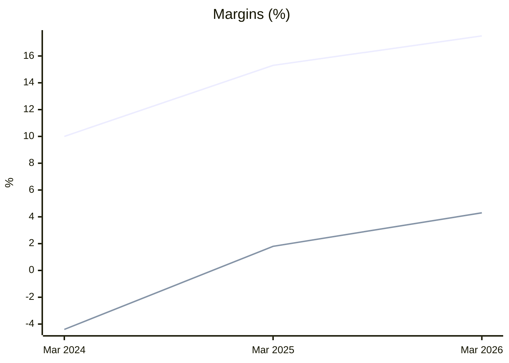
*Series in order: Operating margin, PAT margin.*

**P/E:** 28.3 — live market file (screener.in), trailing (price ₹604.00 as of 2026-08-02).

**Cash flows (₹ cr):**

| | Mar 2024 | Mar 2025 | Mar 2026 |
|---|---:|---:|---:|
| Cash from operations (₹ cr) | 2,321 | 10,151 | 7,855 |
| Cash from investing (₹ cr) | -2,509 | -1,823 | -1,475 |
| Cash from financing (₹ cr) | 164 | -4,793 | -9,883 |
| Net cash flow (₹ cr) | -24.0 | 3,535 | -3,503 |
| Free cash flow (₹ cr) | 367 | 8,896 | 5,502 |

*Source: CashFlow/NiftyTotalMarket/UPL.csv (consolidated, screener.in).*

### 8. The separated business's financial statements

**The business being separated — its own numbers**, entity by entity: its reported statements once it is listed and on file, and the segment numbers the annual reports and presentations carry for it before that.

**UPL Global — "pure-play" crop protection (pro-forma) → UPL Global (crop protection platform; pro-forma for the listed pure-play crop protection company)** · unit ₹ crore · Only a single pro-forma revenue datapoint is given in the strategic re-organization slide (FY25 pro-forma revenue of the to-be-listed UPL Global crop protection company, ₹38,500 cr). No profit line given. This figure overlaps the UPL Corp + UPL SAS platform entries below.

| | FY2025 |
|---|---:|
| Revenue (₹ crore) | 38,500 |
| Revenue growth (%) | — |
| Operating profit (₹ crore) | — |
| Operating profit growth (%) | — |
| Operating margin (%) | — |
| PAT (₹ crore) | — |
| PAT growth (%) | — |

*Sources:* Presentation Feb 2026 — page 26

*Not in the pages read:* No profit, assets, liabilities, capex, depreciation or quarterly figures for the combined UPL Global entity; only FY25 pro-forma revenue.

**UPL Corp (global crop protection platform) → UPL Global (via UPL Corp platform / UPL Global Limited; ex-India crop protection)** · unit ₹ crore · Platform P&L on pro-forma adjusted basis, without group elimination. Profit line is EBITDA (revenue less cost of goods = contribution, less SG&A); EBIT also given for Q2/H1 FY27 (Q2FY27 EBIT 542, H1FY27 EBIT 519). Revenue is platform revenue including sales to other UPL platforms (no group elimination).

| | FY2025 | FY2026 |
|---|---:|---:|
| Revenue (₹ crore) | 34,381 | 38,277 |
| Revenue growth (%) | — | +11.3% |
| Operating profit (₹ crore) | 5,026 | 6,008 |
| Operating profit growth (%) | — | +19.5% |
| Operating margin (%) | 14.6 | 15.7 |
| PAT (₹ crore) | — | — |
| PAT growth (%) | — | — |

*Sources:* Presentation May 2026 — page 36

*Latest quarter (Q2 FY27):* revenue 7972, operating profit 1083 — Presentation Nov 2026 — page 36

*Not in the pages read:* No PAT, segment assets, liabilities, capex or depreciation for the platform; no FY2024 platform figures.

**UPL SAS — India Crop Protection Business → UPL Sustainable Agri Solutions Limited (UPL SAS)** · unit ₹ crore · Pro-forma platform P&L for the India crop protection business only, excluding 'Nurture'. Profit line is EBITDA; EBIT also given for Q2/H1 FY27 (Q2FY27 EBIT 203, H1FY27 EBIT 532). Revenue is platform revenue without group elimination. Annual-report Schedule III gives only entity-level net assets and share in profit for UPL Sustainable Agri Solutions Limited (a wider entity), not this platform's PAT.

| | FY2025 | FY2026 |
|---|---:|---:|
| Revenue (₹ crore) | 3,229 | 3,212 |
| Revenue growth (%) | — | -0.5% |
| Operating profit (₹ crore) | 441 | 548 |
| Operating profit growth (%) | — | +24.3% |
| Operating margin (%) | 13.7 | 17.1 |
| PAT (₹ crore) | — | — |
| PAT growth (%) | — | — |

*Sources:* Presentation May 2026 — page 45

*Latest quarter (Q2 FY27):* revenue 921, operating profit 214 — Presentation Nov 2026 — page 40

*Not in the pages read:* No PAT, assets, liabilities, capex or depreciation for the platform; no FY2024 platform figures.

**Advanta — seeds and post-harvest (Decco included) → Advanta Enterprises Limited** · unit ₹ crore · Pro-forma platform P&L; Advanta figures for current and comparative periods reflect the acquisition of Decco under common control. Profit line is EBITDA; EBIT also given for Q2/H1 FY27 (Q2FY27 EBIT 429, H1FY27 EBIT 714). Revenue without group elimination. Schedule III of the annual reports gives entity-level net assets / share in profit for Advanta Enterprises Limited (March 31, 2026: net assets 10,530, share in profit 533; March 31, 2025: 5,704 and 18 as restated, 1,238 and 383 as first reported) — entity contributions to consolidation, not this platform's PAT.

| | FY2025 | FY2026 |
|---|---:|---:|
| Revenue (₹ crore) | 5,566 | 6,837 |
| Revenue growth (%) | — | +22.8% |
| Operating profit (₹ crore) | 1,325 | 1,725 |
| Operating profit growth (%) | — | +30.2% |
| Operating margin (%) | 23.8 | 25.2 |
| PAT (₹ crore) | — | — |
| PAT growth (%) | — | — |

*Sources:* Presentation May 2026 — page 50

*Latest quarter (Q2 FY27):* revenue 1875, operating profit 510 — Presentation Nov 2026 — page 45

*Not in the pages read:* No platform PAT, assets, liabilities, capex or depreciation; no FY2024 platform figures.

**Specialty Chemicals business (Discontinued Operations, UPL Limited standalone slump sale) → Superform Chemistries Limited (FKA UPL Speciality Chemicals Limited) — not one of the entities named in the question** · unit ₹ crore · UPL Limited standalone discontinued-operations disclosure under Ind AS 105 for the business transferred to Superform on December 1, 2024. Revenue is revenue from operations (gross, i.e. includes inter-segment: FY2024 inter-segment revenue of 1,456 is shown separately). Profit lines: profit before exceptional items and tax (FY2024 401; FY2023 615), profit before tax (FY2024 422; FY2023 603) and profit after tax, reported in pat. Assets/liabilities are assets held for sale and liabilities held for transfer at the year-end; depreciation is depreciation and amortisation expense.

| | FY2023 | FY2024 | n/a |
|---|---:|---:|---:|
| Revenue (₹ crore) | 11,852 | 8,821 | 7,008 |
| Revenue growth (%) | — | -25.6% | -20.6% |
| Operating profit (₹ crore) | — | — | — |
| Operating profit growth (%) | — | — | — |
| Operating margin (%) | — | — | — |
| PAT (₹ crore) | 402 | 317 | 296 |
| PAT growth (%) | — | -21.1% | -6.6% |
| Segment assets (₹ crore) | 9,334 | 8,861 | 9,534 |
| Segment liabilities (₹ crore) | 5,641 | 3,665 | 3,399 |
| Capital employed (₹ crore) | 3,693 | 5,196 | 6,135 |
| Return on capital employed (%) | — | — | — |
| Segment assets / revenue (x) | 0.8 | 1.0 | 1.4 |
| Capex (₹ crore) | — | — | — |

*Sources:* Annual Report 2024 — page 152 (assets/liabilities page 153); Annual Report 2026 — page 153 (also Annual Report 2025 — page 151)

*Not in the pages read:* Year left null for the stub period April 1 to November 30, 2024 (8 months to transfer date); assets/liabilities there are those transferred on December 1, 2024. No capex, no quarterly split.

*Businesses with no numbers in the pages read (3 annual report(s) and 12 presentation(s) on file):* No numbers at all for: 'Dedicated pure-play crop', 'Seeds and post-harvest' as a named entity, 'Demerged Undertaking', 'UPL 2', 'UPL Crop Protection Holdings Limited', 'UPL Cayman 1', and 'UPL Global Sustainable Agri Solutions Limited' beyond Schedule III net assets/profit.

*Documents on file:* [Annual Report 2026](https://www.bseindia.com/xml-data/corpfiling/AttachHis/eb12d677-50d7-4495-9f5f-1921ef482847.pdf); [Annual Report 2025](https://www.bseindia.com/xml-data/corpfiling/AttachHis/16ebc6c3-a363-4437-b10d-8e0dfedb9483.pdf); [Annual Report 2024](https://www.bseindia.com/xml-data/corpfiling/AttachHis/8ee29f18-2108-4736-a8f1-7e012f32ce56.pdf); [Presentation Nov 2026](https://www.bseindia.com/stockinfo/AnnPdfOpen.aspx?Pname=e2744e2f-a37b-4275-8a9c-599b8af670da.pdf); [Presentation Aug 2026](https://www.bseindia.com/stockinfo/AnnPdfOpen.aspx?Pname=2f0f3bf4-eb2a-4b8e-85a4-fa1b252aa4f1.pdf); [Presentation May 2026](https://www.bseindia.com/stockinfo/AnnPdfOpen.aspx?Pname=423093cb-ab1a-4288-abdc-894653fabf37.pdf); [Presentation Feb 2026](https://www.bseindia.com/stockinfo/AnnPdfOpen.aspx?Pname=6bcd0819-5ddb-4516-a762-f7a1141762db.pdf); [Presentation Nov 2025](https://www.bseindia.com/stockinfo/AnnPdfOpen.aspx?Pname=0f944762-33b2-41d9-9bc3-aab7d950cfc9.pdf); [Presentation Aug 2025](https://www.bseindia.com/stockinfo/AnnPdfOpen.aspx?Pname=199792f5-db4d-43f8-bca8-9fc46e15e9b3.pdf)

### 9. Other financial differences — working capital, margins, returns, debt

| Metric (latest year) | Parent (UPL) | UPL Global Sustainable Agri Solutions Limited | Advanta Enterprises Limited |
|---|---:|---:|---:|
| *Basis* | *reported, consolidated* | *segment numbers (UPL Global — "pure-play" cro…* | *segment numbers (UPL Corp (global crop protec…* |
| Sales (₹ cr) | 51,839 (Mar 2026) | — | — |
| Sales growth (%) | 11.2 (Mar 2026) | — | 11.3 (FY2026) |
| Operating margin (%) | 17.5 (Mar 2026) | — | 15.7 (FY2026) |
| Operating profit growth (%) | 27.4 (Mar 2026) | — | 19.5 (FY2026) |
| PAT margin (%) | 4.3 (Mar 2026) | — | — |
| ROCE % | 10 (Mar 2026) | — | — |
| Debtor Days | 126 (Mar 2026) | — | — |
| Inventory Days | 179 (Mar 2026) | — | — |
| Days Payable | 169 (Mar 2026) | — | — |
| Cash Conversion Cycle | 135 (Mar 2026) | — | — |
| Working Capital Days | 5 (Mar 2026) | — | — |
| Debt / equity (x) | 0.7 (Mar 2026) | — | — |
| Borrowings (₹ cr) | 23,576 (Mar 2026) | — | — |
| Sales (₹ crore) | — | 38,500 (FY2025) | 38,277 (FY2026) |
| Sales (₹ crore) | — | 38,500 (FY2025) | 38,277 (FY2026) |

*Each figure is the latest on file, with its year. Working-capital days and ROCE come from the stored working-capital file; segment figures from the pages cited in part 8. A dash means the documents do not carry it.*

**What stays with the parent — its segments, from the same pages:**

| Remaining segment | Revenue | Operating margin | ROCE | Segment assets / revenue | Unit | Year |
|---|---:|---:|---:|---:|---|---|
| Crop protection | 42,399 | 13.5% | 12.3% | 1.66x | ₹ crore | FY2026 |
| Seeds & Post-Harvest solutions (labelled 'Seeds business' in AR2024, 'Seeds' in AR2025) | 6,830 | 20.9% | 27.1% | 1.19x | ₹ crore | FY2026 |
| Non-Agro | 2,803 | 12.3% | 21.4% | 0.77x | ₹ crore | FY2026 |
| SUPERFORM (specialty chemicals platform: AI = active ingredients for UPL Corp and UPL SAS, plus SSC = super specialty chemicals sold externally) | 10,298 | 12.2% | — | — | ₹ crore | FY2026 |
| UPL Limited consolidated (all segments together) | 51,839 | 18.5% | 23.2% | 1.84x | ₹ crore | FY2026 |

**What the documents themselves say about the differences:**

- **other** — parent / remaining: UPL 1 remains an existing listed company operating as a diversified platform encompassing agriculture and specialty chemical businesses while incubating and developing new businesses and verticals; separated business: UPL 2 will be a dedicated pure-play crop protection platform consolidating the India Crop Protection Business (UPL SAS) and the Global Crop Protection Business (UPL Cayman), with independent management “The Scheme proposes to consolidate the India Crop Protection Business held in UPL SAS and Global Crop Protection Business held in UPL Cayman, under a single entity, creating a focused, pure- play crop protection platform. This integrated business will benefit from a strong manufacturing base, advanced research capabilities, a broad portfolio of registered products and brands across multiple geo graphies and independent management.”
- **other** — parent / remaining: Turnover of UPL 1 for the year ended March 31, 2025 was INR 53,313 Mn with net worth of INR 120,210 Mn (audited standalone); separated business: The Demerged Undertaking (India Crop Protection Business) had turnover of INR 24,120 Mn, being 31.15% of UPL 1's turnover; UPL Cayman had turnover of USD 4,187 Mn and net worth of USD 1,599 Mn “Turnover of the Demerged Undertaking (as defined in the Scheme) (INR Mn) % of Turnover of UPL 1* 24,120 31.15%”
- **capex and capital intensity** — parent / remaining: The Scheme will allow UPL 1 to raise capital independently and optimize its capital structure; separated business: The Scheme will allow UPL 2 to raise capital independently, build a wider capital and financial base and attract a different set of investors, strategic partners, lenders and stakeholders “The Scheme will allow UPL 1 and UPL 2 to raise capital independently, allowing each entity to optimize its capital structure and pursue business opportunities more efficiently and effectively.”
- **debt and leverage** — parent / remaining: Group CFO states the structural simplification drives deleveraging, reinforces balance sheet strength and improves return metrics; FY26 gross debt down $850 million to $2.3 billion, net debt $1.6 billion, net debt/EBITDA below 1.6x versus 4.6x in FY24; separated business: not stated “Bikash Prasad, Group CFO of UPL, said, "This structural simplification strengthens our financial foundation and accelerates our journey towards a more efficient an d resilient UPL. By driving deleveraging, reinforcing balance sheet strength, and improving return metrics, we are creating a sharper, more focused organization designed to deliver sustainable long- term value for all shareholders ."”
- **growth** — parent / remaining: UPL Limited consolidated revenue from operations of INR 51,839 crore and EBITDA growth of 18% in FY26; segment revenue FY26 — Crop protection INR 42,399 crore, Seeds & Post harvest INR 6,830 crore, Non agro INR 2,803 crore; separated business: UPL Corp (global crop protection) FY26 revenue growth 11% with contribution margin up more than 250 basis points to 31.5% and EBITDA growth of 20%; UPL SAS India crop protection revenue flat with contribution up 19% and EBITDA up 24% “For the full year, we delivered 11% revenue growth year -on-year, driven by industry-leading volume growth across herbicides and fungicides. Contribution margins grew by more than 250 basis points to 31.5% versus FY25.”
- **other** — parent / remaining: Separation is expected to enable clearer value discovery and give investors flexibility to choose between the diversified platform and the pure-play platform; separated business: UPL Global is described as creating the world's second largest listed pure-play crop protection platform with a presence in more than 140 countries “Mik e Fr ank, CE O of UPL Global, added , "Bringing our crop protection businesses under one platform creates the world's second largest listed pure- play crop protection platform.”
- **other** — parent / remaining: An investor at the Capital Markets Day objected that the announced reorganization is detrimental to existing UPL shareholders and could trigger a holding-company discount; management said feedback will be presented to the Board; separated business: Management stated at least 10 different structures were reviewed before arriving at this structure, and that the purpose is to unlock value at each platform level “By going to a structure, and before we come to conclusion on this structure, it has been discussed, reviewed by our advisors, and we have looked at least 10 different structures to come up to this structure.”

**The checklist:**

| Item | Status | Evidence |
|---|---|---|
| Why the spin-off | yes | value unlocking for shareholders; a weak or capital-heavy business carved away; unrelated businesses separated; regulatory / strategic knot; attracting different investors / capital — “…hings stand today, it's a business which is cash surplus. It's doing exceedingly well. So if at all, there's value unlocking, how is value getting unlocked and for who is the value getting unlocked? Bikash Prasad: So I ” |
| Institutional selling likely (small / different business) | partly | the businesses are described as distinct |
| Insider ownership and incentives aligned | partly | …as members of the promoter and promoter group of UPL 2 (collectively, “ UPL 2 Promoters ”), have agreed to voluntarily retain their entire shareholding respectively in UPL 2 and undertake to not transfer,… *(next: the date the management options are priced; promoter holding in the resulting company)* |
| A hidden value revealed (pro-forma, leverage, comparables) | yes | borrowings 23,576 cr (Mar 2026) = 0.46× market cap; P/E 23.0 on Mar 2026 profit vs industry median 36.0 (22 peers) |
| Parent before the spin (clean parent, takeover prelude) | partly | stage exchange_noc — the spin has not happened; the parent can still be bought whole |
| Timing (first year sells, second year gains) | partly | not yet listed — 309 days since the first filing, stage exchange_noc |
| Management discussing it on the calls | yes | 3 mention(s) in the last 12 months of calls — “…are fundamentally different, and we believe Advanta as the eighth largest seeds player globally has a journey and destiny of its own. Obviously, a lot of that value unlock finding the right price will happen through the” |

**On the calls (last 12 months):**

- *Feb 2026* (forward) — “…ing this decision to list the entity? Because as t hings stand today, it's a business which is cash surplus. It's doing exceedingly well. So if at all, there's value unlocking, how is value getting unlocked and for who is the value getting unlocked? Bikash Prasad: So I think as a first the valuation of Advanta is expected to be final…”
- *Feb 2026* (forward) — “…I think the Advanta IPO has, as Bikash said, three objectives. Th ere is, a ) deleve raging for UPL. UPL Limited February 02, 202 6 Page 14 of 17 There is b ) value unlock for KKR. If you recollect KKR partnered with Advanta more than 3 years back when they put in a check of $300 -plus million into Advanta. By the way, the cash t…”
- *Feb 2026* (forward) — “…are fundamentally different, and we believe Advanta as the eighth largest seeds player globally has a journey and destiny of its own. Obviously, a lot of that value unlock finding the right price will happen through the IPO process. And that value does flow through to UPL, both as a shareholder and from a restructuring deleveragi…”

<details><summary>The filings</summary>

| Date | Category | Headline | Attachment |
|---|---|---|---|
| 2026-01-19 | Updates | UPL Limited has informed the Exchange regarding 'Filing of Draft Red Herring Prospectus (DRHP) by Advanta Enterprises Limited, a Subsidiary of the Company.'. | [pdf](https://nsearchives.nseindia.com/corporate/UPL_19012026211323_UPL_Limited_SE_Intimation.pdf) |
| 2026-02-01 | Earnings call Feb 2026 | …ing this decision to list the entity? Because as t hings stand today, it's a business which is cash surplus. It's doing exceedingly well. So if at all, there's |  |
| 2026-02-01 | Earnings call Feb 2026 | …I think the Advanta IPO has, as Bikash said, three objectives. Th ere is, a ) deleve raging for UPL. UPL Limited February 02, 202 6 Page 14 of 17 There is b )  |  |
| 2026-02-01 | Earnings call Feb 2026 | …are fundamentally different, and we believe Advanta as the eighth largest seeds player globally has a journey and destiny of its own. Obviously, a lot of that  |  |
| 2026-02-20 | Scheme of Arrangement | UPL Limited has informed the Exchange about Scheme of Arrangement | [pdf](https://nsearchives.nseindia.com/corporate/UPL_20022026153902_Draft_Reg_30_Disclosure__Feb_19__Clean.pdf) |
| 2026-02-20 | Press Release | UPL Limited has informed the Exchange regarding a press release dated February 20, 2026, titled "UPL Announces the Creation of World s Second Largest Listed Pur | [pdf](https://nsearchives.nseindia.com/corporate/UPL_20022026154546_Draft_Reg_30_Disclosure__Feb_19__Clean.pdf) |
| 2026-03-04 | Updates | UPL Limited has informed the Exchange regarding 'Uploading of Composite Scheme of Arrangement and certain other documents on the website of the Company'. | [pdf](https://nsearchives.nseindia.com/corporate/UPL_04032026180016_FAQsintimation.pdf) |
| 2026-07-29 | Scheme of Arrangement | UPL Limited has informed the Exchange about receipt of Observation Letters from BSE Limited and National Stock Exchange of India Limited in relation to Composit | [pdf](https://nsearchives.nseindia.com/corporate/UPL_29072026205347_Reg_30_Scheme_of_Arrangement.pdf) |
| 2026-08-01 | Other Restructuring | UPL Limited has informed the Exchange about Restructuring | [pdf](https://nsearchives.nseindia.com/corporate/UPL_01082026111409_Reg30_Completion_of_Swap_transaction_Final.pdf) |

</details>

## ASTRAMICRO — Astra Microwave Products Ltd.

### 1. Astra Microwave Products Ltd. — CONFIRMED DEMERGER

**CONFIRMED** (a demerger scheme is on the exchange record) · **PRE-SPIN — study the parent; the pieces do not trade yet** · score 6.4/10 · spin-off · 17 filing(s) from CALLS, NSE, NSE-BM, NSE-deep · first 2026-02-27, latest 2026-11-12

**The separated entities — every one the documents name:**

| Entity | Scheme | Business | Listing | Who runs it |
|---|---|---|---|---|
| **Astra Space Technologies Limited** (earlier Astra Space Technologies Private Limited) | 2026 demerger of the Space, Meteorology and Hydrology Busin… | Houses the Space, Meteorology and Hydrology businesses transferred on a going-concern basis; satellite hardwa… | to be listed | not stated as CEO/MD/chair; "Mr. S. Gurunatha Red… |

**What is being separated, as the documents put it:** Space, Meteorology and Hydrology Business of Astra Microwave, hived off into wholly owned subsidiary Astra Space Technologies — class `value_unlocking`.

### 2. Stages and dates

> **Listing:** NOT YET — scheme at 'meetings' stage; Astra Space Technologies Private Limited will list only after NCLT sanction, effectiveness and a record date; indicated timeline: Not dated; NSE letter of October 29, 2026 says ASTPL "shall ensure that steps for listing of specified securities are completed and trading in securities commences within sixty days of receipt of the order of the Hon'ble High Court/NCLT"; the observation letter is valid six months from October 29, 2026 within which the Scheme must be submitted to NCLT.

| Date | Event | Source |
|---|---|---|
| 2026-02-27 | Board approval — Astra Microwave Products Limited | as stated: Outcome of Board Meeting / Press Release dated February 27, 2026 - in… |
| 2026-05-26 | Stage reached: **announced** | [Press Release](https://nsearchives.nseindia.com/corporate/ASTRAMICRO_26052026165633_PressRelease.pdf) |
| 2026-06-01 | Other — Astra Microwave Products Limited | as stated: Intimation of Board Meeting under Regulation 29 dated June 01, 2026, … |
| 2026-06-10 | Board approval — Astra Microwave Products Limited and Astra Space Technologies Private Limited | as stated: Demerger announcement dated 10.06.2026 - Board approved the Scheme of… |
| 2026-08-18 | Other — Astra Microwave Products Limited | as stated: NSE Observation Letter Ref: NSE/LIST/55855 dated October 29, 2026 - N… |
| 2026-08-22 | Stage reached: **meetings** | [Shareholders meeting](https://nsearchives.nseindia.com/corporate/ASTRAMICRO_22082026141503_AGMNotice.pdf) |
| 2026-09-30 | Other — Astra Microwave Products Limited / Astra Space Technologies | as stated: Outcome of Board Meeting dated August 10, 2026 - Mr. S. Gurunatha Red… |
| 2026-10-29 | Stage reached: **exchange noc** | [Scheme of Arrangement](https://nsearchives.nseindia.com/corporate/ASTRAMICRO_29102026164303_NOCLetter.pdf) |
| 2026-10-29 | SEBI observations — Astra Microwave Products Limited | as stated: NSE Observation Letter Ref: NSE/LIST/55855 dated October 29, 2026 - "… |
| 2026-10-29 | Exchange no-objection — Astra Microwave Products Limited | as stated: Filing dated October 29, 2026 - observation letter with "no adverse o… |

**The stages, as filed:** announced (2026-05-26) → meetings (2026-08-22) → exchange noc (2026-10-29)

**Stated in the filings:** resulting company **Astra Space Technologies Private Limited**; demerged undertaking: ) is proposed to be demerged into; size hint: 10.6% of ebitda.

**When it lists, in the documents' words:** Not dated; NSE letter of October 29, 2026 says ASTPL "shall ensure that steps for listing of specified securities are completed and trading in securities commences within sixty days of receipt of the order of the Hon'ble High Court/NCLT"; the observation letter is valid six months from October 29, 2026 within which the Scheme must be submitted to NCLT.

### 3. Size of the separated business beside the parent — is institutional selling likely?

**Reading: LIKELY — the piece is small beside the parent; mandates with size limits tend to sell.**

| Entity | Stated turnover | Stated share of the whole | Segment revenue share | Market cap (₹ cr) | Share of combined market cap | Index member |
|---|---|---:|---:|---:|---:|---|
| Astra Space Technologies Limited | "approximately INR. 157 Crores" for the financial year ende… | 13.58% | 9.4% (FY2026) | — | — | not listed |

*Stated figures are the documents' own (a turnover share, or the cost-of-acquisition split the company publishes for tax, which reflects relative value); the segment share is this business's revenue over the parent's sales, and the market-cap share is the entity's value over the entity plus the parent (parent ₹16,174 cr, NSE bhavcopy of 2026-11-13), both computed here.*

**In the documents' words:** “The turnover of the Demerged Undertaking of the Company for the financial year ended 31st March 2026 was approximately INR. 157 Crores , representing 13.58% of the total turnover of the Demerged Company for the said year.”

**The judge's read of selling pressure:** likely — Small (13.58% of turnover), distinct sector from parent's radar/EW/telemetry, 1:1 shares pushed to all holders, promoters only 6.45%.

### 4. Insider ownership — share swap, promoters' holding, management incentives

**Share swap / entitlement, entity by entity:**

- **Astra Space Technologies Limited:** "the Resulting Company shall issue 1 fully paid -up equity share of INR 2 (Indian Rupees 2/- only) each for every 1 fully paid -up equity share of INR 2 (Indian Rupees 2/- only) each held in the Demerged Company (“Share Entitlement Ratio”)"

**Promoters' holding, from the shareholding pattern:**

| Company | Promoters | FIIs | DIIs | Public | Quarter |
|---|---:|---:|---:|---:|---|
| Astra Microwave Products Ltd. (ASTRAMICRO) | 6.54% | 10.48% | 16.52% | 66.47% | Sep 2026 |

*Source: screener.in shareholding pattern, stored under `ShareholdingPattern/NiftyTotalMarket/`. In a mirror demerger each shareholder holds the same proportion of the new company as of the parent on the record date.*

- **Promoters in the parent, per the documents:** not stated in the documents on file.
- **What the promoters will hold in the separated entity:** 2026 demerger into Astra Space Technologies: "Upon the effectiveness of the Scheme, the shareholding of the Resulting Company will mirror the shareholding of the Demerged Company." ASTPL change in shareholding pattern: Pre-Scheme (as on 31.03.2026) Promoters 100.00%, Public 0.00%; Post-Scheme (Indicative) Promoters 6.45%, Public 93.55%. Also: "The post Scheme shareholding pattern of ASTPL will replicate/ mirror the shareholding pattern of AMPL." For AMPL itself: "AMPL: No change". Press release: "Will have mirror shareholding identical to that of Astra ."
- **What a public shareholder receives:** 2026 demerger into Astra Space Technologies: "ASTPL will issue and allot 1 fully paid -up equity share of INR 2 (Indian Rupees 2/- only) to the eligible shareholders of the Company, in accordance with Share Entitlement Ratio (as defined under the Scheme) , without any further application, act or deed. After the Scheme has been effected, the issued shares shall be listed on BSE and NSE." Also: "There is no cash consideration being discharged under the Scheme." The entire pre-scheme paid up share capital of ASTPL held by AMPL "shall stand cancelled and reduced".
- **Management incentives:** No stock option, RSU or SAR plan is mentioned in the documents, and no treatment of existing grants in the Scheme is stated. Convertible warrants: "The Board of the Directors of the Company at its meeting held on May 20, 2025 and the shareholders of the company at Extraordinary General Meeting held on June13, 2025 has approved the allotment of up to 20,13,885 convertible warrants each convertible into, or exchangeable for, one fully paid up equity share of the Company, having a face value of Rs. 2, within the period of eighteen months in accordance with the applicable laws at a price of Rs. 864 aggregating up to Rs. 173.99 crores ("issue proceeds"). During the previous year ended March 31, 2026, the Company has received 25% of the issue proceeds i.e., Rs. 43.50 crores (Upfront monies) on June 23, 2025 and June 24, 2025." Managerial performance bonus is linked to restructuring: for Dr. M. V. Reddy and Mr. Atim Kabra the performance criteria include "Other intiatives of corporate restructuring like merger/demerger 10.0%" weightage. Cash compensation on exit of the outgoing MD: "the consent of the Members of the Company be and is hereby accorded for payment of Rs.1,35,00,000/- (Rupees One Crore Thirty-Five Lakhs only) to Mr. S. Gurunatha Reddy (DIN: 00003828) in the nature of cash" (Explanatory Statement: recommended "payment of a cash compensation of Rs.1,35,68,889/-" representing "the remuneration payable for the unexpired portion of his tenure as Managing Director"). Director shareholding in AMPL: Mr. P. A. Chitrakar "32,40,830 Equity Shares.", Mr. Atim Kabra "33,56,074 Equity Shares.", Dr. M. V. Reddy "Holds 63,570 equity shares." Insider holdings in the JV: "Mr. S. Gurunatha Reddy is holding 0.20% shareholding in ARC", "Dr. M.V. Reddy is holding 0.20% shareholding in ARC", "Mr. Atim Kabra is holding 0.10% Shareholding in ARC", "Mr. Suresh Kumar Somani is holding 0.10% Shareholding in ARC", "Mr. P. A. Chitrakar is holding 0.20% Shareholding in ARC."
- **Insider actions around the separation:** No promoter or management buying, selling or pledging of shares is stated. Stated intent around the separation: "Mr. S. Gurunatha Reddy, Managing Director of AMPL has agreed to take on the additional responsibility of overseeing the ongoing demerger of the Space and Meteorology business and thereafter shall join Astra Space Technologies Private Limited (ASTPL) as a Director subject to the approval of the Board." His resignation letter states: "I am resigning from the position Directorship also with effect from the close of business hours on 30th September, 2026, to oversee the ongoing demerger of the Space and Meteorology business pursuant to the Scheme of Arrangement." Reason for change recorded with the exchanges: "Has taken responsibility to over see demerger of the Company and focus in establishing resulting Company."
- **Insiders, per the checklist read:** Promoters hold 100% of ASTPL pre-scheme (cancelled on effectiveness); post-scheme promoters 6.45%, public 93.55%, mirroring AMPL. Outgoing MD S. Gurunatha Reddy will join ASTPL as Director; MD/WTD bonus weights "merger/demerger" 10%. · *option pricing date:* not stated

### 5. Why the demerger — point by point

Astra Microwave is splitting itself into two sector-focused listed companies: the parent (AMPL) keeps Radar Electronics, Electronic Warfare and Telemetry, while the Space, Meteorology and Hydrology business is demerged on a going-concern basis into its wholly-owned subsidiary Astra Space Technologies Pvt Ltd (ASTPL), which will itself be listed on BSE and NSE. On the May 27, 2026 call MD S.G. Reddy said the board had given in-principle approval and framed the objective as creating 'sharper strategic and operational focus,' enabling dedicated management teams to chase sector-specific opportunities, enhancing governance and accountability, simplifying the corporate structure and creating 'clearer investment propositions to shareholders,' with focused growth, better capital allocation and improved operational efficiency over the medium to long term. The sizing numbers management gave: FY26 standalone turnover INR1,157 crore of which radar was ~60% and space plus meteorology ~16%; the scheme puts the demerged undertaking's FY26 turnover at ~INR157 crore, i.e. 13.58% of standalone turnover; the Dec-2025 order book of INR2,226 crore contained INR249 crore of space and INR369 crore of meteorology/hydrology orders. The scheme's stated reasoning is that space/met/hydro has 'distinct industry characteristics, competitive dynamics, regulatory environment, and risk profile' needing a differentiated strategy, and that a standalone entity would be 'better positioned to attract investors, strategic partners, lenders, and other stakeholders with sector-specific interests,' thereby unlocking the value of that undertaking for shareholders. Mechanically there is no cash consideration: shareholders get 1 ASTPL share of Rs 2 for every 1 AMPL share of Rs 2, ASTPL's existing promoter-held capital is cancelled, and post-scheme ASTPL mirrors AMPL (promoters 6.45%, public 93.55%). No investor, lender or partner is identified anywhere as having demanded the separation — it is presented as management/board-initiated strategic re-alignment, though Atim Kabra had repeatedly argued on earlier calls that the embedded space business was worth far more than the market credited (Aug 2025: 'very, very valuable'; Nov 2025: peers raising at $750-800m valuations with almost no revenue, close to Astra's whole market cap). The move is also backed with people: MD S. Gurunatha Reddy took on oversight of the demerger, stepped down as AMPL MD and director from close of September 30, 2026 to join ASTPL as a director, and Joint MD Dr M.V. Reddy became AMPL's MD from October 1, 2026. As of the last filings, BSE gave 'no adverse observations' and NSE 'no objection' on October 29, 2026, SEBI/NCLT approvals are still pending, and no effect of the scheme has been taken into the Q2 FY27 accounts.

**Point by point, with the source:**

1. First disclosure on a call: the board has in-principle approved demerging the space, meteorology and hydrology business, with the formal scheme to follow within weeks. “On a strategic front, the Board of Directors have in-principle approved demerger of our space, meteorology, and hydrology business.” — *[Jun 2026](https://www.bseindia.com/stockinfo/AnnPdfOpen.aspx?Pname=78f3aacc-b7ef-4d51-b1e1-d6e5863786b8.pdf)*
2. The stated objective is focus, not cash or deleveraging. “The objective of this move is to create sharper strategic and operational focus for business segments.” — *[Jun 2026](https://www.bseindia.com/stockinfo/AnnPdfOpen.aspx?Pname=78f3aacc-b7ef-4d51-b1e1-d6e5863786b8.pdf)*
3. The specific problems named: management bandwidth, governance/accountability, a complicated corporate structure and an unclear investment case for shareholders. “The proposed structure will enable dedicated management teams to pursue sector-specific growth opportunities, enhance governance and accountability, simplify the corporate structure, and create clearer investment propositions to shareholders.” — *[Jun 2026](https://www.bseindia.com/stockinfo/AnnPdfOpen.aspx?Pname=78f3aacc-b7ef-4d51-b1e1-d6e5863786b8.pdf)*
4. Expected outcome framed over the medium to long term, including capital allocation. “Over the medium to long term, we believe this initiative will support focused growth, better capital allocation, and improved operational efficiency.” — *[Jun 2026](https://www.bseindia.com/stockinfo/AnnPdfOpen.aspx?Pname=78f3aacc-b7ef-4d51-b1e1-d6e5863786b8.pdf)*
5. Scale of the business being separated, as management described FY26 revenue mix: space and meteorology ~16% versus radar ~60%. “Our radar business continued to be a primary growth driver, contributing nearly 60% of our revenue, while space and meteorology segment contributed around 16%, demonstrating our expanding footprint in strategic and high-technology domains.” — *[Jun 2026](https://www.bseindia.com/stockinfo/AnnPdfOpen.aspx?Pname=78f3aacc-b7ef-4d51-b1e1-d6e5863786b8.pdf)*
6. The June 10, 2026 scheme disclosure states the purpose as creating two separately listed sector-focused companies — radar/EW/telemetry on one side, space/met/hydro on the other. “The proposed demerger is intended to create two sector-focused listed entities, namely: (a) Radar Electronics, Electronic Warfare and Telemetry business focused entity; and (b) Space, Meteorology and Hydrology focused entity;” — *Scheme*
7. Core argument: the two businesses face different industry, competitive, regulatory and risk conditions and therefore need different strategies. “The Space, Meteorology and Hydrology business operates in a sector with distinct industry characteristics, competitive dynamics, regulatory environment, and risk profile, necessitating a differentiated growth strategy aligned with its specific market opportunities.” — *Scheme*
8. Capital-access rationale — the only place any outside constituency (investors, partners, lenders) is invoked, and as a prospective benefit rather than as a party that asked for the split. “A standalone Space, Meteorology and Hydrology entity would be better positioned to attract investors, strategic partners, lenders, and other stakeholders with sector-specific interests.” — *Scheme*
9. Explicit value-unlock objective for AMPL shareholders. “unlocking the value of the Demerged Undertaking for the shareholders of the Demerged Company.” — *Scheme*
10. Size of the carve-out quantified in the filing: ~INR157 crore of FY26 turnover, 13.58% of the parent's total. “The turnover of the Demerged Undertaking of the Company for the financial year ended 31st March 2026 was approximately INR. 157 Crores , representing 13.58% of the total turnover of the Demerged Company for the said year.” — *Scheme*
11. No cash changes hands; a 1:1 share entitlement mirrors AMPL's register into ASTPL (promoters 6.45%, public 93.55% post-scheme), and ASTPL shares will be listed on BSE and NSE. “For the purpose of the demerger of Demerged Undertaking ( as defined in the Scheme ) of Demerged Company into Resulting Company, the Resulting Company shall issue 1 fully paid-up equity share of INR 2 (Indian Rupees 2/- only) each for every 1 fully paid-up equity share of INR 2 (Indian Rupees 2/- only) each held in the Demerged Company ("Share Entitlement Ratio").” — *Scheme*
12. Leadership is being split alongside the businesses: MD S. Gurunatha Reddy was given the demerger and will move to ASTPL, with Dr M.V. Reddy taking over as AMPL MD from October 1, 2026 (April 3, 2026 press release; confirmed in the August 10, 2026 board outcome). “In this role, he will lead the adoption of tailored growth strategies and capital allocation frameworks suited to the Space, Meteorology and Hydrology sector, thereby enabling focused management attention, enhanced operational efficiency and the unlocking of value for the shareholders of the Company.” — *Scheme*
13. Status as of the latest filings: exchange clearances in hand on October 29, 2026; SEBI/NCLT and other approvals still pending, with no accounting effect taken in Q2 FY27. “AMPL has received observation letter with "no adverse observations" from BSE Limited on 29th October 2026 and observation letter with "no objection" from the National Stock Exchange of India Limited on 29th October 2026 in relation to the Scheme of Arrangement.” — *Scheme*
14. Pre-announcement value framing: Kabra argued the embedded space business alone could justify something close to Astra's entire market capitalisation, versus peers raising at high valuations with little revenue. “Companies are raising money at like $750 million, $800 million valuation with hardly any revenue numbers to their credit. If I extrapolate these numbers, actually, I got close to my current market capitalization.” — *[Nov 2025](https://www.bseindia.com/stockinfo/AnnPdfOpen.aspx?Pname=8920e2b3-bd77-473a-94ef-a0dba0be3236.pdf)*
15. Earliest hint of the value-unlock logic, alongside disclosure that Astra Space Technologies had been set up as a wholly-owned subsidiary with a ~INR230 crore space order book. “So our order book, as SG mentioned, is in excess of INR230 crores over there. And given where companies with very limited indigenous capabilities are valued, you might find that our space business is actually very, very valuable.” — *[Aug 2025](https://www.bseindia.com/stockinfo/AnnPdfOpen.aspx?Pname=8665322a-8313-49d9-b271-c9f46183b085.pdf)*
16. Two weeks before the in-principle board approval, Kabra flagged a need for creative financing for development projects and told investors to watch for options crystallising — the closest the calls come to foreshadowing the restructuring. “But as you know, balance sheet for efficiently -- for them to efficiently function, especially when our sales volumes are projected to go significantly higher, we need to be creative as well as ensure that there is enough financing is there so that our NCNC projects, the products being developed and the large blue sky thinking driven projects do not suffer due to inadequate financing.” — *[Feb 2026](https://www.bseindia.com/stockinfo/AnnPdfOpen.aspx?Pname=82557eb2-8eb5-49c4-b6db-4fe6f8761102.pdf)*

**How it evolved:** Through the Aug 14, 2025 and Nov 13, 2025 calls there was no demerger talk at all, but the groundwork was visible: Astra Space Technologies had been incorporated as a wholly-owned subsidiary with Bangalore clean rooms and a ~INR230-239 crore space order book, and Atim Kabra argued the space business was being carried inside Astra at far less than standalone peers' valuations. On the Feb 13, 2026 call there was still no mention of a demerger, only Kabra's hint about needing to 'be creative' on financing and 'watch the space.' The board granted in-principle approval on Feb 27, 2026, which surfaced publicly in the April 3, 2026 press release (tied to the MD succession) and was first spoken to investors on the May 27, 2026 (Jun 2026) call, where the detailed scheme was promised 'over the next few weeks.' The board approved the full Scheme of Arrangement on June 10, 2026, and the stock exchanges issued their observation/no-objection letters on October 29, 2026; notably, not a single analyst asked a question about the demerger on the May 27, 2026 call.

**What management expects from it:** AMPL becomes a radar/EW/telemetry-focused listed company; space/met/hydro becomes a separately listed entity with its own management team, tailored growth strategy and capital allocation, sharper focus, better governance and accountability, a simpler structure, improved operational efficiency, easier access to sector-specific investors, partners and lenders, a clearer investment proposition and unlocked shareholder value. No margin, EBITDA or valuation targets were quantified.

*Not explained on the calls:* No segment margins/EBITDA, asset-debt-employee split, ASTPL standalone financials, listing timeline, transaction costs, or where ARC/MMIC sit; no analyst questioned it; no requesting party named.

- *Stated reason, in one line:* Strategic re-alignment to create two sector-focused listed entities; Space/Meteorology/Hydrology has distinct industry characteristics, enabling focused management, tailored growth and capital allocation, sector-specific investors, and "unlocking the value of the Demerged Undertaking for the shareholders".
- *What it reveals:* Demerged undertaking turnover INR 157 crores, 13.58% of FY26 total; management says "the space margins are better compared to even defence also"; Dec-2025 order book INR 249 crores space plus INR 369 crores met/hydrology. Parent keeps radar/EW/telemetry with QRSAM, Uttam, Su-30 programs.
- *Parent or spin:* both · *Read next:* ASTPL abridged-prospectus disclosure in the NCLT shareholders' notice: demerged undertaking assets, liabilities, net worth, PAT, EBITDA.
- *In their words:* “Yes, all new shares of ASTPL will be listed and will be admitted for trading on the NSE and BSE, subject to receipt of requisite approvals from the Stock Exchanges.”

### 6. On the calls, verbatim

11 call(s), oldest first: **29 question-and-answer exchange(s)** given in full — the question and every answer to it, nothing trimmed — and 23 passage(s) from management's prepared remarks (the complete sentences about it; the whole remarks are in the linked transcript). Text is as the transcript prints it.

| Call | Q&A exchanges | Prepared-remarks passages | Transcript |
|---|---:|---:|---|
| Nov 2023 | 1 | 1 | [transcript](https://www.bseindia.com/stockinfo/AnnPdfOpen.aspx?Pname=b7ff3df9-a487-433d-8218-8ad93bfff339.pdf) |
| Feb 2024 | 6 | 3 | [transcript](https://www.bseindia.com/stockinfo/AnnPdfOpen.aspx?Pname=f9edbd90-3b61-4994-82bc-2f1a07176049.pdf) |
| May 2024 | 1 | 2 | [transcript](https://www.bseindia.com/stockinfo/AnnPdfOpen.aspx?Pname=51894a8e-05b9-45c2-97c3-a640c31addc8.pdf) |
| Aug 2024 | 4 | 2 | [transcript](https://www.bseindia.com/stockinfo/AnnPdfOpen.aspx?Pname=7eb70fbb-8890-48a4-85d9-af5c27274526.pdf) |
| Nov 2024 | 0 | 1 | [transcript](https://www.bseindia.com/stockinfo/AnnPdfOpen.aspx?Pname=b0527413-e100-4fb3-8252-231bfcfcc3cc.pdf) |
| Feb 2025 | 1 | 1 | [transcript](https://www.bseindia.com/stockinfo/AnnPdfOpen.aspx?Pname=0502c674-78b1-4151-8d2f-da59e6e97b83.pdf) |
| May 2025 | 4 | 3 | [transcript](https://www.bseindia.com/stockinfo/AnnPdfOpen.aspx?Pname=2a87d22a-4d49-44dd-8273-a4a664fbe476.pdf) |
| Aug 2025 | 1 | 2 | [transcript](https://www.bseindia.com/stockinfo/AnnPdfOpen.aspx?Pname=8665322a-8313-49d9-b271-c9f46183b085.pdf) |
| Nov 2025 | 4 | 3 | [transcript](https://www.bseindia.com/stockinfo/AnnPdfOpen.aspx?Pname=8920e2b3-bd77-473a-94ef-a0dba0be3236.pdf) |
| Feb 2026 | 2 | 3 | [transcript](https://www.bseindia.com/stockinfo/AnnPdfOpen.aspx?Pname=82557eb2-8eb5-49c4-b6db-4fe6f8761102.pdf) |
| Jun 2026 | 5 | 2 | [transcript](https://www.bseindia.com/stockinfo/AnnPdfOpen.aspx?Pname=78f3aacc-b7ef-4d51-b1e1-d6e5863786b8.pdf) |

**The full verbatim text of every exchange is in [companies/ASTRAMICRO.md](companies/ASTRAMICRO.md#6-on-the-calls-verbatim).**

### 7. The parent's financial statements

**The parent, last three fiscal years (consolidated)**

| | Mar 2024 | Mar 2025 | Mar 2026 |
|---|---:|---:|---:|
| Sales (₹ cr) | 909 | 1,051 | 1,163 |
| Sales growth (%) | +11.4% | +15.6% | +10.7% |
| Operating profit (₹ cr) | 192 | 269 | 334 |
| Operating profit growth (%) | +32.4% | +40.1% | +24.2% |
| Operating margin (%) | 21.1 | 25.6 | 28.7 |
| PAT (₹ cr) | 121 | 154 | 193 |
| PAT growth (%) | +72.9% | +27.3% | +25.3% |
| PAT margin (%) | 13.3 | 14.7 | 16.6 |
| EPS (₹) | 12.8 | 16.2 | 20.3 |

*Source: ProfitStatement/NiftyTotalMarket/ASTRAMICRO.csv (consolidated, screener.in); growth and margins computed here.*

```mermaid
xychart-beta
    title "Sales, operating profit and PAT (₹ cr)"
    x-axis ["Mar 2024", "Mar 2025", "Mar 2026"]
    y-axis "₹ crore"
    bar [909, 1051, 1163]
    bar [192, 269, 334]
    bar [121, 154, 193]
```
*Series in order: Sales, Operating profit, PAT.*

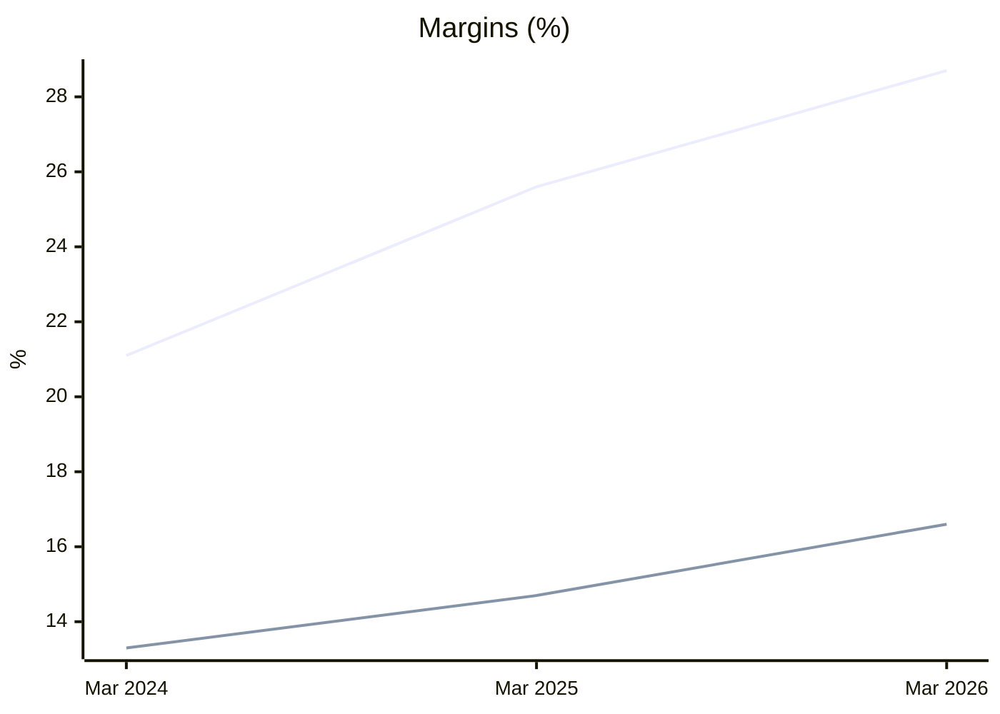
*Series in order: Operating margin, PAT margin.*

**P/E:** 79.9 — close 2026-10-01 ÷ EPS 20.32 (Mar 2026) (price ₹1,624.50 as of 2026-10-01).

**Cash flows (₹ cr):**

| | Mar 2024 | Mar 2025 | Mar 2026 |
|---|---:|---:|---:|
| Cash from operations (₹ cr) | -182 | -90.0 | 387 |
| Cash from investing (₹ cr) | -44.0 | -76.0 | -85.0 |
| Cash from financing (₹ cr) | 232 | 141 | -196 |
| Net cash flow (₹ cr) | 7.0 | -25.0 | 106 |
| Free cash flow (₹ cr) | -229 | -169 | 304 |

*Source: CashFlow/NiftyTotalMarket/ASTRAMICRO.csv (consolidated, screener.in).*

### 8. The separated business's financial statements

**The business being separated — its own numbers**, entity by entity: its reported statements once it is listed and on file, and the segment numbers the annual reports and presentations carry for it before that.

**Space → Astra Space Technologies Limited** · unit ₹ lakh (Rs. Lakhs) · Only sector-wise sales (revenue) is disclosed. Figures are the Company's standalone sector-wise sales (external revenue from operations, split by sector); no segment profit line, assets, liabilities, capex or depreciation is given — the notes to accounts state the company operates in a single product segment, so Ind AS 108 segment result/asset disclosures are not provided for Space.

| | FY2024 | FY2025 | FY2026 |
|---|---:|---:|---:|
| Revenue (₹ lakh (Rs. Lakhs)) | — | 5,848 | 10,975 |
| Revenue growth (%) | — | — | +87.7% |
| Operating profit (₹ lakh (Rs. Lakhs)) | — | — | — |
| Operating profit growth (%) | — | — | — |
| Operating margin (%) | — | — | — |
| PAT (₹ lakh (Rs. Lakhs)) | — | — | — |
| PAT growth (%) | — | — | — |

*Sources:* no sector-wise split disclosed for FY2024 in the pages provided; Annual Report 2026 — page 191

*Not in the pages read:* No profit, PAT, assets, liabilities, capex or depreciation for Space; no FY2024 split; no quarterly Space revenue (presentations give only quarterly order inflow/order book by sector).

**Metrology/Civil Telecom/Others (meteorology and hydrology business) → Astra Space Technologies Limited** · unit ₹ lakh (Rs. Lakhs) · Sector-wise sales (external revenue from operations) only. The line as printed is 'Metrology/Civil Telecom/Others', i.e. meteorology is bundled with civil telecom and other items, so it is not a clean figure for the meteorology+hydrology business being demerged. No profit line, assets, liabilities, capex or depreciation disclosed (single reported product segment).

| | FY2024 | FY2025 | FY2026 |
|---|---:|---:|---:|
| Revenue (₹ lakh (Rs. Lakhs)) | — | 3,437 | 4,584 |
| Revenue growth (%) | — | — | +33.4% |
| Operating profit (₹ lakh (Rs. Lakhs)) | — | — | — |
| Operating profit growth (%) | — | — | — |
| Operating margin (%) | — | — | — |
| PAT (₹ lakh (Rs. Lakhs)) | — | — | — |
| PAT growth (%) | — | — | — |

*Sources:* no sector-wise split disclosed for FY2024 in the pages provided; Annual Report 2026 — page 191

*Not in the pages read:* No standalone meteorology or hydrology revenue (bundled with civil telecom/others); no profit, PAT, assets, liabilities, capex, depreciation; no FY2024 split; no quarterly revenue.

*Businesses with no numbers in the pages read (3 annual report(s) and 13 presentation(s) on file):* No entity-level financials for Astra Space Technologies Limited / Astra Space Technologies Private Limited (ASTPL) or the Demerged Undertaking; also no numbers for Electronic Warfare, Telemetry or Hydrology business segments.

*Documents on file:* [Annual Report 2026](https://www.bseindia.com/xml-data/corpfiling/AttachHis/006109cf-3709-427d-8b15-87513e040708.pdf); [Annual Report 2025](https://www.bseindia.com/xml-data/corpfiling/AttachHis/10122c22-40d6-4556-9b87-34a0ab677b28.pdf); [Annual Report 2024](https://www.bseindia.com/xml-data/corpfiling/AttachHis/c307696a-1240-438e-907b-8c9a7c2401de.pdf); [Presentation Nov 2026](https://www.bseindia.com/stockinfo/AnnPdfOpen.aspx?Pname=1be38ad4-4c04-47d0-ba02-7d5726ad55a6.pdf); [Presentation Aug 2026](https://www.bseindia.com/stockinfo/AnnPdfOpen.aspx?Pname=c4b03964-affd-4c16-a7e2-384c4ab877f4.pdf); [Presentation Jun 2026](https://www.bseindia.com/stockinfo/AnnPdfOpen.aspx?Pname=03c484ea-f8f7-4cee-9b9d-ab2696cf9a5d.pdf); [Presentation Feb 2026](https://www.bseindia.com/stockinfo/AnnPdfOpen.aspx?Pname=261d1e80-99bc-4c41-a6d1-d71577988dc1.pdf); [Presentation Nov 2025](https://www.bseindia.com/stockinfo/AnnPdfOpen.aspx?Pname=f02a1760-94f0-4f9a-9111-3a1f0f1d9b2b.pdf); [Presentation Aug 2025](https://www.bseindia.com/stockinfo/AnnPdfOpen.aspx?Pname=29ae7a47-5b97-4717-9a51-89fcde383fae.pdf)

### 9. Other financial differences — working capital, margins, returns, debt

| Metric (latest year) | Parent (ASTRAMICRO) | Astra Space Technologies Limited |
|---|---:|---:|
| *Basis* | *reported, consolidated* | *segment numbers (Space)* |
| Sales (₹ cr) | 1,163 (Mar 2026) | — |
| Sales growth (%) | 10.7 (Mar 2026) | 87.7 (FY2026) |
| Operating margin (%) | 28.7 (Mar 2026) | — |
| Operating profit growth (%) | 24.2 (Mar 2026) | — |
| PAT margin (%) | 16.6 (Mar 2026) | — |
| ROCE % | 20 (Mar 2026) | — |
| Debtor Days | 216 (Mar 2026) | — |
| Inventory Days | 394 (Mar 2026) | — |
| Days Payable | 73 (Mar 2026) | — |
| Cash Conversion Cycle | 537 (Mar 2026) | — |
| Working Capital Days | 267 (Mar 2026) | — |
| Debt / equity (x) | 0.2 (Mar 2026) | — |
| Borrowings (₹ cr) | 288 (Mar 2026) | — |
| Sales (₹ lakh (Rs. Lakhs)) | — | 10,975 (FY2026) |

*Each figure is the latest on file, with its year. Working-capital days and ROCE come from the stored working-capital file; segment figures from the pages cited in part 8. A dash means the documents do not carry it.*

**What stays with the parent — its segments, from the same pages:**

| Remaining segment | Revenue | Operating margin | ROCE | Segment assets / revenue | Unit | Year |
|---|---:|---:|---:|---:|---|---|
| Defense | 83,748 | — | — | — | ₹ lakh (Rs. Lakhs) | FY2026 |
| Exports (including deemed exports) | 16,228 | — | — | — | ₹ lakh (Rs. Lakhs) | FY2026 |

**What the documents themselves say about the differences:**

- **capex and capital intensity** — parent / remaining: Not stated for the remaining Defence business; company-wide capex guidance given on the call as routine augmentation; separated business: Space and Weather business described as capital-intensive and execution-dependent, requiring focused management attention “However, the business is capital -intensive and execution -dependent, requiring focused management attention to realise its significant growth prospects.”
- **growth** — parent / remaining: FY27 top line growth guidance reaffirmed at 15% to 20%; radar business contributing nearly 60% of revenue; separated business: Space and Weather described as a scaled-up, profitable, high-growth opportunity driven by satellite design and assembly and satellite data applications “The Space and Weather business represents a scaled -up, profitable, high -growth opportunity, driven by expanding demand for satellite design and assembly, as well as satellite data applications in both domestic and international markets.”
- **operating margin** — parent / remaining: Defence margins lower than space margins; FY26 standalone EBITDA margin 28.0% and PAT margin 15.4%; separated business: Space margins stated to be better than defence, but space is only about 10% to 15% of total sales so its order-book reduction does not hurt overall margins “Definitely the space margins are better compared to even defence also, but when you look at the overall space sales contribution , in the overall sales of the company, it is just around 10% to 15% kind of thing.”
- **other** — parent / remaining: Radar business contributed nearly 60% of FY26 revenue; separated business: Space and meteorology segment contributed around 16% of FY26 revenue “Our radar business continued to be a primary growth driver, contributing nearly 60% of our revenue, while space and meteorology segment contributed around 16%, demonstrating our expanding footprint in strategic and high -technology domains.”
- **other** — parent / remaining: Standalone order book of Rs. 2,141 crores as on March 31, 2026; Rs. 3,937.00 crores as at September 30, 2026; separated business: Space: cumulative ISRO orders over Rs. 750 crore with Rs. 250 crore more to be executed by FY28; Meteorology and Hydrology: cumulative contracts over Rs. 330 crore with an order book of Rs. 285 crore to be executed by FY28 “Over the last 20 years, the Company has executed cumulative contracts worth over ₹330 crore in this segment and has an order book of ₹285 crore to be executed by FY28.”
- **cash** — parent / remaining: FY26 operating cash flow of INR370 crores versus minus INR99 crores in the prior year (company level, pre-demerger); separated business: not stated “FY26 has been another strong year for the company, characterized by consistent growth, effective execution, margin expansion driven by favourable revenue mix, and improved working capital cycle, resulting in operating cash flow of INR37 0 crores compared to minus INR99 crores as of last year.”
- **working capital** — parent / remaining: Inventories rose to Rs. 79,349.95 Lakhs and current borrowings to Rs. 41,158.92 Lakhs at September 30, 2026 (standalone), with half-year operating cash outflow of Rs. 14,612.63 Lakhs; separated business: not stated “Yes, in terms of the capex, as you know every year , we are augmenting the existing requirements by spending close to about INR40 crores, INR50 crores.”

**The checklist:**

| Item | Status | Evidence |
|---|---|---|
| Why the spin-off | yes | unrelated businesses separated; value unlocking for shareholders; a weak or capital-heavy business carved away; attracting different investors / capital — “…ndertaking s of the Company into a separate entity. The management believes that this move shall enable a focused management attention and operational efficiency by creating an independent company exclusively dedicated ” |
| Institutional selling likely (small / different business) | yes | the demerged piece is 10.6% of ebitda; the businesses are described as distinct |
| Insider ownership and incentives aligned | partly | …res shall be listed on BSE and NSE. Upon the effectiveness of the Scheme, the shareholding of the Resulting Company will mirror the shareholding of the Demerged Company. Brief details of change in sharehol… *(next: the date the management options are priced; promoter holding in the resulting company)* |
| A hidden value revealed (pro-forma, leverage, comparables) | unknown | no pro-forma or market data on file *(next: pro-forma P&L of each piece × the peer P/E of its own industry)* |
| Parent before the spin (clean parent, takeover prelude) | partly | stage meetings — the spin has not happened; the parent can still be bought whole |
| Timing (first year sells, second year gains) | partly | not yet listed — 270 days since the first filing, stage meetings |
| Management discussing it on the calls | yes | 2 mention(s) in the last 12 months of calls — “…ter capital allocation, and improved operational e fficiency. We will share the detailed Astra Microwave Products Limited May 27 , 202 6 Page 4 of 19 scheme of demerger once it is formally approved by board, which is ex” |

**On the calls (last 12 months):**

- *Jun 2026* (neutral) — “…itability as we move forward. Other key business development happened during the year. On a strategic front, the Board of Directors have in -principle approved demerger of our space, meteorology, and hydrology business. The objective of this move is to create sharper strategic and operational focus for business segments. The p…”
- *Jun 2026* (forward) — “…ter capital allocation, and improved operational e fficiency. We will share the detailed Astra Microwave Products Limited May 27 , 202 6 Page 4 of 19 scheme of demerger once it is formally approved by board, which is expected over the next few weeks. I will now hand over the call to Mr. M. V. Reddy and Atim Kabra, who will pro…”

<details><summary>The filings</summary>

| Date | Category | Headline | Attachment |
|---|---|---|---|
| 2026-02-27 | Outcome of Board Meeting | Plot No. 51(P), Bangalore Aerospace Park, Singanahalli Village, Budigere Post, Bangalore North Taluk, Karnataka - 562149 February 27, 202 6 | [pdf](https://nsearchives.nseindia.com/corporate/ASTRAMICRO_27022026125251_outcomeofBM.pdf) |
| 2026-02-27 | Outcome of Board Meeting | Astra Microwave Products Limited has informed the Exchange regarding Outcome of Board Meeting held on February 27, 2026. | [pdf](https://nsearchives.nseindia.com/corporate/ASTRAMICRO_27022026125251_outcomeofBM.pdf) |
| 2026-02-27 | Press Release | Demerger of Space, Meteorology and Hydrology Business into a Separate Listed Entity. | [pdf](https://nsearchives.nseindia.com/corporate/ASTRAMICRO_27022026131954_PressRelease.pdf) |
| 2026-02-27 | Press Release (Revised) | Astra Microwave Products Limited has informed the Exchange regarding a revised press release dated February 27, 2026, titled "Revised Press Release". | [pdf](https://nsearchives.nseindia.com/corporate/ASTRAMICRO_27022026193116_revisedPressReleasesigned.pdf) |
| 2026-04-03 | Press Release | Astra Microwave Products Limited has informed the Exchange regarding a press release dated April 03, 2026, titled "Press Release - Stepping down from the positi | [pdf](https://nsearchives.nseindia.com/corporate/ASTRAMICRO_03042026182957_PressReleasefull.pdf) |
| 2026-05-26 | Press Release | Astra Microwave Products Limited has informed the Exchange regarding a press release dated May 26, 2026, titled "Press Release on the Audited Financial Results  | [pdf](https://nsearchives.nseindia.com/corporate/ASTRAMICRO_26052026165633_PressRelease.pdf) |
| 2026-06-01 | Earnings call Jun 2026 | …ter capital allocation, and improved operational e fficiency. We will share the detailed Astra Microwave Products Limited May 27 , 202 6 Page 4 of 19 scheme of | [pdf](https://www.bseindia.com/stockinfo/AnnPdfOpen.aspx?Pname=78f3aacc-b7ef-4d51-b1e1-d6e5863786b8.pdf) |
| 2026-06-10 | Demerger | Announcement of approval of the Scheme of Arrangement by the Board of Directors of Astra Microwave Products Limited ( AMPL / Demerged Company ) pursuant the Reg | [pdf](https://nsearchives.nseindia.com/corporate/ASTRAMICRO_10062026123059_Letter.pdf) |
| 2026-06-10 | Outcome of Board Meeting | Announcement of approval of the Scheme of Arrangement by the Board of Directors of Astra Microwave Products Limited ( AMPL / Demerged Company ) pursuant the Reg | [pdf](https://nsearchives.nseindia.com/corporate/ASTRAMICRO_10062026123601_Letter.pdf) |
| 2026-06-10 | Board Meeting (purpose) | Board Meeting Intimation ASTRA MICROWAVE PRODUCTS LIMITED has informed the Exchange about Board Meeting to be held on 10-Jun-2026 to consider Scheme of arrangem | [pdf](https://nsearchives.nseindia.in/corporate/xbrl/PIBM_532493_162026175623_PRIOR_INTIMATION_WebXMLFile_20260601_175626465.xml) |
| 2026-06-10 | Board Meeting (purpose) | Other business matters Intimation of Board Meeting for consideration of Scheme of Arrangement, as per Regulation 29 of the SEBI (Listing Obligations and Disclos | [pdf](https://nsearchives.nseindia.in/corporate/ASTRAMICRO_01062026175859_Boardmeetingintimation.pdf) |
| 2026-08-10 | Outcome of Board Meeting | Astra Microwave Products Limited has submitted to the Exchange, the Un-Audited financial results for the period ended Jun 30, 2026. | [pdf](https://nsearchives.nseindia.com/corporate/ASTRAMICRO_10082026131039_OutcomeofBoardMeeting.pdf) |
| 2026-08-10 | Outcome of Board Meeting | Astra Microwave Products Limited has informed the Exchange regarding Outcome of Board Meeting held on August 10, 2026. | [pdf](https://nsearchives.nseindia.com/corporate/ASTRAMICRO_10082026131830_OutcomeofBoardMeeting.pdf) |
| 2026-08-22 | Shareholders meeting | Astra Microwave Products Limited has informed the Exchange regarding Notice of Annual General Meeting to be held on September 18, 2026 | [pdf](https://nsearchives.nseindia.com/corporate/ASTRAMICRO_22082026141503_AGMNotice.pdf) |
| 2026-10-29 | Scheme of Arrangement | Receipt of Observation letter with no adverse observations/No Objection letter from the Stock Exchanges on the Scheme of Demerger. | [pdf](https://nsearchives.nseindia.com/corporate/ASTRAMICRO_29102026164303_NOCLetter.pdf) |
| 2026-11-12 | Outcome of Board Meeting | Astra Microwave Products Limited has submitted to the Exchange, the financial results for the period ended September 30, 2026. | [pdf](https://nsearchives.nseindia.in/corporate/ASTRAMICRO_12112026122358_OutcomeofBoardMeeting.pdf) |
| 2026-11-12 | Outcome of Board Meeting | Astra Microwave Products Limited has informed the Exchange regarding Outcome of Board Meeting held on November 12, 2026. | [pdf](https://nsearchives.nseindia.in/corporate/ASTRAMICRO_12112026123212_OutcomeofBoardMeeting.pdf) |

</details>

## LEMONTREE — Lemon Tree Hotels Ltd.

### 1. Lemon Tree Hotels Ltd. — CONFIRMED DEMERGER

**CONFIRMED** (a demerger scheme is on the exchange record) · **PRE-SPIN — study the parent; the pieces do not trade yet** · score 6.4/10 · spin-off · 29 filing(s) from CALLS, NSE · first 2026-01-10, latest 2026-09-22

**The separated entities — every one the documents name:**

| Entity | Scheme | Business | Listing | Who runs it |
|---|---|---|---|---|
| **Fleur Hotels Limited** (earlier Fleur Hotels Private Limited) | 2026 Composite Scheme of Arrangement (Transferee Company — … | Demerged Undertaking: 12 hotels (11 operating, 1 under construction at Shimla), development capabilities, inv… | to be listed — "Whether listing would be sought for the res… | Saurabh Shatdal, Managing Director and Chief Exec… |

**The other parties to the scheme(s)** — not separated entities: Carnation Hotels Private Limited — merged in — no shares for the parent's holders; Hamstede Living Private Limited — merged in — no shares for the parent's holders; Oriole Dr. Fresh Hotels Private Limited — merged in — no shares for the parent's holders; Canary Hotels Private Limited — merged in — no shares for the parent's holders; Sukhsagar Complexes Private Limited — merged in — no shares for the parent's holders; Manakin Resorts Private Limited — merged in — no shares for the parent's holders

**What is being separated, as the documents put it:** Asset-heavy hotel ownership and development undertaking: 12 hotels (11 operating, 1 under construction) plus development capabilities, demerged into Fleur Hotels — class `value_unlocking`.

### 2. Stages and dates

> **Listing:** NOT YET — scheme at 'nclt_sanction' stage; Fleur Hotels Limited will list only after NCLT sanction, effectiveness and a record date; indicated timeline: Press release of 9 January 2026: "The entire process to listing of Fleur is expected to be completed within 12 to 15 months"; on the 29 May 2026 call Keswani said 12 months from then if NCLT is quick, otherwise 18 months; NSE observation letter of 22 September 2026 requires trading to commence within sixty days of the NCLT order

| Date | Event | Source |
|---|---|---|
| 2026-01-09 | Board approval — Lemon Tree Hotels Limited (and Fleur Hotels Limited) | as stated: Scheme of Arrangement intimation dated January 09, 2026 (filed 2026-0… |
| 2026-01-09 | Other — Implementation Agreement, Share Purchase Agreement and Shareholders' Agreement approved for execution | as stated: Scheme of Arrangement intimation dated January 09, 2026, Annexures II… |
| 2026-01-10 | Stage reached: **nclt sanction** | [Scheme of Arrangement](https://nsearchives.nseindia.com/corporate/LEMONTREE_10012026000104_LTHL_Outcome.pdf) |
| 2026-02-02 | Filed with exchanges — Lemon Tree Hotels Limited | as stated: Intimation dated September 22, 2026: "The Company had also filed an a… |
| 2026-04-01 | Other — all companies involved — Appointed Date | as stated: Scheme intimation dated January 09, 2026 ("commencement of business h… |
| 2026-04-01 | Appointed date — Composite Scheme of Arrangement | as stated: Press release dated January 09, 2026: "Appointed date: 1 April 2026" |
| 2026-04-07 | Other — Competition Commission of India approval under Section 31(1) of the Competition Act, 2002 | as stated: Updates filing dated April 7, 2026 |
| 2026-05-22 | Other — Receipt of the detailed CCI order | as stated: Filing dated May 23, 2026 on grant of CCI approval |
| 2026-07-09 | Other — NSE submission of the draft scheme to SEBI (letter ref. NSE/LIST/53241) | as stated: NSE Observation Letter dated September 22, 2026 |
| 2026-09-14 | Other — Arum Hotels Private Limited — Joint Venture Agreement executed between Carnation Hotels Private Limited and RJ Corp Limited | as stated: Agreements filing dated September 14, 2026 |
| 2026-09-22 | Stage reached: **exchange noc** | [Scheme of Arrangement](https://nsearchives.nseindia.com/corporate/LEMONTREE_22092026213712_Intimation_signed.pdf) |
| 2026-09-22 | SEBI observations — SEBI comments on the draft scheme | as stated: NSE Observation Letter dated September 22, 2026: "SEBI vide its lette… |
| 2026-09-22 | Exchange no-objection — NSE 'no objection' and BSE 'no adverse observations' Observation Letters (valid six months, within which the Scheme must be submitted to NCLT) | as stated: Scheme of Arrangement intimation dated September 22, 2026 |

**The stages, as filed:** nclt sanction (2026-01-10) → exchange noc (2026-09-22)

**Stated in the filings:** resulting company **Fleur Hotels Limited**; demerged undertaking: ), w ill be demerged into Fleur Hotels; appointed date 2026-04-01; pro-forma statements referenced.

**When it lists, in the documents' words:** Press release of 9 January 2026: "The entire process to listing of Fleur is expected to be completed within 12 to 15 months"; on the 29 May 2026 call Keswani said 12 months from then if NCLT is quick, otherwise 18 months; NSE observation letter of 22 September 2026 requires trading to commence within sixty days of the NCLT order

### 3. Size of the separated business beside the parent — is institutional selling likely?

**Reading: LESS LIKELY on size alone — the piece is the larger part of the business.**

| Entity | Stated turnover | Stated share of the whole | Segment revenue share | Market cap (₹ cr) | Share of combined market cap | Index member |
|---|---|---:|---:|---:|---:|---|
| Fleur Hotels Limited | Turnover (Standalone) as on March 31, 2025: Rs. 46,423.84 L… | 59.9% | — | — | — | not listed |

*Stated figures are the documents' own (a turnover share, or the cost-of-acquisition split the company publishes for tax, which reflects relative value); the segment share is this business's revenue over the parent's sales, and the market-cap share is the entity's value over the entity plus the parent (parent ₹9,662 cr, NSE bhavcopy of 2026-11-13), both computed here.*

**In the documents' words:** “Turnover of demerged division for financials year ended March 31, 2025 is Rs. 23,037.34 Lakhs — Percentage to the total turnover - 59.90%. Also: "Post the Proposed Transaction Fleur will become one of the largest owners of hospitality assets in India. Its owned portfolio will expand significantly, increasing from 3,993 keys and 24 operating hotels to 5,813 keys across 41 hotels." and "In summary, the following are moving from Lemon Tree to Fleur Hotels: 1,563 operating rooms (in 15 hotels); Investment in one under construction hotel in Aurika, Shillong (165 rooms); One under-construction hotel Aurika, Shimla (91 rooms); Exclusivity of all future Development / Ownership / Leasing on hotel assets and transfer of Development Capability / Team"”

**The judge's read of selling pressure:** likely — Odd-lot entitlement (20 Fleur shares per 311 LTH shares) in a newly listed asset-heavy company whose investor base differs from asset-light Lemon Tree

### 4. Insider ownership — share swap, promoters' holding, management incentives

**Share swap / entitlement, entity by entity:**

- **Fleur Hotels Limited:** Demerger: "20 (Twenty only) fully paid-up equity shares of Transferee Company of INR 10 (Indian Rupees Ten) each, for every 311 (Three Hundred Eleven only) equity shares of the Company, of INR 10 (Indian Rupees Ten)"; Amalgamation 2: 10,000 Fleur shares for every 49,872 shares of Oriole Dr. Fresh, 29,87,754 of Canary, 53,118 of Sukhsagar and 1,01,077 of Manakin

**Promoters' holding, from the shareholding pattern:**

| Company | Promoters | FIIs | DIIs | Public | Quarter |
|---|---:|---:|---:|---:|---|
| Lemon Tree Hotels Ltd. (LEMONTREE) | 22.32% | 18.27% | 14.8% | 44.58% | Sep 2026 |

*Source: screener.in shareholding pattern, stored under `ShareholdingPattern/NiftyTotalMarket/`. In a mirror demerger each shareholder holds the same proportion of the new company as of the parent on the record date.*

- **Promoters in the parent, per the documents:** Promoter Group 22.28% of Lemon Tree Hotels Limited, per the "Current shareholding structure of Lemon Tree Group" in the investor presentation on the Composite Scheme of Arrangement dated 9th January 2026 (Public Shareholders 62.73%, Promoter Group 22.28%, APG 14.99%). Promoters are "Mr. Patanjali Govind Keswani and Spank Management Services Private Limited".
- **What the promoters will hold in the separated entity:** In the parent: "There will be no change in the shareholding pattern of the Company on account of the Scheme." In the resulting company, mirror shareholding of the parent's 32.96% direct stake — the presentation's "Shareholding structure post implementation of scheme (Excluding primary investment of up to INR 960 crores by Warburg Pincus)" shows Fleur Hotels held: Promoter Group 7.34%, Public Shareholders 25.62% (Notes: "Including APG's stake of 4.94%"), Warburg Pincus 26.01%, Lemon Tree 41.03%. Press release: "Upon the Scheme becoming effective, the shareholders of Lemon Tree (as on the record date) will own 32.96% of Fleur, Lemon Tree will directly own 41.03% with the balance 26.01% to be owned by Warburg Pincus (shareholding figures exclude any dilution from primary investment by Warburg Pincus in Fleur)." Also: "The shareholding of the Company in FHL will stand at 41.03% with the remaining 58.97% held by existing Shareholders of FHL and the Shareholder of the Company allotted shares pursuant to the Scheme." For the Arum joint venture: "Carnation shall hold 51% of the equity share capital of Arum, and RJ Corp shall hold the remaining 49% of the equity share capital of Arum."
- **What a public shareholder receives:** Under the 2026 Composite Scheme of Arrangement (Demerger): "as consideration for the demerger and transfer of the Demerged Undertaking, Transferee Company shall, without any further act or deed, issue and allot 20 (Twenty only) fully paid-up equity shares of INR 10 (Indian Rupees Ten) each, for every 311 (Three Hundred Eleven only) equity shares of the Company, of INR 10 (Indian Rupees Ten) to the equity shareholders of the Company whose names appear in the register of members / records of the depository on the record date. (which may be further diluted in the event of the Proposed Preferential Issue to the Investor by the Transferee Company)." Also: "Upon the Scheme becoming effective, the Transferee Company shall issue equity shares to the shareholders of the Company in consideration for the Demerger. As a result, all shareholders of the Company will obtain a direct shareholding in the Transferee Company and thereby directly participate in the economic value and growth of the hotel-ownership and development undertaking." Under Amalgamation 1 and Amalgamation 2 the Company's public shareholders receive nothing directly (no shares issued to them; Amalgamation 2 shares go to the Company itself).
- **Management incentives:** Treatment of existing stock options / RSUs / SARs under the Scheme and any new plan in the resulting entity: not stated. The documents state only: "The paid up share capital of the Company excludes 398,841 (March 31, 2025: 398,841) equity shares held by the ESOP Trust which has been consolidated in accordance with the requirement of IND AS 110 'Consolidated Financial Statements'." (the trust is the "Krizm Hotels Private Limited Employee Welfare Trust"). On management roles and holdings: "Mr. Patanjali Govind Keswani, Founder of Lemon Tree Hotels, will serve as the Executive Chairman of Fleur Hotels and will eventually transition to a Non-Executive role at Lemon Tree."; "Today, as Executive Chairman, I continue to chair both companies with direct ownership in each. My primary focus will be on delivering the Fleur pipeline and growth as its Executive Chair. In Lemon Tree, I will cease to hold an executive role March 2027 onwards and transition to non-Executive Chair."; "From the Effective Date, the Board of the FHL will comprise of up to 10 directors, including up to 3 LTHL Directors (with Mr. Keswani as non-retiring executive chairman), up to 3 Investor Directors (all non-executive), and the balance as independent directors, with a Board reconstitution mechanism to ensure compliance with SEBI LODR post-listing."; "To establish separate management teams and governance frameworks for the Company and the Transferee Company, promoting accountability, agility, and strategic oversight at both the operational and asset levels." Exercise price or pricing date: not stated.
- **Insider actions around the separation:** APG Strategic Real Estate Pool N.V., an existing shareholder of Fleur and a public shareholder of Lemon Tree, is selling out of Fleur: "The sale of the Seller's entire shareholding of 41.09% (Forty One Point Zero Nine Percent) in FHL to the Investor"; in the Q4/FY26 call (May 29, 2026) management said "Warburg has completed the purchase of APG's stake in Fleur." On APG's ~14.99% stake in the listed parent, the Chairman said: "They have told me they do not plan to sell, but I do not want to comment. If they do sell, I am sure they will do it in an orderly way... But they have told me right now they do not have any intention to sell." The promoters, Mr. Patanjali Govind Keswani and Spank Management Services Private Limited, are parties to the Implementation Agreement and the Shareholders' Agreement; "Transfer of shares of the FHL by LTHL is subject to customary restrictions including lock-in provisions." NSE condition: "There shall be no change in the shareholding pattern or control in Fleur Hotels Limited between the record date and the listing which may affect the status of this approval." No promoter or management buying, selling or pledging of the parent's shares is stated.
- **Insiders, per the checklist read:** Promoters Patanjali Govind Keswani and Spank Management hold 22.28% of LTH, 7.34% directly in Fleur post-scheme; Keswani non-retiring Executive Chairman of Fleur, turns non-executive at Lemon Tree March 2027 · *option pricing date:* not stated

### 5. Why the demerger — point by point

Management framed the demerger as splitting one company that had been doing two businesses with two different investor bases: an asset-heavy business that designs, develops, finances and owns hotels (pension funds, insurance companies betting on inflation, repricing and annuity yield) and an asset-light business that monetises brand, management, loyalty, distribution and technology with almost no capital intensity. Keswani said Lemon Tree had only built hotels in 2004-2007 because owners would not hand their hotels to an unknown brand, and that with the brand now widely recognised (MakeMyTrip's CEO told him 20-25% of occupancy comes from them the moment a Lemon Tree opens) there was no reason to keep owning assets rather than monetise the brand — explicitly the Marriott/Host Hotels and Hilton/Park Hotels playbook. Mechanically (Composite Scheme approved 9 Jan 2026, appointed date 1 April 2026): Carnation Hotels and Hamstede Living merge into LTH; Oriole Dr. Fresh, Canary, Sukhsagar and Manakin merge into Fleur against shares to LTH; and the Demerged Undertaking — 11 operating hotels plus Aurika Shimla under construction, the investment in Arum (Aurika Shillong, 165 rooms) and the entire development capability/team with exclusivity on all future ownership, leasing and development — demerges into Fleur, with 20 Fleur shares for every 311 LTH shares (demerged division turnover Rs 23,037.34 lakh, 59.90% of LTH standalone turnover; 1,563 operating rooms across 15 hotels per the presentation, 1,820 keys/17 hotels per the press release). A second stated problem was conflict of interest: development capability was moved to Fleur with 'Chinese firewalls' so Fleur shareholders could never feel Lemon Tree was cherry-picking the best assets for itself, and Lemon Tree must refer new acquisition/development opportunities to Fleur. All group debt (about Rs 1,300 crore at demerger, Rs 1,500 crore total borrowings at FY26-end, cost of debt 7.42%) goes to Fleur, leaving Lemon Tree debt-free with only technology and marketing spend, forcing the Board to frame a dividend/shareholder-reward policy. Warburg Pincus (Coastal Cedar Investments B.V.) bought APG's entire 41.09% of Fleur and committed up to Rs 960 crore of primary equity, giving Fleur roughly Rs 3,000 crore of deployable capital at 1:1 debt-equity against 2,500+ rooms under active discussion and Aurika Nehru Place (572 rooms, ~Rs 700 crore); post-scheme LTH shareholders own ~74% of Fleur (32.96% direct plus ~41% through LTH) versus the 59% LTH owns today, and Fleur lists separately for 'transparent price discovery and market-driven valuation of the asset-heavy business'.

**Point by point, with the source:**

1. Asked directly by Kunal Lakhan (CLSA) what was wrong with the old structure, Keswani said the hotel business has two subsets with two different investor types — developers/owners wanting chunky yield and inflation-linked annuity returns versus asset-light investors betting on brand and management — and Lemon Tree was a combination of both. “We have actually separated 2 types of businesses. One is asset heavy, long -term appreciating asset, capital intensive. It has a different kind of investor, and this business has a very different kind of investor, and we wanted to actually attract both types of investors.” — *[Jan 2026](https://www.bseindia.com/stockinfo/AnnPdfOpen.aspx?Pname=098527b9-fd65-4aa9-9c6d-1ac184b2eda0.pdf)*
2. He explained the historical accident being corrected: hotels were built only to establish the brand, and with the brand now established the company should monetise it instead of owning assets. “We were forced to build hotels to build our brand. But once we build our brand, technically, we do not need hotels because now it is time for Lemon Tree to monetize its brand, which is enormous recall.” — *[Jan 2026](https://www.bseindia.com/stockinfo/AnnPdfOpen.aspx?Pname=098527b9-fd65-4aa9-9c6d-1ac184b2eda0.pdf)*
3. The transfer of the development capability and exclusive development mandate to Fleur was driven by a conflict-of-interest problem — Fleur minorities fearing Lemon Tree would keep the best projects for itself — and was solved with firewalls. “Development capability was an issue which was raised in order to maximize Fleur's growth, we did not want shareholders of Fleur to ever feel that Lemon Tree when it recommends any assets was cherry -picking, which means Lemon Tree would say, I have got this very nice asset in Delhi, why should I offer it to Fleur.” — *[Jan 2026](https://www.bseindia.com/stockinfo/AnnPdfOpen.aspx?Pname=098527b9-fd65-4aa9-9c6d-1ac184b2eda0.pdf)*
4. All of Lemon Tree's debt moves to Fleur: Fleur carries roughly Rs 1,300 crore of debt against a ~Rs 900 crore net EBITDA and can borrow another ~Rs 1,300 crore, while Lemon Tree goes to zero debt. “Firstly, when this demerger happens, all the debt, including the Lemon Tree's debt, after adjustment is being transferred to Fleur. Fleur will have 100% of our debt and Lemon Tree will have zero debt.” — *[Jan 2026](https://www.bseindia.com/stockinfo/AnnPdfOpen.aspx?Pname=098527b9-fd65-4aa9-9c6d-1ac184b2eda0.pdf)*
5. Keswani justified keeping a ~41% indirect stake in Fleur (challenged by Jinesh Joshi on hold-co discount) as Lemon Tree retaining 'skin in the game' as Fleur's manager, with natural dilution as Fleur raises capital; he quantified that Rs 1,000 crore deployed by Fleur generates ~Rs 350 crore of turnover, Rs 170-180 crore EBITDA and ~Rs 30 crore of fees for Lemon Tree. “We felt it was prudent to have significant skin in the game at this stage, which means that going forward, it is very possible that Lemon Tree may dilute or even increase its stake over time; this will obviously be a Board decision .” — *[Jan 2026](https://www.bseindia.com/stockinfo/AnnPdfOpen.aspx?Pname=098527b9-fd65-4aa9-9c6d-1ac184b2eda0.pdf)*
6. Warburg's Rs 960 crore primary commitment plus Fleur's own cash and 1:1 debt gives roughly Rs 3,000 crore to deploy pre-listing against 2,500 rooms in active discussion; Keswani guided Fleur to over Rs 1,000 crore net EBITDA by FY28 and Lemon Tree to 80% EBITDA margin / 60% PAT margin. “We have potentially about Rs 3,000 crores available to deploy in this growth before we list.” — *[Jan 2026](https://www.bseindia.com/stockinfo/AnnPdfOpen.aspx?Pname=098527b9-fd65-4aa9-9c6d-1ac184b2eda0.pdf)*
7. Opening the call with pro forma financials for both entities, Keswani described the transaction as simple — Warburg has bought APG's Fleur stake, Lemon Tree transfers 17 hotels and development capabilities in exchange for Fleur shares to LTH shareholders, and Fleur lists. “This scheme will result in 2 distinct financially sound businesses.” — *[Jun 2026](https://www.bseindia.com/stockinfo/AnnPdfOpen.aspx?Pname=a03e8364-4037-407c-8929-d956c0976b96.pdf)*
8. He restated the economic outcome for each entity: Lemon Tree debt-free, high-margin, high-ROCE and fee/brand-driven; Fleur the consolidated owner of a fully renovated portfolio, post-scheme India's largest hotel platform by inventory at 5,600 rooms and 39 operational hotels. “Post the reorganization , Lemon Tree will emerge as a debt -free, high-margin, high ROCE company generating strong free cash flows from fees and brand -related income.” — *[Jun 2026](https://www.bseindia.com/stockinfo/AnnPdfOpen.aspx?Pname=a03e8364-4037-407c-8929-d956c0976b96.pdf)*
9. Shareholder arithmetic: LTH shareholders end up with close to 74% of Fleur (33% direct, ~41% through Lemon Tree) versus the 59% Lemon Tree directly owns in Fleur today, before Warburg's primary infusion; Keswani also said he will cease to be executive at Lemon Tree from March 2027 and focus on Fleur as Executive Chair. “Post reorganization , Lemon Tree shareholders will effectively own close to 74% of Fleur Hotels, 33% directly and about 41% indirectly through Lemon Tree.” — *[Jun 2026](https://www.bseindia.com/stockinfo/AnnPdfOpen.aspx?Pname=a03e8364-4037-407c-8929-d956c0976b96.pdf)*
10. Answering Achal Kumar, Keswani confirmed Fleur will be brand-agnostic post-demerger and may hand assets to other operators — Lemon Tree has no automatic right to Fleur's hotels and must earn them on results. “Yes. But Lemon Tree must be able to deliver best results to get it . Just because Lemon Tree has skin in the game with Fleur does not mean that it has an automatic right to any asset that Fleur develops.” — *[Jun 2026](https://www.bseindia.com/stockinfo/AnnPdfOpen.aspx?Pname=a03e8364-4037-407c-8929-d956c0976b96.pdf)*
11. On capital allocation after the split, Lemon Tree is expected to need almost no capital and move to distributing profits, while Fleur will retain capital for growth rather than pay dividends. “Lemon Tree will not need any significant capital other than potentially investments in technology or in marketing and so on. It will be essentially a zero -debt cash accretive company.” — *[Jun 2026](https://www.bseindia.com/stockinfo/AnnPdfOpen.aspx?Pname=a03e8364-4037-407c-8929-d956c0976b96.pdf)*
12. Keswani confirmed the scheme is effective from 1 April and that Lemon Tree becomes debt-free from next year, with all assets and debt going to Fleur and fee income becoming free cash; the Board must decide a dividend policy within six months. “What will happen is in the scheme of demerger, all the assets of Lemon Tree, including its debt will be transferred to Fleur. Lemon Tree will immediately effectively be a debt -free company from next year.” — *[Feb 2026](https://www.bseindia.com/stockinfo/AnnPdfOpen.aspx?Pname=b0215f7f-3372-4231-8b2f-7f433eb77faf.pdf)*
13. Investors pushed for separate reporting: Ashish Kumar of Infinity Alternatives asked for pro forma financials of both businesses while awaiting the listing, and management agreed to publish them from the next quarter. “Now that we have decided on the split of the 2 businesses, what might be helpful is if we can add pro forma financials for both of the assets as they look like so that while we are waiting for the l isting, we do get a good sense of what the numbers are looking like.” — *[Feb 2026](https://www.bseindia.com/stockinfo/AnnPdfOpen.aspx?Pname=b0215f7f-3372-4231-8b2f-7f433eb77faf.pdf)*
14. Keswani positioned the asset-light entity as a first in India, with fee income from hotels signed three years earlier only now flowing, and Fleur guided to ~Rs 1,000 crore EBITDA by FY28, its first year as a listed company. “And keep in mind that Lemon Tree will be the first fully asset -light brand owning tech and distribution and management company in India, the first.” — *[Feb 2026](https://www.bseindia.com/stockinfo/AnnPdfOpen.aspx?Pname=b0215f7f-3372-4231-8b2f-7f433eb77faf.pdf)*
15. The demerger was still with Board subcommittees of both Lemon Tree and Fleur, with management hinting that more than the demerger was being negotiated (the Warburg/APG transactions announced two months later). “It is not only the demerger of Fleur, but some other even more exciting stuff, but we will talk about it when the time is right.” — *[Nov 2025](https://www.bseindia.com/stockinfo/AnnPdfOpen.aspx?Pname=5a3cfc96-c662-414a-bc34-4635bef2415b.pdf)*
16. First formal disclosure of the structure: committees of directors in both companies to evaluate transferring LTH's assets into Fleur via demerger and then list Fleur, with Lemon Tree becoming asset-light and focused on management, brand and technology — described as the global trend in the space. “You may have also seen that we have said that a committee of directors has been set up in Lemon Tree and in Fleur to evaluate how we can possibly look at a transfer of assets from Lemon Tree into Fleur through a demerger scheme and then automatically look at how we can list Fleur.” — *[Aug 2025](https://www.bseindia.com/stockinfo/AnnPdfOpen.aspx?Pname=c30ba016-9c4b-4e13-8b0d-a5fb02eb43b7.pdf)*
17. The separation of management was done first and explicitly for this purpose — Neelendra Singh to run asset-light Lemon Tree from 1 October and Saurabh Shatdal to drive Fleur's asset-heavy growth, with Keswani handholding and moving to strategic oversight. “The intent of the leadership change was to get 2 very good people who would then run these two companies independently on a day -to-day basis.” — *[Aug 2025](https://www.bseindia.com/stockinfo/AnnPdfOpen.aspx?Pname=c30ba016-9c4b-4e13-8b0d-a5fb02eb43b7.pdf)*
18. Keswani drew a hard line on mandates — Fleur builds, buys and leases, Lemon Tree only manages or franchises — and noted that the more Fleur dilutes and raises capital, the more Lemon Tree's economic interest rises via fees (Rs 100+ crore this year, potentially Rs 300-400 crore from Fleur in three years). “Fleur's mandate will be to focus on, at the right value, building, buying, or leasing hotels. Lemon Tree's will only be to manage or franchise. Lemon Tree will not lease hotels once the Fleur demerger happens.” — *[Aug 2025](https://www.bseindia.com/stockinfo/AnnPdfOpen.aspx?Pname=c30ba016-9c4b-4e13-8b0d-a5fb02eb43b7.pdf)*
19. The earliest trace in these calls: a Fleur listing was already seen as the accelerator of deleveraging, with Keswani putting an IPO within 2-3 years at most when asked by Prashant Biyani. “I think we are sticking to our guidance that in the next 3 - 3.5 years, we should be debt free , but if we list Fleur before that then we will be debt free that much earlier.” — *[Nov 2024](https://www.bseindia.com/stockinfo/AnnPdfOpen.aspx?Pname=3c895122-81f1-4b3e-be92-d1bf92b7945a.pdf)*
20. The 9 Jan 2026 filing states the Board reviewed the business with a view to segregating the asset-heavy ownership/development undertaking from the asset-light management/brand platform, and that the demerged business is self-sustaining and better housed in Fleur; the demerged division's turnover was Rs 23,037.34 lakh, 59.90% of LTH standalone turnover. “Therefore, to achieve operational focus, greater flexibility for capital deployment, and clearer alignment of business objectives, it is proposed under this Scheme to (i) amalgamate Transferor Company 3, Transferor Company 4, Transferor Company 5 and Transferor Company 6 with the Transferee Company; and (ii) demerge and vest the Demerged Undertaking (comprising the Demerged Hotel Properties and the Development Capabilities together with the related undertakings, as defined hereinafter) into the Transferee C ompany, while the Company will continue to focus on the asset -light hotel management support, brand and operations including management support of the hotels transferred to the Transferee Company and other properties.” — *Scheme*
21. A stated purpose is market-driven valuation: Fleur ceases to be LTH's subsidiary and lists, so LTH shareholders participate directly in the asset-heavy business through listed shares rather than through a subsidiary. “Following the implementation of the Scheme, the Transferee Company will cease to be a subsidiary of the Company , and its shares will be listed on the Stock Exchanges, enabling transparent price discovery and market -driven valuation of the asset -heavy business.” — *Scheme*
22. The filing also sets out structural clean-up and partner-flexibility objectives: merging two wholly owned subsidiaries into LTH to remove layering and cost, and creating a structure that lets Fleur bring in investors or co-development partners per project without touching LTH's brand operations. “To create a flexible structure enabling the Transferee Company to attract investors or co -development partners for specific hotel projects, without affecting Company's brand operations or control over strategic decisions.” — *Scheme*
23. Continuity is contractually locked: every hotel amalgamated into or demerged to Fleur stays under Lemon Tree Hotel Operating Agreements (existing ones amended/restated and extended from the Appointed Date), and LTH must refer new acquisition/development opportunities to Fleur and drop them if Fleur declines. “Further, all the hotels amalgamated with or demerged into the Transferee Company will continue to be managed and operated by the Company under Hotel Operating Agreements and, the existing Hotel Operating Agreements with the Transferee Company and its subsidiaries shall be amended and/or restated, inter alia, to reflect the revised terms as detailed in the Scheme, and the Company shall refer new hotel acquisition or development opportunities to the Transferee Company and shall not pursue them if declined, except for hotel operations/franchise arran gements through third parties.” — *Scheme*
24. The Shareholders' Agreement with Warburg gives Fleur the exclusive global right to own, lease and develop hospitality assets, Investor/LTH affirmative consent on reserved matters, up to 3 Investor and 3 LTH directors with Keswani as non-retiring executive chairman, and the right to inject up to Rs 960 crore of primary capital. “The Agreement provides Fleur t he exclusive right to own, lease and develop hospitality assets globally, with LTHL being entitled to undertake key money arrangements, in the manner as mutually agreed.” — *Scheme*
25. The 22 Sept 2026 filing records receipt of NSE 'no objection' and BSE 'no adverse observation' letters under Regulation 37, valid six months, with NCLT, shareholder and creditor approvals still pending — the gating item management had flagged as the timing risk. “In this regard, we wish to inform you that the Company has received the Observation Letter s with 'no objection ' from the NSE and 'no adverse observations' from the BSE on September 22, 2026 vide their respective letters , pursuant to Regulation 37 of the Listing Regulations , in relation to the Scheme .” — *Scheme*

**How it evolved:** The idea was first visible as a Fleur listing aspiration in the Nov 2024 call, where Keswani said debt-freedom would come sooner 'if we list Fleur before that' and put an IPO 'within the next 2-3 years at most'; in the Aug 2025 call he disclosed that committees of directors had been set up in both Lemon Tree and Fleur to evaluate transferring LTH's assets into Fleur via a demerger and listing it, alongside splitting the management teams (Neelendra Singh for LTH from 1 October, Saurabh Shatdal for Fleur), with listing hoped for end-CY2026. In the Nov 2025 call it was 'in process' with a Board subcommittee and a promise of 'some other even more exciting stuff' within three months; the scheme, the Warburg/APG transactions and the 74%/26% shareholding math were announced in the Jan 2026 (15 January) dedicated call with a 12-15 month path to listing. By the Feb 2026 call Keswani confirmed the scheme was effective from 1 April and, responding to Ashish Kumar's request, promised pro forma financials for both entities; those pro formas appeared with the Jun 2026 (29 May) results, where CCI approval (April 2026), Warburg's completed purchase of APG's stake and a longer 12-18 month NCLT-dependent timeline were given, followed by NSE/BSE observation letters on 22 September 2026.

**What management expects from it:** Lemon Tree: debt-free, fee/brand/tech-only, EBITDA margin from ~60% pro forma to 70-80% steady state, ~60% PAT margin, high ROCE, free cash funding dividends. Fleur: India's largest owner (5,600 rooms, 39 hotels), net EBITDA Rs 850 crore FY27 and Rs 1,000+ crore FY28, ~48%+ post-fee margins, Warburg-backed capital for 2,500+ rooms, capital growth not dividends, and separately listed for market valuation.

*Not explained on the calls:* Absolute valuation of the demerged undertaking and Warburg's price for APG's stake, Fleur's issue price, hold-co discount size, post-demerger ROE, and fate of the two retained leases.

- *Stated reason, in one line:* Segregate asset-heavy hotel ownership/development from the asset-light hotel management and brand platform, to achieve operational focus, greater flexibility for capital deployment, clearer alignment of business objectives and unlock long-term shareholder value
- *What it reveals:* Fleur becomes India's largest hotel owner by rooms (5,556 rooms, 39 hotels; FY25 revenue Rs 1,189 cr, net EBITDA Rs 509 cr), carries all group debt, and gets Warburg's Rs 960 crore; Lemon Tree is left debt-free, 80% EBITDA-margin fee business
- *Parent or spin:* both · *Read next:* Fleur's pro-forma financials in the Q4 FY26 presentation (FY27 net EBITDA ~Rs 850 crore) and Fleur's Information Memorandum
- *In their words:* “This structure ensures that the shareholders of the Company directly participate in the economic value of the hotel-ownership and development undertaking through listed shares of the Transferee Company.”

### 6. On the calls, verbatim

12 call(s), oldest first: **79 question-and-answer exchange(s)** given in full — the question and every answer to it, nothing trimmed — and 18 passage(s) from management's prepared remarks (the complete sentences about it; the whole remarks are in the linked transcript). Text is as the transcript prints it.

| Call | Q&A exchanges | Prepared-remarks passages | Transcript |
|---|---:|---:|---|
| Feb 2024 | 6 | 1 | — |
| Jun 2024 | 1 | 0 | [transcript](https://www.bseindia.com/stockinfo/AnnPdfOpen.aspx?Pname=888228e9-35bd-4429-a0d4-ac4f72829aaf.pdf) |
| Aug 2024 | 4 | 0 | — |
| Nov 2024 | 0 | 1 | [transcript](https://www.bseindia.com/stockinfo/AnnPdfOpen.aspx?Pname=3c895122-81f1-4b3e-be92-d1bf92b7945a.pdf) |
| Nov 2024 | 0 | 1 | [transcript](https://www.bseindia.com/stockinfo/AnnPdfOpen.aspx?Pname=3c895122-81f1-4b3e-be92-d1bf92b7945a.pdf) |
| Feb 2025 | 0 | 1 | [transcript](https://www.bseindia.com/stockinfo/AnnPdfOpen.aspx?Pname=0a9bc603-d4ba-4c45-a5e2-792c2bd21080.pdf) |
| Jun 2025 | 5 | 2 | [transcript](https://www.bseindia.com/stockinfo/AnnPdfOpen.aspx?Pname=fbeefd57-0c11-4583-8e8c-77a17d966f1c.pdf) |
| Aug 2025 | 13 | 2 | [transcript](https://www.bseindia.com/stockinfo/AnnPdfOpen.aspx?Pname=c30ba016-9c4b-4e13-8b0d-a5fb02eb43b7.pdf) |
| Nov 2025 | 6 | 1 | [transcript](https://www.bseindia.com/stockinfo/AnnPdfOpen.aspx?Pname=5a3cfc96-c662-414a-bc34-4635bef2415b.pdf) |
| Jan 2026 | 25 | 3 | [transcript](https://www.bseindia.com/stockinfo/AnnPdfOpen.aspx?Pname=098527b9-fd65-4aa9-9c6d-1ac184b2eda0.pdf) |
| Feb 2026 | 7 | 1 | [transcript](https://www.bseindia.com/stockinfo/AnnPdfOpen.aspx?Pname=b0215f7f-3372-4231-8b2f-7f433eb77faf.pdf) |
| Jun 2026 | 12 | 5 | [transcript](https://www.bseindia.com/stockinfo/AnnPdfOpen.aspx?Pname=a03e8364-4037-407c-8929-d956c0976b96.pdf) |

**The full verbatim text of every exchange is in [companies/LEMONTREE.md](companies/LEMONTREE.md#6-on-the-calls-verbatim).**

### 7. The parent's financial statements

**The parent, last three fiscal years (consolidated)**

| | Mar 2024 | Mar 2025 | Mar 2026 |
|---|---:|---:|---:|
| Sales (₹ cr) | 1,071 | 1,286 | 1,444 |
| Sales growth (%) | +22.4% | +20.1% | +12.3% |
| Operating profit (₹ cr) | 523 | 634 | 690 |
| Operating profit growth (%) | +16.7% | +21.2% | +8.8% |
| Operating margin (%) | 48.8 | 49.3 | 47.8 |
| PAT (₹ cr) | 182 | 243 | 288 |
| PAT growth (%) | +29.1% | +33.5% | +18.5% |
| PAT margin (%) | 17.0 | 18.9 | 19.9 |
| EPS (₹) | 1.9 | 2.5 | 2.9 |

*Source: ProfitStatement/NiftyTotalMarket/LEMONTREE.csv (consolidated, screener.in); growth and margins computed here.*

```mermaid
xychart-beta
    title "Sales, operating profit and PAT (₹ cr)"
    x-axis ["Mar 2024", "Mar 2025", "Mar 2026"]
    y-axis "₹ crore"
    bar [1071, 1286, 1444]
    bar [523, 634, 690]
    bar [182, 243, 288]
```
*Series in order: Sales, Operating profit, PAT.*

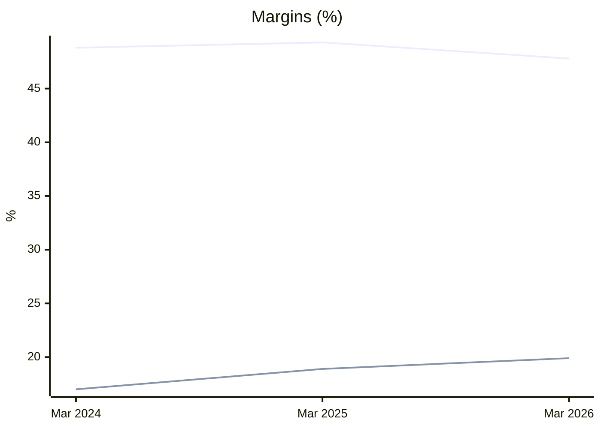
*Series in order: Operating margin, PAT margin.*

**P/E:** 34.9 — live market file (screener.in), trailing (price ₹109.00 as of 2026-08-02).

**Cash flows (₹ cr):**

| | Mar 2024 | Mar 2025 | Mar 2026 |
|---|---:|---:|---:|
| Cash from operations (₹ cr) | 465 | 542 | 542 |
| Cash from investing (₹ cr) | -397 | -127 | -169 |
| Cash from financing (₹ cr) | -59.0 | -392 | -370 |
| Net cash flow (₹ cr) | 10.0 | 22.0 | 3.0 |
| Free cash flow (₹ cr) | 134 | 448 | 406 |

*Source: CashFlow/NiftyTotalMarket/LEMONTREE.csv (consolidated, screener.in).*

### 8. The separated business's financial statements

**The business being separated — its own numbers**, entity by entity: its reported statements once it is listed and on file, and the segment numbers the annual reports and presentations carry for it before that.

*Businesses with no numbers in the pages read (3 annual report(s) and 12 presentation(s) on file):* No numbers at all for: Fleur Hotels' own entity financials, "Demerged Undertaking: 12", Development Capabilities, Transferee Company (Lemon Tree itself, 2024 amalgamation note only). All annual reports report a single segment.

The segment pages read (3 annual report(s) and 12 presentation(s) on file) do not carry this business's own revenue or profit.

*Documents on file:* [Annual Report 2026](https://www.bseindia.com/xml-data/corpfiling/AttachHis/be00cd57-2cf4-4cb8-ae86-25abf6514c44.pdf); [Annual Report 2025](https://www.bseindia.com/xml-data/corpfiling/AttachHis/c1ba19b8-e632-41bd-95da-996e7ec68b05.pdf); [Annual Report 2024](https://www.bseindia.com/xml-data/corpfiling/AttachHis/909f5daf-1ec8-43b7-a52e-36925fa72a1f.pdf); [Presentation Nov 2026](https://www.bseindia.com/stockinfo/AnnPdfOpen.aspx?Pname=1ac80a6c-afd8-4045-851e-e859aac57105.pdf); [Presentation Aug 2026](https://www.bseindia.com/stockinfo/AnnPdfOpen.aspx?Pname=03179e31-3670-48bd-97ad-621254b02e82.pdf); [Presentation Jun 2026](https://www.bseindia.com/stockinfo/AnnPdfOpen.aspx?Pname=48d6e84e-033d-477d-a9c4-37a041824e1d.pdf); [Presentation Feb 2026](https://www.bseindia.com/stockinfo/AnnPdfOpen.aspx?Pname=e55682f6-ab5d-43b2-9e3c-63f601797da3.pdf); [Presentation Jan 2026](https://www.bseindia.com/stockinfo/AnnPdfOpen.aspx?Pname=d182318c-0477-403a-a9d2-38e4f41be0d6.pdf); [Presentation Nov 2025](https://www.bseindia.com/stockinfo/AnnPdfOpen.aspx?Pname=ac49f71d-a895-4efd-b414-5c14334553c9.pdf)

### 9. Other financial differences — working capital, margins, returns, debt

Only the parent's figures are on file: Sales (₹ cr) 1,444 (Mar 2026); Sales growth (%) 12.3 (Mar 2026); Operating margin (%) 47.8 (Mar 2026); PAT margin (%) 19.9 (Mar 2026); Operating profit growth (%) 8.8 (Mar 2026); Debtor Days 29 (Mar 2026); Inventory Days 59 (Mar 2023); Days Payable 289 (Mar 2023); Cash Conversion Cycle -200 (Mar 2026); Working Capital Days -6 (Mar 2026); ROCE % 14 (Mar 2025); Debt / equity (x) 1.4 (Mar 2026); Borrowings (₹ cr) 2,004 (Mar 2026). The separated business has no comparable numbers in the documents read.

**What stays with the parent — its segments, from the same pages:**

| Remaining segment | Revenue | Operating margin | ROCE | Segment assets / revenue | Unit | Year |
|---|---:|---:|---:|---:|---|---|
| Fee-based business — management & franchise (asset-light; rooms managed for third-party owners including Fleur Hotels and 2 leased hotels) | 247 | 60.3% | — | — | ₹ crore | FY2026 |
| Lemon Tree Consolidated (whole group — single hoteliering segment, Ind AS 108) | 1,453 | 48.1% | — | — | ₹ crore | FY2026 |

**What the documents themselves say about the differences:**

- **operating margin** — parent / remaining: Pro forma Lemon Tree EBITDA margin of 60% currently, guided to a 70%+ steady-state flow-through (hopefully 75%, possibly 75%-80%); "70%+ EBITDA margins" shown for the fee business; PAT then ~60% of revenue after 22%-25% tax.; separated business: Fleur net EBITDA post renovation and management fees of Rs. 359 cr (44.4%) FY2023, Rs. 423 cr (42.7%) FY2024, Rs. 509 cr (42.8%) FY2025; guided to "north of 48%" of revenue post-renovation, with pre-fees same-store margins "in the late 50s" and gross EBITDA margin expectation of 60% for FY28. “Our expectation is what we have said as guidance is that our steady state flow-through will be 70% +. We are currently at 60% for a very simple reason.”
- **debt and leverage** — parent / remaining: Becomes debt-free: all of the Company's debt is transferred to Fleur under the Scheme; "Debt Free" and "zero-debt company" in the investor presentation.; separated business: Carries the entire group debt — about Rs. 1,300 crore at demerger against ~Rs. 900 crore net EBITDA; could borrow a further ~Rs. 1,300 crore, taking debt to roughly Rs. 2,500-3,000 crore; group debt-to-EBITDA ~2.25x at the time of the FY26 call, total borrowings Rs. 1,500 crore versus Rs. 1,699 crore a year ago at a 7.42% cost of debt. “What will happen is in the scheme of demerger, all the assets of Lemon Tree, including its debt will be transferred to Fleur. Lemon Tree will immediately effectively be a debt-free company from next year.”
- **capex and capital intensity** — parent / remaining: Asset-light with minimal capital required for growth; only technology, marketing and branding spend; renovation/GST/tech cost heads falling from 5.8% of revenue in FY26 to 4.8% in FY27 and 3.7% in FY28; normal renovation 1.2%-1.4% of revenue.; separated business: Capital intensive: holds all owned/leased hotels and the development pipeline; up to ~Rs. 3,000 crore deployable in 12-18 months, Aurika Nehru Place alone requiring about Rs. 700 crore, Aurika Shillong about Rs. 200 crore, and ~Rs. 1 crore a room for the 2,500 rooms under discussion. “Rapidly growing and highly capital efficient business model – ~11,700 rooms operationalised in 20+ years, 70%+ EBITDA margins , and minimal capital required for growth”
- **growth** — parent / remaining: Fee income (Total Income, assuming all assets pay fees) Rs. 112 cr FY2023, Rs. 144 cr FY2024, Rs. 171 cr FY2025 — 23.5% CAGR; inventory 8,382 → 11,769 rooms FY2023 to 9M FY2026 (1.4x); FY26 total management fees Rs. 169.7 cr, up 14%, with third-party fees up 23% to Rs. 73.9 cr and Fleur fees up 8% to Rs. 95.8 cr; managed/franchised pipeline of 9,414 rooms.; separated business: Fleur total revenue Rs. 810 cr FY2023, Rs. 991 cr FY2024, Rs. 1,189 cr FY2025 — 21.2% CAGR; net EBITDA Rs. 359 → 509 cr (19.1% CAGR); net EBITDA guided to Rs. 850 crore or more in FY27 and above Rs. 1,000 crore by FY28; owned portfolio from 3,993 keys / 24 hotels to 5,813 keys / 41 hotels. “Okay. If you look at FY23 to FY26, our fee income of the managed portfolio grew at 27% a year.”
- **cash** — parent / remaining: "Lemon Tree will not need any significant capital other than potentially investments in technology or in marketing and so on. It will be essentially a zero-debt cash accretive company."; post-approval Lemon Tree will define a dividend distribution policy to reward shareholders annually.; separated business: Receives primary equity capital of up to INR 960 crore from Warburg Pincus in tranches, plus a few hundred crore (Rs. 300-350 crore) of its own equity cash; "Fleur is not currently seen as a dividend distributing company". “Fleur Hotels will receive primary investment of up to INR 960 crores of equity capital (in tranches when required) which will provide further capital to fast track its growth”
- **return on capital** — parent / remaining: High RoCE, zero debt, high cash-flow conversion — "Leading to High RoCE"; "Post the reorganization, Lemon Tree will emerge as a debt-free, high-margin, high ROCE company generating strong free cash flows from fees and brand-related income."; separated business: Asset-heavy platform underwritten to hurdle rates — IRR expectation "north of 15%" on the Nehru Place project; acquisitions available "anywhere from 8x of EBITDA to 16x of EBITDA"; "We are not very rigid on structures, but we are very disciplined on returns." “Unlocking intrinsic value of the asset-light hotel management business housed in Lemon Tree; distinct visibility of high quality and rapidly growing fee income. High growth , high RoCE and zero-debt company leading to likely re-rating”
- **tax** — parent / remaining: On a steady-state basis an ~75%-80% EBITDA margin with no depreciation and no interest, taxed at 22%-25%, giving a PAT of about 60% of revenue.; separated business: not stated “This is including technology . Then 75% flow -through means that if you take tax at 22%, then you have a 60% PAT.”
- **other** — parent / remaining: Keeps only two owned/leased hotels with 202 rooms (Indore and Aurangabad, not transferred due to limited remaining lease tenure), and manages/franchises 89 operational hotels with 6,011 rooms plus 127 hotels and 9,414 rooms in the pipeline owned by third parties.; separated business: Owns/leases 39 hotels with 5,556 rooms and 2 under-construction hotels with 256 rooms; highest number of operational rooms among all asset owners (5,556 vs SAMHI 4,862, Chalet 3,359, Ventive 2,140, Juniper 2,130). “Owns/leases and operates 2 hotels with 202 rooms (not transferred due to limited remaining lease tenure)”

**The checklist:**

| Item | Status | Evidence |
|---|---|---|
| Why the spin-off | yes | regulatory / strategic knot; attracting different investors / capital; value unlocking for shareholders; unrelated businesses separated — “…approval of, in ter alia, the Scheme (including Amalgamation 1, the Amalgamation 2 and the Demerger) by the Competition Commission of India (if and to the extent required); (d) sanction of the Scheme by the NCLT under S” |
| Institutional selling likely (small / different business) | partly | the businesses are described as distinct |
| Insider ownership and incentives aligned | unknown | no promoter-continuity or option-pricing language found *(next: the date the management options are priced; promoter holding in the resulting company)* |
| A hidden value revealed (pro-forma, leverage, comparables) | yes | pro-forma statements are referenced in the filings; borrowings 2,004 cr (Mar 2026) = 0.23× market cap; P/E 30.1 on Mar 2026 profit vs industry median 54.1 (17 peers) |
| Parent before the spin (clean parent, takeover prelude) | partly | stage nclt_sanction — the spin has not happened; the parent can still be bought whole |
| Timing (first year sells, second year gains) | partly | not yet listed — 318 days since the first filing, stage nclt_sanction |
| Management discussing it on the calls | yes | 19 mention(s) in the last 12 months of calls — “…s that you may have. Moderator: The first question is from the line of Achal Kumar with HSBC. Achal Kumar: I have 2 simple questions . So first, tomorrow after demerger, if Fleur believes that its inventory can be manag” |

**On the calls (last 12 months):**

- *Nov 2025* (forward) — “…I expect we will hit Rs. 12,000. Page 9 of 26 Abhay Khaitan: Understood. That is very helpful. My second question is that if you have any updates on the Fleur demerger, any update that you can provide on what is the process and what is the timeline that we are working with right now on this? Patanjali Keswani: It is in proces…”
- *Nov 2025* (forward) — “…h of interesting things to tell the market, I think, in the next 3 months. Would that be right, Kapil? Kapil Sharma: Yes. Patanjali Keswani: It is not only the demerger of Fleur, but some other even more exciting stuff, but we will talk about it when the time is right. Moderator: Thank you. Next question comes from the line of…”
- *Jan 2026* (forward) — “…Disclosure Requirements) Regulations, 2015, transcript of the Investors & Analysts Conference Call held on January 15, 2026, w.r.t. announced of the Composite Scheme of Arrangement is enclosed. You are requested to take the above information in your record . Thanking you, For Lemon Tree Hotels Limited Pawan Kumar Kumawat Company Secretary…”
- *Jan 2026* (forward) — “…joining us, and I wish you all a belated Happy New Year. The purpose of this call is really to explain the rationale of the timing and logic for this Composite Scheme of Arrangement, which has just been announced. To begin with, I would like to give some context. So please bear with me. As you know, the hospitality sector in India is curre…”
- *Jan 2026* (forward) — “…s structure will provide clarity on accountability and sharper strategic focus as both these entities scale going forward. Against this backdrop, the corporate scheme of arrangement represents a logical and value accretive next step. The proposed reorganization will result in 2 distinct well-capitalized businesses, Lemon Tree Hotels as a p…”

<details><summary>The filings</summary>

| Date | Category | Headline | Attachment |
|---|---|---|---|
| 2025-11-01 | Earnings call Nov 2025 | …I expect we will hit Rs. 12,000. Page 9 of 26 Abhay Khaitan: Understood. That is very helpful. My second question is that if you have any updates on the Fleur  | [pdf](https://www.bseindia.com/stockinfo/AnnPdfOpen.aspx?Pname=5a3cfc96-c662-414a-bc34-4635bef2415b.pdf) |
| 2025-11-01 | Earnings call Nov 2025 | …h of interesting things to tell the market, I think, in the next 3 months. Would that be right, Kapil? Kapil Sharma: Yes. Patanjali Keswani: It is not only the | [pdf](https://www.bseindia.com/stockinfo/AnnPdfOpen.aspx?Pname=5a3cfc96-c662-414a-bc34-4635bef2415b.pdf) |
| 2026-01-01 | Earnings call Jan 2026 | …Disclosure Requirements) Regulations, 2015, transcript of the Investors & Analysts Conference Call held on January 15, 2026, w.r.t. announced of the Composite  | [pdf](https://www.bseindia.com/stockinfo/AnnPdfOpen.aspx?Pname=098527b9-fd65-4aa9-9c6d-1ac184b2eda0.pdf) |
| 2026-01-01 | Earnings call Jan 2026 | …joining us, and I wish you all a belated Happy New Year. The purpose of this call is really to explain the rationale of the timing and logic for this Composite | [pdf](https://www.bseindia.com/stockinfo/AnnPdfOpen.aspx?Pname=098527b9-fd65-4aa9-9c6d-1ac184b2eda0.pdf) |
| 2026-01-01 | Earnings call Jan 2026 | …s structure will provide clarity on accountability and sharper strategic focus as both these entities scale going forward. Against this backdrop, the corporate | [pdf](https://www.bseindia.com/stockinfo/AnnPdfOpen.aspx?Pname=098527b9-fd65-4aa9-9c6d-1ac184b2eda0.pdf) |
| 2026-01-01 | Earnings call Jan 2026 | …is our thought. The way we look at risk mitigation and management on the asset -heavy side of the businesses. I am talking now about Fleur. Firstly, when this  | [pdf](https://www.bseindia.com/stockinfo/AnnPdfOpen.aspx?Pname=098527b9-fd65-4aa9-9c6d-1ac184b2eda0.pdf) |
| 2026-01-01 | Earnings call Jan 2026 | …will have 100% of our debt and Lemon Tree will have zero debt. Okay. So, what will Fleur's debt be on an ongoing basis by end of next year, by the time of this | [pdf](https://www.bseindia.com/stockinfo/AnnPdfOpen.aspx?Pname=098527b9-fd65-4aa9-9c6d-1ac184b2eda0.pdf) |
| 2026-01-01 | Earnings call Jan 2026 | …ber 1, number 2 are they going to increase their stake at the level of what APG has in Fleur currently? Patanjali Keswani: See, currently, when you do the full | [pdf](https://www.bseindia.com/stockinfo/AnnPdfOpen.aspx?Pname=098527b9-fd65-4aa9-9c6d-1ac184b2eda0.pdf) |
| 2026-01-01 | Earnings call Jan 2026 | …stions have already been addressed. And one question is sir, as of now as a consolidated level, our ROE is at 18 -odd percentage. My question is that after the | [pdf](https://www.bseindia.com/stockinfo/AnnPdfOpen.aspx?Pname=098527b9-fd65-4aa9-9c6d-1ac184b2eda0.pdf) |
| 2026-01-10 | Scheme of Arrangement | Lemon Tree Hotels Limited has informed the Exchange about Scheme of Arrangement | [pdf](https://nsearchives.nseindia.com/corporate/LEMONTREE_10012026000104_LTHL_Outcome.pdf) |
| 2026-01-10 | Press Release | Lemon Tree Hotels Limited has informed the Exchange regarding a press release dated January 09, 2026, titled "Press Release ". | [pdf](https://nsearchives.nseindia.com/corporate/LEMONTREE_10012026000942_Press_Release.pdf) |
| 2026-01-10 | Memorandum of Understanding/Agreements | Lemon Tree Hotels Limited has informed the Exchange about Agreements | [pdf](https://nsearchives.nseindia.com/corporate/LEMONTREE_10012026001744_LTHL_Outcome.pdf) |
| 2026-01-10 | Updates | Lemon Tree Hotels Limited has informed the Exchange regarding 'Investor Presentation'. | [pdf](https://nsearchives.nseindia.com/corporate/LEMONTREE_10012026023213_Investor_Presentation.pdf) |
| 2026-02-01 | Earnings call Feb 2026 | …on a few Aurikas. But would it be fair for us to assume that all the other own room addition that is going to happen from Fleur end will only happen after the  | [pdf](https://www.bseindia.com/stockinfo/AnnPdfOpen.aspx?Pname=b0215f7f-3372-4231-8b2f-7f433eb77faf.pdf) |
| 2026-02-01 | Earnings call Feb 2026 | …uired chain? Tha t is the first question. And secondly, if you can just guide on the overall CAPEX for next 2 -3 years. And since we mentioned during the Fleur | [pdf](https://www.bseindia.com/stockinfo/AnnPdfOpen.aspx?Pname=b0215f7f-3372-4231-8b2f-7f433eb77faf.pdf) |
| 2026-02-01 | Earnings call Feb 2026 | …ther Rs. 70 crore - Rs. 80 crore . It is significant numbers, which will all shrink dramatically after FY27. Page 20 of 20 What will happen is in the scheme of | [pdf](https://www.bseindia.com/stockinfo/AnnPdfOpen.aspx?Pname=b0215f7f-3372-4231-8b2f-7f433eb77faf.pdf) |
| 2026-02-06 | Outcome of Board Meeting | Lemon Tree Hotels Limited has submitted to the Exchange, the financial results for the period ended December 31, 2025. | [pdf](https://nsearchives.nseindia.com/corporate/LEMONTREE_06022026221032_Outcome.pdf) |
| 2026-04-07 | Updates | Lemon Tree Hotels Limited has informed the Exchange regarding 'Approval of Competition Commission of India for the acquisition of certain equity shares of Fleur | [pdf](https://nsearchives.nseindia.com/corporate/LEMONTREE_07042026204840_Stock_Exchange_Intimation_CCI.pdf) |
| 2026-05-23 | Granting/withdrawal/surrender/cancellati | Lemon Tree Hotels Limited has informed the Exchange about the approval of Competition Commission of India | [pdf](https://nsearchives.nseindia.com/corporate/LEMONTREE_23052026131309_Intimation.pdf) |
| 2026-06-01 | Earnings call Jun 2026 | …which, Saurabh, the Managing Director of Fleur Hotels, who will share an update on Fleur's business development. And lastly, I will then share an update on the | [pdf](https://www.bseindia.com/stockinfo/AnnPdfOpen.aspx?Pname=a03e8364-4037-407c-8929-d956c0976b96.pdf) |
| 2026-06-01 | Earnings call Jun 2026 | …advantage in the market where good assets do not always come packaged neatly. Now I hand over the forum to Pat anjali to give an update on composite scheme of  | [pdf](https://www.bseindia.com/stockinfo/AnnPdfOpen.aspx?Pname=a03e8364-4037-407c-8929-d956c0976b96.pdf) |
| 2026-06-01 | Earnings call Jun 2026 | …e forum to Pat anjali to give an update on composite scheme of demerger. Patanjali Keswani: I want to take this opportunity to continue the conversation on the | [pdf](https://www.bseindia.com/stockinfo/AnnPdfOpen.aspx?Pname=a03e8364-4037-407c-8929-d956c0976b96.pdf) |
| 2026-06-01 | Earnings call Jun 2026 | …cheme. This time with the results we have shared pro forma financials for both Lemon Tree Hotels Limited and Fleur Hotels Limited as they would appear upon the | [pdf](https://www.bseindia.com/stockinfo/AnnPdfOpen.aspx?Pname=a03e8364-4037-407c-8929-d956c0976b96.pdf) |
| 2026-06-01 | Earnings call Jun 2026 | …fees and brand -related income. Fleur Hotels will consolidate ownership of our group's existing hotels, all of which will be fully renovated by the time of the | [pdf](https://www.bseindia.com/stockinfo/AnnPdfOpen.aspx?Pname=a03e8364-4037-407c-8929-d956c0976b96.pdf) |
| 2026-06-01 | Earnings call Jun 2026 | …2 months in Jan. Now the slide mentions that it will take another 12 to 15 months for SEBI and other approvals. Can you just highlight the new timeline for the | [pdf](https://www.bseindia.com/stockinfo/AnnPdfOpen.aspx?Pname=a03e8364-4037-407c-8929-d956c0976b96.pdf) |
| 2026-06-01 | Earnings call Jun 2026 | …20 of 25 Patanjali Keswani: Margin . Well, pre -fees, these same stores should be in the late 50s, pre -fees. Nikhil Poptani : During the January call for the  | [pdf](https://www.bseindia.com/stockinfo/AnnPdfOpen.aspx?Pname=a03e8364-4037-407c-8929-d956c0976b96.pdf) |
| 2026-09-14 | Agreements | Lemon Tree Hotels Limited has informed the Exchange about Joint Venture Agreement has been executed between Carnation Hotels Private Limited, a wholly owned sub | [pdf](https://nsearchives.nseindia.com/corporate/LEMONTREE_14092026205917_Stock_Exchange_Intimation_JV_Agreement.pdf) |
| 2026-09-14 | General Updates | Lemon Tree Hotels Limited has informed the Exchange about Sale or disposal of subsidiary. Pursuant to the execution of the Joint Venture Agreement (JVA), RJ Cor | [pdf](https://nsearchives.nseindia.com/corporate/LEMONTREE_14092026211842_Stock_Exchange_Intimation_JV_Agreement.pdf) |
| 2026-09-22 | Scheme of Arrangement | Lemon Tree Hotels Limited has informed that the Company has received the Observation Letters with no objection from the NSE and no adverse observations from the | [pdf](https://nsearchives.nseindia.com/corporate/LEMONTREE_22092026213712_Intimation_signed.pdf) |

</details>

## NATCOPHARM — NATCO Pharma Ltd.

### 1. NATCO Pharma Ltd. — CONFIRMED DEMERGER

**CONFIRMED** (a demerger scheme is on the exchange record) · **PRE-SPIN — study the parent; the pieces do not trade yet** · score 6.4/10 · spin-off · 20 filing(s) from CALLS, NSE, NSE-BM, NSE-deep · first 2025-11-14, latest 2026-09-09

**The separated entities — every one the documents name:**

| Entity | Scheme | Business | Listing | Who runs it |
|---|---|---|---|---|
| **Natco Crop Health Sciences Limited** | 2026 demerger of the Agrochemicals Undertaking of NATCO Pha… | Agrochemicals Undertaking: research, development, manufacturing and marketing of pesticides, insecticides, he… | to be listed ("the Resulting Company is proposed to be list… | not stated (Sri P.S.R.K. Prasad, Director & Execu… |

**What is being separated, as the documents put it:** Agrochemicals (Crop Health Sciences) division — pesticides, insecticides, herbicides, biostimulants — demerged into Natco Crop Health Sciences Limited — class `value_unlocking`.

### 2. Stages and dates

> **Listing:** NOT YET — scheme at 'exchange_noc' stage; Natco Crop Health Sciences Limited will list only after NCLT sanction, effectiveness and a record date; no listing timeline stated

| Date | Event | Source |
|---|---|---|
| 2025-09-25 | Board approval — NATCO Pharma Limited | as stated: Board meeting of 25 September 2025 — "The Board of Directors, at its … |
| 2025-11-14 | Other — Natco Crop Health Sciences Limited | as stated: Outcome of Board Meeting, 14 November 2025 — "the Board has approved … |
| 2025-12-31 | Other — Natco Crop Health Sciences Limited | as stated: Outcome of Board Meeting, 14 November 2025, Annexure — "Indicative ti… |
| 2026-03-24 | Stage reached: **announced** | [Outcome of Board Meeting](https://nsearchives.nseindia.com/corporate/NATCOPHARM_24032026171413_OutcomeOfBoardMeeting_24032026.pdf) |
| 2026-03-24 | Board approval — NATCO Pharma Limited and Natco Crop Health Sciences Limited | as stated: Outcome of Board Meeting, 24 March 2026 — Board approved the Scheme o… |
| 2026-09-09 | Stage reached: **exchange noc** | [Outcome of Board Meeting](https://nsearchives.nseindia.com/corporate/NATCOPHARM_09092026115332_BoardOutcome09092026.pdf) |
| 2026-09-09 | Other — NATCO Pharma Limited | as stated: Outcome of Board Meeting, 9 September 2026 — Board "decided to conseq… |
| 2026-10 | Other — Natco Crop Health Sciences Limited | as stated: Q3 FY26 earnings call, 12 February 2026 (management target) — "I thin… |
| 2026-10-01 | Appointed date — Natco Crop Health Sciences Limited | as stated: Outcome of Board Meeting, 24 March 2026 — "The Appointed Date under t… |

**The stages, as filed:** announced (2026-03-24) → exchange noc (2026-09-09)

**Stated in the filings:** resulting company **Natco Crop Health Sciences Limited**.

### 3. Size of the separated business beside the parent — is institutional selling likely?

**Reading: VERY LIKELY — the piece is under a tenth of the whole; index funds and large holders who receive it without choosing it tend to sell.**

| Entity | Stated turnover | Stated share of the whole | Segment revenue share | Market cap (₹ cr) | Share of combined market cap | Index member |
|---|---|---:|---:|---:|---:|---|
| Natco Crop Health Sciences Limited | "The turnover of the Demerged Undertaking i.e., Agrochemica… | 1.48% | 3.4% (FY2026) | — | — | not listed |

*Stated figures are the documents' own (a turnover share, or the cost-of-acquisition split the company publishes for tax, which reflects relative value); the segment share is this business's revenue over the parent's sales, and the market-cap share is the entity's value over the entity plus the parent (parent ₹15,898 cr, NSE bhavcopy of 2026-11-13), both computed here.*

**In the documents' words:** “The turnover of the Demerged Undertaking i.e., Agrochemicals Business division as on 31st March, 2025 was ₹ 60,62,03,918 /-. The turnover of the Demerged Undertaking is 1.48% to the total turnover of the Company in the financial year ending 31st March, 2025.”

**The judge's read of selling pressure:** likely — Tiny (1.48% of turnover), loss-making, different industry; 4,22,879 pharma shareholders receive 1:1 agrochemical shares, with parent holding 20%.

### 4. Insider ownership — share swap, promoters' holding, management incentives

**Share swap / entitlement, entity by entity:**

- **Natco Crop Health Sciences Limited:** "1 (One) fully paid up Equity Share of INR 2/- (Rupee Two only) each of the Resulting Company shall be issued and allotted for every 1 (One) fully paid up equity share of INR 2/- (Rupee Two only) each held in the Demerged Company". The Board decided on 9 September 2026 "to maintain the share swap ratio in the revised Scheme the same as the one proposed in the Scheme" after the Rights Issue.

**Promoters' holding, from the shareholding pattern:**

| Company | Promoters | FIIs | DIIs | Public | Quarter |
|---|---:|---:|---:|---:|---|
| NATCO Pharma Ltd. (NATCOPHARM) | 46.22% | 15.37% | 10.82% | 27.59% | Oct 2026 |

*Source: screener.in shareholding pattern, stored under `ShareholdingPattern/NiftyTotalMarket/`. In a mirror demerger each shareholder holds the same proportion of the new company as of the parent on the record date.*

- **Promoters in the parent, per the documents:** not stated as a percentage. The 43rd AGM voting results show "Promoter and Promoter Group" holding 88,465,126 shares out of 179,109,870 total shares as on the cut-off date of 25th September, 2026.
- **What the promoters will hold in the separated entity:** 2026 demerger — mirror holding, verbatim: "Post the implementation of the Scheme, the shareholders of the Demerged Company will directly hold about 80% in the Resulting Company, proportionate to their shareholding in the Demerged Company; the balance stake of about 20% in the Resulting Company will be held by the Demerged Company." And: "Overall, the shareholders of the Demerged Company will hold 100% of the ultimate beneficial economic interest in the Agrochemicals Undertaking (direct holding of about 80% and indirect holding of about 20% through the Demerged Company)." Promoter holding in the Resulting Company is not separately stated as a percentage.
- **What a public shareholder receives:** Under the 2026 demerger: "1 (One) fully paid up Equity Share of INR 2/- (Rupee Two only) each of the Resulting Company shall be issued and allotted for every 1 (One) fully paid up equity share of INR 2/- (Rupee Two only) each held in the Demerged Company", issued "to all the members of the Demerged Company, holding fully paid-up equity shares on the Record Date". "No cash consideration is payable under the Scheme." Shareholders keep their existing NATCO Pharma Limited shares: "There will be no change in the shareholding pattern of the Demerged Company."
- **Management incentives:** No stock options, RSUs or SARs are stated anywhere in these documents; basic and diluted EPS are identical in all periods shown. Insider shareholding disclosed for the director seeking re-appointment, Sri P.S.R.K. Prasad: "Percentage of shares held 0.02%" and "Remuneration drawn by the Director(s) for Financial Year 2025-26: H 21.73 million". Treatment of existing grants in the Scheme and any new plan in the Resulting Company: not stated.
- **Insider actions around the separation:** No promoter or management buying, selling or pledging is stated. Trading windows were closed around the separation and the fund raising: "TRADING WINDOW for dealing in the securities of the Company by the Employee(s) , connected persons and their immediate relatives will be closed from 19th March , 2026 to 26th March , 2026 (both days inclusive)" ahead of the Scheme approval, and "closed from 23rd September, 2026 till 48 hours after the intimation of the Outcome of the Board Meeting" ahead of the Rights Issue terms. Promoter and Promoter Group voted 87,079,540 of 88,465,126 shares (98.43%) at the 43rd AGM, all in favour. Promoter subscription intent in the Rights Issue: not stated. Management on buybacks: "buyback can also be considered at the right time. But at this point, my thinking is that let's spend money on it."
- **Insiders, per the checklist read:** Promoter and Promoter Group hold 8,84,65,126 of 17,91,09,870 shares (~49%); 1:1 entitlement carries that stake into the Resulting Company. Demerged Company retains 20% post-listing; director P.S.R.K. Prasad sits on Natco Crop Health Sciences' board. · *option pricing date:* not stated

### 5. Why the demerger — point by point

NATCO is demerging its Crop Health Sciences (Agrochemicals) division into Natco Crop Health Sciences Limited, leaving the listed parent as a pure pharmaceutical company (FDFs, APIs, oncology-led branded/complex generics). Management's stated reason is that the two verticals carry different risk-reward profiles and serve entirely different customers — Rajesh Chebiyam said the demerger "gives a more focused approach because the business, ultimately, the customers are quite different" — so a dedicated management, channel and product strategy (differentiated, patent-controlled, limited-competition molecules like the fungicide GLANZ and CTPR combinations) can be run without competing for attention inside a much larger pharma P&L. The second reason is valuation and capital: agro turnover was only INR 60.62 crore in FY25, i.e. 1.48% of total turnover, against FY25 group revenue of INR 4,784 crore and PAT of INR 1,883.4 crore, and Rajeev Nannapaneni said shareholders "will get another business which is not being valued in our system because it is of a very tiny business and a very large business in pharma"; separately listed, "it can raise its own capital and grow by itself." The timing was deliberately set after the division approached breakeven — segment loss of about INR 150 crore in FY25 (including a INR 50 crore non-cash PP&E impairment taken in Q4 FY25), narrowing to a INR 3.2 crore loss in Q1 FY26 on INR 34.7 crore of sales, EBITDA-positive at INR 52.4 crore of sales in Q2 FY26, and roughly INR 140 crore of FY26 sales versus INR 60 crore the prior year, against the INR 150–170 crore management had said was needed for EBITDA breakeven. The Scheme adds the corporate-finance logic: focused growth, operational rationalisation, optimum use of resources, and the ability for each business to "address independent business opportunities, pursue efficient capital allocation and attract different sets of investors, strategic partners, lenders and other stakeholders," plus unlocking the value of the verticals. Shareholders get 1 share of the resulting company for every 1 NATCO share, with NATCO retaining 20% of the post-listing equity to keep supporting a business "still at its early growth stages" — so holders retain 100% of the ultimate economic interest (80% direct, 20% through NATCO). The push came from public-market shareholders, not lenders or partners: an investor on the Nov 14, 2025 call asked directly about "value unlocking for the shareholders," and management separately cited shareholder feedback that NATCO's profit base was too concentrated. Agro is almost entirely domestic ("predominantly domestic" sales, with 25–30% input cost inflation flagged in 2026), which management contrasts with the export-weighted pharma business.

**Point by point, with the source:**

1. First public confirmation of the plan: demerge Crop Health Sciences out of the parent and list it separately, targeted for 2026, disclosed alongside the division reaching roughly EBITDA breakeven at INR 52.4 crore of quarterly sales. “I think we have announced earlier that we will demerge this business from the main company and list it separately and we are targeting that for the year 2026.” — *[Nov 2025](https://www.bseindia.com/stockinfo/AnnPdfOpen.aspx?Pname=ac8f848f-8703-4403-9ae3-cb2d420d47da.pdf)*
2. Rajeev defines the value-unlock logic in response to an investor question: separate listing gives the business special focus and the ability to raise its own capital and grow independently, now that it is breaking even. “Value unlocking means I think what we see is this business now is about breaking even now. So, we will list it separately and then we will have special focus on this and it can raise its own capital and grow by itself.” — *[Nov 2025](https://www.bseindia.com/stockinfo/AnnPdfOpen.aspx?Pname=ac8f848f-8703-4403-9ae3-cb2d420d47da.pdf)*
3. The core valuation argument: the agro business is too small to be valued inside a pharma company of NATCO's size, and shareholders will get a complete see-through into both businesses. “I think you will get another business which is not being valued in our system because it is of a very tiny business and a very large business in pharma.” — *[Nov 2025](https://www.bseindia.com/stockinfo/AnnPdfOpen.aspx?Pname=ac8f848f-8703-4403-9ae3-cb2d420d47da.pdf)*
4. Timeline guidance: the process has started, with an internal goal of completing in the next 8–9 months (around October–November 2026), but no firm date committed. “I think we have started the process. So , I think roughly, we're thinking by October, November, but I don't want to say any definite time lines, but this is our, what should I say, goal to do.” — *[Feb 2026](https://www.bseindia.com/stockinfo/AnnPdfOpen.aspx?Pname=7ea4dc21-a77e-4e6d-967e-2da2d51bc890.pdf)*
5. Management's clearest operating rationale, from the head of Crop Health Sciences: a focused approach is needed because the agro customer base is entirely different from pharma, with FY26 agro sales of about INR 140 crore versus INR 60 crore the year before. “So, as you're aware, so we're in the process of demerging the business. And one of the primary reasons we felt also it gives a more focused approach because the business, ultimately, the customers are quite different.” — *[Jun 2026](https://www.bseindia.com/stockinfo/AnnPdfOpen.aspx?Pname=230327e4-9a77-4095-b46d-b9c836cc9b96.pdf)*
6. Growth plans — new differentiated, patent-controlled, limited-competition products, more channel partners and more people — are tied directly back to the demerger as the reason for sharper focus. “So I think we're fairly confident going forward. And that's also one of the main reasons for demerging and having more focus on the business.” — *[Jun 2026](https://www.bseindia.com/stockinfo/AnnPdfOpen.aspx?Pname=230327e4-9a77-4095-b46d-b9c836cc9b96.pdf)*
7. The Mar 24, 2026 Scheme of Arrangement grounds the demerger in differing risk-reward profiles of the pharmaceutical and agrochemicals verticals; agro turnover was INR 60.62 crore in FY25, 1.48% of total company turnover. “The Board of Directors of the Demerged Company believe that the risk and reward associated with each of the aforesaid business verticals are different.” — *Scheme*
8. The Scheme's capital-markets rationale: each business can chase its own opportunities, allocate capital efficiently and attract its own investor and lender base, alongside focused growth, operational rationalisation and value unlocking. “Each business would be able to address independent business opportunities, pursue efficient capital allocation and attract different sets of investors, strategic partners, lenders and other stakeholders.” — *Scheme*
9. NATCO keeps 20% of the post-listing equity of the resulting company so it can keep funding and strategically supporting an early-stage business; shareholders get 1 new share for every 1 NATCO share, retaining 100% of the ultimate economic interest (80% direct plus 20% indirect). “Further, the Demerged Company intends to retain the current shareholding in the Resulting Company (20% of post listing shareholding) in order to continue to offer support to the Agrochemicals Business which is still at its early growth stages and help in monitoring the progress and providing strategic support.” — *Scheme*
10. The Nov 14, 2025 board filing states the purpose as unlocking value in the core pharmaceutical business while giving each entity operational flexibility, dedicated management and separate brand positioning. “To demerge the Agro business of the Company into a separate entity, the move shall enable value unlocking of the core business (pharmaceuticals) and enhance long -term growth.” — *Scheme*
11. Pre-demerger baseline for why the division was a drag: a INR 50 crore non-cash impairment on agro property, plant and machinery in Q4 FY25, FY25 agro revenue of about INR 60 crore, and INR 160–170 crore needed just to be EBITDA positive. “So, I think this year, we feel we are going to hit that critical mass where we'll start breaking even. We are doing about INR60 crores net revenue last year. So, I think we need to hit about INR160 crores to INR170 crores at least to have that EBITDA positive.” — *[Jun 2025](https://www.bseindia.com/stockinfo/AnnPdfOpen.aspx?Pname=d43e2593-6819-4d99-b9a6-c3019c901490.pdf)*
12. The Sep 9, 2026 board update: the Scheme had received observation letters from both exchanges but was not filed with the NCLT because the INR 1,300 crore rights issue changes the capital structure, so the Scheme will be amended and re-filed post-issue with the swap ratio unchanged. “The fund raising by way of a Rights Issue proposed at the meeting of the board of directors held on September 09, 2026 is expected to result in change to the Company's capital structure and shareholding pattern and consequently would require necessary changes to the Scheme.” — *Scheme*

**How it evolved:** On the Feb 13, 2025 and May 29, 2025 calls there was no demerger talk — only agro losses, the INR 50 crore impairment and a INR 120–170 crore breakeven target; the Aug 13, 2025 call reported the loss down to INR 3.2 crore with still no mention. The board gave in-principle approval to evaluate the demerger on Sep 25, 2025, and Rajeev first discussed it publicly on the Nov 14, 2025 call ("demerge this business from the main company and list it separately... targeting that for the year 2026"), framing it as value unlocking plus the ability to raise its own capital; the board approved incorporating the wholly-owned resulting company on Nov 14, 2025. On Feb 12, 2026 the timeline was guided to "October, November" 2026 (8–9 months), and the Scheme itself was approved on Mar 24, 2026 with a 1:1 share entitlement, appointed date Oct 1, 2026 and 20% retained by NATCO; the May 29, 2026 call reiterated focus and different customers as the primary reason. By Sep 9, 2026 the Scheme had stock-exchange observation letters but had not been filed with the NCLT, because the INR 1,279.36 crore rights issue at INR 750/share (allotted Oct 23, 2026) changes the capital structure — the board decided to re-cut and re-file the Scheme after the rights issue while keeping the same swap ratio.

**What management expects from it:** Agro: dedicated management focus, its own capital raising, differentiated limited-competition products, growth past breakeven from roughly INR 140 crore sales. Pharma: a cleaner, focused oncology/complex-generics entity. For shareholders: value unlocked in a business "not being valued in our system," a complete see-through into both, operational efficiency, efficient capital allocation, and distinct investor/lender bases.

*Not explained on the calls:* No standalone agro financials, debt/asset split, valuation or swap-ratio basis; no post-demerger profitability, capital needs, board/management, listing date, or revised Scheme terms.

- *Stated reason, in one line:* Risk and reward of the pharmaceutical and agrochemicals verticals differ; segregation enables focused growth, operational efficiency, independent capital allocation, different investor sets, and is expected to unlock the value of the business verticals.
- *What it reveals:* Demerged turnover was only ₹60.62 crore, 1.48% of total; FY25 agro segment result was a ₹1,458 million loss. Management says it reached ~₹140 crore sales and roughly EBITDA breakeven. Separation removes a loss-maker from pharma and exposes an early-growth agro business.
- *Parent or spin:* parent · *Read next:* The revised Scheme to be filed with Stock Exchanges post Rights Issue — check the share swap ratio and agro segment numbers.
- *In their words:* “The segregation is also expected to unlock the value of the business verticals of the Demerged Company.”

### 6. On the calls, verbatim

12 call(s), oldest first: **9 question-and-answer exchange(s)** given in full — the question and every answer to it, nothing trimmed — and 17 passage(s) from management's prepared remarks (the complete sentences about it; the whole remarks are in the linked transcript). Text is as the transcript prints it.

| Call | Q&A exchanges | Prepared-remarks passages | Transcript |
|---|---:|---:|---|
| Nov 2023 | 1 | 1 | [transcript](https://www.bseindia.com/stockinfo/AnnPdfOpen.aspx?Pname=69ef4068-751c-4c97-ae82-a551c697e63b.pdf) |
| Feb 2024 | 0 | 1 | [transcript](https://www.bseindia.com/stockinfo/AnnPdfOpen.aspx?Pname=98ef9451-83a8-4657-acce-18d31611b872.pdf) |
| Jun 2024 | 1 | 1 | [transcript](https://www.bseindia.com/stockinfo/AnnPdfOpen.aspx?Pname=99cc0f91-9fd5-4d78-b404-a4e50d143d60.pdf) |
| Aug 2024 | 0 | 2 | [transcript](https://www.bseindia.com/stockinfo/AnnPdfOpen.aspx?Pname=dba08330-79f4-449b-bfa2-8f5fde18a088.pdf) |
| Nov 2024 | 0 | 1 | [transcript](https://www.bseindia.com/stockinfo/AnnPdfOpen.aspx?Pname=bfa2b366-9531-46e4-a6e5-1be622bc6b51.pdf) |
| Feb 2025 | 1 | 1 | [transcript](https://www.bseindia.com/stockinfo/AnnPdfOpen.aspx?Pname=649d3521-2c1e-4ecd-ab9c-0b1292bb5559.pdf) |
| Jun 2025 | 1 | 2 | [transcript](https://www.bseindia.com/stockinfo/AnnPdfOpen.aspx?Pname=d43e2593-6819-4d99-b9a6-c3019c901490.pdf) |
| Jul 2025 | 0 | 3 | [transcript](https://www.bseindia.com/stockinfo/AnnPdfOpen.aspx?Pname=26c8d332-fc11-4299-9977-cb8dc43d0153.pdf) |
| Aug 2025 | 1 | 1 | [transcript](https://www.bseindia.com/stockinfo/AnnPdfOpen.aspx?Pname=7ecea13a-21ca-404b-8fdf-e05856f77026.pdf) |
| Nov 2025 | 2 | 2 | [transcript](https://www.bseindia.com/stockinfo/AnnPdfOpen.aspx?Pname=ac8f848f-8703-4403-9ae3-cb2d420d47da.pdf) |
| Feb 2026 | 1 | 1 | [transcript](https://www.bseindia.com/stockinfo/AnnPdfOpen.aspx?Pname=7ea4dc21-a77e-4e6d-967e-2da2d51bc890.pdf) |
| Jun 2026 | 1 | 1 | [transcript](https://www.bseindia.com/stockinfo/AnnPdfOpen.aspx?Pname=230327e4-9a77-4095-b46d-b9c836cc9b96.pdf) |

**The full verbatim text of every exchange is in [companies/NATCOPHARM.md](companies/NATCOPHARM.md#6-on-the-calls-verbatim).**

### 7. The parent's financial statements

**The parent, last three fiscal years (consolidated)**

| | Mar 2024 | Mar 2025 | Mar 2026 |
|---|---:|---:|---:|
| Sales (₹ cr) | 3,999 | 4,430 | 4,078 |
| Sales growth (%) | +47.7% | +10.8% | -7.9% |
| Operating profit (₹ cr) | 1,754 | 2,196 | 1,436 |
| Operating profit growth (%) | +87.4% | +25.2% | -34.6% |
| Operating margin (%) | 43.9 | 49.6 | 35.2 |
| PAT (₹ cr) | 1,388 | 1,883 | 1,418 |
| PAT growth (%) | +94.1% | +35.7% | -24.7% |
| PAT margin (%) | 34.7 | 42.5 | 34.8 |
| EPS (₹) | 77.5 | 105 | 79.2 |

*Source: ProfitStatement/NiftyTotalMarket/NATCOPHARM.csv (consolidated, screener.in); growth and margins computed here.*

```mermaid
xychart-beta
    title "Sales, operating profit and PAT (₹ cr)"
    x-axis ["Mar 2024", "Mar 2025", "Mar 2026"]
    y-axis "₹ crore"
    bar [3999, 4430, 4078]
    bar [1754, 2196, 1436]
    bar [1388, 1883, 1418]
```
*Series in order: Sales, Operating profit, PAT.*

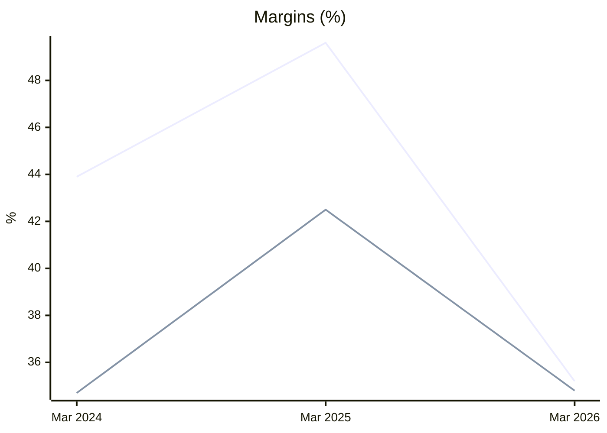
*Series in order: Operating margin, PAT margin.*

**P/E:** 11.6 — live market file (screener.in), trailing (price ₹917.00 as of 2026-08-02).

**Cash flows (₹ cr):**

| | Mar 2024 | Mar 2025 | Mar 2026 |
|---|---:|---:|---:|
| Cash from operations (₹ cr) | 1,212 | 1,697 | 1,768 |
| Cash from investing (₹ cr) | -1,026 | -1,436 | -2,082 |
| Cash from financing (₹ cr) | -247 | -211 | 298 |
| Net cash flow (₹ cr) | -62.0 | 50.0 | -16.0 |
| Free cash flow (₹ cr) | 855 | 1,300 | 1,379 |

*Source: CashFlow/NiftyTotalMarket/NATCOPHARM.csv (consolidated, screener.in).*

### 8. The separated business's financial statements

**The business being separated — its own numbers**, entity by entity: its reported statements once it is listed and on file, and the segment numbers the annual reports and presentations carry for it before that.

**Agro Chemicals (Agrochemicals Undertaking / Crop Health Sciences (CHS) division) → Natco Crop Health Sciences Limited** · unit ₹ million · Annual figures are consolidated Ind AS 108 reportable-segment disclosures: 'Segment revenue' (revenue from operations, no inter-segment revenue reported — unallocated nil) and 'Segment results' = segment profit before finance cost and tax (EBIT-type segment result; FY2025 result includes a ₹500 mn impairment loss on PPE of the Agro Chemicals segment). Segment assets/liabilities exclude unallocated items. No segment PAT, capex or depreciation disclosed.

| | FY2024 | FY2025 | FY2026 |
|---|---:|---:|---:|
| Revenue (₹ million) | 1,083 | 606 | 1,382 |
| Revenue growth (%) | — | -44.0% | +128.1% |
| Operating profit (₹ million) | -596 | -1,458 | -198 |
| Operating profit growth (%) | — | -144.6% | +86.4% |
| Operating margin (%) | -55.0 | -241 | -14.3 |
| PAT (₹ million) | — | — | — |
| PAT growth (%) | — | — | — |
| Segment assets (₹ million) | 4,238 | 2,712 | 3,022 |
| Segment liabilities (₹ million) | 588 | 314 | 520 |
| Capital employed (₹ million) | 3,650 | 2,398 | 2,502 |
| Return on capital employed (%) | -16.3 | -60.8 | -7.9 |
| Segment assets / revenue (x) | 3.9 | 4.5 | 2.2 |
| Capex (₹ million) | — | — | — |

*Sources:* Annual Report 2024 — page 329; Annual Report 2024 — page 330; Annual Report 2025 — page 302; Annual Report 2025 — page 303; Annual Report 2026 — page 316

*Latest quarter (Q2 FY27):* revenue 610, operating profit None — Presentation Nov 2026 — page 6

*Not in the pages read:* No segment PAT, capex, depreciation, or quarterly profit for Crop Health Sciences; presentations give CHS revenue only.

*Documents on file:* [Annual Report 2026](https://www.bseindia.com/xml-data/corpfiling/AttachHis/0d25dc00-4a7e-4acc-b5a8-d747c870ab2f.pdf); [Annual Report 2025](https://www.bseindia.com/xml-data/corpfiling/AttachHis/08737473-9fef-496b-881b-746b8ab600b1.pdf); [Annual Report 2024](https://www.bseindia.com/xml-data/corpfiling/AttachHis/d5a992a3-1b5a-44b4-8e5b-343b600e56fc.pdf); [Presentation Nov 2026](https://www.bseindia.com/stockinfo/AnnPdfOpen.aspx?Pname=0ce9cb9d-1ebf-4916-9a1b-c3c98e19e819.pdf); [Presentation Aug 2026](https://www.bseindia.com/stockinfo/AnnPdfOpen.aspx?Pname=02c8ef3b-6c4b-470e-83f0-69e880a97e9d.pdf); [Presentation Jun 2026](https://www.bseindia.com/stockinfo/AnnPdfOpen.aspx?Pname=f192f32c-197f-430f-b27f-7338ba5ee9a8.pdf); [Presentation Feb 2026](https://www.bseindia.com/stockinfo/AnnPdfOpen.aspx?Pname=236bc8c2-778b-4af2-a104-b4e902651e29.pdf); [Presentation Nov 2025](https://www.bseindia.com/stockinfo/AnnPdfOpen.aspx?Pname=c5fe60cd-6aa5-4ff4-9fd3-1e93a3014e6e.pdf); [Presentation Aug 2025](https://www.bseindia.com/stockinfo/AnnPdfOpen.aspx?Pname=c755548f-c325-46ba-8d7a-8c2108a36a18.pdf)

### 9. Other financial differences — working capital, margins, returns, debt

| Metric (latest year) | Parent (NATCOPHARM) | Natco Crop Health Sciences Limited |
|---|---:|---:|
| *Basis* | *reported, consolidated* | *segment numbers (Agro Chemicals (Agrochemical…* |
| Sales (₹ cr) | 4,078 (Mar 2026) | — |
| Sales growth (%) | -7.9 (Mar 2026) | 128.1 (FY2026) |
| Operating margin (%) | 35.2 (Mar 2026) | -14.3 (FY2026) |
| Operating profit growth (%) | -34.6 (Mar 2026) | 86.4 (FY2026) |
| PAT margin (%) | 34.8 (Mar 2026) | — |
| ROCE % | 17 (Mar 2026) | -7.9 (FY2026) |
| Debtor Days | 79 (Mar 2026) | — |
| Inventory Days | 480 (Mar 2026) | — |
| Days Payable | 216 (Mar 2026) | — |
| Cash Conversion Cycle | 343 (Mar 2026) | — |
| Working Capital Days | 163 (Mar 2026) | — |
| Debt / equity (x) | 0.1 (Mar 2026) | — |
| Borrowings (₹ cr) | 714 (Mar 2026) | — |
| Segment assets / revenue (x) | — | 2.2 (FY2026) |
| Sales (₹ million) | — | 1,382 (FY2026) |

*Each figure is the latest on file, with its year. Working-capital days and ROCE come from the stored working-capital file; segment figures from the pages cited in part 8. A dash means the documents do not carry it.*

**What stays with the parent — its segments, from the same pages:**

| Remaining segment | Revenue | Operating margin | ROCE | Segment assets / revenue | Unit | Year |
|---|---:|---:|---:|---:|---|---|
| Pharmaceuticals (bulk drugs and finished dosage formulations) | 39,401 | 39.3% | 18.9% | 2.46x | ₹ million | FY2026 |

**What the documents themselves say about the differences:**

- **growth** — parent / remaining: Pharmaceutical business declining as Lenalidomide/Revlimid exclusivity ends: consolidated revenue INR4,375.9 crores in FY26 vs INR4,784 crores in FY25; FY27 guidance of INR3,400–3,500 crores revenue and INR700–750 crores PAT, with 15%–25% compounding only from FY28.; separated business: Agrochemicals growing from a small base — roughly ₹60 crore in FY25 to about ₹140 crore in FY26, driven by product launches, channel expansion and people additions; commercial presence of only 3–4 years. “So yes. So in terms of sale, let's say, this year, we ended up close to INR140 crores, right? And as opposed to a declared number for last year was about INR60 crores.”
- **operating margin** — parent / remaining: Pharmaceuticals segment result ₹6,334 million for the quarter ended 30-09-2025 and ₹24,611 million for the year ended 31-03-2025; consolidated EBITDA margin 46.4% in Q2FY26 and 30.7% in Q3FY26.; separated business: Agro chemicals segment result negative: ₹(66) million for the quarter ended 30-09-2025, ₹(98) million for the half year, and ₹(1,458) million for the year ended 31-03-2025; around break-even at EBITDA level by Q2FY26. “And if you look at the business, now it has grown to about 52 crores this quarter. So, we are at least close to EBITDA positive now. Earlier, we were losing money.”
- **cash** — parent / remaining: Group net cash of about INR2,400 crores (Q4 FY26), reserved for acquisitions rather than a buyback; a further Rights Issue of ₹1,279.36 crore was allotted on 23 October 2026 at ₹750 per share.; separated business: The Resulting Company is expected to raise its own capital after listing, with the Demerged Company retaining about 20% to support it. “So, we will list it separately and then we will have special focus on this and it can raise its own capital and grow by itself.”
- **other** — parent / remaining: Pharmaceutical Undertaking is the mature, cash-generating core with robust R&D capabilities and a US/Brazil/Canada/India/South Africa footprint; R&D spend guided at 7%–9% of sales.; separated business: Agrochemicals is described as still at its early growth stages, with the Demerged Company retaining about 20% post-listing to provide support, monitoring and strategic input; business is predominantly domestic and so more exposed to the 25%–30% rise in input raw material costs. “Further, the Demerged Company intends to retain the current shareholding in the Resulting Company (20% of post listing sh arehold ing) in order to continue to offer support to the Agrochemicals Business which is still at its early growth stages and help in monitoring the progress and providing strategic support.”
- **other** — parent / remaining: Risk and reward profile of the Pharmaceutical vertical differs from the Agrochemicals vertical; demerger intended to unlock value and allow focused capital allocation and different investor sets for each.; separated business: Separate legal entity with dedicated management, different customers and different brand positioning; expected to attract different sets of investors, strategic partners and lenders. “The Board of Directors of the Demerged Company believe that the risk and reward associated with each of the aforesaid business verticals are different.”

**The checklist:**

| Item | Status | Evidence |
|---|---|---|
| Why the spin-off | yes | value unlocking for shareholders; unrelated businesses separated; regulatory / strategic knot — “…t it. Guru: Thank you for that. The other question part of it is like real value. Is there any opportunity of value unlocking for the shareholders when it comes to the ROW business , what would be the value unlocking th” |
| Institutional selling likely (small / different business) | partly | the businesses are described as distinct |
| Insider ownership and incentives aligned | unknown | no promoter-continuity or option-pricing language found *(next: the date the management options are priced; promoter holding in the resulting company)* |
| A hidden value revealed (pro-forma, leverage, comparables) | yes | borrowings 714 cr (Mar 2026) = 0.04× market cap; P/E 11.6 on Mar 2026 profit vs industry median 52.7 (45 peers) |
| Parent before the spin (clean parent, takeover prelude) | partly | stage exchange_noc — the spin has not happened; the parent can still be bought whole |
| Timing (first year sells, second year gains) | partly | not yet listed — 375 days since the first filing, stage exchange_noc |
| Management discussing it on the calls | yes | 9 mention(s) in the last 12 months of calls — “…a lso the people additions. So all these activities are going on. So I think we're fairly confident going forward. And that's also one of the main reasons for demerging and having more focus on the business. Moderator: ” |

**On the calls (last 12 months):**

- *Nov 2025* (forward) — “…ill see. So, I think that is how we want to look at it. Guru: Thank you for that. The other question part of it is like real value. Is there any opportunity of value unlocking for the shareholders when it comes to the ROW business , what would be the value unlocking that we can expect , not accurately, but at least some kind of an in…”
- *Nov 2025* (forward) — “…question part of it is like real value. Is there any opportunity of value unlocking for the shareholders when it comes to the ROW business , what would be the value unlocking that we can expect , not accurately, but at least some kind of an indicative thing on the value unlock that you probably plan for the agro diversification or w…”
- *Nov 2025* (forward) — “…when it comes to the ROW business , what would be the value unlocking that we can expect , not accurately, but at least some kind of an indicative thing on the value unlock that you probably plan for the agro diversification or whatever is in the pipeline ? Rajeev Nannapaneni: I think the idea here is that we will demerge the comp…”
- *Nov 2025* (forward) — “…the value unlock that you probably plan for the agro diversification or whatever is in the pipeline ? Rajeev Nannapaneni: I think the idea here is that we will demerge the company , I think we are planning the demerger , I think we have announced it. So, we will list that entity maybe sometime in 2026 once all the clearances…”
- *Nov 2025* (forward) — “…ro diversification or whatever is in the pipeline ? Rajeev Nannapaneni: I think the idea here is that we will demerge the company , I think we are planning the demerger , I think we have announced it. So, we will list that entity maybe sometime in 2026 once all the clearances come through. Value unlocking means I think what we…”

<details><summary>The filings</summary>

| Date | Category | Headline | Attachment |
|---|---|---|---|
| 2025-11-01 | Earnings call Nov 2025 | …ill see. So, I think that is how we want to look at it. Guru: Thank you for that. The other question part of it is like real value. Is there any opportunity of | [pdf](https://www.bseindia.com/stockinfo/AnnPdfOpen.aspx?Pname=ac8f848f-8703-4403-9ae3-cb2d420d47da.pdf) |
| 2025-11-01 | Earnings call Nov 2025 | …question part of it is like real value. Is there any opportunity of value unlocking for the shareholders when it comes to the ROW business , what would be the  | [pdf](https://www.bseindia.com/stockinfo/AnnPdfOpen.aspx?Pname=ac8f848f-8703-4403-9ae3-cb2d420d47da.pdf) |
| 2025-11-01 | Earnings call Nov 2025 | …when it comes to the ROW business , what would be the value unlocking that we can expect , not accurately, but at least some kind of an indicative thing on the | [pdf](https://www.bseindia.com/stockinfo/AnnPdfOpen.aspx?Pname=ac8f848f-8703-4403-9ae3-cb2d420d47da.pdf) |
| 2025-11-01 | Earnings call Nov 2025 | …the value unlock that you probably plan for the agro diversification or whatever is in the pipeline ? Rajeev Nannapaneni: I think the idea here is that we will | [pdf](https://www.bseindia.com/stockinfo/AnnPdfOpen.aspx?Pname=ac8f848f-8703-4403-9ae3-cb2d420d47da.pdf) |
| 2025-11-01 | Earnings call Nov 2025 | …ro diversification or whatever is in the pipeline ? Rajeev Nannapaneni: I think the idea here is that we will demerge the company , I think we are planning the | [pdf](https://www.bseindia.com/stockinfo/AnnPdfOpen.aspx?Pname=ac8f848f-8703-4403-9ae3-cb2d420d47da.pdf) |
| 2025-11-01 | Earnings call Nov 2025 | …I think we are planning the demerger , I think we have announced it. So, we will list that entity maybe sometime in 2026 once all the clearances come through.  | [pdf](https://www.bseindia.com/stockinfo/AnnPdfOpen.aspx?Pname=ac8f848f-8703-4403-9ae3-cb2d420d47da.pdf) |
| 2025-11-01 | Earnings call Nov 2025 | …nk the real value, I think you will see it in 2026. What numbers and all, very hard to predict right now . Guru: That is understood. I mean, can we expect some | [pdf](https://www.bseindia.com/stockinfo/AnnPdfOpen.aspx?Pname=ac8f848f-8703-4403-9ae3-cb2d420d47da.pdf) |
| 2025-11-01 | Earnings call Nov 2025 | …rry about that. I think my question more is not on numbers. More of like indicative comments from your side on would that be a good opportunity for shareholder | [pdf](https://www.bseindia.com/stockinfo/AnnPdfOpen.aspx?Pname=ac8f848f-8703-4403-9ae3-cb2d420d47da.pdf) |
| 2025-11-01 | Earnings call Nov 2025 | …nk my question more is not on numbers. More of like indicative comments from your side on would that be a good opportunity for shareholder value unlocking, the | [pdf](https://www.bseindia.com/stockinfo/AnnPdfOpen.aspx?Pname=ac8f848f-8703-4403-9ae3-cb2d420d47da.pdf) |
| 2025-11-01 | Earnings call Nov 2025 | …ess and a very large business in pharma. So, this business will get more attention and I think shareholders will be duly rewarded for the fact that it has been | [pdf](https://www.bseindia.com/stockinfo/AnnPdfOpen.aspx?Pname=ac8f848f-8703-4403-9ae3-cb2d420d47da.pdf) |
| 2025-11-14 | Outcome of Board Meeting | Outcome of Board Meeting | [pdf](https://nsearchives.nseindia.com/corporate/NATCOPHARM_14112025132546_Outcome14112025.pdf) |
| 2026-03-24 | Outcome of Board Meeting | Outcome of Board Meeting | [pdf](https://nsearchives.nseindia.com/corporate/NATCOPHARM_24032026171413_OutcomeOfBoardMeeting_24032026.pdf) |
| 2026-03-24 | Outcome of Board Meeting | Natco Pharma Limited has informed the Exchange regarding Outcome of Board Meeting held on March 24, 2026 | [pdf](https://nsearchives.nseindia.com/corporate/NATCOPHARM_24032026171413_OutcomeOfBoardMeeting_24032026.pdf) |
| 2026-03-24 | Board Meeting (purpose) | Other business matters To consider Scheme of arrangement (demerger) | [pdf](https://nsearchives.nseindia.in/corporate/NATCOPHARM_18032026155941_BMnotice.pdf) |
| 2026-03-24 | Board Meeting (purpose) | Board Meeting Intimation NATCO PHARMA LIMITED has informed the Exchange about Board Meeting to be held on 24-Mar-2026 to consider Scheme of arrangement. | [pdf](https://nsearchives.nseindia.in/corporate/xbrl/BMintimation_18032026_PRIOR_INTIMATION_WebXMLFile_20260318_160706696.xml) |
| 2026-06-01 | Earnings call Jun 2026 | …any color on that and our business? Rajeev Nannapaneni : That's a good question. So, I think my colleague, Rajesh will answer and he'll also tell us abo ut our | [pdf](https://www.bseindia.com/stockinfo/AnnPdfOpen.aspx?Pname=230327e4-9a77-4095-b46d-b9c836cc9b96.pdf) |
| 2026-06-01 | Earnings call Jun 2026 | …my colleague, Rajesh will answer and he'll also tell us abo ut our demerging process as well. Rajesh Chebiyam: So, as you're aware, so we're in the process of  | [pdf](https://www.bseindia.com/stockinfo/AnnPdfOpen.aspx?Pname=230327e4-9a77-4095-b46d-b9c836cc9b96.pdf) |
| 2026-06-01 | Earnings call Jun 2026 | …a lso the people additions. So all these activities are going on. So I think we're fairly confident going forward. And that's also one of the main reasons for  | [pdf](https://www.bseindia.com/stockinfo/AnnPdfOpen.aspx?Pname=230327e4-9a77-4095-b46d-b9c836cc9b96.pdf) |
| 2026-09-09 | Outcome of Board Meeting | Outcome of Board Meeting pursuant to Regulation 30 read with Schedule III | [pdf](https://nsearchives.nseindia.com/corporate/NATCOPHARM_09092026115332_BoardOutcome09092026.pdf) |
| 2026-09-09 | Outcome of Board Meeting | Natco Pharma Limited has informed the Exchange regarding Outcome of Board Meeting held on September 09, 2026. | [pdf](https://nsearchives.nseindia.com/corporate/NATCOPHARM_09092026115332_BoardOutcome09092026.pdf) |

</details>

## VEDL — Vedanta Ltd.

### 1. Vedanta Ltd. — CONFIRMED DEMERGER

**CONFIRMED** (a demerger scheme is on the exchange record) · **LISTED <1Y — selling-pressure window; the bargain forms here** · score 6.4/10 · spin-off · 41 filing(s) from CALLS, NSE, NSE-register · first 2025-12-16, latest 2026-10-03

**The separated entities — every one the documents name:**

| Entity | Scheme | Business | Listing | Who runs it |
|---|---|---|---|---|
| **Vedanta Aluminium Metal Limited** | 2023 composite scheme of arrangement (Resulting Company 1),… | Aluminum Undertaking / Aluminium Business; also receives the Company's shareholding in Bharat Aluminium Compa… | listed 2026-06-15 as VAML (NSE) | not stated for the entity; Mr. Rajiv Kumar is nam… |
| **Vedanta Power Limited** (earlier Talwandi Sabo Power Limited) | 2023 composite scheme of arrangement (Resulting Company 2),… | Merchant Power Undertaking / Merchant Power Business — generation, transmission and distribution of power, in… | listed 2026-06-15 as VEDPOWER (NSE) | not stated for the entity; Mr. Rajinder Singh Ahu… |
| **Vedanta Oil and Gas Limited** (earlier Malco Energy Limited) | 2023 composite scheme of arrangement (Resulting Company 3),… | Oil and Gas Undertaking / Oil and Gas Business — India's largest private oil and gas exploration and producti… | listed 2026-06-15 as VOGL (NSE) | not stated for the entity; Mr. Jasmin Sahurity is… |
| **Vedanta Iron and Steel Limited** | 2023 composite scheme of arrangement (Resulting Company 4),… | Iron Ore Undertaking / Iron Ore Business; press release describes the entity as Vedanta Iron & Steel (iron or… | listed 2026-06-15 as VISL (NSE) | not stated |
| **Vedanta Property Platforms Limited** | 2026 demerger of the Real Estate Business (Resulting Compan… | Real Estate Business — development, construction, redevelopment, operation, management, leasing and licensing… | not stated | not stated |

**The other parties to the scheme(s)** — not separated entities: Vedanta Base Metals Limited — dropped / withdrawn; Bharat Aluminium Company Limited — merged in — no shares for the parent's holders

**What is being separated, as the documents put it:** Aluminium, Merchant Power (to Talwandi Sabo Power), Oil & Gas and Iron Ore undertakings demerged from Vedanta Limited — class `value_unlocking`.

### 2. Stages and dates

> **Listing:** LISTED — Vedanta Aluminium Metal Limited (VAML) since 2026-06-15; Vedanta Power Limited (VEDPOWER) since 2026-06-15; Vedanta Oil and Gas Limited (VOGL) since 2026-06-15; Vedanta Iron and Steel Limited (VISL) since 2026-06-15 (NSE equity list); record date 2026-05-01; not yet listed: Vedanta Property Platforms Limited

| Date | Event | Source |
|---|---|---|
| 2023-09-29 | Board approval — Vedanta Limited (Demerged Company) — Original Scheme | as stated: NCLT Mumbai order dated 17 October 2025 (filing 2025-10-18); intimati… |
| 2023-10-10 | Board approval — Talwandi Sabo Power Limited (Resulting Company 2) | as stated: NCLT Mumbai order dated 17 October 2025 (filing 2025-10-18) |
| 2023-10-13 | Board approval — Vedanta Aluminium Metal Limited, Malco Energy Limited, Vedanta Iron and Steel Limited and Vedanta Base Metals Limited | as stated: NCLT Mumbai order dated 17 October 2025 (filing 2025-10-18) |
| 2024-07-30 | Exchange no-objection — NSE — observation letter with no objection on the Original Scheme | as stated: Filing 2024-07-31 (intimation on BSE/NSE no-objection letters); NCLT … |
| 2024-07-31 | Stage reached: **exchange noc** | [Updates](https://nsearchives.nseindia.in/corporate/VEDL_31072024162532_VEDLSEIntimationNSEBSELetterforSchemeofDemergersigned.pdf) |
| 2024-07-31 | Exchange no-objection — BSE — observation letter with no adverse observations on the Original Scheme | as stated: Filing 2024-07-31 (intimation on BSE/NSE no-objection letters) |
| 2024-10-15 | Other — Talwandi Sabo Power Limited — first motion application filed with NCLT | as stated: NCLAT order dated 27 May 2025, para 4.4 (filing 2025-05-29) |
| 2024-11-21 | NCLT order — Vedanta Limited and Malco Energy Limited — order convening shareholders'/creditors' meetings and dispensing others | as stated: Filing 2024-11-22 (disclosure on NCLT order dated November 21, 2024) |
| 2024-12-20 | Board approval — Vedanta Limited — approval of modified Scheme, not implementing Part V (Base Metals) | as stated: Filing 2024-12-20 (Demerger — update on Scheme of Demerger) |
| 2024-12-23 | Board approval — Vedanta Base Metals Limited, Vedanta Aluminium Metal Limited, Talwandi Sabo Power Limited, Malco Energy Limited, Vedanta Iron and Steel Limited — modified Scheme | as stated: NCLT Mumbai order dated 17 October 2025 (filing 2025-10-18) |
| 2025-01-17 | Stage reached: **meetings** | [Shareholders meeting](https://nsearchives.nseindia.in/corporate/VEDL_17012025095705_VEDLSEIntimationCCMNotice17Jan2025signed.pdf) |
| 2025-01-17 | Other — Notices of meetings circulated to shareholders and creditors | as stated: Filing 2025-01-17 (Notice of Court Convened General Meeting) |
| 2025-02-18 | Shareholders / creditors meeting — Vedanta Limited — equity shareholders (10:00 a.m.), secured creditors (11:45 a.m.), unsecured creditors (1:30 p.m.); approved with 99.9987% of votes polled in favour by shareholders | as stated: Filings 2025-02-18 (summary of proceedings) and 2025-02-20 (e-voting … |
| 2025-03-04 | Other — Talwandi Sabo Power Limited — NCLT order rejecting the Scheme presented by TSPL in C.A./CAA/MB/220/2024 | as stated: Filing 2025-03-04 (update on company scheme application) |
| 2025-03-28 | Other — All parties — conditions precedent timeline extended from 31 March 2025 to 30 September 2025 | as stated: Filing 2025-03-28 (extension of timelines for fulfilment of condition… |
| 2025-05-27 | Other — Talwandi Sabo Power Limited — NCLAT interim stay on the rejection of the Scheme, against a Rs. 1245 crores bank guarantee | as stated: Filing 2025-05-29 (NCLAT order dated May 27, 2025) |
| 2025-06-03 | Exchange no-objection — BSE and NSE — revised observation letters with "no adverse observations" on the modified Scheme | as stated: NCLT Mumbai order dated 17 October 2025 (filing 2025-10-18) |
| 2025-09-15 | Other — Talwandi Sabo Power Limited — NCLAT order setting aside the NCLT rejection after settlement with SEPCO dated 11 September 2025 | as stated: Filing 2025-09-16 (NCLAT order dated September 15, 2025) |
| 2025-09-30 | Other — All parties — conditions precedent timeline extended from 30 September 2025 to 31 March 2026 | as stated: Filing 2025-09-30 (extension of timelines for fulfilment of condition… |
| 2025-10-17 | NCLT order — Talwandi Sabo Power Limited — first motion order dispensing the equity shareholders' meeting and directing meetings of secured and unsecured creditors within 90 days | as stated: Filing 2025-10-18 (NCLT order dated October 17, 2025) |
| 2025-12-16 | Stage reached: **nclt sanction** | [News Verification](-) |
| 2025-12-16 | NCLT order — Vedanta Limited, VAML, MEL, VISL — NCLT Mumbai order sanctioning the Scheme of Arrangement for the demerger | as stated: Filing 2025-12-16 (update on Scheme of Arrangement) and news clarific… |
| 2026-01-09 | NCLT order — Talwandi Sabo Power Limited — NCLT Mumbai order allowing TSPL's petition and sanctioning the Scheme | as stated: Filing 2026-01-09 (update on C.P./CAA/MB/254/2025) |
| 2026-01-21 | Other — Certified copy of the 16 December 2025 NCLT order received by the Company at around 4:30 p.m. IST | as stated: Filing 2026-01-21 (certified copy of NCLT order) |
| 2026-03-31 | Other — All parties — conditions precedent timeline extended from 31 March 2026 to 30 June 2026 under Clause 39.7 | as stated: Filing 2026-03-31 (extension of timelines for fulfilment of condition… |
| 2026-04-20 | Board approval — Board approved making the Scheme effective on 1 May 2026, fixed 1 May 2026 as record date, and approved transfer of the Company's BALCO shareholding to VAML | as stated: Filing 2026-04-20 (Record Date disclosure under Regulations 30 and 42) |
| 2026-04-30 | Other — Bharat Aluminium Company Limited — share sale agreement between the Company and VAML "likely to be signed on or before April 30, 2026"; expected date of completion "On or before April 30, 2026" | as stated: Filing 2026-04-20 (Annexure A) |
| 2026-05-01 | **Record date** | NSE corporate-actions register |
| 2026-05-01 | Stage reached: **record date** | Record Date (corporate-actions register) |
| 2026-05-01 | Appointed date — All parties — "the Effective Date will also be the Appointed Date i.e. May 01, 2026" | as stated: Filing 2026-05-16 (apportionment of cost of acquisition) |
| 2026-05-01 | Effective date — All parties — "The Scheme has come into effect on May 01, 2026, being the Effective Date" | as stated: Filing 2026-05-16 (apportionment of cost of acquisition); filing 2026… |
| 2026-05-01 | Record date — Vedanta Limited equity shareholders, and debenture holders of ISINs INE205A07196, INE205A07220, INE205A08038 and INE205A08020 whose NCDs transfer to VAML | as stated: Filing 2026-04-20 (Record date fixed as May 01, 2026) |
| 2026-06-15 | **Vedanta Aluminium Metal Limited** listed (VAML) | NSE equity list |
| 2026-06-15 | **Vedanta Power Limited** listed (VEDPOWER) | NSE equity list |
| 2026-06-15 | **Vedanta Oil and Gas Limited** listed (VOGL) | NSE equity list |
| 2026-06-15 | **Vedanta Iron and Steel Limited** listed (VISL) | NSE equity list |
| 2026-06-15 | Listing and trading — Vedanta Aluminium Metal Limited (VAML), Vedanta Power Limited (VEDPOWER), Vedanta Iron and Steel Limited (VISL), Vedanta Oil and Gas Limited (VOGL) — "4 new entities listed on NSE & BSE on 15th June" | as stated: Q1FY27 investor presentation, 30 July 2026; NSE equity list |
| 2026-07-30 | Stage reached: **announced** | [Press Release](https://nsearchives.nseindia.com/corporate/VEDL_30072026151113_VEDLSEIntimationPressReleaseIRPPTfinalsigned.pdf) |
| 2026-07-30 | Board approval — Vedanta Property Platforms Limited — Board approved the draft Scheme for demerger of the Real Estate Business; the Company "shall apply to the BSE Limited and National Stock Exchange of India Limited, in due course" for no-objection letters | as stated: Filing 2026-07-30 (Scheme of Arrangement — demerger of Real Estate Bu… |

**The stages, as filed:** exchange noc (2024-07-31) → meetings (2025-01-17) → nclt sanction (2025-12-16) → record date (2026-05-01) → announced (2026-07-30)

**Stated in the filings:** resulting company **Talwandi Sabo Power Limited**; record date 2026-05-01; pro-forma statements referenced; size hint: 11% of ebitda.

**When it lists, in the documents' words:** On 29 April 2026: 'The effective and record date is set for May 1st… The shares of the resulting companies are expected to list and commence trading by mid-June.' On 30 July 2026: '4 new entities listed on NSE & BSE on 15th June'; consolidated share value ₹932.05 'on listing date (15th June 2026)'.

### 3. Size of the separated business beside the parent — is institutional selling likely?

**Reading: VERY LIKELY — the piece is under a tenth of the whole; index funds and large holders who receive it without choosing it tend to sell.**

| Entity | Stated turnover | Stated share of the whole | Segment revenue share | Market cap (₹ cr) | Share of combined market cap | Index member |
|---|---|---:|---:|---:|---:|---|
| Vedanta Aluminium Metal Limited | not stated for the undertaking (Aluminium segment FY26 EBIT… | — | 83.9% (FY2026) | 148,517 | 59.4% | no |
| Vedanta Power Limited | not stated for the undertaking (FY26 power sales grew 30% Y… | — | 83.9% (FY2026) | 13,655 | 11.9% | no |
| Vedanta Oil and Gas Limited | not stated for the undertaking (FY26 average gross operated… | — | 83.9% (FY2026) | 12,071 | 10.6% | no |
| Vedanta Iron and Steel Limited | not stated for the undertaking (FY26: iron ore production 6… | — | 83.9% (FY2026) | 10,300 | 9.2% | no |
| Vedanta Property Platforms Limited | INR 1.26 crore for the year ended March 31, 2026 (turnover … | 0.001% | 83.9% (FY2026) | — | — | not listed |

*Stated figures are the documents' own (a turnover share, or the cost-of-acquisition split the company publishes for tax, which reflects relative value); the segment share is this business's revenue over the parent's sales, and the market-cap share is the entity's value over the entity plus the parent (parent ₹101,545 cr, NSE bhavcopy of 2026-11-13), both computed here.*

**In the documents' words:** “2023/2026 composite demerger — "For the purpose of determining post-demerger cost of acquisition of the Equity Shares of the Company and the Resulting Companies, shareholders may apportion their total cost of acquisition of the Company in the following manner: 1 Vedanta Limited 52.34% | 2 Vedanta Aluminium Metal Limited 7.15% | 3 Talwandi Sabo Power Limited 12.23% | 4 Malco Energy Limited 21.49% | 5 Vedanta Iron and Steel Limited 6.79%" and "The aforesaid ratio has been determined based on the net worth of the Company and the net assets of the Aluminum Undertaking, Merchant Power Undertaking, Oil and Gas Undertaking, and Iron Ore Undertaking, in accordance with Sections 73 of the Income-tax, Act, 2025." Post-listing: "Combined market cap of all Demerger resulting companies grew by over ₹ 71k crore in Q1". 2026 real estate demerger — "The turnover (including other operating income) of the Demerged Undertaking for the year ended March 31, 2026 was INR 1.26 crore representing 0.001 % of the total standalone turnover of Vedanta Limited for the year ended March 31, 2026."”

**The judge's read of selling pressure:** likely — Power entity is small (12.23% cost apportionment, ~4.7x pro-forma leverage) and a different industry from the metals parent; shares pushed 1:1 to all holders.

### 4. Insider ownership — share swap, promoters' holding, management incentives

**Share swap / entitlement, entity by entity:**

- **Vedanta Aluminium Metal Limited:** 1 (One) fully paid-up equity share of VAML having a face value of INR 1 (Rupee One) each for every 1 (One) fully paid-up equity share of INR 1 (Rupees One) each of the Company.
- **Vedanta Power Limited:** 1 (One) fully paid-up equity share of TSPL having face value of INR 10 (Indian Rupees Ten) each for every 1 (one) fully paid-up equity share of INR 1 (Indian Rupee One) each of the Company.
- **Vedanta Oil and Gas Limited:** 1 (One) fully paid-up equity share of MEL having face value of INR 1 (Indian Rupee One) each for every 1 (one) fully paid-up equity share of INR 1 (Indian Rupee One) each of the Company.
- **Vedanta Iron and Steel Limited:** 1 (One) fully paid-up equity share of VISL having face value of INR 1 (Indian Rupee One) each for every 1 (one) fully paid-up equity share of INR 1 (Indian Rupee One) each of the Company.

**Promoters' holding, from the shareholding pattern:**

| Company | Promoters | FIIs | DIIs | Public | Quarter |
|---|---:|---:|---:|---:|---|
| Vedanta Ltd. (VEDL) | 54.72% | 15.78% | 10.69% | 18.58% | Sep 2026 |
| Vedanta Aluminium Metal Limited (VAML) | 56.38% | 11.04% | 15.35% | 17.0% | Sep 2026 |
| Vedanta Power Limited (VEDPOWER) | 56.38% | 6.8% | 10.71% | 25.88% | Sep 2026 |
| Vedanta Oil and Gas Limited (VOGL) | 56.38% | 5.45% | 5.93% | 32.01% | Sep 2026 |
| Vedanta Iron and Steel Limited (VISL) | 56.38% | 4.11% | 9.24% | 30.03% | Sep 2026 |

*Source: screener.in shareholding pattern, stored under `ShareholdingPattern/NiftyTotalMarket/`. In a mirror demerger each shareholder holds the same proportion of the new company as of the parent on the record date.*

- **Promoters in the parent, per the documents:** 54.72% — "Vedanta Resources Ltd (through its subsidiaries)" as on 30 June 2026 (Q1FY27 investor presentation entity structure). Per the 15 May 2026 Regulation 30A disclosure: Twin Star Holdings Ltd "holding 40.02% shares in Vedanta Limited", Vedanta Holdings Mauritius II Limited "holding 12.60% shares in Vedanta Limited", Welter Trading Limited "holding 0.98% shares in Vedanta Limited"; Vedanta Resources Limited is "classified as a member of the promoter group of Vedanta Limited, with no direct shareholding in Vedanta Limited". At the 18 February 2025 court-convened meeting the Promoter and Promoter Group held 2,204,867,749 of 3,910,388,057 shares (record date 11 February 2025).
- **What the promoters will hold in the separated entity:** 2023/2026 composite demerger: "Post demerger, every Vedanta shareholder - both retail and institutional - will receive one new share in each of the newly demerged companies. Other than this, there will be no change in the overall shareholding structure." And: "The shareholders will continue to enjoy value unlocking of the Vedanta Base Metals business as part of legacy residual Vedanta where they will remain shareholders in addition to receiving equivalent shares in other resulting companies which will mirror Vedanta shareholding." 2026 real estate demerger: not stated.
- **What a public shareholder receives:** 2023/2026 composite demerger: "In accordance with provisions of the Scheme, Resulting Companies issued and allotted 1 (One) fully paid-up equity share of each Resulting Companies for every 1 (One) fully paid-up equity share held in the Company, to the shareholders of the Company whose names are recorded in the register of members and / or records of the depository as on the Record Date (i.e., May 01, 2026)." Also: "Shareholders of Vedanta Limited will receive equity shares in each of the four resulting listed entities (in addition to their shareholding in Vedanta Limited) in proportion to their existing holdings, ensuring continuity of ownership while enabling direct participation in the growth trajectories of individual businesses." And: "Shareholders holding one share of Vedanta as on 29th April, today, will receive four additional shares of the resulting companies." 2026 real estate demerger: not stated (consideration is a "Share Entitlement Ratio" defined in the Scheme, value not disclosed).
- **Management incentives:** not stated in the documents on file.
- **Insider actions around the separation:** Promoter group borrowing secured on Vedanta Limited shares: Vedanta Resources Limited (borrower) with Twin Star Holdings Ltd, Vedanta Holdings Mauritius II Limited and Welter Trading Limited as guarantors entered a facility agreement dated 30 January 2026, amended and restated on 13 May 2026 and upsized "from up to US$ 350,000,000 to US$ 600,000,000"; "Encumbrances have been created over the shares of Vedanta Limited, in terms of the Amended Facility Agreement and related finance documents, and such encumbrance(s) have been disclosed in the form and manner specified under the Securities and Exchange Board of India (Substantial Acquisition of Shares and Takeovers) Regulations, 2011", with disclosures made under Regulations 29(1) and 31 of the Takeover Regulations. Company-level selling around the separation: on 18 June 2025 Vedanta sold 66.7 million Hindustan Zinc shares (c. 1.6%) for c. INR 3,028 Cr — "As we actively progress towards the demerger of Vedanta into sector focused entities across diverse verticals, this capital raise will help de-leverage the balance sheet and enhance financial flexibility"; a further Zinc India offer-for-sale was launched on 27 January 2026 (about 1.1%, c. Rs.3,000 crore) with "the entire amount will be used for de-leveraging", taking the holding to around 60.7% from 61.8%. Also disclosed: "As part of demerger proceedings, a full and final settlement of Rs. 660 Cr has been done with SEPCO"; and a corporate guarantee from Vedanta covering the MoPNG/DGH alleged claims so they do not sit on the demerged oil and gas entity.
- **Insiders, per the checklist read:** Shares issued 1:1 pro-rata, so promoter Vedanta Resources' 56.38% VEDL stake (54.72% at June 2026) is mirrored; promoter-group VEDL shares encumbered under VRL's amended facility agreement; later scheme states no special promoter benefit. · *option pricing date:* not stated

### 5. Why the demerger — point by point

Management presented the separation as the heart of "Vedanta 2.0": dismantling one diversified holding company into five sector-specific pure-play entities — Vedanta Aluminium Metal Ltd, Vedanta Power (renamed from Talwandi Sabo Power), Vedanta Oil & Gas (renamed from Malco Energy), Vedanta Iron & Steel Ltd, and a residual Vedanta Limited holding Zinc India (60.71% of HZL), Zinc International, Copper (Silvassa/Fujairah/KSA), FACOR ferrochrome and nickel/semiconductor assets — on the stated logic that each would "chart out their own growth trajectory and attract respective thematic investors," with sharper accountability and separate dividend policies set by five independent boards. The first problem they said it solves is valuation: one monolithic entity buried the parts, and after listing on 15 June 2026 the company itself claimed the combined value of VEDL plus the four new shares went from ₹225.50 at announcement (29 Sep 2023) to ₹932.05, ">300% upside". The second is capital structure: the ~$5.5bn group net debt (earlier quoted as $6.7bn) was re-architected "aligning debt with earning strength and growth stage of each resulting company" — ~$3.5bn to Aluminium (1.3x EBITDA), Power at 4.7x but on long-dated 7–10 year PFC/REC paper, residual Vedanta Ltd ~$1bn at 0.4x, and Oil & Gas nil / Iron & Steel ≤$0.2bn net debt — against group leverage of 0.95x. Third, it removed rigid cash rules: the prescriptive policy requiring at least 30% of profit as dividend and upstreaming of Hindustan Zinc dividends within six months became "principle-based," giving each board flexibility. Fourth, it repriced intra-group charges: copper's brand fee falls from 3% to 0.75% (~$65mn on $3.1–3.2bn revenue, +2.25% EBITDA), which management expects to lift that near-trading business from ~1% to at least 5% margin in FY27, while the blended group brand fee stays ~$400–450mn and the 3% rate stands to FY29. Fifth, it opens dedicated capital pools — "differentiated capital structure" means "many anchor investors domestically and globally are very keen to come in the cap table," an extra deleveraging avenue for Vedanta Resources' remaining ~$4.7bn debt serviced out of ~$400mn brand fee plus 4–5% dividend. Third parties shaped it: lenders made debt allocation "a precondition for granting NOC"; the Ministry of Petroleum and Natural Gas objected at NCLT over disputed Cairn arbitration dues (~$512mn) and was satisfied only by a Vedanta corporate guarantee ring-fencing the demerged oil & gas entity; and a ₹660 crore full-and-final SEPCO settlement was booked as an exceptional item "paving the way for a proposed demerger process." A second, separate demerger followed on 30 July 2026: ~2,264 acres and ~53,185 sq ft across 22 non-core real estate assets (FY26 turnover ₹1.26 crore, 0.001% of standalone revenue) go to Vedanta Property Platforms Ltd at 1 share per 20 VEDL shares, because the portfolio sat "embedded within the operating business" with "sub-optimal visibility" and a claimed ₹30,000 crore+ of latent value.

**Point by point, with the source:**

1. Ajay Goel positioned the demerger purely as value unlock while it was at the shareholder/creditor-approval stage, with the meeting scheduled for 18 February 2025. “This transformative step is poised to unlock significant value for our investors.” — *[Feb 2025](https://www.vedantalimited.com/uploads/investor-overview/financial-results/VedantaEarnings-transcript-Jan31-2025.pdf)*
2. Naidoo, in her first call as Group CEO, tied the demerger to the "Vedanta 2.0" ambition of a $100 billion critical minerals, energy and technology powerhouse, with completion then guided for September 2025. “We are making good progress with our demerger plan, aiming to create pure-play entities that will enhance strategic focus and operational flexibility.” — *[Apr 2025](https://www.vedantalimited.com/uploads/investor-overview/financial-results/Vedanta-CallTranscript-Apr30-2025_v2.pdf)*
3. An investor (Ashish Kejriwal) flagged that mining leases for the Sijimali bauxite and coal blocks had to be transferred to Vedanta Aluminium before the split could close; management confirmed a parallel approvals plan. “But the team has a detailed approvals plan, including all of the mining licenses that will start being approved, in fact, have already started the process.” — *[Apr 2025](https://www.vedantalimited.com/uploads/investor-overview/financial-results/Vedanta-CallTranscript-Apr30-2025_v2.pdf)*
4. Delays were attributed to two external forums — the NCLT second-motion hearing and an NCLAT stay on the TSPL power order — yet the split was named a top corporate priority. “The execution of the demerger remains a top priority for Vedanta.” — *[Aug 2025](https://www.vedantalimited.com/uploads/investor-overview/financial-results/2026/Vedanta_Transcript_Jul31_2025.pdf)*
5. The Ministry of Petroleum and Natural Gas, a key counterparty in the oil and gas business, objected at NCLT that the demerged Cairn entity might not be able to pay disputed arbitration dues. “And in the last NCLT hearing, they did express concern about the payments of any of the disputed dues that may become payable by Cairn in case the ongoing arbitration ruling, as we have all learned now, comes in their favor.” — *[Aug 2025](https://www.vedantalimited.com/uploads/investor-overview/financial-results/2026/Vedanta_Transcript_Jul31_2025.pdf)*
6. A long-standing creditor dispute was bought out with a ₹660 crore exceptional charge explicitly to clear the demerger path; MoPNG's objection was neutralised by a Vedanta corporate guarantee covering the full extent of the alleged claims (~$520mn). “As part of demerger proceedings, a full and final settlement of Rs. 660 Cr has been done with SEPCO, thereby resolving a long-standing dispute, paving the way for a proposed demerger process.” — *[Nov 2025](https://www.vedantalimited.com/uploads/investor-overview/financial-results/2026/VEDL_Q2FY26_Transcript.pdf)*
7. Goel framed the end state as five separately valued verticals and listed all five demerged entities for the end of FY26, ahead of the final NCLT hearing on 12 November. “On the demerger, we are at the final stage. We remain confident of completing our demerger by end of this fiscal, unlocking focused value across our five verticals.” — *[Nov 2025](https://www.vedantalimited.com/uploads/investor-overview/financial-results/2026/VEDL_Q2FY26_Transcript.pdf)*
8. With NCLT approval in hand (16 Dec 2025 for four businesses, 9 Jan 2026 for power), Naidoo gave the fullest statement of purpose — strategy focus, balance-sheet strength and growth — and targeted 1 April as effective date. “This marks a defining moment in our journey, one that empowers our businesses to sharpen the strategies, strengthen the balance sheets and accelerate growth with the aim of unlocking shareholder value.” — *[Jan 2026](https://www.vedantalimited.com/uploads/investor-overview/financial-results/2026/Transcript_29Jan2026.pdf)*
9. Lenders were an active party: debt allocation across entities had to be agreed with bankers before they would release no-objection certificates, with the $6.7bn consolidated net debt apportioned by assets and each entity's debt-servicing capability. “When we went to the banker seeking NOC, in that case, debt allocation was broadly aligned with the bankers as a precondition for granting NOC for demerger approval.” — *[Jan 2026](https://www.vedantalimited.com/uploads/investor-overview/financial-results/2026/Transcript_29Jan2026.pdf)*
10. Goel also framed the restructuring as a tax and structuring opportunity (accumulated losses, unabsorbed depreciation) and said it would be used to make oil and gas and iron and steel debt-free, part-funded by a 1.1% HZL OFS worth ~₹3,000 crore. “One thing I can confirm to the entire audience and to the stakeholders at large, that demerger in fact, becomes an opportunity across the areas.” — *[Jan 2026](https://www.vedantalimited.com/uploads/investor-overview/financial-results/2026/Transcript_29Jan2026.pdf)*
11. The power CEO used the demerger to justify a standalone growth mandate: from 4.2 GW today to ~4.8 GW by H1FY27 and a plan for an additional 10–12 GW over five to seven years. “And as we demerge, we really want to be a growth company and ride the India's growth story on energy.” — *[Jan 2026](https://www.vedantalimited.com/uploads/investor-overview/financial-results/2026/Transcript_29Jan2026.pdf)*
12. On the final pre-demerger call Goel set out the structural logic: five pure-plays, each attracting its own investor base, effective 1 May 2026 with one VEDL share earning four additional shares and trading expected by mid-June. “This will entail creation of five independent sector-specific pure-play companies, allowing each company to chart out their own growth trajectory and attract respective thematic investors.” — *[Apr 2026](https://www.vedantalimited.com/uploads/investor-overview/financial-results/2026/Vedanta-Transcript-Apr29-2026.pdf)*
13. Capital structure was deliberately engineered per entity — Oil & Gas nil debt, Iron & Steel ≤$0.2bn, Aluminium ~$3.5bn at 1.3x, Power 4.7x on 7–10 year PFC/REC maturities, Vedanta Ltd ~$1bn at 0.4x — against group leverage of 0.95x. “The de-merger has been architected with precision on capital structure, aligning debt with earning strength and growth stage of each resulting company.” — *[Apr 2026](https://www.vedantalimited.com/uploads/investor-overview/financial-results/2026/Vedanta-Transcript-Apr29-2026.pdf)*
14. The split removed prescriptive cash rules: the mandatory 30% profit payout and the six-month Hindustan Zinc dividend upstreaming requirement give way to board discretion at each of the five companies. “Currently, Vedanta's policy on dividend is more prescriptive; it will become more descriptive.” — *[Apr 2026](https://www.vedantalimited.com/uploads/investor-overview/financial-results/2026/Vedanta-Transcript-Apr29-2026.pdf)*
15. Unbundling also repriced the brand fee for the thin-margin copper business, which management expects to lift copper margins from ~1% to at least 5% in FY27 (~$65mn benefit), while blended group brand fee stays flat and the 3% rate holds to FY29. “So the brand fee for copper from the current 3% will go down to 0.75% and that alone from India's viewpoint means higher EBITDA by 2.25%.” — *[Apr 2026](https://www.vedantalimited.com/uploads/investor-overview/financial-results/2026/Vedanta-Transcript-Apr29-2026.pdf)*
16. Separate cap tables were pitched as a new deleveraging channel for Vedanta Resources, which still carries $4.7bn of debt against ~$400mn brand fee plus a 4–5% dividend. “Now as we de-merge all the five companies, additionally we'll have the optionality of a differentiated capital structure and in that case, many anchor investors domestically and globally are very keen to come in the cap table, and that will be additional avenue for de-leveraging.” — *[Apr 2026](https://www.vedantalimited.com/uploads/investor-overview/financial-results/2026/Vedanta-Transcript-Apr29-2026.pdf)*
17. Asked whether the entities could still acquire outside their sector, Naidoo said business CEOs are mandated to grow organically on their own 2x/3x plans while cross-sector M&A sits at a holdco with its own team and the Chairman. “Holdco will be set up to make sure there is some visibility of capital allocation across all 5 businesses, but also with its own M&A team to start looking at some of these opportunities.” — *[Apr 2026](https://www.vedantalimited.com/uploads/investor-overview/financial-results/2026/Vedanta-Transcript-Apr29-2026.pdf)*
18. The 30 July 2026 real-estate scheme (VEDL into Vedanta Property Platforms Ltd, 1 share for every 20) rests on the claim that ~2,264 acres and ~53,185 sq ft across 22 assets were trapped inside the operating business — FY26 turnover of just ₹1.26 crore, 0.001% of standalone revenue — with a claimed ₹30,000 crore+ of latent value. “The real estate business is currently embedded within the operating business and the real estate portfolio has been historically subject to limited focused utilisation, resulting in sub-optimal visibility of the real estate business segment and value realization.” — *Scheme*
19. The stated benefits mirror the five-way split — dedicated management and governance, sector-specific investors, lenders and strategic partners, and separate financial disclosure enabling clearer valuation; VPPL may also absorb real estate from Meenakshi Energy and Incab Industries. “enabling focused and sharper capital market access and thereby unlocking the value of the Demerged Undertaking and creating enhanced value for shareholders.” — *Scheme*

**How it evolved:** By the Feb 2025 (Q3FY25) call the scheme was already in execution with shareholder/creditor meetings set for 18 Feb 2025, and in Apr 2025 (Q4FY25) new Group CEO Deshnee Naidoo folded it into "Vedanta 2.0" with completion guided for September 2025. It then slipped repeatedly through regulatory friction: Aug 2025 (Q1FY26) disclosed the NCLT second-motion part-hearing of 2 July with the next date 20 August, an NCLAT interim stay on the TSPL power order (₹1,248 crore bank guarantee posted) and MoPNG objections; Nov 2025 (Q2FY26) set final hearing for 12 November, settled SEPCO for ₹660 crore and gave MoPNG a Vedanta corporate guarantee; Jan 2026 (Q3FY26) reported NCLT approval on 16 Dec 2025 for four businesses and 9 Jan 2026 for power, Ind AS 105 discontinued-operations accounting, and a 1 April effective-date target. Apr 2026 (Q4FY26) was the final pre-demerger call: effective and record date 1 May 2026, one VEDL share earning four additional shares, listing by mid-June, plus newly disclosed mechanics — the copper brand-fee cut, the principle-based dividend policy and holdco-level M&A. After listing, the 30 July 2026 board meeting opened a further leg by approving the real-estate demerger into VPPL, targeted for completion in FY28.

**What management expects from it:** Each pure-play sets its own strategy, dividend policy and capital structure: Aluminium 1.3x levered on strong cash flow, Power a 10–12 GW growth story, Oil & Gas and Iron & Steel debt-free, residual Vedanta Ltd 0.4x with HZL dividends optional and copper margins rising 1%-to-5% on a 0.75% brand fee. Thematic investors and anchor capital per cap table; simpler structures, sharper accountability, value unlock (claimed >300%).

*Not explained on the calls:* No explanation of why these five groupings, no SOTP targets, separation costs, dis-synergies, duplicated corporate overhead, or who originally proposed the split.

- *Stated reason, in one line:* Creation of five independent sector-specific pure-play companies, allowing each to chart its own growth trajectory and attract thematic investors; 'simpler structures, sharper accountability, and focused platforms to drive growth and value creation.'
- *What it reveals:* Separation exposes Zinc India's 56-57% margins and residual VEDL at 0.30x net debt/EBITDA with AA+ upgrade, versus Vedanta Power's 4.7x pro-forma leverage; combined market cap of resulting companies grew over ₹71,000 crore in Q1FY27.
- *Parent or spin:* parent · *Read next:* Vedanta Power Limited's own first standalone results/production release — TSPL plant availability, Athena restart and its 4.7x leverage
- *In their words:* “The Scheme has come into effect on May 01, 2026, being the Effective Date (as defined under the Scheme).”

### 6. On the calls, verbatim

10 call(s), oldest first: **71 question-and-answer exchange(s)** given in full — the question and every answer to it, nothing trimmed — and 59 passage(s) from management's prepared remarks (the complete sentences about it; the whole remarks are in the linked transcript). Text is as the transcript prints it.

| Call | Q&A exchanges | Prepared-remarks passages | Transcript |
|---|---:|---:|---|
| Nov 2023 | 7 | 3 | [transcript](https://www.vedantalimited.com/uploads/investor-overview/financial-results/Transcript_VEDL_Earnings_Call_2QFY24.pdf) |
| Jan 2024 | 4 | 8 | — |
| Aug 2024 | 10 | 8 | [transcript](https://www.vedantalimited.com/uploads/investor-overview/financial-results/call-transcript-fy2025.pdf) |
| Nov 2024 | 6 | 5 | [transcript](https://www.vedantalimited.com/uploads/investor-overview/financial-results/Vedanta-Earnings-Nov08-2024.pdf) |
| Feb 2025 | 3 | 3 | [transcript](https://www.vedantalimited.com/uploads/investor-overview/financial-results/VedantaEarnings-transcript-Jan31-2025.pdf) |
| Apr 2025 | 8 | 5 | [transcript](https://www.vedantalimited.com/uploads/investor-overview/financial-results/Vedanta-CallTranscript-Apr30-2025_v2.pdf) |
| Aug 2025 | 6 | 6 | [transcript](https://www.vedantalimited.com/uploads/investor-overview/financial-results/2026/Vedanta_Transcript_Jul31_2025.pdf) |
| Nov 2025 | 7 | 6 | [transcript](https://www.vedantalimited.com/uploads/investor-overview/financial-results/2026/VEDL_Q2FY26_Transcript.pdf) |
| Jan 2026 | 10 | 8 | [transcript](https://www.vedantalimited.com/uploads/investor-overview/financial-results/2026/Transcript_29Jan2026.pdf) |
| Apr 2026 | 10 | 7 | [transcript](https://www.vedantalimited.com/uploads/investor-overview/financial-results/2026/Vedanta-Transcript-Apr29-2026.pdf) |

**The full verbatim text of every exchange is in [companies/VEDL.md](companies/VEDL.md#6-on-the-calls-verbatim).**

### 7. The parent's financial statements

**The parent, last three fiscal years (consolidated)**

| | Mar 2024 | Mar 2025 | Mar 2026 |
|---|---:|---:|---:|
| Sales (₹ cr) | 143,727 | 62,717 | 78,437 |
| Sales growth (%) | -2.4% | -56.4% | +25.1% |
| Operating profit (₹ cr) | 35,312 | 18,578 | 23,183 |
| Operating profit growth (%) | +2.6% | -47.4% | +24.8% |
| Operating margin (%) | 24.6 | 29.6 | 29.6 |
| PAT (₹ cr) | 7,539 | 20,535 | 25,096 |
| PAT growth (%) | -48.0% | +172.4% | +22.2% |
| PAT margin (%) | 5.2 | 32.7 | 32.0 |
| EPS (₹) | 11.4 | 38.3 | 44.5 |

*Source: ProfitStatement/NiftyTotalMarket/VEDL.csv (consolidated, screener.in); growth and margins computed here.*

```mermaid
xychart-beta
    title "Sales, operating profit and PAT (₹ cr)"
    x-axis ["Mar 2024", "Mar 2025", "Mar 2026"]
    y-axis "₹ crore"
    bar [143727, 62717, 78437]
    bar [35312, 18578, 23183]
    bar [7539, 20535, 25096]
```
*Series in order: Sales, Operating profit, PAT.*

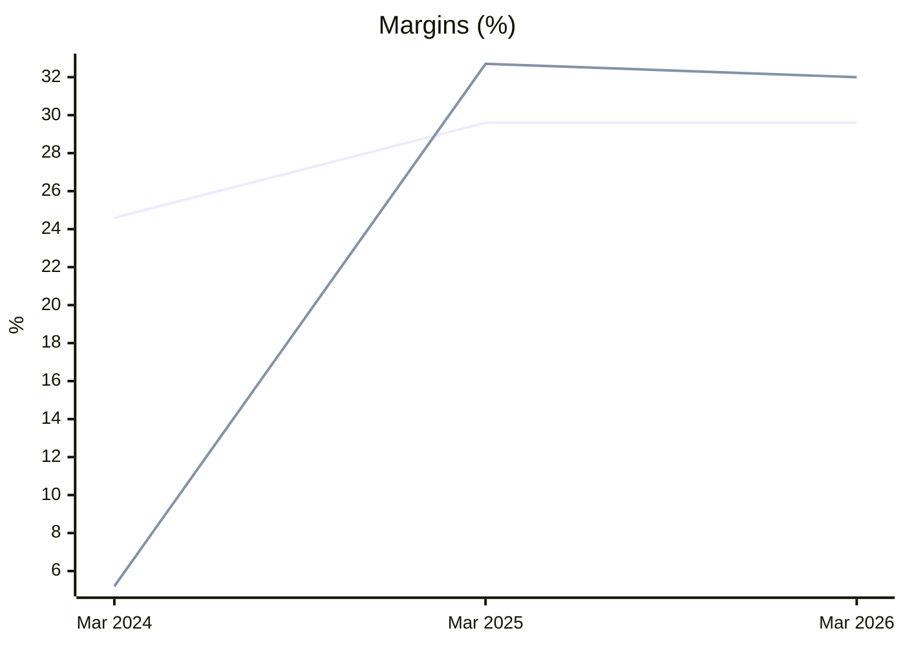
*Series in order: Operating margin, PAT margin.*

**P/E:** 9.39 — live market file (screener.in), trailing (price ₹264.00 as of 2026-08-02).

**Cash flows (₹ cr):**

| | Mar 2024 | Mar 2025 | Mar 2026 |
|---|---:|---:|---:|
| Cash from operations (₹ cr) | 35,654 | 39,562 | 39,499 |
| Cash from investing (₹ cr) | -13,676 | -19,158 | -24,134 |
| Cash from financing (₹ cr) | -26,092 | -19,223 | -13,549 |
| Net cash flow (₹ cr) | -4,114 | 1,181 | 1,816 |
| Free cash flow (₹ cr) | 19,097 | 22,848 | 18,747 |

*Source: CashFlow/NiftyTotalMarket/VEDL.csv (consolidated, screener.in).*

### 8. The separated business's financial statements

**The business being separated — its own numbers**, entity by entity: its reported statements once it is listed and on file, and the segment numbers the annual reports and presentations carry for it before that.

**Vedanta Aluminium Metal Limited (VAML) — as reported since listing**

| | Mar 2026 |
|---|---:|
| Sales (₹ cr) | 66,891 |
| Sales growth (%) | — |
| Operating profit (₹ cr) | 25,163 |
| Operating profit growth (%) | — |
| Operating margin (%) | 37.6 |
| PAT (₹ cr) | 14,153 |
| PAT growth (%) | — |
| PAT margin (%) | 21.2 |
| EPS (₹) | 1,181,900 |

*Source: ProfitStatement/NiftyTotalMarket/VAML.csv (consolidated, screener.in); growth and margins computed here.*

**Vedanta Power Limited (VEDPOWER) — as reported since listing**

| | Mar 2026 |
|---|---:|
| Sales (₹ cr) | 8,799 |
| Sales growth (%) | — |
| Operating profit (₹ cr) | 1,558 |
| Operating profit growth (%) | — |
| Operating margin (%) | 17.7 |
| PAT (₹ cr) | -1,686 |
| PAT growth (%) | — |
| PAT margin (%) | -19.2 |
| EPS (₹) | -5.3 |

*Source: ProfitStatement/NiftyTotalMarket/VEDPOWER.csv (consolidated, screener.in); growth and margins computed here.*

**Vedanta Oil and Gas Limited (VOGL) — as reported since listing**

| | Mar 2026 |
|---|---:|
| Sales (₹ cr) | 9,606 |
| Sales growth (%) | — |
| Operating profit (₹ cr) | 2,941 |
| Operating profit growth (%) | — |
| Operating margin (%) | 30.6 |
| PAT (₹ cr) | -493 |
| PAT growth (%) | — |
| PAT margin (%) | -5.1 |
| EPS (₹) | -104 |

*Source: ProfitStatement/NiftyTotalMarket/VOGL.csv (consolidated, screener.in); growth and margins computed here.*

**Vedanta Iron and Steel Limited (VISL) — as reported since listing**

| | Mar 2026 |
|---|---:|
| Sales (₹ cr) | 0.0 |
| Sales growth (%) | — |
| Operating profit (₹ cr) | -0.0 |
| Operating profit growth (%) | — |
| Operating margin (%) | — |
| PAT (₹ cr) | -0.0 |
| PAT growth (%) | — |
| PAT margin (%) | — |
| EPS (₹) | -3.0 |

*Source: ProfitStatement/NiftyTotalMarket/VISL.csv (consolidated, screener.in); growth and margins computed here.*

**Aluminium (Aluminium Undertaking) — reported as a discontinued operation in FY2026 → Vedanta Aluminium Metal Limited** · unit ₹ crore · Consolidated segment disclosure. Revenue = segment revenue (external plus inter-segment); external revenue separately: FY2024 48,317; FY2025 58,446; FY2026 65,766. Operating profit = 'Segment results (EBITDA)' (non-GAAP, before depreciation, finance cost, exceptionals, tax). No segment-level PAT disclosed.

| | FY2024 | FY2025 | FY2026 |
|---|---:|---:|---:|
| Revenue (₹ crore) | 48,371 | 58,522 | 65,847 |
| Revenue growth (%) | — | +21.0% | +12.5% |
| Operating profit (₹ crore) | 9,657 | 17,798 | 25,502 |
| Operating profit growth (%) | — | +84.3% | +43.3% |
| Operating margin (%) | 20.0 | 30.4 | 38.7 |
| PAT (₹ crore) | — | — | — |
| PAT growth (%) | — | — | — |
| Segment assets (₹ crore) | 68,400 | 73,113 | 80,592 |
| Segment liabilities (₹ crore) | 25,322 | 22,036 | 20,926 |
| Capital employed (₹ crore) | 43,078 | 51,077 | 59,666 |
| Return on capital employed (%) | 22.4 | 34.8 | 42.7 |
| Segment assets / revenue (x) | 1.4 | 1.2 | 1.2 |
| Capex (₹ crore) | 7,773 | 7,527 | 7,700 |

*Sources:* Annual Report 2024 — page 234; Annual Report 2025 — page 252; Annual Report 2026 — pages 260-261

*Latest quarter (Q4 FY26):* revenue 18753, operating profit 8485 — Presentation Apr 2026 — page 40

*Not in the pages read:* No segment PAT. No post-demerger (FY27) quarterly figures; aluminium left VEDL with demerger effective 1 May 2026.

**Oil & Gas (Oil and Gas Undertaking) — discontinued operation in FY2026 → Vedanta Oil and Gas Limited** · unit ₹ crore · Consolidated segment disclosure. Revenue = segment revenue (no inter-segment revenue in this segment, so equals external revenue). Operating profit = 'Segment results (EBITDA)'. No segment PAT.

| | FY2024 | FY2025 | FY2026 |
|---|---:|---:|---:|
| Revenue (₹ crore) | 17,837 | 11,044 | 9,582 |
| Revenue growth (%) | — | -38.1% | -13.2% |
| Operating profit (₹ crore) | 9,777 | 4,664 | 4,350 |
| Operating profit growth (%) | — | -52.3% | -6.7% |
| Operating margin (%) | 54.8 | 42.2 | 45.4 |
| PAT (₹ crore) | — | — | — |
| PAT growth (%) | — | — | — |
| Segment assets (₹ crore) | 28,028 | 24,285 | 25,806 |
| Segment liabilities (₹ crore) | 14,671 | 12,185 | 11,438 |
| Capital employed (₹ crore) | 13,357 | 12,100 | 14,368 |
| Return on capital employed (%) | 73.2 | 38.5 | 30.3 |
| Segment assets / revenue (x) | 1.6 | 2.2 | 2.7 |
| Capex (₹ crore) | 3,217 | 3,005 | 3,728 |

*Sources:* Annual Report 2024 — page 234; Annual Report 2025 — page 252; Annual Report 2026 — pages 260-261

*Not in the pages read:* No segment PAT; no Oil & Gas quarterly segment summary page among those supplied.

**Iron Ore (Iron Ore Undertaking) — discontinued operation in FY2026 → Vedanta Iron and Steel Limited** · unit ₹ crore · Consolidated segment disclosure. Revenue = segment revenue incl. inter-segment; external revenue: FY2024 8,956; FY2025 5,972; FY2026 6,451. Operating profit = 'Segment results (EBITDA)'. No segment PAT.

| | FY2024 | FY2025 | FY2026 |
|---|---:|---:|---:|
| Revenue (₹ crore) | 9,069 | 6,086 | 6,457 |
| Revenue growth (%) | — | -32.9% | +6.1% |
| Operating profit (₹ crore) | 1,676 | 1,006 | 1,007 |
| Operating profit growth (%) | — | -40.0% | +0.1% |
| Operating margin (%) | 18.5 | 16.5 | 15.6 |
| PAT (₹ crore) | — | — | — |
| PAT growth (%) | — | — | — |
| Segment assets (₹ crore) | 5,716 | 6,181 | 5,408 |
| Segment liabilities (₹ crore) | 3,486 | 3,213 | 3,582 |
| Capital employed (₹ crore) | 2,230 | 2,968 | 1,826 |
| Return on capital employed (%) | 75.2 | 33.9 | 55.1 |
| Segment assets / revenue (x) | 0.6 | 1.0 | 0.8 |
| Capex (₹ crore) | 621 | 705 | 609 |

*Sources:* Annual Report 2024 — page 234; Annual Report 2025 — page 252; Annual Report 2026 — pages 260-261

*Not in the pages read:* No segment PAT; pages carry only iron ore / pig iron sales volumes by quarter, no quarterly iron ore revenue or EBITDA.

**Others — discontinued operations (comprises steel and cement; steel business forms part of the Iron Ore Undertaking) → Vedanta Iron and Steel Limited** · unit ₹ crore · Consolidated segment disclosure, FY2026 split of discontinued operations. Revenue = segment revenue incl. inter-segment; external revenue FY2026 7,306, FY2025 7,380. Operating profit = 'Segment results (EBITDA)'. No segment PAT.

| | FY2024 | FY2025 | FY2026 |
|---|---:|---:|---:|
| Revenue (₹ crore) | — | 7,936 | 7,306 |
| Revenue growth (%) | — | — | -7.9% |
| Operating profit (₹ crore) | — | 526 | 164 |
| Operating profit growth (%) | — | — | -68.8% |
| Operating margin (%) | — | 6.6 | 2.2 |
| PAT (₹ crore) | — | — | — |
| PAT growth (%) | — | — | — |
| Segment assets (₹ crore) | — | 7,413 | 7,996 |
| Segment liabilities (₹ crore) | — | 3,503 | 3,601 |
| Capital employed (₹ crore) | — | 3,910 | 4,395 |
| Return on capital employed (%) | — | 13.5 | 3.7 |
| Segment assets / revenue (x) | — | 0.9 | 1.1 |
| Capex (₹ crore) | — | — | 1,065 |

*Sources:* Annual Report 2024 — page 234 (Others not split into continuing/discontinued); Annual Report 2026 — page 261; Annual Report 2026 — pages 260-261

*Not in the pages read:* FY2024 split, FY2025 capex, segment PAT, quarterly figures.

**Power — discontinued operations (thermal power facilities generating and selling commercial power, excluding captive power) → Talwandi Sabo Power Limited (TSPL) / Resulting Company 2 — Merchant Power Undertaking (also referred to as Vedanta Power Limited)** · unit ₹ crore · Consolidated segment disclosure. FY2026 and restated FY2025 are the discontinued (merchant/thermal) part of the Power segment only; FY2024 is the whole Power segment, not split. Revenue = segment revenue incl. inter-segment (external FY2026 8,721; FY2025 6,022). Operating profit = 'Segment results (EBITDA)'. No segment PAT.

| | FY2024 | FY2025 | FY2026 |
|---|---:|---:|---:|
| Revenue (₹ crore) | 6,153 | 6,022 | 8,891 |
| Revenue growth (%) | — | -2.1% | +47.6% |
| Operating profit (₹ crore) | 971 | 650 | 1,534 |
| Operating profit growth (%) | — | -33.1% | +136.0% |
| Operating margin (%) | 15.8 | 10.8 | 17.3 |
| PAT (₹ crore) | — | — | — |
| PAT growth (%) | — | — | — |
| Segment assets (₹ crore) | 15,209 | 16,534 | 16,876 |
| Segment liabilities (₹ crore) | 837 | 1,317 | 1,868 |
| Capital employed (₹ crore) | 14,372 | 15,217 | 15,008 |
| Return on capital employed (%) | 6.8 | 4.3 | 10.2 |
| Segment assets / revenue (x) | 2.5 | 2.8 | 1.9 |
| Capex (₹ crore) | 1,364 | — | 1,871 |

*Sources:* Annual Report 2024 — page 234 (whole Power segment, incl. what later stays with parent); Annual Report 2026 — page 261 (restated, discontinued Power); Annual Report 2026 — pages 260-261

*Latest quarter (Q4 FY26):* revenue None, operating profit 566 — Presentation Apr 2026 — page 49

*Not in the pages read:* Segment PAT; FY2025 discontinued-power capex; quarterly revenue. Q4 FY26 EBITDA 566 is the whole Power segment (FY26 1,623 = 1,534 discontinued + 89 continuing), not merchant-only.

*Businesses with no numbers in the pages read (3 annual report(s) and 12 presentation(s) on file):* Vedanta Property Platforms Limited / Real Estate Business: the pages carry no figures at all — it is not a reported segment and is not named in the demerger notes supplied. Segment-level PAT is not disclosed for any business.

*Documents on file:* [Annual Report 2026](https://www.bseindia.com/xml-data/corpfiling/AttachHis/3725606c-05f5-40b2-b122-55c0a6e7bdd1.pdf); [Annual Report 2025](https://www.bseindia.com/xml-data/corpfiling/AttachHis/4f41b8d2-e8ed-4dad-b3fd-b9adca371fed.pdf); [Annual Report 2024](https://www.bseindia.com/xml-data/corpfiling/AttachHis/d4d3e3bc-fe5a-4184-b181-b5455d60f11a.pdf); [Presentation Oct 2026](https://www.bseindia.com/stockinfo/AnnPdfOpen.aspx?Pname=49dc0908-347a-4af4-ab1c-0d0cfac26c4b.pdf); [Presentation Jul 2026](https://www.bseindia.com/stockinfo/AnnPdfOpen.aspx?Pname=b8b95ea1-9d39-4176-9a1a-15f1a2c5c4bd.pdf); [Presentation Apr 2026](https://www.bseindia.com/stockinfo/AnnPdfOpen.aspx?Pname=918fc405-534d-492a-9def-a386f80ba291.pdf); [Presentation Jan 2026](https://www.bseindia.com/stockinfo/AnnPdfOpen.aspx?Pname=48883dba-0b14-4a5e-ad9c-b9e40292ee52.pdf); [Presentation Nov 2025](https://www.bseindia.com/stockinfo/AnnPdfOpen.aspx?Pname=614c7898-dc7a-4f07-bb16-036e9ef8303c.pdf); [Presentation Aug 2025](https://www.bseindia.com/stockinfo/AnnPdfOpen.aspx?Pname=2f4607c8-0394-46f5-a86c-0d36d15c6e74.pdf)

### 9. Other financial differences — working capital, margins, returns, debt

| Metric (latest year) | Parent (VEDL) | Vedanta Aluminium Metal Limited (VAML) | Vedanta Power Limited (VEDPOWER) | Vedanta Oil and Gas Limited (VOGL) | Vedanta Iron and Steel Limited (VISL) | Vedanta Property Platforms Limited |
|---|---:|---:|---:|---:|---:|---:|
| *Basis* | *reported, consolidated* | *its own reported statements* | *its own reported statements* | *its own reported statements* | *its own reported statements* | *segment numbers (Aluminium (Aluminium Underta…* |
| Sales (₹ cr) | 78,437 (Mar 2026) | 66,891 (Mar 2026) | 8,799 (Mar 2026) | 9,606 (Mar 2026) | 0 (Mar 2026) | — |
| Sales growth (%) | 25.1 (Mar 2026) | — | — | — | — | 12.5 (FY2026) |
| Operating margin (%) | 29.6 (Mar 2026) | 37.6 (Mar 2026) | 17.7 (Mar 2026) | 30.6 (Mar 2026) | — | 38.7 (FY2026) |
| Operating profit growth (%) | 24.8 (Mar 2026) | — | — | — | — | 43.3 (FY2026) |
| PAT margin (%) | 32 (Mar 2026) | 21.2 (Mar 2026) | -19.2 (Mar 2026) | -5.1 (Mar 2026) | — | — |
| ROCE % | 16 (Mar 2026) | — | — | — | — | 42.7 (FY2026) |
| Debtor Days | 6 (Mar 2026) | — | — | 31 (Mar 2026) | — | — |
| Inventory Days | 66 (Mar 2026) | — | — | — | — | — |
| Days Payable | 88 (Mar 2026) | — | — | — | — | — |
| Cash Conversion Cycle | -16 (Mar 2026) | — | — | 31 (Mar 2026) | — | — |
| Working Capital Days | -121 (Mar 2026) | — | — | -208 (Mar 2026) | — | — |
| Debt / equity (x) | 0.7 (Mar 2026) | 1.4 (Sep 2026) | 1.7 (Mar 2025
            
            (S)) | 0.1 (Sep 2026) | 0.8 (Sep 2026) | — |
| Borrowings (₹ cr) | 32,947 (Mar 2026) | 32,849 (Sep 2026) | 6,238 (Mar 2025
            
            (S)) | 2,787 (Sep 2026) | 4,663 (Sep 2026) | — |
| Segment assets / revenue (x) | — | — | — | — | — | 1.2 (FY2026) |
| Sales (₹ crore) | — | — | — | — | — | 65,847 (FY2026) |

*Each figure is the latest on file, with its year. Working-capital days and ROCE come from the stored working-capital file; segment figures from the pages cited in part 8. A dash means the documents do not carry it.*

**What stays with the parent — its segments, from the same pages:**

| Remaining segment | Revenue | Operating margin | ROCE | Segment assets / revenue | Unit | Year |
|---|---:|---:|---:|---:|---|---|
| Zinc India (zinc, lead and silver — India) | 39,057 | 56.5% | 118.0% | 0.7x | ₹ crore | FY2026 |
| Zinc International | 4,860 | 27.2% | 12.2% | 2.78x | ₹ crore | FY2026 |
| Copper | 31,069 | -0.2% | — | 0.19x | ₹ crore | FY2026 |
| Power — continuing operations (wind power plants and the Mettur Dam power plant, excluding captive power) | 135 | 65.9% | 19.3% | 3.92x | ₹ crore | FY2026 |
| Others — continuing operations (port/berth, glass substrate, power cables, ferro alloys) | 2,165 | 0.0% | 0.1% | 1.61x | ₹ crore | FY2026 |

**What the documents themselves say about the differences:**

- **debt and leverage** — parent / remaining: Vedanta Limited (remaining) keeps about $1 billion of net debt at 0.4x net debt/EBITDA, serviceable "through FACOR, through Zinc International, and the Copper" plus Zinc India dividends; Q1FY27 net debt ₹8,299 crore and net debt/EBITDA 0.30x, gross debt ₹28,291 crore; separated business: Of $5.5 billion group net debt, Vedanta Aluminium takes $3.5 billion (1.3x); Vedanta Power's leverage 4.7x with mostly long-term PFC/REC debt of 7 to 10 years; Vedanta Oil and Gas debt-free; Vedanta Iron and Steel no more than $0.2 billion “So out of 5.5, 3.5 goes to Vedanta Aluminum, and looking at the EBITDA of that business, their leverage will be still 1.3.”
- **debt and leverage** — parent / remaining: Continuing operations carried ₹10,522 crore of net debt as on 31 March 2026, reduced to ₹8,299 crore by 30 June 2026; separated business: ₹42,732 crore of the ₹53,254 crore group net debt as on 31 March 2026 went out with the discontinued (demerged) operations “At Vedanta group level pre-de-merger, our leverage stands at 0.95x, reflecting resilient EBITDA and disciplined financial structuring.”
- **operating margin** — parent / remaining: Remaining Vedanta Limited: Q1FY27 EBITDA ₹8,469 crore on revenue ₹23,456 crore, EBITDA margin 57% (excludes copper business), up 985 bps YoY; separated business: Pre-demerger combined group: Q4FY26 EBITDA margin ~44% (record) and FY26 ~39%; Aluminium FY26 margin 38%, Zinc India 56%, Cairn Oil and Gas ~44% “EBITDA margin# of 57%, up by 985 bps YoY and 225 bps QoQ”
- **return on capital** — parent / remaining: Remaining Vedanta Limited: ROCE c.29% in Q1FY27 ("ROCE is EBIT net of tax outflow divided by average capital employed"); separated business: Pre-demerger combined group: "Record Return on Capital Employed at ~32%, improved by 539 bps YoY" in Q4FY26; 27% in Q3FY26 and ~26% in Q2FY26 “Strong Return on Capital Employed at 29%, reflecting disciplined capital allocation”
- **capex and capital intensity** — parent / remaining: Remaining Vedanta Limited: growth capex ₹1,148 crore in Q1FY27 (project capex ₹1,181 crore and sustaining capex ₹1,390 crore in the net debt walk); separated business: Pre-demerger combined group: "Total capital expenditure in the year stood at ₹ 14,918 crores" in FY26 (c.$1.7 billion), deployed across aluminium, zinc, oil and gas and power; Saudi rod mill and Gamsberg Phase 3 plans of $2 billion and $4 billion discussed for the separated/retained international businesses “Invested Growth Capex of ₹1,148 crore in Q1 FY27”
- **cash** — parent / remaining: Remaining Vedanta Limited: cash and cash equivalents ₹19,992 crore at 30 June 2026 (Zinc India ₹12,892 crore of it), FCF pre-capex ₹4,412 crore in Q1FY27; separated business: Pre-demerger combined group: "Cash and Cash Equivalent stood at ₹28,485, improving by 38% YoY on the back of Free cash flow (pre-capex) of ₹ 26,013 crore" in FY26 “Cash and cash equivalents position remains strong at ₹ 19,992 crore .”
- **growth** — parent / remaining: Remaining Vedanta Limited: Q1FY27 PAT ₹5,294 crore, up 152% YoY, on continuing operations; credit rating upgraded to AA+/Stable by both ICRA and CRISIL (highest since 2014); separated business: Market value created by the separated entities after listing: combined market capitalisation of the resulting companies up over ₹71,000 crore in Q1FY27 “Vedanta’s demerger is unlocking significant shareholder value, with combined market cap of resulting companies growing by over ₹71,000 crore in the 1st quarter .”
- **tax** — parent / remaining: Remaining Vedanta Limited: normalized effective tax rate 26% in Q1FY27 versus 28% in Q1FY26, with a tax charge of ₹1,895 crore; separated business: not stated; the cost-of-acquisition apportionment was made "in accordance with Sections 73 of the Income-tax, Act, 2025" and the resulting-company share issue was "in accordance with the provisions of Section 2(35) of the Income-tax Act, 2025" “Normalized ETR is 26% vs 28% in Q1’ FY26, lower due to reduced losses in subsidiaries wherein DTA is not recognized .”
- **other** — parent / remaining: Remaining Vedanta Limited revenue: ₹23,456 crore in Q1FY27 (continuing operations only); separated business: Pre-demerger combined group revenue: ₹51,524 crore in Q4FY26 and ₹1,74,075 crore in FY26 — i.e. the continuing business is well under half the former group's quarterly revenue “Achieved C onsolidated Revenue of ₹23,456 crore, up 51% YoY and down 1% QoQ”

**The checklist:**

| Item | Status | Evidence |
|---|---|---|
| Why the spin-off | yes | value unlocking for shareholders; a weak or capital-heavy business carved away; unrelated businesses separated; regulatory / strategic knot; attracting different investors / capital — “…he listing of all five demerge d entities by the end of FY '26, enabling greater strategic focus and enhanced value creation for all stakeholders. At the start of FY 2026, global markets fac…” |
| Institutional selling likely (small / different business) | yes | the demerged piece is 11% of ebitda; the businesses are described as distinct |
| Insider ownership and incentives aligned | unknown | no promoter-continuity or option-pricing language found *(next: the date the management options are priced; promoter holding in the resulting company)* |
| A hidden value revealed (pro-forma, leverage, comparables) | yes | pro-forma statements are referenced in the filings; borrowings 32,947 cr (Mar 2026) = 0.32× market cap; P/E 4.1 on Mar 2026 profit vs industry median 22.9 (16 peers) |
| Parent before the spin (clean parent, takeover prelude) | no | stage record_date — the pieces trade separately now |
| Timing (first year sells, second year gains) | partly | 207 days since listing/record date; first year since listing — the selling-pressure window; watch, size the entry |
| Management discussing it on the calls | yes | 18 mention(s) in the last 12 months of calls — “…in an unbundled fashion, so each of the new companies' benchmarking is different. In summary, the 3% rate continues and the only change that will be done post -de-merger is in the copper brand fee. So the brand fee for ” |

**On the calls (last 12 months):**

- *Nov 2025* (forward) — “…chromium , cobalt, vanadium, potash and manganese. This brings the total number of secured blocks to 11. We have also made substantial progress on the proposed demerger, which is a pivotal step towards unlocking further shareholder value. The final N CLT hearing is scheduled for November 12, and we expect approvals to follow.…”
- *Nov 2025* (forward) — “…shareholder value. The final N CLT hearing is scheduled for November 12, and we expect approvals to follow. This will set the stage for the listing of all five demerge d entities by the end of FY '26, enabling greater strategic focus and enhanced value creation for all stakeholders. At the start of FY 2026, global markets fac…”
- *Nov 2025* (forward) — “…w petition has been filed against this order, but on accounting basis, we have taken the provision. The second matter is regarding SEPCO settlement. As part of demerger proceedings, a full and final settlement of Rs. 660 Cr has been done with SEPCO , thereby resolving a long -standing dispute, paving the way for a proposed dem…”
- *Nov 2025* (neutral) — “…ger proceedings, a full and final settlement of Rs. 660 Cr has been done with SEPCO , thereby resolving a long -standing dispute, paving the way for a proposed demerger process. Similarly, in Q2 last year, we have recorded net exceptional income of Rs. 1,160 crores, mainly on account of oil and gas impairment reversal. Our EBI…”
- *Nov 2025* (neutral) — “…high cost debt now retired, VRL is positioned to operate on autopilot mode, supported by a dividend payout of 4% to 5% in future and routine brand fee. On the demerger, we are at the final stage. We remain confident of completing our demerger by end of this fiscal, unlocking focused value acros s our five verticals. In summar…”

<details><summary>The filings</summary>

| Date | Category | Headline | Attachment |
|---|---|---|---|
| 2025-11-01 | Earnings call Nov 2025 | …chromium , cobalt, vanadium, potash and manganese. This brings the total number of secured blocks to 11. We have also made substantial progress on the proposed | [pdf](https://www.vedantalimited.com/uploads/investor-overview/financial-results/2026/VEDL_Q2FY26_Transcript.pdf) |
| 2025-11-01 | Earnings call Nov 2025 | …shareholder value. The final N CLT hearing is scheduled for November 12, and we expect approvals to follow. This will set the stage for the listing of all five | [pdf](https://www.vedantalimited.com/uploads/investor-overview/financial-results/2026/VEDL_Q2FY26_Transcript.pdf) |
| 2025-11-01 | Earnings call Nov 2025 | …w petition has been filed against this order, but on accounting basis, we have taken the provision. The second matter is regarding SEPCO settlement. As part of | [pdf](https://www.vedantalimited.com/uploads/investor-overview/financial-results/2026/VEDL_Q2FY26_Transcript.pdf) |
| 2025-11-01 | Earnings call Nov 2025 | …or as I put it, a key catalyst for the acquisition from our side. And I also want to make the point that this split doesn't impact our deleveraging plan or our | [pdf](https://www.vedantalimited.com/uploads/investor-overview/financial-results/2026/VEDL_Q2FY26_Transcript.pdf) |
| 2025-11-01 | Earnings call Nov 2025 | …r rebidding, and we feel quite confident that Jaiprakash is coming to Vedanta. Deshnee Naidoo: Maybe then again , Ashish, I will take the other question around | [pdf](https://www.vedantalimited.com/uploads/investor-overview/financial-results/2026/VEDL_Q2FY26_Transcript.pdf) |
| 2025-11-01 | Earnings call Nov 2025 | …ly mentioned, the financial risk in recovering some of these at this point , alleged claims from the business and basically questioning whether the P &L of the | [pdf](https://www.vedantalimited.com/uploads/investor-overview/financial-results/2026/VEDL_Q2FY26_Transcript.pdf) |
| 2025-11-01 | Earnings call Nov 2025 | …antee that does cover up , cover us for the full extent of the alleged claims at this point, Ritesh. Of course, all of these numbers will be finalized once the | [pdf](https://www.vedantalimited.com/uploads/investor-overview/financial-results/2026/VEDL_Q2FY26_Transcript.pdf) |
| 2025-12-16 | News Verification | The Exchange has sought clarification from Vedanta Limited with respect to recent news item captioned Vedanta demerger decks cleared after Mumbai NCLT approves  | [pdf](-) |
| 2025-12-16 | News Verification | The Exchange has sought clarification from Vedanta Limited with respect to recent news item captioned Vedanta demerger decks cleared after Mumbai NCLT approves  | [pdf](https://nsearchives.nseindia.com/corporate/VEDL_16122025163405_VEDLSEIntimationClarification16122025.pdf) |
| 2025-12-16 | Updates | Vedanta Limited has informed the Exchange regarding 'Update on Scheme of Arrangement for Demerger of Vedanta Limited'. | [pdf](https://nsearchives.nseindia.com/corporate/VEDL_16122025225750_VEDLSEIntimationNCLTOrder16Dec_2025signed.pdf) |
| 2026-01-01 | Earnings call Jan 2026 | …the strategies, strengthen the balance sheets and accelerate growth with the aim of unlocking shareholder value. On the 16th of December, the NCLT approved our | [pdf](https://www.vedantalimited.com/uploads/investor-overview/financial-results/2026/Transcript_29Jan2026.pdf) |
| 2026-01-01 | Earnings call Jan 2026 | …FY26 has been a quarter of immense significance for Vedanta, marked by remarkable performance, both operationally and financially, and crucial progress made on | [pdf](https://www.vedantalimited.com/uploads/investor-overview/financial-results/2026/Transcript_29Jan2026.pdf) |
| 2026-01-01 | Earnings call Jan 2026 | …nd and pricing being favorable, and we expect these conditions to sustain going forward. On results presentation, following NCLT order on December 16, '25, the | [pdf](https://www.vedantalimited.com/uploads/investor-overview/financial-results/2026/Transcript_29Jan2026.pdf) |
| 2026-01-01 | Earnings call Jan 2026 | …in our improved balance sheet, cash flow visibility and strategic direction clarity. Vedanta Limite d January 29, 2026 Sensitivity: Internal (C3) Moving on to  | [pdf](https://www.vedantalimited.com/uploads/investor-overview/financial-results/2026/Transcript_29Jan2026.pdf) |
| 2026-01-01 | Earnings call Jan 2026 | …ed balance sheet, cash flow visibility and strategic direction clarity. Vedanta Limite d January 29, 2026 Sensitivity: Internal (C3) Moving on to “Demerger and | [pdf](https://www.vedantalimited.com/uploads/investor-overview/financial-results/2026/Transcript_29Jan2026.pdf) |
| 2026-01-01 | Earnings call Jan 2026 | …key regulatory and operational matters work ed through, we remain committed to completing demerger as earlier guided, targeting April 1st as effective date of  | [pdf](https://www.vedantalimited.com/uploads/investor-overview/financial-results/2026/Transcript_29Jan2026.pdf) |
| 2026-01-09 | Updates | Vedanta Limited has informed the Exchange regarding 'Disclosure under Regulation 30 of SEBI (Listing Obligations and Disclosure Requirements) Regulations, 2015  | [pdf](https://nsearchives.nseindia.com/corporate/VEDL_09012026200947_SEIntimationNCLTOrder09Jan2026signed.pdf) |
| 2026-01-21 | Updates | Vedanta Limited has informed the Exchange regarding 'Disclosure under Regulation 30 of the Securities and Exchange Board of India (Listing Obligations and Discl | [pdf](https://nsearchives.nseindia.com/corporate/VEDL_21012026212023_VEDLSEIntimationNCLTOrderCertifiedCopyfinalsigned.pdf) |
| 2026-01-29 | Press Release | Vedanta Limited has announced the press release titled "Vedanta Ltd. reports record-breaking Q3: Profit surges 60% to &#8377;7,807 crore, Revenue up 19% YoY" | [pdf](https://nsearchives.nseindia.com/corporate/VEDL_29012026155958_VEDLSEIntimationOutcomeofBM29Jan2026PRandIRPPTsigned.pdf) |
| 2026-03-23 | News Verification | The Exchange has sought clarification from Vedanta Limited with respect to recent news item captioned Vedanta moves NCLAT, challenges NCLT nod to Adani's bid fo | [pdf](-) |
| 2026-03-31 | Updates | Vedanta Limited has informed the Exchange regarding 'Extension of timelines for fulfilment of the conditions precedent under the Composite Scheme of Arrangement | [pdf](https://nsearchives.nseindia.com/corporate/VEDL_31032026171850_VEDLSEIntimation31March2026Outcomesigned.pdf) |
| 2026-04-01 | Earnings call Apr 2026 | …o zero net debt businesses. Other three businesses' net debt to EBITDA ratios will be in line with their debt serving capabilities. At Vedanta group level pre  | [pdf](https://www.vedantalimited.com/uploads/investor-overview/financial-results/2026/Vedanta-Transcript-Apr29-2026.pdf) |
| 2026-04-01 | Earnings call Apr 2026 | …ong performance and notable advancements across strategic focus areas. The upcoming de -merger marks Vedanta's transition into a future new phase of growth and | [pdf](https://www.vedantalimited.com/uploads/investor-overview/financial-results/2026/Vedanta-Transcript-Apr29-2026.pdf) |
| 2026-04-01 | Earnings call Apr 2026 | …arwal: Yes. So after the demerger how would the dividend policies look like for each of the entities? Ajay Goel: So that is a one change that will entail post  | [pdf](https://www.vedantalimited.com/uploads/investor-overview/financial-results/2026/Vedanta-Transcript-Apr29-2026.pdf) |
| 2026-04-01 | Earnings call Apr 2026 | …in an unbundled fashion, so each of the new companies' benchmarking is different. In summary, the 3% rate continues and the only change that will be done post  | [pdf](https://www.vedantalimited.com/uploads/investor-overview/financial-results/2026/Vedanta-Transcript-Apr29-2026.pdf) |
| 2026-04-01 | Earnings call Apr 2026 | …form, what will be net debt to EBITDA, all of them. So if you look at overall Vedanta right now, $5.5 billion net debt and debt to EBITDA almost 0.95. Now pre  | [pdf](https://www.vedantalimited.com/uploads/investor-overview/financial-results/2026/Vedanta-Transcript-Apr29-2026.pdf) |
| 2026-04-01 | Earnings call Apr 2026 | …respective entity. So it's already factored in. Pallav Agarwal: Yes, so I get that . So, Bloom Fountain is a holding company of which particular company of the | [pdf](https://www.vedantalimited.com/uploads/investor-overview/financial-results/2026/Vedanta-Transcript-Apr29-2026.pdf) |
| 2026-04-20 | Record Date | Vedanta Limited has informed the Exchange that Record date for the purpose of Scheme of Arrangement has been fixed as May 01, 2026 | [pdf](https://nsearchives.nseindia.com/corporate/VEDL_20042026170932_VEDLSEIntimationRecordDate20April2026signed.pdf) |
| 2026-04-20 | Sale or disposal | Vedanta Limited has informed the Exchange about the Board approval for transfer of VEDL shareholding in Bharat Aluminium Company Limited to Vedanta Aluminium Me | [pdf](https://nsearchives.nseindia.com/corporate/VEDL_20042026171108_VEDLSEIntimationRecordDate20April2026signed.pdf) |
| 2026-04-29 | Press Release | Vedanta Limited has informed the Exchange regarding a press release dated April 29, 2026, titled "Vedanta Delivers its Best-Ever Financial Performance -PAT jump | [pdf](https://nsearchives.nseindia.com/corporate/VEDL_29042026144722_2VEDLSEIntimationOutcomeofBM29April2026PressReleaseandIRPPTsigned.pdf) |
| 2026-04-29 | Updates | Vedanta Limited has informed the Exchange that pursuant to the scheme of demerger being implemented, the Board of Directors has approved the revision of the Com | [pdf](https://nsearchives.nseindia.com/corporate/VEDL_29042026145441_3VEDSIntimationOutcomeofBM29April2026OtherMatterssigned.pdf) |
| 2026-04-29 | Updates | Vedanta Limited has informed the Exchange regarding 'Disclosure under Regulation 30 of Securities and Exchange Board of India (Listing Obligations and Disclosur | [pdf](https://nsearchives.nseindia.com/corporate/VEDL_29042026170031_VEDLSEIntimationDemergerApr2026signed.pdf) |
| 2026-05-01 | Record Date (corporate-actions register) | Record date 2026-05-01 for Demerger — NSE corporate-actions register |  |
| 2026-05-15 | Amendment(s) | Intimation under Regulations 30 and 30A of Securities and Exchange Board of India ( SEBI ) (Listing Obligations and Disclosure Requirements) Regulations, 2015,  | [pdf](https://nsearchives.nseindia.com/corporate/VEDL_15052026174133_VEDLDisclosureApexARReg305AIntimationsigned.pdf) |
| 2026-05-16 | Updates | Vedanta Limited has informed the Exchange regarding 'Apportionment of cost of acquisition of Equity Shares of Vedanta Limited, Vedanta Aluminium Metal Limited,  | [pdf](https://nsearchives.nseindia.com/corporate/VEDL_16052026123241_VEDLSEIntimationCostofApportionmentsigned.pdf) |
| 2026-07-03 | Updates | Vedanta Limited has informed the Exchange regarding 'Production Release '. | [pdf](https://nsearchives.nseindia.com/corporate/VEDL_03072026161913_SE_Intimation-Production_Release-July_2026_signed.pdf) |
| 2026-07-30 | Press Release | Vedanta Limited has informed the Exchange regarding a press release dated July 30, 2026, titled "Vedanta Limited Q1-FY27 Profit surges 152% YoY on Record Operat | [pdf](https://nsearchives.nseindia.com/corporate/VEDL_30072026151113_VEDLSEIntimationPressReleaseIRPPTfinalsigned.pdf) |
| 2026-07-30 | Scheme of Arrangement | Vedanta Limited has informed the Exchange about Scheme of Arrangement | [pdf](https://nsearchives.nseindia.com/corporate/VEDL_30072026152112_VEDLSEIntimationDemergerofSurplusAssetsfinalsigned.pdf) |
| 2026-07-30 | Press Release | Vedanta Limited has informed the Exchange regarding a press release dated July 30, 2026, titled "Vedanta Announces Demerger of Surplus Real Estate Assets to Unl | [pdf](https://nsearchives.nseindia.com/corporate/VEDL_30072026152326_VEDLSEIntimationDemergerofSurplusAssetsfinalsigned.pdf) |
| 2026-07-30 | Updates | Vedanta Limited has informed the Exchange regarding ' Intimation under Regulations 30 and 51 of the Securities and Exchange Board of India (Listing Obligations  | [pdf](https://nsearchives.nseindia.com/corporate/VEDL_30072026152434_VEDLSEIntimationDemergerofSurplusAssetsfinalsigned.pdf) |
| 2026-10-03 | Updates | Vedanta Limited has informed the Exchange regarding ' Production Release of the Company for quarter ended September 30, 2026'. | [pdf](https://nsearchives.nseindia.com/corporate/VEDL_03102026180708_SEIntimationProductionReleasefinalsigned.pdf) |

</details>

## APOLLOHOSP — Apollo Hospitals Enterprise Ltd.

### 1. Apollo Hospitals Enterprise Ltd. — CONFIRMED DEMERGER

**CONFIRMED** (a demerger scheme is on the exchange record) · **PRE-SPIN — study the parent; the pieces do not trade yet** · score 5.7/10 · spin-off · 25 filing(s) from CALLS, NSE · first 2025-12-24, latest 2026-06-26

**The separated entities — every one the documents name:**

| Entity | Scheme | Business | Listing | Who runs it |
|---|---|---|---|---|
| **Apollo Healthtech Limited** | 2025-26 composite scheme of arrangement (demerger of the Id… | Omni channel pharmacy distribution business and digital health platform business (Apollo 24/7 and AHEL's tele… | to be listed | Ms. Shobana Kamineni, proposed Executive Chairper… |

**The other parties to the scheme(s)** — not separated entities: Apollo Healthco Limited — merged in — no shares for the parent's holders; Keimed Private Limited — merged in — no shares for the parent's holders

**What is being separated, as the documents put it:** Apollo's omnichannel pharmacy and digital health business, demerged into a separately listed company — class `value_unlocking`.

### 2. Stages and dates

> **Listing:** NOT YET — scheme at 'nclt_sanction' stage; the resulting company will list only after NCLT sanction, effectiveness and a record date; indicated timeline: On May 21, 2026 management said the NCLT-convened shareholder meeting was called for June 24 and they were "hopeful the demerger process is completed by Q4 FY27 as planned earlier," with "end of December or early Q4 FY27" when Apollo Healthtech should get demerged and listed; NSE's December 23, 2025 observation letter requires trading to commence within sixty days of receipt of the NCLT order

| Date | Event | Source |
|---|---|---|
| 2025-06-30 | Board approval — Apollo Hospitals Enterprise Limited (and Apollo Healthco Limited) | as stated: Regulation 30 intimation dated June 30, 2025 (Scheme of Arrangement f… |
| 2025-09-23 | Other — all parties to the Scheme | as stated: Competition Commission of India approval under Section 31(1) of the C… |
| 2025-10-10 | Other — Apollo Hospitals Enterprise Limited | as stated: NSE observation letter NSE/LIST/49601 dated December 23, 2025: "Based… |
| 2025-12-22 | SEBI observations — Apollo Hospitals Enterprise Limited | as stated: SEBI letter dated December 22, 2025, as quoted in the NSE observation… |
| 2025-12-23 | Exchange no-objection — National Stock Exchange of India Limited | as stated: Intimation dated December 24, 2025 enclosing NSE observation letter w… |
| 2025-12-24 | Stage reached: **exchange noc** | [General Updates](https://nsearchives.nseindia.com/corporate/APOLLOHOSP_24122025100948_NSE_observation_letter.pdf) |
| 2025-12-24 | Exchange no-objection — BSE Limited | as stated: Intimation dated December 24, 2025 enclosing BSE observation letter R… |
| 2026-03-26 | NCLT order — all four applicant companies (first motion; application CA (CAA)/8/(CHE)/2026 allowed, meetings directed, quorum and chairperson fixed) | as stated: Order pronounced 26th March 2026, uploaded on the Tribunal website Ap… |
| 2026-04-03 | Stage reached: **nclt sanction** | [Scheme of Arrangement](https://nsearchives.nseindia.com/corporate/APOLLOHOSP_03042026170310_SE_let_NCLT_order.pdf) |
| 2026-04-15 | NCLT order — all four applicant companies (dispensation of secured creditors' meeting dismissed; meeting dates modified) | as stated: Order dated April 15, 2026, uploaded April 17, 2026; intimations date… |
| 2026-05-05 | NCLT order — all four applicant companies (meeting dates changed to June 24, 2026 / June 25, 2026) | as stated: Order dated May 5, 2026, uploaded May 7, 2026; certified copy receive… |
| 2026-05-15 | Other — Apollo Hospitals Enterprise Limited | as stated: Cut-off date for sending notice to eligible equity shareholders, per … |
| 2026-05-21 | Stage reached: **meetings** | [Shareholders meeting](https://nsearchives.nseindia.com/corporate/APOLLOHOSP_21052026222159_SE_equity_shareholders_notice-ocr.pdf) |
| 2026-05-21 | Other — Apollo Hospitals Enterprise Limited (notice dispatch to equity shareholders, secured and unsecured creditors) | as stated: Intimations dated May 21, 2026 enclosing the notices and explanatory … |
| 2026-05-23 | Other — Apollo Hospitals Enterprise Limited (newspaper publication of notice in Business Standard, All India English edition, and Makkal Kural, Tamil) | as stated: Intimation of Newspaper Publication dated May 25, 2026 |
| 2026-06-17 | Record date — Apollo Hospitals Enterprise Limited equity shareholders (cut-off date for e-voting) | as stated: Voting results and Scrutinizer's Report filing dated June 26, 2026 ("… |
| 2026-06-24 | Shareholders / creditors meeting — Apollo Hospitals Enterprise Limited - secured creditors (10.00 a.m.), unsecured creditors (11.00 a.m.) and equity shareholders (2.30 p.m.); resolutions passed with requisite majority | as stated: Summary of proceedings filed June 24, 2026 and Scrutinizer's Report /… |

**The stages, as filed:** exchange noc (2025-12-24) → nclt sanction (2026-04-03) → meetings (2026-05-21)

**When it lists, in the documents' words:** On May 21, 2026 management said the NCLT-convened shareholder meeting was called for June 24 and they were "hopeful the demerger process is completed by Q4 FY27 as planned earlier," with "end of December or early Q4 FY27" when Apollo Healthtech should get demerged and listed; NSE's December 23, 2025 observation letter requires trading to commence within sixty days of receipt of the NCLT order

### 3. Size of the separated business beside the parent — is institutional selling likely?

**Reading: VERY LIKELY — the piece is under a tenth of the whole; index funds and large holders who receive it without choosing it tend to sell.**

| Entity | Stated turnover | Stated share of the whole | Segment revenue share | Market cap (₹ cr) | Share of combined market cap | Index member |
|---|---|---:|---:|---:|---:|---|
| Apollo Healthtech Limited | "The turnover of the Identified Business Undertaking I deme… | 0.86% | 42.8% (FY2026) | — | — | not listed |

*Stated figures are the documents' own (a turnover share, or the cost-of-acquisition split the company publishes for tax, which reflects relative value); the segment share is this business's revenue over the parent's sales, and the market-cap share is the entity's value over the entity plus the parent (parent ₹122,591 cr, NSE bhavcopy of 2026-11-13), both computed here.*

**In the documents' words:** “The turnover of the Identified Business Undertaking I demerged division for the year ended March 31, 2025 was INR 70.13 Crores representing 0.86% of the total standalone turnover of the Company for the year ended March 31, 2025.”

**The judge's read of selling pressure:** likely — Shares distributed to all 1.75 lakh AHEL holders in a different industry (pharmacy distribution/digital health) than the hospital parent they own

### 4. Insider ownership — share swap, promoters' holding, management incentives

**Share swap / entitlement, entity by entity:**

- **Apollo Healthtech Limited:** "For every 100 (one hundred) equity shares held by an AHEL Eligible Shareholder (as defined in the Scheme) in Demerged Company, such AHEL Eligible Shareholder shall receive 195.2 (one hundred ninety five point two) Resultant Company Shares (as defined in the Scheme)" ("Demerger Share Entitlement Ratio")

**Promoters' holding, from the shareholding pattern:**

| Company | Promoters | FIIs | DIIs | Public | Quarter |
|---|---:|---:|---:|---:|---|
| Apollo Hospitals Enterprise Ltd. (APOLLOHOSP) | 28.02% | 43.19% | 22.07% | 6.49% | Sep 2026 |

*Source: screener.in shareholding pattern, stored under `ShareholdingPattern/NiftyTotalMarket/`. In a mirror demerger each shareholder holds the same proportion of the new company as of the parent on the record date.*

- **Promoters in the parent, per the documents:** Percentage not stated. The voting results for the NCLT-convened equity shareholders' meeting (record date 17-06-2026) show "Promoter and Promoter Group" holding 4,02,87,130 shares out of total shares held of 14,37,84,657, of which 4,02,76,928 votes were polled (99.97%) and cast in favour.
- **What the promoters will hold in the separated entity:** Percentage not stated for any scheme. For the 2025-26 composite scheme the documents state: "Rasmeli Limited ('Rasmeli') as well as the promoter and promoter group of Apollo Healthtech, are committed to waive their respective right to nominate director(s), when the respective shareholding of Rasmeli or of the promoter and promoter group, as the case may be, falls below 10%." and "Apollo Hospitals now further clarifies that the promoter and promoter group are committed to waiving their rights to nominate directors in excess of the maximum numbers set out below, by reference to their aggregate shareholding" - "Below 10% Nil; 10% to below 15% Up to 2 directors; 15% to below 25% Up to 3 directors; 25% to below 35% Up to 4 directors; 35% and above Up to 5 directors" - plus "each constituent of the promoter and promoter group is additionally committed to waiving its right to nominate a director if its individual shareholding (together with entities controlled by it) falls below 5%." On the company's own retained stake: "AHEL will retain 15% stake in the NewCo to ensure an integrated, seamless, and comprehensive healthcare offering across the patient lifecycle." For the 2026 Cloudnine transaction: not stated (AHLL, not the promoters, takes "9.9% equity stake in the combined entity").
- **What a public shareholder receives:** Under the 2025-26 composite scheme: "For every 100 (one hundred) equity shares held by an AHEL Eligible Shareholder (as defined in the Scheme) in Demerged Company, such AHEL Eligible Shareholder shall receive 195.2 (one hundred ninety five point two) Resultant Company Shares (as defined in the Scheme)"; stated in the press release as "For every 100 shares of AHEL, the shareholders of AHEL will receive 195.2 shares of NewCo, enabling their direct participation in the value unlock." and "AHEL shareholders to have direct shareholding in a combined entity, enabling full value discovery and eliminating any hold co discount in valuation." Under the 2026 Cloudnine transaction: not stated (consideration of cash and a 9.9% stake goes to AHLL, not to AHEL shareholders).
- **Management incentives:** Treatment of existing grants in the Scheme is not stated; no new plan of the new entity is described. The documents state: "In addition, an agreement dated June 30, 2025 has been executed between Rasmeli Limited (an existing shareholder of Transferor Company I) ('Rasmeli') and Ms. Shobana Kamineni (the promoter of Transferor Company I) ('AHL Promoter'), in terms of which Rasmeli has agreed to share an agreed portion of the upside received by it pursuant to its investment into Transferor Company I with the AHL Promoter and designated employees, in order to incentivise the management of such companies. Upon the effectiveness of the Scheme, the obligation of Rasmeli to provide upside as described above would stand automatically linked to the shareholding of Rasmeli in Resultant Company." Further: "No minimum amount is guaranteed, with a maximum of 9% of the upside delivered to Rasmeli for achieving at least 4x MOIC." and "Ms. Shobana Kamineni (the proposed Executive Chairperson of Apollo Healthtech) has been given flexibility to identify the relevant employees who will be the beneficiaries of the Upside Agreement so that the contributions of the employees who drive value creation over time is recognised and rewarded. Any such identification of beneficiaries will be done by Ms. Shobana Kamineni, in consultation with the Board of Apollo Healthtech (and the relevant committees thereof)." Approval: "The proposed Upside Agreement is subject to the approval of a majority of the public shareholders of the listed company, in accordance with Regulation 26(6) of the SEBI LODR Regulations." On existing stock options of the separated business: "EBITDA at Rs. 965 crore vs Rs. 762 crore in Q3FY25. This is after Apollo 24/7 cost of Rs. 124 crore in the quarter (incl. Rs. 38 crore non-cash ESOP charge) vs Rs. 141 crore in Q3FY25." and "So roughly in the range of about INR 50 crore is what we are looking at the overall ESOP cost for the current fiscal year." Exercise price or pricing date: not stated.
- **Insider actions around the separation:** No promoter or management buying, selling or pledging of shares is stated. The stated promoter/management actions around the separation are: the Upside Agreement dated June 30, 2025 under which Rasmeli Limited shares an agreed portion of its investment upside with Ms. Shobana Kamineni (the promoter of Apollo Healthco) and designated employees; Ms. Shobana Kamineni's proposed appointment as Executive Chairperson of Apollo Healthtech "pursuant to and upon sanction of the Scheme by the Hon'ble NCLT and consequent effectiveness of the Scheme"; and the promoter and promoter group's commitments to waive board nomination rights below the stated 10% aggregate and 5% individual shareholding thresholds, with the Articles of Association of Apollo Healthtech "to be suitably amended, after the Scheme becomes effective, to give effect to these waivers." Promoter and Promoter Group voted 4,02,76,928 shares (99.97% of their holding) in favour of the Scheme at the June 24, 2026 meeting.
- **Insiders, per the checklist read:** Promoter group held 4,02,87,130 shares (voted 100% for). Shobana Kamineni to be Executive Chairperson of Resultant Company; Rasmeli-funded upside share agreement (max 9% of upside at 4x MOIC) to her and identified employees; new ESOP to be established · *option pricing date:* not stated

### 5. Why the demerger — point by point

The business being separated is AHEL's omnichannel pharmacy and digital health vertical — Apollo HealthCo, comprising the ~7,500-store Apollo Pharmacy retail/front-end network and the Apollo 24/7 digital platform (46mn users, INR 528 cr quarterly platform GMV) — which is being demerged into Apollo Healthtech Ltd, with Apollo Healthco Ltd and the promoter-linked distributor Keimed Private Limited (which supplies ~60,000 pharmacy stores) amalgamated into the same vehicle, which is then renamed Apollo Healthco Limited and listed; hospital-based pharmacies stay inside Healthcare Services, since as A. Krishnan put it in Aug 2025, 'what we are spinning out is only the retail pharmacies and the online.' The Scheme's own rationale states the problem plainly: the Identified Business Undertaking is 'distinct from other businesses undertaken by the Demerged Company' and 'necessitates a differentiated strategy aligned to its industry specific risks, market dynamics, and growth trajectory', so separation lets hospitals and retail/digital each focus on 'their respective businesses, efficient management, and control', consolidates HealthCo's and Keimed's distribution 'in an independent company focusing exclusively on digital health and pharmacy distribution', and lets the new entity 'build a wider capital and financial base, by attracting a different set of investors, strategic partners, lenders and stakeholders' — plus supply-chain integration, wider assortment, 'improved transparency in the supply chain preventing the entry of counterfeit or substandard medicines', administrative efficiency, board/managerial rationalisation and economies of scale. The financial case management repeated for six straight quarters is scale plus margin convergence: pro-forma combined revenue of INR 4,430 cr in Q1 FY26 (~INR 17,000 cr run-rate, INR 19,000 cr for FY26) becoming a INR 25,000 cr run-rate at 7% EBITDA by Q4 FY27; Sanjiv Gupta's arithmetic was that a 3.2% blended FY25 margin is already 6.4% once Apollo 24/7's losses and the accelerated ESOP charge are stripped out, with offline pharmacy going 7.4%→8-9% on private label (15.5% of pharmacy sales) and Keimed 3.1%→3.5%. The loss drag has in fact collapsed — digital cash losses fell from INR 111 cr (Q4 FY24) and INR 101 cr (Q2 FY25) to INR 29 cr in Q3 FY26 and INR 16 cr in Q4 FY26, with breakeven ex-ESOP guided to Q1 FY27 and including ESOP (~INR 50 cr FY27) by Q3 FY27 — and Apollo HealthCo crossed INR 10,000 cr of annual revenue in FY26, making it listable on its own. Keimed's merger was justified on concrete synergies: shared technology, data, people and product categories, cheaper dark stores (22 today) to push beyond the top six metros to the next ten cities, and private-label penetration across Keimed's franchise base. The push is not purely internal: Rasmeli Limited, the investor holding Class A/B compulsorily convertible preference shares in Apollo Healthco, receives a nominee director in the Resultant Company and signed a June 30, 2025 Upside Agreement sharing up to 9% of its own upside (only above 4x MOIC) with Ms. Shobana Kamineni — proposed Executive Chairperson — and identified employees; after shareholder and proxy-adviser pushback the Company issued clarifications on June 15 and June 19, 2026 adding 10% fall-away thresholds on nomination rights, tiered caps on promoter nominees, an individual 5% waiver, six independent directors and a Lead Independent Director. A second, separate separation was announced in May 2026: AHLL's Apollo Cradle and fertility verticals (INR 450 cr FY26 revenue, INR 45 cr IGAAP EBITDA) were combined with Cloudnine at INR 1,550 cr — 35x EBITDA — for cash plus a 9.9% stake, with the INR 750 cr of cash redeployed into primary care and diagnostics, which management called the funnel into Apollo.

**Point by point, with the source:**

1. Earliest reference in the window: integration of the acquired distribution business plus offline pharmacy growth is framed as the path to HealthCo's 'strategic intent' over three years, before any demerger language appears. “Transaction integration and healthy growth in offline pharmacy distribution revenues will drive Apollo HealthCo towards its stated strategic intent in the next 3 years.” — *[Aug 2024](https://www.apollohospitals.com/apollo_pdf/Transcript-of-Apollo-Hospitals-Q1-FY25.pdf)*
2. The restructuring is still presented as a merger-plus-breakeven story, with Sanjiv Gupta quantifying the FY27 target for the combined entity at INR 25,000 crore of revenue and 6-7% EBITDA, against a then run-rate of ~INR 17,000 crore at 6.5% excluding digital losses. “So, we are looking at about INR 25,000 crore of revenue and about 6% to 7% of EBITDA in FY 27.” — *[Feb 2025](https://cdn.apollohospitals.com/apollohospitals/apollo_pdf/Transcript-of-Apollo-Hospitals-Q3-FY25.pdf)*
3. Suneeta Reddy's closing remarks on the Q4 FY25 call tie the Keimed merger explicitly to scale and margin durability in pharmacy, not to a listing. “The Keimed merger process is also progressing well, which will further enhance scale and margin resilience in our Pharmacy business.” — *[Jun 2025](https://www.apollohospitals.com/sites/default/files/2025-06/transcript-of-apollo-hospitals---q4-fy25-earnings-call---1-.pdf)*
4. Sanjiv Gupta gave the margin bridge that underpins the 7% target: removing Apollo 24/7's operating losses and the ESOP charge (INR 100 cr in FY26, falling to a third thereafter) lifts the blended 3.2% to 6.4% even on then-current numbers. “If I remove these two things, if I assume these two things even today and remove these losses and the ESOP cost, the new number that comes for the EBITDA percentage is 6.4%.” — *[Jun 2025](https://www.apollohospitals.com/sites/default/files/2025-06/transcript-of-apollo-hospitals---q4-fy25-earnings-call---1-.pdf)*
5. First explicit statement on a call of the demerger and separate listing, with the 18-21 month timetable and the INR 25,000 crore / 7% EBITDA end-state for the scheme concluding by FY27. “The strategic reorganization of our omni -channel pharmacy and digital health business is proceeding as planned , and we expect to complete all steps within 18 to 21 months, a timeline that we had earlier announced.” — *[Aug 2025](https://www.apollohospitals.com/sites/default/files/2025-08/transcript-of-apollo-hospitals---q1-fy26-earnings-call---13-august-2025.pdf)*
6. A. Krishnan confirmed the mechanics in answer to an investor: HealthCo in its current form is the entity being demerged and listed by Q4 FY27, by which time Keimed's NCLT merger will also have happened. “What will happen is Apollo HealthCo., as you are seeing in the current form, is what is going to be demerged and will be listed separately by Q4 of FY27.” — *[Aug 2025](https://www.apollohospitals.com/sites/default/files/2025-08/transcript-of-apollo-hospitals---q1-fy26-earnings-call---13-august-2025.pdf)*
7. Scope limit made explicit — hospital-based pharmacies stay with Healthcare Services; only the ~6,500-store retail chain and the online business leave, alongside Keimed, which supplies about 60,000 third-party pharmacy stores. “The hospital -based pharmacies continues as part of hospitals, which I am sure you know, but it is something that , remember, what we are spinning out is only the retail pharmacies and the online out of that.” — *[Aug 2025](https://www.apollohospitals.com/sites/default/files/2025-08/transcript-of-apollo-hospitals---q1-fy26-earnings-call---13-august-2025.pdf)*
8. Madhivanan Balakrishnan listed the Keimed synergies: shared technology, data and people, cheaper dark stores (22 at the time) enabling expansion from the top 6 cities to the next 10 and beyond, and private label (then 14.6% of sales) pushed across Keimed's franchises. “So , technology, data, people, and product categories , all the four synergies should start playing out as this merger comes in place.” — *[Aug 2025](https://www.apollohospitals.com/sites/default/files/2025-08/transcript-of-apollo-hospitals---q1-fy26-earnings-call---13-august-2025.pdf)*
9. Process update framing the combination as the way to capture scale benefits inside HealthCo; separately Madhivanan said merging Keimed, Apollo Pharmacy and the digital business would release further cost synergies from the next financial year. “The statutory processes for the restructuring within Apollo HealthCo and the Keimed merger continue to proceed as per plan, and we remain well positioned to capture the full benefit of scale within Apollo HealthCo.” — *[Nov 2025](https://drupal-cdn-hfaeddcdbng5hfbg.a01.azurefd.net/sites/default/files/2025-11/transcript-of-apollo-hospitals---q2-fy26-earnings-call---7-november-2025....pdf)*
10. Regulatory progress is reported and the combined-entity target is restated verbatim as INR 25,000 crore run-rate revenue with 7% EBITDA. “We have also made progress with respect to the regulatory integration process for the com posite scheme of Keimed merger and demerger of Apollo HealthCo and remain well positioned to capture the full benefits of scale with the combined entity to achieve a run rate of INR 25,000 crore in combined revenues with 7% EBITDA.” — *[Feb 2026](https://drupal-cdn-hfaeddcdbng5hfbg.a01.azurefd.net/sites/default/files/2026-02/transcript-of-ahel-q3fy26-concall_11feb2026.pdf)*
11. Obul Reddy itemised the approvals obtained (CCI, SEBI) and the NCLT filing, and confirmed Keimed had been cleaned up so that its subsidiaries are 100% owned before the merger. “We have obtained Competition Commission approval and SEBI approval. We have filed with NCLT.” — *[Feb 2026](https://drupal-cdn-hfaeddcdbng5hfbg.a01.azurefd.net/sites/default/files/2026-02/transcript-of-ahel-q3fy26-concall_11feb2026.pdf)*
12. The purpose is stated in value terms for the first time in opening remarks — sharpening focus and unlocking long-term value across the integrated platform — in the same breath as HealthCo crossing INR 10,000 crore of annual revenue. “During the year, we also announced a strategic restructuring of the omnichannel pharmacy and digital health business, an important step towards sharpening focus on unlocking long -term value across our integrated health care platform.” — *[May 2026](https://www.apollohospitals.com/sites/default/files/2026-05/transcript-of-apollo-hospitals---q4-fy26-earnings-call.pdf)*
13. Timeline and end-state confirmed: NCLT-convened shareholder meeting on June 24, 2026, listing of Apollo Healthtech around end-December/early Q4 FY27, annualised revenue of INR 25,000 crore at listing. “And hopefully, by Q4 FY27, end of December or early Q4 FY27 is when Apollo Healthtech should get demerged and listed.” — *[May 2026](https://www.apollohospitals.com/sites/default/files/2026-05/transcript-of-apollo-hospitals---q4-fy26-earnings-call.pdf)*
14. A second, separate disposal: AHLL's Cradle and fertility verticals (INR 450 cr revenue, INR 45 cr EBITDA) go into a Cloudnine-combined platform at INR 1,550 crore — 35x EBITDA — for cash plus a 9.9% stake, with INR 750 crore of cash redeployed into primary care and diagnostics. “One is the valuation, which is clearly key to get a valuation of INR 1,500 for EBITDA at a multiple of 35 in this market is something that you cannot ignore.” — *[May 2026](https://www.apollohospitals.com/sites/default/files/2026-05/transcript-of-apollo-hospitals---q4-fy26-earnings-call.pdf)*
15. The Scheme's stated core problem: the pharmacy/digital undertaking is a different business from hospitals and needs its own strategy, risk posture and growth path; separation gives each side focus, management and control. “The Scheme would enable carving-out of the Identified Business Undertaking, which is distinct from other businesses undertaken by the Demerged Company, necessitates a differentiated strategy aligned to its industry specific risks, market dynamics, and growth trajectory.” — *Scheme*
16. Capital-markets rationale: the separated entity is expected to attract its own investors, partners and lenders — i.e. a funding base hospitals cannot supply. “The Scheme is expected to enable Resultant Company to build a wider capital and financial base, by attracting a different set of investors, strategic partners, lenders and stakeholders, as well as promoting overall business growth;” — *Scheme*
17. The Keimed leg is justified as consolidating pharmacy distribution into a single pure-play vehicle, with the Scheme also citing supply-chain integration, wider assortment, counterfeit prevention, administrative efficiency and board rationalisation. “The Scheme would also result in consolidation of pharmacy distribution business of Transferor Company 1 and Transferor Company 2, in an independent company focusing exclusively on digital health and pharmacy distribution, enabling synergies;” — *Scheme*
18. Governance package embedded in the Scheme: a 12-member board with 6 independents, the AHL Promoter as Executive Chairperson, three promoter nominees, one AHEL nominee and one nominee for investor Rasmeli Limited, plus the Rasmeli-funded upside-sharing arrangement with Ms. Shobana Kamineni and identified employees. “reconstitution of the board of directors of Resultant Company as follows: (i) AHL Promoter (as defined in the Scheme); (ii) 3 (three) directors nominated by the Resultant Company Promoters (as defined in the Scheme); (iii) 1 (one) director nominated by the Demerged Company; (iv) 1 (one) director nominated by Rasmeli Limited; and (v) 6 (six) independent directors;” — *Scheme*
19. June 15, 2026 clarification issued in response to shareholder feedback: the Upside Agreement is investor-funded with no cash outflow from Apollo Healthtech, capped and conditional on a 4x MOIC hurdle, and Rasmeli plus the promoter group will waive nomination rights below 10% shareholding. “No minimum amount is guaranteed, with a maximum of 9% of the upside delivered to Rasmeli for achievin g at least 4x MOIC.” — *Scheme*
20. June 19, 2026 follow-up added a sliding scale of promoter nominee caps (nil below 10%, up to 5 at 35%+), an individual 5% waiver per promoter entity, half the board independent while there is an executive chairperson, and a Lead Independent Director. “Apollo Hospitals now further clarifies that the promoter and promoter gro up are committ ed to waiving their rights to nominate directors in excess of the maximum numbers set out below, by reference to their aggregate shareholding.” — *Scheme*
21. Shareholder vote on June 24, 2026 passed the Scheme (90.44% of votes polled in favour; 85.71% of public votes), but institutional public shareholders split 85.69% for / 14.31% against — the clearest sign of residual investor discomfort, which no earnings call addressed. “the public shareholders of the Demerged Company have approved the Scheme the votes cast in favour of the Scheme are more than the votes cast against the Scheme.” — *Scheme*

**How it evolved:** The idea surfaced before this window as the 'strategic intent' for Apollo HealthCo (Aug 14, 2024 call) and was tracked through Feb 11, 2025 and the May 31, 2025 (Jun 2025) call purely as the Keimed merger 'progressing well', with a ~15-month timeline and Sanjiv Gupta's 3.2%→7% FY27 margin bridge; the composite Scheme itself was board-approved and filed on June 30, 2025. On the Aug 13, 2025 call management first spelled out the full shape — Apollo HealthCo as it stands gets demerged and separately listed by Q4 FY27, all steps within 18-21 months, only retail plus online moving out, Keimed folded in for technology/data/people/product synergies. Nov 7, 2025 and Feb 11, 2026 were process updates (statutory steps on track; CCI and SEBI approvals obtained, NSE no-objection Dec 23, 2025, NCLT filed and hearings begun, Keimed's subsidiaries consolidated to 100%), and the May 21, 2026 call set the NCLT-convened shareholder meeting for June 24, 2026 with completion still Q4 FY27. In the final stretch the plan changed on governance rather than structure: clarifications dated June 15 and June 19, 2026 added nomination-right fall-away thresholds in response to shareholder feedback, and on June 24, 2026 the Scheme passed with 90.44% of all votes and 85.71% of public votes in favour, but 14.31% of institutional votes against.

**What management expects from it:** Apollo Healthtech becomes a pure-play pharmacy and digital health company: INR 25,000 cr run-rate revenue at 6.5-7% EBITDA by Q4 FY27 (FY26 exit 4.3%), digital at breakeven, Keimed 3.1%-to-3.5%, offline pharmacy 8-9% on private label, its own investors, lenders and board. AHEL keeps hospitals and AHLL at 25.4% ROCE, redeploying cash into beds, primary care and diagnostics.

*Not explained on the calls:* Calls never discussed the share entitlement ratio, debt/cash split, AHEL's residual stake, Keimed's purchase valuation or related-party pricing, the 14.31% institutional dissent, or the Upside Agreement.

- *Stated reason, in one line:* Value unlocking via separation and independent listing: sharper strategic focus, operational flexibility, enhanced capital allocation, clearer investor visibility, plus consolidation of pharmacy distribution and a wider capital base
- *What it reveals:* A pharmacy/digital platform at ~INR 25,000 crore run-rate revenue with 6.5-7% targeted EBITDA margin, digital losses near breakeven, Keimed distribution consolidated; promoter and investor incentives concentrated in the spin, not the hospital parent
- *Parent or spin:* spin · *Read next:* The Scheme's Demerger Share Entitlement Ratio and the Part E abridged-prospectus disclosures for Apollo Healthtech
- *In their words:* “During the year, we also announced a strategic restructuring of the omnichannel pharmacy and digital health business, an important step towards sharpening focus on unlocking long-term value across our integrated health care platform.”

### 6. On the calls, verbatim

3 call(s), oldest first: **3 question-and-answer exchange(s)** given in full — the question and every answer to it, nothing trimmed — and 2 passage(s) from management's prepared remarks (the complete sentences about it; the whole remarks are in the linked transcript). Text is as the transcript prints it.

| Call | Q&A exchanges | Prepared-remarks passages | Transcript |
|---|---:|---:|---|
| Aug 2025 | 1 | 0 | [transcript](https://www.apollohospitals.com/sites/default/files/2025-08/transcript-of-apollo-hospitals---q1-fy26-earnings-call---13-august-2025.pdf) |
| Feb 2026 | 1 | 1 | [transcript](https://drupal-cdn-hfaeddcdbng5hfbg.a01.azurefd.net/sites/default/files/2026-02/transcript-of-ahel-q3fy26-concall_11feb2026.pdf) |
| May 2026 | 1 | 1 | [transcript](https://www.apollohospitals.com/sites/default/files/2026-05/transcript-of-apollo-hospitals---q4-fy26-earnings-call.pdf) |

**The full verbatim text of every exchange is in [companies/APOLLOHOSP.md](companies/APOLLOHOSP.md#6-on-the-calls-verbatim).**

### 7. The parent's financial statements

**The parent, last three fiscal years (consolidated)**

| | Mar 2024 | Mar 2025 | Mar 2026 |
|---|---:|---:|---:|
| Sales (₹ cr) | 19,059 | 21,794 | 25,228 |
| Sales growth (%) | +14.7% | +14.4% | +15.8% |
| Operating profit (₹ cr) | 2,394 | 3,033 | 3,769 |
| Operating profit growth (%) | +15.9% | +26.7% | +24.3% |
| Operating margin (%) | 12.6 | 13.9 | 14.9 |
| PAT (₹ cr) | 935 | 1,505 | 2,003 |
| PAT growth (%) | +10.8% | +61.0% | +33.1% |
| PAT margin (%) | 4.9 | 6.9 | 7.9 |
| EPS (₹) | 62.5 | 101 | 135 |

*Source: ProfitStatement/NiftyTotalMarket/APOLLOHOSP.csv (consolidated, screener.in); growth and margins computed here.*

```mermaid
xychart-beta
    title "Sales, operating profit and PAT (₹ cr)"
    x-axis ["Mar 2024", "Mar 2025", "Mar 2026"]
    y-axis "₹ crore"
    bar [19059, 21794, 25228]
    bar [2394, 3033, 3769]
    bar [935, 1505, 2003]
```
*Series in order: Sales, Operating profit, PAT.*

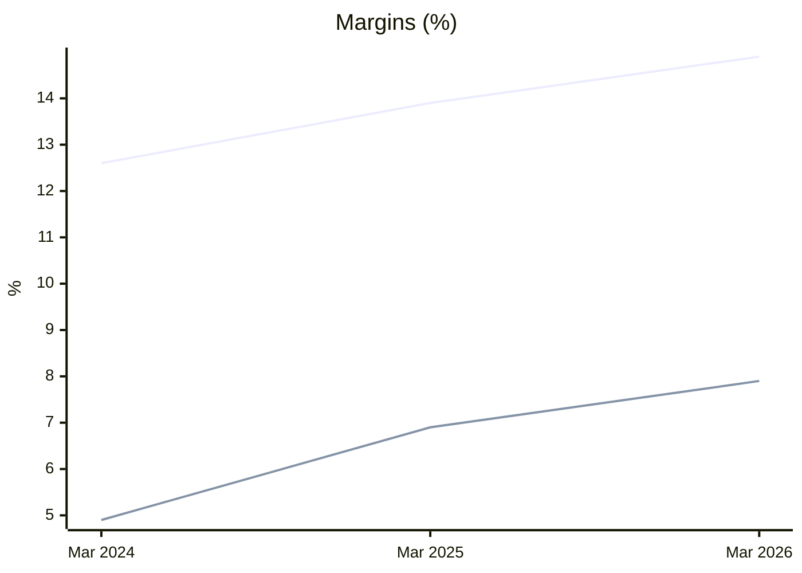
*Series in order: Operating margin, PAT margin.*

**P/E:** 65.8 — live market file (screener.in), trailing (price ₹8,957.00 as of 2026-08-02).

**Cash flows (₹ cr):**

| | Mar 2024 | Mar 2025 | Mar 2026 |
|---|---:|---:|---:|
| Cash from operations (₹ cr) | 1,920 | 2,136 | 2,856 |
| Cash from investing (₹ cr) | -1,537 | -3,381 | -2,148 |
| Cash from financing (₹ cr) | -311 | 1,317 | -478 |
| Net cash flow (₹ cr) | 72.0 | 73.0 | 230 |
| Free cash flow (₹ cr) | 785 | 439 | 925 |

*Source: CashFlow/NiftyTotalMarket/APOLLOHOSP.csv (consolidated, screener.in).*

### 8. The separated business's financial statements

**The business being separated — its own numbers**, entity by entity: its reported statements once it is listed and on file, and the segment numbers the annual reports and presentations carry for it before that.

**Digital Health & Pharmacy Distribution (Apollo HealthCo / Apollo 24|7 omnichannel pharmacy) → Apollo Healthtech Limited** · unit ₹ million · operating_profit = 'Segment Profit/(loss)' per Ind AS 108 segment note, i.e. profit before tax of the segment without allocation of finance costs (not EBITDA). Revenue is segment revenue before elimination of inter-segment revenue (group inter-segment: 759 in FY2024, 774 in FY2025, 2,002 in FY2026). PAT is the reported segment PAT in the investor presentation. Presentation EBITDA (post Ind AS, after 24|7 operating cost and ESOP) for the same segment: FY2026 4,875 and FY2025 1,676 (Presentation May 2026 — page 13).

| | FY2024 | FY2025 | FY2026 |
|---|---:|---:|---:|
| Revenue (₹ million) | 78,269 | 90,930 | 108,081 |
| Revenue growth (%) | — | +16.2% | +18.9% |
| Operating profit (₹ million) | -1,309 | 1,127 | 3,987 |
| Operating profit growth (%) | — | +186.1% | +253.8% |
| Operating margin (%) | -1.7 | 1.2 | 3.7 |
| PAT (₹ million) | — | 469 | 3,238 |
| PAT growth (%) | — | — | +590.4% |
| Segment assets (₹ million) | 23,806 | 29,629 | 33,181 |
| Segment liabilities (₹ million) | 12,367 | 10,206 | 9,466 |
| Capital employed (₹ million) | 11,439 | 19,423 | 23,715 |
| Return on capital employed (%) | -11.4 | 5.8 | 16.8 |
| Segment assets / revenue (x) | 0.3 | 0.3 | 0.3 |
| Capex (₹ million) | — | — | — |

*Sources:* Annual Report 2024 — page 438; Annual Report 2024 — page 439; Annual Report 2025 — page 227; Presentation May 2026 — page 13; Annual Report 2026 — page 225; Annual Report 2026 — page 226; Presentation May 2026 — page 13

*Latest quarter (Q4 FY26):* revenue 28482, operating profit 1556 — Presentation May 2026 — page 12

*Not in the pages read:* No segment capex or depreciation; FY2024 PAT and EBITDA not given.

*Businesses with no numbers in the pages read (3 annual report(s) and 11 presentation(s) on file):* Keimed Private Limited, Apollo Healthtech Limited, the Identified Business Undertaking and the Resultant Company carry no own figures on these pages; Apollo 24|7 appears only inside the HealthCo online line.

*Documents on file:* [Annual Report 2026](https://www.bseindia.com/xml-data/corpfiling/AttachHis/f9b40997-8116-48ba-949a-ca2e7775e3c2.pdf); [Annual Report 2025](https://www.bseindia.com/xml-data/corpfiling/AttachHis/330724b4-fb72-4577-beb0-598b4672f77a.pdf); [Annual Report 2024](https://www.bseindia.com/xml-data/corpfiling/AttachHis/93fc23fd-104c-47e7-bfc9-cf91d3d41e33.pdf); [Presentation Aug 2026](https://www.bseindia.com/stockinfo/AnnPdfOpen.aspx?Pname=0a967b34-eaeb-44d0-82d8-5ff46e9b171f.pdf); [Presentation May 2026](https://www.bseindia.com/stockinfo/AnnPdfOpen.aspx?Pname=7cfb1747-054b-47c2-8073-a98cba8daca0.pdf); [Presentation Feb 2026](https://www.bseindia.com/stockinfo/AnnPdfOpen.aspx?Pname=2256258c-6663-42bc-866c-402f5dcc1cae.pdf); [Presentation Nov 2025](https://www.bseindia.com/stockinfo/AnnPdfOpen.aspx?Pname=4430a828-14c2-4c64-8cff-b68f1a2904f1.pdf); [Presentation Aug 2025](https://drupal-cdn-hfaeddcdbng5hfbg.a01.azurefd.net/sites/default/files/2025-08/ahel-q1fy26-earnings-update.pdf); [Presentation Jun 2025](https://www.bseindia.com/stockinfo/AnnPdfOpen.aspx?Pname=f30907dc-d76c-4a3b-bbf9-7a8b5121223c.pdf)

### 9. Other financial differences — working capital, margins, returns, debt

| Metric (latest year) | Parent (APOLLOHOSP) | Apollo Healthtech Limited |
|---|---:|---:|
| *Basis* | *reported, consolidated* | *segment numbers (Digital Health & Pharmacy Di…* |
| Sales (₹ cr) | 25,228 (Mar 2026) | — |
| Sales growth (%) | 15.8 (Mar 2026) | 18.9 (FY2026) |
| Operating margin (%) | 14.9 (Mar 2026) | 3.7 (FY2026) |
| Operating profit growth (%) | 24.3 (Mar 2026) | 253.8 (FY2026) |
| PAT margin (%) | 7.9 (Mar 2026) | — |
| ROCE % | 18 (Mar 2026) | 16.8 (FY2026) |
| Debtor Days | 50 (Mar 2026) | — |
| Inventory Days | 15 (Mar 2026) | — |
| Days Payable | 63 (Mar 2026) | — |
| Cash Conversion Cycle | 3 (Mar 2026) | — |
| Working Capital Days | -10 (Mar 2026) | — |
| Debt / equity (x) | 0.9 (Mar 2026) | — |
| Borrowings (₹ cr) | 8,493 (Mar 2026) | — |
| Segment assets / revenue (x) | — | 0.3 (FY2026) |
| Sales (₹ million) | — | 108,081 (FY2026) |

*Each figure is the latest on file, with its year. Working-capital days and ROCE come from the stored working-capital file; segment figures from the pages cited in part 8. A dash means the documents do not carry it.*

**What stays with the parent — its segments, from the same pages:**

| Remaining segment | Revenue | Operating margin | ROCE | Segment assets / revenue | Unit | Year |
|---|---:|---:|---:|---:|---|---|
| Healthcare Services | 127,501 | 19.1% | 23.0% | 1.14x | ₹ million | FY2026 |
| Retail Health & Diagnostics (Diagnostics & Retail Health / AHLL) | 18,653 | 3.9% | 21.9% | 0.79x | ₹ million | FY2026 |
| Others | 52 | -155.8% | -109.5% | 4.94x | ₹ million | FY2026 |

**What the documents themselves say about the differences:**

- **operating margin** — parent / remaining: Healthcare Services EBITDA of INR 781 crore in Q4 FY26 with margins at 23.9% (established hospitals at 25.5%); 24.8% in Q3 FY26 and 24.6% in Q2 FY26; separated business: Apollo HealthCo EBITDA margin of 4.5% in Q3 FY26 and 4.2% for YTD Dec FY26; pharmacy distribution EBITDA INR 195 crore in Q4 FY26; guided to a 6.5%-7% exit EBITDA margin by Q4 FY27 “EBITDA at Rs. 128 crore vs Rs. 57 crore in Q3FY25; Margins at 4.5% in Q3FY26”
- **growth** — parent / remaining: Healthcare Services revenues of INR 3,268 crore in Q4 FY26, up 16% year-on-year (Q3 FY26: INR 3,183 crore, up 14%), with 7% volume growth, 5% case mix and 4% from price revisions in Q4 FY26; separated business: Apollo HealthCo revenues of INR 2,848 crore in Q4 FY26, up 22% year-on-year (Q3 FY26: INR 2,827 crore, up 20%); Apollo 24/7 platform GMV INR 528 crore in Q4 FY26, up 20% “Apollo HealthCo reported revenues of INR 2,848 crore in Q4 FY26, representing a strong year -on-year growth of 22%.”
- **return on capital** — parent / remaining: "Within the Healthcare Services business, we delivered a ROCE of 25.4% for the year" (FY26); ROCE of 30.3% reported for Q2 FY26; separated business: not stated “Within the Healthcare Services business, we delivered a ROCE of 25.4% for the year, supported by balanced performance across our network spanning metro, Tier 1 and Tier 2.”
- **capex and capital intensity** — parent / remaining: Healthcare services segment assets of Rs. 1,36,651 million at December 31, 2025 (including Rs. 11,405 million of capital employed in hospital projects under construction); recurring capex of around INR 550 crore a year and FY27 growth capex of INR 1,980 crore for 1,000 beds; separated business: Digital health and pharmacy distribution segment assets of Rs. 31,937 million at December 31, 2025 against nine-month segment revenue of Rs. 79,599 million; growth through about 600 new stores a year (7,113 stores at Q3 FY26) “And also, the capex, which we have given INR 1,980 crore for 1,000 beds for FY27, should we assume that the entire capex for FY27 or some of it has already been spent?”
- **cash** — parent / remaining: "The operating cash flow before dividend that we have generated this year is before the dividend is approximately around at the consolidated SCS level alone, it would be in the region of INR 1,850 crore", about INR 1,550 crore after dividends and recurring capex, fully redeployable for growth capex; separated business: Digital business cash losses of INR 29 crore in Q3 FY26 and INR 16 crore in Q4 FY26, with cash breakeven targeted in Q1 FY27 “Within the online business, cash losses declined sharply to INR 16 crore compared to the INR 80 crore in Q4 FY25.”
- **debt and leverage** — parent / remaining: Consolidated finance costs of Rs. 3,305 million for the nine months ended December 31, 2025; moved from net cash to net debt in Q4 FY26, a difference of almost INR 1,200 crore, including the INR 1,250 crore IFC buyout paid from the Healthcare Services balance sheet; separated business: Apollo Healthco net worth of Rs. (924.57) million at March 31, 2025; "The Scheme is expected to enable Resultant Company to build a wider capital and financial base, by attracting a different set of investors, strategic partners, lenders and stakeholders, as well as promoting overall business growth" “So we also paid off IFC this quarter. This was the INR 1,250 crore payout that we had in this quarter, just to remind you, this came out from the Healthcare Services balance sheet.”
- **other** — parent / remaining: Segment revenue - Healthcare services Rs. 94,164 million, and Retail health and diagnostics Rs. 13,758 million, for the nine months ended December 31, 2025; separated business: Segment revenue - Digital health and pharmacy distribution Rs. 79,599 million for the nine months ended December 31, 2025; stated combined scale of about INR 16,300 Crores of FY25 revenue, targeted at INR 25,000 Crores by FY27 “Composite Scheme creates a formidable Omni Channel Pharmacy Distribution and Digital Health platform leader in India, with scale of INR -16,300 Crores (-US$1.9bn) of revenue in FY25, with stated plans to achieve INR-25,000 Crores revenue by FY27, with -7°/o EBITDA margin.”

**The checklist:**

| Item | Status | Evidence |
|---|---|---|
| Why the spin-off | yes | regulatory / strategic knot; attracting different investors / capital; value unlocking for shareholders — “…ions of the Listing Regulation s. On September 24. 2025 , we had intimated of the receipt of approval of the Competition Commission of India for the transactions contemplated under the Scheme. In furth erance to that, w” |
| Institutional selling likely (small / different business) | unknown | size of the demerged piece not stated *(next: pro-forma statements: revenue / assets of the demerged undertaking vs the parent)* |
| Insider ownership and incentives aligned | partly | …rperson Demerged Company – 10,43,915 equity shares (0.73%) 3. Suneeta Reddy Managing Director, KMP Demerged Company – 29,37,066 equity shares (2.04%) 4. Shobana Kamineni Non Executive Direc… | option pricing mentioned: …ecoming effective, Resultant Company shall formulate and establish an employee stock option plan or other stock incentive scheme or benefit programme, in accordance with the applicable laws, and grant such options or securities in Resultant Company similar to or substantially si… *(next: the date the management options are priced; promoter holding in the resulting company)* |
| A hidden value revealed (pro-forma, leverage, comparables) | partly | borrowings 8,493 cr (Mar 2026) = 0.07× market cap; P/E 64.3 on Mar 2026 profit vs industry median 52.6 (45 peers) *(next: pro-forma P&L of each piece × the peer P/E of its own industry)* |
| Parent before the spin (clean parent, takeover prelude) | partly | stage nclt_sanction — the spin has not happened; the parent can still be bought whole |
| Timing (first year sells, second year gains) | partly | not yet listed — 335 days since the first filing, stage nclt_sanction |
| Management discussing it on the calls | yes | 5 mention(s) in the last 12 months of calls — “…en the NCLT process should ta ke it some 3, 4 months to close. And hopefully, by Q4 FY27, end of December or early Q4 FY27 is when Apollo Healthtech should get demerged and listed. That is the plan. And that Transcript ” |

**On the calls (last 12 months):**

- *Feb 2026* (neutral) — “…ance long -term shareholder value. We have also made progress with respect to the regulatory integration process for the com posite scheme of Keimed merger and demerger of Apollo HealthCo and remain well positioned to capture the full benefits of scale with the combined entity to achieve a run rate of INR 25,000 crore in combi…”
- *Feb 2026* (forward) — “…see as expansion. Bino Pathiparampil : Understood. Okay. And finally, an update on wha t is happening on the HealthCo side regarding the corporate action about demerger, et cetera. How is the progress on the Keimed side in terms of accumulation of the different pieces of business that were separate, et cetera, would be great?…”
- *May 2026* (backward) — “…LT convened meeting of the shareholders is now being called for on June 24 to obtain the requisite shareholder approval, consequent to which we are hopeful the demerger process is completed by Q4 FY27 as planned earlier. In terms of financial milestones, I am pleased to share that our consolidated revenues crossed INR 25,000 c…”
- *May 2026* (forward) — “…Can you update us on the timeline for this entire transaction on AHL and when will the new company will come into existence and when will the separation or the demerger will happen? A. Krishnan: So, as we said already that the shareholders, this call is scheduled for June 24, where we should be, which is the NCLT process, conv…”
- *May 2026* (forward) — “…en the NCLT process should ta ke it some 3, 4 months to close. And hopefully, by Q4 FY27, end of December or early Q4 FY27 is when Apollo Healthtech should get demerged and listed. That is the plan. And that Transcript of AHEL Q 4 FY26 Earnings Call Page 14 of 16 Company , when it gets listed, you should be in a position to se…”

<details><summary>The filings</summary>

| Date | Category | Headline | Attachment |
|---|---|---|---|
| 2025-12-24 | General Updates | Apollo Hospitals Enterprise Limited has informed the Exchange about General Updates | [pdf](https://nsearchives.nseindia.com/corporate/APOLLOHOSP_24122025100948_NSE_observation_letter.pdf) |
| 2025-12-24 | General Updates | Apollo Hospitals Enterprise Limited has informed the Exchange about General Updates | [pdf](https://nsearchives.nseindia.com/corporate/APOLLOHOSP_24122025130730_BSE_observation_letter.pdf) |
| 2026-02-01 | Earnings call Feb 2026 | …see as expansion. Bino Pathiparampil : Understood. Okay. And finally, an update on wha t is happening on the HealthCo side regarding the corporate action about | [pdf](https://drupal-cdn-hfaeddcdbng5hfbg.a01.azurefd.net/sites/default/files/2026-02/transcript-of-ahel-q3fy26-concall_11feb2026.pdf) |
| 2026-02-10 | Outcome of Board Meeting | Apollo Hospitals Enterprise Limited has submitted to the Exchange, the financial results for the period ended December 31, 2025. | [pdf](https://nsearchives.nseindia.com/corporate/APOLLOHOSP_10022026174926_SE_communication_10022026.pdf) |
| 2026-02-10 | Record Date | Apollo Hospitals Enterprise Limited has informed the Exchange that Record date for the purpose of Interim Dividend is 16-Feb-2026. | [pdf](https://nsearchives.nseindia.com/corporate/APOLLOHOSP_10022026180253_SE_communication_10022026.pdf) |
| 2026-02-10 | Press Release | Apollo Hospitals Enterprise Limited has informed the Exchange regarding a press release dated February 10, 2026, titled "Apollo Hospitals announces Q3FY26 resul | [pdf](https://nsearchives.nseindia.com/corporate/APOLLOHOSP_10022026181122_SE_communication_10022026.pdf) |
| 2026-04-03 | Scheme of Arrangement | Apollo Hospitals Enterprise Limited has informed the Exchange about Scheme of Arrangement - update on receipt of NCLT order | [pdf](https://nsearchives.nseindia.com/corporate/APOLLOHOSP_03042026170310_SE_let_NCLT_order.pdf) |
| 2026-04-10 | Scheme of Arrangement | Apollo Hospitals Enterprise Limited has informed the Exchange about Scheme of Arrangement | [pdf](https://nsearchives.nseindia.com/corporate/APOLLOHOSP_10042026152459_SE_let_NCLT_CTC.pdf) |
| 2026-04-18 | Scheme of Arrangement | Apollo Hospitals Enterprise Limited has informed the Exchange about Scheme of Arrangement | [pdf](https://nsearchives.nseindia.com/corporate/APOLLOHOSP_18042026103633_SE_let_NCLT_15042026.pdf) |
| 2026-04-27 | Scheme of Arrangement | Apollo Hospitals Enterprise Limited has informed the Exchange about Scheme of Arrangement | [pdf](https://nsearchives.nseindia.com/corporate/APOLLOHOSP_27042026185704_SE_Communication_27042026.pdf) |
| 2026-05-01 | Earnings call May 2026 | …Can you update us on the timeline for this entire transaction on AHL and when will the new company will come into existence and when will the separation or the | [pdf](https://www.apollohospitals.com/sites/default/files/2026-05/transcript-of-apollo-hospitals---q4-fy26-earnings-call.pdf) |
| 2026-05-01 | Earnings call May 2026 | …en the NCLT process should ta ke it some 3, 4 months to close. And hopefully, by Q4 FY27, end of December or early Q4 FY27 is when Apollo Healthtech should get | [pdf](https://www.apollohospitals.com/sites/default/files/2026-05/transcript-of-apollo-hospitals---q4-fy26-earnings-call.pdf) |
| 2026-05-08 | Scheme of Arrangement | Apollo Hospitals Enterprise Limited has informed the Exchange about Scheme of Arrangement | [pdf](https://nsearchives.nseindia.com/corporate/APOLLOHOSP_08052026182823_SE_LET-order_NCLT.pdf) |
| 2026-05-21 | Shareholders meeting | Apollo Hospitals Enterprise Limited has informed the Exchange regarding Notice of Court Convened General Meeting to be held on Jun 24, 2026 | [pdf](https://nsearchives.nseindia.com/corporate/APOLLOHOSP_21052026222159_SE_equity_shareholders_notice-ocr.pdf) |
| 2026-05-21 | Scheme of Arrangement | Apollo Hospitals Enterprise Limited has informed the Exchange about Scheme of Arrangement - NCLT Convened meeting of equity shareholders | [pdf](https://nsearchives.nseindia.com/corporate/APOLLOHOSP_21052026222514_SE_equity_shareholders_notice-ocr.pdf) |
| 2026-05-21 | Scheme of Arrangement | Apollo Hospitals Enterprise Limited has informed the Exchange about Scheme of Arrangement - NCLT convened meeting of unsecured creditors | [pdf](https://nsearchives.nseindia.com/corporate/APOLLOHOSP_21052026222637_SE_unsecured_creditors_notice-ocr.pdf) |
| 2026-05-21 | Scheme of Arrangement | Apollo Hospitals Enterprise Limited has informed the Exchange about Scheme of Arrangement - NCLT convened meeting of secured creditors | [pdf](https://nsearchives.nseindia.com/corporate/APOLLOHOSP_21052026222751_SE_secured_creditors_notice-ocr.pdf) |
| 2026-05-25 | Scheme of Arrangement | Apollo Hospitals Enterprise Limited has informed the Exchange about Scheme of Arrangement | [pdf](https://nsearchives.nseindia.com/corporate/APOLLOHOSP_25052026162532_Se_let_advt_intimation.pdf) |
| 2026-05-25 | General Updates | Apollo Hospitals Enterprise Limited has informed the Exchange about General Updates | [pdf](https://nsearchives.nseindia.com/corporate/APOLLOHOSP_25052026162631_Se_let_advt_intimation.pdf) |
| 2026-06-15 | Scheme of Arrangement | Apollo Hospitals Enterprise Limited has informed the Exchange about Scheme of Arrangement - Additional information in relation to the scheme | [pdf](https://nsearchives.nseindia.com/corporate/APOLLOHOSP_15062026144530_SE_let_addl_info_scheme.pdf) |
| 2026-06-19 | Scheme of Arrangement | Apollo Hospitals Enterprise Limited has informed the Exchange about Scheme of Arrangement | [pdf](https://nsearchives.nseindia.com/corporate/APOLLOHOSP_19062026102054_SE_Communc_19062026.pdf) |
| 2026-06-24 | Shareholders meeting | Apollo Hospitals Enterprise Limited has informed the Exchange regarding Proceedings of Court Convened General Meeting held on Jun 24, 2026 along with a copy of  | [pdf](https://nsearchives.nseindia.com/corporate/APOLLOHOSP_24062026205613_se_nclt_proceedings_1.pdf) |
| 2026-06-24 | Scheme of Arrangement | Apollo Hospitals Enterprise Limited has informed the Exchange about Scheme of Arrangement | [pdf](https://nsearchives.nseindia.com/corporate/APOLLOHOSP_24062026205745_se_nclt_proceedings_1.pdf) |
| 2026-06-26 | Shareholders meeting | Apollo Hospitals Enterprise Limited has submitted the Exchange a copy Srutinizers report of Court Convened General Meeting held on Jun 24, 2026. Further, the co | [pdf](https://nsearchives.nseindia.com/corporate/APOLLOHOSP_26062026115108_SE_Scrutinizer_Report.pdf) |
| 2026-06-26 | Scheme of Arrangement | Apollo Hospitals Enterprise Limited has informed the Exchange about Scheme of Arrangement | [pdf](https://nsearchives.nseindia.com/corporate/APOLLOHOSP_26062026115527_SE_Scrutinizer_Report.pdf) |

</details>

## HINDUNILVR — Hindustan Unilever Ltd.

### 1. Hindustan Unilever Ltd. — CONFIRMED DEMERGER

**CONFIRMED** (a demerger scheme is on the exchange record) · **LISTED <1Y — selling-pressure window; the bargain forms here** · score 5.7/10 · spin-off · 18 filing(s) from CALLS, NSE, NSE-register · first 2025-10-30, latest 2026-02-13

**The separated entities — every one the documents name:**

| Entity | Scheme | Business | Listing | Who runs it |
|---|---|---|---|---|
| **Kwality Wall's (India) Limited** | 2025 demerger of the Ice Cream Business Undertaking of HUL … | Ice Cream Business Undertaking of HUL on a going concern basis - ice creams, frozen desserts, frozen snacks; … | listed 2026-02-16 as KWIL (NSE) | Chitrank Goel, Additional Director designated as … |

**What is being separated, as the documents put it:** HUL's Ice Cream Business Undertaking, demerged on a going-concern basis into Kwality Wall's (India) Limited — class `value_unlocking`.

### 2. Stages and dates

> **Listing:** LISTED — Kwality Wall's (India) Limited (KWIL) since 2026-02-16 (NSE equity list); record date 2025-12-05

| Date | Event | Source |
|---|---|---|
| 2024-09 | Other — Hindustan Unilever Limited | as stated: Press Release annexed to Outcome of Board Meeting filing dated 25 Nov… |
| 2024-10-23 | Other — Hindustan Unilever Limited | as stated: Letter dated 23rd October 2024 intimating the Board's decision to sep… |
| 2024-11-25 | Other — Hindustan Unilever Limited | as stated: Outcome of Board Meeting filing dated 25 November 2024 (in-principle … |
| 2025-01-10 | Other — Kwality Wall's (India) Limited | as stated: General Updates filing dated 10 January 2025 (incorporation of wholly… |
| 2025-01-22 | Board approval — Hindustan Unilever Limited and Kwality Wall's (India) Limited | as stated: Scheme of Arrangement filing dated 22 January 2025; NCLT order dated … |
| 2025-03-12 | Filed with exchanges — Hindustan Unilever Limited | as stated: NSE Observation Letter Ref: NSE/LIST/46775 dated May 14, 2025 ("Based… |
| 2025-05-13 | SEBI observations — Hindustan Unilever Limited | as stated: BSE and NSE Observation Letters dated 14 May 2025 ("SEBI vide its Let… |
| 2025-05-14 | Exchange no-objection — Hindustan Unilever Limited | as stated: Demerger filing dated 14 May 2025 - Observation letters No. NSE/LIST/… |
| 2025-06-11 | NCLT order — Hindustan Unilever Limited and Kwality Wall's (India) Limited | as stated: General Updates filing dated 11 June 2025 - NCLT, Mumbai Bench order … |
| 2025-06-25 | Other — Unilever Group Shareholders / The Magnum Ice Cream Company HoldCo 1 Netherlands B.V. | as stated: Others filing dated 25 June 2025 - share purchase agreement dated Jun… |
| 2025-08-05 | Other — Hindustan Unilever Limited | as stated: Summary of Proceedings filing dated 12 August 2025 ("The number of sh… |
| 2025-08-12 | Stage reached: **meetings** | [Shareholders meeting](https://nsearchives.nseindia.in/corporate/HINDUNILVR_12082025191033_ProceedingsofCCMvfsigned.pdf) |
| 2025-08-12 | Shareholders / creditors meeting — Hindustan Unilever Limited | as stated: Shareholders meeting filing dated 12 August 2025 - NCLT-convened meet… |
| 2025-10-30 | Stage reached: **effective** | [Demerger](https://nsearchives.nseindia.in/corporate/HINDUNILVR_30102025210005_SEIntimationFinalOrdersigned.pdf) |
| 2025-10-30 | NCLT order — Hindustan Unilever Limited and Kwality Wall's (India) Limited | as stated: Demerger filing dated 30 October 2025 - NCLT, Mumbai Bench order sanc… |
| 2025-11-06 | NCLT order — Hindustan Unilever Limited and Kwality Wall's (India) Limited | as stated: General Updates filing dated 11 November 2025 - Rectification Order d… |
| 2025-11-11 | Stage reached: **nclt sanction** | [General Updates](https://nsearchives.nseindia.com/corporate/HINDUNILVR_11112025175242_Final_Order_SE_Intimation_signed.pdf) |
| 2025-11-18 | Other — Hindustan Unilever Limited | as stated: Record Date filing dated 18 November 2025 - receipt of certified copy… |
| 2025-11-23 | Stage reached: **exchange noc** | [General Updates](https://nsearchives.nseindia.com/corporate/HINDUNILVR_23112025211049_23112025SEIntimation_signed.pdf) |
| 2025-12-01 | Appointed date — Hindustan Unilever Limited and Kwality Wall's (India) Limited | as stated: Record Date filing dated 18 November 2025 ("in terms of Clause 1.1 of… |
| 2025-12-01 | Effective date — Hindustan Unilever Limited and Kwality Wall's (India) Limited | as stated: Record Date filing dated 18 November 2025 and FAQs filing dated 29 No… |
| 2025-12-05 | **Record date** | NSE corporate-actions register |
| 2025-12-05 | Stage reached: **record date** | Record Date (corporate-actions register) |
| 2025-12-05 | Record date — Hindustan Unilever Limited | as stated: Record Date filing dated 18 November 2025 ("the Board also fixed Frid… |
| 2025-12-13 | Allotment — Kwality Wall's (India) Limited | as stated: General Updates filing dated 13 December 2025 ("This is further to ou… |
| 2026-02-12 | Other — Kwality Wall's (India) Limited | as stated: General Updates filing dated 13 February 2026 - BSE letter DCS/AMAL/B… |
| 2026-02-13 | Stage reached: **listed** | [General Updates](https://nsearchives.nseindia.com/corporate/HINDUNILVR_13022026140635_SEIntimationKWIL13022026signed.pdf) |
| 2026-02-16 | **Kwality Wall's (India) Limited** listed (KWIL) | NSE equity list |
| 2026-02-16 | Listing and trading — Kwality Wall's (India) Limited | as stated: General Updates filing dated 13 February 2026 ("the date of commencem… |

**The stages, as filed:** meetings (2025-08-12) → effective (2025-10-30) → nclt sanction (2025-11-11) → exchange noc (2025-11-23) → record date (2025-12-05) → listed (2026-02-13)

**Stated in the filings:** entitlement **1 for every 1**; record date 2025-12-05; appointed date 2025-12-01.

**When it lists, in the documents' words:** FAQ dated 29 November 2025: "the statutory timeline for the listing and commencement of trading of shares of KWIL is within a period of 60 days from the receipt of the certified copy of the order of the NCLT sanctioning the Scheme (in or around Q4 of FY26)"; listing and trading approval received 12 February 2026, with "Date of Commencement of Trading: ... 16th February, 2026" for 2,34,95,91,262 shares of Re. 1 each.

### 3. Size of the separated business beside the parent — is institutional selling likely?

**Reading: VERY LIKELY — the piece is under a tenth of the whole; index funds and large holders who receive it without choosing it tend to sell.**

| Entity | Stated turnover | Stated share of the whole | Segment revenue share | Market cap (₹ cr) | Share of combined market cap | Index member |
|---|---|---:|---:|---:|---:|---|
| Kwality Wall's (India) Limited | INR 1,595 Crores for the year ended 31st March, 2024 (turno… | 2.7% | 1.9% (FY2026) | 9,871 | 2.1% | no |

*Stated figures are the documents' own (a turnover share, or the cost-of-acquisition split the company publishes for tax, which reflects relative value); the segment share is this business's revenue over the parent's sales, and the market-cap share is the entity's value over the entity plus the parent (parent ₹468,250 cr, NSE bhavcopy of 2026-11-13), both computed here.*

**In the documents' words:** “The turnover of the Ice Cream Business Undertaking for the year ended 31st March, 2024 was INR 1,595 Crores representing 2.7% of the total standalone turnover of the Company for the year ended 31st March, 2024”

**The judge's read of selling pressure:** likely — Tiny relative value (1.91% of cost basis), distributed 1:1 to every HUL holder; distinctive ice cream operating model, different from HUL's FMCG portfolio.

### 4. Insider ownership — share swap, promoters' holding, management incentives

**Share swap / entitlement, entity by entity:**

- **Kwality Wall's (India) Limited:** "for every 1 (one) equity share of face value of Re. 1/- fully paid up held in the Demerged Company, 1 (one) equity share(s) of face value of Re. 1/- credited as fully paid up in the Resulting Company", i.e. in the ratio of 1:1 ("Share Entitlement Ratio"); 2,34,95,91,262 Equity Shares of Re. 1/- each allotted

**Promoters' holding, from the shareholding pattern:**

| Company | Promoters | FIIs | DIIs | Public | Quarter |
|---|---:|---:|---:|---:|---|
| Hindustan Unilever Ltd. (HINDUNILVR) | 61.9% | 9.26% | 17.05% | 11.71% | Sep 2026 |
| Kwality Wall's (India) Limited (KWIL) | 61.91% | 2.89% | 9.98% | 25.21% | Sep 2026 |

*Source: screener.in shareholding pattern, stored under `ShareholdingPattern/NiftyTotalMarket/`. In a mirror demerger each shareholder holds the same proportion of the new company as of the parent on the record date.*

- **Promoters in the parent, per the documents:** "The Unilever Group holds 61.9% of the issued and paid-up share capital of HUL." (joint press release dated 25 June 2025). Seven promoter and promoter group shareholders attended the NCLT-convened shareholders' meeting of 12 August 2025.
- **What the promoters will hold in the separated entity:** 2025 ice cream demerger: "Following completion of the Demerger, Unilever PLC, Unilever Group Limited, Unilever Overseas Holdings AG, Unilever UK&CN Holdings Limited, Unilever South India Estates Limited, Unilever Assam Estates Limited, Unilever Overseas Holdings B.V. (together, the "Unilever Group Shareholders") will collectively hold 61.9% of the issued and paid-up share capital of KWIL." and "As a result, the Unilever Group is expected to hold 61.9% of the issued and paid-up share capital of KWIL following completion of the India Demerger." Thereafter: "Magnum HoldCo has agreed to acquire all of the KWIL shares to be issued to the Unilever Group as a result of the India Demerger (i.e., 61.9% of the issued and paid-up share capital of KWIL)", subject to "Magnum HoldCo making an open offer to the public shareholders of KWIL for additional shares of KWIL in accordance with the Securities and Exchange Board of India (Substantial Acquisition of Shares and Takeovers) Regulations, 2011." There will be no change in the shareholding pattern of HUL (the Demerged Company). For the 2026 Zywie, Nutritionalab and 2024 Pureit transactions: "The promoter/ promoter group/group companies have no interest in the Target and the Subsidiary."
- **What a public shareholder receives:** 2025 ice cream demerger: "the shareholders of HUL as on the Record Date, i.e. Friday, 5th December, 2025, will receive 1 equity share of KWIL for every 1 equity share held by them in HUL, upon effectiveness of the Scheme" - "for every 1 (one) equity share of face value of Re. 1/- fully paid up held in HUL, 1 (one) equity share of face value of Re. 1/- credited as fully paid up in KWIL"; all KWIL shares to be allotted in dematerialised form ONLY, and existing shares of KWIL held by HUL stand cancelled and reduced without any consideration. 2026 Zywie acquisition and Nutritionalab divestment and 2024 Pureit divestment: cash transactions with no issue of shares to HUL's shareholders; "There will be no change in the shareholding pattern of HUL pursuant to the proposed slump sale."
- **Management incentives:** not stated in the documents on file.
- **Insider actions around the separation:** Promoter sale around the separation: "the Unilever Group Shareholders, The Magnum Ice Cream Company HoldCo 1 Netherlands B.V. ("Magnum HoldCo") and The Magnum Ice Cream Company B.V. have today announced the execution of a share purchase agreement ("SPA") pursuant to which Magnum HoldCo has agreed to acquire all of the KWIL shares to be issued to the Unilever Group Shareholders pursuant to the Demerger, comprising 61.9% of the issued and paid-up share capital of KWIL." Closing remains subject to "fulfilment of certain conditions in the SPA (including the successful demerger of KWIL from HUL, and listing of KWIL shares) and receipt of requisite statutory and other approvals" and to "Magnum HoldCo making an open offer to the public shareholders of KWIL for additional shares of KWIL in accordance with the Securities and Exchange Board of India (Substantial Acquisition of Shares and Takeovers) Regulations, 2011." Neither HUL nor KWIL is a party to the SPA. The Scheme required that "There shall be no change in the shareholding pattern or control in Kwality Wall's (India) Limited between the record date and the listing which may affect the status of this approval." No promoter or management buying or pledging of HUL or KWIL shares is stated.
- **Insiders, per the checklist read:** Not stated. Entitlement is 1 KWIL share per HUL share, so holdings mirror HUL; KWIL has a dedicated management team (Chitrank Goel, Deputy MD; Prashant Premrajka, Executive Director & CFO). · *option pricing date:* not stated

### 5. Why the demerger — point by point

The business being separated is HUL's Ice Cream business — brands Kwality Wall's, Cornetto and Magnum — demerged into Kwality Wall's (India) Limited (KWIL) under a Sections 230-232 scheme sanctioned by NCLT Mumbai on 30th October 2025 (rectified 6th November 2025), effective (and appointed) 1st December 2025. The stated commercial logic in the scheme is creation of a leading listed Indian ice cream company with focused management having 'greater flexibility to deploy strategies suited to the Ice Cream businesses' distinctive operating model and market dynamics, to realise its full potential'; on the Feb 2026 call Priya Nair framed the same point as 'a dedicated management team and singular focus' letting KWIL capitalise on a growing India market. The financial problem it solves for HUL is dilution: management sized Ice Cream at 'roughly 3-odd percentage of our business' earning 'low single-digit margin' — below HUL average, and even below that in FY26 because of monsoon and investment impacts — so removing it adds 50-60 bps to reported EBITDA margin, which is exactly how the band moved from 22-23% to an implied 22.5-23.5% (confirmed by Niranjan Gupta as 'the implied number' and restated as the mid-term guide in May 2026). The business was also volatile and seasonal: September quarter 2025 Ice Cream 'declined year on year, impacted by extended monsoon in addition to GST transition', while March quarter 2025 had double-digit volume-led growth. Execution was a deliberate two-step: demerge and report Ice Cream as a discontinued business from the December 2025 quarter, then list — KWIL allotted 2,34,95,91,262 equity shares of Re. 1 on a 1:1 entitlement to HUL holders of record 5th December 2025, listing and trading from 16th February 2026, with cost of acquisition apportioned 98.09% HUL / 1.91% KWIL based on HUL net worth versus Ice Cream net assets at 30th November 2025. Accounting consequences disclosed were a one-time non-cash gain inside reported PAT of Rs 6,603 crores (+121% y-o-y) in the December 2025 quarter, and loss of PLI benefit accruals that had flowed through other operating income. Strategically it is presented as one leg of continuous portfolio rotation toward 'fewer, bigger bets' — alongside Pureit divestment (circa Rs 600 crores), Minimalist (90.5%), OZiva (remaining 49% for Rs 824 crores) and the Nutritionalab exit (Rs 307 crores) — with May 2026 citing the Ice Cream demerger as already 'enhancing the growth mix of the portfolio'.

**Point by point, with the source:**

1. The scheme's own stated benefit is a focused, separately listed Indian ice cream company whose management can run strategies fitted to ice cream's different operating model and market dynamics. “Creation of a leading listed ice cream company in India with focused management having greater flexibility to deploy strategies suited to the Ice Cream businesses’ distinctive operating model and market dynamics, to realise its full potential” — *Scheme*
2. First mention in the window is purely a status update on regulatory progress and completion timing, listed alongside Pureit divestment and the Minimalist/OZiva portfolio moves. “The demerger of Ice cream business is progressing on track with regulatory requirements, and we expect it to be completed by the end of financial year 2026.” — *[Apr 2025](https://www.bseindia.com/stockinfo/AnnPdfOpen.aspx?Pname=57aad284-8283-4c21-8035-99627387a92d.pdf)*
3. Ritesh Tiwari quantified the margin rationale: Ice Cream runs below HUL's average margin, so its exit lifts reported EBITDA margin by 50-60 bps over the 22-23% guided band. “Coming to EBITDA margin, Ice Cream demerger is expected to result in an improvement of 50-60 bps to the reported margin as Ice Cream business operates at a margin lower than HUL average.” — *[Oct 2025](https://www.bseindia.com/stockinfo/AnnPdfOpen.aspx?Pname=2eb875fe-ef79-4b40-88b8-228ccc8be17e.pdf)*
4. He sized the business being removed — about 3% of HUL turnover earning low single-digit margins, and even lower in FY26 because of monsoon and investment impacts. “Ice Cream, as we had called out even earlier, it's roughly 3-odd percentage of our business. and the business makes low single-digit margin.” — *[Oct 2025](https://www.bseindia.com/stockinfo/AnnPdfOpen.aspx?Pname=2eb875fe-ef79-4b40-88b8-228ccc8be17e.pdf)*
5. The plan was explicitly sequenced in two steps — demerge and report Ice Cream as a discontinued business from the December quarter, then list the entity in the March quarter. “So, this is two-step process, demerger, reporting discontinued business for December quarter and then listing the business in March quarter.” — *[Oct 2025](https://www.bseindia.com/stockinfo/AnnPdfOpen.aspx?Pname=2eb875fe-ef79-4b40-88b8-228ccc8be17e.pdf)*
6. The segment's in-quarter weakness underlined its seasonality and volatility: it declined year-on-year on extended monsoon plus GST transition, and its PLI benefit would stop flowing into HUL's P&L. “Ice Cream business declined year on year, impacted by extended monsoon in addition to GST transition.” — *[Oct 2025](https://www.bseindia.com/stockinfo/AnnPdfOpen.aspx?Pname=2eb875fe-ef79-4b40-88b8-228ccc8be17e.pdf)*
7. Priya Nair stated the completion and gave the focus argument for KWIL — a dedicated management team with singular focus to pursue India's growing ice cream opportunity; listing set for 16th February. “With a dedicated management team and singular focus, we are confident that KWIL is well positioned to capitalise on the growing market opportunity in India and deliver sustained performance.” — *[Feb 2026](https://www.bseindia.com/stockinfo/AnnPdfOpen.aspx?Pname=38a5c0b9-6eee-4de5-bdd8-98ac200204cc.pdf)*
8. The guidance band was formally rebased for the demerger — 22-23% plus roughly 50 bps, which Niranjan Gupta confirmed as an implied 22.5-23.5%; December quarter EBITDA margin of 23.3% was reported excluding Ice Cream. “We also outlined that the range, therefore, you will see a benefit of the ice cream demerger to the extent of 50 basis points.” — *[Feb 2026](https://www.bseindia.com/stockinfo/AnnPdfOpen.aspx?Pname=38a5c0b9-6eee-4de5-bdd8-98ac200204cc.pdf)*
9. Accounting effect disclosed: reported PAT of Rs 6,603 crores (+121% y-o-y) included a one-time non-cash gain from the Ice Cream demerger recognised per the approved scheme. “And the second item is one- time non -cash gain arising from I ce Cream demerger accounted for in accordance with the approved scheme of demerger and applicable accounting standards.” — *[Feb 2026](https://www.bseindia.com/stockinfo/AnnPdfOpen.aspx?Pname=38a5c0b9-6eee-4de5-bdd8-98ac200204cc.pdf)*
10. The demerger is retrospectively grouped with the OZiva and Minimalist investments as portfolio rotation that has already improved the quality and growth profile of what remains. “Strategic actions such as the demerger of Ice Cream, along with the investments at OZiva and Minimalist, are already enhancing the growth mix of the portfolio.” — *[May 2026](https://www.bseindia.com/stockinfo/AnnPdfOpen.aspx?Pname=55988411-440d-4801-8c08-90a5908c4a04.pdf)*
11. On perimeter: asked why HUL is doubling down on Foods while Unilever globally exits foods, Priya Nair said HUL's Foods (Tea, Coffee, Lifestyle Nutrition, Kissan) was deliberately left out of the Unilever transaction. “So therefore that, combined with the opportunities that exist in India in Foods, is the reason why Foods is outside the perimeter of the Unilever transaction that we have done, and Foods continues to be a very important area and focus of strategy for HUL.” — *[May 2026](https://www.bseindia.com/stockinfo/AnnPdfOpen.aspx?Pname=55988411-440d-4801-8c08-90a5908c4a04.pdf)*
12. Mechanics and shareholder economics: 1:1 entitlement, 2,34,95,91,262 KWIL shares of Re. 1 allotted to HUL holders of record 5th December 2025, trading from 16th February 2026, with cost of acquisition split 98.09% HUL / 1.91% KWIL based on net worth versus Ice Cream net assets at 30th November 2025. “In accordance with the provisions of the Scheme, KWIL has allotted 2,34,95,91,262 (Two Hundred Thirty -Four Crore Ninety -Five Lakh Ninety -One Thousand Two Hundred Sixty -Two Only) Equity Shares of  Re. 1 /- each to the shareholders of HUL” — *Scheme*

**How it evolved:** On the Apr 2025 call (24th April 2025, March quarter FY25) it was only a progress line — on track with regulatory requirements, completion expected by end of FY26 — bundled with Pureit, Minimalist and OZiva as portfolio rotation. By the Oct 2025 call (23rd October 2025) Ritesh Tiwari hardened both timing and economics: demerger in the December quarter with listing in Q4 FY26, a two-step 'demerger then listing' sequence, Ice Cream at ~3% of business on low single-digit margin, and a quantified 50-60 bps uplift to reported EBITDA margin on top of the 22-23% guidance. Filings then closed the mechanics: NCLT sanction 30th October 2025, effective 1st December 2025, record date 5th December 2025, 1:1 allotment of 2,34,95,91,262 shares, 98.09%/1.91% cost apportionment, listing from 16th February 2026 — and on the Feb 2026 call (12th February 2026) Priya Nair declared the demerger complete, reported the continuing business ex-Ice Cream, attributed part of the Rs 6,603 crores reported PAT to a one-time non-cash demerger gain, and reset margin guidance to an implied 22.5-23.5%. By the May 2026 call (30th April 2026) it was retrospective justification — a completed action improving portfolio growth mix, with Foods explicitly kept 'outside the perimeter of the Unilever transaction'.

**What management expects from it:** HUL: reported EBITDA margin up ~50-60 bps (guidance rebased 22-23% to an implied 22.5-23.5%), a better growth mix, and capital redeployed into bigger bets (Rs 3,500 crores acquisitions, Rs 2,000 crores premium-format capex). KWIL: dedicated management, singular focus and flexibility for ice cream's distinct operating model to capture a growing India market. Shareholders: direct 1:1 listed exposure.

*Not explained on the calls:* No KWIL standalone financials, cold-chain capex or stranded costs; no Unilever brand-licensing/royalty terms; no named investor, lender or partner demand; no demerger-versus-sale comparison or valuation target.

- *Stated reason, in one line:* "Creation of a leading listed ice cream company in India with focused management having greater flexibility to deploy strategies suited to the Ice Cream businesses' distinctive operating model and market dynamics, to realise its full potential"
- *What it reveals:* Cost-of-acquisition split allots only 1.91% to KWIL vs 98.09% to HUL (based on HUL net worth and Ice Cream net assets at 30 Nov 2025), so a very small, cold-chain business carrying Kwality Wall's, Cornetto and Magnum is separated from a 23.6% EBITDA-margin FMCG parent.
- *Parent or spin:* spin · *Read next:* KWIL's first standalone results, and the net assets of the Ice Cream Business Undertaking at 30 November 2025 underlying the 1.91% allocation.
- *In their words:* “The aforesaid ratio has been determined based on the net worth of HUL and the net assets of the Ice Cream Business Undertaking, as at 30 November 2025, in accordance with Sections 49(2C) and 49(2D) of the Act.”

### 6. On the calls, verbatim

7 call(s), oldest first: **4 question-and-answer exchange(s)** given in full — the question and every answer to it, nothing trimmed — and 7 passage(s) from management's prepared remarks (the complete sentences about it; the whole remarks are in the linked transcript). Text is as the transcript prints it.

| Call | Q&A exchanges | Prepared-remarks passages | Transcript |
|---|---:|---:|---|
| Jan 2024 | 0 | 1 | [transcript](https://www.bseindia.com/stockinfo/AnnPdfOpen.aspx?Pname=2aa60d9d-1ea9-4e6d-9d91-0707e0071ace.pdf) |
| Oct 2024 | 1 | 0 | [transcript](https://www.bseindia.com/stockinfo/AnnPdfOpen.aspx?Pname=a208b4bc-a7a8-4ffc-b0f0-00f1f72b4129.pdf) |
| Jan 2025 | 0 | 1 | [transcript](https://www.bseindia.com/stockinfo/AnnPdfOpen.aspx?Pname=f5b86e3e-937f-42e9-940b-ce01bf35a1bc.pdf) |
| Apr 2025 | 0 | 1 | [transcript](https://www.bseindia.com/stockinfo/AnnPdfOpen.aspx?Pname=57aad284-8283-4c21-8035-99627387a92d.pdf) |
| Oct 2025 | 2 | 1 | [transcript](https://www.bseindia.com/stockinfo/AnnPdfOpen.aspx?Pname=2eb875fe-ef79-4b40-88b8-228ccc8be17e.pdf) |
| Feb 2026 | 1 | 2 | [transcript](https://www.bseindia.com/stockinfo/AnnPdfOpen.aspx?Pname=38a5c0b9-6eee-4de5-bdd8-98ac200204cc.pdf) |
| May 2026 | 0 | 1 | [transcript](https://www.bseindia.com/stockinfo/AnnPdfOpen.aspx?Pname=55988411-440d-4801-8c08-90a5908c4a04.pdf) |

**The full verbatim text of every exchange is in [companies/HINDUNILVR.md](companies/HINDUNILVR.md#6-on-the-calls-verbatim).**

### 7. The parent's financial statements

**The parent, last three fiscal years (consolidated)**

| | Mar 2024 | Mar 2025 | Mar 2026 |
|---|---:|---:|---:|
| Sales (₹ cr) | 61,896 | 61,328 | 64,468 |
| Sales growth (%) | +2.2% | -0.9% | +5.1% |
| Operating profit (₹ cr) | 14,659 | 14,698 | 15,039 |
| Operating profit growth (%) | +3.6% | +0.3% | +2.3% |
| Operating margin (%) | 23.7 | 24.0 | 23.3 |
| PAT (₹ cr) | 10,282 | 10,671 | 15,059 |
| PAT growth (%) | +1.4% | +3.8% | +41.1% |
| PAT margin (%) | 16.6 | 17.4 | 23.4 |
| EPS (₹) | 43.7 | 45.3 | 64.0 |

*Source: ProfitStatement/NiftyTotalMarket/HINDUNILVR.csv (consolidated, screener.in); growth and margins computed here.*

```mermaid
xychart-beta
    title "Sales, operating profit and PAT (₹ cr)"
    x-axis ["Mar 2024", "Mar 2025", "Mar 2026"]
    y-axis "₹ crore"
    bar [61896, 61328, 64468]
    bar [14659, 14698, 15039]
    bar [10282, 10671, 15059]
```
*Series in order: Sales, Operating profit, PAT.*

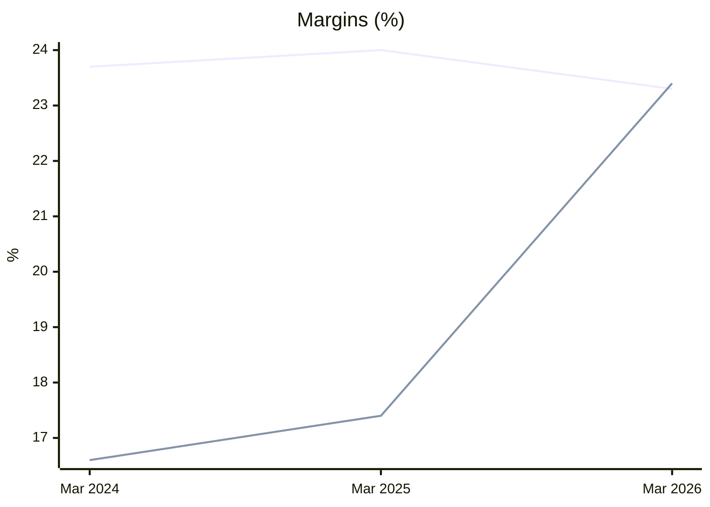
*Series in order: Operating margin, PAT margin.*

**P/E:** 44.8 — live market file (screener.in), trailing (price ₹2,101.00 as of 2026-08-02).

**Cash flows (₹ cr):**

| | Mar 2024 | Mar 2025 | Mar 2026 |
|---|---:|---:|---:|
| Cash from operations (₹ cr) | 15,469 | 11,886 | 10,999 |
| Cash from investing (₹ cr) | -5,324 | 6,473 | -3,676 |
| Cash from financing (₹ cr) | -10,034 | -13,101 | -10,810 |
| Net cash flow (₹ cr) | 111 | 5,258 | -3,487 |
| Free cash flow (₹ cr) | 14,012 | 10,624 | 9,667 |

*Source: CashFlow/NiftyTotalMarket/HINDUNILVR.csv (consolidated, screener.in).*

### 8. The separated business's financial statements

**The business being separated — its own numbers**, entity by entity: its reported statements once it is listed and on file, and the segment numbers the annual reports and presentations carry for it before that.

**Ice Cream Business / Demerged Undertaking — reported as "Segment Revenue / Segment Results from Discontinued Operations" → Kwality Wall's (India) Limited** · unit ₹ crore · Operating profit = Segment Results (profit before other income, finance costs, exceptional items and tax) for Discontinued Operations; revenue is segment revenue with no intersegment transactions. PAT = 'Profit/(Loss) for the year from Discontinued Operations'. FY2026 PAT of 4,407 is dominated by the one-off gain recognised on the Ice Cream demerger (demerger completed; KWIL ceased to be a subsidiary on 30th November, 2025), so FY2026 figures cover only the pre-demerger part of the year. FY2026 PBT from Discontinued Operations 4,336 and loss before exceptional items and tax (135); FY2025 PBT (13) and profit before exceptional items and tax 29.

| | FY2024 | FY2025 | FY2026 |
|---|---:|---:|---:|
| Revenue (₹ crore) | — | 1,793 | 1,257 |
| Revenue growth (%) | — | — | -29.9% |
| Operating profit (₹ crore) | — | 43.0 | -122 |
| Operating profit growth (%) | — | — | -383.7% |
| Operating margin (%) | — | 2.4 | -9.7 |
| PAT (₹ crore) | — | -9.0 | 4,407 |
| PAT growth (%) | — | — | +49066.7% |

*Sources:* Annual Report 2024 — page 213 (ice-cream and frozen desserts reported inside 'Foods & Refreshment'; no separate Ice Cream numbers); Annual Report 2026 — page 229

*Not in the pages read:* No segment assets, liabilities, capex or depreciation for the Ice Cream business; no quarterly revenue/profit; FY2024 not separately disclosed (sat within Foods & Refreshment).

*Businesses with no numbers in the pages read (3 annual report(s) and 12 presentation(s) on file):* No standalone financials for Kwality Wall's (India) Limited / KWIL as an entity, and no separate numbers for brands Cornetto or Magnum; the pages carry Ice Cream only as 'Discontinued Operations' segment lines.

*Documents on file:* [Annual Report 2026](https://www.bseindia.com/xml-data/corpfiling/AttachHis/881493e4-75af-4a7f-8c64-9d0886e63f1d.pdf); [Annual Report 2025](https://www.bseindia.com/xml-data/corpfiling/AttachHis/770bf03e-526d-45d8-8364-13f7fc523289.pdf); [Annual Report 2024](https://www.bseindia.com/xml-data/corpfiling/AttachHis/02d8d87d-90ce-4191-8b3f-4167267aee8a.pdf); [Presentation Nov 2026](https://www.bseindia.com/stockinfo/AnnPdfOpen.aspx?Pname=c54cbd79-ba64-4bcc-b114-b5ad02c75ade.pdf); [Presentation Oct 2026](https://www.bseindia.com/stockinfo/AnnPdfOpen.aspx?Pname=aecfd799-4d6c-49d4-9d7b-221d87d1352d.pdf); [Presentation Sep 2026](https://www.bseindia.com/stockinfo/AnnPdfOpen.aspx?Pname=d9d8d7e9-c5ef-40ef-bbd6-bc832320c0d5.pdf); [Presentation Aug 2026](https://www.bseindia.com/stockinfo/AnnPdfOpen.aspx?Pname=163e0f27-042e-41a9-9db7-14f5d0172218.pdf); [Presentation Feb 2026](https://www.bseindia.com/stockinfo/AnnPdfOpen.aspx?Pname=6e6dea43-db7a-4075-82c6-71024ed4436a.pdf); [Presentation Oct 2025](https://www.bseindia.com/stockinfo/AnnPdfOpen.aspx?Pname=b38b0312-d563-42a1-96e7-d61213c82925.pdf)

### 9. Other financial differences — working capital, margins, returns, debt

| Metric (latest year) | Parent (HINDUNILVR) | Kwality Wall's (India) Limited |
|---|---:|---:|
| *Basis* | *reported, consolidated* | *segment numbers (Ice Cream Business / Demerge…* |
| Sales (₹ cr) | 64,468 (Mar 2026) | — |
| Sales growth (%) | 5.1 (Mar 2026) | -29.9 (FY2026) |
| Operating margin (%) | 23.3 (Mar 2026) | -9.7 (FY2026) |
| Operating profit growth (%) | 2.3 (Mar 2026) | -383.7 (FY2026) |
| PAT margin (%) | 23.4 (Mar 2026) | — |
| ROCE % | 28 (Mar 2026) | — |
| Debtor Days | 19 (Mar 2026) | — |
| Inventory Days | 61 (Mar 2026) | — |
| Days Payable | 169 (Mar 2026) | — |
| Cash Conversion Cycle | -89 (Mar 2026) | — |
| Working Capital Days | -23 (Mar 2026) | — |
| Debt / equity (x) | 0 (Mar 2026) | — |
| Borrowings (₹ cr) | 1,478 (Mar 2026) | — |
| Sales (₹ crore) | — | 1,257 (FY2026) |

*Each figure is the latest on file, with its year. Working-capital days and ROCE come from the stored working-capital file; segment figures from the pages cited in part 8. A dash means the documents do not carry it.*

**What stays with the parent — its segments, from the same pages:**

| Remaining segment | Revenue | Operating margin | ROCE | Segment assets / revenue | Unit | Year |
|---|---:|---:|---:|---:|---|---|
| Home Care | 23,672 | 19.1% | 7064.1% | 0.27x | ₹ crore | FY2026 |
| Beauty & Wellbeing | 14,990 | 27.8% | 111.0% | 0.56x | ₹ crore | FY2026 |
| Personal Care | 9,564 | 18.9% | 200.8% | 0.39x | ₹ crore | FY2026 |
| Foods | 14,061 | 20.1% | 6.1% | 3.57x | ₹ crore | FY2026 |
| Others (includes Exports, Consignment, etc.) | 2,181 | 18.8% | 73.9% | 0.51x | ₹ crore | FY2026 |

**What the documents themselves say about the differences:**

- **growth** — parent / remaining: HUL delivered 5% Underlying Sales Growth driven by 4% Underlying Volume Growth for FY'26 on turnover of Rs. 63,763 crores, exiting with 7% USG in the March quarter 2026; management guides FY'27 to be better than FY'26.; separated business: The Ice Cream business delivered Underlying Sales Growth of 12.6% CAGR over FY19-20 to FY24-25 but only 4.5% in H1 FY25-26, with Volume Led Growth of 8.5% CAGR falling to 6.5%; KWIL aims to grow ahead of market and the India Ice Cream market is "US$ 2.6 bn market, forecasted to grow at 11% and projected to become US$ 4.4 bn by 2030". “Strong Historical performance; Recent performance impacted”
- **operating margin** — parent / remaining: HUL EBITDA margin was 23.6% for FY'26 and 23.7% in the March quarter 2026, at the higher end of guidance, with mid-term margin guidance "around our current guided range of 22.5% to 23.5%"; the demerger of Ice Cream contributes "a benefit of the ice cream demerger to the extent of 50 basis points".; separated business: Ice Cream EBITDA Margins were 7.1% in FY 24-25 and 0.0% in H1 FY 25-26, with factors impacting H1'25-26 EBITDA being "Cocoa inflation and Strategic Pricing", "Supply chain Investments", "GST transition & Production Linked incentives" and "Standalone entity cost"; in November 2024 the business was described as having "mid to high single digit profitability"; KWIL has a "robust margin improvement roadmap". “Ice Cream is a high -growth business with iconic brands such as "Kwality Wall's", "Cornetto" and "Magnum" , operating in an attractive category, and has mid to high single digit profitability .”
- **capex and capital intensity** — parent / remaining: HUL has "signed off a Rs. 2,000 crores planned capex investment to expand capacity in the premium formats" of Beauty and Home Care, and deployed Rs. 3,500 crores into bolt-on acquisitions during FY'26.; separated business: KWIL plans "Rapid Cabinet Expansion" and to "Increase and Regionalize Capacity" with "More Cabinets", "More factories" and "Regionalize mfg. Lines" from 2024-25 through 2030-31; it had "200,000+ Kwality wall's Cabinets & Trikes across India" as at 31 Dec 2024. “Prioritizing Capital allocation for growth and productivity”
- **return on capital** — parent / remaining: "Both our ROCE and ROE have improved on year-on-year basis. Together, these metrics reinforce the robustness of our financial growth model."; separated business: KWIL targets "Continuous improvement in ROCE", with ROCE defined as "Profit ( bei) + Interest + Tax / Capital employed". “ROCE Continuous improvement in ROCE4”
- **cash** — parent / remaining: "Our cash flow from operations stood close to Rs. 10,500 crores, underpinned by strong execution across the business, robust cash conversion, and focus on working capital discipline." Total reserves close to Rs. 49,000 crores at end FY'26; final dividend of Rs. 22 per share taking total dividend for the year to Rs. 41 per share.; separated business: KWIL's value creation framework targets "Cash conversion Improving Free Cash flow", with Free Cashflow defined as "Cashflow from operating activities - net Capital Investments - net interest payment"; "Improving cashflow from operations" is part of its clear path to value. “Our cash flow from operations stood close to Rs. 10,500 crores, underpinned by strong execution across the business, robust cash conversion, and focus on working capital discipline.”
- **working capital** — parent / remaining: HUL cites "focus on working capital discipline" underpinning cash flow from operations close to Rs. 10,500 crores for FY'26.; separated business: not stated “Our cash flow from operations stood close to Rs. 10,500 crores, underpinned by strong execution across the business, robust cash conversion, and focus on working capital discipline.”
- **debt and leverage** — parent / remaining: "That there are no secured creditors of the Demerged Company as well as in the Resulting, the same is verified the chartered account in its report." HUL had 2,973 unsecured creditors as on 31st March 2025 with an aggregate outstanding amount of INR 57,68,20,71,497.18, and positive net worth before (INR 49,123 crores) and after (INR 48,163 crores) the Demerger sufficient to meet unsecured creditors' liabilities.; separated business: "There are no unsecured creditors of the Applicant Company 2 as on 31st March, 2025." Creditors of the Ice Cream Business Undertaking are entitled to make claims against the Resulting Company and such claims "shall consequently be entirely borne by the Resulting Company"; "Both Petitioner Companies will service their respective debts/ liabilities post effectiveness of the Scheme". “There are are 2,973 (Two Thousand Nine Hundred Seventy Three) unsecured creditors of Applicant Company 1 as on 31st March, 2025 having an aggregate outstanding amount of INR 57,68,20,71,497.18/- (Rupees Five Thousand Sixty Eight Crores Twenty Lakhs Seventy One Thousand Four Hundred Ninety Seven and Eighteen paise Only).”
- **tax** — parent / remaining: HUL shareholders apportion 98.09% of their total cost of acquisition to Hindustan Unilever Limited; the Scheme is in accordance with Section 2(19AA) of the Income Tax Act, 1961, and the Income Tax Department retains liberty to examine any tax payable as a result of the Scheme.; separated business: 1.91% of the total cost of acquisition is apportioned to Kwality Wall's (India) Limited; "as per Section 47(vid) of the Act, the aforesaid allotment of equity shares by KWIL pursuant to the Scheme will not be regarded as transfer" and the date of acquisition of HUL shares is deemed to be the date of acquisition of the KWIL shares. “For example, if 1,000 Ordinary Shares of HUL were purchased at Rs 400/ - per share , by a shareholder, the total cost of acquisition would amount to Rs 4,00,000/ - before the Demerger.”
- **other** — parent / remaining: The Demerger "will enable the Demerged Company to drive sharper focus in the business as it further accelerates its play in high-growth demand spaces, strengthening its future fit portfolio"; HUL Foods remains "outside the perimeter of the Unilever transaction".; separated business: KWIL gets "Access to introduce three more Global Brands" and "Patented global capabilities" "Basis access to global brands and global technologies via a royalty agreement between KWIL and Unilever entities"; Unilever PLC agreed to facilitate a licence with Magnum IP Holdings B.V. for the India IPRs "on substantially the same commercial terms as the existing licence arrangements and until a date no earlier than 1 February 2028". “the Resulting Company will have ability to benefit from the portfolio, brand and innovation resources and technical expertise from the largest global ice cream business enabling it to keep winning in the market space;”

**The checklist:**

| Item | Status | Evidence |
|---|---|---|
| Why the spin-off | yes | value unlocking for shareholders; regulatory / strategic knot; a weak or capital-heavy business carved away; unrelated businesses separated — “…s to sharpen focus on their respective businesses and strategies in pursuit of their respective growth and value creation models; (ii) the Ice Cream Business Undertaking (as defined in the Scheme ) operates in an attrac” |
| Institutional selling likely (small / different business) | partly | the businesses are described as distinct |
| Insider ownership and incentives aligned | unknown | no promoter-continuity or option-pricing language found *(next: the date the management options are priced; promoter holding in the resulting company)* |
| A hidden value revealed (pro-forma, leverage, comparables) | yes | borrowings 1,478 cr (Mar 2026) = 0.00× market cap; P/E 32.8 on Mar 2026 profit vs industry median 51.5 (27 peers) |
| Parent before the spin (clean parent, takeover prelude) | no | stage listed — the pieces trade separately now |
| Timing (first year sells, second year gains) | partly | 284 days since listing/record date; first year since listing — the selling-pressure window; watch, size the entry |
| Management discussing it on the calls | yes | 7 mention(s) in the last 12 months of calls — “…ormats of Beauty and Home Care. We have actively rotated our portfolio to sharpen the quality and growth profile of the business. Strategic actions such as the demerger of I ce Cream, along with the investments at O Ziv” |

**On the calls (last 12 months):**

- *Feb 2026* (backward) — “…-based with all categories contributing and it was competitive as we continued to gain turnover weighted market share. As you are aware, we have completed the demerger of the I ce Cream business this quarter. The numbers on this slide reflect performance of the continuing business, excluding I ce Cream. EBITDA at Rs. 3,788 cr…”
- *Feb 2026* (backward) — “…year. Reported Profit After Tax for the period at Rs. 6,603 crores grew 121% year -on- year. This includes several one- off impacts arising from the I ce Cream demerger and O Ziva fair valuation in the quarter. It also includes the base effect of the December Quarter 2025 Earnings call of Hindustan Unilever Limited Page 4 of…”
- *Feb 2026* (neutral) — “…st year. December Quarter 2025 Earnings call of Hindustan Unilever Limited Page 9 of 34 And the second item is one- time non -cash gain arising from I ce Cream demerger accounted for in accordance with the approved scheme of demerger and applicable accounting standards. The detailed amounts on each of these is there in the not…”
- *Feb 2026* (backward) — “…r Limited Page 9 of 34 And the second item is one- time non -cash gain arising from I ce Cream demerger accounted for in accordance with the approved scheme of demerger and applicable accounting standards. The detailed amounts on each of these is there in the notes to accounts. Consequently, the reported profit after tax for t…”
- *Feb 2026* (neutral) — “…utritiona lab Private Limited, we are selling the stake to USV Private Limited for a consideration of Rs. 307 crores. We also recently concluded the I ce Cream demerger process in December. With a dedicated management team and singular focus, we are confident that KWIL is well positioned to capitali se on the growing market op…”

<details><summary>The filings</summary>

| Date | Category | Headline | Attachment |
|---|---|---|---|
| 2025-10-30 | Demerger | Sanction of Scheme of Arrangement for demerger of Ice Cream Business by Hon'ble NCLT, Mumbai Bench | [pdf](https://nsearchives.nseindia.in/corporate/HINDUNILVR_30102025210005_SEIntimationFinalOrdersigned.pdf) |
| 2025-11-11 | General Updates | Receipt of copy of Order of Scheme of Arrangement obtained from the Hon ble NCLT, Mumbai Bench | [pdf](https://nsearchives.nseindia.com/corporate/HINDUNILVR_11112025175242_Final_Order_SE_Intimation_signed.pdf) |
| 2025-11-18 | Record Date | Intimation of Record Date | [pdf](https://nsearchives.nseindia.com/corporate/HINDUNILVR_18112025175401_SEIntimationRecordDate18112025signed.pdf) |
| 2025-11-18 | General Updates | Material update in connection with the Scheme of Arrangement Communication received from Kwality Wall s (India) Limited | [pdf](https://nsearchives.nseindia.com/corporate/HINDUNILVR_18112025181853_HULKWILSEIntimationsigned.pdf) |
| 2025-11-23 | General Updates | Material update in connection with the Scheme of Arrangement - Communication received from Kwality Wall's (India) Limited | [pdf](https://nsearchives.nseindia.com/corporate/HINDUNILVR_23112025211049_23112025SEIntimation_signed.pdf) |
| 2025-11-23 | General Updates | Material update in connection with the Scheme of Arrangement - Communication received from Kwality Wall's (India) Limited | [pdf](https://nsearchives.nseindia.com/corporate/HINDUNILVR_23112025214533_InvestorPresentationKWILsigned.pdf) |
| 2025-11-29 | Updates | FAQs on the allotment of shares of Kwality Wall s (India) Limited pursuant to the approved Scheme of Arrangement | [pdf](https://nsearchives.nseindia.com/corporate/HINDUNILVR_29112025134344_SEIntimationFAQs.pdf) |
| 2025-12-01 | General Updates | Material update in connection with the Scheme of Arrangement - Communication received from Kwality Wall's (India) Limited | [pdf](https://nsearchives.nseindia.com/corporate/HINDUNILVR_01122025225329_KWILSEIntimation01122025Final_signed.pdf) |
| 2025-12-05 | Record Date (corporate-actions register) | Record date 2025-12-05 for Demerger — NSE corporate-actions register |  |
| 2025-12-10 | General Updates | Material update in connection with the Scheme of Arrangement - Communication received from Kwality Wall's (India) Limited | [pdf](https://nsearchives.nseindia.com/corporate/HINDUNILVR_10122025194900_HULKWILIntiamtionCSResignationsigned.pdf) |
| 2025-12-13 | General Updates | Material update in connection with the Scheme of Arrangement - Communication received from Kwality Wall's (India) Limited | [pdf](https://nsearchives.nseindia.com/corporate/HINDUNILVR_13122025214953_SEIntimationCostofAcquisitionFinalsigned.pdf) |
| 2025-12-30 | General Updates | Material update in connection with the Scheme of Arrangement - Communication received from Kwality Wall's (India) Limited | [pdf](https://nsearchives.nseindia.com/corporate/HINDUNILVR_30122025214126_SEIntimation30122025signed.pdf) |
| 2026-01-05 | General Updates | Material update in connection with the Scheme of Arrangement - Communication received from Kwality Wall's (India) Limited | [pdf](https://nsearchives.nseindia.com/corporate/HINDUNILVR_05012026120352_KWILSEIntimation05012026_signed.pdf) |
| 2026-02-01 | Earnings call Feb 2026 | …range still? Niranjan Gupta: So, our guided range has been that 22% to 23%. We also outlined that the range, therefore, you will see a benefit of the ice cream | [pdf](https://www.bseindia.com/stockinfo/AnnPdfOpen.aspx?Pname=38a5c0b9-6eee-4de5-bdd8-98ac200204cc.pdf) |
| 2026-02-09 | General Updates | Material Update in connection with the Scheme of Arrangement - Communication received from Kwality Wall's (India) Limited | [pdf](https://nsearchives.nseindia.com/corporate/HINDUNILVR_09022026140003_09022026KWILIntimationsigned.pdf) |
| 2026-02-12 | Acquisition | Hindustan Unilever Limited has informed the Exchange about Acquisition | [pdf](https://nsearchives.nseindia.com/corporate/HINDUNILVR_12022026100904_SEIntimationMA12022026signed.pdf) |
| 2026-02-12 | Diversification/Disinvestment | Divestment of Stake in Nutritionalab | [pdf](https://nsearchives.nseindia.com/corporate/HINDUNILVR_12022026101937_SEIntimationMA12022026signed.pdf) |
| 2026-02-13 | General Updates | Material update in connection with the Scheme of Arrangement - Communication received from Kwality Wall's (India) Limited | [pdf](https://nsearchives.nseindia.com/corporate/HINDUNILVR_13022026140635_SEIntimationKWIL13022026signed.pdf) |

</details>

## QUESS — Quess Corp Ltd.

### 1. Quess Corp Ltd. — CONFIRMED DEMERGER

**CONFIRMED** (a demerger scheme is on the exchange record) · **LISTED 1–2Y — the second-year window** · score 5.7/10 · spin-off · 6 filing(s) from CALLS, NSE, NSE-register · first 2025-04-15, latest 2026-10-05

**The separated entities — every one the documents name:**

| Entity | Scheme | Business | Listing | Who runs it |
|---|---|---|---|---|
| **Digitide Solutions Limited** | 2025 three-way demerger (Composite Scheme of Arrangement be… | Demerged Undertaking 1 / Transferred Business 1: BPM Services, Insurtech and HRO — Conneqt, Allsec, Brainhunt… | listed 2025-06-11 as DIGITIDE (NSE) | Gurmeet Chahal, CEO; Suraj Prasad, CFO |
| **Bluspring Enterprises Limited** | 2025 three-way demerger (Composite Scheme of Arrangement be… | Demerged Undertaking 2 / Transferred Business 2: infra services — Facility Management, Food Services, Securit… | listed 2025-06-11 as BLUSPRING (NSE) | Kamal Pal Hoda, CEO (elevated from Group CFO of Q… |

**The other parties to the scheme(s)** — not separated entities: Thomas Cook (India) Limited (THOMASCOOK) — the company this one was spun out of

**What is being separated, as the documents put it:** Digitide Solutions (technology/BPM) and Bluspring Enterprises (industrial/facility services) separated from Quess, leaving a pure-play workforce staffing company — class `value_unlocking`.

### 2. Stages and dates

> **Listing:** LISTED — Digitide Solutions Limited (DIGITIDE) since 2025-06-11; Bluspring Enterprises Limited (BLUSPRING) since 2025-06-11 (NSE equity list); record date 2025-04-15

| Date | Event | Source |
|---|---|---|
| 2024-02-16 | Board approval — Quess Corp Limited | as stated: Intimation regarding receipt of Observation letters, filing dated Aug… |
| 2024-03-02 | Filed with exchanges — Quess Corp Limited / Digitide / Bluspring | as stated: NSE Observation Letter Ref: NSE/LIST/40413 dated August 01, 2024: "vi… |
| 2024-04-01 | Appointed date | as stated: Filing dated March 31, 2025 – effective date intimation: "the Scheme … |
| 2024-07-31 | SEBI observations | as stated: BSE letter DCS/AMAL/AK/R37/3275/2024-25 dated July 31, 2024 and NSE l… |
| 2024-07-31 | Exchange no-objection — BSE Limited | as stated: Observation letter of BSE dated July 31, 2024, intimated by filing da… |
| 2024-08-01 | Stage reached: **exchange noc** | [Updates](https://nsearchives.nseindia.in/corporate/QUESS_01082024172801_SEintimation_Observationletters.pdf) |
| 2024-08-01 | Exchange no-objection — National Stock Exchange of India Limited | as stated: Observation letter of NSE dated August 1, 2024, intimated by filing d… |
| 2024-09-20 | Stage reached: **meetings** | [Shareholders meeting](https://nsearchives.nseindia.in/corporate/QUESS_20092024161308_Quess_Transcript.pdf) |
| 2024-10-22 | NCLT order — First motion order, C.A. (CAA) No.36/BB/2024 (meetings of equity shareholders of Digitide and Bluspring and secured creditors of Quess dispensed with) | as stated: Filing dated October 24, 2024 – 'Receipt of 1st motion order of Natio… |
| 2024-10-24 | Stage reached: **nclt sanction** | [Updates](https://nsearchives.nseindia.in/corporate/QUESS_24102024104954_SE_Intimation_Receiptof1stmotionorder.pdf) |
| 2024-12-09 | Shareholders / creditors meeting — Quess Corp Limited equity shareholders (10:30 A.M., votes in favour 99.97%) and unsecured creditors (12:00 P.M., votes in favour 100%) | as stated: Shareholders meeting filings and Scrutinizer's Reports dated December… |
| 2024-12-12 | Other — Second Motion Petition CP (CAA) No.47/BB/2024 filed | as stated: NCLT order delivered 04/03/2025, enclosed with filing dated March 06,… |
| 2024-12-19 | NCLT order — Admission of second motion petition; hearing fixed for 30 January 2025 | as stated: Filing dated December 23, 2024 (order uploaded on NCLT website Decemb… |
| 2025-03-04 | NCLT order — Hon'ble NCLT, Bengaluru Bench sanctioning the Composite Scheme of Arrangement (certified true copy received, intimated 18 March 2025) | as stated: Filing dated March 04, 2025 and press release dated March 06, 2025 'Q… |
| 2025-03-31 | Stage reached: **effective** | [General Updates](https://nsearchives.nseindia.in/corporate/QUESS_31032025170754_Quess_SELetter_EffectivenessofScheme_31032025.pdf) |
| 2025-03-31 | Effective date — Quess Corp, Digitide and Bluspring each filed Form No. INC-28 with the Registrar of Companies, Karnataka | as stated: Filing dated March 31, 2025 – 'Effective date of the Composite Scheme… |
| 2025-04-15 | **Record date** | NSE corporate-actions register |
| 2025-04-15 | Stage reached: **record date** | Record Date (corporate-actions register) |
| 2025-04-15 | Record date — Quess Corp Limited (Demerged Company) shareholders entitled to shares of Digitide and Bluspring | as stated: Record date intimation dated April 01, 2025 |
| 2025-04-21 | Allotment — Digitide Solutions Limited and Bluspring Enterprises Limited — 14,89,49,413 shares of Rs. 10/- each allotted by each | as stated: Filing dated April 21, 2025 – 'Allotment of shares by Digitide Soluti… |
| 2025-06-11 | **Digitide Solutions Limited** listed (DIGITIDE) | NSE equity list |
| 2025-06-11 | **Bluspring Enterprises Limited** listed (BLUSPRING) | NSE equity list |
| 2025-06-11 | Listing and trading — Digitide Solutions Limited and Bluspring Enterprises Limited (BSE and NSE) | as stated: Filing dated June 09, 2025 – 'Listing of equity shares of Digitide So… |

**The stages, as filed:** exchange noc (2024-08-01) → meetings (2024-09-20) → nclt sanction (2024-10-24) → effective (2025-03-31) → record date (2025-04-15)

**Stated in the filings:** resulting company **Digitide Solutions Limited**; entitlement **1,889 for every 10,000**; record date 2025-04-15; size hint: 2% of revenue.

### 3. Size of the separated business beside the parent — is institutional selling likely?

**Reading: LIKELY — the piece is small beside the parent; mandates with size limits tend to sell.**

| Entity | Stated turnover | Stated share of the whole | Segment revenue share | Market cap (₹ cr) | Share of combined market cap | Index member |
|---|---|---:|---:|---:|---:|---|
| Digitide Solutions Limited | Global Technology Solutions / Global Technology Services pl… | — | 13.6% (FY2024) | 934 | 15.4% | no |
| Bluspring Enterprises Limited | Operating Asset Management platform revenue FY24 ₹2,801 cr … | — | 13.6% (FY2024) | 2,433 | 32.2% | no |

*Stated figures are the documents' own (a turnover share, or the cost-of-acquisition split the company publishes for tax, which reflects relative value); the segment share is this business's revenue over the parent's sales, and the market-cap share is the entity's value over the entity plus the parent (parent ₹5,118 cr, NSE bhavcopy of 2026-11-13), both computed here.*

**In the documents' words:** “"For the purpose of determining the cost of acquisition of equity shares of the Company, Digitide and Bluspring (post demerger), you are advised to apportion your cost of acquisition of equity shares in the Company in the following manner: 1. Quess Corp Limited 41.71% 2. Digitide Solutions Limited 26.47% 3. Bluspring Enterprises Limited 31.82%" (apportionment of % of Cost of Acquisition of Equity Shares of the Company, filing dated 14 April 2025). Segment revenues FY24, as reported: Workforce Management ₹13,442 cr, Global Technology Services ₹2,340 cr, Operating Asset Management ₹2,801 cr, Product Led Business ₹517 cr.”

**The judge's read of selling pressure:** likely — Management notes "the stock saw some weakness immediately following the demerger"; resulting companies sit in different industries (technology, industrial services)

### 4. Insider ownership — share swap, promoters' holding, management incentives

**Share swap / entitlement, entity by entity:**

- **Digitide Solutions Limited:** 1 (One) fully paid-up equity share of Digitide having face value of Rs 10/- (Rupees Ten) each for every 1 (One) fully paid-up equity share of Rs 10/- (Rupees Ten) each of Quess
- **Bluspring Enterprises Limited:** 1 (One) fully paid-up equity share of Bluspring having face value of Rs 10/- (Rupees Ten) each for every 1 (One) fully paid-up equity share of Rs 10/- (Rupees Ten) each of Quess

**Promoters' holding, from the shareholding pattern:**

| Company | Promoters | FIIs | DIIs | Public | Quarter |
|---|---:|---:|---:|---:|---|
| Quess Corp Ltd. (QUESS) | 56.81% | 10.26% | 11.97% | 19.75% | Sep 2026 |
| Digitide Solutions Limited (DIGITIDE) | 57.31% | 6.85% | 11.07% | 24.77% | Sep 2026 |
| Bluspring Enterprises Limited (BLUSPRING) | 58.41% | 5.28% | 8.62% | 27.69% | Sep 2026 |

*Source: screener.in shareholding pattern, stored under `ShareholdingPattern/NiftyTotalMarket/`. In a mirror demerger each shareholder holds the same proportion of the new company as of the parent on the record date.*

- **Promoters in the parent, per the documents:** "Shareholding Pattern Promoters 56.6 Public 43.4" — Quess Corp "Current" shareholding, investor presentation dated 28 October 2024 (also 14.8 cr shares each). Consistent with the NCLT-convened meeting voting results as on cut-off date 2 December 2024: Promoter and Promoter Group 8,41,09,774 shares of 14,86,25,678 total.
- **What the promoters will hold in the separated entity:** 2025 three-way demerger — "Mirror Shareholding": investor presentation pro-forma for the transaction shows for each of "RemainCo: Quess Corp", "Resulting Co 1: Digitide" and "Resulting Co 2: Bluspring" — "Promoters 56.6 Public 43.4", 14.8 cr shares, 1 share held, face value ₹10. Press release: "The record date for the demerger has been fixed for the 15th of April 2025 and the shareholders of Quess Corp Limited will receive shares in Digitide and Bluspring which will mirror their existing shareholding." 2019 TCIL scheme: not stated.
- **What a public shareholder receives:** 2025 three-way demerger: "Upon demerger, all Quess Corp shareholders on the record date will receive one equity share in each of Resulting Company 1 and Resulting Company 2 for every equity share held in Quess Corp." and "1 equity share of the face value of Rs. 10/- each fully paid-up of the Resulting Company 1 shall be issued and allotted for every 1 equity share of face value of Rs 10/- each fully paid-up held by equity shareholders of the Demerged Company, and 1 equity share of the face value of Rs. 10/- each fully paid-up of the Resulting Company 2 shall be issued and allotted for every 1 equity share of face value of Rs 10/- each fully paid-up held by equity shareholders of the Demerged Company." 2019 TCIL scheme: "in the ratio of 1,889 equity shares of the Company for every 10,000 equity shares of ₹1 each held in TCIL", with fractional entitlements "consolidated and sold, and the net sale proceeds were distributed to the eligible shareholders in proportion to their fractional entitlements."
- **Management incentives:** not stated in the documents on file.
- **Insider actions around the separation:** not stated in the documents on file.
- **Insiders, per the checklist read:** not stated · *option pricing date:* not stated

### 5. Why the demerger — point by point

The separation Quess management describes is a completed three-way demerger of the old Quess Corp, effected from 1 April 2024 under a Composite Scheme of Arrangement in which Quess Corp was the Demerged Company and Digitide Solutions Limited (Resulting Company 1, holding the Global Technology Solutions/BPM, platform, foundit and Brainhunter businesses) and Bluspring Enterprises Limited (Resulting Company 2, holding Operating Asset Maintenance — IFM, food & beverage, security, Vedang telecom infra, and the Golden Star facility-management contracts) were carved out, leaving Quess Corp as a pure-play workforce/staffing company in General Staffing, Professional (IT) Staffing, Overseas staffing and the Hamara digital platforms. The stated reason was focus and value unlocking: management repeatedly said the demerger gives each entity 'its own focus and its own management', a 'sharper strategic identity', agility and the ability to unlock value for shareholders, with Quess itself able to concentrate on 'high-margin, high-growth core segments'. The separation was explicitly used as the trigger for portfolio cleaning: in the run-up, Digitide's service lines were rationalised for low-margin/low-efficiency contracts, and at Quess, the Board and management decided to exit non-core, outcome-based projects in skilling and utilities, booking INR158 crore of Q4 FY25 exceptionals (INR119 crore accelerated expected credit loss on discontinued projects, INR26 crore goodwill impairment — INR7 crore Stellarslog and INR19 crore Quess International Services — and INR13 crore of demerger costs, mainly stamp duty), after INR22 crore of demerger expenses in Q3 FY25; skilling alone had been roughly INR300 crore of revenue at ~20% EBITDA margin. Management conceded the cost: standalone workforce margins of 2.4–2.5% pre-demerger became 1.8% post-demerger because of newly allocated corporate overheads, and the old 4–4.5% consolidated margin is 'noncomparable' since skilling was discontinued and Brainhunter (US/Canada) moved to Digitide — so the goalpost was reset to 2% exit margin. The quid pro quo was balance-sheet and capital-allocation discipline: net cash of INR255 crore and gross debt of only INR12 crore at 31 March 2025, consolidated DSO cut from 44 to 37 days, a new dividend policy returning up to 75% of free cash flow over a rolling three-year block, FY25 dividend of INR10 per share, adjusted ROE moving from high teens to above 20%, and no acquisitions planned — investment to go into AI/sourcing technology instead. Strategically, the separated Quess was to tilt its mix from volume to value: profitability from General Staffing fell from 59% (FY25) to 50%, with Professional Staffing (~30%) plus Overseas (~20%) now half of operating profit (42% a year earlier), Professional Staffing margins rising from ~4.5–4.7% in FY20–21 to 12.7% by Q4 FY26, and 'Quess 2.0' targeting 65% of profit from Professional Staffing plus Overseas and dollar-linked revenue from 7% to over 20% in three to four years. By the AGM, Ajit Isaac framed the outcome as value created from the INR1,270 crore of IPO/IPP capital reinvested, with the three listed companies together generating about INR500 crore of EBITDA and employing over 600,000 people, while Quess remained debt-free with FY26 revenue of INR15,305 crore, EBITDA of INR312 crore (up 19%) and 20% ROE. No call attributes the decision to a demand from investors, lenders or partners — only to the Board and management.

**Point by point, with the source:**

1. With the first NCLT approval done and shareholder/creditor approvals obtained on 9 December 2024, Guruprasad framed the pending three-way split as a value-unlocking and positioning exercise for each entity. “This transition marks an important step in unlocking shareholder value and positioning each entity for its future success.” — *CALL Feb 2025*
2. CFO Kamal Pal Hoda described the internal work — internal controls, process streamlining and separate leadership teams — as aimed at creating agile, independently focused entities; demerger-related expenses of INR22 crore were booked in the quarter and more were flagged for Q4. “Our aim is to create independent entities that are agile, strategically focused and well positioned to unlock value for all stakeholders in the long term.” — *CALL Feb 2025*
3. The separation was already being used to clean the portfolio of the entity going into Digitide, by exiting low-margin, low-efficiency service lines to lift long-run operating margins. “As a run-up to demerger, with a new entity, Digitide, we are examining our existing service lines and rationalizing low-margin low-efficiency contracts, which would give a sustainable upside to our long-term operating margins.” — *CALL Feb 2025*
4. First call as a standalone company: the completed three-way demerger was presented as delivering sharper focus, value unlocking and strategic transformation, alongside net cash of INR255 crore, gross debt of INR12 crore and DSO improved by 7 days to 37. “This important milestone leads to a sharper focus and unlocking value, strategic transformation, and delivering sustained growth.” — *CALL May 2025*
5. Guruprasad tied portfolio streamlining post-separation directly to profitability, capital efficiency and long-term value creation for the remaining staffing core. “Moving forward as we streamline our business portfolios, it will enable a sharper focus on high-margin, high-growth core segments.” — *CALL May 2025*
6. The demerger triggered a comprehensive business review and Board-approved exit of non-core outcome-based projects in skilling and utilities — INR158 crore of exceptionals (INR119 crore accelerated ECL, INR26 crore goodwill impairment in Stellarslog and Quess International Services, INR13 crore demerger/stamp-duty costs); skilling had been ~INR300 crore of revenue at ~20% EBITDA margin. “As part of the demerger transformation, we revisited some of our businesses through a comprehensive review, and we will be exiting certain non-core projects in line with the position taken by the management and the Board to discontinue such projects.” — *CALL May 2025*
7. Asked about new geographies, management said the point of the separation was to go deeper in existing core businesses rather than expand, with no acquisitions planned and investment redirected to AI-led sourcing productivity. “See, as part of this demerger, Siddharth, our focus is going to be on the core businesses and how much more we can do and bring in more efficiency and stay profitable.” — *CALL May 2025*
8. The identity after separation was stated plainly in the closing remarks — a pure-play staffing company with a simplified structure, zero gross debt at quarter-end, and 53%/29%/21% profitability contribution from General Staffing, Professional Staffing and Overseas. “So, as we strengthen our position as a pure-play staffing leader, we remain deeply committed to operational excellence, innovation and continuously evolving our offerings to meet the dynamic needs of our clients.” — *CALL Aug 2025*
9. The post-separation design goal was restated as a 50/50 profit split between scale (General Staffing) and the higher-margin Professional Staffing (11–12%) and Overseas (6%+) businesses — a point management said it had set out two or three quarters earlier and had now reached. “I think we had made one point about 2 or 3 quarters ago where we said we would like to have a healthy state where General Staffing on a growing base contributes 50% of the profitability of that company.” — *CALL Nov 2025*
10. Answering why margins are ~2% versus 4–4.5% historically, new CFO Neeraj Jain explained the pre-demerger comparison is invalid: the high-margin skill development business was discontinued and Brainhunter (US/Canada operations) went to Digitide; Kushal added the demerged balance sheet applies from 1 April 2024. “With all of those business with high EBITDA margins, we were averaging around 4%, 4.5%, but that businesses have been discontinued and Brainhunter as part of demerger has moved into Digitide.” — *CALL Feb 2026*
11. On the INR120 crore expected credit loss taken in Q4 FY25, Guruprasad confirmed it related to the government skilling receivables of the businesses discontinued as part of the demerger, with collections still being pursued (delayed into Q4 by a new RBI escrow process) and any recovery to be a write-back. “If you recollect, in Q4, these were the discontinued businesses as part of the demerger that we had announced to the Street, and we had taken an exceptional credit loss on that.” — *CALL Feb 2026*
12. One year after the demerger, the same exit test was applied again: a 7,000-headcount milestone-based project was closed down, costing about INR200 crore or 1.3% of revenue, with no further such events known. “As you would remember, closer to our demerger timeline, we had said any business which does not meet the financial metrics of the company and does not yield us the cash realization, we will exit and discontinue such businesses.” — *CALL May 2026*
13. AGM (August 2026): Chairman Ajit Isaac described the FY25 three-way demerger as turning one company into three separately listed ones, with the value creation enabled by INR1,270 crore of IPO/IPP capital reinvested; the three now generate about INR500 crore of EBITDA and employ over 600,000 people. “Where there was one company, there are now three separately listed companies: Quess Corp, Bluspring Enterprises and Digitide Solutions, each with its own focus and its own management.” — *Scheme*
14. What shareholders retain in Quess Corp was defined as a debt-free, single-mandate workforce company — FY26 revenue INR15,305 crore, EBITDA INR312 crore (up 19%), net cash INR271 crore, 20% ROE, INR11 per share dividend — with Professional Staffing plus Overseas now half of operating profit versus 42% in FY25, targeted at ~65%. “What remains with you is Quess Corp, an independent workforce, talent and technology company, with no debt on its books.” — *Scheme*

**How it evolved:** In the Feb 2025 (Q3 FY25) call the demerger was still in flight — first NCLT approval received, shareholder and creditor approvals on 9 December 2024, second-motion NCLT pending, INR22 crore of demerger costs booked, listing of all three companies guided for Q1 FY26 — and Digitide's low-margin contracts were already being rationalised 'as a run-up to demerger'. By the May 2025 (Q4 FY25) call it was done ahead of timeline and framed as Quess's 'first earnings call as an independent entity', with INR158 crore of exceptionals for exiting non-core skilling and utilities projects, a new 75%-of-FCF dividend policy, and a reset margin goalpost of 1.8% to 2%. The Aug 2025 and Nov 2025 calls shifted entirely to execution of the 'pure-play staffing leader' model and the 50/50 profit-mix target, while Feb 2026 used the demerger retrospectively to explain why margins are 2% rather than the old 4–4.5% (skilling discontinued, Brainhunter moved to Digitide) and why the INR120 crore ECL related to demerger-era discontinued businesses. The May 2026 call, 'one year post our demerger', applied the same demerger-era test to exit a further 7,000-headcount, milestone-based project worth about INR200 crore (1.3% of revenue), and the August 2026 AGM closed the arc with the three-company outcome and the 'Quess 2.0' mix targets.

**What management expects from it:** For Quess: a pure-play, zero-debt staffing company with sharper focus on high-margin segments — margins rebuilt from 1.8% to 2%+ (2.4% medium term), Professional Staffing 11–12% and Overseas 6%+ lifting their profit share from 50% to 65%, dollar-linked revenue 7% to 20%, ROE above 20%, 80% EBITDA-to-cash conversion and up to 75% of free cash flow returned. Digitide and Bluspring get independent focus, management and technology/industrial platforms.

*Not explained on the calls:* Who initiated or demanded it; sum-of-parts or valuation math; how assets, debt and corporate costs were allocated between the three; Digitide/Bluspring economics or listing details.

- *Stated reason, in one line:* Three-way split so each company has "its own focus and its own management"; Quess left "deliberately a pure play business with a single mandate" in workforce management
- *What it reveals:* Reveals parent as a thin-margin volume business: FY26 EBITDA margin 2.0% versus ~4–4.5% pre-demerger, since higher-margin skilling and Brainhunter left. Offset by zero debt, ₹271 crore net cash, 20% ROE, ₹11 dividend
- *Parent or spin:* parent · *Read next:* Digitide Solutions and Bluspring Enterprises standalone results — the EBITDA and debt that left Quess
- *In their words:* “Where there was one company, there are now three separately listed companies: Quess Corp, Bluspring Enterprises and Digitide Solutions, each with its own focus and its own management.”

### 6. On the calls, verbatim

9 call(s), oldest first: **25 question-and-answer exchange(s)** given in full — the question and every answer to it, nothing trimmed — and 11 passage(s) from management's prepared remarks (the complete sentences about it; the whole remarks are in the linked transcript). Text is as the transcript prints it.

| Call | Q&A exchanges | Prepared-remarks passages | Transcript |
|---|---:|---:|---|
| May 2024 | 1 | 1 | [transcript](https://www.bseindia.com/stockinfo/AnnPdfOpen.aspx?Pname=c3fcddee-665d-4277-a835-c17924f41442.pdf) |
| Aug 2024 | 1 | 2 | [transcript](https://www.bseindia.com/stockinfo/AnnPdfOpen.aspx?Pname=109057a5-2324-4997-b1a1-9a0e4ff1043a.pdf) |
| Nov 2024 | 2 | 2 | [transcript](https://www.bseindia.com/stockinfo/AnnPdfOpen.aspx?Pname=09494f35-5317-41ea-b779-f7c4073aad30.pdf) |
| Feb 2025 | 5 | 2 | [transcript](https://www.bseindia.com/stockinfo/AnnPdfOpen.aspx?Pname=ab1e6459-1459-49fc-9855-02180f47ca7d.pdf) |
| May 2025 | 8 | 3 | [transcript](https://www.bseindia.com/stockinfo/AnnPdfOpen.aspx?Pname=a0bbc19f-4b12-4e2e-94c9-02c1ae6af031.pdf) |
| Aug 2025 | 1 | 1 | [transcript](https://www.bseindia.com/stockinfo/AnnPdfOpen.aspx?Pname=6ead2617-fae8-46a9-ba34-f49155443329.pdf) |
| Nov 2025 | 1 | 0 | [transcript](https://www.bseindia.com/stockinfo/AnnPdfOpen.aspx?Pname=136d9c9f-7768-4916-8180-4351583f7b77.pdf) |
| Feb 2026 | 4 | 0 | [transcript](https://www.bseindia.com/stockinfo/AnnPdfOpen.aspx?Pname=30ebba67-5636-4798-a64b-0da5f7c4fda1.pdf) |
| May 2026 | 2 | 0 | [transcript](https://www.bseindia.com/stockinfo/AnnPdfOpen.aspx?Pname=57792063-4601-4365-9e78-0dfb4c9a7d79.pdf) |

**The full verbatim text of every exchange is in [companies/QUESS.md](companies/QUESS.md#6-on-the-calls-verbatim).**

### 7. The parent's financial statements

**The parent, last three fiscal years (consolidated)**

| | Mar 2024 | Mar 2025 | Mar 2026 |
|---|---:|---:|---:|
| Sales (₹ cr) | 17,158 | 13,695 | 14,967 |
| Sales growth (%) | +25.3% | -20.2% | +9.3% |
| Operating profit (₹ cr) | 589 | 237 | 263 |
| Operating profit growth (%) | -5.6% | -59.8% | +11.0% |
| Operating margin (%) | 3.4 | 1.7 | 1.8 |
| PAT (₹ cr) | 223 | 280 | 46.0 |
| PAT growth (%) | -11.2% | +25.6% | -83.6% |
| PAT margin (%) | 1.3 | 2.0 | 0.3 |
| EPS (₹) | 15.1 | 18.7 | 3.1 |

*Source: ProfitStatement/NiftyTotalMarket/QUESS.csv (consolidated, screener.in); growth and margins computed here.*

```mermaid
xychart-beta
    title "Sales, operating profit and PAT (₹ cr)"
    x-axis ["Mar 2024", "Mar 2025", "Mar 2026"]
    y-axis "₹ crore"
    bar [17158, 13695, 14967]
    bar [589, 237, 263]
    bar [223, 280, 46]
```
*Series in order: Sales, Operating profit, PAT.*

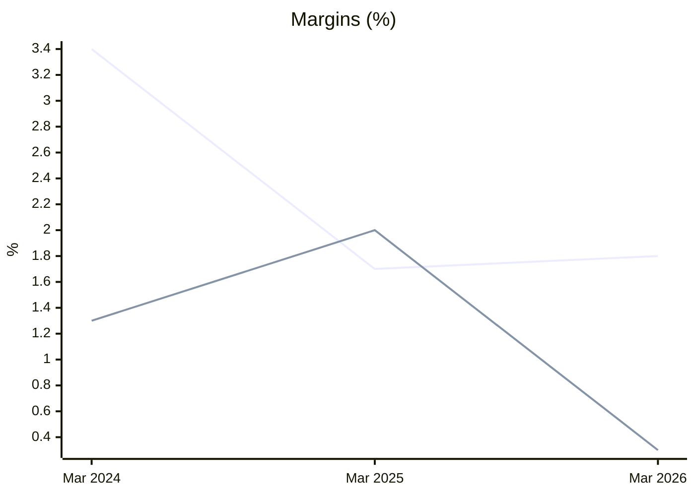
*Series in order: Operating margin, PAT margin.*

**P/E:** 109.2 — close 2026-10-01 ÷ EPS 3.08 (Mar 2026) (price ₹336.20 as of 2026-10-01).

**Cash flows (₹ cr):**

| | Mar 2024 | Mar 2025 | Mar 2026 |
|---|---:|---:|---:|
| Cash from operations (₹ cr) | 529 | 380 | 230 |
| Cash from investing (₹ cr) | 50.0 | -333 | -73.0 |
| Cash from financing (₹ cr) | -496 | -318 | -237 |
| Net cash flow (₹ cr) | 83.0 | -271 | -80.0 |
| Free cash flow (₹ cr) | 431 | 379 | 221 |

*Source: CashFlow/NiftyTotalMarket/QUESS.csv (consolidated, screener.in).*

### 8. The separated business's financial statements

**The business being separated — its own numbers**, entity by entity: its reported statements once it is listed and on file, and the segment numbers the annual reports and presentations carry for it before that.

**Digitide Solutions Limited (DIGITIDE) — as reported since listing**

| | Mar 2026 |
|---|---:|
| Sales (₹ cr) | 3,269 |
| Sales growth (%) | — |
| Operating profit (₹ cr) | 475 |
| Operating profit growth (%) | — |
| Operating margin (%) | 14.5 |
| PAT (₹ cr) | 138 |
| PAT growth (%) | — |
| PAT margin (%) | 4.2 |
| EPS (₹) | -1.1 |

*Source: ProfitStatement/NiftyTotalMarket/DIGITIDE.csv (consolidated, screener.in); growth and margins computed here.*

**Bluspring Enterprises Limited (BLUSPRING) — as reported since listing**

| | Mar 2026 |
|---|---:|
| Sales (₹ cr) | 2,682 |
| Sales growth (%) | — |
| Operating profit (₹ cr) | 78.0 |
| Operating profit growth (%) | — |
| Operating margin (%) | 2.9 |
| PAT (₹ cr) | -156 |
| PAT growth (%) | — |
| PAT margin (%) | -5.8 |
| EPS (₹) | -1.0 |

*Source: ProfitStatement/NiftyTotalMarket/BLUSPRING.csv (consolidated, screener.in); growth and margins computed here.*

**Global Technology Solutions (BPO services and technology solutions; CGUs MFXchange Holdings Inc., Brainhunter Systems Ltd and Conneqt Business Solution Limited transferred to Digitide Solutions Limited) → Digitide Solutions Limited (Resulting Company 1)** · unit ₹ million · Profit line is 'Segment result' = segment revenue less allocable segment costs, before other income, depreciation/amortisation, finance costs, unallocated corporate expenses, exceptional items and tax. Revenue is external (disaggregated revenue from contracts with customers); no inter-segment revenue disclosed. Segment-level PAT and depreciation are not reported (depreciation is wholly unallocated).

| | FY2023 | FY2024 |
|---|---:|---:|
| Revenue (₹ million) | 21,723 | 23,400 |
| Revenue growth (%) | — | +7.7% |
| Operating profit (₹ million) | 3,541 | 4,253 |
| Operating profit growth (%) | — | +20.1% |
| Operating margin (%) | 16.3 | 18.2 |
| PAT (₹ million) | — | — |
| PAT growth (%) | — | — |
| Segment assets (₹ million) | 14,461 | 15,019 |
| Segment liabilities (₹ million) | 7,534 | 7,311 |
| Capital employed (₹ million) | 6,927 | 7,708 |
| Return on capital employed (%) | 51.1 | 55.2 |
| Segment assets / revenue (x) | 0.7 | 0.6 |
| Capex (₹ million) | 481 | 710 |

*Sources:* Annual Report 2024 — page 291; Annual Report 2024 — page 290

*Not in the pages read:* No PAT, depreciation or capex at Digitide entity level; no FY2025/FY2026 figures (segment ceased on demerger); only FY2024 discontinued-operations cash flows given (AR2025 p.241).

**Operating Asset Management (janitorial, security, electro-mechanical, pest control, food and hospitality, industrial O&M; CGUs Integrated Facility Management and Vedang Cellular transferred to Bluspring Enterprises Limited) → Bluspring Enterprises Limited (Resulting Company 2)** · unit ₹ million · Profit line is 'Segment result' (pre-D&A, pre-finance cost, pre-unallocated corporate expense, pre-exceptional, pre-tax). Revenue is external segment revenue. Segment PAT and depreciation not disclosed by segment.

| | FY2023 | FY2024 |
|---|---:|---:|
| Revenue (₹ million) | 26,216 | 28,007 |
| Revenue growth (%) | — | +6.8% |
| Operating profit (₹ million) | 1,196 | 1,410 |
| Operating profit growth (%) | — | +17.9% |
| Operating margin (%) | 4.6 | 5.0 |
| PAT (₹ million) | — | — |
| PAT growth (%) | — | — |
| Segment assets (₹ million) | 13,926 | 13,951 |
| Segment liabilities (₹ million) | 4,943 | 5,982 |
| Capital employed (₹ million) | 8,983 | 7,969 |
| Return on capital employed (%) | 13.3 | 17.7 |
| Segment assets / revenue (x) | 0.5 | 0.5 |
| Capex (₹ million) | 92.6 | 112 |

*Sources:* Annual Report 2024 — page 291; Annual Report 2024 — page 290

*Not in the pages read:* No PAT, depreciation or entity-level revenue/profit for Bluspring; no FY2025/FY2026 figures; only FY2024 discontinued-operations cash flows disclosed (AR2025 p.241).

**Product Led Business (break fix services, hiring technology platform, workforce management tool) → Digitide Solutions Limited and Bluspring Enterprises Limited (pages do not split this segment between the two resulting companies)** · unit ₹ million · 'Segment result' as above (loss-making). Revenue external. Segment is absent from the post-demerger segment set; goodwill of ₹1,042.42 mn at 31 March 2024 formed part of the ₹7,470.27 mn goodwill transferred to the resulting entities (AR2025 p.277), but the pages do not allocate this segment's revenue/result between Digitide and Bluspring.

| | FY2023 | FY2024 |
|---|---:|---:|
| Revenue (₹ million) | 5,336 | 5,171 |
| Revenue growth (%) | — | -3.1% |
| Operating profit (₹ million) | -964 | -628 |
| Operating profit growth (%) | — | +34.8% |
| Operating margin (%) | -18.1 | -12.2 |
| PAT (₹ million) | — | — |
| PAT growth (%) | — | — |
| Segment assets (₹ million) | 2,409 | 1,588 |
| Segment liabilities (₹ million) | 2,390 | 1,368 |
| Capital employed (₹ million) | 19.0 | 220 |
| Return on capital employed (%) | -5,088 | -286 |
| Segment assets / revenue (x) | 0.5 | 0.3 |
| Capex (₹ million) | 71.0 | 365 |

*Sources:* Annual Report 2024 — page 291; Annual Report 2024 — page 290

*Not in the pages read:* No PAT, no depreciation, no split by receiving entity, no FY2025/FY2026 figures.

**Discontinued operations (businesses demerged under the Composite Scheme of Arrangement, effective 1 April 2024) → Digitide Solutions Limited and Bluspring Enterprises Limited combined (Demerged Undertaking 1 and Demerged Undertaking 2)** · unit ₹ million · PAT is 'Profit/(loss) after tax for discontinued operations' as reported in the FY2024 comparative segment note; revenue is the FY2024 revenue from discontinued operations stated in the geographic-information footnote. No operating profit, assets, liabilities, capex or depreciation given for discontinued operations as a whole; figures are combined, not per entity.

| | FY2024 |
|---|---:|
| Revenue (₹ million) | 54,050 |
| Revenue growth (%) | — |
| Operating profit (₹ million) | — |
| Operating profit growth (%) | — |
| Operating margin (%) | — |
| PAT (₹ million) | 1,450 |
| PAT growth (%) | — |

*Sources:* Annual Report 2025 — pages 313 and 314

*Not in the pages read:* Operating profit/EBITDA, segment assets and liabilities, capex and depreciation for discontinued operations; any split of these combined figures between Digitide and Bluspring.

*Businesses with no numbers in the pages read (3 annual report(s) and 12 presentation(s) on file):* Brainhunter (only CGU discount/terminal-growth rates), skill development business and 'technology and industrial' (no standalone figures); Demerged Undertaking 1 and 2 only via combined discontinued operations; Digitide/Bluspring entity P&L absent (only FY2024 cash flows).

*Documents on file:* [Annual Report 2026](https://www.bseindia.com/xml-data/corpfiling/AttachHis/93a79a4f-19f1-4b40-a260-7f4cc857a3bb.pdf); [Annual Report 2025](https://www.bseindia.com/xml-data/corpfiling/AttachHis/48ff9bae-94c8-40e2-9b9b-44d1a8f92fa7.pdf); [Annual Report 2024](https://www.bseindia.com/xml-data/corpfiling/AttachHis/c8c42337-7926-47ed-9c3e-989d56e028ac.pdf); [Presentation Nov 2026](https://www.bseindia.com/stockinfo/AnnPdfOpen.aspx?Pname=4a21eecc-7245-471f-a1f0-018133920ed2.pdf); [Presentation Aug 2026](https://www.bseindia.com/stockinfo/AnnPdfOpen.aspx?Pname=a37e7690-555e-4e67-bf95-5c0a2bd15e68.pdf); [Presentation May 2026](https://www.bseindia.com/stockinfo/AnnPdfOpen.aspx?Pname=9cb0031f-40b6-434d-b6e3-0cc6f0c9b0b3.pdf); [Presentation Feb 2026](https://www.bseindia.com/stockinfo/AnnPdfOpen.aspx?Pname=0ee7ae3e-c0fc-4c49-a286-63627552275a.pdf); [Presentation Nov 2025](https://www.bseindia.com/stockinfo/AnnPdfOpen.aspx?Pname=148b1f4f-bb37-428e-b7a9-26aa5cc6bc70.pdf); [Presentation Aug 2025](https://www.bseindia.com/stockinfo/AnnPdfOpen.aspx?Pname=f399263d-0034-47e6-b6ec-f8c23efec045.pdf)

### 9. Other financial differences — working capital, margins, returns, debt

| Metric (latest year) | Parent (QUESS) | Digitide Solutions Limited (DIGITIDE) | Bluspring Enterprises Limited (BLUSPRING) |
|---|---:|---:|---:|
| *Basis* | *reported, consolidated* | *its own reported statements* | *its own reported statements* |
| Sales (₹ cr) | 14,967 (Mar 2026) | 3,269 (Mar 2026) | 2,682 (Mar 2026) |
| Sales growth (%) | 9.3 (Mar 2026) | — | — |
| Operating margin (%) | 1.8 (Mar 2026) | 14.5 (Mar 2026) | 2.9 (Mar 2026) |
| Operating profit growth (%) | 11 (Mar 2026) | — | — |
| PAT margin (%) | 0.3 (Mar 2026) | 4.2 (Mar 2026) | -5.8 (Mar 2026) |
| ROCE % | 23 (Mar 2026) | 10 (Mar 2025) | 5 (Dec 2024) |
| Debtor Days | 19 (Mar 2026) | 78 (Mar 2026) | 95 (Mar 2026) |
| Inventory Days | — | — | 14 (Dec 2024) |
| Days Payable | — | — | 76 (Dec 2024) |
| Cash Conversion Cycle | 19 (Mar 2026) | 78 (Mar 2026) | 95 (Mar 2026) |
| Working Capital Days | 8 (Mar 2026) | 8 (Mar 2026) | 21 (Mar 2026) |
| Debt / equity (x) | 0.1 (Mar 2026) | 0.6 (Sep 2026) | 0.8 (Sep 2026) |
| Borrowings (₹ cr) | 124 (Mar 2026) | 505 (Sep 2026) | 625 (Sep 2026) |

*Each figure is the latest on file, with its year. Working-capital days and ROCE come from the stored working-capital file; segment figures from the pages cited in part 8. A dash means the documents do not carry it.*

**What stays with the parent — its segments, from the same pages:**

| Remaining segment | Revenue | Operating margin | ROCE | Segment assets / revenue | Unit | Year |
|---|---:|---:|---:|---:|---|---|
| Workforce Management (pre-demerger segment: general and IT staffing, recruitment and executive search, RPO, payroll, compliance, background verification, training and skill development, logistics) — superseded from FY2025 by General/Professional/Overseas staffing | 134,423 | 2.6% | 74.2% | 0.14x | ₹ million | FY2024 |
| General Staffing | 131,758 | 1.4% | 123.6% | 0.1x | ₹ million | FY2026 |
| Professional Staffing | 9,299 | 11.9% | 85.4% | 0.28x | ₹ million | FY2026 |
| Overseas business (APAC — Singapore, Malaysia, Philippines, Vietnam, Sri Lanka — and Middle East) | 11,973 | 6.4% | 25.9% | 0.39x | ₹ million | FY2026 |
| Digital platforms (HamaraJobs, HamaraHR, Hamara Academy, Hamara Benefits, TaskMo) | 21 | -341.5% | -138.3% | 2.94x | ₹ million | FY2026 |

**What the documents themselves say about the differences:**

- **operating margin** — parent / remaining: Workforce Management (the remaining Quess Corp business) FY24 EBITDA margin 2.61%; post-demerger Quess Corp FY25 reported EBITDA margin 1.8% and FY26 2.0%, with General Staffing at ~1.4-1.5%, Professional Staffing ~12% and Overseas ~6-7%; separated business: Global Technology Services (Digitide) FY24 EBITDA margin 18.17%; Operating Asset Management (Bluspring) FY24 5.03%; Product Led Business (foundit, into Bluspring) FY24 (12.15)% “Global Technology Services  Revenue  604 571 6% 588 3% 2,340 2,168 9% EBITDA  113 95 19% 108 5% 425 353 21% EBITDA %  18.76% 16.68% 208bps 18.30%    46bps 18.17% 16.27% 191bps”
- **cash** — parent / remaining: Post-demerger Quess Corp: gross debt ₹12 crore and net cash ₹255 crore (FY25); net cash ₹271 crore with zero gross debt (FY26); separated business: not stated “Healthy Balance Sheet Gross debt at ₹ 12 crore , net cash position of ₹ 255 croreGlobal Scale Operations”
- **return on capital** — parent / remaining: Quess Corp (remaining) adjusted ROE of 19%, with a stated aim of 20%; FY26 ROE 20%; separated business: not stated “Shareholder Returns Healthy adj ROE levels of 19% Sustainable dividend policy”
- **growth** — parent / remaining: Quess Corp FY25 (first results post demerger) revenue up 9% YoY to ₹14,967 cr, EBITDA up 12% to ₹262 cr, Adj. PAT up 54% to ₹210 cr; FY26 revenue ₹15,305 cr (up 2%), EBITDA ₹312 cr (up 19%); separated business: not stated “Quess Corp’s FY25 Revenue up 9% YoY  to ₹14,967 cr  and Adjusted PAT up 54% YoY”
- **working capital** — parent / remaining: Quess Corp (remaining) DSO at 37 days and EBITDA to OCF at 151% (FY25); General Staffing DSO 24-25 days and Collect & Pay at 76%; separated business: not stated “Strong cashflows DSO at 37 days EBITDA to OCF* at 151%Catalyzed Job Growth”
- **tax** — parent / remaining: Qualified audit conclusion on the Parent: certain tax deductions claimed by the Parent have been disallowed by the Income Tax Authority and are under challenge; effective tax rate guided at 7%-10% (FY26) / ~10% ; separated business: not stated “As stated in note 5 to the Statement, certain tax deductions claimed by the Parent and recognised in computation of income tax expense in the current and preceding periods have been disallowed by the Income Tax Authority.”
- **other** — parent / remaining: Rationale stated for all three entities: simplified corporate structure, enhanced management focus, uniquely defined capital allocation strategy, clarity of investment thesis; separated business: Each resulting company gains independence to pursue focused strategies; Quess retains partnership with "our demerged entities - Digitide for AI-first digital solutions and Bluspring for infrastructure management" “3-way Demerger Simplified corporate structure Enhanced management focus Uniquely defined capital allocation strategy Clarity of investment thesisValue Creation”

**The checklist:**

| Item | Status | Evidence |
|---|---|---|
| Why the spin-off | yes | value unlocking for shareholders — “…uess Corp, Bluspring Enterprises and Digitide Solutions, each with its own focus and its own management. The value creation from the demerger was made possible by the ₹1,270 crore of capital raised through the Quess IPO” |
| Institutional selling likely (small / different business) | partly | the demerged piece is 2% of revenue |
| Insider ownership and incentives aligned | partly | option pricing mentioned: …t) Interest on income tax refunds Exceptional items (refer note 6) -Employee stock option cost Interest on term deposits Amortised cost adjustments for financial instruments Loss/( Profit) on sale of property, plant and equipm… *(next: the date the management options are priced; promoter holding in the resulting company)* |
| A hidden value revealed (pro-forma, leverage, comparables) | unknown | no pro-forma or market data on file *(next: pro-forma P&L of each piece × the peer P/E of its own industry)* |
| Parent before the spin (clean parent, takeover prelude) | no | stage record_date — the pieces trade separately now |
| Timing (first year sells, second year gains) | yes | 588 days since listing/record date; second year since listing — where the notes found the largest gains |
| Management discussing it on the calls | yes | 9 mention(s) in the last 12 months of calls — “…u everyone for joining us and continuing to support Quess Corp in this journey. As we said, we are foundationally strong in our 19th year and one year post our demerger. From a balance sheet perspective, there is streng” |

**On the calls (last 12 months):**

- *Nov 2025* (forward) — “…, it is weak. That is question one. Second question is effective tax rat e. How one should look at it? This quarter it is around 10 percentage. Considering now demerger -related thing as well as business mix change, what we are observing from profit contribution perspective, what would be the effective tax rate one should look…”
- *Feb 2026* (backward) — “…r numbers a s we move forward. Guruprasad Srinivasan: Just to add a point there. If you recollect, in Q4, these were the discontinued businesses as part of the demerger that we had announced to the Street, and we had taken an exceptional credit loss on that. And as co mmitted, the effort is on. And as and when the collection h…”
- *Feb 2026* (backward) — “…per quarter is about INR102 crores across the group as part of the IDC. And there are a few costs in the earlier, if you are comparing year-on-year, there were demerger expenses , which wouldn't recur in this current year. So that's the entire sort of gap there. But otherwise, the run rate where we are today is about INR102 cr…”
- *Feb 2026* (backward) — “…y? Has there been a subsequent change in the industry? Kushal Ma heshwari: When you're looking at margins, then they were looking at consolidated Quess before demerger. Now the margins which we are reflecting over year in the range of 2% are post demerger for Quess Corp itself. So, if you look at it, if you look at the histor…”
- *Feb 2026* (backward) — “…looking at margins, then they were looking at consolidated Quess before demerger. Now the margins which we are reflecting over year in the range of 2% are post demerger for Quess Corp itself. So, if you look at it, if you look at the history of our company, we underwent a demerger, which was since 1st April 2024. And if you lo…”

<details><summary>The filings</summary>

| Date | Category | Headline | Attachment |
|---|---|---|---|
| 2025-04-15 | Record Date (corporate-actions register) | Record date 2025-04-15 for Demerger — NSE corporate-actions register |  |
| 2025-10-29 | Outcome of Board Meeting | Quess Corp Limited has submitted to the Exchange, the financial results for the period ended September 30, 2025. | [pdf](https://nsearchives.nseindia.in/corporate/Quesscorp_29102025204448_Outcome.pdf) |
| 2025-11-01 | Earnings call Nov 2025 | …, it is weak. That is question one. Second question is effective tax rat e. How one should look at it? This quarter it is around 10 percentage. Considering now | [pdf](https://www.bseindia.com/stockinfo/AnnPdfOpen.aspx?Pname=136d9c9f-7768-4916-8180-4351583f7b77.pdf) |
| 2026-05-01 | Earnings call May 2026 | …. That would be a medium term. So, that is how we should kind of look at it. To your question on the discontinued project, as you would remember, closer to our | [pdf](https://www.bseindia.com/stockinfo/AnnPdfOpen.aspx?Pname=57792063-4601-4365-9e78-0dfb4c9a7d79.pdf) |
| 2026-09-01 | Updates | Quess Corp Limited has informed the Exchange regarding 'Transcript for the 19th AGM'. | [pdf](https://nsearchives.nseindia.com/corporate/Quesscorp_01092026194031_SE_Intimation_Transcript.pdf) |
| 2026-10-05 | General Updates | Quess Corp Limited has informed the Exchange about General Updates | [pdf](https://nsearchives.nseindia.com/corporate/Quesscorp_05102026142744_SE_Intimation_KYC_Letter.pdf) |

</details>

## SIEMENS — Siemens Ltd.

### 1. Siemens Ltd. — CONFIRMED DEMERGER

**CONFIRMED** (a demerger scheme is on the exchange record) · **LISTED 1–2Y — the second-year window** · score 5.7/10 · spin-off · 7 filing(s) from BSE-screener, CALLS, NSE, NSE-register · first 2025-04-07, latest 2026-11-06

**The separated entities — every one the documents name:**

| Entity | Scheme | Business | Listing | Who runs it |
|---|---|---|---|---|
| **Siemens Energy India Limited** | 2024 demerger of the Energy Business of Siemens Limited (Sc… | Energy Business: fully integrated products, solutions and services across the energy value chain of oil and g… | listed 2025-06-19 as ENRIN (NSE) | Mr. Guilherme Mendonca, Managing Director and Chi… |

**What is being separated, as the documents put it:** The Energy business of Siemens Limited, transferred to Siemens Energy India Limited under a Scheme of Arrangement — class `not stated`.

### 2. Stages and dates

> **Listing:** LISTED — Siemens Energy India Limited (ENRIN) since 2025-06-19 (NSE equity list); record date 2025-04-07

| Date | Event | Source |
|---|---|---|
| 2024-02-07 | Other — Siemens Energy India Limited | as stated: Incorporation of the Resulting Company ("a wholly owned subsidiary of… |
| 2024-05-14 | Board approval — Siemens Limited and Siemens Energy India Limited | as stated: Demerger filing dated 14 May 2024; NCLT order: "the Board of Director… |
| 2024-09-17 | SEBI approval — Siemens Limited | as stated: SEBI comments on the draft scheme conveyed to BSE and NSE, per BSE ob… |
| 2024-09-17 | Exchange no-objection — BSE Limited | as stated: Filing dated 18 September 2024: "observation letter dated 17th Septem… |
| 2024-09-18 | Stage reached: **exchange noc** | [Scheme of Arrangement](https://nsearchives.nseindia.in/corporate/SIEMENS_18092024142444_Siemens18092024.pdf) |
| 2024-09-18 | Exchange no-objection — National Stock Exchange of India Limited | as stated: Filing dated 19 September 2024: "observation letter dated 18th Septem… |
| 2024-10-25 | Other — Siemens Limited | as stated: NCLT Mumbai Bench first motion order in CA (CAA)/160/MB-IV/2024 direc… |
| 2024-10-30 | Stage reached: **meetings** | [Shareholders meeting](https://nsearchives.nseindia.in/corporate/SIEMENS_30102024110723_NoticeofShareholders30102024.pdf) |
| 2024-10-31 | Other — Siemens Limited | as stated: Newspaper advertisement of notices in Business Standard (English) and… |
| 2024-12-02 | Shareholders / creditors meeting — Siemens Limited | as stated: Voting results filings dated 2 December 2024: equity shareholders app… |
| 2025-03-01 | Appointed date — Siemens Limited and Siemens Energy India Limited | as stated: Filing dated 25 March 2025: "the Appointed Date of the Scheme is Marc… |
| 2025-03-25 | NCLT order — Siemens Limited and Siemens Energy India Limited | as stated: Filing dated 25 March 2025: "the Scheme has been sanctioned by the Ho… |
| 2025-03-25 | Effective date — Siemens Limited and Siemens Energy India Limited | as stated: Filing dated 25 March 2025: "in terms of the Scheme, the Effective Da… |
| 2025-04-01 | Other — Siemens Limited | as stated: Demerger filing dated 1 April 2025: receipt of the certified copy of … |
| 2025-04-07 | **Record date** | NSE corporate-actions register |
| 2025-04-07 | Stage reached: **record date** | Record Date (corporate-actions register) |
| 2025-04-07 | Record date — Siemens Limited | as stated: Record Date filing dated 25 March 2025: "the Company and SEIL have mu… |
| 2025-04-14 | Allotment — Siemens Energy India Limited | as stated: Filing dated 14 April 2025: "the Listing Committee of SEIL at its mee… |
| 2025-06-19 | **Siemens Energy India Limited** listed (ENRIN) | NSE equity list |
| 2025-06-19 | Listing and trading — Siemens Energy India Limited | as stated: Filing dated 18 June 2025: "SEIL has received approval from BSE Limit… |
| 2025-11-14 | Stage reached: **nclt sanction** | [Outcome of Board Meeting](https://nsearchives.nseindia.com/corporate/SIEMENS_14112025160459_SL_-_Outcome_of_Board_Meeting_-_Nov_2025.pdf) |
| 2026-08-11 | Stage reached: **effective** | [Outcome of Board Meeting](https://nsearchives.nseindia.com/corporate/SIEMENS_11082026142118_Letter.pdf) |

**The stages, as filed:** exchange noc (2024-09-18) → meetings (2024-10-30) → record date (2025-04-07) → nclt sanction (2025-11-14) → effective (2026-08-11)

**Stated in the filings:** record date 2025-04-07; appointed date 2025-03-01; size hint: 10.5% of revenue.

### 3. Size of the separated business beside the parent — is institutional selling likely?

**Reading: POSSIBLE — the piece is a sizeable minority of the whole; forced selling on size alone is weaker.**

| Entity | Stated turnover | Stated share of the whole | Segment revenue share | Market cap (₹ cr) | Share of combined market cap | Index member |
|---|---|---:|---:|---:|---:|---|
| Siemens Energy India Limited | The turnover [sales (excluding other operating revenues)] o… | 34.0% | 41.7% (FY2024) | 111,320 | 46.1% | yes |

*Stated figures are the documents' own (a turnover share, or the cost-of-acquisition split the company publishes for tax, which reflects relative value); the segment share is this business's revenue over the parent's sales, and the market-cap share is the entity's value over the entity plus the parent (parent ₹130,340 cr, NSE bhavcopy of 2026-11-13), both computed here.*

**In the documents' words:** “The turnover [sales (excluding other operating revenues)] of the Energy Business for FY 2022-23 stood at Rs. 59,869 million. This represents 34% of the total turnover of the Company for FY 2022-23.”

**The judge's read of selling pressure:** unlikely — Energy was large, not a stub (FY2024 revenue Rs 61,580 million); management said combined share prices rose ~40%

### 4. Insider ownership — share swap, promoters' holding, management incentives

**Share swap / entitlement, entity by entity:**

- **Siemens Energy India Limited:** 1 (One) fully paid-up equity share of SEIL having a face value of INR 2 (Rupees Two) each for every 1 (One) fully paid-up equity share of INR 2 (Rupees Two) each held in the Company

**Promoters' holding, from the shareholding pattern:**

| Company | Promoters | FIIs | DIIs | Public | Quarter |
|---|---:|---:|---:|---:|---|
| Siemens Ltd. (SIEMENS) | 75.0% | 6.76% | 9.04% | 9.19% | Sep 2026 |
| Siemens Energy India Limited (ENRIN) | 75.0% | 7.6% | 6.43% | 10.96% | Sep 2026 |

*Source: screener.in shareholding pattern, stored under `ShareholdingPattern/NiftyTotalMarket/`. In a mirror demerger each shareholder holds the same proportion of the new company as of the parent on the record date.*

- **Promoters in the parent, per the documents:** Siemens International B.V. 47.70% and Siemens Energy Holding B.V. (formerly known as Siemens Gas and Power Holding B.V.) 24.00%, as per financial statements as on 30.09.2023 submitted to the Regional Director; Promoter and Promoter Group held 267,089,913 of 356,120,505 equity shares (75.00%) as on the 25-11-2024 record date for the court-convened meeting. The Company has consistently reported that it does not have any significant beneficial owner.
- **What the promoters will hold in the separated entity:** For the 2024 Energy demerger: "Siemens Energy India Limited will be subsequent ly listed and will mirror the shareholding of Siemens Limited, upon t he receipt of requisite approvals." The brief details of change in shareholding pattern of SEIL state: "Details As on 14.05.2024 Pre-Scheme Post-Scheme (Indicative) Shareholding % Shareholding % Promoters 100.00 75.00 Public - 25.00 Total 100.00 100.00"; and "There shall be no change in the shareholding pattern or control in Siemens Energy India Limited between the record date and the listing which may affect the status of this approval." For the 2025 Low Voltage Motors slump sale: "The transaction will not result in any change in the shareholding pattern of the Company." For the 2026 C&S Electric capital reduction: "Once the C&S Capital Reduction is completed / implemented, C&S will become a wholly owned subsidiary of the Company."
- **What a public shareholder receives:** 2024 Energy demerger: "1 (one) fully paid-up equity share(s) of SEIL having face value of Rs. 2/- (Rupees Two only) each for every 1 (one) fully paid-up equity share(s) of face value of Rs. 2/- (Rupees Two only) each of the Company" — allotted to "the shareholders of the Company whose names were recorded in the Register of Members of the Company or in the Register of Beneficial Owners maintained by the Depositories as on the Record Date (i.e., April 7, 2025)"; 35,61,20,505 equity shares were allotted, and shareholders were guided to apportion their cost of acquisition 76.18% to Siemens Limited and 23.82% to Siemens Energy India Limited. 2025 Low Voltage Motors slump sale: nothing is received by shareholders — "The transaction will not result in any change in the shareholding pattern of the Company" and the consideration of INR 22 Billion (enterprise value) is received by the Company. 2026 C&S Electric capital reduction: not stated (shares of specified shareholders of C&S, excluding Siemens Limited, are reduced).
- **Management incentives:** not stated in the documents on file.
- **Insider actions around the separation:** No promoter or management buying, selling or pledging is stated. Trading window closures around the separation were disclosed: "In this connection, the trading window under the Company's Code of Conduct for Prohibition of Insider Trading is closed and shall remain closed until March 27, 2025" (NCLT order sanctioning the demerger, 25 March 2025); "The trading window of the Company is currently closed until 16th May 2024" (board approval of the Scheme, 14 May 2024); and for the Low Voltage Motors sale, "the trading window under the Company's Code of Conduct for Prohibition of Insider Trading was closed from 5th December 2025 and shall remain closed until 10th December 2025 (both days inclusive)." Management moves: Mr. Guilherme Vieira De Mendonca (Head of Energy Business) and Mr. Harish Shekar (Head Accounting and Controlling) moved to the Resulting Company as MD & CEO and ED & CFO; Mr. Sunil Mathur continues as Non-executive Chairman of SEIL; Mr. Ketan Thaker ceased to be a Director of SEIL effective 1 April 2025.
- **Insiders, per the checklist read:** not stated — no promoter or management shareholding, stake, or incentive in Siemens Energy India Limited is disclosed anywhere in these documents · *option pricing date:* not stated

### 5. Why the demerger — point by point

Siemens Ltd. has separated two businesses, and the one management explained in the most detail is the Low Voltage Motors (LVM, plus geared motors and related customer service) business, sold as a going concern on a slump-sale basis to Innomotics India Private Limited for an enterprise value of INR 22 billion (INR 2,200 crore), cash-free/debt-free. The trigger was not Indian: on 1 October 2024 Siemens AG sold the global Innomotics business — and all of its intellectual property — to KPS Capital Partners, leaving the Indian unit as, in Sunil Mathur's words, a licensed sales organisation with no IP, no manufacturing (contract-manufactured to Innomotics design, ~97% of the Business's revenue) and survival dependent on an Agency & Distributorship Agreement and a Technical Cooperation & License Agreement with an entity now controlled by a private-equity owner. So the counterparty, not investors or lenders, effectively forced the decision: the Board stated the Business could not be sold to anyone else because Innomotics owns the IP, making the only alternatives selling to Innomotics India or restructuring the Business and bearing those costs. The numbers management cited were small and deteriorating: for the 12 months to 30 September 2025, revenue from operations of INR 9.67 billion (INR 967 crore) and profit from operations of INR 0.35 billion (INR 35 crore) — 6% of the company's revenue and ~2.2% of its profit from operations ex-Energy — with net capital employed of negative INR 1.38 billion, orders down 6.9% y/y in Q2 FY25, H1 EBITDA of 7.8% (down 130bps on lower price realisation and higher royalties paid to Innomotics), volumes that 'have not increased', cyclicality tied to private-sector capex and copper, and only 89 sales employees; the filing also recorded negative net worth of INR 1,175.66 million and 4.53% of revenue in FY24. Management said synergies with the rest of Siemens Ltd. were 'very limited' and framed the exit as portfolio optimisation that creates value and cash while giving customers and employees continuity. Price was set after negotiation using two independent valuations (Grant Thornton Bharat LLP and KPMG Valuation Services LLP) as at 30 September 2025, and Mathur stressed INR 22 billion was 'the same price that had been offered earlier on by the parent company' despite volumes having since declined. The earlier, larger separation was the Energy demerger into Siemens Energy India Limited (appointed date 1 March 2025, effective 25 March 2025), justified as creating two independent pure-play companies focused on their relevant markets, each with a large backlog; it transferred net assets of INR 37,846 million including INR 25,478 million of cash, cost INR 1.0 billion of demerger expenses in FY25 versus INR 0.1 billion in FY24, and under the November 2023 disclosure the promoters agreed procedures to let Siemens Energy AG acquire a majority in the new listed entity.

**Point by point, with the source:**

1. CFO Wrumnig first links LVM's fate to the parent's global divestment of Innomotics to KPS Capital Partners and to the Indian unit's technical dependence on that business, announcing an options review. “In view of this sale and the dependency on the global Innomotics business, we will now explore options for the future of the Low Voltage Motors business.” — *[May 2025](https://www.bseindia.com/stockinfo/AnnPdfOpen.aspx?Pname=2ae69c31-b96b-4781-9858-035146160df1.pdf)*
2. The economics were already visibly impaired: weak orders, price pressure and royalties payable to the new KPS-owned owner of the IP compressing margins. “Year-to-date, the business reported an EbitDA margin of 7.8%, down by 130bps due to lower price realization and higher royalties paid to Innomotics, the former global Siemens business, now owned by KPS Capital Partners.” — *[May 2025](https://www.bseindia.com/stockinfo/AnnPdfOpen.aspx?Pname=2ae69c31-b96b-4781-9858-035146160df1.pdf)*
3. Mathur describes what Siemens Ltd. actually owned in LVM — a licence to sell someone else's product, with outsourced manufacturing and no IP rights in India. “It is within Siemens Limited. It is outsourced manufacturing. Revenues are cyclical, as you know, for motors.” — *[Dec 2025](https://www.bseindia.com/stockinfo/AnnPdfOpen.aspx?Pname=82783258-f887-444b-a6f1-cbeaf34f0b62.pdf)*
4. The volume thesis that justified keeping the business had failed, tied to muted private-sector capex and copper prices. “The expectation was that the volumes will increase. Those volumes have not increased in the country.” — *[Dec 2025](https://www.bseindia.com/stockinfo/AnnPdfOpen.aspx?Pname=82783258-f887-444b-a6f1-cbeaf34f0b62.pdf)*
5. Board approval of the slump sale to Innomotics India at INR 22 billion, explicitly the same price the parent had offered earlier, with closing guided to mid-2026. “And this was then finally approved by the board of Siemens Limited in terms of a sale and transfer on a slump sale basis to Innomotics India at a purchase price of 22 billion, which I will remind you was the same price that had been offered earlier on by the parent company.” — *[Dec 2025](https://www.bseindia.com/stockinfo/AnnPdfOpen.aspx?Pname=82783258-f887-444b-a6f1-cbeaf34f0b62.pdf)*
6. Materiality and shareholder-interest framing: the business had shrunk to 6% of volumes and 2% of profits. “Considering the fact that the volumes have declined, in the meantime, it is only 6% of the overall volume of Siemens and only 2% of Siemens profits in the meantime.” — *[Dec 2025](https://www.bseindia.com/stockinfo/AnnPdfOpen.aspx?Pname=82783258-f887-444b-a6f1-cbeaf34f0b62.pdf)*
7. The prior, bigger separation is presented as completed and successful — Energy is now a separately listed pure-play, leaving Siemens Ltd. with DI, SI and Mobility. “A major development during this period has been the demerger of Siemens Energy India Limited, which is now a separately listed pure play energy company.” — *[Dec 2025](https://www.bseindia.com/stockinfo/AnnPdfOpen.aspx?Pname=82783258-f887-444b-a6f1-cbeaf34f0b62.pdf)*
8. Rationale originally given for the Energy demerger: two focused, independently capitalised companies each with large backlogs. “Both companies are very well prepared for the future growth, focusing on their relevant markets.” — *[Dec 2024](https://assets.new.siemens.com/siemens/assets/api/uuid:dc7b02ca-736c-4db6-8118-da2b47754aa6/Analyst-Call-Transcript-website.pdf)*
9. Final status update before closing; the quarter also shows demerger-related expenses falling by INR 500 million as separation costs roll off. “And third, on the portfolio topic, the sale of the low-voltage motors business is on track for completion in June 2026.” — *[Jun 2026](https://www.bseindia.com/stockinfo/AnnPdfOpen.aspx?Pname=f8a31e42-7fdf-46ab-8ac9-a4540a097f8b.pdf)*
10. Filing of 8 Dec 2025 states the hard constraint: without Innomotics/KPS support Siemens Ltd. cannot run the business, which is why the only buyer was the counterparty itself. “The Company itself does not have the requisite intellectual property or other capabilities to service the Business without support from Innomotics GmbH which is now owned by KPS.” — *Scheme*
11. Strategic-fit argument plus the stated financial benefit of exiting — portfolio optimisation generating value and cash. “Synergies between the Business and the rest of the Company’s businesses are very limited.” — *Scheme*
12. Price discovery and process: negotiated against two independent valuations as at 30 September 2025, outside any scheme of arrangement and not a related-party transaction. “The consideration for the sale and transfer of the Business has been determined after negotiation between the Company and the Buyer, taking into account two separate independent valuation reports of the Business as at 30th September 2025 pursuant to independent valuation exercises conducted by each of Grant Thornton Bharat LLP and                 KPMG Valuation Services LLP .” — *Scheme*
13. Completion on 1 June 2026 at INR 22 billion enterprise value, booking a provisional one-time gain of INR 20,990 million (INR 2,099 crore) in discontinued operations. “Basis the preliminary sale consideration, a provisional gain of Rs. 20,990 million is recognized during the quarter ended 30 June 2026 and six months period ended 30 September 2026.” — *Scheme*

**How it evolved:** Dec 2024 call (20 Dec 2024): only the Energy demerger is discussed as a separation — 'on track', creating two independent companies, with LVM not yet flagged as a portfolio issue. May 2025 call (20 May 2025): after the Siemens AG–KPS Innomotics deal of October 2024 and visible margin pressure from royalties paid to Innomotics, management formally said it would 'explore options for the future' of LVM. Dec 2025 (board 8 Dec 2025; analyst meet 12 Dec 2025): the option became a signed slump-sale agreement with Innomotics India at INR 22 billion, justified by lost IP, no local manufacturing, declining volumes (6% of revenue, 2% of profit) and shareholder interest, with closing guided to mid-2026. Jun 2026 call (28 May 2026) reconfirmed completion 'on track for June 2026'; the sale closed 1 June 2026 with a provisional gain of INR 20,990 million, while in the opposite direction the Board approved amalgamating subsidiary Siemens Rail Automation into the parent (26 May 2026) and took C&S Electric to 100% via capital reduction (NCLT order 24 September 2026).

**What management expects from it:** For Siemens Ltd.: a cleaner three-business technology portfolio (DI, SI, Mobility), removal of a sub-scale, negative-capital-employed, royalty-burdened unit worth 6% of revenue but only 2% of profit, INR 22 billion of cash plus an INR 2,099 crore gain, and portfolio optimisation 'creating value and cash'. For Innomotics India: ownership aligned with the IP it already holds, continuity for LVM customers and the 89 sales staff. For Energy: an independent pure-play.

*Not explained on the calls:* No post-sale margin, ROCE or capital-deployment guidance; no bridge from the 2024 parent offer to INR 22 billion; silent on employee transfer terms, ADA/TCLA wind-down, and buyer-selection alternatives.

- *Stated reason, in one line:* not stated — the filings give no rationale; the Dec 2025 analyst meet only describes SEIL as 'now a separately listed pure play energy company'
- *What it reveals:* Energy left with net assets of Rs 37,846 million including Rs 25,478 million cash; it earned Rs 9,418 million PBT on Rs 61,580 million revenue in FY2024. Parent remains cash-rich (Rs 77,905 million cash and bank, 30 Sep 2026) with a Rs 47,034 crore backlog.
- *Parent or spin:* parent · *Read next:* Siemens Energy India Limited's own results and the Scheme, for the Rs 37,846 million net assets and Rs 25,478 million cash transferred
- *In their words:* “Pursuant to receipt of necessary statutory approvals and in accordance with the Scheme, the Company has demerged the Energy business effective 25 March 2025, with appointed date being 1 March 2025, as per the Scheme.”

### 6. On the calls, verbatim

5 call(s), oldest first: **0 question-and-answer exchange(s)** given in full — the question and every answer to it, nothing trimmed — and 15 passage(s) from management's prepared remarks (the complete sentences about it; the whole remarks are in the linked transcript). Text is as the transcript prints it.

| Call | Q&A exchanges | Prepared-remarks passages | Transcript |
|---|---:|---:|---|
| May 2024 | 0 | 1 | [transcript](https://www.bseindia.com/stockinfo/AnnPdfOpen.aspx?Pname=f0d19dfa-6df4-4e8d-8e29-373746233b5e.pdf) |
| Dec 2024 | 0 | 11 | [transcript](https://assets.new.siemens.com/siemens/assets/api/uuid:dc7b02ca-736c-4db6-8118-da2b47754aa6/Analyst-Call-Transcript-website.pdf) |
| May 2025 | 0 | 1 | [transcript](https://www.bseindia.com/stockinfo/AnnPdfOpen.aspx?Pname=2ae69c31-b96b-4781-9858-035146160df1.pdf) |
| Dec 2025 | 0 | 1 | [transcript](https://www.bseindia.com/stockinfo/AnnPdfOpen.aspx?Pname=82783258-f887-444b-a6f1-cbeaf34f0b62.pdf) |
| Jun 2026 | 0 | 1 | [transcript](https://www.bseindia.com/stockinfo/AnnPdfOpen.aspx?Pname=f8a31e42-7fdf-46ab-8ac9-a4540a097f8b.pdf) |

**The full verbatim text of every exchange is in [companies/SIEMENS.md](companies/SIEMENS.md#6-on-the-calls-verbatim).**

### 7. The parent's financial statements

**The parent, last three fiscal years (consolidated)**

| | Sep 2022 | Sep 2023 | Sep 2024 |
|---|---:|---:|---:|
| Sales (₹ cr) | 16,138 | 19,554 | 15,146 |
| Sales growth (%) | +22.3% | +21.2% | -22.5% |
| Operating profit (₹ cr) | 1,860 | 2,487 | 2,059 |
| Operating profit growth (%) | +28.1% | +33.7% | -17.2% |
| Operating margin (%) | 11.5 | 12.7 | 13.6 |
| PAT (₹ cr) | 1,543 | 1,962 | 2,718 |
| PAT growth (%) | +41.7% | +27.2% | +38.5% |
| PAT margin (%) | 9.6 | 10.0 | 17.9 |
| EPS (₹) | 43.3 | 55.1 | 76.3 |

*Source: ProfitStatement/NiftyTotalMarket/SIEMENS.csv (consolidated, screener.in); growth and margins computed here.*

```mermaid
xychart-beta
    title "Sales, operating profit and PAT (₹ cr)"
    x-axis ["Sep 2022", "Sep 2023", "Sep 2024"]
    y-axis "₹ crore"
    bar [16138, 19554, 15146]
    bar [1860, 2487, 2059]
    bar [1543, 1962, 2718]
```
*Series in order: Sales, Operating profit, PAT.*

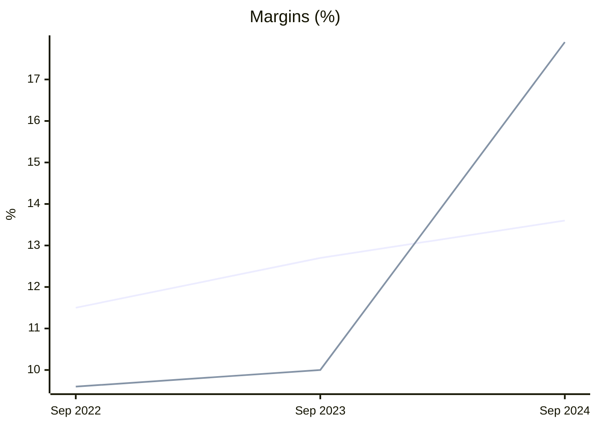
*Series in order: Operating margin, PAT margin.*

**P/E:** 47.7 — live market file (screener.in), trailing (price ₹3,760.00 as of 2026-08-02).

**Cash flows (₹ cr):**

| | Sep 2023 | Sep 2024 | Mar 2026 |
|---|---:|---:|---:|
| Cash from operations (₹ cr) | 1,400 | 1,655 | -535 |
| Cash from investing (₹ cr) | -759 | -502 | 3,695 |
| Cash from financing (₹ cr) | -450 | -508 | -3,302 |
| Net cash flow (₹ cr) | 191 | 644 | -142 |
| Free cash flow (₹ cr) | 1,334 | 1,552 | -1,080 |

*Source: CashFlow/NiftyTotalMarket/SIEMENS.csv (consolidated, screener.in).*

### 8. The separated business's financial statements

**The business being separated — its own numbers**, entity by entity: its reported statements once it is listed and on file, and the segment numbers the annual reports and presentations carry for it before that.

**Siemens Energy India Limited (ENRIN) — as reported since listing**

| | Sep 2025 |
|---|---:|
| Sales (₹ cr) | 0.0 |
| Sales growth (%) | — |
| Operating profit (₹ cr) | -0.0 |
| Operating profit growth (%) | — |
| Operating margin (%) | — |
| PAT (₹ cr) | -0.0 |
| PAT growth (%) | — |
| PAT margin (%) | — |
| EPS (₹) | 30.9 |

*Source: ProfitStatement/NiftyTotalMarket/ENRIN.csv (consolidated, screener.in); growth and margins computed here.*

**Energy (reported as "Energy - Discontinued operations" from the 18-month period ended 31 March 2026; demerged w.e.f. 1 March 2025) → Siemens Energy India Limited** · unit ₹ million · Standalone segment reporting. Revenue = external revenue (Energy total incl. inter-segment: FY2023 60,803; FY2024 63,452 per AR2024, restated 61,853 per AR2026; 18M FY2026 25,746). Operating_profit = segment 'Results' i.e. profit from operations (EBIT-type, before finance costs, interest income, other income, demerger expenses, tax). PAT not disclosed per segment; PBT of Energy discontinued operations is given: FY2024 9,418 and 5,599 for the 18M period (AR2026 p182). AR2026 restates FY2024 Energy on a discontinued-operations basis (external revenue 61,580, result 9,541) versus 63,179 / 9,101 as originally reported in AR2024. Consolidated figures are nearly identical (FY2024 result 9,098; 18M result 5,622). The Dec 2024 presentation gives the carve-out Energy Business in ₹ billion: FY24 revenue 62.8, EBITDA 9.8, PAT 7.1; FY23 revenue 59.9, EBITDA 7.6, PAT 5.2.

| | FY2023 | FY2024 | FY2025 | FY2026 |
|---|---:|---:|---:|---:|
| Revenue (₹ million) | 60,365 | 63,179 | — | 25,608 |
| Revenue growth (%) | — | +4.7% | — | — |
| Operating profit (₹ million) | 6,873 | 9,101 | — | 5,636 |
| Operating profit growth (%) | — | +32.4% | — | — |
| Operating margin (%) | 11.4 | 14.4 | — | 22.0 |
| PAT (₹ million) | — | — | — | — |
| PAT growth (%) | — | — | — | — |
| Segment assets (₹ million) | 39,656 | 46,493 | — | — |
| Segment liabilities (₹ million) | 32,318 | 37,765 | — | — |
| Capital employed (₹ million) | 7,338 | 8,728 | — | — |
| Return on capital employed (%) | 93.7 | 104 | — | — |
| Segment assets / revenue (x) | 0.7 | 0.7 | — | — |
| Capex (₹ million) | 679 | 1,515 | — | 895 |

*Sources:* Annual Report 2024 — page 173 (revenue/result); page 174 (assets, liabilities, capex, depreciation); no annual FY2025 figures on the pages — Energy demerged 1 March 2025; only a 5-month H1 FY25 stub exists (Presentation May 2025 — page 13, in ₹ billion: revenue 25.6, EBITDA 5.8, PBT 4.2); Annual Report 2026 — page 182 (revenue/result); page 183 (capex, depreciation; assets/liabilities held for distribution shown as nil after transfer)

*Not in the pages read:* No segment PAT, no FY2025 annual, no quarterly figures in ₹ million. FY2026 'year' is the 18-month period to 31 Mar 2026 but Energy is included only to demerger (5 months).

**Low Voltage Motors (LVM) — reported as "Portfolio Companies" in Annual Report 2024 → Low Voltage Motors Division of Siemens Limited — held for sale / discontinued; not one of the named Energy entities** · unit ₹ million · Standalone segment reporting. Revenue = external revenue (total incl. inter-segment: FY2024 9,366; 18M FY2026 15,308). Operating_profit = segment 'Results' (profit from operations). PBT of LVM discontinued operations: FY2024 785; 18M FY2026 717 (AR2026 p182). Assets/liabilities for FY2026 and FY2024 are the held-for-sale balances per AR2026 p183.

| | FY2023 | FY2024 | FY2025 | FY2026 |
|---|---:|---:|---:|---:|
| Revenue (₹ million) | 9,547 | 9,360 | — | 15,212 |
| Revenue growth (%) | — | -2.0% | — | — |
| Operating profit (₹ million) | 1,097 | 787 | — | 710 |
| Operating profit growth (%) | — | -28.3% | — | — |
| Operating margin (%) | 11.5 | 8.4 | — | 4.7 |
| PAT (₹ million) | — | — | — | — |
| PAT growth (%) | — | — | — | — |
| Segment assets (₹ million) | 2,044 | 2,434 | — | 2,500 |
| Segment liabilities (₹ million) | 2,861 | 3,565 | — | 3,372 |
| Capital employed (₹ million) | -817 | -1,131 | — | -872 |
| Return on capital employed (%) | — | — | — | — |
| Segment assets / revenue (x) | 0.2 | 0.3 | — | 0.2 |
| Capex (₹ million) | 36.0 | 101 | — | 158 |

*Sources:* Annual Report 2024 — page 173 (revenue/result, Portfolio Companies); page 174 (assets, liabilities, capex, depreciation); Annual Report 2026 — page 182 (revenue/result, restated as LVM discontinued); page 183 (held-for-sale assets/liabilities, capex, depreciation). AR2024 p173-174 as originally reported: revenue 9,282, result 785, capex 90, depreciation 94; no FY2025 annual figures on the pages — AR2026 covers an 18-month period; Annual Report 2026 — page 182 (revenue/result); page 183 (held-for-sale assets/liabilities, capex, depreciation)

*Not in the pages read:* No PAT, no FY2025 annual, no quarterly figures. FY2026 is the 18-month period ended 31 March 2026.

*Businesses with no numbers in the pages read (2 annual report(s) and 12 presentation(s) on file):* All named entities refer to one separated business (Energy / SEIL), for which the pages carry numbers. No separate SEIL standalone company accounts are on these pages — only Siemens Ltd. segment and carve-out data.

*Documents on file:* [Annual Report 2026](https://www.bseindia.com/xml-data/corpfiling/AttachHis/af1c888d-9e71-4ee9-b4eb-8aaf715a20e3.pdf); [Annual Report 2024](https://www.bseindia.com/xml-data/corpfiling/AttachHis/ec799378-4eb3-4b2b-9237-8bb167a357a9.pdf); [Presentation Jun 2026](https://www.bseindia.com/stockinfo/AnnPdfOpen.aspx?Pname=69211f8e-0c07-4c3b-a2d8-754b95a897b6.pdf); [Presentation Dec 2025](https://www.bseindia.com/stockinfo/AnnPdfOpen.aspx?Pname=bb8c2d25-00b3-41da-860f-1858e0deb839.pdf); [Presentation May 2025](https://www.bseindia.com/stockinfo/AnnPdfOpen.aspx?Pname=7d9b2610-decc-46e7-8c44-b79a5c39a530.pdf); [Presentation Dec 2024](https://www.bseindia.com/stockinfo/AnnPdfOpen.aspx?Pname=838e2e8e-0f82-4968-a64e-477ccd8cd24a.pdf); [Presentation May 2024](https://www.bseindia.com/stockinfo/AnnPdfOpen.aspx?Pname=d44a8eb3-5d8f-4e91-b2f2-62890ac348b5.pdf); [Presentation Dec 2022](https://www.bseindia.com/stockinfo/AnnPdfOpen.aspx?Pname=48ed3930-73eb-4034-9ede-3abd883f95c6.pdf)

### 9. Other financial differences — working capital, margins, returns, debt

| Metric (latest year) | Parent (SIEMENS) | Siemens Energy India Limited (ENRIN) |
|---|---:|---:|
| *Basis* | *reported, consolidated* | *its own reported statements* |
| Sales (₹ cr) | 15,146 (Sep 2024) | 0 (Sep 2025) |
| Sales growth (%) | -22.5 (Sep 2024) | — |
| Operating margin (%) | 13.6 (Sep 2024) | — |
| Operating profit growth (%) | -17.2 (Sep 2024) | — |
| PAT margin (%) | 17.9 (Sep 2024) | — |
| ROCE % | 21 (Sep 2024) | 68 (Sep 2024) |
| Debtor Days | 57 (Mar 2026) | 90 (Feb 2025) |
| Inventory Days | 60 (Mar 2026) | — |
| Days Payable | 94 (Mar 2026) | — |
| Cash Conversion Cycle | 23 (Mar 2026) | 90 (Feb 2025) |
| Working Capital Days | 71 (Mar 2026) | 35 (Feb 2025) |
| Debt / equity (x) | 0 (Mar 2026) | 0 (Mar 2026) |
| Borrowings (₹ cr) | 307 (Mar 2026) | 216 (Mar 2026) |

*Each figure is the latest on file, with its year. Working-capital days and ROCE come from the stored working-capital file; segment figures from the pages cited in part 8. A dash means the documents do not carry it.*

**What stays with the parent — its segments, from the same pages:**

| Remaining segment | Revenue | Operating margin | ROCE | Segment assets / revenue | Unit | Year |
|---|---:|---:|---:|---:|---|---|
| Smart Infrastructure | 112,881 | 13.3% | 37.8% | 0.55x | ₹ million | FY2026 |
| Mobility | 47,227 | 5.5% | 10.4% | 0.79x | ₹ million | FY2026 |
| Digital Industries | 57,414 | 5.3% | 51.4% | 0.31x | ₹ million | FY2026 |
| Others (services to related parties and lease rentals) | 2,732 | 8.1% | 22.0% | 1.12x | ₹ million | FY2026 |

**What the documents themselves say about the differences:**

- **growth** — parent / remaining: Continuing operations (Siemens Limited excluding Energy business) in Q1 FY 2025: New Orders up 20% at INR 4,258 crore, Revenue 3% lower at INR 3,587 crore, Profit after Tax lower by 10% at INR 372 crore; separated business: Energy business (discontinued operations) in Q1 FY 2025: Revenue INR 1,431 crore (up 28%) and Profit after Tax INR 243 crore (up 158%), on continued strong demand for Transmission products and solutions, including a favorable one-time impact of INR 98 crore on profitability “Revenue and Profit after Tax for discontinued operations for Q1 FY 2025 was INR 1,431 crore (up 28%) and INR 243 crore (up 158%), respectively .”
- **operating margin** — parent / remaining: Standalone continuing operations for the year ended 30 September 2024: revenue from operations Rs. 143,386 million with profit before tax of Rs. 25,759 million; for the eighteen months ended 31 March 2026, revenue Rs. 220,254 million with profit before tax Rs. 27,375 million; separated business: Energy business as discontinued operations for the year ended 30 September 2024: revenue from operations Rs. 61,580 million, total income Rs. 61,622 million, total expenses Rs. 52,204 million and profit before tax Rs. 9,418 million; profit for the year from discontinued operations Rs. 6,980 million “Revenue from operations 14,308 20,041 11,157 61,580 Other income 15 38 23 42 Total income 14,323 20,079 11,180 61,622 Total expenses 11,077 15,926 9,912 52,204 Profit before tax for the period/ year 3,246 4,153 1,268 9,418”
- **debt and leverage** — parent / remaining: No secured creditors and no preference shareholders in Siemens Limited; 4,342 unsecured creditors with an outstanding amount of INR 34,31,68,90,458 as on 31 August 2024; fund and non-fund based working capital facilities availed from State Bank of India with no dues owed at the date of filing the Company Scheme Application; separated business: No secured creditors and no preference shareholders in Siemens Energy India Limited; 2 unsecured creditors having an outstanding amount of INR 20,92,540 as on 31 August 2024 “It is further submitted that since there are no (i) Secured Creditors in Siemens Limited and Siemens Energy India Limited; and (ii) Preference Shareholders in Siemens Limited and Siemens Energy India Limited, this Tribunal had dispensed with the holding and convening of the meetings of Secured Creditors of Siemens Limited and Siemens Energy India Limited and Preference Shareholders of Siemens Limited and Siemens Energy India Limited.”
- **other** — parent / remaining: Cost of acquisition apportionment for the parent after the demerger: 76.18% of the total cost of acquisition of shares of the Company; separated business: Cost of acquisition apportionment for the resulting company: 23.82% of the total cost of acquisition of shares of the Company “Sr. No. Name of the Entity % of Total Cost of Acquisition of Shares of the Company 1 Siemens Limited 76.18 2 Siemens Energy India Limited 23.82”
- **other** — parent / remaining: Demerger related expenses charged in the parent: Rs. 148 million in the quarter ended 31 December 2024 and Rs. 110 million in the year ended 30 September 2024; Rs. 1,092 million in the eighteen months ended 31 March 2026 (Rs. 31 million in the quarter ended 30 June 2026). The CFO stated it was 0.1 billion in FY24 and 1 billion in FY25; separated business: not stated “And the second one : we had energy demerger -related e xpenses . In ’24 it was just 0.1 billion. In ’25 it was 1 billion.”
- **capex and capital intensity** — parent / remaining: Parent retains 25 factories and continues to invest in local manufacturing (vacuum interrupter and gas-insulated switchgear factories in Goa, Mobility factories in Nashik, Chhatrapati Sambhajinagar and Dahod); roughly 65-75% localisation in Smart Infrastructure; separated business: Low Voltage Motors business sold in 2025 has no manufacturing: the Company largely functions as a sales organisation with outsourced contract manufacturing constituting approximately 97% of the revenue of the Business, a sales team of 89 employees, and negative net capital employed of Rs. 1.38 billion “The Company largely functions as a sales organisation in respect of the Business and does not have manufacturing facilities to manufacture the low voltage motors and follows a contract  manufacturing model with Innomotics  design and with stringent quality controls across the supply chain and manufacturing, which constitute approximately 97% of the revenue of the Business.”
- **working capital** — parent / remaining: Remaining business is investing heavily in working capital, chiefly for Mobility: inventory levels raised and trade receivables and contract assets up with the revenue ramp, so operating cash flow is below prior periods; over dues stable and not at a critical level; separated business: not stated “On one hand, of course, we have CapEx with regards to our investments in manufacturing. Then , also we have OpEx related to th ese investments. And one big portion is also we invest a lot in working capital right now for the Mobility business.”

**The checklist:**

| Item | Status | Evidence |
|---|---|---|
| Why the spin-off | yes | regulatory / strategic knot — “…ions precedent, including receipt of requisite regulatory and statutory approvals such as approval from the Competition Commission of India, as may be applicable, for a cash consideration (enterprise value) of INR 22 bi” |
| Institutional selling likely (small / different business) | partly | the demerged piece is 10.5% of revenue |
| Insider ownership and incentives aligned | unknown | no promoter-continuity or option-pricing language found *(next: the date the management options are priced; promoter holding in the resulting company)* |
| A hidden value revealed (pro-forma, leverage, comparables) | partly | borrowings 307 cr (Mar 2026) = 0.00× market cap; P/E 49.3 on Sep 2024 profit vs industry median 48.1 (59 peers) *(next: pro-forma P&L of each piece × the peer P/E of its own industry)* |
| Parent before the spin (clean parent, takeover prelude) | no | stage record_date — the pieces trade separately now |
| Timing (first year sells, second year gains) | yes | 596 days since listing/record date; second year since listing — where the notes found the largest gains |
| Management discussing it on the calls | yes | 5 mention(s) in the last 12 months of calls — “…you can see two effects, each one offsetting each other. On one hand, the other income in Q6 declined by 500 million, and in Q6, we also had 500 million lower demerger expenses. So, overall, the impact of commodity pric” |

**On the calls (last 12 months):**

- *Dec 2025* (forward) — “…uple of years have brought significant change and progress for our company, as many of you would have seen. A major development during this period has been the demerger of Siemens Energy India Limited, which is now a separately listed pure play energy company. Many of you would have attended their Analyst and Investor Meet jus…”
- *Dec 2025* (backward) — “…parent, the brand is Innomotics in the Indian market. − And this was then finally approved by the board of Siemens Limited in terms of a sale and transfer on a slump sale basis to Innomotics India at a purchase price of 22 billion, which I will remind you was the same price that had been offered earlier on by the parent company.…”
- *Dec 2025* (backward) — “…ar. In 2024 we had a sale of property of 2.9 billion. We couldn't unfortunately repeat in ’25, so that's one of the reasons. And the second one : we had energy demerger -related e xpenses . In ’24 it was just 0.1 billion. In ’25 it was 1 billion. So more or less , these two topics explain the significant decline in the reporte…”
- *Dec 2025* (backward) — “…o topics explain the significant decline in the reported profit before tax. − So let me finish: 2025 for us was another successful year. We have complet ed the demerger of the energy business in record time, and we have increased , more or less , shareholder value of plus 40 % combining both share prices. We have grown our top…”
- *Jun 2026* (backward) — “…you can see two effects, each one offsetting each other. On one hand, the other income in Q6 declined by 500 million, and in Q6, we also had 500 million lower demerger expenses. So, overall, the impact of commodity prices and their effects is significant, but our operational performance is still very strong. - So, now let me…”

<details><summary>The filings</summary>

| Date | Category | Headline | Attachment |
|---|---|---|---|
| 2025-04-07 | Record Date (corporate-actions register) | Record date 2025-04-07 for Demerger — NSE corporate-actions register |  |
| 2025-11-14 | Outcome of Board Meeting | Siemens Limited has submitted to the Exchange, the financial results for the period ended September 30, 2025. | [pdf](https://nsearchives.nseindia.com/corporate/SIEMENS_14112025160459_SL_-_Outcome_of_Board_Meeting_-_Nov_2025.pdf) |
| 2025-12-01 | Earnings call Dec 2025 | …uple of years have brought significant change and progress for our company, as many of you would have seen. A major development during this period has been the | [pdf](https://www.bseindia.com/stockinfo/AnnPdfOpen.aspx?Pname=82783258-f887-444b-a6f1-cbeaf34f0b62.pdf) |
| 2025-12-08 | General Updates | Siemens Limited has informed the Exchange about General Updates | [pdf](https://nsearchives.nseindia.com/corporate/SIEMENS_08122025182317_2025-12-08_SE_Announcement_Lemon_Finalv1.pdf) |
| 2026-08-11 | Outcome of Board Meeting | Siemens Limited has submitted to the Exchange, the financial results for the period ended Jun 30, 2026. | [pdf](https://nsearchives.nseindia.com/corporate/SIEMENS_11082026142118_Letter.pdf) |
| 2026-09-25 | Approval For Reduction Of Share Capital  | NCLT approved reduction of 343,948 C&S Electric shares; Siemens to become sole owner. | [pdf](https://www.bseindia.com/xml-data/corpfiling/AttachLive/bd149a3d-c618-4586-a666-4b8d5e0e71a5.pdf) |
| 2026-11-06 | Outcome of Board Meeting | Siemens Limited has submitted to the Exchange, the financial results for the period ended September 30, 2026. | [pdf](https://nsearchives.nseindia.com/corporate/SiemensRaj_06112026154718_SEIntimation.pdf) |

</details>

## SKFINDIA — SKF India Ltd.

### 1. SKF India Ltd. — CONFIRMED DEMERGER

**CONFIRMED** (a demerger scheme is on the exchange record) · **LISTED 1–2Y — the second-year window** · score 5.7/10 · spin-off · 9 filing(s) from CALLS, NSE, NSE-register · first 2025-10-15, latest 2026-08-20

**The separated entities — every one the documents name:**

| Entity | Scheme | Business | Listing | Who runs it |
|---|---|---|---|---|
| **SKF India (Industrial) Limited** | 2024-25 Scheme of Arrangement demerging the Industrial Busi… | Industrial Business: manufacturing, trading, marketing and dealing with rolling bearing, seals, rotating shaf… | listed 2025-12-05 as SKFINDUS (NSE) | not stated |

**What is being separated, as the documents put it:** SKF India's Industrial business (Demerged Undertaking) hived into SKF India (Industrial) Limited on going-concern basis — class `value_unlocking`.

### 2. Stages and dates

> **Listing:** LISTED — SKF India (Industrial) Limited (SKFINDUS) since 2025-12-05 (NSE equity list); record date 2025-10-15

| Date | Event | Source |
|---|---|---|
| 2024-09-17 | Other — Aktiebolaget SKF / SKF India Limited | as stated: Press Release filing dated 17th September 2024 enclosing AB SKF press… |
| 2024-10-08 | Stage reached: **announced** | [Outcome of Board Meeting](https://nsearchives.nseindia.in/corporate/SKFINDIA_08102024180012_NSE.pdf) |
| 2024-10-08 | Board approval — SKF India Limited | as stated: Outcome of Board Meeting / Acquisition filing dated 08th October 2024… |
| 2024-12-17 | Other — SKF India (Industrial) Limited | as stated: Acquisition filing dated 17th December 2024 – Certificate of Incorpor… |
| 2024-12-26 | Board approval — SKF India Limited and SKF India (Industrial) Limited | as stated: Outcome of Board Meeting and Demerger filings dated 26th December 202… |
| 2025-03-10 | Filed with exchanges — SKF India Limited | as stated: NSE Observation Letter Ref: NSE/LIST/46505 dated March 28, 2025 – "Ba… |
| 2025-03-27 | SEBI approval — SKF India Limited | as stated: BSE and NSE Observation Letters dated March 28, 2025 – "SEBI vide its… |
| 2025-03-28 | Exchange no-objection — SKF India Limited | as stated: Demerger filing dated 28th March 2025 – Observation Letters dated 28t… |
| 2025-04-09 | Other — SKF India Limited and SKF India (Industrial) Limited | as stated: Compliance Letter dated November 28, 2025 – "the application was file… |
| 2025-06-04 | NCLT order — SKF India Limited and SKF India (Industrial) Limited | as stated: Demerger filing dated 05th June 2025 – NCLT Order dated 04th June 202… |
| 2025-07-14 | Stage reached: **meetings** | [Shareholders meeting](https://nsearchives.nseindia.in/corporate/SKFINDIA23_14072025192642_NSE.pdf) |
| 2025-07-14 | Shareholders / creditors meeting — SKF India Limited | as stated: Shareholders meeting filings dated 14th July 2025 – NCLT-convened mee… |
| 2025-09-26 | NCLT order — SKF India Limited and SKF India (Industrial) Limited | as stated: Demerger filing dated September 26, 2025 – Order of Hon'ble NCLT, Mum… |
| 2025-09-30 | Other — SKF India Limited | as stated: Demerger filing dated 30th September 2025 – receipt of certified copy… |
| 2025-10-01 | Appointed date — SKF India Limited and SKF India (Industrial) Limited | as stated: Demerger filing dated 01st October 2025 – "The Appointed Date is open… |
| 2025-10-01 | Effective date — SKF India Limited and SKF India (Industrial) Limited | as stated: Demerger filing dated 01st October 2025 – "the Scheme is made effecti… |
| 2025-10-15 | **Record date** | NSE corporate-actions register |
| 2025-10-15 | Stage reached: **record date** | Record Date (corporate-actions register) |
| 2025-10-15 | Record date — SKF India Limited | as stated: Record Date filing dated 02nd October 2025 – Boards of the Company an… |
| 2025-10-17 | Stage reached: **listed** | [Demerger](https://nsearchives.nseindia.in/corporate/SKFINDIA22_17102025222058_NSE.pdf) |
| 2025-10-17 | Allotment — SKF India (Industrial) Limited | as stated: Demerger filing dated 17th October 2025 – Board of the Resulting Comp… |
| 2025-11-15 | Stage reached: **nclt sanction** | [Press Release](https://nsearchives.nseindia.com/corporate/SKFINDIA25_15112025132755_NSE.pdf) |
| 2025-11-27 | Other — SKF India (Industrial) Limited | as stated: Compliance Letter dated November 28, 2025 – newspaper advertisement d… |
| 2025-11-28 | Stage reached: **exchange noc** | [Updates](https://nsearchives.nseindia.com/corporate/SKFINDIA25_28112025194055_NSE.pdf) |
| 2025-12-05 | **SKF India (Industrial) Limited** listed (SKFINDUS) | NSE equity list |
| 2025-12-05 | Listing and trading — SKF India (Industrial) Limited | as stated: NSE's equity list (exchange record) – SKF India (Industrial) Limited … |

**The stages, as filed:** announced (2024-10-08) → meetings (2025-07-14) → record date (2025-10-15) → listed (2025-10-17) → nclt sanction (2025-11-15) → exchange noc (2025-11-28)

**Stated in the filings:** record date 2025-10-15; size hint: 15% of ebitda.

**When it lists, in the documents' words:** Shares allotted to holders on record date 15th October 2025; per NSE observation (letter 28 March 2025) listing and trading must commence "within sixty days of receipt of the order of the Hon'ble High Court/NCLT" (NCLT order 26th September 2025); Information Memorandum advertisement published 27 November 2025; by the 21st May 2026 call management refers to "the results of industrial separately".

### 3. Size of the separated business beside the parent — is institutional selling likely?

**Reading: LESS LIKELY on size alone — the piece is the larger part of the business.**

| Entity | Stated turnover | Stated share of the whole | Segment revenue share | Market cap (₹ cr) | Share of combined market cap | Index member |
|---|---|---:|---:|---:|---:|---|
| SKF India (Industrial) Limited | "The turnover of the Demerged Undertaking of the Company fo… | 63.0% | 64.9% (FY2025) | 12,415 | 63.1% | yes |

*Stated figures are the documents' own (a turnover share, or the cost-of-acquisition split the company publishes for tax, which reflects relative value); the segment share is this business's revenue over the parent's sales, and the market-cap share is the entity's value over the entity plus the parent (parent ₹7,246 cr, NSE bhavcopy of 2026-11-13), both computed here.*

**In the documents' words:** “The turnover of the Demerged Undertaking of the Company for the financial year ended 31st March 2024 was approximately Rs. 28,978.7 Million, representing 63% of the total turnover of the Company for the said year.”

**The judge's read of selling pressure:** likely — 1:1 mirror allotment pushed industrial shares onto holders of what is now a pure-play automotive company — a different industry.

### 4. Insider ownership — share swap, promoters' holding, management incentives

**Share swap / entitlement, entity by entity:**

- **SKF India (Industrial) Limited:** "1 (One) fully paid-up equity share of INR 10/- (Indian Rupees Ten only) each of the Resulting Company for every 1 (One) fully paid-up equity share of INR 10/- (Indian Rupees Ten only) each held in the Demerged Company."

**Promoters' holding, from the shareholding pattern:**

| Company | Promoters | FIIs | DIIs | Public | Quarter |
|---|---:|---:|---:|---:|---|
| SKF India Ltd. (SKFINDIA) | 52.58% | 7.14% | 25.51% | 14.77% | Sep 2026 |
| SKF India (Industrial) Limited (SKFINDUS) | 52.58% | 7.42% | 26.74% | 13.26% | Sep 2026 |

*Source: screener.in shareholding pattern, stored under `ShareholdingPattern/NiftyTotalMarket/`. In a mirror demerger each shareholder holds the same proportion of the new company as of the parent on the record date.*

- **Promoters in the parent, per the documents:** 52.58% – stated in the Regulation 30 disclosure dated 26th December 2024 as the post-Scheme (indicative) promoter shareholding of SKF Industrial, which mirrors SKF India ("Details as on 26th December 2024 … Promoters 100 / 52.58; Public - / 47.42"); the 14th July 2025 NCLT-convened meeting voting results show Promoter and Promoter Group holding 2,59,92,059 of 4,94,37,963 shares
- **What the promoters will hold in the separated entity:** 2024-25 demerger into SKF India (Industrial) Limited: "Upon the effectiveness of the Scheme, the shareholding of SKF Industrial will mirror the shareholding of the Company." and "The post Scheme shareholding pattern of SKF Industrial will replicate/ mirror the shareholding pattern of SKF India."; indicative post-Scheme shareholding of SKF Industrial: "Promoters 52.58 / Public 47.42". Share Entitlement Ratio Report: "the proposed demerger is a 'mirror image' demerger, i.e. all the shareholders of the Demerged Company shall become shareholders of the Resulting Company and the shareholding pattern of the Resulting Company shall mirror the shareholding pattern of the Demerged Company, on the Record Date."
- **What a public shareholder receives:** 2024-25 demerger: "Shareholders of the Demerged Company (as on the Record Date) will receive 1 fully paid-up share of the Resulting Company (INR 10/- face value) for every 1 fully paid-up share of the Demerged Company (INR 10/- face value) held." and "the demerger will not adversely impact the shareholding of the public shareholders. The new company will mirror the shareholding of the existing listed company with each shareholder of SKF India receiving one share of SKF Industrial as a consideration of the demerger." Public shareholders also retain their SKF India Limited shares, and "These new shares of the Resulting Company ("Resulting Company New Equity Shares") will be listed on BSE and NSE."
- **Management incentives:** not stated in the documents on file.
- **Insider actions around the separation:** Trading window closure on the promoter's separation announcement (17th September 2024): "The trading window for dealing in shares of the Company by Directors, Promoters, Designated Persons, and other insiders (including relatives thereof) is closed from the conclusion of this Board Meeting till 48 hours after the decision of the Board on this proposal." No promoter or management buying, selling or pledging around the separation is stated.
- **Insiders, per the checklist read:** Not stated — mirror-image demerger: all shareholders of the Demerged Company become shareholders of the Resulting Company, whose shareholding pattern mirrors it; no promoter stake figures or incentive terms given. · *option pricing date:* not stated

### 5. Why the demerger — point by point

SKF India separated its Industrial bearings business out of the listed company into SKF India (Industrial) Limited, leaving SKF India Ltd as a pure-play Automotive bearings company (management called it a "reverse carve-out" mirroring SKF AB's global split of Automotive, ~30% of group revenue versus 34-35% in India). Management's stated logic rested on three pillars: fundamentally different macro drivers (Automotive: EV/CAFE and BS-VII emission norms, 30% EV penetration target by 2030, premiumization/SUVs, last-mile commercial vehicles; Industrial: infrastructure spend, Make in India/NIP/PLI, China-Plus-One, railways/metro/Vande Bharat, wind and renewables doubling by 2030); different customer needs (a few large auto OEMs needing application-specific, longer-cycle engineered products — 60-65% engineered order in Auto versus ~25-30% in Industrial — against hundreds of industrial verticals wanting uptime, condition monitoring and remanufacturing); and a different manufacturing philosophy (Auto = large batch, small/medium bearings, automation and cycle-time efficiency; Industrial = wide assortment, small/large sizes, flexible lines with fast changeover plus a large traded component). The problems they said this solves: management attention split across two unlike businesses, capital allocation that could not be tailored (Auto was short of capacity, Industrial needed a brand-new Pune plant and localization from ~30-35% toward 70%), slow decision-making and launches, mismatched innovation cycles, and poor financial visibility for investors in a combined P&L. Operationally the split was defined down to the line: Bangalore 10 lines (7 Auto, 3 Industrial, with those 3 moving to Pune so Bangalore becomes 100% Auto), Pune 22 lines (12 Auto, 10 Industrial), Haridwar 4 lines all Auto; land 85:15 in Bangalore, 52:48 in Pune, 100% Auto in Haridwar; manpower 55-60% Auto versus 40-45% Industrial; cash allocated on the two businesses' last three years of profits. Shareholders received one SKF Industrial share of Rs 10 for every SKF India share held (PwC Business Consulting share entitlement report dated 24 December 2024; Saffron Capital fairness opinion 25 December 2024), with pre-demerger cost of acquisition apportioned 46.88% to SKF India and 53.12% to SKF Industrial. Pro forma FY24 economics shown to investors were Auto ~18% EBITDA and Industrial ~17%, both ~16% PBT, off a combined FY24 revenue of INR 45.7 billion; FY25 combined revenue was INR 4,919.9 crore (+7.65%) with PBT INR 763.1 crore (+3.71%). Nobody external demanded the separation — it was a group-level decision, with investors on the calls supportive (one explicitly "wholeheartedly supported" it) while pressing for structural clarity given SKF would still have three Indian entities including the unlisted SKF Engineering & Lubrication (Ahmedabad plant, global technical centre, lubrication and sealing factories); no lender or partner requirement was ever cited.

**Point by point, with the source:**

1. The stated purpose: two independent, fit-for-purpose companies that each accelerate growth and profitability, driven by three differences — industry dynamics, customer needs and manufacturing philosophy. “The intention of this demerger is to create 2 fit-for-purposes independent companies, which will accelerate both growth and profitability of both companies.” — *Apr 2025*
2. Management summarised the rationale as three separate axes of difference, with manufacturing efficiency and customer service as the payoff. “So to summarize, macro drivers are different. Customer drivers and innovation is different; and third, the manufacturing itself, the process of manufacturing itself is very different, what will make us most efficient and help us serve the customer needs.” — *Apr 2025*
3. Manufacturing philosophy was the concrete operating problem: Auto runs large batches of small/medium bearings for few OEMs with automation and economies of scale, while Industrial needs flexible lines, customised solutions and a large traded/regional component. “Automotive has a large batch sizes with small and medium-sized bearings.” — *Apr 2025*
4. Margin ambition attached to the separation: 2-3 percentage points of EBITDA upside in both businesses, from more efficient manufacturing, procurement and value-based pricing of premium products such as ceramic and energy-efficient bearings. “So I would say while the margins are typically relatively thin, we would hope that we can get at least 2 to 3 more points on our EBITDA going forward.” — *Apr 2025*
5. Shareholders were told the split was economically neutral — a mirror shareholding with a 1:1 share issue and listing of SKF Industrial on both exchanges. “The new company will mirror the shareholding of the existing listed company with each shareholder of SKF India receiving one share of SKF Industrial as a consideration of the demerger.” — *Apr 2025*
6. Investor visibility into the two businesses' separate performance was explicitly listed as one of the demerger benefits, alongside tailored capital deployment and two different manufacturing philosophies. “and finally, just more visibility for the -- our investors, all of you, to be able to see the performance of the 2 entities independently.” — *[May 2025](https://www.bseindia.com/stockinfo/AnnPdfOpen.aspx?Pname=78b3fd3b-6609-4f9b-ac56-5ec9fc26a320.pdf)*
7. Pro forma FY24 carve-out economics given to investors: Automotive ~18% EBITDA, Industrial ~17%, both around 16% PBT, with capex set to double from INR 130-150 crore as a new Industrial plant is built next to the existing Pune site. “So if you look at FY '24, our EBITDA margins for automotive was around 18%. And industrial was around 17%.” — *[May 2025](https://www.bseindia.com/stockinfo/AnnPdfOpen.aspx?Pname=78b3fd3b-6609-4f9b-ac56-5ec9fc26a320.pdf)*
8. The asset split was disclosed line by line — Bangalore 10 lines 70:30 with three lines moving to Pune so Bangalore becomes 100% Automotive, Pune 52:48 land, Haridwar 100% Automotive, manpower roughly 55:45. “There are three main plants, as we said, Bangalore, Pune and Haridwar. Bangalore, today there are 10 lines that will be split in the ratio of 70 to 30.” — *[Jul 2025](https://www.bseindia.com/stockinfo/AnnPdfOpen.aspx?Pname=3d94636c-b87c-4f11-91b6-556b4efcce20.pdf)*
9. Three-year guidance for the two entities: Automotive 10-12% growth, Industrial 8-10% (held back until the new Pune plant and localization land in FY27-28), with margins maintained at 17-19% and upside beyond FY28. “Next 3 years till '28, we expect growth in automotive to be in the 10 % to 12% range, industrial to be a little lower, 8% to 10% range.” — *[Jul 2025](https://www.bseindia.com/stockinfo/AnnPdfOpen.aspx?Pname=3d94636c-b87c-4f11-91b6-556b4efcce20.pdf)*
10. Capital allocation was the hard constraint being fixed: a brand-new Industrial-only Pune plant (DGBB, TRB, unitised bearings) costing INR 450-500 crore by 2028 plus INR 350-450 crore of additional lines, on top of INR 500-600 crore of Automotive capex to 2030. “Pune, we will be setting up a new plant, fully industrial, for industrial, making primarily DGBBs, which are deep groove ball bearings, tapered roller bearings, and unitized bearings, which are UCs.” — *[Jul 2025](https://www.bseindia.com/stockinfo/AnnPdfOpen.aspx?Pname=3d94636c-b87c-4f11-91b6-556b4efcce20.pdf)*
11. At the NCLT-convened shareholder meeting, management conceded the separation was complex precisely because the two businesses were deeply intertwined, and said the total demerger cost was still being accumulated. “As you know, it's a complex project primarily because the businesses both automotive and industrial, they are so deeply integrated that having two independent businesses is a complex process.” — *[Aug 2025](https://www.bseindia.com/stockinfo/AnnPdfOpen.aspx?Pname=6801dc1e-769f-42ac-9ea4-5ada85787e74.pdf)*
12. An existing institutional shareholder (Ravi Purohit) publicly backed the demerger while asking why India would still be left with three SKF entities when the group was simplifying structures; management said no merger of entities was contemplated until the demerger completed. “And first of all, we'd like to congratulate and have wholeheartedly supported this demerger initiative that SKF Group is undertaking.” — *[Aug 2025](https://www.bseindia.com/stockinfo/AnnPdfOpen.aspx?Pname=6801dc1e-769f-42ac-9ea4-5ada85787e74.pdf)*
13. First quantification of the cost: INR 184 million in Q1 FY26, mainly SAP and separate data infrastructure plus compliance consultants, with a 1.5-2% margin drag expected to run to H1 FY27 and extra stamp duty/registration cost on asset transfer in the Industrial entity. “So if you look at our current quarter, cost of demerger was around INR184 million.” — *[Aug 2025](https://www.bseindia.com/stockinfo/AnnPdfOpen.aspx?Pname=6801dc1e-769f-42ac-9ea4-5ada85787e74.pdf)*
14. At the FY25 AGM the Chairman framed the demerger as strategic repositioning to sharpen focus, improve execution agility and deepen customer alignment, with manufacturing roadmaps diverging (Automotive automation-led high throughput; Industrial modular and demand-responsive). “The announcement of our demerger, which is separating the automotive and industrial businesses into two focused publicly listed entities was a significant milestone.” — *[Aug 2025](https://www.bseindia.com/stockinfo/AnnPdfOpen.aspx?Pname=6801dc1e-769f-42ac-9ea4-5ada85787e74.pdf)*
15. Post-demerger, management clarified the direction of the carve-out — Industrial was hived off and the listed SKF India Limited is the automotive division, a reverse of the group-level split. “But in India, it is a reverse carve -out where industrial has gone out. So SKF India Limited remains as automotive division.” — *[May 2026](https://www.bseindia.com/stockinfo/AnnPdfOpen.aspx?Pname=fa739605-3c56-43bc-8950-6cc1db2e700e.pdf)*
16. The promised margin uplift did not appear: FY26 PBT fell 694 bps, EBITDA was 15.3%, and guidance was reset to 11-12% PBT, with Auto still buying medium DGBB and tapered roller bearings from SKF Industrial because of its own capacity shortage. “Now talking about the sustainable margin, we could be looking at 11 -12% kind of margin in the near future, while obviously in long term, the focus would be on improving it further, but the sustainable margin will be that.” — *[May 2026](https://www.bseindia.com/stockinfo/AnnPdfOpen.aspx?Pname=fa739605-3c56-43bc-8950-6cc1db2e700e.pdf)*
17. A long-term shareholder attacked the post-demerger communication gap, noting pre-demerger guidance of 16-19% (even 18-19%) EBITDA for a 95%-localised Auto business and a 50-70% valuation discount to Schaeffler and Timken; management replied royalty was unchanged and there is now no pure-play comparable. “Increasingly, our post demerger, what we are realizing is that the investor communication and the disclosures have dropped substantially.” — *[May 2026](https://www.bseindia.com/stockinfo/AnnPdfOpen.aspx?Pname=fa739605-3c56-43bc-8950-6cc1db2e700e.pdf)*
18. Management's closing framing still rested on focus and agility as the value-unlock, with restructuring costs described as a temporary hit. “The demerger positions us to unlock greater value by enabling sharper focus and agility in our business.” — *[May 2026](https://www.bseindia.com/stockinfo/AnnPdfOpen.aspx?Pname=fa739605-3c56-43bc-8950-6cc1db2e700e.pdf)*
19. The scheme transferred the Industrial business as a going concern into SKF India (Industrial) Limited under Sections 230-232, effective 1 October 2025 (NCLT order 26 September 2025, record date 15 October 2025), with pre-demerger cost of acquisition apportioned 46.88% to SKF India and 53.12% to SKF Industrial — i.e. Industrial was the larger half. “The Hon'ble National Company Law Tribunal, Mumbai Bench, vide its Order dated 26th September, 2025, sanctioned the Scheme of Arrangement between SKF India Limited ("the Company" or "Demerged Company") and SKF India (Industrial) Limited ("SKF Industrial" or "Resulting Company") and their respective shareholders and creditors under Sections 230 to 232 and other applicable provisions of the Companies Act, 2013 ("Scheme"), providing for the demerger of the Company's Industrial Business (Demerged Undertaking as defined in the Scheme ) into SKF Industrial on a going concern basis” — *Scheme*
20. The post-completion press release restated the purpose as two focused entities with independent boards and governance, and attached separate investment plans — Industrial INR 8,000-9,500 million by 2030 including a new Pune facility by 2028, Automotive INR 4,100-5,100 million by 2030 across EV, two-wheeler and wheel-end capacity in Haridwar, Pune and Bangalore. “The demerger, sanctioned by the National Company Law Tribunal (NCLT) and approved by shareholders earlier this year, has formally separated SKF India's business into two focused entities — SKF Industrial and SKF Automotive — each equipped with independent boards and governance structures.” — *Scheme*
21. The FY26 AGM presentation codified the five official reasons for the separation and rebranded the automotive entity as SKF Vertevo, reporting FY26 revenue of INR 21,295 million, 15% EBITDA margin and EPS of INR 23.7. “Why the Demerger? Different Market Dynamics Distinct Customer Needs Focused Capital Allocation Faster Decision Making Independent Growth Strategies” — *Scheme*

**How it evolved:** The demerger was announced in Q4 CY2024 and first explained in detail on a dedicated update call on 9 April 2025, which laid out the three macro/customer/manufacturing drivers, the six enablers (management focus, manufacturing efficiency, tailored capital, agility, innovation, investor visibility), pro forma FY24 carve-out financials and a 12-15 month timeline, plus an aspiration of "2 to 3 more points" of EBITDA. By the 19 May 2025 Q4 call the plant allocation had firmed up (Haridwar 100% Auto, Bangalore ~80-85% Auto, a new Industrial factory beside the Pune plant), and the 30 June 2025 investor meet added line-by-line, land and manpower splits, segment revenue mixes from FY22-FY25, three-year guidance (Auto 10-12%, Industrial 8-10% to FY28, margins held at 17-19%) and a step-up in capex from ~INR 150 crore to roughly INR 350-400 crore a year (INR 450-500 crore Pune industrial plant by 2028, INR 500-600 crore Auto capex to 2030); the NCLT-convened shareholder meeting on 14 July 2025 approved the 1:1 scheme, and the 6-7 August 2025 AGM and Q1 FY26 call quantified the cost for the first time (INR 184 million in Q1, mostly SAP/IT separation and consultants, 1.5-2% margin drag running into H1 FY27, plus stamp duty on asset transfer) while conceding the businesses were "so deeply integrated" that separation was complex. After NCLT sanction on 26 September 2025, effectiveness on 1 October 2025 and a 15 October 2025 record date, the story changed tone: the 21 May 2026 call presented SKF India as a standalone automotive company guiding to only 11-12% PBT margin (FY26 EBITDA 15.3%) with investors complaining that disclosure had "dropped substantially" post-demerger and that margins were far below what was promised in the run-up to the demerger vote, management answering that royalty was unchanged and this was a transition.

**What management expects from it:** Two fit-for-purpose entities growing faster and more profitably: automotive 10-12% and industrial 8-10% growth to FY28, both holding 17-19% EBITDA with 2-3 points of upside later; sharper management focus, tailored capital deployment and manufacturing efficiency, plus separate financial visibility attracting more aligned investors.

*Not explained on the calls:* Never quantified: total demerger cost, dis-synergies, inter-entity trading/rent/service charges, or why post-demerger margins (11-12% PBT) fall far below the 16-19% promised pre-demerger.

- *Stated reason, in one line:* Different market dynamics, distinct customer needs, focused capital allocation, faster decision making and independent growth strategies for the two businesses; strategic clarity to unlock greater value.
- *What it reveals:* Cost of acquisition apportioned 46.88% to SKF India (automotive) vs 53.12% to SKF Industrial — the industrial half carries more value. Parent's margins fell to ~15.3% EBITDA / 11-12% PBT guidance versus 16-19% pre-demerger commentary, blamed on one-offs.
- *Parent or spin:* parent · *Read next:* SKF India (Industrial) Limited's Information Memorandum and its standalone results — margins behind the 53.12% cost allocation.
- *In their words:* “The demerger gives us the strategic clarity to sharpen our priorities, accelerate growth, and unlock greater value for all stakeholders.”

### 6. On the calls, verbatim

11 call(s), oldest first: **86 question-and-answer exchange(s)** given in full — the question and every answer to it, nothing trimmed — and 123 passage(s) from management's prepared remarks (the complete sentences about it; the whole remarks are in the linked transcript). Text is as the transcript prints it.

| Call | Q&A exchanges | Prepared-remarks passages | Transcript |
|---|---:|---:|---|
| Feb 2024 | 0 | 73 | [transcript](https://www.bseindia.com/stockinfo/AnnPdfOpen.aspx?Pname=f9dd3070-f0be-4441-b8b3-290f7ea5eae3.pdf) |
| Aug 2024 | 10 | 0 | [transcript](https://www.bseindia.com/stockinfo/AnnPdfOpen.aspx?Pname=802e8a3b-6fa1-470a-9190-6b5b7d425c97.pdf) |
| Aug 2024 | 0 | 2 | [transcript](https://www.bseindia.com/stockinfo/AnnPdfOpen.aspx?Pname=802e8a3b-6fa1-470a-9190-6b5b7d425c97.pdf) |
| Feb 2025 | 31 | 0 | [transcript](https://www.bseindia.com/stockinfo/AnnPdfOpen.aspx?Pname=458af4e6-8be5-4ce2-b4f1-119e53cd4c5a.pdf) |
| Apr 2025 | 6 | 3 | — |
| May 2025 | 17 | 2 | [transcript](https://www.bseindia.com/stockinfo/AnnPdfOpen.aspx?Pname=78b3fd3b-6609-4f9b-ac56-5ec9fc26a320.pdf) |
| Jul 2025 | 0 | 29 | [transcript](https://www.bseindia.com/stockinfo/AnnPdfOpen.aspx?Pname=3d94636c-b87c-4f11-91b6-556b4efcce20.pdf) |
| Aug 2025 | 11 | 1 | [transcript](https://www.bseindia.com/stockinfo/AnnPdfOpen.aspx?Pname=6801dc1e-769f-42ac-9ea4-5ada85787e74.pdf) |
| Aug 2025 | 0 | 4 | [transcript](https://www.bseindia.com/stockinfo/AnnPdfOpen.aspx?Pname=6801dc1e-769f-42ac-9ea4-5ada85787e74.pdf) |
| Aug 2025 | 0 | 7 | [transcript](https://www.bseindia.com/stockinfo/AnnPdfOpen.aspx?Pname=6801dc1e-769f-42ac-9ea4-5ada85787e74.pdf) |
| May 2026 | 11 | 2 | [transcript](https://www.bseindia.com/stockinfo/AnnPdfOpen.aspx?Pname=fa739605-3c56-43bc-8950-6cc1db2e700e.pdf) |

**The full verbatim text of every exchange is in [companies/SKFINDIA.md](companies/SKFINDIA.md#6-on-the-calls-verbatim).**

### 7. The parent's financial statements

**The parent, last three fiscal years (consolidated)**

| | Mar 2024 | Mar 2025 | Mar 2026 |
|---|---:|---:|---:|
| Sales (₹ cr) | 4,570 | 4,920 | 3,763 |
| Sales growth (%) | +6.2% | +7.7% | -23.5% |
| Operating profit (₹ cr) | 718 | 745 | 449 |
| Operating profit growth (%) | -4.1% | +3.8% | -39.7% |
| Operating margin (%) | 15.7 | 15.1 | 11.9 |
| PAT (₹ cr) | 552 | 566 | 266 |
| PAT growth (%) | +5.1% | +2.5% | -53.0% |
| PAT margin (%) | 12.1 | 11.5 | 7.1 |
| EPS (₹) | 112 | 115 | 53.8 |

*Source: ProfitStatement/NiftyTotalMarket/SKFINDIA.csv (consolidated, screener.in); growth and margins computed here.*

```mermaid
xychart-beta
    title "Sales, operating profit and PAT (₹ cr)"
    x-axis ["Mar 2024", "Mar 2025", "Mar 2026"]
    y-axis "₹ crore"
    bar [4570, 4920, 3763]
    bar [718, 745, 449]
    bar [552, 566, 266]
```
*Series in order: Sales, Operating profit, PAT.*

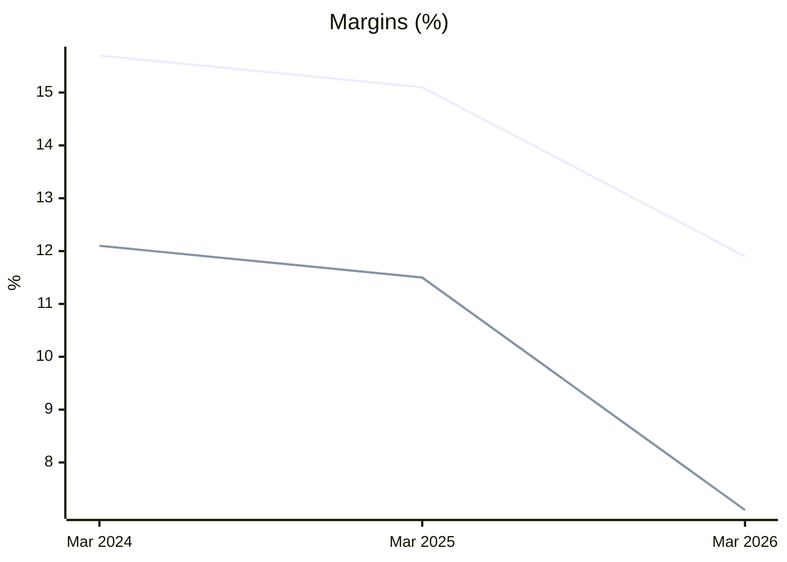
*Series in order: Operating margin, PAT margin.*

**P/E:** 26.9 — close 2026-10-01 ÷ EPS 53.83 (Mar 2026) (price ₹1,450.20 as of 2026-10-01).

**Cash flows (₹ cr):**

| | Mar 2024 | Mar 2025 | Mar 2026 |
|---|---:|---:|---:|
| Cash from operations (₹ cr) | 624 | 203 | 363 |
| Cash from investing (₹ cr) | -158 | -60.0 | -706 |
| Cash from financing (₹ cr) | -204 | -650 | -76.0 |
| Net cash flow (₹ cr) | 262 | -507 | -418 |
| Free cash flow (₹ cr) | 496 | 72.0 | 134 |

*Source: CashFlow/NiftyTotalMarket/SKFINDIA.csv (consolidated, screener.in).*

### 8. The separated business's financial statements

**The business being separated — its own numbers**, entity by entity: its reported statements once it is listed and on file, and the segment numbers the annual reports and presentations carry for it before that.

**SKF India (Industrial) Limited (SKFINDUS) — as reported since listing**

| | Mar 2025 | Mar 2026 |
|---|---:|---:|
| Sales (₹ cr) | 721 | 3,440 |
| Sales growth (%) | — | +377.1% |
| Operating profit (₹ cr) | 161 | 390 |
| Operating profit growth (%) | — | +142.2% |
| Operating margin (%) | 22.3 | 11.3 |
| PAT (₹ cr) | 121 | 218 |
| PAT growth (%) | — | +80.2% |
| PAT margin (%) | 16.8 | 6.3 |
| EPS (₹) | 121,310 | 44.0 |

*Source: ProfitStatement/NiftyTotalMarket/SKFINDUS.csv (consolidated, screener.in); growth and margins computed here.*

**Industrial (Industrial Business / Demerged Undertaking demerged into SKF India (Industrial) Limited w.e.f. October 1, 2025)** · unit ₹ million (MINR) · Operating profit line is EBITDA as labelled in the demerger investor deck (EBITDA% 18/22/17/16 for FY22-FY25); PAT also disclosed (PAT% 13/15/12/11). Revenue is segment net sales to external customers, with exports allocated into the Automotive/Industrial split (Automotive 17,290 + Industrial 31,909 = company FY25 net sales 49,199; EBITDA 3,296 + 5,173 = 8,469; PAT 2,051 + 3,607 = 5,658, all matching the FY24-25 company totals on Presentation Jul 2025 page 5). Separately, AR2026 standalone presents the Industrial business as discontinued operations: profit attributable to shareholders 1,487.9 for Apr-Sep 2025 (part-year, pre-demerger period only) and 3,024.9 for FY2025 (Annual Report 2026 — page 288) — a different basis from the deck's 3,607.

| | FY2022 | FY2023 | FY2024 | FY2025 |
|---|---:|---:|---:|---:|
| Revenue (₹ million (MINR)) | 24,985 | 28,980 | 28,979 | 31,909 |
| Revenue growth (%) | — | +16.0% | -0.0% | +10.1% |
| Operating profit (₹ million (MINR)) | 4,430 | 6,421 | 4,987 | 5,173 |
| Operating profit growth (%) | — | +44.9% | -22.3% | +3.7% |
| Operating margin (%) | 17.7 | 22.2 | 17.2 | 16.2 |
| PAT (₹ million (MINR)) | 3,139 | 4,424 | 3,524 | 3,607 |
| PAT growth (%) | — | +40.9% | -20.3% | +2.4% |

*Sources:* Presentation Jul 2025 — page 8

*Not in the pages read:* No segment assets/liabilities, capex or depreciation; no FY2026 or quarterly figures for the industrial entity itself. 2025-30 capex (₹3,500-4,500 Mn channel; ₹4,500-5,000 Mn new Pune plant) is a plan, not actual.

*Businesses with no numbers in the pages read (3 annual report(s) and 10 presentation(s) on file):* All named variants refer to the single separated Industrial business (SKF India (Industrial) Limited), for which the pages carry FY2022-FY2025 revenue, EBITDA and PAT. No standalone financials of SIIL itself are on these pages.

*Documents on file:* [Annual Report 2026](https://www.bseindia.com/xml-data/corpfiling/AttachHis/eea31abf-a99b-40f8-94e3-19ff8f2e06d2.pdf); [Annual Report 2025](https://www.bseindia.com/xml-data/corpfiling/AttachHis/2ecd50c2-a585-400f-82a3-e93f9f67f010.pdf); [Annual Report 2024](https://www.bseindia.com/xml-data/corpfiling/AttachHis/129a5235-e25c-48a9-a345-f339b16b8513.pdf); [Presentation Nov 2026](https://www.bseindia.com/stockinfo/AnnPdfOpen.aspx?Pname=921a9654-3781-443c-b89a-de70c964ab75.pdf); [Presentation Aug 2026](https://www.bseindia.com/stockinfo/AnnPdfOpen.aspx?Pname=6fc8549d-ea2f-4cdf-a02f-c74f2f40e661.pdf); [Presentation May 2026](https://www.bseindia.com/stockinfo/AnnPdfOpen.aspx?Pname=22999b36-438c-4026-8b66-1302cdca34d0.pdf); [Presentation Aug 2025](https://www.bseindia.com/stockinfo/AnnPdfOpen.aspx?Pname=ea8b3635-5385-4cf7-a7e7-35986deec736.pdf); [Presentation Jul 2025](https://www.bseindia.com/stockinfo/AnnPdfOpen.aspx?Pname=15f86335-6c7e-44e0-ada0-bacaf0463f90.pdf); [Presentation May 2025](https://www.bseindia.com/stockinfo/AnnPdfOpen.aspx?Pname=2af85195-591f-45a4-bcfb-8dbfb10e3dcd.pdf)

### 9. Other financial differences — working capital, margins, returns, debt

| Metric (latest year) | Parent (SKFINDIA) | SKF India (Industrial) Limited (SKFINDUS) |
|---|---:|---:|
| *Basis* | *reported, consolidated* | *its own reported statements* |
| Sales (₹ cr) | 3,763 (Mar 2026) | 3,440 (Mar 2026) |
| Sales growth (%) | -23.5 (Mar 2026) | 377.1 (Mar 2026) |
| Operating margin (%) | 11.9 (Mar 2026) | 11.3 (Mar 2026) |
| Operating profit growth (%) | -39.7 (Mar 2026) | 142.2 (Mar 2026) |
| PAT margin (%) | 7.1 (Mar 2026) | 6.3 (Mar 2026) |
| ROCE % | 24 (Mar 2025) | 30 (Mar 2025) |
| Debtor Days | 70 (Mar 2026) | 88 (Mar 2026) |
| Inventory Days | 52 (Mar 2026) | 84 (Mar 2026) |
| Days Payable | 89 (Mar 2026) | 116 (Mar 2026) |
| Cash Conversion Cycle | 33 (Mar 2026) | 56 (Mar 2026) |
| Working Capital Days | 44 (Mar 2026) | 34 (Mar 2026) |
| Debt / equity (x) | 0 (Mar 2026) | 0 (Mar 2026) |
| Borrowings (₹ cr) | 3 (Mar 2026) | 5 (Mar 2026) |

*Each figure is the latest on file, with its year. Working-capital days and ROCE come from the stored working-capital file; segment figures from the pages cited in part 8. A dash means the documents do not carry it.*

**What stays with the parent — its segments, from the same pages:**

| Remaining segment | Revenue | Operating margin | ROCE | Segment assets / revenue | Unit | Year |
|---|---:|---:|---:|---:|---|---|
| Automotive | 21,296 | 19.1% | — | 0.28x | ₹ million (MINR) | FY2026 |
| Bearings (single reported business segment; geographical segment disclosure — whole company) | 21,296 | — | — | 0.28x | ₹ million (INR in Milli… | FY2026 |

**What the documents themselves say about the differences:**

- **operating margin** — parent / remaining: Automotive segment (globally): net sales SEK 30 billion with an adjusted operating margin of 5.6% for full-year 2023; SKF India Limited post-demerger PBT margin guidance of 11–12% in the near term and EBITDA margin of about 15.3% in FY2025-26; separated business: Industrial segment (globally): net sales SEK 73 billion with an adjusted operating margin of 15.4% for full-year 2023; "as per me, Industrial is a little higher margin business than automotive" “As a reference for the full-year 2023, net sales for the Automotive segment amounted to SEK 30 billion with an adjusted operating margin of 5.6%. The corresponding figures for the Industrial segment were SEK 73 billion and 15.4%, respectively.”
- **return on capital** — parent / remaining: Automotive's return on capital employed was slightly lower, because Automotive is more localized and so carries higher assets and gross block; separated business: Industrial's return on capital employed was higher than Automotive's on the pro forma allocation “Having said that, manufacturing, given that Automotive is more localized, there are going to be higher assets and gross block for Automotive. And that's where you see that the return on capital employed for Automotive was slightly lower than Industrial.”
- **capex and capital intensity** — parent / remaining: SKF Automotive: ₹4,100–5,100 million earmarked by 2030 to expand capacities across EV, two-wheeler and wheel-end bearing segments in Haridwar, Pune and Bangalore; INR 500 crores of investment from '26 to '28, around INR 200 crores in FY '26-'27; separated business: SKF Industrial: planned investments of ₹8,000–9,500 million by 2030, including a new manufacturing facility in Pune by 2028 “SKF Industrial will drive growth across manufacturing, railways, renewables, cement, and heavy engineering sectors, with planned investments of ₹8,000–9,500 million by 2030, including a new manufacturing facility in Pune by 2028.”
- **other** — parent / remaining: Automotive manufacturing: large batch sizes, small and medium-sized bearings, few OEM customers, high automation, more than 90% localized products; separated business: Industrial manufacturing: very wide product portfolio, small/medium/large sizes, flexible manufacturing lines, customised solutions, a combination of manufactured and traded product, around 30% to 35% localized “We are already almost 30% to 35% localized and we will continue to leverage our regionalization and increase our localization in this market to be more competitive.”
- **growth** — parent / remaining: SKF India Limited (Automotive) FY2025-26 sales grew 12.8% to INR 20.3 billion, with OE sales up about 20% while exports and distribution dropped; medium-term growth considered around 6% to 8% CAGR; separated business: SKF Industrial to drive growth across manufacturing, railways, renewables, cement and heavy engineering sectors; Industrial Business was 63% of turnover in FY ended 31st March 2024 “As I said, we had a sales growth of 3% with INR 5.6 billion of the sales.”
- **working capital** — parent / remaining: SKF India Limited: net working capital increased by about 4.6% in Q4 FY26 due to one-off factors and improved 3.7% year-on-year for the full year; cash flow for the year INR 4.05 billion, a cash conversion ratio of about 85%; separated business: not stated “Moving to our net working capital. It increased by about 4.6% due to one-off factors and this same is expected to normalize as we move forward.”
- **debt and leverage** — parent / remaining: "The Applicant Companies states that both the Demerged as well as Resulting Company does not have any Secured Creditors as on February 28, 2025."; 1,126 unsecured creditors aggregating Rs. 612,46,28,040 as on 28 February 2025; positive post-Scheme net worth of INR 956.29 crores; separated business: "There is 1 (One) Unsecured Creditor in the Second Applicant Company, having aggregate value of Rs. 40,000 (Rupees Forty thousand only) as on February 28, 2025." “Both Applicant Companies confirmed they have no secured creditors.”

**The checklist:**

| Item | Status | Evidence |
|---|---|---|
| Why the spin-off | yes | unrelated businesses separated; value unlocking for shareholders — “…merger? Different Market Dynamics Distinct Customer Needs Focused Capital Allocation Faster Decision Making Independent Growth Strategies SKF India (Industrial) Limited Focused on infrastructure and manufacturing, servi” |
| Institutional selling likely (small / different business) | yes | the demerged piece is 15% of ebitda; the businesses are described as distinct |
| Insider ownership and incentives aligned | unknown | no promoter-continuity or option-pricing language found *(next: the date the management options are priced; promoter holding in the resulting company)* |
| A hidden value revealed (pro-forma, leverage, comparables) | unknown | no pro-forma or market data on file *(next: pro-forma P&L of each piece × the peer P/E of its own industry)* |
| Parent before the spin (clean parent, takeover prelude) | no | stage record_date — the pieces trade separately now |
| Timing (first year sells, second year gains) | yes | 405 days since listing/record date; second year since listing — where the notes found the largest gains |
| Management discussing it on the calls | yes | 6 mention(s) in the last 12 months of calls — “…Mandlesha from Anand Rathi Institutional Equities. Mumuksh Mandlesha : Thank you. Sir for the opportunity , firstly, on the cost side. In Q4, how much was the demerger - related impact in the other expenses? And going a” |

**On the calls (last 12 months):**

- *May 2026* (backward) — “…ed has been extracted from consolidated financial stat ements of erstwhile combined entity and may involve some assumptions by the management pertaining to the demerged industrial undertaking. These are prepared in accordance with the Appendix C of Ind AS 103 business combinations by using the financial information maintained…”
- *May 2026* (backward) — “…e cost provision reversal . Now talking about year -on-year change in profit before tax, again, there were certain one -off factors, including costs related to demerger , mix impact as well as the comparability issue, as mentioned in the introductory statement. SKF India Limited May 21, 2026 Page 4 of 16 Now let's move to Slid…”
- *May 2026* (neutral) — “…INR 4.05 billion, which represents a cash conversion ratio of about 85%. Cash flow during the year was also impacted by certain one -off factors related to the demerger and these are expected to smoothen as we move forward, and we look forward for the next fina ncial year. This brings us to the end of financial part of the pre…”
- *May 2026* (forward) — “…profile. What we have seen, of course, is a deterioration on a Y -o-Y basis. Just wanted to get a sense around what would be the one -off costs relating to the demerger in the fourth quarter of FY '26 and FY '26? And with respect to margins, what can be the sustainable margin expectation going ahead into FY '27? Mayank Holani…”
- *May 2026* (backward) — “…be the sustainable margin expectation going ahead into FY '27? Mayank Holani : See if you look at -- in quarter 4 of financial year, there were not too much of demerger -related costs. And if you look at the one -off cos ts, which I mentioned in the Q3 , rather one-off gains in Q3, if we remove them, it was more or less at par…”

<details><summary>The filings</summary>

| Date | Category | Headline | Attachment |
|---|---|---|---|
| 2025-10-15 | Record Date (corporate-actions register) | Record date 2025-10-15 for Demerger — NSE corporate-actions register |  |
| 2025-11-15 | Press Release | In compliance with Regulation 30 of SEBI (Listing Obligations and Disclosure Requirements) Regulations, 2015, please find enclosed herewith the copy of Press Re | [pdf](https://nsearchives.nseindia.com/corporate/SKFINDIA25_15112025132755_NSE.pdf) |
| 2025-11-21 | Demerger | SKF India Limited has informed the Exchange about the communication for the attention of the shareholders of the Company for apportionment of cost of acquisitio | [pdf](https://nsearchives.nseindia.com/corporate/SKFINDIA25_21112025182518_19_SE_Intimation_on_Cost_apportionment_Signed.pdf) |
| 2025-11-28 | Updates | Compliance Letter w.r.t. Observation Letter dated March 28, 2025 issued by National Stock Exchange of India Limited ( NSE ) in the matter of Scheme of Arrangeme | [pdf](https://nsearchives.nseindia.com/corporate/SKFINDIA25_28112025194055_NSE.pdf) |
| 2026-02-06 | Press Release | In compliance with Regulation 30 of SEBI (Listing Obligations and Disclosure Requirements) Regulations, 2015, please find enclosed herewith the copy of Press Re | [pdf](https://nsearchives.nseindia.com/corporate/SKFINDIA25_06022026203743_NSE.pdf) |
| 2026-05-01 | Earnings call May 2026 | …profile. What we have seen, of course, is a deterioration on a Y -o-Y basis. Just wanted to get a sense around what would be the one -off costs relating to the | [pdf](https://www.bseindia.com/stockinfo/AnnPdfOpen.aspx?Pname=fa739605-3c56-43bc-8950-6cc1db2e700e.pdf) |
| 2026-05-01 | Earnings call May 2026 | …r onwards when after separation, it will be more clear because you will have stable performance. Viraj : Sir, just to follow -up on this. See if I look at pre  | [pdf](https://www.bseindia.com/stockinfo/AnnPdfOpen.aspx?Pname=fa739605-3c56-43bc-8950-6cc1db2e700e.pdf) |
| 2026-08-14 | Updates | We are enclosing herewith the Business Presentation made by Mr. Shailesh Kumar Sharma,Managing Director of the Company, during the 65th Annual General Meeting h | [pdf](https://nsearchives.nseindia.com/corporate/SKFINDIA22_14082026200419_NSE.pdf) |
| 2026-08-20 | Updates | We are enclosing herewith Transcript of the 65th Annual General Meeting of the company held on 14th August 2026. | [pdf](https://nsearchives.nseindia.com/corporate/SKFINDIA25_20082026163549_NSE.pdf) |

</details>

## TMPV — Tata Motors Passenger Vehicles Ltd.

### 1. Tata Motors Passenger Vehicles Ltd. — CONFIRMED DEMERGER

**CONFIRMED** (a demerger scheme is on the exchange record) · **LISTED 1–2Y — the second-year window** · score 5.7/10 · spin-off · 23 filing(s) from NSE, NSE-register · first 2025-10-14, latest 2026-11-01

**The separated entities — every one the documents name:**

| Entity | Scheme | Business | Listing | Who runs it |
|---|---|---|---|---|
| **Tata Motors Limited** (earlier TML Commercial Vehicles Limited) | 2024 Composite Scheme of Arrangement amongst Tata Motors Li… | The Commercial Vehicle undertaking: all assets, liabilities and employees relating to the Commercial Vehicle … | listed 2025-11-12 as TMCV (NSE) | Mr. Girish Wagh, Executive Director of Tata Motor… |

**The other parties to the scheme(s)** — not separated entities: Tata Motors Finance Limited — merged in — no shares for the parent's holders

**What is being separated, as the documents put it:** The Commercial Vehicles business of Tata Motors Limited, demerged into a separate listed entity — class `regulatory_strategic`.

### 2. Stages and dates

> **Listing:** LISTED — Tata Motors Limited (TMCV) since 2025-11-12 (NSE equity list); record date 2025-10-14

| Date | Event | Source |
|---|---|---|
| 2024-03-04 | Other — Tata Motors Limited | as stated: First intimation to the exchanges of the proposed demerger, letter sc… |
| 2024-08-01 | Board approval — Tata Motors Limited, TML Commercial Vehicles Limited and Tata Motors Passenger Vehicles Limited | as stated: Outcome of Board Meeting, letter sc no. 18374 dated August 1, 2024 ("… |
| 2024-08-05 | Stage reached: **nclt sanction** | [Scheme of Arrangement](https://nsearchives.nseindia.in/corporate/TATAMOTORS_05082024195129_NSEBSELETTER.pdf) |
| 2024-09-01 | Stage reached: **effective** | [Scheme of Arrangement](https://nsearchives.nseindia.in/corporate/TATAMOTORS_01092024131630_Reg30IntimationofEffectivenessoftheScheme01092024.pdf) |
| 2025-02-24 | Exchange no-objection — BSE Limited observation letter to Tata Motors Limited | as stated: NCLT Order dated August 25, 2025 (filed September 26, 2025) and Scrut… |
| 2025-02-25 | Exchange no-objection — National Stock Exchange of India Limited observation letter to Tata Motors Limited | as stated: NCLT Order dated August 25, 2025 (filed September 26, 2025) and Scrut… |
| 2025-03-25 | Other — NCLT, Mumbai Bench order in C.A.(CAA) No. 61/MB/2025 directing the meeting of equity shareholders of TML and dispensing with meetings of equity shareholders of TMLCV and TMPV and of secured and unsecured creditors of the second and third applicant companies | as stated: Notice of Court Convened General Meeting filed April 4, 2025 (sc no. … |
| 2025-05-06 | Shareholders / creditors meeting — Meeting of the Equity Shareholders of Tata Motors Limited (held 3:00 p.m. IST via VC/OAVM; resolution passed with 99.9995% of votes polled in favour) | as stated: Proceedings and Voting Results filed May 6, 2025 (sc no. 18656) |
| 2025-07-01 | Appointed date — Composite Scheme of Arrangement (opening of business hours of July 01, 2025) | as stated: Effectiveness intimation sc no. 18764 dated October 1, 2025; NCLT Ord… |
| 2025-08-25 | NCLT order — NCLT, Mumbai Bench-I, CP(CAA)/139/MB/2025 sanctioning the Composite Scheme | as stated: Intimation dated August 25, 2025 (sc no. 18733) and certified true co… |
| 2025-09-10 | Other — NCLT Rectification Order (COMP.APPL/269(MB)2025) correcting the August 25, 2025 order, including replacing the share entitlement para with the 1:1 TMLCV ratio | as stated: Certified true copy of Orders filed September 26, 2025 (sc no. 18755) |
| 2025-09-25 | Other — Certified true copies of both NCLT Orders received by the Company | as stated: Letter sc no. 18755 dated September 26, 2025 |
| 2025-09-26 | Other — Boards of the respective companies resolved to make the Scheme effective on October 1, 2025, and identified the NCDs to be transferred to TMLCV | as stated: Letter sc no. 18755 dated September 26, 2025 |
| 2025-10-01 | Effective date — Composite Scheme effective on filing of certified copies of the Orders in e-Form INC-28 with the Registrar of Companies, Mumbai, Maharashtra; TMPV stands amalgamated with the Company and ceases to exist | as stated: Scheme of Arrangement intimation sc no. 18764 dated October 1, 2025 |
| 2025-10-10 | Record date — Record Date for determining eligible Debenture Holders of identified NCDs (₹2,300 crore) to be transferred from the Demerged Company to the Resulting Company | as stated: Record Date intimation sc no. 18765 dated October 1, 2025, Annexure A |
| 2025-10-13 | Other — Change of name of the Company from Tata Motors Limited to Tata Motors Passenger Vehicles Limited, w.e.f. October 13, 2025 | as stated: Letter sc no. 18796 dated October 13, 2025, referred to in letter sc … |
| 2025-10-14 | **Record date** | NSE corporate-actions register |
| 2025-10-14 | Stage reached: **record date** | Record Date (corporate-actions register) |
| 2025-10-14 | Record date — Record Date (Tuesday, October 14, 2025) for shareholders of Tata Motors Limited entitled to 1 share of TMLCV for every 1 share held | as stated: Record Date intimation sc no. 18765 dated October 1, 2025 and shareho… |
| 2025-10-15 | Allotment — TMLCV allotted 3,68,23,31,373 fully paid equity shares of ₹2 each to equity shareholders of TML in the ratio 1:1; entire pre-Scheme paid-up capital of 5,00,000 shares cancelled; TMLCV ceased to be a wholly owned subsidiary | as stated: General Updates letter sc no. 18799 dated October 15, 2025 |
| 2025-10-29 | Other — Change of name of TML Commercial Vehicles Limited to Tata Motors Limited (fresh Certificate of Incorporation dated October 29, 2025) | as stated: General Updates letter sc no. 18808 dated October 30, 2025 and TMCV p… |
| 2025-11-12 | **Tata Motors Limited** listed (TMCV) | NSE equity list |
| 2025-11-12 | Listing and trading — Tata Motors Limited (formerly TML Commercial Vehicles Limited) — BSE and NSE approval for listing and trading of its equity shares effective November 12, 2025 | as stated: General Updates letter sc no. 18818 dated November 10, 2025 |
| 2025-11-28 | Stage reached: **meetings** | [Shareholders meeting](https://nsearchives.nseindia.com/corporate/TATAMOTORSSJS_28112025190050_Lettertoexchangesforpostalballotfinal.pdf) |

**The stages, as filed:** nclt sanction (2024-08-05) → effective (2024-09-01) → record date (2025-10-14) → meetings (2025-11-28)

**Stated in the filings:** demerged undertaking: , undertaking; record date 2025-10-14.

**When it lists, in the documents' words:** On November 10, 2025 the Company said TMCV "has received approval from BSE Limited and National Stock Exchange of India Limited for listing and trading of its equity shares, effective November 12, 2025"; on November 1, 2025 it had said "The process for listing is currently underway."

### 3. Size of the separated business beside the parent — is institutional selling likely?

**Reading: LESS LIKELY on size alone — the piece is the larger part of the business.**

| Entity | Stated turnover | Stated share of the whole | Segment revenue share | Market cap (₹ cr) | Share of combined market cap | Index member |
|---|---|---:|---:|---:|---:|---|
| Tata Motors Limited | "total income relating to Commercial Vehicles Business was … | 99.0% | 20.5% (FY2025) | 159,667 | 60.1% | yes |

*Stated figures are the documents' own (a turnover share, or the cost-of-acquisition split the company publishes for tax, which reflects relative value); the segment share is this business's revenue over the parent's sales, and the market-cap share is the entity's value over the entity plus the parent (parent ₹105,853 cr, NSE bhavcopy of 2026-11-13), both computed here.*

**In the documents' words:** “As per audited standalone financial statements as at March 31, 2024, Tata Motors Limited's ("the Company"/ "TML") total income relating to Commercial Vehicles Business was ₹ 73,116.64 crore, representing ~99% of the total income for FY 2023-24.”

**The judge's read of selling pressure:** likely — 1:1 shares pushed to all 64,60,243-shareholder base of a large parent; commercial vehicles is a different business from cars/SUVs.

### 4. Insider ownership — share swap, promoters' holding, management incentives

**Share swap / entitlement, entity by entity:**

- **Tata Motors Limited:** "1 (One) share of TMLCV (face value of INR 2/- each fully paid up), for every 1 (One) share of the Company (face value of INR 2/- each fully paid up) of the same class of shares outstanding and as held by such shareholder in the Company on the "Record Date"." Allotment of 3,68,23,31,373 fully paid equity shares of face value ₹2/- each in the ratio of 1:1

**Promoters' holding, from the shareholding pattern:**

| Company | Promoters | FIIs | DIIs | Public | Quarter |
|---|---:|---:|---:|---:|---|
| Tata Motors Passenger Vehicles Ltd. (TMPV) | 42.5% | 15.32% | 17.93% | 24.2% | Sep 2026 |
| Tata Motors Limited (TMCV) | 42.51% | 19.02% | 18.61% | 19.8% | Sep 2026 |

*Source: screener.in shareholding pattern, stored under `ShareholdingPattern/NiftyTotalMarket/`. In a mirror demerger each shareholder holds the same proportion of the new company as of the parent on the record date.*

- **Promoters in the parent, per the documents:** not stated as a percentage for the parent; the documents state only "TML: No change." in shareholding pattern pursuant to the Scheme, and "There will be no change in the shareholding pattern of TML pursuant to the Scheme coming into effect."
- **What the promoters will hold in the separated entity:** 2024 Composite Scheme (CV demerger): "Upon the effectiveness of the Scheme, the shareholding of TMLCV will mirror the shareholding of TML." and "The effectiveness of the Scheme would result in creation of two listed companies, forming part of the Tata Group, with identical shareholding (including common promoters) with the Resulting Company housing the Commercial Vehicles Business and the Amalgamated Company housing the Passenger Vehicles Business." TMLCV shareholding (details as on July 26, 2024): Promoters Pre-Scheme 100.00%, Post-Scheme (Indicative) 41.22%; Public Pre-Scheme nil, Post-Scheme 58.78% (*Considering Ordinary and 'A' Ordinary shares). Amalgamation of TMPV into TML: "There will be no change in the shareholding pattern of TML pursuant to the Scheme coming into effect." 2024 TMFL–Tata Capital scheme: "TCL will issue its equity shares to the shareholders of TMFL resulting in TML effectively holding a 4.7% stake in the merged entity." 2024 'A' Ordinary Shares scheme: promoter holding after is not stated.
- **What a public shareholder receives:** 2024 Composite Scheme (CV demerger): "each shareholder of Demerged Company whose name is recorded in the register of members and records of the depository as a shareholder of the Demerged Company as on the Record Date (ie. October 14, 2025) shall be issued and allotted 1 (one) share of the Resulting Company (face value of INR 2/- each fully paid up), for every 1 (one) share of the Demerged Company (face value of INR 2/- each fully paid up) of the same class of shares outstanding and as held by such shareholder in the Demerged Company, without any further application, act or deed ('Share Entitlement Ratio')." Shareholders also continue to hold their existing shares in TML (renamed Tata Motors Passenger Vehicles Limited), which "shall continue to be a listed entity". 2024 'A' Ordinary Shares scheme: "As per the Scheme, the Company shall issue 7 (seven) fully paid up New Ordinary Shares of the face value of ₹ 2 each for every 10 (ten) 'A' Ordinary Shares of the face value of ₹2 each, as consideration to the 'A' Ordinary Shareholders of the Company as on the Record Date ('Consideration')." 2024 TMFL–Tata Capital scheme: nothing is received by TML's own public shareholders; "the shareholders of TMFL shall receive 37 equity shares of Rs.10/- each in TCL for every 100 equity shares of Rs. 100 each held by them in TMFL."
- **Management incentives:** Treatment of existing grants under the Composite Scheme is not stated. Resolutions passed at the 79th AGM held on June 24, 2024 (both Special Resolutions): "Tata Motors Limited Share-based Long Term Incentive Scheme 2024 and grant of Performance Share Units to the Eligible Employees under the Scheme" and "Extending the Tata Motors Share-based Long Term Incentive Scheme 2024 to Eligible Employees of Subsidiary companies of the Company". No new plan in the resulting company, no exercise price or pricing date, and no management or insider shareholding are stated. Related manpower action at JLR: "About GBP 40 million of that was associated with a voluntary redundancy program as we resized our cost base" and "We are taking c.500 employees out of our admin base".
- **Insider actions around the separation:** not stated in the documents on file.
- **Insiders, per the checklist read:** Promoter and promoter group held 1,565,402,703 of 3,682,582,902 shares (~42.5%), receiving 1:1 shares in the Resulting Company. MD Shailesh Chandra holds 1,50,029 shares plus PSUs under Scheme 2024, subject to Scheme Clause 9. · *option pricing date:* not stated

### 5. Why the demerger — point by point

The business being separated is the Commercial Vehicles (CV) business of the erstwhile Tata Motors Limited, carved out under a Composite Scheme of Arrangement into TML Commercial Vehicles Limited (since renamed Tata Motors Limited), while the listed parent was renamed Tata Motors Passenger Vehicles Limited (TMPV) and simultaneously absorbed its wholly-owned subsidiary Tata Motors Passenger Vehicles Limited by amalgamation — the Scheme's stated purpose there being 'consolidating the Passenger Vehicles Business with TML'. The net effect, as the Scheme describes it, is that 'the Commercial Vehicle and Passenger Vehicle businesses of the Company are housed in two separate entities' from October 1, 2025, leaving TMPV with India PV, EV (Tata Passenger Electric Mobility) and JLR, plus Tata Technologies and Tata Motors Holdings Singapore in 'others'; segment reporting was recast accordingly and prior-period balance sheets declared non-comparable. Critically, across all six transcripts management never articulates a strategic reason for the split — no dis-synergy, focus, capital-allocation or value-unlock argument is given; the demerger appears only as a corporate action with dates, approvals, accounting and costs. The economics disclosed are: CV was valued at about Rs 94,000 Cr by third-party agencies against a transferred book value of about Rs 11,000 Cr, producing a Rs 83,000 Cr accounting profit on disposal of the CV undertaking that is 'only a notional gain' because of an equal contra deemed-dividend entry, so there is 'absolutely no impact on either distributable reserves or on our net worth'. Shareholders got one CV share for every one share held (1:1), the split is Section 2(19AA)-compliant so it is not a transfer in shareholders' hands, and cost of acquisition was apportioned 31.15% to CV and 68.85% to TMPV. Costs cited were a Rs 400 Cr stamp duty provision in Q3 FY26 (within Rs 1,600 Cr of exceptionals) rolling into the Rs 4,100 Cr of FY26 exceptionals alongside cyber and labour-code charges. Governance was split too — separate boards and KMP, Shailesh Chandra as MD & CEO of TMPV, P B Balaji moving to CEO of JLR — and capital structures now report separately (India PV net cash ~Rs 5,000 Cr at Q3 FY26 and ~Rs 7,000 Cr at year-end versus JLR net debt of ~Rs 33,000–39,000 Cr). No investor, lender or partner is named as having asked for the separation; the only constituency cited is shareholders, who approved it with 'overwhelming votes in our favor', plus SEBI/stock exchange NOCs and NCLT sanction.

**Point by point, with the source:**

1. The demerger is reported purely as a process milestone: regulatory no-objections from the exchanges and SEBI awaited, operational separation work advanced, appointed date July 1 and effective date around October 1, 2025. “We are expecting the NOC from the Stock Exchange and SEBI any time now, all filed and done.” — *[Feb 2025](https://www.bseindia.com/stockinfo/AnnPdfOpen.aspx?Pname=28345af3-7271-4146-8cf3-8da0f9c73222.pdf)*
2. Shareholder approval is confirmed as emphatic and the timetable reaffirmed; the only related substantive disclosure is that the Tata Capital stake goes with the CV business. “The demerger update: we had overwhelming votes in our favor and therefore we are on track for an appointed date of July 1st and an effective date of October 1st 2025.” — *[Jun 2025](https://www.bseindia.com/stockinfo/AnnPdfOpen.aspx?Pname=80350d5e-9578-469f-bf9f-31610098f897.pdf)*
3. The NCLT final hearing concluded on the day of the call with judgment reserved, and management still guided to an October 1 effective date, expecting completion within the quarter. “We had the NCLT final hearing today and it has been concluded and the judgment is reserved.” — *[Aug 2025](https://www.bseindia.com/stockinfo/AnnPdfOpen.aspx?Pname=2a91a004-4cbd-440e-93d3-2ca8967ff37b.pdf)*
4. First results as the post-demerger listed entity: CV is out of segment reporting, the automotive segment is now JLR plus Tata Passenger Vehicles, others is mainly Tata Technologies and Tata Motors Holdings Singapore, and prior-period balance sheets still include CV so are not comparable. “It's a pleasure speaking to you as we report our first quarterly earnings as a listed entity.” — *[Nov 2025](https://www.bseindia.com/stockinfo/AnnPdfOpen.aspx?Pname=e6684a03-5a4d-4c7a-8da0-d5b2c52ec7d1.pdf)*
5. The accounting: CV was independently valued at about Rs 94,000 Cr versus about Rs 11,000 Cr of net assets transferred, giving a Rs 83,000 Cr disposal profit that is purely notional because of an offsetting Rs 83,000 Cr deemed dividend. “As part of demerger accounting entries, we have recorded a profit of ~Rs. 83,000 Cr on disposal of the CV undertaking, which is essentially the fair value of the CV assets, less the book value of net assets transferred.” — *[Nov 2025](https://www.bseindia.com/stockinfo/AnnPdfOpen.aspx?Pname=e6684a03-5a4d-4c7a-8da0-d5b2c52ec7d1.pdf)*
6. Capital structures are now shown standalone — auto net debt moved from net cash to ~Rs 20,000 Cr (all at JLR) while India PV is net cash, which is the one place management links the standalone balance sheet to funding its product cycle. “Domestic India business is net cash which gives a lot of flex to fund the rich product investment cycle that will be coming through in the years.” — *[Nov 2025](https://www.bseindia.com/stockinfo/AnnPdfOpen.aspx?Pname=e6684a03-5a4d-4c7a-8da0-d5b2c52ec7d1.pdf)*
7. The demerger is now only a reporting and cost item: CV permanently out of segments, and a Rs 400 Cr stamp duty provision taken within Rs 1,600 Cr of quarterly exceptionals alongside Rs 800 Cr of cyber costs and a Rs 400 Cr wage-bill charge. “I would like to call out that this excludes exceptional for Rs. 1,600 Cr: Rs. 800 Cr at JLR - additional impact because of the cyber incident, Rs. 400 Cr one-time Wage bill impact for India business, and another Rs.400 Cr provision we have taken for the stamp duty impact.” — *[Feb 2026](https://www.bseindia.com/stockinfo/AnnPdfOpen.aspx?Pname=7907e958-7953-4b49-b831-aab03d6e2746.pdf)*
8. FY26 PBT of Rs 2,500 Cr is stated before Rs 4,100 Cr of exceptionals that include the demerger stamp duty, and the two entities' dividends are presented together as evidence shareholders are better off post-split. “So this actually represents a total dividend of Rs. 7 in the year when the demerger was undertaken and an increase over the Rs. 6 that we have paid for the last two years.” — *[Jun 2026](https://www.bseindia.com/stockinfo/AnnPdfOpen.aspx?Pname=b4d386d7-de53-4409-8e90-187e08cb4a91.pdf)*
9. The Scheme has two legs: the CV undertaking demerges out of Tata Motors into TML Commercial Vehicles Limited on a going-concern basis, and the PV subsidiary amalgamates into the parent so that the passenger business is consolidated in one listed company, with the subsidiary dissolved. “Amalgamation of TMLPV with TML with an objective of consolidating the Passenger Vehicles Business with TML and consequent dissolution of TMLPV without being wound up.” — *Scheme*
10. Shareholders received 1 CV share for every 1 share held, the demerger is Section 2(19AA)-compliant so not a transfer in their hands, and cost of acquisition splits 31.15% to the new Tata Motors (CV) and 68.85% to TMPV; separate boards and KMP were constituted for both entities, with CV shares listed from November 12, 2025. “the Commercial Vehicle and Passenger Vehicle businesses of the Company are housed in two separate entities” — *Scheme*

**How it evolved:** In the Feb 2025 (Jan 29, 2025) call the demerger appears only as a corporate-action status item — filings done, NOC from the exchanges and SEBI awaited, appointed date July 1 and effective date around October 1, 2025 — and by the Jun 2025 (May 13, 2025) call management reports 'overwhelming votes' from shareholders and reaffirms those dates. In the Aug 2025 (Aug 8, 2025) call the NCLT final hearing had concluded that same day with judgment reserved, with the October 1 effective date still 'on plan'; the Nov 2025 (Nov 14, 2025) call is the first reported as a post-demerger listed entity, dominated by mechanics: segment recast, non-comparable balance sheets, and the Rs 83,000 Cr notional disposal gain against the Rs 94,000 Cr valuation and Rs 11,000 Cr book value. Thereafter it shrinks to a cost line — a Rs 400 Cr stamp duty provision in Feb 2026 (Feb 5, 2026) and stamp duty inside Rs 4,100 Cr of FY26 exceptionals in Jun 2026 (May 14, 2026), where the only forward-looking framing offered is that TMPV's Rs 3 dividend plus TMLCV's Rs 4 equals Rs 7 against Rs 6 paid by erstwhile Tata Motors. At no point in that sequence does the stated rationale evolve, because none is ever stated.

**What management expects from it:** Little quantified. Post-separation TMPV holds PV, EV and JLR only; segments recast to automotive plus others. India PV stays net cash (~Rs 5,000–7,000 Cr), giving 'flex' to fund its product cycle toward double-digit EBITDA; CV lists separately with its own board and dividend. Combined dividend rose to Rs 7 from Rs 6; net worth unchanged.

*Not explained on the calls:* Calls never state the strategic rationale, value-unlock or synergy numbers, who asked for the split, total transaction costs beyond stamp duty, or post-demerger capital-allocation, margin and valuation targets.

- *Stated reason, in one line:* Scheme housed CV and PV businesses in two separate entities; stated objective of the amalgamation limb was "consolidating the Passenger Vehicles Business with TML". No further rationale stated.
- *What it reveals:* Cost apportionment implies 68.85% of value in TMPV versus 31.15% in CV. Parent keeps JLR plus India PV/EV: FY26 consolidated net debt Rs 30,000 Cr sits almost entirely at JLR (Rs 33,000 Cr) while India PV is cash positive Rs 7,000 Cr.
- *Parent or spin:* parent · *Read next:* Tata Motors Limited (formerly TML Commercial Vehicles) standalone results and its Rs 4 dividend — the spin's own profitability.
- *In their words:* “In this regard, we wish to inform that TMCV has intimated the Company today that it has received approval from BSE Limited and National Stock Exchange of India Limited for listing and trading of its equity shares, effective November 12, 2025.”

### 6. On the calls, verbatim

9 call(s), oldest first: **0 question-and-answer exchange(s)** given in full — the question and every answer to it, nothing trimmed — and 14 passage(s) from management's prepared remarks (the complete sentences about it; the whole remarks are in the linked transcript). Text is as the transcript prints it.

| Call | Q&A exchanges | Prepared-remarks passages | Transcript |
|---|---:|---:|---|
| May 2024 | 0 | 2 | — |
| Aug 2024 | 0 | 2 | [transcript](https://www.tatamotors.com/wp-content/uploads/2024/08/TML-Q1-FY25-Earnings-Call-Transcript.pdf) |
| Aug 2024 | 0 | 3 | [transcript](https://www.tatamotors.com/wp-content/uploads/2024/08/TML-Q1-FY25-Earnings-Call-Transcript.pdf) |
| Feb 2025 | 0 | 1 | [transcript](https://www.bseindia.com/stockinfo/AnnPdfOpen.aspx?Pname=28345af3-7271-4146-8cf3-8da0f9c73222.pdf) |
| Jun 2025 | 0 | 2 | [transcript](https://www.bseindia.com/stockinfo/AnnPdfOpen.aspx?Pname=80350d5e-9578-469f-bf9f-31610098f897.pdf) |
| Aug 2025 | 0 | 1 | [transcript](https://www.bseindia.com/stockinfo/AnnPdfOpen.aspx?Pname=2a91a004-4cbd-440e-93d3-2ca8967ff37b.pdf) |
| Nov 2025 | 0 | 1 | [transcript](https://www.bseindia.com/stockinfo/AnnPdfOpen.aspx?Pname=e6684a03-5a4d-4c7a-8da0-d5b2c52ec7d1.pdf) |
| Feb 2026 | 0 | 1 | [transcript](https://www.bseindia.com/stockinfo/AnnPdfOpen.aspx?Pname=7907e958-7953-4b49-b831-aab03d6e2746.pdf) |
| Jun 2026 | 0 | 1 | [transcript](https://www.bseindia.com/stockinfo/AnnPdfOpen.aspx?Pname=b4d386d7-de53-4409-8e90-187e08cb4a91.pdf) |

**The full verbatim text of every exchange is in [companies/TMPV.md](companies/TMPV.md#6-on-the-calls-verbatim).**

### 7. The parent's financial statements

**The parent, last three fiscal years (consolidated)**

| | Mar 2024 | Mar 2025 | Mar 2026 |
|---|---:|---:|---:|
| Sales (₹ cr) | 434,016 | 366,094 | 335,582 |
| Sales growth (%) | +25.5% | -15.6% | -8.3% |
| Operating profit (₹ cr) | 57,809 | 47,993 | 18,719 |
| Operating profit growth (%) | +81.7% | -17.0% | -61.0% |
| Operating margin (%) | 13.3 | 13.1 | 5.6 |
| PAT (₹ cr) | 31,807 | 28,149 | 82,645 |
| PAT growth (%) | +1082.4% | -11.5% | +193.6% |
| PAT margin (%) | 7.3 | 7.7 | 24.6 |
| EPS (₹) | 94.5 | 75.6 | 224 |

*Source: ProfitStatement/NiftyTotalMarket/TMPV.csv (consolidated, screener.in); growth and margins computed here.*

```mermaid
xychart-beta
    title "Sales, operating profit and PAT (₹ cr)"
    x-axis ["Mar 2024", "Mar 2025", "Mar 2026"]
    y-axis "₹ crore"
    bar [434016, 366094, 335582]
    bar [57809, 47993, 18719]
    bar [31807, 28149, 82645]
```
*Series in order: Sales, Operating profit, PAT.*

```mermaid
xychart-beta
    title "Margins (%)"
    x-axis ["Mar 2024", "Mar 2025", "Mar 2026"]
    y-axis "%"
    line [13.3, 13.1, 5.6]
    line [7.3, 7.7, 24.6]
```
*Series in order: Operating margin, PAT margin.*

**P/E:** 1.45 — live market file (screener.in), trailing (price ₹340.00 as of 2026-08-02).

**Cash flows (₹ cr):**

| | Mar 2024 | Mar 2025 | Mar 2026 |
|---|---:|---:|---:|
| Cash from operations (₹ cr) | 67,915 | 63,102 | 13,041 |
| Cash from investing (₹ cr) | -22,781 | -49,982 | -23,166 |
| Cash from financing (₹ cr) | -37,006 | -18,786 | -1,344 |
| Net cash flow (₹ cr) | 8,128 | -5,666 | -11,469 |
| Free cash flow (₹ cr) | 36,732 | 26,034 | -23,195 |

*Source: CashFlow/NiftyTotalMarket/TMPV.csv (consolidated, screener.in).*

### 8. The separated business's financial statements

**The business being separated — its own numbers**, entity by entity: its reported statements once it is listed and on file, and the segment numbers the annual reports and presentations carry for it before that.

**Tata Motors Limited (TMCV) — as reported since listing**

| | Mar 2026 |
|---|---:|
| Sales (₹ cr) | 58,217 |
| Sales growth (%) | — |
| Operating profit (₹ cr) | 6,172 |
| Operating profit growth (%) | — |
| Operating margin (%) | 10.6 |
| PAT (₹ cr) | 3,195 |
| PAT growth (%) | — |
| PAT margin (%) | 5.5 |
| EPS (₹) | 8.2 |

*Source: ProfitStatement/NiftyTotalMarket/TMCV.csv (consolidated, screener.in); growth and margins computed here.*

**Commercial Vehicles (segment: "Tata Commercial Vehicles" / "Commercial vehicle" under Tata and other brand vehicles) → TML Commercial Vehicles (renamed Tata Motors Limited, the Resulting Company)** · unit ₹ crore · Revenue = total segment revenue (external + inter/intra-segment); external revenue separately FY24 76,961.19, FY25 74,049. Operating profit = segment result = Earnings before other income (excl. incentives), finance costs, FX gain/(loss), exceptional items and tax (i.e. segment EBIT). No segment PAT disclosed. Capex and depreciation are segment-level.

| | FY2023 | FY2024 | FY2025 | FY2026 |
|---|---:|---:|---:|---:|
| Revenue (₹ crore) | 70,816 | 78,791 | 75,055 | — |
| Revenue growth (%) | — | +11.3% | -4.7% | — |
| Operating profit (₹ crore) | 3,693 | 6,483 | 6,814 | — |
| Operating profit growth (%) | — | +75.5% | +5.1% | — |
| Operating margin (%) | 5.2 | 8.2 | 9.1 | — |
| PAT (₹ crore) | — | — | — | — |
| PAT growth (%) | — | — | — | — |
| Segment assets (₹ crore) | 30,251 | 32,478 | 33,379 | — |
| Segment liabilities (₹ crore) | 22,543 | 24,449 | 25,147 | — |
| Capital employed (₹ crore) | 7,708 | 8,028 | 8,232 | — |
| Return on capital employed (%) | 47.9 | 80.8 | 82.8 | — |
| Segment assets / revenue (x) | 0.4 | 0.4 | 0.4 | — |
| Capex (₹ crore) | 2,202 | 2,052 | 2,103 | — |

*Sources:* Annual Report 2024 — page 373; Annual Report 2024 — page 372; Annual Report 2025 — page 408; Annual Report 2026 — page 422

*Not in the pages read:* No PAT any year. FY26: demerger effective Oct 1, 2025 (segments from Jul 1, 2025 exclude CV); pages carry only discontinued-operations PBT ₹1,658 crore (AR2026 p422). No CV quarterly data in TMPV presentations.

**Vehicle Financing → Vehicle Financing business (Tata Motors Finance Ltd., transferred to Tata Capital Ltd. from April 1, 2024 — entity not among those named above)** · unit ₹ crore · Revenue = total segment revenue. Operating profit shown as 'Earnings before other income, finance costs, FX, exceptional items and tax'; segment result after finance costs on borrowings sourced by the segment was FY24 (897.35)/(205) and FY25 (270). No PAT.

| | FY2023 | FY2024 | FY2025 | FY2026 |
|---|---:|---:|---:|---:|
| Revenue (₹ crore) | 4,595 | 4,099 | 51.0 | — |
| Revenue growth (%) | — | -10.8% | -98.8% | — |
| Operating profit (₹ crore) | 1,499 | 1,821 | -2.0 | — |
| Operating profit growth (%) | — | +21.4% | -100.1% | — |
| Operating margin (%) | 32.6 | 44.4 | -3.9 | — |
| PAT (₹ crore) | — | — | — | — |
| PAT growth (%) | — | — | — | — |
| Segment assets (₹ crore) | 35,651 | 33,288 | 8,172 | — |
| Segment liabilities (₹ crore) | 1,241 | 1,543 | 22.0 | — |
| Capital employed (₹ crore) | 34,410 | 31,745 | 8,150 | — |
| Return on capital employed (%) | 4.4 | 5.7 | -0.0 | — |
| Segment assets / revenue (x) | 7.8 | 8.1 | 160 | — |
| Capex (₹ crore) | 36.3 | 112 | 58.0 | — |

*Sources:* Annual Report 2024 — page 373; Annual Report 2024 — page 372; Annual Report 2025 — page 408; Annual Report 2026 — page 421

*Not in the pages read:* No PAT. FY26 figures absent — segment folded into Corporate/Unallocable and re-presented (AR2026 p421). FY25 re-presentation in AR2024 vs AR2025 differs (FY24 revenue 4,099 vs 141 re-presented).

*Businesses with no numbers in the pages read (3 annual report(s) and 11 presentation(s) on file):* All named entities map to the single separated Commercial Vehicles undertaking, for which numbers exist FY2023–FY2025; no separate standalone financials of TML Commercial Vehicles Ltd. as a legal entity appear on these pages.

*Documents on file:* [Annual Report 2026](https://www.bseindia.com/xml-data/corpfiling/AttachHis/b37e4ca4-826d-4b6c-b250-fcdf423e6bc4.pdf); [Annual Report 2025](https://www.bseindia.com/xml-data/corpfiling/AttachHis/18f91098-8691-409d-b771-808c48964a4f.pdf); [Annual Report 2024](https://www.bseindia.com/xml-data/corpfiling/AttachHis/0913b647-b205-4a3c-ad9b-8c493f97f972.pdf); [Presentation Nov 2026](https://www.bseindia.com/stockinfo/AnnPdfOpen.aspx?Pname=ad61cc44-2d46-43ca-b854-0a29ca81fda4.pdf); [Presentation Aug 2026](https://www.bseindia.com/stockinfo/AnnPdfOpen.aspx?Pname=0a68c514-96c1-4dc5-a628-3eda55a7b541.pdf); [Presentation Jun 2026](https://www.bseindia.com/stockinfo/AnnPdfOpen.aspx?Pname=10059fad-ae2a-4feb-acc2-09659bc3eb1f.pdf); [Presentation May 2026](https://www.bseindia.com/stockinfo/AnnPdfOpen.aspx?Pname=ee5addb0-24c8-45de-9071-c06bf3ba6daa.pdf); [Presentation Feb 2026](https://www.bseindia.com/stockinfo/AnnPdfOpen.aspx?Pname=dd254e14-5794-42bb-8d6f-1caf2bb991e9.pdf); [Presentation Nov 2025](https://www.bseindia.com/stockinfo/AnnPdfOpen.aspx?Pname=66609a3b-bf4c-44fb-936b-35980e120c69.pdf)

### 9. Other financial differences — working capital, margins, returns, debt

| Metric (latest year) | Parent (TMPV) | Tata Motors Limited (TMCV) |
|---|---:|---:|
| *Basis* | *reported, consolidated* | *its own reported statements* |
| Sales (₹ cr) | 335,582 (Mar 2026) | 58,217 (Mar 2026) |
| Sales growth (%) | -8.3 (Mar 2026) | — |
| Operating margin (%) | 5.6 (Mar 2026) | 10.6 (Mar 2026) |
| Operating profit growth (%) | -61 (Mar 2026) | — |
| PAT margin (%) | 24.6 (Mar 2026) | 5.5 (Mar 2026) |
| ROCE % | 3 (Mar 2026) | 36 (Mar 2025) |
| Debtor Days | 14 (Mar 2026) | 12 (Mar 2026) |
| Inventory Days | 85 (Mar 2026) | 35 (Mar 2026) |
| Days Payable | 158 (Mar 2026) | 101 (Mar 2026) |
| Cash Conversion Cycle | -59 (Mar 2026) | -54 (Mar 2026) |
| Working Capital Days | -81 (Mar 2026) | -89 (Mar 2026) |
| Debt / equity (x) | 0.7 (Mar 2026) | 0.4 (Mar 2026) |
| Borrowings (₹ cr) | 79,109 (Mar 2026) | 5,615 (Mar 2026) |

*Each figure is the latest on file, with its year. Working-capital days and ROCE come from the stored working-capital file; segment figures from the pages cited in part 8. A dash means the documents do not carry it.*

**What stays with the parent — its segments, from the same pages:**

| Remaining segment | Revenue | Operating margin | ROCE | Segment assets / revenue | Unit | Year |
|---|---:|---:|---:|---:|---|---|
| Tata Passenger Vehicles (segment: "Passenger vehicle" under Tata and other brand vehicles) | 58,465 | 1.4% | 9.1% | 0.47x | ₹ crore | FY2026 |
| Electric Vehicles (disclosed as amounts included in Passenger vehicles) | 23,596 | 1.7% | — | — | ₹ crore | FY2026 |
| Jaguar Land Rover | 273,303 | 1.0% | 2.5% | 0.99x | ₹ crore | FY2026 |
| Others (IT services; insurance broking up to FY25) | 5,513 | 13.1% | 22.7% | 1.28x | ₹ crore | FY2026 |

**What the documents themselves say about the differences:**

- **other** — parent / remaining: Passenger Vehicles Business retained in the listed entity; Tata Motors Passenger Vehicles Limited (the amalgamating wholly owned subsidiary carrying the PV business) had total income of ₹51,206.32 crore for the year ended March 31, 2024; separated business: Commercial Vehicles Business demerged into TMLCV with total income of ₹73,116.64 crore, ~99% of TML's standalone total income for FY 2023-24 “As per audited standalone financial statements as at March 31, 2024, Tata Motors Limited's ("the Company"/ "TML") total income relating to Commercial Vehicles Business was ₹ 73,116.64 crore, representing ~99% of the total income for FY 2023-24.”
- **other** — parent / remaining: 68.85% of a shareholder's total cost of acquisition of Ordinary Shares is apportioned to Tata Motors Passenger Vehicles Limited (formerly Tata Motors Limited); separated business: 31.15% of a shareholder's total cost of acquisition of Ordinary Shares is apportioned to Tata Motors Limited (formerly TML Commercial Vehicles Limited), being the proportion the net book value of assets transferred bears to the net worth of the demerged company “The total cost of acquisition of INR 4,00,000/- would be apportioned in the aforesaid ratio - INR 1,24,600/- (31.15% of INR 4,00,000/-) being the total cost of acquisition of 1,000 Resulting Company shares and INR 2,75,400/- (INR 4,00,000/- less INR 1,24,600) being the total cost of acquisition of 1000 original shares of Demerged Company.”
- **debt and leverage** — parent / remaining: TMPV group net debt of Rs. 30,000 Cr for the year ending March 2026; net auto debt had moved from a net cash position at end FY25 to ~Rs. 20,000 Cr at Q2 FY26; separated business: Identified Rated, Listed, Unsecured, Redeemable NCDs aggregating ₹2,300 crore transferred from the Demerged Company to the Resulting Company (NCD record date October 10, 2025) “The net debt for the year ending March 2026 was Rs. 30,000 Cr, largely representing the Rs. 25,000 Cr of consol cash burn and the Rs. 2,200 Cr of dividends that we paid last year.”
- **cash** — parent / remaining: PV remains cash positive at about Rs. 7,000 Cr while JLR net debt stood at Rs. 33,000 Cr (FY26); India business was net cash ~Rs. 5,000 Cr at Q2 FY26; separated business: not stated “PV remains cash positive at about Rs. 7,000 Cr, while the net debt at JLR stood at Rs. 33,000 Cr.”
- **growth** — parent / remaining: Passenger Vehicles sales in Q2 FY26 of 144,397 units vs 130,753 units in Q2 FY25, robust double-digit year-on-year growth of more than 10%; separated business: Commercial Vehicles sales in Q2 FY26 of 94,681 units vs 84,281 units in Q2 FY25, growth of 12% “Overall, in Q2 FY26, Tata Motors Commercial Vehicles delivered sales of 94,681 units, registering a growth of 12% over the same period last year.”
- **operating margin** — parent / remaining: TMPV India business ended FY26 with 9.4% EBITDA margin for the quarter and 4.7% EBIT margin; PBT before extraordinary expenses in Q4 of Rs. 1,100 Cr; separated business: not stated “We ended the year with 9.4% EBITDA margin for the quarter and 4.7% EBIT margin.”
- **capex and capital intensity** — parent / remaining: TMPV India capex for FY26 of about Rs. 4,300 Cr, about 7.5% of revenues (combined PV and EV); JLR full-year investment of GBP 3.57 billion, of which GBP 2.6 billion engineering; separated business: not stated “Capex for the year stood at about Rs. 4,300 Cr that translated to about 7.5% of revenues, well within the guidance range that we gave from the combined Capex for PV and EV.”
- **other** — parent / remaining: TMPV Board approved a dividend of Rs. 3 per share for FY26, cash outflow about Rs. 1,100 Cr; erstwhile Tata Motors paid Rs. 6 in dividends for the last two years; separated business: TMLCV announced Rs. 4 of dividend for FY26 “The TMLCV has announced Rs. 4 of dividend in the results meeting yesterday.”
- **tax** — parent / remaining: Cost of acquisition of original shares in the demerged company deemed reduced under Section 49(2D); amalgamation of TMPV complies with Section 2(1B) of the Income-tax Act, 1961; separated business: Demerger complies with Section 2(19AA) of the Income-tax Act, 1961; issue of shares by the Resulting Company is not regarded as transfer under Section 47(vid), and holding period of the demerged company's shares carries over “Therefore, the Demerger is not treated as a transfer in the hands of the shareholders.”
- **other** — parent / remaining: Reporting boundary split: "Passenger Vehicles (PV) businesses for the period 1 April 2025 to 31 March 2026"; the Chinchwad facility in Pune became part of the Company from October 2025; separated business: "Commercial Vehicles (CV) business for the period 1 April 2025 to 30 June 2025", disclosed in Annexure I to the BRSR “As per the Demerger Scheme, the CV business was transferred and vested into a separate entity with effect from the appointed date, being July 1, 2025, while the Passenger Vehicle (PV) business continued to remain with Tata Motors Passenger Vehicles Limited (formerly Tata Motors Limited) (Tata Motors Passenger Vehicles or 'TMPVL' or 'Company').”

**The checklist:**

| Item | Status | Evidence |
|---|---|---|
| Why the spin-off | yes | value unlocking for shareholders; a weak or capital-heavy business carved away; regulatory / strategic knot — “…imization, including initiatives that extend product life, improve reuse, refurbishment, and enable circular value creation across the product lifecycle. Additionally, the Company is in the process of setting revenue-ba” |
| Institutional selling likely (small / different business) | unknown | size of the demerged piece not stated *(next: pro-forma statements: revenue / assets of the demerged undertaking vs the parent)* |
| Insider ownership and incentives aligned | unknown | no promoter-continuity or option-pricing language found *(next: the date the management options are priced; promoter holding in the resulting company)* |
| A hidden value revealed (pro-forma, leverage, comparables) | yes | borrowings 79,109 cr (Mar 2026) = 0.63× market cap; P/E 1.5 on Mar 2026 profit vs industry median 41.6 (35 peers) |
| Parent before the spin (clean parent, takeover prelude) | no | stage record_date — the pieces trade separately now |
| Timing (first year sells, second year gains) | yes | 406 days since listing/record date; second year since listing — where the notes found the largest gains |
| Management discussing it on the calls | yes | 6 mention(s) in the last 12 months of calls — “…o years. The TMLCV has announced Rs. 4 of dividend in the results meeting yesterday. So this actually represents a total dividend of Rs. 7 in the year when the demerger was undertaken and an increase over the Rs. 6 that” |

**On the calls (last 12 months):**

- *Nov 2025* (neutral) — “…eaking to you as we report our ■rst quarterly earnings as a listed entity. Next slide, please. The Safe Harbor statement , as it's the ■rst quarter post the CV demerger , a few hygiene accounting related matters to get out of the way. Our segment reporting will now comprise of automotive segments and others. The automotive seg…”
- *Nov 2025* (neutral) — “…Aspirations Tata Motors Passenger Vehicles Limited November 14, 2025 is something for you to know. Next slide, please. Another accounting matter related to the demerger. As part of demerger accounting entries, we have recorded a pro■t of ~Rs. 83,000 Cr on disposal of the CV undertaking, which is essentially the fair value of t…”
- *Nov 2025* (neutral) — “…rs Passenger Vehicles Limited November 14, 2025 is something for you to know. Next slide, please. Another accounting matter related to the demerger. As part of demerger accounting entries, we have recorded a pro■t of ~Rs. 83,000 Cr on disposal of the CV undertaking, which is essentially the fair value of the CV assets, less th…”
- *Feb 2026* (backward) — “…afe Harbor statement, nothing material to report here. Our reporting segments remain the same. Commercial vehicle business is out I think last quarter post the demerger , everything else is the same. Next slide please. In terms of key business highlights for the quarter, the domestic business has had a pretty busy launch calen…”
- *Jun 2026* (neutral) — “…r the year was Rs. 2,500 Cr, and this excludes about Rs. 4,100 Cr of except ionals for cyber, the labor code impact in India and the stamp duty charges for the demerger. Next slide, please. Tata Motors Passenger Vehicles Limited May 14, 202 6 The Board has approved a dividend of Rs. 3 per share. The cash outflow for the divide…”

<details><summary>The filings</summary>

| Date | Category | Headline | Attachment |
|---|---|---|---|
| 2025-10-14 | Record Date (corporate-actions register) | Record date 2025-10-14 for Demerger — NSE corporate-actions register |  |
| 2025-10-30 | General Updates | Tata Motors Passenger Vehicles Limited has informed the Exchange about change of name of TML Commercial Vehicles Limited to Tata Motors Limited pursuant to the  | [pdf](https://nsearchives.nseindia.in/corporate/TATAMOTORSSJS_30102025175401_NSEBSENAMECHANGE.pdf) |
| 2025-11-01 | Press Release | Tata Motors Passenger Vehicles Limited has informed the Exchange regarding a press release dated November 01, 2025, titled "Tata Motors Limited (formerly known  | [pdf](https://nsearchives.nseindia.in/corporate/TATAMOTORSSJS_01112025150054_CVSALESRELEASE.pdf) |
| 2025-11-10 | General Updates | Tata Motors Passenger Vehicles Limited has informed the Exchange about the listing of equity shares of Tata Motors Limited (formerly TML Commercial Vehicles Lim | [pdf](https://nsearchives.nseindia.com/corporate/TATAMOTORSSJS_10112025220440_NSEBSELISTING.pdf) |
| 2025-11-12 | Updates | Tata Motors Passenger Vehicles Limited has informed the Exchange regarding 'Apportionment of cost of acquisition of Equity Shares of Tata Motors Passenger Vehic | [pdf](https://nsearchives.nseindia.com/corporate/TATAMOTORSSJS_12112025224654_NSEBSECOAFINAL.pdf) |
| 2025-11-28 | Shareholders meeting | Notice of Postal Ballot for Tata Motors Passenger Vehicles Limited (formerly Tata Motors Limited). | [pdf](https://nsearchives.nseindia.com/corporate/TATAMOTORSSJS_28112025190050_Lettertoexchangesforpostalballotfinal.pdf) |
| 2026-01-08 | General Updates | Tata Motors Passenger Vehicles Limited has informed the Exchange about General Updates | [pdf](https://nsearchives.nseindia.com/corporate/TATAMOTORSSJS_08012026190458_LetterNSEBSEPaarthav.pdf) |
| 2026-02-01 | Press Release | Tata Motors Passenger Vehicles Limited has informed the Exchange regarding a press release dated February 01, 2026, titled "Tata Motors Passenger Vehicles Limit | [pdf](https://nsearchives.nseindia.com/corporate/TATAMOTORSSJS_01022026100623_NSEBSEPVSALESRELEASE.pdf) |
| 2026-03-01 | Press Release | Tata Motors Passenger Vehicles Limited has informed the Exchange regarding a press release dated March 01, 2026, titled "Tata Motors Passenger Vehicles Limited  | [pdf](https://nsearchives.nseindia.com/corporate/TATAMOTORSSJS_01032026125037_NSEBSEPVSALES.pdf) |
| 2026-05-01 | Press Release | Tata Motors Passenger Vehicles Limited has informed the Exchange regarding a press release dated May 01, 2026, titled "Tata Motors Passenger Vehicles Limited (f | [pdf](https://nsearchives.nseindia.com/corporate/TATAMOTORSSJS_01052026120940_PVSalesRelease.pdf) |
| 2026-06-01 | Press Release | Tata Motors Passenger Vehicles Limited has informed the Exchange regarding a press release dated Jun 01, 2026, titled "Tata Motors Passenger Vehicles Limited (f | [pdf](https://nsearchives.nseindia.com/corporate/TATAMOTORSSJS_01062026142321_PVSALESRELEASE.pdf) |
| 2026-06-01 | Press Release (Revised) | Tata Motors Passenger Vehicles Limited has informed the Exchange regarding a revised press release dated Jun 01, 2026, titled "Tata Motors Passenger Vehicles Li | [pdf](https://nsearchives.nseindia.com/corporate/TATAMOTORSSJS_01062026152002_NSEBSEREVISED.pdf) |
| 2026-06-12 | Press Release | Tata Motors Passenger Vehicles Limited has informed the Exchange regarding a press release dated Jun 12, 2026, titled "Tata Motors Passenger Vehicles Limited (f | [pdf](https://nsearchives.nseindia.com/corporate/TATAMOTORSSJS_12062026112654_NSEBSEPricehike.pdf) |
| 2026-06-15 | Updates | Tata Motors Passenger Vehicles Limited has informed the Exchange regarding 'Business Responsibility and Sustainability Report for the Financial Year 2025-26'. | [pdf](https://nsearchives.nseindia.com/corporate/TATAMOTORSSJS_15062026221011_NSEBSEBRSR.pdf) |
| 2026-07-01 | Press Release | Tata Motors Passenger Vehicles Limited has informed the Exchange regarding a press release dated July 01, 2026, titled "Tata Motors Passenger Vehicles Limited ( | [pdf](https://nsearchives.nseindia.com/corporate/TATAMOTORSSJS_01072026142534_PVSALESRELEASE.pdf) |
| 2026-07-08 | Shareholders meeting | Tata Motors Passenger Vehicles Limited has informed the Exchange regarding Proceedings of Annual General Meeting held on July 08, 2026. Further, the company has | [pdf](https://nsearchives.nseindia.com/corporate/TATAMOTORSSJS_08072026195508_PVvotingresult.pdf) |
| 2026-08-01 | Press Release | Tata Motors Passenger Vehicles Limited has informed the Exchange regarding a press release dated August 01, 2026, titled "Tata Motors Passenger Vehicles Limited | [pdf](https://nsearchives.nseindia.com/corporate/TATAMOTORSSJS_01082026114014_NSEBSEJULYSALES.pdf) |
| 2026-08-21 | Press Release | Tata Motors Passenger Vehicles Limited has informed the Exchange regarding a press release dated August 21, 2026, titled "Tata Motors Passenger Vehicles Limited | [pdf](https://nsearchives.nseindia.com/corporate/TATAMOTORSSJS_21082026084714_NSEBSEPriceHike.pdf) |
| 2026-08-25 | Press Release | Tata Motors Passenger Vehicles Limited has informed the Exchange regarding a press release dated August 25, 2026, titled "Tata Motors Passenger Vehicles, Tata C | [pdf](https://nsearchives.nseindia.com/corporate/TATAMOTORSSJS_25082026170822_NSEBSEPressRelease.pdf) |
| 2026-09-01 | Press Release | Tata Motors Passenger Vehicles Limited has informed the Exchange regarding a press release dated September 01, 2026, titled "Tata Motors Passenger Vehicles Limi | [pdf](https://nsearchives.nseindia.com/corporate/TATAMOTORSSJS_01092026131220_AugSalesRelease.pdf) |
| 2026-10-01 | Press Release | Tata Motors Passenger Vehicles Limited has informed the Exchange regarding a press release dated October 01, 2026, titled "Tata Motors Passenger Vehicles Limite | [pdf](https://nsearchives.nseindia.com/corporate/TATAMOTORSSJS_01102026131705_NSEBSEQ2FY27.pdf) |
| 2026-10-12 | Press Release | Tata Motors Passenger Vehicles Limited has informed the Exchange regarding a press release dated October 12, 2026, titled "Stellantis and Tata Motors Passenger  | [pdf](https://nsearchives.nseindia.com/corporate/TATAMOTORSSJS_12102026155833_NSEBSETraverse.pdf) |
| 2026-11-01 | Press Release | Tata Motors Passenger Vehicles Limited has informed the Exchange regarding a press release dated November 01, 2026, titled "Tata Motors Passenger Vehicles Limit | [pdf](https://nsearchives.nseindia.com/corporate/TATAMOTORSSJS_01112026123417_NSEBSESalesRelease.pdf) |

</details>

## ANANTRAJ — Anant Raj Ltd.

### 1. Anant Raj Ltd. — CONFIRMED DEMERGER

**CONFIRMED** (a demerger scheme is on the exchange record) · **PRE-SPIN — study the parent; the pieces do not trade yet** · score 5.0/10 · spin-off · 6 filing(s) from NSE, NSE-deep · first 2026-05-11, latest 2026-07-21

**The separated entities — every one the documents name:**

| Entity | Scheme | Business | Listing | Who runs it |
|---|---|---|---|---|
| **Ashok Cloud Private Limited** | 2026 Composite Scheme of Arrangement, Part III — demerger o… | The Data Center Business of ARL and ARCPL: data centre and co-location services, sovereign public cloud, AI-r… | to be listed — "shall be listed on BSE Limited and the Nati… | not stated |

**The other parties to the scheme(s)** — not separated entities: Anant Raj Cloud Private Limited — merged in — no shares for the parent's holders

**What is being separated, as the documents put it:** The Data Centre and Cloud Services business of ARL and ARCPL, vested in Ashok Cloud Private Limited — class `value_unlocking`.

### 2. Stages and dates

> **Listing:** NOT YET — scheme at 'announced' stage; the resulting company will list only after NCLT sanction, effectiveness and a record date; no listing timeline stated

| Date | Event | Source |
|---|---|---|
| 2026-05-11 | Other — board notes need for demerger/merger of the two businesses and constitutes a committee to evaluate the structure and recommend a scheme — Anant Raj Limited | as stated: Outcome of Board Meeting / financial results filing dated May 11, 202… |
| 2026-07-20 | Other — Finance and Investment Committee approves additional investment of Rs. 74,86,45,106 in Ashok Cloud Private Limited by way of rights issue of 37,43,22,553 equity shares (capitalising the resultant company before the scheme) — Ashok Cloud Private Limited | as stated: Acquisition / Committee Meeting Updates filing dated July 20, 2026 (A… |
| 2026-07-21 | Stage reached: **announced** | [Scheme of Arrangement](https://nsearchives.nseindia.com/corporate/ANANTRAJ_21072026184608_Outcome_21072026.pdf) |
| 2026-07-21 | Board approval — Anant Raj Limited (Amalgamated / Demerged Company) | as stated: Outcome of the Board Meeting and Scheme of Arrangement filing dated J… |

**The stages, as filed:** announced (2026-07-21)

### 3. Size of the separated business beside the parent — is institutional selling likely?

**Reading: VERY LIKELY — the piece is under a tenth of the whole; index funds and large holders who receive it without choosing it tend to sell.**

| Entity | Stated turnover | Stated share of the whole | Segment revenue share | Market cap (₹ cr) | Share of combined market cap | Index member |
|---|---|---:|---:|---:|---:|---|
| Ashok Cloud Private Limited | Demerged Undertaking turnover 145.90 crores as on March 31,… | 8.96% | 7.0% (FY2026) | — | — | not listed |

*Stated figures are the documents' own (a turnover share, or the cost-of-acquisition split the company publishes for tax, which reflects relative value); the segment share is this business's revenue over the parent's sales, and the market-cap share is the entity's value over the entity plus the parent (parent ₹17,222 cr, NSE bhavcopy of 2026-11-13), both computed here.*

**In the documents' words:** “As on March 31, 2026: Particulars Turnover* (in Crores) / Demerged Undertaking 145.90 / Total 1627.72 / Percentage 8.96% . *The turnover has been calculated after taking impact of Part -II of the Composite Scheme i.e. the merger of ARCPL with ARL through aggregation of the turnover of ARCPL and ARL”

**The judge's read of selling pressure:** likely — Small (8.96% of turnover), only 20.86% public float in ACPL, and a digital-infrastructure business alien to real-estate holders.

### 4. Insider ownership — share swap, promoters' holding, management incentives

**Share swap / entitlement, entity by entity:**

- **Ashok Cloud Private Limited:** "1 (One) fully paid-up equity share of face value of INR 21-(Rupees Two) each of the Resultant Company for every 1 (One) fully paid-up equity share of face value of INR 2/-(Rupees Two) each held in the Demerged Company."

**Promoters' holding, from the shareholding pattern:**

| Company | Promoters | FIIs | DIIs | Public | Quarter |
|---|---:|---:|---:|---:|---|
| Anant Raj Ltd. (ANANTRAJ) | 57.43% | 10.96% | 4.55% | 27.08% | Sep 2026 |

*Source: screener.in shareholding pattern, stored under `ShareholdingPattern/NiftyTotalMarket/`. In a mirror demerger each shareholder holds the same proportion of the new company as of the parent on the record date.*

- **Promoters in the parent, per the documents:** Promoters 20,66,57,823 shares, 57.42% (Pre-Arrangement Shareholding as on date, per the board-meeting disclosure dated July 21, 2026); Public 15,32,19,107 shares, 42.58%; Total 35,98,76,930 shares
- **What the promoters will hold in the separated entity:** Merger of ARCPL into ARL — no change in ARL: "Post -Arrangement Shareholding : Particulars Post-Arrangement (No. of Shares) Promoters 20,66,57,823 Public 15,32,19,107 Total 35,98,76,930 ... Post-Arrangement (Percentage) 57.42 42.58 100.00"; ARCPL's own capital is extinguished (Post-Arrangement Promoters -, Public -, Total -). Demerger into ACPL — ARL unchanged at Promoters 57.42% / Public 42.58%; in ACPL: "Pursuant to the Scheme, the shareholders of ARL will directly hold 49% in the Resultant Company, proportionate to their shareholding m ARL. Consequently, the shareholding of the Resultant Company shall comprise 28.14% held by the promoters of ARL, 20.86% held by the public shareholders, and the remaining 51 % held by ARL." Post-Arrangement ACPL: "Promoters (ARL: 51%; Promoters of ARL: 28.14%) 58,12,30,376 shares — 79.14%; Public 15,32,19,107 — 20.86%; Total 73,44,49,483 — 100.00%"
- **What a public shareholder receives:** Merger of ARCPL into ARL: no shares are issued or allotted, as ARCPL is a wholly owned subsidiary of ARL. Demerger into Ashok Cloud: "Upon the Scheme becoming effective, eligible shareholders of Anant Raj Limited will receive one fully paid-up equity share of face value of ₹2 each in Ashok Cloud Private Limited for every one fully paid-up equity share of face value of ₹2 each held in Anant Raj Limited." Public shareholders end up holding 20.86% of ACPL directly, and "Overall, the shareholders of ARL will hold 100% of the ultimate beneficial economic interest in the Resultant Company, ACPL ( direct holding of 49% and indirect holding of 51% throughARL)."
- **Management incentives:** not stated in the documents on file.
- **Insider actions around the separation:** Promoter warrant conversion funded ahead of schedule, per the November 12, 2025 earnings call: "prior to doing the Bharat Built from soil to server, the company at that time, the promoters were issued warrants of INR 100 crores for which the promoters were supposed to convert by September '26. Actually, the promoters put in the money in March '25 itself and that additional cash flow of INR 100 crores really helped the company and we converted our share warrants at a price of INR 730 done." Promoter-group management expansion: "the appointment of Sh. Anish Sarin as Additional Director designated as Whole-time Director of the Company w.e.f. May 11, 2026" — "Sh. Anish Sarin forms part of the promoter group of the Company". No promoter buying, selling or pledging of ARL shares around the separation is stated.
- **Insiders, per the checklist read:** ARL promoters hold 57.42% of ARL; post-scheme ACPL is 28.14% promoters directly plus 51% held by ARL (79.14% total), public 20.86%. Promoter-group Anish Sarin oversees data-centre rollout. · *option pricing date:* not stated

### 5. Why the demerger — point by point

Management says Anant Raj Ltd today runs two unlike businesses under one roof — the legacy real estate/infrastructure business (residential townships, luxury housing, commercial leasing, hospitality) and a data centre & cloud services business — and that the Data Centre Business is itself split across two entities, Anant Raj Limited and its wholly owned Anant Raj Cloud Private Limited (ARCPL), with assets, employees, investments and operations housed in both. The Composite Scheme therefore first amalgamates ARCPL into ARL and then demerges the whole Data Centre Business out of ARL into Ashok Cloud Private Limited (ACPL), so all of it sits in one dedicated, separately listed company. The stated problems it solves: the two verticals differ 'significantly in their nature, risk profile, competitive dynamics, and capital requirements', and the Board recorded on May 11, 2026 that keeping both in one company 'does not adequately reflect the true potential and intrinsic value of each business segment, thereby impacting stakeholder returns'; the split is meant to give independent market-driven valuation of a pure-play digital infrastructure asset, dedicated management focus, a simpler ownership structure with intra-group arrangements cancelled/rationalised, and the ability to attract sector-specific capital, strategic investors and partnerships. The numbers cited: the Demerged Undertaking did ₹145.90 cr turnover in FY26 versus ₹1,627.72 cr aggregated (8.96%); ARCPL turnover ₹136.20 cr and net worth ₹49.45 cr versus ARL's ₹1,491.52 cr turnover and ₹4,471.64 cr net worth; ACPL had nil turnover and ₹0.04 cr net worth and was capitalised days earlier via a ₹74.86 cr rights issue (37,43,22,553 shares at ₹2). Scale is the driver: the Board noted an MOU with the Govt. of Andhra Pradesh for 50 MW IT load taking total planned capacity to 357 MW IT load, requiring about ₹20,000 cr of investment — against a real estate business management repeatedly said should carry as little debt as possible. Mechanically, ARL shareholders get 1 ACPL share of ₹2 for every 1 ARL share of ₹2, giving them 49% of ACPL directly (promoters 28.14%, public 20.86%) while ARL retains 51%, so ACPL stays a subsidiary and ARL holders keep 100% of the ultimate economic interest; ACPL will be listed on BSE and NSE under the Rule 19(7) exemption. The ask came from the equity market side — an investor asked about a demerger as early as the Apr 2024 call, and analysts kept pressing for separate real estate vs data centre reporting — not from lenders or partners, who are never cited as requesting it.

**Point by point, with the source:**

1. An investor (Arpit Shah, Stallion Asset) directly asked about demerging the data centre business; management declined to engage, calling the business too young and prioritising execution toward the 300 MW mark in four years. “We are too soon to say anything on that. Let's focus on execution, Arpit.” — *[Apr 2024](https://www.bseindia.com/stockinfo/AnnPdfOpen.aspx?Pname=03aa7997-f0a0-4f9b-8373-f4a4684da92d.pdf)*
2. Management set out the different capital philosophies that later justify separation: real estate was to be net debt-free by December 2024 and the only debt acceptable would be lease rental discounting, including against long 10-15 year data centre leases. “And the only debt which Anant Raj is open to taking is LRD and this is one of the best items for LRD because you have long-term leases and good clients.” — *[Apr 2024](https://www.bseindia.com/stockinfo/AnnPdfOpen.aspx?Pname=03aa7997-f0a0-4f9b-8373-f4a4684da92d.pdf)*
3. Management began describing the group as two separate divisions — the historic real estate 'bread and butter' and a new technology division of colocation and cloud — the same two-vertical framing the Scheme later uses. “So Anant Raj Limited will now have two full-fledged divisions. Real estate division which is the historical, the division of the company, the bread and butter of the company as of now and plus the technology division, in which we will be data center, co-location infrastructure and cloud.” — *[Nov 2024](https://www.bseindia.com/stockinfo/AnnPdfOpen.aspx?Pname=27b8b856-615a-44a5-8be4-157fd1831d5c.pdf)*
4. The ₹2,100 cr fundraise (₹100 cr promoters, ₹2,000 cr market) was ring-fenced entirely for the data centre/cloud build-out, with real estate funded from internal accruals — distinct funding requirements per vertical, with cloud capex cited at ~₹100 cr per MW on top of ₹26 cr colocation capex. “This is purely data center, sir. This fund is going to be purely for data centers. For our real estate, we are completely funded with our internal sources.” — *[Nov 2024](https://www.bseindia.com/stockinfo/AnnPdfOpen.aspx?Pname=27b8b856-615a-44a5-8be4-157fd1831d5c.pdf)*
5. An analyst (Raj Sarraf of Finvestors) asked for data centre revenue to be reported separately from real estate because it would become the major contributor; management conceded the point. “Sir, both the revenues are going to be substantial and we will be breaking them up, sir . We will do that definitely.” — *[Nov 2024](https://www.bseindia.com/stockinfo/AnnPdfOpen.aspx?Pname=27b8b856-615a-44a5-8be4-157fd1831d5c.pdf)*
6. The CFO positioned the company at an 'inflection point' with a legacy real estate business and a separate future-ready data centre/cloud platform — H1 FY26 revenue ₹1,223.2 cr of which data centre only ₹58.42 cr, ₹1,100 cr QIP completed, net cash positive, ~₹700 cr capital employed in data centres at 75% EBITDA margin. “Our legacy real estate business continues to deliver a consistent growth and strengthen our leadership in high demanding markets. At the same time, our Data Center and Cloud initiatives are shaping up the future ready platform that positions us as a diversified resilient enterprise s.” — *[Nov 2025](https://www.bseindia.com/stockinfo/AnnPdfOpen.aspx?Pname=3ac557ff-2c8f-4014-b2d4-e7e582aa0e59.pdf)*
7. Investors (Sri Gopal of StockHifi, Ashwani Sharma of Emkay) again pressed for separate real estate vs data centre revenue and EBITDA reporting; management said formal segment disclosure was not yet triggered because data centre revenue was under 10% of the total. “In this, you have to give segmental breakup once you do 10%.” — *[Nov 2025](https://www.bseindia.com/stockinfo/AnnPdfOpen.aspx?Pname=3ac557ff-2c8f-4014-b2d4-e7e582aa0e59.pdf)*
8. Asked whether the company should lever up to scale data centres faster, management refused on the grounds that real estate is the backbone and must stay low-debt — a tension a separately funded data centre entity resolves. Capacity plans were 63 MW by Dec 2026, 117 MW by FY28 and 307 MW by FY31-32. “And as it is, we feel that our backbone is still real estate, which will always be. And we feel that real estate should be as low on debt as possible.” — *[Nov 2025](https://www.bseindia.com/stockinfo/AnnPdfOpen.aspx?Pname=3ac557ff-2c8f-4014-b2d4-e7e582aa0e59.pdf)*
9. The May 11, 2026 board note first records the need for a merger/demerger, citing differing nature, risk profile, competitive dynamics and capital requirements, plus the 357 MW IT load plan (after the 50 MW Andhra Pradesh MOU) needing about ₹20,000 cr; a committee of Amit Sarin, Ashim Sarin, Manoj Goyal and Pankaj Gupta was formed to design it. “The Board of Directors have considered that the Company is presently engaged in two distinct business undertakings, namely Real Estate Development and Data Center Services, which differ significantly in their nature, risk profile, competitive dynamics, and capital requirements and continuing both businesses under a single corporate does not adequately reflect the true potential and intrinsic value of each business segment, thereby impacting stakeholder returns.” — *Scheme*
10. The July 21, 2026 Scheme explains the data centre business is split across ARL and ARCPL, so ARCPL is first merged into ARL and the combined Data Centre Business then demerged into Ashok Cloud — consolidating it in one entity and creating two focused listed companies. “The Data Centre Business is presently conducted through ARL and ARCPL, with various assets, employees, investments and business operations pertaining to the Data Centre Business being housed across both entities.” — *Scheme*
11. Stated benefit one: independent market recognition and valuation of the data centre business given its distinct operating profile, growth trajectory, risk-return characteristics and funding needs; demerged undertaking turnover was ₹145.90 cr, 8.96% of ₹1,627.72 cr for FY26. “the segregation of the Data Centre Business into a separately listed company would facilitate independent market recognition and valuation of the Data Centre Business, having regard to its distinct operating profile, growth trajectory, risk-return characteristics and funding requirements;” — *Scheme*
12. Stated benefit two: a distinct legal entity lets Ashok Cloud attract sector-specific capital, investors, acquisitions and partnerships, with simpler ownership and intra-group arrangements cancelled or rationalised. “the separation of the Data Centre Business into a distinct legal entity will enable Ashok Cloud to effectively attract sector specific resources for its growth requirements and pursue strategic investments, partnerships, thereby unlocking greater value for its shareholders;” — *Scheme*
13. Consideration is 1 ACPL share of ₹2 for every 1 ARL share of ₹2; ARL holders get 49% of ACPL directly (promoters 28.14%, public 20.86%) while ARL keeps 51%, so ACPL remains a subsidiary and ARL holders retain 100% of the ultimate economic interest; listing on BSE and NSE via the Rule 19(7) exemption. “Overall, the shareholders of ARL will hold 100% of the ultimate beneficial economic interest in the Resultant Company, ACPL ( direct holding of 49% and indirect holding of 51% throughARL).” — *Scheme*
14. Days before the Scheme, the Finance and Investment Committee funded the shell resultant company: a ₹74,86,45,106 rights issue of 37,43,22,553 ₹2 shares in ACPL (incorporated Oct 11, 2021; nil turnover in FY24, FY25 and FY26) to meet data centre and cloud development funding. “ACPL proposes to raise the fund to meet the funding requirement for development of its data centres and cloud business.” — *Scheme*
15. The press release frames the outcome as two independent platforms — ARL in real estate/infrastructure and Ashok Cloud in data centres, sovereign public cloud, AI-ready cloud infrastructure and DC/DR services — citing separate growth trajectories, operational priorities and capital needs. “"Our real estate, infrastructure business and Data Centre & Cloud Services Business have evolved into two distinct platforms, each with its own growth trajectory, operational priorities, and capital needs.” — *Scheme*

**How it evolved:** On the Apr 25, 2024 call Arpit Shah of Stallion Asset asked outright whether there were plans to demerge the business and Amit Sarin refused — 'too soon', focus on execution — while describing the cloud venture as a half-megawatt pilot with TCIL. By the Oct 30, 2024 call (Q2 FY25) management was framing the group as 'two full-fledged divisions' (real estate plus a technology division) with a ₹2,100 cr fundraise earmarked purely for data centre/cloud, and Raj Sarraf pushed for separate data centre revenue disclosure; on the Nov 12, 2025 call (Q2/H1 FY26) the CFO called the company 'at an important inflection point' with a 'legacy real estate business' alongside the data centre/cloud 'future ready platform', the ₹1,100 cr QIP was done, and analysts again asked for a separate segment/EBITDA breakup, which management declined on the 10%-of-revenue threshold. The demerger itself was never discussed on any of the three calls: it surfaced in the May 11, 2026 board note (which recorded the need for merger/demerger and set up a committee of Amit Sarin, Ashim Sarin, Manoj Goyal and Pankaj Gupta to frame a scheme), then was executed as the ACPL rights-issue funding on July 20, 2026 and the Composite Scheme approved on July 21, 2026.

**What management expects from it:** Ashok Cloud: pure-play digital-infrastructure valuation and independent market recognition, sector-specific growth capital, partnerships and acquisitions, dedicated leadership, consolidated ownership (75% EBITDA-margin colocation/cloud, 357 MW plan, ~₹20,000 cr capex). Anant Raj: sharper focus on real estate, infrastructure and hospitality, low debt, continued execution. Both: operational efficiency, agility, faster decision-making, transparency, unlocked shareholder value, with holders participating directly in each.

*Not explained on the calls:* Calls never mention the demerger; no appointed date, debt/cash/asset split, valuation or swap basis, why ARL keeps 51%, how ₹20,000 cr capex gets funded, or listing timeline.

- *Stated reason, in one line:* Consolidate the entire Data Centre Business in one entity and create two dedicated listed companies, enabling independent market recognition and valuation, dedicated management focus and sector-specific funding.
- *What it reveals:* Demerged Undertaking turnover Rs 145.90 cr is only 8.96% of Rs 1,627.72 cr; management cites ~75% data-centre EBITDA margin, 357 MW planned capacity, Rs 20,000 cr capex, net-cash parent with Rs 4,471.64 cr net worth.
- *Parent or spin:* both · *Read next:* The full Composite Scheme: asset/liability split and valuation of the Demerged Undertaking versus ACPL's Rs 74.86 cr rights issue.
- *In their words:* “The Data Centre Business has evolved significantly over the years and is well poised to chart its own growth path and operate as a separate listed entity focused on the rapidly growing Data Centre Business whilst continuing to leverage ARL's institutional strengths, strong brand equity and goodwill.”

### 6. On the calls, verbatim

2 call(s), oldest first: **4 question-and-answer exchange(s)** given in full — the question and every answer to it, nothing trimmed — and 2 passage(s) from management's prepared remarks (the complete sentences about it; the whole remarks are in the linked transcript). Text is as the transcript prints it.

| Call | Q&A exchanges | Prepared-remarks passages | Transcript |
|---|---:|---:|---|
| Nov 2024 | 1 | 1 | [transcript](https://www.bseindia.com/stockinfo/AnnPdfOpen.aspx?Pname=27b8b856-615a-44a5-8be4-157fd1831d5c.pdf) |
| Nov 2025 | 3 | 1 | [transcript](https://www.bseindia.com/stockinfo/AnnPdfOpen.aspx?Pname=3ac557ff-2c8f-4014-b2d4-e7e582aa0e59.pdf) |

**The full verbatim text of every exchange is in [companies/ANANTRAJ.md](companies/ANANTRAJ.md#6-on-the-calls-verbatim).**

### 7. The parent's financial statements

**The parent, last three fiscal years (consolidated)**

| | Mar 2024 | Mar 2025 | Mar 2026 |
|---|---:|---:|---:|
| Sales (₹ cr) | 1,483 | 2,060 | 2,512 |
| Sales growth (%) | +55.0% | +38.9% | +21.9% |
| Operating profit (₹ cr) | 334 | 492 | 656 |
| Operating profit growth (%) | +69.5% | +47.3% | +33.3% |
| Operating margin (%) | 22.5 | 23.9 | 26.1 |
| PAT (₹ cr) | 271 | 426 | 559 |
| PAT growth (%) | +81.9% | +57.2% | +31.2% |
| PAT margin (%) | 18.3 | 20.7 | 22.3 |
| EPS (₹) | 7.6 | 12.4 | 15.4 |

*Source: ProfitStatement/NiftyTotalMarket/ANANTRAJ.csv (consolidated, screener.in); growth and margins computed here.*

```mermaid
xychart-beta
    title "Sales, operating profit and PAT (₹ cr)"
    x-axis ["Mar 2024", "Mar 2025", "Mar 2026"]
    y-axis "₹ crore"
    bar [1483, 2060, 2512]
    bar [334, 492, 656]
    bar [271, 426, 559]
```
*Series in order: Sales, Operating profit, PAT.*

```mermaid
xychart-beta
    title "Margins (%)"
    x-axis ["Mar 2024", "Mar 2025", "Mar 2026"]
    y-axis "%"
    line [22.5, 23.9, 26.1]
    line [18.3, 20.7, 22.3]
```
*Series in order: Operating margin, PAT margin.*

**P/E:** 40.5 — live market file (screener.in), trailing (price ₹624.00 as of 2026-08-02).

**Cash flows (₹ cr):**

| | Mar 2024 | Mar 2025 | Mar 2026 |
|---|---:|---:|---:|
| Cash from operations (₹ cr) | -26.0 | 253 | -435 |
| Cash from investing (₹ cr) | 181 | -147 | -231 |
| Cash from financing (₹ cr) | 116 | -81.0 | 1,235 |
| Net cash flow (₹ cr) | 271 | 25.0 | 569 |
| Free cash flow (₹ cr) | -55.0 | 177 | -796 |

*Source: CashFlow/NiftyTotalMarket/ANANTRAJ.csv (consolidated, screener.in).*

### 8. The separated business's financial statements

**The business being separated — its own numbers**, entity by entity: its reported statements once it is listed and on file, and the segment numbers the annual reports and presentations carry for it before that.

**Data Centre & Cloud Services business — revenue line labelled "Revenue from Data Center, Infrastructure and Allied services" (platform presented as "Ashok Cloud Pvt. Ltd."; built in subsidiary Anant Raj Cloud Private Limited / ARCPL) → Ashok Cloud Private Limited** · unit ₹ crore · Only a revenue line is disclosed for this business; it is the data centre/infrastructure/allied-services revenue included in the consolidated 'Revenue from Operations (including income from Data Centers)'. No separate profit measure (no segment result/EBIT/EBITDA/PBT) is given for it — the annual reports state the Company has a SINGLE reportable segment (real estate development), so no Ind AS 108 segment disclosure of data-centre revenue, result, assets, liabilities or depreciation exists. Quarterly build-up of FY26: Q2 ₹35.47 Cr (Presentation Nov 2025 — page 7), Q3 ₹43.57 Cr (Presentation Jan 2026 — page 7), Q4 ₹74.51 Cr (Presentation May 2026 — page 7); 9M FY26 ₹101.99 Cr; H1 FY26 ₹58.42 Cr.

| | FY2024 | FY2025 | FY2026 |
|---|---:|---:|---:|
| Revenue (₹ crore) | — | — | 176 |
| Revenue growth (%) | — | — | — |
| Operating profit (₹ crore) | — | — | — |
| Operating profit growth (%) | — | — | — |
| Operating margin (%) | — | — | — |
| PAT (₹ crore) | — | — | — |
| PAT growth (%) | — | — | — |

*Sources:* no figure on the supplied pages; Presentation May 2026 — page 7

*Latest quarter (Q2 FY27):* revenue 115.41, operating profit None — Presentation Oct 2026 — page 8

*Not in the pages read:* No EBITDA/PBT/PAT, segment assets, liabilities, capex or depreciation for the data centre business; no FY2024 or FY2025 revenue. Planned capacity only (28 MW operational, 357 MW by FY32).

*Businesses with no numbers in the pages read (3 annual report(s) and 12 presentation(s) on file):* Ashok Cloud Pvt Limited/ACPL, Anant Raj Cloud Private Limited/ARCPL, Demerged Undertaking and 'The Data Center/Centre' carry no own entity-level financials on these pages; only one data-centre revenue line exists, reported for the business as a whole.

*Documents on file:* [Annual Report 2026](https://www.bseindia.com/xml-data/corpfiling/AttachHis/443e6268-09d2-4ba3-a3a9-4c478098b164.pdf); [Annual Report 2025](https://www.bseindia.com/xml-data/corpfiling/AttachHis/8698030a-7d1b-4cfb-987b-9571f7d1a989.pdf); [Annual Report 2024](https://www.bseindia.com/xml-data/corpfiling/AttachHis/8bf6dcbb-f722-4625-a066-66563b63e047.pdf); [Presentation Oct 2026](https://www.bseindia.com/stockinfo/AnnPdfOpen.aspx?Pname=a2512159-2289-49d9-9269-e9ffdc3bca4d.pdf); [Presentation Aug 2026](https://www.bseindia.com/stockinfo/AnnPdfOpen.aspx?Pname=7b3cf886-7a1d-4250-80fa-57d49521f681.pdf); [Presentation May 2026](https://www.bseindia.com/stockinfo/AnnPdfOpen.aspx?Pname=f24273e2-ebcf-475f-a448-64ffb3febd4e.pdf); [Presentation Jan 2026](https://www.bseindia.com/stockinfo/AnnPdfOpen.aspx?Pname=a1ea76a5-c69c-459a-9c84-75607719fb96.pdf); [Presentation Nov 2025](https://www.bseindia.com/stockinfo/AnnPdfOpen.aspx?Pname=2b3c7361-183e-4598-a569-dff8a843418b.pdf); [Presentation Jul 2025](https://www.bseindia.com/stockinfo/AnnPdfOpen.aspx?Pname=b6452a4f-1cd4-41f2-a11d-8eaea6ba62b1.pdf)

### 9. Other financial differences — working capital, margins, returns, debt

| Metric (latest year) | Parent (ANANTRAJ) | Ashok Cloud Private Limited |
|---|---:|---:|
| *Basis* | *reported, consolidated* | *segment numbers (Data Centre & Cloud Services…* |
| Sales (₹ cr) | 2,512 (Mar 2026) | — |
| Sales growth (%) | 21.9 (Mar 2026) | — |
| Operating margin (%) | 26.1 (Mar 2026) | — |
| Operating profit growth (%) | 33.3 (Mar 2026) | — |
| PAT margin (%) | 22.3 (Mar 2026) | — |
| ROCE % | 12 (Mar 2026) | — |
| Debtor Days | 26 (Mar 2026) | — |
| Cash Conversion Cycle | 26 (Mar 2026) | — |
| Working Capital Days | 346 (Mar 2026) | — |
| Debt / equity (x) | 0.1 (Mar 2026) | — |
| Borrowings (₹ cr) | 681 (Mar 2026) | — |
| Sales (₹ crore) | — | 176.5 (FY2026) |

*Each figure is the latest on file, with its year. Working-capital days and ROCE come from the stored working-capital file; segment figures from the pages cited in part 8. A dash means the documents do not carry it.*

**What stays with the parent — its segments, from the same pages:**

| Remaining segment | Revenue | Operating margin | ROCE | Segment assets / revenue | Unit | Year |
|---|---:|---:|---:|---:|---|---|
| Real estate development — the single reportable segment (residential, annuity/commercial and hospitality); as reported it still INCLUDES the data centre & cloud services business, which is not disclosed separately | 2,512 | 28.8% | — | — | ₹ crore | FY2026 |

**What the documents themselves say about the differences:**

- **other** — parent / remaining: Real Estate Development undertaking; separated business: Data Center Services undertaking — stated to differ significantly in nature, risk profile, competitive dynamics and capital requirements “The Board of Directors have considered that the Company is presently engaged in two distinct business undertakings, namely Real Estate Development and Data Center Services, which differ significantly in their nature, risk profile, competitive dynamics, and capital requirements and continuing both businesses under a single corporate does not adequately reflect the true potential and intrinsic value of each business segment, thereby impacting stakeholder returns.”
- **capex and capital intensity** — parent / remaining: Real estate launches planned of about 2.6 million square feet for FY26; company states real estate "should be as low on debt as possible"; separated business: Data Centre capacity to reach 357 MW IT Load with planned investment of about Rs. 20,000 crore; incremental build cost stated at Rs. 26 crore per MW on existing buildings (versus Rs. 50 crore per MW earlier guided) “With this plan, the total planned Data Center capacity will reach to 357 MW IT Load, mix of Colocation and Cloud Services. The company will be investing about Rs. 20,000 Cr to reach total planned capacity.”
- **operating margin** — parent / remaining: Consolidated EBITDA margin for Q2 FY26 stood at 27.76%, up year-on-year from 23.62%; separated business: Data Center business EBITDA margin of 75% on Q2 FY26 revenue of INR 35.47 crore “So, sir, we have generated the revenue from Data Center business in this quarter is INR 35.47 crore and the EBITDA margin is 75%.”
- **debt and leverage** — parent / remaining: Net debt below INR 50 crores for five quarters in a row; net cash positive after a INR 1,100 crore QIP and prepayment of INR 125 crore of debt; outstanding qualified borrowings down from INR 388.47 crore to INR 297.92 crore in FY26; separated business: Data Centre build stated to be fully funded without debt; the demerger is intended to let Ashok Cloud attract sector-specific resources and growth capital of its own “One main highlight which we are very proud of is that the fifth quarter in a row, even prior to the QIP which the company has successfully done, fifth quarter in a row, the net debt of the company has been below 50 crores.”
- **growth** — parent / remaining: Consolidated revenue from operations grew from Rs. 2,059.97 crore (FY25) to Rs. 2,511.60 crore (FY26); H1 FY26 revenue up 24.22% year-on-year; separated business: Data Centre revenue of INR 58.42 crore in H1 FY26, scaling from 28 MW to 63 MW by December 2026 and to 117 MW by FY28, with INR 1,200 crore of revenue targeted from 63 MW “The Data Centre Business has evolved significantly over the years and is well poised to chart its own growth path and operate as a separate listed entity focused on the rapidly growing Data Centre Business whilst continuing to leverage ARL's institutional strengths, strong brand equity and goodwill.”
- **cash** — parent / remaining: Standalone cash and cash equivalents Rs. 806.90 crore and consolidated Rs. 899.46 crore as at March 31, 2026; of the INR 1,099.99 crore QIP, "an amount of Rs. 750 crores remains unutilized as on March 31, 2026"; separated business: Ashok Cloud had net worth of Rs. 0.04 crore and nil turnover before being funded with Rs. 74,86,45,106 of fresh equity by ARL ahead of the scheme “ACPL proposes to raise the fund to meet the funding requirement for development of its data centres and cloud business.”
- **tax** — parent / remaining: not stated; separated business: A taxation benefit for the data centre business was described on the call as proposed by the government and not yet in effect, applicable to both Colocation and Cloud “It is a very welcome step, sir. It is going to be really encouraging. And it is applicable to both, sir, Colocation as well as Cloud.”
- **working capital** — parent / remaining: Standalone inventories fell from Rs. 720.15 crore to Rs. 552.68 crore; consolidated cash used from operations of Rs. (326.49) crore in FY26 against Rs. 322.33 crore generated in FY25; separated business: Colocation power cost is a pass-through to customers while in Cloud the power cost is borne and recovered in pricing “Sir, for Colocation , we will always do the netting of electricity pass through expenses . And for Cloud we charge for that.”

**The checklist:**

| Item | Status | Evidence |
|---|---|---|
| Why the spin-off | yes | unrelated businesses separated; a weak or capital-heavy business carved away; value unlocking for shareholders; regulatory / strategic knot; attracting different investors / capital — “…total planned capacity. The Board of Directors have considered that the Company is presently engaged in two distinct business undertakings, namely Real Estate Development and Data Center Services, which differ significa” |
| Institutional selling likely (small / different business) | partly | the businesses are described as distinct |
| Insider ownership and incentives aligned | unknown | no promoter-continuity or option-pricing language found *(next: the date the management options are priced; promoter holding in the resulting company)* |
| A hidden value revealed (pro-forma, leverage, comparables) | partly | borrowings 681 cr (Mar 2026) = 0.03× market cap; P/E 40.2 on Mar 2026 profit vs industry median 39.2 (8 peers) *(next: pro-forma P&L of each piece × the peer P/E of its own industry)* |
| Parent before the spin (clean parent, takeover prelude) | partly | stage announced — the spin has not happened; the parent can still be bought whole |
| Timing (first year sells, second year gains) | partly | not yet listed — 197 days since the first filing, stage announced |

<details><summary>The filings</summary>

| Date | Category | Headline | Attachment |
|---|---|---|---|
| 2026-05-11 | Outcome of Board Meeting | Anant Raj Limited has submitted to the Exchange, the financial results for the period ended March 31, 2026. | [pdf](https://nsearchives.nseindia.com/corporate/ANANTRAJ_11052026182706_Outcome_11052026.pdf) |
| 2026-05-11 | Updates | Anant Raj Limited has informed the Exchange regarding 'Code of Practices and Procedures for Fair Disclosure of Unpublished Price Sensitive Information'. | [pdf](https://nsearchives.nseindia.com/corporate/ANANTRAJ_11052026190844_Outcome_11052026.pdf) |
| 2026-07-21 | Scheme of Arrangement | Anant Raj Limited has informed the Exchange about Scheme of Arrangement | [pdf](https://nsearchives.nseindia.com/corporate/ANANTRAJ_21072026184608_Outcome_21072026.pdf) |
| 2026-07-21 | Outcome of Board Meeting | Outcome of the Board Meeting of Anant Raj Limited (''Amalgamated Company" I "Demerged | [pdf](https://nsearchives.nseindia.com/corporate/ANANTRAJ_21072026184858_Outcome_21072026.pdf) |
| 2026-07-21 | Outcome of Board Meeting | Anant Raj Limited has informed the Exchange regarding Outcome of Board Meeting held on July 21, 2026. | [pdf](https://nsearchives.nseindia.com/corporate/ANANTRAJ_21072026184858_Outcome_21072026.pdf) |
| 2026-07-21 | Press Release | Anant Raj Limited has informed the Exchange regarding a press release dated July 21, 2026, titled "Anant Raj Board Approves Strategic Demerger to Create Two Foc | [pdf](https://nsearchives.nseindia.com/corporate/ANANTRAJ_21072026190031_Intimation_Press_Release_21072026.pdf) |

</details>

## DBREALTY — VALOR ESTATE Ltd.

### 1. VALOR ESTATE Ltd. — CONFIRMED DEMERGER

**CONFIRMED** (a demerger scheme is on the exchange record) · **LISTED 1–2Y — the second-year window** · score 5.0/10 · spin-off · 6 filing(s) from NSE, NSE-register · first 2025-07-18, latest 2026-01-30

**The separated entities — every one the documents name:**

| Entity | Scheme | Business | Listing | Who runs it |
|---|---|---|---|---|
| **Advent Hotels International Limited** (earlier Shiva Realtors Suburban Private Limited) | 2024-25 Composite Scheme of Amalgamation and Arrangement — … | Hospitality Business: ownership/licensing/management of multiple hotel properties — Hilton Mumbai (171 keys),… | listed 2025-11-13 as ADVENTHTL (NSE) | Mr. Rahul Pandit — Managing Director and Chief Ex… |

**The other parties to the scheme(s)** — not separated entities: Esteem Properties Private Limited — merged in — no shares for the parent's holders; Advent Convention and Hotels International Limited — merged in — no shares for the parent's holders; Sahyadri Agro and Dairy Private Limited — merged in — no shares for the parent's holders

**What is being separated, as the documents put it:** The hospitality (hotel ownership) business of Valor Estate, demerged into Advent Hotels International Limited — class `value_unlocking`.

### 2. Stages and dates

> **Listing:** LISTED — Advent Hotels International Limited (ADVENTHTL) since 2025-11-13 (NSE equity list); record date 2025-07-18

| Date | Event | Source |
|---|---|---|
| 2024-04-01 | Appointed date — Amalgamation of Esteem Properties Private Limited with Valor Estate Limited (Appointed Date 1) | as stated: Effective Date intimation dated 01st July 2025 |
| 2024-06-06 | Stage reached: **announced** | [Scheme of Arrangement](https://nsearchives.nseindia.in/corporate/DBREALTY_06062024185054_amalgamation.pdf) |
| 2024-06-06 | Board approval — Valor Estate Limited, Esteem Properties Private Limited, Advent Hotels International Private Limited | as stated: Intimation under Regulation 30 dated 6th June 2024; NCLT order dated … |
| 2024-09-17 | Filed with exchanges — Valor Estate Limited | as stated: NSE Observation Letter Ref: NSE/LIST/42393 dated December 06, 2024 (l… |
| 2024-12-05 | SEBI observations — Valor Estate Limited | as stated: NSE Observation Letter dated December 06, 2024 ("SEBI vide its letter… |
| 2024-12-06 | Exchange no-objection — BSE Limited and National Stock Exchange of India Limited | as stated: Disclosure under Regulation 30 dated 7th December 2024 — Observation … |
| 2024-12-07 | Stage reached: **exchange noc** | [Scheme of Arrangement](https://nsearchives.nseindia.in/corporate/DBREALTY_07122024141751_Disclosure_by_Valor_Estate.pdf) |
| 2025-02-11 | NCLT order — Valor Estate Limited — order convening meeting of equity shareholders | as stated: Intimation dated February 12, 2025 (Receipt of Order of the Hon'ble N… |
| 2025-02-21 | Stage reached: **meetings** | [Shareholders meeting](https://nsearchives.nseindia.in/corporate/DBR_21022025195907_Disclosure.pdf) |
| 2025-03-28 | Shareholders / creditors meeting — Equity Shareholders of Valor Estate Limited (NCLT-convened meeting, 3:00 P.M. IST, via VC/OAVM) | as stated: Corrigendum dated March 20, 2025 to the Notice dated February 25, 2025 |
| 2025-04-01 | Appointed date — Demerger of hospitality business into Advent Hotels International Private Limited (Appointed Date 2) | as stated: Effective Date intimation dated 01st July 2025 |
| 2025-04-01 | Appointed date — Amalgamation of Sahyadri Agro and Dairy Private Limited with Horizontal Ventures Private Limited | as stated: NCLT Order delivered 29.01.2026, CP (CAA) No. 249/MB/2025 |
| 2025-04-03 | Other — Valor Estate Limited — Joint Company Scheme Petition filed | as stated: Intimation dated 6th June 2025 (petition filed on 3rd April 2025 and … |
| 2025-06-06 | Other — NCLT final hearing; order reserved | as stated: Intimation under Regulation 30 dated 6th June 2025 |
| 2025-06-12 | NCLT order — Valor Estate Limited / Esteem Properties / Advent Hotels — Scheme sanctioned, C.P.(CAA) No. 68/MB-I/2025 | as stated: Intimation dated 14th June 2025; certified copy received 18th June 20… |
| 2025-07-01 | Effective date — Composite Scheme of Amalgamation and Arrangement | as stated: Intimation dated 01st July 2025 (Effective Date of the Composite Sche… |
| 2025-07-18 | **Record date** | NSE corporate-actions register |
| 2025-07-18 | Stage reached: **record date** | Record Date (corporate-actions register) |
| 2025-07-18 | Record date — Valor Estate Limited equity (and preference) shareholders | as stated: Intimation of Record Date dated 8th July 2025 |
| 2025-08-01 | Allotment — Advent Hotels International Limited — 5,39,42,887 equity shares and 71,75,574 preference shares allotted | as stated: Intimation dated 1st August 2025 (Allotment of Shares by Advent Hotel… |
| 2025-08-18 | Board approval — Sahyadri Agro and Dairy Private Limited and Horizontal Ventures Private Limited | as stated: NCLT Order delivered 29.01.2026, CP (CAA) No. 249/MB/2025 |
| 2025-10-07 | Filed with exchanges — Sahyadri Agro and Dairy Private Limited / Horizontal Ventures Private Limited scheme | as stated: Intimation dated 30th January 2026 ("We refer to our earlier intimati… |
| 2025-10-29 | NCLT order — Order in connected Company Scheme Application C.A.(CAA)/243(MB)/2025 directing filing of the joint petition | as stated: NCLT Order delivered 29.01.2026, CP (CAA) No. 249/MB/2025 |
| 2025-11-13 | **Advent Hotels International Limited** listed (ADVENTHTL) | NSE equity list |
| 2025-11-13 | Listing and trading — Advent Hotels International Limited on NSE and BSE | as stated: Press Release issued by Advent Hotels International Limited, 12th Nov… |
| 2025-11-14 | Stage reached: **effective** | [Outcome of Board Meeting](https://nsearchives.nseindia.com/corporate/DBR_14112025221835_NSE.pdf) |
| 2025-11-15 | Stage reached: **nclt sanction** | [Outcome of Board Meeting](https://nsearchives.nseindia.com/corporate/DBR_15112025000257_fr.pdf) |
| 2026-01-29 | NCLT order — Sahyadri Agro and Dairy Private Limited with Horizontal Ventures Private Limited — Scheme sanctioned, appointed date 1st April 2025 | as stated: Intimation under Regulation 30 dated 30th January 2026 |

**The stages, as filed:** announced (2024-06-06) → exchange noc (2024-12-07) → meetings (2025-02-21) → record date (2025-07-18) → effective (2025-11-14) → nclt sanction (2025-11-15)

**Stated in the filings:** resulting company **Horizontal Ventures Private Limited**; demerged undertaking: / Discontinued Operations are given as under:; entitlement **1 for every 10**; record date 2025-07-18; appointed date 2025-04-01.

**When it lists, in the documents' words:** Press release dated November 12, 2025: "today announced the proposed listing of its equity shares on the National Stock Exchange of India Ltd. (NSE) and BSE Ltd on November 13, 2025"

### 3. Size of the separated business beside the parent — is institutional selling likely?

**Reading: LIKELY — the piece is small beside the parent; mandates with size limits tend to sell.**

| Entity | Stated turnover | Stated share of the whole | Segment revenue share | Market cap (₹ cr) | Share of combined market cap | Index member |
|---|---|---:|---:|---:|---:|---|
| Advent Hotels International Limited | Turnover of the Demerged Undertaking for the year ended 31s… | 13.23% | 32.3% (FY2025) | 633 | 12.2% | no |

*Stated figures are the documents' own (a turnover share, or the cost-of-acquisition split the company publishes for tax, which reflects relative value); the segment share is this business's revenue over the parent's sales, and the market-cap share is the entity's value over the entity plus the parent (parent ₹4,558 cr, NSE bhavcopy of 2026-11-13), both computed here.*

**In the documents' words:** “The turnover of the Demerged Undertaking for the year ended 31st March, 2024 was Rs. 47.29 Crores on a consolidated basis representing 13.23% of the total consolidated turnover of the Company for the year ended 31st March, 2024.”

**The judge's read of selling pressure:** likely — Only 1 AHIL share per 10 held, so tiny odd-lot positions; hospitality is a different industry from the parent's real estate.

### 4. Insider ownership — share swap, promoters' holding, management incentives

**Share swap / entitlement, entity by entity:**

- **Advent Hotels International Limited:** 1 (One) fully paid-up equity share of AHIL (face value Rs.10) for every 10 (Ten) fully paid-up equity shares of VEL (face value Rs.10) held as on the Record Date, i.e., Friday, 18th July 2025 ("Share Entitlement Ratio"); and 1 fully paid-up preference share of INR 10 of the Resulting Company for every 10 preference share of INR 10 each of the Demerged Company

**Promoters' holding, from the shareholding pattern:**

| Company | Promoters | FIIs | DIIs | Public | Quarter |
|---|---:|---:|---:|---:|---|
| VALOR ESTATE Ltd. (DBREALTY) | 47.17% | 3.87% | 0.32% | 48.65% | Sep 2026 |
| Advent Hotels International Limited (ADVENTHTL) | 47.69% | 1.59% | 0.34% | 50.37% | Sep 2026 |

*Source: screener.in shareholding pattern, stored under `ShareholdingPattern/NiftyTotalMarket/`. In a mirror demerger each shareholder holds the same proportion of the new company as of the parent on the record date.*

- **Promoters in the parent, per the documents:** not stated in the documents on file.
- **What the promoters will hold in the separated entity:** 2024-25 hospitality demerger: "Following the demerger, Advent Hotels is expected to have mirror-image shareholding as that of VEL as on the record date. Promoters to hold ~47% and remainder to be held by public shareholders." Also: "ADVENT WILL BE A WHOLLY-OWNED SUBSIDIARY OF VALOR ESTATE UNTIL THE COMPOSITE SCHEME IS FULLY SANCTIONED AND WILL HAVE A MIRROR SHAREHOLDING OF VALOR ESTATE UPON LISTING". Esteem amalgamation: "There will not be any change in the shareholding pattern of the Amalgamated Company, as a result of Amalgamation, as the Amalgamating Company is a wholly owned subsidiary of the Amalgamated Company." 2025-26 Sahyadri / Horizontal Ventures amalgamation: not stated.
- **What a public shareholder receives:** 2024-25 demerger: "Pursuant to the Scheme, shareholders of VEL have been allotted 1 (One) fully paid-up equity share of AHIL (face value Rs.10) for every 10 (Ten) fully paid-up equity shares of VEL (face value Rs.10) held as on the Record Date, i.e., Friday, 18th July 2025"; preference shareholders received "1 fully paid-up preference share of INR 10 of the Resulting Company ... for every 10 preference share of INR 10 each of the Demerged Company" (these preference shares shall remain unlisted), and the paid-up preference share capital of VEL was reduced by 10% without consideration. Post-demerger cost of acquisition apportioned: Valor Estate Limited 81.47, Advent Hotels International Limited 18.53. Esteem amalgamation into VEL: no consideration payable. 2025-26 Sahyadri amalgamation into Horizontal Ventures: not stated (amalgamation of a wholly-owned subsidiary with its holding company within the same corporate group).
- **Management incentives:** not stated in the documents on file.
- **Insider actions around the separation:** not stated in the documents on file.
- **Insiders, per the checklist read:** Mr. Arshad Balwa is Promoter Director of AHIL; Rahul Pandit is MD & CEO; AHIL governed by own Board post-demerger. Shareholders received 1 AHIL share per 10 Valor shares; promoters held 47.43% of Valor. AHIL promoter stake not stated. · *option pricing date:* 14th August 2025 (Nomination and Remuneration Committee approved grant of 10,00,000 options under ESOP 2024); earlier ESOP 2022 options exercised at Rs. 41.45 per share during quarter ended 30th June 2025

### 5. Why the demerger — point by point

No earnings-call transcripts are on file, so the reasoning below is reconstructed only from the filings. The separation is the demerger of Valor Estate Ltd's (formerly D B Realty Ltd) hospitality business into Advent Hotels International Limited (formerly Shiva Realtors Suburban Private Limited) under a Composite Scheme of Amalgamation and Arrangement that also amalgamated Esteem Properties Private Limited into Valor; the Explanatory Statement to the 12th December 2025 EGM says the Scheme was entered into 'mainly with aim to demerge hospitality business of the Company into Resulting Company and thus unlock overall value for the shareholders.' NCLT Mumbai sanctioned it on 12 June 2025, it became effective 1 July 2025 (demerger appointed date 1 April 2025; Esteem amalgamation appointed date 1 April 2024), and shareholders on the 18 July 2025 record date received 1 AHIL share of Rs. 10 for every 10 Valor shares. The carve-out moved consolidated net assets of Rs. 1,02,194.65 lakhs (standalone Rs. 1,01,512.91 lakhs) out of Valor — Rs. 1,49,386.00 lakhs of property, plant and equipment, Rs. 54,858.00 lakhs of goodwill, Rs. 29,117.12 lakhs of intangibles, against Rs. 46,196.17 lakhs non-current and Rs. 16,028.03 lakhs current borrowings, Rs. 2,01,956.25 lakhs of other non-current financial liabilities and Rs. 28,951.71 lakhs of deferred tax liability — and took out a business that had FY25 revenue of Rs. 36,650.21 lakhs and PAT of Rs. 4,468.06 lakhs, now shown as discontinued operations. Management's stated problems solved are focus and structure: Valor 'is now engaged solely in the real estate business, which constitutes its only reportable segment,' so segment reporting ceased, while Advent gets 'its own Board and Management team,' NSE/BSE listing on 13 November 2025 for 'enhanced market visibility, liquidity for existing shareholders, and a strengthened capital structure,' and an asset-heavy growth path (five projects, 3,100 keys, EBITDA from under Rs. 200 crore to over Rs. 1,200 crore by FY32, targeted mid-teens compounded ROE) that a combined entity would have had to fund alongside real estate. The second, smaller separation/consolidation strand is non-core cleanup: Sahyadri Agro and Dairy Private Limited (dairy farming, milk procurement and trading), taken to 76.63% via enforcement of security and then to 100% 'as the transaction relates to the liquidation of non-core assets,' sold its entire dairy business under a Business Transfer Agreement at a gain of Rs. 6,901.20 lakhs with Rs. 1,697.63 lakhs of non-compete fees booked as an exceptional item, is now 'evaluating opportunities to engage in the business of real estate development,' and was amalgamated into Horizontal Ventures Private Limited for structural simplification, synergies, avoidance of duplication and lower compliance and overhead costs. Running alongside is balance-sheet repair the filings tie to the same strategy: consolidated secured debt down to Rs. 730 crore, full redemption of Rs. 235 crore of NCDs out of the Rs. 262 crore Dahisar/Aradhya Park development-rights conveyance, and the Scheme-driven reduction and consolidation of the 8% RPS (Clause 32: Rs. 10 face value cut to Rs. 9, then 10 consolidated into 9) plus Clause 20's 1:10 allotment of AHIL preference shares, followed by the November 2025 proposal to convert KRPL's 6,45,75,000 RPS into 0.0001% CCPS converting into 32,02,330 equity shares at Rs. 201.65 'with a view to conserve the financial resources of the Company.' No filing names any investor, lender or partner as having demanded the separation; the only named partner is Prestige Group, which sits on Advent's side as a 50:50 JV partner in the Sahar project and co-developer at Aerocity.

**Point by point, with the source:**

1. The Composite Scheme's stated purpose, as put to shareholders in the EGM explanatory statement, was to demerge the hospitality business into Advent Hotels International Limited and unlock shareholder value; it simultaneously amalgamated Esteem Properties Private Limited into Valor. “mainly with aim to demerge hospitality business of the Company into Resulting Company and thus unlock overall value for the shareholders” — *Scheme*
2. Post-demerger Valor is a pure-play real estate company with a single reportable segment, and prior-period hospitality results are reclassified as discontinued operations under Ind AS 105. “Consequent to the demerger, the Company is now engaged solely in the real estate business, which constitutes its only reportable segment.” — *Scheme*
3. Management framed the separation as letting each business pursue its own growth path: Chairman Vinod Goenka tied Q2FY26 progress to completing the demerger and listing of hospitality. “We successfully completed the demerger and listing of our Hospitality business, an important milestone that enables each platform to pursue its independent growth path.” — *Scheme*
4. The Q2FY26 press release states the problems the split solves on Valor's side: targeted independent strategies for each business, sharper operational focus, and unlocked long-term value. “This development enables each business to pursue a targeted, independent growth strategy, strengthens operational focus, and positions the Group to unlock enhanced long-term value for shareholders.” — *Scheme*
5. Advent's 13 November 2025 NSE/BSE listing was justified on visibility, shareholder liquidity and capital structure, with Advent carved out of Valor and run by its own board and management. “The listing will mark a significant milestone in Advent's journey as a dedicated hospitality platform, enabling enhanced market visibility, liquidity for existing shareholders, and a strengthened capital structure to support future growth.” — *Scheme*
6. Advent now has independent governance: two operating hotels (313-key Grand Hyatt Bambolim Goa plus 113 keys under development, and a 171-key Hilton in Andheri East, Mumbai). “The Company is governed by its own Board and Management team following the demerger.” — *Scheme*
7. Advent quantified the growth the standalone platform is meant to fund: five projects under development including St. Regis and Marriott Marquis at Aerocity Delhi with Prestige Group (FY27), Waldorf Astoria and Hilton at Worli, and a 1,175-key BKC hotel. “With five projects under development, the company is on track to expand to 3,100 keys. EBITDA, currently under ₹200 crore, is projected to surpass ₹1,200 crore as these projects mature by FY32, reflecting the company's robust growth and institutional approach.” — *Scheme*
8. Advent's MD & CEO Rahul Pandit cast the separation and listing as a governance and financing fix for an asset-heavy hospitality business; Promoter Director Arshad Balwa targeted mid-teens compounded ROE over the next decade. “This listing enhances our financial flexibility, strengthens governance, and enables sustainable value generation for all stakeholders.” — *Scheme*
9. Vice Chairman & MD Shahid Balwa linked the demerger and non-core divestments to deleveraging — consolidated secured debt of ₹730 crore, full redemption of ₹235 crore of NCDs from the ₹262 crore Dahisar/Aradhya Park development-rights conveyance. “The rationalisation of our project portfolio, combined with selective monetisation initiatives, including the divestment of non-core assets, has enabled us to reduce debt levels, bringing us closer to our medium-term objective of a leaner and more efficient capital structure.” — *Scheme*
10. Sahyadri Agro and Dairy was treated explicitly as a non-core asset being liquidated: the Group went to 76.63% through enforcement of security, then to 100%, and SADPL sold its dairy assets under a Business Transfer Agreement at a gain of Rs. 6,901.20 lakhs with Rs. 1,697.63 lakhs of non-compete fees as an exceptional item. “As the transaction relates to the liquidation of non-core assets, SADPL has not been consolidated.” — *Scheme*
11. The NCLT order of 29 January 2026 records the benefits claimed for folding dairy-turned-real-estate SADPL into Horizontal Ventures Private Limited, a wholly-owned-subsidiary merger inside the group with appointed date 1 April 2025, effective 12 March 2026. “Simplification  and rationalisation  of corporate  struct ure through consolidation;” — *Scheme*
12. The same order lists compliance and overhead reduction as the operating rationale for the SADPL-HVPL consolidation, with the petitioners undertaking not to claim Section 72A tax-loss benefits after the Income-tax Officer objected. “Reduction in multiplicity of legal and regulatory compliances,  reduction in overheads, including administrative, managerial and other administrative costs.” — *Scheme*
13. The Scheme itself restructured Valor's preference capital: Clause 32 cut RPS face value from Rs. 10 to Rs. 9 and consolidated 10 into 9 (KRPL's 7,17,50,000 becoming 6,45,75,000), and Clause 20 allotted 1 AHIL preference share for every 10 Valor RPS (71,75,000 to KRPL). “which were reduced and consolidated as per the recent Scheme of Amalgamation and Arrangement sanctioned by the Hon’ble National Company Law Tribunal, Mumbai Bench on 12th	June,	2025	(effecting	 the	demerger	 of	Company’s	 hospitality	 business,” — *Scheme*
14. Building on the Scheme, the Board on 14 November 2025 proposed converting KRPL's 6,45,75,000 8% RPS into 0.0001% CCPS convertible into 32,02,330 equity shares at Rs. 201.65 (premium Rs. 191.65), to avoid the redemption cash outflow and lift net worth. “The conversion of RPS into CCPS is expected to reduce the future cash outflows otherwise required for the redemption of RPS, thereby improving liquidity, conserving cash resources, and enabling the Company to channel funds towards its operational and growth requirements.” — *Scheme*

**How it evolved:** There are no transcripts on file, so the idea cannot be traced call by call; the paper trail runs through filings and the Scheme itself. The Composite Scheme was sanctioned by NCLT Mumbai on 12 June 2025, became effective 1 July 2025 with demerger appointed date 1 April 2025, and the 1:10 entitlement was fixed on the 18 July 2025 record date; the SADPL-into-HVPL amalgamation was approved by both boards on 18 August 2025 with appointed date 1 April 2025. The plan then became visible in public filings in quick succession: Advent's listing press release (12 November 2025), Valor's Q2FY26 results and press release (14-15 November 2025) which first framed the demerger as completed and as the basis for debt reduction, the EGM notice and corrigendum (20 November and 8 December 2025) which disclosed the Scheme's preference-share reduction, consolidation and 1:10 AHIL allotment and layered the RPS-to-CCPS conversion on top, and finally the NCLT order of 29 January 2026 and effective date of 12 March 2026 completing the SADPL consolidation. The shape of the plan therefore widened over time from a single hospitality demerger into a package: demerger plus listing, plus non-core dairy liquidation and merger, plus capital-structure conversion.

**What management expects from it:** Valor: pure-play real estate, single reportable segment, leaner and more efficient capital structure, lower debt (secured debt ₹730 crore), greater financial flexibility, unlocked value. Advent: independent board and management, focused hospitality platform, better visibility, shareholder liquidity, stronger capital structure, 3,100 keys and EBITDA above ₹1,200 crore by FY32, mid-teens compounded ROE.

*Not explained on the calls:* No call transcripts supplied; filings never name investors, lenders or partners who asked for it, nor give swap-ratio valuation basis, cost savings, or Advent fundraising plans.

- *Stated reason, in one line:* "mainly with aim to demerge hospitality business of the Company into Resulting Company and thus unlock overall value for the shareholders"; listing enables each platform to pursue independent growth, focus and financial flexibility.
- *What it reveals:* Spin holds 313-key Grand Hyatt Goa and 171-key Hilton Mumbai, five projects under development, EBITDA under Rs.200 crore targeted above Rs.1,200 crore by FY32 (3,100+ keys). Parent left as pure real estate; consolidated borrowings fell sharply post-demerger.
- *Parent or spin:* both · *Read next:* AHIL's own balance sheet: the Rs. 2,01,956.25 lakhs other non-current financial liabilities transferred with the demerged undertaking
- *In their words:* “A Composite Scheme of Amalgamation and Arrangement was entered into between the Company ("Amalgamated Company" and "Demerged Company") and Esteem Properties Private Limited ("Amalgamating Company"/"EPPL") and Advent Hotels International Limited (formerly known as Shiva Realtors Suburban Private Limited) ("Resulting Company"/"AHIL) ("Scheme") mainly with aim to demerge hospitality business of the Company into Resulting Company and thus unlock overall value for the shareholders.”

### 6. On the calls, verbatim

No call in the last 36 months carries a statement about it (or no transcript is on file).

### 7. The parent's financial statements

**The parent, last three fiscal years (consolidated)**

| | Mar 2024 | Mar 2025 | Mar 2026 |
|---|---:|---:|---:|
| Sales (₹ cr) | 357 | 1,133 | 1,593 |
| Sales growth (%) | -48.9% | +217.4% | +40.6% |
| Operating profit (₹ cr) | 28.0 | -119 | 25.0 |
| Operating profit growth (%) | +103.9% | -525.0% | +121.0% |
| Operating margin (%) | 7.8 | -10.5 | 1.6 |
| PAT (₹ cr) | 1,317 | -118 | 27.0 |
| PAT growth (%) | +1563.3% | -109.0% | +122.9% |
| PAT margin (%) | 369 | -10.4 | 1.7 |
| EPS (₹) | 24.5 | -2.3 | 0.5 |

*Source: ProfitStatement/NiftyTotalMarket/DBREALTY.csv (consolidated, screener.in); growth and margins computed here.*

```mermaid
xychart-beta
    title "Sales, operating profit and PAT (₹ cr)"
    x-axis ["Mar 2024", "Mar 2025", "Mar 2026"]
    y-axis "₹ crore"
    bar [357, 1133, 1593]
    bar [28, -119, 25]
    bar [1317, -118, 27]
```
*Series in order: Sales, Operating profit, PAT.*

```mermaid
xychart-beta
    title "Margins (%)"
    x-axis ["Mar 2024", "Mar 2025", "Mar 2026"]
    y-axis "%"
    line [7.8, -10.5, 1.6]
    line [368.9, -10.4, 1.7]
```
*Series in order: Operating margin, PAT margin.*

**P/E:** 195.1 — close 2026-10-01 ÷ EPS 0.47 (Mar 2026) (price ₹91.70 as of 2026-10-01).

**Cash flows (₹ cr):**

| | Mar 2024 | Mar 2025 | Mar 2026 |
|---|---:|---:|---:|
| Cash from operations (₹ cr) | 237 | 540 | 939 |
| Cash from investing (₹ cr) | 486 | -689 | -336 |
| Cash from financing (₹ cr) | 18.0 | -595 | -580 |
| Net cash flow (₹ cr) | 741 | -743 | 22.0 |
| Free cash flow (₹ cr) | 184 | 436 | 925 |

*Source: CashFlow/NiftyTotalMarket/DBREALTY.csv (consolidated, screener.in).*

### 8. The separated business's financial statements

**The business being separated — its own numbers**, entity by entity: its reported statements once it is listed and on file, and the segment numbers the annual reports and presentations carry for it before that.

**Advent Hotels International Limited (ADVENTHTL) — as reported since listing**

| | Mar 2024 | Mar 2025 | Mar 2026 |
|---|---:|---:|---:|
| Sales (₹ cr) | 201 | 367 | 388 |
| Sales growth (%) | — | +82.6% | +5.7% |
| Operating profit (₹ cr) | 78.0 | 131 | 131 |
| Operating profit growth (%) | — | +67.9% | +0.0% |
| Operating margin (%) | 38.8 | 35.7 | 33.8 |
| PAT (₹ cr) | -152 | 27.0 | 65.0 |
| PAT growth (%) | — | +117.8% | +140.7% |
| PAT margin (%) | -75.6 | 7.4 | 16.8 |
| EPS (₹) | -75,270 | 11,220 | 11.7 |

*Source: ProfitStatement/NiftyTotalMarket/ADVENTHTL.csv (consolidated, screener.in); growth and margins computed here.*

**Hospitality / hospitality business (Demerged Undertaking; from FY2026 presented as Discontinued Operations) → Advent Hotels International Limited ("AHIL", Advent Hotels International Private Limited) — Resulting Company** · unit ₹ lakh (Rs. in lacs) · Consolidated segment disclosure under Ind AS 108. Revenue = segment revenue (external; no inter-segment amounts disclosed). Operating profit = 'Segment Results' i.e. profit before unallocable (expenditure)/income, interest and finance cost and tax (EBIT-type, before segment finance cost: FY2024 ₹3,152.86 lacs, FY2025 ₹6,125.95 lacs, and share of JV loss FY2024 (112.75), FY2025 (20.05)). Segment PAT, capex and depreciation are not disclosed. Standalone segment figures for the same business are much smaller (FY2024 revenue nil, result nil, assets 2,58,148.57; FY2025 revenue 408.15, result 19.44, assets 96,027.79, liabilities nil — AR2025 p.164) because standalone only holds the dedicated hospitality investments.

| | FY2024 | FY2025 | FY2026 |
|---|---:|---:|---:|
| Revenue (₹ lakh (Rs. in lacs)) | 20,095 | 36,650 | — |
| Revenue growth (%) | — | +82.4% | — |
| Operating profit (₹ lakh (Rs. in lacs)) | 4,355 | 8,378 | — |
| Operating profit growth (%) | — | +92.4% | — |
| Operating margin (%) | 21.7 | 22.9 | — |
| PAT (₹ lakh (Rs. in lacs)) | — | — | — |
| PAT growth (%) | — | — | — |
| Segment assets (₹ lakh (Rs. in lacs)) | 339,965 | 367,306 | — |
| Segment liabilities (₹ lakh (Rs. in lacs)) | 105,626 | 86,089 | — |
| Capital employed (₹ lakh (Rs. in lacs)) | 234,339 | 281,217 | — |
| Return on capital employed (%) | 1.9 | 3.0 | — |
| Segment assets / revenue (x) | 16.9 | 10.0 | — |
| Capex (₹ lakh (Rs. in lacs)) | — | — | — |

*Sources:* Annual Report 2024 — pages 263, 264 (consolidated); confirmed in Annual Report 2025 — page 267; Annual Report 2025 — page 267 (consolidated); Annual Report 2026 — pages 141, 180, 282

*Not in the pages read:* No FY2026 figures (demerged w.e.f. 1 Apr 2025; shown as discontinued operations with no amounts on these pages, only net assets transferred ₹1,01,512.91 lakhs). No PAT, capex, depreciation or quarterly hospitality revenue/EBITDA.

*Businesses with no numbers in the pages read (3 annual report(s) and 4 presentation(s) on file):* Horizontal Ventures Private Limited and Shiva Realtors Suburban: named only, no financials. Advent Hotels International Limited: no entity-level (standalone AHIL) financials; only the hospitality segment and ₹1,01,512.91 lakhs net assets transferred.

*Documents on file:* [Annual Report 2026](https://www.bseindia.com/xml-data/corpfiling/AttachHis/999c589b-9faa-4084-b794-b71f09661e2a.pdf); [Annual Report 2025](https://www.bseindia.com/xml-data/corpfiling/AttachHis/5ec35742-c43f-472d-948c-b01998f14cec.pdf); [Annual Report 2024](https://www.bseindia.com/xml-data/corpfiling/AttachHis/009c9959-39ea-4d7b-a1af-73cb6cd964d6.pdf); [Presentation Aug 2025](https://www.bseindia.com/stockinfo/AnnPdfOpen.aspx?Pname=be73df3c-6551-47d0-bef7-50ffadbbbb92.pdf); [Presentation Feb 2025](https://www.bseindia.com/stockinfo/AnnPdfOpen.aspx?Pname=2f1a0e9a-0a6b-40eb-a8f0-6fef79933b5b.pdf); [Presentation Nov 2024](https://www.bseindia.com/stockinfo/AnnPdfOpen.aspx?Pname=f73beef9-804e-4264-bb83-22366cf0363c.pdf); [Presentation Mar 2024](https://www.bseindia.com/stockinfo/AnnPdfOpen.aspx?Pname=404990bf-591b-413a-ab02-2c4d88838a2f.pdf)

### 9. Other financial differences — working capital, margins, returns, debt

| Metric (latest year) | Parent (DBREALTY) | Advent Hotels International Limited (ADVENTHT… |
|---|---:|---:|
| *Basis* | *reported, consolidated* | *its own reported statements* |
| Sales (₹ cr) | 1,593 (Mar 2026) | 388 (Mar 2026) |
| Sales growth (%) | 40.6 (Mar 2026) | 5.7 (Mar 2026) |
| Operating margin (%) | 1.6 (Mar 2026) | 33.8 (Mar 2026) |
| Operating profit growth (%) | 121 (Mar 2026) | 0 (Mar 2026) |
| PAT margin (%) | 1.7 (Mar 2026) | 16.8 (Mar 2026) |
| ROCE % | 2 (Mar 2026) | 7 (Mar 2024) |
| Debtor Days | 64 (Mar 2026) | 10 (Mar 2025) |
| Inventory Days | 490 (Mar 2018) | — |
| Days Payable | 18 (Mar 2018) | — |
| Cash Conversion Cycle | 537 (Mar 2026) | 10 (Mar 2025) |
| Working Capital Days | 182 (Mar 2026) | -2,016 (Mar 2025) |
| Debt / equity (x) | 0.2 (Mar 2026) | 0.9 (Sep 2026) |
| Borrowings (₹ cr) | 747 (Mar 2026) | 852 (Sep 2026) |

*Each figure is the latest on file, with its year. Working-capital days and ROCE come from the stored working-capital file; segment figures from the pages cited in part 8. A dash means the documents do not carry it.*

**What stays with the parent — its segments, from the same pages:**

| Remaining segment | Revenue | Operating margin | ROCE | Segment assets / revenue | Unit | Year |
|---|---:|---:|---:|---:|---|---|
| Real Estate / real estate business (real estate development — sole reportable segment from FY2026) | 76,658 | -24.2% | -8.6% | 6.36x | ₹ lakh (Rs. in lacs) | FY2025 |

**What the documents themselves say about the differences:**

- **debt and leverage** — parent / remaining: Of consolidated secured debt of Rs 1,328 crores, Rs 839 crores are secured against real estate project cashflows, expected to be repaid in the next financial year; separated business: Rs 489 crores pertains to the borrowing facility for hotel operations (now Advent Hotels), backed by its assets and cashflows, which shall flow into the demerged entity “The Group's consolidated secured debt presently amounts to Rs 1,328 crores. Of this, Rs 839 crores are secured against real estate project cashflows, and these real estate project loans are expected to be repaid in the next financial year. The remaining Rs 489 Crores pertains to the borrowing facility for hotel operations (now Advent Hotels), backed by its assets and cashflows which shall flow into the demerged entity upon the hospitality demerger coming through.”
- **debt and leverage** — parent / remaining: Debt-to-equity for real estate among the lowest in the sector at 0.21:1 (Q1FY26); 0.34:1 at FY25, and 0.30:1 including hospitality loans; separated business: not stated “DEBT-TO-EQUITY AMONG THE LOWEST IN THE SECTOR — 0.21:1 (REAL ESTATE)”
- **operating margin** — parent / remaining: Real estate Q1FY26: revenue Rs 840.33 crore with EBITDA of Rs 45.31 crore and PBT Rs 26.55 crore; separated business: Hospitality Q1FY26: revenue Rs 80.43 crore with EBITDA of Rs 25.10 crore, representing 31% of hospitality revenue “In Q1FY26, revenue from the hospitality business amounted to Rs 80.43 crores, with an EBITDA of Rs 25.10 crores, representing 31% of hospitality revenue.”
- **growth** — parent / remaining: Real estate revenue surged 123x to ₹840 Cr from ₹6.79 Cr (Q1 FY26 vs Q1 FY25); EBITDA rose 8x to ₹45 Cr from ₹5 Cr; separated business: Hospitality revenue increased by 11% to ₹80 Cr from ₹73 Cr; EBITDA grew by 18% to ₹25 Cr from ₹21 Cr “Revenue surged 123x to ₹840 Cr from ₹6.79 Cr.”
- **other** — parent / remaining: Real estate recognises revenue only on project completion and issuance of the occupation certificate, so revenue is asymmetrical rather than linear; separated business: Hospitality revenue is operating and recurring — 171-key Hilton Mumbai occupancy 92% and 313-key Grand Hyatt Goa occupancy 81% in Q1FY26 “Our real estate business recognizes revenue and other profit and loss only upon project completion and the issuance of an occupation certificate by authorities. Consequently, the revenue recognition will be asymmetrical rather than linear, despite project efforts spanning multiple financial years.”
- **capex and capital intensity** — parent / remaining: Debt-light / asset-light approach to real estate development, capitalising on land acquisition expertise while partnering for construction, branding and working capital; separated business: Asset-heavy, independent hospitality platform with five projects under development, expanding to 3,100 keys and EBITDA currently under ₹200 crore projected to surpass ₹1,200 crore by FY32 “As an independent, asset-heavy company with marquee partnerships and a strong development pipeline, we are well-positioned to capture the next phase of growth in India's premium and luxury hospitality sector.”
- **other** — parent / remaining: Remaining Business — real estate, with differentiated strategy, industry risks, market dynamics, growth trajectory and funding requirements; separated business: Hospitality Business requiring differentiated capital structure, partnerships and management, ready to operate independently as a separate publicly listed entity “Each business of the Demerged Company has a differentiated strategy, different industry specific risks and operates inter alia under different market dynamics, growth trajectory, and funding requirements, structure, and timescales.”

**The checklist:**

| Item | Status | Evidence |
|---|---|---|
| Why the spin-off | yes | unrelated businesses separated; value unlocking for shareholders; regulatory / strategic knot; a weak or capital-heavy business carved away — “…of Valor Estate Ltd (formerly DB Realty Ltd), Advent Hotels International now operates independently with a focused strategy for developing, owning, and managing marquee hotel assets across India. The Company is governe” |
| Institutional selling likely (small / different business) | partly | the businesses are described as distinct |
| Insider ownership and incentives aligned | partly | option pricing mentioned: …roup Companies, and Associate Companies under the“Valor Estate Limited–Employee Stock Option Plan2024” (ESOP 2024). Also during the previous quarter ended 30th June, 2025, the Company has allotted 7.39 lakhs equity shares ofRs. 10each atanexercise price ofRs. 41.45 per share, upon exercise of options granted under the "DB Realty Li… *(next: the date the management options are priced; promoter holding in the resulting company)* |
| A hidden value revealed (pro-forma, leverage, comparables) | unknown | no pro-forma or market data on file *(next: pro-forma P&L of each piece × the peer P/E of its own industry)* |
| Parent before the spin (clean parent, takeover prelude) | no | stage record_date — the pieces trade separately now |
| Timing (first year sells, second year gains) | yes | 494 days since listing/record date; second year since listing — where the notes found the largest gains |

<details><summary>The filings</summary>

| Date | Category | Headline | Attachment |
|---|---|---|---|
| 2025-07-18 | Record Date (corporate-actions register) | Record date 2025-07-18 for Demerger — NSE corporate-actions register |  |
| 2025-11-12 | Press Release | Press Release issued by Advent Hotels International Limited on the proposed listing on the stock exchanges. | [pdf](https://nsearchives.nseindia.com/corporate/DBR_12112025142836_Valor_SE_Intimation_Press_release_by_Advent.pdf) |
| 2025-11-14 | Outcome of Board Meeting | Valor Estate Limited has informed the Exchange regarding Board meeting held on November 14, 2025. | [pdf](https://nsearchives.nseindia.com/corporate/DBR_14112025221835_NSE.pdf) |
| 2025-11-15 | Outcome of Board Meeting | Valor Estate Limited has submitted to the Exchange, the financial results for the period ended September 30, 2025. | [pdf](https://nsearchives.nseindia.com/corporate/DBR_15112025000257_fr.pdf) |
| 2025-11-15 | Press Release | Press Release issued by the Company on Financial Results for the second quarter ended on 30th September, 2025 | [pdf](https://nsearchives.nseindia.com/corporate/DBR_15112025190714_SE_Intimation_Press_Release_on_FS_Q2-26.pdf) |
| 2026-01-30 | Amalgamation/Merger | Intimation of receipt of the order from Hon'ble NCLT approving the Scheme of Merger/Amalgamation of Sahyadri Agro and Dairy Private Limited with Horizontal Vent | [pdf](https://nsearchives.nseindia.com/corporate/DBR_30012026154136_NSE.pdf) |

</details>

## PRICOLLTD — Pricol Ltd.

### 1. Pricol Ltd. — CONFIRMED DEMERGER

**CONFIRMED** (a demerger scheme is on the exchange record) · **PRE-SPIN — study the parent; the pieces do not trade yet** · score 5.0/10 · spin-off · 9 filing(s) from NSE, NSE-deep · first 2026-06-27, latest 2026-11-13

**The separated entities — every one the documents name:**

| Entity | Scheme | Business | Listing | Who runs it |
|---|---|---|---|---|
| **Pricol Autotech Limited** | 2026 demerger of the Driver Information & Connected Vehicle… | DICVS Business: driver information systems and instrument clusters, integrated infotainment, e-cockpit, telem… | to be listed | not stated |

**What is being separated, as the documents put it:** Driver Information & Connected Vehicle Solutions (DICVS) business — instrument clusters, telematics, sensors, e-cockpit — class `value_unlocking`.

### 2. Stages and dates

> **Listing:** NOT YET — scheme at 'announced' stage; Pricol Autotech Limited will list only after NCLT sanction, effectiveness and a record date; no listing timeline stated

| Date | Event | Source |
|---|---|---|
| 2026-02-21 | Other — Pricol Autotech Limited – incorporation | as stated: Regulation 30 intimation / Share Purchase Agreement disclosure dated … |
| 2026-06-27 | Board approval — Boards of Pricol Limited and Pricol Autotech Limited approved the Scheme of Arrangement for the DICVS demerger | as stated: Outcome of Board Meeting / Demerger intimation dated 27 June 2026 |
| 2026-06-27 | Other — Share Entitlement Ratio Report by SSPA & Co, Chartered Accountants, Registered Valuer, with Fairness Opinion by Saffron Capital Advisors Private Limited | as stated: Annexure A to the intimation dated 27 June 2026 |
| 2026-11-13 | Board approval — Pricol Limited board approved execution of the Share Purchase Agreement with the Warburg Pincus affiliate | as stated: Outcome of Board Meeting / Agreements intimation dated 13 November 20… |
| 2026-11-13 | Other — Share Purchase Agreement entered into ("Date on which the agreement for sale has been entered into: 13 November 2026") | as stated: Regulation 30 Part B disclosure dated 13 November 2026 |

**Stated in the filings:** resulting company **Pricol Autotech Limited**; entitlement **1 for every 1**; appointed date 2026-06-27; size hint: 4.5% of revenue.

### 3. Size of the separated business beside the parent — is institutional selling likely?

**Reading: LESS LIKELY on size alone — the piece is the larger part of the business.**

| Entity | Stated turnover | Stated share of the whole | Segment revenue share | Market cap (₹ cr) | Share of combined market cap | Index member |
|---|---|---:|---:|---:|---:|---|
| Pricol Autotech Limited | "The turnover of the DICVS Business  for the financial year… | 61.17% | — | — | — | not listed |

*Stated figures are the documents' own (a turnover share, or the cost-of-acquisition split the company publishes for tax, which reflects relative value); the segment share is this business's revenue over the parent's sales, and the market-cap share is the entity's value over the entity plus the parent (parent ₹9,115 cr, NSE bhavcopy of 2026-11-13), both computed here.*

**In the documents' words:** “The turnover of the DICVS Business  for the financial year ending March 31, 2026, stood at INR 2,424.63  crores. This represents 61.17%  of the total consolidated turnover of the Company for the financial year ending March 31, 2026 .”

**The judge's read of selling pressure:** likely — Promoters sell entire 38.51% stake; new listing, no index membership, different industry (automotive electronics vs precision engineering).

### 4. Insider ownership — share swap, promoters' holding, management incentives

**Share swap / entitlement, entity by entity:**

- **Pricol Autotech Limited:** "1 (One) fully paid-up equity share of the Resulting Company having face value of INR 1 (Rupee One only) each for every 1 (One) fully paid-up equity share of INR 1 (Rupee One only) each of the Company."

**Promoters' holding, from the shareholding pattern:**

| Company | Promoters | FIIs | DIIs | Public | Quarter |
|---|---:|---:|---:|---:|---|
| Pricol Ltd. (PRICOLLTD) | 38.51% | 14.06% | 11.66% | 35.76% | Sep 2026 |

*Source: screener.in shareholding pattern, stored under `ShareholdingPattern/NiftyTotalMarket/`. In a mirror demerger each shareholder holds the same proportion of the new company as of the parent on the record date.*

- **Promoters in the parent, per the documents:** 38.51% promoters / 61.49% public, shown as the "Current" shareholding pattern of Pricol Limited in the 27 June 2026 demerger presentation (share capital INR 12.19 crores, face value INR 1); no as-on date is stated in the documents.
- **What the promoters will hold in the separated entity:** 2026 demerger: "(I) In the case of the Company: Pursuant to the Scheme, there shall be no change in the shareholding pattern of the Company." For the resulting company: "Details | Pre-Scheme Shareholding % | Post-Scheme Shareholding % — Promoters 100.00 # | 38.51; Public - | 61.49; Total 100.00 | 100.00" with "# The Company  owns 100% shareholding of the Resulting Company", i.e. "resulting in the shareholding of Pricol Autotech Limited mirroring the shareholding of Pricol Limited". 2026 share purchase agreement: the promoters then sell their entire 38.51% of Pricol Autotech — "the Sellers will cease to be in control of Pricol Autotech and will seek reclassification from the promoter and promoter group category of Pricol Autotech , subject to applicable law" — while in Pricol Limited "Both businesses will remain under the ownership and management of the current promoter group, the Mohan family, with  no change  in their shareholding."
- **What a public shareholder receives:** 2026 demerger: "1 (One) fully paid -up equity share of the Resulting Company having face value of INR 1 (Rupee One only) each for every 1 (One) fully paid -up equity share of INR 1 (Rupee One only) each of the Company"; "There is no cash consideration being discharged under the Scheme." 2026 share purchase agreement: public shareholders of Pricol Autotech get an exit opportunity — "Warburg  Pincus  to launch  a mandatory open  offer  to Pricol  Autotech Limited's  public shareholders following completion of the demerger and listing on NSE and BSE", and "the open offer will be to acquire up to an additional 26% of the Company's share capital"; "The Company will not receive any consideration pursuant to the Proposed Transaction."
- **Management incentives:** Stock options / RSUs / SARs: not stated — no treatment of existing grants, no new plan, no exercise price or pricing date is disclosed, and basic and diluted EPS are identical in all reported periods. The only incentive statement is in the 27 June 2026 scheme presentation, for Pricol Autotech: "Dedicated leadership, specialised talent and incentive structures fully aligned to the needs of a high-growth mobility technology business"; and the rationale that "This demerger will provide each of the businesses with independent and dedicated management teams enabling clear market access and a clean operating model". Insider shareholding: promoter and promoter group hold 38.51% of Pricol Limited and are to receive and then sell 4,69,34,833 shares (38.51%) of Pricol Autotech.
- **Insider actions around the separation:** On 13 November 2026 the Board approved execution of a Share Purchase Agreement under which the promoter/promoter group Sellers (Mr. Vijay Mohan, Mr. Vikram Mohan and Mrs. Vanitha Mohan (Promoters), Mr. Viren Mohan, Ms. Manasa Mohan, Ms. Madhura Mohan, Pricol Holdings Private Limited, Pricol Engineering Industries Private Limited, Shrimay Enterprises Private Limited and Pricol Logistics Private Limited) will sell their entire 38.51% stake (4,69,34,833 shares) in Pricol Autotech — to be allotted to them under the demerger — to Topaz Terrace Investments B.V. (Warburg Pincus affiliate) for "up to INR 1,663.07 Crores"; the agreement "contains customary stand still provisions, warranties and indemnities being provided by the Sellers" and "certain non -compete obligations on the Sellers and the Company for a specified period", and the Sellers will seek reclassification out of Pricol Autotech's promoter category. The Company receives no consideration and there is no change in the promoters' holding in Pricol Limited. Separately, Mrs. Vanitha Mohan stepped down from an active role at Pricol (Vikram Mohan took over as Chairman) and "goes on to become the chairperson of PRICOL Holdings". No promoter or management buying or pledging is stated.
- **Insiders, per the checklist read:** Promoters (Mohan family) get 38.51% of Pricol Autotech, then sell their entire 38.51% to Warburg Pincus affiliate for up to INR 1,663.07 crores and exit control; they keep 38.51% of Pricol Limited. · *option pricing date:* not stated

### 5. Why the demerger — point by point

Management's case, as set out in the 27 June 2026 board filing, press note and demerger presentation, is that Pricol had become two structurally different companies inside one shell: the Driver Information & Connected Vehicle Solutions (DICVS) business — instrument clusters (mechanical, electro-mechanical, LCD/TFT), integrated infotainment, e-cockpit, telematics, battery management systems and some sensors — versus the Actuation, Control & Fluid Management Systems (ACFMS) business and the polymer/precision business held in wholly owned Pricol Precision Products (P3L). DICVS was the bigger half, at INR 2,424.63 crore of FY26 revenue, or 61.17% of consolidated turnover (the press release rounds it to ~INR 2,400 crore and ~60%), against FY26 consolidated revenue of INR 3,963.85 crore and total income of INR 40,523.70 million. The problem they said this solves is divergence: the two now operate with "differing customer needs, competitive dynamics, capital allocation and risk profiles" — DICVS innovation-led (display, electrification, connectivity, e-cockpit, ADAS, software-defined vehicles; risk = technology disruption and the semiconductor ecosystem; partners = display, chip-design and semiconductor firms; talent = embedded software, system architects, cyber-security and functional-safety experts) while ACFMS/P3L is scale-led (manufacturing excellence, cost competitiveness, lightweighting, exports; risk = automotive cyclicality and commodity costs; partners = Tier-2/3 suppliers). Capital deployment priorities were said to be incompatible in one entity: DICVS money goes to talent, software, global R&D centres, technology investments and overseas acquisitions, Pricol Limited's to manufacturing capacity, automation, productivity and domestic acquisitions. Other stated benefits: financial flexibility for each entity, reduced operational complexity and faster decision-making, independent and dedicated management teams, the ability to tailor processes, policies, systems and governance, improved visibility of each business's value and growth prospects, better ability to attract strategic and financial investors, and "appropriate valuation benchmarks for each business, free from conglomerate discount." Consideration is non-cash: 1 Pricol Autotech share of INR 1 for every 1 Pricol Limited share, so Autotech's register mirrors Pricol's (promoters 38.51%, public 61.49%), with listing sought on NSE and BSE; SSPA & Co. gave the share-entitlement report and Saffron Capital the fairness opinion. The 13 November 2026 filing revealed the commercial endpoint the June rationale did not mention: the promoters (Vijay, Vikram and Vanitha Mohan plus family and Pricol Holdings, Pricol Engineering Industries, Shrimay Enterprises and Pricol Logistics) will sell their entire 38.51% — 4,69,34,833 shares — of Pricol Autotech to Topaz Terrace Investments B.V., a Warburg Pincus affiliate, for up to INR 1,663.07 crore, followed by a mandatory open offer for up to a further 26%, after which Warburg controls Autotech and the family keeps ACFMS and polymer with no change in shareholding; no investor, lender or customer is named as having asked for any of this, and the only disclosed initiators are the board and the promoters, who used Veda Corporate Advisors as exclusive financial advisor.

**Point by point, with the source:**

1. The 27 June 2026 board filing frames the DICVS demerger as creating a simpler, faster entity matched to fast-changing technology, because the two halves already ran on different customer, competitive, capital and risk logic. “The demerger of the DICVS Business is a strategic decision to create a simpler, sharper and more agile corporate entity, to meet the fast changing needs and technologies related to this business and its dynamic market realities.” — *Scheme*
2. The demerged undertaking is the majority of the company: DICVS turnover of INR 2,424.63 crore in FY26, 61.17% of consolidated turnover (press note: ~INR 2,400 crore, ~60%), against consolidated FY26 revenue from operations of INR 3,963.85 crore. “The turnover of the DICVS Business for the financial year ending March 31, 2026, stood at INR 2,424.63 crores. This represents 61.17% of the total consolidated turnover of the Company for the financial year ending March 31, 2026.” — *Scheme*
3. Consideration is a mirror 1:1 share entitlement with no cash, so Pricol Autotech starts with promoters at 38.51% and public at 61.49%, and is to be listed on NSE and BSE; Pricol Limited receives nothing and retains no shares. “1 (One) fully paid-up equity share of the Resulting Company having face value of INR 1 (Rupee One only) each for every 1 (One) fully paid-up equity share of INR 1 (Rupee One only) each of the Company.” — *Scheme*
4. The presentation makes valuation an explicit objective — separate frameworks for two structurally different businesses, removing the holding-company drag of one blended multiple. “Clear market recognition and appropriate valuation benchmarks for each business, free from conglomerate discount” — *Scheme*
5. The side-by-side table splits the two on capital deployment (software, global R&D centres and overseas acquisitions for Autotech versus capacity, automation and domestic acquisitions for Pricol), talent, partners and risk (technology disruption versus automotive cyclicality and commodity costs). “Talent, product development, software, global R&D centres, tech investments & overseas acquisitions” — *Scheme*
6. The 13 November 2026 share purchase agreement discloses the endpoint: Warburg Pincus affiliate Topaz Terrace Investments B.V. buys the promoters' entire 4,69,34,833 shares (38.51%) of Pricol Autotech for up to INR 1,663.07 crore, plus a mandatory open offer for up to 26% more. “For completeness, the aggregate consideration payable for the sale by the Sellers of their entire stake of Pricol Autotech of 38.51% (to be issued to the Sellers pursuant to the Scheme) is up to INR 1,663.07 Crores (Indian Rupees One Thousand Six Hundred and Sixty Three Crores and Seven Lakhs) subject to the terms of the Share Purchase Agreement.” — *Scheme*
7. Control of the demerged business passes to Warburg and the Mohan family seeks reclassification out of Autotech's promoter group, while the agreement imposes non-compete obligations on the sellers and on Pricol Limited itself; ACFMS and polymer stay with the family with no shareholding change. “Amongst other things, the Share Purchase Agreement contains customary stand still provisions, warranties and indemnities being provided by the Sellers, subject to customary limitations and caps, and certain non-compete obligations on the Sellers and the Company for a specified period.” — *Scheme*
8. Vikram Mohan ties the separation rationale directly to handing the business to Warburg, describing DICVS as having been "at the heart" of Pricol's five-decade journey and Warburg as its next owner-custodian. “The proposed demerger will give Pricol Autotech the focus and independence to realise its full potential.” — *Scheme*
9. Asked on the 30 January 2026 call why a new subsidiary had been incorporated, Siddharth Manoharan attributed it to technology-partnership flexibility and the BOE MOU, not to any restructuring; Pricol Autotech Limited was incorporated on 21 February 2026. “But whenever the plan materializes, we will talk about that in detail later.” — *CALL Feb 2026*
10. Management's own segment guidance showed the margin and growth divergence later used as rationale — DICVS at INR 2,100–2,200 crore and 12.5–13% EBITDA, ACFMS at INR 600 crore growing 30–35%, polymer at INR 850–900 crore on 9.5% — though no separation was suggested. “This year, the plastics, the Polymer business will be about INR 850 crores to INR 900 crores with a steady-state margin of 9.5%.” — *CALL Nov 2025*
11. A year earlier Vikram Mohan had conceded that consolidating the lower-margin plastics business pulled the group's blended EBITDA down even as rupee profit rose — the conglomerate-mix problem the 2026 presentation addresses via separate valuation frameworks. “Overall margin of Pricol will be maintained, but when Sundaram consolidates, it is going to come down lower because plastics is a single digit margin and not a double digit EBITDA product.” — *CALL Feb 2025*
12. Six weeks before the board approved the scheme, the Q4 FY26 call described a unified group starting a fresh INR 680–700 crore capex cycle across all three divisions, with no hint of a demerger; Ganesh put DICVS at ~60%, ACFMS ~20% and P3L ~20% of revenue. “In fact, this year, in itself, we have planned for about between INR 680 crore to INR 700 crores of CAPEX to cater to all of our new businesses that we have won, new plants, new machines, so on and so forth, which will keep propelling us forward and to maintain this growth momentum.” — *CALL May 2026*
13. The same call disclosed the governance handover that preceded the restructuring: Vanitha Mohan stepped back from Pricol to chair Pricol Holdings and Vikram Mohan became Chairman and Managing Director — the signatory of both the June scheme and the November stake sale. “Mrs. Vanita Mohan has stepped down as an active role from PRICOL, and I have taken over as the Chairman of the company.” — *CALL May 2026*

**How it evolved:** The idea is entirely absent from the eleven earnings calls (Nov 2023 through the 15 May 2026 Q4 FY26 call), where management instead talked up a single integrated group — a FY31 INR 8,000 crore target, INR 680–700 crore of FY27 group capex across DICVS, ACFMS and polymer, and converting polymer "from a component maker to a value-added polymer player." The nearest hint is the 30 January 2026 (Feb 2026) call, where Siddharth Manoharan confirmed a newly incorporated subsidiary but attributed it to technology-partnership flexibility and the BOE MOU, saying the plan would be discussed "later"; Pricol Autotech Limited was in fact incorporated on 21 February 2026. The board then approved the scheme on 27 June 2026 — six weeks after a call that never raised it — and the purpose sharpened on 13 November 2026, when the promoters' entire 38.51% of the demerged entity was agreed for sale to Warburg Pincus for up to INR 1,663.07 crore plus a 26% open offer, converting a stated "focus and agility" restructuring into a control exit from the group's largest business.

**What management expects from it:** Pricol Autotech: a focused automotive-electronics platform — innovation-led growth, higher content per vehicle, global R&D, IP-led acquisitions, Warburg's capital and sector network. Pricol Limited: scale-led precision engineering — ACFMS exports, disc brakes, a polymer centre of excellence, domestic acquisitions. Both: dedicated management, tailored capital allocation, faster decisions, separate valuation benchmarks free of conglomerate discount, easier access to strategic and financial investors.

*Not explained on the calls:* No call ever mentioned it. Filings omit stranded corporate costs, debt/asset and employee/IP allocation, tax, the INR 1,663.07 crore valuation basis, and why promoters exited DICVS.

- *Stated reason, in one line:* Clear segregation so each company concentrates on its core activities; strategic decision to create a simpler, sharper, more agile entity meeting fast-changing technology needs and dynamic market realities; unlocking shareholder value.
- *What it reveals:* DICVS is the bigger, faster business — INR 2,424.63 crores, 61.17% of FY26 consolidated turnover — yet presented as a "4.5%" small share; Warburg Pincus pays INR 1,663.07 crores for 38.51%, implying ~INR 4,318 crores equity value, plus a 26% open offer.
- *Parent or spin:* both · *Read next:* The Scheme of Arrangement on pricol.com/investors — DICVS asset, liability and debt allocation to Pricol Autotech.
- *In their words:* “The turnover of the DICVS Business for the financial year ending March 31, 2026, stood at INR 2,424.63 crores. This represents 61.17% of the total consolidated turnover of the Company for the financial year ending March 31, 2026.”

### 6. On the calls, verbatim

No call in the last 36 months carries a statement about it (or no transcript is on file).

### 7. The parent's financial statements

**The parent, last three fiscal years (consolidated)**

| | Mar 2024 | Mar 2025 | Mar 2026 |
|---|---:|---:|---:|
| Sales (₹ cr) | 2,272 | 2,692 | 4,041 |
| Sales growth (%) | +16.0% | +18.5% | +50.1% |
| Operating profit (₹ cr) | 285 | 313 | 469 |
| Operating profit growth (%) | +24.5% | +9.8% | +49.8% |
| Operating margin (%) | 12.5 | 11.6 | 11.6 |
| PAT (₹ cr) | 141 | 167 | 251 |
| PAT growth (%) | +12.8% | +18.4% | +50.3% |
| PAT margin (%) | 6.2 | 6.2 | 6.2 |
| EPS (₹) | 11.5 | 13.7 | 20.6 |

*Source: ProfitStatement/NiftyTotalMarket/PRICOLLTD.csv (consolidated, screener.in); growth and margins computed here.*

```mermaid
xychart-beta
    title "Sales, operating profit and PAT (₹ cr)"
    x-axis ["Mar 2024", "Mar 2025", "Mar 2026"]
    y-axis "₹ crore"
    bar [2272, 2692, 4041]
    bar [285, 313, 469]
    bar [141, 167, 251]
```
*Series in order: Sales, Operating profit, PAT.*

```mermaid
xychart-beta
    title "Margins (%)"
    x-axis ["Mar 2024", "Mar 2025", "Mar 2026"]
    y-axis "%"
    line [12.5, 11.6, 11.6]
    line [6.2, 6.2, 6.2]
```
*Series in order: Operating margin, PAT margin.*

**P/E:** 35.7 — close 2026-10-01 ÷ EPS 20.58 (Mar 2026) (price ₹734.50 as of 2026-10-01).

**Cash flows (₹ cr):**

| | Mar 2024 | Mar 2025 | Mar 2026 |
|---|---:|---:|---:|
| Cash from operations (₹ cr) | 255 | 223 | 281 |
| Cash from investing (₹ cr) | -129 | -377 | -298 |
| Cash from financing (₹ cr) | -69.0 | 142 | 33.0 |
| Net cash flow (₹ cr) | 57.0 | -11.0 | 17.0 |
| Free cash flow (₹ cr) | 117 | 27.0 | -38.0 |

*Source: CashFlow/NiftyTotalMarket/PRICOLLTD.csv (consolidated, screener.in).*

### 8. The separated business's financial statements

**The business being separated — its own numbers**, entity by entity: its reported statements once it is listed and on file, and the segment numbers the annual reports and presentations carry for it before that.

*Businesses with no numbers in the pages read (3 annual report(s) and 13 presentation(s) on file):* No numbers at all for any separated business: Pricol Autotech Limited / Pricol AutoTech Limited (Resulting Company, Automotive Technology Entity) and the DICVS / Driver Information & Connected Vehicle Solutions Business (Demerged Undertaking). AR2026 p184-185 names Pricol Autotech Limited only as a subsidiary from 21-Feb-2026; Presentation Feb 2026 p15 mentions DICVS only in an award citation.

The segment pages read (3 annual report(s) and 13 presentation(s) on file) do not carry this business's own revenue or profit.

*Documents on file:* [Annual Report 2026](https://www.bseindia.com/xml-data/corpfiling/AttachHis/6cc3d8a5-a525-41fa-a7ee-f34e6b7b5011.pdf); [Annual Report 2025](https://www.bseindia.com/xml-data/corpfiling/AttachHis/3e0e2438-9308-4d44-a8c0-5a7af26bbe71.pdf); [Annual Report 2024](https://www.bseindia.com/xml-data/corpfiling/AttachHis/12c79cc4-ea38-49aa-ac82-3ca6f9a83a81.pdf); [Presentation Nov 2026](https://www.bseindia.com/stockinfo/AnnPdfOpen.aspx?Pname=d250e973-ae0f-44c2-9b71-74f4c0073884.pdf); [Presentation Aug 2026](https://www.bseindia.com/stockinfo/AnnPdfOpen.aspx?Pname=46de04ba-a9d9-49d5-aef5-5e16367fa8e5.pdf); [Presentation May 2026](https://www.bseindia.com/stockinfo/AnnPdfOpen.aspx?Pname=ccf69f16-b21f-40cb-99f4-4c618367fadf.pdf); [Presentation Feb 2026](https://www.bseindia.com/stockinfo/AnnPdfOpen.aspx?Pname=5b92a0ac-2755-469f-b8c1-824857d4cca6.pdf); [Presentation Nov 2025](https://www.bseindia.com/stockinfo/AnnPdfOpen.aspx?Pname=52a73d57-b9bd-4c3a-9d91-34d7c3f490c1.pdf); [Presentation Aug 2025](https://www.bseindia.com/stockinfo/AnnPdfOpen.aspx?Pname=1ec6bf04-9586-4d4d-88b6-222c969d044e.pdf)

### 9. Other financial differences — working capital, margins, returns, debt

Only the parent's figures are on file: Sales (₹ cr) 4,041 (Mar 2026); Sales growth (%) 50.1 (Mar 2026); Operating margin (%) 11.6 (Mar 2026); PAT margin (%) 6.2 (Mar 2026); Operating profit growth (%) 49.8 (Mar 2026); Debtor Days 52 (Mar 2026); Inventory Days 70 (Mar 2026); Days Payable 71 (Mar 2026); Cash Conversion Cycle 51 (Mar 2026); Working Capital Days 9 (Mar 2026); ROCE % 24 (Mar 2025); Debt / equity (x) 0.3 (Mar 2026); Borrowings (₹ cr) 379 (Mar 2026). The separated business has no comparable numbers in the documents read.

**What stays with the parent — its segments, from the same pages:**

| Remaining segment | Revenue | Operating margin | ROCE | Segment assets / revenue | Unit | Year |
|---|---:|---:|---:|---:|---|---|
| Automotive (single reportable segment — "The Group primarily operates in the automotive segment… manufacture and trading of automotive components"; no reportable segment under Ind AS 108) | 4,041 | — | — | — | ₹ crore | FY2026 |

**What the documents themselves say about the differences:**

- **operating margin** — parent / remaining: Polymer/P3L business ran a steady-state EBITDA margin of about 9.5% in FY26 (INR 924 crores revenue at 9.24% EBITDA for FY26; 9.33% in Q3 FY26), with margins expected to soften to about 10% while a polymer centre of excellence and new plants are built; group consolidated EBITDA margin 12.44% for FY26.; separated business: DICVS vertical margin indicated at around 12.5% to 13%. “The DICVS vertical will be at around INR 2,100 crores to INR 2,200 crores, and the margin is likely to be at around 12.5% to 13%.”
- **growth** — parent / remaining: ACFMS was guided to 30%-35% year-on-year growth over 2-3 years (30% achieved in FY26, driven by FPM, then disc brakes and switches); the Polymer business was guided to 11%-15% growth until new capacity is created, then accelerated growth.; separated business: DICVS guided to steady-state growth above 15%. “The DICVS division will maintain a steady state growth of above 15%.”
- **capex and capital intensity** — parent / remaining: Capital deployment priorities: "Manufacturing capacity, automation, productivity enhancement, operations & domestic acquisitions"; polymer capacity was above 90% utilised and bulk of the planned INR 400-500 crore capex was earmarked for the polymer division; group capex of about INR 680-700 crores planned for FY27 with a debt-equity ratio of about 0.5-0.6.; separated business: Capital deployment priorities: talent, product development, software, global R&D centres, technology investments and overseas acquisitions. “5Capital Deployment PrioritiesTalent, product development, software, global R&D centres, tech investments & overseas acquisitionsManufacturing capacity, automation, productivity enhancement, operations & domestic acquisitions”
- **other** — parent / remaining: Business risk profile: "Automotive cyclicality, commodity costs & operational execution risks"; value creation is "Scale -led: manufacturing excellence, operational efficiency & competitive pricing".; separated business: Business risk profile: technology disruption, product innovation cycles and semiconductor ecosystem risks; value creation is "Innovation -led: technology, premiumization & increasing electronic content per vehicle, with integrated solutions". “8Business Risk ProfileTechnology disruption, product innovation cycles & semiconductor ecosystem risksAutomotive cyclicality, commodity costs & operational execution risks”
- **debt and leverage** — parent / remaining: Group net debt of INR 63.11 crores as at 31 March 2026 (excluding supplier and customer bill discounting regrouped into borrowings); no long-term borrowing in the balance sheet, finance cost driven by working capital; consolidated non-current borrowings INR 97.16 crores and current borrowings INR 265.76 crores at 31 March 2026, INR 82.22 crores and INR 428.58 crores at 30 September 2026. Not split between the businesses.; separated business: not stated “Just to give you a perspective, barring the supplier discounting and the customer bill discounting which earlier was hitherto treated as trade payable, now actual borrowing as of 31st March 2026, net debt is INR 63.11 crores.”
- **working capital** — parent / remaining: Group-level only: consolidated net cash from operating activities fell to INR 71.83 crores in H1 FY27 from INR 146.30 crores in H1 FY26, with trade receivables and inventories absorbing cash on higher sales; standalone operating cash flow was negative INR 13.43 crores in H1 FY27. Not split between the businesses.; separated business: not stated “Yes . Karan that is because of the large growth in our sales, working capital has gone up. That is the reason.”
- **other** — parent / remaining: Competitive advantage: "Manufacturing capabilities, process excellence, cost competitiveness & operational execution"; talent ecosystem of manufacturing leaders, electro-mechanical engineers, fluid management experts and polymer specialists; partners are Tier-2/3 suppliers and industrial ecosystem participants.; separated business: Competitive advantage: software, hardware and electronics engineering expertise, IP and product innovation; talent in embedded software, system architecture, cyber security and functional safety; partners are display, chip design and semiconductor companies. “4Competitive AdvantageSoftware, hardware & electronics engineering expertise, IP & product innovation through integrated solutionsManufacturing capabilities, process excellence, cost competitiveness & operational execution”

**The checklist:**

| Item | Status | Evidence |
|---|---|---|
| Why the spin-off | yes | unrelated businesses separated; value unlocking for shareholders; attracting different investors / capital; a weak or capital-heavy business carved away; regulatory / strategic knot — “…tem P3L – Precision Products • • • • • • • • >Y<pr,cal I\ Strategic Objective for Demerger Strategic Focus Independent growth strategies aligned to distinct industry dynamics, integrated solution and fast changing techn” |
| Institutional selling likely (small / different business) | yes | the demerged piece is 4.5% of revenue; the businesses are described as distinct |
| Insider ownership and incentives aligned | unknown | no promoter-continuity or option-pricing language found *(next: the date the management options are priced; promoter holding in the resulting company)* |
| A hidden value revealed (pro-forma, leverage, comparables) | unknown | no pro-forma or market data on file *(next: pro-forma P&L of each piece × the peer P/E of its own industry)* |
| Parent before the spin (clean parent, takeover prelude) | partly | stage announced — the spin has not happened; the parent can still be bought whole |
| Timing (first year sells, second year gains) | partly | not yet listed — 150 days since the first filing, stage announced |

<details><summary>The filings</summary>

| Date | Category | Headline | Attachment |
|---|---|---|---|
| 2026-06-27 | Outcome of Board Meeting | Intimation of the outcome of the meeting of the Board of Directors of Pricol Limited | [pdf](https://nsearchives.nseindia.com/corporate/PRICOLLTD_27062026152948_sedisclosure.pdf) |
| 2026-06-27 | Outcome of Board Meeting | Pricol Limited has informed the Exchange regarding Outcome of Board Meeting held on Jun 27, 2026. | [pdf](https://nsearchives.nseindia.com/corporate/PRICOLLTD_27062026152948_sedisclosure.pdf) |
| 2026-06-27 | Demerger | Pricol Limited has informed the Exchange about Demerger | [pdf](https://nsearchives.nseindia.com/corporate/PRICOLLTD_27062026153350_sedisclosure.pdf) |
| 2026-06-27 | Press Release | Pricol Limited submitted the copy of media note with respect to Scheme of Demerger | [pdf](https://nsearchives.nseindia.com/corporate/PRICOLLTD_27062026153703_sedisclosure.pdf) |
| 2026-07-30 | Outcome of Board Meeting | Pricol Limited has submitted to the Exchange, the financial results for the period ended Jun 30, 2026. | [pdf](https://nsearchives.nseindia.com/corporate/PRICOLLTD_30072026174524_sedisclosure_sd.pdf) |
| 2026-11-04 | Outcome of Board Meeting | Pricol Limited has submitted to the Exchange, the financial results for the period ended September 30, 2026. | [pdf](https://nsearchives.nseindia.com/corporate/PRICOLLTD_04112026152908_sedisclosure.pdf) |
| 2026-11-13 | Outcome of Board Meeting | Pricol Limited has informed the Exchange regarding Outcome of Board Meeting held on November 13, 2026. | [pdf](https://nsearchives.nseindia.in/corporate/PRICOLLTD_13112026223656_sedisclosure.pdf) |
| 2026-11-13 | Agreements | Pricol Limited has informed the Exchange about Share Purchase Agreement | [pdf](https://nsearchives.nseindia.in/corporate/PRICOLLTD_13112026224412_sedisclosure.pdf) |
| 2026-11-13 | Press Release | Pricol Limited has informed the Exchange regarding a press release dated November 13, 2026, titled "Pricol and Warburg Pincus Jointly Announce Agreement for Pro | [pdf](https://nsearchives.nseindia.in/corporate/PRICOLLTD_13112026225017_sedisclosure.pdf) |

</details>

## RELIGARE — Religare Enterprises Ltd.

### 1. Religare Enterprises Ltd. — CONFIRMED DEMERGER

**CONFIRMED** (a demerger scheme is on the exchange record) · **PRE-SPIN — study the parent; the pieces do not trade yet** · score 5.0/10 · spin-off · 21 filing(s) from CALLS, NSE · first 2026-02-03, latest 2026-08-07

**The separated entities — every one the documents name:**

| Entity | Scheme | Business | Listing | Who runs it |
|---|---|---|---|---|
| **Religare Finvest Limited** | 2026 demerger of the financial services business of Religar… | All businesses pertaining to the financial services business activities including lending activities, broking… | to be listed | Mr. Karthik Srinivasan, Chief Executive Officer o… |

**The other parties to the scheme(s)** — not separated entities: Religare Digital Solutions Limited — merged in — no shares for the parent's holders

**What is being separated, as the documents put it:** REL's financial services business — lending, broking, investment activities and ancillary support services — transferred to Religare Finvest Limited — class `value_unlocking`.

### 2. Stages and dates

> **Listing:** NOT YET — scheme at 'exchange_noc' stage; Religare Finvest Limited will list only after NCLT sanction, effectiveness and a record date; indicated timeline: On February 14, 2026: "The company endeavours to complete the process and list RFL in Q1 of FY28"; Feb 16, 2026 call: process to take 15 to 18 months, culminating in Q1 FY28; NSE letter of July 07, 2026 requires listing and trading within sixty days of the NCLT order; as of August 7, 2026 RBI had not acceded to the no-objection request

| Date | Event | Source |
|---|---|---|
| 2026-02-03 | Stage reached: **announced** | [News Verification](-) |
| 2026-02-03 | Other — Religare Enterprises Limited | as stated: Exchange clarification on news item "Religare Enterprises likely to a… |
| 2026-02-14 | Board approval — Religare Enterprises Limited and Religare Finvest Limited (both boards) | as stated: Intimation of outcome of Board meeting under Regulation 30, dated Feb… |
| 2026-05-22 | Other — Religare Enterprises Limited | as stated: NSE Observation Letter dated July 07, 2026 — NSE letter reference no.… |
| 2026-07-07 | Stage reached: **exchange noc** | [Demerger](https://nsearchives.nseindia.com/corporate/RELIGARE_07072026181514_RELUPDATE07072026.pdf) |
| 2026-07-07 | SEBI observations — Religare Enterprises Limited | as stated: NSE Observation Letter dated July 07, 2026: "SEBI vide its letter dat… |
| 2026-07-07 | Exchange no-objection — Religare Enterprises Limited (NSE 'no objection'; BSE 'no adverse observations') | as stated: Intimation dated July 07, 2026 enclosing NSE observation letter (Ref:… |
| 2026-08-06 | Other — Religare Enterprises Limited (RBI letter; request not acceded to) | as stated: Intimation dated August 7, 2026: "The Company has received a letter d… |
| 2026-08-07 | Other — Religare Finvest Limited (similar RBI communication) | as stated: Intimation dated August 7, 2026: "A similar communication dated Augus… |

**The stages, as filed:** announced (2026-02-03) → exchange noc (2026-07-07)

**Stated in the filings:** resulting company **Religare Finvest Limited**.

**When it lists, in the documents' words:** On February 14, 2026: "The company endeavours to complete the process and list RFL in Q1 of FY28"; Feb 16, 2026 call: process to take 15 to 18 months, culminating in Q1 FY28; NSE letter of July 07, 2026 requires listing and trading within sixty days of the NCLT order; as of August 7, 2026 RBI had not acceded to the no-objection request

### 3. Size of the separated business beside the parent — is institutional selling likely?

**Reading: VERY LIKELY — the piece is under a tenth of the whole; index funds and large holders who receive it without choosing it tend to sell.**

| Entity | Stated turnover | Stated share of the whole | Segment revenue share | Market cap (₹ cr) | Share of combined market cap | Index member |
|---|---|---:|---:|---:|---:|---|
| Religare Finvest Limited | The turnover of the Demerged Undertaking for the year ended… | 6.2% | 6.4% (FY2026) | — | — | not listed |

*Stated figures are the documents' own (a turnover share, or the cost-of-acquisition split the company publishes for tax, which reflects relative value); the segment share is this business's revenue over the parent's sales, and the market-cap share is the entity's value over the entity plus the parent (parent ₹7,982 cr, NSE bhavcopy of 2026-11-13), both computed here.*

**In the documents' words:** “The turnover of the Demerged Undertaking for the year ended 31 March, 2025 was INR 457.29 Crores on a consolidated basis representing 6.2% of the total consolidated turnover of the Company for the year ended 31 March, 2025.”

**The judge's read of selling pressure:** likely — Small (6.2% of FY25 turnover), issued 1:1 to every REL holder, and documents say it suits a different set of investors

### 4. Insider ownership — share swap, promoters' holding, management incentives

**Share swap / entitlement, entity by entity:**

- **Religare Finvest Limited:** "1 fully paid-up equity share of INR 10/- each of the Resulting Company ("Resulting Company New Equity Shares"), credited as fully paid-up, for every 1 equity share of INR 10/- each of the Demerged Company"

**Promoters' holding, from the shareholding pattern:**

| Company | Promoters | FIIs | DIIs | Public | Quarter |
|---|---:|---:|---:|---:|---|
| Religare Enterprises Ltd. (RELIGARE) | 31.26% | 9.76% | 7.53% | 51.46% | Sep 2026 |

*Source: screener.in shareholding pattern, stored under `ShareholdingPattern/NiftyTotalMarket/`. In a mirror demerger each shareholder holds the same proportion of the new company as of the parent on the record date.*

- **Promoters in the parent, per the documents:** "The shareholding of the Burman family has further increased to 30.56% as on June 04, 2026, from 25.2% post the conclusion of the open offer in February 2025." (ICRA rationale, June 30, 2026). On the May 13, 2026 call: "I must also mention here that during the last quarter, the promoter group also increased stake in the company through open market purchases and the current shareholding is around 30.3%." On the February 16, 2026 call: "the promoter group on a fully diluted basis after the conversion of recently issued warrants shall hold 29.75% in REL, whereas the public continues to hold -- will continue to hold the remaining 70.25%."
- **What the promoters will hold in the separated entity:** 2026 demerger: "There shall be no change in shareholding pattern of REL pursuant to Scheme." and "Consequently, RFL's post-scheme equity shareholding pattern shall mirror REL's equity shareholding pattern as on Record Date (as defined in the Scheme)." / "Post-demerger, RFL's shareholding pattern will mirror REL's pre-demerger shareholding." / "Post-demerger, RFL will be listed on BSE and NSE with mirror image shareholding as REL." On the May 13, 2026 call: "I think the increase has been to the tune of roughly 4%. And post conversion of the warrants, assuming everybody converts their warrants, I mean, promoters should be close to about 34%." Look-through holding in Care: "the look-through shareholding of the promoter group today in CARE is at around 18% to 19%." 2022 RBL/RDSL scheme: not stated.
- **What a public shareholder receives:** 2026 demerger: "Upon the Scheme becoming effective and in consideration of the transfer and vesting of the Demerged Undertaking from REL to RFL in terms of this Scheme, RFL shall, issue and allot equity shares to all the members of REL, holding fully paid-up equity shares on the Record Date (as defined in the Scheme) in the following manner: "1 fully paid-up equity share of INR 10/- each of the Resulting Company ("Resulting Company New Equity Shares"), credited as fully paid-up, for every 1 equity share of INR 10/- each of the Demerged Company"" and "As consideration for the demerger, RFL will issue fully paid-up equity shares to REL shareholders on a 1:1 basis." / "REL shareholders shall receive 1 RFL share for every REL share held." "No cash consideration is payable under the Scheme." 2022 RBL/RDSL scheme: not stated (intra-group transfer of the E-Governance Undertaking on a "slump sale" basis between a wholly owned subsidiary and its own wholly owned subsidiary).
- **Management incentives:** Treatment of existing grants under the 2026 Scheme: not stated. Existing plan at the parent: "The Company has allotted 3,10,500 and 8,84,500 equity shares during the quarter and nine months ended December 31, 2024 respectively, pursuant to exercise of stock options granted under "Religare Enterprises Limited Employees Stock Option Plan 2019" (REL ESOP Scheme 2019). These equity shares of face value of Rs. 10/- each have been allotted at an exercise price ranging from Rs. 29.43 per share to Rs. 207.20 per share." Also: "Post end of the quarter / nine months, the Company further allotted 48,000 equity shares of face value of Rs. 10/- each under the REL ESOP Scheme, 2019 on February 03, 2025." Subsidiary ESOPs: "Care Health Insurance Limited, a subsidiary of the Company (CHIL) had granted 2,27,11,327 Employees Stock Options (ESOPs) to its Non-Executive Chairperson Dr. Rashmi Saluja in her capacity as an employee of the Holding Company Religare Enterprises ltd (REL) as per its ESOPs Scheme, of which 75,69,685 ESOPs have been exercised by her on October 04, 2023." IRDAI "issued directions to cause a buyback of 75,69,685 shares at the price at which they were allotted to Dr. Rashmi Saluja i.e. at INR 45.32 per share, and also cancel and revoke the stock options which remains unexercised and/or unvested as on the date of the Order"; on the February 16, 2026 call: "It is public knowledge that ESOPs to the tune of more than 2% of the equity of Care Health Insurance was granted to her, and we also understand that the one-third options which was exercised by her currently are something which is a subject matter of discussion in the courts as well as with the agencies." Scheme rationale cites incentive alignment: "Focused management attention: Enable mapping of employee performance and rewards to respective business outcomes, and facilitate attraction and retention of sector-specific talent and resources." Insider shareholding: "And Anuj remains a 5.5% shareholder." No new plan in the resulting company is stated.
- **Insider actions around the separation:** Promoter buying around the separation: "I must also mention here that during the last quarter, the promoter group also increased stake in the company through open market purchases and the current shareholding is around 30.3%." and "Yes, the promoters have increased their stake in the last quarter. I think the increase has been to the tune of roughly 4%. And post conversion of the warrants, assuming everybody converts their warrants, I mean, promoters should be close to about 34%." Capital commitment: "Capital raise via a preferential allotment of convertible warrants for ₹1,500 crore, to the promoters, the Burman family, and other investors during FY26" / "we also went ahead and concluded a preferential issue of warrants to the tune of INR1,500 crores, where promoter Group and the other marquee investors participated equally to the extent of INR750 crores each." Stated intent on further buying (to meet the insurance promoter threshold): "Now whether we can increase our stake to 26%, that is speculative. Time will tell. We have taken a first step." Legacy pledge by the erstwhile promoter: "The Decree Holder i.e. Daiichi has filed an application by suppressing the fact that the entire shareholding of RHC Holdings Pvt Ltd in Elive Info Tech Pvt Ltd. has been pledged in favour of RFL, as a security for various loans to group companies of RHC Holdings Pvt Ltd and obtained a status quo order on the brand "Religare"." No promoter or management selling is stated.
- **Insiders, per the checklist read:** Burman promoter group 30.56% as on June 04, 2026 (~34% post warrant conversion); subscribed ₹750 crore of ₹1,500 crore warrants; RFL shareholding will mirror REL's 1:1 · *option pricing date:* not stated

### 5. Why the demerger — point by point

Religare is demerging its entire financial services business — SME/MSME lending (Religare Finvest), retail broking plus e-governance (Religare Broking and its subsidiary Religare Digital Solutions), affordable housing finance (Religare Housing Development Finance, already an RFL subsidiary), and the related investment and ancillary/support activities — out of the listed holdco REL into RFL, which will itself be listed, leaving REL as a pure-play holder of its 63.2% stake in Care Health Insurance; REL shareholders get 1 RFL share for every REL share, and RFL's pre-scheme capital held by REL is cancelled so RFL's shareholding mirrors REL's. Management framed it as three converging conditions rather than a reaction to distress: the Burman Group's completed takeover as promoters (open offer concluded Feb 2025, board reconstituted July 2025, promoters at 29.75% fully diluted in Feb 2026 and ~30.3% by May 2026 after ~4% of open-market buying, heading to ~34% on warrant conversion), the INR1,500 crore preferential warrant raise subscribed 50:50 by the Burmans and marquee investors (earmarked INR600 crore to Care, INR250 crore to housing finance, INR200 crore to broking, INR75 crore to repay REL's own debt and INR375 crore general corporate purpose), and the fact that the businesses had reached an inflection point where "each business also operates with different capital requirements, risk frameworks, manpower talent and growth trajectories." The stated problems it solves are a conglomerate structure in which insurance (FY26 GWP INR11,417 crore, PBT INR539 crore on 'n' basis, 19.7% retail SAHI share) drowns out a tiny financial services segment (FY25 demerged-undertaking turnover of only INR457.29 crore, 6.2% of consolidated revenue), investors who cannot value the two halves, and management bandwidth: the scheme's four pillars are streamlined focus/simplified structure, value unlocking plus targeted capital raising through a separate RFL listing, dedicated leadership with sector-specific talent and performance-linked rewards, and risk/compliance frameworks tailored to each segment. The financial services side is being restarted from a cleaned-up base — RFL is debt-free with all legacy promoter-era diversion issues provided or written off (including the full INR750 crore Lakshmi Vilas Bank FD), RBI's Corrective Action Plan lifted in July 2025 and bank fraud tags removed, leaving ~INR591 crore cash, ~INR900 crore net worth, 261% CRAR, NOF of INR821 crore and only a ~INR60 crore core SME book — so Arjun Lamba tied the demerger directly to scaling: "Our intent is to scale all of these business to make them meaningful and sizable and part of this demerger is on account of this." Who asked for it: shareholders and analysts had been pressing since the first call back in Nov 2025 (Vikas Shrivastav on demerging Care and removing the holdco discount, Dixit Doshi on IPO vs demerger of Care), and after the announcement nearly every questioner — Umang Shah, Adarsh, Hitaindra Pradhan, Ravi Purohit, Niharika Karnani, Sarvesh Gupta — argued the value sits in Care and demanded a reverse merger giving direct Care shares, citing the Max Financial precedent. Management conceded the point but said IRDAI's 25–26% promoter requirement cannot be met while the Burmans' look-through stake in Care is only ~18–19%, so this was "the first step in that direction," done after evaluating structural alternatives with leading advisors; Lamba refused to amend the scheme and would not commit to a timeline for a second one. Execution has since run into the regulator: exchanges gave no-objection/no-adverse-observation letters on 7 July 2026, but on 6–7 August 2026 RBI informed REL and RFL that their application for no-objection/prior approval "has not been acceded to," and the companies said they would engage further with the regulator.

**Point by point, with the source:**

1. Asked outright about demerging Care and the other subsidiaries from the holdco and about removing the holdco discount, Pratul Gupta said nothing was decided — the board was weighing options and wanted to strengthen the businesses first, after the INR1,500 crore raise, before any capital-market action. “On the second question about how the structure will look like in some future time, what I can very clearly assure you is that the management and the Board is evaluating various options which can add value to the shareholders.” — *[Nov 2025](https://www.bseindia.com/stockinfo/AnnPdfOpen.aspx?Pname=25fe79a7-8023-4efc-9cd6-43c8dee47d4f.pdf)*
2. Investors were already framing the choice as Care IPO versus demerger; Dixit Doshi asked it explicitly alongside questions on NBFC yields, showing the separation idea originated with shareholders rather than management. “And in terms of your initial comments on the value unlocking, if you can just touch upon whether we will be looking for an IPO for the care health business or we will be better off with the de -merger of the business?” — *[Nov 2025](https://www.bseindia.com/stockinfo/AnnPdfOpen.aspx?Pname=25fe79a7-8023-4efc-9cd6-43c8dee47d4f.pdf)*
3. Gupta presented the demerger as a strategic imperative rather than a housekeeping exercise, announced two days after the REL and RFL boards approved it on 14 Feb 2026. “It is a strategic imperati ve step designed to unlock shareholder value, create business clarity and position the resulting entities for sustained long -term growth.” — *[Feb 2026](https://www.bseindia.com/stockinfo/AnnPdfOpen.aspx?Pname=b273d588-fe12-446c-bee6-b5d6269b6a44.pdf)*
4. The trigger was three converging conditions — the Burman takeover as promoters, the INR1,500 crore warrant raise covering funding needs for the foreseeable future, and the businesses reaching a scale that demands specialised focus. “Each business also operates with different capital requirements, risk frameworks, manpower talent and growth trajectories.” — *[Feb 2026](https://www.bseindia.com/stockinfo/AnnPdfOpen.aspx?Pname=b273d588-fe12-446c-bee6-b5d6269b6a44.pdf)*
5. Mechanics: lending, broking and ancillary support services move from REL to RFL on a going-concern basis, the Care stake stays in REL, RFL issues one share per REL share and then lists, with a 15–18 month process ending in Q1 FY28. “The lending, broking and ancillary support services held under REL shall be demer ged into RFL on a going concern basis. The investment in CARE shall continue to be retained in REL.” — *[Feb 2026](https://www.bseindia.com/stockinfo/AnnPdfOpen.aspx?Pname=b273d588-fe12-446c-bee6-b5d6269b6a44.pdf)*
6. A separate RFL listing is meant to unlock value, widen investor participation and let that business raise its own capital — the second of four stated pillars. “The independent listing of RFL is expected to unlock shareholder value and enhance investor participation.” — *[Feb 2026](https://www.bseindia.com/stockinfo/AnnPdfOpen.aspx?Pname=b273d588-fe12-446c-bee6-b5d6269b6a44.pdf)*
7. Analysts attacked the design immediately: Umang Shah argued demerging Care directly would have removed the holdco discount on the asset that carries most of the value. “I'm a bit puzzled why we chose to demerge financial services and not CARE directly?” — *[Feb 2026](https://www.bseindia.com/stockinfo/AnnPdfOpen.aspx?Pname=b273d588-fe12-446c-bee6-b5d6269b6a44.pdf)*
8. Gupta positioned this as stage one of a longer restructuring, with a Care reverse merger possible later once unspecified milestones and minimum-shareholding thresholds are met. “Well, I think this is -- as I mentioned, this is the first step in that direction.” — *[Feb 2026](https://www.bseindia.com/stockinfo/AnnPdfOpen.aspx?Pname=b273d588-fe12-446c-bee6-b5d6269b6a44.pdf)*
9. The binding constraint on a Care reverse merger is the IRDAI promoter-shareholding rule against a Burman look-through stake in Care of only ~18–19%, which Gupta confirmed when Vikas Srivastava spelled out the law. “So you are right in terms of the fact that the look - through shareholding of the promoter group today in CARE is at around 18% to 19%.” — *[Feb 2026](https://www.bseindia.com/stockinfo/AnnPdfOpen.aspx?Pname=b273d588-fe12-446c-bee6-b5d6269b6a44.pdf)*
10. Management said the structure was chosen after a full review of alternatives with external advisors, and promised no operational, customer or employee disruption during implementation. “This has resulted after comprehensive evalu ation of various structural alternatives which were discussed with leading advisors.” — *[Feb 2026](https://www.bseindia.com/stockinfo/AnnPdfOpen.aspx?Pname=b273d588-fe12-446c-bee6-b5d6269b6a44.pdf)*
11. Arjun Lamba restated the core purpose as separating financial services from insurance to give shareholders a clean, understandable structure and management a single focus, while acknowledging the holdco-discount complaint. “And for us, number one has been to separate the FS business from the insurance business and to provide a clean structure so that the shareholders can understand, th e management can be very focused in doing what they have to do.” — *[May 2026](https://www.bseindia.com/stockinfo/AnnPdfOpen.aspx?Pname=87938b4d-578d-40b0-89a8-7803462a6057.pdf)*
12. Lamba linked the demerger to the capital allocation plan — INR600 crore to Care, INR250 crore to housing finance, INR200 crore to broking, ~INR375 crore general corporate purpose, with RFL needing none given ~INR900–1,000 crore net worth and ~INR600 crore cash. “Our intent is to scale all of these business to make them meaningful and sizable and part of this demerger is on account of this.” — *[May 2026](https://www.bseindia.com/stockinfo/AnnPdfOpen.aspx?Pname=87938b4d-578d-40b0-89a8-7803462a6057.pdf)*
13. Pressed by Vikas Srivastava on whether the scheme could be amended to fold Care in once the promoters reach 26%, Lamba ruled out amending it but left a subsequent scheme open. “No, I'll answer your last question first. We don't want to amend the scheme.” — *[May 2026](https://www.bseindia.com/stockinfo/AnnPdfOpen.aspx?Pname=87938b4d-578d-40b0-89a8-7803462a6057.pdf)*
14. Lamba conceded the value is concentrated in Care and said the separation is intended to create value in the other entity too, as promoters moved from ~26% toward ~34% diluted. “Yes, we understand that the value is in Care. We are cognizant of that. That's why we are separating the entities, creating clear paths, and we hope to create value in the other entity as well” — *[May 2026](https://www.bseindia.com/stockinfo/AnnPdfOpen.aspx?Pname=87938b4d-578d-40b0-89a8-7803462a6057.pdf)*
15. The 14 Feb 2026 filing states the demerged undertaking is all of REL's financial services activity — lending, broking, investment and ancillary/support services — explicitly excluding the retained insurance business, i.e. the Care Health shareholding. “Provided that, the Demerged Undertaking shall exclude the Remaining Business ( as defined in the Scheme ) compris ing of all the units, divisions, undertakings, assets and liabilities in relation to the Demerged Company’s insurance business, comprising of its investment and shareholding in Care Health Insurance Limited .” — *Scheme*
16. The scheme quantifies how small the demerged half is: FY25 turnover of INR457.29 crore on a consolidated basis, just 6.2% of REL's consolidated turnover. “The turnover of the Demerged Undertaking for the year ended 31  March , 202 5 was INR 457.29 Crores on a consolidated basis  representing 6.2% of the total consolidated turnover of the Company for the year ended 31 March , 202 5.” — *Scheme*
17. Stated rationale includes that the two businesses face different competition and attract different investors, partners and lenders, and that a separately listed vehicle enables sector-focused talent and growth opportunities. “The nature and competition involved in the businesses comprising of the Demerged Undertaking is distinct from the other businesses and it is capable of attracting a different set of investors, strategic partners, lenders and other stakeholders.” — *Scheme*
18. The press release lists four objectives — streamlining businesses, listing financial services, focused management with performance mapped to each business, and segment-tailored risk and compliance frameworks — with 1:1 mirror shareholding in RFL and listing targeted for Q1 FY28. “Focused management attention:  Enable mapping of employee p erformance and rewards to respective business outcomes, and facilitate attraction and retention of sector -specific talent and resources.” — *Scheme*
19. SEBI's comments routed through the NSE observation letter of 7 July 2026 require REL to disclose the need for the demerger, cost-benefit analysis, risks and the RBI approval position to shareholders — i.e. the rationale was not yet fully documented for them. “Need for demerger, rationale of the scheme, synergies of  business of the entities involved in the scheme, impact of the scheme on the shareholders and cost benefit analysis of the s cheme.” — *Scheme*
20. Execution setback: after exchange no-objections on 7 July 2026, RBI declined the no-objection/prior-approval applications of both REL and RFL in letters dated 6 and 7 August 2026, and the companies said they would go back to the regulator. “The Company has received a letter dated August 6, 2026 , from the RBI, conveying that the application has been examined and that the request has not been acceded to .” — *Scheme*

**How it evolved:** On the Nov 2025 call (Q2/H1 FY26, the first investor call after the Burman takeover) there was no plan — Vikas Shrivastav asked directly what the structure would look like in two years and whether Care would be demerged from the holdco, and CFO Pratul Gupta would only say the board was evaluating options and wanted to make the businesses "larger, better, stronger" before any capital-market action, while Dixit Doshi asked whether Care would be IPO'd or demerged. A Moneycontrol report on 3 Feb 2026 that REL would demerge and list Care drew an exchange query, which REL denied as a disclosable event; eleven days later, on 14 Feb 2026, the REL and RFL boards approved the scheme — and the Feb 2026 call (16 Feb) was where Gupta laid out the full rationale, the four pillars, the 1:1 ratio, the 15–18 month timetable and a Q1 FY28 RFL listing, while every analyst pushed back that Care, not financial services, should have been separated. By the May 2026 call (13 May, Q4/FY26) the framing had shifted from Gupta's structural logic to Executive Director Arjun Lamba's: separating FS from insurance was "number one," the promoters had bought ~4% more stock toward the IRDAI threshold, and he declined to amend the scheme while leaving a later reverse merger of Care open "at an appropriate stage." The 7 July 2026 exchange observation letters cleared the way, but the 7 Aug 2026 filings disclosed RBI had refused to accede to the application, leaving the scheme stalled pending further engagement.

**What management expects from it:** REL becomes a pure-play health insurance holdco around Care (GWP INR11,417 crore, PBT INR539 crore 'n' basis, combined ratio heading from 101.4% to ~100% in two years on operating leverage, 18–24% growth). RFL becomes an integrated, separately listed financial services platform — debt-free, ~INR900 crore net worth, ~INR591 crore cash, 261% CRAR — able to leverage to industry norms, raise targeted capital, hire sector-specific leadership on performance-linked rewards, run tailored risk frameworks, and unlock value via mirror 1:1 listing.

*Not explained on the calls:* No cost-benefit or synergy quantification, no RFL valuation or AUM/ROE targets, no holdco-discount fix or Care reverse-merger timeline, no stated path to IRDAI's 26%, and no RBI-rejection reasoning.

- *Stated reason, in one line:* Growth needs differentiated strategy; business is distinct and attracts different investors, lenders and partners; focused management, targeted regulatory compliance and risk frameworks; separate listing to unlock value for REL shareholders
- *What it reveals:* RFL is debt-free with ₹898.8 crore net worth, 261.9% CRAR and ~₹591 crore cash, yet the demerged undertaking was only 6.2% of FY25 consolidated turnover; REL retains Care Health, where management says the value is
- *Parent or spin:* both · *Read next:* The next intimation on RBI no-objection after its August 6, 2026 refusal — the scheme's gating approval
- *In their words:* “The Company has received a letter dated August 6, 2026, from the RBI, conveying that the application has been examined and that the request has not been acceded to.”

### 6. On the calls, verbatim

3 call(s), oldest first: **20 question-and-answer exchange(s)** given in full — the question and every answer to it, nothing trimmed — and 9 passage(s) from management's prepared remarks (the complete sentences about it; the whole remarks are in the linked transcript). Text is as the transcript prints it.

| Call | Q&A exchanges | Prepared-remarks passages | Transcript |
|---|---:|---:|---|
| Nov 2025 | 2 | 4 | [transcript](https://www.bseindia.com/stockinfo/AnnPdfOpen.aspx?Pname=25fe79a7-8023-4efc-9cd6-43c8dee47d4f.pdf) |
| Feb 2026 | 11 | 3 | [transcript](https://www.bseindia.com/stockinfo/AnnPdfOpen.aspx?Pname=b273d588-fe12-446c-bee6-b5d6269b6a44.pdf) |
| May 2026 | 7 | 2 | [transcript](https://www.bseindia.com/stockinfo/AnnPdfOpen.aspx?Pname=87938b4d-578d-40b0-89a8-7803462a6057.pdf) |

**The full verbatim text of every exchange is in [companies/RELIGARE.md](companies/RELIGARE.md#6-on-the-calls-verbatim).**

### 7. The parent's financial statements

**The parent, last three fiscal years (consolidated)**

| | Mar 2024 | Mar 2025 | Mar 2026 |
|---|---:|---:|---:|
| Sales (₹ cr) | 6,266 | 7,385 | 8,459 |
| Sales growth (%) | +33.9% | +17.9% | +14.5% |
| Operating profit (₹ cr) | 368 | 356 | 136 |
| Operating profit growth (%) | -23.8% | -3.3% | -61.8% |
| Operating margin (%) | 5.9 | 4.8 | 1.6 |
| PAT (₹ cr) | 347 | 183 | 73.0 |
| PAT growth (%) | -89.1% | -47.3% | -60.1% |
| PAT margin (%) | 5.5 | 2.5 | 0.9 |
| EPS (₹) | 7.1 | 3.8 | 2.6 |

*Source: ProfitStatement/NiftyTotalMarket/RELIGARE.csv (consolidated, screener.in); growth and margins computed here.*

```mermaid
xychart-beta
    title "Sales, operating profit and PAT (₹ cr)"
    x-axis ["Mar 2024", "Mar 2025", "Mar 2026"]
    y-axis "₹ crore"
    bar [6266, 7385, 8459]
    bar [368, 356, 136]
    bar [347, 183, 73]
```
*Series in order: Sales, Operating profit, PAT.*

```mermaid
xychart-beta
    title "Margins (%)"
    x-axis ["Mar 2024", "Mar 2025", "Mar 2026"]
    y-axis "%"
    line [5.9, 4.8, 1.6]
    line [5.5, 2.5, 0.9]
```
*Series in order: Operating margin, PAT margin.*

**P/E:** 87.1 — close 2026-10-01 ÷ EPS 2.58 (Mar 2026) (price ₹224.59 as of 2026-10-01).

**Cash flows (₹ cr):**

| | Mar 2024 | Mar 2025 | Mar 2026 |
|---|---:|---:|---:|
| Cash from operations (₹ cr) | 1,500 | 1,572 | 1,820 |
| Cash from investing (₹ cr) | -1,348 | -1,185 | -2,176 |
| Cash from financing (₹ cr) | -156 | -285 | 690 |
| Net cash flow (₹ cr) | -4.0 | 102 | 334 |
| Free cash flow (₹ cr) | 1,479 | 1,547 | 1,809 |

*Source: CashFlow/NiftyTotalMarket/RELIGARE.csv (consolidated, screener.in).*

### 8. The separated business's financial statements

**The business being separated — its own numbers**, entity by entity: its reported statements once it is listed and on file, and the segment numbers the annual reports and presentations carry for it before that.

**Financial Services (consolidated segment, as reported in the investor presentations) → Resulting Company (the "Demerged Undertaking" / REL's financial services business, i.e. the integrated financial services platform)** · unit ₹ crore · "Segment Performance" = Profit/(Loss) before Tax (PBT), per the slide footnote; revenue is stated before inter-segment revenue adjustments. Assets/liabilities are segment balances at the period-end date (identical in the FY26 and Q4FY26 tables, and in the H1FY27 and Q2FY27 tables).

| | FY2026 |
|---|---:|
| Revenue (₹ crore) | 538 |
| Revenue growth (%) | — |
| Operating profit (₹ crore) | 152 |
| Operating profit growth (%) | — |
| Operating margin (%) | 28.3 |
| PAT (₹ crore) | — |
| PAT growth (%) | — |
| Segment assets (₹ crore) | 2,413 |
| Segment liabilities (₹ crore) | 1,034 |
| Capital employed (₹ crore) | 1,379 |
| Return on capital employed (%) | 11.0 |
| Segment assets / revenue (x) | 4.5 |
| Capex (₹ crore) | — |

*Sources:* Presentation May 2026 — page 10

*Latest quarter (Q2 FY27):* revenue 154.28, operating profit 37.29 — Presentation Nov 2026 — page 9

*Not in the pages read:* No PAT, capex or depreciation for the segment; no FY25 or earlier year (this segment presentation starts FY26); no segment-level cash flow.

**Investment and Financing (Interest on Loans) Activities → Religare Finvest Limited (RFL) (lending business, incl. Religare Housing Development Finance Corporation)** · unit ₹ lakh · Consolidated Ind AS 108 segment disclosure. operating_profit = "Segment Results" (pre-tax segment result, after allocated finance costs and impairments). revenue = Total Revenue incl. inter-segmental revenue (external revenue separately disclosed: FY24 17,285.65; FY25 10,000.61; FY26 15,148.18). Capex = additions to non-current assets other than financial instruments/DTA. Taxes and PAT are not allocated to segments. FY26 segment result includes large write-backs/lower non-cash charges. AR 2025-26 restates FY25 comparatives (revenue 12,177.08; result 149.88; assets 84,504.72; liabilities 4,385.62).

| | FY2024 | FY2025 | FY2026 |
|---|---:|---:|---:|
| Revenue (₹ lakh) | 18,170 | 11,238 | 16,096 |
| Revenue growth (%) | — | -38.2% | +43.2% |
| Operating profit (₹ lakh) | -642 | -470 | 13,143 |
| Operating profit growth (%) | — | +26.7% | +2895.4% |
| Operating margin (%) | -3.5 | -4.2 | 81.7 |
| PAT (₹ lakh) | — | — | — |
| PAT growth (%) | — | — | — |
| Segment assets (₹ lakh) | 90,346 | 84,842 | 103,092 |
| Segment liabilities (₹ lakh) | 27,449 | 15,507 | 6,863 |
| Capital employed (₹ lakh) | 62,897 | 69,335 | 96,229 |
| Return on capital employed (%) | -1.0 | -0.7 | 13.7 |
| Segment assets / revenue (x) | 5.0 | 7.5 | 6.4 |
| Capex (₹ lakh) | 762 | 764 | 396 |

*Sources:* Annual Report 2024 — pages 270-271; Annual Report 2025 — page 146; Annual Report 2026 — pages 153-154

*Not in the pages read:* No segment PAT (tax unallocated). Quarterly presentations do not split lending from broking — they report only a combined "Financial Services" segment.

**Lending — RFL Abridged Income Statement → Religare Finvest Limited (RFL)** · unit ₹ million · Entity-level (RFL) abridged P&L from the FY16 investor presentation: revenue = Total Income; PBT and PAT as reported; depreciation as a separate expense line. Shown because lending was then still a reported REL business with its own entity numbers.

| | FY2015 | FY2016 |
|---|---:|---:|
| Revenue (₹ million) | 21,632 | 25,283 |
| Revenue growth (%) | — | +16.9% |
| Operating profit (₹ million) | 3,957 | 4,367 |
| Operating profit growth (%) | — | +10.4% |
| Operating margin (%) | 18.3 | 17.3 |
| PAT (₹ million) | 2,568 | 2,951 |
| PAT growth (%) | — | +14.9% |

*Sources:* Presentation May 2016 — page 15

*Latest quarter (Q4 FY16):* revenue 6775, operating profit 1493 — Presentation May 2016 — page 15

*Not in the pages read:* No RFL balance sheet (assets/liabilities) or capex on these pages; loan book size and NPA ratios only (page 14).

**Religare Broking (RBL combined with Religare Commodities Ltd. and Religare Digital Solutions Ltd.) → Religare Broking Limited (RBL)** · unit ₹ crore · Entity-level combined P&L and balance sheet from investor presentations. revenue = Total Income (brokerage + e-governance + interest + other operational revenue); operating_profit = Profit Before Tax; pat = Profit After Tax. FY24 and FY25 re-instated for the NCLT scheme transferring the E-Governance business from RBL to RDSL w.e.f. Aug 19, 2025. FY23 from the earlier (Feb 2026) deck; FY25 differs slightly across decks (PBT 42.9 / PAT 31.3 in May 2026 vs PAT 31.9 in Nov 2025).

| | FY2023 | FY2024 | FY2025 | FY2026 |
|---|---:|---:|---:|---:|
| Revenue (₹ crore) | 291 | 370 | 383 | 373 |
| Revenue growth (%) | — | +27.0% | +3.5% | -2.4% |
| Operating profit (₹ crore) | 20.8 | 53.4 | 42.9 | 29.6 |
| Operating profit growth (%) | — | +156.7% | -19.7% | -31.0% |
| Operating margin (%) | 7.1 | 14.4 | 11.2 | 7.9 |
| PAT (₹ crore) | 14.5 | 39.7 | 31.3 | 23.1 |
| PAT growth (%) | — | +173.8% | -21.2% | -26.2% |
| Segment assets (₹ crore) | 949 | 1,321 | 1,131 | 1,397 |
| Segment liabilities (₹ crore) | — | — | — | — |
| Capital employed (₹ crore) | — | — | — | — |
| Return on capital employed (%) | — | — | — | — |
| Segment assets / revenue (x) | 3.3 | 3.6 | 3.0 | 3.7 |
| Capex (₹ crore) | — | — | — | — |

*Sources:* Presentation Feb 2026 — page 45; Presentation May 2026 — page 44

*Not in the pages read:* Liabilities-only figure absent — the deck's "Total Liabilities" (FY26 1,397.3) includes equity. No capex, no standalone depreciation (bundled in "other costs incl. Depreciation"), no quarterly RBL P&L.

**Broking Related Activities (consolidated segment: broking in securities and commodities) → Religare Broking Limited (RBL)** · unit ₹ lakh · Consolidated Ind AS 108 segment disclosure. operating_profit = "Segment Results" (pre-tax). revenue = Total Revenue incl. inter-segmental (external: FY24 32,162.30; FY25 31,975.44; FY26 30,596.56). FY24 assets/liabilities per AR 2024 (137,021.70 / 101,319.44) are restated in AR 2025 to 126,668.78 / 90,966.52. AR 2026 restates FY25 (revenue 32,449.82; result 2,725.26; assets 106,530.15; liabilities 74,502.24).

| | FY2024 | FY2025 | FY2026 |
|---|---:|---:|---:|
| Revenue (₹ lakh) | 32,356 | 32,256 | 31,383 |
| Revenue growth (%) | — | -0.3% | -2.7% |
| Operating profit (₹ lakh) | 4,000 | 2,335 | 1,800 |
| Operating profit growth (%) | — | -41.6% | -22.9% |
| Operating margin (%) | 12.4 | 7.2 | 5.7 |
| PAT (₹ lakh) | — | — | — |
| PAT growth (%) | — | — | — |
| Segment assets (₹ lakh) | 137,022 | 105,118 | 135,667 |
| Segment liabilities (₹ lakh) | 101,319 | 74,165 | 94,905 |
| Capital employed (₹ lakh) | 35,702 | 30,953 | 40,762 |
| Return on capital employed (%) | 11.2 | 7.5 | 4.4 |
| Segment assets / revenue (x) | 4.2 | 3.3 | 4.3 |
| Capex (₹ lakh) | 1,032 | 2,446 | 267 |

*Sources:* Annual Report 2024 — pages 270-271; Annual Report 2025 — page 146; Annual Report 2026 — pages 153-154

*Not in the pages read:* No segment PAT (tax unallocated); no quarterly broking-only segment figures (quarters show only combined "Financial Services").

**E-Governance → Religare Broking Limited (RBL) — carried in Religare Digital Solutions Ltd. (RDSL) after the Aug 19, 2025 transfer** · unit ₹ lakh · Consolidated Ind AS 108 segment disclosure. operating_profit = "Segment Results" (pre-tax). revenue = Total Revenue incl. inter-segmental (external: FY24 4,518.18; FY25 5,859.05; FY26 6,175.95). AR 2026 restates FY25 (revenue 5,665.25; result 762.90; assets 3,306.22; liabilities 2,429.66).

| | FY2024 | FY2025 | FY2026 |
|---|---:|---:|---:|
| Revenue (₹ lakh) | 4,519 | 5,859 | 6,287 |
| Revenue growth (%) | — | +29.7% | +7.3% |
| Operating profit (₹ lakh) | 566 | 1,153 | 289 |
| Operating profit growth (%) | — | +103.7% | -75.0% |
| Operating margin (%) | 12.5 | 19.7 | 4.6 |
| PAT (₹ lakh) | — | — | — |
| PAT growth (%) | — | — | — |
| Segment assets (₹ lakh) | 1,822 | 2,763 | 2,572 |
| Segment liabilities (₹ lakh) | 1,812 | 2,154 | 1,685 |
| Capital employed (₹ lakh) | 10.0 | 609 | 887 |
| Return on capital employed (%) | 5,662 | 189 | 32.5 |
| Segment assets / revenue (x) | 0.4 | 0.5 | 0.4 |
| Capex (₹ lakh) | 18.4 | 9.9 | 11.6 |

*Sources:* Annual Report 2024 — pages 270-271; Annual Report 2025 — page 146; Annual Report 2026 — pages 153-154

*Not in the pages read:* No segment PAT; no quarterly E-Governance split (quarters report broking + e-governance together as "Sale of Services").

**Retail Broking — RSL, RCL, RCTL & RCDMCC combined abridged income statement → Religare Broking Limited (RBL) — predecessor broking entities** · unit ₹ million · Line-by-line combination of the then broking entities (not an AS-21 consolidation), per the FY16 deck. revenue = Total Income; operating_profit = PBT; pat = PAT; depreciation a separate expense line.

| | FY2015 | FY2016 |
|---|---:|---:|
| Revenue (₹ million) | 4,822 | 4,692 |
| Revenue growth (%) | — | -2.7% |
| Operating profit (₹ million) | 160 | 375 |
| Operating profit growth (%) | — | +134.4% |
| Operating margin (%) | 3.3 | 8.0 |
| PAT (₹ million) | 249 | 227 |
| PAT growth (%) | — | -8.8% |

*Sources:* Presentation May 2016 — page 18

*Latest quarter (Q4 FY16):* revenue 1126, operating profit 122 — Presentation May 2016 — page 18

*Not in the pages read:* No balance sheet (assets/liabilities) and no capex for the combined broking entities on these pages.

*Businesses with no numbers in the pages read (3 annual report(s) and 9 presentation(s) on file):* Religare Housing Development Finance Corporation, the MSME lending platform, "All businesses pertaining"/Demerged Undertaking as a named unit, and the "integrated financial services platform" carry no separate numbers; they are only inside the lending and Financial Services segments.

*Documents on file:* [Annual Report 2026](https://www.bseindia.com/xml-data/corpfiling/AttachHis/e39a7a22-6788-44a5-98c8-dbca3a254037.pdf); [Annual Report 2025](https://www.bseindia.com/xml-data/corpfiling/AttachHis/e61d192e-af83-47ba-a9b3-aa6139413f14.pdf); [Annual Report 2024](https://www.bseindia.com/xml-data/corpfiling/AttachHis/66dee373-9e76-41dc-b09e-307e8a5f12b8.pdf); [Presentation Nov 2026](https://www.bseindia.com/stockinfo/AnnPdfOpen.aspx?Pname=9b70cf85-149b-4188-8add-26249645a67c.pdf); [Presentation Aug 2026](https://www.bseindia.com/stockinfo/AnnPdfOpen.aspx?Pname=63b20582-f82d-4d1f-9a76-894e5f09272f.pdf); [Presentation May 2026](https://www.bseindia.com/stockinfo/AnnPdfOpen.aspx?Pname=38ef75a5-c95e-408d-8340-384c9799728a.pdf); [Presentation Feb 2026](https://www.bseindia.com/stockinfo/AnnPdfOpen.aspx?Pname=eeb99c86-3990-40f3-83d8-d3a3c35c4f1d.pdf); [Presentation Nov 2025](https://www.bseindia.com/stockinfo/AnnPdfOpen.aspx?Pname=7f96baab-04ea-4141-8fe8-ccd98f06a06b.pdf); [Presentation May 2016](https://www.bseindia.com/stockinfo/AnnPdfOpen.aspx?Pname=E52C4BD9_6D7E_489D_B2A2_3376D2D725B1_103932.pdf)

### 9. Other financial differences — working capital, margins, returns, debt

| Metric (latest year) | Parent (RELIGARE) | Religare Finvest Limited |
|---|---:|---:|
| *Basis* | *reported, consolidated* | *segment numbers (Financial Services (consolid…* |
| Sales (₹ cr) | 8,459 (Mar 2026) | — |
| Sales growth (%) | 14.5 (Mar 2026) | — |
| Operating margin (%) | 1.6 (Mar 2026) | 28.3 (FY2026) |
| Operating profit growth (%) | -61.8 (Mar 2026) | — |
| PAT margin (%) | 0.9 (Mar 2026) | — |
| ROCE % | 3 (Mar 2026) | 11 (FY2026) |
| Debtor Days | 5 (Mar 2026) | — |
| Cash Conversion Cycle | 5 (Mar 2026) | — |
| Working Capital Days | -289 (Mar 2026) | — |
| Debt / equity (x) | 0.2 (Mar 2026) | — |
| Borrowings (₹ cr) | 493 (Mar 2026) | — |
| Segment assets / revenue (x) | — | 4.5 (FY2026) |
| Sales (₹ crore) | — | 537.7 (FY2026) |

*Each figure is the latest on file, with its year. Working-capital days and ROCE come from the stored working-capital file; segment figures from the pages cited in part 8. A dash means the documents do not carry it.*

**What stays with the parent — its segments, from the same pages:**

| Remaining segment | Revenue | Operating margin | ROCE | Segment assets / revenue | Unit | Year |
|---|---:|---:|---:|---:|---|---|
| Insurance (Health Insurance) | 796,905 | -0.6% | -1.8% | 1.51x | ₹ lakh | FY2026 |
| Support Services (standalone REL segment; aggregated into Investment & Financing Activities from FY2026) | 2,107 | -156.0% | — | 1.06x | ₹ lakh | FY2025 |
| Investment Others (standalone REL segment) | 273 | 98.9% | 11.4% | 8.67x | ₹ lakh | FY2026 |

**What the documents themselves say about the differences:**

- **operating margin** — parent / remaining: Insurance segment reported a loss of approximately ₹46.8 crore at PBT level for FY26 (segment revenue ₹7,969 crore); Care's combined ratio under Ind AS improved 120 bps to 101.4%; separated business: Financial Services segment reported PBT of ₹152.3 crore for FY26 on segment revenue of about ₹537 crore “The profitability for the insurance segment is at INR41 crores for the last quarter, while it reported a loss of approximately INR46.8 crores at PBT level for FY26. For the Financial Services segment, PBT of INR127.5 crores was reported for the last quarter and INR152.3 crores on the annual basis.”
- **growth** — parent / remaining: Health insurance GWP up 24% YoY to ₹11,417 crore in FY26; retail market share up from 18.8% to 19.7% in SAHI; expected growth "anything between 18% to 24%"; separated business: Broking operating income down 2% to ₹373.4 crore in FY26 with PBT down 31%; RFL core SME book down to about ₹60 crore; RHDFCL AUM down to ₹243 crore from ₹250 crore “Consolidated Revenue grew 14.7% YoY to ₹8,493.84 crore in FY26 led by the health insurance business”
- **debt and leverage** — parent / remaining: REL repaid its ₹75 crore loan and "REL today is debt free"; Care raised sub debt of ₹100 crore in FY26 and runs investment leverage of 4.07x; separated business: RFL is debt-free with no subsisting default, no cumulative ALM mismatches, CRAR 261.9% and NOF ₹821 crore; RHDFCL managed gearing 0.3 times with 130% CRAR “Debt-free; strong liquidity profile with cash balance, including liquid investment of ~₹591 crore as of 31st March 2026”
- **cash** — parent / remaining: Capital raise of ₹1,500 crore via convertible warrants at REL, of which ₹600 crore earmarked for Care (₹256 crore infused in September '25); separated business: RFL holds cash including liquid investments of over ₹591 crore, entirely unlevered; ₹250 crore earmarked for RHDFCL and ₹200 crore for broking “RFL reported a profit of INR89 crores in quarter 4 on account of improved recoveries and has a cash balance including liquid investments of over INR591 crores currently.”
- **return on capital** — parent / remaining: Care: "Return on equity based on profit before tax increased to 19.9% from 17.7% in the previous year"; mid-teens ROE for the fourth consecutive financial year; separated business: Broking ROE in single digits (6%-7%) with no pathway number worked out; RHDFCL PAT and RoMA of Rs. -18.4 crore and -6.7% in FY2026 “So basically, we are having 6%, 7% ROE, right? So I wanted to understand, is there a pathway and how quickly can we go to a normal ROE for a broker, which is in the vicinity of 25%, 30%?”
- **capex and capital intensity** — parent / remaining: ₹600 crore of the ₹1,500 crore warrant proceeds allocated to Care Health Insurance to support solvency and business growth; separated business: ₹250 crore to housing finance, ₹200 crore to broking, ₹375 crore general corporate purpose; RFL needs no capital infusion; IT platforms being refurbished across RFL, RBL and RHDFCL “Out of the INR1,500 crores, INR600 crores is going to Care, INR250 crores is going to the housing finance company, INR200 crores is going to the broking entity. And there's about INR375-odd crores, which is a general corporate purpose fund, which can be allocated depends on the need of these businesses.”
- **tax** — parent / remaining: Scheme framed to comply with Section 2(19AA) of the Income Tax Act; details of accounting method to be certified by the Statutory Auditor per SEBI comments; separated business: Scheme framed to comply with Section 2(19AA) of the Income Tax Act “in compliance with the provisions of the SEBI Scheme Circular – Equity (as defined in the Scheme) and the Income Tax Act (as defined in the Scheme), including Section 2(19AA) thereof.”
- **other** — parent / remaining: REL continues to be barred from declaring dividends as per RBI letter issued in December, 2019; REL retains a single asset (Care) with a stated holding-company discount concern; separated business: RFL's RBI Corrective Action Plan and the banks' fraud classification have been removed; the NBFC business is set to restart operations “Strengthened balance sheet with net worth of ₹898.8 crore and 261.9% CRAR as of 31st March 2026 following RBI's removal of the Corrective Action Plan (CAP) restrictions and withdrawal of fraud classification by banks”

**The checklist:**

| Item | Status | Evidence |
|---|---|---|
| Why the spin-off | yes | value unlocking for shareholders; unrelated businesses separated; regulatory / strategic knot; attracting different investors / capital; a weak or capital-heavy business carved away — “…broad understanding on that NBFC business, that will be helpful. And in terms of your initial comments on the value unlocking, if you can j ust touch upon whether we will be looking for an IPO for the care health busine” |
| Institutional selling likely (small / different business) | partly | the businesses are described as distinct |
| Insider ownership and incentives aligned | unknown | no promoter-continuity or option-pricing language found *(next: the date the management options are priced; promoter holding in the resulting company)* |
| A hidden value revealed (pro-forma, leverage, comparables) | unknown | no pro-forma or market data on file *(next: pro-forma P&L of each piece × the peer P/E of its own industry)* |
| Parent before the spin (clean parent, takeover prelude) | partly | stage exchange_noc — the spin has not happened; the parent can still be bought whole |
| Timing (first year sells, second year gains) | partly | not yet listed — 294 days since the first filing, stage exchange_noc |
| Management discussing it on the calls | yes | 16 mention(s) in the last 12 months of calls — “…his. If Kedaara is a long term -- as there are some legal issues, which the previous person asked, can we amend -- is it possible legal ly to amend the current demerger in case you are able, for example, to either get A” |

**On the calls (last 12 months):**

- *Nov 2025* (neutral) — “…ing deep market penetration and brand visibility across India. I am happy to share that during the quarter, e -governance business of Religare Broking has been demerged and transferred to Religare Digital Solutions Limited which is a wholly -owned subsidiary of Religare Broking Limited, pursuant to the scheme of arrangement ap…”
- *Nov 2025* (neutral) — “…roking has been demerged and transferred to Religare Digital Solutions Limited which is a wholly -owned subsidiary of Religare Broking Limited, pursuant to the scheme of arrangement approved by the Honorable NCLT. So I am just coming to the next slide that gives the e -governance business model how we operate. So we operate through a distr…”
- *Nov 2025* (neutral) — “…e foreseeable future? And my second question is what does the corporate structure look like two years from now? Specific question I am asking is r egarding the demerger of Care and the other two, three subsidiaries from the HoldCo and in terms of any plans, what are the plans there? Pratul Gupta: Thanks Vikas for the question.…”
- *Nov 2025* (forward) — “…which we will be lending, if you can give us some broad understanding on that NBFC business, that will be helpful. And in terms of your initial comments on the value unlocking, if you can j ust touch upon whether we will be looking for an IPO for the care health business or we will be better off with the de -merger of the business? T…”
- *Feb 2026* (forward) — “…pta : Thank you, Rahul. Now that we have discussed the quarter gone by, let me get to the other part where we will discuss about reorganization of Religare and demerger of its financial services business. On 14th Feb 2026 this year, the Boards of Religare Enterp rises Limited and Religare Finvest Limited have approved the deme…”

<details><summary>The filings</summary>

| Date | Category | Headline | Attachment |
|---|---|---|---|
| 2025-11-01 | Earnings call Nov 2025 | …which we will be lending, if you can give us some broad understanding on that NBFC business, that will be helpful. And in terms of your initial comments on the | [pdf](https://www.bseindia.com/stockinfo/AnnPdfOpen.aspx?Pname=25fe79a7-8023-4efc-9cd6-43c8dee47d4f.pdf) |
| 2026-02-01 | Earnings call Feb 2026 | …pta : Thank you, Rahul. Now that we have discussed the quarter gone by, let me get to the other part where we will discuss about reorganization of Religare and | [pdf](https://www.bseindia.com/stockinfo/AnnPdfOpen.aspx?Pname=b273d588-fe12-446c-bee6-b5d6269b6a44.pdf) |
| 2026-02-01 | Earnings call Feb 2026 | …siness model, growth strategy, capital deployment and performance metrics for t he teams. Secondly, unlocking shareholder value through a separate listing. The | [pdf](https://www.bseindia.com/stockinfo/AnnPdfOpen.aspx?Pname=b273d588-fe12-446c-bee6-b5d6269b6a44.pdf) |
| 2026-02-01 | Earnings call Feb 2026 | …nt. This improves monitoring and control of risk associated with them. Now moving to Slide 38. Let me just outline the proposed structure more clearly. This is | [pdf](https://www.bseindia.com/stockinfo/AnnPdfOpen.aspx?Pname=b273d588-fe12-446c-bee6-b5d6269b6a44.pdf) |
| 2026-02-01 | Earnings call Feb 2026 | …ocess. For the remaining, REL is as it exists today. The listed entity shall continue to hold its entire stake in Care Health Insurance as it do es today. This | [pdf](https://www.bseindia.com/stockinfo/AnnPdfOpen.aspx?Pname=b273d588-fe12-446c-bee6-b5d6269b6a44.pdf) |
| 2026-02-01 | Earnings call Feb 2026 | …exists today. The listed entity shall continue to hold its entire stake in Care Health Insurance as it do es today. This demerger will be implemented through a | [pdf](https://www.bseindia.com/stockinfo/AnnPdfOpen.aspx?Pname=b273d588-fe12-446c-bee6-b5d6269b6a44.pdf) |
| 2026-02-01 | Earnings call Feb 2026 | …e 12 of 25 Umang Shah : So firstly, congrats on the demerger proceeding. And my question is related to that only. So I mean , I'm a bit puzzled why we chose to | [pdf](https://www.bseindia.com/stockinfo/AnnPdfOpen.aspx?Pname=b273d588-fe12-446c-bee6-b5d6269b6a44.pdf) |
| 2026-02-03 | News Verification | The Exchange has sought clarification from Religare Enterprises Limited with respect to recent news item captioned Religare Enterprises likely to announce demer | [pdf](-) |
| 2026-02-03 | News Verification | The Exchange has sought clarification from Religare Enterprises Limited with respect to recent news item captioned Religare Enterprises likely to announce demer | [pdf](https://nsearchives.nseindia.com/corporate/RELIGARE_03022026215719_RELCLARIFICATION.pdf) |
| 2026-02-14 | Demerger | Religare Enterprises Limited has informed the Exchange about Scheme of Arrangement between Religare Enterprises Limited ( Demerged Company / REL ) and Religare  | [pdf](https://nsearchives.nseindia.com/corporate/RELIGARE_14022026205004_RELOUTCOME14022026.pdf) |
| 2026-02-14 | Press Release | Religare Enterprises Limited has informed the Exchange regarding a press release dated February 14, 2026, titled "Religare Enterprises Ltd Announces Strategic D | [pdf](https://nsearchives.nseindia.com/corporate/RELIGARE_14022026205154_RELOUTCOME14022026.pdf) |
| 2026-05-01 | Earnings call May 2026 | …this stake is expected to rise further. During the last quarter, the respective Boards of Religare Enterprises Limited and Religare Finvest Limited approved a  | [pdf](https://www.bseindia.com/stockinfo/AnnPdfOpen.aspx?Pname=87938b4d-578d-40b0-89a8-7803462a6057.pdf) |
| 2026-05-01 | Earnings call May 2026 | …rds of Religare Enterprises Limited and Religare Finvest Limited approved a demerger scheme to create 2 separately listed focused en tities. Under the proposed | [pdf](https://www.bseindia.com/stockinfo/AnnPdfOpen.aspx?Pname=87938b4d-578d-40b0-89a8-7803462a6057.pdf) |
| 2026-05-01 | Earnings call May 2026 | …ove to RFL, while REL will become a pure play health insurance holding company through its stake in Care Health Insurance business. Post the impleme ntation of | [pdf](https://www.bseindia.com/stockinfo/AnnPdfOpen.aspx?Pname=87938b4d-578d-40b0-89a8-7803462a6057.pdf) |
| 2026-05-01 | Earnings call May 2026 | …riate stage. Sarvesh Gupta: Okay. And if we were to go down on that path, can this be being done parallelly? Or it has to be done sequentially once the current | [pdf](https://www.bseindia.com/stockinfo/AnnPdfOpen.aspx?Pname=87938b4d-578d-40b0-89a8-7803462a6057.pdf) |
| 2026-05-01 | Earnings call May 2026 | …ting with it. So that obviously does not require any capital. Our intent is to scale all of these business to make them meaningful and sizable and part of this | [pdf](https://www.bseindia.com/stockinfo/AnnPdfOpen.aspx?Pname=87938b4d-578d-40b0-89a8-7803462a6057.pdf) |
| 2026-05-12 | Press Release | Religare Enterprises Limited has informed the Exchange regarding a press release dated May 12, 2026, titled "Religare Enterprises Limited FY26 consolidated reve | [pdf](https://nsearchives.nseindia.com/corporate/RELIGARE_12052026221023_RELPRESS12052026.pdf) |
| 2026-06-30 | Updates | Religare Enterprises Limited has informed the Exchange regarding 'General Updates Credit Rating of Religare Housing Development Finance Corporation Limited , a  | [pdf](https://nsearchives.nseindia.com/corporate/RELIGARE_30062026180805_RELUPDATE30062026.pdf) |
| 2026-07-07 | Demerger | Religare Enterprises Limited has informed the Exchange about receipt of Observation Letter with no objection from National Stock Exchange of India Limited and n | [pdf](https://nsearchives.nseindia.com/corporate/RELIGARE_07072026181514_RELUPDATE07072026.pdf) |
| 2026-08-07 | General Updates | Religare Enterprises Limited has informed the Exchange about Intimation under Regulation 30 of SEBI LODR Regulations 2015-Update on Demerger Scheme | [pdf](https://nsearchives.nseindia.com/corporate/RELIGARE_07082026114525_RELUPDATE07082026_RBI.pdf) |
| 2026-08-07 | General Updates | Religare Enterprises Limited has informed the Exchange about Intimation under Regulation 30 of SEBI LODR Regulations 2015 | [pdf](https://nsearchives.nseindia.com/corporate/RELIGARE_07082026115024_RELUPDATE07082026_RBI.pdf) |

</details>

## SKFINDUS — SKF India (Industrial) Ltd.

### 1. SKF India (Industrial) Ltd. — THE SPIN-OFF ITSELF (the resulting company of a demerger)

**CONFIRMED** (this company IS the resulting company of SKF India Limited's demerger, listed on 2025-12-05 — the spun entity in its first year) · **LISTED <1Y — selling-pressure window; the bargain forms here** · score 5.0/10 · spin-off · 10 filing(s) from CALLS, NSE · first 2026-02-03, latest 2026-08-12

**The other parties to the scheme(s)** — not separated entities: SKF India Limited (SKFINDIA) — the company this one was spun out of

**What is being separated, as the documents put it:** SKF India's Industrial Undertaking — bearings and units, condition monitoring and services for industrial sectors — into SKF India (Industrial) Limited — class `value_unlocking`.

### 2. Stages and dates

> **Listing:** THIS COMPANY IS THE SPIN-OFF — the resulting company of SKF India Limited's demerger, listed on 2025-12-05 (354 days ago)

| Date | Event | Source |
|---|---|---|
| 2024-12-17 | Other — SKF India (Industrial) Limited — incorporation of the Resulting Company | as stated: Outcome of Board Meeting, notes to unaudited financial results, filin… |
| 2025-09-26 | NCLT order — SKF India Limited and SKF India (Industrial) Limited | as stated: Updates filing dated February 09, 2026 and notes to unaudited financi… |
| 2025-10-01 | Appointed date — SKF India (Industrial) Limited | as stated: Note 4 to unaudited financial results, Outcome of Board Meeting filin… |
| 2025-10-01 | Effective date — SKF India (Industrial) Limited — certified copy of the NCLT Order filed with the Registrar of Companies | as stated: Note 4 to unaudited financial results, Outcome of Board Meeting filin… |
| 2025-10-15 | Record date — SKF India Limited (Demerged Company) shareholders | as stated: Note to unaudited financial results, Outcome of Board Meeting filing … |
| 2025-12-05 | **SKF India (Industrial) Ltd.** itself listed | NSE equity list |
| 2025-12-05 | Stage reached: **listed** | filing |
| 2025-12-05 | Listing and trading — SKF India (Industrial) Limited, on BSE and NSE Main Board | as stated: Updates filing dated February 09, 2026 and note to unaudited financia… |
| 2026-02-09 | Stage reached: **nclt sanction** | [Updates](https://nsearchives.nseindia.com/corporate/SKFINDUS25_09022026164721_NSE.pdf) |
| 2026-02-09 | Other — SKF India (Industrial) Limited — CIN changed from U28140PN2024PLC236396 to L28140PN2024PLC236396 and status changed from "Unlisted" to "Listed" on MCA Master Data | as stated: Updates filing dated February 09, 2026 |

**The stages, as filed:** listed (2025-12-05) → nclt sanction (2026-02-09)

**Stated in the filings:** demerged undertaking: ) (as defined in; size hint: 2.6% of profit.

**When it lists, in the documents' words:** Said February 09, 2026: "the equity shares of the Company were listed on the Main Board of BSE Limited (“BSE”) and National Stock Exchange of India Limited (“NSE”) with effect from December 05, 2025"; the February 03, 2026 results note likewise says listed on BSE and NSE on December 5, 2025

### 3. Size of the separated business beside the parent — is institutional selling likely?

The documents on file give no size for the separated piece, and it has no market value yet.

**The judge's read of selling pressure:** unclear — Documents state only the 1:1 allotment to every parent shareholder and the December 5, 2025 listing; no index, size or shareholder-flow detail given

### 4. Insider ownership — share swap, promoters' holding, management incentives

**Share swap / entitlement:** not stated in the documents on file.

**Promoters' holding, from the shareholding pattern:**

| Company | Promoters | FIIs | DIIs | Public | Quarter |
|---|---:|---:|---:|---:|---|
| SKF India (Industrial) Ltd. (SKFINDUS) | 52.58% | 7.42% | 26.74% | 13.26% | Sep 2026 |

*Source: screener.in shareholding pattern, stored under `ShareholdingPattern/NiftyTotalMarket/`. In a mirror demerger each shareholder holds the same proportion of the new company as of the parent on the record date.*

- **Promoters in the parent, per the documents:** not stated in the documents on file.
- **What the promoters will hold in the separated entity:** not stated in the documents on file.
- **What a public shareholder receives:** Consequently, the Resulting Company has allotted 49,437,963 fully paid-up equity shares of face value Rs. 10/- each, to the shareholders of the Demerged Company as on the record date i.e. October 15, 2025, in the share exchange ratio 1:1 i.e. 1 (one) fully paid-up equity share of the Resulting Company having face value of Rs. 10/- each for every 1 (one) fully paid-up equity share of Rs. 10/- each of the Company.
- **Management incentives:** not stated in the documents on file.
- **Insider actions around the separation:** not stated in the documents on file.
- **Insiders, per the checklist read:** not stated — documents disclose only 49,437,963 shares allotted 1:1 to all SKF India shareholders on record date October 15, 2025; no promoter stake or management incentive given · *option pricing date:* not stated

### 5. Why the demerger — point by point

The separation is the demerger of the Industrial undertaking of SKF India Limited (automotive remaining with SKF India Ltd.) into SKF India (Industrial) Limited, a company incorporated 17 December 2024 purely to receive it, sanctioned by NCLT Mumbai on 26 September 2025 with appointed/effective date 1 October 2025, a 1:1 share exchange (49,437,963 shares to SKF India holders on the 15 October 2025 record date) and listing on BSE/NSE from 5 December 2025. Management's stated reason is sector focus: the Q3 FY25-26 release frames it as 'SKF's demerger into two sector-focused, strategically independent organizations, enabling sharper market orientation, faster decision-making, and enhanced long-term value creation for shareholders,' a 'pivotal step in SKF's 102-year India journey,' with the industrial entity 'more agile and focused,' able to 'respond faster to market needs' and 'tailor it's manufacturing capabilities' for manufacturing, railways, renewables, cement and heavy engineering. On the 13 May 2026 call the operating logic is spelled out as the ACES strategy to 2028 (accelerate localization, commercial excellence, disciplined execution, one SKF) plus the point that industrial economics differ structurally from automotive — 'industrial business is all about flexibility in the channels... because the lot size, unlike automotive, is smaller' — and that localization lets it re-enter segments it had exited (wind, freight railways, agricultural tractors). Dedicated capacity is the second half of the logic: the Board approved a new Pune factory on 3 February 2026, part of INR 800 crore+ capex to FY29-30 (including INR 350-400 crore of DGBB/TRB channel additions), commissioning end-CY2028, because the business is 'running out of capacity' and currently relies on SKF India job work. The cost of separating was explicit: INR 1,800.8 million of exceptional demerger charges in Q3 FY26 (IT, professional fees, large stamp duty/transfer premium on the land transferred from SKF India), INR 1,961 million for nine months, and a further INR 183 million of demerger IT cost in Q4, which turned reported Q3 PBT to negative INR 671.4 million against INR 1,129.4 million before exceptionals. Management's payoff case is margin recovery to ~13% once demerger costs lapse by end-CY2026, ~15% by FY29-30 and an aspiration of 16-18%, on 8%+ growth; interim performance cited was Q4 FY26 sales INR 9,457.2 million (+9.8% QoQ, +31% YoY), PBT 9.5% reported and 11.5% ex-one-offs, net working capital down 2.8% to 18.7% of sales, then Q1 FY27 revenue INR 9,707.7 million (+18.3% YoY) at 9.0% PBT.

**Point by point, with the source:**

1. The Scheme of Arrangement between SKF India Limited (Demerged Company) and SKF India (Industrial) Limited (Resulting Company) transferred the Industrial Undertaking on a going-concern basis at carrying values, with the difference credited to Capital Reserve; NCLT order dated 26 September 2025, appointed and effective date 1 October 2025. “The Scheme, among other provisions, entails the demerger of the Demerged Undertaking from the Demerged Company into the Resulting Company on a going concern basis.” — *Scheme*
2. The only explicit statement of purpose in the filings: two sector-focused, independent organizations for sharper market orientation, faster decision-making and shareholder value, after 102 years of SKF in India. “The results come against the backdrop of SKF's demerger into two sector-focused, strategically independent organizations, enabling sharper market orientation, faster decision-making, and enhanced long-term value creation for shareholders, marking a pivotal step in SKF's 102-year India journey.” — *Scheme*
3. MD Mukund Vasudevan's rationale in the 4 February 2026 Q3 FY25-26 release: agility, speed of response and manufacturing tailored to industrial customers, serving manufacturing, railways, renewables, cement and heavy engineering. “As a more agile and focused industrial entity, SKF India (Industrial) is well-positioned to respond faster to market needs, tailor it's manufacturing capabilities, and support India's accelerating infrastructure and manufacturing build-out.” — *Scheme*
4. Separation cost quantified as exceptional items: INR 1,800.8 million in Q3 FY26 and INR 1,961 million for nine months for IT cost, professional services and stamp duty including transfer premium on land acquired under the Scheme — which pushed reported Q3 PBT to negative INR 671.4 million versus INR 1,129.4 million before exceptionals. “During the quarter and nine months ended 31 December 2025, the Company accounted certain demerger expenses for IT Cost, professional services and stamp duty, including estimated transfer premium payable to statutory authorities to effect transfer of registration of land acquired under the Scheme, aggregating to Rs. 1,800.8 million and Rs. 1,961 million, respectively, which have been included under "Exceptional items".” — *Scheme*
5. The Board meeting of 3 February 2026 — the same meeting that approved the first post-demerger results — approved a new standalone factory at Pune, the capacity leg of the separation. “We wish to inform you that the Board of Directors of the Company at its meeting held today, i.e. on February 03, 2026, has approved the setting up of a new factory /plant at Pune, Maharashtra.” — *Scheme*
6. Management re-stated the ACES strategy (accelerate localization, commercial excellence, disciplined execution, one SKF, defined through 2028) explicitly because the company is now separately listed and needs its own growth and profitability narrative. “I thought it's important to reiterate our strategy as we are now a separate listed entity as SKF India (Industrial) and I think it helps to kind of say what are we trying to do and how are we trying to grow and make our business more profitable.” — *[May 2026](https://www.bseindia.com/stockinfo/AnnPdfOpen.aspx?Pname=1289a753-236a-4201-9367-4432f4270674.pdf)*
7. The structural case for separate industrial management: industrial runs on small lot sizes and channel flexibility unlike automotive — the Pune TRB example raised capacity from 600,000 to 886,000 pieces, cut cost ~18% and improved changeover/flexibility 20% and new-product lead time 35%. “Flexibility, which is key, which is industrial business is all about flexibility in the channels, which means we can switch between one product and another because the lot size, unlike automotive, is smaller.” — *[May 2026](https://www.bseindia.com/stockinfo/AnnPdfOpen.aspx?Pname=1289a753-236a-4201-9367-4432f4270674.pdf)*
8. A concrete problem the focused, localized entity solves: segments previously abandoned on cost/margin grounds — wind, freight railways, agricultural tractors — are being re-entered via localization, including a 32.5 crore tractor OEM win and ZF/Suzlon wind orders that drove 91% QoQ wind growth. “The reason you are right, we did exit wind business . Because of localization we are now getting back into it.” — *[May 2026](https://www.bseindia.com/stockinfo/AnnPdfOpen.aspx?Pname=1289a753-236a-4201-9367-4432f4270674.pdf)*
9. Residual entanglement with the automotive entity persists: SKF India (Industrial) manufactures for SKF India Automotive (~4% of FY26 sales), pays royalty/trademark (up ~INR 60 million QoQ) and a transfer-pricing margin on services, and SKF India job-works for it until the new plant starts. “We are , till that new plant comes up , comes about, we are continuing to do some our SKF India entity is continuing to manufacture some for us on a job work basis.” — *[May 2026](https://www.bseindia.com/stockinfo/AnnPdfOpen.aspx?Pname=1289a753-236a-4201-9367-4432f4270674.pdf)*
10. The one-off separation charges continued into Q4 FY26 at INR 183 million, so reported PBT of 9.5% was 11.5% adjusted (versus 13.1% adjusted in Q3), with the remaining gap blamed on OEM mix (OEM up from 46% to 50%) and full bonus accrual. “In this quarter, we again had demerger -related IT costs, primarily that, totalling up to INR 183 million.” — *[May 2026](https://www.bseindia.com/stockinfo/AnnPdfOpen.aspx?Pname=1289a753-236a-4201-9367-4432f4270674.pdf)*
11. Margin roadmap post-separation: back to ~13% once demerger costs end around end-CY2026, ~15% by FY29-30 through localization, operational efficiency and S&A leverage, with 16-18% only an aspiration held back by OEM mix, competition and depreciation from the new plant. “So given the recent demerger expenses, right, by we would say towards the end of this calendar year, we see that mostly normalizing. We should get back to a little more around 13%.” — *[May 2026](https://www.bseindia.com/stockinfo/AnnPdfOpen.aspx?Pname=1289a753-236a-4201-9367-4432f4270674.pdf)*
12. Standalone capital plan: INR 800 crore+ capex FY26-27 to FY29-30, a large part for the new Pune plant plus DGBB and TRB channel additions (the INR 350-400 crore earlier flagged), operational mid-2028 and fully ramped by end-CY2028, with growth of ~8% in the interim. “So, on capex, the overall plan for the between FY 26, FY27 to FY 29, FY30, we are looking at doing a capex spend of around INR 800 crores plus, which includes a significant chunk of investment on the new Pune plant which we are in the process of setting up.” — *[May 2026](https://www.bseindia.com/stockinfo/AnnPdfOpen.aspx?Pname=1289a753-236a-4201-9367-4432f4270674.pdf)*
13. Q1 FY27 (12 August 2026) validates the focused-entity framing: revenue INR 9,707.7 million, up 18.3% YoY, PBT INR 869.2 million at 9.0%, with growth in Wind, General Machinery and Agriculture (Tractors) despite currency and residual demerger costs. “In our 3rd quarter as a focused, independent business, SKF India (Industrial) delivered 18.3% year-on-year Sales growth, while maintaining a healthy 9% PBT (in spite of headwinds from currency and demerger-related expenses).” — *Scheme*

**How it evolved:** These texts contain no pre-demerger call, so the origin of the idea is not on record here; the earliest document is the Scheme itself (NCLT order 26 September 2025, effective 1 October 2025, listing 5 December 2025). The 4 February 2026 press release, reporting the first post-demerger quarter, carries the only explicit rationale statement (two sector-focused independent organizations, sharper orientation, faster decisions, shareholder value) alongside INR 1,800.8 million of separation costs, and the same Board meeting on 3 February 2026 approved the new Pune factory — converting the rationale into standalone capacity. By the 13 May 2026 Q4/FY26 call the framing had shifted from justification to execution: the ACES strategy 'as we are now a separate listed entity,' INR 800 crore+ capex, re-entry into previously exited wind/railway/tractor business, and a margin path of 13% near term to 15% by FY29-30. The 12 August 2026 Q1 FY27 release continues the 'focused, independent business' framing with 18.3% YoY growth at 9% PBT.

**What management expects from it:** For SKF India (Industrial): sharper market orientation, faster decisions, agility and manufacturing tailored to industrial lot sizes; ~8% growth with PBT recovering to ~13% by end-CY2026, ~15% by FY29-30 (16-18% aspiration); net working capital 19-20% of sales; INR 800 crore+ own capex and a new Pune plant replacing SKF India job work; shareholder value via two independent listed entities.

*Not explained on the calls:* No pre-demerger call rationale; no named requester (investors, lenders, partners); no synergy loss, standalone-cost, tax or valuation quantification; nothing on the automotive entity's economics or arm's-length agreement terms.

- *Stated reason, in one line:* SKF's demerger into two sector-focused, strategically independent organizations, enabling sharper market orientation, faster decision-making and enhanced long-term value creation for shareholders; a more agile, focused industrial entity responding faster to market needs
- *What it reveals:* A clean, growing standalone bearings business: Q1 FY27 revenue +18.3% to Rs 9,707.7mn, underlying PBT 11.5–13.6% once Rs 1,961mn demerger costs are excluded, negligible finance cost, net assets credited to Capital Reserve; management guides ~13% near-term and 15% by FY29-30
- *Parent or spin:* spin · *Read next:* The Scheme of Arrangement's definition of the Demerged Undertaking, and SKF India Limited's post-demerger (automotive) standalone numbers
- *In their words:* “The results come against the backdrop of SKF's demerger into two sector-focused, strategically independent organizations, enabling sharper market orientation, faster decision-making, and enhanced long-term value creation for shareholders, marking a pivotal step in SKF's 102-year India journey.”

### 6. On the calls, verbatim

1 call(s), oldest first: **2 question-and-answer exchange(s)** given in full — the question and every answer to it, nothing trimmed — and 2 passage(s) from management's prepared remarks (the complete sentences about it; the whole remarks are in the linked transcript). Text is as the transcript prints it.

| Call | Q&A exchanges | Prepared-remarks passages | Transcript |
|---|---:|---:|---|
| May 2026 | 2 | 2 | [transcript](https://www.bseindia.com/stockinfo/AnnPdfOpen.aspx?Pname=1289a753-236a-4201-9367-4432f4270674.pdf) |

**The full verbatim text of every exchange is in [companies/SKFINDUS.md](companies/SKFINDUS.md#6-on-the-calls-verbatim).**

### 7. The parent's financial statements

**The parent, last three fiscal years (consolidated)**

| | Mar 2025 | Mar 2026 |
|---|---:|---:|
| Sales (₹ cr) | 721 | 3,440 |
| Sales growth (%) | — | +377.1% |
| Operating profit (₹ cr) | 161 | 390 |
| Operating profit growth (%) | — | +142.2% |
| Operating margin (%) | 22.3 | 11.3 |
| PAT (₹ cr) | 121 | 218 |
| PAT growth (%) | — | +80.2% |
| PAT margin (%) | 16.8 | 6.3 |
| EPS (₹) | 121,310 | 44.0 |

*Source: ProfitStatement/NiftyTotalMarket/SKFINDUS.csv (consolidated, screener.in); growth and margins computed here.*

```mermaid
xychart-beta
    title "Sales, operating profit and PAT (₹ cr)"
    x-axis ["Mar 2025", "Mar 2026"]
    y-axis "₹ crore"
    bar [721, 3440]
    bar [161, 390]
    bar [121, 218]
```
*Series in order: Sales, Operating profit, PAT.*

```mermaid
xychart-beta
    title "Margins (%)"
    x-axis ["Mar 2025", "Mar 2026"]
    y-axis "%"
    line [22.3, 11.3]
    line [16.8, 6.3]
```
*Series in order: Operating margin, PAT margin.*

**P/E:** 62.1 — close 2026-10-01 ÷ EPS 44.03 (Mar 2026) (price ₹2,734.20 as of 2026-10-01).

**Cash flows (₹ cr):**

| | Mar 2025 | Mar 2026 |
|---|---:|---:|
| Cash from operations (₹ cr) | -18.0 | 164 |
| Cash from investing (₹ cr) | -2.0 | -46.0 |
| Cash from financing (₹ cr) | -0.0 | -2.0 |
| Net cash flow (₹ cr) | -20.0 | 116 |
| Free cash flow (₹ cr) | -28.0 | 70.0 |

*Source: CashFlow/NiftyTotalMarket/SKFINDUS.csv (consolidated, screener.in).*

### 8. The separated business's financial statements

**The business being separated — its own numbers**, entity by entity: its reported statements once it is listed and on file, and the segment numbers the annual reports and presentations carry for it before that.

**Industrial Business / demerged Industrial undertaking (Demerged Undertaking) transferred to the Resulting Company → SKF India (Industrial) Limited** · unit ₹ million (MINR) · Pages carry entity-level (not segment-table) figures for the Resulting Company: Revenue from operations, Profit before Tax and Profit after Tax. No EBIT/EBITDA/segment-result line is disclosed, so operating_profit is left null; PBT was INR 2,212.7 Mn in FY2026 and INR 1,644.0 Mn in the 17-Dec-2024-to-31-Mar-2025 period. Revenue is external revenue from operations (channel mix shown separately includes inter-company sales to SKF India, ~9% of 4QFY26). FY2025 line is a stub period (17th December 2024 to 31st March 2026 incorporation date to year-end), not a full 12 months; comparable 4QFY25 quarterly revenue of 7,206 MINR equals that stub figure.

| | FY2025 | FY2026 |
|---|---:|---:|
| Revenue (₹ million (MINR)) | 7,206 | 34,404 |
| Revenue growth (%) | — | +377.4% |
| Operating profit (₹ million (MINR)) | — | — |
| Operating profit growth (%) | — | — |
| Operating margin (%) | — | — |
| PAT (₹ million (MINR)) | 1,213 | 2,177 |
| PAT growth (%) | — | +79.4% |
| Segment assets (₹ million (MINR)) | — | — |
| Segment liabilities (₹ million (MINR)) | — | — |
| Capital employed (₹ million (MINR)) | — | — |
| Return on capital employed (%) | — | — |
| Segment assets / revenue (x) | — | — |
| Capex (₹ million (MINR)) | — | 2,397 |

*Sources:* Annual Report 2026 — page 83

*Latest quarter (Q1 FY27):* revenue 9700, operating profit None — Presentation Aug 2026 — page 17

*Not in the pages read:* No segment assets, segment liabilities, depreciation, EBIT/EBITDA; no FY2024 (company incorporated Dec 2024); FY2025 capex absent. Q1 FY27 revenue stated as 9.7 BINR with 9.0% PBT margin only.

*Businesses with no numbers in the pages read (1 annual report(s) and 3 presentation(s) on file):* Pages carry no separate segment financials for any business remaining with the parent: SKF India (Industrial) is a single Industrial-business entity post-demerger; only channel mix (Distribution, OEM, Exports, SKF India, Others) percentages are given, with no profit, assets or liabilities. H1 FY2026-27 revenue INR 2,014 Cr and 11.0% PBT margin (Presentation Nov 2026 — page 16) are half-year, not annual.

*Documents on file:* [Annual Report 2026](https://www.bseindia.com/xml-data/corpfiling/AttachHis/14a18ae7-50d9-407c-b1f9-3fe2268b987e.pdf); [Presentation Nov 2026](https://www.bseindia.com/stockinfo/AnnPdfOpen.aspx?Pname=b92ae758-f964-4e87-b9c5-8d2f717774a9.pdf); [Presentation Aug 2026](https://www.bseindia.com/stockinfo/AnnPdfOpen.aspx?Pname=8956b8b9-d063-4638-be74-d543e3a7ddb6.pdf); [Presentation May 2026](https://www.bseindia.com/stockinfo/AnnPdfOpen.aspx?Pname=58c6120f-ab85-4d9e-a183-9d902375ccc1.pdf)

### 9. Other financial differences — working capital, margins, returns, debt

Only the parent's figures are on file: Sales (₹ cr) 3,440 (Mar 2026); Sales growth (%) 377.1 (Mar 2026); Operating margin (%) 11.3 (Mar 2026); PAT margin (%) 6.3 (Mar 2026); Operating profit growth (%) 142.2 (Mar 2026); Debtor Days 88 (Mar 2026); Inventory Days 84 (Mar 2026); Days Payable 116 (Mar 2026); Cash Conversion Cycle 56 (Mar 2026); Working Capital Days 34 (Mar 2026); ROCE % 30 (Mar 2025); Debt / equity (x) 0 (Mar 2026); Borrowings (₹ cr) 5 (Mar 2026). The separated business has no comparable numbers in the documents read.

**What the documents themselves say about the differences:**

- **working capital** — parent / remaining: not stated; separated business: Net working capital reduced 2.8% quarter-on-quarter to 18.7% of sales in Q4 FY26, driven by inventory reduction from 16.9% to 16.0% of sales; higher receivables from intercompany sales to SKF India Limited and higher payables to SKF India and sister companies; guided to 19%-20% of sales going forward “And then in net working capital also, we came in strong, reduced our net working capital by 2.8% quarter -on-quarter and delivered 18.7% of sales net working capital.”
- **operating margin** — parent / remaining: not stated; separated business: Q4 FY26 PBT margin 9.5% reported; adjusted for one-off demerger expenses 11.5% in Q4 FY26 versus 13.1% in Q3 FY26, the decline driven by a mix shift to lower-margin OEM business and higher employee cost; Q1 FY27 PBT margin 9.0% (-288 bps YoY) “And so, if you remove both of them, then the previous quarter, that is Q3 '26, would have been 13.1% and the current quarter would have been 11.5%.”
- **growth** — parent / remaining: not stated; separated business: Q4 FY26 sales growth of 9.8% quarter-on-quarter with INR 9.5 billion of sales and 31% year-on-year; Q1 FY27 revenue Rs. 9,707.7 million, 18.3% growth; OEM mix up from 46% to 50%, distribution down from 38% to 32%; wind grew 91.0% QoQ and rail about 12.0%; forecast growth around 8% until the new plant “We had a sales growth of 9.8% with INR 9.5 billion of sales.”
- **capex and capital intensity** — parent / remaining: not stated; separated business: Capex of around INR 800 crores plus between FY26, FY27 to FY29, FY30, a big chunk for the new Pune plant (approved by the Board on February 03, 2026) plus DGBB and TRB channels; new Pune plant to be commissioned by end of calendar year 2028; higher depreciation charges seen as a drag on margin until '29-'30 “So, on capex, the o verall plan for the between FY 26, FY27 to FY 29, FY30, we are looking at doing a c apex spend of around INR 800 crores plus, which includes a significant chunk of investment on the new Pune plant which we are in the process of setting up.”
- **other** — parent / remaining: not stated; separated business: One-time demerger costs in the Resulting Company: IT cost, professional services and stamp duty including estimated transfer premium to effect transfer of registration of land acquired under the Scheme, Rs. 1,800.8 million in the quarter and Rs. 1,961 million in the nine months ended December 31, 2025, plus INR 183 million in Q4 FY26; demerger-related expenses also cited as a headwind in Q1 FY27 “During  the quarter and nine months ended 31 December 2025, the Company accounted certain demerger expenses for IT Cost, professional services  and stamp duty, including estimated  transfer premium payable to statutory authorities to effect transfer of registration of {and acquired  under the Scheme,  aggregating  to Rs. 1,800.8 million  and Rs. 1,961 million,  respectively,  which  have  been  included  under  "Exceptional  items".”
- **cash** — parent / remaining: not stated; separated business: Significant jump in cash flow in Q4 FY26 after one-offs hit the previous quarter, helped by net working capital reduction, tax adjustments and other items including interest income “But this quarter, we have seen a significant jump in the cash flow, partly due to the net working capital reduction as well as some t ax adjustments which were made.”
- **tax** — parent / remaining: not stated; separated business: Nine months ended December 31, 2025: current tax Rs. 708.5 million and deferred tax credit Rs. (382.5) million, total tax expense Rs. 326.0 million; for the quarter ended December 31, 2025 a net tax credit of Rs. (170.5) million “Total  tax expense (170.5) _244.3 326.0 430.9”
- **other** — parent / remaining: not stated; separated business: Royalty and trademark payable on higher sales to the group company increased other expenses by around INR 60-odd million, and a transfer pricing margin is reimbursed to SKF India for manufacturing services availed “Yes. Just to elaborate on other expenses, the big components of other expense cost was one was around royalty and trademark.”
- **other** — parent / remaining: not stated; separated business: Statutory impact of new Labour Codes presented as an exceptional item: incremental impact consisting of gratuity of Rs. 34 million arising primarily from the change in wage definition “The incremental  impact  consisting  of gratuity  of Rs. 34 Million  primarily  arises  due to change  in wage  definition.”

**The checklist:**

| Item | Status | Evidence |
|---|---|---|
| Why the spin-off | yes | value unlocking for shareholders — “…pendent organizations, enabling sharper market orientation, faster decision -making, and enhanced long -term value creation for shareholders, marking a pivotal step in SKF’s 102 -year India journey. SKF India (Industria” |
| Institutional selling likely (small / different business) | partly | the demerged piece is 2.6% of profit |
| Insider ownership and incentives aligned | unknown | no promoter-continuity or option-pricing language found *(next: the date the management options are priced; promoter holding in the resulting company)* |
| A hidden value revealed (pro-forma, leverage, comparables) | unknown | no pro-forma or market data on file *(next: pro-forma P&L of each piece × the peer P/E of its own industry)* |
| Parent before the spin (clean parent, takeover prelude) | partly | stage nclt_sanction — the spin has not happened; the parent can still be bought whole |
| Timing (first year sells, second year gains) | partly | not yet listed — 294 days since the first filing, stage nclt_sanction |
| Management discussing it on the calls | yes | 6 mention(s) in the last 12 months of calls — “…e land transfer from SKF India to SKF India (Industrial ) Limited. That was a total of around INR1.8 billion in the last quarter. In this quarter, we again had demerger -related IT costs, primarily that, totalling up to” |

**On the calls (last 12 months):**

- *May 2026* (neutral) — “…presentation shared has been extracted and may involve some assumptions by the management from the financial information of SKF India Limited pertaining to the demerged industrial undertaking. These are prepared in accordance with the Appendix C of Ind AS 103 Business Combinations by using the financial information maintained…”
- *May 2026* (forward) — “…These are prepared in accordance with the Appendix C of Ind AS 103 Business Combinations by using the financial information maintained by the SKF India Limited demerged company. Before I turn over the call to the management, I would like to remind you that in this call, some of the remarks contain forward -looking statements w…”
- *May 2026* (backward) — “…e had a 1,731 basis points improvement in our profit before tax, that's at 9.5%. Caveat on that, which is the two bullets you can see at the bottom. Due to the demerger, there were some one -time expenses both in the previous quarter and in this quarter. If we remove that, remove the impact of that, this quarter we delivered a…”
- *May 2026* (backward) — “…f that, this quarter we delivered a margin of 11.5% -- or profit before tax of 11.5%. Again, solid performance given all the changes which were going on in the demerger. And then in net working capital also, we came in strong, reduced our net working capital by 2.8% quarter -on-quarter and delivered 18.7% of sales net working…”
- *May 2026* (backward) — “…e -time charges which happened in the previous quarter and in this quarter included, in the previous quarter, it included some IT -related costs related to the demerger, professional services, and a large stamp duty which was paid related to the land transfer from SKF India to SKF India (Industrial ) Limited. That was a total…”

<details><summary>The filings</summary>

| Date | Category | Headline | Attachment |
|---|---|---|---|
| 2026-02-03 | Outcome of Board Meeting | Pursuant to Regulation 30 and 33 of SEBI (Listing Obligations and Disclosure Requirements) Regulations, 2015 ( SEBI LODR ) (read with Schedule III) including ci | [pdf](https://nsearchives.nseindia.com/corporate/SKFINDUS25_03022026215638_NSE.pdf) |
| 2026-02-03 | Updates | Pursuant to Regulation 30 and 33 of SEBI (Listing Obligations and Disclosure Requirements) Regulations, 2015 ( SEBI LODR ) (read with Schedule III) including ci | [pdf](https://nsearchives.nseindia.com/corporate/SKFINDUS25_03022026221110_NSE.pdf) |
| 2026-02-04 | Press Release | Pursuant to Regulation 30 of SEBI (Listing Obligations and Disclosure Requirements) Regulations, 2015, we hereby submit the copy of Press Release in connection  | [pdf](https://nsearchives.nseindia.com/corporate/SKFINDUS25_04022026185842_NSE.pdf) |
| 2026-02-09 | Updates | We hereby inform you that pursuant to the Order passed by the Hon ble National Company Law Tribunal ( NCLT ) dated September 26, 2025 sanctioning the Scheme of  | [pdf](https://nsearchives.nseindia.com/corporate/SKFINDUS25_09022026164721_NSE.pdf) |
| 2026-05-01 | Earnings call May 2026 | …These are prepared in accordance with the Appendix C of Ind AS 103 Business Combinations by using the financial information maintained by the SKF India Limited | [pdf](https://www.bseindia.com/stockinfo/AnnPdfOpen.aspx?Pname=1289a753-236a-4201-9367-4432f4270674.pdf) |
| 2026-05-01 | Earnings call May 2026 | …extractions from SKF India and some assumptions. But if you look at quarter -on-quarter , big jump from negative 7.8% to positive 9.5%. But that involved some  | [pdf](https://www.bseindia.com/stockinfo/AnnPdfOpen.aspx?Pname=1289a753-236a-4201-9367-4432f4270674.pdf) |
| 2026-05-01 | Earnings call May 2026 | …ning, sir, and how much price hikes w e have taken from the OEM and distribution level? And also, I mean, the going ahead, sir, with the capacity additions and | [pdf](https://www.bseindia.com/stockinfo/AnnPdfOpen.aspx?Pname=1289a753-236a-4201-9367-4432f4270674.pdf) |
| 2026-05-01 | Earnings call May 2026 | …he extent possible and then Ashish can add on. Let me answer your second question first, which is on how do we see the margins going ahead. So given the recent | [pdf](https://www.bseindia.com/stockinfo/AnnPdfOpen.aspx?Pname=1289a753-236a-4201-9367-4432f4270674.pdf) |
| 2026-05-01 | Earnings call May 2026 | …right, by we would say towards the end of this calendar year, we see that mostly normalizing. We should get back to a little more around 13%. So, most of those | [pdf](https://www.bseindia.com/stockinfo/AnnPdfOpen.aspx?Pname=1289a753-236a-4201-9367-4432f4270674.pdf) |
| 2026-08-12 | Press Release | Pursuant to Regulation 30 of SEBI (Listing Obligations and Disclosure Requirements) Regulations, 2015, please find attached the Press Release issued by Company  | [pdf](https://nsearchives.nseindia.com/corporate/SKFINDUS25_12082026163401_NSE.pdf) |

</details>

## STAR — Strides Pharma Science Ltd.

### 1. Strides Pharma Science Ltd. — CONFIRMED DEMERGER

**CONFIRMED** (a demerger scheme is on the exchange record) · **LISTED 1–2Y — the second-year window** · score 5.0/10 · spin-off · 6 filing(s) from NSE, NSE-register · first 2024-12-06, latest 2026-06-27

**The separated entities — every one the documents name:**

| Entity | Scheme | Business | Listing | Who runs it |
|---|---|---|---|---|
| **OneSource Specialty Pharma Limited** (earlier Stelis Biopharma Limited) | 2023 Scheme of Arrangement amongst Strides, Steriscience an… | Identified CDMO Business and Soft Gelatin (Oral Technologies) Business of Strides and Identified CDMO Busines… | listed 2025-01-24 as ONESOURCE (NSE) | Neeraj Sharma, CEO of OneSource (Anurag Bhagania,… |

**The other parties to the scheme(s)** — not separated entities: Pivot Path Private Limited — merged in — no shares for the parent's holders; Strides Alathur Private Limited — merged in — no shares for the parent's holders

**What is being separated, as the documents put it:** Arco Lab's Life Sciences and Digital Innovation businesses, carved out into Pivot Path Private Limited — class `value_unlocking`.

### 2. Stages and dates

> **Listing:** LISTED — OneSource Specialty Pharma Limited (ONESOURCE) since 2025-01-24 (NSE equity list); record date 2024-12-06

| Date | Event | Source |
|---|---|---|
| 2023-09-25 | Board approval — Strides / OneSource scheme | as stated: Intimation dated May 22, 2024 ("our earlier intimations dated Septemb… |
| 2023-09-28 | Filed with exchanges — Strides / OneSource scheme | as stated: NSE Observation Letter Ref: NSE/LIST/37742 dated May 21, 2024 ("vide … |
| 2024-04-01 | Appointed date — Demerged undertakings from Strides and Steriscience vesting with OneSource | as stated: Intimation of Effective Date dated November 27, 2024 |
| 2024-05-17 | SEBI observations — Strides / OneSource scheme | as stated: NSE Observation Letter dated May 21, 2024 ("SEBI vide its letter date… |
| 2024-05-21 | Exchange no-objection — Strides / OneSource scheme | as stated: Intimation regarding receipt of Observation Letters from BSE and NSE,… |
| 2024-05-22 | Stage reached: **exchange noc** | [Updates](https://nsearchives.nseindia.in/corporate/STAR_22052024173136_StridesSEIntimation.pdf) |
| 2024-07-26 | Other — NCLT order directing meetings of equity shareholders and secured creditors | as stated: Update filing dated July 30, 2024 (Order dated July 26, 2024, receive… |
| 2024-08-08 | Stage reached: **meetings** | [Shareholders meeting](https://nsearchives.nseindia.in/corporate/STAR_08082024154754_SEIntimation.pdf) |
| 2024-09-10 | Shareholders / creditors meeting — Strides equity shareholders (10:30 hrs) and secured creditors (12:00 hrs); Steriscience and OneSource meetings held the same day | as stated: Outcome of NCLT Convened Meeting, filing dated September 11, 2024 |
| 2024-11-14 | NCLT order — NCLT, Mumbai Bench order sanctioning the Scheme (uploaded on NCLT website November 19, 2024; certified copy received November 26, 2024) | as stated: Demerger filing dated November 19, 2024 and Record Date filing dated … |
| 2024-11-25 | Other — OneSource pre-listing fundraise of INR 8,010 million (USD 95 million) completed; shares allotted November 21 and 22, 2024 | as stated: General Updates filing dated November 25, 2024 |
| 2024-11-27 | Effective date — Strides / Steriscience / OneSource | as stated: Intimation of Effective Date for the Scheme of Arrangement, filing da… |
| 2024-12-06 | **Record date** | NSE corporate-actions register |
| 2024-12-06 | Stage reached: **record date** | Record Date (corporate-actions register) |
| 2024-12-06 | Record date — Strides shareholders entitled to OneSource shares | as stated: Record Date intimation dated November 26, 2024 |
| 2024-12-10 | Allotment — OneSource allotted equity shares to Strides' shareholders as on the record date | as stated: Demerger filing dated December 11, 2024 |
| 2024-12-11 | Stage reached: **listed** | [Demerger](https://nsearchives.nseindia.in/corporate/STAR_11122024193707_StridesSEintimation.pdf) |
| 2025-01-24 | **OneSource Specialty Pharma Limited** listed (ONESOURCE) | NSE equity list |
| 2025-01-24 | Listing and trading — Onesource Specialty Pharma Limited (ONESOURCE) | as stated: NSE's equity list (exchange record); the Company's December 11, 2024 … |
| 2025-03-19 | Stage reached: **announced** | [General Updates](https://nsearchives.nseindia.in/corporate/STRIDES_532531_19032025114639_StridesSEIntimation.pdf) |
| 2025-03-19 | Board approval — In-principle approval by Boards of Strides and Arco Lab for the proposed demerger of the Identified Business of Arco Lab | as stated: General Updates filing dated March 19, 2025 |
| 2025-04-10 | Appointed date — Demerged Undertaking of Arco Lab vesting with Pivot Path | as stated: Demerger filing dated May 15, 2025 and General Updates filing dated M… |
| 2025-05-15 | Board approval — Boards of Arco Lab and Pivot Path approved the Scheme of Arrangement | as stated: Demerger filing dated May 15, 2025 |
| 2026-05-18 | NCLT order — NCLT, Bengaluru Bench approved the Arco Lab–Pivot Path Scheme (final order available on NCLT portal May 20, 2026; certified copy received May 25, 2026) | as stated: General Updates filings dated May 20, 2026 and June 1, 2026 |
| 2026-05-20 | Stage reached: **nclt sanction** | [General Updates](https://nsearchives.nseindia.com/corporate/STRIDES_532531_20052026131652_SEintimationALDemerger.pdf) |
| 2026-06-01 | Stage reached: **effective** | [General Updates](https://nsearchives.nseindia.com/corporate/STRIDES_532531_01062026172449_SEIntimationEffectivedate.pdf) |
| 2026-06-01 | Effective date — Arco Lab and Pivot Path Scheme of Demerger | as stated: General Updates filing dated June 1, 2026 |
| 2026-06-27 | Board approval — Board approved strategic investment by Ascent Capital consortium / sale of majority stake in Pivot Path; definitive agreements proposed before June 30, 2026, share sale expected by June 30, 2026 and primary infusion by July 31, 2026 | as stated: Sale or disposal filing and press release dated June 27, 2026 |

**The stages, as filed:** exchange noc (2024-05-22) → meetings (2024-08-08) → record date (2024-12-06) → listed (2024-12-11) → announced (2025-03-19) → nclt sanction (2026-05-20) → effective (2026-06-01)

**Stated in the filings:** demerged undertaking: of Arco Lab Private Limited, a wholly owned subsidiary of Strides Pharma Science Limited; record date 2024-12-06; size hint: 20% of ebitda.

### 3. Size of the separated business beside the parent — is institutional selling likely?

**Reading: LESS LIKELY on size alone — the piece is the larger part of the business.**

| Entity | Stated turnover | Stated share of the whole | Segment revenue share | Market cap (₹ cr) | Share of combined market cap | Index member |
|---|---|---:|---:|---:|---:|---|
| OneSource Specialty Pharma Limited | not stated | — | — | 18,463 | 66.4% | yes |

*Stated figures are the documents' own (a turnover share, or the cost-of-acquisition split the company publishes for tax, which reflects relative value); the segment share is this business's revenue over the parent's sales, and the market-cap share is the entity's value over the entity plus the parent (parent ₹9,352 cr, NSE bhavcopy of 2026-11-13), both computed here.*

**In the documents' words:** “Delivering Strides' shareholders an embedded value of INR 663 per share for Strides' holding in OneSource, representing a ~82% premium over the previous embedded value of INR 364 per share as per the Scheme of Arrangement announced earlier in September'23. | "The transaction will unlock ~INR 61,000 mn (~USD 725 mn) of value for Strides' shareholders." | For Pivot Path: "Turnover ... Rs. 1,447 million (including revenues for services rendered to Strides) (Contributes 3% to Strides Turnover)" and "Networth Rs. 100 million (Contributes ~0.3% to Strides Networth) ... Rs. 360 million (Contributes 1% to Strides Networth)"”

**The judge's read of selling pressure:** unlikely — Pivot Path shares allotted to Strides, not to its shareholders; no separate listing — majority stake sold privately to Ascent Capital consortium.

### 4. Insider ownership — share swap, promoters' holding, management incentives

**Share swap / entitlement, entity by entity:**

- **OneSource Specialty Pharma Limited:** 1 (One) equity share of Rs. 1/- each of OneSource for every 2 (Two) equity shares of Rs. 10/- held by the shareholder in Strides

**Promoters' holding, from the shareholding pattern:**

| Company | Promoters | FIIs | DIIs | Public | Quarter |
|---|---:|---:|---:|---:|---|
| Strides Pharma Science Ltd. (STAR) | 29.0% | 27.98% | 15.51% | 27.52% | Sep 2026 |
| OneSource Specialty Pharma Limited (ONESOURCE) | 30.47% | 19.45% | 24.2% | 25.86% | Sep 2026 |

*Source: screener.in shareholding pattern, stored under `ShareholdingPattern/NiftyTotalMarket/`. In a mirror demerger each shareholder holds the same proportion of the new company as of the parent on the record date.*

- **Promoters in the parent, per the documents:** not stated as a percentage; the voting results of the NCLT-convened meeting of equity shareholders held on 10-09-2024 show "Promoter and Promoter Group 2,37,67,542" shares out of a grand total of 9,19,58,214 shares
- **What the promoters will hold in the separated entity:** Not stated for the 2024 OneSource demerger (shareholders of Strides receive OneSource shares in the 1:2 entitlement ratio, i.e. mirror entitlement, but no promoter percentage is given). For the 2025 Arco Lab–Pivot Path demerger: "Pivot Path shall become a wholly owned subsidiary of Strides." After the 2026 stake sale the documents state the holding of Strides, not of the promoters: "Resultant Capital Structure of Pivot Path — Strides' at 19.95%; Investors at 65.05%; ESOP Pool at 15%"
- **What a public shareholder receives:** 2023/2024 OneSource scheme: "In line with the Share Entitlement Ratio, OneSource has allotted One Equity Share of Re. 1/- each of OneSource for every Two Equity Shares of Rs. 10/- held by Strides' shareholders." Fractional entitlements "shall be consolidated and held in trust by 'Catalyst Trusteeship Limited' on behalf of shareholders entitled to such fractional entitlements", to be sold within 90 days and the net proceeds distributed. 2025 Arco Lab–Pivot Path scheme: nothing goes to public shareholders of Strides — "Pursuant to demerger, Arco Lab's Investment in Pivot Path shall stand cancelled and Shareholders of Arco Lab (i.e., Strides) shall receive Equity Shares of Pivot Path as per the exchange ratio of 1:1 as a consideration for Demerger."
- **Management incentives:** Treatment of existing grants is not stated. For Pivot Path after the 2026 transaction: "Resultant Capital Structure of Pivot Path — Strides' at 19.95%; Investors at 65.05%; ESOP Pool at 15%". No exercise price or pricing date and no management or insider shareholding is stated.
- **Insider actions around the separation:** not stated in the documents on file.
- **Insiders, per the checklist read:** Pivot Path capital structure: Strides 19.95%, Investors 65.05%, ESOP Pool 15%. Buyers (Ascent Growth Trust, Vintage Classic) do not belong to promoter/promoter group. Promoter stake not stated. · *option pricing date:* not stated

### 5. Why the demerger — point by point

The business being separated is not a pharma business at all: it is the Life Sciences business and Digital Innovation business that grew up inside Arco Lab Private Limited, Strides' wholly-owned Global Capability Centre, covering life-sciences consulting, digital transformation, quality and compliance, drug safety and technology-enabled operational services delivered by 400+ subject-matter experts. Management's account is that this began as a captive serving Strides — its FY26 revenue of ₹1,447 million explicitly 'including revenues for services rendered to Strides', with EBITDA of ₹169 million, 3% of Strides' turnover and ~1% of consolidated net worth — but that 'as demand from external pharmaceutical and life sciences companies grew, the business evolved into an independent platform serving industry-leading customers', which it could not remain inside a generics manufacturer's subsidiary. The filings name four specific problems the carve-out solves: supporting the next phase of growth, serving global customers effectively, building agentic-AI platforms, and enabling access to external capital — so the vehicle was created first (Scheme of Arrangement under Sections 230–232, appointed date April 10, 2025, NCLT Bengaluru approval May 18, 2026, effective June 1, 2026, making Pivot Path a direct wholly-owned subsidiary of Strides) and only then sold down. The sale values Pivot Path at ~₹2,300m post-money: Strides divests a majority for ~₹1,000m (₹750m at initial closing, ₹250m on the first anniversary), Ascent Growth Trust and co-investor Vintage Classic Limited take 65.05%, a 15% ESOP pool is carved for the team, Ascent infuses ₹500m of primary capital, Strides keeps 19.95% and reclassifies Pivot Path as an Associate. Strides frames this as a repeatable playbook rather than a distress exit — 'creating, scaling and unlocking value from high-potential businesses while retaining participation in their future growth' — and says it 'strengthens the Company's balance sheet and provides growth capital for Pivot Path', consistent with the three FY26 priorities Badree repeated on the calls (geographic diversification, profitability, balance sheet strength, with net debt at ₹1,437 crores and net debt/EBITDA 1.55x). The stated precedent is the Softgel/OneSource demerger, which Arun Kumar justified in exactly valuation terms — the softgel business was 'adjusting within the generic space at a suboptimal valuation' until its 'true value' was discovered through OneSource, with ₹78.8 billion distributed to shareholders. No investor, lender or partner is named as having asked for the Pivot Path separation; pricing rests on an independent valuation by a SEBI-registered merchant banker, and the deal is stated not to be a related-party transaction.

**Point by point, with the source:**

1. The separated unit is Arco Lab's Life Sciences business and Digital Innovation business, demerged into Pivot Path Private Limited under Sections 230–232 of the Companies Act, 2013; on effectiveness Pivot Path became a direct wholly-owned subsidiary of Strides, with the undertaking vesting from the appointed date of April 10, 2025. “The Scheme provides for the demerger of Arco Lab’s Life Sciences business and Digital Innovation business (the “Demerged Undertaking”) into Pivot Path, pursuant to Sections 230–232 of the Companies Act, 2013 and other applicable provisions of the Act and the Rules framed thereunder (“Scheme”).” — *Scheme*
2. The stated reason for the carve-out is four-fold and explicit: next-phase growth, serving global customers, building agentic-AI platforms, and access to external capital — i.e. things the business could not do while embedded in Strides' Global Capability Centre. “To support its next phase of growth, serve global customers effectively, build agentic-AI platforms, and enable access to external capital, the business was carved out into Pivot Path pursuant to a Scheme of Arrangement approved by the Hon'ble National Company Law Tribunal (NCLT) in May 2026.” — *Scheme*
3. The origin story management gives: a captive capability centre function (life sciences consulting, digital transformation, quality and compliance, technology-enabled operational services) that outgrew its captive role as third-party pharma demand arrived. “As demand from external pharmaceutical and life sciences companies grew, the business evolved into an independent platform serving industry-leading customers.” — *Scheme*
4. Size and profitability disclosed for the carved-out business for FY26 — and the admission that its revenue still includes intra-group work for Strides, which is why standalone turnover contribution is shown as Nil and consolidated contribution as only 3% of Strides' turnover and 1% of net worth. “For FY26, the carved-out business reported revenue of ₹1,447 million (including revenues for services rendered to Strides) and EBITDA of ₹169 million, demonstrating its operating scale and growth trajectory.” — *Scheme*
5. The deal terms: ~₹2,300m post-money valuation, ~₹1,000m to Strides (₹750m at initial closing, ₹250m on the first anniversary), ₹500m primary into the company, and a resultant cap table of Strides 19.95% / investors 65.05% / ESOP pool 15%, with Pivot Path becoming an Associate. “The transaction values Pivot Path at ~₹2,300m on a post-money basis, enables Strides to realise ~₹1,000m while retaining a ~20% stake, and includes a primary capital infusion of ₹500 million to accelerate Pivot Path's next phase of growth.” — *Scheme*
6. The corporate-strategy framing: a repeatable incubate-scale-monetise model in which Strides keeps a minority economic interest, with balance-sheet strengthening named as a direct benefit to the parent. “The transaction reflects Strides' strategy of creating, scaling and unlocking value from high-potential businesses while retaining participation in their future growth.” — *Scheme*
7. Badree's stated timing logic: the business needs a partner with capital and expertise that Strides itself does not bring, and the separation is what lets Pivot Path scale independently while Strides still participates. “As the business enters its next phase, we believe this is the right time to bring in a strategic investment partner with the expertise and capital to accelerate its growth.” — *Scheme*
8. The buyer's rationale is that independence itself is the enabler — combining technology and agentic AI with 400+ subject-matter experts for compliance, digital transformation and drug safety work for global customers. “As an Independent entity, Pivot Path is exceptionally well positioned to combine the power of technology and Agentic-AI with its 400+ subject matter experts in building purpose-built solutions that enable global customers to manage their compliance, digital transformation, and drug safety requirements with greater speed, precision, cost effectiveness and confidence.” — *Scheme*
9. Governance framing: pricing rests on an independent SEBI-registered merchant banker valuation, the buyers (Ascent Growth Trust and BVI-incorporated Vintage Classic Limited) are not promoter/promoter-group/group companies, and the transaction is declared not a related-party transaction and outside Regulation 37A. “The transaction has been undertaken based on an independent valuation conducted by a SEBI-registered merchant banker, reflecting the strength of Pivot Path's differentiated capabilities, established customer relationships and long-term growth potential.” — *Scheme*
10. The template for this separation — never applied to Pivot Path on any call, but stated for the Softgel/OneSource demerger: a niche business trapped inside the generics platform was being valued suboptimally, so carving it out revealed its true value. “And discussing its true value, while it was adjusting within the generic space at a suboptimal valuation, we discovered its true value of a niche business through OneSource.” — *[Feb 2025](https://www.bseindia.com/stockinfo/AnnPdfOpen.aspx?Pname=eb0f8605-df29-4b18-89a6-1981d2e97582.pdf)*
11. Management quantifies the prior unlock as the proof of its shareholder-value method — ₹78.8 billion distributed via demerger and listing — framing further separations as shareholder-value actions rather than disposals. “And the recent one being we distributed INR 78.8 billion back to shareholders in the form of demerger and listing.” — *[Aug 2025](https://www.bseindia.com/stockinfo/AnnPdfOpen.aspx?Pname=18a7ad25-fba0-4c37-a54f-e50372724d01.pdf)*
12. The only call reference to Arco Lab, the entity Pivot Path was carved out of: it is described merely as the wholly-owned subsidiary holding the retained OneSource stake, with no hint that a services business inside it was being prepared for separation. “So we retained this in Arco Lab, which is a wholly owned subsidiary of Strides.” — *[May 2025](https://www.bseindia.com/stockinfo/AnnPdfOpen.aspx?Pname=16b39100-202b-45a3-89a5-d7161626f0d6.pdf)*
13. On the Q4 FY26 call held the same day NCLT approved the Scheme, management restated the three priorities the Pivot Path monetisation serves (diversification, profitability, balance sheet strength — net debt ₹1,437 crores, 1.55x) but said nothing about the demerger or any intent to sell the business. “Over the last 3 years, we have been very clear on our priorities, geographical diversification, profitability and balance sheet strength.” — *[May 2026](https://www.bseindia.com/stockinfo/AnnPdfOpen.aspx?Pname=7147ef9f-bea3-419e-a8cf-c18af047bfce.pdf)*
14. Sequencing confirms a two-step design: the Scheme was made effective on June 1, 2026 after the certified NCLT order was filed with the RoC, and the stake sale was approved just 26 days later on June 27, 2026. “Further, pursuant to filing of the certified true copy of the Order with the Registrar of Companies by the participating entities, namely Arco Lab and Pivot Path, the Scheme of Demerger has become effective from June 1, 2026.” — *Scheme*

**How it evolved:** On none of the eight calls (Oct 2024 through May 2026) did management ever mention Pivot Path, Arco Lab's Life Sciences/Digital Innovation business or this Scheme; the only separation discussed was the Softgel-to-OneSource demerger (Oct 2024, Feb 2025, Aug 2025 calls), which established the 'unlock true value outside the generic space' template, and Arco Lab appeared only once, in May 2025, as the wholly-owned subsidiary parked with the retained 1.6% OneSource stake 'for a rainy day'. The Pivot Path track runs entirely through filings: the Scheme was intimated on May 15, 2025 with an appointed date of April 10, 2025, NCLT Bengaluru approved it on May 18, 2026 (the very day of the Q4 FY26 earnings call, which made no reference to it), the order reached the portal May 20 and the certified copy May 25, and the Scheme became effective June 1, 2026. Twenty-six days later, on June 27, 2026, the Board approved the majority-stake sale to the Ascent Capital consortium plus ₹500m primary infusion, with definitive agreements to be executed before June 30 and the share sale to complete by June 30, 2026 and the infusion by July 31, 2026. So the plan visibly changed shape only once: from an internal reorganisation creating a wholly-owned subsidiary into a control sale leaving Strides a 19.95% associate holder.

**What management expects from it:** Pivot Path: ₹500m primary capital, independence to serve global customers, build agentic-AI platforms, scale with a 15% ESOP pool for 400+ experts, and access external capital. Strides: ~₹1,000m cash (₹750m now, ₹250m deferred), a strengthened balance sheet, Associate accounting, continued ~19.95% participation in the upside, and sharper focus on its pharma core.

*Not explained on the calls:* Calls never mentioned Pivot Path, Arco Lab's carve-out or the Scheme; no stated investor, lender or partner request; no margin, valuation-gap or post-deal related-party pricing explanation.

- *Stated reason, in one line:* "To support its next phase of growth, serve global customers effectively, build agentic-AI platforms, and enable access to external capital"; strategy of creating, scaling and unlocking value from high-potential businesses
- *What it reveals:* A profitable services platform hidden inside the GCC: FY26 revenue ₹1,447m, EBITDA ₹169m, only 3% of Strides turnover and 1% of networth, yet valued ~₹2,300m post-money, realising ~₹1,000m cash.
- *Parent or spin:* parent · *Read next:* Definitive agreements and Q1FY27 results: gain on ~₹1,000m sale, ₹250m deferred receivable, Associate reclassification
- *In their words:* “Upon completion of the transaction, Pivot Path shall be reclassified as an Associate Company.”

### 6. On the calls, verbatim

13 call(s), oldest first: **60 question-and-answer exchange(s)** given in full — the question and every answer to it, nothing trimmed — and 15 passage(s) from management's prepared remarks (the complete sentences about it; the whole remarks are in the linked transcript). Text is as the transcript prints it.

| Call | Q&A exchanges | Prepared-remarks passages | Transcript |
|---|---:|---:|---|
| Nov 2023 | 4 | 1 | [transcript](https://www.bseindia.com/stockinfo/AnnPdfOpen.aspx?Pname=ae220251-3a15-4d0c-8e95-b004dbd3c98c.pdf) |
| Feb 2024 | 7 | 1 | [transcript](https://www.bseindia.com/stockinfo/AnnPdfOpen.aspx?Pname=083aef0d-59d8-4be2-a93e-c019d848d812.pdf) |
| May 2024 | 9 | 1 | [transcript](https://www.bseindia.com/stockinfo/AnnPdfOpen.aspx?Pname=8a6f4065-a876-4d2a-abca-c147ec5b563a.pdf) |
| Aug 2024 | 6 | 1 | [transcript](https://www.bseindia.com/stockinfo/AnnPdfOpen.aspx?Pname=6fa04c05-14fa-45b4-9eac-fe72ab115b76.pdf) |
| Aug 2024 | 6 | 1 | [transcript](https://www.bseindia.com/stockinfo/AnnPdfOpen.aspx?Pname=6fa04c05-14fa-45b4-9eac-fe72ab115b76.pdf) |
| Oct 2024 | 7 | 1 | [transcript](https://www.bseindia.com/stockinfo/AnnPdfOpen.aspx?Pname=5f3d350e-e9b9-41a3-96ce-a21a51d77b3e.pdf) |
| Oct 2024 | 7 | 1 | [transcript](https://www.bseindia.com/stockinfo/AnnPdfOpen.aspx?Pname=5f3d350e-e9b9-41a3-96ce-a21a51d77b3e.pdf) |
| Feb 2025 | 2 | 2 | [transcript](https://www.bseindia.com/stockinfo/AnnPdfOpen.aspx?Pname=eb0f8605-df29-4b18-89a6-1981d2e97582.pdf) |
| May 2025 | 7 | 2 | [transcript](https://www.bseindia.com/stockinfo/AnnPdfOpen.aspx?Pname=16b39100-202b-45a3-89a5-d7161626f0d6.pdf) |
| Aug 2025 | 2 | 1 | [transcript](https://www.bseindia.com/stockinfo/AnnPdfOpen.aspx?Pname=18a7ad25-fba0-4c37-a54f-e50372724d01.pdf) |
| Nov 2025 | 0 | 1 | [transcript](https://www.bseindia.com/stockinfo/AnnPdfOpen.aspx?Pname=bb389025-5ce3-44c1-8940-cfd76882df76.pdf) |
| Feb 2026 | 0 | 1 | [transcript](https://www.bseindia.com/stockinfo/AnnPdfOpen.aspx?Pname=cc699e4f-05b6-40ff-90e4-86189ee75d00.pdf) |
| May 2026 | 3 | 1 | [transcript](https://www.bseindia.com/stockinfo/AnnPdfOpen.aspx?Pname=7147ef9f-bea3-419e-a8cf-c18af047bfce.pdf) |

**The full verbatim text of every exchange is in [companies/STAR.md](companies/STAR.md#6-on-the-calls-verbatim).**

### 7. The parent's financial statements

**The parent, last three fiscal years (consolidated)**

| | Mar 2024 | Mar 2025 | Mar 2026 |
|---|---:|---:|---:|
| Sales (₹ cr) | 3,890 | 4,565 | 4,859 |
| Sales growth (%) | +5.5% | +17.4% | +6.4% |
| Operating profit (₹ cr) | 528 | 803 | 925 |
| Operating profit growth (%) | +264.1% | +52.1% | +15.2% |
| Operating margin (%) | 13.6 | 17.6 | 19.0 |
| PAT (₹ cr) | -94.0 | 3,598 | 575 |
| PAT growth (%) | +55.7% | +3927.7% | -84.0% |
| PAT margin (%) | -2.4 | 78.8 | 11.8 |
| EPS (₹) | -7.7 | 390 | 60.3 |

*Source: ProfitStatement/NiftyTotalMarket/STAR.csv (consolidated, screener.in); growth and margins computed here.*

```mermaid
xychart-beta
    title "Sales, operating profit and PAT (₹ cr)"
    x-axis ["Mar 2024", "Mar 2025", "Mar 2026"]
    y-axis "₹ crore"
    bar [3890, 4565, 4859]
    bar [528, 803, 925]
    bar [-94, 3598, 575]
```
*Series in order: Sales, Operating profit, PAT.*

```mermaid
xychart-beta
    title "Margins (%)"
    x-axis ["Mar 2024", "Mar 2025", "Mar 2026"]
    y-axis "%"
    line [13.6, 17.6, 19]
    line [-2.4, 78.8, 11.8]
```
*Series in order: Operating margin, PAT margin.*

**P/E:** 18.0 — close 2026-10-01 ÷ EPS 60.34 (Mar 2026) (price ₹1,084.80 as of 2026-10-01).

**Cash flows (₹ cr):**

| | Mar 2024 | Mar 2025 | Mar 2026 |
|---|---:|---:|---:|
| Cash from operations (₹ cr) | 701 | 684 | 703 |
| Cash from investing (₹ cr) | -150 | -90.0 | -173 |
| Cash from financing (₹ cr) | -693 | -643 | -453 |
| Net cash flow (₹ cr) | -142 | -48.0 | 76.0 |
| Free cash flow (₹ cr) | 672 | 505 | 291 |

*Source: CashFlow/NiftyTotalMarket/STAR.csv (consolidated, screener.in).*

### 8. The separated business's financial statements

**The business being separated — its own numbers**, entity by entity: its reported statements once it is listed and on file, and the segment numbers the annual reports and presentations carry for it before that.

**OneSource Specialty Pharma Limited (ONESOURCE) — as reported since listing**

| | Mar 2024 | Mar 2025 | Mar 2026 |
|---|---:|---:|---:|
| Sales (₹ cr) | 172 | 1,445 | 1,422 |
| Sales growth (%) | +341.0% | +740.1% | -1.6% |
| Operating profit (₹ cr) | -82.0 | 467 | 304 |
| Operating profit growth (%) | +49.1% | +669.5% | -34.9% |
| Operating margin (%) | -47.7 | 32.3 | 21.4 |
| PAT (₹ cr) | -391 | -18.0 | -74.0 |
| PAT growth (%) | +51.1% | +95.4% | -311.1% |
| PAT margin (%) | -227 | -1.2 | -5.2 |
| EPS (₹) | — | — | — |

*Source: ProfitStatement/NiftyTotalMarket/ONESOURCE.csv (consolidated, screener.in); growth and margins computed here.*

**Bio-pharmaceutical business (research, development, manufacture and commercialisation of biological drug products and end-to-end CDMO services) — consolidated reportable segment carved out ahead of the CDMO demerger → OneSource Specialty Pharma Limited** · unit ₹ million · Profit line shown is 'Segment results – profit/(loss) before exceptional items and tax' (= segment result, nil for this segment); revenue is external 'Revenue from operations' (segment reported nil revenue in both years). Segment PBT was a loss driven entirely by share of loss of JV/associates: ₹(1,219.35)m FY24 and ₹(2,553.11)m FY23 (incl. FY23 exceptional net gain ₹191.34m). Segment assets split: assets other than equity-method investments, plus equity-method investment (OneSource/Stelis) of ₹1,807.12m at 31-Mar-24 and ₹3,026.47m at 31-Mar-23, not added into the figure below. Standalone books showed Bio-pharmaceutical segment assets of ₹5,161.36m (31-Mar-24) and ₹5,163.65m (31-Mar-23), nil revenue and nil liabilities (Annual Report 2024 — pages 404-405).

| | FY2023 | FY2024 | FY2025 |
|---|---:|---:|---:|
| Revenue (₹ million) | 0.0 | 0.0 | — |
| Revenue growth (%) | — | — | — |
| Operating profit (₹ million) | 0.0 | 0.0 | — |
| Operating profit growth (%) | — | — | — |
| Operating margin (%) | — | — | — |
| PAT (₹ million) | — | — | — |
| PAT growth (%) | — | — | — |
| Segment assets (₹ million) | 5.1 | 2.8 | — |
| Segment liabilities (₹ million) | 0.0 | 0.0 | — |
| Capital employed (₹ million) | 5.1 | 2.8 | — |
| Return on capital employed (%) | 0.0 | 0.0 | — |
| Segment assets / revenue (x) | — | — | — |
| Capex (₹ million) | — | — | — |

*Sources:* Annual Report 2024 — page 294; Annual Report 2024 — page 295; Annual Report 2025 — page 316 (segment discontinued: single 'Pharmaceutical' segment post demerger)

*Not in the pages read:* No PAT, capex, or standalone/consolidated revenue for the segment; from FY25 it ceased to be a reported segment, so no FY25/FY26 figures.

*Businesses with no numbers in the pages read (3 annual report(s) and 12 presentation(s) on file):* Arco Lab Private Limited / Arco Lab's Life (only Strides' investment carrying value ₹1,122.79m → ₹1,339.27m, no own financials), Identified CDMO Business, Identified Business, Life Sciences business, Digital Innovation business: no financial figures on these pages.

*Documents on file:* [Annual Report 2026](https://www.bseindia.com/xml-data/corpfiling/AttachHis/9034cd74-11a8-4022-b264-1470d9c31d9f.pdf); [Annual Report 2025](https://www.bseindia.com/xml-data/corpfiling/AttachHis/7591369b-b3bf-458a-9e6e-710f89f6bd4b.pdf); [Annual Report 2024](https://www.bseindia.com/xml-data/corpfiling/AttachHis/f3fef37a-74ee-491f-87fe-2e2cc48005a0.pdf); [Presentation Nov 2026](https://www.bseindia.com/stockinfo/AnnPdfOpen.aspx?Pname=559ab198-3e4d-4ed5-8a98-745a31c03b71.pdf); [Presentation Aug 2026](https://www.bseindia.com/stockinfo/AnnPdfOpen.aspx?Pname=5c454bf8-5387-4dee-91d5-220cf0681c0a.pdf); [Presentation May 2026](https://www.strides.com/Upload/PDF/strides-q4fy26-investor-presentation.pdf); [Presentation Feb 2026](https://www.bseindia.com/stockinfo/AnnPdfOpen.aspx?Pname=3ada5c53-065b-4cf6-a49a-8e35f2171226.pdf); [Presentation Nov 2025](https://www.bseindia.com/stockinfo/AnnPdfOpen.aspx?Pname=b5e15d98-b7ee-4831-a7ba-e622041afc97.pdf); [Presentation Aug 2025](https://www.bseindia.com/stockinfo/AnnPdfOpen.aspx?Pname=97a20ca8-f543-4456-91e9-a60daa8508c0.pdf)

### 9. Other financial differences — working capital, margins, returns, debt

| Metric (latest year) | Parent (STAR) | OneSource Specialty Pharma Limited (ONESOURCE) |
|---|---:|---:|
| *Basis* | *reported, consolidated* | *its own reported statements* |
| Sales (₹ cr) | 4,859 (Mar 2026) | 1,422 (Mar 2026) |
| Sales growth (%) | 6.4 (Mar 2026) | -1.6 (Mar 2026) |
| Operating margin (%) | 19 (Mar 2026) | 21.4 (Mar 2026) |
| Operating profit growth (%) | 15.2 (Mar 2026) | -34.9 (Mar 2026) |
| PAT margin (%) | 11.8 (Mar 2026) | -5.2 (Mar 2026) |
| ROCE % | 18 (Mar 2026) | 1 (Mar 2025) |
| Debtor Days | 97 (Mar 2026) | 177 (Mar 2026) |
| Inventory Days | 305 (Mar 2026) | 360 (Mar 2026) |
| Days Payable | 244 (Mar 2026) | 307 (Mar 2026) |
| Cash Conversion Cycle | 157 (Mar 2026) | 230 (Mar 2026) |
| Working Capital Days | 38 (Mar 2026) | -29 (Mar 2026) |
| Debt / equity (x) | 0.6 (Mar 2026) | 0.3 (Mar 2026) |
| Borrowings (₹ cr) | 1,758 (Mar 2026) | 1,504 (Mar 2026) |

*Each figure is the latest on file, with its year. Working-capital days and ROCE come from the stored working-capital file; segment figures from the pages cited in part 8. A dash means the documents do not carry it.*

**What stays with the parent — its segments, from the same pages:**

| Remaining segment | Revenue | Operating margin | ROCE | Segment assets / revenue | Unit | Year |
|---|---:|---:|---:|---:|---|---|
| Pharmaceutical business (development, manufacture and commercialisation of pharmaceutical products other than biological drugs) — sole reportable segment from FY25 | 48,587 | 19.0% | 149.7% | 0.54x | ₹ million | FY2026 |
| Pharmaceutical business — standalone reportable segment (sole segment from FY25) | 21,801 | 12.3% | 2.5% | 2.47x | ₹ million | FY2026 |

**What the documents themselves say about the differences:**

- **operating margin** — parent / remaining: EBITDA margin of 19% for FY26 (EBITDA of INR925 crores, 15% growth YoY) and 19.0% in Q2FY26; gross margins in the 58%–60% range; separated business: Pivot Path reported FY26 revenue of ₹1,447 million and EBITDA of ₹169 million “For FY26, the carved-out business reported revenue of ₹1,447 million (including revenues for services rendered to Strides) and EBITDA of ₹169 million, demonstrating its operating scale and growth trajectory.”
- **growth** — parent / remaining: 9MFY25 revenue increased by 17.3% YoY and EBITDA grew by 43.3% YoY after the demerger; FY25 revenue grew 17.2% YoY with EBITDA of ₹8,028m; separated business: The demerged Softgel business was a high-margin business that left the parent “Our 9MFY25 revenue increased by 17.3% YoY and EBITDA grew by 43.3% YoY despite the demerger of high margin Softgel business.”
- **debt and leverage** — parent / remaining: Net debt reduced by ₹5,128m in FY25 to ₹15,222m with Net Debt to EBITDA at 1.9x; 1.55x as at March 2026; separated business: ₹2,833m of debt was pushed down to OneSource and corporate guarantees of ₹7,048m to OneSource were released “Reduced ₹5,128m of Net Debt (including ₹2,833m pushdown to OneSource) as per the outlook”
- **return on capital** — parent / remaining: RoCE of 9.7% in FY24, 14.9% in FY25 and 16.0% in Q2FY26 (15.76% for FY26); Net Debt to EBITDA 3.5x in FY24 versus 1.7x in Q2FY26; separated business: The FY24 (and FY23) ratios still include the Softgel business that went to OneSource “FY24 ratios include the demerged Softgel business to OneSource”
- **cash** — parent / remaining: Cash and cash equivalents of ₹2,999m at Sept'25; operating cashflow of ₹3,915m in H1FY26; separated business: Strides' retained interest in OneSource was worth ₹3,386m (₹3,672m as of 28 July'25, ~₹3,050m as of 22 May'25, ₹337 crores at March 2026) and is excluded from net debt; Strides holds 1.6% shares in OneSource via Arco Lab Pvt Ltd “Strides retained interest in OneSource is currently worth ₹ 3,386 m (not included in net debt)”
- **tax** — parent / remaining: Cost of acquisition of equity shares apportioned 89.35% to Strides Pharma Science Limited; separated business: 10.65% apportioned to Onesource Specialty Pharma Limited; receipt of the Resulting Company's shares is not taxable for shareholders “Further, according to the provisions of Section 47 (vi) (d) of the Income Tax Act, the issue of shares of the Resulting Company i.e., Onesource to the equity shareholders of the Demerged Company 1 i.e., Strides pursuant to the Scheme is not a transfer and hence not taxable in the hands of the equity shareholders.”
- **capex and capital intensity** — parent / remaining: Capex of ₹2,425m in FY25 and INR418 crores in FY26 funded from internal accruals; maintenance capex guided at INR100–150 crores; separated business: Pivot Path receives ₹500 million of primary capital from Ascent Capital to accelerate its next phase of growth “₹500 million primary capital to accelerate growth and technology investments”

**The checklist:**

| Item | Status | Evidence |
|---|---|---|
| Why the spin-off | yes | attracting different investors / capital; value unlocking for shareholders — “…the demerger of Softgel business YoY growth are on ₹ reported numbers Other Regulated Markets 9$44 Growth and Access Markets Growth Market Revenue at $17m, Grew 7% YoY Access Market Revenue at $7m, Decreased by 25% YoY ” |
| Institutional selling likely (small / different business) | partly | the demerged piece is 20% of ebitda |
| Insider ownership and incentives aligned | unknown | no promoter-continuity or option-pricing language found *(next: the date the management options are priced; promoter holding in the resulting company)* |
| A hidden value revealed (pro-forma, leverage, comparables) | unknown | no pro-forma or market data on file *(next: pro-forma P&L of each piece × the peer P/E of its own industry)* |
| Parent before the spin (clean parent, takeover prelude) | no | stage record_date — the pieces trade separately now |
| Timing (first year sells, second year gains) | yes | 718 days since listing/record date; second year since listing — where the notes found the largest gains |
| Management discussing it on the calls | yes | 1 mention(s) in the last 12 months of calls — “…Komandur: Yes. I just want to give you a perspective of this $400 million. This $400 million is there for the last 2 to 3 years, right? And post that, we had a demerger of our soft -gel business. That's number one. But ” |

**On the calls (last 12 months):**

- *May 2026* (backward) — “…Komandur: Yes. I just want to give you a perspective of this $400 million. This $400 million is there for the last 2 to 3 years, right? And post that, we had a demerger of our soft -gel business. That's number one. But we did not change the $400 million because we want to chase an aspiration. And we believe that we can be betw…”

<details><summary>The filings</summary>

| Date | Category | Headline | Attachment |
|---|---|---|---|
| 2024-12-06 | Record Date (corporate-actions register) | Record date 2024-12-06 for Demerger — NSE corporate-actions register |  |
| 2025-10-31 | Press Release | Strides Pharma Science Limited has informed the Exchange regarding a press release dated October 31, 2025, titled "Strides Delivers a Robust Q2FY26 with Highest | [pdf](https://nsearchives.nseindia.in/corporate/STRIDES_532531_31102025130041_StridesSEIntimationPR.pdf) |
| 2026-05-20 | General Updates | Strides Pharma Science Limited has informed about Pronouncement of Order by the Hon ble NCLT, Bengaluru Bench regarding Scheme of Arrangement for Demerger of De | [pdf](https://nsearchives.nseindia.com/corporate/STRIDES_532531_20052026131652_SEintimationALDemerger.pdf) |
| 2026-06-01 | General Updates | STAR: Strides Pharma Science Limited has informed Effective Date for the Scheme of Demerger involving Arco Lab Private Limited ( Arco Lab ) and Pivot Path Priva | [pdf](https://nsearchives.nseindia.com/corporate/STRIDES_532531_01062026172449_SEIntimationEffectivedate.pdf) |
| 2026-06-27 | Press Release | Strides Pharma Science Limited has informed the Exchange regarding a press release dated Jun 27, 2026, titled "Strides Partners with Ascent Capital to Unlock Va | [pdf](https://nsearchives.nseindia.com/corporate/STRIDES_532531_27062026155642_StridesSEIntimation.pdf) |
| 2026-06-27 | Sale or disposal | Strides Partners with Ascent Capital to Unlock Value in Pivot Path | [pdf](https://nsearchives.nseindia.com/corporate/STRIDES_532531_27062026155835_SEIntimationReg30.pdf) |

</details>

## TMCV — Tata Motors Ltd.

### 1. Tata Motors Ltd. — THE SPIN-OFF ITSELF (the resulting company of a demerger)

**CONFIRMED** (this company IS the resulting company of a demerger, listed on 2025-11-12 — the spun entity in its second year) · **LISTED 1–2Y — the second-year window** · score 5.0/10 · spin-off · 29 filing(s) from NSE, NSE-deep · first 2025-12-01, latest 2026-11-07

**The other parties to the scheme(s)** — not separated entities: Tata Motors Passenger Vehicles Limited (TMPV) — the company this one was spun out of; TMF Holdings Limited — merged in — no shares for the parent's holders; TMF Business Services Limited — merged in — no shares for the parent's holders

**What is being separated, as the documents put it:** Tata Motors' commercial vehicle business (trucks, buses, pick-ups, vans), demerged into TML Commercial Vehicles Limited, now renamed Tata Motors Limited — class `not stated`.

### 2. Stages and dates

> **Listing:** THIS COMPANY IS THE SPIN-OFF — the resulting company of the parent's demerger, listed on 2025-11-12 (377 days ago)

| Date | Event | Source |
|---|---|---|
| 2024-06-23 | Other — TML Commercial Vehicles Limited (now Tata Motors Limited) — date of incorporation as a wholly owned unlisted entity to house the commercial vehicle business | as stated: Business Responsibility and Sustainability Report FY2025-26 (filing d… |
| 2024-08-01 | Board approval — Composite Scheme of Arrangement (demerger of commercial vehicles business) — erstwhile Tata Motors Limited / TML Commercial Vehicles Limited | as stated: Note 5 to Standalone Financial Results for the quarter ended December… |
| 2025-07-01 | Appointed date — Composite Scheme of Arrangement | as stated: Note 5 to the Q3 FY26 financial results (filing dated January 29, 202… |
| 2025-07-30 | Other — Iveco Group N.V. — agreement announced to create a commercial vehicles group through an all-cash voluntary tender offer (Announcement Date); Goldman Sachs fairness opinion issued on 30 July 2025 | as stated: Note 7 to the Q3 FY26 consolidated financial results (January 29, 202… |
| 2025-08-25 | NCLT order — Composite Scheme of Arrangement — NCLT, Mumbai Bench | as stated: Independent Auditors' Report / Emphasis of Matter on the Standalone F… |
| 2025-10-01 | Effective date — Composite Scheme of Arrangement — certified copy of the NCLT order filed with the Registrar of Companies, Maharashtra; commercial vehicles business transferred; authorised share capital increased | as stated: Note 5 to the Q3 FY26 financial results and the auditors' Emphasis of… |
| 2025-10-15 | Allotment — Tata Motors Limited (formerly TML Commercial Vehicles Limited) — 3,68,23,31,373 equity shares of ₹2 each (₹736 crores) issued to the shareholders of TMPVL | as stated: Note 5 to the Q3 FY26 financial results (filing dated January 29, 202… |
| 2025-10-29 | Other — Tata Motors Limited — name changed from TML Commercial Vehicles Limited | as stated: Press releases of Tata Motors Limited (e.g. monthly sales release dat… |
| 2025-11-12 | **Tata Motors Ltd.** itself listed | NSE equity list |
| 2025-11-12 | Stage reached: **listed** | filing |
| 2025-11-12 | Listing and trading — Tata Motors Limited (formerly TML Commercial Vehicles Limited) — BSE Limited and National Stock Exchange of India Limited | as stated: BRSR FY2025-26 (filing dated June 6, 2026); Q4 FY26 sales press relea… |
| 2026-01-29 | Board approval — Composite Scheme of Amalgamation amongst Tata Motors Limited, TMF Holdings Limited and TMF Business Services Limited | as stated: Intimation of outcome of Board Meeting under Regulation 30 and 51 (fi… |
| 2026-01-29 | Filed with exchanges — Composite Scheme of Amalgamation (TMFHL / TMFBSL into TML) — to be filed with BSE and NSE for dissemination; No Objection Letter not applicable for merger of a wholly owned subsidiary with its holding company, but sought under Regulation 59A for the NCDs | as stated: Intimation of outcome of Board Meeting under Regulation 30 and 51 (fi… |
| 2026-03-11 | Board approval — Tata Motors Limited — adoption of the Tata Motors Limited Share-based Long Term Incentive Scheme for PSUs replacing the Demerged Company's grants | as stated: General Updates — approval and adoption of TML SLTI Scheme (filing da… |
| 2026-09-02 | NCLT order — Composite Scheme of Amalgamation (TMFHL / TMFBSL into TML) — order of NCLT, Mumbai Bench dispensing with meetings and directing notices | as stated: General Updates — Notices to Shareholders and Creditors (filing dated… |
| 2026-09-03 | Other — Iveco Group N.V. — Offer Document approved by CONSOB by resolution No. 24119 | as stated: Press release dated October 27, 2026 and November 7, 2026 |
| 2026-09-04 | Other — Iveco Group N.V. — publication of the Offer Document and the Position Statement; additional Goldman Sachs fairness opinion issued | as stated: Press release dated September 5, 2026 (sc no. 117) |
| 2026-09-07 | IPO opened — Iveco Group N.V. — start of the Acceptance Period of the tender offer | as stated: Press release dated September 5, 2026 (sc no. 117) |
| 2026-09-09 | Shareholders / creditors meeting — Composite Scheme of Amalgamation (TMFHL / TMFBSL into TML) — meetings of shareholders, secured and unsecured creditors dispensed with; notices sent to seek representations | as stated: General Updates — Notices to Shareholders and Creditors (filing dated… |
| 2026-10-09 | Other — Iveco Group N.V. — Amendment Notice: Price increased by an additional cash component of EUR 0.30 per Common Share | as stated: Press release dated October 27, 2026 (sc no. 147) |
| 2026-10-16 | Shareholders / creditors meeting — Iveco Group N.V. — Extraordinary General Meeting at which the Transaction was discussed, the Resolutions voted on and the Post-Offer Demerger and Liquidation approved | as stated: Press release dated September 5, 2026 and press release dated October… |
| 2026-10-26 | Other — Iveco Group N.V. — end of the Acceptance Period; provisional results published | as stated: Press release dated October 27, 2026 (sc no. 147) |
| 2026-10-27 | Other — Iveco Group N.V. — final results of the Offer: 238,157,212 Common Shares tendered, 89.42% net of Treasury Shares; Offer became fully effective and unconditional | as stated: Press release dated October 27, 2026 (sc no. 147) |
| 2026-10-30 | Other — Iveco Group N.V. — Payment Date for Common Shares tendered during the Acceptance Period | as stated: Press release dated October 27, 2026 (sc no. 147) |
| 2026-11-02 | Other — Iveco Group N.V. — beginning of the Reopening of the Terms (sessions on 2, 3, 4, 5 and 6 November 2026) | as stated: Press release dated October 27, 2026 (sc no. 147) |
| 2026-11-06 | Other — Iveco Group N.V. — end of the Reopening of the Terms; provisional results: 18,309,029 further Common Shares tendered, shareholding of approximately 96.29% net of Treasury Shares; Dutch Legal Squeeze-Out to be commenced | as stated: Press release dated November 7, 2026 (sc no. 156), dated Amsterdam 6 … |
| 2026-11-13 | Other — Iveco Group N.V. — Payment Date upon Completion of the Reopening of the Terms | as stated: Press release dated November 7, 2026 (sc no. 156) |

**The stages, as filed:** listed (2025-11-12)

**Stated in the filings:** demerged undertaking: ) to the Company on a going; appointed date 2025-07-01.

**When it lists, in the documents' words:** "the Company's name was changed to Tata Motors Limited (effective 29 October 2025), and its equity shares have been listed on the Bombay Stock Exchange and the National Stock Exchange of India Limited, effective 12th November 2025" (said in filings dated 1 February 2026, 1 March 2026 and 1 April 2026)

### 3. Size of the separated business beside the parent — is institutional selling likely?

The documents on file give no size for the separated piece, and it has no market value yet.

**The judge's read of selling pressure:** unclear — Documents state only that shares listed on BSE and NSE effective 12 November 2025; no index, float or shareholder-disposition detail given.

### 4. Insider ownership — share swap, promoters' holding, management incentives

**Share swap / entitlement:** not stated in the documents on file.

**Promoters' holding, from the shareholding pattern:**

| Company | Promoters | FIIs | DIIs | Public | Quarter |
|---|---:|---:|---:|---:|---|
| Tata Motors Ltd. (TMCV) | 42.51% | 19.02% | 18.61% | 19.8% | Sep 2026 |

*Source: screener.in shareholding pattern, stored under `ShareholdingPattern/NiftyTotalMarket/`. In a mirror demerger each shareholder holds the same proportion of the new company as of the parent on the record date.*

- **Promoters in the parent, per the documents:** not stated in the documents on file.
- **What the promoters will hold in the separated entity:** 2025 demerger: not stated. 2026 Composite Scheme of Amalgamation (TMF Holdings / TMF Business Services into Tata Motors Limited): "The proposed scheme will not result in any change to the shareholding of TML and is subject to receipt of the necessary creditors, regulatory and other approvals." and "There will be no change in the shareholding pattern of TML pursuant to the Scheme coming into effect." 2026 Iveco tender offer: "The Offeror and Iveco believe that having Iveco operate as a wholly privately owned subsidiary is key to the sustainable success of Iveco's business and long-term value creation" — percentage held by promoters not stated.
- **What a public shareholder receives:** 2025 Composite Scheme of Arrangement (demerger of the commercial vehicles business): "3,68,23,31,373 Equity shares of face value and paid up value of ₹2/-each amounting to ₹736 crores has been issued to the shareholders of TMPVL on October 15, 2025 and difference between the face value of the Equity shares issued and carrying value of the assets and liabilities and other components of equity of the Demerged Undertaking has been recognised in the appropriate reserves in other equity." 2026 Composite Scheme of Amalgamation (TMFHL and TMFBSL into TML): "No consideration shall be paid by TML for the mergers. It is clarified that no new equity shares shall be issued by TML in consideration of the amalgamation." 2026 Iveco tender offer (for Iveco's shareholders, not TML's): "Shareholders tendering their Offer Shares under the Offer will be paid a cash amount of EUR 14.10 (cum dividend) per Offer Share in consideration for each Offer Share validly tendered and transferred to the Offeror", later increased to "an aggregate amount of EUR 14.40 (cum dividend) per Common Share".
- **Management incentives:** "Pursuant to the Composite Scheme of Arrangement amongst Tata Motors Limited (presently Tata Motors Passenger Vehicles Limited) ("Demerged Company"), TML Commercial Vehicles Limited (presently Tata Motors Limited) ("Resulting Company" or "the Company") and Tata Motors Passenger Vehicles Limited (amalgamated w.e.f. October 1, 2025) and their respective shareholders under Sections 230 to 232 and other applicable provisions of the Companies Act, 2013 ("the Scheme of Arrangement"), the unexercised performance share units ("PSUs") (whether vested or unvested) granted to participants under the Demerged Company's Incentive Scheme(s) and remaining outstanding as on the record date shall entitle such participants to receive one (1) corresponding PSU to be granted by the Resulting Company under a new incentive scheme." "the Board of Directors of the Company, based on the recommendation of the Nomination and Remuneration Committee, at its Meeting held today, i.e., March 11, 2026, has, inter alia, approved the adoption of Tata Motors Limited Share-based Long Term Incentive Scheme ("TML SLTI Scheme" or "the Scheme"), in accordance with the SEBI (Share Based Employee Benefits & Sweat Equity) Regulations, 2021, for issuance and allotment of not exceeding 23,07,647 Equity Shares of the Company." "The aforesaid allotment of Equity Shares may result in a maximum dilution of 0.062% of the total issued share capital of the Company." Pricing formula: "Exercise Price shall be ₹2/- per PSU, i.e., at the face value of the underlying Equity Share of the Company". "The Exercise Period would commence from the date of vesting of PSUs and will expire at the end of twelve months from the date of vesting of PSUs." "The maximum number of Equity Shares that may be issued/allotted pursuant to exercise of PSUs granted to an Eligible Employee, in aggregate, shall not exceed 23,07,647 Equity Shares of the Company of the face value of ₹2/- each fully paid -up representing 0.0.62% of the issued share capital of the Company. The TML SLTI Scheme shall be implemented and administered directly by the Company." PSUs vested, exercised, money realised and shares arising: "N.A". Management or insider shareholding in the Company: not stated.
- **Insider actions around the separation:** 2026 Iveco tender offer: "Exor N.V. ("Exor"), Iveco Group's largest Shareholder, has irrevocably committed to support the Offer and tender its shareholding representing approximately 27.06% of the Common Shares and 43.19% of all voting rights"; "Subject to settlement of the Offer, Exor has agreed to transfer its Special Voting Shares back to Iveco for no consideration."; "Iveco Group has agreed to use its best efforts to procure that all Iveco Board members holding in aggregate approximately 0.14% of the Common Shares , subject to the terms and conditions of the Merger Agreement, tender all Common Shares held by them in the Offer and vote in favour of the resolutions to be proposed at the EGM." Third-party stake build-up raised on the Q4 FY26 call: "How are you looking at the acquisition of a 6 -7% stake in Iveco by an activist hedge fund from the market?" — answered: "On the second part of the question, on the investor, I think we are confident that the Iveco investor would see value in our offer and would support the deal." Also: "in the period between the Date of the Offer Document (i.e., 4 September 2026) and the date hereof, the Offeror has not purchased Common Shares outside the Offer". No promoter or management buying, selling or pledging in Tata Motors Limited stated.
- **Insiders, per the checklist read:** Promoter stake not stated. Under the Tata Motors Limited Share-based Long Term Incentive Scheme (Board-approved March 11, 2026), participants' outstanding Demerged Company PSUs convert into up to 23,07,647 new-company PSUs at Rs. 2, 0.062% dilution. · *option pricing date:* March 11, 2026 (Board approved TML SLTI Scheme; Exercise Price Rs. 2 per PSU, face value)

### 5. Why the demerger — point by point

Management presents the separation as a Composite Scheme of Arrangement under Sections 230–232, sanctioned by the NCLT Mumbai Bench amongst Tata Motors Limited (the demerged company, now Tata Motors Passenger Vehicles Limited), TML Commercial Vehicles Limited (the resulting company) and Tata Motors Passenger Vehicles Limited (amalgamated into the demerged entity), effective 1 October 2025; the resulting company was renamed Tata Motors Limited on 29 October 2025 and its shares listed on BSE/NSE (ticker TMCV) on 12 November 2025, with outstanding PSUs replaced one-for-one under a new scheme covering up to 23,07,647 shares (0.062% dilution). The stated problem the split solves is a reporting and identity one: 'Historically, we reported a CV segment. It was an internal construct that carved out CV operations from within the erstwhile combined entity. That was a practical necessity then' — from Q4 FY26 the company reports standalone financials including the Tata Cummins joint operation as its primary lens, giving 'a cleaner, more complete, and more directly comparable picture'. The separation cost ₹960 crore of one-time demerger expense booked in Q3 FY26 (part of ₹1,500 crore standalone / ₹1,600 crore consolidated exceptionals, alongside ₹603 crore of new labour code and ₹82 crore of Iveco acquisition cost). The pure-play case is argued with numbers: FY26 revenue ₹77,000 crore (vs ₹66,000 crore FY23), EBITDA margin up from 7.8% (FY23) to 13.2% (FY26) — ~550bps of 'structural improvement' — EBITDA doubled from ₹5,100 crore to ₹10,200 crore, PBT before exceptionals ₹8,700 crore, first-ever double-digit EBIT at 11% (the CV segment first crossed it at 10.6% in Q3 FY26), FCF ₹9,200 crore or 12% of revenue, Auto ROCE 72%, cash conversion cycle of negative 31 days, net cash ₹7,500 crore standalone and ₹13,700 crore consolidated, and a maiden final dividend of ₹4/share (~₹1,500 crore outflow). Cyclicality is the second problem: non-cyclical revenue (parts & service, Fleet Edge digital subscriptions, Smart City e-bus operations) is compounding at 2.7x the cyclical CAGR, 'deliberately building this mix', and Q4 working-capital sinks historically concentrated in Q4 have been spread through the year. Third, the standalone CV entity became the acquisition vehicle: its own balance sheet and a committed EUR 3.825 billion bridge from Morgan Stanley and MUFG funded an all-cash voluntary totalitarian tender offer for Iveco Group N.V. at EUR 14.10 (raised to EUR 14.40), valuing Iveco at ~EUR 3.82 billion, creating ~EUR 21 billion (INR 2,28,000 crore+) of combined revenue and ~590k units with Europe ~46%/India ~32%/South America ~8%/RoW ~14% and 'substantially no overlap' — expected to 'drive better operating leverage by spreading its capital investments over larger volumes, generating operating efficiencies and reducing the cash flow volatility inherent in the commercial vehicles sector', plus enhancing Iveco's FPT powertrain business. Structural simplification continues inside the CV entity: TMF Holdings Limited and TMF Business Services Limited (wholly owned subsidiaries) are being amalgamated into it, and Tata Motor Finance had already been folded into Tata Capital (whose October 2025 IPO priced 20–25% below the merger valuation, forcing a ₹2,000 crore mark-to-market loss in Q2 FY26 and a ₹295 crore write-back in Q3).

**Point by point, with the source:**

1. First call of the separated entity: management confirmed the demerger took effect 1 October 2025 and that the CV business was listed as Tata Motors Limited under ticker TMCV on both exchanges, describing it as a commitment delivered. “We successfully completed the demerger with Effective date of 1st October.” — *CALL Nov 2025*
2. Comparatives had to be derived because the resulting company only came into existence in June 2024 — a direct consequence of the scheme structure. “the prior period financials in this presentation, they reflect the impact of the demerger as it has just been effective since the Company’s incorporation that happened in June 2024.” — *CALL Nov 2025*
3. The newly separated CV entity immediately tied up its own acquisition financing for Iveco through a bridge loan, with refinancing options (equity or debt) left open. “On the Iveco acquisition, the regulatory approvals are underway and the initial funding through bridge loan has been secured.” — *CALL Nov 2025*
4. The separation carried an explicit one-time cost of ₹960 crore, booked as an exceptional item in Q3 FY26 within ₹1,500 crore of standalone exceptionals (with ₹603 crore labour code and ₹82 crore Iveco acquisition cost). “Demerger cost has been around ₹960 crore.” — *CALL Feb 2026*
5. Management flagged the demerger and labour-code charges as non-recurring, separating transaction cost from underlying performance. “And both these are going to be one-time for us. We don't expect this on a recurring basis.” — *CALL Feb 2026*
6. The CV business crossed a double-digit EBIT margin for the first time as a standalone reporting unit — the profitability milestone used to validate the standalone case. “The CV segment also achieved the milestone of a double-digit EBIT margin for the first time, which now stands at 10.6%.” — *CALL Feb 2026*
7. The clearest statement of what the separation achieved: a pure-play commercial vehicle company, which management calls a defining shift that changes how the business should be presented. “Demerger being effective from 1st of October 2025, Tata Motors is now a pure play commercial vehicle company, and this is a defining shift that changes how we think is most appropriate to present our financials.” — *CALL May 2026*
8. The problem the split solves, as stated: the CV business was previously visible only as an internal carve-out construct inside the combined entity. “Historically, we reported a CV segment. It was an internal construct that carved out CV operations from within the erstwhile combined entity. That was a practical necessity then.” — *CALL May 2026*
9. Post-demerger reporting switched to standalone financials including the Tata Cummins joint operation as the primary lens, for transparency and comparability. “This gives you a cleaner, more complete, and more directly comparable picture of the business going forward.” — *CALL May 2026*
10. The margin record cited as structural rather than cyclical: 7.8% to 13.2% EBITDA over three years, with EBITDA doubling from ₹5,100 crore to ₹10,200 crore and FY26 EBIT at 11%. “EBITDA margins have expanded from 7.8% in FY23 to 13.2% in FY26. That's nearly 550 bps of structural improvement over three years.” — *CALL May 2026*
11. Capital-efficiency case for the standalone entity: ₹9,200 crore FCF (12% of revenue), ₹2,800 crore reinvested, Auto ROCE of 72%, negative 31-day cash conversion cycle, net cash ₹7,500 crore standalone and ₹13,700 crore consolidated. “Finally, the Auto ROCE stands at 72% is an industry-leading number, when EBIT doubles, capital discipline holds, returns follow.” — *CALL May 2026*
12. Deliberate de-cyclicalisation of the standalone business via parts & service, Fleet Edge digital and Smart City e-buses, growing far faster than the cyclical truck business. “Over the period, non-cyclical CAGR is running at 2.7x the cyclical CAGR. We've been deliberately building this mix, and this is now showing up meaningfully in the numbers.” — *CALL May 2026*
13. Mechanics of the separation as disclosed in every filing: NCLT Mumbai-sanctioned Composite Scheme of Arrangement amongst Tata Motors Limited, TML Commercial Vehicles Limited and Tata Motors Passenger Vehicles Limited, with the resulting company renamed and listed. “As per the Composite Scheme of Arrangement sanctioned by the Hon’ble National Company Law Tribunal, Mumbai Bench—amongst Tata Motors Limited, TML Commercial Vehicles Limited (the Company) and Tata Motors Passenger Vehicles Limited—the Company’s name was changed to Tata Motors Limited from TML Commercial Vehicles Limited (effective 29 October 2025), and its equity shares are listed on the BSE Ltd and the NSE Ltd.” — *Scheme*
14. Employee incentives were carried across the split one-for-one: outstanding PSUs of the demerged company entitle holders to a matching PSU from the CV entity, implemented via a new scheme for up to 23,07,647 shares (0.062% dilution). “the unexercised performance share units (“PSUs”) (whether vested or unvested) granted to participants under the Demerged Company’s Incentive Scheme(s) and remaining outstanding as on the record date shall entitle such participants to receive one (1) corresponding PSU to be granted by the Resulting Company under a new incentive scheme.” — *Scheme*
15. The separated CV entity's strategic use of its independence — the Iveco combination is justified on scale, no overlap, operating leverage and dampening CV cash-flow volatility; ~EUR 21 billion combined revenue, ~590k units, Europe 46%/India 32%. “The new company will be able to drive better operating leverage by spreading its capital investments over larger volumes, generating operating efficiencies and reducing the cash flow volatility inherent in the commercial vehicles sector.” — *Scheme*
16. Iveco was pursued as an all-cash EUR 14.10 (later EUR 14.40) offer valuing Iveco at ~EUR 3.82 billion, funded by a committed EUR 3.825 billion bridge from Morgan Stanley and MUFG, with Exor (27.06% of shares, 43.19% of votes) irrevocably committed. “TML CV HS signed a debt commitment letter with Morgan Stanley Bank, N.A., Morgan Stanley Senior Funding, Inc. and MUFG Bank, Ltd. for fully committed bridge financing to be used in connection with the Transaction, which was subsequently implemented through a facility agreement entered into by the Offeror for an aggregate amount of up to EUR 3,825,000,000.00.” — *Scheme*
17. Structural simplification continued after the demerger: the CV entity is absorbing its own wholly owned financing subsidiaries TMF Holdings and TMF Business Services under a further NCLT scheme. “The Scheme provides for the merger of Amalgamating Company 1 and Amalgamating Company 2 (being direct and indirect wholly owned subsidiaries of the Company respectively) with the Company.” — *Scheme*

**How it evolved:** In the Nov 2025 call (Q2 FY26, 13 November 2025) management reported the split as done rather than argued for it — demerger effective 1 October, CV listing completed as TMCV 'as committed previously', Iveco approvals underway and the bridge loan secured. In the Feb 2026 call (Q3 FY26, 29 January 2026) the cost showed up as a ₹960 crore one-time demerger exceptional while the CV segment hit a double-digit EBIT margin (10.6%) for the first time and Iveco approvals were guided to end-March. In the May 2026 call (Q4 FY26, 13 May 2026) the framing shifted decisively: 'Tata Motors is now a pure play commercial vehicle company... a defining shift', the old carved-out CV segment was retired in favour of standalone reporting, three-year pure-play metrics were laid out, and Iveco closure slipped to Q2 FY27 pending French and Spanish financial-regulator approvals. Filings then show execution: offer launched 4 September 2026, 89.42% tendered by 27 October 2026, 96.29% after the reopening on 6 November 2026, triggering the Dutch legal squeeze-out, alongside the TMF Holdings/TMF Business Services amalgamation notices.

**What management expects from it:** Pure-play CV: cleaner, comparable standalone reporting including Tata Cummins joint operations; teens (not mid-teens) EBITDA guidance, double-digit EBIT, capex 2–4% of revenue, FCF ~12% of revenue, 72% ROCE, net cash ₹7,500cr standalone/₹13,700cr consolidated funding a ₹4 dividend and the Iveco bid; with Iveco, ~EUR21bn revenue, operating leverage over larger volumes, less cash-flow volatility. No PV-entity commentary.

*Not explained on the calls:* Why separate at all — no pre-demerger call is in the record: no stated valuation-unlock, synergy or capital-allocation rationale, no investor, lender or partner named as requesting it, no entitlement ratio.

- *Stated reason, in one line:* not stated
- *What it reveals:* A high-quality pure-play CV business: FY26 revenue ~Rs. 77,000 crores, EBITDA margin 13.2% (vs 7.8% in FY23), first double-digit EBIT at 11%, FCF Rs. 9,200 crores (12% of revenue), Auto ROCE 72%, net cash Rs. 7,500 crores standalone.
- *Parent or spin:* spin · *Read next:* Q1 FY27 results: commodity pass-through after the April 2% price increase, and the Iveco bridge-loan refinancing equity/debt mix.
- *In their words:* “Demerger being effective from 1st of October 2025, Tata Motors is now a pure play commercial vehicle company, and this is a defining shift that changes how we think is most appropriate to present our financials.”

### 6. On the calls, verbatim

2 call(s), oldest first: **0 question-and-answer exchange(s)** given in full — the question and every answer to it, nothing trimmed — and 3 passage(s) from management's prepared remarks (the complete sentences about it; the whole remarks are in the linked transcript). Text is as the transcript prints it.

| Call | Q&A exchanges | Prepared-remarks passages | Transcript |
|---|---:|---:|---|
| Nov 2025 | 0 | 2 | [transcript](https://www.bseindia.com/stockinfo/AnnPdfOpen.aspx?Pname=de69063f-f7db-4e86-948e-d57b85c6c447.pdf) |
| May 2026 | 0 | 1 | [transcript](https://www.bseindia.com/stockinfo/AnnPdfOpen.aspx?Pname=8750a2fe-b7eb-4623-a4e0-761ad925095d.pdf) |

**The full verbatim text of every exchange is in [companies/TMCV.md](companies/TMCV.md#6-on-the-calls-verbatim).**

### 7. The parent's financial statements

**The parent, last three fiscal years (consolidated)**

No stored P&L for this symbol.

**P/E:** 40.6 — live market file (screener.in), trailing (price ₹437.00 as of 2026-08-02).

**Cash flows (₹ cr):**

| | Mar 2025 | Mar 2026 |
|---|---:|---:|
| Cash from operations (₹ cr) | 8,547 | 14,981 |
| Cash from investing (₹ cr) | 456 | -3,892 |
| Cash from financing (₹ cr) | -7,970 | -5,223 |
| Net cash flow (₹ cr) | 1,033 | 5,866 |
| Free cash flow (₹ cr) | 7,005 | 12,878 |

*Source: CashFlow/NiftyTotalMarket/TMCV.csv (consolidated, screener.in).*

### 8. The separated business's financial statements

**The business being separated — its own numbers**, entity by entity: its reported statements once it is listed and on file, and the segment numbers the annual reports and presentations carry for it before that.

**Commercial vehicle (Tata and other brand vehicles, incl. Tata Daewoo) — "Commercial Vehicles Segment" / Automotive segment → TML Commercial Vehicles Limited** · unit ₹ crore · Annual figures from the consolidated segment note of Tata Motors Limited (formerly TML Commercial Vehicles Limited), the resulting company that received the demerged commercial vehicle business (demerger effective 1 Oct 2025). Revenue is external revenue (no inter-segment revenue reported). Operating profit = segment result = 'Earnings before other income (excluding incentives), finance costs, foreign exchange gain/(loss) (net), exceptional items and tax' (i.e. segment EBIT). PAT, capex and tax are not disclosed per segment; capex shown is 'capital and other investments' from the standalone (incl. joint operation Tata Cummins) investment-spending slide, a different basis. FY2025 column is the stub period 23 June 2024 (incorporation) to 31 March 2025, not a full twelve months.

| | FY2025 | FY2026 |
|---|---:|---:|
| Revenue (₹ crore) | 57,244 | 82,611 |
| Revenue growth (%) | — | +44.3% |
| Operating profit (₹ crore) | 5,172 | 8,727 |
| Operating profit growth (%) | — | +68.7% |
| Operating margin (%) | 9.0 | 10.6 |
| PAT (₹ crore) | — | — |
| PAT growth (%) | — | — |
| Segment assets (₹ crore) | 31,273 | 36,634 |
| Segment liabilities (₹ crore) | 25,923 | 32,876 |
| Capital employed (₹ crore) | 5,350 | 3,758 |
| Return on capital employed (%) | 96.7 | 232 |
| Segment assets / revenue (x) | 0.6 | 0.4 |
| Capex (₹ crore) | — | 1,094 |

*Sources:* Annual Report 2026 — pages 344, 345 (period 23 June 2024 to 31 March 2025); Annual Report 2026 — pages 343, 344; capex from Presentation May 2026 — page 11 (standalone incl. JO Tata Cummins, capital and other investments)

*Latest quarter (Q2 FY27):* revenue 23930, operating profit 2806 — Presentation Oct 2026 — page 21 (standalone including joint operations Tata Cummins; revenue from operations ₹23,930 cr, EBITDA ₹2,806 cr)

*Not in the pages read:* No segment PAT, segment capex or FY2024 figures. Q2 FY27 is standalone incl. Tata Cummins, not the segment line; consolidated Q2 FY27 revenue 25,338, EBITDA 2,770.

*Businesses with no numbers in the pages read (1 annual report(s) and 7 presentation(s) on file):* All names listed (TML Commercial Vehicles Ltd, Tata Motors Ltd/TMCV, CV segment, scrip 544569, commercial vehicle business) denote one separated business, reported above. No FY2024 figures; FY2025 is a 23-Jun-2024 stub period.

*Documents on file:* [Annual Report 2026](https://www.bseindia.com/xml-data/corpfiling/AttachHis/c733587d-fcc8-432d-89fe-1e37630d8896.pdf); [Presentation Oct 2026](https://www.bseindia.com/stockinfo/AnnPdfOpen.aspx?Pname=8006a3e6-fbcf-4c50-8b24-90499c74e0a8.pdf); [Presentation Aug 2026](https://www.bseindia.com/stockinfo/AnnPdfOpen.aspx?Pname=d6811390-f13f-4512-ba90-c485f42bba13.pdf); [Presentation Jun 2026](https://www.bseindia.com/stockinfo/AnnPdfOpen.aspx?Pname=5715fdb0-e972-4e46-b3de-39aca7a034ab.pdf); [Presentation May 2026](https://www.bseindia.com/stockinfo/AnnPdfOpen.aspx?Pname=de2b8a83-d95f-4c72-a6b8-011f36cd4ecc.pdf); [Presentation Feb 2026](https://www.bseindia.com/stockinfo/AnnPdfOpen.aspx?Pname=a3053a41-2c61-4a29-971e-91224e8f569b.pdf); [Presentation Jan 2026](https://www.bseindia.com/stockinfo/AnnPdfOpen.aspx?Pname=8f6f6fda-20e3-4603-a325-7b9d7de97051.pdf)

### 9. Other financial differences — working capital, margins, returns, debt

Only the parent's figures are on file: Debtor Days 12 (Mar 2026); Inventory Days 35 (Mar 2026); Days Payable 101 (Mar 2026); Cash Conversion Cycle -54 (Mar 2026); Working Capital Days -89 (Mar 2026); ROCE % 36 (Mar 2025); Debt / equity (x) 0.4 (Mar 2026); Borrowings (₹ cr) 5,615 (Mar 2026). The separated business has no comparable numbers in the documents read.

**What stays with the parent — its segments, from the same pages:**

| Remaining segment | Revenue | Operating margin | ROCE | Segment assets / revenue | Unit | Year |
|---|---:|---:|---:|---:|---|---|
| Others (insurance broking services) | 968 | 13.9% | — | 0.24x | ₹ crore | FY2026 |
| Corporate / unallocable (within Automotive and related activity) | 278 | -161.2% | -51.9% | 3.22x | ₹ crore | FY2026 |

**What the documents themselves say about the differences:**

- **operating margin** — parent / remaining: Tata Motors Limited (commercial vehicles, post-demerger): EBITDA margin expanded from 7.8% in FY23 to 13.2% in FY26, with EBITDA doubling from ₹5,100 crores to ₹10,200 crores; Q4 FY26 EBITDA margin 13.9% (11th consecutive quarter of double-digit EBITDA margin) and EBIT margin 12.1%; double-digit EBIT margin crossed for the first time at 11% for FY26; separated business: not stated “While I'm really pleased with the margin story, EBITDA margins have expanded from 7.8% in FY23 to 13.2% in FY26. That's nearly 550 bps of structural improvement over three years.”
- **return on capital** — parent / remaining: Tata Motors Limited (commercial vehicles): Auto ROCE 72% for FY26; ROCE 53% for Q3 FY26 versus 38% in Q3 FY25; 45% in Q2 FY26; separated business: not stated “Finally, the Auto ROCE stands at 72% is an industry-leading number, when EBIT doubles, capital discipline holds, returns follow.”
- **cash** — parent / remaining: Tata Motors Limited: free cash flow approximately ₹9,200 crores in FY26 (about 12% of revenue); net cash ₹7,500 crores standalone at March 31, 2026 and approximately ₹13,700 crores consolidated (versus ₹4,000 crores in FY25); net cash ₹3,900 crores (domestic) and ₹6,100 crores (consolidated) at December 31, 2025; separated business: not stated “Cash PAT almost entirely translated into free cash flow. With disciplined working capital management for the full year , free cash flow was ₹9200 crores. It is 12% of revenue. This led to a year -end net cash position of ₹7500 crores as of March 31st, 2026.”
- **working capital** — parent / remaining: Tata Motors Limited: trade receivables ₹376 crores, inventory burn ₹690 crores, payables and acceptances release ₹2,057 crores in FY26; current ratio 0.68 times and debtors turnover 21.73 times for the nine months ended December 31, 2025; separated business: not stated “Our cash conversion cycle best -in-class at negative 31 days. It means the business continues to be self -funding on working capital.”
- **capex and capital intensity** — parent / remaining: Tata Motors Limited: FY26 investment spending approximately ₹3,000 crores (R&D approximately ₹1,700 crores; capital expenditure and other investments approximately ₹1,100 crores), guided range 2% to 4% of revenue, expected to stay in a similar range for FY27; separated business: Iveco Group: "Iveco Group's business shall remain substantially intact and contractual capital expenditures (CAPEX) commitments shall be respected." “Our investment spends has been consistent with the guided range of 2% to 4% of revenue, and growth and tech investments have always been prioritized.”
- **growth** — parent / remaining: Tata Motors Limited: FY26 revenue approximately ₹77,000 crores, up 11% YoY; FY26 volumes 4,28,329 units, up 14%; Q2 FY27 sales 1,35,114 units, up 42.7% YoY; international business up 54% in FY26; separated business: Combined Tata Motors CV business and Iveco: "sales of over c.590k units per year" and combined revenues of c.EUR 21 billion (INR 2,28,000Cr+) “For the full year (FY26), sales volumes grew by 14 % from 3 ,76,903 to 4, 28,329 YoY, showcasing broad -based growth across product lines, customer segments and markets.”
- **debt and leverage** — parent / remaining: Tata Motors Limited: standalone Debt Equity Ratio 0.29 times at December 31, 2025 (0.54 at September 30, 2025; 1.50 at December 31, 2024); consolidated Debt Equity Ratio 0.48 times; total debts to total assets 0.08 times standalone; separated business: Iveco acquisition financing: bridge facility agreement for an aggregate amount of up to EUR 3,825,000,000.00; "our initial plan for financing is going to be through a bridge loan and subsequent refinancing at this point of time, all options are open. So we've kept both equity and debt still open." “Significant reduction in interest charge as a result of deleveraging, our interest cost has been kind of coming down, and you will see that quarter -on-quarter.”
- **tax** — parent / remaining: Tata Motors Limited: nine months ended December 31, 2025 — profit before tax ₹1,790 crores with a tax charge of ₹834 crores standalone (₹2,039 crores PBT and ₹803 crores tax consolidated), because the impairment/fair value provision is not allowable and deferred tax assets were not recognised; current tax computed on a nine-month effective tax rate from July 1, 2025 as there were nil operations prior to the demerger; separated business: not stated “For the nine months ended December 31, 2025, while there is profit before tax of ₹1,790 crores which is after considering provision for investment in subsidiary and associate companies; there is a tax charge of ₹834 crores as the above provision is not an allowable expenditure under Income Tax.”
- **other** — parent / remaining: Tata Motors Limited: one-time separation and acquisition costs charged as exceptional items in Q3 FY26 — new Labour Code ₹603 crore, demerger ₹962 crore (stamp duty on transfer of registration of land acquired under the Scheme) and acquisition cost ₹82 crore; ₹1.5K crore in standalone and ₹1.6K crore in consolidated financials; nine-month standalone exceptional items ₹3,920 crores including ₹2,355 crores impairment of investment in subsidiary and associate companies; separated business: not stated “The exceptional items include impact on account of the New Labor Code (₹603 Cr), demerger ( ₹962 Cr) and acquisition cost (₹82 Cr) .”

**The checklist:**

| Item | Status | Evidence |
|---|---|---|
| Why the spin-off | yes | value unlocking for shareholders; a weak or capital-heavy business carved away; regulatory / strategic knot — “…t of Indian mobility solutions through vehicles and offerings that combine scale, reliability an d sustained value creation for our customers.” Tata Yodha: A rugged, last -mile mobility platform, built t o operate where” |
| Institutional selling likely (small / different business) | unknown | size of the demerged piece not stated *(next: pro-forma statements: revenue / assets of the demerged undertaking vs the parent)* |
| Insider ownership and incentives aligned | unknown | no promoter-continuity or option-pricing language found *(next: the date the management options are priced; promoter holding in the resulting company)* |
| A hidden value revealed (pro-forma, leverage, comparables) | partly | borrowings 5,615 cr (Mar 2026) = 0.03× market cap; P/E 50.3 on Mar 2026 profit vs industry median 48.1 (59 peers) *(next: pro-forma P&L of each piece × the peer P/E of its own industry)* |
| Parent before the spin (clean parent, takeover prelude) | partly | stage announced — the spin has not happened; the parent can still be bought whole |
| Timing (first year sells, second year gains) | partly | not yet listed — 358 days since the first filing, stage announced |
| Management discussing it on the calls | yes | 3 mention(s) in the last 12 months of calls — “…er to Mr. G.V. Ramanan . G.V. Ramanan Thank you, Sneha. Go to the next slide, please. Before we get into the numbers, a quick word on the presentation format. Demerger being effective from 1 st of October 2025, Tata Mot” |

**On the calls (last 12 months):**

- *Nov 2025* (backward) — “…and I just want to draw your attention to the accounting standards para adding the prior period financials in this presentation, they reflect the impact of the demerger as it has just been effective since the Company’s incorporation that happened in June 2024. Accordingly, the Q1 numbers that are included here within H1 FY25 n…”
- *Nov 2025* (backward) — “…,000 public chargers in 150 -plus cities for electric SCVs. Next page, please. Q2 FY26 was full of significant corporate actions. We successfully completed the demerger with Effective date of 1st October. And as committed previously , we are pleased to share that the listing of the commercial vehicle business is also completed…”
- *May 2026* (neutral) — “…er to Mr. G.V. Ramanan . G.V. Ramanan Thank you, Sneha. Go to the next slide, please. Before we get into the numbers, a quick word on the presentation format. Demerger being effective from 1 st of October 2025, Tata Motors is now a pure play commercial vehicle company, and this is a defining shift that changes how we think is…”

<details><summary>The filings</summary>

| Date | Category | Headline | Attachment |
|---|---|---|---|
| 2025-12-01 | Press Release | Tata Motors Limited has informed the Exchange regarding a press release dated December 01, 2025, titled "Tata Motors Limited (formerly TML Commercial Vehicles L | [pdf](https://nsearchives.nseindia.com/corporate/TMLCOMMERCIAL_01122025142853_SalesReleaseletterfinal.pdf) |
| 2026-01-29 | Outcome of Board Meeting | Tata Motors Limited has submitted to the Exchange, the financial results for the period ended December 31, 2025. | [pdf](https://nsearchives.nseindia.com/corporate/TMLCOMMERCIAL_29012026162752_NSEBSELETTERFINAL.pdf) |
| 2026-01-29 | Outcome of Board Meeting | Intimation of outcome of the Board Meeting under Regulation 30 and Regulation 51 | [pdf](https://nsearchives.nseindia.com/corporate/TMLCOMMERCIAL_29012026165033_NSEBSEFUSION.pdf) |
| 2026-01-29 | Outcome of Board Meeting | Tata Motors Limited has informed the Exchange regarding Outcome of Board Meeting held on January 29, 2026. | [pdf](https://nsearchives.nseindia.com/corporate/TMLCOMMERCIAL_29012026165033_NSEBSEFUSION.pdf) |
| 2026-01-29 | Amalgamation/Merger | Tata Motors Limited has informed the Exchange about Amalgamation/Merger | [pdf](https://nsearchives.nseindia.com/corporate/TMLCOMMERCIAL_29012026165323_NSEBSEFUSION.pdf) |
| 2026-02-01 | Press Release | Tata Motors Limited has informed the Exchange regarding a press release dated February 01, 2026, titled "Tata Motors Limited (formerly TML Commercial Vehicles L | [pdf](https://nsearchives.nseindia.com/corporate/TMLCOMMERCIAL_01022026112004_NSEBSECVSALESRELEASE.pdf) |
| 2026-02-10 | Press Release | Tata Motors Limited has informed the Exchange regarding a press release dated February 10, 2026, titled " PT Tata Motors Distribusi Indonesia, a wholly owned in | [pdf](https://nsearchives.nseindia.com/corporate/TMLCOMMERCIAL_10022026160621_NSEBSELETTERFINAL.pdf) |
| 2026-03-01 | Press Release | Tata Motors Limited has informed the Exchange regarding a press release dated March 01, 2026, titled "Tata Motors Limited (formerly TML Commercial Vehicles Limi | [pdf](https://nsearchives.nseindia.com/corporate/TMLCOMMERCIAL_01032026123543_NSEBSECVSALES.pdf) |
| 2026-03-02 | News Verification | The Exchange has sought clarification from Tata Motors Limited with respect to recent news item captioned Tata Motors signs MoU with VOC Port Authority to deplo | [pdf](https://nsearchives.nseindia.com/corporate/TMLCOMMERCIAL_02032026080516_FinalNSEBSE.pdf) |
| 2026-03-02 | News Verification | The Exchange has sought clarification from Tata Motors Limited with respect to recent news item captioned Indonesia puts vehicle imports from Tata Motors and Ma | [pdf](https://nsearchives.nseindia.com/corporate/TMLCOMMERCIAL_02032026230827_NSEBSENEWSCLARIFICATION.pdf) |
| 2026-03-11 | General Updates | Tata Motors Limited has informed the Exchange about approval and adoption of Tata Motors Limited Share-based Long Term Incentive Scheme | [pdf](https://nsearchives.nseindia.com/corporate/TMLCOMMERCIAL_11032026193606_NSEBSELETTERESOPSCHEMEF.pdf) |
| 2026-03-13 | Press Release | Tata Motors Limited has informed the Exchange regarding a press release dated March 13, 2026, titled "Tata Motors to power India s next era of mass mobility; wi | [pdf](https://nsearchives.nseindia.com/corporate/TMLCOMMERCIAL_13032026121116_NSEBSEBusordersigned.pdf) |
| 2026-03-16 | Press Release | Tata Motors Limited has informed the Exchange regarding a press release dated March 16, 2026, titled "Tata Motors Limited (formerly TML Commercial Vehicles Limi | [pdf](https://nsearchives.nseindia.com/corporate/TMLCOMMERCIAL_16032026165927_CVPricehike.pdf) |
| 2026-04-01 | Press Release | Tata Motors Limited has informed the Exchange regarding a press release dated April 01, 2026, titled "Tata Motors Limited (formerly TML Commercial Vehicles Limi | [pdf](https://nsearchives.nseindia.com/corporate/TMLCOMMERCIAL_01042026132709_NSEBSELETTERFINAL.pdf) |
| 2026-05-01 | Press Release | Tata Motors Limited has informed the Exchange regarding a press release dated May 01, 2026, titled "Tata Motors Limited (formerly TML Commercial Vehicles Limite | [pdf](https://nsearchives.nseindia.com/corporate/TMLCOMMERCIAL_01052026115541_CVSalesRelease.pdf) |
| 2026-06-01 | Press Release | Tata Motors Limited has informed the Exchange regarding a press release dated Jun 01, 2026, titled "Press Release Tata Motors Limited (formerly TML Commercial V | [pdf](https://nsearchives.nseindia.com/corporate/TMLCOMMERCIAL_01062026134603_NSEBSE.pdf) |
| 2026-06-06 | Updates | Tata Motors Limited has informed the Exchange regarding 'Business Responsibility and Sustainability Report for the Financial Year 2025-26'. | [pdf](https://nsearchives.nseindia.com/corporate/TMLCOMMERCIAL_06062026214429_NSEBSEBRSR.pdf) |
| 2026-06-18 | Press Release | Tata Motors Limited has informed the Exchange regarding a press release dated June 18, 2026, titled "Tata Motors Limited (formerly TML Commercial Vehicles Limit | [pdf](https://nsearchives.nseindia.com/corporate/TMLCOMMERCIAL_18062026110634_NSEBSEPRICEHIKE.pdf) |
| 2026-07-01 | Press Release | Tata Motors Limited has informed the Exchange regarding a press release dated July 01, 2026, titled "Tata Motors Limited (formerly TML Commercial Vehicles Limit | [pdf](https://nsearchives.nseindia.com/corporate/TMLCOMMERCIAL_01072026141712_CVSALESRELEASE.pdf) |
| 2026-08-01 | Press Release | Tata Motors Limited has informed the Exchange regarding a press release dated August 01, 2026, titled "Tata Motors Limited (formerly TML Commercial Vehicles Lim | [pdf](https://nsearchives.nseindia.com/corporate/TMLCOMMERCIAL_01082026142609_nsebsesalesigned.pdf) |
| 2026-09-01 | Press Release | Tata Motors Limited has informed the Exchange regarding a press release dated September 01, 2026, titled "Tata Motors Limited Monthly Sales - August 2026". | [pdf](https://nsearchives.nseindia.com/corporate/TMLCOMMERCIAL_01092026114402_finalsalesNSEBSE.pdf) |
| 2026-09-05 | Press Release | Tata Motors Limited has informed the Exchange regarding a press release dated September 05, 2026, titled "Tata Motors launches recommended all-cash Voluntary to | [pdf](https://nsearchives.nseindia.com/corporate/TMLCOMMERCIAL_05092026013217_IVECOPR.pdf) |
| 2026-09-09 | General Updates | Tata Motors Limited has informed the Exchange about notices to Shareholders and Creditors regarding Composite Scheme of Amalgamation amongst Tata Motors Limited | [pdf](https://nsearchives.nseindia.com/corporate/TMLCOMMERCIAL_09092026231222_NSEBSETMF.pdf) |
| 2026-09-17 | Press Release | Tata Motors Limited has informed the Exchange regarding a press release dated September 17, 2026, titled " Tata Motors Limited (formerly TML Commercial Vehicles | [pdf](https://nsearchives.nseindia.com/corporate/TMLCOMMERCIAL_17092026114446_NSEBSELETTER.pdf) |
| 2026-10-01 | Press Release | Tata Motors Limited has informed the Exchange regarding a press release dated October 01, 2026, titled "Tata Motors Limited (formerly TML Commercial Vehicles Li | [pdf](https://nsearchives.nseindia.com/corporate/TMLCOMMERCIAL_01102026133344_NSEBSE.pdf) |
| 2026-10-27 | Press Release | Tata Motors Limited has informed the Exchange regarding a press release dated October 27, 2026, titled "Amazon Collaborates with Tata Motors to Deploy 3,000 Ele | [pdf](https://nsearchives.nseindia.com/corporate/TMLCOMMERCIAL_27102026125127_NSEBSELETTER_Press_release.pdf) |
| 2026-10-27 | Press Release | Tata Motors Limited has informed the Exchange regarding a press release dated October 27, 2026, titled "TML CV Holdings B.V., an Indirect Wholly Owned Subsidiar | [pdf](https://nsearchives.nseindia.com/corporate/TML2_27102026195840_NSEBSELETTER.pdf) |
| 2026-11-01 | Press Release | Tata Motors Limited has informed the Exchange regarding a press release dated November 01, 2026, titled "Tata Motors Limited (formerly TML Commercial Vehicles L | [pdf](https://nsearchives.nseindia.com/corporate/TMLCOMMERCIAL_01112026124958_NSEBSE.pdf) |
| 2026-11-07 | Press Release | Tata Motors Limited has informed the Exchange regarding a press release dated November 07, 2026, titled "TML CV Holdings B.V., an Indirect Wholly Owned Subsidia | [pdf](https://nsearchives.nseindia.com/corporate/TMLCOMMERCIAL_07112026002910_final.pdf) |

</details>

## TVSMOTOR — TVS Motor Company Ltd.

### 1. TVS Motor Company Ltd. — CONFIRMED DEMERGER

**CONFIRMED** (a demerger scheme is on the exchange record) · **PRE-SPIN — study the parent; the pieces do not trade yet** · score 5.0/10 · spin-off · 8 filing(s) from NSE · first 2026-03-06, latest 2026-10-28

**The separated entities — every one the documents name:**

| Entity | Scheme | Business | Listing | Who runs it |
|---|---|---|---|---|
| **Harita ARC Limited** (earlier Harita ARC Private Limited) | 2026 Composite Scheme of Arrangement — demerger of the cons… | Consumer finance and related business: lending and investment activities, consumer finance business, leasing … | to be listed | not stated |

**The other parties to the scheme(s)** — not separated entities: TVS Motor Services Limited — merged in — no shares for the parent's holders; Sundaram Auto Components Limited — merged in — no shares for the parent's holders; Home Credit India Finance Private Limited — merged in — no shares for the parent's holders; STPL Trading and Services Private Limited — merged in — no shares for the parent's holders; TVS Housing Finance Private Limited — merged in — no shares for the parent's holders

**What is being separated, as the documents put it:** TVS Motor's consumer finance and related business — lending, investment, leasing and ancillary services, held via subsidiaries — class `value_unlocking`.

### 2. Stages and dates

> **Listing:** NOT YET — scheme at 'nclt_sanction' stage; Home Credit India Finance Private Limited will list only after NCLT sanction, effectiveness and a record date; indicated timeline: Stated 28 October 2026: "Yes, subject to receipt of requisite approvals from statutory and regulatory authorities, the equity shares of the Resulting Company will be listed and admitted to trading on the Stock Exchanges pursuant to the Scheme"; no date given

| Date | Event | Source |
|---|---|---|
| 2025-03-05 | Stage reached: **meetings** | [Shareholders meeting](https://nsearchives.nseindia.in/corporate/TVSMOTOR_05032025133057_SEINTIMATIONONNCLTMEETINGSD.pdf) |
| 2026-05-08 | Stage reached: **nclt sanction** | [Amalgamation/Merger](https://nsearchives.nseindia.com/corporate/TVSMOTOR_08052026165807_TVSMNSEBSE_SACLMERGER_sd.pdf) |
| 2026-08-05 | Other — TVS Credit Services Limited, Home Credit India Finance Private Limited, STPL Trading and Services Private Limited, TVS Housing Finance Private Limited — board approvals of the Composite Scheme of Amalgamation consolidating the Group's NBFCs, described as the step preceding the demerger | as stated: Amalgamation/Merger intimation, 5th August 2026 ("The intimation of t… |
| 2026-10-28 | Board approval — TVS Motor Company Limited (Composite Scheme of Arrangement: demerger into Harita ARC Limited and amalgamation of TVS Motor Services Limited) | as stated: Outcome of Board Meeting / Scheme of Arrangement intimation and press… |
| 2026-10-28 | Other — Harita ARC Limited — acquisition of entire stake (100%, 2,500 equity shares) by TVS Motor Company Limited completed, to carry on the consumer finance business after the demerger | as stated: Annexure A to the Board Meeting outcome, 28th October 2026 ("The acqu… |
| 2026-10-28 | Other — Harita ARC Limited — valuation report of M/s. Bansi S. Mehta Valuers LLP determining the share entitlement ratio, with fairness opinion from M/s. JM Financial Limited | as stated: Annexure C (Demerger) to the Scheme of Arrangement intimation, 28th O… |
| 2026-12-31 | Other — STPL Trading and Services Private Limited — indicative outer date for completion of the Rs. 530.08 Cr acquisition by TVS Motor Company Limited | as stated: Annexure D to the Board Meeting outcome, 28th October 2026 ("The acqu… |

**The stages, as filed:** meetings (2025-03-05) → nclt sanction (2026-05-08)

**Stated in the filings:** resulting company **Home Credit India Finance Private Limited**; appointed date 2025-04-01.

**When it lists, in the documents' words:** Stated 28 October 2026: "Yes, subject to receipt of requisite approvals from statutory and regulatory authorities, the equity shares of the Resulting Company will be listed and admitted to trading on the Stock Exchanges pursuant to the Scheme"; no date given

### 3. Size of the separated business beside the parent — is institutional selling likely?

**Reading: VERY LIKELY — the piece is under a tenth of the whole; index funds and large holders who receive it without choosing it tend to sell.**

| Entity | Stated turnover | Stated share of the whole | Segment revenue share | Market cap (₹ cr) | Share of combined market cap | Index member |
|---|---|---:|---:|---:|---:|---|
| Harita ARC Limited | "The turnover of the Demerged Undertaking for the period en… | — | 0.0% (FY2026) | — | — | not listed |

*Stated figures are the documents' own (a turnover share, or the cost-of-acquisition split the company publishes for tax, which reflects relative value); the segment share is this business's revenue over the parent's sales, and the market-cap share is the entity's value over the entity plus the parent (parent ₹213,552 cr, NSE bhavcopy of 2026-11-13), both computed here.*

**In the documents' words:** “The turnover of the Demerged Undertaking for the period ended 30th September 2026 was Rs. 3,921  Crore out of the total turnover of Rs. 35,770 Crore of the Company .”

**The judge's read of selling pressure:** likely — Every TVS Motor holder gets 1 share of an unlisted financial-services holding company in a different industry from auto; index status not stated

### 4. Insider ownership — share swap, promoters' holding, management incentives

**Share swap / entitlement, entity by entity:**

- **Harita ARC Limited:** "the Resulting Company will issue and allot 1 (One) fully paid -up equity share of face value of INR 1/ - (Rupee One only) each of the Resulting Company for every 1 (One) fully paid -up equity share of face value of INR 1/ - (Rupee One o nly) each of the Company, aggregating to 47,50,87,114 (Forty Seven Crore Fifty Lakh Eighty Seven Thousand One Hundred and Fourteen) equity shares"

**Promoters' holding, from the shareholding pattern:**

| Company | Promoters | FIIs | DIIs | Public | Quarter |
|---|---:|---:|---:|---:|---|
| TVS Motor Company Ltd. (TVSMOTOR) | 50.27% | 21.39% | 20.3% | 8.04% | Sep 2026 |

*Source: screener.in shareholding pattern, stored under `ShareholdingPattern/NiftyTotalMarket/`. In a mirror demerger each shareholder holds the same proportion of the new company as of the parent on the record date.*

- **Promoters in the parent, per the documents:** Promoter and Promoter Group held 23,88,12,786 of 47,50,87,114 equity shares as at the record date 14/02/2025 for the meeting of 12th April 2025 (per the voting results annexure); the Scheme's post-Scheme mirror table dated as on 30th September 2026 shows Promoters at 23,88,12,786 shares and 50.27%
- **What the promoters will hold in the separated entity:** 2026 demerger into Harita ARC Limited: "Upon the Scheme becoming effective, the Resulting Company will issue and allot its fully paid -up equity shares to the eligible shareholders of the Company, in proportion to their respective shareholding in the Company as on the Record Date (as defined in the Scheme)  such that the shareholding pattern of the Resulting Company will mirror that of the Company." Post-Scheme table for the Resulting Company: Promoters 23,88,12,786 shares — 50.27%; Public 23,61,77,311 — 49.71%; Non Promoter-Non Public 97,017 — 0.02%; Total 47,50,87,114 — 100.00%. Amalgamation of TVS Motor Services Limited: "There will not be any change in the existing shareholding pattern of the Company pursuant to the proposed Scheme." 2025 bonus NCRPS scheme: "Thus, there would be no change in shareholding of TVSM." 2026 NBFC amalgamation: "Not applicable. TVS Motor Company Limited  is not a party to the Composite Scheme of Amalgamation and consequently, there will be no change in the shareholding pattern of TVS Motor Company  Limited."
- **What a public shareholder receives:** 2026 Composite Scheme of Arrangement: "Under the proposed Scheme, shareholders of the c ompany will receive equal number of shares in the resulting company  as in TVS Motor , enabling them to participate in the future growth of both the mobility and consumer finance  businesses" — i.e. "1 (One) fully paid -up equity share of face value of INR 1/ - (Rupee One only) each of the Resulting Company for every 1 (One) fully paid -up equity share of face value of INR 1/ - (Rupee One o nly) each of the Company". 2025 Scheme of Arrangement: "the Company shall issue and allot, by way of bonus, 4 Preference Shares of face value of INR 10 each fully paid up to each equity shareholder of the Company holding every 1 equity share of INR 1 each fully paid up" (6% Cumulative Non-Convertible Redeemable Preference Shares, redeemed 1 September 2026 for Rs. 2,014.36 Cr including dividend). Amalgamation of TVS Motor Services Limited and of Sundaram Auto Components Limited: no consideration, both being wholly owned subsidiaries.
- **Management incentives:** not stated as to treatment of grants in the Scheme or any new plan in the resulting entity. The only related disclosures are financial: "Share based payment expense 4.33" (standalone) / "5.59" (consolidated) for the half year ended 30.09.2026, and "Changes in treasury shares by ESOP Trust 1.46" in financing activities.
- **Insider actions around the separation:** The Company acquired 100% of Harita ARC Limited (2,500 equity shares of Rs. 10 each) for Rs. 25,000/- in cash from TVS Credit Services Limited, a material subsidiary: "Yes, the proposed transaction is a related party transaction.  The Company has  acquire d shares  of TVSM WOS  from TVS Credit Services Limited, a material subsidiary of the Company." The Board also approved acquiring 100% of STPL Trading and Services Private Limited (18,89,47,551 equity shares) for Rs. 530.08 Cr in cash: "The shares are acquired  from various stakeholders  who are related parties." and "The transfer of shares will be done at “arms -length” based on a valuation report." No promoter or management buying, selling or pledging of TVS Motor shares is stated.
- **Insiders, per the checklist read:** Shareholding mirrors parent 1:1; promoters hold 50.27% (23,88,12,786 shares) post-Scheme, public 49.71%. Chairman Sudarshan Venu; TVS Motor's own shares in Resulting Company cancelled · *option pricing date:* 28th October 2026 — valuation report of M/s. Bansi S. Mehta Valuers LLP fixing the 1:1 share entitlement ratio (record date only 'as defined in the Scheme', not stated)

### 5. Why the demerger — point by point

TVS Motor is carving its consumer finance and related business undertaking — the lending, investment, leasing and ancillary/support activities it runs directly and through subsidiaries, principally the NBFC TVS Credit Services — out of the listed automotive company into Harita ARC Limited, a shell wholly-owned subsidiary bought from TVS Credit Services for Rs 25,000 on 28th October 2026, with TVS Motor shareholders getting 1 share of the resulting company for every 1 TVS Motor share (47,50,87,114 shares, valuation by Bansi S. Mehta Valuers LLP, fairness opinion by JM Financial), and the resulting company to be listed; the same Composite Scheme also amalgamates the dormant wholly-owned TVS Motor Services Limited (total assets Rs 251.44 Cr, net worth Rs 198.93 Cr, nil turnover) into TVS Motor 'to streamline the group corporate structure', after which it is dissolved without winding up. Management's stated problem is that finance has outgrown its host: the demerged undertaking already turned over Rs 3,921 Cr of TVS Motor's Rs 35,770 Cr consolidated revenue in H1 FY27, and the Financial segment carries Rs 43,003 Cr of assets and Rs 33,288 Cr of liabilities against Automotive's Rs 23,868 Cr, which is why consolidated net debt/equity sits at 2.90x versus 0.37x standalone. The Scheme says the consumer finance business 'needs a separate strategy suited to its industry-specific risks, market dynamics and growth path', that 'the nature of, and competition in, the consumer finance and related business differ from those of the other businesses', and — the capital-structure crux — that 'a financial services company can have a higher leverage (as compared to the Demerged Company) for its growth'. The second stated problem is investor mismatch: a standalone entity 'can attract different sets of investors, strategic partners, lenders and other stakeholders having a specific interest in the consumer finance and related business', and the demerger will 'unlock the value of the Demerged Undertaking for the shareholders of the Demerged Company'. Chairman Sudarshan Venu framed it as 15 years of sustained investment reaching scale — TVS Credit plus Home Credit India serving 'more than 45 million customers across 100,000 touchpoints', plus the Varthana education-finance acquisition and the Jana Small Finance Bank stake — so the platform should now allocate capital to its own priorities while TVS Motor 'remain[s] focused on strengthening its leadership in mobility globally'. It follows the August 2026 step in which the group's NBFCs approved merging STPL Trading and Services into Home Credit India Finance (155.79 shares per 200) and then Home Credit India Finance and TVS Housing Finance into TVS Credit Services (9.94 per 180), expressly for 'consolidating the NBFCs within the group in terms of RBI directions'; alongside the demerger the board also bought STPL outright for Rs 530.08 Cr to pick up ~2.4% more of TVS Credit post-merger. No lender, partner or named investor is cited as having asked for the split.

**Point by point, with the source:**

1. The 28 Oct 2026 Composite Scheme demerges the consumer finance and related business undertaking from TVS Motor into Harita ARC Limited and simultaneously amalgamates wholly-owned TVS Motor Services Limited into TVS Motor. “The Scheme, inter alia, provides for: (i) the amalgamation of the Transferor Company with the Company; and (ii) the demerger of the Demerged Undertaking (as defined in the Scheme) from the Company into the Resulting Company on a going concern basis, in consideration for which the Resulting Company shall issue its shares to the shareholders of the Company in proportion to their shareholding in the Company.” — *Scheme*
2. Stated rationale #1: structural simplification into two independent standalone platforms, each with its own strategy and capital plan. “The demerger will simplify the group structure and create focused businesses, with a clear segregation of the Demerged Undertaking and the Remaining Business.” — *Scheme*
3. Stated rationale #2: the lending business has risk, competitive and growth characteristics unlike the vehicle business, so it needs its own strategy. “The consumer finance and related business needs a separate strategy suited to its industry-specific risks, market dynamics and growth path;” — *Scheme*
4. The capital-structure crux — an NBFC can run far more balance-sheet leverage than a manufacturer; consolidated net debt/equity was 2.90x at 30 Sep 2026 against 0.37x standalone. “a financial services company can have a higher leverage (as compared to the Demerged Company) for its growth .” — *Scheme*
5. Investor/lender mismatch is named explicitly: a pure-play finance entity can draw capital providers who want finance exposure, and this unlocks value for existing holders. “the independent company can attract different sets of investors, strategic partners, lenders and other stakeholders having a specific interest in the consumer finance and related business .” — *Scheme*
6. Size of the carve-out: the demerged undertaking produced Rs 3,921 Cr of revenue in the period ended 30 Sep 2026 against TVS Motor's Rs 35,770 Cr consolidated turnover; shareholders get 1:1 shares and the new entity will be listed. “The turnover of the Demerged Undertaking for the period ended 30th September 2026 was Rs. 3,921 Crore out of the total turnover of Rs. 35,770 Crore of the Company .” — *Scheme*
7. Press release frames the trigger as scale reached after 15 years of investment — TVS Credit plus Home Credit India at 45 million customers and 100,000 touchpoints, plus Varthana and Jana Small Finance Bank — needing a dedicated structure for capital allocation. “The consumer finance and related business have expanded in scale and scope and a dedicated st ructure will provide greater strategic focus, flexibility in capital allocation and the ability to pursue opportunities across the consumer finance and related sector s.” — *Scheme*
8. Chairman Sudarshan Venu's framing: full value realisation for the finance platform while TVS Motor concentrates on global mobility leadership, with shareholders participating in both. “It positions them to realise the full potential of their assets and capabilities while enabling TVS Motor Company to remain focused on strengthening its leadership in mobility globally .” — *Scheme*
9. The precursor step (5 Aug 2026): STPL merges into Home Credit India Finance, then Home Credit India Finance and TVS Housing Finance merge into TVS Credit Services — partly driven by regulator-led NBFC consolidation; TVS Motor separately paid Rs 530.08 Cr for STPL to gain ~2.4% more of TVS Credit. “consolidating the NBFCs within the group in terms of RBI directions.” — *Scheme*
10. The only investor-side prod in three years of calls: an analyst asked about earlier plans to monetise or IPO TVS Credit Services, and the CFO said the board had not taken it up — no mention of a demerger. “And as far as the question is all about IPO, not yet even discussed at the Board level.” — *[Aug 2025](https://www.bseindia.com/stockinfo/AnnPdfOpen.aspx?Pname=fd52c6c1-59d2-406d-9bf3-2381f22aa01d.pdf)*
11. Scale of the business being separated, as management last described it on a call: book up 19% to Rs 32,053 Cr, PBT Rs 283 Cr for the quarter, ~2.6 crore customers, ~62,000 touchpoints. “The book size of TVS Credit grew by 19%. Now it is at INR 32,053 crores as against INR 26,898 crores last year.” — *[Jul 2026](https://www.bseindia.com/stockinfo/AnnPdfOpen.aspx?Pname=e99280ca-79c3-4fa1-8188-f0f34294abfa.pdf)*
12. FY26 record finance earnings quantified on the call — the profit stream now leaving the listed automotive entity. “PBT has grown by 22%, INR 1,248 crores as against INR 1,027 crores during last year.” — *[May 2026](https://www.bseindia.com/stockinfo/AnnPdfOpen.aspx?Pname=d60c3c01-cbb0-4df1-9cba-9e23ccc6fc27.pdf)*
13. TVS Motor was repeatedly injecting equity into the finance arm while it sat inside the parent — Rs 200 Cr in Q3 FY26, and Rs 711 Cr in Q2 FY27 per the quarterly filing — the capital drain the separate structure is meant to re-route. “Now coming back to the second question on INR 900 crores, the delta this quarter has been TVS Credit Services, we have invested about INR200 crores.” — *[Feb 2026](https://www.bseindia.com/stockinfo/AnnPdfOpen.aspx?Pname=53c3b829-4568-4cca-a559-e584d7253eed.pdf)*

**How it evolved:** Strikingly, the separation is absent from all seven earnings calls in the window (Jan 2025 through Jul 2026): management discussed TVS Credit only as a performance line — book Rs 26,647 Cr and PBT Rs 1,027 Cr in FY25 (28 Apr 2025 call), Rs 30,631 Cr and Rs 1,248 Cr in FY26 (13 May 2026), Rs 32,053 Cr and 2.6 crore customers in Q1 FY27 (21 Jul 2026) — while repeatedly describing fresh equity infusions into it (Rs 200 Cr in Q3 FY26 per the 28 Jan 2026 call, Rs 200 Cr across FY26, Rs 711 Cr in Q2 FY27 per the filing). The only hint of structural intent came from an analyst on the 31 Jul 2025 call asking about monetising or IPO-ing TVS Credit, which CFO Gopala Desikan shut down as 'not yet even discussed at the Board level'. The plan then surfaces entirely in filings: the 5 Aug 2026 NBFC-consolidation scheme (STPL → Home Credit India Finance → TVS Credit Services, citing RBI directions), then the 28 Oct 2026 board approval of the Composite Scheme of Arrangement that demerges the undertaking into Harita ARC Limited 1:1 and folds TVS Motor Services into TVS Motor, with the press release calling the demerger 'the next step in this strategic process'.

**What management expects from it:** For the finance platform: strategic autonomy, sharper capital allocation, freedom to run higher NBFC-style leverage, a dedicated investor/lender/partner base, and value unlocked via a 1:1 listed entity. For TVS Motor: a simplified group structure, operational synergies from absorbing TVS Motor Services, and undiluted focus on automotive/mobility leadership globally. Shareholders participate in both.

*Not explained on the calls:* No call ever discusses the demerger; no margin, ROE, capital-release, cost, tax, debt-allocation or timeline numbers for either entity; no promoter-control or future-stake-sale intent disclosed.

- *Stated reason, in one line:* Simplify group structure and create focused standalone platforms; consumer finance needs separate strategy, unlocks value, attracts different investors, and allows higher leverage than the auto company
- *What it reveals:* Financial segment carries Rs 43,003 Cr of the Rs 66,871 Cr consolidated assets vs automotive Rs 23,868 Cr, H1 segment PBT Rs 782 Cr on Rs 3,921 Cr turnover; separation reveals a leveraged NBFC platform (45 million customers) that can gear up independently of the auto balance sheet
- *Parent or spin:* both · *Read next:* The Scheme itself on www.tvsmotor.com — Demerged Undertaking's assets/liabilities, record date, and TVS Credit/Home Credit merger terms
- *In their words:* “The turnover of the Demerged Undertaking for the period ended 30th September 2026 was Rs. 3,921  Crore out of the total turnover of Rs. 35,770 Crore of the Company .”

### 6. On the calls, verbatim

No call in the last 36 months carries a statement about it (or no transcript is on file).

### 7. The parent's financial statements

**The parent, last three fiscal years (consolidated)**

| | Mar 2024 | Mar 2025 | Mar 2026 |
|---|---:|---:|---:|
| Sales (₹ cr) | 38,779 | 44,089 | 56,070 |
| Sales growth (%) | +21.3% | +13.7% | +27.2% |
| Operating profit (₹ cr) | 5,435 | 6,588 | 8,352 |
| Operating profit growth (%) | +35.0% | +21.2% | +26.8% |
| Operating margin (%) | 14.0 | 14.9 | 14.9 |
| PAT (₹ cr) | 1,779 | 2,380 | 3,186 |
| PAT growth (%) | +35.9% | +33.8% | +33.9% |
| PAT margin (%) | 4.6 | 5.4 | 5.7 |
| EPS (₹) | 35.5 | 47.1 | 63.5 |

*Source: ProfitStatement/NiftyTotalMarket/TVSMOTOR.csv (consolidated, screener.in); growth and margins computed here.*

```mermaid
xychart-beta
    title "Sales, operating profit and PAT (₹ cr)"
    x-axis ["Mar 2024", "Mar 2025", "Mar 2026"]
    y-axis "₹ crore"
    bar [38779, 44089, 56070]
    bar [5435, 6588, 8352]
    bar [1779, 2380, 3186]
```
*Series in order: Sales, Operating profit, PAT.*

```mermaid
xychart-beta
    title "Margins (%)"
    x-axis ["Mar 2024", "Mar 2025", "Mar 2026"]
    y-axis "%"
    line [14, 14.9, 14.9]
    line [4.6, 5.4, 5.7]
```
*Series in order: Operating margin, PAT margin.*

**P/E:** 59.2 — live market file (screener.in), trailing (price ₹4,313.00 as of 2026-08-02).

**Cash flows (₹ cr):**

| | Mar 2024 | Mar 2025 | Mar 2026 |
|---|---:|---:|---:|
| Cash from operations (₹ cr) | -1,253 | 3,503 | 1,867 |
| Cash from investing (₹ cr) | -1,481 | -2,899 | -2,964 |
| Cash from financing (₹ cr) | 3,239 | 1,155 | 909 |
| Net cash flow (₹ cr) | 505 | 1,759 | -189 |
| Free cash flow (₹ cr) | -2,363 | 1,044 | -1,280 |

*Source: CashFlow/NiftyTotalMarket/TVSMOTOR.csv (consolidated, screener.in).*

### 8. The separated business's financial statements

**The business being separated — its own numbers**, entity by entity: its reported statements once it is listed and on file, and the segment numbers the annual reports and presentations carry for it before that.

**Financial Services (consolidated reportable segment) → TVS Credit Services (consumer finance and related business / Demerged Undertaking transferring to the Resulting Company — TVSM WOS, the dedicated consumer finance platform)** · unit ₹ crore · Consolidated segment reporting. Revenue = net revenue (external, after eliminating inter-segment: ₹6.10 cr in FY2024, nil FY2025, ₹15.10 cr FY2026; includes segment other income from FY2025 presentation). operating_profit = 'Segment-wise results before interest and tax' (segment result / EBIT, before segment interest). pat = segment 'Profit after tax'. Assets/liabilities are segment assets/liabilities; depreciation is segment depreciation/amortisation. No capex or EBITDA disclosed by segment.

| | FY2024 | FY2025 | FY2026 |
|---|---:|---:|---:|
| Revenue (₹ crore) | 5,784 | 6,559 | 7,187 |
| Revenue growth (%) | — | +13.4% | +9.6% |
| Operating profit (₹ crore) | 766 | 960 | 1,242 |
| Operating profit growth (%) | — | +25.3% | +29.4% |
| Operating margin (%) | 13.2 | 14.6 | 17.3 |
| PAT (₹ crore) | 572 | 701 | 916 |
| PAT growth (%) | — | +22.6% | +30.7% |
| Segment assets (₹ crore) | 28,486 | 31,675 | 35,451 |
| Segment liabilities (₹ crore) | 24,277 | 26,133 | 29,011 |
| Capital employed (₹ crore) | 4,209 | 5,542 | 6,441 |
| Return on capital employed (%) | 18.2 | 17.3 | 19.3 |
| Segment assets / revenue (x) | 4.9 | 4.8 | 4.9 |
| Capex (₹ crore) | — | — | — |

*Sources:* Annual Report 2024 — page 169 (restated in Annual Report 2025 — page 181: net revenue 5,785.74, result 758.10, PAT 564.45, assets 28,683.78); Annual Report 2025 — page 180 (also Annual Report 2026 — page 201); Annual Report 2026 — page 200

*Not in the pages read:* Capex and EBITDA not disclosed for the segment; quarterly presentations carry no Financial Services segment split (only consolidated/company totals).

**TVS Credit Services Limited (entity financials, Form AOC-I)** · unit ₹ crore · Subsidiary entity-level figures from Form AOC-I. revenue = 'Turnover' (continuing operations in FY2025). operating_profit = 'Profit before taxation' (PBT, after interest — not EBIT/EBITDA). pat = 'Profit after taxation'. segment_assets/liabilities = total assets / total liabilities of the entity. Holding: 80.97% (FY2024), 81.12% (FY2025), 81.18% (FY2026).

| | FY2024 | FY2025 | FY2026 |
|---|---:|---:|---:|
| Revenue (₹ crore) | 5,790 | 6,630 | 7,196 |
| Revenue growth (%) | — | +14.5% | +8.5% |
| Operating profit (₹ crore) | 762 | 1,025 | 1,238 |
| Operating profit growth (%) | — | +34.6% | +20.8% |
| Operating margin (%) | 13.2 | 15.5 | 17.2 |
| PAT (₹ crore) | 572 | 767 | 913 |
| PAT growth (%) | — | +34.2% | +19.0% |
| Segment assets (₹ crore) | 28,138 | 31,052 | 35,068 |
| Segment liabilities (₹ crore) | 24,272 | 26,105 | 29,000 |
| Capital employed (₹ crore) | 3,865 | 4,948 | 6,068 |
| Return on capital employed (%) | 19.7 | 20.7 | 20.4 |
| Segment assets / revenue (x) | 4.9 | 4.7 | 4.9 |
| Capex (₹ crore) | — | — | — |

*Sources:* Annual Report 2024 — page 170; Annual Report 2025 — page 182; Annual Report 2026 — page 202

*Not in the pages read:* AOC-I gives no depreciation, capex, EBITDA or quarterly figures for the entity.

**TVS Housing Finance Private Limited (entity financials, Form AOC-I)** · unit ₹ crore · Subsidiary entity-level figures from Form AOC-I. revenue = 'Turnover'; operating_profit = 'Profit before taxation' (PBT); pat = 'Profit after taxation'; assets/liabilities = total assets / total liabilities. Share capital ₹12.00 cr throughout; step-down subsidiary held 80.97%/81.12%/81.18%.

| | FY2024 | FY2025 | FY2026 |
|---|---:|---:|---:|
| Revenue (₹ crore) | 1.0 | 1.1 | 1.1 |
| Revenue growth (%) | — | +12.5% | -0.9% |
| Operating profit (₹ crore) | 1.0 | 1.1 | 1.0 |
| Operating profit growth (%) | — | +12.5% | -11.1% |
| Operating margin (%) | 100 | 100 | 89.7 |
| PAT (₹ crore) | 0.7 | 0.8 | 0.7 |
| PAT growth (%) | — | +11.0% | -14.8% |
| Segment assets (₹ crore) | 15.7 | 16.6 | 17.2 |
| Segment liabilities (₹ crore) | 0.2 | 0.3 | 0.3 |
| Capital employed (₹ crore) | 15.5 | 16.3 | 17.0 |
| Return on capital employed (%) | 6.2 | 6.6 | 5.7 |
| Segment assets / revenue (x) | 16.4 | 15.3 | 16.1 |
| Capex (₹ crore) | — | — | — |

*Sources:* Annual Report 2024 — page 170; Annual Report 2025 — page 182; Annual Report 2026 — page 202

*Not in the pages read:* No depreciation, capex, EBITDA or quarterly data; not a separate reportable segment.

**Harita ARC Private Limited (entity financials, Form AOC-I) → Harita ARC Limited (Harita ARC Private Limited)** · unit ₹ crore · Dormant entity in Form AOC-I: turnover, PBT, PAT and total assets all shown as nil ('-'); share capital ₹25,000; reserves & surplus (0.02); total liabilities 0.02 in each year. operating_profit line is 'Profit before taxation'.

| | FY2024 | FY2025 | FY2026 |
|---|---:|---:|---:|
| Revenue (₹ crore) | 0.0 | 0.0 | 0.0 |
| Revenue growth (%) | — | — | — |
| Operating profit (₹ crore) | 0.0 | 0.0 | 0.0 |
| Operating profit growth (%) | — | — | — |
| Operating margin (%) | — | — | — |
| PAT (₹ crore) | 0.0 | 0.0 | 0.0 |
| PAT growth (%) | — | — | — |
| Segment assets (₹ crore) | 0.0 | 0.0 | 0.0 |
| Segment liabilities (₹ crore) | 0.0 | 0.0 | 0.0 |
| Capital employed (₹ crore) | -0.0 | -0.0 | -0.0 |
| Return on capital employed (%) | — | — | — |
| Segment assets / revenue (x) | — | — | — |
| Capex (₹ crore) | — | — | — |

*Sources:* Annual Report 2024 — page 170; Annual Report 2025 — page 182; Annual Report 2026 — page 202

*Not in the pages read:* Entity is dormant: no revenue, profit, depreciation, capex or quarterly figures; only share capital, reserves and ₹0.02 cr liabilities.

*Businesses with no numbers in the pages read (3 annual report(s) and 7 presentation(s) on file):* Home Credit India: no figures on these pages. Scheme labels — 'Demerged Undertaking', 'TVSM WOS', 'Resulting Company', 'dedicated consumer finance platform' — carry no standalone numbers; their financials appear via the Financial Services segment and TVS Credit Services Limited above.

*Documents on file:* [Annual Report 2026](https://www.bseindia.com/xml-data/corpfiling/AttachHis/4e988d1e-e2c9-40c8-aa8d-8760675c59d6.pdf); [Annual Report 2025](https://www.bseindia.com/xml-data/corpfiling/AttachHis/23df052a-7d0d-4f73-acf1-3170d353957e.pdf); [Annual Report 2024](https://www.bseindia.com/xml-data/corpfiling/AttachHis/4dacb4b8-66a7-43eb-bec5-e18324b2fcd5.pdf); [Presentation Jul 2026](https://www.bseindia.com/stockinfo/AnnPdfOpen.aspx?Pname=5243fdf7-e6b2-4831-b9e1-5aff8df27a9c.pdf); [Presentation May 2026](https://nsearchives.nseindia.com/corporate/TVSMOTOR_13052026133518_NSEBSEIntimation_sd.pdf); [Presentation Feb 2026](https://www.bseindia.com/stockinfo/AnnPdfOpen.aspx?Pname=70fe38d8-643d-4326-8111-c1d4c3262896.pdf); [Presentation Oct 2025](https://www.bseindia.com/stockinfo/AnnPdfOpen.aspx?Pname=fa27c602-e52e-43dc-98dd-805ee47faa82.pdf); [Presentation Aug 2025](https://nsearchives.nseindia.com/corporate/TVSMOTOR_31072025135214_NSEBSEIntimation_sd.pdf); [Presentation May 2025](https://www.bseindia.com/stockinfo/AnnPdfOpen.aspx?Pname=61ca9a7e-7506-42be-8fb6-f9e1839ecae3.pdf)

### 9. Other financial differences — working capital, margins, returns, debt

| Metric (latest year) | Parent (TVSMOTOR) | Harita ARC Limited |
|---|---:|---:|
| *Basis* | *reported, consolidated* | *segment numbers (TVS Housing Finance Private …* |
| Sales (₹ cr) | 56,070 (Mar 2026) | — |
| Sales growth (%) | 27.2 (Mar 2026) | -0.9 (FY2026) |
| Operating margin (%) | 14.9 (Mar 2026) | 89.7 (FY2026) |
| Operating profit growth (%) | 26.8 (Mar 2026) | -11.1 (FY2026) |
| PAT margin (%) | 5.7 (Mar 2026) | — |
| ROCE % | 17 (Mar 2026) | 5.7 (FY2026) |
| Debtor Days | 17 (Mar 2026) | — |
| Inventory Days | 26 (Mar 2026) | — |
| Days Payable | 103 (Mar 2026) | — |
| Cash Conversion Cycle | -60 (Mar 2026) | — |
| Working Capital Days | -37 (Mar 2026) | — |
| Debt / equity (x) | 3.4 (Mar 2026) | — |
| Borrowings (₹ cr) | 32,791 (Mar 2026) | — |
| Segment assets / revenue (x) | — | 16.1 (FY2026) |
| Sales (₹ crore) | — | 1.1 (FY2026) |

*Each figure is the latest on file, with its year. Working-capital days and ROCE come from the stored working-capital file; segment figures from the pages cited in part 8. A dash means the documents do not carry it.*

**What stays with the parent — its segments, from the same pages:**

| Remaining segment | Revenue | Operating margin | ROCE | Segment assets / revenue | Unit | Year |
|---|---:|---:|---:|---:|---|---|
| Automotive vehicles & parts (consolidated reportable segment) | 48,905 | 8.0% | 91.7% | 0.43x | ₹ crore | FY2026 |
| Automotive components (consolidated reportable segment — FY2024 only; Sundaram Auto Components business reported as discontinued operations from FY2025 and no longer a separate segment) | 365 | 11.0% | 28.6% | 1.08x | ₹ crore | FY2024 |
| Others (consolidated reportable segment — TVS Digital Limited; nil/not reported from FY2025) | 4 | 9.6% | 8.9% | 1.51x | ₹ crore | FY2024 |

**What the documents themselves say about the differences:**

- **debt and leverage** — parent / remaining: Standalone (automotive/remaining) Net Debt to Equity 0.37 times as at 30.09.2026 (0.24 at 31.03.2026); standalone total debts to total assets 0.17 times; separated business: The consumer finance business can carry higher leverage; consolidated Net Debt to Equity 2.90 times as at 30.09.2026, total debts to total assets 0.57 times “(d) a financial services company can have a higher leverage (as compared to the Demerged  Company) for its growth .”
- **other** — parent / remaining: Automotive segment revenue and other income Rs. 31,927.75 Cr for the half year ended 30.09.2026; segment assets Rs. 23,867.50 Cr; segment liabilities Rs. 21,287.66 Cr; separated business: Financial segment revenue and other income Rs. 4,120.42 Cr for the half year ended 30.09.2026; segment assets Rs. 43,003.19 Cr; segment liabilities Rs. 33,287.60 Cr “On a standalone basis, the Company operates in (a) Automotive – comprising Automotive Vehicles, Parts and related investments and (b) Financial – comprising Consumer Finance and Related Business Segments.”
- **operating margin** — parent / remaining: Standalone Operating Margin (Operating EBITDA / Turnover) 13.0% for the quarter and 12.9% for the half year ended 30.09.2026; separated business: not stated separately; consolidated (including the financial segment) Operating Margin 11.3% for the quarter and 11.4% for the half year ended 30.09.2026 “The Company’s EBITDA margin improved by 30 bps at 13.0% during the quarter ended September  2026 as against 12.7% in the quarter ended September  2025.”
- **return on capital** — parent / remaining: Automotive segment profit before tax, finance cost and exceptional items Rs. 2,826.29 Cr on segment assets of Rs. 23,867.50 Cr (half year ended 30.09.2026); separated business: Financial segment profit before tax, finance cost and exceptional items Rs. 782.47 Cr on segment assets of Rs. 43,003.19 Cr (half year ended 30.09.2026) “a) Automotive 1,593.79        1,232.50       1,059.59       2,826.29          1,843.41         4,043.79          b) Financial 351.15            431.32           246.83           782.47            516.80            1,164.62”
- **working capital** — parent / remaining: Standalone Current ratio 0.75 times as at 30.09.2026; standalone long term debt to working capital nil; separated business: not stated separately; consolidated Current ratio 1.09 times and Long term debt to working capital 1.83 times as at 30.09.2026 “Current ratio   (Times) [Current Assets / Current Liabilities ]0.75 0.54 0.54 0.75 0.54 0.54”
- **growth** — parent / remaining: not stated for the remaining business separately; standalone revenue grew 41% to Rs. 30,999 Crores in the half year ended September 2026; separated business: TVS Credit book size grew by 19% to Rs. 32,053 crores (Q1 FY27 call) and PBT for the quarter grew by 16% to Rs. 283 crores “The book size of TVS Credit grew by 19%. Now it is at INR 32,053 crores as against INR 26,898 crores last year. Profit before tax for the quarter grew by 16%, INR 283 crores as against INR 243 crores during first quarter of last year.”
- **cash** — parent / remaining: Standalone cash and cash equivalents Rs. 374.65 Cr as at 30.09.2026; net cash from operating activities Rs. 3,844.33 Cr for the half year; separated business: not stated separately; consolidated cash and cash equivalents Rs. 4,968.36 Cr and net cash from operating activities Rs. 358.15 Cr for the half year, after "Loans given by Financial enterprise (Net) ... (3,351.70)" “Cash and cash equivalents at the end of the period 374.65                 850.19                 4,968.36              4,719.85”
- **other** — parent / remaining: Remaining Business: TVS Motor to "sharpen its focus on its continuing automotive and mobility businesses" and "remain focused on strengthening its leadership in mobility globally"; separated business: "The consumer finance and related business needs a separate strategy suited to its industry -specific risks, market dynamics and growth path" and serves, with Home Credit India, "more than 45 million customers  across 100,000 touchpoints  in India" “(iii)The nature of, and competition in, the consumer finance and related b usiness differ from those of the other businesses;”

**The checklist:**

| Item | Status | Evidence |
|---|---|---|
| Why the spin-off | yes | regulatory / strategic knot; value unlocking for shareholders; a weak or capital-heavy business carved away; attracting different investors / capital — “…m the statutory, regulatory and customary approvals, including approvals from the Reserve Bank of India, the Competition Commission of India, the National Stock Exchange of India Limited , the Securities and Exchange Bo” |
| Institutional selling likely (small / different business) | unknown | size of the demerged piece not stated *(next: pro-forma statements: revenue / assets of the demerged undertaking vs the parent)* |
| Insider ownership and incentives aligned | partly | …n the Company as on the Record Date (as defined in the Scheme) such that the shareholding pattern of the Resulting Company will mirror that of the Company. Simultaneously, all equity shares of the Resulting Comp… *(next: the date the management options are priced; promoter holding in the resulting company)* |
| A hidden value revealed (pro-forma, leverage, comparables) | partly | borrowings 32,791 cr (Mar 2026) = 0.16× market cap; P/E 64.3 on Mar 2026 profit vs industry median 40.7 (35 peers) *(next: pro-forma P&L of each piece × the peer P/E of its own industry)* |
| Parent before the spin (clean parent, takeover prelude) | partly | stage nclt_sanction — the spin has not happened; the parent can still be bought whole |
| Timing (first year sells, second year gains) | partly | not yet listed — 263 days since the first filing, stage nclt_sanction |

<details><summary>The filings</summary>

| Date | Category | Headline | Attachment |
|---|---|---|---|
| 2026-03-06 | General Updates | TVS Motor Company Limited has informed the Exchange about receipt of listing and trading approval from National Stock Exchange of India Limited and BSE Limited  | [pdf](https://nsearchives.nseindia.com/corporate/TVSMOTOR_06032026213826_BSENSEIntimationListingofNCRPSSD.pdf) |
| 2026-05-08 | Amalgamation/Merger | TVS Motor Company Limited has informed the Exchange about Compliance under Regulation 30 and 51(1) of the Securities and Exchange Board of India (LODR) Regulati | [pdf](https://nsearchives.nseindia.com/corporate/TVSMOTOR_08052026165807_TVSMNSEBSE_SACLMERGER_sd.pdf) |
| 2026-08-05 | Amalgamation/Merger | TVS Motor Company Limited has informed the Exchange about Composite Scheme of Amalgamation amongst Home Credit India Finance Private Limited and STPL Trading an | [pdf](https://nsearchives.nseindia.com/corporate/TVSMOTOR_05082026151929_Reg30TVSCSMERGER_sd.pdf) |
| 2026-10-28 | Outcome of Board Meeting | TVS Motor Company Limited has submitted to the Exchange, the financial results for the period ended September 30, 2026. | [pdf](https://nsearchives.nseindia.com/corporate/TVSMOTOR_28102026145930_TVSMQ2FY27ResultsoutcomeSD.pdf) |
| 2026-10-28 | Outcome of Board Meeting | TVS Motor Company Limited has informed the Exchange regarding Outcome of Board Meeting held on October 28, 2026. | [pdf](https://nsearchives.nseindia.com/corporate/TVSMOTOR_28102026150348_TVSMQ2FY27ResultsoutcomeSD.pdf) |
| 2026-10-28 | Scheme of Arrangement | TVS Motor Company Limited has informed the Exchange about Scheme of Arrangement | [pdf](https://nsearchives.nseindia.com/corporate/TVSMOTOR_28102026151355_TVSM_SchemeSD.pdf) |
| 2026-10-28 | Acquisition | TVS Motor Company Limited has informed the Exchange about Acquisition | [pdf](https://nsearchives.nseindia.com/corporate/TVSMOTOR_28102026151607_TVSM_SchemeSD.pdf) |
| 2026-10-28 | Press Release | TVS Motor Company Limited has informed the Exchange regarding a press release dated October 28, 2026, titled "Press release on the Composite Scheme of Arrangeme | [pdf](https://nsearchives.nseindia.com/corporate/TVSMOTOR_28102026194328_TVSM_PRESSRELEASESD.pdf) |

</details>

## INDIAGLYCO — India Glycols Ltd.

### 1. India Glycols Ltd. — CONFIRMED DEMERGER

**CONFIRMED** (a demerger scheme is on the exchange record) · **LISTED <1Y — selling-pressure window; the bargain forms here** · score 4.3/10 · spin-off · 42 filing(s) from BSE-screener, CALLS, NSE, NSE-register · first 2025-11-14, latest 2026-11-02

**The separated entities — every one the documents name:**

| Entity | Scheme | Business | Listing | Who runs it |
|---|---|---|---|---|
| **Ennature Bio Pharma Limited** (earlier Ennature Bio Pharma Private Limited) | 2026 demerger of India Glycols into three entities (Resulti… | Biopharma Undertaking: bio-pharma and bio-polymers businesses; production of nutraceuticals, phytochemicals a… | listed 2026-11-04 as ENNATURE (NSE) | Ms. Pragya Bhartia Barwale (DIN: 02109262) as Man… |
| **IGL Spirits Limited** | 2026 demerger of India Glycols into three entities (Resulti… | Spirits and Biofuel Undertaking: spirits business including IMFL, country liquor and bio-fuel businesses; man… | listed 2026-11-04 as IGLSPIRITS (NSE) | Shri U.S. Bhartia (DIN: 00063091) as Chairman and… |

**The other parties to the scheme(s)** — not separated entities: Kashipur Holdings Limited — dropped / withdrawn

**What is being separated, as the documents put it:** The Bio Pharma (Biopharma) Undertaking — bio-pharma and bio-polymers businesses, plant-based APIs, nutraceuticals and nicotine derivatives — class `value_unlocking`.

### 2. Stages and dates

> **Listing:** LISTED — Ennature Bio Pharma Limited (ENNATURE) since 2026-11-04; IGL Spirits Limited (IGLSPIRITS) since 2026-11-04 (NSE equity list); record date 2026-09-02

| Date | Event | Source |
|---|---|---|
| 2025-02-04 | Board approval — India Glycols Limited (Composite Scheme of Arrangement: amalgamation of KHL + demerger of Bio Pharma Undertaking into EBL and Spirits and Biofuel Undertaking into ISL) | as stated: Scheme of Arrangement intimation under Regulation 30, 4th February 20… |
| 2025-05-16 | Board approval — India Glycols Limited (withdrawal of the Original Composite Scheme and approval of the Modified Scheme involving the two demergers only) | as stated: Scheme of Arrangement intimation IGL/SE/2025-26/05, 16th May 2025 |
| 2025-05-30 | Other — India Glycols Limited (board approved 1:2 stock split; Scheme references to face value Rs. 10 each updated to Rs. 5 each, with the exchange ratios updated accordingly) | as stated: Stock split / Regulation 30 disclosure IGL/SE/2025-26/14, 30th May 20… |
| 2025-11-14 | SEBI approval — SEBI comments on the draft scheme conveyed through the Stock Exchanges | as stated: NSE Observation Letter Ref: NSE/LIST/48932, 17th November 2025 ("SEBI… |
| 2025-11-17 | Exchange no-objection — National Stock Exchange of India Limited — Observation Letter with 'No Objection' (Ref: NSE/LIST/48932) | as stated: General Updates on the Scheme of Arrangement IGL/SE/2025-26/63, 20th … |
| 2025-11-19 | Exchange no-objection — BSE Limited — Observation Letter with 'No Adverse Observations' (DCS/AMAL/TS/R37/3905/2025-26) | as stated: General Updates on the Scheme of Arrangement IGL/SE/2025-26/63, 20th … |
| 2025-11-20 | Stage reached: **exchange noc** | [General Updates](https://nsearchives.nseindia.com/corporate/INDIAGLYCO_20112025145105_Reg_30_Disclosure_Observation_Letter-ocr.pdf) |
| 2026-01-15 | NCLT order — First Motion order, CA (CAA) No. 36/ALD/2025, NCLT Allahabad Bench, Prayagraj (meetings of equity shareholders and unsecured creditors of the Demerged Company directed; other meetings dispensed with) | as stated: Regulation 30 disclosure 'NCLT Order' IGL/SE/2025-26/72, 16th January… |
| 2026-01-16 | Stage reached: **nclt sanction** | [Updates](https://nsearchives.nseindia.com/corporate/INDIAGLYCO_16012026154638_Reg_30_NCLT_Order.pdf) |
| 2026-02-16 | NCLT order — Revised Order in partial modification of the 15th January 2026 order, rescheduling the meetings from 9th March 2026 to 24th March 2026 | as stated: Regulation 30 disclosure 'Revised Order - NCLT' IGL/SE/2025-26/82, 18… |
| 2026-03-24 | Stage reached: **meetings** | [Shareholders meeting](https://nsearchives.nseindia.com/corporate/INDIAGLYCO_24032026201628_OutcomeSM.pdf) |
| 2026-03-24 | Shareholders / creditors meeting — India Glycols Limited — court-convened meetings of Equity Shareholders (4,42,48,625 votes in favour out of 4,42,48,626) and Unsecured Creditors (36 of 36 participating creditors in favour, 100% in value) | as stated: Shareholders meeting / Updates disclosures IGL/SE/2025-26/93 and IGL/… |
| 2026-03-28 | Other — Second Motion petition CP (CAA) No. 07/ALD/2026 filed before NCLT Allahabad Bench, Prayagraj | as stated: NCLT Order dated 17.07.2026, enclosed with 'Receipt of NCLT Order' IG… |
| 2026-04-01 | Appointed date — India Glycols Limited, Ennature Bio Pharma Limited and IGL Spirits Limited | as stated: 'Receipt of NCLT Order' IGL/SE/2026-27/45, 20th August 2026 ("The App… |
| 2026-04-09 | Other — NCLT order admitting the Second Motion Petition and directing newspaper publication and notices to authorities | as stated: Regulation 30 disclosure IGL/SE/2026-27/02, 10th April 2026 |
| 2026-07-02 | Other — NCLT heard the matter and reserved the order | as stated: General Updates on the Scheme of Arrangement IGL/SE/2026-27/22, 3rd J… |
| 2026-07-17 | NCLT order — NCLT Allahabad Bench, Prayagraj sanctioned the Scheme of Arrangement (CP (CAA) No. 07/ALD/2026) | as stated: 'Update on hearing before NCLT, Allahabad Bench at Prayagraj' IGL/SE/… |
| 2026-08-20 | Other — Certified true copy of the NCLT order dated 17th July 2026 received by the Company | as stated: 'Receipt of NCLT Order' IGL/SE/2026-27/45, 20th August 2026 |
| 2026-08-21 | Other — Board of India Glycols Limited fixed the Effective Date and the Record Date by resolution passed by circulation | as stated: General Updates (Regulations 30 and 42) IGL/SE/2026-27/47, 21st Augus… |
| 2026-09-01 | Effective date — India Glycols Limited, Ennature Bio Pharma Limited and IGL Spirits Limited (certified copy of the NCLT order filed with Registrar of Companies, Uttarakhand; "the Resulting Companies have ceased to be the subsidiaries of the Company") | as stated: 'Effectiveness of the Scheme of Arrangement' IGL/SE/2026-27/51, 1st S… |
| 2026-09-02 | **Record date** | NSE corporate-actions register |
| 2026-09-02 | Stage reached: **record date** | Record Date (corporate-actions register) |
| 2026-09-02 | Record date — India Glycols Limited shareholders entitled to shares of Ennature Bio Pharma Limited and IGL Spirits Limited | as stated: General Updates IGL/SE/2026-27/47, 21st August 2026; Apportionment of… |
| 2026-09-08 | Allotment — Ennature Bio Pharma Limited allotted 2,23,42,255 equity shares (ratio 1:3) and IGL Spirits Limited allotted 6,70,26,765 equity shares (ratio 1:1), both of INR 5 each; Information Memorandum approved for listing application | as stated: 'Material Update in Connection with IGL Spirits Limited' IGL/SE/2026-… |
| 2026-10-06 | Stage reached: **effective** | [Updates](https://nsearchives.nseindia.com/corporate/INDIAGLYCO_06102026180443_Apportionment_of_Cost_of_Acquisition.pdf) |
| 2026-11-02 | Stage reached: **listed** | [Updates](https://nsearchives.nseindia.com/corporate/INDIAGLYCO_02112026231155_Intimation_ISL_.pdf) |
| 2026-11-02 | Listing and trading — Ennature Bio Pharma Limited (2,23,42,255 equity shares) and IGL Spirits Limited (6,70,26,765 equity shares) — Listing and Trading Approvals received from BSE and NSE | as stated: Material Update disclosures IGL/SE/2026-27/72 and IGL/SE/2026-27/73, … |
| 2026-11-04 | **Ennature Bio Pharma Limited** listed (ENNATURE) | NSE equity list |
| 2026-11-04 | **IGL Spirits Limited** listed (IGLSPIRITS) | NSE equity list |
| 2026-11-04 | Listing and trading — Ennature Bio Pharma Limited (NSE: ENNATURE) and IGL Spirits Limited (NSE: IGLSPIRITS) — Date of Commencement of Trading | as stated: Material Update disclosures IGL/SE/2026-27/72 and IGL/SE/2026-27/73, … |

**The stages, as filed:** exchange noc (2025-11-20) → nclt sanction (2026-01-16) → meetings (2026-03-24) → record date (2026-09-02) → effective (2026-10-06) → listed (2026-11-02)

**Stated in the filings:** resulting company **Ennature Bio Pharma Limited**; demerged undertaking: s from the Demerged; entitlement **1 for every 3**; record date 2026-09-02; appointed date 2026-04-01.

**When it lists, in the documents' words:** Per EBPL's letter dated 2 November 2026: listing and trading approvals received from BSE and NSE on November 02, 2026 for 2,23,42,255 equity shares of Rs 5/- each, with "Date of Commencement of Trading: November 04, 2026"; earlier, the 1 September 2026 news release said only that "The management of Ennature Bio Pharma Limited will apply to BSE and NSE for listing of its shares on the respective bourses."

### 3. Size of the separated business beside the parent — is institutional selling likely?

**Reading: VERY LIKELY — the piece is under a tenth of the whole; index funds and large holders who receive it without choosing it tend to sell.**

| Entity | Stated turnover | Stated share of the whole | Segment revenue share | Market cap (₹ cr) | Share of combined market cap | Index member |
|---|---|---:|---:|---:|---:|---|
| Ennature Bio Pharma Limited | Biopharma Undertaking turnover as per FY 23-24 financials I… | 3.16% | 5.8% (FY2026) | 467 | 18.3% | no |
| IGL Spirits Limited | Spirits and Biofuel Undertaking turnover as per FY 23-24 fi… | 78.15% | 66.5% (FY2026) | 5,521 | 72.6% | no |

*Stated figures are the documents' own (a turnover share, or the cost-of-acquisition split the company publishes for tax, which reflects relative value); the segment share is this business's revenue over the parent's sales, and the market-cap share is the entity's value over the entity plus the parent (parent ₹2,087 cr, NSE bhavcopy of 2026-11-13), both computed here.*

**In the documents' words:** “"Turnover of the demerged division and as percentage to the total turnover of the listed entity in the immediately preceding financial year / based on financials of the last financial year" — "Particulars | Turnover as per FY 23-24 financials in INR Crs | % : Biopharma Undertaking 250.47 3.16%; Spirits and Biofuel Undertaking 6,188.82 78.15%; Remaining business 1,479.48 18.69%; Total 7,918.77 100%" (Scheme of Arrangement intimation, 16th May 2025). Quarterly: "India Glycols reported a net revenue to Rs 345 crore in the June 2026 quarter."; "IGL Spirits Limited reported a net revenue to Rs 694 crore in the June 2026 quarter."; "Ennature Bio Pharma reported a net revenue to Rs 90 crore in the June 2026 quarter." Cost of acquisition apportionment: "1. India Glycols Limited 31.77% 2. Ennature Bio Pharma Limited 20.61% 3. IGL Spirits Limited 47.62%"”

**The judge's read of selling pressure:** likely — Smallest of three entities, only 2,23,42,255 shares on a 1-for-3 ratio creating odd lots; pharma/nutraceuticals unrelated to chemicals or spirits holders bought.

### 4. Insider ownership — share swap, promoters' holding, management incentives

**Share swap / entitlement, entity by entity:**

- **Ennature Bio Pharma Limited:** "1 (One) Equity Share of Resulting Company 1 for every 3 (Three) Equity Shares held in the Demerged Company" (face value INR 5 each); 2,23,42,255 equity shares of Rs. 5/- each allotted and listed
- **IGL Spirits Limited:** "1 (One) Equity Share of Resulting Company 2 for every 1 (One) Equity Share held in the Demerged Company" (face value INR 5 each); 6,70,26,765 equity shares of Rs. 5/- each allotted and listed

**Promoters' holding, from the shareholding pattern:**

| Company | Promoters | FIIs | DIIs | Public | Quarter |
|---|---:|---:|---:|---:|---|
| India Glycols Ltd. (INDIAGLYCO) | 59.63% | 2.77% | 3.06% | 34.54% | Sep 2026 |
| Ennature Bio Pharma Limited (ENNATURE) | 59.63% | 2.44% | 4.61% | 33.33% | Nov 2026 |
| IGL Spirits Limited (IGLSPIRITS) | 59.63% | 2.43% | 4.61% | 33.32% | Nov 2026 |

*Source: screener.in shareholding pattern, stored under `ShareholdingPattern/NiftyTotalMarket/`. In a mirror demerger each shareholder holds the same proportion of the new company as of the parent on the record date.*

- **Promoters in the parent, per the documents:** "Promoters 1,88,91,032 61.01" of total 3,09,61,500 equity shares (pre-Scheme, as on 31st March 2025); "there is no change in the aggregate shareholding of promoter and promoter group, which remains at 61.01% of the total paid-up capital of the Company" (3rd December 2024); Kashipur Holdings Limited, Promoter Company, "holds 1,55,88,291 equity shares representing 50.35% of the total paid-up capital of the Company" (2nd December 2024); at the court-convened meeting of 24th March 2026, "Promoter and Promoter Group" held 3,99,67,854 shares of the total 6,70,26,765 shares
- **What the promoters will hold in the separated entity:** Mirror shareholding in both Resulting Companies. "Pre and post-shareholding pattern of EBL upon demerger": Promoters Pre-Scheme 10,000 (100%) → Post-Scheme 62,97,011 (61.01%); Public Nil → 40,23,489 (38.99%); Total 10,000 → 1,03,20,500. "Pre and post-shareholding pattern of ISL upon demerger": Promoters Pre-Scheme 10,000 (100%) → Post-Scheme 1,88,91,032 (61.01%); Public Nil → 1,20,70,468 (38.99%); Total 10,000 → 3,09,61,500 (Scheme of Arrangement intimation, 16th May 2025; shares then of INR 10 face value, later updated to INR 5 after the stock split). For the parent: "Pre and post-shareholding pattern of IGL": Promoters 1,88,91,032 (61.01) → 1,88,91,032 (61.01); Public 1,20,70,468 (38.99) → 1,20,70,468 (38.99). Under the withdrawn 2025 Composite Scheme the corresponding post-scheme promoter holdings were 60.27% in IGL, EBL and ISL. "There will be no adverse implication on the existing public shareholders of Transferee Company as they will continue to own the same percentage of shares in the Company."
- **What a public shareholder receives:** "Each Shareholder of India Glycols on the record date of September 2, 2026, will be enƒtled to receive one equity share of IGL Spirits Limited for every one equity share held in India Glycols Limited, and one equity share of Ennature Bio Pharma Limited for every three equity shares held in India Glycols Limited." "As a result, a Shareholder holding 300 India Glycols shares on September 2, 2026, will be enƒtled to receive 300 equity shares of IGL Spirits Limited and 100 equity share of Ennature Bio Pharma Limited, resulƒng a total of 700 shares across the three enƒƒes, including the 300 equity shares held in India Glycols Limited." Under the withdrawn 2025 Composite Scheme, KHL shareholders were additionally to receive "1 (One) Equity Share having face value of INR 10 (Indian Rupees Ten) each, for every 1(one) equity share held by KHL in IGL to shareholders of KHL in proportion to their shareholding in KHL."
- **Management incentives:** not stated in the documents on file.
- **Insider actions around the separation:** Preferential issue to promoters: "IGL has, on 24th November, 2025, successfully allotted, on preferential basis 51,03,765 Equity Shares of Face Value Rs. 5/- each, at an issue price of Rs. 915/- per Equity Share (Including a premium of Rs. 910/-per Equity Share), aggregating to Rs. 466.99 Crore, for cash consideration, as approved earlier by the Board of Directors in its meeting held on 16th October, 2025 and subsequently by the Members at their Extraordinary General Meeting held on 12th November, 2025." "Of the newly issued Equity Shares, Kashipur Holdings Limited (KHL), part of the Promoter Group, was allotted 21,85,790 Equity Shared and 29,17,975 Equity Shares have been allotted to various funds and other investors belonging to the Non-Promoter category." "The funds raised from this preferential issue will be used to reduce IGL's overall debt including term loans and working capital by 31st March, 2026." On the Nov 2025 call: "the company has decided to come out with the preferential allotment to the promoters, friends and relatives." Promoter consolidation: "Acquisition of additional 37,79,819 equity shares by Kashipur Holdings Limited, Promoter Company representing 12.21% of the total paid-up capital of the Company from below mentioned Promoter group entities." — "Consequently, Kashipur Holdings Limited has become the Holding Company of India Glycols Limited w.e.f. 2nd December, 2024." Scheme vote: Promoter and Promoter Group cast 3,99,67,854 votes, 100% in favour, at the court-convened meeting on 24th March 2026. No promoter sale or pledge is stated.
- **Insiders, per the checklist read:** Promoter family controls it: Pragya Bhartia Barwale Managing Director 5 years (ran the division to Rs 200 crore revenue); father U.S. Bhartia and sister Pooja Jhaver non-executive directors; promoters held 3,99,67,854 of 6,70,26,765 IGL shares, voted 100% in favour. · *option pricing date:* not stated

### 5. Why the demerger — point by point

Management presented the separation as a focus-and-investor-base argument, not a rescue: India Glycols was running four structurally different businesses under one listing — Bio-based Specialties & Performance Chemicals (BSPC, including the 49% Clariant IGL Specialty Chemicals JV into which IGL sells ethylene oxide), Potable Spirits (country liquor/IMIL plus IMFL, with the Amrut and Bacardi tie-ups), Bio-Fuel/ethanol-ENA sold at government-administered prices to OMCs, and Ennature Biopharma (thiocolchicoside, nicotine, nutraceuticals) with biopolymers. On 4 February 2025 the board approved splitting these into India Glycols (chemicals, glycols, bio-glycols, new specialties, industrial gases, plus the Clariant JV), IGL Spirits (spirits + bio-fuel/ENA) and Ennature Bio Pharma (biopharma + biopolymers), all three to be listed via the NCLT route. CEO Rupark Sarswat said the purpose was to run the companies differently with much more focus and to allow potential investments in different businesses because different investors have different appetites; CFO Anand Singhal listed the benefits as independent growth for each business, reducing the risk of one business affecting the others, unlocking value by drawing focused investors, and clearer focus leading to improved management and resource allocation — while insisting the structure would not unduly increase the cost base. Scale was quantified with 9MFY25 numbers: chemicals Rs 1,079 cr at 13.6% EBITDA margin, IGL Spirits Rs 1,628 cr net at 14.4%, Ennature Bio Pharma Rs 178 cr at 14.9% (against FY24 BSPC Rs 1,626 cr, Bio-Fuel Rs 512 cr, Potable Spirits Rs 5,575 cr gross). Capital allocation was the hard constraint: big capex was frozen until after the demerger, long-term debt was pre-allocated with the SBI-led consortium (about Rs 500 cr chemicals / Rs 700 cr liquor out of Rs 1,200 cr in May 2025, restated to Rs 600 cr / Rs 800 cr out of about Rs 1,400 cr in November 2025), the Rs 467 cr preferential allotment at Rs 915/share in November 2025 went entirely into prepaying debt, and the credit rating was parked on watch-list with no upgrade possible until the demerger completed. Management simultaneously defended keeping bio-fuel with spirits rather than with chemicals, arguing captive multi-feedstock ethanol/ENA gives backward integration, quality control, scale and resilience even if it dilutes percentage margin, and that plant proximity and the EO-to-JV link preserve synergies. By FY26 the residual chemicals business was pitched as under-earning for want of focus and in-house cost streamlining, with the contracted sale of a further 24% of the Clariant JV in FY29 expected to make the chemicals entity debt-free. The scheme was sanctioned by NCLT Allahabad on 17 July 2026, became effective 1 September 2026 (appointed date 1 April 2026), with IGL Spirits and Ennature Bio Pharma listing and trading from 2–4 November 2026.

**Point by point, with the source:**

1. Rupark Sarswat first unveiled the three-way restructuring, initially to sit inside the IGL group before listing. “So, essentially what we are trying to do is to restructure these businesses into three separate companies, for the time being within the IGL group.” — *CALL Feb 2025*
2. The core stated reason: different businesses need different strategies and attract different pools of capital. “And also, to allow potential investments in different businesses because different investors tend to have a different focus for investments.” — *CALL Feb 2025*
3. CFO Anand Singhal framed one benefit as ring-fencing contagion between segments (relevant given Ennature's margin collapse and the chemicals/EO price squeeze). “Separating the business will reduce the risk of one business affecting the others.” — *CALL Feb 2025*
4. Anand gave the pro-forma 9MFY25 size and margins of each proposed entity — chemicals Rs 1,079 cr at 13.6%, spirits+biofuel Rs 1,628 cr at 14.4%, Ennature Rs 178 cr at 14.9%. “IGL Spirits, which is proposed to be the other Company which will be having the Liquor business and the Bio-Fuel business, is having 9MFY25 turnover of Rs. 1,628, this is on net basis with 14.4% EBITDA margin.” — *CALL Feb 2025*
5. Anand confirmed the NCLT route, a 12-15 month timetable, 1 April 2026 appointed date and listing of all three entities. “So, this demerger will be effective from 1st April, 26 and all the three companies will be listed on the stock exchange.” — *CALL Feb 2025*
6. Investors pushed on listing of the biggest piece, noting over 75% of the business would sit in IGL Spirits. “Sir, my first question regarding post restructuring, more than 75% of business comes from IGL Spirits. Is there any plan to list that entity?” — *CALL Feb 2025*
7. Lender involvement: working capital and term loan allocation across the three companies had to be negotiated with the SBI-led consortium and was not yet confirmed. “Rohit, regarding the working capital allocation to each Company and the term loan allocation, we are talking to the term lender, mainly the State Bank of India, who is the leader in our consortium banking.” — *CALL Feb 2025*
8. Rupark stressed the split must not create duplicate overheads; corporate resources would stay shared with an allocation mechanism. “The principle of demerger to start with is to continue to run the businesses under one umbrella, but differently as in separately from a strategic perspective, but not unduly increasing the cost base.” — *CALL Feb 2025*
9. Asked by Saket Kapoor whether clubbing government-priced bio-fuel with liquor would dilute the IMFL valuation, Rupark defended it as backward integration, quality control and scale. “Well, percentage margin is one factor, but the overall profitability and resilience of the business also improves.” — *CALL Feb 2025*
10. First debt allocation disclosed: Rs 1,200 cr long-term debt split roughly Rs 500 cr to chemicals and Rs 700 cr to liquor, with annual repayments of Rs 150-160 cr (spirits) and Rs 90 cr (chemicals). “Just to brief you as of now position, we are having about INR 1,200 crores long-term debt in the books of the company, out of which about INR 500 crores will go to the Chemical division and INR 700 crores will go to the liquor division.” — *CALL May 2025*
11. Rupark restated the rationale and the exact clustering — spirits with ethanol/bio-fuel into IGL Spirits, chemicals with the Clariant JV, Ennature with biopolymers. “The idea is that different investors have different appetites for different kind of businesses.” — *CALL Aug 2025*
12. Growth capex was explicitly deferred to the post-demerger entities; FY26 limited to rollover and Rs 40-50 cr maintenance capex. “And after the demerger, the separate companies will think over the CapEx.” — *CALL Aug 2025*
13. Investor pushback: a long-term shareholder challenged unlocking value by demerging a unit whose net margin had fallen from ~33% (2021) to ~2.4%. “We are planning to unlock shareholder value by demerging our business units when there is extreme degrowth in that business.” — *CALL Aug 2025*
14. Entity-level debt restated: of about Rs 1,400 cr long-term debt, Rs 600 cr to India Glycols and Rs 800 cr to IGL Spirits, with the Rs 467 cr raise plus Rs 180 cr scheduled repayment cutting both proportionately. “INR 600 crores in India Glycols and INR 800 crores in IGL Spirits.” — *CALL Nov 2025*
15. The Rs 467 cr preferential issue at Rs 915/share to promoters, friends and relatives was earmarked entirely for debt reduction ahead of the split. “So, this is the update, and the money which whatever we will receive out of this preferential will be utilized for the reduction of the term loan.” — *CALL Nov 2025*
16. Rupark tied the restructuring to the broader strategy of focusing on bio-based ingredients and consumer/lifestyle value capture. “And one of the outcomes of that is in the last few years and now once again, how we've been reorganizing and restructuring our businesses to bring the necessary focus.” — *CALL Feb 2026*
17. Rating agencies had placed IGL on watch-list because of the demerger; no upgrade (and hence no full benefit of the Rs 582 cr debt reduction) until completion. “So, you will not find the rating improvement till our demerger happens.” — *CALL Feb 2026*
18. Capex remained gated on the demerger even after the Rs 467 cr raise and planned FY26 closing term debt of about Rs 1,100 cr. “Apart from this, we are not having any big size capex. And any capex will be undertaken only after the demerger.” — *CALL Feb 2026*
19. Rupark argued the chemicals business (FY26 net revenue Rs 1,203 cr, down 10.4%, EBIT Rs 141 cr, margin 11.7%) is understated and needs in-house cost streamlining and dedicated focus. “Now, there is, if you look at EBITDA without adjusting the other income and probably some streamlining that is required in-house, we will start to see that the quality of the Chemicals business is probably going to be better than this going forward.” — *CALL Jun 2026*
20. Anand said the contracted sale of a further 24% of the Clariant JV in FY29 would fund term-loan repayment and leave the chemicals entity debt-free. “So, in '28-'29, I'm hopeful that the Chemical business will be totally debt-free.” — *CALL Jun 2026*
21. Investors were tracking the NCLT timetable; management expected the sanction order around 21 May/early June 2026, then ROC filing. “21st May, we are hopeful that we will get the order for the demerger of the division.” — *CALL Jun 2026*
22. Plan change: the board on 16 May 2025 dropped the amalgamation of promoter vehicle Kashipur Holdings Limited and pursued the demerger alone, with appointed date 1 April 2026. “The earlier proposal for the amalgamation of KHL into the Company will no longer form part of the Scheme being pursued.” — *Scheme*
23. The 1 September 2026 news release stated the benefit as dedicated focus and better oversight and resource allocation for each of the three companies. “Each company will have a dedicated focus, enabling improved management oversight and more efficient allocation of resources towards growth.” — *Scheme*
24. The release made the capital-allocation argument explicit — each entity sizing its own capital and investment needs. “In addition, each company will be able to manage its capital, investments and resources based on its specific business requirements, thereby enabling more efficient utilisation of capital.” — *Scheme*
25. Share entitlement: 1 IGL Spirits share for every 1 IGL share, and 1 Ennature Bio Pharma share for every 3 IGL shares (6,70,26,765 and 2,23,42,255 shares of Rs 5 allotted on 8 September 2026). “Resulting Company 2 shall issue 1 (One) Equity Share having face value of INR 5 (Indian Rupees Five) each, to the shareholders of Demerged Company holding 1 (One) Equity Share of INR 5 (Indian Rupees Five) each.” — *Scheme*
26. The tax cost-of-acquisition apportionment implies relative weights of IGL Spirits 47.62%, India Glycols 31.77% and Ennature Bio Pharma 20.61%. “Accordingly, for the purpose of determining the Cost of Acquisition of the Equity Shares of the Company and the Resulting Companies following the Demerger, the shareholders may apportion the original Cost of Acquisition of their Equity Shares of India Glycols Limited in the following manner” — *Scheme*
27. Near-unanimous stakeholder approval at the 24 March 2026 court-convened meetings; the secured creditors' meeting was dispensed with on 95.46% consent, and unsecured creditors voted 36/36, 100% by value. “it appearing from the said reports that the Scheme of Arrangement has been approved by the requisite majority of Equity Shareholders (4,42,48,625 votes in favour out of 4,42,48,626, with 1 vote against)” — *Scheme*
28. Completion: ROC filing on 1 September 2026 made the scheme effective, Q1 FY27 pro-forma net revenues being India Glycols Rs 345 cr, IGL Spirits Rs 694 cr and Ennature Bio Pharma Rs 90 cr; both new entities began trading 4 November 2026. “Accordingly, in terms of the provisions of the Clause 24 of the Scheme, the “Effective Date” of the Scheme is 1st September, 2026 and the Scheme contemplating the Demerger has now become effective and the Resulting Companies have ceased to be the subsidiaries of the Company.” — *Scheme*

**How it evolved:** First disclosed on the 6 February 2025 call as a composite scheme that also folded promoter holding company Kashipur Holdings into IGL so promoters would hold IGL directly; by the 21 May 2025 call it was accompanied by a Rs 500 cr/Rs 700 cr debt split, and the board on 16 May 2025 dropped the KHL amalgamation to pursue the demerger alone. The 11 August 2025 and 18 November 2025 calls hardened the mechanics — three named entities, capex deferred to the post-demerger companies, debt restated to Rs 600 cr/Rs 800 cr, and a Rs 467 cr promoter-and-associates preferential issue to cut debt — while an investor on the August call openly questioned demerging a unit in degrowth. The 12 February 2026 call added that the credit rating would stay on watch-list and no sizeable capex would be sanctioned until completion, and the 18 May 2026 call was spent waiting on the NCLT hearing of 21 May. Shareholders (4,42,48,625 of 4,42,48,626 votes) and unsecured creditors (100% by value) approved on 24 March 2026; NCLT sanctioned on 17 July 2026, effective 1 September 2026, record date 2 September 2026, with trading in both new entities from 4 November 2026.

**What management expects from it:** Chemicals: cost streamlining, higher-value performance chemicals, improving EBIT (11.7% FY26), JV stake sale funding a debt-free unit by FY29. IGL Spirits: premiumisation toward ~22% EBIT margins on captive ENA, geographic and CSD expansion. Ennature: branded nutraceuticals margin recovery. All three: dedicated focus, own capital allocation, focused investors, value unlock.

*Not explained on the calls:* Never quantified: value unlock, standalone corporate costs, inter-company ENA/EO transfer pricing, shared Kashipur utilities, debt-covenant consents; no investor, lender or partner was named as having requested it.

- *Stated reason, in one line:* "The demerger will result in the creation of three separate companies, each with a clear business focus," giving each dedicated management oversight and capital, investments and resources managed to its own business requirements.
- *What it reveals:* Tax cost apportionment assigns Ennature 20.61% of value on only ~2% of group revenue (FY26 segment revenue Rs 207.77 crore, EBIT Rs 7.23 crore, 3.5%, down from 20.76 crore EBIT in FY25), with segment assets Rs 426.42 crore versus liabilities Rs 92.49 crore — a depressed-margin, asset-heavy business management says is being rebuilt into branded nutraceuticals.
- *Parent or spin:* spin · *Read next:* Ennature Bio Pharma's Information Memorandum (board-approved 8 September 2026) — standalone balance sheet, debt allocation and segment margin trend.
- *In their words:* “Ennature Bio Pharma Limited will house the bio-pharma and bio-polymers businesses.”

### 6. On the calls, verbatim

11 call(s), oldest first: **32 question-and-answer exchange(s)** given in full — the question and every answer to it, nothing trimmed — and 44 passage(s) from management's prepared remarks (the complete sentences about it; the whole remarks are in the linked transcript). Text is as the transcript prints it.

| Call | Q&A exchanges | Prepared-remarks passages | Transcript |
|---|---:|---:|---|
| Nov 2023 | 0 | 3 | [transcript](https://www.bseindia.com/stockinfo/AnnPdfOpen.aspx?Pname=43cf98b1-158d-4aa9-9a57-e8d74c011449.pdf) |
| Feb 2024 | 0 | 7 | [transcript](https://www.bseindia.com/stockinfo/AnnPdfOpen.aspx?Pname=938871a7-abe3-4aec-a16d-ed622582e084.pdf) |
| Jun 2024 | 0 | 6 | [transcript](https://www.bseindia.com/stockinfo/AnnPdfOpen.aspx?Pname=47d07394-61eb-4ec4-8e04-35c30855d685.pdf) |
| Aug 2024 | 0 | 6 | [transcript](https://www.bseindia.com/stockinfo/AnnPdfOpen.aspx?Pname=2ab5c2dd-5699-4ed5-8c94-5842dd2bb5cb.pdf) |
| Nov 2024 | 0 | 8 | [transcript](https://www.bseindia.com/stockinfo/AnnPdfOpen.aspx?Pname=7af74fac-28a7-4606-9be7-11c176ebaba8.pdf) |
| Feb 2025 | 11 | 3 | [transcript](https://www.bseindia.com/stockinfo/AnnPdfOpen.aspx?Pname=1385769f-cd04-4add-bcad-ce6e44567146.pdf) |
| May 2025 | 8 | 3 | [transcript](https://www.bseindia.com/stockinfo/AnnPdfOpen.aspx?Pname=d532715b-c088-4be2-b619-e7a41528d1e7.pdf) |
| Aug 2025 | 3 | 1 | — |
| Nov 2025 | 3 | 2 | [transcript](https://www.bseindia.com/stockinfo/AnnPdfOpen.aspx?Pname=2c9d5844-41a1-4f6e-9b31-893a125e6567.pdf) |
| Feb 2026 | 3 | 4 | [transcript](https://www.bseindia.com/stockinfo/AnnPdfOpen.aspx?Pname=203f7ec9-7aed-4447-a8fd-baa9312eabd6.pdf) |
| Jun 2026 | 4 | 1 | [transcript](https://www.bseindia.com/stockinfo/AnnPdfOpen.aspx?Pname=ee0fd2a1-60d1-4359-bc99-952a6b3e22b8.pdf) |

**The full verbatim text of every exchange is in [companies/INDIAGLYCO.md](companies/INDIAGLYCO.md#6-on-the-calls-verbatim).**

### 7. The parent's financial statements

**The parent, last three fiscal years (consolidated)**

| | Mar 2024 | Mar 2025 | Mar 2026 |
|---|---:|---:|---:|
| Sales (₹ cr) | 3,294 | 3,768 | 4,211 |
| Sales growth (%) | +24.3% | +14.4% | +11.8% |
| Operating profit (₹ cr) | 415 | 511 | 649 |
| Operating profit growth (%) | +36.1% | +23.1% | +27.0% |
| Operating margin (%) | 12.6 | 13.6 | 15.4 |
| PAT (₹ cr) | 173 | 231 | 293 |
| PAT growth (%) | +22.7% | +33.5% | +26.8% |
| PAT margin (%) | 5.3 | 6.1 | 7.0 |
| EPS (₹) | 27.9 | 37.3 | 43.7 |

*Source: ProfitStatement/NiftyTotalMarket/INDIAGLYCO.csv (consolidated, screener.in); growth and margins computed here.*

```mermaid
xychart-beta
    title "Sales, operating profit and PAT (₹ cr)"
    x-axis ["Mar 2024", "Mar 2025", "Mar 2026"]
    y-axis "₹ crore"
    bar [3294, 3768, 4211]
    bar [415, 511, 649]
    bar [173, 231, 293]
```
*Series in order: Sales, Operating profit, PAT.*

```mermaid
xychart-beta
    title "Margins (%)"
    x-axis ["Mar 2024", "Mar 2025", "Mar 2026"]
    y-axis "%"
    line [12.6, 13.6, 15.4]
    line [5.3, 6.1, 7]
```
*Series in order: Operating margin, PAT margin.*

**P/E:** 6.8 — close 2026-10-01 ÷ EPS 43.68 (Mar 2026) (price ₹298.80 as of 2026-10-01).

**Cash flows (₹ cr):**

| | Mar 2024 | Mar 2025 | Mar 2026 |
|---|---:|---:|---:|
| Cash from operations (₹ cr) | 439 | 362 | 769 |
| Cash from investing (₹ cr) | -503 | -736 | -767 |
| Cash from financing (₹ cr) | 90.0 | 354 | 23.0 |
| Net cash flow (₹ cr) | 25.0 | -20.0 | 25.0 |
| Free cash flow (₹ cr) | -103 | -391 | -47.0 |

*Source: CashFlow/NiftyTotalMarket/INDIAGLYCO.csv (consolidated, screener.in).*

### 8. The separated business's financial statements

**The business being separated — its own numbers**, entity by entity: its reported statements once it is listed and on file, and the segment numbers the annual reports and presentations carry for it before that.

**Ennature Bio Pharma Limited (ENNATURE) — as reported since listing**

| | Mar 2026 |
|---|---:|
| Sales (₹ cr) | 246 |
| Sales growth (%) | — |
| Operating profit (₹ cr) | 29.0 |
| Operating profit growth (%) | — |
| Operating margin (%) | 11.8 |
| PAT (₹ cr) | 1.0 |
| PAT growth (%) | — |
| PAT margin (%) | 0.4 |
| EPS (₹) | 605 |

*Source: ProfitStatement/NiftyTotalMarket/ENNATURE.csv (consolidated, screener.in); growth and margins computed here.*

**IGL Spirits Limited (IGLSPIRITS) — as reported since listing**

| | Mar 2026 |
|---|---:|
| Sales (₹ cr) | 8,416 |
| Sales growth (%) | — |
| Operating profit (₹ cr) | 492 |
| Operating profit growth (%) | — |
| Operating margin (%) | 5.8 |
| PAT (₹ cr) | 244 |
| PAT growth (%) | — |
| PAT margin (%) | 2.9 |
| EPS (₹) | 121,870 |

*Source: ProfitStatement/NiftyTotalMarket/IGLSPIRITS.csv (consolidated, screener.in); growth and margins computed here.*

**Spirits and Biofuel Undertaking (IGL Spirits Limited — Spirits & Bio-fuels: IMFL, Country Liquor, Bio-Fuel)** · unit ₹ crore · Entity/undertaking-level pro-forma from investor decks. Revenue = NET revenue (net of excise duty); profit line = EBITDA (not EBIT, not PBT). FY26 EBITDA margin 17.6%; FY25 15.8%; FY24 15.4%. No PAT, assets, liabilities, capex or depreciation given at undertaking level. Jun-2026 deck (p23) also shows FY26 standalone gross sales ₹8,416 Cr / net ₹2,801 Cr (67% share); Nov-2025 & Feb-2026 decks (p24 / p28) show FY25 standalone gross ₹7,477 Cr / net ₹2,207 Cr (58.6% share).

| | FY2024 | FY2025 | FY2026 |
|---|---:|---:|---:|
| Revenue (₹ crore) | 1,460 | 2,219 | 2,801 |
| Revenue growth (%) | — | +52.0% | +26.2% |
| Operating profit (₹ crore) | 224 | 350 | 492 |
| Operating profit growth (%) | — | +56.2% | +40.6% |
| Operating margin (%) | 15.3 | 15.8 | 17.6 |
| PAT (₹ crore) | — | — | — |
| PAT growth (%) | — | — | — |

*Sources:* Presentation Sep 2026 — page 8; Presentation Sep 2026 — page 8; Presentation Nov 2026 — page 7

*Not in the pages read:* No PAT, balance-sheet, capex, depreciation or post-demerger quarterly figures for the combined Spirits+Biofuel entity; only its two segments carry quarterly data.

**Potable Spirits (reported segment; manufacture and sale of Ethyl Alcohol (Potable), IMFL & Country Liquor) → IGL Spirits Limited** · unit ₹ lakh · Standalone Ind AS 108 segment disclosure. Revenue = Gross Segment Revenue from external customers (includes State Excise Duty; inter-segment nil). Profit line = Segment Result (PBIT) i.e. EBIT, before unallocable items, interest and tax. PAT is not disclosed by segment. Latest-quarter figures below are from the investor deck and are in ₹ crore (NET revenue and EBIT), not ₹ lakh.

| | FY2024 | FY2025 | FY2026 |
|---|---:|---:|---:|
| Revenue (₹ lakh) | 557,491 | 643,390 | 694,643 |
| Revenue growth (%) | — | +15.4% | +8.0% |
| Operating profit (₹ lakh) | 16,423 | 25,644 | 28,493 |
| Operating profit growth (%) | — | +56.1% | +11.1% |
| Operating margin (%) | 2.9 | 4.0 | 4.1 |
| PAT (₹ lakh) | — | — | — |
| PAT growth (%) | — | — | — |
| Segment assets (₹ lakh) | 46,638 | 57,923 | 59,660 |
| Segment liabilities (₹ lakh) | 39,727 | 33,514 | 32,653 |
| Capital employed (₹ lakh) | 6,911 | 24,409 | 27,007 |
| Return on capital employed (%) | 238 | 105 | 106 |
| Segment assets / revenue (x) | 0.1 | 0.1 | 0.1 |
| Capex (₹ lakh) | 2,635 | 2,647 | 3,523 |

*Sources:* Annual Report 2024 — page 146; Annual Report 2025 — page 150; Annual Report 2026 — page 152

*Latest quarter (Q1 FY27):* revenue 361, operating profit 75 — Presentation Aug 2026 — page 28 (figures in ₹ crore: net revenue ₹361 Cr, EBIT ₹75 Cr, margin 20.8%)

*Not in the pages read:* Segment PAT not disclosed. Quarterly figures only in ₹ crore (net revenue/EBIT), so not in the segment's ₹ lakh gross-revenue basis.

**Bio-Fuel (reported segment; Ethanol, DDGS & DWGS — carved out of BSPC in Q1 FY25) → IGL Spirits Limited** · unit ₹ lakh · Standalone Ind AS 108 segment disclosure. Revenue = Gross Segment Revenue from external customers (inter-segment nil). Profit line = Segment Result (PBIT) i.e. EBIT. No segment PAT. FY2024 figures are the restated comparative in the FY2025 report (segment did not exist separately in the FY2024 report, where Bio-Fuel sat inside BSPC). Latest-quarter figures below are deck figures in ₹ crore (net revenue).

| | FY2024 | FY2025 | FY2026 |
|---|---:|---:|---:|
| Revenue (₹ lakh) | 51,225 | 104,355 | 146,993 |
| Revenue growth (%) | — | +103.7% | +40.9% |
| Operating profit (₹ lakh) | 3,086 | 5,668 | 11,523 |
| Operating profit growth (%) | — | +83.7% | +103.3% |
| Operating margin (%) | 6.0 | 5.4 | 7.8 |
| PAT (₹ lakh) | — | — | — |
| PAT growth (%) | — | — | — |
| Segment assets (₹ lakh) | 82,561 | 111,663 | 142,996 |
| Segment liabilities (₹ lakh) | 23,229 | 8,981 | 9,227 |
| Capital employed (₹ lakh) | 59,333 | 102,682 | 133,769 |
| Return on capital employed (%) | 5.2 | 5.5 | 8.6 |
| Segment assets / revenue (x) | 1.6 | 1.1 | 1.0 |
| Capex (₹ lakh) | 34,512 | 35,036 | 44,093 |

*Sources:* Annual Report 2025 — page 150 (FY2024 comparative column); Annual Report 2025 — page 150; Annual Report 2026 — page 152

*Latest quarter (Q3 FY26):* revenue 394, operating profit None — Presentation Feb 2026 — page 14 (₹ crore: net revenue ₹394 Cr, EBIT margin 8.4%; EBIT value not stated)

*Not in the pages read:* Segment PAT; Q3 FY26 EBIT amount (margin only); no Q1/Q2 FY27 bio-fuel quarter figures on these pages. Deck net revenue FY25 ₹1,044 Cr / FY26 ₹1,470 Cr, EBIT ₹57 Cr / ₹115 Cr (Aug 2026 p37).

**Bio Pharma Undertaking (Ennature Bio Pharma Limited — Bio Pharma business plus Bio Polymers business) → Ennature Bio Pharma Limited (Resulting Company 1 / EBPL)** · unit ₹ crore · Entity/undertaking-level pro-forma from investor decks. Revenue = NET revenue; profit line = EBITDA. EBITDA margins: FY24 24.1%, FY25 16.0%, FY26 11.9%. Nov-2026 deck (p7) calls it 'Nutraceuticals & plant-based APIs', FY26 revenue ₹246 Cr, EBITDA ₹29 Cr (4% of group EBITDA), 1 EBPL share for every 3 IGL shares. Standalone proposed-structure slides show net sales ₹258 Cr for FY25 (3.2% share; Nov 2025 p24 / Feb 2026 p28) and ₹247 Cr for FY26 (6% share; Jun 2026 p23). Bio-polymers sale value alone: ₹39 Cr FY24, ₹37 Cr FY25 (Board's Report).

| | FY2024 | FY2025 | FY2026 |
|---|---:|---:|---:|
| Revenue (₹ crore) | 250 | 257 | 246 |
| Revenue growth (%) | — | +2.8% | -4.3% |
| Operating profit (₹ crore) | 60.0 | 41.0 | 29.0 |
| Operating profit growth (%) | — | -31.7% | -29.3% |
| Operating margin (%) | 24.0 | 16.0 | 11.8 |
| PAT (₹ crore) | — | — | — |
| PAT growth (%) | — | — | — |

*Sources:* Presentation Sep 2026 — page 8; Presentation Sep 2026 — page 8; Presentation Nov 2026 — page 7

*Not in the pages read:* No PAT, assets, liabilities, capex, depreciation or quarterly figures at undertaking/entity level.

**Ennature Biopharma (reported segment; manufacture and sale of Nutraceutical Products) → Ennature Bio Pharma Limited (Resulting Company 1 / EBPL)** · unit ₹ lakh · Standalone Ind AS 108 segment disclosure (consolidated figures are identical for this segment). Revenue = Gross Segment Revenue from external customers (inter-segment nil). Profit line = Segment Result (PBIT) i.e. EBIT. No segment PAT. Latest-quarter figure below is a deck figure in ₹ crore (net revenue).

| | FY2024 | FY2025 | FY2026 |
|---|---:|---:|---:|
| Revenue (₹ lakh) | 20,515 | 21,937 | 20,777 |
| Revenue growth (%) | — | +6.9% | -5.3% |
| Operating profit (₹ lakh) | 3,860 | 2,076 | 723 |
| Operating profit growth (%) | — | -46.2% | -65.2% |
| Operating margin (%) | 18.8 | 9.5 | 3.5 |
| PAT (₹ lakh) | — | — | — |
| PAT growth (%) | — | — | — |
| Segment assets (₹ lakh) | 42,718 | 44,100 | 42,642 |
| Segment liabilities (₹ lakh) | 9,288 | 6,214 | 9,249 |
| Capital employed (₹ lakh) | 33,429 | 37,887 | 33,393 |
| Return on capital employed (%) | 11.5 | 5.5 | 2.2 |
| Segment assets / revenue (x) | 2.1 | 2.0 | 2.0 |
| Capex (₹ lakh) | 2,317 | 1,845 | 1,850 |

*Sources:* Annual Report 2024 — page 146; Annual Report 2025 — page 150; Annual Report 2026 — page 152

*Latest quarter (Q3 FY26):* revenue 50, operating profit None — Presentation Feb 2026 — page 14 (₹ crore: net revenue ₹50 Cr, EBIT margin 4.1%; EBIT value not stated)

*Not in the pages read:* Segment PAT; Q3 FY26 EBIT amount (margin only); no FY27 quarterly EB figures (post-demerger decks exclude it). 9MFY26 net revenue ₹144 Cr, margin 2.9% (Feb 2026 p15).

*Businesses with no numbers in the pages read (3 annual report(s) and 9 presentation(s) on file):* Maxicuma and Gingeren (Ennature brands) carry no figures. Bio Polymers business has only sale value in Board's Report (₹39 Cr FY24, ₹37 Cr FY25), no own segment disclosure.

*Documents on file:* [Annual Report 2026](https://www.bseindia.com/xml-data/corpfiling/AttachHis/a6b8fff3-68da-42e8-8040-74f76eefed17.pdf); [Annual Report 2025](https://www.bseindia.com/xml-data/corpfiling/AttachHis/7ea40985-c46d-400b-b669-59957d7658ab.pdf); [Annual Report 2024](https://www.bseindia.com/xml-data/corpfiling/AttachHis/20671c87-1250-4d68-99c5-5b6258a07de2.pdf); [Presentation Nov 2026](https://www.bseindia.com/stockinfo/AnnPdfOpen.aspx?Pname=b2e33d12-c614-46a5-9725-e5c4f1b34d22.pdf); [Presentation Sep 2026](https://www.bseindia.com/stockinfo/AnnPdfOpen.aspx?Pname=6e7d4037-3270-42fc-99fb-5ce8f7e1f498.pdf); [Presentation Aug 2026](https://www.bseindia.com/stockinfo/AnnPdfOpen.aspx?Pname=a8dfb15f-33b5-4366-aadf-7daffd6110d7.pdf); [Presentation Jun 2026](https://www.bseindia.com/stockinfo/AnnPdfOpen.aspx?Pname=f522a026-5bc4-4d6e-92ca-ffe799e869eb.pdf); [Presentation Feb 2026](https://www.bseindia.com/stockinfo/AnnPdfOpen.aspx?Pname=c68849f3-0d26-4447-8688-56a7a3054943.pdf); [Presentation Nov 2025](https://www.bseindia.com/stockinfo/AnnPdfOpen.aspx?Pname=be004a65-e6a0-4ee6-b12d-7fc562bf27d2.pdf)

### 9. Other financial differences — working capital, margins, returns, debt

| Metric (latest year) | Parent (INDIAGLYCO) | Ennature Bio Pharma Limited (ENNATURE) | IGL Spirits Limited (IGLSPIRITS) |
|---|---:|---:|---:|
| *Basis* | *reported, consolidated* | *its own reported statements* | *its own reported statements* |
| Sales (₹ cr) | 4,211 (Mar 2026) | 246 (Mar 2026) | 8,416 (Mar 2026) |
| Sales growth (%) | 11.8 (Mar 2026) | — | — |
| Operating margin (%) | 15.4 (Mar 2026) | 11.8 (Mar 2026) | 5.8 (Mar 2026) |
| Operating profit growth (%) | 27 (Mar 2026) | — | — |
| PAT margin (%) | 7 (Mar 2026) | 0.4 (Mar 2026) | 2.9 (Mar 2026) |
| ROCE % | 12 (Mar 2026) | — | — |
| Debtor Days | 30 (Mar 2026) | — | 10 (Mar 2026) |
| Inventory Days | 139 (Mar 2026) | — | 43 (Mar 2026) |
| Days Payable | 123 (Mar 2026) | — | 126 (Mar 2026) |
| Cash Conversion Cycle | 47 (Mar 2026) | — | -73 (Mar 2026) |
| Working Capital Days | -49 (Mar 2026) | — | -25 (Mar 2026) |
| Debt / equity (x) | 0.6 (Mar 2026) | 0 (Sep 2026) | 0.6 (Sep 2026) |
| Borrowings (₹ cr) | 1,691 (Mar 2026) | 0 (Sep 2026) | 811 (Sep 2026) |

*Each figure is the latest on file, with its year. Working-capital days and ROCE come from the stored working-capital file; segment figures from the pages cited in part 8. A dash means the documents do not carry it.*

**What stays with the parent — its segments, from the same pages:**

| Remaining segment | Revenue | Operating margin | ROCE | Segment assets / revenue | Unit | Year |
|---|---:|---:|---:|---:|---|---|
| Bio-based Specialities and Performance Chemicals (BSPC) — Glycols, Specialty Chemicals, Natural Gum & other related goods | 120,207 | 11.5% | 4.8% | 2.99x | ₹ lakh | FY2026 |
| India Glycols — Chemicals (Glycols, Bio Glycols, New Specialty Products, Industrial Gases) | 1,164 | 14.5% | — | — | ₹ crore | FY2026 |
| Bio Based Speciality Materials (incl. Gases) — Bio Glycols, Glycol Ether & GE Esters, industrial/food-grade/medical gases (new post-demerger sub-segment) | 382 | 16.2% | — | — | ₹ crore | n/a |
| Sustainable & Performance Chemicals — bio-amines, green solvents, application-led chemistries (incl. Clariant JV) (new post-demerger sub-segment) | 313 | 16.3% | — | — | ₹ crore | n/a |

**What the documents themselves say about the differences:**

- **growth** — parent / remaining: India Glycols Limited (remaining entity): revenue from operations 354.64 and EBITDA 40.22 for the quarter ended June 30, 2026 (INR Crores); Chemicals net revenue INR1,203 crores in FY26, down 10.4%; separated business: IGL Spirits Limited: revenue from operations 2,541.89, EBITDA 120.10; Ennature Bio Pharma Limited: revenue from operations 90.39, EBITDA 9.98 for the quarter ended June 30, 2026 (INR Crores) “Further, Key details of 3 companies for the quarter ended June 30,2026 are as under:- Company Name Revenue from operations EBITDA India Glycols Limited 354.64 40.22 IGL Spirits Limited 2,541.89 120.10 Ennature Bio Pharma Limited 90.39 9.98”
- **operating margin** — parent / remaining: Chemicals (Bio-based Specialities and Performance Chemicals, the remaining business): "net revenue of INR1,203 crores in FY26, which is down 10.4%, but our EBIT at INR141 crores is up 12.5% and our EBIT margins are up to 11.7%"; separated business: Potable Spirits FY26 EBIT margin materially higher (EBIT INR285 crores on INR1,331 crores, Q4 EBIT margin 22.1%); Bio-Fuels FY26 EBIT margin 7.8% with EBIT up 103.3%; Ennature Biopharma margins under pressure (Q3 FY26 EBIT margin 4.1%, 9M FY26 2.9%) “As far as the Potable Spirit business is concerned, we posted a top-line of INR1,331 crores in FY26, up 14.4% and an EBIT of INR285 crores, which is up 11.1%.”
- **debt and leverage** — parent / remaining: About INR 600 crores of long-term debt allocated to India Glycols Limited; management expects "the Chemical business will be totally debt-free" in FY28-29 after the planned sale of a further 24% of the joint venture equity; separated business: About INR 800 crores of long-term debt allocated to IGL Spirits Limited; of FY26-27 normal term-loan repayment of INR 268 crores, "in liquor, it is INR168 crores, and INR100 crores in Chemical" “So, in these two companies, India Glycols and IGL Spirits, the segregation what we have done as of date is about INR 600 crores and INR 800 crores. INR 600 crores in India Glycols and INR 800 crores in IGL Spirits.”
- **capex and capital intensity** — parent / remaining: Chemicals capex described as incremental and modular: "we are talking about in the range of maybe INR 10 crores to INR 50 crore kind of CAPEX to start with"; plant shutdown 17th March to 2nd April 2026 for catalyst change reduced production and sales; separated business: Of roughly INR830 crores of FY26 capital expenditure, about INR 400 crores was the two grain distilleries (Gorakhpur and Kashipur) that sit in the Spirits and Biofuel Undertaking “Actually, there are two distilleries largely, which are the main capital expenditure. One is the grain distillery in Gorakhpur, and one is the grain distillery in Kashipur.”
- **tax** — parent / remaining: The Income Tax Department "is permitted to retain recourse for recovery in respect of demand and any other future liabilities of the Demerged Company in respect of the assets sought to be transferred under the Scheme"; counsel noted "the Petitioner Company No.1 which is a demerging company and remains in existence post approval" would be bound by any outstanding demand (Rs.27,890/- outstanding per demand raised on 06th May, 2026); separated business: Tax liabilities, pending appeals and compliances relating to the Biopharma Undertaking and the Spirits and Biofuel Undertaking transfer to the respective Resulting Company from the Appointed Date, 01.04.2026 “The respective Resulting Company shall be responsible for paying any tax liability of the Demerged Company relating to the respective Demerged Undertaking, if any, pending on the Appointed Date, i.e., 01.04.2026 or determined by the Income Tax Department after the Appointed Date, i.e., 01.04.2026.”
- **cash** — parent / remaining: INR 466.99 crore preferential issue proceeds plus internal accruals used to prepay about INR804 crores of debt in Q4 FY26, saving about INR20 crores of interest; other income of the remaining business includes the Clariant joint venture share (INR20.60 crores for the quarter ended 30 June 2026); separated business: not stated “So, this INR804 crores include the long-term debt, the working capital, and the short-term loans resulting in INR20 crores saving in the interest cost, which is already there in the results.”
- **return on capital** — parent / remaining: Consolidated India Glycols Limited before the demerger; management also notes debt-to-equity down from 0.7x in FY23 to 0.5x in FY26 and interest coverage up from 2.3x to 3.0x; separated business: not stated (no separate return-on-capital figures given for the demerged undertakings) “And if you look at ROCE over the last few years, it has gone from 7.7% in FY23 to 11.9% in FY26, and RONW has gone up from 7.7% in FY23 to 11.3% in FY26.”
- **other** — parent / remaining: Segment assets as at 30.06.2026 (standalone): Bio-based Specialities and Performance Chemicals 3,514.26; segment liabilities 577.54 (INR Crores); separated business: Segment assets as at 30.06.2026 (standalone): Potable Spirits 632.16, Bio-Fuel 1,538.06, Ennature Biopharma 417.28; segment liabilities Potable Spirits 385.41, Bio-Fuel 100.20, Ennature Biopharma 107.57 (INR Crores) “Segment assets -Bio-based Specialities and Performance Chemicals 3,514.26 -Potable Spirits 632.16 -Ennature Biopharma 417.28 -Bio- Fuel 1,538.06 -Unallocated 44.35 Total 6,146.11”
- **working capital** — parent / remaining: not stated; separated business: IMFL expansion within the Spirits business is described as working-capital heavy, which is why the company prioritises government-corporation markets where payment is secure “We are very cautious about giving credit. So, our first focus is on the corporation-led markets in particular where the money is secure, because the working capital required for IMFL is very high.”

**The checklist:**

| Item | Status | Evidence |
|---|---|---|
| Why the spin-off | yes | value unlocking for shareholders; a weak or capital-heavy business carved away; unrelated businesses separated; regulatory / strategic knot — “…r intermediaries or agencies etc., as may be directed by the NCLT. Further, post deliberations, to continue value creation for its stakeholders, the Board of Directors in its meeting held on 16th May 2025 has decided to” |
| Institutional selling likely (small / different business) | partly | the businesses are described as distinct |
| Insider ownership and incentives aligned | unknown | no promoter-continuity or option-pricing language found *(next: the date the management options are priced; promoter holding in the resulting company)* |
| A hidden value revealed (pro-forma, leverage, comparables) | unknown | no pro-forma or market data on file *(next: pro-forma P&L of each piece × the peer P/E of its own industry)* |
| Parent before the spin (clean parent, takeover prelude) | no | stage listed — the pieces trade separately now |
| Timing (first year sells, second year gains) | partly | 22 days since listing/record date; first year since listing — the selling-pressure window; watch, size the entry |
| Management discussing it on the calls | yes | 8 mention(s) in the last 12 months of calls — “…xpected, 21st of May. Is there any expected timeline for the completion of demerger? Anand Singhal: 21st May, we are hopeful that we will get the order for the demerger of the division. And another hope is that in first” |

**On the calls (last 12 months):**

- *Nov 2025* (forward) — “…this INR 467 crores will also be utilized for the repayment or you can say the prepayment of the existing debt. As far as the division is concerned, after the de-merger, there will be three companies. One is India Glycols, other one is IGL Spirits and third one will be the Ennature Bio Pharma. So, in these two companies, India…”
- *Feb 2026* (forward) — “…ose on 31st March 2026 around INR1,100 crores term loan. Apart from this, we are not having any big size capex. And any capex will be undertaken only after the demerger. And our efforts are continuing relating to the prepayment, and we are planning to pay, say, about INR100 crores, INR150 crores in April '26 also. Reason being…”
- *Feb 2026* (forward) — “…in the coming years. Saket Kapoor: When would the ratings happen? Anand Singhal: Rating is in process. Shortly, you will get. But only thing is because of the demerger, the rating is in watch list. Saket Kapoor: Watch list, yes sir. Anand Singhal: So, you will not find the rating improvement till our demerger happens. So, any…”
- *Feb 2026* (forward) — “…s because of the demerger, the rating is in watch list. Saket Kapoor: Watch list, yes sir. Anand Singhal: So, you will not find the rating improvement till our demerger happens. So, any improvement in the rating you will see only after the completion of the demerger. Till that time, the rating will be the same, and we will con…”
- *Feb 2026* (forward) — “…inghal: So, you will not find the rating improvement till our demerger happens. So, any improvement in the rating you will see only after the completion of the demerger. Till that time, the rating will be the same, and we will continue to be in watch list. Saket Kapoor: Okay. But cost of fund will remain then remain the same o…”

<details><summary>The filings</summary>

| Date | Category | Headline | Attachment |
|---|---|---|---|
| 2025-11-01 | Earnings call Nov 2025 | …this INR 467 crores will also be utilized for the repayment or you can say the prepayment of the existing debt. As far as the division is concerned, after the  | [pdf](https://www.bseindia.com/stockinfo/AnnPdfOpen.aspx?Pname=2c9d5844-41a1-4f6e-9b31-893a125e6567.pdf) |
| 2025-11-14 | Outcome of Board Meeting | India Glycols Limited has submitted to the Exchange, the financial results for the period ended September 30, 2025. | [pdf](https://nsearchives.nseindia.com/corporate/INDIAGLYCO_14112025173946_FRFinal.pdf) |
| 2025-11-20 | General Updates | India Glycols Limited has informed the Exchange about General Updates on the Scheme of Arrangement. | [pdf](https://nsearchives.nseindia.com/corporate/INDIAGLYCO_20112025145105_Reg_30_Disclosure_Observation_Letter-ocr.pdf) |
| 2025-11-26 | Updates | India Glycols Limited has informed the Exchange regarding 'Successful allotment of Equity Shares on Preferential Basis.'. | [pdf](https://nsearchives.nseindia.com/corporate/INDIAGLYCO_26112025173802_SuccessfulallotmentofEquitySharesonPreferentialBasis.pdf) |
| 2026-01-16 | Updates | India Glycols Limited has informed the Exchange regarding 'NCLT Order '. | [pdf](https://nsearchives.nseindia.com/corporate/INDIAGLYCO_16012026154638_Reg_30_NCLT_Order.pdf) |
| 2026-02-01 | Earnings call Feb 2026 | …ose on 31st March 2026 around INR1,100 crores term loan. Apart from this, we are not having any big size capex. And any capex will be undertaken only after the | [pdf](https://www.bseindia.com/stockinfo/AnnPdfOpen.aspx?Pname=203f7ec9-7aed-4447-a8fd-baa9312eabd6.pdf) |
| 2026-02-01 | Earnings call Feb 2026 | …in the coming years. Saket Kapoor: When would the ratings happen? Anand Singhal: Rating is in process. Shortly, you will get. But only thing is because of the  | [pdf](https://www.bseindia.com/stockinfo/AnnPdfOpen.aspx?Pname=203f7ec9-7aed-4447-a8fd-baa9312eabd6.pdf) |
| 2026-02-01 | Earnings call Feb 2026 | …s because of the demerger, the rating is in watch list. Saket Kapoor: Watch list, yes sir. Anand Singhal: So, you will not find the rating improvement till our | [pdf](https://www.bseindia.com/stockinfo/AnnPdfOpen.aspx?Pname=203f7ec9-7aed-4447-a8fd-baa9312eabd6.pdf) |
| 2026-02-01 | Earnings call Feb 2026 | …inghal: So, you will not find the rating improvement till our demerger happens. So, any improvement in the rating you will see only after the completion of the | [pdf](https://www.bseindia.com/stockinfo/AnnPdfOpen.aspx?Pname=203f7ec9-7aed-4447-a8fd-baa9312eabd6.pdf) |
| 2026-02-10 | Outcome of Board Meeting | India Glycols Limited has submitted to the Exchange, the financial results for the period ended December 31, 2025. | [pdf](https://nsearchives.nseindia.com/corporate/INDIAGLYCO_10022026172013_FRDEC2025.pdf) |
| 2026-02-18 | Updates | India Glycols Limited has informed the Exchange regarding 'Revised Order - NCLT'. | [pdf](https://nsearchives.nseindia.com/corporate/INDIAGLYCO_18022026163516_Reg_30_NCLT_16_02_2026_Final.pdf) |
| 2026-02-20 | Updates | India Glycols Limited has informed the Exchange regarding 'Notice of Meeting of the Unsecured Creditors of India Glycols Limited convened by the Hon'ble Nationa | [pdf](https://nsearchives.nseindia.com/corporate/INDIAGLYCO_20022026144606_Intimation_Notice_Unsecured_Creditor_Meeting.pdf) |
| 2026-03-24 | Shareholders meeting | India Glycols Limited has informed the Exchange regarding Proceedings of Court Convened General Meeting held on March 24, 2026. Further, the company has submitt | [pdf](https://nsearchives.nseindia.com/corporate/INDIAGLYCO_24032026201628_OutcomeSM.pdf) |
| 2026-03-24 | Updates | India Glycols Limited has informed the Exchange regarding 'Outcome of Court Convened Meeting of Unsecured Creditors along with Voting Results and Scruitiniser R | [pdf](https://nsearchives.nseindia.com/corporate/INDIAGLYCO_24032026202051_OutcomeCM.pdf) |
| 2026-04-10 | Updates | India Glycols Limited has informed the Exchange regarding 'Please refer to attachment.'. | [pdf](https://nsearchives.nseindia.com/corporate/INDIAGLYCO_10042026204741_Disclosure_NCLT_Order.pdf) |
| 2026-05-14 | Outcome of Board Meeting | India Glycols Limited has submitted to the Exchange, the financial results for the period ended March 31, 2026. | [pdf](https://nsearchives.nseindia.com/corporate/INDIAGLYCO_14052026173640_OutcomeofBM.pdf) |
| 2026-05-14 | Updates | India Glycols Limited has informed the Exchange regarding 'Outcome of the Board Meeting'. | [pdf](https://nsearchives.nseindia.com/corporate/INDIAGLYCO_14052026174320_OutcomeofBM.pdf) |
| 2026-05-21 | Updates | India Glycols Limited has informed the Exchange regarding Update on NCLT Hearing''. | [pdf](https://nsearchives.nseindia.com/corporate/INDIAGLYCO_21052026205329_Final_Upload.pdf) |
| 2026-06-01 | Earnings call Jun 2026 | …ll give you the debt profile of all these three units, which is in process and I will share with you. Balasubramanian: Okay, sir. So, my second question on the | [pdf](https://www.bseindia.com/stockinfo/AnnPdfOpen.aspx?Pname=ee0fd2a1-60d1-4359-bc99-952a6b3e22b8.pdf) |
| 2026-06-01 | Earnings call Jun 2026 | …question on the scheme of arrangement is submitted by NCLT. I think the hearing is expected, 21st of May. Is there any expected timeline for the completion of  | [pdf](https://www.bseindia.com/stockinfo/AnnPdfOpen.aspx?Pname=ee0fd2a1-60d1-4359-bc99-952a6b3e22b8.pdf) |
| 2026-06-01 | Earnings call Jun 2026 | …xpected, 21st of May. Is there any expected timeline for the completion of demerger? Anand Singhal: 21st May, we are hopeful that we will get the order for the | [pdf](https://www.bseindia.com/stockinfo/AnnPdfOpen.aspx?Pname=ee0fd2a1-60d1-4359-bc99-952a6b3e22b8.pdf) |
| 2026-07-03 | General Updates | India Glycols Limited has informed the Exchange about General Updates on the Scheme of Arrangement. | [pdf](https://nsearchives.nseindia.com/corporate/INDIAGLYCO_03072026194503_SE_Intimation_NCLT_Order.pdf) |
| 2026-07-17 | Updates | India Glycols Limited has informed the Exchange regarding 'Update on hearing before NCLT, Allahabad Bench at Prayagraj'. | [pdf](https://nsearchives.nseindia.com/corporate/INDIAGLYCO_17072026182456_SE_Intimation_NCLT.pdf) |
| 2026-07-20 | Updates | India Glycols Limited has informed the Exchange regarding 'Update on Scheme of Arrangement'. | [pdf](https://nsearchives.nseindia.com/corporate/INDIAGLYCO_20072026184456_NCLTOrder.pdf) |
| 2026-07-31 | Updates | India Glycols Limited has informed the Exchange regarding 'Material Update in connection with Ennature Bio Pharma Limited with reference toObservation letter no | [pdf](https://nsearchives.nseindia.com/corporate/INDIAGLYCO_31072026171050_SE.pdf) |
| 2026-08-04 | Updates | India Glycols Limited has informed the Exchange regarding ''. | [pdf](https://nsearchives.nseindia.com/corporate/INDIAGLYCO_04082026181434_SE_Disclosure_SMP_ED_IGSL_F.pdf) |
| 2026-08-12 | Outcome of Board Meeting | India Glycols Limited has submitted to the Exchange, the financial results for the period ended Jun 30, 2026. | [pdf](https://nsearchives.nseindia.com/corporate/INDIAGLYCO_12082026170334_Outcome.pdf) |
| 2026-08-20 | Updates | India Glycols Limited has informed the Exchange regarding 'Receipt of NCLT Order'. | [pdf](https://nsearchives.nseindia.com/corporate/INDIAGLYCO_20082026201232_Final_UPLOAD_SIGNED.pdf) |
| 2026-08-21 | General Updates | India Glycols Limited has informed the Exchange about General Updates | [pdf](https://nsearchives.nseindia.com/corporate/INDIAGLYCO_21082026183925_SE_RECORD_DATE.pdf) |
| 2026-08-21 | Record Date | India Glycols Limited has informed the Exchange that Record date for the purpose of Merger/HiveOff is 02-Sep-2026. | [pdf](https://nsearchives.nseindia.com/corporate/INDIAGLYCO_21082026184049_SE_RECORD_DATE.pdf) |
| 2026-08-21 | Updates | India Glycols Limited has informed the Exchange regarding 'Material Update in Connection with Ennature Bio Pharma Limited with reference toObservation letter no | [pdf](https://nsearchives.nseindia.com/corporate/INDIAGLYCO_21082026193154_SE_EBL_Annexures_fINAL_upload.pdf) |
| 2026-08-21 | Updates | India Glycols Limited has informed the Exchange regarding 'Material Update in Connection with IGL Spirits Limited with reference to Observationlefter no. NSE/LI | [pdf](https://nsearchives.nseindia.com/corporate/INDIAGLYCO_21082026193326_SE_IGSL_Annures_Final_Upload.pdf) |
| 2026-09-01 | Updates | India Glycols Limited has informed the Exchange regarding 'Effectiveness of the Scheme of Arrangement'. | [pdf](https://nsearchives.nseindia.com/corporate/INDIAGLYCO_01092026161552_SE_Intimation_Effective_Date.pdf) |
| 2026-09-02 | Record Date (corporate-actions register) | Record date 2026-09-02 for Demerger — NSE corporate-actions register |  |
| 2026-09-07 | Updates | India Glycols Limited has informed the Exchange regarding 'Material Update in Connection with IGL Spirits Limited with reference to Observation letter no. NSE/L | [pdf](https://nsearchives.nseindia.com/corporate/INDIAGLYCO_07092026183435_IGL_Spirits_Upload.pdf) |
| 2026-09-07 | Updates | India Glycols Limited has informed the Exchange regarding 'Material Update in Connection with Ennature Bio Pharma Limited with reference to Observation letter n | [pdf](https://nsearchives.nseindia.com/corporate/INDIAGLYCO_07092026184352_SE_EBL_Upload.pdf) |
| 2026-09-08 | Updates | India Glycols Limited has informed the Exchange regarding 'Material Update in Connection with IGL Spirits Limited'. | [pdf](https://nsearchives.nseindia.com/corporate/INDIAGLYCO_08092026190119_SE_Disclosure_ISL.pdf) |
| 2026-09-08 | Updates | India Glycols Limited has informed the Exchange regarding 'Material Update in Connection with Ennature Bio Pharma Limited'. | [pdf](https://nsearchives.nseindia.com/corporate/INDIAGLYCO_08092026191115_SE_Disclosure_EBL.pdf) |
| 2026-10-06 | Updates | India Glycols Limited has informed the Exchange regarding 'Apportionment of Cost of Acquisition of Equity Shares of India GlycolsLimited ( Demerged Company / th | [pdf](https://nsearchives.nseindia.com/corporate/INDIAGLYCO_06102026180443_Apportionment_of_Cost_of_Acquisition.pdf) |
| 2026-10-06 | Apportionment Of Cost Of Acquisition Of  | Resulting Company 2 And Their Respective Shareholders ('Scheme'/'Scheme Of Arrangement') 6 Oct - India Glycols shares apportioned 31.77%/20.61%/47.62% across de | [pdf](https://www.bseindia.com/xml-data/corpfiling/AttachLive/67e7368c-4760-424d-a45e-87a0f21ece19.pdf) |
| 2026-11-02 | Updates | India Glycols Limited has informed the Exchange regarding 'Material Update'. | [pdf](https://nsearchives.nseindia.com/corporate/INDIAGLYCO_02112026231155_Intimation_ISL_.pdf) |
| 2026-11-02 | Updates | India Glycols Limited has informed the Exchange regarding 'Material Update'. | [pdf](https://nsearchives.nseindia.com/corporate/INDIAGLYCO_02112026231843_Intimation_EBL_.pdf) |

</details>

## INOXGREEN — Inox Green Energy Services Ltd.

### 1. Inox Green Energy Services Ltd. — CONFIRMED DEMERGER

**CONFIRMED** (a demerger scheme is on the exchange record) · **LISTED <1Y — selling-pressure window; the bargain forms here** · score 4.3/10 · spin-off · 24 filing(s) from CALLS, NSE, NSE-register · first 2025-11-01, latest 2026-08-24

**The separated entities — every one the documents name:**

| Entity | Scheme | Business | Listing | Who runs it |
|---|---|---|---|---|
| **Inox Renewable Solutions Limited** (earlier Resco Global Wind Services Limited) | 2024 demerger of Power Evacuation Business from Inox Green … | Power Evacuation Business Undertaking — all assets and liabilities of the Demerged Company pertaining to the … | to be listed — "Yes. The equity shares to be issued by Resc… | not stated (Mr. Heera Lal is the Authorized Signa… |

**The other parties to the scheme(s)** — not separated entities: Inox Wind Limited (INOXWIND) — the company this one was spun out of; Inox Clean Energy Limited — merged in — no shares for the parent's holders; Inox Neo Energies Private Limited — merged in — no shares for the parent's holders; Flurry Wind Energy Private Limited — merged in — no shares for the parent's holders; Flutter Wind Energy Private Limited — merged in — no shares for the parent's holders

**What is being separated, as the documents put it:** The Power Evacuation Business (substation/evacuation infrastructure undertaking) of Inox Green, demerged into Inox Renewable Solutions Limited — class `value_unlocking`.

### 2. Stages and dates

> **Listing:** RECORD DATE 2026-08-01 PASSED — Inox Renewable Solutions Limited not in NSE's equity list (complete to 2026-11-13): the new shares are allotted but not yet trading

| Date | Event | Source |
|---|---|---|
| 2024-08-09 | Other — Inox Green Energy Services Limited | as stated: Outcome of Board Meeting filing dated 9th August, 2024 — Audit Commit… |
| 2024-10-01 | Appointed date | as stated: Filing dated 4th May, 2026 and NCLT orders dated 08.09.2025 and 13.03… |
| 2024-11-13 | Stage reached: **announced** | [Demerger](https://nsearchives.nseindia.in/corporate/INOXGREEN_13112024183131_IGESL_BM_13112024_dsc.pdf) |
| 2024-11-13 | Board approval — Inox Green Energy Services Limited and Inox Renewable Solutions Limited (Board Resolutions dated 13.11.2024 of both petitioner companies) | as stated: Demerger intimation / Outcome of Board Meeting filing dated 13th Nove… |
| 2024-12-18 | Other — both petitioner companies | as stated: Statutory Auditors' certificates on accounting treatment, both dated … |
| 2025-03-28 | Filed with exchanges — Inox Green Energy Services Limited | as stated: NSE Observation Letter Ref: NSE/LIST/45661 dated July 18, 2025 — "Bas… |
| 2025-07-16 | SEBI observations | as stated: BSE and NSE observation letters dated July 18, 2025 — "SEBI vide its … |
| 2025-07-18 | Stage reached: **exchange noc** | [Scheme of Arrangement](https://nsearchives.nseindia.in/corporate/IGESL_18072025191419_IGESL_ObservationLetter18072025_dsc.pdf) |
| 2025-07-18 | Exchange no-objection — BSE Limited and National Stock Exchange of India Limited | as stated: Filing dated 18th July, 2025 — Observation Letters under Regulation 3… |
| 2025-09-03 | Other — both petitioner companies | as stated: NCLT order dated 08.09.2025 — joint Company Application CA(CAA)/43(AH… |
| 2025-09-08 | NCLT order — first motion order directing the meetings of equity shareholders, warrant holders, secured creditors and unsecured creditors | as stated: Filing dated 9th September, 2025 enclosing NCLT, Ahmedabad Bench orde… |
| 2025-09-29 | Other — Inox Green Energy Services Limited and Inox Renewable Solutions Limited | as stated: Notice dated September 29, 2025 convening the meetings, published on … |
| 2025-10-09 | NCLT order — modification order fixing meetings of IGESL on 01.11.2025 and of IRSL on 02.11.2025 | as stated: NCLT final order pronounced 13.03.2026 (Comp. App/38(AHM)2025) |
| 2025-11-01 | Stage reached: **meetings** | [Shareholders meeting](https://nsearchives.nseindia.in/corporate/IGESL_01112025183245_IGESL_CCM_Proceedings.pdf) |
| 2025-11-01 | Shareholders / creditors meeting — Inox Green Energy Services Limited — equity shareholders (10:30 A.M.), warrant holders (12:30 P.M.), secured creditors (02:30 P.M.), unsecured creditors (03:00 P.M.) | as stated: Filings dated 1st November, 2025 (proceedings) and 3rd November, 2025… |
| 2025-11-02 | Shareholders / creditors meeting — Inox Renewable Solutions Limited — equity shareholders, debenture holders, secured creditors and unsecured creditors | as stated: NCLT orders dated 08.09.2025 and 09.10.2025; NCLT final order pronoun… |
| 2025-11-05 | Other — Chairperson Dr. Binod Kumar Sinha | as stated: NCLT final order dated 13.03.2026 — Chairperson Report in Form No. CA… |
| 2026-03-13 | NCLT order — sanction of the Scheme — CP(CAA)/56(AHM)2025 in CA(CAA)/43(AHM)2025 | as stated: Filing dated 14th March, 2026 enclosing the order pronounced by the H… |
| 2026-03-14 | Stage reached: **nclt sanction** | [Scheme of Arrangement](https://nsearchives.nseindia.com/corporate/IGESL_14032026182453_IGESL_SE_intimation_regarding_NCLT_order.pdf) |
| 2026-04-27 | Other — Inox Green Energy Services Limited | as stated: Filing dated 28th April, 2026 — certified copy of the NCLT order rece… |
| 2026-05-04 | Stage reached: **effective** | [Scheme of Arrangement](https://nsearchives.nseindia.com/corporate/IGESL_04052026182821_IGESL_SE_intimation_regarding_NCLT_effective_date_dsc.pdf) |
| 2026-05-04 | Effective date — both companies filed the certified copy of the NCLT Order with the Registrar of Companies | as stated: Filing dated 4th May, 2026 — "Accordingly, the Scheme has become effe… |
| 2026-08-01 | **Record date** | NSE corporate-actions register |
| 2026-08-01 | Stage reached: **record date** | Record Date (corporate-actions register) |
| 2026-08-01 | Record date — Inox Green Energy Services Limited shareholders entitled to IRSL shares | as stated: Intimation regarding Record Date dated 22nd July, 2026 |
| 2026-08-24 | Allotment — Inox Renewable Solutions Limited — 4,89,82,030 fully paid-up equity shares of Rs. 10/- each | as stated: Intimation regarding allotment of equity shares pursuant to the Schem… |

**The stages, as filed:** announced (2024-11-13) → exchange noc (2025-07-18) → meetings (2025-11-01) → nclt sanction (2026-03-14) → effective (2026-05-04) → record date (2026-08-01)

**Stated in the filings:** resulting company **Inox Renewable Solutions Limited**; demerged undertaking: ) of Inox Green Energy Services; entitlement **122 for every 2,000**; record date 2026-08-01.

**When it lists, in the documents' words:** Feb 13, 2026 call: NCLT approval 'should come in a month or so' and 'Post receiving of the NCLT approval, it is 1 to 1-1/2 month process for the listing of the company... within 3-odd months, 2-3 months, it should get on the process' - 'but don't take it as a commitment'. May 29, 2026 call: 'IRSL will be automatically listed on the stock exchange post receipt of all the approvals.' Aug 24, 2026: after allotment of 4,89,82,030 shares, 'IRSL is taking necessary steps for crediting the aforesaid equity shares to the respective demat accounts... and for obtaining the listing and trading approvals for the said equity shares from the Stock Exchanges.' No completed listing date stated through the latest filing (Oct 7, 2026).

### 3. Size of the separated business beside the parent — is institutional selling likely?

**Reading: VERY LIKELY — the piece is under a tenth of the whole; index funds and large holders who receive it without choosing it tend to sell.**

| Entity | Stated turnover | Stated share of the whole | Segment revenue share | Market cap (₹ cr) | Share of combined market cap | Index member |
|---|---|---:|---:|---:|---:|---|
| Inox Renewable Solutions Limited | "Turnover* of Power Evacuation Business as on 31st March 20… | 6.19% | 5.2% (FY2026) | — | — | not listed |

*Stated figures are the documents' own (a turnover share, or the cost-of-acquisition split the company publishes for tax, which reflects relative value); the segment share is this business's revenue over the parent's sales, and the market-cap share is the entity's value over the entity plus the parent (parent ₹4,706 cr, NSE bhavcopy of 2026-11-13), both computed here.*

**In the documents' words:** “"Turnover* of Power Evacuation Business as on 31St March 2024 (Rs. in Crore) 14.93 | Percentage to the total turnover of IGESL as on 31st March 2024 6.19% | *On standalone basis"; and from the Q4 FY'26 call: "With this gross block of approximately INR1,000 crores has been eliminated from Inox Green's balance sheet. And subsequently, the annual depreciation of approximately INR50 crores to INR55 crores has been eliminated, thereby increasing the profitability."”

**The judge's read of selling pressure:** likely — Only 122 IRSL shares per 1,000 held - small odd-lot stakes; 4,89,82,030 shares spread to O&M holders; different industry (EPC/power evacuation), loss-making, heavily indebted

### 4. Insider ownership — share swap, promoters' holding, management incentives

**Share swap / entitlement, entity by entity:**

- **Inox Renewable Solutions Limited:** "122 equity shares of IRSL (face value Rs. 10/- each) shall be issued for every 1,000 equity shares (face value Rs. 10/- each) held in Inox Green Energy Services Limited." Also: "122 convertible warrants of IRSL having issue price of Rs. 205 each to be issued for every 1,000 convertible warrants of IGESL having issue price of Rs. 145 each"

**Promoters' holding, from the shareholding pattern:**

| Company | Promoters | FIIs | DIIs | Public | Quarter |
|---|---:|---:|---:|---:|---|
| Inox Green Energy Services Ltd. (INOXGREEN) | 53.7% | 8.17% | 1.93% | 36.18% | Sep 2026 |

*Source: screener.in shareholding pattern, stored under `ShareholdingPattern/NiftyTotalMarket/`. In a mirror demerger each shareholder holds the same proportion of the new company as of the parent on the record date.*

- **Promoters in the parent, per the documents:** Pre-Scheme (13th November, 2024 disclosure, on fully diluted basis): Promoter 23,28,61,497 equity shares, 56.92%; Public 17,62,24,254, 43.08%. "The Promoter and Promoter group holds 20,54,27,291 equity shares of the Company as on the Cut-off date" and "there are a total of 1,24,511 public shareholders holding 16,15,89,498 eq'uity shares of the Company constituting 44.03% of the total issued, subscribed and paid up equity share capital as on the Cut-off date" (Cut-off date Saturday, October 25, 2025).
- **What the promoters will hold in the separated entity:** 2024 demerger — mirror shareholding in IGESL, dilution in the resulting company: "Change in the shareholding of IGESL — Promoter: Pre-Scheme 23,28,61,497 / 56.92; Post Scheme 23,28,61,497 / 56.92; Public: Pre-Scheme 17,62,24,254 / 43.08; Post Scheme 17,62,24,254 / 43.08" and "Change in the shareholding of Resco — Promoter: Pre-Scheme 14,88,30,788 / 91.90; Post Scheme 17,72,39,891 / 83.66; Public: Pre-Scheme 1,31,10,468 / 8.10; Post Scheme 3,46,09,827 / 16.34" (both on fully diluted basis). For the 2024 intra-group divestments (Inox Clean Energy, Aliento, Flurry, Flutter): sold to related parties controlled and owned by significant beneficial owners of the Company; no shares issued to IGESL shareholders.
- **What a public shareholder receives:** 2024 Power Evacuation demerger: "122 equity shares of IRSL (face value Rs. 10/- each) shall be issued for every 1,000 equity shares (face value Rs. 10/- each) held in Inox Green Energy Services Limited." Warrant holders additionally receive "122 convertible warrants of Resco having issue price of Rs. 205 (rounded) each to be issued for every 1,000 convertible warrants of Inox Green having issue price of Rs. 145 each" and their IGESL warrants are substituted: "1,000 convertible warrants of Inox Green having issue price of Rs. 120 each to be issued and substituted for every 1,000 convertible warrants of Inox Green having issue price of Rs. 145 each." 2024 intra-group divestments: public shareholders of the parent receive nothing (cash/consideration to the Company only).
- **Management incentives:** Treatment of existing grants in the Scheme: not stated. Existing plan at the parent: "20,70,120 (Twenty Lakh Seventy Thousand One Hundred and Twenty) options granted to eligible employees of the Company as determined by Nomination and Remuneration Committee" under the 'Inox Green - Employee Stock Option Scheme 2024'; "Options have been granted @ 50% discount to closing market price of the Company's equity shares on NSE on Thursday, 8th August, 2024* i.e. Rs. 174/-" (*Closing price on the previous closing day at the Stock Exchange having the highest trading volume); "The aforesaid Options will vest after statutory minimum period of 1 (one) year as per SEBI Regulations and ma., period of 4 (four) years from the date of grant"; "The exercise period for vested Options shan be a maximum of 4 (four) years commencing from the relevant date of vesting of Options." Options vested: Nil; options exercised: Nil; money realized by exercise of Options: Nil. No new plan in the resulting entity is stated.
- **Insider actions around the separation:** Warrants: "The meeting was attended by 5 warrant holders holding 4,20,68,962 share warrants, representing 100% of the total outstanding warrants (Attendance Sheet on page 546 of the Petition), thereby constituting the requisite quorum. As per the Scrutinizer's Report, all the participating warrant holders voted in favour of the resolution approving the proposed Scheme of Arrangement and none voted against the same." Under the Scheme the IGESL warrants held by them are repriced/substituted from an issue price of Rs. 145 each to Rs. 120 each, with 122 IRSL warrants at Rs. 205 each per 1,000 IGESL warrants. Earlier group issuance: "the company has issued number of 2,89,85,503 equity shares and 4,48,27,582 convertible warrants having face value Rs.10/- each of the group at price of Rs. 138/- per equity share and Rs. 145/-per convertible warrants respectively (including premium Rs.128/-per share and Rs. 135/ per share respectively) fully paid up", and allotment of equity shares on conversion of 27,58,620 warrants into 27,58,620 equity shares at an issue price of Rs. 145/- per share. Intra-group sales: Inox Clean Energy Private Limited, Aliento Wind Energy Private Limited, Flurry Wind Energy Private Limited and Flutter Wind Energy Private Limited were sold to "a related party controlled and owned by significant beneficial owners of the Company". No promoter buying, selling or pledging of IGESL shares around the separation is stated.
- **Insiders, per the checklist read:** Inox Wind Limited, promoter and holding company, directly holds 51.13% of Inox Green; IRSL shares issued pro-rata to the same shareholders. Director/KMP stakes tiny (Bindu Saxena 12,640 shares). No separate incentive scheme stated. · *option pricing date:* not stated

### 5. Why the demerger — point by point

The separation is the demerger of Inox Green Energy Services Ltd's (IGESL) power evacuation / substation and common-infrastructure business into Inox Renewable Solutions Ltd (IRSL, formerly Resco Global Wind Services), leaving IGESL a pure-play renewable O&M company and consolidating all evacuation/EPC infrastructure in IRSL, which gets automatically listed. Management's core explanation is historical and structural: when IGESL was spun out of Inox Wind, the EPC business was slump-sold to Resco, but the already-commissioned substations and transmission lines could not be moved because, as Devansh Jain said in Aug 2024, shifting them 'would have entailed taking approval from over 200 customers and then arm twisting us in terms of renegotiating contracts and screwing the entire O&M business'; so IGESL's balance sheet stayed 'unnecessarily inflated' with assets on which it is 'actually the trustee', while all new substations were being built in Resco anyway ('no future CapEx under Inox Green at all', Feb 2024). The financial fix they repeatedly quantified: a gross block of ~INR 1,000 crore (net block ~INR 750 crore, Aug 2024) leaves IGESL, annual depreciation of ~INR 50-55 crore (~INR 13-17 crore a quarter) is eliminated, PBT rises by that amount, and only ~INR 3-5 crore a quarter (~INR 10 crore a year, Feb 2026) of revenue goes out with virtually no cost and no interest moving — Akhil Jindal put the benefit at '~INR 12-odd crore in the bottom line on a quarterly basis' (Nov 2024), turning reported PAT of ~INR 6 crore into ~INR 18-20 crore. They stressed the evacuation assets are not needed for O&M ('not required for O&M services per se... that is required for further providing a turnkey solution'), so IGESL becomes a zero-capex, asset-light annuity business where EBITDA equals PBT and cash PAT, helped by a ~INR 700 crore accumulated tax-loss shield that stays at company level, with 'significant improvement in ROE and ROCE' (Jun 2026). The Scheme's own rationale adds that risks, rewards, financial profile, competition and opportunities are 'separate and distinct' for O&M versus power evacuation, that the evacuation business 'is capable of attracting different set of investors, strategic partners, lenders and other stakeholders', that consolidating it into IRSL (which already does the same business) unlocks value and lends enhanced focus, and that the result is two listed entities each free to pursue its own strategy. On the IRSL side, management argued the infrastructure is itself a high-value platform — INR 175 crore raised at a ~INR 7,400 crore valuation (Sep 2025), ~10 GW of 'plug and play' evacuation infra made more valuable by the CERC hybridisation amendment — and that listing it 'will unlock substantial value for both Inox Wind and Inox Green' (Nov 2025). The push came from the promoters/board (valuers appointed Aug-Nov 2024, scheme approved 13 Nov 2024) with investors on calls repeatedly asking about rationalising subsidiaries and value unlocking; Akhil Jindal framed the purpose as giving shareholders optionality — 'a shareholder has got now a choice to hold any part of the business' — and shareholders, warrant holders, secured and unsecured creditors all approved it before NCLT Ahmedabad sanctioned it.

**Point by point, with the source:**

1. Pre-demerger baseline: management explained IGESL carries legacy substation gross block (4 GW capacity, 3 GW commissioned) with ~INR 13 crore quarterly depreciation, while all future common-infrastructure capex is being incurred in Resco Global, a 100% subsidiary of Inox Wind. “So, no future CapEx under Inox Green at all. So, whatever is the depreciation which is being incurred on a quarterly basis will continue until and unless our net block gets consumed.” — *[Feb 2024](https://inoxgreen.com/PDF/Transcription%20of%20INOX%20Green%20Energy%20-%20Q3%20FY24%20Earnings%20Conference%20Call.pdf)*
2. Board appointed consultants and registered valuers to evaluate the demerger; Mathusudhana framed it as producing a cleaner, asset-light balance sheet whose main benefit is eliminating depreciation. “The proposed demerger will significantly add value through depreciation elimination.” — *[Aug 2024](https://inoxgreen.com/PDF/MOSL-InoxGreenEnergy-Aug09-2024_IGESL.pdf)*
3. Devansh Jain gave the historical reason the assets were stranded in IGESL: at the time of the EPC slump sale to Resco, only uncommissioned assets moved, and commissioned substations could not be shifted without re-opening contracts with over 200 customers. “We could not shunt it out from this balance sheet into Resco because that would have entailed taking approval from over 200 customers and then arm twisting us in terms of renegotiating contracts and screwing the entire O&M business.” — *[Aug 2024](https://inoxgreen.com/PDF/MOSL-InoxGreenEnergy-Aug09-2024_IGESL.pdf)*
4. He added that IGESL's balance sheet was inflated by assets it merely holds as trustee (net block ~INR 750 crore), and that the remaining business is a zero-capex annuity with no land bank or future evacuation capex. “Inox Green's balance sheet is unnecessarily inflated thanks to these historical substations which are lying on its balance sheet of which we are actually the trustee.” — *[Aug 2024](https://inoxgreen.com/PDF/MOSL-InoxGreenEnergy-Aug09-2024_IGESL.pdf)*
5. Akhil Jindal quantified the P&L effect for Pritesh Chheda: the whole depreciation goes, only INR 3-4 crore of quarterly revenue leaves, and IGESL shareholders receive Resco shares in lieu, with valuation yet to be fixed. “Excluding the substation business, the revenue would be down by around Rs. 3 crores or Rs. 4 crores on a quarterly basis, and the whole depreciation will go away. So, broadly that will add around Rs. 12-odd crore in the bottom line on a quarterly basis.” — *[Nov 2024](https://www.inoxgreen.com/PDF/MOSL-InoxGreenEnergy-Oct25-2024.pdf)*
6. Mathusudhana answered Bhavik Shah's objection that the transferred assets would come back as opex: the evacuation and common infrastructure is not needed to run O&M at all, it belongs to the EPC/turnkey business, so margins are unaffected. “So as far as the power evacuation and the common infrastructure, we have developed is not required for O&M services per se. That is required for further providing a turnkey solution to the customers.” — *[Feb 2025](https://www.bseindia.com/stockinfo/AnnPdfOpen.aspx?Pname=a6149a06-42db-4b82-ae77-0dc15e5abe49.pdf)*
7. Jindal described the post-demerger entity as an asset-light balance sheet with no depreciation, so EBITDA is the benchmark for PAT; the ~INR 700 crore accumulated tax losses stay with IGESL because they sit at company, not asset, level. “So when you're looking into the next year's balance sheet of Inox Green, it would be an asset-light balance sheet. And it would also have no depreciation charges as a continued item. What it means is that our profitability will be far more stronger.” — *[Feb 2025](https://www.bseindia.com/stockinfo/AnnPdfOpen.aspx?Pname=a6149a06-42db-4b82-ae77-0dc15e5abe49.pdf)*
8. Asked by Hansal Thakkar whether the subsidiaries would be rationalised into IWL shareholders' hands, Jindal said the whole intent of separating the businesses was shareholder optionality, and that no further corporate action is needed. “And I think from a shareholder's perspective, a shareholder has got now a choice to hold any part of the business. He can hold the O&M business, he can hold the infrastructure business, he can hold the entire value chain together under Inox Wind.” — *[Sep 2025](https://www.bseindia.com/stockinfo/AnnPdfOpen.aspx?Pname=ac349021-05a3-4a4e-84a8-edb5f23d90bd.pdf)*
9. Mathusudhana restated the balance-sheet numbers (INR 1,000 crore gross block off, INR 50-55 crore annual depreciation eliminated, PBT up by that amount, ROE/ROCE up), with exchange no-objections received and the scheme filed at NCLT Ahmedabad. “Once the scheme is approved by the NCLT, the gross block of around INR1,000 crore will be off our balance sheet and subsequently the depreciation of approximately INR50 crores to INR55 crores annually will be eliminated, thereby increasing the PBT by that amount.” — *[Sep 2025](https://www.bseindia.com/stockinfo/AnnPdfOpen.aspx?Pname=ac349021-05a3-4a4e-84a8-edb5f23d90bd.pdf)*
10. Sanjeev Agarwal gave the value case for the receiving entity: IRSL had just raised INR 175 crore at a ~INR 7,400 crore valuation, and the new CERC hybridisation rules multiply the value of its site infrastructure (Devansh: ~10 GW of plug-and-play infra). “We have recently raised INR175 crores at Inox Renewable Solutions at a valuation of approximately INR7,400 crores.” — *[Sep 2025](https://www.bseindia.com/stockinfo/AnnPdfOpen.aspx?Pname=ac349021-05a3-4a4e-84a8-edb5f23d90bd.pdf)*
11. With shareholder and creditor approval obtained, Devansh Jain framed the separation as a value-unlocking event for both the parent and IGESL, with IRSL listing as Inox Wind's EPC arm. “I believe that the de-merger and subsequent listing of Inox Renewable Solutions will unlock substantial value for both Inox Wind and Inox Green.” — *[Nov 2025](https://www.bseindia.com/stockinfo/AnnPdfOpen.aspx?Pname=12a9f200-8091-44c1-a30e-eb06b0e51134.pdf)*
12. Answering Prit Nagersheth on how much revenue comes off, management sized the revenue leakage at only ~INR 10 crore against ~INR 50 crore of depreciation removed, i.e. no material impact on the INR 600 crore FY27 EBITDA math. “So post the demerger, as we have clarified on the multiple cores, there would be a very limited amount of revenue in the range of INR 10 odd crore will get out of the balance sheet. And around INR 50 odd crores of depreciation will go out from the balance sheet.” — *[Feb 2026](https://www.bseindia.com/stockinfo/AnnPdfOpen.aspx?Pname=d934a5d2-25cf-4a13-92c1-68d279362ad8.pdf)*
13. Mathusudhana confirmed NCLT Ahmedabad approval and booked the benefits as realised: INR 1,000 crore gross block and INR 50-55 crore annual depreciation eliminated, profitability and returns up; Devansh said remaining steps were administrative, 1-2 months. “It has also led to significant improvement in ROE and ROCE of Inox Green.” — *[Jun 2026](https://www.bseindia.com/stockinfo/AnnPdfOpen.aspx?Pname=78c64939-3c62-49ac-9827-562fd6465a1b.pdf)*
14. Management declined to disclose IRSL's top line or EBITDA profile until the demerger dates are announced, and tied the post-demerger IGESL story to ~INR 600 crore FY27 EBITDA converting almost fully to cash with no depreciation, no finance cost and a INR 700 crore tax shield. “We cannot say at this point in time. I think once that demerged, we'll elucidate more plans. At this point in time, it's part and parcel of Inox Wind.” — *[Jun 2026](https://www.bseindia.com/stockinfo/AnnPdfOpen.aspx?Pname=78c64939-3c62-49ac-9827-562fd6465a1b.pdf)*
15. The Scheme's stated rationale is segregation of two verticals whose risk-reward and financial profiles differ, consolidation of the evacuation business into IRSL which already runs it, and establishing IGESL as a pure-play O&M player, producing two listed entities. “Further, the Power Evacuation Business is capable of attracting different set of investors, strategic partners, lenders and other stakeholders.” — *Scheme*
16. Consideration to IGESL shareholders was fixed by registered valuer Finvox Analytics (fairness opinion from Marwadi Chandarana) at 122 IRSL shares per 1,000 IGESL shares; appointed date 1 Oct 2024, NCLT sanction 13 Mar 2026, effective 4 May 2026, record date 1 Aug 2026, 4,89,82,030 IRSL shares allotted 24 Aug 2026. “122 equity shares of Resco of face value of INR 10 each fully paid up to be issued for every 1,000 equity shares of Inox Green of face value of INR 10 each fully paid up” — *Scheme*

**How it evolved:** On the Feb 2024 call the idea did not exist yet; management only explained that all future common-infra capex would sit in Resco, not Inox Green, while legacy depreciation ran on. By the Aug 2024 and Nov 2024 (Oct 25, 2024) calls the board had appointed consultants and registered valuers to evaluate demerging the power evacuation business, pitched as a 'cleaner and asset-light balance sheet' worth ~INR 12 crore a quarter to the bottom line, and the board approved the Scheme on 13 Nov 2024; in Feb 2025 (Jan 31, 2025) Akhil Jindal said exchange approvals were due in February and NCLT would take 6-9 months, with IGESL holders getting ~20% of the renamed Inox Renewable Solutions. By Sep 2025 (Sep 1, 2025) stock-exchange no-objections were in and the scheme filed at NCLT Ahmedabad (approval expected in 2-3 quarters), IRSL had raised INR 175 crore at a ~INR 7,400 crore valuation, and the CERC hybridisation ruling made its infra far more valuable; Nov 2025 (Nov 14, 2025) reported shareholder and creditor approval, and Feb 2026 (Feb 13, 2026) said hearings were in final stages with listing 2-3 months out. NCLT sanctioned the scheme on 13 Mar 2026, it became effective 4 May 2026, and on the Jun 2026 (May 29, 2026) call management confirmed approval and booked the benefits as done — INR 1,000 crore gross block and INR 50-55 crore depreciation gone, ROE/ROCE improved — while refusing to give IRSL's standalone top line or EBITDA until listing; the record date was 1 Aug 2026 and 4,89,82,030 IRSL shares were allotted on 24 Aug 2026.

**What management expects from it:** Inox Green: asset-light pure-play O&M — Rs 1,000 crore gross block and Rs 50-55 crore depreciation gone, only ~Rs 10 crore revenue lost, EBITDA≈PBT≈cash PAT, better ROE/ROCE. IRSL: separately listed EPC/evacuation arm with its own investors, lenders and ~10 GW plug-and-play infra; IGESL holders get 122 IRSL shares per 1,000.

*Not explained on the calls:* Never quantified IRSL's evacuation revenue/EBITDA, who pays IGESL's common-infrastructure contract revenue post-transfer, lender/customer consent mechanics, or whether IGESL now rents the substations back.

- *Stated reason, in one line:* Segregation of distinct business verticals with separate risks, rewards and investors; consolidation of Power Evacuation Business into IRSL to unlock value and lend enhanced focus; establishing IGESL as a pure-play O&M player, creating two listed entities
- *What it reveals:* Removing ~Rs 1,000 crore gross block and Rs 50-55 crore annual depreciation leaves Inox Green a pure-play O&M business with ~50% EBITDA margins, tax shield and FY27 EBITDA guidance above Rs 600 crore; IRSL holds the capital-heavy, leveraged evacuation assets, losses and a Rs 96.8 crore tax demand
- *Parent or spin:* parent · *Read next:* IRSL listing/trading approval intimation and its standalone financials - secured/unsecured debt and the Rs 96.80 crore AY2023-24 tax demand
- *In their words:* “Such consolidation in a single entity will lend enhanced focus to the Power Evacuation business.”

### 6. On the calls, verbatim

8 call(s), oldest first: **21 question-and-answer exchange(s)** given in full — the question and every answer to it, nothing trimmed — and 15 passage(s) from management's prepared remarks (the complete sentences about it; the whole remarks are in the linked transcript). Text is as the transcript prints it.

| Call | Q&A exchanges | Prepared-remarks passages | Transcript |
|---|---:|---:|---|
| Nov 2023 | 1 | 0 | [transcript](https://www.bseindia.com/stockinfo/AnnPdfOpen.aspx?Pname=78c2f017-6d71-4c74-bb9e-44b23bfca78e.pdf) |
| Aug 2024 | 4 | 1 | [transcript](https://inoxgreen.com/PDF/MOSL-InoxGreenEnergy-Aug09-2024_IGESL.pdf) |
| Nov 2024 | 0 | 1 | [transcript](https://www.inoxgreen.com/PDF/MOSL-InoxGreenEnergy-Oct25-2024.pdf) |
| Feb 2025 | 3 | 1 | [transcript](https://www.bseindia.com/stockinfo/AnnPdfOpen.aspx?Pname=a6149a06-42db-4b82-ae77-0dc15e5abe49.pdf) |
| Sep 2025 | 3 | 3 | [transcript](https://www.bseindia.com/stockinfo/AnnPdfOpen.aspx?Pname=ac349021-05a3-4a4e-84a8-edb5f23d90bd.pdf) |
| Nov 2025 | 1 | 3 | [transcript](https://www.bseindia.com/stockinfo/AnnPdfOpen.aspx?Pname=12a9f200-8091-44c1-a30e-eb06b0e51134.pdf) |
| Feb 2026 | 4 | 3 | [transcript](https://www.bseindia.com/stockinfo/AnnPdfOpen.aspx?Pname=d934a5d2-25cf-4a13-92c1-68d279362ad8.pdf) |
| Jun 2026 | 5 | 3 | [transcript](https://www.bseindia.com/stockinfo/AnnPdfOpen.aspx?Pname=78c64939-3c62-49ac-9827-562fd6465a1b.pdf) |

**The full verbatim text of every exchange is in [companies/INOXGREEN.md](companies/INOXGREEN.md#6-on-the-calls-verbatim).**

### 7. The parent's financial statements

**The parent, last three fiscal years (consolidated)**

| | Mar 2024 | Mar 2025 | Mar 2026 |
|---|---:|---:|---:|
| Sales (₹ cr) | 224 | 236 | 281 |
| Sales growth (%) | -11.8% | +5.4% | +19.1% |
| Operating profit (₹ cr) | 75.0 | 52.0 | 23.0 |
| Operating profit growth (%) | +31.6% | -30.7% | -55.8% |
| Operating margin (%) | 33.5 | 22.0 | 8.2 |
| PAT (₹ cr) | 28.0 | 22.0 | 103 |
| PAT growth (%) | +240.0% | -21.4% | +368.2% |
| PAT margin (%) | 12.5 | 9.3 | 36.7 |
| EPS (₹) | 0.9 | 0.5 | 2.5 |

*Source: ProfitStatement/NiftyTotalMarket/INOXGREEN.csv (consolidated, screener.in); growth and margins computed here.*

```mermaid
xychart-beta
    title "Sales, operating profit and PAT (₹ cr)"
    x-axis ["Mar 2024", "Mar 2025", "Mar 2026"]
    y-axis "₹ crore"
    bar [224, 236, 281]
    bar [75, 52, 23]
    bar [28, 22, 103]
```
*Series in order: Sales, Operating profit, PAT.*

```mermaid
xychart-beta
    title "Margins (%)"
    x-axis ["Mar 2024", "Mar 2025", "Mar 2026"]
    y-axis "%"
    line [33.5, 22, 8.2]
    line [12.5, 9.3, 36.7]
```
*Series in order: Operating margin, PAT margin.*

**P/E:** 62.4 — close 2026-10-01 ÷ EPS 2.55 (Mar 2026) (price ₹159.00 as of 2026-10-01).

**Cash flows (₹ cr):**

| | Mar 2024 | Mar 2025 | Mar 2026 |
|---|---:|---:|---:|
| Cash from operations (₹ cr) | -8.0 | 60.0 | 67.0 |
| Cash from investing (₹ cr) | -63.0 | -637 | -293 |
| Cash from financing (₹ cr) | 79.0 | 572 | 307 |
| Net cash flow (₹ cr) | 8.0 | -5.0 | 81.0 |
| Free cash flow (₹ cr) | -8.0 | 56.0 | 65.0 |

*Source: CashFlow/NiftyTotalMarket/INOXGREEN.csv (consolidated, screener.in).*

### 8. The separated business's financial statements

**The business being separated — its own numbers**, entity by entity: its reported statements once it is listed and on file, and the segment numbers the annual reports and presentations carry for it before that.

**Power Evacuation (the Power Evacuation Business / substation / evacuation infrastructure business — the "Demerged Undertaking") → Inox Renewable Solutions Limited (earlier Resco Global Wind Services Limited) — IRSL** · unit ₹ Lakh · Operating_profit = 'Segment Result' from the consolidated Ind AS 108 segment note (EBIT-type, before un-allocable other income, finance cost and tax). Segment revenue shown is total segment revenue (the note reports nil inter-segment revenue for FY26/FY25); it is also disclosed as 'External Revenue - Discontinuing Operations-Power Evacuation'. FY2026 pat is the consolidated 'Net Profit/(Loss) After Tax - Discontinued Operations', which in FY2026 is the power evacuation division alone (it qualifies as a discontinued operation under Ind AS 105). Segment assets/liabilities/depreciation are nil as at 31 March 2026 because the undertaking was transferred under the Scheme; the standalone note instead lists the assets transferred pursuant to the Scheme: PPE 65,078.17, CWIP 119.65 (non-current 65,197.82), current assets 37,892.97, total assets 1,03,090.79 (Annual Report 2026 — page 263).

| | FY2024 | FY2025 | FY2026 |
|---|---:|---:|---:|
| Revenue (₹ Lakh) | — | 1,536 | 1,456 |
| Revenue growth (%) | — | — | -5.2% |
| Operating profit (₹ Lakh) | — | -3,691 | -2,397 |
| Operating profit growth (%) | — | — | +35.1% |
| Operating margin (%) | — | -240 | -165 |
| PAT (₹ Lakh) | — | — | -91.0 |
| PAT growth (%) | — | — | — |
| Segment assets (₹ Lakh) | — | 113,806 | 0.0 |
| Segment liabilities (₹ Lakh) | — | 31,645 | 0.0 |
| Capital employed (₹ Lakh) | — | 82,161 | 0.0 |
| Return on capital employed (%) | — | -4.5 | — |
| Segment assets / revenue (x) | — | 74.1 | 0.0 |
| Capex (₹ Lakh) | — | — | — |

*Sources:* Annual Report 2024 — pages 285-286 (no separate Power Evacuation segment; FY2024 segments were O&M, EPC, Trading, Power generation); Annual Report 2026 — pages 344-345 (FY2025 comparatives, restated to show Power Evacuation separately); Annual Report 2026 — pages 344-345

*Not in the pages read:* No capex, no segment PAT for FY2025 (FY2025 discontinued-ops PAT of -1,413.41 combines power evacuation and power generation), and no quarterly power-evacuation break-up in the presentations.

*Businesses with no numbers in the pages read (3 annual report(s) and 13 presentation(s) on file):* No standalone financials for Inox Renewable Solutions Ltd / Resco Global Wind Services itself — only the Power Evacuation segment/demerged-undertaking numbers; the other listed names are aliases of that same business.

*Documents on file:* [Annual Report 2026](https://www.bseindia.com/xml-data/corpfiling/AttachHis/b54324c2-71c9-4edd-a91c-ca985b6eb13e.pdf); [Annual Report 2025](https://www.bseindia.com/xml-data/corpfiling/AttachHis/85f16bfa-48d0-4325-a4ae-7e6d538ba643.pdf); [Annual Report 2024](https://www.bseindia.com/xml-data/corpfiling/AttachHis/714f8dd4-518a-4c3b-82a9-7836faf8692b.pdf); [Presentation Nov 2026](https://www.bseindia.com/stockinfo/AnnPdfOpen.aspx?Pname=4214db18-1b5c-447d-a67e-ebd83e2a8e3e.pdf); [Presentation Aug 2026](https://www.bseindia.com/stockinfo/AnnPdfOpen.aspx?Pname=bc5ad076-2009-4694-8c90-5c78a8263f6d.pdf); [Presentation Jun 2026](https://www.bseindia.com/stockinfo/AnnPdfOpen.aspx?Pname=bef648e1-b8b3-4d3c-b02e-ac8659ffc1ba.pdf); [Presentation Feb 2026](https://www.bseindia.com/stockinfo/AnnPdfOpen.aspx?Pname=45b52aa0-41fe-4807-88bc-61e699d7e467.pdf); [Presentation Nov 2025](https://www.bseindia.com/stockinfo/AnnPdfOpen.aspx?Pname=8cf60d96-04b6-4952-8ca4-40aab6e94cfb.pdf); [Presentation Sep 2025](https://www.bseindia.com/stockinfo/AnnPdfOpen.aspx?Pname=f224a1bc-8628-47b2-849b-5638feb03175.pdf)

### 9. Other financial differences — working capital, margins, returns, debt

| Metric (latest year) | Parent (INOXGREEN) | Inox Renewable Solutions Limited |
|---|---:|---:|
| *Basis* | *reported, consolidated* | *segment numbers (Power Evacuation (the Power …* |
| Sales (₹ cr) | 281 (Mar 2026) | — |
| Sales growth (%) | 19.1 (Mar 2026) | -5.2 (FY2026) |
| Operating margin (%) | 8.2 (Mar 2026) | -164.6 (FY2026) |
| Operating profit growth (%) | -55.8 (Mar 2026) | 35.1 (FY2026) |
| PAT margin (%) | 36.7 (Mar 2026) | — |
| ROCE % | 8 (Mar 2025) | -4.5 (FY2025) |
| Debtor Days | 216 (Mar 2026) | — |
| Inventory Days | 215 (Mar 2020) | — |
| Days Payable | 758 (Mar 2020) | — |
| Cash Conversion Cycle | 216 (Mar 2026) | — |
| Working Capital Days | 225 (Mar 2026) | — |
| Debt / equity (x) | 0.1 (Mar 2026) | — |
| Borrowings (₹ cr) | 88 (Mar 2026) | — |
| Segment assets / revenue (x) | — | 0 (FY2026) |
| Sales (₹ Lakh) | — | 1,455.8 (FY2026) |

*Each figure is the latest on file, with its year. Working-capital days and ROCE come from the stored working-capital file; segment figures from the pages cited in part 8. A dash means the documents do not carry it.*

**What stays with the parent — its segments, from the same pages:**

| Remaining segment | Revenue | Operating margin | ROCE | Segment assets / revenue | Unit | Year |
|---|---:|---:|---:|---:|---|---|
| Operation & Maintenance (O&M) – O&M services for wind and solar projects and common infrastructure facilities | 24,337 | -6.7% | -4.8% | 3.02x | ₹ Lakh | FY2026 |
| Consultancy Income | 3,764 | 100.0% | — | — | ₹ Lakh | FY2026 |
| Power generation | 0 | 64.2% | 52.2% | 0.0x | ₹ Lakh | FY2026 |

**What the documents themselves say about the differences:**

- **capex and capital intensity** — parent / remaining: Asset-light O&M business after the demerger; gross block of approximately INR1,000 crores (the evacuation infrastructure/substation assets) removed from Inox Green's balance sheet; separated business: Holds the power evacuation / substation asset block of approximately INR1,000 crores gross block; around 84 substations across India referred to on the calls “With this gross block of approximately INR1,000 crores has been eliminated from Inox Green's balance sheet.”
- **other** — parent / remaining: Annual depreciation of approximately INR50 crores to INR55 crores eliminated, increasing profitability; separated business: Carries that depreciation going forward in Inox Renewable Solutions Limited “And subsequently, the annual depreciation of approximately INR50 crores to INR55 crores has been eliminated, thereby increasing the profitability.”
- **return on capital** — parent / remaining: Significant improvement in ROE and ROCE of Inox Green after the demerger; separated business: not stated “It has also led to significant improvement in ROE and ROCE of Inox Green.”
- **debt and leverage** — parent / remaining: As on 31.07.2025: 2 Secured Creditors with secured debt of Rs. 24,71,43,000/- and 874 Unsecured Creditors with unsecured debt of Rs. 83,33,72,966 in the Demerged Company; separated business: As on 31.07.2025: 6 Secured Creditors with secured debt of Rs. 435,32,69,366, 977 Unsecured Creditors with unsecured debt of Rs. 906,67,34,252 and 1 Debenture Holder of Rs. 100,00,00,000 in the Resulting Company; its non-convertible debentures are listed on the debt segment of BSE “As on 31.07.2025, there are 6 secured creditors in the Resulting Company and the value of secured debt is Rs. 435,32,69,366.”
- **growth** — parent / remaining: Continuing operations (O&M): standalone revenue from operations Rs. 2,952 Lakh and PAT Rs. 1,547 Lakh for the quarter ended 30-06-2026; consolidated total income Rs. 10,118 Lakh and PAT Rs. 4,079 Lakh for the same quarter; FY27 EBITDA guided upwards of INR600 crores; separated business: Discontinued operations (Power Evacuation): revenue from operations Rs. 304 Lakh and profit after tax Rs. (33) Lakh for the quarter ended 30-06-2026, against revenue of Rs. 1,456 Lakh for the year ended 31-03-2026 “With all our investments formally folding into Inox Green's balance sheet, along with organic growth, we maintain our FY27 EBITDA guidance to be upwards of INR600 crores.”
- **tax** — parent / remaining: No tax outflow expected in the upcoming years on account of a tax shield of up to INR700 crore of losses; deferred tax (25% corporate tax rate) is an accounting entry only; separated business: not stated “Out of INR600 crore fees, broadly everything will be converted into the operating cash flow. As such, there will be no depreciation, no finance cost, and we have a tax shield up to INR700 crore of losses.”
- **operating margin** — parent / remaining: Wind O&M around 50% EBITDA margin and solar around 15%-20%; FY26 consolidated turnover INR426 crores with INR210 crores of EBITDA (around 50%); separated business: not stated separately (the two acquired O&M portfolios, which include substations and evacuation systems, are stated to carry roughly 50% EBITDA margin) “So basically, it is not low. As far as the EBITDA margin is concerned, we are always 50 %-odd which we have guided.”

**The checklist:**

| Item | Status | Evidence |
|---|---|---|
| Why the spin-off | yes | unrelated businesses separated; value unlocking for shareholders; attracting different investors / capital — “…2025 in CA(CAA)/43(AHh()2025 Inox Green Energy Services Limited & Anr. Page 11 of 46 and opportunities are separate and distinct for the 0&M services business and the Power Evacuation Business. Further, the Power Evacua” |
| Institutional selling likely (small / different business) | partly | the businesses are described as distinct |
| Insider ownership and incentives aligned | unknown | no promoter-continuity or option-pricing language found *(next: the date the management options are priced; promoter holding in the resulting company)* |
| A hidden value revealed (pro-forma, leverage, comparables) | unknown | no pro-forma or market data on file *(next: pro-forma P&L of each piece × the peer P/E of its own industry)* |
| Parent before the spin (clean parent, takeover prelude) | no | stage record_date — the pieces trade separately now |
| Timing (first year sells, second year gains) | partly | 115 days since listing/record date; first year since listing — the selling-pressure window; watch, size the entry |
| Management discussing it on the calls | yes | 14 mention(s) in the last 12 months of calls — “…e past 4 years, we've got a virtually zero value company to massive value. We've spun off Inox Green, which has created tremendous value. We're on the verge of demerging Inox Renewable Solutions, which we hope will crea” |

**On the calls (last 12 months):**

- *Nov 2025* (forward) — “…prospects of the company, we believe Inox Green is on track to become the largest renewable O&M player in India. Another positive development is the scheme of demerger of the substa tion business from Inox Green and its subsequent margin into Inox Renewable, receiving approval from shareholders and creditors. This will add va…”
- *Nov 2025* (neutral) — “…add value for both Inox Wind, with subsequent listing of Inox Renewable solution as an EPC arm of Inox Wind, and Inox Green with elimination of depreciation on demergers of the asset blocks With a global shift towards greener power, India has also set ambitious plan for the complete transition to renewable energy. Hy brid proje…”
- *Nov 2025* (neutral) — “…d to consolidate into Inox Green's books in FY '27 post -statutory approvals. We expect our profitability to grow manifold in FY '27 over FY '26. The scheme of demerger of the substation business from Inox Green and its subsequent merger into Inox renewable solutions h as received approvals from shareholders and creditors. Onc…”
- *Feb 2026* (forward) — “…to enhance the speed of execution and increasing margins and reducing the manual dependencies. Finally, I would like to inform our investors that the scheme of demerger of substation business from Inox Green and its subsequent merger into Inox Renewable Solutions is in the final stages of hearing at Hon ’ble NCLT Ahmedabad. On…”
- *Feb 2026* (neutral) — “…ng? Kailash Tarachandani : Yes. And there is a possibility to get north of INR 600 crores. Utkarsh Somaiya : Yes. And since we will have zero depreciation post demerger, and your finance cost is virtually nil, your PBT should be equal to your EBITDA , give or take? Management : So, our PBT would be equivalent to EBITDA. Furthe…”

<details><summary>The filings</summary>

| Date | Category | Headline | Attachment |
|---|---|---|---|
| 2025-11-01 | Shareholders meeting | Inox Green Energy Services Limited has informed the Exchange regarding Proceedings of Court Convened General Meeting (Equity Shareholders, Warrant Holders, Secu | [pdf](https://nsearchives.nseindia.in/corporate/IGESL_01112025183245_IGESL_CCM_Proceedings.pdf) |
| 2025-11-01 | Scheme of Arrangement | Inox Green Energy Services Limited has informed the Exchange about Scheme of Arrangement - Summary of Proceedings of the Meeting of the Equity Shareholders, War | [pdf](https://nsearchives.nseindia.in/corporate/IGESL_01112025183430_IGESL_CCM_Proceedings.pdf) |
| 2025-11-01 | Earnings call Nov 2025 | …prospects of the company, we believe Inox Green is on track to become the largest renewable O&M player in India. Another positive development is the scheme of  | [pdf](https://www.bseindia.com/stockinfo/AnnPdfOpen.aspx?Pname=12a9f200-8091-44c1-a30e-eb06b0e51134.pdf) |
| 2025-11-03 | Shareholders meeting | Inox Green Energy Services Limited has submitted the Exchange a copy Srutinizers report of Court Convened General Meeting held on November 01, 2025. Further, th | [pdf](https://nsearchives.nseindia.com/corporate/IGESL_03112025193247_IGESL_Scrutinizer_Report_VR_F_DSC.pdf) |
| 2025-11-03 | Scheme of Arrangement | Inox Green Energy Services Limited has informed the Exchange about Scheme of Arrangement- Details of voting results along with scrutinizer reports with respect  | [pdf](https://nsearchives.nseindia.com/corporate/IGESL_03112025193704_IGESL_Scrutinizer_Report_VR_F_DSC.pdf) |
| 2026-02-01 | Earnings call Feb 2026 | …to enhance the speed of execution and increasing margins and reducing the manual dependencies. Finally, I would like to inform our investors that the scheme of | [pdf](https://www.bseindia.com/stockinfo/AnnPdfOpen.aspx?Pname=d934a5d2-25cf-4a13-92c1-68d279362ad8.pdf) |
| 2026-02-01 | Earnings call Feb 2026 | …oceed. Prit Nagersheth : Yes. Hi. S ir, I want to understand, again on Inox Green , post the demerger, how much revenue will come off? Management : So post the | [pdf](https://www.bseindia.com/stockinfo/AnnPdfOpen.aspx?Pname=d934a5d2-25cf-4a13-92c1-68d279362ad8.pdf) |
| 2026-02-01 | Earnings call Feb 2026 | …Financial Group Investments. Please proceed. Pradyumna Choudhary : Yes. Hi. Just on Inox Renewable Solutions, d o we have any specific timeline in terms of the | [pdf](https://www.bseindia.com/stockinfo/AnnPdfOpen.aspx?Pname=d934a5d2-25cf-4a13-92c1-68d279362ad8.pdf) |
| 2026-03-14 | Scheme of Arrangement | Update on the Scheme of Arrangement between Inox Green Energy Services Limited and Inox Renewable Solutions Limited and their respective shareholders ( Scheme ) | [pdf](https://nsearchives.nseindia.com/corporate/IGESL_14032026182453_IGESL_SE_intimation_regarding_NCLT_order.pdf) |
| 2026-04-28 | Demerger | Inox Green Energy Services Limited has informed the Exchange about the Certified true copy of the final order of Hon'ble NCLT, Ahmedabad Bench. | [pdf](https://nsearchives.nseindia.com/corporate/IGESL_28042026183435_IGESL_SE_Intimation_NCLT_CTC_28042026.pdf) |
| 2026-05-04 | Scheme of Arrangement | Inox Green Energy Services Limited has informed the Exchange about Scheme of Arrangement-Intimation of effective date of Scheme of Arrangement/ Demerger. | [pdf](https://nsearchives.nseindia.com/corporate/IGESL_04052026182821_IGESL_SE_intimation_regarding_NCLT_effective_date_dsc.pdf) |
| 2026-06-01 | Earnings call Jun 2026 | …ill be the largest renewable O&M company in India in the near future and is well placed to become one of the largest , globally by 2030. Further, the scheme of | [pdf](https://www.bseindia.com/stockinfo/AnnPdfOpen.aspx?Pname=78c64939-3c62-49ac-9827-562fd6465a1b.pdf) |
| 2026-06-01 | Earnings call Jun 2026 | …rsheth: Got you. My second question was regarding -- could we get a sense of the top line and the EBITDA profile for the Inox Renewable business given that the | [pdf](https://www.bseindia.com/stockinfo/AnnPdfOpen.aspx?Pname=78c64939-3c62-49ac-9827-562fd6465a1b.pdf) |
| 2026-06-01 | Earnings call Jun 2026 | …for the Inox Renewable business given that the demerger dates will be announced pretty soon. Management: We cannot say at this point in time. I think once that | [pdf](https://www.bseindia.com/stockinfo/AnnPdfOpen.aspx?Pname=78c64939-3c62-49ac-9827-562fd6465a1b.pdf) |
| 2026-06-01 | Earnings call Jun 2026 | …We cannot say at this point in time. I think once that demerged, we'll elucidate more plans. At this point in time, it's part and parcel of Inox Wind. Once its | [pdf](https://www.bseindia.com/stockinfo/AnnPdfOpen.aspx?Pname=78c64939-3c62-49ac-9827-562fd6465a1b.pdf) |
| 2026-06-01 | Earnings call Jun 2026 | …e past 4 years, we've got a virtually zero value company to massive value. We've spun off Inox Green, which has created tremendous value. We're on the verge of | [pdf](https://www.bseindia.com/stockinfo/AnnPdfOpen.aspx?Pname=78c64939-3c62-49ac-9827-562fd6465a1b.pdf) |
| 2026-06-01 | Earnings call Jun 2026 | …se proceed. Inox Wind and Inox Green Energy Services Limited May 2 9, 202 6 Page 17 of 19 Pradeep Motwani: I wanted to know approximately how long the upcoming | [pdf](https://www.bseindia.com/stockinfo/AnnPdfOpen.aspx?Pname=78c64939-3c62-49ac-9827-562fd6465a1b.pdf) |
| 2026-06-01 | Earnings call Jun 2026 | …oned that it would be completed in about three to four months ? Will it create the unlocking value for shareholders, minor shareholders sir? Devansh Jain : So, | [pdf](https://www.bseindia.com/stockinfo/AnnPdfOpen.aspx?Pname=78c64939-3c62-49ac-9827-562fd6465a1b.pdf) |
| 2026-07-22 | Scheme of Arrangement | Inox Green Energy Services Limited has informed the Exchange about fixation of Record Date pursuant to scheme of Arrangement. | [pdf](https://nsearchives.nseindia.com/corporate/IGESL_22072026195858_IGESL_SE_intimation_regarding_NCLT_Record_date_dsc.pdf) |
| 2026-07-22 | Record Date | Inox Green Energy Services Limited has informed the Exchange that Record date pursuant to Scheme of Arrangement. is 01-Aug-2026. | [pdf](https://nsearchives.nseindia.com/corporate/IGESL_22072026222526_IGESL_Record_Date_Scheme.pdf) |
| 2026-08-01 | Record Date (corporate-actions register) | Record date 2026-08-01 for Demerger — NSE corporate-actions register |  |
| 2026-08-07 | Outcome of Board Meeting | Inox Green Energy Services Limited has submitted to the Exchange, the financial results for the period ended Jun 30, 2026. | [pdf](https://nsearchives.nseindia.com/corporate/IGESL_07082026155358_1IGESL_BoardMeeting_outcome_07082026_dsc.pdf) |
| 2026-08-07 | General Updates | Out come of board meeting held on 7th August, 2026 | [pdf](https://nsearchives.nseindia.com/corporate/IGESL_07082026160549_1IGESL_BoardMeeting_outcome_07082026_dsc.pdf) |
| 2026-08-24 | Scheme of Arrangement | Intimation regarding allotment of equity shares pursuant to the Scheme of Arrangement between Inox Green Energy Services Limited and Inox Renewable Solutions Li | [pdf](https://nsearchives.nseindia.com/corporate/IGESL_24082026202300_IGESL_SE_intimation_Allotment_IRSL_24082026.pdf) |

</details>

## PICCADIL — Piccadily Agro Industries Ltd.

### 1. Piccadily Agro Industries Ltd. — CONFIRMED DEMERGER

**CONFIRMED** (a demerger scheme is on the exchange record) · **PRE-SPIN — study the parent; the pieces do not trade yet** · score 4.3/10 · spin-off · 6 filing(s) from CALLS, NSE · first 2026-04-28, latest 2026-08-17

**The separated entities — every one the documents name:**

| Entity | Scheme | Business | Listing | Who runs it |
|---|---|---|---|---|
| **Piccadily Food & Essentials Limited** | 2026 demerger of the Sugar Business into Piccadily Food & E… | Sugar Business: manufacturing, marketing, sales and/or distribution of white crystal sugar from sugarcane and… | to be listed | not stated |

**What is being separated, as the documents put it:** The Sugar Business — white crystal sugar, allied and food products — demerged into wholly owned Piccadily Food & Essentials Limited — class `value_unlocking`.

### 2. Stages and dates

> **Listing:** NOT YET — scheme at 'exchange_noc' stage; the resulting company will list only after NCLT sanction, effectiveness and a record date; indicated timeline: Press release and earnings call (28–29 April 2026): demerger scheme filed with SEBI, "expects completion by the end of FY27"; NSE observation letter (14 August 2026): listing/trading must commence "within sixty days of receipt of the order of the Hon'ble High Court/NCLT"; shares frozen in depositories till trading permission.

| Date | Event | Source |
|---|---|---|
| 2026-04-28 | Board approval — Piccadily Agro Industries Limited | as stated: Outcome of the Board Meeting under Regulation 30 held on April 28, 20… |
| 2026-04-28 | Other — Piccadily Agro Industries Limited | as stated: Press release dated 28th April 2026: "the demerger scheme has been fi… |
| 2026-07-22 | Other — National Stock Exchange of India Limited submission of the draft scheme to SEBI (letter reference no. NSE/LIST/54953) | as stated: NSE Observation Letter Ref: NSE/LIST/54953 dated August 14, 2026 |
| 2026-08-13 | Other — SEBI comment letter on the draft scheme of arrangement | as stated: NSE Observation Letter Ref: NSE/LIST/54953 dated August 14, 2026 ("SE… |
| 2026-08-14 | Exchange no-objection — BSE Limited and National Stock Exchange of India Limited | as stated: Intimation regarding receipt of Observation Letters dated August 17, … |
| 2026-08-17 | Stage reached: **exchange noc** | [General Updates](https://nsearchives.nseindia.com/corporate/CSPICCADILY_17082026163842_approval.pdf) |
| 2026-08-17 | Other — Piccadily Agro Industries Limited | as stated: General Updates filing dated August 17, 2026 — intimation to BSE and … |

**The stages, as filed:** exchange noc (2026-08-17)

**When it lists, in the documents' words:** Press release and earnings call (28–29 April 2026): demerger scheme filed with SEBI, "expects completion by the end of FY27"; NSE observation letter (14 August 2026): listing/trading must commence "within sixty days of receipt of the order of the Hon'ble High Court/NCLT"; shares frozen in depositories till trading permission.

### 3. Size of the separated business beside the parent — is institutional selling likely?

**Reading: LIKELY — the piece is small beside the parent; mandates with size limits tend to sell.**

| Entity | Stated turnover | Stated share of the whole | Segment revenue share | Market cap (₹ cr) | Share of combined market cap | Index member |
|---|---|---:|---:|---:|---:|---|
| Piccadily Food & Essentials Limited | "The turnover of the Demerged Undertaking of the Company fo… | 20.53% | 22.5% (FY2026) | — | — | not listed |

*Stated figures are the documents' own (a turnover share, or the cost-of-acquisition split the company publishes for tax, which reflects relative value); the segment share is this business's revenue over the parent's sales, and the market-cap share is the entity's value over the entity plus the parent (parent ₹5,444 cr, NSE bhavcopy of 2026-11-13), both computed here.*

**In the documents' words:** “The turnover of the Demerged Undertaking of the Company for the financial year ended 31% March 2026 is as follows: (Rs. In Lakh) | Financial Year: 2026 | Turnover of the demerged division: 233.05 | Percentage to the total turnover of the listed entity: 20.53%”

**The judge's read of selling pressure:** likely — Entitlement is only 1 PFEL share per 9 PAIL shares; sugar is a different, seasonal industry premium-spirits holders did not buy.

### 4. Insider ownership — share swap, promoters' holding, management incentives

**Share swap / entitlement, entity by entity:**

- **Piccadily Food & Essentials Limited:** for every 9 (Nine) equity shares of face value of Rs. 10/- fully paid up held in the Demerged Company, 1 (One) equity share of face value of Rs. 10/- credited as fully paid up in the Resulting Company.

**Promoters' holding, from the shareholding pattern:**

| Company | Promoters | FIIs | DIIs | Public | Quarter |
|---|---:|---:|---:|---:|---|
| Piccadily Agro Industries Ltd. (PICCADIL) | 68.56% | 1.0% | 0.92% | 29.5% | Sep 2026 |

*Source: screener.in shareholding pattern, stored under `ShareholdingPattern/NiftyTotalMarket/`. In a mirror demerger each shareholder holds the same proportion of the new company as of the parent on the record date.*

- **Promoters in the parent, per the documents:** not stated in the documents on file.
- **What the promoters will hold in the separated entity:** 2026 demerger: "There will be no change in the shareholding pattern of Piccadily Agro Industries Limited. Further the Piccadily Food & Essentials Limited is a wholly owned subsidiary of the Company. Upon effectiveness of the Scheme, the entire pre scheme paid up share capital of PFEL, shall stand cancelled and reduced." and "The effectiveness of the Scheme would result in the creation of two listed companies with proportionate shareholding with the Resulting Company housing the Sugar Business and the Company housing the Distillery Business." Promoter percentages are not stated.
- **What a public shareholder receives:** 2026 demerger: "for every 9 (Nine) equity shares of face value of Rs. 10/- fully paid up held in the Demerged Company, | (One) equity share of face value of Rs. 10/- credited as fully paid up in the Resulting Company." and "There is no cash consideration being discharged under the Scheme."
- **Management incentives:** Treatment of existing grants under the Scheme is not stated, and no new plan in the Resulting Company is stated. The only disclosure is in the cash flow statements: standalone "EMPLOYEES STOCK OPTION SCHEME 584.69" for the year ended 31.03.2026 against "149.68" for the year ended 31.03.2025 (consolidated: "EMPLOYEE STOCK OPTION SCHEME 584.69" / "149.68"), and "PROCEEDS BY WAY OF ISSUE OF EQUITY SHARE 423.22". Diluted EPS Rs. 14.42 versus basic Rs. 14.42 for FY2026 (FY2025: 11.08 diluted versus 11.09 basic). Management or insider shareholding percentages: not stated.
- **Insider actions around the separation:** not stated in the documents on file.
- **Insiders, per the checklist read:** Not stated as a percentage; shareholding proportionate — no change in PAIL's pattern; PFEL's pre-scheme capital cancelled, no consideration. Promoter converted 6,36,942 warrants into PAIL shares, listed November 2025. · *option pricing date:* not stated

### 5. Why the demerger — point by point

Management is demerging the Sugar Business of Piccadily Agro Industries Ltd. (PAIL) into Piccadily Food & Essentials Limited (PFEL), a wholly owned subsidiary, so that PAIL becomes a pure-play premium alco-bev company; CFO Natwar Aggarwal framed it on the April 29, 2026 call as "we want to be a global alco-bev company and in that pursuit we want to focus on our core brand portfolio," with the scheme Board-approved April 28, 2026, filed with SEBI, KPMG as adviser, and completion envisaged in FY27. The stated intent is to pool human and capital resources behind the Alco-Bev portfolio (Indri single malt, Camikara rum, Cashmir vodka, Whistler blended whisky) and to list sugar — described as a "traditional heritage business" — as a separate entity rather than sell it. The economics behind it are visible in the numbers management cited: Alco-Bev revenue grew 42% to INR 908 crore (from INR 639 crore) with 31.5% EBITDA margins and 45–50% IMFL margins, while sugar was only INR 233.05 crore of turnover (20.53% of the listed entity) and dragged Q4 standalone EBITDA margin down ~300 bps as sugar's quarterly EBITDA margin collapsed from 11% to 2%; the segment tables show the sugar segment result at a loss of INR 904.62 lakh in FY26 versus a loss of INR 327.13 lakh in FY25, with sugar segment assets of INR 10,553.97 lakh against segment liabilities of INR 22,166.79 lakh. Management also repeatedly blamed sugar seasonality for making quarter-to-quarter margins hard to read. The scheme's own rationale (Annexure B) lists focused attention for each core business and the ability to attract required investment, greater business focus and enhanced shareholder value, more efficient use of financial resources, managerial talent, technical skills and marketing resources, value unlock "through price-discovery of the individual entities," the "right operating architecture" with sharper individual strategies and "clear capital allocation," and separately listed companies attracting a specific set of investors with financial flexibility and "stronger capital market outcomes." Mechanically it is a mirror listing: no cash consideration, 1 PFEL share of INR 10 for every 9 PAIL shares (ratio fixed on sugar's turnover and assets), PFEL's pre-scheme capital cancelled, no change in PAIL's shareholding pattern, producing "two listed companies with proportionate shareholding." No investor, lender or business partner is identified anywhere as having demanded the separation — it is presented as a management/Board decision, recommended by the Audit Committee and Independent Directors, alongside the unrelated FY27 agenda of INR 250–300 crore incremental Indri revenue, INR 300–400 crore from the 200 KLPD Chhattisgarh plant, 60–70% growth and brand-side inorganic options.

**Point by point, with the source:**

1. The CFO announced the demerger of the sugar business into a new entity as a step toward becoming a global alco-bev company focused on the core brand portfolio, filed with SEBI with KPMG as partner and NCLT to follow, targeting completion in FY27. “A couple of announcements also, we want to be a global alco-bev company and in that pursuit we want to focus on our core brand portfolio.” — *[May 2026](https://www.piccadily.com/themes/piccadily/pdfs/piccadily_transcript_earnings_call_dated_29_4_26.pdf)*
2. Timeline and process: scheme filed with SEBI, NCLT filing after SEBI go-ahead, completion envisaged within FY27. “Once we get go-ahead from SEBI, we will follow the due process of filing it to NCLT and we envisage to complete this process by FY '27 this year.” — *[May 2026](https://www.piccadily.com/themes/piccadily/pdfs/piccadily_transcript_earnings_call_dated_29_4_26.pdf)*
3. Management restated the demerger purely as a focus measure alongside guidance of 60–70% FY27 growth and 3x–4x revenue in three to four years. “As mentioned earlier, we also in a process of demerger just to focus on the main Alco-Bev business.” — *[May 2026](https://www.piccadily.com/themes/piccadily/pdfs/piccadily_transcript_earnings_call_dated_29_4_26.pdf)*
4. Asked by Himanshu Shah of Dolat Capital whether sugar would eventually be sold or listed, management said the intent is to pool human and capital resources for Alco-Bev only and to separately list sugar, which it called a traditional heritage business. “Yes, intent is very clear that we want to be a global Alco-Bev company. We want to pool our human and capital resources just for the Alco-Bev business.” — *[May 2026](https://www.piccadily.com/themes/piccadily/pdfs/piccadily_transcript_earnings_call_dated_29_4_26.pdf)*
5. The separation is explicitly a separate listing of the heritage sugar business, not a divestment, so the company can focus only on the Alco-Bev portfolio. “So sugar business is like a traditional heritage business for us. So we want to separate it and list it as a separate entity than our Alco-Bev company and focus only on the Alco-Bev portfolio.” — *[May 2026](https://www.piccadily.com/themes/piccadily/pdfs/piccadily_transcript_earnings_call_dated_29_4_26.pdf)*
6. Sugar was the main reason standalone Q4 EBITDA margin fell about 300 basis points, its quarterly EBITDA margin dropping from 11% to 2% — the dilution the demerger removes. “That is one of the major factor is because of sugar drop in business, sugar margins drop, which was 11% EBITDA margin last year and last year same quarter and 2% this year quarter.” — *[May 2026](https://www.piccadily.com/themes/piccadily/pdfs/piccadily_transcript_earnings_call_dated_29_4_26.pdf)*
7. Management contrasted sugar's drag with Alco-Bev EBITDA margins of about 31.5% (and IMFL margins of 45–50%), which it expects to maintain or improve with premiumisation. “I would like to highlight one more point here that if you look at our Alco-Bev business EBITDA margins, which is in the range of, let's say, current year about 31.5%, which is one of the highest margin in any Alco-Bev competition.” — *[May 2026](https://www.piccadily.com/themes/piccadily/pdfs/piccadily_transcript_earnings_call_dated_29_4_26.pdf)*
8. Sugar seasonality was also cited as what makes quarter-to-quarter margin comparison unreliable for the consolidated entity. “So as I said, that as you rightly said that overall our EBITDA margins are same on year-over-year basis, but quarterly one factor is a sugar because of seasonality of the sugar business.” — *[May 2026](https://www.piccadily.com/themes/piccadily/pdfs/piccadily_transcript_earnings_call_dated_29_4_26.pdf)*
9. The April 28, 2026 Board outcome states the scheme demerges the Sugar Business into wholly owned subsidiary PFEL under Sections 230–232, creating two listed companies with proportionate shareholding — sugar in PFEL, distillery in PAIL. ““The effectiveness of the Scheme would result in the creation of two listed companies with proportionate shareholding with the Resulting Company housing the Sugar Business and the Company housing the Distillery Business.” — *Scheme*
10. Sugar's scale is disclosed as INR 233.05 crore of FY26 turnover, 20.53% of the listed entity's total turnover. “The turnover of the Demerged Undertaking of the Company for the financial year ended 31% March 2026 is as follows:” — *Scheme*
11. Scheme rationale: separating the undertaking lets each company give focused attention to its core business and attract the investment that business needs. “Demerger of the Demerged Business and Undertaking and transferrmg it to a separate company would enable both the Demergéd Company and. the Resulting Company to provide focused attention for growth of their core businesses and attract required investments for growing that business;” — *Scheme*
12. Scheme rationale: value unlock via separate price discovery for each entity for existing shareholders. “The Scheme would unlock value for the overall-business portfolio through price-discovery of the individual entities for existing shareholders;” — *Scheme*
13. Scheme rationale: the right operating architecture, sharper individual business strategies and clear capital allocation for each company. “The Scheme could lead to the right operating architecture for both companies with sharper focus on, their individual business strategies and clear capital allocation, in alignment with the respective value creation journeys;” — *Scheme*
14. Scheme rationale: two separately listed companies each attract their own investor set, gain financial flexibility and better capital market outcomes. “Separately listed companies to attract specific set of investors for their’ business profile, achieve financial flexibility and consequently, encourage stronger capital market outcomes.” — *Scheme*
15. Scheme rationale: better, more efficient conduct of each business by using its own financial resources, managerial talent, technical skills and marketing resources, and greater business focus enhancing shareholder value. “The Scheme will be conducive to better and more’ efficient and effective conduct of: business. and operations of the respective . companies, by utilizing the financial resources, managerial talents, technical skills and marketing resources and services delivery” — *Scheme*
16. Mirror listing, no cash: one PFEL share of INR 10 for every nine PAIL shares, PFEL's existing capital cancelled, no change in PAIL's shareholding pattern, ratio set on sugar's turnover and assets. “The Share Entitlement Ratio is fixed keeping in view the turnover of Sugar Business Undertaking and assets of the Sugar Business.” — *Scheme*
17. The April 28, 2026 press release frames the end state as a pure-play alco-bev company with sharper focus, better capital allocation and value creation, scheme filed with SEBI and completion expected by end-FY27. “Post-demerger, Piccadily Agro will transition into a pure-play alco-beverage company, enabling sharper strategic focus, improved capital allocation, and enhanced value creation for stakeholders.” — *Scheme*
18. CFO's press-release quote ties the demerger directly to unlocking value in core operations alongside Chhattisgarh monetisation from May 2026. “With the strategic demerger of our sugar division, we are now sharply focused on unlocking value in our core operations.” — *Scheme*
19. On August 17, 2026 the company intimated receipt of no-adverse-observation letters dated August 14, 2026 from BSE and NSE (following SEBI's August 13, 2026 comments), enabling the NCLT filing; the letter is valid six months and PFEL's listing is at the exchange's discretion. “We wish to inform you that the Company has received the No Adverse Observation Letters dated August 14, 2026, in respect of the aforesaid Scheme from the BSE Limited and National Stock Exchange of India Limited (“Stock Exchanges”).” — *Scheme*
20. SEBI's comments require the company to spell out, to NCLT and shareholders, the need for and rationale of the demerger, cost-benefit analysis, swap-ratio basis, assets and liabilities transferred, risks and the financial implications for promoters and public shareholders — disclosure not yet made in these documents. “Need for the demerger, rationale of the scheme, synergies of business of the entities involved in the scheme, impact of the scheme on the shareholders and cost benefit analysis of the scheme.” — *Scheme*

**How it evolved:** Only one earnings call falls in the window, the FY26 call of April 29, 2026, and the demerger appears there already as a done decision rather than an idea being floated — announced in the CFO's opening remarks the day after the April 28, 2026 Board meeting approved the scheme and filed it with the exchanges/SEBI, with KPMG as partner and FY27 as the completion target. It resurfaced later in the same call only when Himanshu Shah of Dolat Capital pressed on intent (sell or separately list), drawing the explicit answer that sugar would be listed separately, not sold. The filings then track execution rather than rationale: the April 28, 2026 Regulation 30 outcome with the full Annexure B rationale, share entitlement ratio and sugar turnover of INR 233.05 crore (20.53%), the April 28, 2026 press release restating the pure-play framing, and the August 17, 2026 intimation of BSE/NSE no-adverse-observation letters dated August 14, 2026 (SEBI comments dated August 13, 2026) clearing the way for the NCLT petition. Earlier filings in the window (November–December 2025) concern only CCD and warrant conversions and never mention a separation.

**What management expects from it:** Alco-Bev PAIL becomes a pure-play premium spirits company: sharper focus, pooled human and capital resources, better capital allocation, and 31.5% alco-bev / 45–50% IMFL margins no longer diluted by seasonal sugar; 60–70% FY27 growth and 3–4x revenue in 3–4 years. Sugar, housed in PFEL, gets focused attention, its own investor set, price discovery, financial flexibility and ability to attract investment.

*Not explained on the calls:* No sugar standalone P&L/debt split, lender or creditor consents, demerger costs, PFEL management, dividend or sale intent beyond listing; no investor, lender or partner named as requesting it.

- *Stated reason, in one line:* Separating the Sugar Business lets both companies give focused attention to core businesses and attract investment, unlocks value through price-discovery of individual entities, and makes PAIL a pure-play alco-bev company.
- *What it reveals:* Parent becomes pure-play alco-bev: FY26 distillery segment result Rs 23,658.72 lakhs vs sugar's Rs 494.79 lakhs on 20.53% of turnover; sugar segment liabilities Rs 22,166.79 lakhs exceed its assets Rs 10,553.97 lakhs, so leverage leaves with the stub.
- *Parent or spin:* parent · *Read next:* Scheme explanatory statement: value of assets and liabilities transferred to PFEL, plus PFEL's abridged prospectus/Information Memorandum.
- *In their words:* “The effectiveness of the Scheme would result in the creation of two listed companies with proportionate shareholding with the Resulting Company housing the Sugar Business and the Company housing the Distillery Business.”

### 6. On the calls, verbatim

1 call(s), oldest first: **1 question-and-answer exchange(s)** given in full — the question and every answer to it, nothing trimmed — and 1 passage(s) from management's prepared remarks (the complete sentences about it; the whole remarks are in the linked transcript). Text is as the transcript prints it.

| Call | Q&A exchanges | Prepared-remarks passages | Transcript |
|---|---:|---:|---|
| May 2026 | 1 | 1 | [transcript](https://www.piccadily.com/themes/piccadily/pdfs/piccadily_transcript_earnings_call_dated_29_4_26.pdf) |

**The full verbatim text of every exchange is in [companies/PICCADIL.md](companies/PICCADIL.md#6-on-the-calls-verbatim).**

### 7. The parent's financial statements

**The parent, last three fiscal years (consolidated)**

| | Mar 2024 | Mar 2025 | Mar 2026 |
|---|---:|---:|---:|
| Sales (₹ cr) | 742 | 797 | 1,038 |
| Sales growth (%) | +24.1% | +7.4% | +30.2% |
| Operating profit (₹ cr) | 150 | 183 | 233 |
| Operating profit growth (%) | +141.9% | +22.0% | +27.3% |
| Operating margin (%) | 20.2 | 23.0 | 22.4 |
| PAT (₹ cr) | 110 | 102 | 138 |
| PAT growth (%) | +400.0% | -7.3% | +35.3% |
| PAT margin (%) | 14.8 | 12.8 | 13.3 |
| EPS (₹) | 11.6 | 10.8 | 13.9 |

*Source: ProfitStatement/NiftyTotalMarket/PICCADIL.csv (consolidated, screener.in); growth and margins computed here.*

```mermaid
xychart-beta
    title "Sales, operating profit and PAT (₹ cr)"
    x-axis ["Mar 2024", "Mar 2025", "Mar 2026"]
    y-axis "₹ crore"
    bar [742, 797, 1038]
    bar [150, 183, 233]
    bar [110, 102, 138]
```
*Series in order: Sales, Operating profit, PAT.*

```mermaid
xychart-beta
    title "Margins (%)"
    x-axis ["Mar 2024", "Mar 2025", "Mar 2026"]
    y-axis "%"
    line [20.2, 23, 22.4]
    line [14.8, 12.8, 13.3]
```
*Series in order: Operating margin, PAT margin.*

**P/E:** 41.7 — close 2026-10-01 ÷ EPS 13.95 (Mar 2026) (price ₹581.05 as of 2026-10-01).

**Cash flows (₹ cr):**

| | Mar 2024 | Mar 2025 | Mar 2026 |
|---|---:|---:|---:|
| Cash from operations (₹ cr) | 51.0 | -27.0 | 118 |
| Cash from investing (₹ cr) | -30.0 | -270 | -163 |
| Cash from financing (₹ cr) | -10.0 | 292 | 50.0 |
| Net cash flow (₹ cr) | 11.0 | -5.0 | 5.0 |
| Free cash flow (₹ cr) | 29.0 | -270 | -40.0 |

*Source: CashFlow/NiftyTotalMarket/PICCADIL.csv (consolidated, screener.in).*

### 8. The separated business's financial statements

**The business being separated — its own numbers**, entity by entity: its reported statements once it is listed and on file, and the segment numbers the annual reports and presentations carry for it before that.

**Sugar (reporting segment) — Sugar, Molasses, Power and Bagasse; the Sugar Business / Demerged Undertaking → Piccadily Food & Essentials Limited (PFEL)** · unit ₹ lakh · Annual figures are standalone Ind AS-108 segment disclosures in ₹ lakh. Revenue is total segment revenue with inter-segment revenue reported as nil. Operating profit = segment 'Profit/(loss) before unallocated expenditure, finance cost and tax' (segment result / PBIT). No segment-level PAT, since tax and finance cost are unallocated. Latest-quarter figures come from the earnings presentation and are in ₹ crore (not ₹ lakh): Sugar vertical revenue only; no segment-level EBITDA/profit is disclosed quarterly. FY2025 segment assets read 33,423.33 in a scanned/OCR-degraded table (note 38, AR2025 p.205).

| | FY2024 | FY2025 | FY2026 |
|---|---:|---:|---:|
| Revenue (₹ lakh) | 27,534 | 24,950 | 23,305 |
| Revenue growth (%) | — | -9.4% | -6.6% |
| Operating profit (₹ lakh) | 390 | -327 | -905 |
| Operating profit growth (%) | — | -184.0% | -176.5% |
| Operating margin (%) | 1.4 | -1.3 | -3.9 |
| PAT (₹ lakh) | — | — | — |
| PAT growth (%) | — | — | — |
| Segment assets (₹ lakh) | 13,494 | 33,423 | 10,554 |
| Segment liabilities (₹ lakh) | 13,254 | 11,684 | 22,167 |
| Capital employed (₹ lakh) | 241 | 21,740 | -11,613 |
| Return on capital employed (%) | 162 | -1.5 | — |
| Segment assets / revenue (x) | 0.5 | 1.3 | 0.5 |
| Capex (₹ lakh) | 0.0 | 0.0 | 0.0 |

*Sources:* Annual Report 2024 — page 121; Annual Report 2025 — page 205; Annual Report 2026 — page 142 and page 143

*Latest quarter (Q2 FY27):* revenue 6.6, operating profit None — Presentation Nov 2026 — page 8

*Not in the pages read:* No PAT, EBITDA, standalone PFEL accounts, or quarterly segment profit for Sugar; FY2024–FY2026 sugar capex shown as nil ('-').

*Businesses with no numbers in the pages read (3 annual report(s) and 10 presentation(s) on file):* Pages carry no standalone or carve-out financials for Piccadily Food & Essentials Limited / PFEL / Resulting Company as an entity; only the parent's Sugar segment numbers stand in for the Sugar Business Undertaking.

*Documents on file:* [Annual Report 2026](https://www.bseindia.com/xml-data/corpfiling/AttachHis/3ca42014-23d1-4a77-9dd3-3f28079ed2c8.pdf); [Annual Report 2025](https://www.bseindia.com/xml-data/corpfiling/AttachHis/a5dc1d1f-888f-4d7d-a239-24df1d818bca.pdf); [Annual Report 2024](https://www.bseindia.com/xml-data/corpfiling/AttachHis/21b43261-f80c-45e6-b922-337e65902621.pdf); [Presentation Nov 2026](https://www.bseindia.com/stockinfo/AnnPdfOpen.aspx?Pname=d6b9f236-0f82-412b-856e-cef08d8a95c5.pdf); [Presentation Aug 2026](https://www.bseindia.com/stockinfo/AnnPdfOpen.aspx?Pname=b2433562-c6fe-411f-b6bb-83d98e625218.pdf); [Presentation May 2026](https://www.bseindia.com/stockinfo/AnnPdfOpen.aspx?Pname=fac98645-ab06-41be-a93c-3f7b81d75309.pdf); [Presentation Jan 2026](https://www.bseindia.com/stockinfo/AnnPdfOpen.aspx?Pname=098e8742-32fe-4222-8902-9cbd1098c1a3.pdf); [Presentation Nov 2025](https://www.bseindia.com/stockinfo/AnnPdfOpen.aspx?Pname=428cb101-9db0-4ae2-860f-ebf9be7bceb8.pdf); [Presentation Aug 2025](https://www.bseindia.com/stockinfo/AnnPdfOpen.aspx?Pname=ec836cff-71a2-465e-a90c-12508fba0df2.pdf)

### 9. Other financial differences — working capital, margins, returns, debt

| Metric (latest year) | Parent (PICCADIL) | Piccadily Food & Essentials Limited |
|---|---:|---:|
| *Basis* | *reported, consolidated* | *segment numbers (Sugar (reporting segment) — …* |
| Sales (₹ cr) | 1,038 (Mar 2026) | — |
| Sales growth (%) | 30.2 (Mar 2026) | -6.6 (FY2026) |
| Operating margin (%) | 22.4 (Mar 2026) | -3.9 (FY2026) |
| Operating profit growth (%) | 27.3 (Mar 2026) | -176.5 (FY2026) |
| PAT margin (%) | 13.3 (Mar 2026) | — |
| ROCE % | 18 (Mar 2026) | -1.5 (FY2025) |
| Debtor Days | 85 (Mar 2026) | — |
| Inventory Days | 277 (Mar 2026) | — |
| Days Payable | 57 (Mar 2026) | — |
| Cash Conversion Cycle | 305 (Mar 2026) | — |
| Working Capital Days | 70 (Mar 2026) | — |
| Debt / equity (x) | 0.6 (Mar 2026) | — |
| Borrowings (₹ cr) | 531 (Mar 2026) | — |
| Segment assets / revenue (x) | — | 0.5 (FY2026) |
| Sales (₹ lakh) | — | 23,305 (FY2026) |

*Each figure is the latest on file, with its year. Working-capital days and ROCE come from the stored working-capital file; segment figures from the pages cited in part 8. A dash means the documents do not carry it.*

**What stays with the parent — its segments, from the same pages:**

| Remaining segment | Revenue | Operating margin | ROCE | Segment assets / revenue | Unit | Year |
|---|---:|---:|---:|---:|---|---|
| Distillery (including Alcoholic Beverages / Alco-bev) — Liquor, Malt, Carbon dioxide Gas and Ethanol | 90,201 | 26.5% | 22.2% | 1.7x | ₹ lakh | FY2026 |

**What the documents themselves say about the differences:**

- **operating margin** — parent / remaining: Alco-Bev / distillery EBITDA margin about 31.5% in FY2026, with IMFL EBITDA margins around 45% to 50%; standalone FY2026 EBITDA margin 23.4%, same as FY2025; separated business: Sugar EBITDA margin fell from 11% in the year-ago quarter to 2% in Q4 FY2026, the main reason for the ~300 basis point standalone quarterly EBITDA margin drop “That is one of the major factor is because of sugar drop in business, sugar margins drop, which was 11% EBITDA margin last year and last year same quarter and 2% this year quarter.”
- **growth** — parent / remaining: Alco-Bev division revenue grew 42.1% YoY in FY2026 to INR 908 crore; Q4 FY2026 brand portfolio revenue up 67% YoY from INR 150 crore to INR 250 crore; guidance of 60% to 70% growth in FY2027; separated business: Sugar segment revenue fell from Rs. 24,950.10 lakh in FY2025 to Rs. 23,305.03 lakh in FY2026; Sugar segment results fell from Rs. 1,334.95 lakh (Q4 FY2025) to Rs. 495.11 lakh (Q4 FY2026) “Alco-bev Division: INR 908 crore from INR 639 crore , grew by 42.1% YoY”
- **working capital** — parent / remaining: Short-term borrowings attributed mainly to distillery working capital — added debtors on higher sales and about INR 100 crore of additional malt inventory; DSO around 80 to 90 days; borrowings to be brought back to FY2026 levels in FY2027; separated business: Sugar season working capital raised as one of the two possible drivers of the jump in short-term borrowings; sugar is described as the seasonal segment “So on your short-term borrowings which have jumped about 132%. How much of that is because of the sugar season working capital versus distillery inventory financing and what is the expected normalization path, sir?”
- **other** — parent / remaining: Distillery business described as the growth engine; company to be a pure-play alco-beverage company post demerger; separated business: Sugar described as the seasonal segment whose quarterly performance is not representative of the year “One of the business segment is of seasonal nature , the performance in any quarter may not be representative of the annual performance of the company.”
- **debt and leverage** — parent / remaining: Distillery segment liabilities Rs. 45,901.85 lakh as at 31.03.2026 (Rs. 31,164.68 lakh as at 31.03.2025), standalone; total standalone current borrowings Rs. 38,552.19 lakh versus Rs. 16,612.51 lakh; separated business: Sugar segment liabilities Rs. 22,166.79 lakh as at 31.03.2026 (Rs. 11,683.77 lakh as at 31.03.2025), standalone “D. Segment Liabilities : Sugar Distillery Other Unallocable Liabilities 22,166.79 45,901.85 5,604.42”
- **capex and capital intensity** — parent / remaining: Indri distillery expansion completed October 2025 (ENA and ethanol 78 to 220 KLPD, malt 12 to 30 KLPD), Mahasamund Chhattisgarh greenfield 200 KLPD commissioned December 2025, total capacity 450 KLPD; FY2027 capex limited to barrels (85,000 going to 100,000), warehousing and bottling; separated business: not stated “Should not be more than INR25 to INR30 crores.”
- **return on capital** — parent / remaining: Distillery segment assets Rs. 1,53,410.18 lakh with segment results of Rs. 23,872.46 lakh for FY2026 (standalone); separated business: Sugar segment assets Rs. 10,553.97 lakh as at 31.03.2026 (down from Rs. 33,423.23 lakh) with segment results of a loss of Rs. (327.13) lakh for FY2026 (standalone) “C. Seqment Assets Sugar- Distillery Other Unallocable Assets 10,553.97 1,53,410.18 35,922.22”
- **cash** — parent / remaining: Standalone closing cash and cash equivalents Rs. 1,071.20 lakh and other bank balances Rs. 13,433.85 lakh as at 31.03.2026; net cash flow from operating activities Rs. 11,709.42 lakh against Rs. (2,527.90) lakh in FY2025; separated business: not stated “NET CASH FLOW FROM OPERATING ACTIVITIES (A) 11,709.42 (2,527.90)”

**The checklist:**

| Item | Status | Evidence |
|---|---|---|
| Why the spin-off | yes | value unlocking for shareholders; attracting different investors / capital — “…o. LOTIISERIS94PLC032244° PICCADILLY ome SURE 98 capabilities; ° The Scheme would unlock value for the overall-business portfolio through price-discovery of the individual entities for existing sharehol…” |
| Institutional selling likely (small / different business) | unknown | size of the demerged piece not stated *(next: pro-forma statements: revenue / assets of the demerged undertaking vs the parent)* |
| Insider ownership and incentives aligned | unknown | no promoter-continuity or option-pricing language found *(next: the date the management options are priced; promoter holding in the resulting company)* |
| A hidden value revealed (pro-forma, leverage, comparables) | unknown | no pro-forma or market data on file *(next: pro-forma P&L of each piece × the peer P/E of its own industry)* |
| Parent before the spin (clean parent, takeover prelude) | partly | stage exchange_noc — the spin has not happened; the parent can still be bought whole |
| Timing (first year sells, second year gains) | partly | not yet listed — 210 days since the first filing, stage exchange_noc |
| Management discussing it on the calls | yes | 3 mention(s) in the last 12 months of calls — “…to building that distillery over the next couple of years. Himanshu Shah: Over the next couple of years? Management: Yes. Himanshu Shah: Okay. And lastly this demerger of sugar business into a separate I think so a subs” |

**On the calls (last 12 months):**

- *May 2026* (forward) — “…to focus on our core brand portfolio. And we've been discussing this and with management approval and Board approval yesterday, now we have filed our scheme of demerger of our sugar business, into a new entity. So the entire scheme has been filed with SEBI KPMG is our partner for this exercise. Once we get go-ahead from SEBI,…”
- *May 2026* (forward) — “…n exceptional year for us. It's going to be exceptional year where the company is looking to grow at 60% to 70%. As mentioned earlier, we also in a process of demerger just to focus on the main Alco-Bev business. In next 3 to 4 years, we expect revenue to grow by 3x to 4x of the current revenue. We also aspire to be a global…”
- *May 2026* (neutral) — “…to building that distillery over the next couple of years. Himanshu Shah: Over the next couple of years? Management: Yes. Himanshu Shah: Okay. And lastly this demerger of sugar business into a separate I think so a subsidiary wholly owned subsidiary. So what is the intent? Are we looking to sell out eventually this particular…”

<details><summary>The filings</summary>

| Date | Category | Headline | Attachment |
|---|---|---|---|
| 2026-04-28 | Demerger | Scheme of Arrangement and Demerger between Piccadily Agro Industries Limited ('Demerged Company') and Piccadily Food & Essentials Limited ('Resulting Company')  | [pdf](https://nsearchives.nseindia.com/corporate/CSPICCADILY_28042026183919_8dba6b3d-8047-4e81-ad26-e695343ff853.pdf) |
| 2026-04-28 | Press Release | Piccadily Agro Industries Limited has informed the Exchange regarding a press release dated April 28, 2026, titled "Announcing FY25-26 Yearly Result. ". | [pdf](https://nsearchives.nseindia.com/corporate/CSPICCADILY_28042026215531_Press_Release_for_Yearly_Result.pdf) |
| 2026-05-01 | Earnings call May 2026 | …to focus on our core brand portfolio. And we've been discussing this and with management approval and Board approval yesterday, now we have filed our scheme of | [pdf](https://www.piccadily.com/themes/piccadily/pdfs/piccadily_transcript_earnings_call_dated_29_4_26.pdf) |
| 2026-05-01 | Earnings call May 2026 | …n exceptional year for us. It's going to be exceptional year where the company is looking to grow at 60% to 70%. As mentioned earlier, we also in a process of  | [pdf](https://www.piccadily.com/themes/piccadily/pdfs/piccadily_transcript_earnings_call_dated_29_4_26.pdf) |
| 2026-08-17 | General Updates | Piccadily Agro Industries Limited has informed the Exchange about General Updates | [pdf](https://nsearchives.nseindia.com/corporate/CSPICCADILY_17082026163842_approval.pdf) |
| 2026-08-17 | Demerger | Piccadily Agro Industries Limited has informed the Exchange that Company has received no adverse observation letters dated August 14, 2026 from BSE Limited and  | [pdf](https://nsearchives.nseindia.com/corporate/CSPICCADILY_17082026165215_approval.pdf) |

</details>

## THOMASCOOK — Thomas Cook (India) Ltd.

### 1. Thomas Cook (India) Ltd. — CONFIRMED DEMERGER

**CONFIRMED** (a demerger scheme is on the exchange record) · **PRE-SPIN — study the parent; the pieces do not trade yet** · score 4.3/10 · spin-off · 15 filing(s) from CALLS, NSE, NSE-BM · first 2026-03-20, latest 2026-11-05

**The separated entities — every one the documents name:**

| Entity | Scheme | Business | Listing | Who runs it |
|---|---|---|---|---|
| **Sterling Holiday Resorts Limited** | 2026 Composite Scheme of Arrangement – demerger of the Reso… | The Demerged Undertaking: "the resorts and resort management business of Demerged Company undertaken by way o… | to be listed | Mr. Vikram Lalvani – Managing Director and Chief … |

**The other parties to the scheme(s)** — not separated entities: TC Visa Services (India) Limited — merged in — no shares for the parent's holders; Jardin Travel Solutions Limited — merged in — no shares for the parent's holders; Borderless Travel Services Limited — merged in — no shares for the parent's holders; Nature Trails Resorts Private Limited — merged in — no shares for the parent's holders

**What is being separated, as the documents put it:** TCIL's Resorts and Resort Management business — 6 Nature Trails resorts — transferred to Sterling Holiday Resorts Limited — class `value_unlocking`.

### 2. Stages and dates

> **Listing:** NOT YET — scheme at 'nclt_sanction' stage; Sterling Holiday Resorts Limited will list only after NCLT sanction, effectiveness and a record date; indicated timeline: NSE observation letter (September 1, 2026): SHRL "shall ensure that steps for listing of specified securities are completed and trading in securities commences within sixty days of receipt of the order of the Hon'ble High Court/NCLT". On the May 13, 2026 earnings call Debasis Nandy said the demerger would take "12 to 15 months" and "We expect this process to get completed by Q1 of FY '28". March 20, 2026 filing: consolidation of share capital expected "within 15 to 18 months from the date of approval of the Scheme by the Board". NCLT first-motion order November 4, 2026 directs shareholder/creditor meetings within 60 days; final NCLT sanction still pending.

| Date | Event | Source |
|---|---|---|
| 2026-03-20 | Stage reached: **announced** | [Outcome of Board Meeting](https://nsearchives.nseindia.com/corporate/THOMASCOOK_20032026190710_SEBI_Intimation_Post_Board_meeting.pdf) |
| 2026-03-20 | Board approval — Thomas Cook (India) Limited | as stated: Outcome of Board Meeting filing dated March 20, 2026 — "the Board of … |
| 2026-03-20 | Board approval — Sterling Holiday Resorts Limited | as stated: Regulation 30(9) disclosure dated March 20, 2026 — approval of the Co… |
| 2026-03-20 | Board approval — All five Applicant Companies (TCIL, SHRL, TCVSL, JTSL, BTSL) | as stated: NCLT Mumbai Bench order dated 04.11.2026, para 14 — "The Board of Dir… |
| 2026-07-23 | Other — NSE / SEBI — draft scheme forwarded to SEBI | as stated: NSE Observation Letter Ref: NSE/LIST/54449 dated September 01, 2026 —… |
| 2026-08-27 | SEBI approval — SEBI comments on the draft scheme of arrangement | as stated: NSE Observation Letter dated September 01, 2026 — "SEBI vide its lett… |
| 2026-08-31 | Exchange no-objection — BSE Limited | as stated: Intimation dated September 1, 2026 — "observation letter from BSE Lim… |
| 2026-09-01 | Stage reached: **exchange noc** | [General Updates](https://nsearchives.nseindia.com/corporate/THOMASCOOK_01092026160534_Stock_Exchange_Intimation-_SE_Observation_Letter.pdf) |
| 2026-09-01 | Exchange no-objection — National Stock Exchange of India Limited | as stated: Intimation dated September 2, 2026 — "observation letter from Nationa… |
| 2026-11-04 | NCLT order — All five Applicant Companies — first-motion / procedural order in C.A. (CAA) No. 182 (MB)/2026 | as stated: Intimation dated November 5, 2026 — "the Hon'ble National Company Law… |
| 2026-11-05 | Stage reached: **nclt sanction** | [General Updates](https://nsearchives.nseindia.com/corporate/THOMASCOOK_05112026121223_Stock_Exchange_Intimation-_NCLT_order.pdf) |

**The stages, as filed:** announced (2026-03-20) → exchange noc (2026-09-01) → nclt sanction (2026-11-05)

**Stated in the filings:** resulting company **Sterling Holiday Resorts Limited**; demerged undertaking: Resort Business of TCIL (Demerged Company) are transferred to Sterling Holiday Resorts.

**When it lists, in the documents' words:** NSE observation letter (September 1, 2026): SHRL "shall ensure that steps for listing of specified securities are completed and trading in securities commences within sixty days of receipt of the order of the Hon'ble High Court/NCLT". On the May 13, 2026 earnings call Debasis Nandy said the demerger would take "12 to 15 months" and "We expect this process to get completed by Q1 of FY '28". March 20, 2026 filing: consolidation of share capital expected "within 15 to 18 months from the date of approval of the Scheme by the Board". NCLT first-motion order November 4, 2026 directs shareholder/creditor meetings within 60 days; final NCLT sanction still pending.

### 3. Size of the separated business beside the parent — is institutional selling likely?

**Reading: VERY LIKELY — the piece is under a tenth of the whole; index funds and large holders who receive it without choosing it tend to sell.**

| Entity | Stated turnover | Stated share of the whole | Segment revenue share | Market cap (₹ cr) | Share of combined market cap | Index member |
|---|---|---:|---:|---:|---:|---|
| Sterling Holiday Resorts Limited | SHRL FY26 total revenue INR 5,487 million; Q4 FY26 total re… | 0.4% | 6.6% (FY2026) | — | — | not listed |

*Stated figures are the documents' own (a turnover share, or the cost-of-acquisition split the company publishes for tax, which reflects relative value); the segment share is this business's revenue over the parent's sales, and the market-cap share is the entity's value over the entity plus the parent (parent ₹5,168 cr, NSE bhavcopy of 2026-11-13), both computed here.*

**In the documents' words:** “"The turnover of the Demerged Undertaking for the year ended 31st December 2025 was INR 70 Crores representing ~0.4% of the total standalone turnover of the Company for the year ended 31st December 2025." (Also, on the merger leg: "Paid up capital of following companies as on 31 March 2025: a) TCVSL : Rs. 0.05 cr b) JTSL : Rs. 1 cr c) BTSL : Rs. 0.05 cr d) TCIL : Rs. 47.04 cr. Turnover of following companies for the year ended 31 March 2025: a) TCVSL : Rs. 1.2 cr b) JTSL : Nil c) BTSL : Nil d) TCIL : Rs. 2,243.97 cr")”

**The judge's read of selling pressure:** likely — Every TCIL holder gets 81 SHRL shares per 100; hospitality is a different industry from travel/forex, management targets "differentiated investor cohorts".

### 4. Insider ownership — share swap, promoters' holding, management incentives

**Share swap / entitlement, entity by entity:**

- **Sterling Holiday Resorts Limited:** "for every 100 (One Hundred only) equity shares of Thomas Cook (India) Limited of face value of INR 1/- each credited as fully paid up, the issue and allotment by Sterling Holiday Resorts Limited of 81 (Eighty One only) equity shares of Sterling Holiday Resorts Limited of face value of INR 10/-each credited as fully paid up ("Share Entitlement Ratio")" — i.e. share entitlement ratio of 0.81 shares of SHRL for every share of TCIL

**Promoters' holding, from the shareholding pattern:**

| Company | Promoters | FIIs | DIIs | Public | Quarter |
|---|---:|---:|---:|---:|---|
| Thomas Cook (India) Ltd. (THOMASCOOK) | 64.77% | 5.8% | 6.61% | 21.77% | Sep 2026 |

*Source: screener.in shareholding pattern, stored under `ShareholdingPattern/NiftyTotalMarket/`. In a mirror demerger each shareholder holds the same proportion of the new company as of the parent on the record date.*

- **Promoters in the parent, per the documents:** "Fairbridge Capital (Mauritius) Limited, a subsidiary of Fairfax Financial Holdings Limited, is the promoter of TCIL with a shareholding of 63.83 % of its paid-up capital" (press release dated March 20, 2026). Pre-consolidation share count table in the same filing: Promoters 30,02,58,798 of 47,69,50,562 shares (post-consolidation 7,50,64,700 of 11,92,37,641)
- **What the promoters will hold in the separated entity:** 2026 scheme / SHRL: "SHRL is presently a wholly owned subsidiary of TCIL. Pursuant to the effectiveness of the Demerger, each shareholder of TCIL, subject to applicable law, will be issued equity shares of SHRL in the ratio of 81 shares for every 100 shares held in TCIL. The existing equity shares of SHRL held by TCIL would continue to be held by TCIL." Indicative post-Scheme shareholding of SHRL: "Promoters 100 → 65.55%* / ESOP Trust – → 2.16%** / Public – → 32.30% ... *Includes 7% held by TCIL." Press release: "The promoters and public shareholding pattern of TCIL and SHRL will remain similar post the demerger". In TCIL: "There will be no change in the shareholding pattern of the TCIL pursuant to the effectiveness of the Demerger except for accelerated shares issued to ESOP trust as per the Scheme"; on the merger and the capital reduction legs: "There will not be any change in the shareholding pattern of TCIL as no shares would be issued on such merger" and "There will not be any change in the shareholding pattern of TCIL pursuant to Reduction of Share Capital." 2025 NTRPL slump sale: cash consideration only, no shares — not applicable
- **What a public shareholder receives:** 2026 Composite Scheme: "TCIL shareholders will receive SHRL shares as consideration for the demerger and in accordance with the share entitlement ratio of 0.81 shares of SHRL for every share of TCIL" — i.e. "SHRL shall issue and allot 81 (Eighty One) fully paid up equity shares of face value of Rs. 10 each for every 100 (One Hundred) fully paid up equity shares of Re. 1 each to the equity shareholders of TCIL"; their TCIL holding is then consolidated ("4 (four) equity shares of TCIL of face value of Re. 1 each will be consolidated into 1 (one) equity share of TCIL of face value of Rs. 4 each") and the face value reduced from Rs. 4 to Rs. 3 per share "without any payment to the shareholders of TCIL", with "all shareholders will either receive shares of TCIL or equivalent compensation in case of fractional entitlements". No cash consideration: "The Scheme does not involve payment of any cash consideration for the demerger." 2025 NTRPL slump sale: nothing received by public shareholders — an intra-group cash purchase
- **Management incentives:** "** Pursuant to Scheme becoming effective, but 7 (seven) working days before Record Date 1, 65,70,000 options under ESOP Options 2024 (as defined in Clause 20.1 of the Scheme) of the Demerged Company shall stand accelerated in accordance with the ESOP Options 2024. Such shares of TCIL shall be entitled to the shares of SHRL." Resulting ESOP Trust holding in SHRL post-Scheme (indicative): 2.16%. "There will be no change in the shareholding pattern of the TCIL pursuant to the effectiveness of the Demerger except for accelerated shares issued to ESOP trust as per the Scheme." ESOP Trust holds 1,10,96,573 TCIL shares pre-consolidation / 27,74,143 post-consolidation. New grants: "The Nomination and Remuneration Committee of the Company has, at its meeting held on even date, approved grant of 454,529 stock options under the Thomas Cook Employees Stock Option Plan 2013, 431,200 stock options under the Thomas Cook Employees Stock Option Scheme 2018 -Execom and 3,478,824 stock options under the Thomas Cook Employees Stock Option Scheme 2024 -EXECOM. Each option entitles the participant to one share of the Company." (30 July 2025). Exercise price / pricing date: not stated. No new plan in SHRL stated. Also: "The Board of Directors, at its meeting held on 30 May 2025, approved (subject to shareholders approval at the ensuing Annual General Meeting) an ex-gratia payment of INR 171.0 Mn to Mr. Madhavan Menon, who retired as an Executive Chairman on 31 May 2025, in recognition of his 25 years of service." EPS of the Company is calculated after reducing 4,617,608 shares held by the Thomas Cook (India) Limited Employee Trust (quarter ended 30 June 2025)
- **Insider actions around the separation:** not stated in the documents on file.
- **Insiders, per the checklist read:** Promoters 100% of SHRL pre-scheme, 65.55% post (includes 7% held by TCIL); ESOP Trust 2.16% after 65,70,000 ESOP Options 2024 accelerate 7 working days before Record Date 1. Promoter: Fairbridge Capital (Mauritius)/Fairfax, 63.83% of TCIL. · *option pricing date:* not stated

### 5. Why the demerger — point by point

Thomas Cook (India) Ltd (TCIL) is carving out its Resorts and Resort Management business — the six resorts it owns/operates directly under the Nature Trails brand, which it had itself absorbed from Nature Trails Resorts Pvt Ltd by slump sale for Rs 522.5 mn (appointed date 1 March 2025) — and demerging it into its wholly owned subsidiary Sterling Holiday Resorts Ltd (SHRL), which will then be separately listed on BSE and NSE. Management's stated logic is twofold: operationally, the resorts "would reap more benefit from being owned and operated by SHRL in light of their vast expertise in the hospitality industry" (SHRL ran 75+ resorts/3,700+ rooms at scheme date, 78 resorts/~3,800 rooms across 65 destinations by FY26-end, FY26 revenue INR 5,487 mn, EBITDA INR 1,701 mn at 31%, PBT INR 1,142 mn at 21%, 25 straight profitable quarters, debt-free with ~INR 3,400 mn cash); and financially, the split is meant to "unlock value" and "attract differentiated investor cohorts for each business segment," leaving TCIL to "concentrate our resources on our core Travel and Financial Services business." The demerged undertaking is tiny in revenue terms — INR 70 crores for the year ended 31 December 2025, ~0.4% of TCIL standalone turnover — so the driver is structural, not scale: SHRL's board says it "has matured over the years and is well poised to chart its own growth path and operate as a separate listed entity in the fast-growing hospitality industry," with two listed entities each pursuing "growth opportunities that are more aligned with their own industry dynamics." Bolted onto the same composite scheme are three capital-structure fixes aimed squarely at EPS and optics: consolidating four Re 1 shares into one Rs 4 share (47,69,50,562 shares becoming 11,92,37,641) to "better reflect the true market value" and "convey stronger financial stability and valuation metrics"; absorbing three dormant subsidiaries — TC Visa Services (India), Jardin Travel Solutions and Borderless Travel Services — that are "incurring unnecessary compliance and administrative costs"; and cutting face value from Rs 4 to Rs 3 with no payout to "right size the balance sheet and capital structure." Consideration is 81 SHRL shares of Rs 10 for every 100 TCIL shares of Re 1, with no cash; TCIL keeps its existing SHRL shares (~7%), promoters end at 65.55% of SHRL and public at 32.30%. The initiative came from the Board on the recommendation of the Audit Committee and an Independent Directors Committee — no lender, partner or named investor demand is disclosed anywhere in the calls or filings, though analysts had repeatedly pressed management on deployment of the ~INR 780-800 crore net cash pile and on Sterling's EBIT failing to scale with its room additions.

**Point by point, with the source:**

1. First earnings-call disclosure of the March 2026 board approval, framed as a strategic divestment of the resort business into Sterling that unlocks shareholder value. “Before we move on to the segmental analysis, I will discuss the strategic divestment announcement that was made in March 2026, where the Board has granted in-principle approval for the demerger of our resort business into Sterling Holiday Resorts.” — *[May 2026](https://www.bseindia.com/stockinfo/AnnPdfOpen.aspx?Pname=d884e7c7-ee2e-41fb-b1b5-e6408e592685.pdf)*
2. Iyer's stated benefit for the remaining TCIL: a cleaner capital structure and resources concentrated on Travel and Financial Services (forex, corporate travel, MICE, DMS). “For Thomas Cook (India) Limited, this restructuring allows us to streamline our capital structure and concentrate our resources on our core Travel and Financial Services business.” — *[May 2026](https://www.bseindia.com/stockinfo/AnnPdfOpen.aspx?Pname=d884e7c7-ee2e-41fb-b1b5-e6408e592685.pdf)*
3. The face-value consolidation plus absorption of the three dormant subsidiaries is pitched explicitly as an EPS and corporate-structure simplification measure. “The consolidation of our face value per share, along with the merger of the three dormant subsidiaries, further simplifies our corporate structure and improves our Earnings Per Share, directly benefiting our shareholders.” — *[May 2026](https://www.bseindia.com/stockinfo/AnnPdfOpen.aspx?Pname=d884e7c7-ee2e-41fb-b1b5-e6408e592685.pdf)*
4. Lalvani places the demerger alongside Sterling's own next phase — brand re-architecture and expansion to 95 resorts/4,500 rooms in 2027 — as process already under way. “In parallel, as you are aware, the demerger process from Thomas Cook has also been initiated.” — *[May 2026](https://www.bseindia.com/stockinfo/AnnPdfOpen.aspx?Pname=d884e7c7-ee2e-41fb-b1b5-e6408e592685.pdf)*
5. Nandy gave the only timeline guidance: 12-15 months from board approval, NSE/BSE applications filed and queries being answered, completion expected Q1 FY28. “So when we took the Board approval for this particular demerger project, we said that it will take us 12 to 15 months.” — *[May 2026](https://www.bseindia.com/stockinfo/AnnPdfOpen.aspx?Pname=d884e7c7-ee2e-41fb-b1b5-e6408e592685.pdf)*
6. Sterling's readiness argument on the call: FY26 as an inflection year with revenue INR 5,487 mn, EBITDA 31%, PBT margin 21%, 25 consecutive profitable quarters and a debt-free balance sheet with ~INR 3,400 mn cash. “FY '25-'26 marks a defining year for Sterling, a decisive inflection point where scale, profitability and balance sheet strength have expanded simultaneously, not sequentially.” — *[May 2026](https://www.bseindia.com/stockinfo/AnnPdfOpen.aspx?Pname=d884e7c7-ee2e-41fb-b1b5-e6408e592685.pdf)*
7. Core operating rationale: the resorts belong with Sterling because Sterling has the hospitality operating expertise, catering to a different demographic with more curated experiences (adventure holidays, educational trips, corporate getaways). “TCIL and SHRL's Management believes that the Resort Business of TCIL would reap more benefit from being owned and operated by SHRL in light of their vast expertise in the hospitality industry.” — *Scheme*
8. Sterling is presented as having outgrown subsidiary status and ready for its own listed existence in a fast-growing sector — the justification for subsequently listing SHRL on BSE and NSE. “Further, SHRL's Management is of the view that SHRL has matured over the years and is well poised to chart its own growth path and operate as a separate listed entity in the fast-growing hospitality industry.” — *Scheme*
9. The value-unlock case is explicitly about attracting different investor bases to travel/financial services versus leisure hospitality, with each entity pursuing sector-specific growth strategies with agility. “Unlock value for the shareholders of TCIL by demerging the Resorts and Resort Management business into SHRL and to attract differentiated investor cohorts for each business segment” — *Scheme*
10. Segregating verticals is expected to improve operating efficiency and profitability at both entities because each faces different industry dynamics. “In this manner, the two listed entities can each pursue growth opportunities that are more aligned with their own industry dynamics, leading to improved operational efficiencies and profitability.” — *Scheme*
11. Scale of what is actually moving: the demerged undertaking's turnover was only INR 70 crores for the year ended 31 December 2025, about 0.4% of TCIL's standalone turnover — six Nature Trails resorts. “The turnover of the Demerged Undertaking for the year ended 31st December 2025 was INR 70 Crores representing ~0.4% of the total standalone turnover of the Company for the year ended 31st December 2025.” — *Scheme*
12. Consideration is all-paper at 81:100, no cash; TCIL retains its existing SHRL stake, leaving promoters at 65.55% (including 7% held by TCIL) and public at 32.30% of SHRL. “for every 100 (One Hundred only) equity shares of Thomas Cook (India) Limited of face value of INR 1/- each credited as fully paid up, the issue and allotment by Sterling Holiday Resorts Limited of 81 (Eighty One only) equity shares of Sterling Holiday Resorts Limited of face value of INR 10/-each credited as fully paid up ("Share Entitlement Ratio").” — *Scheme*
13. Three dormant shells (TC Visa Services, Jardin Travel Solutions, Borderless Travel Services — FY25 turnover Rs 1.2 cr, nil and nil) are folded into TCIL purely to cut compliance and overhead and free management attention. “TCVSL, JTSL and BTSL are dormant and non-operative companies, incurring unnecessary compliance and administrative costs.” — *Scheme*
14. The Rs 4-to-Rs 3 face-value reduction involves no payout to shareholders and no change in share count; it is a balance-sheet right-sizing aimed at EPS, and is stated not to prejudice creditors. “The Management of TCIL believes that the proposed reduction of share capital is required to right size the balance sheet and capital structure of TCIL such that TCIL has a more efficient capital structure and the shareholders also benefit in terms of improved earnings per share.” — *Scheme*
15. The 4-into-1 share consolidation is justified on ratio optics — making reported per-share metrics reflect intrinsic value and signal financial stability. “The Management of TCIL believes that the proposed consolidation of the face value of its equity shares will result in a significant improvement in certain key financial ratios.” — *Scheme*
16. Six weeks before the announcement, management told investors asking about the ~INR 1,000 crore gross cash pile that no cash-return or acquisition discussions were live — no separation was signalled on this call. “But currently, there are no conversations around either any kind of disbursement of cash to shareholders or for that matter, any acquisition.” — *[Feb 2026](https://www.bseindia.com/stockinfo/AnnPdfOpen.aspx?Pname=c7f0dda1-3b3e-4381-8413-8467a63a4eec.pdf)*
17. The opposite-direction precursor: in March 2025 TCIL bought the Nature Trails resorts business into itself by slump sale (three resorts near Mumbai, 80-90 rooms, INR 10-15 crores revenue) — the very undertaking now being demerged out to Sterling. “We completed this, the slump sale in March. Now this actually includes 3 resorts close to Bombay.” — *[May 2025](https://www.bseindia.com/stockinfo/AnnPdfOpen.aspx?Pname=450ff761-fa88-4aee-a8d9-dc9675000d91.pdf)*
18. Analyst pressure on Sterling's standalone performance versus listed hospitality peers, which Lalvani answered by citing the completed transformation from vacation-ownership to a hospitality model. “But if you see, if you see the revenue, we are quite underperforming the industry.” — *[May 2025](https://www.bseindia.com/stockinfo/AnnPdfOpen.aspx?Pname=450ff761-fa88-4aee-a8d9-dc9675000d91.pdf)*
19. Standing investor concern the separation does not address: Sterling's EBIT stayed around INR 129 crores for two years despite roughly 1,200-1,300 extra rooms, attributed to membership-revenue sunset, resort ramp-up lags and ROU depreciation. “But our EBIT continues to actually be steady in terms of INR 129 crores over the last 2 years, in fact, a decline from FY '24.” — *[May 2026](https://www.bseindia.com/stockinfo/AnnPdfOpen.aspx?Pname=d884e7c7-ee2e-41fb-b1b5-e6408e592685.pdf)*

**How it evolved:** Across the May 2025, Aug 2025, Nov 2025 and Feb 2026 calls there is no hint of a separation: the only structural move discussed is the opposite direction — the March 2025 slump sale pulling Nature Trails' three Mumbai-area resorts (80-90 rooms, INR 10-15 crores revenue) into TCIL — while analysts push on cash use and on why Sterling's EBIT stayed flat at ~INR 129 crores despite adding 1,200-1,300 rooms, and on 6 February 2026 Mahesh Iyer still says "there are no conversations around either any kind of disbursement of cash to shareholders or for that matter, any acquisition." The Board then granted in-principle approval on 20 March 2026 and the full composite scheme (demerger, 4:1 consolidation, merger of three dormant subsidiaries, Rs 4-to-Rs 3 capital reduction) was announced that day. It was discussed on an earnings call for the first time on 13 May 2026, where Iyer framed it as a "strategic divestment"/value unlock, Vikram Lalvani confirmed "the demerger process from Thomas Cook has also been initiated," and Debasis Nandy reaffirmed the original 12-15 month timeline with completion expected by Q1 FY28. Execution then tracked that guidance without the plan itself changing: BSE no-adverse-observation on 31 August 2026, NSE no-objection on 1 September 2026, SHRL's registered office shifted from Tamil Nadu to Maharashtra effective 13 July 2026, and an NCLT Mumbai procedural order dated 4 November 2026 admitting the application and directing TCIL shareholder and unsecured-creditor meetings.

**What management expects from it:** TCIL: streamlined capital structure, resources focused on travel and financial services, improved EPS from the 4:1 consolidation, Rs 4-to-Rs 3 reduction and dormant-subsidiary merger, lower admin cost. SHRL: separate listing on BSE/NSE, own growth path in fast-growing hospitality, hospitality-expert ownership of the resorts. Both: differentiated investor cohorts, sector-aligned strategies, improved operational efficiency and profitability.

*Not explained on the calls:* No valuation methodology or derivation of the 81:100 ratio, no quantified value unlock or SHRL financials post-demerger, no accounting treatment of the capital reduction, no shareholder-vote or listing-date specifics.

- *Stated reason, in one line:* Unlock value by separating resorts into SHRL, which has hospitality expertise; SHRL "matured over the years and is well poised to chart its own growth path and operate as a separate listed entity"; attract differentiated investor cohorts.
- *What it reveals:* The demerged undertaking is tiny — INR 70 Crores turnover, ~0.4% of TCIL standalone. The real asset is SHRL itself: 78 resorts, ~3,800 rooms, FY26 revenue INR 5,487 mn, EBITDA 31%, PBT INR 1,142 mn, debt-free, cash ~INR 3,400 mn, 25 straight profitable quarters.
- *Parent or spin:* spin · *Read next:* Shareholder meeting notice: SHRL abridged prospectus, valuation report, post-demerger balance sheets of TCIL and SHRL.
- *In their words:* “Accordingly, the Board of TCIL is of the view that for better focus and maximum result, it is better to divest the Resorts and Resort Management Business into SHRL and subsequently list SHRL.”

### 6. On the calls, verbatim

11 call(s), oldest first: **46 question-and-answer exchange(s)** given in full — the question and every answer to it, nothing trimmed — and 50 passage(s) from management's prepared remarks (the complete sentences about it; the whole remarks are in the linked transcript). Text is as the transcript prints it.

| Call | Q&A exchanges | Prepared-remarks passages | Transcript |
|---|---:|---:|---|
| Nov 2023 | 2 | 3 | [transcript](https://www.bseindia.com/stockinfo/AnnPdfOpen.aspx?Pname=330e24b0-45cc-4a01-86e3-31f979bce549.pdf) |
| Feb 2024 | 2 | 4 | [transcript](https://www.bseindia.com/stockinfo/AnnPdfOpen.aspx?Pname=bda2a9b3-d546-44be-9c65-072cbe44161d.pdf) |
| May 2024 | 3 | 5 | — |
| Aug 2024 | 8 | 5 | [transcript](https://www.bseindia.com/stockinfo/AnnPdfOpen.aspx?Pname=66088286-1ffa-424a-9958-dcbc7b043810.pdf) |
| Nov 2024 | 6 | 6 | [transcript](https://www.bseindia.com/stockinfo/AnnPdfOpen.aspx?Pname=4ed73a7e-8d9c-424c-9f49-3148cc72cffd.pdf) |
| Feb 2025 | 5 | 6 | [transcript](https://www.bseindia.com/stockinfo/AnnPdfOpen.aspx?Pname=f5dd506f-cee5-4b20-bea2-c0d0729a7b63.pdf) |
| May 2025 | 9 | 5 | [transcript](https://www.bseindia.com/stockinfo/AnnPdfOpen.aspx?Pname=450ff761-fa88-4aee-a8d9-dc9675000d91.pdf) |
| Aug 2025 | 3 | 4 | [transcript](https://www.bseindia.com/stockinfo/AnnPdfOpen.aspx?Pname=b97d4afd-5f17-408e-bff2-40bd9f89f000.pdf) |
| Nov 2025 | 1 | 4 | [transcript](https://www.bseindia.com/stockinfo/AnnPdfOpen.aspx?Pname=d740ac3b-8c2c-4c18-b73e-c4d7bd14d2fa.pdf) |
| Feb 2026 | 4 | 4 | [transcript](https://www.bseindia.com/stockinfo/AnnPdfOpen.aspx?Pname=c7f0dda1-3b3e-4381-8413-8467a63a4eec.pdf) |
| May 2026 | 3 | 4 | [transcript](https://www.bseindia.com/stockinfo/AnnPdfOpen.aspx?Pname=d884e7c7-ee2e-41fb-b1b5-e6408e592685.pdf) |

**The full verbatim text of every exchange is in [companies/THOMASCOOK.md](companies/THOMASCOOK.md#6-on-the-calls-verbatim).**

### 7. The parent's financial statements

**The parent, last three fiscal years (consolidated)**

| | Mar 2024 | Mar 2025 | Mar 2026 |
|---|---:|---:|---:|
| Sales (₹ cr) | 5,048 | 7,299 | 8,140 |
| Sales growth (%) | +167.4% | +44.6% | +11.5% |
| Operating profit (₹ cr) | 178 | 437 | 478 |
| Operating profit growth (%) | +195.2% | +145.5% | +9.4% |
| Operating margin (%) | 3.5 | 6.0 | 5.9 |
| PAT (₹ cr) | 10.0 | 271 | 258 |
| PAT growth (%) | +103.9% | +2610.0% | -4.8% |
| PAT margin (%) | 0.2 | 3.7 | 3.2 |
| EPS (₹) | 0.1 | 5.5 | 5.4 |

*Source: ProfitStatement/NiftyTotalMarket/THOMASCOOK.csv (consolidated, screener.in); growth and margins computed here.*

```mermaid
xychart-beta
    title "Sales, operating profit and PAT (₹ cr)"
    x-axis ["Mar 2024", "Mar 2025", "Mar 2026"]
    y-axis "₹ crore"
    bar [5048, 7299, 8140]
    bar [178, 437, 478]
    bar [10, 271, 258]
```
*Series in order: Sales, Operating profit, PAT.*

```mermaid
xychart-beta
    title "Margins (%)"
    x-axis ["Mar 2024", "Mar 2025", "Mar 2026"]
    y-axis "%"
    line [3.5, 6, 5.9]
    line [0.2, 3.7, 3.2]
```
*Series in order: Operating margin, PAT margin.*

**P/E:** 18.6 — close 2026-10-01 ÷ EPS 5.41 (Mar 2026) (price ₹100.70 as of 2026-10-01).

**Cash flows (₹ cr):**

| | Mar 2024 | Mar 2025 | Mar 2026 |
|---|---:|---:|---:|
| Cash from operations (₹ cr) | 829 | 717 | 643 |
| Cash from investing (₹ cr) | -437 | -325 | -408 |
| Cash from financing (₹ cr) | -291 | -183 | -189 |
| Net cash flow (₹ cr) | 101 | 210 | 46.0 |
| Free cash flow (₹ cr) | 730 | 609 | 566 |

*Source: CashFlow/NiftyTotalMarket/THOMASCOOK.csv (consolidated, screener.in).*

### 8. The separated business's financial statements

**The business being separated — its own numbers**, entity by entity: its reported statements once it is listed and on file, and the segment numbers the annual reports and presentations carry for it before that.

**Leisure Hospitality & Resorts business (consolidated reportable segment; labelled 'Vacation ownership and resorts business' in some tables; presentations call it 'Leisure Hospitality & Resorts' / 'Leisure Hospitality') → Sterling Holiday Resorts Limited (SHRL) — the Resulting Company receiving TCIL's Resorts and Resort Management business / Demerged Undertaking** · unit ₹ million · Profit line is the consolidated 'Segment result' = EBIT (before unallocated corporate expenditure, interest/finance costs, exceptional items and tax). Segment revenue is revenue from external customers (group segment revenue table). Presentations also show segment EBITDA (FY26 1,753; FY25 1,697; Q1 FY27 637; Q2 FY27 298) — not used as the operating_profit line here. No segment PAT, capex or depreciation disclosed.

| | FY2024 | FY2025 | FY2026 |
|---|---:|---:|---:|
| Revenue (₹ million) | 4,557 | 5,006 | 5,336 |
| Revenue growth (%) | — | +9.9% | +6.6% |
| Operating profit (₹ million) | 1,368 | 1,291 | 1,292 |
| Operating profit growth (%) | — | -5.6% | +0.1% |
| Operating margin (%) | 30.0 | 25.8 | 24.2 |
| PAT (₹ million) | — | — | — |
| PAT growth (%) | — | — | — |
| Segment assets (₹ million) | 15,559 | 16,722 | 18,601 |
| Segment liabilities (₹ million) | 8,732 | 8,718 | 8,552 |
| Capital employed (₹ million) | 6,826 | 8,003 | 10,048 |
| Return on capital employed (%) | 20.0 | 16.1 | 12.9 |
| Segment assets / revenue (x) | 3.4 | 3.3 | 3.5 |
| Capex (₹ million) | — | — | — |

*Sources:* Annual Report 2024 — page 178 (segment result), page 179 (segment revenue, assets, liabilities); confirmed Annual Report 2025 — page 187; Annual Report 2025 — page 187; Annual Report 2026 — page 212 (segment result, revenue), page 213 (assets, liabilities); also Presentation May 2026 — page 9 (revenue 5,336; EBIT 1,292)

*Latest quarter (Q2 FY27):* revenue 1259, operating profit 184 — Presentation Nov 2026 — page 48 (also page 7 and page 18)

*Not in the pages read:* No PAT, capex, depreciation, net worth or standalone SHRL entity accounts; only segment-level revenue, EBIT/EBITDA, assets, liabilities.

**Leisure hospitality & resorts business (standalone reportable segment of Thomas Cook (India) Ltd — 'Includes sale of room rentals and other allied services') → Sterling Holiday Resorts Limited (SHRL) — Resort Business acquired by TCIL from Nature Trails Resort Private Limited, reported inside TCIL's own (standalone) resorts segment, part of TCIL's Resorts and Resort Management business** · unit ₹ million · Standalone 'Segment Results' = segment result/EBIT before unallocated corporate expenditure, interest expense and exceptional items. Segment revenue is revenue from contracts with customers for that segment. FY2024 figure is the restated comparative shown in the FY2025 standalone accounts. Exceptional item of Rs 27.1 mn in FY2025 (stamp duty 18.4 + legal/professional 8.7) relates to the Nature Trails Resort Business acquisition but is not allocated to the segment.

| | FY2024 | FY2025 | FY2026 |
|---|---:|---:|---:|
| Revenue (₹ million) | 73.2 | 90.1 | 92.2 |
| Revenue growth (%) | — | +23.1% | +2.3% |
| Operating profit (₹ million) | -4.3 | -13.1 | -9.4 |
| Operating profit growth (%) | — | -204.7% | +28.2% |
| Operating margin (%) | -5.9 | -14.5 | -10.2 |
| PAT (₹ million) | — | — | — |
| PAT growth (%) | — | — | — |
| Segment assets (₹ million) | 530 | 584 | 640 |
| Segment liabilities (₹ million) | 34.0 | 53.0 | 63.4 |
| Capital employed (₹ million) | 496 | 531 | 577 |
| Return on capital employed (%) | -0.9 | -2.5 | -1.6 |
| Segment assets / revenue (x) | 7.2 | 6.5 | 6.9 |
| Capex (₹ million) | — | — | — |

*Sources:* Annual Report 2025 — page 147 (comparative column); Annual Report 2025 — page 147; Annual Report 2026 — page 172

*Not in the pages read:* No quarterly split of the standalone resorts segment; no PAT, capex, depreciation. Nature Trails' own absolute revenue/EBIT not given (only +10% y-o-y in Q2 FY27).

*Businesses with no numbers in the pages read (3 annual report(s) and 13 presentation(s) on file):* Nature Trails has no standalone absolute figures (only resort count and y-o-y growth). 'Demerged Undertaking', 'Resorts and Resort Management business', 'Resort Business', 'SHRL', 'Resulting Company' carry no separate numbers — all reported as the Leisure Hospitality & Resorts segment above.

*Documents on file:* [Annual Report 2026](https://www.bseindia.com/xml-data/corpfiling/AttachHis/660529cb-0f66-4622-94cb-f0639fe6e314.pdf); [Annual Report 2025](https://www.bseindia.com/xml-data/corpfiling/AttachHis/10e4b4e3-5735-4774-afd4-0b0e36e7e119.pdf); [Annual Report 2024](https://www.bseindia.com/xml-data/corpfiling/AttachHis/7adef6da-8458-4c97-ab71-33c6b2576d4e.pdf); [Presentation Nov 2026](https://www.bseindia.com/stockinfo/AnnPdfOpen.aspx?Pname=e3095f78-3c2b-4daa-819a-867e12c293bc.pdf); [Presentation Aug 2026](https://www.bseindia.com/stockinfo/AnnPdfOpen.aspx?Pname=ac39a52b-6db6-4b4f-940d-958dda273585.pdf); [Presentation May 2026](https://www.bseindia.com/stockinfo/AnnPdfOpen.aspx?Pname=ca184c94-1993-41be-af2c-93003c6bef36.pdf); [Presentation Feb 2026](https://www.bseindia.com/stockinfo/AnnPdfOpen.aspx?Pname=5358637c-9d96-4c24-b2ee-4997b7731dd2.pdf); [Presentation Nov 2025](https://www.bseindia.com/stockinfo/AnnPdfOpen.aspx?Pname=a5d21881-05a6-42e3-9788-a0d6f514cef7.pdf); [Presentation Aug 2025](https://www.bseindia.com/stockinfo/AnnPdfOpen.aspx?Pname=4bbf8894-cb45-4abd-bc8e-535540a89910.pdf)

### 9. Other financial differences — working capital, margins, returns, debt

| Metric (latest year) | Parent (THOMASCOOK) | Sterling Holiday Resorts Limited |
|---|---:|---:|
| *Basis* | *reported, consolidated* | *segment numbers (Leisure Hospitality & Resort…* |
| Sales (₹ cr) | 8,140 (Mar 2026) | — |
| Sales growth (%) | 11.5 (Mar 2026) | 6.6 (FY2026) |
| Operating margin (%) | 5.9 (Mar 2026) | 24.2 (FY2026) |
| Operating profit growth (%) | 9.4 (Mar 2026) | 0.1 (FY2026) |
| PAT margin (%) | 3.2 (Mar 2026) | — |
| ROCE % | 15 (Mar 2026) | 12.9 (FY2026) |
| Debtor Days | 29 (Mar 2026) | — |
| Cash Conversion Cycle | 29 (Mar 2026) | — |
| Working Capital Days | -75 (Mar 2026) | — |
| Debt / equity (x) | 0.2 (Mar 2026) | — |
| Borrowings (₹ cr) | 539 (Mar 2026) | — |
| Segment assets / revenue (x) | — | 3.5 (FY2026) |
| Sales (₹ million) | — | 5,336 (FY2026) |

*Each figure is the latest on file, with its year. Working-capital days and ROCE come from the stored working-capital file; segment figures from the pages cited in part 8. A dash means the documents do not carry it.*

**What stays with the parent — its segments, from the same pages:**

| Remaining segment | Revenue | Operating margin | ROCE | Segment assets / revenue | Unit | Year |
|---|---:|---:|---:|---:|---|---|
| Travel and related services (tour operations, travel management, visa services, travel insurance and related services) | 67,025 | 3.3% | 105.6% | 0.38x | ₹ million | FY2026 |
| Financial services (wholesale and retail purchase and sale of foreign currencies and paid documents) | 3,261 | 45.8% | 56.0% | 1.11x | ₹ million | FY2026 |
| Digiphoto imaging services / Digital Imaging Solutions (turnkey imaging solutions and related services — DEI) | 8,360 | 1.3% | 4.3% | 0.67x | ₹ million | FY2026 |

**What the documents themselves say about the differences:**

- **other** — parent / remaining: TCIL standalone turnover for the year ended 31st December 2025 is the base; the resort business being separated is a very small fraction of it; separated business: Demerged Undertaking turnover INR 70 Crores, ~0.4% of total standalone turnover; TCIL "owns and/ or operates 6 resorts directly under the brand name Nature Trails" “The turnover of the Demerged Undertaking for the year ended 31st December 2025 was INR 70 Crores representing ~0.4% of the total standalone turnover of the Company for the year ended 31st December 2025.”
- **growth** — parent / remaining: Group revenue fell 10% in Q4 FY26 to INR 17,707 million; FY26 consolidated income up 3% to INR 83,982 million with EBT 14% lower at INR 3,268 million; separated business: Sterling grew 19% on top line in the quarter and 7% for the full year; Q4 FY26 total revenue INR 1,408 million, up 14%, with room revenue up nearly 40% at INR 672 million “Sterling Resorts also contributed positively to the overall group's performance with 19% increase in top line during the quarter and 7% growth for the full year on the back of a growing resort network.”
- **operating margin** — parent / remaining: FY26 travel segment EBIT down 11% to INR 2,218 million with an EBIT margin of 3.3%; forex FY26 revenue and EBIT flat at INR 3,261 million and INR 1,493 million, EBIT margin 46%; DEI posted EBIT of negative INR 10 crores in Q4 FY26; separated business: Sterling FY26 EBITDA INR 1,701 million at 31% margin and PBT INR 1,142 million at 21% margin; Q4 FY26 EBITDA INR 348 million (up 10%), PBT INR 207 million (up 18%); 25th consecutive profitable quarter “EBITDA stood at INR 1,701 million, and the margins are healthy at 31%. Our profit before tax is at INR 1,142 million with PBT margins of 21%.”
- **debt and leverage** — parent / remaining: Group carries debt — "we have about INR 2,600 crores of cash and equivalents ... INR 1,600 crores of float minus the debt of INR 277 crores", net cash close to INR 730–740 crores (Q4 FY26); ECLGS of about INR 85–90 crores to be repaid over the next two years; separated business: Sterling is debt-free with cash reserves close to INR 3,400 million, grown at a multiyear CAGR of 55% “Our cash reserve stands close to INR 3,400 million, while continuing to maintain a completely debt-free balance sheet.”
- **cash** — parent / remaining: Group net cash moved from INR 405 crores (December '24) to about INR 780 crores (December '25); intended uses are technology capex, paying off long-term loans and inorganic opportunities; separated business: Sterling's operating free cash flow for Q3 FY26 was INR 346 million, up 52% year-on-year; cash and investments INR 3,243 million at December 31, 2025, up 54% over last year “So against the INR 780 crores that I talked about in December '25, the corresponding number for December '24 would have been INR 405 crores after taking out the float money and any debt that we had.”
- **capex and capital intensity** — parent / remaining: Parent's investment is directed at technology — "there will be increasing investment in technology"; capital structure to be "right sized" by reducing face value from Rs. 4 to Rs. 3 per share; separated business: Sterling expands on an asset-right model: 78 resorts/approx. 3,800 rooms across 65 destinations, targeting 95 resorts and 4,500 rooms in 2027, with 62% of rooms P&L led and 38% managed inventory, plus 3 land banks; cost of a typical incremental room approximately INR 12–13 lakhs “Today, 62% of our rooms are P&L led, while 38% of our rooms are managed inventory. As we scale further, we are consciously optimizing our portfolio through a judicious mix of P&L-led growth and an asset-light expansion, which is what we've been saying in an asset-right model.”
- **return on capital** — parent / remaining: Capital reduction is expected to improve the parent's key financial ratios and earnings per share: "a) More efficient capital structure of TCIL b) Improved earnings per share of TCIL"; separated business: Sterling reports growth with rising operating leverage and cash generation rather than stated return-on-capital figures “The Board of TCIL believes that the proposed reduction of share capital is required to right size the balance sheet and capital structure of TCIL such that TCIL has a more efficient capital structure and the shareholders also benefit in terms of improved earnings per share.”
- **tax** — parent / remaining: Parent will move to the new tax regime from FY27 and expects to utilise its entire MAT credit: "effective '26-'27 we'll move into that new regime"; the Scheme is to be implemented under Section 2(19AA), 2(1B) of the Income-tax Act, 1961; separated business: not stated for the separated business “So the government has now mandated that all companies have to move to the new tax regime if they want to utilize the MAT. And therefore, we will also do so. So effective '26-'27 we'll move into that new regime.”
- **working capital** — parent / remaining: TCIL has 1,233 unsecured creditors (Rs. 21,08,90,00,000/-) and 6 secured creditors with aggregate outstanding liability of Rs. 66,94,98,851/-; separated business: SHRL has 1,502 unsecured creditors (14,50,99,123) and no secured creditors “The unsecured creditors of the First, Second, Third, Fourth and Fifth Applicant Companies, as on 30.06.2026, are predominantly trade payables, including amounts payable on demand, which are proposed to be discharged in the ordinary course of business in accordance with the respective working capital cycles.”

**The checklist:**

| Item | Status | Evidence |
|---|---|---|
| Why the spin-off | yes | value unlocking for shareholders; a weak or capital-heavy business carved away — “…f its Resorts and Resort Management business into Sterling Holiday Resorts L imited •The d emerger will unlock value for TCIL shareholders by separating the Resorts and Resort M anagement business into SHRL - paving the” |
| Institutional selling likely (small / different business) | unknown | size of the demerged piece not stated *(next: pro-forma statements: revenue / assets of the demerged undertaking vs the parent)* |
| Insider ownership and incentives aligned | unknown | no promoter-continuity or option-pricing language found *(next: the date the management options are priced; promoter holding in the resulting company)* |
| A hidden value revealed (pro-forma, leverage, comparables) | unknown | no pro-forma or market data on file *(next: pro-forma P&L of each piece × the peer P/E of its own industry)* |
| Parent before the spin (clean parent, takeover prelude) | partly | stage nclt_sanction — the spin has not happened; the parent can still be bought whole |
| Timing (first year sells, second year gains) | partly | not yet listed — 249 days since the first filing, stage nclt_sanction |
| Management discussing it on the calls | yes | 5 mention(s) in the last 12 months of calls — “…ment has been weak. I think despite that, the quarterly performance has been strong. Debasis Nandy: Yes. So when we took the Board approval for this particular demerger project, we said that it will take us 12 to 15 mon” |

**On the calls (last 12 months):**

- *May 2026* (forward) — “…egmental analysis, I will discuss the strategic divestment announcement that was made in March 2026, where the Board has granted in -principle approval for the demerger of our resort business into Sterling Holiday Resorts. This is a significant strategic move for our organization, one that we believe will unlock value for our…”
- *May 2026* (neutral) — “…omplete r e-architecture of the brand that should begin reflecting across customer touch points in the next 2 to 4 quarters. In parallel, as you are aware, the demerger process from Thomas Cook has also been initiated. While we remain watchful of short -term headwinds like weather and impacts on input costs that may impact us,…”
- *May 2026* (forward) — “…w you plan to tide over the impact of mon soon as far as the resort segment is concerned? And third thing, if we could get some clarity on the timeline for the demerger, that would be great. Mahesh Iyer: Yes. So let me pass your questions, Ananya. And I think I'll take one part of the question. I'll let Debasis comment on the…”
- *May 2026* (neutral) — “…eat. Mahesh Iyer: Yes. So let me pass your questions, Ananya. And I think I'll take one part of the question. I'll let Debasis comment on the timelines for the demerger. And then I'll get Vikram to come back and talk about the effect of monsoon and stuff and how he's prepar ing for that. First, your question on foreign exchang…”
- *May 2026* (forward) — “…ment has been weak. I think despite that, the quarterly performance has been strong. Debasis Nandy: Yes. So when we took the Board approval for this particular demerger project, we said that it will take us 12 to 15 months. The project is currently on track. We have applied to the NSE and the BSE for relevant approvals, and we…”

<details><summary>The filings</summary>

| Date | Category | Headline | Attachment |
|---|---|---|---|
| 2026-03-20 | Outcome of Board Meeting | Outcome of Board Meeting held on March 20, 2026.. | [pdf](https://nsearchives.nseindia.com/corporate/THOMASCOOK_20032026190710_SEBI_Intimation_Post_Board_meeting.pdf) |
| 2026-03-20 | Scheme of Arrangement | Thomas Cook (India) Limited has informed the Exchange about Scheme of Arrangement. | [pdf](https://nsearchives.nseindia.com/corporate/THOMASCOOK_20032026192146_SEBI_Intimation_Post_Board_meeting.pdf) |
| 2026-03-20 | Amalgamation/Merger | Thomas Cook (India) Limited has informed the Exchange about Composite Scheme of Arrangement. | [pdf](https://nsearchives.nseindia.com/corporate/THOMASCOOK_20032026192706_SEBI_Intimation_Post_Board_meeting.pdf) |
| 2026-03-20 | Demerger | Thomas Cook (India) Limited has informed the Exchange about Composite Scheme of Arrangement. | [pdf](https://nsearchives.nseindia.com/corporate/THOMASCOOK_20032026193336_SEBI_Intimation_Post_Board_meeting.pdf) |
| 2026-03-20 | Other Restructuring | Thomas Cook (India) Limited has informed the Exchange about Consolidation of Share Capital. | [pdf](https://nsearchives.nseindia.com/corporate/THOMASCOOK_20032026194008_SEBI_Intimation_Post_Board_meeting.pdf) |
| 2026-03-20 | Other Restructuring | Thomas Cook (India) Limited has informed the Exchange about Reduction of Share Capital. | [pdf](https://nsearchives.nseindia.com/corporate/THOMASCOOK_20032026194322_SEBI_Intimation_Post_Board_meeting.pdf) |
| 2026-03-20 | Press Release | Thomas Cook (India) Limited has informed the Exchange regarding a press release dated March 20, 2026, titled "Thomas Cook (India) Limited announces the demerger | [pdf](https://nsearchives.nseindia.com/corporate/THOMASCOOK_20032026195128_Stock_Exchange_Intimation_-Press_Release.pdf) |
| 2026-03-20 | General Updates | Thomas Cook (India) Limited has informed the Exchange about approval of Composite Scheme of Arrangement by Board of Directors of Sterling Holiday Resorts Limite | [pdf](https://nsearchives.nseindia.com/corporate/THOMASCOOK_20032026211611_TCIL_SHRL_intimation_200326.pdf) |
| 2026-03-20 | Board Meeting (purpose) | Board Meeting Intimation THOMAS COOK (INDIA) LIMITED has informed the Exchange about Board Meeting to be held on 20-Mar-2026 to consider and approve Scheme of a | [pdf](https://nsearchives.nseindia.in/corporate/xbrl/500413_17032026-prior_intimation_PRIOR_INTIMATION_WebXMLFile_20260317_230812671.xml) |
| 2026-05-01 | Earnings call May 2026 | …egmental analysis, I will discuss the strategic divestment announcement that was made in March 2026, where the Board has granted in -principle approval for the | [pdf](https://www.bseindia.com/stockinfo/AnnPdfOpen.aspx?Pname=d884e7c7-ee2e-41fb-b1b5-e6408e592685.pdf) |
| 2026-05-01 | Earnings call May 2026 | …w you plan to tide over the impact of mon soon as far as the resort segment is concerned? And third thing, if we could get some clarity on the timeline for the | [pdf](https://www.bseindia.com/stockinfo/AnnPdfOpen.aspx?Pname=d884e7c7-ee2e-41fb-b1b5-e6408e592685.pdf) |
| 2026-05-01 | Earnings call May 2026 | …ment has been weak. I think despite that, the quarterly performance has been strong. Debasis Nandy: Yes. So when we took the Board approval for this particular | [pdf](https://www.bseindia.com/stockinfo/AnnPdfOpen.aspx?Pname=d884e7c7-ee2e-41fb-b1b5-e6408e592685.pdf) |
| 2026-09-01 | General Updates | Thomas Cook (India) Limited has informed the Exchange about receipt of Observation Letter from BSE Limited in relation to Composite Scheme of Arrangement. | [pdf](https://nsearchives.nseindia.com/corporate/THOMASCOOK_01092026160534_Stock_Exchange_Intimation-_SE_Observation_Letter.pdf) |
| 2026-09-02 | General Updates | Thomas Cook (India) Limited has informed the Exchange about receipt of Observation Letter from National Stock Exchange of India Limited in relation to Composite | [pdf](https://nsearchives.nseindia.com/corporate/THOMASCOOK_02092026135158_Stock_Exchange_Intimation-_NSE_Observation_Letter.pdf) |
| 2026-11-05 | General Updates | Thomas Cook (India) Limited has informed the Exchange about the Order of the Hon ble National Company Law Tribunal in relation to the Composite Scheme of Arrang | [pdf](https://nsearchives.nseindia.com/corporate/THOMASCOOK_05112026121223_Stock_Exchange_Intimation-_NCLT_order.pdf) |

</details>

## HEGAM — HEG Advanced Materials Ltd.

### 1. HEG Advanced Materials Ltd. — CONFIRMED DEMERGER

**CONFIRMED** (a demerger scheme is on the exchange record) · **LISTED <1Y — selling-pressure window; the bargain forms here** · score 4.2/10 · spin-off · 48 filing(s) from BSE-screener, NSE, NSE-register · first 2026-01-09, latest 2026-11-04

**The separated entities — every one the documents name:**

| Entity | Scheme | Business | Listing | Who runs it |
|---|---|---|---|---|
| **HEG Limited** (earlier HEG Graphite Limited) | 2024-2026 Composite Scheme of Arrangement (demerger of the … | Graphite electrodes business including overseas investment and assets & liabilities pertaining to TAWA power … | to be listed — "Demerged/Resulting entity (HEG Graphite Lim… | Shri Ravi Jhunjhunwala (DIN: 00060972) — Chairman… |

**The other parties to the scheme(s)** — not separated entities: Bhilwara Energy Limited — merged in — no shares for the parent's holders

**What is being separated, as the documents put it:** The Graphite Undertaking — graphite electrodes business plus overseas investment and TAWA power plant assets/liabilities — class `not stated`.

### 2. Stages and dates

> **Listing:** RECORD DATE 2026-09-07 PASSED — HEG Limited not in NSE's equity list (complete to 2026-11-13): the new shares are allotted but not yet trading

| Date | Event | Source |
|---|---|---|
| 2024-04-01 | Appointed date — all three companies | as stated: Press release 22 May 2024 ("The Appointed date for the Scheme is set … |
| 2024-05-22 | Board approval — HEG Limited (original Composite Scheme of Arrangement with New Co Limited and Bhilwara Energy Limited) | as stated: Scheme of Arrangement / Outcome of Board Meeting filing dated 22 May … |
| 2025-03-10 | Board approval — HEG Limited and Bhilwara Energy Limited (modified Composite Scheme of Arrangement, after SEBI observations on the proposed infusion of funds in the Transferor Company) | as stated: Outcome of Board Meeting filing dated 10 March 2025 |
| 2026-01-08 | Exchange no-objection — BSE Limited Observation Letter | as stated: Update on Composite Scheme of Arrangement filing dated 9 January 2026 |
| 2026-01-09 | Exchange no-objection — National Stock Exchange of India Limited Observation Letter | as stated: Update on Composite Scheme of Arrangement filing dated 9 January 2026 |
| 2026-01-19 | Other — Demerger Update Webinar held at 16:00 hrs IST | as stated: Intimation dated 13 January 2026; transcript filed 23 January 2026 |
| 2026-01-24 | Other — Scheme filed with the Hon'ble National Company Law Tribunal (NCLT), Indore Bench | as stated: Q1 FY27 press release dated 24 July 2026 |
| 2026-03-26 | NCLT order — NCLT Indore Bench order directing convening of meetings of equity shareholders, secured and unsecured creditors of HEG Limited and equity shareholders of Bhilwara Energy Limited | as stated: Update on Composite Scheme of Arrangement filing dated 27 March 2026 |
| 2026-04-02 | Stage reached: **meetings** | [Shareholders meeting](https://nsearchives.nseindia.com/corporate/HEG_02042026201219_Schemeintimation020426f.pdf) |
| 2026-05-05 | Stage reached: **nclt sanction** | [Shareholders meeting](https://nsearchives.nseindia.com/corporate/HEG_05052026191759_Stxintimation_Equity050526.pdf) |
| 2026-05-05 | Shareholders / creditors meeting — HEG Limited — equity shareholders (2:00 P.M.), secured creditors (3:30 P.M.) and unsecured creditors (4:30 P.M.); Bhilwara Energy Limited equity shareholders (5:30 P.M.); all through VC/OAVM, all passed with requisite majority (equity shareholders: 99.9997% of votes polled in favour) | as stated: Proceedings filings dated 5 May 2026 and voting results / scrutinizer… |
| 2026-07-02 | Other — NCLT Indore Bench hearing — order reserved | as stated: Update on Composite Scheme of Arrangement filing dated 2 July 2026 |
| 2026-08-13 | NCLT order — NCLT Indore Bench order sanctioning the Composite Scheme of Arrangement (CP(CAA)/3/MP/2026 in CA(CAA)/1/MP/2026); uploaded on the NCLT website 18 August 2026 at 06:11 P.M.; certified copy received 21 August 2026 | as stated: Scheme of Arrangement filing dated 18 August 2026, press release date… |
| 2026-08-24 | Stage reached: **effective** | [Outcome of Board Meeting](https://nsearchives.nseindia.com/corporate/HEG_24082026182611_FinalOutcome24082026.pdf) |
| 2026-08-24 | Board approval — Board approved making the Scheme effective from September 1, 2026, fixed the Record Date and approved leadership/board changes | as stated: Outcome of Board Meeting filing dated 24 August 2026 and press releas… |
| 2026-09-01 | Effective date — HEG Limited / HEG Graphite Limited / Bhilwara Energy Limited — Scheme became effective upon filing of e-Form INC-28 with the ROC, Gwalior | as stated: Name Change filing dated 2 September 2026 and press release dated 3 S… |
| 2026-09-02 | Other — Name of the Company changed from "HEG Limited" to "HEG Advanced Materials Limited" (fresh Certificate of Incorporation, ROC Gwalior) | as stated: Name Change filing dated 2 September 2026 |
| 2026-09-07 | **Record date** | NSE corporate-actions register |
| 2026-09-07 | Stage reached: **record date** | Record Date (corporate-actions register) |
| 2026-09-07 | Record date — HEG Advanced Materials Limited shareholders eligible for shares of the Resulting Company | as stated: Press release dated 25 August 2026 and cost-of-acquisition communicat… |
| 2026-09-11 | Allotment — HEG Graphite Limited allotted 1 share of INR 2 for every 1 share of HEG Advanced Materials Limited held on the record date | as stated: Apportionment of Cost of Acquisition filing dated 29 September 2026 (… |
| 2026-10-12 | Other — Name of the Resulting Company changed from "HEG Graphite Limited" to "HEG Limited" | as stated: Updates filing dated 13 October 2026 (letter from the Resulting Compa… |
| 2026-10-15 | Stage reached: **announced** | [Updates](https://nsearchives.nseindia.com/corporate/HEGAM_15102026200842_StEX_HEGG_GSTProceeding_15102026.pdf) |
| 2026-10-29 | Other — CIN of HEG Advanced Materials Limited changed from L23109MP1972PLC008290 to L35100MP1972PLC008290 consequent to the alteration of the main Object Clause forming part of the Scheme | as stated: Updates filing dated 29 October 2026 |

**The stages, as filed:** meetings (2026-04-02) → nclt sanction (2026-05-05) → effective (2026-08-24) → record date (2026-09-07) → announced (2026-10-15)

**Stated in the filings:** resulting company **HEG Graphite Limited**; demerged undertaking: — i.e., the Company's graphite business — is to be demerged from HEG Limited into HEG Graphite; entitlement **1 for every 1**; record date 2026-09-07; appointed date 2024-04-01; size hint: 0% of ebitda.

### 3. Size of the separated business beside the parent — is institutional selling likely?

**Reading: LESS LIKELY on size alone — the piece is the larger part of the business.**

| Entity | Stated turnover | Stated share of the whole | Segment revenue share | Market cap (₹ cr) | Share of combined market cap | Index member |
|---|---|---:|---:|---:|---:|---|
| HEG Limited | "The turnover of the Demerged Undertaking i.e. Graphite Bus… | 94.41% | — | — | — | not listed |

*Stated figures are the documents' own (a turnover share, or the cost-of-acquisition split the company publishes for tax, which reflects relative value); the segment share is this business's revenue over the parent's sales, and the market-cap share is the entity's value over the entity plus the parent (parent ₹9,163 cr, NSE bhavcopy of 2026-11-13), both computed here.*

**In the documents' words:** “"The turnover of the Demerged Undertaking i.e. Graphite Business of the Company, as on 31st March, 2024 was INR 2,394.90 crore. The turnover of the Graphite Business is 94.41% to the total turnover of the Company in the financial year ending 31st March, 2024." (Modified Scheme disclosure, 10 March 2025; identical statement in the 22 May 2024 disclosure). The 2026 cost-of-acquisition guidance apportions shareholders' pre-demerger cost 27.60% to HEG Advanced Materials Limited (formerly HEG Limited) and 72.40% to HEG Graphite Limited.”

**The judge's read of selling pressure:** likely — 1 share issued to every HEGAM holder; shares still unlisted pending trading approval; graphite is a different industry from parent's advanced materials/power.

### 4. Insider ownership — share swap, promoters' holding, management incentives

**Share swap / entitlement, entity by entity:**

- **HEG Limited:** "1 (One) fully paid-up equity share of INR 2 (Indian Rupees Two) each of Resulting Company for every 1 (One) equity share of INR 2 (Indian Rupees Two) each held in Demerged Company"

**Promoters' holding, from the shareholding pattern:**

| Company | Promoters | FIIs | DIIs | Public | Quarter |
|---|---:|---:|---:|---:|---|
| HEG Advanced Materials Ltd. (HEGAM) | 60.72% | 3.61% | 12.96% | 22.69% | Sep 2026 |

*Source: screener.in shareholding pattern, stored under `ShareholdingPattern/NiftyTotalMarket/`. In a mirror demerger each shareholder holds the same proportion of the new company as of the parent on the record date.*

- **Promoters in the parent, per the documents:** HEG Limited pre-Scheme shareholding as disclosed on 10 March 2025: "Promoters 10,76,39,870 55.78" per cent and "Public 8,53,37,660 44.22" per cent of 19,29,77,530 shares (the 22 May 2024 disclosure showed the same 55.78% / 44.22% split on 3,85,95,506 shares of INR 10 each). Voting-results table for the 5 May 2026 NCLT-convened meeting (record date 28-04-2026) shows Promoter and Promoter Group holding 10,86,08,870 shares. Bhilwara Energy Limited was "held 42.06% by promoters and promoter entities, and 40.43% by HEG at end-March 2026" (India Ratings, 14 July 2026).
- **What the promoters will hold in the separated entity:** Mirror shareholding in the resulting graphite company: HEG Graphite Limited post-Modified Scheme — "Promoters 10,76,39,870 55.78 / Public 8,53,37,660 44.22 / TOTAL 19,29,77,530 100" (pre-Scheme it was "Promoters 50,000 100"). In the parent after the amalgamation of Bhilwara Energy Limited — HEG Limited post-Modified Scheme: "Promoters 20,42,41,871 60.62 / Public 13,26,97,462* 39.38 / TOTAL 33,69,39,333 100", with the footnote "*After considering the impact of the infusion of funds in the Transferor Company aggregating to not more than 4,14,39,827 shares i.e. 20% of the fully diluted share capital of the Transferor Company." (In the superseded 22 May 2024 version: HEG Limited post-Scheme "Promoters 4,08,57,386 70.54 / Public 1,70,67,532 29.46".) India Ratings, 14 July 2026: "The promoters are likely to hold around 60% of HEG Greentech, with the remaining shares held by public shareholders and investors." For the 2025 Bhilwara Infotechnology / Texnere spin-off: not stated.
- **What a public shareholder receives:** Under the 2024-2026 Composite Scheme of Arrangement (demerger): "Shareholders of HEG Advanced Materials Limited (formerly HEG Limited) as on the Record Date will receive one fully paid-up equity share of face value Rs. 2 each in the graphite company for every one fully paid-up equity share of face value Rs. 2 each held in HEG Advanced Materials Limited (formerly HEG Limited), a one-for-one (1:1) entitlement on a mirror basis." Shareholders keep their existing shares in the parent; "Pursuant to the Scheme and applicable provisions of the law, equity shares of the Resulting Company can be issued only in Dematerialized (Demat) form. No physical share certificates can be issued for the allotment under the Scheme." Under the amalgamation leg, only Bhilwara Energy Limited's shareholders (other than the Company itself) receive 8 new shares of INR 2 each for every 7 BEL shares of INR 10 each. For the 2025 spin-off of Bhilwara Infotechnology's talent solutions business into Texnere India Private Limited: not stated.
- **Management incentives:** New plan in the parent, approved 3 November 2026: "Formulation, adaption and implementation of the "HEG Advanced Materials Limited Employee Stock Option Plan 2026" for grant of Employee Stock options to the eligible employees of the Company and its subsidiaries under this plan, subject to the approval of shareholders and other regulatory authorities as may be applicable as per the provisions of the SEBI (Share Based Employee Benefit & Sweat Equity Shares) Regulations, 2021. The detailed disclosure is enclosed as Annexure – II." The press release lists "ESOP scheme implemented". Treatment of existing grants in the scheme, exercise price and pricing date: not stated (Annexure II not reproduced). Insider/management shareholding: promoter and promoter group 55.78% pre-Scheme, rising to 60.62% post-Scheme in the parent and 55.78% in the resulting graphite company. Shri Riju Jhunjhunwala elevated to Chairman, MD & CEO of HEG Advanced Materials Limited "with effect from September 1, 2026, up to August 31, 2031, subject to the approval of the shareholders of the Company"; Shri Hiren Pravin Shah (Replus) and Shri Ankur Khaitan (TACC) designated Senior Management Personnel on 3 November 2026.
- **Insider actions around the separation:** Promoter-group restructuring disclosed 19 February 2025: "Redrose Vanijya LLP (Formerly known as Redrose Vanijya Private Limited) has acquired indirect voting rights of 28.95% by way of acquisition of shareholding of promoter group companies through off market transfer pursuant to Scheme of Arrangement approved by Hon'ble NCLT, Kolkata Bench, therefore became member of promoter group of HEG Limited" (5,58,73,775 equity shares acquired 17.02.2025, nil consideration; eleven former promoter-group companies, together 28.95%, ceased to be promoter group). Related-party funding of the entity being amalgamated: unsecured loan of Rs. 100 Crores to Bhilwara Energy Limited approved 11 February 2025 (1 year, 9% p.a.) and a further unsecured loan of Rs. 210 Crores approved 23 September 2025 (1 year, 9% p.a., bullet repayment). The Modified Scheme contemplates "infusion of funds in the Transferor Company aggregating to not more than 4,14,39,827 shares i.e. 20% of the fully diluted share capital of the Transferor Company". Promoter pledging, buying or selling of HEG shares in the market around the separation: not stated.
- **Insiders, per the checklist read:** Ravi Jhunjhunwala is Chairman, MD & CEO of HEG Limited (Resulting Company); son Riju Jhunjhunwala chairs HEGAM. Promoter stake in new entity not stated. · *option pricing date:* not stated (ESOP 2026 approved by Board November 3, 2026; pricing formula 'As per Scheme (as determined by Nomination and Remuneration Committee)')

### 5. Why the demerger — point by point

HEGAM's separation is the "Composite Scheme of Arrangement" among HEG Advanced Materials Limited (formerly HEG Limited, the Demerged Company), HEG Limited (formerly HEG Graphite Limited, the Resulting Company) and Bhilwara Energy Limited (the Transferor Company): the legacy Graphite Undertaking — the graphite electrodes business, plus the overseas investment and the assets and liabilities of the TAWA power plant — was demerged into the Resulting Company on a going-concern basis with mirror shares issued to HEGAM shareholders, while Bhilwara Energy Limited was simultaneously amalgamated into HEGAM. As the filings present it, the purpose is to put the mature, cyclical electrodes business (FY26 revenue ₹2,568.50 crore, H1 FY27 ₹1,207.36 crore and PAT ₹192.33 crore, carrying ₹4,419.21 crore of segment assets and ₹1,245.85 crore of liabilities) in one listed vehicle, and leave HEGAM as a "technology-led, globally competitive advanced materials platform" spanning anode materials (TACC), graphene (HEG Graphene Materials), battery energy storage (Replus Engitech, 74% held) and green power. The amalgamation of Bhilwara Energy brings 278 MW of debt-free hydro (86 MW MPCL + 192 MW AD Hydro) plus 14 MW of wind into HEGAM, which the CFO says "provides a sound financial foundation for the Group" with "stable cash flows of over ₹300 crore" annually — i.e. the hydro cash flow and the ₹1,322.84 crore cash pile now sit against the heavy new-materials capex rather than against electrodes. The problem it solves is capital allocation and identity: HEGAM's board on 3 November 2026 approved a revised Phase-1 anode cost of ~₹2,350 crore (20,000 MT, COD June 2027, 61% built), a ₹1,606 crore Phase-2 to 44,000 MT by March 2029, a ₹475 crore crucible plant for "backward integration" and cost optimisation, and a ₹500 crore 500 MTPA graphene plant — none of which belong on an electrode balance sheet. The company also altered its main object clause to insert "Anode, Graphene, crucible, advanced carbon materials and other allied material" (CIN changed from L23109MP1972PLC008290 to L35100MP1972PLC008290) and implemented an ESOP of up to 98,93,970 options, so each entity can be objected, incentivised and financed on its own. Leadership was split along the same line: Ravi Jhunjhunwala moved to Chairman, MD & CEO of the demerged HEG Limited (graphite), while Riju Jhunjhunwala leads HEGAM and has now taken the chair of MPCL and AD Hydro. A lender appears in the record on the power side: CYHPL bought Statkraft's 49% of MPCL on 17 November 2025 and intends to merge MPCL and ADHPL into itself "for consolidating the hydro power asstes of the group in the CYHPL in line with undertaking given by CYHPL to ICICI Bank."

**Point by point, with the source:**

1. The Scheme's core mechanic: the Graphite Undertaking — including the overseas investment and the TAWA power plant assets and liabilities — goes out to the Resulting Company, and Bhilwara Energy comes in. “the demerger of the Graphite Undertaking including overseas investment and assets and liabilities pertaining to TAWA power plant of the Company into the Resulting Company and amalgamation of the Transferor Company with the Company” — *Scheme*
2. The press release states plainly what moved where on the 1 September 2026 effective date, and that the two sides are now reported separately as continuing and discontinued operations. “Under the Scheme, the graphite electrodes business was transferred to HEG Limited (earlier known as HEG Graphite Limited), and Bhilwara Energy Limited was amalgamated into the Company.” — *Scheme*
3. Riju Jhunjhunwala frames the remaining entity's purpose as a technology-led advanced materials platform across anode, graphene, BESS and green power, with "research to revenue" as the motto. “Q2 FY27 reflects our continued progress towards building HEG Advanced Materials into a technology -led, globally competitive advanced materials platform.” — *Scheme*
4. CFO Neha Rajvanshi explains the financial logic of pulling hydro in: the debt-free green power business funds and underwrites the developmental verticals. “Our Green Power Business, with its differentiated model, profitable operations, debt -free position and stable cash flows, provides a sound financial foundation for the Group.” — *Scheme*
5. The scale of that foundation: 278 MW of hydro in Himachal (86 MW MPCL + 192 MW AD Hydro) plus 14 MW wind, all debt-free, against H1 FY27 cash of ₹1,322.84 crore. “Both operating hydro projects and the wind project are debt -free, and the existing hydro assets generate annually stable cash flows of over ₹300 crore.” — *Scheme*
6. Immediately post-demerger the board sanctioned the capex the new entity exists to carry: Phase-1 20,000 MT anode revised to ~₹2,350 crore (COD June 2027), Phase-2 24,000 MT for ~₹1,606 crore to reach 44,000 MT by March 2029. “Proposal for expansion plan by increasing the capacity from 20,000 MT to 44,000 MT.  The estimated cost is ~ Rs. 1606 crore with target COD by March 2029.” — *Scheme*
7. The ₹475 crore, 80,000-unit crucible plant is justified as backward integration into the anode line rather than as a new market. “The project is expected to strengthen backward integration, optimize procurement costs, and improve operational  efficiencies,  thereby supporting the long-term growth and competitiveness of the subsidiary.” — *Scheme*
8. The ₹500 crore, 500 MTPA graphene plant in HEG Graphene Materials Limited is positioned as a new growth avenue built through a subsidiary. “The proposed project is expected to create a new avenue for business growth through the subsidiary, strengthen the Company's long-term business prospects, and contribute to sustainable  value  creation  for stakeholders” — *Scheme*
9. The legal identity was re-pointed at the new businesses: the object clause was amended to insert anode, graphene, crucible and advanced carbon materials, which changed the CIN from L23109MP1972PLC008290 to L35100MP1972PLC008290. “Alteration of the main object clause of Memorandum of Association (MOA) of the company by inserting the objects relating to Anode, Graphene, crucible, advanced carbon materials and other allied material, subject to the approval of shareholders.” — *Scheme*
10. A lender's requirement drives the parallel power-side restructuring: CYHPL, having bought Statkraft's 49% of MPCL on 17 November 2025, plans to acquire the remaining 51% and merge MPCL and ADHPL into itself. “Theproposed acquisition andmerger isbeing done forconsolidating thehydro power asstes of the group in the CYHPL in line with undertaking given by CYHPL to ICICI Bank.” — *Scheme*
11. Shareholders, not just the board, carried the Scheme — approved at the NCLT-convened meeting of 5 May 2026, sanctioned by NCLT Indore on 13 August 2026, effective 1 September 2026 with 1 April 2024 as appointed date. “The equity shareholders at the NCLT -convened meeting held on May 05, 2026  have passed the resolution with requisite majority approv ing the Scheme .” — *Scheme*
12. Management had been briefing investors on the Scheme well before effectiveness, via a dedicated webinar in January 2026. “Please find below the link for Video Recording of Webinar on Update on Composite Scheme of Arrangement held on 19th January, 2026 at 1600 hrs IST.” — *Scheme*
13. The split is also a leadership and generational split: Ravi Jhunjhunwala took the graphite entity, Riju Jhunjhunwala runs HEGAM and from 3 November 2026 chairs MPCL and AD Hydro. “He was the Chairman, Managing Director & CEO of HEG Limited (now renamed as HEG Advanced Materials Limited ), (until effectiveness of the Composite Scheme of Arrangement) .” — *Scheme*
14. Reporting consequence management flags for investors: the two halves are no longer comparable, and the unlisted Resulting Company's results are being published through HEGAM until its shares list. “Current financial figures are not comparable to previous financial figures owing to demerger of HEG Limited.” — *Scheme*

**How it evolved:** No earnings-call transcripts were supplied, so the sequence can only be traced through filings: by 19 January 2026 the Scheme was already public enough to warrant an investor "Webinar on Update on Composite Scheme of Arrangement," and the 49% MPCL buy-out from Statkraft (SPA 9 September 2025, closed 17 November 2025) had pre-positioned the hydro assets. Shareholders approved it at the NCLT-convened meeting on 5 May 2026 with requisite majority; the NCLT Indore Bench sanctioned it on 13 August 2026; the board fixed 1 September 2026 as Effective Date (Appointed Date backdated to 1 April 2024) and allotted the new shares on 7 September 2026, lifting paid-up capital from ₹38.60 crore to ₹65.96 crore. Only after effectiveness did the plan visibly widen from "separate graphite" to "build out advanced materials": the 3 November 2026 board added Phase-2 anode (44,000 MT), crucibles, graphene, an ESOP and the new object clause, while on 29–30 October 2026 the object-clause CIN change was registered and HEGAM had to publish the unlisted Resulting Company's results on its behalf pending listing.

**What management expects from it:** Graphite stands alone as HEG Limited (FY26 revenue ₹2,568.50 crore), pending listing. HEGAM becomes a focused advanced-materials platform — anode 20,000→44,000 MT, crucibles, 500 MTPA graphene, Replus BESS (1→6 GWh), 278 MW debt-free hydro giving ₹300 crore-plus annual cash flow and ₹1,322.84 crore cash to fund capex — with diversified revenues, ESOP-aligned talent and "multiple avenues for value creation."

*Not explained on the calls:* No earnings-call transcripts were provided, so no Q&A, no Scheme rationale clause, no share-exchange ratio, valuation, debt allocation, target multiples, or named investor/partner demands.

- *Stated reason, in one line:* not stated
- *What it reveals:* Graphite carried Rs 4,601.53 cr assets vs Rs 1,357.07 cr liabilities (June 30, 2026) and earned Rs 319.71 cr H1 FY27 PAT; parent keeps debt-free hydro with over Rs 300 cr annual cash flows and Rs 1,322.84 cr cash.
- *Parent or spin:* spin · *Read next:* HEG Limited's listing/trading approval intimation, and its standalone balance sheet borrowings of Rs 708.97 cr.
- *In their words:* “Under the Scheme, the graphite electrodes business was transferred to HEG Limited (earlier known as HEG Graphite Limited), and Bhilwara Energy Limited was amalgamated into the Company.”

### 6. On the calls, verbatim

No call in the last 36 months carries a statement about it (or no transcript is on file).

### 7. The parent's financial statements

**The parent, last three fiscal years (consolidated)**

No stored P&L for this symbol.

**P/E:** — — no price or EPS on file.

No stored cash-flow statement for this symbol.

### 8. The separated business's financial statements

**The business being separated — its own numbers**, entity by entity: its reported statements once it is listed and on file, and the segment numbers the annual reports and presentations carry for it before that.

**Graphite Electrodes (including other carbon products) → HEG Graphite Limited (the Resulting Company, to be renamed HEG Limited) — receives the Graphite Undertaking / Demerged Undertaking** · unit ₹ lakhs · Operating profit = 'Segment result before interest & taxes' (segment EBIT, stated before interest income, fair-value gains/losses on investments, finance cost and tax). Revenue = external turnover; the Company reports nil inter-segment turnover. Depreciation/capex/assets/liabilities are the segment-level disclosures. FY2024 is taken on the restated basis in AR2025 p107, where the 63 MW thermal power plants were reclassified from Power into the Graphite segment; as originally reported in AR2024 p94 FY2024 graphite segment result was 33,089.71, segment assets 3,81,845.63, segment liabilities 1,14,896.79, depreciation 16,394.67 (revenue and capex unchanged). Standalone and consolidated graphite segment figures are identical in all three years. No segment PAT is disclosed.

| | FY2024 | FY2025 | FY2026 |
|---|---:|---:|---:|
| Revenue (₹ lakhs) | 236,107 | 212,005 | 253,956 |
| Revenue growth (%) | — | -10.2% | +19.8% |
| Operating profit (₹ lakhs) | 31,776 | 21,661 | 27,034 |
| Operating profit growth (%) | — | -31.8% | +24.8% |
| Operating margin (%) | 13.5 | 10.2 | 10.6 |
| PAT (₹ lakhs) | — | — | — |
| PAT growth (%) | — | — | — |
| Segment assets (₹ lakhs) | 386,580 | 386,114 | 371,887 |
| Segment liabilities (₹ lakhs) | 114,926 | 106,526 | 127,881 |
| Capital employed (₹ lakhs) | 271,655 | 279,588 | 244,006 |
| Return on capital employed (%) | 11.7 | 7.7 | 11.1 |
| Segment assets / revenue (x) | 1.6 | 1.8 | 1.5 |
| Capex (₹ lakhs) | 31,490 | 14,779 | 10,067 |

*Sources:* Annual Report 2025 — page 107 (restated comparatives); originally Annual Report 2024 — page 94; Annual Report 2025 — page 107; Annual Report 2026 — page 111

*Latest quarter (Q2 FY27):* revenue 526.6, operating profit None — Presentation Nov 2026 — page 57 (figures in ₹ crore, not ₹ lakhs; 'Revenue from Demerged Operations' Q2 FY27 526.6, PBT 134.0, PAT 96.8; consolidated p61 shows revenue 526.5, PBT 134.4, PAT 97.2)

*Not in the pages read:* No segment PAT, EBITDA or standalone HEG Graphite Limited accounts. Quarterly 'Demerged Operations' data is in ₹ crore and combines graphite plus power, not graphite alone.

**Power Generation (13.5 MW Tawa Nagar hydro power plant) → HEG Graphite Limited (the Resulting Company, to be renamed HEG Limited) — the 13.5 MW TAWA hydro plant forms part of the Demerged Undertaking; FY26 'Demerged Operations' revenue of ₹2,568.5 cr equals standalone Graphite + Power turnover** · unit ₹ lakhs · Operating profit = 'Segment result before interest & taxes' (segment EBIT). Revenue = external turnover (power for sale); nil inter-segment turnover disclosed. From FY2025 the segment comprises only the 13.5 MW Tawa hydro plant, the 63 MW Mandideep thermal plants having been moved into the Graphite segment; FY2024 is therefore shown on the restated AR2025 basis. As originally reported in AR2024 p94 (thermal + hydro) FY2024 Power revenue was 3,383.38, segment result 49.12, segment assets 6,963.34, segment liabilities 292.45, depreciation 980.44, capex 163.18. No segment PAT disclosed.

| | FY2024 | FY2025 | FY2026 |
|---|---:|---:|---:|
| Revenue (₹ lakhs) | 3,383 | 3,266 | 2,895 |
| Revenue growth (%) | — | -3.5% | -11.4% |
| Operating profit (₹ lakhs) | 1,363 | 1,577 | 1,472 |
| Operating profit growth (%) | — | +15.7% | -6.6% |
| Operating margin (%) | 40.3 | 48.3 | 50.9 |
| PAT (₹ lakhs) | — | — | — |
| PAT growth (%) | — | — | — |
| Segment assets (₹ lakhs) | 2,229 | 2,105 | 1,748 |
| Segment liabilities (₹ lakhs) | 264 | 250 | 297 |
| Capital employed (₹ lakhs) | 1,965 | 1,855 | 1,451 |
| Return on capital employed (%) | 69.4 | 85.0 | 102 |
| Segment assets / revenue (x) | 0.7 | 0.6 | 0.6 |
| Capex (₹ lakhs) | 163 | 43.9 | 82.3 |

*Sources:* Annual Report 2025 — page 107 (restated comparatives); originally Annual Report 2024 — page 94; Annual Report 2025 — page 107; Annual Report 2026 — page 111

*Not in the pages read:* No PAT, EBITDA, or any quarterly split for the Power/Tawa segment; quarterly presentations give only company-level and demerged/continuing totals.

*Businesses with no numbers in the pages read (3 annual report(s) and 12 presentation(s) on file):* HEG Graphite Limited's own standalone accounts carry no figures on these pages; anode (TACC), BESS and hydro-expansion pages give only capex plans and market data, not reported financials.

*Documents on file:* [Annual Report 2026](https://www.bseindia.com/xml-data/corpfiling/AttachHis/1ee1b27d-6c24-4127-8901-e99deff90773.pdf); [Annual Report 2025](https://www.bseindia.com/xml-data/corpfiling/AttachHis/aca8243e-4261-4a15-a98c-b08a404803d2.pdf); [Annual Report 2024](https://www.bseindia.com/xml-data/corpfiling/AttachHis/fea699ae-8f4c-4de3-bdd9-9e1869e60241.pdf); [Presentation Nov 2026](https://www.bseindia.com/stockinfo/AnnPdfOpen.aspx?Pname=f524e89c-cdea-4643-8680-63925f77bb6d.pdf); [Presentation Jul 2026](https://www.bseindia.com/stockinfo/AnnPdfOpen.aspx?Pname=88bdd2bc-5c8c-4533-afa7-016ceccb8057.pdf); [Presentation May 2026](https://www.bseindia.com/stockinfo/AnnPdfOpen.aspx?Pname=a3cf0704-ed2b-4bd3-9732-a1d29bb58ab7.pdf); [Presentation Feb 2026](https://www.bseindia.com/stockinfo/AnnPdfOpen.aspx?Pname=02937e39-6a9f-4cb0-bf5f-c8feea857650.pdf); [Presentation Jan 2026](https://www.bseindia.com/stockinfo/AnnPdfOpen.aspx?Pname=5318bdae-b736-4ccf-82b9-63850266467e.pdf); [Presentation Nov 2025](https://www.bseindia.com/stockinfo/AnnPdfOpen.aspx?Pname=ef87502d-02e7-4ef8-a78f-d4a7f5d349c0.pdf)

### 9. Other financial differences — working capital, margins, returns, debt

| Metric (latest year) | Parent (HEGAM) | HEG Limited |
|---|---:|---:|
| *Basis* | *reported, consolidated* | *segment numbers (Graphite Electrodes (includi…* |
| Sales growth (%) | — | 19.8 (FY2026) |
| Operating margin (%) | — | 10.6 (FY2026) |
| Operating profit growth (%) | — | 24.8 (FY2026) |
| ROCE % | — | 11.1 (FY2026) |
| Segment assets / revenue (x) | — | 1.5 (FY2026) |
| Sales (₹ lakhs) | — | 253,955.7 (FY2026) |

*Each figure is the latest on file, with its year. Working-capital days and ROCE come from the stored working-capital file; segment figures from the pages cited in part 8. A dash means the documents do not carry it.*

**What stays with the parent — its segments, from the same pages:**

| Remaining segment | Revenue | Operating margin | ROCE | Segment assets / revenue | Unit | Year |
|---|---:|---:|---:|---:|---|---|
| Continuing Operations (HEGAM standalone, post-demerger retained business) | 15 | 754.1% | — | 122.06x | ₹ crore | FY2026 |
| Continuing Operations (HEGAM consolidated — HEG Greentech / advanced materials platform) | 910 | 67.2% | — | 3.63x | ₹ crore | FY2026 |

**What the documents themselves say about the differences:**

- **cash** — parent / remaining: Green power provides stable cash flows: hydro assets generate annually over ₹300 crore; consolidated cash and bank balances of ₹1322.84 crore as on 30 September 2026; separated business: Graphite electrodes described as a mature, cash-generative business; HEG Limited's own cash & cash equivalents were ₹66.67 crore as at 30 September 2026 “The restructuring is designed to unlock long-term value for shareholders by giving investors direct and differentiated exposure to a mature, cash-generative graphite electrode business on the one hand, and a fast-scaling growth platform focused on advanced materials, battery energy solutions and renewable energy on the other.”
- **debt and leverage** — parent / remaining: Hydro and wind assets debt-free; TACC's anode project funded 65:35 debt-equity with a fully guaranteed INR12,030 million term loan and INR4,000 million of OCDs from the parent; separated business: HEG Limited (graphite) shows current borrowings of ₹79.08 crore and total liabilities of ₹1,390.86 crore against total assets of ₹4,698.79 crore as at 30 September 2026 “Both operating hydro projects and the wind project are debt-free, and the existing hydro assets generate annually stable cash flows of over ₹300 crore.”
- **capex and capital intensity** — parent / remaining: Anode Phase-1 revised to ~Rs. 2,350 crore, 20,000 MT to 44,000 MT expansion ~Rs. 1,606 crore, crucible plant ~Rs. 475 crore, graphene 500 MT ~Rs. 500 crore, 200 MWh BESS IPP ₹227.8 crore; separated business: Graphite electrodes: 15,000 TPA capacity addition over 30 months at approx. Rs. 650 Crores, financed by "Internal accruals and debt if required" (Board approval 30 July 2025, pre-demerger) “Board approves expansion of current 20,000 MT capacity anode plant to 44,000 MT at a capex of INR 1606 Cr ( 20,000 MT to come into operation by Jun 2027 and balance 24,000 MT by March 2029 )”
- **operating margin** — parent / remaining: H1 FY27 consolidated EBITDA of ₹438.00 crore and PAT of ₹269.07 crore on revenue from continuing operations of ₹725.80 crore; TACC's anode project expected to earn gross margins ~55% and EBITDA margins ~30%; separated business: HEG Limited (graphite): profit before tax of ₹319.71 crore on revenue from operations of ₹1,421.31 crore for the half year ended 30 September 2026; graphite segment results of INR 149.64 crore on segment revenue of INR 677.77 crore in Q1 FY27 “Ind-Ra believes this is likely to support healthy gross margins and EBITDA margins of around 55% and 30%, respectively, with the project remaining comfortable for debt servicing even at EBITDA margins of about 20% over the loan tenure.”
- **working capital** — parent / remaining: TACC's anode operations expected to be working capital-intensive, with inventory holding of four-to-six months, receivables of two-to-three months and creditors of two-to-three months; separated business: not stated for the graphite business “Consequently , Ind-Ra expects the net working capital-to-revenue ratio to range between 25% and 30% post the commencement of operations.”
- **growth** — parent / remaining: A "fast-scaling green tech growth platform"; global lithium-ion battery production expected to grow from about 2.3 TWh in 2025 to about 8 TWh by 2035, with non-China anode demand set to exceed 1 Mn tons by 2030; separated business: "a mature cash-generating graphite electrode business"; Q1 FY27 graphite segment revenue up 11.3% year-on-year “These businesses have different growth drivers, risk profiles, capital needs and valuation frameworks.”
- **tax** — parent / remaining: Shareholders apportion 27.60% of pre-demerger cost of acquisition to HEG Advanced Materials Limited; separated business: 72.40% of pre-demerger cost of acquisition apportioned to HEG Graphite Limited; GST proceedings for FY 2020-21 proposing recovery of IGST refunds with penalty of ₹282.34 crore were dropped on 15 October 2026 and sit with the Resulting Company “The above-mentioned demerger envisaged under the Scheme satisfies all conditions under Section 2(35) of the Income-tax Act, 2025 ("IT Act") and hence, the demerger is tax neutral in the hands of shareholders of the Demerged Company under the IT Act in view of the exemption granted under Section 70(k) of the IT Act.”
- **other** — parent / remaining: Reported results now split continuing and discontinued operations, and are not comparable with earlier periods; separated business: HEG Limited's comparative figures are extracted from the books of HEG Advanced Materials Limited under common-control accounting “The HEG Composite Scheme became effective on 1 September 2026. Under the Scheme, the graphite electrodes business was transferred to HEG Limited (earlier known as HEG Graphite Limited), and Bhilwara Energy Limited was amalgamated into the Company. The results accordingly present continuing and discontinued operations separately. Current financial figures are not comparable to previous financial figures owing to demerger of HEG Limited.”

**The checklist:**

| Item | Status | Evidence |
|---|---|---|
| Why the spin-off | yes | value unlocking for shareholders; a weak or capital-heavy business carved away; regulatory / strategic knot; attracting different investors / capital — “…e different growth drivers, risk profiles, capital needs and valuation frameworks. The scheme is designed to unlock value for public shareholders by creating two focused listed companies, each with its clear strategy, g” |
| Institutional selling likely (small / different business) | partly | the demerged piece is 0% of ebitda |
| Insider ownership and incentives aligned | partly | option pricing mentioned: …n, adaption and implementation of the "HEG Advanced Materials Limited Employee Stock Option Plan 2026" for grant of Employee Stock options to the eligible employees of the Company and its sub… *(next: the date the management options are priced; promoter holding in the resulting company)* |
| A hidden value revealed (pro-forma, leverage, comparables) | unknown | no pro-forma or market data on file *(next: pro-forma P&L of each piece × the peer P/E of its own industry)* |
| Parent before the spin (clean parent, takeover prelude) | no | stage record_date — the pieces trade separately now |
| Timing (first year sells, second year gains) | partly | 78 days since listing/record date; first year since listing — the selling-pressure window; watch, size the entry |

<details><summary>The filings</summary>

| Date | Category | Headline | Attachment |
|---|---|---|---|
| 2026-01-09 | Updates | HEG Limited has informed the Exchange regarding 'Update on Composite Scheme of Arrangement'. | [pdf](https://nsearchives.nseindia.com/corporate/HEG_09012026173208_StxintimationOL09012026S.pdf) |
| 2026-01-09 | General Updates | HEG Limited has informed the Exchange about General Updates on 'Update on Composite Scheme of Arrangement'. | [pdf](https://nsearchives.nseindia.com/corporate/HEG_09012026173902_StxintimationOL09012026S.pdf) |
| 2026-01-13 | General Updates | HEG Limited has informed the Exchange about Demerger Update Webinar Scheduled For January 19, 2026 At 16:00 Hours IST | [pdf](https://nsearchives.nseindia.com/corporate/HEG_13012026190757_Stxintimation13012026.pdf) |
| 2026-01-19 | Updates | HEG Limited has informed the Exchange regarding 'Link for Video Recording of Webinar on Update on Composite Scheme of Arrangement'. | [pdf](https://nsearchives.nseindia.com/corporate/HEG_19012026214810_StxintimationVCLinks.pdf) |
| 2026-01-23 | Analysts/Institutional Investor Meet/Con | HEG Limited has informed the Exchange about Transcript of Webinar on Update on Composite Scheme of Arrangement | [pdf](https://nsearchives.nseindia.com/corporate/HEG_23012026185100_Stxintimation_23012026.pdf) |
| 2026-03-27 | General Updates | HEG Limited has informed the Exchange about 'Update on Composite Scheme of Arrangement'. | [pdf](https://nsearchives.nseindia.com/corporate/HEG_27032026161433_Stxintimation_27032026.pdf) |
| 2026-04-02 | Shareholders meeting | HEG Limited has informed the Exchange regarding Notice of meetings of equity shareholders of HEG Limited ( Company ) convened pursuant to the directions of the  | [pdf](https://nsearchives.nseindia.com/corporate/HEG_02042026201219_Schemeintimation020426f.pdf) |
| 2026-04-02 | General Updates | HEG Limited has informed the Exchange about Notice of meetings of equity shareholders, secured creditors and unsecured creditors of HEG Limited ( Company ) conv | [pdf](https://nsearchives.nseindia.com/corporate/HEG_02042026201346_Schemeintimation020426f.pdf) |
| 2026-04-03 | Updates | HEG Limited has informed the Exchange regarding 'Notice of meetings of equity shareholders of Bhilwara Energy Limited, ( TransferorCompany ) convened pursuant t | [pdf](https://nsearchives.nseindia.com/corporate/HEG_03042026155020_StxinitmationBELNotice.pdf) |
| 2026-05-05 | Shareholders meeting | HEG Limited has informed the Exchange regarding Proceedings of Court Convened Equity Shareholders Meeting held on May 05, 2026 | [pdf](https://nsearchives.nseindia.com/corporate/HEG_05052026191759_Stxintimation_Equity050526.pdf) |
| 2026-05-05 | General Updates | HEG Limited has informed the Exchange about Proceedings of the meetings of the secured creditors of HEG Limited convened pursuant to the directions of the Hon'b | [pdf](https://nsearchives.nseindia.com/corporate/HEG_05052026192617_Stxintimation_Secured05052026.pdf) |
| 2026-05-05 | General Updates | HEG Limited has informed the Exchange about Proceedings of the meetings of the unsecured creditors of HEG Limited convened pursuant to the directions of the Hon | [pdf](https://nsearchives.nseindia.com/corporate/HEG_05052026193229_Stxintimation_Unsecured05052026.pdf) |
| 2026-05-06 | Shareholders meeting | HEG Limited has submitted the Exchange a copy Voting Result and Scrutinizer's Report of NCLT Convened Equity Shareholders Meeting, Secured Creditors Meeting and | [pdf](https://nsearchives.nseindia.com/corporate/HEG_06052026221314_Stxintimation06052026.pdf) |
| 2026-05-06 | General Updates | HEG Limited has informed the Exchange about Voting Result and Scrutinizer's Report of NCLT Convened Equity Shareholders Meeting, Secured Creditors Meeting and U | [pdf](https://nsearchives.nseindia.com/corporate/HEG_06052026221611_Stxintimation06052026.pdf) |
| 2026-07-02 | General Updates | HEG Limited has informed the Exchange about Update on Composite Scheme of Arrangement. | [pdf](https://nsearchives.nseindia.com/corporate/HEG_02072026152733_Stxintimation_02072026S.pdf) |
| 2026-07-14 | General Updates | HEG Limited has informed the Exchange about Intimation under Regulation 30 of the SEBI (Listing Obligations and Disclosure Requirements) Regulations, 20L5 - Cre | [pdf](https://nsearchives.nseindia.com/corporate/HEG_14072026185954_Stxintimation140726.pdf) |
| 2026-07-22 | Outcome of Board Meeting | HEG Limited has submitted to the Exchange, the financial results for the period ended Jun 30, 2026. | [pdf](https://nsearchives.nseindia.com/corporate/HEG_22072026174354_OutcomeofBoardMeeting220726.pdf) |
| 2026-07-22 | General Updates | HEG Limited has informed the Exchange about Application for Reservation of Name | [pdf](https://nsearchives.nseindia.com/corporate/HEG_22072026180436_OutcomeofBoardMeeting220726.pdf) |
| 2026-07-24 | Press Release | HEG Limited has informed the Exchange regarding a press release dated July 24, 2026, titled "Press Release being issued by the Company in relation to its Q1 FY2 | [pdf](https://nsearchives.nseindia.com/corporate/HEG_24072026160341_Stxintimation24072026R.pdf) |
| 2026-07-29 | General Updates | HEG Limited has informed the Exchange about Intimation to physical shareholder- Important Action Required- Update KYC Details and Dematerialize your Shares of H | [pdf](https://nsearchives.nseindia.com/corporate/HEG_29072026184211_StxintimationSpecimenLetterSS.pdf) |
| 2026-08-18 | Scheme of Arrangement | HEG Limited has informed the Exchange about copy of the Order passed by the Hon ble National Company Law Tribunal, Indore Bench ( Tribunal ), sanctioning the Co | [pdf](https://nsearchives.nseindia.com/corporate/HEG_18082026191322_Stxintimation18082026.pdf) |
| 2026-08-18 | General Updates | HEG Limited has informed the Exchange about copy of the Order passed by the Hon ble National Company Law Tribunal, Indore Bench ( Tribunal ), sanctioning the Co | [pdf](https://nsearchives.nseindia.com/corporate/HEG_18082026191542_Stxintimation18082026.pdf) |
| 2026-08-19 | Press Release | HEG Limited has informed the Exchange regarding a press release dated August 19, 2026, titled "NCLT Order sanctioning the Composite Scheme of Arrangement". | [pdf](https://nsearchives.nseindia.com/corporate/HEG_19082026200249_Stxintimation_PressRelease.pdf) |
| 2026-08-24 | Outcome of Board Meeting | HEG Limited has informed the Exchange regarding Outcome of Board Meeting held on August 24, 2026 related to Change in Directors, KMP's, SMP's., etc. | [pdf](https://nsearchives.nseindia.com/corporate/HEG_24082026182611_FinalOutcome24082026.pdf) |
| 2026-08-24 | Outcome of Board Meeting | HEG Limited has informed the Exchange regarding Outcome of Board Meeting held on August 24, 2026 related to Effective Date of Scheme, Record Date for Scheme, Re | [pdf](https://nsearchives.nseindia.com/corporate/HEG_24082026182755_FinalOutcome24082026.pdf) |
| 2026-08-24 | General Updates | HEG Limited has informed the Exchange about Relinquishment of Shri Ravi Jhunjhunwala from the office of Chairman, Managing Director & Chief Executive Officer an | [pdf](https://nsearchives.nseindia.com/corporate/HEG_24082026185355_FinalOutcome24082026.pdf) |
| 2026-08-24 | Change in Company Secretary/Compliance O | HEG Limited has informed the Exchange about Change in Company Secretary/Compliance Officer | [pdf](https://nsearchives.nseindia.com/corporate/HEG_24082026190508_FinalOutcome24082026.pdf) |
| 2026-08-24 | Change in Management | HEG Limited has informed the Exchange about Cessation of Senior Management Personnel of the Company consequent upon transfer of their employment to HEG Graphite | [pdf](https://nsearchives.nseindia.com/corporate/HEG_24082026191652_FinalOutcome24082026.pdf) |
| 2026-08-24 | General Updates | HEG Limited has informed the Exchange about authorization of Key Managerial Personnel of the Company for the purpose of determining materiality of an event or i | [pdf](https://nsearchives.nseindia.com/corporate/HEG_24082026192127_FinalOutcome24082026.pdf) |
| 2026-08-24 | General Updates | HEG Limited has informed the Exchange that upon Scheme becoming effective and subject to approval of the Registrar of Companies and other statutory authorities, | [pdf](https://nsearchives.nseindia.com/corporate/HEG_24082026192328_FinalOutcome24082026.pdf) |
| 2026-08-24 | Record Date | HEG Limited has informed the Exchange that Record date has been fixed in consultation with the Resulting Company i.e. HEG Graphite Limited as 07-Sep-2026 for de | [pdf](https://nsearchives.nseindia.com/corporate/HEG_24082026194638_FinalOutcome24082026.pdf) |
| 2026-08-25 | Press Release | HEG Limited has informed the Exchange regarding a press release dated August 25, 2026, titled "HEG Demerger to Take Effect from September 1, 2026; Record Date F | [pdf](https://nsearchives.nseindia.com/corporate/HEG_25082026170347_HEG_Final_Press_Realease_Intimation.pdf) |
| 2026-09-02 | Name Change | HEG Limited has informed the Exchange that the name has been changed from HEG Limited to HEG Advanced Materials Limited | [pdf](https://nsearchives.nseindia.com/corporate/HEG_02092026194518_HEGAM_STEX.pdf) |
| 2026-09-03 | General Updates | HEG Limited has informed the Exchange about Assignment of ESG Score by NSE Sustainability Ratings & Analytics Limited | [pdf](https://nsearchives.nseindia.com/corporate/HEG_03092026153248_HEGAM_ESGRating.pdf) |
| 2026-09-03 | Press Release | HEG Limited has informed the Exchange regarding a press release dated September 03, 2026, titled "HEG Limited is now HEG Advanced Materials Limited". | [pdf](https://nsearchives.nseindia.com/corporate/HEG_03092026165419_HEGAM_PR.pdf) |
| 2026-09-07 | Record Date (corporate-actions register) | Record date 2026-09-07 for Demerger — NSE corporate-actions register |  |
| 2026-09-29 | Updates | HEG Advanced Materials Limited has informed the Exchange regarding 'Apportionment of the Cost of Acquisition of Equity Shares of the Company, between the Compan | [pdf](https://nsearchives.nseindia.com/corporate/HEGAM_29092026191038_STEX_CostOfAcquisition29092026.pdf) |
| 2026-09-29 | Apportionment Of The Cost Of Acquisition | NCLT-approved demerger executed; shareholders receive HEG Graphite shares, with 27.60%/72.40% cost apportionment. | [pdf](https://www.bseindia.com/xml-data/corpfiling/AttachLive/b6a9a434-753d-4da2-8de3-3658d5b3fb76.pdf) |
| 2026-10-13 | Updates | HEG Advanced Materials Limited has informed the Exchange regarding 'Change in name of HEG Graphite Limited (Resulting Company as per Composite Scheme of Arrange | [pdf](https://nsearchives.nseindia.com/corporate/HEGAM_13102026153450_StEX_HEGGtoHEG__13102026.pdf) |
| 2026-10-15 | Updates | HEG Advanced Materials Limited has informed the Exchange regarding 'Intimation by Resulting Company (As per Composite Scheme of Arrangement) regarding dropping  | [pdf](https://nsearchives.nseindia.com/corporate/HEGAM_15102026200842_StEX_HEGG_GSTProceeding_15102026.pdf) |
| 2026-10-26 | Updates | HEG Advanced Materials Limited has informed the Exchange regarding 'Appointment/reappointment/change in designation of Directors by Malana Power Company Limited | [pdf](https://nsearchives.nseindia.com/corporate/HEGAM_26102026215114_StEX_MPCL_DrChange.pdf) |
| 2026-10-29 | Updates | HEG Advanced Materials Limited has informed the Exchange regarding 'change of Corporate Identification Number (CIN) of the Company'. | [pdf](https://nsearchives.nseindia.com/corporate/HEGAM_29102026215147_1STEX_Change_CIN29102026.pdf) |
| 2026-10-30 | Updates | HEG Advanced Materials Limited has informed the Exchange regarding 'Communication by HEG Graphite Limited (renamed as HEG Limited), Resulting Company (as per Co | [pdf](https://nsearchives.nseindia.com/corporate/HEGAM_30102026184640_StEX_HEGFinancials.pdf) |
| 2026-11-03 | Outcome of Board Meeting | HEG Advanced Materials Limited has submitted to the Exchange, the financial results for the period ended September 30, 2026. | [pdf](https://nsearchives.nseindia.com/corporate/HEGAM_03112026231804_STEX.pdf) |
| 2026-11-03 | Outcome of Board Meeting | HEG Advanced Materials Limited has informed the Exchange regarding Outcome of Board Meeting held on November 03, 2026. | [pdf](https://nsearchives.nseindia.com/corporate/HEGAM_03112026232807_STEX.pdf) |
| 2026-11-03 | Outcome of Board Meeting | HEG Advanced Materials Limited has informed the Exchange regarding appointment of Senior Management Personnel | [pdf](https://nsearchives.nseindia.com/corporate/HEGAM_03112026233818_STEX.pdf) |
| 2026-11-04 | Press Release | HEG Advanced Materials Limited has informed the Exchange regarding a press release dated November 03, 2026, relating to Q2 and H1 FY27 financial results and oth | [pdf](https://nsearchives.nseindia.com/corporate/HEGAM_04112026000428_STEX_PressRelease.pdf) |
| 2026-11-04 | Press Release | HEG Advanced Materials Limited has informed the Exchange regarding a press release dated November 03, 2026, relating to Q2 and H1 FY27 financial results and oth | [pdf](https://nsearchives.nseindia.com/corporate/HEGAM_04112026002328_STEX_PressRelease.pdf) |

</details>

## LLOYDSENT — Lloyds Enterprises Ltd.

### 1. Lloyds Enterprises Ltd. — CONFIRMED DEMERGER

**CONFIRMED** (a demerger scheme is on the exchange record) · **PRE-SPIN — study the parent; the pieces do not trade yet** · score 4.2/10 · spin-off · 6 filing(s) from NSE · first 2025-11-11, latest 2026-05-19

**The separated entities — every one the documents name:**

| Entity | Scheme | Business | Listing | Who runs it |
|---|---|---|---|---|
| **Lloyds Realty Limited** | 2025 Composite Scheme of Arrangement (board approved 22 Dec… | Real Estate Business Undertaking of Lloyds Enterprises Limited — real estate development across the Mumbai Me… | to be listed | not stated |
| **Steel Infra Solutions Company Limited** | 2026 acquisition of 88.12% of Steel Infra Solutions Company… | Heavy steel fabrication and infrastructure solutions across energy, infrastructure and industrial segments; s… | to be listed | not stated |

**The other parties to the scheme(s)** — not separated entities: Lloyds Realty Developers Limited — merged in — no shares for the parent's holders; Indrajit Properties Private Limited — merged in — no shares for the parent's holders; Lloyds Infrastructure & Construction Limited — merged in — no shares for the parent's holders; Metalfab Hightech Private Limited — merged in — no shares for the parent's holders; Techno Industries Private Limited — merged in — no shares for the parent's holders

**What is being separated, as the documents put it:** The Real Estate Business Undertaking of Lloyds Enterprises Limited, demerged into Lloyds Realty Limited, a new unlisted resulting company — class `value_unlocking`.

### 2. Stages and dates

> **Listing:** NOT YET — scheme at 'exchange_noc' stage; the resulting company will list only after NCLT sanction, effectiveness and a record date; indicated timeline: NSE letter dated May 15, 2026: "Lloyds Realty Limited shall ensure that steps for listing of specified securities are completed and trading in securities commences within sixty days of receipt of the order of the Hon'ble High Court/NCLT"; listing "is at the discretion of the Exchange" and subject to SEBI approval. Chairman, 9 July 2026: "our real estate business will be listed". Scheme still pending NCLT (applications filed; Observation Letters received 15 May 2026, valid six months).

| Date | Event | Source |
|---|---|---|
| 2025-04-01 | Appointed date — Lloyds Engineering Works Limited — Scheme of Merger by Absorption of LICL, MHPL and TIPL | as stated: General Announcement filing dated 29 December 2025: "The merger of LI… |
| 2025-12-22 | Board approval — Lloyds Enterprises Limited — 2025 Composite Scheme of Arrangement (merger of LRDL and IPPL into LEL; demerger of Real Estate Business Undertaking into Lloyds Realty Limited) | as stated: Notes to unaudited standalone and consolidated financial results, Out… |
| 2025-12-22 | Filed with exchanges — Lloyds Enterprises Limited — 2025 Composite Scheme of Arrangement | as stated: Notes to unaudited financial results, filing dated 9 February 2026: "… |
| 2025-12-29 | Board approval — Lloyds Engineering Works Limited — Scheme of Merger by Absorption of LICL, MHPL and TIPL into LEWL | as stated: General Announcement filing dated 29 December 2025: "Board approves M… |
| 2026-03-11 | Other — Lloyds Engineering Works Limited — combination notice filed with the Competition Commission of India (Reg. No. C-2026/03/1398) | as stated: CCI communication dated 12th May 2026, enclosed with the General Upda… |
| 2026-03-16 | Other — Lloyds Enterprises Limited — NSE submission of the draft Composite Scheme to SEBI (letter ref. NSE/LIST/52937) | as stated: NSE Observation Letter ref. NSE/LIST/52937 dated May 15, 2026, enclos… |
| 2026-03-30 | Other — Lloyds Engineering Works Limited — NSE submission of the draft Scheme of Merger by Absorption to SEBI (letter ref. NSE/LIST/53051) | as stated: NSE Observation Letter ref. NSE/LIST/53051 dated May 18, 2026, enclos… |
| 2026-05-12 | Other — Lloyds Engineering Works Limited — Competition Commission of India approval under Section 31(1) of the Competition Act, 2002 | as stated: General Updates filing dated 14 May 2026 with CCI communication dated… |
| 2026-05-15 | SEBI approval — Lloyds Enterprises Limited — SEBI comments on the draft Composite Scheme of Arrangement | as stated: NSE Observation Letter ref. NSE/LIST/52937 dated May 15, 2026 and BSE… |
| 2026-05-15 | Exchange no-objection — Lloyds Enterprises Limited — NSE "No objection" and BSE "No Adverse Observations" on the Composite Scheme of Arrangement | as stated: Scheme of Arrangement intimation dated 16 May 2026: received on 15th … |
| 2026-05-16 | Stage reached: **exchange noc** | [Scheme of Arrangement](https://nsearchives.nseindia.com/corporate/SGTL2008_16052026122256_IntimationMerger.pdf) |
| 2026-05-18 | SEBI approval — Lloyds Engineering Works Limited — SEBI comments on the draft Scheme of Merger by Absorption | as stated: NSE Observation Letter ref. NSE/LIST/53051 dated May 18, 2026 and BSE… |
| 2026-05-18 | Exchange no-objection — Lloyds Engineering Works Limited — No Objection Certificate from National Stock Exchange of India Limited | as stated: General Updates filing dated 19 May 2026: NSE letter dated May 18, 20… |
| 2026-05-19 | Exchange no-objection — Lloyds Engineering Works Limited — No adverse observation letter from BSE Limited | as stated: General Updates filing dated 19 May 2026: BSE letter DCS/AMAL/RD/R37/… |
| 2026-06-18 | Board approval — Lloyds Enterprises Limited / Steel Infra Solutions Company Limited — acquisition of 88.12% of SISCOL; SPSSSHA dated 18th June, 2026 | as stated: Outcome of Board Meeting / Acquisition filings dated 18 June 2026 |
| 2026-07-31 | Other — Steel Infra Solutions Company Limited — indicative time period for completion of the acquisition ("which can be extended mutually") | as stated: Annexure A to the Acquisition filing dated 18 June 2026 |

**The stages, as filed:** exchange noc (2026-05-16)

**Stated in the filings:** demerged undertaking: as defined in the Scheme) of the; entitlement **1 for every 2**.

**When it lists, in the documents' words:** NSE letter dated May 15, 2026: "Lloyds Realty Limited shall ensure that steps for listing of specified securities are completed and trading in securities commences within sixty days of receipt of the order of the Hon'ble High Court/NCLT"; listing "is at the discretion of the Exchange" and subject to SEBI approval. Chairman, 9 July 2026: "our real estate business will be listed". Scheme still pending NCLT (applications filed; Observation Letters received 15 May 2026, valid six months).

### 3. Size of the separated business beside the parent — is institutional selling likely?

**Reading: VERY LIKELY — the piece is under a tenth of the whole; index funds and large holders who receive it without choosing it tend to sell.**

| Entity | Stated turnover | Stated share of the whole | Segment revenue share | Market cap (₹ cr) | Share of combined market cap | Index member |
|---|---|---:|---:|---:|---:|---|
| Lloyds Realty Limited | not stated for the Real Estate Business Undertaking as such… | — | 3.8% (FY2026) | — | — | not listed |
| Steel Infra Solutions Company Limited | Turnover: Rs. 816.87 Crores and Net Profit: Rs. 43.42 Crore… | — | — | — | — | not listed |

*Stated figures are the documents' own (a turnover share, or the cost-of-acquisition split the company publishes for tax, which reflects relative value); the segment share is this business's revenue over the parent's sales, and the market-cap share is the entity's value over the entity plus the parent (parent ₹10,184 cr, NSE bhavcopy of 2026-11-13), both computed here.*

**The judge's read of selling pressure:** likely — Small real-estate entity split from a trading/engineering-and-investment holding company; newly listed, in no index; shares frozen until listing permission

### 4. Insider ownership — share swap, promoters' holding, management incentives

**Share swap / entitlement, entity by entity:**

- **Steel Infra Solutions Company Limited:** Acquisition of 3,57,80,117 equity shares (88.12%) for about Rs. 1,073.40 Cr: Lloyds Enterprises Limited 73,00,000 shares (17.98%) in cash for about Rs. 219 Cr; Lloyds Engineering Works Limited up to 2,11,80,117 shares (52.16%) partly cash (Rs. 1,31,84,72,100 for 43,94,907 shares) and partly share swap (LEWL to issue and allot 7,06,74,554 equity shares on a preferential basis at INR 71.25 per equity share for up to 1,67,85,210 SISCOL shares); Streamland Estate LLP 73,00,000 shares (17.98%) in cash for about Rs. 219 Cr

**Promoters' holding, from the shareholding pattern:**

| Company | Promoters | FIIs | DIIs | Public | Quarter |
|---|---:|---:|---:|---:|---|
| Lloyds Enterprises Ltd. (LLOYDSENT) | 62.71% | 0.71% | 0.14% | 36.42% | Sep 2026 |

*Source: screener.in shareholding pattern, stored under `ShareholdingPattern/NiftyTotalMarket/`. In a mirror demerger each shareholder holds the same proportion of the new company as of the parent on the record date.*

- **Promoters in the parent, per the documents:** not stated in the documents on file.
- **What the promoters will hold in the separated entity:** 2025-26 Scheme of Merger by Absorption into Lloyds Engineering Works Limited: "Post-merger, Mr. B Prabhakaran and Family & along with his controlled entities will hold a significant stake of 21.03% in the expanded LEWL entity, reinforcing their long-term commitment to the company's growth trajectory." and "Mr. B. Prabhakaran & family: 21.03% stake — Reinforces long-term promoter commitment" (General Announcement dated 29 December 2025). 2025 Composite Scheme of Arrangement / Lloyds Realty Limited: not stated — the NSE observation letter only requires the company to disclose "Details of shareholders of Transferor companies and their classification as Promoters and Public shareholders in Transferee Company, post scheme" and "There shall be no change in the shareholding pattern or control in Lloyds Realty Limited between the record date and the listing which may affect the status of this approval." 2026 SISCOL acquisition: not stated.
- **What a public shareholder receives:** 2025 Composite Scheme of Arrangement (demerger of the Real Estate Business Undertaking into Lloyds Realty Limited): not stated — no entitlement or share exchange ratio for Lloyds Enterprises Limited's shareholders is disclosed in these documents; the NSE observation letter states only that "The shares allotted pursuant to the Scheme shall remain frozen in the depositories system till listing/trading permission is given by the designated stock exchange." 2025-26 Scheme of Merger by Absorption into Lloyds Engineering Works Limited: shares are issued to the shareholders of the transferor companies — "Lloyds Infra (LICL): For every 1500 shares of LICL, 1798 shares of LEWL" and "Metalfab: For every 5 shares of Metalfab, 94 shares of LEWL"; nothing is stated as being received by Lloyds Enterprises Limited's own public shareholders. 2026 SISCOL acquisition: not stated (cash and preferential share swap by LEWL to SISCOL's sellers).
- **Management incentives:** "Further, the Company introduced an Employee Stock Option Plan (ESOP) for employees and its subsidiaries/associates. This initiative reflects our focus on building a performance-driven culture and aligning employee growth with the long-term success of the Company." (Chairman's speech, 40th AGM, 9 July 2026). Treatment of existing grants under either scheme, any new plan in Lloyds Realty Limited, exercise price or pricing date, and management/insider shareholding: not stated. Related insider holding stated only as: "Post-merger, Mr. B Prabhakaran and Family & along with his controlled entities will hold a significant stake of 21.03% in the expanded LEWL entity".
- **Insider actions around the separation:** On 9 February 2026 Lloyds Enterprises Limited sold 60,34,299 fully paid-up equity shares of Lloyds Engineering Works Limited at Rs. 49.65 each, amounting to INR 29,96,02,945.35, i.e. 0.41% of LEWL's equity share capital, to Thriveni Earthmovers Private Limited, the investment arm of Mr. Balasubramanian Prabhakaran, through a Block Deal; the buyer "does not belong to the promoter/ promoter group/group companies" and "No specific agreement was executed by the Board of Directors and the Shareholders of the Company." During FY26 the Company subscribed to 75,00,002 share warrants of Lloyds Metals and Energy Limited, which were converted into equity shares, funded by loans of ₹361 crore from Tata Capital, Bajaj Finance and Jio Credit. The Company completed its Rights Issue of partly paid-up equity shares and made the First and Final Call of ₹19.50 per share on 25,44,25,324 partly paid-up shares (Rights Issue Committee, 8 January 2026). Under the SISCOL transaction LEWL will "issue and allot 7,06,74,554 equity shares on a preferential basis to the sellers/ shareholders of SISCOL at a price of INR 71.25 per equity share", and Mr. B Prabhakaran and family with controlled entities are stated to hold 21.03% of LEWL post-merger. No promoter pledging of Lloyds Enterprises Limited shares is stated.
- **Insiders, per the checklist read:** Not stated — no promoter/management stake in Lloyds Realty Limited disclosed; all holders, promoters included, receive 1 LRL share of Rs. 1 for every 2 LEL shares held · *option pricing date:* not stated

### 5. Why the demerger — point by point

The separation at issue is the demerger of Lloyds Enterprises Limited's (LEL) Real Estate Business Undertaking into a new, separately listed vehicle, Lloyds Realty Limited (LRL), carried out inside a Composite Scheme of Arrangement under Sections 230–232 read with Section 66 of the Companies Act, 2013 that the Board approved on 22 December 2025; the same scheme first merges Lloyds Realty Developers Limited (LRDL, Transferor 1) and Indrajit Properties Private Limited (IPPL, Transferor 2) into LEL, so that all realty assets sit in one place before being carved out into LRL. The only rationale management itself states is in the Chairman's speech at the 40th AGM (9 July 2026): the merger-and-demerger scheme means 'our real estate business will be listed, unlocking its true potential and delivering greater value to shareholders', set against a realty platform spread across the Mumbai Metropolitan Region, Panvel, Khopoli, Dadar and Thane with 'nearly 14 million square feet of upcoming projects under development' — i.e. a capital-hungry pipeline that needs its own currency and price discovery. For the parallel group merger the Chairman gives the generic benefits: 'enhance operational efficiencies, optimize resource utilization, strengthen the overall business structure, and create sustainable long-term value for shareholders'. The filings show why real estate sat awkwardly inside LEL: for 9M FY26 the Real Estate segment did only ₹53.30 crore of revenue and ₹0.88 crore of segment result (down from ₹11.26 crore) on ₹993.09 crore of segment assets and ₹553.40 crore of segment liabilities, while Steel (₹492.80 crore revenue, ₹255.60 crore result) and Engineering (₹795.75 crore, ₹151.08 crore) carried the group, and subsidiary LRDL itself ran a ₹1.26 crore net loss; consolidated FY26 total income was ~₹2,200 crore against ~₹800 crore standalone, with LEL otherwise functioning as a holding/trading company (stakes of ~4.13% in Lloyds Metals and Energy, ~31% in Geomysore, and material subsidiary Lloyds Engineering Works with a group order book of ~₹8,000 crore and 44% PBT growth). No investor, lender or partner is named as having asked for the separation; the only parties on record demanding anything are the regulators — SEBI, NSE and BSE required LEL to disclose to shareholders the 'Need for the merger/demerger, rationale of the scheme and swap ratio', synergies, minority impact and a cost-benefit analysis, plus lender NOCs and 'Conditions imposed by lenders, if any'. The same unlock-by-listing logic recurs twice more in the group: LEWL's absorption of Lloyds Infra, Metalfab and Techno Industries to end 'silos' and create a ₹6,150 crore-order-book design-to-execution entity, and the SISCOL acquisition (88.12% for ~₹1,073.40 crore), where a DRHP within 30 months is meant to 'facilitate independent price discovery', market visibility and access to capital.

**Point by point, with the source:**

1. Board approval on 22 December 2025 of the Composite Scheme: LRDL and IPPL merge into LEL, and LEL's Real Estate Business Undertaking is demerged into Lloyds Realty Limited; filed with BSE and NSE the same day. “The Scheme is filed with Bombay Stock Exchange (BSE) & National Stock Exchange (NSE) on December 22, 2025.” — *Scheme*
2. The only explicit purpose management gives for the demerger, in the Chairman's speech at the 40th AGM (9 July 2026): a separate listing of the real estate business to unlock value, against a pipeline of nearly 14 million sq ft across MMR, Panvel, Khopoli, Dadar and Thane. “Importantly, as a result of the merger and demerger scheme approved during the year, our real estate business will be listed, unlocking its true potential and delivering greater value to shareholders.” — *Scheme*
3. For the group merger leg, the Chairman offers only structural benefits, noting approvals from NSE, BSE and SEBI and an application filed with the NCLT. “This strategic merger is expected to enhance operational efficiencies, optimize resource utilization, strengthen the overall business structure, and create sustainable long-term value for shareholders.” — *Scheme*
4. NSE's 15 May 2026 observation letter confirms the demerger is a route to a new listed realty entity, but conditions it on an Information Memorandum, newspaper advertisement, frozen shares until trading permission, and listing within 60 days of the NCLT order. “However, the listing of shares of Lloyds Realty Limited  is at the discretion of the Exchange.” — *Scheme*
5. The parties actually demanding an articulated rationale are the regulators: SEBI and both exchanges ordered LEL to put the need, rationale, swap ratio, synergies, minority impact and cost-benefit analysis in the shareholder explanatory statement. “Need for the merger/demerger, rationale of the scheme and swap ratio, synergies of business of the entities involved in the scheme, impact of the scheme on the minority shareholders and cost benefit analysis of the scheme.” — *Scheme*
6. Lenders are referenced only as a consent/disclosure requirement imposed by SEBI — NOCs from lending banks, FIs and debenture trustees, plus any lender-imposed conditions — not as instigators of the separation. “Conditions imposed by lenders, if any, may be disclosed to the public shareholders along with the impact of same on the scheme.” — *Scheme*
7. The mirror-image transaction at material subsidiary LEWL (announced 29 December 2025) consolidates LICL, Metalfab and Techno Industries into one vertically integrated design-to-execution entity with a ~₹6,150 crore combined order book, ~38.1 crore new shares and equity rising from 147.42 to 185.52 crore shares, appointed date 1 April 2025. “By bringing Lloyds Infra, Metalfab, and Techno Industries under one banner, we are eliminating silos.” — *Scheme*
8. The same unlock-by-separate-listing logic is applied to the June 2026 SISCOL acquisition (88.12% for ~₹1,073.40 crore; FY26 turnover ₹816.87 crore, net profit ₹43.42 crore), with a DRHP promised within 30 months of Stage 1. “The proposed listing of SISCOL is expected to facilitate independent price discovery of its business, enhance its market visibility and access to capital, and unlock value for all its stakeholders, including the Company as a significant shareholder.” — *Scheme*
9. The filings' own numbers show the real-estate leg was the group's weakest earner before separation: 9M FY26 segment revenue of ₹53.30 crore and segment result of ₹0.88 crore (vs ₹11.26 crore a year earlier) on ₹993.09 crore of segment assets and ₹553.40 crore of segment liabilities, with LRDL itself loss-making. “We have not conducted a review of the Subsidiary (Lloyds Realty Developers Limited) included in the unaudited consolidated financial results. whose financial information reflects total revenues of <53.30 and total Net Loss after tax of t1.26. crores.” — *Scheme*

**How it evolved:** No earnings-call transcripts are on file, so the idea is traceable only through filings. It surfaces fully formed on 22 December 2025, when the Board approved the Composite Scheme (LRDL + IPPL into LEL, real-estate undertaking out into LRL) and filed it with BSE and NSE the same day; a week later (29 December 2025) the group announced the separate LEWL merger of LICL, Metalfab and Techno Industries, and the 9 February 2026 results notes restated the Scheme verbatim alongside a ₹500 crore NCD approval, the ₹361 crore Tata Capital/Bajaj Finance/Jio Credit borrowings and the block-deal sale of LEWL shares to Thriveni Earthmovers. On 15–16 May 2026 LEL received NSE's 'No objection' and BSE's 'no adverse observations' (with LRL's listing left to exchange discretion, an Information Memorandum, frozen shares and a 60-day post-NCLT listing timetable), followed on 18–19 May 2026 by exchange NOCs and CCI clearance for the LEWL merger; by the 9 July 2026 AGM the Chairman described the scheme as approved, an NCLT application filed, and the realty business as one that 'will be listed'.

**What management expects from it:** For the realty entity: a separate listing of the ~14 mn sq ft Mumbai-region pipeline, 'unlocking its true potential' and greater shareholder value. For the retained LEL group: enhanced operational efficiencies, optimised resource utilisation, a stronger business structure and sustainable long-term value, leaving a holding/trading company around LEWL (~₹8,000 crore order book, 44% PBT growth), Lloyds Metals, Geomysore and SISCOL.

*Not explained on the calls:* No earnings-call transcripts on file; no swap ratio, valuation, debt or asset split for LRL, no margin or capital targets, no timeline, no named investor or lender demand.

- *Stated reason, in one line:* Chairman: "as a result of the merger and demerger scheme approved during the year, our real estate business will be listed, unlocking its true potential and delivering greater value to shareholders"
- *What it reveals:* Real estate segment assets Rs. 993.09 cr vs liabilities Rs. 553.40 cr, 9M FY26 sales Rs. 53.30 cr and segment result Rs. 0.88 cr, yet "nearly 14 million square feet of upcoming projects under development" across MMR, Panvel, Khopoli, Dadar, Thane
- *Parent or spin:* spin · *Read next:* Lloyds Realty Limited's Information Memorandum and the scheme's valuation report — assets, liabilities and debt transferred to LRL
- *In their words:* “Importantly, as a result of the merger and demerger scheme approved during the year, our real estate business will be listed, unlocking its true potential and delivering greater value to shareholders.”

### 6. On the calls, verbatim

No call in the last 36 months carries a statement about it (or no transcript is on file).

### 7. The parent's financial statements

**The parent, last three fiscal years (consolidated)**

| | Mar 2024 | Mar 2025 | Mar 2026 |
|---|---:|---:|---:|
| Sales (₹ cr) | 958 | 1,488 | 1,756 |
| Sales growth (%) | +152.1% | +55.3% | +18.0% |
| Operating profit (₹ cr) | 89.0 | 118 | 117 |
| Operating profit growth (%) | +74.5% | +32.6% | -0.8% |
| Operating margin (%) | 9.3 | 7.9 | 6.7 |
| PAT (₹ cr) | 175 | 123 | 417 |
| PAT growth (%) | +157.4% | -29.7% | +239.0% |
| PAT margin (%) | 18.3 | 8.3 | 23.7 |
| EPS (₹) | 0.8 | 0.4 | 1.9 |

*Source: ProfitStatement/NiftyTotalMarket/LLOYDSENT.csv (consolidated, screener.in); growth and margins computed here.*

```mermaid
xychart-beta
    title "Sales, operating profit and PAT (₹ cr)"
    x-axis ["Mar 2024", "Mar 2025", "Mar 2026"]
    y-axis "₹ crore"
    bar [958, 1488, 1756]
    bar [89, 118, 117]
    bar [175, 123, 417]
```
*Series in order: Sales, Operating profit, PAT.*

```mermaid
xychart-beta
    title "Margins (%)"
    x-axis ["Mar 2024", "Mar 2025", "Mar 2026"]
    y-axis "%"
    line [9.3, 7.9, 6.7]
    line [18.3, 8.3, 23.7]
```
*Series in order: Operating margin, PAT margin.*

**P/E:** 41.0 — close 2026-10-01 ÷ EPS 1.9 (Mar 2026) (price ₹77.95 as of 2026-10-01).

**Cash flows (₹ cr):**

| | Mar 2024 | Mar 2025 | Mar 2026 |
|---|---:|---:|---:|
| Cash from operations (₹ cr) | -20.0 | 145 | -361 |
| Cash from investing (₹ cr) | -212 | -294 | -1,582 |
| Cash from financing (₹ cr) | 261 | 140 | 2,489 |
| Net cash flow (₹ cr) | 29.0 | -9.0 | 546 |
| Free cash flow (₹ cr) | -2.0 | 76.0 | -294 |

*Source: CashFlow/NiftyTotalMarket/LLOYDSENT.csv (consolidated, screener.in).*

### 8. The separated business's financial statements

**The business being separated — its own numbers**, entity by entity: its reported statements once it is listed and on file, and the segment numbers the annual reports and presentations carry for it before that.

**Real Estate (reportable segment in consolidated segment reporting; "Real estate" in FY2024) → Lloyds Realty Limited (Resulting Company) — real estate subsidiaries Lloyds Realty Developers Limited and Indrajit Properties Private Limited to be merged into LEL first, then the Real Estate Business demerged** · unit ₹ lakh · Profit line is the segment result labelled "Operating Net Profit" (before finance cost, before tax). Revenue is external sales; no inter-division/inter-company transfer shown for real estate in any year. Segment PBT after finance cost: FY2024 ₹(130.98) lakh, FY2025 ₹1,330.14 lakh, FY2026 ₹83 lakh (₹0.83 crore, after an exceptional item of ₹(4.09) crore). No segment PAT, capex or depreciation disclosed. One unit used throughout: FY2024/FY2025 as printed in ₹ lakh; FY2026, printed in ₹ crore, multiplied by 100 to ₹ lakh.

| | FY2024 | FY2025 | FY2026 |
|---|---:|---:|---:|
| Revenue (₹ lakh) | 1,748 | 8,388 | 6,691 |
| Revenue growth (%) | — | +379.7% | -20.2% |
| Operating profit (₹ lakh) | -169 | 1,535 | 570 |
| Operating profit growth (%) | — | +1009.8% | -62.9% |
| Operating margin (%) | -9.7 | 18.3 | 8.5 |
| PAT (₹ lakh) | — | — | — |
| PAT growth (%) | — | — | — |
| Segment assets (₹ lakh) | 54,837 | 71,960 | 129,306 |
| Segment liabilities (₹ lakh) | 50,708 | 27,810 | 85,412 |
| Capital employed (₹ lakh) | 4,129 | 44,151 | 43,894 |
| Return on capital employed (%) | -4.1 | 3.5 | 1.3 |
| Segment assets / revenue (x) | 31.4 | 8.6 | 19.3 |
| Capex (₹ lakh) | — | — | — |

*Sources:* Annual Report 2024 — page 169; Annual Report 2025 — page 230; Annual Report 2026 — page 300 (printed as ₹66.91 cr revenue, ₹5.70 cr operating net profit, ₹1,293.06 cr assets, ₹854.12 cr liabilities)

*Not in the pages read:* No quarterly/half-year real-estate segment revenue or profit; no PAT, capex, depreciation; no standalone LRDL or Indrajit Properties financials (only ~1.75 cr sq ft pipeline, ₹3,500 cr value delivered).

*Businesses with no numbers in the pages read (3 annual report(s) and 5 presentation(s) on file):* No own numbers for: Lloyds Realty Limited (shell resulting company, pre-demerger); Lloyds Realty Developers Limited standalone; Indrajit Properties Private Limited; Real Estate Business Undertaking as defined in the Scheme. Pages carry only the consolidated Real Estate segment.

*Documents on file:* [Annual Report 2026](https://www.bseindia.com/xml-data/corpfiling/AttachHis/82f67229-7245-4268-a22b-49994f6ffe86.pdf); [Annual Report 2025](https://www.bseindia.com/xml-data/corpfiling/AttachHis/5408c4f6-594d-400d-aadf-28e17b39561e.pdf); [Annual Report 2024](https://www.bseindia.com/xml-data/corpfiling/AttachHis/a7a8ca2e-3583-4f27-aebb-5b7d1f551745.pdf); [Presentation Nov 2026](https://www.bseindia.com/stockinfo/AnnPdfOpen.aspx?Pname=fdabd7ba-7d33-4b1c-a882-21e996f77334.pdf); [Presentation Aug 2026](https://www.bseindia.com/stockinfo/AnnPdfOpen.aspx?Pname=0f5d58a2-e1d3-465f-adc5-9ae67e65228e.pdf); [Presentation May 2026](https://www.bseindia.com/stockinfo/AnnPdfOpen.aspx?Pname=1ab3a8e5-a800-4b69-b625-35fe1fc04a32.pdf); [Presentation Feb 2026](https://www.bseindia.com/stockinfo/AnnPdfOpen.aspx?Pname=4ab99cba-2335-421f-95ed-9aed16902edd.pdf); [Presentation Nov 2025](https://www.bseindia.com/stockinfo/AnnPdfOpen.aspx?Pname=66a44a24-9f87-4f73-b5b6-0a3bbb213a59.pdf)

### 9. Other financial differences — working capital, margins, returns, debt

| Metric (latest year) | Parent (LLOYDSENT) | Lloyds Realty Limited | Steel Infra Solutions Company Limited |
|---|---:|---:|---:|
| *Basis* | *reported, consolidated* | *segment numbers (Real Estate (reportable segm…* | *no numbers on file* |
| Sales (₹ cr) | 1,756 (Mar 2026) | — | — |
| Sales growth (%) | 18 (Mar 2026) | -20.2 (FY2026) | — |
| Operating margin (%) | 6.7 (Mar 2026) | 8.5 (FY2026) | — |
| Operating profit growth (%) | -0.8 (Mar 2026) | -62.9 (FY2026) | — |
| PAT margin (%) | 23.7 (Mar 2026) | — | — |
| ROCE % | 4 (Mar 2025) | 1.3 (FY2026) | — |
| Debtor Days | 56 (Mar 2026) | — | — |
| Inventory Days | 188 (Mar 2026) | — | — |
| Days Payable | 74 (Mar 2019) | — | — |
| Cash Conversion Cycle | 170 (Mar 2026) | — | — |
| Working Capital Days | 198 (Mar 2026) | — | — |
| Debt / equity (x) | 0.2 (Mar 2026) | — | — |
| Borrowings (₹ cr) | 798 (Mar 2026) | — | — |
| Segment assets / revenue (x) | — | 19.3 (FY2026) | — |
| Sales (₹ lakh) | — | 6,691 (FY2026) | — |

*Each figure is the latest on file, with its year. Working-capital days and ROCE come from the stored working-capital file; segment figures from the pages cited in part 8. A dash means the documents do not carry it.*

**What stays with the parent — its segments, from the same pages:**

| Remaining segment | Revenue | Operating margin | ROCE | Segment assets / revenue | Unit | Year |
|---|---:|---:|---:|---:|---|---|
| Steel (standalone metals trading business; "Steel" reportable segment) | 76,582 | 38.9% | 9.0% | 4.59x | ₹ lakh | FY2026 |
| Engineering (via Lloyds Engineering Works Limited) | 126,727 | 14.0% | 12.2% | 1.7x | ₹ lakh | FY2026 |
| Electrical | 18,726 | 7.2% | 16.5% | 1.29x | ₹ lakh | FY2026 |
| Steel and Engineering Products | 94,095 | 9.7% | 8.5% | 1.96x | ₹ lakh | FY2024 |
| Steel Infra Solutions Company Limited (SISCOL) — full-stack structural steel / heavy steel fabrication | 817 | — | — | — | ₹ crore | FY2026 |

**What the documents themselves say about the differences:**

- **growth** — parent / remaining: Standalone Profit After Tax improved sharply to ₹268 crores (vs ₹16 crores in FY25); consolidated Total Income approximately ₹2,200 crores in FY26, standalone income about ₹800 crores; trading income ~₹463 crores (vs ~₹593 crores in FY25); income from sale of rights, shares, dividends, interest and other financial activities ~₹349 crores (vs ~₹33 crores in FY25); separated business: Lloyds Engineering Works Limited reported its highest-ever revenue and profit after tax in FY26, with a group order book of approximately ₹8,000 crores and profit before tax growth of 44%; the demerging real estate business has nearly 14 million square feet of upcoming projects “Our material subsidiary, Lloyds Engineering Works Limited, continued its strong growth trajectory, reporting its highest-ever revenue and profit after tax in FY26.”
- **operating margin** — parent / remaining: Consolidated nine months ended 31 December 2025 segment results: Steel ₹255.60 crore on sales of ₹492.80 crore; Engineering ₹151.08 crore on ₹795.75 crore; Electrical ₹2.73 crore on ₹117.41 crore; separated business: Real Estate segment result of ₹0.88 crore on segment sales of ₹53.30 crore for the nine months ended 31 December 2025 (₹15.35 crore on ₹83.88 crore for the year ended 31 March 2025); within the merging entities, LEWL standalone EBITDA margin 18.69%, LICL 16.2%, Metalfab 21.65%, Techno Industries negative “The core manufacturing engine delivered strong growth with EBITDA margins stable at 18.69%.”
- **other** — parent / remaining: Consolidated total revenues for the nine months ended 31 December 2025 of ₹1,036.65 crore from operations and total income of ₹1,393.28 crore; Steel segment assets ₹3,116.36 crore and Engineering segment assets ₹1,920.04 crore; separated business: Lloyds Realty Developers Limited (the real estate transferor) reported total revenues of ₹53.30 crore and a net loss after tax of ₹1.26 crore for 1 April 2025 to 31 December 2025; Real Estate segment assets ₹993.09 crore and liabilities ₹553.40 crore “We have not conducted a review of the Subsidiary (Lloyds Realty Developers Limited) included in the unaudited consolidated financial results. whose financial information reflects total revenues of ₹53.30 and total Net Loss after tax of ₹1.26. crores. and total Net Loss after comprehensive income of ₹1.81 crores for the year to date from 1st April, 2025 to 31st December, 2025, as considered in the respective unaudited financial results of the entity included in the Group.”
- **debt and leverage** — parent / remaining: Lloyds Enterprises Limited took loans aggregating ₹361 crore (Tata Capital ₹211 crore, Bajaj Finance ₹75 crore, Jio Credit ₹75 crore) to fund the balance consideration for 75,00,002 Lloyds Metals and Energy share warrants, and on 9 February 2026 approved issuance of Non-Convertible Debentures on private placement basis for an amount not exceeding Rs. 500 crores; standalone finance costs ₹17.60 crore for nine months ended 31 December 2025; separated business: not stated for the Real Estate Business Undertaking / Lloyds Realty Limited; consolidated finance costs ₹30.54 crore for the nine months ended 31 December 2025 “Lloyds Enterprises Limited has entered into loan agreements with Tata Capital Limited, Bajaj Finance Limited, and Jio Credit Limited to avail financial assistance aggregating to ₹ 361 crore, comprising ₹ 211 crore from Tata Capital Limited, ₹ 75 crore from Bajaj Finance Limited, and ₹ 75 crore from Jio Credit Limited.”

**The checklist:**

| Item | Status | Evidence |
|---|---|---|
| Why the spin-off | yes | unrelated businesses separated; value unlocking for shareholders; regulatory / strategic knot — “…h its subsidiaries, in addi Ɵon to holding strategic investments in other group companies. In order to have focused management on each business ac Ɵvity and value unlocking, it is proposed to re -organize / restructure ” |
| Institutional selling likely (small / different business) | partly | the businesses are described as distinct |
| Insider ownership and incentives aligned | unknown | no promoter-continuity or option-pricing language found *(next: the date the management options are priced; promoter holding in the resulting company)* |
| A hidden value revealed (pro-forma, leverage, comparables) | unknown | no pro-forma or market data on file *(next: pro-forma P&L of each piece × the peer P/E of its own industry)* |
| Parent before the spin (clean parent, takeover prelude) | partly | stage exchange_noc — the spin has not happened; the parent can still be bought whole |
| Timing (first year sells, second year gains) | partly | not yet listed — 378 days since the first filing, stage exchange_noc |

<details><summary>The filings</summary>

| Date | Category | Headline | Attachment |
|---|---|---|---|
| 2025-11-11 | Updates | Lloyds Enterprises Limited has informed the Exchange regarding 'Amendment to the Code of Practices and Procedures for Fair Disclosure of Unpublished Price Sensi | [pdf](https://nsearchives.nseindia.com/corporate/SGTL2008_11112025150844_AmendmentofCodeofFairDisclosure_11112025.pdf) |
| 2025-12-22 | Outcome of Board Meeting | Lloyds Enterprises Limited has informed the Exchange regarding Board meeting held on December 22, 2025. | [pdf](https://nsearchives.nseindia.com/corporate/SGTL2008_22122025202343_OutcomeofBoardMeeting.pdf) |
| 2025-12-22 | Scheme of Arrangement | Lloyds Enterprises Limited has informed the Exchange about Scheme of Arrangement | [pdf](https://nsearchives.nseindia.com/corporate/SGTL2008_22122025202542_OutcomeofBoardMeeting.pdf) |
| 2025-12-22 | Updates | Lloyds Enterprises Limited has informed the Exchange Release regarding Strategic Restructuring to unlock shareholders value in its Real Estate Business'. | [pdf](https://nsearchives.nseindia.com/corporate/SGTL2008_22122025204336_Release.pdf) |
| 2026-05-16 | Scheme of Arrangement | Lloyds Enterprises Limited has informed the Exchange about receipt of Observation Letter with No Adverse Observation Letter from BSE Limited and Observation Let | [pdf](https://nsearchives.nseindia.com/corporate/SGTL2008_16052026122256_IntimationMerger.pdf) |
| 2026-05-19 | General Updates | Lloyds Enterprises Limited has informed the Exchange Regarding No Objection Certificate From National Stock Exchange Of India Limited And BSE Limited To Lloyds  | [pdf](https://nsearchives.nseindia.com/corporate/SGTL2008_19052026174536_IntimationofNOC_LEWL.pdf) |

</details>

## MAHSEAMLES — Maharashtra Seamless Ltd.

### 1. Maharashtra Seamless Ltd. — CONFIRMED DEMERGER

**CONFIRMED** (a demerger scheme is on the exchange record) · **PRE-SPIN — study the parent; the pieces do not trade yet** · score 4.2/10 · spin-off · 4 filing(s) from BSE-screener, NSE · first 2026-05-22, latest 2026-10-07

**The separated entities — every one the documents name:**

| Entity | Scheme | Business | Listing | Who runs it |
|---|---|---|---|---|
| **MSL Seamless Tubes Limited** | 2026 scheme of arrangement demerging two undertakings into … | Seamless pipe manufacturing business at Mangaon, Maharashtra (125,000 MTPA), captive solar power plant at Bee… | to be listed | not stated |
| **United Seamless Limited** | 2026 scheme of arrangement demerging two undertakings into … | Seamless pipe facility at Narketpally, Telangana (200,000 MTPA), solar power plants at Khetusar (20 MW) and P… | to be listed | not stated |

**The other parties to the scheme(s)** — not separated entities: United Seamless Tubulaar Private Limited — merged in — no shares for the parent's holders

**What is being separated, as the documents put it:** Two seamless pipe plants: Mangaon (125,000 MTPA) with Beed solar; Narketpally Telangana (200,000 MTPA) with Rajasthan solar and rig — class `value_unlocking`.

### 2. Stages and dates

> **Listing:** NOT YET — scheme at 'announced' stage; MSL Seamless Tubes Limited will list only after NCLT sanction, effectiveness and a record date; indicated timeline: On 07 October 2026 (and earlier 22 May 2026): "Yes. The equity shares of MSTL and USL shall be listed and admitted to trading on BSE and NSE pursuant to the Scheme subject to receipt of requisite approvals from statutory and regulatory authorities." No expected listing date stated; Appointed Date 01st October 2026, NCLT approval pending.

| Date | Event | Source |
|---|---|---|
| 2026-05-22 | Board approval — Maharashtra Seamless Limited | as stated: Scheme of Arrangement filing MSL/SEC/SE/2026-27 dated 22 May 2026 |
| 2026-06-15 | Other — Maharashtra Seamless Limited | as stated: General Updates filing dated 15 June 2026: "the said Scheme is under … |
| 2026-10-01 | Appointed date — Maharashtra Seamless Limited, MSL Seamless Tubes Limited, United Seamless Limited | as stated: Scheme of Arrangement filings dated 22 May 2026 and 07 October 2026 |
| 2026-10-07 | Stage reached: **announced** | [Scheme of Arrangement](https://nsearchives.nseindia.com/corporate/MAHSEAMLES_07102026172556_MSLIntimationDemerger.pdf) |
| 2026-10-07 | Board approval — Maharashtra Seamless Limited | as stated: Scheme of Arrangement filing MSL/SEC/SE/2026-27 dated 07 October 2026… |

**The stages, as filed:** announced (2026-10-07)

**Stated in the filings:** resulting company **MSL Seamless Tubes Limited**; demerged undertaking: 1 into MSL Seamless Tubes Limited; entitlement **1 for every 5**; appointed date 2026-10-01.

**When it lists, in the documents' words:** On 07 October 2026 (and earlier 22 May 2026): "Yes. The equity shares of MSTL and USL shall be listed and admitted to trading on BSE and NSE pursuant to the Scheme subject to receipt of requisite approvals from statutory and regulatory authorities." No expected listing date stated; Appointed Date 01st October 2026, NCLT approval pending.

### 3. Size of the separated business beside the parent — is institutional selling likely?

**Reading: LIKELY — the piece is small beside the parent; mandates with size limits tend to sell.**

| Entity | Stated turnover | Stated share of the whole | Segment revenue share | Market cap (₹ cr) | Share of combined market cap | Index member |
|---|---|---:|---:|---:|---:|---|
| MSL Seamless Tubes Limited | Demerged Undertaking 1: 793 (Operational Turnover for FY 20… | 16.98% | 1.7% (FY2026) | — | — | not listed |
| United Seamless Limited | Demerged Undertaking 2: 693 (Operational Turnover for FY 20… | 14.84% | 1.7% (FY2026) | — | — | not listed |

*Stated figures are the documents' own (a turnover share, or the cost-of-acquisition split the company publishes for tax, which reflects relative value); the segment share is this business's revenue over the parent's sales, and the market-cap share is the entity's value over the entity plus the parent (parent ₹7,248 cr, NSE bhavcopy of 2026-11-13), both computed here.*

**In the documents' words:** “Particulars / Operational Turnover for FY 2025 - 26 (Rs. crores) / Percentage (%): Demerged Undertaking 1 793 16.98%; Demerged Undertaking 2 693 14.84%; Remaining 3185 68.18%; Total 4671 100.00%”

**The judge's read of selling pressure:** likely — Each spin tiny: ~15-17% of turnover, only 2,67,99,850 shares, 1 share per 5 held; rig/solar assets differ from pipes.

### 4. Insider ownership — share swap, promoters' holding, management incentives

**Share swap / entitlement, entity by entity:**

- **MSL Seamless Tubes Limited:** 1 equity share of Resulting Company 1 of INR 5 each fully paid-up for every 5 equity shares of the Demerged Company of INR 5 each fully paid-up
- **United Seamless Limited:** 1 equity share of Resulting Company 2 of INR 5 each fully paid-up for every 5 equity shares of the Demerged Company of INR 5 each fully paid-up

**Promoters' holding, from the shareholding pattern:**

| Company | Promoters | FIIs | DIIs | Public | Quarter |
|---|---:|---:|---:|---:|---|
| Maharashtra Seamless Ltd. (MAHSEAMLES) | 70.3% | 9.93% | 3.87% | 15.9% | Sep 2026 |

*Source: screener.in shareholding pattern, stored under `ShareholdingPattern/NiftyTotalMarket/`. In a mirror demerger each shareholder holds the same proportion of the new company as of the parent on the record date.*

- **Promoters in the parent, per the documents:** not stated in the documents on file.
- **What the promoters will hold in the separated entity:** 2026 scheme, 07 October 2026 filing — MSTL post Scheme (Indicative): Promoter & Promoter Group 1,88,40,507 shares, 70.3008 %, Public 79,59,343, 29.6992 %; USL post Scheme (Indicative): Promoter & Promoter Group 1,88,40,507 shares, 70.3008 %, Public 79,59,343, 29.6992 %. In the 22 May 2026 filing the same tables read: Promoter & Promoter Group 1,88,34,506, 70.2784%; Public 79,65,344, 29.7216% for both MSTL and USL. "The above share exchange ratios shall ensure same proportionate shareholding structure of Resulting Company 1 and Resulting Company 2 with Demerged Company and hence Scheme shall be value neutral to the Demerged Company's shareholders." (22 May 2026 filing: "shall ensure mirror shareholding structure of Resulting Company 1 and Resulting Company 2 with Demerged Company.")
- **What a public shareholder receives:** 2026 scheme: "(i) 1 equity share of Resulting Company 1 of INR 5 each fully paid-up for every 5 equity shares of the Demerged Company of INR 5 each fully paid-up; and (ii) 1 equity share of Resulting Company 2 of INR 5 each fully paid-up for every 5 equity shares of the Demerged Company of INR 5 each fully paid-up." "There is no cash consideration being discharged under the Scheme."
- **Management incentives:** not stated in the documents on file.
- **Insider actions around the separation:** not stated in the documents on file.
- **Insiders, per the checklist read:** Promoter & Promoter Group get 70.3008% of each resulting company (1,88,40,507 of 2,67,99,850 shares), mirroring their MSL stake; no cash consideration; no other incentive disclosed. · *option pricing date:* not stated

### 5. Why the demerger — point by point

This is not a sale but a three-way split by demerger: a Scheme of Arrangement approved by MSL's board (first on 22 May 2026, then re-approved 7 October 2026 with an Appointed Date of 1 October 2026) carves two 'Demerged Undertakings' out of Maharashtra Seamless into two wholly owned subsidiaries that will themselves be listed on BSE and NSE. Demerged Undertaking 1 — the Mangaon, Maharashtra seamless pipe plant (125,000 MTPA) plus the 10 MW captive solar plant at Beed — goes to MSL Seamless Tubes Limited (MSTL); Demerged Undertaking 2 — the Narketpally, Telangana seamless mill (200,000 MTPA), the Khetusar (20 MW) and Pokhran (5 MW) solar plants in Rajasthan, and the rig Jindal Explorer — goes to United Seamless Limited (USL), i.e. the asset base MSL bought out of IBC as United Seamless Tubulaar for INR477 crores plus INR73 crores of reactivation capex. On FY2025-26 operational turnover the split is Undertaking 1 INR793 crores (16.98%), Undertaking 2 INR693 crores (14.84%) and the residual company (Nagothane pipes, ERW, treasury) INR3,185 crores (68.18%) of INR4,671 crores. The board's stated reasons are that the undertakings have 'distinct geographies, product profiles, technologies used, operational requirements, customer profile and base, market focus, logistics consideration' — specifically three different mill technologies, CPE at Nagothane, MPM at Mangaon and FQM at Telangana, each needing its own modernization and technical expertise — so each should run as a focused, independently reported vertical. It also says manufacturing, drilling and renewable energy have 'different capital intensity and funding requirements', so splitting them allows better assessment of capital needs and more flexibility for expansion; the renewable plants are attached to the mills they can power; and the rig business, long described on calls as outside the core, is segregated because it has 'distinct operational and commercial characteristics as compared to the pipe manufacturing business'. No cash changes hands: shareholders get 1 share of INR5 in each resulting company for every 5 MSL shares, producing the same proportionate holding (promoter ~70.30%, public ~29.70%, 2,67,99,850 shares in each), which the filing calls 'value neutral'; creditor liabilities are neither reduced nor extinguished and travel with each undertaking. Notably, the nine earnings calls supplied — including Feb 2026, three months before the first board approval — contain no mention of a demerger at all; the only antecedents are repeated investor pressure to exit the rig and one shareholder's demand to split the company, and management's standing answer that it would continue 'in the steel pipe segment only' and that exit was 'for the Board to decide'.

**Point by point, with the source:**

1. Two undertakings are carved out into two wholly owned subsidiaries, MSL Seamless Tubes Limited and United Seamless Limited, both to be listed, with an Appointed Date of 1 October 2026; the Mangaon 125,000 MTPA mill and the 10 MW Beed captive solar plant form Undertaking 1. “Demerged Undertaking 1: Seamless pipe manufacturing business of the Demerged Company located at Mangaon, Maharashtra (125,000 MTPA), captive solar power plant at Beed, Maharashtra (10 MW), along with the specified assets and liabilities of Demerged Undertaking 1.” — *Scheme*
2. Undertaking 2 bundles the Telangana (Narketpally) 200,000 MTPA mill with the Rajasthan solar plants and the rig Jindal Explorer into United Seamless Limited — effectively re-separating the ex-United Seamless Tubulaar asset base and the rig in one entity. “Demerged Undertaking 2: Seamless pipe manufacturing facility of the Demerged Company located at Narketpally, Telangana (200,000 MTPA), solar power plants at Khetusar (20 MW) & Pokhran (5MW) in Rajasthan, rig Jindal Explorer along with the specified assets and liabilities of Demerged Undertaking 2.” — *Scheme*
3. The headline justification is that one company holds businesses with nothing in common operationally — different geographies, products, technologies, customers and logistics — so each should be managed separately. “The said undertakings having distinct geographies, product profiles, technologies used, operational requirements, customer profile and base, market focus, logistics consideration, commercial considerations and growth opportunities.” — *Scheme*
4. The most concrete operating reason given is that the three mills run on three different pipe-making technologies, each needing its own specialised management and modernization programme — which maps exactly onto the three-way split. “The manufacturing facilities operate on different technological platforms, including CPE technology at Nagothane, MPM technology at Mangaon and FQM technology at Telangana, each requiring specialized operational management, modernization initiatives and technical expertise.” — *Scheme*
5. Capital allocation is cited: pipes, drilling and renewables have different capital intensity, so separation is meant to let each assess and fund its own needs — relevant given the stalled INR852 crore capex plan and the INR350 crore Nagothane hot-mill upgrade never started. “Efficient Capital Allocation: The manufacturing, drilling and renewable energy businesses have different capital intensity and funding requirements.” — *Scheme*
6. The rig is singled out for segregation on the grounds that it is commercially unlike pipe manufacturing — the same objection investors had raised on calls for two years. “Focused Development of Rig Operations: The rig business has distinct operational and commercial characteristics as compared to the pipe manufacturing business.” — *Scheme*
7. The renewable plants are deliberately attached to the mills they sit beside rather than kept central, framed as energy-management efficiency and sustainability support for each business. “The renewable power assets proposed to be transferred along with the respective undertakings are expected to provide better operational alignment, energy management efficiencies and support sustainability initiatives of the corresponding businesses.” — *Scheme*
8. Separate financial and operational reporting per entity is itself presented as a benefit — transparency and performance evaluation — which speaks to the calls where management refused to give product-wise or mill-wise margins. “Improved Transparency and Value Creation: The proposed demerger would result in creation of focused business entities with independent financial and operational reporting, thereby enhancing transparency, improving performance evaluation and facilitating long-term value creation for stakeholders.” — *Scheme*
9. No cash is paid; shareholders receive 1 INR5 share in each resulting company per 5 MSL shares, giving identical proportionate ownership (promoter 70.3008%, public 29.6992%, 2,67,99,850 shares each) and, the board says, value neutrality. “The above share exchange ratios shall ensure same proportionate shareholding structure of Resulting Company 1 and Resulting Company 2 with Demerged Company and hence Scheme shall be value neutral to the Demerged Company's shareholders.” — *Scheme*
10. Lenders are explicitly left untouched: no arrangement or compromise with creditors, liabilities travelling with each undertaking — i.e. the split is not presented as lender-driven or a debt restructuring. “The liabilities towards the creditors of the Demerged Company and/or the Resulting Companies under the Scheme are neither being reduced nor being extinguished and the liabilities pertaining to the respective undertakings shall be assumed and discharged by the respective Resulting Companies in the ordinary course of business.” — *Scheme*
11. The plan was not stable: approved 22 May 2026, pulled back for review on 15 June 2026, and re-approved only on 7 October 2026 with tightened wording ('specified' rather than 'related' assets, 'same proportionate' rather than 'mirror' shareholding) and slightly revised indicative share counts (promoter 70.2784% to 70.3008%). “This is further to the intimation dated 22nd May, 2026, about the approval of the Scheme of Arrangement by the Board of Directors of the Company, we have to inform you that the said Scheme is under further review and would be placed before any subsequent Board Meeting for its approval and would be submitted to Stock Exchanges thereafter.” — *Scheme*
12. The first hint of any separation was about the rig: asked whether MSL would keep two verticals, the Chairman declined to commit, while noting day rates had risen (~$40,000/day, expecting a new contract above $80,000). “Well, we have to take the appropriate decision at the right time.” — *[Feb 2024](https://www.bseindia.com/stockinfo/AnnPdfOpen.aspx?Pname=b72c7b85-4c69-46c2-a090-5ef0d9c829bd.pdf)*
13. An investor asked outright about demerging or selling the rig business post-May 2025; management confirmed intent but no board discussion and no valuation expectation. “It is something which we want to do, but it is subject to Board approval.” — *[Nov 2024](https://www.bseindia.com/stockinfo/AnnPdfOpen.aspx?Pname=527a8802-c766-46b3-bf40-c501d9bde473.pdf)*
14. After an investor said the rig arrangement (MSL renting the rig to group company Jindal Drilling, which sub-contracts to ONGC) looked out of line with MSL's governance clean-up, management personally agreed and promised a communication once board approvals came. “You are right, and I personally agree with you, but once suitable decisions and Board approvals are received, we will send communication on this.” — *[Feb 2025](https://www.bseindia.com/stockinfo/AnnPdfOpen.aspx?Pname=daab9f9c-f377-44ab-81ff-c957deffd107.pdf)*
15. Management confirmed a rig exit had been contemplated but that the board had given no update, while re-committing to pipes only — the rig had just been recontracted to Jindal Drilling at ~$35,000/day L1, with MSL to get ~$17,000-18,000/day. “There was a view of getting out of the rig business, but we've not received any update from the Board in the Board meeting, which concluded yesterday.” — *[Jun 2025](https://www.bseindia.com/stockinfo/AnnPdfOpen.aspx?Pname=e6cad32a-cb31-4ae1-8cd1-8c8bd7df377b.pdf)*
16. A five-year shareholder explicitly demanded the company be split so investors could choose the pipe business over the treasury/holding activity, arguing the merged picture was unclear; management offered no response. “Either divide the company in two parts. One should be a holding company, one should be a seamless company.” — *[Aug 2025](https://www.bseindia.com/stockinfo/AnnPdfOpen.aspx?Pname=9f4e9de0-b4a6-4b5e-9282-3cedd1bc0c79.pdf)*
17. Six months before board approval, an analyst asked specifically about getting the Jindal Explorer rig off the books and was told there was no update, with the rig about to start a new ONGC contract. “There is no update on the proposal that you mentioned.” — *[Nov 2025](https://www.bseindia.com/stockinfo/AnnPdfOpen.aspx?Pname=92cac794-00b8-4e60-be7b-2e45526b6464.pdf)*
18. On the last call before the first board approval, management described the future as cash conservation and opportunistic distressed acquisitions, with no mention of any restructuring, while defending the INR3,500 crore treasury against shareholders noting ~50% of market cap was cash. “We are conserving cash as of now and we are on the lookout for any inorganic opportunity that may arise, but that inorganic opportunity should be at a cost level at which we are comfortable.” — *[Feb 2026](https://www.bseindia.com/stockinfo/AnnPdfOpen.aspx?Pname=f71803d8-c20b-4934-a1c6-184365d050a4.pdf)*
19. The same call set out the economics of the Telangana asset that now forms United Seamless Limited: INR477 crores purchase plus INR73 crores reactivation, INR100-200 crores of EBITDA a year, and ~INR375 crores of tax saved from USTPL's INR1,500 crore-plus accumulated losses and unabsorbed depreciation. “We acquired it for INR477 crores, and we invested an additional INR73 crores to reactivate the mill.” — *[Feb 2026](https://www.bseindia.com/stockinfo/AnnPdfOpen.aspx?Pname=f71803d8-c20b-4934-a1c6-184365d050a4.pdf)*

**How it evolved:** The idea surfaced only as a rig exit: on the Feb 2024 call (30 Jan 2024) Chairman D.P. Jindal said of staying in rigs 'we have to take the appropriate decision at the right time', and on the Nov 2024 call (29 Oct 2024) an investor asked directly about demerging or selling the rig, to which management said it was something 'we want to do, but it is subject to Board approval'. Pressure widened over the next year: on the Feb 2025 call (28 Jan 2025) management personally agreed the rig-to-Jindal-Drilling structure 'doesn't look in line' with its governance clean-up, on the Jun 2025 call (27 May 2025) it confirmed 'there was a view of getting out of the rig business' with no board update, and on the Aug 2025 call (31 July 2025) a shareholder explicitly asked management to 'divide the company in two parts' — a holding company and a seamless company — and got only 'I don't have anything to add'. By the Nov 2025 call (5 Nov 2025) there was still 'no update on the proposal', and the Feb 2026 call (29 Jan 2026) discussed only cash conservation, treasury and a hunt for distressed acquisitions. The actual plan then appeared without any call commentary: board approval 22 May 2026, a 15 June 2026 notice that the Scheme was 'under further review', and a revised, re-approved Scheme on 7 October 2026 that widened it from a rig/holding split into a full three-way break-up of the three mills by technology, with 'related assets and liabilities' tightened to 'specified assets and liabilities' and 'mirror shareholding' restated as 'same proportionate shareholding'.

**What management expects from it:** Per the Scheme only: each mill run as a focused vertical with dedicated management and technology-specific modernization; sharper assessment and deployment of capital across pipes, drilling and renewables, with more flexibility for expansion; solar assets aligned to the mills they serve; the rig managed on its own terms; independent reporting improving transparency and performance evaluation; identical proportionate shareholding, so value-neutral. No margin, cost, ROCE or valuation figures were given.

*Not explained on the calls:* No call ever mentioned it. Silent on where the ~INR3,500 crore treasury, debt, ERW and premium-connections subsidiary sit, on margins, valuation, lost shared overheads, and NCLT timing.

- *Stated reason, in one line:* Undertakings have distinct geographies, product profiles, technologies (CPE/MPM/FQM), customers and capital needs; demerger gives focused management, efficient capital allocation, transparency and long-term value creation, with mirror shareholding keeping it value neutral.
- *What it reveals:* Separate reporting prices each plant's economics: UD1 Rs 793 crore turnover (16.98%), UD2 Rs 693 crore (14.84%), remaining Rs 3,185 crore (68.18%). Parent retains Nagothane plus Rs 3,115 crore treasury management said to back ~50% of market cap.
- *Parent or spin:* parent · *Read next:* The full Scheme filed with NCLT: which specified assets, liabilities and the Rs 3,115 crore treasury stay with MSL.
- *In their words:* “The above share exchange ratios shall ensure same proportionate shareholding structure of Resulting Company 1 and Resulting Company 2 with Demerged Company and hence Scheme shall be value neutral to the Demerged Company's shareholders.”

### 6. On the calls, verbatim

8 call(s), oldest first: **13 question-and-answer exchange(s)** given in full — the question and every answer to it, nothing trimmed — and 0 passage(s) from management's prepared remarks (the complete sentences about it; the whole remarks are in the linked transcript). Text is as the transcript prints it.

| Call | Q&A exchanges | Prepared-remarks passages | Transcript |
|---|---:|---:|---|
| Nov 2023 | 1 | 0 | [transcript](https://www.bseindia.com/stockinfo/AnnPdfOpen.aspx?Pname=132dfb4c-b880-4f4e-8e84-430872794cb3.pdf) |
| Feb 2024 | 2 | 0 | [transcript](https://www.bseindia.com/stockinfo/AnnPdfOpen.aspx?Pname=b72c7b85-4c69-46c2-a090-5ef0d9c829bd.pdf) |
| May 2024 | 2 | 0 | [transcript](https://www.bseindia.com/stockinfo/AnnPdfOpen.aspx?Pname=8ebeeee1-81f4-4ab3-904d-3248814b9a6c.pdf) |
| Nov 2024 | 1 | 0 | [transcript](https://www.bseindia.com/stockinfo/AnnPdfOpen.aspx?Pname=527a8802-c766-46b3-bf40-c501d9bde473.pdf) |
| Feb 2025 | 2 | 0 | [transcript](https://www.bseindia.com/stockinfo/AnnPdfOpen.aspx?Pname=daab9f9c-f377-44ab-81ff-c957deffd107.pdf) |
| Aug 2025 | 1 | 0 | [transcript](https://www.bseindia.com/stockinfo/AnnPdfOpen.aspx?Pname=9f4e9de0-b4a6-4b5e-9282-3cedd1bc0c79.pdf) |
| Nov 2025 | 1 | 0 | [transcript](https://www.bseindia.com/stockinfo/AnnPdfOpen.aspx?Pname=92cac794-00b8-4e60-be7b-2e45526b6464.pdf) |
| Feb 2026 | 3 | 0 | [transcript](https://www.bseindia.com/stockinfo/AnnPdfOpen.aspx?Pname=f71803d8-c20b-4934-a1c6-184365d050a4.pdf) |

**The full verbatim text of every exchange is in [companies/MAHSEAMLES.md](companies/MAHSEAMLES.md#6-on-the-calls-verbatim).**

### 7. The parent's financial statements

**The parent, last three fiscal years (consolidated)**

| | Mar 2024 | Mar 2025 | Mar 2026 |
|---|---:|---:|---:|
| Sales (₹ cr) | 5,404 | 5,269 | 4,674 |
| Sales growth (%) | -5.5% | -2.5% | -11.3% |
| Operating profit (₹ cr) | 1,199 | 908 | 668 |
| Operating profit growth (%) | +18.6% | -24.3% | -26.4% |
| Operating margin (%) | 22.2 | 17.2 | 14.3 |
| PAT (₹ cr) | 952 | 777 | 701 |
| PAT growth (%) | +24.0% | -18.4% | -9.8% |
| PAT margin (%) | 17.6 | 14.7 | 15.0 |
| EPS (₹) | 71.0 | 58.0 | 52.3 |

*Source: ProfitStatement/NiftyTotalMarket/MAHSEAMLES.csv (consolidated, screener.in); growth and margins computed here.*

```mermaid
xychart-beta
    title "Sales, operating profit and PAT (₹ cr)"
    x-axis ["Mar 2024", "Mar 2025", "Mar 2026"]
    y-axis "₹ crore"
    bar [5404, 5269, 4674]
    bar [1199, 908, 668]
    bar [952, 777, 701]
```
*Series in order: Sales, Operating profit, PAT.*

```mermaid
xychart-beta
    title "Margins (%)"
    x-axis ["Mar 2024", "Mar 2025", "Mar 2026"]
    y-axis "%"
    line [22.2, 17.2, 14.3]
    line [17.6, 14.7, 15]
```
*Series in order: Operating margin, PAT margin.*

**P/E:** 13.4 — close 2026-10-01 ÷ EPS 52.34 (Mar 2026) (price ₹698.75 as of 2026-10-01).

**Cash flows (₹ cr):**

| | Mar 2024 | Mar 2025 | Mar 2026 |
|---|---:|---:|---:|
| Cash from operations (₹ cr) | 1,041 | 610 | 933 |
| Cash from investing (₹ cr) | -722 | -486 | -775 |
| Cash from financing (₹ cr) | -320 | -136 | -123 |
| Net cash flow (₹ cr) | 0.0 | -13.0 | 36.0 |
| Free cash flow (₹ cr) | 1,009 | 586 | 765 |

*Source: CashFlow/NiftyTotalMarket/MAHSEAMLES.csv (consolidated, screener.in).*

### 8. The separated business's financial statements

**The business being separated — its own numbers**, entity by entity: its reported statements once it is listed and on file, and the segment numbers the annual reports and presentations carry for it before that.

**Seamless → MSL Seamless Tubes Limited and United Seamless Limited (combined — the pages do not split the seamless business between the two demerged undertakings)** · unit ₹ crore · Operating profit = EBITDA as disclosed in the quarterly presentation 'Operational & Financial Performance' table and 'EBIDTA Mix' slide. No revenue line is given for Seamless alone (only production/sales volumes: FY24 sales 399 kMT, FY25 442 kMT, FY26 419 kMT); seamless revenue is inside the Steel Pipes & Tubes segment together with ERW.

| | FY2024 | FY2025 | FY2026 |
|---|---:|---:|---:|
| Revenue (₹ crore) | — | — | — |
| Revenue growth (%) | — | — | — |
| Operating profit (₹ crore) | 1,035 | 720 | 527 |
| Operating profit growth (%) | — | -30.4% | -26.8% |
| Operating margin (%) | — | — | — |
| PAT (₹ crore) | — | — | — |
| PAT growth (%) | — | — | — |

*Sources:* Presentation Aug 2025 — page 9; Presentation Nov 2026 — page 9

*Latest quarter (Q2 FY27):* revenue None, operating profit 95 — Presentation Nov 2026 — page 9

*Not in the pages read:* Revenue, PAT, assets, liabilities, capex, depreciation for Seamless alone; no split of these EBITDA figures between Maharashtra and Telangana plants.

**Power - Electricity (called 'Renewable Energy' in the presentations) → MSL Seamless Tubes Limited (captive solar power with Demerged Undertaking 1) and United Seamless Limited (solar power plants with Demerged Undertaking 2) — the pages do not split the power segment between them** · unit ₹ crore · Operating profit = Segment Results (EBIT) from standalone segment reporting; PBT equals segment result (no finance cost allocated). Revenue shown is total revenue from operations INCLUDING inter-segment sales (inter-segment 49.58 FY24, 50.42 FY25, 55.12 FY26; external revenue 27.83 FY24, 27.59 FY25, 25.22 FY26). Presentation 'Renewable Energy' EBITDA: FY25 67, FY26 70.

| | FY2024 | FY2025 | FY2026 |
|---|---:|---:|---:|
| Revenue (₹ crore) | 77.4 | 78.0 | 80.3 |
| Revenue growth (%) | — | +0.8% | +3.0% |
| Operating profit (₹ crore) | 54.9 | 54.5 | 57.9 |
| Operating profit growth (%) | — | -0.6% | +6.1% |
| Operating margin (%) | 70.9 | 69.9 | 72.0 |
| PAT (₹ crore) | — | — | — |
| PAT growth (%) | — | — | — |
| Segment assets (₹ crore) | 262 | 251 | 238 |
| Segment liabilities (₹ crore) | 2.1 | 2.0 | 0.9 |
| Capital employed (₹ crore) | 260 | 249 | 237 |
| Return on capital employed (%) | 21.1 | 21.9 | 24.4 |
| Segment assets / revenue (x) | 3.4 | 3.2 | 3.0 |
| Capex (₹ crore) | — | — | — |

*Sources:* Annual Report 2024 — page 108; Annual Report 2025 — page 110; Annual Report 2026 — page 112

*Latest quarter (Q2 FY27):* revenue None, operating profit 18 — Presentation Nov 2026 — page 10

*Not in the pages read:* Segment PAT, capex and depreciation; quarterly revenue. Planned solar capex of ₹80 cr (Narketpally) is forward-looking, not spend incurred.

**RIG → Not stated on these pages which resulting company receives it (named among the separating businesses as 'rig Jindal Explorer')** · unit ₹ crore · Operating profit = Segment Results (EBIT) from standalone segment reporting. PBT after allocated finance cost: FY24 15.15 (finance cost 6.22), FY25 23.11, FY26 -9.13. Presentation 'Rig' EBITDA: FY25 46, FY26 25. Revenue is external (no inter-segment sales in this segment).

| | FY2024 | FY2025 | FY2026 |
|---|---:|---:|---:|
| Revenue (₹ crore) | 69.3 | 70.7 | 30.7 |
| Revenue growth (%) | — | +2.0% | -56.5% |
| Operating profit (₹ crore) | 21.4 | 23.1 | -9.1 |
| Operating profit growth (%) | — | +8.1% | -139.5% |
| Operating margin (%) | 30.8 | 32.7 | -29.7 |
| PAT (₹ crore) | — | — | — |
| PAT growth (%) | — | — | — |
| Segment assets (₹ crore) | 690 | 633 | 683 |
| Segment liabilities (₹ crore) | 0.3 | 0.3 | 9.0 |
| Capital employed (₹ crore) | 689 | 632 | 674 |
| Return on capital employed (%) | 3.1 | 3.7 | -1.4 |
| Segment assets / revenue (x) | 9.9 | 8.9 | 22.2 |
| Capex (₹ crore) | — | — | — |

*Sources:* Annual Report 2024 — page 108; Annual Report 2025 — page 110; Annual Report 2026 — page 112

*Latest quarter (Q2 FY27):* revenue None, operating profit 15 — Presentation Nov 2026 — page 10

*Not in the pages read:* Segment PAT, capex, depreciation; quarterly revenue; which resulting entity the rig goes to.

*Businesses with no numbers in the pages read (3 annual report(s) and 12 presentation(s) on file):* No page gives undertaking- or plant-level financials, so MSL Seamless Tubes Limited and United Seamless Limited have no own numbers; seamless appears only combined. No segment PAT, capex or depreciation anywhere; the ₹852 cr capex table is a forward plan.

*Documents on file:* [Annual Report 2026](https://www.bseindia.com/xml-data/corpfiling/AttachHis/1b4ef7e1-b24f-45e6-b22d-8159746a06c7.pdf); [Annual Report 2025](https://www.bseindia.com/xml-data/corpfiling/AttachHis/8748b566-f758-4f1b-b0bc-95ffca7105c2.pdf); [Annual Report 2024](https://www.bseindia.com/xml-data/corpfiling/AttachHis/c3486d1d-ab32-4b78-ba0b-24c555a4ec6f.pdf); [Presentation Nov 2026](https://www.bseindia.com/stockinfo/AnnPdfOpen.aspx?Pname=722e0c4e-4cc4-4bad-83d1-5cd9aa367da9.pdf); [Presentation Aug 2026](https://www.bseindia.com/stockinfo/AnnPdfOpen.aspx?Pname=8ac4acd4-52bb-45d1-bb95-34cf0f832dda.pdf); [Presentation Feb 2026](https://www.bseindia.com/stockinfo/AnnPdfOpen.aspx?Pname=ba3e4355-0976-4c02-9218-a6dded8df284.pdf); [Presentation Nov 2025](https://www.bseindia.com/stockinfo/AnnPdfOpen.aspx?Pname=c5f5e262-bcdb-408d-9b5c-2be042f288a4.pdf); [Presentation Aug 2025](https://www.bseindia.com/stockinfo/AnnPdfOpen.aspx?Pname=2c8087a8-67a4-4cfa-9d98-cffa71a58f59.pdf); [Presentation Jun 2025](https://www.bseindia.com/stockinfo/AnnPdfOpen.aspx?Pname=ff950d29-37ba-4646-b351-de172d63ce50.pdf)

### 9. Other financial differences — working capital, margins, returns, debt

| Metric (latest year) | Parent (MAHSEAMLES) | MSL Seamless Tubes Limited | United Seamless Limited |
|---|---:|---:|---:|
| *Basis* | *reported, consolidated* | *segment numbers (Seamless)* | *segment numbers (Seamless)* |
| Sales (₹ cr) | 4,674 (Mar 2026) | — | — |
| Sales growth (%) | -11.3 (Mar 2026) | — | — |
| Operating margin (%) | 14.3 (Mar 2026) | — | — |
| Operating profit growth (%) | -26.4 (Mar 2026) | -26.8 (FY2026) | -26.8 (FY2026) |
| PAT margin (%) | 15 (Mar 2026) | — | — |
| ROCE % | 14 (Mar 2026) | — | — |
| Debtor Days | 44 (Mar 2026) | — | — |
| Inventory Days | 140 (Mar 2026) | — | — |
| Days Payable | 31 (Mar 2026) | — | — |
| Cash Conversion Cycle | 153 (Mar 2026) | — | — |
| Working Capital Days | 397 (Mar 2026) | — | — |
| Debt / equity (x) | 0 (Mar 2026) | — | — |
| Borrowings (₹ cr) | 13 (Mar 2026) | — | — |

*Each figure is the latest on file, with its year. Working-capital days and ROCE come from the stored working-capital file; segment figures from the pages cited in part 8. A dash means the documents do not carry it.*

**What stays with the parent — its segments, from the same pages:**

| Remaining segment | Revenue | Operating margin | ROCE | Segment assets / revenue | Unit | Year |
|---|---:|---:|---:|---:|---|---|
| ERW | — | — | — | — | ₹ crore |  |
| Steel Pipes & Tubes | 4,615 | 11.4% | 21.5% | 0.63x | ₹ crore | FY2026 |
| Others (unallocable / other income and assets, as labelled in segment reporting) | 387 | 100.0% | 11.1% | 10.08x | ₹ crore | FY2026 |

**What the documents themselves say about the differences:**

- **capex and capital intensity** — parent / remaining: Manufacturing business retained at Nagothane; capital expenditure plan of INR852 crores, of which the Telangana finishing line (purchase orders of INR90 crores) and the cold drawn pipes project were started, with other items deferred pending reassessment; separated business: The manufacturing, drilling and renewable energy businesses being transferred are stated to have different capital intensity and funding requirements “Efficient Capital Allocation: The manufacturing, drilling and renewable energy businesses have different capital intensity and funding requirements.”
- **other** — parent / remaining: Nagothane operates on CPE technology; separated business: Mangaon (Demerged Undertaking 1) operates on MPM technology and Telangana (Demerged Undertaking 2) on FQM technology “Technology-Specific Operational Focus: The manufacturing facilities operate on different technological platforms, including CPE technology at Nagothane, MPM technology at Mangaon and FQM technology at Telangana, each requiring specialized operational management, modernization initiatives and technical expertise.”
- **other** — parent / remaining: Pipe manufacturing business; separated business: Rig business (rig Jindal Explorer) transferred with Demerged Undertaking 2, stated to have distinct operational and commercial characteristics “Focused Development of Rig Operations: The rig business has distinct operational and commercial characteristics as compared to the pipe manufacturing business.”
- **cash** — parent / remaining: Treasury of INR 3,115 crores as on 30 September 2025; liquid investments of about INR3,500 crores of which close to INR2,957 crores in mutual funds; total portfolio return in excess of 24% for the nine months ending December 2025; separated business: not stated “The second point is the treasury, which is at INR 3,115 crores as on 30th September '25.”
- **operating margin** — parent / remaining: Q2 FY '26 revenue declined by 5% to INR 1,234 crores, EBITDA declined by 27% to INR 123 crores, PAT declined by 44% to INR 130 crores, EPS INR 10 per share; management expects margins in the range of INR10,000 to INR15,000 per ton; separated business: not stated “We do not give out guidance specifically, but the only thing that I can tell you from some experience is that we don't see margins to decline materially from here. I think it will remain in the range of INR10,000 to INR15,000 per ton.”
- **growth** — parent / remaining: Order book at INR1,302 crores as of 20th January, of which 33% comprises ONGC and Oil India orders; project awards declining; dispatches of 1,03,000 tons in Q2 and 1,01,000 tons in Q3; separated business: not stated “It says that project awards have declined 27% year-on-year and 13% in quarter 2 FY '26.”
- **tax** — parent / remaining: Accumulated losses and unabsorbed depreciation in excess of INR1,500 crores in United Seamless Tubulaar Private Limited were set off against Maharashtra Seamless profits after the merger; separated business: not stated “Subsequent to merger of that company with Maharashtra Seamless, we were able to set off the profits of Maharashtra Seamless with the unabsorbed depreciation and accumulated losses of United Seamless Tubulaar, thereby saving tax of around INR375 crores.”
- **debt and leverage** — parent / remaining: Credit rating remains at AA+, the highest credit rating the company has received in the past 11 to 12 years; separated business: Liabilities pertaining to the respective undertakings shall be assumed and discharged by the respective Resulting Companies in the ordinary course of business “The liabilities towards the creditors of the Demerged Company and/or the Resulting Companies under the Scheme are neither being reduced nor being extinguished and the liabilities pertaining to the respective undertakings shall be assumed and discharged by the respective Resulting Companies in the ordinary course of business.”
- **other** — parent / remaining: Total renewable energy capacity of 59.5 megawatt, out of which 1 wind and 2 solar plants are in Maharashtra and 2 solar plants are in Rajasthan, earning EBITDA of approximately INR60 crores every year; separated business: Beed solar (10 MW) goes with Demerged Undertaking 1; Khetusar (20 MW) and Pokhran (5 MW) solar plants in Rajasthan go with Demerged Undertaking 2 “We already have 59.5 megawatt of renewable energy capacity, out of which 1 wind and 2 solar plants are in Maharashtra and 2 solar plants are in Rajasthan.”

**The checklist:**

| Item | Status | Evidence |
|---|---|---|
| Why the spin-off | yes | unrelated businesses separated; value unlocking for shareholders — “…businesses through the proposed demerger and transfer of identified operational business undertakings into separate focused companies with mirror shareholding. The proposed restructuring is intended to enable each under” |
| Institutional selling likely (small / different business) | partly | the businesses are described as distinct |
| Insider ownership and incentives aligned | unknown | no promoter-continuity or option-pricing language found *(next: the date the management options are priced; promoter holding in the resulting company)* |
| A hidden value revealed (pro-forma, leverage, comparables) | unknown | no pro-forma or market data on file *(next: pro-forma P&L of each piece × the peer P/E of its own industry)* |
| Parent before the spin (clean parent, takeover prelude) | partly | stage announced — the spin has not happened; the parent can still be bought whole |
| Timing (first year sells, second year gains) | partly | not yet listed — 186 days since the first filing, stage announced |

<details><summary>The filings</summary>

| Date | Category | Headline | Attachment |
|---|---|---|---|
| 2026-05-22 | Scheme of Arrangement | Maharashtra Seamless Limited has informed the Exchange about Scheme of Arrangement | [pdf](https://nsearchives.nseindia.com/corporate/MAHSEAMLES_22052026193239_StockExchangeIntimationDemerger.pdf) |
| 2026-06-15 | General Updates | Maharashtra Seamless Limited has informed the Exchange about update on Scheme of Arrangement | [pdf](https://nsearchives.nseindia.com/corporate/MAHSEAMLES_15062026171330_MSLIntimation.pdf) |
| 2026-10-07 | Scheme of Arrangement | Maharashtra Seamless Limited has informed the Exchange about Scheme of Arrangement | [pdf](https://nsearchives.nseindia.com/corporate/MAHSEAMLES_07102026172556_MSLIntimationDemerger.pdf) |
| 2026-10-07 | Announcement under Regulation 30 (LODR)- | Board approved demerger of two undertakings into MSTL and USL; appointed date 1 Oct 2026. | [pdf](https://www.bseindia.com/xml-data/corpfiling/AttachLive/627a4417-07de-4efe-bd9e-ea6a236cc447.pdf) |

</details>

## RAYMOND — Raymond Ltd.

### 1. Raymond Ltd. — CONFIRMED DEMERGER

**CONFIRMED** (a demerger scheme is on the exchange record) · **LISTED 1–2Y — the second-year window** · score 4.2/10 · spin-off · 7 filing(s) from NSE, NSE-register · first 2024-07-11, latest 2026-11-02

**The separated entities — every one the documents name:**

| Entity | Scheme | Business | Listing | Who runs it |
|---|---|---|---|---|
| **Raymond Realty Limited** | 2024 Scheme of Arrangement — demerger of the Real Estate Bu… | Real Estate Business Undertaking of Raymond Limited: ~100 acres Thane land parcel and asset-light Mumbai JDA … | listed 2025-07-01 as RAYMONDREL (NSE) | not stated |
| **Raymond Lifestyle Limited** (earlier Raymond Consumer Care Limited) | 2023 Composite Scheme of Arrangement — demerger of the Life… | Lifestyle Business Undertaking of Raymond Limited: branded textiles, branded apparel, garmenting, high value … | listed 2024-09-05 as RAYMONDLSL (NSE) | not stated |

**The other parties to the scheme(s)** — not separated entities: Ray Global Consumer Trading Limited — merged in — no shares for the parent's holders; JK Maini Precision Technology Limited — merged in — no shares for the parent's holders; JK Maini Global Aerospace Limited — merged in — no shares for the parent's holders; Ring Plus Aqua Limited — merged in — no shares for the parent's holders; Maini Precision Products Limited — merged in — no shares for the parent's holders

**What is being separated, as the documents put it:** Real estate/realty business, demerged into Raymond Realty Limited; lifestyle business earlier demerged into Raymond Lifestyle Limited — class `regulatory_strategic`.

### 2. Stages and dates

> **Listing:** LISTED — Raymond Realty Limited (RAYMONDREL) since 2025-07-01; Raymond Lifestyle Limited (RAYMONDLSL) since 2024-09-05 (NSE equity list); record date 2025-05-14

| Date | Event | Source |
|---|---|---|
| 2024-06-21 | Stage reached: **nclt sanction** | [Updates](https://nsearchives.nseindia.in/corporate/RAYMOND_21062024184345_SEintimationsigned.pdf) |
| 2024-07-04 | Stage reached: **announced** | [Outcome of Board Meeting](https://nsearchives.nseindia.in/corporate/RAYMOND_04072024170454_SEintimationsigned.pdf) |
| 2024-07-04 | Board approval — Raymond Limited and Raymond Realty Limited | as stated: Outcome of Board Meeting / Press Release, Raymond Limited, July 4, 20… |
| 2024-09-05 | **Raymond Lifestyle Limited** listed (RAYMONDLSL) | NSE equity list |
| 2024-09-09 | Filed with exchanges — Raymond Limited | as stated: NSE Observation Letter ref NSE/LIST/42938 dated November 21, 2024 ('B… |
| 2024-11-21 | Stage reached: **exchange noc** | [Scheme of Arrangement](https://nsearchives.nseindia.in/corporate/RAYMOND_21112024204714_SEintimation.pdf) |
| 2024-11-21 | SEBI approval — Raymond Limited | as stated: BSE letter DCS/AMAL/Ak/R37/3412/2024-25 dated November 21, 2024 ('SEB… |
| 2024-11-21 | Exchange no-objection — BSE Limited and National Stock Exchange of India Limited | as stated: Scheme of Arrangement intimation, Raymond Limited, November 21, 2024 … |
| 2024-12-19 | Other — NCLT first motion order — meetings of RRL shareholders/creditors and RL secured creditors dispensed with; meetings of RL equity shareholders and unsecured creditors directed | as stated: Scheme of Arrangement intimation, Raymond Limited, December 19, 2024 … |
| 2025-01-25 | Stage reached: **meetings** | [Shareholders meeting](https://nsearchives.nseindia.in/corporate/RAYMOND_25012025175510_RL_summary_of_proceedings_ESH_signed.pdf) |
| 2025-01-25 | Shareholders / creditors meeting — Raymond Limited equity shareholders (11:00 a.m.) and unsecured creditors (12 noon), through VC/OAVM | as stated: Summary of Proceedings and E-Voting Results / Scrutinizer's Report, R… |
| 2025-02-04 | Other — NCLT admitted the joint Company Scheme Petition and fixed March 21, 2025 for final hearing (order uploaded February 19, 2025) | as stated: Scheme of Arrangement intimation, Raymond Limited, February 19, 2025 |
| 2025-03-27 | NCLT order — NCLT Mumbai Bench, Court-I, C.P.(CAA)/41/MB/2025 — Scheme sanctioned | as stated: Scheme of Arrangement intimation, Raymond Limited, March 27, 2025 (or… |
| 2025-04-01 | Appointed date — Raymond Limited / Raymond Realty Limited | as stated: NCLT order dated March 27, 2025 ('The Scheme is hereby sanctioned, wi… |
| 2025-04-08 | Other — Receipt of certified copy of the NCLT order | as stated: Scheme of Arrangement intimation, Raymond Limited, April 8, 2025 |
| 2025-05-01 | Stage reached: **effective** | [Scheme of Arrangement](https://nsearchives.nseindia.in/corporate/RAYMOND_01052025223806_SEintimationrecorddatesigned.pdf) |
| 2025-05-01 | Effective date — Raymond Limited / Raymond Realty Limited | as stated: Scheme of Arrangement intimation, Raymond Limited, May 1, 2025 ('The … |
| 2025-05-14 | **Record date** | NSE corporate-actions register |
| 2025-05-14 | Stage reached: **record date** | Record Date (corporate-actions register) |
| 2025-05-14 | Record date — Raymond Limited shareholders eligible for Raymond Realty Limited shares | as stated: Scheme of Arrangement intimation, Raymond Limited, May 1, 2025 ('The … |
| 2025-07-01 | **Raymond Realty Limited** listed (RAYMONDREL) | NSE equity list |
| 2025-07-01 | Listing and trading — Raymond Realty Limited (RAYMONDREL) | as stated: NSE equity list (exchange record) as provided; company letter dated J… |

**The stages, as filed:** nclt sanction (2024-06-21) → announced (2024-07-04) → exchange noc (2024-11-21) → meetings (2025-01-25) → effective (2025-05-01) → record date (2025-05-14)

**Stated in the filings:** resulting company **Raymond Realty Limited**; record date 2025-05-14; appointed date 2025-04-01; size hint: 13% of ebitda.

### 3. Size of the separated business beside the parent — is institutional selling likely?

**Reading: LIKELY — the piece is small beside the parent; mandates with size limits tend to sell.**

| Entity | Stated turnover | Stated share of the whole | Segment revenue share | Market cap (₹ cr) | Share of combined market cap | Index member |
|---|---|---:|---:|---:|---:|---|
| Raymond Realty Limited | Turnover of Real Estate Business Undertaking as on 31 March… | 24.16% | — | 3,886 | 33.7% | no |
| Raymond Lifestyle Limited | Lifestyle Business Revenue ₹6,177 Cr in FY25 and ₹6,888 Cr … | — | — | 3,369 | 30.6% | yes |

*Stated figures are the documents' own (a turnover share, or the cost-of-acquisition split the company publishes for tax, which reflects relative value); the segment share is this business's revenue over the parent's sales, and the market-cap share is the entity's value over the entity plus the parent (parent ₹7,649 cr, NSE bhavcopy of 2026-11-13), both computed here.*

**In the documents' words:** “"This strategic move comes as Raymond's Real Estate Business has achieved scale, reporting revenue of INR 1,593 Cr. (43% YoY growth) and EBITDA of INR 370 Cr. in FY24, positioning it well to chart its own growth path as a separate entity." (Press Release, July 4, 2024). The turnover table in the same board disclosure states: "Turnover of Real Estate Business Undertaking as on 31 March 2024 — 1,59,265 [INR in Lakhs]; Percentage to the total turnover of RL as on 31 March 2024 — 24.16%". Apportionment of cost of acquisition of equity shares (May 13, 2025): "Raymond Limited 60.92%" and "Raymond Realty Limited 39.08%".”

**The judge's read of selling pressure:** likely — Realty is a separate industry from lifestyle/engineering and contributed only ~23% of portfolio EBITDA in H1FY27

### 4. Insider ownership — share swap, promoters' holding, management incentives

**Share swap / entitlement, entity by entity:**

- **Raymond Realty Limited:** One (1 only) equity share of Raymond Realty Limited of INR 10/- each fully paid up for every One (1 only) equity share of Raymond Limited of INR 10/- each fully paid up
- **Raymond Lifestyle Limited:** Four [4 Only] equity share of Raymond Lifestyle Limited (formerly known as Raymond Consumer Care Limited) of INR 2/- each fully paid up for every Five [5 Only] equity shares of Raymond Limited of INR 10/- each fully paid up.

**Promoters' holding, from the shareholding pattern:**

| Company | Promoters | FIIs | DIIs | Public | Quarter |
|---|---:|---:|---:|---:|---|
| Raymond Ltd. (RAYMOND) | 48.87% | 7.19% | 6.11% | 37.79% | Sep 2026 |
| Raymond Realty Limited (RAYMONDREL) | 50.93% | 6.21% | 2.4% | 40.42% | Sep 2026 |
| Raymond Lifestyle Limited (RAYMONDLSL) | 59.61% | 7.0% | 4.56% | 28.79% | Sep 2026 |

*Source: screener.in shareholding pattern, stored under `ShareholdingPattern/NiftyTotalMarket/`. In a mirror demerger each shareholder holds the same proportion of the new company as of the parent on the record date.*

- **Promoters in the parent, per the documents:** Raymond Limited shareholding pattern in the July 4, 2024 board disclosure: "Promoters 3,26,26,525 — 49.01%" (both pre-Scheme and post-Scheme); "Public 3,39,24,906 — 50.96%"; "Non Promoter – Non Public 22,300 — 0.03%". The Q2/H1 FY2027 group presentation (reporting benchmark 30-Sept-2026) states only a range across the three listed entities: "PROMOTER STEWARDSHIP 48.87% – 59.62% PUBLIC FREE FLOAT 40.36% – 51.10% REPORTING BENCHMARK 30-Sept-2026".
- **What the promoters will hold in the separated entity:** 2024 real estate demerger — mirror shareholding; pre and post shareholding of RRL as disclosed on July 4, 2024: pre-Scheme "Promoters 16,50,000 — 100.00"; post-Scheme "Promoters 3,26,26,525 — 49.01 / Public 3,39,24,906 — 50.96 / Non Promoter – Non Public 22,300 — 0.03"; "Upon the Scheme coming into effect on the Effective Date (as defined under the Scheme), on demerger, RRL shall issue 6,65,73,731 (Six Crores Sixty Five Lakhs Seventy Three Thousand Seven Hundred and Thirty One) Equity Shares of RRL having face value of INR 10 (Indian Rupees Ten) each to the equity shareholders of RL." 2024 engineering composite scheme — "Post Scheme, RPAL & MPPL will cease to exist and shareholding in JKTTL & RGCEL will change from 100% to 66.3% as subsidiaries of Raymond Limited."; CARE Ratings (July 4, 2025): "Post the process, MPPL and RPAL will cease to exist, and RL & its promoters will hold 67.40%, MPPL promoters 28.5%, and balance will be with the others and minority shareholders of the new companies." 2023 lifestyle demerger — promoter holding in Raymond Lifestyle Limited not stated (shares issued to all RL shareholders in the ratio 4 RLL shares of INR 2 for every 5 RL shares of INR 10).
- **What a public shareholder receives:** Real estate demerger (2025): "In accordance with provisions of the Scheme, RRL shall issue and allot 1 (One) fully paid-up equity shares of RRL having face value of INR 10/- each for every 1 (One) fully paid up equity shares of INR 10/- each of RL to the shareholders of the Company whose names are recorded in the register of members and / or records of the depository as on the Record Date (i.e., Wednesday, May 14, 2025)." Lifestyle demerger (2024): "Each equity shareholder of Raymond Limited as on the Record Date, will be issued and allotted 4 (four) fully paid-up equity share(s) of INR 2 (Indian Rupees Two) each of Raymond Lifestyle Limited for every 5 (five) fully paid-up equity share(s) of INR 10 (Indian Rupees Ten) each of the Raymond Limited." Engineering composite scheme (NCLT order 2025): shareholders of Raymond Limited receive nothing — "No. The shares issued by JKTTL and RGCEL would not be listed on any of the stock exchanges." and "Not applicable, since the Scheme is between subsidiaries and step-down subsidiaries of the Company." Fractional entitlements under the lifestyle scheme: "Fractional entitlement, if any, shall be consolidated and allotted to the Trustee (as defined in the Scheme), who shall hold such shares in trust on behalf of the relevant security holders entitled to such fractional entitlements, for the specific purpose of selling the same in the market and on such sale, distribute to the relevant security holders in proportion to their respective fractional entitlements, the net sale proceeds of such shares (after deduction of applicable taxes and costs incurred and subject to withholding tax, if any)."
- **Management incentives:** not stated in the documents on file.
- **Insider actions around the separation:** not stated in the documents on file.
- **Insiders, per the checklist read:** Promoter stewardship 48.87%–59.62% across the three listed entities; promoter largest shareholder and chairs the Board. Promoter-group JK Investors (Bombay) took 66,57,373 Raymond Ltd warrants at ₹497; Gautam Hari Singhania ultimate beneficial owner · *option pricing date:* not stated

### 5. Why the demerger — point by point

No earnings-call transcripts were supplied ("no transcripts on file"), so this reconstruction rests solely on Raymond Limited's filings. Management's own framing, set out in the EGM explanatory statements of May 25, 2026 and September 8, 2026, is that the separation is already executed — "the demerger of its lifestyle and real estate business" — leaving Raymond Limited as "a conglomerate which is in engineering businesses through its subsidiaries," namely JK Maini Precision Technology Limited (precision engineering and auto components) and JK Maini Global Aerospace Limited (aerospace / new-age industrial and technology-led businesses), while Raymond Lifestyle Limited (branded textile, branded apparel, garmenting, high-value shirting, emerging) and Raymond Realty Limited (100-acre Thane land ~₹25,000 cr revenue potential plus asset-light Mumbai JDAs ~₹27,000 cr potential) trade separately. The problem the structure is said to solve is focus and clean capital allocation: the Q2/H1 FY2027 group update (filed November 2, 2026) titles the result "Raymond Portfolio: Pure-Play Platforms" across three listed entities, each with its own ~75%-independent board (vs a ~50% top-100 Indian average), its own ring-fenced audit/pay/risk/related-party committees, its own CARE/CRISIL ratings (RLL AA/A1+, Raymond Realty and TenX A+/A-, JKMPTL A+/A1+, JKMGAL A/A1 within ₹9,476 cr rated debt) and its own balance sheet — group net debt/EBITDA 0.43x on TTM EBITDA of ₹1,738 cr and revenue of ₹13,115 cr, liquidity up from ₹571 cr in FY20 to ₹2,791 cr, and short-term debt cut from 74% of gross debt in 2020 to 38% in 2026 with 4.24-year average maturity. It also de-concentrates earnings: non-lifestyle verticals now generate 49% of YTD EBITDA (388.16 of 792), with engineering Raymond Ltd. posting H1FY27 income of ₹1,311 cr (+17%), EBITDA ₹203 cr (+22%), PBT ₹84 cr (+69%), aerospace & defence revenue ₹262 cr (+56%) and a ₹77 cr net cash surplus, against FY21 engineering revenue of just ₹141 cr and EBITDA of ₹22 cr. The separated, residual listed company is then being funded as an acquisition vehicle described as being "at a pivotal inflection point": ₹330.88 cr of 18-month warrants at ₹497 to promoter-group JK Investors (Bombay) Limited (29.83% to 35.91% diluted; ultimate beneficial owner Gautam Hari Singhania), then ₹214.71 cr at ₹645 to Minerva Ventures Fund (0% to ~4.31%, ultimate beneficial owner Ghanshyam Hurry), with 75% earmarked for Indian and international acquisitions in aerospace, automotive and defence including acquisition-debt repayment or bridge funding, and 25% for general corporate purposes, CARE Ratings appointed monitoring agency. Nobody outside is named as having demanded the separation: no investor campaign, lender covenant or JV partner appears in the texts; the visible external pressure is from the stock exchanges, whose queries forced a June 10, 2026 corrigendum and an October 22, 2026 restatement of the allottee's diluted stake. Running the other way, the January 27, 2026 Scheme folds wholly-owned Everblue Apparel Limited (denim garmenting, ₹10,858 lakh turnover) back into Raymond Limited "to enable simplified structure and greater management focus," so the pattern management describes is separation of the big consumer and property platforms combined with re-absorption of small subsidiaries into the listed engineering holdco.

**Point by point, with the source:**

1. The May 27, 2026 EGM explanatory statement states the separation is complete and defines what the residual listed company now is — an engineering holdco operating through JKMPTL and JKMGAL. “Raymond Limited ("Company") is a conglomerate which is in engineering businesses through its subsidiaries and has consistently invested in building world-class capabilities across its business verticals.” — *Scheme*
2. The same statement (repeated in the September 11, 2026 notice) gives the explicit cause-and-effect: because lifestyle and real estate were demerged, the remaining entity can pursue a focused multi-sector engineering strategy. “Having undertaken significant restructuring and demerger activities in recent years — including the demerger of its lifestyle and real estate business — Raymond is now positioned to pursue an accelerated, multi-sector growth strategy through its subsidiary companies, including:” — *Scheme*
3. Management frames the moment created by the separation as requiring fresh growth capital, which is what both warrant issues (₹330.88 cr to promoter group JK Investors (Bombay) Limited at ₹497, ₹214.71 cr to Minerva Ventures Fund at ₹645) are for. “The Company is at a pivotal inflection point in its growth trajectory.” — *Scheme*
4. The November 2, 2026 Q2/H1 FY2027 group update brands the outcome of the demergers as three single-focus listed platforms: Raymond Lifestyle Limited, Raymond Realty Limited and Raymond Limited (Aerospace & Defence plus Precision Technology and Auto Components). “Raymond Portfolio: Pure-Play Platforms” — *Scheme*
5. The same update argues the separation de-risks group earnings by removing reliance on the lifestyle business, quantifying the shift precisely for H1FY27. “Non-lifestyle verticals (Realty + Raymond Ltd.) now generate 49% of YTD EBITDA (388.16 of 792), signalling an increasingly balanced, multi-engine growth profile.” — *Scheme*
6. Governance is presented as a deliberate consequence of splitting into three listed vehicles — independent boards and independently chaired audit, pay, risk and related-party committees at each entity, above what LODR requires. “This is not a statutory response to LODR, LODR would allow far less. It is a deliberate architecture.” — *Scheme*
7. Each separated entity carries its own leverage, liquidity and rating profile: group net debt/EBITDA 0.43x, ₹1,738 cr TTM EBITDA, ₹3,382 cr cash, with Raymond Limited at -0.34x and Raymond Realty at 1.70x; the engineering arm reports a ₹77 cr net cash surplus. “Net cash surplus of Rs77 Cr as of September 2026, backing disciplined growth investments.” — *Scheme*
8. Who actually put up money: the promoter group, not an outside activist or lender — the May 2026 issue is justified on promoter conviction and on speed versus a QIP or rights issue, given time-sensitive acquisition targets. “Promoter participation in the fund-raise demonstrates a strong personal commitment and conviction in the Company's strategic direction.” — *Scheme*
9. The stock exchanges, not investors, forced disclosure changes: NSE (June 3, 2026) and BSE (June 8, 2026) queries produced a corrigendum that dropped subsidiary capex/capacity expansion and re-labelled 75% of proceeds as acquisition funding including acquisition-debt repayment. “Funding acquisitions of businesses in India and internationally across targeted growth sectors either directly or through subsidiary entities for organic and inorganic growth including repayment of acquisition debt upto 75% of the aggregate proceeds of the issue; and” — *Scheme*
10. Public institutions were not uniformly convinced by the promoter-funded step: 31.72% of institutional votes polled went against the June 18, 2026 resolution (overall 96.36% in favour), whereas the October 3, 2026 Minerva resolution passed with 99.9978% in favour and institutions 100% in favour. “Whether promoter/promoter group are interested in the agenda/resolution? Yes” — *Scheme*
11. Asked on June 24-25, 2026 about a reported German engineering acquisition (Deharde), the company neither confirmed a target nor denied the programme, pointing back to the stated objects of the warrant issue. “The Company evaluates various strategic opportunities in the ordinary course, for growth and expansion of its business.” — *Scheme*
12. The January 27, 2026 Scheme of Amalgamation runs opposite to the demergers — wholly-owned Everblue Apparel Limited (denim garmenting, ₹10,858 lakh turnover, ₹376 lakh net worth) is absorbed into Raymond Limited with no shares issued, purely for structural simplicity and focus. “To enable simplified structure and greater management focus on the business, it is imperative for the Transferor Company to be merged into the Transferee Company.” — *Scheme*
13. The amalgamation rationale lists the specific benefits claimed from collapsing subsidiaries into the listed holdco, the same vocabulary used for the larger separation. “Simplification of overall group structure by fully integrating EBAL's garmenting operations directly into RL and creating efficiencies through amalgamation;” — *Scheme*

**How it evolved:** The idea is presented as already settled rather than emerging: by the January 27, 2026 Everblue Apparel amalgamation filing, Raymond Limited is described as holding "investment in Engineering and Aerospace business through its subsidiaries" with standalone turnover of only ₹289 lakh, and the scheme's stated logic is simplification and management focus. The May 25, 2026 board outcome and May 27, 2026 EGM notice first spell out the post-separation rationale — demerger done, engineering holdco now raising ₹330.88 cr of promoter warrants for a multi-sector growth strategy through JKMPTL and JKMGAL — and that framing is repeated verbatim in the September 8/11, 2026 notice for the ₹214.71 cr Minerva Ventures Fund issue. The plan changed under exchange pressure: the June 10, 2026 corrigendum deleted "Capital expenditure and capacity expansion at subsidiary companies" and recast 75% of proceeds as acquisitions "including repayment of acquisition debt," the June 18, 2026 EGM passed with 31.72% of public-institution votes against, and the June 24-25, 2026 rumour verification on a German target (Deharde) was answered as speculative. By the November 2, 2026 Q2/H1 FY2027 group update the separation is marketed as three "Pure-Play Platforms" with per-entity boards, ratings and balance sheets, and the second raise (approved October 3, 2026 with 99.998% in favour) was granted exchange in-principle approval on November 6, 2026.

**What management expects from it:** Three focused listed platforms, each with its own board, ratings and balance sheet. Lifestyle: premiumisation, net cash of ₹69 cr. Realty: ~20% pre-sales growth, 17-19% EBITDA margin, ~20% ROCE, 9-10% PAT margin, debt/equity below 1.0x. Engineering Raymond Ltd.: aerospace scale-up at ~21% segment margins, operating leverage (PBT margin 6.4% vs 4.4%), and warrant capital for acquisitions without pre-funding dilution.

*Not explained on the calls:* No earnings-call transcripts were provided; filings never explain demerger mechanics, ratios, record dates, costs, who requested it, or why garmenting sits under the engineering holdco.

- *Stated reason, in one line:* Documents state only that, having undertaken significant restructuring and demerger activities including the demerger of its lifestyle and real estate business, Raymond is positioned to pursue accelerated multi-sector growth through subsidiaries; group presented as pure-play platforms
- *What it reveals:* Realty holds 100-acre Thane land with ~₹25,000 cr revenue potential plus asset-light JDAs ~₹27,000 cr; H1FY27 pre-sales +111% to ₹1,602 cr, EBITDA +30%, but net debt ₹912 cr, D/E 0.8x and PAT down 14%
- *Parent or spin:* parent · *Read next:* Raymond Realty Limited's own H1FY27 financials — ₹912 cr net debt, 1.70x net debt/EBITDA — against the ₹4,100 cr MMR launch pipeline
- *In their words:* “Having undertaken significant restructuring and demerger activities in recent years — including the demerger of its lifestyle and real estate business — Raymond is now positioned to pursue an accelerated, multi-sector growth strategy through its subsidiary companies”

### 6. On the calls, verbatim

No call in the last 36 months carries a statement about it (or no transcript is on file).

### 7. The parent's financial statements

**The parent, last three fiscal years (consolidated)**

No stored P&L for this symbol.

**P/E:** — — no price or EPS on file.

No stored cash-flow statement for this symbol.

### 8. The separated business's financial statements

**The business being separated — its own numbers**, entity by entity: its reported statements once it is listed and on file, and the segment numbers the annual reports and presentations carry for it before that.

**Raymond Realty Limited (RAYMONDREL) — as reported since listing**

| | Mar 2024 | Mar 2025 | Mar 2026 |
|---|---:|---:|---:|
| Sales (₹ cr) | 3.0 | 565 | 2,991 |
| Sales growth (%) | — | +18733.3% | +429.4% |
| Operating profit (₹ cr) | -19.0 | 61.0 | 447 |
| Operating profit growth (%) | — | +421.1% | +632.8% |
| Operating margin (%) | -633 | 10.8 | 14.9 |
| PAT (₹ cr) | -44.0 | 18.0 | 305 |
| PAT growth (%) | — | +140.9% | +1594.4% |
| PAT margin (%) | -1,467 | 3.2 | 10.2 |
| EPS (₹) | — | — | — |

*Source: ProfitStatement/NiftyTotalMarket/RAYMONDREL.csv (consolidated, screener.in); growth and margins computed here.*

**Raymond Lifestyle Limited (RAYMONDLSL) — as reported since listing**

| | Mar 2024 | Mar 2025 | Mar 2026 |
|---|---:|---:|---:|
| Sales (₹ cr) | 6,535 | 6,177 | 6,888 |
| Sales growth (%) | — | -5.5% | +11.5% |
| Operating profit (₹ cr) | 937 | 484 | 678 |
| Operating profit growth (%) | — | -48.3% | +40.1% |
| Operating margin (%) | 14.3 | 7.8 | 9.8 |
| PAT (₹ cr) | 2,645 | 38.0 | 46.0 |
| PAT growth (%) | — | -98.6% | +21.1% |
| PAT margin (%) | 40.5 | 0.6 | 0.7 |
| EPS (₹) | 6.3 | 7.6 | 7.1 |

*Source: ProfitStatement/NiftyTotalMarket/RAYMONDLSL.csv (consolidated, screener.in); growth and margins computed here.*

**Textile (Branded fabric) → Raymond Lifestyle Limited** · unit ₹ lakh · Profit line is 'Segment Result' (segment EBIT, before unallocable income/expenses, unallocable finance costs, exceptional items and tax). Revenue is Total Segment Revenue including inter-segment (FY2024 inter-segment ₹26,101.77 lakh, external ₹3,18,890.64 lakh; FY2023 inter-segment ₹23,642.01 lakh, external ₹3,12,765.28 lakh). Capex = segment capital expenditure; depreciation = segment depreciation and amortisation. AR2024 p31 also shows Branded Textile sales of ₹3,450 crore (FY2024) and ₹3,364 crore (FY2023) on a gross-of-elimination basis.

| | FY2023 | FY2024 | FY2025 |
|---|---:|---:|---:|
| Revenue (₹ lakh) | 336,407 | 344,992 | — |
| Revenue growth (%) | — | +2.6% | — |
| Operating profit (₹ lakh) | 63,479 | 64,016 | — |
| Operating profit growth (%) | — | +0.8% | — |
| Operating margin (%) | 18.9 | 18.6 | — |
| PAT (₹ lakh) | — | — | — |
| PAT growth (%) | — | — | — |
| Segment assets (₹ lakh) | 185,898 | 215,541 | — |
| Segment liabilities (₹ lakh) | 106,808 | 114,897 | — |
| Capital employed (₹ lakh) | 79,090 | 100,644 | — |
| Return on capital employed (%) | 80.3 | 63.6 | — |
| Segment assets / revenue (x) | 0.6 | 0.6 | — |
| Capex (₹ lakh) | 2,512 | 6,340 | — |

*Sources:* Annual Report 2024 — page 318; Annual Report 2025 — page 319

*Not in the pages read:* No segment PAT. FY2025 onward not separable: lifestyle (to 30 June 2024) and realty are shown combined as discontinued operations. No quarterly figures for this segment.

**Shirting (Shirting fabric, B2B / High Value Cotton Shirting) → Raymond Lifestyle Limited** · unit ₹ lakh · Profit line is 'Segment Result' (segment EBIT before unallocables, finance cost, exceptionals, tax). Revenue is Total Segment Revenue including inter-segment (FY2024 inter-segment ₹13,859.68 lakh, external ₹69,139.32 lakh; FY2023 inter-segment ₹7,132.84 lakh, external ₹69,065.65 lakh). AR2024 p31 shows High Value Cotton Shirting sales ₹830 crore FY2024, ₹762 crore FY2023 (gross of elimination).

| | FY2023 | FY2024 | FY2025 |
|---|---:|---:|---:|
| Revenue (₹ lakh) | 76,198 | 82,999 | — |
| Revenue growth (%) | — | +8.9% | — |
| Operating profit (₹ lakh) | 4,611 | 5,662 | — |
| Operating profit growth (%) | — | +22.8% | — |
| Operating margin (%) | 6.1 | 6.8 | — |
| PAT (₹ lakh) | — | — | — |
| PAT growth (%) | — | — | — |
| Segment assets (₹ lakh) | 59,109 | 68,128 | — |
| Segment liabilities (₹ lakh) | 19,926 | 24,759 | — |
| Capital employed (₹ lakh) | 39,183 | 43,369 | — |
| Return on capital employed (%) | 11.8 | 13.1 | — |
| Segment assets / revenue (x) | 0.8 | 0.8 | — |
| Capex (₹ lakh) | 331 | 1,548 | — |

*Sources:* Annual Report 2024 — page 318; Annual Report 2025 — page 319

*Not in the pages read:* No segment PAT. FY2025 onward merged into combined discontinued operations. No quarterly figures.

**Apparel (Branded readymade garments) → Raymond Lifestyle Limited** · unit ₹ lakh · Profit line is 'Segment Result' (segment EBIT). Revenue is Total Segment Revenue; no inter-segment revenue in this segment, so it equals external revenue. AR2024 p31 shows Branded Apparel sales ₹1,587 crore FY2024, ₹1,328 crore FY2023.

| | FY2023 | FY2024 | FY2025 |
|---|---:|---:|---:|
| Revenue (₹ lakh) | 132,759 | 158,700 | — |
| Revenue growth (%) | — | +19.5% | — |
| Operating profit (₹ lakh) | 7,096 | 6,210 | — |
| Operating profit growth (%) | — | -12.5% | — |
| Operating margin (%) | 5.3 | 3.9 | — |
| PAT (₹ lakh) | — | — | — |
| PAT growth (%) | — | — | — |
| Segment assets (₹ lakh) | 101,483 | 149,764 | — |
| Segment liabilities (₹ lakh) | 72,783 | 105,241 | — |
| Capital employed (₹ lakh) | 28,700 | 44,524 | — |
| Return on capital employed (%) | 24.7 | 13.9 | — |
| Segment assets / revenue (x) | 0.8 | 0.9 | — |
| Capex (₹ lakh) | — | 1,592 | — |

*Sources:* Annual Report 2024 — page 318; Annual Report 2025 — page 319

*Not in the pages read:* No segment PAT; FY2023 capex shown as '-'. FY2025 onward merged into combined discontinued operations. No quarterly figures.

**Garmenting (Garment manufacturing) → Raymond Lifestyle Limited** · unit ₹ lakh · Profit line is 'Segment Result' (segment EBIT). Revenue is Total Segment Revenue including inter-segment (FY2024 inter-segment ₹4,772.80 lakh, external ₹1,09,088.72 lakh; FY2023 inter-segment ₹2,227.04 lakh, external ₹1,07,806.07 lakh). AR2024 p31 shows Garmenting sales ₹1,139 crore FY2024, ₹1,100 crore FY2023.

| | FY2023 | FY2024 | FY2025 |
|---|---:|---:|---:|
| Revenue (₹ lakh) | 110,033 | 113,862 | — |
| Revenue growth (%) | — | +3.5% | — |
| Operating profit (₹ lakh) | 6,405 | 9,012 | — |
| Operating profit growth (%) | — | +40.7% | — |
| Operating margin (%) | 5.8 | 7.9 | — |
| PAT (₹ lakh) | — | — | — |
| PAT growth (%) | — | — | — |
| Segment assets (₹ lakh) | 70,233 | 79,081 | — |
| Segment liabilities (₹ lakh) | 47,172 | 46,982 | — |
| Capital employed (₹ lakh) | 23,061 | 32,100 | — |
| Return on capital employed (%) | 27.8 | 28.1 | — |
| Segment assets / revenue (x) | 0.6 | 0.7 | — |
| Capex (₹ lakh) | 367 | 3,944 | — |

*Sources:* Annual Report 2024 — page 318; Annual Report 2025 — page 319

*Not in the pages read:* No segment PAT. FY2025 onward merged into combined discontinued operations. No quarterly figures.

**Real Estate and Development of property (Realty Business) → Raymond Realty Limited** · unit ₹ lakh · Profit line is 'Segment Result' (segment EBIT before unallocables, finance cost, exceptionals, tax). Revenue is segment revenue, all external (no inter-segment); real estate revenue recognised on percentage-completion (Ind AS 115). AR2024 p31 shows the same Real Estate sales as ₹1,593 crore FY2024 and ₹1,115 crore FY2023, with EBITDA margins quoted on a 5-year chart; AR2024 p54 gives standalone real estate revenue ₹1,592.65 crore FY2024 vs ₹1,115.14 crore FY2023.

| | FY2023 | FY2024 | FY2025 |
|---|---:|---:|---:|
| Revenue (₹ lakh) | 111,514 | 159,265 | — |
| Revenue growth (%) | — | +42.8% | — |
| Operating profit (₹ lakh) | 27,615 | 35,857 | — |
| Operating profit growth (%) | — | +29.8% | — |
| Operating margin (%) | 24.8 | 22.5 | — |
| PAT (₹ lakh) | — | — | — |
| PAT growth (%) | — | — | — |
| Segment assets (₹ lakh) | 104,461 | 207,208 | — |
| Segment liabilities (₹ lakh) | 56,454 | 133,222 | — |
| Capital employed (₹ lakh) | 48,007 | 73,986 | — |
| Return on capital employed (%) | 57.5 | 48.5 | — |
| Segment assets / revenue (x) | 0.9 | 1.3 | — |
| Capex (₹ lakh) | 2,181 | 1,792 | — |

*Sources:* Annual Report 2024 — page 318; Annual Report 2025 — page 319

*Not in the pages read:* No segment PAT. FY2025/FY2026 realty-only figures absent: AR2025 p319 and AR2026 p344 show realty only inside combined discontinued operations. No quarterly realty figures.

*Businesses with no numbers in the pages read (3 annual report(s) and 11 presentation(s) on file):* No numbers for Invictus by GS, Address by GS, TenX / Ten X Realty, or District Park Street — named only as entities/projects. FY2025-26 lifestyle and realty figures exist only combined as discontinued operations (revenue ₹3,51,126 lakh FY2025, ₹13,754 lakh FY2026; PAT ₹7,58,360 lakh and ₹5,30,753 lakh).

*Documents on file:* [Annual Report 2026](https://www.bseindia.com/xml-data/corpfiling/AttachHis/9acf1216-e428-42a8-8b82-1300b9e55a02.pdf); [Annual Report 2025](https://www.bseindia.com/xml-data/corpfiling/AttachHis/53769f36-ec75-47bf-a848-2d73dee7af38.pdf); [Annual Report 2024](https://www.bseindia.com/xml-data/corpfiling/AttachHis/f55fbedb-f4f8-4e03-9d35-e950d0c197b3.pdf); [Presentation Nov 2026](https://www.bseindia.com/stockinfo/AnnPdfOpen.aspx?Pname=fc6e83c4-10d6-4b64-9ac8-5faed1fe8b3f.pdf); [Presentation Aug 2026](https://www.bseindia.com/stockinfo/AnnPdfOpen.aspx?Pname=42e789a8-3301-4f5f-87b3-3f6b50ccf5cf.pdf); [Presentation May 2026](https://www.bseindia.com/stockinfo/AnnPdfOpen.aspx?Pname=2b554d3a-a655-4a68-a623-3fa709428df6.pdf); [Presentation Feb 2026](https://www.bseindia.com/stockinfo/AnnPdfOpen.aspx?Pname=8b229a86-8a7a-470c-831e-4ea940fb18b4.pdf); [Presentation Nov 2025](https://www.bseindia.com/stockinfo/AnnPdfOpen.aspx?Pname=fe7ee2b7-128d-45a9-a578-b1d7d139f63b.pdf); [Presentation Aug 2025](https://www.bseindia.com/stockinfo/AnnPdfOpen.aspx?Pname=7d157b7a-64b7-4ae4-b52c-351b318a5ce7.pdf)

### 9. Other financial differences — working capital, margins, returns, debt

| Metric (latest year) | Parent (RAYMOND) | Raymond Realty Limited (RAYMONDREL) | Raymond Lifestyle Limited (RAYMONDLSL) |
|---|---:|---:|---:|
| *Basis* | *reported, consolidated* | *its own reported statements* | *its own reported statements* |
| Sales (₹ cr) | — | 2,991 (Mar 2026) | 6,888 (Mar 2026) |
| Sales growth (%) | — | 429.4 (Mar 2026) | 11.5 (Mar 2026) |
| Operating margin (%) | — | 14.9 (Mar 2026) | 9.8 (Mar 2026) |
| Operating profit growth (%) | — | 632.8 (Mar 2026) | 40.1 (Mar 2026) |
| PAT margin (%) | — | 10.2 (Mar 2026) | 0.7 (Mar 2026) |
| ROCE % | — | 30 (Mar 2024) | 4 (Mar 2025) |
| Debtor Days | — | 28 (Mar 2024) | 50 (Mar 2026) |
| Inventory Days | — | — | 217 (Mar 2026) |
| Days Payable | — | — | 165 (Mar 2026) |
| Cash Conversion Cycle | — | 28 (Mar 2024) | 102 (Mar 2026) |
| Working Capital Days | — | 225 (Mar 2024) | 17 (Mar 2026) |
| Debt / equity (x) | — | 0.8 (Sep 2026) | 0.2 (Mar 2026) |
| Borrowings (₹ cr) | — | 1,220 (Sep 2026) | 2,186 (Mar 2026) |

*Each figure is the latest on file, with its year. Working-capital days and ROCE come from the stored working-capital file; segment figures from the pages cited in part 8. A dash means the documents do not carry it.*

**What stays with the parent — its segments, from the same pages:**

| Remaining segment | Revenue | Operating margin | ROCE | Segment assets / revenue | Unit | Year |
|---|---:|---:|---:|---:|---|---|
| Precision technology and auto component (JK Maini Precision Technology Ltd — erstwhile Tools & Hardware, Auto Components and Auto division of Maini Precision) | 166,693 | 8.7% | 13.9% | 0.88x | ₹ lakh | FY2026 |
| Aerospace and defence (JK Maini Global Aerospace Ltd — Aero business of erstwhile Maini Precision) | 39,238 | 12.4% | 6.5% | 2.21x | ₹ lakh | FY2026 |
| Others (Job processing and non-scheduled airline operations) | 15,314 | -2.4% | -5.7% | 0.72x | ₹ lakh | FY2026 |
| Tools & Hardware (pre-restructuring segment, now part of Precision technology and auto component) | 42,613 | 2.7% | 13.3% | 0.47x | ₹ lakh | FY2025 |
| Auto Components (pre-restructuring segment, now part of Precision technology and auto component) | 42,649 | 16.0% | 38.0% | 0.64x | ₹ lakh | FY2025 |
| Precision (Maini Precision Products, w.e.f. 28 March 2024; later split into Precision technology/auto and Aerospace & defence) | 97,134 | 4.5% | 2.7% | 1.91x | ₹ lakh | FY2025 |

**What the documents themselves say about the differences:**

- **debt and leverage** — parent / remaining: Raymond Limited (engineering) is in net cash: net cash surplus of ₹77 Cr as of September 2026; Net Debt/EBITDA -0.34 and Net LTD/FFO -2.86 as at 30 September 2026; separated business: Raymond Realty carries net debt of ₹912 Cr with debt/equity 0.8x; Net Debt/EBITDA 1.70 and Net LTD/FFO 1.44 as at 30 September 2026 “Net Debt of ₹ 912 Cr, Debt to Equity ratio of 0.8x, well below the ceiling of 1.0x .”
- **operating margin** — parent / remaining: Raymond Limited H1FY27 EBITDA ₹203 Cr on Total Income ₹1,311 Cr — EBITDA margin 15.5% (14.9% in H1FY26); PBT margin 6.4% vs 4.4%; separated business: Raymond Realty H1FY27 EBITDA ₹185 Cr on Total Income ₹1,293 Cr — EBITDA margin 14% (13% in H1FY26); PAT margin 5% vs 7% “Reported an EBITDA at ₹ 185 Cr. In H1FY27 up 30% YoY,  Driven by an optimized product mix, EBIDTA margin of 14% in H1FY27 (13% margin in H1FY26).”
- **growth** — parent / remaining: Engineering Business revenue ₹1,593 Cr FY24 → ₹2,320 Cr FY25 → ₹2,991 Cr FY26 (CAGR 19%); H1FY27 Total Income +17% YoY, aerospace & defence +56% YoY to ₹262 Cr; separated business: Realty Business revenue ₹973 Cr FY24 → ₹1,947 Cr FY25 → ₹2,212 Cr FY26 (CAGR 67%); H1FY27 booking value up 111% to ₹1,602 Cr, Total Income +18% YoY “The real estate division reported an operating revenue of ₹2,313 crore and profit before interest, lease rentals, depreciation and taxation (PBILDT) of ₹507 crore in FY25 .”
- **return on capital** — parent / remaining: not stated; separated business: Raymond Realty guides to ROCE of ~20% in FY27 along with ~20% pre-sales growth, 17–19% EBITDA margin and 9–10% PAT margin “FY27 guidance Update: Raymond Realty remains on track for ~20% growth  in pre -sales, ROCE of ~20%, EBITDA margin of 17 –19% and PAT margin of  9 –10%.”
- **capex and capital intensity** — parent / remaining: Raymond Limited is a precision engineering manufacturer scaling aerospace, defence and EV engineering through MPPL; separated business: Raymond Realty runs an asset-light model — in Q2 FY27 asset-light Mumbai JDAs contributed 57% of booking value versus 43% from the owned Thane land parcel; asset-light JDA revenue potential ~₹27,000 Cr against ~₹25,000 Cr for the 100-acre Thane land “Made in India, Made for the world: Scaling aerospace, defense, and EV engineering via MPPL, alongside asset -light sustainable realty.”
- **cash** — parent / remaining: Raymond Limited cash balance ₹1,151 Cr, long-term debt ₹443 Cr, net long-term debt -₹707 Cr, FFO (TTM) ₹247 Cr as at 30 September 2026; separated business: Raymond Realty Limited cash balance ₹308 Cr, long-term debt ₹768 Cr, net long-term debt ₹460 Cr, FFO (TTM) ₹319 Cr as at 30 September 2026 “Raymond Realty Limited 1.70 319 308 768 460 1.44 3.9”
- **other** — parent / remaining: Pre-Scheme net worth of Raymond Limited INR 2,926.30 crores, falling to INR 1,934.13 crores post-Scheme (as on 31 March 2024); cost of acquisition apportioned 60.92% to Raymond Limited; separated business: Raymond Realty Limited net worth rises from INR (1.13) crores pre-Scheme to INR 991.04 crores post-Scheme (as on 31 March 2024); cost of acquisition apportioned 39.08% to Raymond Realty Limited “1. First Applicant Company 2,926.30 1,934.13 2. Second Applicant Company (1.13) 991.04”

**The checklist:**

| Item | Status | Evidence |
|---|---|---|
| Why the spin-off | yes | a weak or capital-heavy business carved away — “…Growth EBITDA % 12.7% 13.9 % (120 bps )Margin Contraction PBT 91 108 (16%) Net Cash Surplus 69 (246) +300+ Cr TurnaroundRaymond Lifestyle Limited –Q2FY27 Update Business Updates Total Income expanded 14% YoY to Rs2,125 ” |
| Institutional selling likely (small / different business) | partly | the demerged piece is 13% of ebitda |
| Insider ownership and incentives aligned | unknown | no promoter-continuity or option-pricing language found *(next: the date the management options are priced; promoter holding in the resulting company)* |
| A hidden value revealed (pro-forma, leverage, comparables) | unknown | no pro-forma or market data on file *(next: pro-forma P&L of each piece × the peer P/E of its own industry)* |
| Parent before the spin (clean parent, takeover prelude) | no | stage record_date — the pieces trade separately now |
| Timing (first year sells, second year gains) | yes | 559 days since listing/record date; second year since listing — where the notes found the largest gains |

<details><summary>The filings</summary>

| Date | Category | Headline | Attachment |
|---|---|---|---|
| 2024-07-11 | Record Date (corporate-actions register) | Record date 2024-07-11 for Demerger — NSE corporate-actions register |  |
| 2025-05-14 | Record Date (corporate-actions register) | Record date 2025-05-14 for Demerger — NSE corporate-actions register |  |
| 2025-12-30 | Updates | Raymond Limited has informed the Exchange regarding 'Pursuant to Regulation 30 read with Schedule III of Listing Regulations, this is to inform that consequent  | [pdf](https://nsearchives.nseindia.in/corporate/RAYMOND_30122025214305_RLSEintimationsigned.pdf) |
| 2026-01-12 | General Updates | Raymond Limited has informed the Exchange about General Updates | [pdf](https://nsearchives.nseindia.in/corporate/RAYMOND_12012026181522_SEintimationsigned.pdf) |
| 2026-01-27 | Outcome of Board Meeting | Raymond Limited has submitted to the Exchange, the financial results for the period ended December 31, 2025. | [pdf](https://nsearchives.nseindia.in/corporate/RAYMOND_27012026122816_RLSEintimationsigned.pdf) |
| 2026-01-27 | Press Release | Raymond Limited has informed the Exchange regarding a press release dated January 27, 2026, titled "Raymond Limited reports a robust quarterly performance". | [pdf](https://nsearchives.nseindia.in/corporate/RAYMOND_27012026123605_RLSEintimationsigned.pdf) |
| 2026-11-02 | General Updates | Raymond Limited has informed the Exchange about General Updates | [pdf](https://nsearchives.nseindia.in/corporate/RAYMOND_02112026234256_RLSEintimationsigned.pdf) |

</details>

## ABFRL — Aditya Birla Fashion and Retail Ltd.

### 1. Aditya Birla Fashion and Retail Ltd. — CONFIRMED DEMERGER

**CONFIRMED** (a demerger scheme is on the exchange record) · **LISTED 1–2Y — the second-year window** · score 3.6/10 · spin-off · 5 filing(s) from NSE, NSE-register · first 2025-05-22, latest 2026-07-10

**The separated entities — every one the documents name:**

| Entity | Scheme | Business | Listing | Who runs it |
|---|---|---|---|---|
| **Aditya Birla Lifestyle Brands Limited** | 2024 demerger of the Madura Fashion and Lifestyle Business … | Madura Fashion and Lifestyle Business: Louis Philippe, Van Heusen, Allen Solly, Peter England, Simon Carter, … | listed 2025-06-23 as ABLBL (NSE) | Mr. Ashish Dikshit, Managing Director; Mr. Vishak… |

**The other parties to the scheme(s)** — not separated entities: TCNS Clothing Co. Limited — merged in — no shares for the parent's holders; Jaypore E-Commerce Private Limited — merged in — no shares for the parent's holders; TG Apparel & Decor Private Limited — merged in — no shares for the parent's holders

**What is being separated, as the documents put it:** Madura Fashion & Lifestyle Business, demerged from ABFRL into wholly owned subsidiary Aditya Birla Lifestyle Brands Limited, effective May 1, 2025 — class `not stated`.

### 2. Stages and dates

> **Listing:** LISTED — Aditya Birla Lifestyle Brands Limited (ABLBL) since 2025-06-23 (NSE equity list); record date 2025-05-22

| Date | Event | Source |
|---|---|---|
| 2024-04-01 | Other — Aditya Birla Fashion and Retail Limited | as stated: Press Release / media release, April 1, 2024 — Board authorized the m… |
| 2024-04-01 | Appointed date — ABFRL / ABLBL | as stated: Effective date intimation, April 23, 2025 ("Appointed Date as per the… |
| 2024-04-09 | Other — Aditya Birla Lifestyle Brands Limited | as stated: Intimation dated April 9, 2024 — incorporation of ABLBL (CIN U46410MH… |
| 2024-04-19 | Stage reached: **announced** | [Scheme of Arrangement](https://nsearchives.nseindia.in/corporate/ABFRL_19042024171846_SE.pdf) |
| 2024-04-19 | Board approval — ABFRL and ABLBL | as stated: Scheme of Arrangement filing / Outcome of Board Meeting, April 19, 20… |
| 2024-07-04 | Filed with exchanges — ABFRL | as stated: NSE Observation Letter Ref: NSE/LIST/41319 dated October 28, 2024 ("B… |
| 2024-10-25 | SEBI observations — ABFRL | as stated: NSE Observation Letter dated October 28, 2024 ("SEBI vide its letter … |
| 2024-10-28 | Exchange no-objection — National Stock Exchange of India Limited | as stated: NSE Observation Letter Ref: NSE/LIST/41319 dated October 28, 2024, di… |
| 2024-10-30 | Stage reached: **exchange noc** | [General Updates](https://nsearchives.nseindia.in/corporate/ABFRL_30102024204414_SE-Observation_letter_intimation.pdf) |
| 2024-10-30 | Exchange no-objection — BSE Limited | as stated: Filing dated October 30, 2024 — Receipt of "No Observation letters" f… |
| 2024-11-27 | Other — ABFRL | as stated: Filing dated November 28, 2024 — NCLT order dated November 27, 2024 d… |
| 2025-01-21 | Stage reached: **meetings** | [Shareholders meeting](https://nsearchives.nseindia.in/corporate/ABFRL_21012025152425_SE.pdf) |
| 2025-01-21 | Other — ABFRL | as stated: Corrigendum to EGM Notice dated February 4, 2025 — 6,85,83,059 equity… |
| 2025-01-21 | Shareholders / creditors meeting — ABFRL equity shareholders | as stated: Proceedings of NCLT-convened meeting, January 21, 2025, and Voting Re… |
| 2025-02-13 | Other — ABFRL | as stated: Press release February 14, 2025 and Corrigendum dated February 4, 202… |
| 2025-03-27 | NCLT order — ABFRL and ABLBL | as stated: Filing dated March 27, 2025 — NCLT, Mumbai Bench order in C.P.(CAA)/4… |
| 2025-04-22 | Other — ABFRL | as stated: Filing dated April 22, 2025 — receipt of certified copy of the NCLT o… |
| 2025-04-23 | Other — ABFRL and ABLBL | as stated: Filing dated April 23, 2025 — both ABFRL and ABLBL filed the certifie… |
| 2025-05-01 | Effective date — ABFRL / ABLBL | as stated: Filing dated April 23, 2025 ("Effective Date in terms of the Scheme i… |
| 2025-05-22 | **Record date** | NSE corporate-actions register |
| 2025-05-22 | Stage reached: **record date** | [Updates](https://nsearchives.nseindia.in/corporate/ABFRL_22052025113207_SE_Cost_Apportionment.pdf) |
| 2025-05-22 | Record date — ABFRL | as stated: Record Date intimation dated May 12, 2025 (Thursday, May 22, 2025 fix… |
| 2025-05-26 | Allotment — Aditya Birla Lifestyle Brands Limited | as stated: Filing dated May 26, 2025 — allotment of 1,22,02,94,773 equity shares… |
| 2025-06-23 | **Aditya Birla Lifestyle Brands Limited** listed (ABLBL) | NSE equity list |
| 2025-06-23 | Listing and trading — Aditya Birla Lifestyle Brands Limited | as stated: NSE equity list (ABLBL, listed 2025-06-23); company press release dat… |
| 2026-02-10 | Stage reached: **effective** | [Updates](https://nsearchives.nseindia.com/corporate/ABFRL_10022026135217_Outcome.pdf) |
| 2026-07-02 | Stage reached: **nclt sanction** | [General Updates](https://nsearchives.nseindia.com/corporate/ABFRL_02072026181255_SE_Pronouncement_of_order.pdf) |

**The stages, as filed:** announced (2024-04-19) → exchange noc (2024-10-30) → meetings (2025-01-21) → record date (2025-05-22) → effective (2026-02-10) → nclt sanction (2026-07-02)

**Stated in the filings:** record date 2025-05-22.

**When it lists, in the documents' words:** Already listed: "The Equity Shares of the Resulting Company listed on BSE Limited and the National Stock Exchange of India Limited on June 23, 2025" (stated in the February 10, 2026 filing of Q3 FY26 results, note 6/note 8)

### 3. Size of the separated business beside the parent — is institutional selling likely?

**Reading: LESS LIKELY on size alone — the piece is the larger part of the business.**

| Entity | Stated turnover | Stated share of the whole | Segment revenue share | Market cap (₹ cr) | Share of combined market cap | Index member |
|---|---|---:|---:|---:|---:|---|
| Aditya Birla Lifestyle Brands Limited | MFL Business turnover Rs. 7,607 crores as on March 31, 2023… | 64.81% | 103.6% (FY2025) | 9,552 | 66.6% | yes |

*Stated figures are the documents' own (a turnover share, or the cost-of-acquisition split the company publishes for tax, which reflects relative value); the segment share is this business's revenue over the parent's sales, and the market-cap share is the entity's value over the entity plus the parent (parent ₹4,795 cr, NSE bhavcopy of 2026-11-13), both computed here.*

**In the documents' words:** “The turnover of the MFL Business of the Demerged Company as on March 31, 2023, was Rs. 7,607 crores and forms 64.81 % of the total standalone turnover of the Demerged Company  as on March 31, 2023.”

**The judge's read of selling pressure:** unclear — Documents give 1:1 distribution to all shareholders and listing date, but no size, index or shareholder-base detail; same fashion-retail industry.

### 4. Insider ownership — share swap, promoters' holding, management incentives

**Share swap / entitlement, entity by entity:**

- **Aditya Birla Lifestyle Brands Limited:** "1 (one) fully paid-up equity share of ₹ 10/- (Rupees Ten) each of Resulting Company for every 1 (one) fully paid-up equity share of ₹ 10/- (Rupees Ten) each of Demerged Company." 1,22,02,94,773 equity shares allotted on May 26, 2025; entire pre-Scheme capital of 50,000 shares held by ABFRL cancelled

**Promoters' holding, from the shareholding pattern:**

| Company | Promoters | FIIs | DIIs | Public | Quarter |
|---|---:|---:|---:|---:|---|
| Aditya Birla Fashion and Retail Ltd. (ABFRL) | 46.61% | 10.11% | 4.28% | 38.7% | Sep 2026 |
| Aditya Birla Lifestyle Brands Limited (ABLBL) | 46.6% | 12.29% | 20.94% | 19.69% | Sep 2026 |

*Source: screener.in shareholding pattern, stored under `ShareholdingPattern/NiftyTotalMarket/`. In a mirror demerger each shareholder holds the same proportion of the new company as of the parent on the record date.*

- **Promoters in the parent, per the documents:** Promoter and promoter group: 52,75,17,139 shares, 46.28% pre-issue (pre-issue shareholding includes 6,85,83,059 equity shares allotted on January 21, 2025 pursuant to Qualified Institutional Placement) and 56,83,51,129 shares, 46.58% post the preferential issue, per the Corrigendum to the EGM Notice dated February 4, 2025 (EGM held February 13, 2025). Of this, Indian individuals/HUF 21,56,877 (0.19%) and bodies corporate 52,53,60,262 (46.09%).
- **What the promoters will hold in the separated entity:** 2024 demerger into ABLBL — mirror shareholding: "Upon effectiveness of the Scheme, the entire existing equity share capital of the Resulting Company shall stand cancelled and new equity shares (as mentioned in point (e) below) shall be allotted by the Resulting Company to the equity shareholders of the Demerged Company on the Record Date in accordance with the Scheme. Thus, the equity shareholding in the Resulting Company would m irror the shareholding of the Demerged Company." 2024 TCNS amalgamation and 2026 Jaypore/TG Apparel amalgamation: no promoter holding in a new entity arises — for the 2026 scheme "the shares held directly by the Amalgamated Company in the Amalgamating Companies along with nominees, will stand cancelled and no consideration whatsoever shall pass from the Amalgamated Company."
- **What a public shareholder receives:** 2024 demerger into ABLBL: "ABLBL shall issue and allot 1 (One) fully paid-up equity share of ABLBL having face value of Rs 10 (Rupees Ten) each for every 1 (One) fully paid-up equity share of Rs 10 (Rupees Ten) each of the Company to the shareholders of the Company whose names are recorded in the register of members and / or records of the depository a s on the Record Date (i.e., Thursday, 22nd May 2025)." — in addition to their existing shareholding in ABFRL: "the shareholders of ABFRL will get one share of ABLBL for every one share in ABFRL, in addi tion to their existing shareholding in ABFRL." 2024 TCNS amalgamation: ABFRL's own public shareholders received nothing; TCNS shareholders received "11 fully paid-up equity shares of the face value Rs. 10 each of ABFRL for every 6 fully paid-up equity shares of face value of Rs. 2 each held in TCNS." 2026 Jaypore/TG Apparel amalgamation: nothing — no consideration passes and no new shares are issued.
- **Management incentives:** Treatment of stock options / RSUs / SARs in the schemes is not stated. Insider and employee-trust shareholding is disclosed in Annexure A of the EGM Notice (Corrigendum dated February 4, 2025): "Directors and their relatives (excluding independent directors and nominee directors)  7,08,556  0.06 ... Key Managerial Personnel  1,24,564  0.01" and "Non - Promoter Non - Public Shareholders (Employee Benefit Trust)  44,06,334  0.39" (post-issue 0.06%, 0.01% and 0.36% respectively). The standalone financial results "include the financial information of ABFRL Employee Welfare Trust". On intent to subscribe to the preferential issue: "Other than above, none of the promoters, directors, key management personnel or senior management of the Company intends to subscribe the offer." New ABLBL management appointments were made (Ashish Dikshit as Managing Director, Vishak Kumar as Deputy Managing Director and CEO, Dharmendra Lodha as CFO, Rajeev Agrawal as Company Secretary, and senior managerial personnel Puneet Kumar Malik, Jacob John and Narahari N), but no incentive plan, exercise price or pricing date is stated.
- **Insider actions around the separation:** Promoter group subscribed to the pre-demerger capital raise: "The board of Aditya Birla Fashion and Retail Limited ("ABFRL") in its meeting today approved raising of USD 500 Mn through a combination of preferential issuance and Qualified Institutional Placement ("QIP") of equity shares. The Preferential issuance of USD 275 Mn will be led by the promoter group investing USD 150 Mn. and Fidelity Investments investing USD 125 Mn. The promoter participation is at a significant premium of 17.5% over yesterday's closing price, signalling strong conviction in the value creation potential of ABFRL." Specifically: "Pilani Investment and Industries Corporation Limited, part of Promoter Group of the Company intends to subscribe up to 4,08,33,990 equity shares in the proposed Preferential Issue" at ₹317.75 per share aggregating up to ₹12,97,50,00,521, taking its holding from 0.35% pre-issue to 3.67% post-issue. At announcement of the demerger: "ABFRL plans to raise ~ Rs. 2500 Cr equity capital within 12 months of demerger with promoter participation" and "The company's promoter group will fully support t he proposed equity raise." Promoter and promoter group voted 52,75,17,139 shares (100%) in favour of the Scheme at the NCLT-convened meeting, and "Whether promoter/ promoter group are intere sted in the agenda/resolution? NO". No promoter or management selling or pledging is stated.
- **Insiders, per the checklist read:** Not stated. Documents only state every ABFRL shareholder on record date May 22, 2025 received 1 ABLBL share per ABFRL share; no promoter stake or incentive disclosure. · *option pricing date:* not stated

### 5. Why the demerger — point by point

The business being separated is the Madura Fashion & Lifestyle / western-wear branded-apparel business — Louis Philippe-type premium lifestyle brands plus Reebok, American Eagle, Van Heusen Innerwear and the (exited) Forever 21 — demerged out of ABFRL into a separately listed Aditya Birla Lifestyle Brands Limited (ABLBL), leaving in ABFRL the Pantaloons/OWND (ex-Style Up) masstige-value play, the ethnic portfolio (Sabyasachi, Tarun Tahiliani, House of Masaba, Shantnu & Nikhil, Tasva, Jaypore, TCNS/W-Aurelia), luxury (The Collective, Galeries Lafayette) and digital-first TMRW. Management's stated reason is a capital-allocation and focus problem inside one company: ABLBL is a mature, high-margin, cash-generating platform (FY25 normalized revenue INR7,830 crores, EBITDA margin 16.2%, up 100bps; Q4 FY25 EBITDA margin 17%, +200bps; brands at 19.3% FY25 margin, retail LTL 9-12%) whose growth lever — an 'aggressive' net 300+ store rollout, 200 of them own-capex — was 'underleveraged in the combined entity', so the demerger was explicitly designed to 'leave that cash for allowing that business to soar' and let it invest through downcycles when franchisees cannot. Conversely the retained ABFRL is a portfolio of loss-making/investment-phase businesses (TCNS, Tasva, Style Up/OWND, Galeries Lafayette, TMRW) that needed a clean, cash-rich balance sheet: ABFRL raised USD 490 million via QIP plus preferential issue (promoters paying a significant premium) to make demerged ABFRL 'debt-free' with gross cash of INR2,350 crores at consolidation, versus ABLBL starting with ~INR700-781 crores net debt to be repaid in 2-3 years. Dikshit framed the underlying problem as too many simultaneous growth bets starving each other of attention — 'Innerwear will get the attention which it would not have got when we had 5 or 6 such growth opportunities in front of us' — i.e. separation is about focus, differentiated capital structures (dividend-paying ABLBL vs. investment-funding ABFRL) and separate value-creation journeys. The same philosophy is applied one level down: TMRW was built as a separate company from 2021 precisely so it would raise its own capital (INR437 crores from ServiceNow Ventures for ~11%, INR440-450 crores equity in FY26, INR500 crores NCDs, ~INR800 crores cash) and eventually have 'its own public market journey'. Mechanically the demerger was Board-approved 19 April 2024, shareholder-approved 21 January 2025, NCLT-sanctioned 27 March 2025, effective 1 May 2025 with an appointed date of 1 April 2024, a 1:1 share entitlement (1,22,02,94,773 ABLBL shares allotted 26 May 2025) and ABLBL listed 23 June 2025; it also reset intercompany accounting, producing a one-off INR97 crore gain from ending inter-division elimination on Madura stock sold through Pantaloons and INR148 crore of depreciation not charged on discontinued operations. Targets attached to the split: ABLBL to 'double in scale' and expand margins over five years and pay dividends at the earliest opportunity; ABFRL to deliver 3x revenue and 2x margin over five years, with most of that margin uplift coming from turning TCNS, Tasva and TMRW from EBITDA-negative to profitable.

**Point by point, with the source:**

1. First formal framing of the separation: the western-wear brands business is being carved into a separate listed entity, ABLBL, with NCLT scheduled for the third week of March 2025 and completion expected in 2-3 months. “First, the demerger of western wear brands business into a separate entity, that is Aditya Birla Lifestyle Brands Limited, or ABLBL, is progressing well and set for completion within the next 2, 3 months.” — *[Feb 2025](https://www.bseindia.com/stockinfo/AnnPdfOpen.aspx?Pname=86aee500-e77b-4d18-9566-af83384f5a37.pdf)*
2. The USD 490 million QIP plus preferential issue was raised inside the pre-demerger company specifically so the retained ABFRL would emerge debt-free with enough cash to fund its loss-making businesses until self-sustaining. “The fundraise within demerged ABFRL will strengthen its balance sheet by making it debt-free and leaving enough cash in the books to take care of the growth needs of its businesses until they become self-sustainable.” — *[Feb 2025](https://www.bseindia.com/stockinfo/AnnPdfOpen.aspx?Pname=86aee500-e77b-4d18-9566-af83384f5a37.pdf)*
3. Capital structures were deliberately split asymmetrically — debt with the cash-generating lifestyle entity, cash with the investment-phase entity. “We expect ABLBL to start the next year with opening debt of INR700 crores, whereas demerged ABFRL will have a likely cash balance of approximately INR1,300 crores.” — *[Feb 2025](https://www.bseindia.com/stockinfo/AnnPdfOpen.aspx?Pname=86aee500-e77b-4d18-9566-af83384f5a37.pdf)*
4. The sharpest stated rationale: Lifestyle Brands' store-expansion opportunity was under-exploited while inside the combined company, and the demerger was designed to free its own cash for that expansion (300+ stores, ~200 own-capex). “And one of the strategic rationale for the demerger was to leave that cash for allowing that business to soar.” — *[Feb 2025](https://www.bseindia.com/stockinfo/AnnPdfOpen.aspx?Pname=86aee500-e77b-4d18-9566-af83384f5a37.pdf)*
5. A second, cyclical argument: as a standalone entity ABLBL can self-fund store rollout when franchisee partners pull back in weak demand periods. “Lifestyle Brands particularly also will have access to their own cash. So their ability to grow even in downtimes, when franchisees sometimes are not in a position to invest during the low time, the business will be able to sort of short circuit that and invest deeper.” — *[Feb 2025](https://www.bseindia.com/stockinfo/AnnPdfOpen.aspx?Pname=86aee500-e77b-4d18-9566-af83384f5a37.pdf)*
6. The umbrella justification offered to investors was value unlock via two independently capitalised, independently growing entities. “The completion of these steps in the next 2, 3 months will enable us to unlock value through 2 independent entities, both with attractive growth potential and a strong balance sheet through a resilient growth-oriented business model sharpened over time.” — *[Feb 2025](https://www.bseindia.com/stockinfo/AnnPdfOpen.aspx?Pname=86aee500-e77b-4d18-9566-af83384f5a37.pdf)*
7. Completion announced: demerger done, 1:1 entitlement, ABLBL shares allotted to ABFRL shareholders and listing targeted by end-June 2025. “We successfully completed the demerger, creating two focused fashion power houses, Aditya Birla Lifestyle Brands Limited, ABLBL; and Aditya Birla Fashion and Retail Limited, ABFRL, both now set on independent high-growth trajectories.” — *[May 2025](https://www.bseindia.com/stockinfo/AnnPdfOpen.aspx?Pname=29b83308-dd71-4b41-9802-e328e83350ee.pdf)*
8. The underlying diagnosis stated plainly in answer to a question on why Innerwear had stagnated at ~INR500 crores since 2016 — one company carrying five or six growth bets could not give each the management attention and capital it needed, hence restructuring into separate entities. “I think as it becomes part of a company which is fundamentally profitable free cash flow generator and it's an important part of its growth journey, Innerwear will get the attention which it would not have got when we had 5 or 6 such growth opportunities in front of us.” — *[May 2025](https://www.bseindia.com/stockinfo/AnnPdfOpen.aspx?Pname=29b83308-dd71-4b41-9802-e328e83350ee.pdf)*
9. Same answer gives the structural logic for the split: multiple growth opportunities in one company required separate capitalisation and structure. “ABFRL, the combined ABFRL business had multiple growth opportunities, and we realized at some point of time, that we'll have to capitalize it and structure it differently to pursue independent growth opportunities more aggressively.” — *[May 2025](https://www.bseindia.com/stockinfo/AnnPdfOpen.aspx?Pname=29b83308-dd71-4b41-9802-e328e83350ee.pdf)*
10. Both halves were shown as independently healthy at separation — ABLBL Q4 margin +200bps (FY25 normalized revenue INR7,830 crores, 16.2% margin), demerged ABFRL Q4 EBITDA more than doubled to INR199 crores comparable. “Both entities delivered robust profitability, ABLBL clocking 200 basis points margin expansion, while demerged ABFRL more than doubling its EBITDA.” — *[May 2025](https://www.bseindia.com/stockinfo/AnnPdfOpen.aspx?Pname=29b83308-dd71-4b41-9802-e328e83350ee.pdf)*
11. ABLBL is positioned as the self-funding, net-debt-INR781-crore, dividend-paying mature platform with a 300+ store FY26 pipeline, to double in scale over five years. “ABLBL shall be a dividend-distributing company at the earliest appropriate opportunity.” — *[May 2025](https://www.bseindia.com/stockinfo/AnnPdfOpen.aspx?Pname=29b83308-dd71-4b41-9802-e328e83350ee.pdf)*
12. Retained ABFRL's post-demerger ambition quantified; management added that most of the margin uplift must come from turning TCNS, Tasva and TMRW from EBITDA-negative to profitable. “ABFRL with a sharpened brand portfolio, a comprehensive diversified play across high-growth segments and a gross cash balance of INR2,350 crores is set to unlock the next phase of growth, targeting a 3x revenue scale up and 2x margin expansion over the next 5 years.” — *[May 2025](https://www.bseindia.com/stockinfo/AnnPdfOpen.aspx?Pname=29b83308-dd71-4b41-9802-e328e83350ee.pdf)*
13. Accounting consequence of separating the two: the inter-division elimination on Madura brand merchandise sold through Pantaloons ends, producing a one-off INR97 crore inventory write-up gain, alongside INR148 crore of depreciation not charged on discontinued operations. “Reported EBITDA includes gain of INR97 crores on account of discontinuation of interdivision elimination post demerger as company's financials get reset to report on independent and stand-alone basis going forward.” — *[May 2025](https://www.bseindia.com/stockinfo/AnnPdfOpen.aspx?Pname=29b83308-dd71-4b41-9802-e328e83350ee.pdf)*
14. Process closed out and ABLBL separately listed, completing the separation. “On demerger, as previously communicated, all requisite processes have been successfully completed, culminating in the creation of Aditya Birla Lifestyle Brands Limited.” — *[Aug 2025](https://www.bseindia.com/stockinfo/AnnPdfOpen.aspx?Pname=605235b0-2e2b-4b89-9dcf-9a88f5115fa7.pdf)*
15. The same 'separate entity, separate capital' philosophy is applied one level down to TMRW, created as a separate company in 2021 so it would raise external capital (INR437 crores from ServiceNow Ventures for ~11%) and eventually list on its own rather than consume ABFRL's cash. “And over the next 8, 10 years, build a company which can find a very digital native path to this industry, which is fashion industry and have its own public market journey as we go forward from private to public.” — *[Aug 2025](https://www.bseindia.com/stockinfo/AnnPdfOpen.aspx?Pname=605235b0-2e2b-4b89-9dcf-9a88f5115fa7.pdf)*
16. A year on, the demerger persists only as a comparability adjustment in reported numbers; underlying ABFRL is now at standalone EBITDA breakeven and ex-TMRW consolidated pre-Ind AS loss narrowed to INR33 crores. “It is important to note that last year included a onetime gain of INR97 crores relating to inventory write-up and accounting treatment relating to demerger, which was explained in detail during Q4 results of last year.” — *[May 2026](https://www.bseindia.com/stockinfo/AnnPdfOpen.aspx?Pname=cf16c559-ad8d-4518-802d-9e35cc221c92.pdf)*
17. Leverage guidance is explicitly carried across both the pre-demerger combined company and the post-demerger entities, at 2-3x for any of the group's fashion companies. “We are very far, but that's the guidance we gave 5 years back and 3 years back.” — *[May 2026](https://www.bseindia.com/stockinfo/AnnPdfOpen.aspx?Pname=cf16c559-ad8d-4518-802d-9e35cc221c92.pdf)*
18. The later corporate action runs the other way: wholly-owned Jaypore E-Commerce and TG Apparel & Decor are amalgamated INTO ABFRL (Board 5 Feb 2026, NCLT order 2 July 2026, appointed date 1 April 2026, effective 1 August 2026) with no consideration or share issue, purely to simplify structure and cut administrative cost. “Seamless integration and better financial strength and flexibility for the Amalgamated Company, which would result in maximizing overall shareholder value.” — *Scheme*
19. Stated benefits of that simplification step are legal/operating structure and cost, not value unlock — a contrast with the ABLBL demerger rationale. “Streamlining of business & administrative operations consequently reducing administrative & other operating costs;” — *Scheme*

**How it evolved:** The demerger was Board-approved on 19 April 2024 and by the Feb 17, 2025 call was 'progressing well', with NCLT listed for the third week of March 2025, the USD 490 million QIP/preferential raise just closed, and guidance that ABLBL would open FY26 with INR700 crores debt while demerged ABFRL held ~INR1,300-1,500 crores cash; in that call the rationale sharpened from generic 'unlock value' into the specific point that Lifestyle Brands' store expansion had been 'underleveraged in the combined entity'. By the May 26, 2025 call it was 'successfully completed' — two 'focused fashion power houses', ABLBL shares allotted 1:1, ABFRL carrying INR2,350 crores gross cash, with the first explicit five-year targets (ABLBL to double in scale and pay dividends; ABFRL 3x revenue, 2x margin) and the clearest statement of cause, that a combined ABFRL with '5 or 6' growth opportunities starved businesses like Innerwear of attention. The Aug 14, 2025 call confirmed completion and listing on 23 June 2025 and extended the same logic to TMRW raising its own external capital, and by the Nov 2025/Feb 2026/May 2026 calls the demerger survives only as an accounting comparability footnote (the INR97 crore base-quarter gain) while the structural work shifts to simplification inside ABFRL — the Feb 5, 2026 Scheme amalgamating wholly-owned Jaypore E-Commerce and TG Apparel & Decor into ABFRL, NCLT-sanctioned 2 July 2026 and effective 1 August 2026.

**What management expects from it:** ABLBL: own cash flows fund 300+ net stores, scale to double and margins expand from 16.2%, INR781 crore net debt repaid in 2-3 years, dividends paid early. Demerged ABFRL: debt-free with INR2,350 crore cash to fund OWND, Tasva, TCNS, luxury and TMRW; 3x revenue and 2x margin in five years, chiefly by turning TCNS, Tasva and TMRW profitable; sharper focus and attention per business.

*Not explained on the calls:* No investor, lender or partner is named as having demanded it; no tax, dis-synergy, cost-allocation, brand-royalty or transition-service detail; no reason given why INR700-781 crore debt stayed with ABLBL.

- *Stated reason, in one line:* not stated
- *What it reveals:* The departed MFL business was the profitable half (FY25 discontinued-operations PBT Rs 230.97 crore on revenue Rs 7,618.62 crore), leaving a loss-making, cash-consuming parent: FY26 revenue Rs 8,177 crore, PAT loss Rs 830 crore, FCF positive only by FY29.
- *Parent or spin:* spin · *Read next:* Aditya Birla Lifestyle Brands Limited's own standalone results — the demerged MFL business's post-listing revenue, margin and debt
- *In their words:* “The Equity Shares of the Resulting Company listed on BSE Limited and the National Stock Exchange of India Limited on June 23, 2025.”

### 6. On the calls, verbatim

10 call(s), oldest first: **73 question-and-answer exchange(s)** given in full — the question and every answer to it, nothing trimmed — and 9 passage(s) from management's prepared remarks (the complete sentences about it; the whole remarks are in the linked transcript). Text is as the transcript prints it.

| Call | Q&A exchanges | Prepared-remarks passages | Transcript |
|---|---:|---:|---|
| Nov 2023 | 6 | 1 | [transcript](https://www.bseindia.com/stockinfo/AnnPdfOpen.aspx?Pname=bf42de6b-979f-4684-9f29-726d098766f8.pdf) |
| Feb 2024 | 6 | 1 | [transcript](https://www.bseindia.com/stockinfo/AnnPdfOpen.aspx?Pname=161992c6-9b74-48ad-86ac-d84fc82f213c.pdf) |
| Jun 2024 | 15 | 1 | [transcript](https://www.bseindia.com/stockinfo/AnnPdfOpen.aspx?Pname=89e45256-4dbf-4247-b593-895c275dc6fb.pdf) |
| Aug 2024 | 11 | 1 | [transcript](https://www.bseindia.com/stockinfo/AnnPdfOpen.aspx?Pname=4ba9eff0-1a9c-47ed-9e66-6e1752dfe5c1.pdf) |
| Nov 2024 | 12 | 1 | — |
| Feb 2025 | 10 | 1 | [transcript](https://www.bseindia.com/stockinfo/AnnPdfOpen.aspx?Pname=86aee500-e77b-4d18-9566-af83384f5a37.pdf) |
| May 2025 | 9 | 1 | [transcript](https://www.bseindia.com/stockinfo/AnnPdfOpen.aspx?Pname=29b83308-dd71-4b41-9802-e328e83350ee.pdf) |
| Aug 2025 | 0 | 1 | [transcript](https://www.bseindia.com/stockinfo/AnnPdfOpen.aspx?Pname=605235b0-2e2b-4b89-9dcf-9a88f5115fa7.pdf) |
| Feb 2026 | 4 | 0 | [transcript](https://www.bseindia.com/stockinfo/AnnPdfOpen.aspx?Pname=f409de30-fb04-44d8-9dad-9deb9933f8a6.pdf) |
| May 2026 | 0 | 1 | [transcript](https://www.bseindia.com/stockinfo/AnnPdfOpen.aspx?Pname=cf16c559-ad8d-4518-802d-9e35cc221c92.pdf) |

**The full verbatim text of every exchange is in [companies/ABFRL.md](companies/ABFRL.md#6-on-the-calls-verbatim).**

### 7. The parent's financial statements

**The parent, last three fiscal years (consolidated)**

| | Mar 2024 | Mar 2025 | Mar 2026 |
|---|---:|---:|---:|
| Sales (₹ cr) | 6,441 | 7,351 | 8,177 |
| Sales growth (%) | -48.1% | +14.1% | +11.2% |
| Operating profit (₹ cr) | 408 | 699 | 657 |
| Operating profit growth (%) | -73.8% | +71.3% | -6.0% |
| Operating margin (%) | 6.3 | 9.5 | 8.0 |
| PAT (₹ cr) | -736 | -456 | -830 |
| PAT growth (%) | -1147.5% | +38.0% | -82.0% |
| PAT margin (%) | -11.4 | -6.2 | -10.2 |
| EPS (₹) | -6.2 | -3.1 | -6.4 |

*Source: ProfitStatement/NiftyTotalMarket/ABFRL.csv (consolidated, screener.in); growth and margins computed here.*

```mermaid
xychart-beta
    title "Sales, operating profit and PAT (₹ cr)"
    x-axis ["Mar 2024", "Mar 2025", "Mar 2026"]
    y-axis "₹ crore"
    bar [6441, 7351, 8177]
    bar [408, 699, 657]
    bar [-736, -456, -830]
```
*Series in order: Sales, Operating profit, PAT.*

```mermaid
xychart-beta
    title "Margins (%)"
    x-axis ["Mar 2024", "Mar 2025", "Mar 2026"]
    y-axis "%"
    line [6.3, 9.5, 8]
    line [-11.4, -6.2, -10.2]
```
*Series in order: Operating margin, PAT margin.*

**P/E:** — — EPS -6.36 for Mar 2026 is not positive (price ₹44.53 as of 2026-10-01).

**Cash flows (₹ cr):**

| | Mar 2024 | Mar 2025 | Mar 2026 |
|---|---:|---:|---:|
| Cash from operations (₹ cr) | 1,341 | 1,644 | 161 |
| Cash from investing (₹ cr) | -2,992 | -1,665 | -267 |
| Cash from financing (₹ cr) | 1,412 | 334 | -594 |
| Net cash flow (₹ cr) | -239 | 313 | -700 |
| Free cash flow (₹ cr) | 600 | 1,051 | -295 |

*Source: CashFlow/NiftyTotalMarket/ABFRL.csv (consolidated, screener.in).*

### 8. The separated business's financial statements

**The business being separated — its own numbers**, entity by entity: its reported statements once it is listed and on file, and the segment numbers the annual reports and presentations carry for it before that.

**Aditya Birla Lifestyle Brands Limited (ABLBL) — as reported since listing**

| | Mar 2025 | Mar 2026 |
|---|---:|---:|
| Sales (₹ cr) | 7,830 | 8,396 |
| Sales growth (%) | — | +7.2% |
| Operating profit (₹ cr) | 1,223 | 1,371 |
| Operating profit growth (%) | — | +12.1% |
| Operating margin (%) | 15.6 | 16.3 |
| PAT (₹ cr) | 60.0 | 171 |
| PAT growth (%) | — | +185.0% |
| PAT margin (%) | 0.8 | 2.0 |
| EPS (₹) | 1.4 | 1.4 |

*Source: ProfitStatement/NiftyTotalMarket/ABLBL.csv (consolidated, screener.in); growth and margins computed here.*

**Madura Fashion & Lifestyle (shown as Discontinued Operations from FY2025) → Aditya Birla Lifestyle Brands Limited (ABLBL) — Resulting Company** · unit ₹ crore · Profit line is 'Segment profit/(loss)' per Ind AS 108 (segment result, after depreciation/amortisation, before unallocated corporate costs, finance costs and tax — i.e. EBIT-like, not EBITDA). Revenue given here is external customer revenue; inter-segment revenue was additionally ₹239.57 Cr (FY24), ₹211.33 Cr (FY25), ₹296.01 Cr (FY23), so total segment revenue was ₹7,793.72 / ₹7,829.95 / ₹7,607.05 Cr. Assets/liabilities are segment operating assets and liabilities. No PAT disclosed at segment level.

| | FY2023 | FY2024 | FY2025 | FY2026 |
|---|---:|---:|---:|---:|
| Revenue (₹ crore) | 7,311 | 7,554 | 7,619 | — |
| Revenue growth (%) | — | +3.3% | +0.9% | — |
| Operating profit (₹ crore) | 453 | 592 | 711 | — |
| Operating profit growth (%) | — | +30.5% | +20.2% | — |
| Operating margin (%) | 6.2 | 7.8 | 9.3 | — |
| PAT (₹ crore) | — | — | — | — |
| PAT growth (%) | — | — | — | — |
| Segment assets (₹ crore) | 7,318 | 8,211 | 8,388 | — |
| Segment liabilities (₹ crore) | 6,741 | 7,131 | 7,003 | — |
| Capital employed (₹ crore) | 577 | 1,080 | 1,385 | — |
| Return on capital employed (%) | 78.6 | 54.8 | 51.4 | — |
| Segment assets / revenue (x) | 1.0 | 1.1 | 1.1 | — |
| Capex (₹ crore) | 469 | 302 | 300 | — |

*Sources:* Annual Report 2024 — page 334; Annual Report 2024 — page 333; Annual Report 2026 — page 298; Annual Report 2026 — page 297

*Not in the pages read:* No PAT, and no FY2026 or quarterly figures: segment ceased after demerger (distributed during FY2025); FY2026 reconciliation shows assets '-' vs ₹8,387.74 Cr in FY2025.

*Businesses with no numbers in the pages read (3 annual report(s) and 11 presentation(s) on file):* All named entities refer to the one separated business (Madura Fashion & Lifestyle → ABLBL), which the pages carry FY2023–FY2025 segment numbers for. No standalone ABLBL entity-level financials appear on these pages.

*Documents on file:* [Annual Report 2026](https://www.bseindia.com/xml-data/corpfiling/AttachHis/9e4c1179-2b30-4c0f-9910-7b879a0ee39c.pdf); [Annual Report 2025](https://www.bseindia.com/xml-data/corpfiling/AttachHis/00a93d8c-d138-4094-9554-418cdb34127d.pdf); [Annual Report 2024](https://www.bseindia.com/xml-data/corpfiling/AttachHis/9388dcea-304e-4035-b7be-6d05fb80f614.pdf); [Presentation Nov 2026](https://www.bseindia.com/stockinfo/AnnPdfOpen.aspx?Pname=029e21ba-1eb9-4610-b1fa-5b58df4a215a.pdf); [Presentation Aug 2026](https://www.bseindia.com/stockinfo/AnnPdfOpen.aspx?Pname=abccbef1-304f-4ae4-9dbe-7a9228a8b9d9.pdf); [Presentation May 2026](https://www.bseindia.com/stockinfo/AnnPdfOpen.aspx?Pname=841a77fc-68d0-44e1-bddc-b86250cea82b.pdf); [Presentation Feb 2026](https://www.bseindia.com/stockinfo/AnnPdfOpen.aspx?Pname=a7d56c81-55c7-4acb-bd14-92225f5040d4.pdf); [Presentation Nov 2025](https://www.bseindia.com/stockinfo/AnnPdfOpen.aspx?Pname=6019978b-45a3-4e09-8469-af541d0b349b.pdf); [Presentation Aug 2025](https://www.bseindia.com/stockinfo/AnnPdfOpen.aspx?Pname=5f6c4068-6b52-4456-8104-32405826abe2.pdf)

### 9. Other financial differences — working capital, margins, returns, debt

| Metric (latest year) | Parent (ABFRL) | Aditya Birla Lifestyle Brands Limited (ABLBL) |
|---|---:|---:|
| *Basis* | *reported, consolidated* | *its own reported statements* |
| Sales (₹ cr) | 8,177 (Mar 2026) | 8,396 (Mar 2026) |
| Sales growth (%) | 11.2 (Mar 2026) | 7.2 (Mar 2026) |
| Operating margin (%) | 8 (Mar 2026) | 16.3 (Mar 2026) |
| Operating profit growth (%) | -6 (Mar 2026) | 12.1 (Mar 2026) |
| PAT margin (%) | -10.2 (Mar 2026) | 2 (Mar 2026) |
| ROCE % | -3 (Mar 2025) | 15 (Mar 2025) |
| Debtor Days | 18 (Mar 2026) | 52 (Mar 2026) |
| Inventory Days | 298 (Mar 2026) | 252 (Mar 2026) |
| Days Payable | 248 (Mar 2026) | 246 (Mar 2026) |
| Cash Conversion Cycle | 68 (Mar 2026) | 59 (Mar 2026) |
| Working Capital Days | 32 (Mar 2026) | 8 (Mar 2026) |
| Debt / equity (x) | 1.1 (Mar 2026) | 2.1 (Mar 2026) |
| Borrowings (₹ cr) | 6,189 (Mar 2026) | 3,018 (Mar 2026) |

*Each figure is the latest on file, with its year. Working-capital days and ROCE come from the stored working-capital file; segment figures from the pages cited in part 8. A dash means the documents do not carry it.*

**What stays with the parent — its segments, from the same pages:**

| Remaining segment | Revenue | Operating margin | ROCE | Segment assets / revenue | Unit | Year |
|---|---:|---:|---:|---:|---|---|
| Pantaloons | 4,560 | -0.4% | -1.3% | 1.28x | ₹ crore | FY2026 |
| Ethnic & Others | 3,616 | -11.0% | -12.8% | 2.78x | ₹ crore | FY2026 |
| Ethnic Businesses (presentation sub-line within the Ethnic & Others reported segment) | 2,227 | 10.9% | — | — | ₹ crore | FY2026 |
| TMRW (presentation sub-line within the Ethnic & Others reported segment) | 872 | -23.7% | — | — | ₹ crore | FY2026 |
| Others (presentation sub-line; includes Luxury Retail / The Collective, Galeries Lafayette, treasury income) | 596 | 29.4% | — | — | ₹ crore | FY2026 |

**What the documents themselves say about the differences:**

- **debt and leverage** — parent / remaining: Balance of the ~Rs. 3000 Cr group borrowing stays with ABFRL; the Rs. 2,378.75 crore preferential issue earmarked Rs. 1,185.00 crore for "Prepayment or repayment, in full or part, of all or a portion of certain of the outstanding borrowings availed by Demerged ABFRL"; the fundraise "will make the proposed demerged ABFRL debt free"; separated business: ~Rs. 1000 Cr of debt estimated to be transferred to ABLBL; "Net debt for ABLBL was Rs. 78 1 Cr; expected to become debt free in the next 2-3 years" “In line wi th this, the overall ABFRL borrowing, which is estimated to be ~ Rs. 3000 Cr. as of 31st March 2024, will be split between the two companies. The estimated debt to be transferred to ABL BL will be ~Rs. 1000 Cr., and the balance will continue to stay with ABFRL.”
- **cash** — parent / remaining: De-merged ABFRL closed FY25 with gross cash of ~Rs. 2350 Cr at consolidated level following the capital raise; by March 2026 gross cash of INR1,545 crores consolidated and INR1,144 crores standalone; separated business: ABLBL described as "a strong cash generating company with access to its cash flow" with net debt of Rs. 781 Cr and "access to free cash flow post-demerger" “Post fund raise in Q4, de -merged ABFRL closed its books  with gross cash of  ~Rs. 2350 Cr.”
- **growth** — parent / remaining: De-merged ABFRL Q4 FY25 revenue Rs. 1719 Cr, up 9% YoY; FY25 revenue Rs. 7355 Cr, up 14% vs Rs. 6441 Cr in FY24; separated business: ABLBL Q4 FY25 revenue Rs. 1878 Cr, up 3% YoY; FY25 revenue Rs. 7619 Cr, up 1% vs Rs. 7554 Cr in FY24 “1. De-merged ABFRL posted 9% growth YoY in Q4, with revenue at Rs. 1719 Cr”
- **operating margin** — parent / remaining: De-merged ABFRL Q4 FY25 EBITDA Rs. 295 Cr, up 202% YoY, margin 17.2%; FY25 EBITDA Rs. 854 Cr, up 64%; Pantaloons segment margin up ~470 bps to 15.1% and ethnic brands margin 10%, a ~700 bps expansion YoY; separated business: ABLBL Q4 FY25 EBITDA Rs. 330 Cr, up 18% YoY, margin 17%, ~200 bps higher vs LY; FY25 EBITDA Rs. 1269 Cr, up 7%; Lifestyle brands EBITDA margin 20%, 50 bps gain vs LY “3. ABLBL EBITDA  grew 18% YoY  while margin stood at  17%, ~200 bps higher vs 
LY in Q4”
- **return on capital** — parent / remaining: "The Remaining Business of the Demerged Company (as defined hereinafter) comprises portfolio of multiple businesses" — multiple growth platforms, PAT loss of Rs. -624 Cr in FY25 "impacted by investments in newer businesses and higher interest on borrowings during the year"; separated business: MFL Business has "a proven track record of delivering consistent revenue growth, profitability, strong free cash flows and high return on capital"; ABLBL PAT Rs. 168 Cr in FY25 “The MFL Business (as defined in the Scheme) has built a 
leadership position over a long period of time and has a 
proven track record of delivering consistent revenue growth, 
profitability, strong free cash flows and high return on capital.”
- **capex and capital intensity** — parent / remaining: Rs. 600.00 crore of the preferential issue earmarked for "Investment towards capex and opex across high growth businesses within proposed Demerged ABFRL in business segments of Value Retail (Pantaloons & Style Up), Ethnic (designer led & premium ethnic wear brands) and luxury retail (The Collective & Galeries Lafayette)"; FY26 capex ~INR500 crores including INR150 crores for Galeries Lafayette; FY27 plan INR250–300 crores; separated business: ABLBL "with access to its cash flow will be able to drive accelerated distribution expansion" “2 Investment towards capex and opex across high growth businesses within proposed 
Demerged ABFRL in business segments of Value Retail (Pantaloons & Style Up), Ethnic 
(designer led & premium ethnic wear brands) and luxury retail (The Collective & Galeries 
Lafayette)  600.00”
- **tax** — parent / remaining: 75.68% of the pre-demerger cost of acquisition of equity shares apportioned to Aditya Birla Fashion and Retail Limited; separated business: 24.32% of the pre-demerger cost of acquisition of equity shares apportioned to Aditya Birla Lifestyle Brands Limited; demerger not a transfer under Section 47(vid), and holding period of ABFRL shares carries over to ABLBL shares “The Scheme has fulfilled the provisions of section 2(19AA) of the Income Tax Act, 1961, 
and hence, the demerger is in compliance with the provisions of the Act and accordingly, 
the transaction is  not considered as a transfer and hence is not taxable in the hands of 
the shareholders.”
- **other** — parent / remaining: "As of March 31, 2025 , the Company has presence across 1,1 67 stores spanning 7.3 Mn sq.ft. retail space"; aims "to triple in scale and double in profitability over the next 5 years"; separated business: "As of March 31, 202 5, the Company operates a retail footprint of over 4. 6 million sq. ft., comprising 3,253 exclusive brand outlets, presence across 3 8,000+ multi-brand outlets, and over 7,000 shop -in-shops in department stores across the country"; "expected to double in scale with improved profitability over the next five years, emerging as the largest branded fashion play in the country" “With 
over Rs. 2350 Cr of gross cash  at consolidated  level following the recent capital 
raise, the Company is all set to pursue aggressive  growth to triple in  scale and 
double in profitability over the next 5 years.”

**The checklist:**

| Item | Status | Evidence |
|---|---|---|
| Why the spin-off | unknown | no stated rationale in the filings on file *(next: read the scheme's rationale section / the board's press release)* |
| Institutional selling likely (small / different business) | unknown | size of the demerged piece not stated *(next: pro-forma statements: revenue / assets of the demerged undertaking vs the parent)* |
| Insider ownership and incentives aligned | unknown | no promoter-continuity or option-pricing language found *(next: the date the management options are priced; promoter holding in the resulting company)* |
| A hidden value revealed (pro-forma, leverage, comparables) | partly | borrowings 6,189 cr (Mar 2026) = 0.84× market cap *(next: pro-forma P&L of each piece × the peer P/E of its own industry)* |
| Parent before the spin (clean parent, takeover prelude) | no | stage record_date — the pieces trade separately now |
| Timing (first year sells, second year gains) | yes | 551 days since listing/record date; second year since listing — where the notes found the largest gains |
| Management discussing it on the calls | yes | 3 mention(s) in the last 12 months of calls — “…NR8,177 crores, registering an 11% Y -o-Y growth. This was supported by double -digit growth across ethnic, TMRW and luxury businesses. EBITDA adjusted for the demerger gain and the revaluation gain in TMRW's associates” |

**On the calls (last 12 months):**

- *May 2026* (backward) — “…se quarter. It is important to note that last year included a onetime gain of INR97 crores relating to inventory write -up and accounting treatment relating to demerger, which was explained in detail during Q4 results of last year. Please note that comparisons are made against the base, excluding this impact. This quarter also…”
- *May 2026* (backward) — “…last year. This includes a one -time exceptional charge of INR11 crores related to the wage code. Here also, please note that last year's reported PAT included demerger gain of INR97 crores. Adjusting for this, the revaluation gain is TMRW's associate and wage code impact. The loss at PAT level has reduced from INR289 crores l…”
- *May 2026* (backward) — “…NR8,177 crores, registering an 11% Y -o-Y growth. This was supported by double -digit growth across ethnic, TMRW and luxury businesses. EBITDA adjusted for the demerger gain and the revaluation gain in TMRW's associates grew by 23% Y -o-Y to INR903 crores with margin at 11% versus 10% last year. This reflects the continued imp…”

<details><summary>The filings</summary>

| Date | Category | Headline | Attachment |
|---|---|---|---|
| 2025-05-22 | Record Date (corporate-actions register) | Record date 2025-05-22 for Demerger — NSE corporate-actions register |  |
| 2026-01-21 | General Updates | Disclosure pursuant to Regulation 30 of the Securities and Exchange Board of India (Listing Obligations and Disclosure Requirements) Regulations, 2015 | [pdf](https://nsearchives.nseindia.com/corporate/ABFRL_21012026152714_SE_Demand_order.pdf) |
| 2026-02-10 | Updates | Aditya Birla Fashion and Retail Limited has informed the Exchange regarding 'General Updated'. | [pdf](https://nsearchives.nseindia.com/corporate/ABFRL_10022026135217_Outcome.pdf) |
| 2026-07-02 | General Updates | ABFRL: Aditya Birla Fashion and Retail Limited has informed the Exchange about Pronouncement of Order by Hon ble National Company Law Tribunal, Mumbai Bench, re | [pdf](https://nsearchives.nseindia.com/corporate/ABFRL_02072026181255_SE_Pronouncement_of_order.pdf) |
| 2026-07-10 | General Updates | Aditya Birla Fashion and Retail Limited has informed the Exchange about Certified copy of order passed by Hon'ble NCLT regarding Scheme of Amalgamation amongst  | [pdf](https://nsearchives.nseindia.com/corporate/ABFRL_10072026183449_SE.pdf) |

</details>

## ABLBL — Aditya Birla Lifestyle Brands Ltd.

### 1. Aditya Birla Lifestyle Brands Ltd. — THE SPIN-OFF ITSELF (the resulting company of a demerger)

**CONFIRMED** (this company IS the resulting company of Aditya Birla Fashion and Retail Limited's demerger, listed on 2025-06-23 — the spun entity in its second year) · **LISTED 1–2Y — the second-year window** · score 3.6/10 · spin-off · 6 filing(s) from CALLS, NSE · first 2026-02-02, latest 2026-03-31

**The other parties to the scheme(s)** — not separated entities: Aditya Birla Fashion and Retail Limited (ABFRL) — the company this one was spun out of

**What is being separated, as the documents put it:** Madura Fashion and Lifestyle ('MFL') branded apparel business demerged from Aditya Birla Fashion and Retail Limited — class `value_unlocking`.

### 2. Stages and dates

> **Listing:** THIS COMPANY IS THE SPIN-OFF — the resulting company of Aditya Birla Fashion and Retail Limited's demerger, listed on 2025-06-23 (519 days ago)

| Date | Event | Source |
|---|---|---|
| 2024-04-19 | Board approval — Aditya Birla Fashion and Retail Limited and Aditya Birla Lifestyle Brands Limited | as stated: Note 5 / Note 7 'Scheme of Arrangement' to the unaudited financial re… |
| 2025-03-27 | NCLT order — Aditya Birla Fashion and Retail Limited and Aditya Birla Lifestyle Brands Limited | as stated: Note 5 'Scheme of Arrangement', unaudited financial results for the q… |
| 2025-04-22 | Other — Receipt of certified copy of the NCLT order | as stated: Note 5 'Scheme of Arrangement', unaudited financial results for the q… |
| 2025-05-01 | Effective date — Scheme effective on filing of the certified copy of the Order and the Scheme with the Registrar of Companies, Mumbai | as stated: Note 5 'Scheme of Arrangement' (filing dated August 13, 2025); also R… |
| 2025-05-22 | Record date — Aditya Birla Fashion and Retail Limited shareholders | as stated: Note 5 'Scheme of Arrangement', unaudited financial results for the q… |
| 2025-05-26 | Allotment — Aditya Birla Lifestyle Brands Limited - 1,22,02,94,773 fully paid-up equity shares of Rs. 10/- each | as stated: Note 5 'Scheme of Arrangement', unaudited financial results for the q… |
| 2025-06-23 | **Aditya Birla Lifestyle Brands Ltd.** itself listed | NSE equity list |
| 2025-06-23 | Stage reached: **listed** | [Press Release](https://nsearchives.nseindia.in/corporate/ABLBL_23062025104943_SEPressrelease.pdf) |
| 2025-06-23 | Listing and trading — Aditya Birla Lifestyle Brands Limited on BSE Limited and the National Stock Exchange of India Limited | as stated: Press Release 'Aditya Birla Lifestyle Brands Limited debuts on the bo… |

**The stages, as filed:** listed (2025-06-23)

**Stated in the filings:** entitlement **1 for every 1**.

**When it lists, in the documents' words:** Stated in the February 2, 2026 results: "The Equity Share, of the Resulting Company have been listed on BSE Limited and th[e] N[a]t[io]nal Stock Exchange of India Limited on June 23, 2025."

### 3. Size of the separated business beside the parent — is institutional selling likely?

The documents on file give no size for the separated piece, and it has no market value yet.

**The judge's read of selling pressure:** likely — 1:1 shares allotted to entire ABFRL shareholder base on May 26, 2025; listed June 23, 2025 without any fundraise.

### 4. Insider ownership — share swap, promoters' holding, management incentives

**Share swap / entitlement:** 1 for every 1

**Promoters' holding, from the shareholding pattern:**

| Company | Promoters | FIIs | DIIs | Public | Quarter |
|---|---:|---:|---:|---:|---|
| Aditya Birla Lifestyle Brands Ltd. (ABLBL) | 46.6% | 12.29% | 20.94% | 19.69% | Sep 2026 |

*Source: screener.in shareholding pattern, stored under `ShareholdingPattern/NiftyTotalMarket/`. In a mirror demerger each shareholder holds the same proportion of the new company as of the parent on the record date.*

- **Promoters in the parent, per the documents:** not stated in the documents on file.
- **What the promoters will hold in the separated entity:** 2024-2025 MFL demerger: "The Scheme provided that all shareholders of the demerged company will hold identical shareholdings in both the companies, post the demerger." Promoter and promoter group percentages are not stated.
- **What a public shareholder receives:** 2024-2025 MFL demerger: "On May 26, 2025, the Resulting Company has allotted 1,22,02,94,773 fully paid-up equity shares of face value Rs.10/- each, to the shareholders of the Demerged Company as on the record date i.e. May 22, 2025, in the share exchange ratio 1:1 i.e. 1 (one) fully paid-up equity share of the Resulting Company having face value of Rs.10/- each for every 1 (one) fully paid-up equity share of Rs. 10/- each of the Demerged Company."
- **Management incentives:** "ESOP Share Allotment: Pursuant to various Employees Stock Option Schemes, following Equity Shares of Rs. 10/- each were allotted /transferred to the option grantees: Allotment Non-Trust Route pursuant to ABLBL Special Purpose Employee Stock Option Scheme 2,09,236 [quarter and nine months ended December 31, 2025]; Allotment By way of transfer from ESOP Trust pursuant to Special Purpose Employee Stock Option Scheme 42,015." Also: "Trust Controlled by the Holding Company Aditya Birla Lifestyle Brands Limited Employees' Welfare Trust (with effect from September 29, 2025)". Treatment of existing ABFRL grants in the scheme, exercise price, pricing date and management or insider shareholding are not stated.
- **Insider actions around the separation:** not stated in the documents on file.
- **Insiders, per the checklist read:** Promoter stake not stated. Scheme: all ABFRL shareholders hold identical shareholdings in both companies. ABLBL Special Purpose ESOP — 2,09,236 shares allotted, 42,015 transferred from ESOP Trust; Employees' Welfare Trust from September 29, 2025. · *option pricing date:* not stated

### 5. Why the demerger — point by point

The only separation described in these documents is the one that created ABLBL itself: the Madura Fashion and Lifestyle ('MFL') business was demerged out of Aditya Birla Fashion and Retail Limited ('ABFRL'), approved by the ABFRL board on April 19, 2024, sanctioned by NCLT on March 27, 2025, effective May 1, 2025, with ABLBL shares issued 1:1 so shareholders hold identical stakes in both companies — ABLBL carries the four Lifestyle/Power brands (Louis Philippe, Van Heusen, Allen Solly, Peter England, plus formats like Peter England Red and the Philippe bridge-to-luxury store) and the Emerging portfolio (Reebok, Van Heusen Innerwear, American Eagle; Forever 21 was closed/restructured with a ₹98.33 crore exceptional charge and ~₹50 crore of EBITDA loss plus ~₹50 crore interest in the FY25 base), while ABFRL retains the newer 'tomorrow' businesses. Management's stated reason is capital allocation, not operations: the mature Madura cash flow had been funding other things. Ashish Dikshit (Q1 FY26, Aug 14, 2025): 'The cash generated by this business in the past has -- was used to actually kick start or acquire multiple new businesses. And the whole purpose of demerger was actually to need the cash for this business to grow faster.' He restated it in Q3 FY26 (Feb 3, 2026) as 'One of the primary reasons for demerger was to create an entity which can reinvest back more aggressively into growth,' quantifying it: the business throws off EBITDA cash of close to ₹900 crore, historical capex was only ₹150–200 crore (₹225 crore in the best years), and FY26 capex was taken 'north of INR300 crores, perhaps INR320 crores, INR330 crores' — which is also why debt fell only modestly. Separation also fixed the funding and payout frame: no equity fundraise in either entity (only the 'tomorrow business' excepted), borrowings split 'based on the allocation formula', a ₹500 crore NCD repaid in January 2026 and refinanced with 'no fresh borrowing', a stated path to debt-free in 2.5–3 years at ₹200–300 crore repayment a year, and, within year one post-demerger, a first dividend of 50 paise per share with a policy of ~15–25% of net profit. Visible results of that reinvestment: 300+ store additions in FY26 to 3,348 stores / 4.9 million sq ft / ~800 towns, FY26 revenue ₹8,396 crore (+7%), EBITDA ₹1,429 crore (+13%, margin 17%, +90bps), normalized PAT ₹209 crore (+61%), net debt ₹726 crore versus ₹781 crore. Nobody in these texts says investors, lenders or brand partners demanded the split; the only external pressure visible is analysts policing the no-fundraise promise and the debt-reduction pace.

**Point by point, with the source:**

1. The structure: ABFRL's board approved demerging the Madura Fashion and Lifestyle business into ABLBL on a going-concern basis, consideration being ABLBL shares to ABFRL's own shareholders — a pure separation, no cash and no change in ownership. “The Board at its meeting held on April 19, 2024, subject to necessary approvals, considered and approved the demerger of the Madura Fashion and Lifestyle ('MFL') Business under a Scheme of Arrangement between Aditya Birla Fashion and Retail Limited ('Demerged Company') and Aditya Birla Lifestyle Brands Limited ('Resulting Company').” — *Scheme*
2. Mirror shareholding and 1:1 ratio: 1,22,02,94,773 shares of ₹10 allotted on May 26, 2025 to ABFRL holders of record May 22, 2025; NCLT sanction March 27, 2025, effective May 1, 2025, listed June 23, 2025. “The Scheme provided that all shareholders of the demerged company will hold Identical shareholdings in both the companies, post the demerger.” — *Scheme*
3. Legacy liabilities travel with the demerged business: GST orders for FY2019-20 to FY2022-23 still issued in ABFRL's name land on ABLBL, including a ₹310.13 crore demand (tax ₹59.07 crore, interest ₹23.81 crore, penalty ₹227.26 crore) dated March 30, 2026, which the company says it will appeal. “Order is in the name of Aditya Birla Fashion and Retail Limited (ABFRL). However, it relates to the business of the Company, which got demerged from ABFRL, pursuant to a Scheme of Arrangement effective from May 1, 2025.” — *Scheme*
4. The core rationale, given by MD Ashish Dikshit in answer to Niharika Karnani asking where the cash goes now that it won't be invested into ABFRL: Madura's cash had been bankrolling the group's new business bets, and the demerger exists to keep it inside Madura. “The cash generated by this business in the past has -- was used to actually kick start or acquire multiple new businesses. And the whole purpose of demerger was actually to need the cash for this business to grow faster.” — *CALL Aug 2025*
5. Explicit priority order for the retained cash — growth capex first (including the Lifestyle brands, not just Reebok and Innerwear), debt reduction only after that. “So the first use of cash would be to accelerate the growth in the businesses that we have.” — *CALL Aug 2025*
6. The balance-sheet promise attached to the separation: ₹200-300 crore of debt repayment a year off a ~₹700 crore March-2025 base (which had risen ~₹200 crore in Q1 on festive inventory), reaching debt-free in 2.5-3 years; capex guided at ~₹250 crore for retail, shop-in-shops, warehouse, some manufacturing and technology. “we expect between INR200 crores to INR300 crores reduction each year. And that's why we had indicated an overall debt-free status in two and a half years to three years.” — *CALL Aug 2025*
7. Growth ambitions the separated entity was given: Lifestyle Brands in early double digits off 15% Q1 retail LTL, and the emerging portfolio (Reebok, American Eagle, Van Heusen Innerwear) at 18-20%+, with Reebok already taken from ~₹200 crore/90 stores at acquisition to ~₹500 crore/180+ stores. “We expect the newer business to grow anything between 18 % to 20 %, while Lifestyle Brands business will grow in early double digits.” — *CALL Aug 2025*
8. Reinvestment visibly ahead of deleveraging in the second quarter as a standalone: 75+ new stores, 65 company-owned store renovations in a single quarter (each taking 45-60 days of lost trading), working capital and debt up on early-festive and Bangladesh winterwear inwarding; no restatement of the demerger rationale on this call. “So, just to give you a sense, we did 65 store renovations in just the last quarter.” — *CALL Nov 2025*
9. Dikshit restated the rationale in its sharpest form when asked why net debt had barely moved, and CFO Dharmendra Lodha framed it as the growth-capital rationale 'which we conveyed' at the time of demerger. “One of the primary reasons for demerger was to create an entity which can reinvest back more aggressively into growth.” — *CALL Feb 2026*
10. The numbers behind it: ~₹900 crore EBITDA cash, historical capex of ₹150-200 crore (₹225 crore at best) versus FY26 capex of ₹320-330 crore — with ~80%+ of it going to Lifestyle Brands expansion and renovation — which management says is precisely why debt fell only from ₹1,000 crore (September) to ₹800 crore (December). “This year, our capex will be north of INR300 crores, perhaps INR320 crores, INR330 crores. And that's really why the debt reduction is not very large this year.” — *CALL Feb 2026*
11. The no-fundraise commitment made at demerger was policed by Ambit's Videesha Sheth over a board-approved ₹500 crore NCD issue; management said debt came across on an allocation formula and the NCDs merely refinance a January repayment. “Yeah, you know, at the time of demerger, the company got the borrowings transferred based on the allocation formula.” — *CALL Feb 2026*
12. Portfolio ambition for the separated entity: the emerging brands (Reebok 200+ stores, doubled from 100 at acquisition; Van Heusen Innerwear; American Eagle) to become a quarter of ABLBL, with Lifestyle margins at a four-year-high 20.6% in Q3 and emerging-segment profitability up 790bps. “This portfolio is expected to be one-fourth of overall ABLBL business in next 4 -5 years.” — *CALL Feb 2026*
13. The payout half of the story delivered in year one: a maiden 50 paise per share dividend on top of FY26 revenue of ₹8,396 crore, EBITDA ₹1,429 crore (17%, +90bps), normalized PAT ₹209 crore (+61%), ₹450 crore operating cash flow and net debt down to ₹726 crore. “The Board of the company has also declared a dividend of INR 50 paisa per equity share within the first year of the company post -demerger.” — *CALL May 2026*
14. Dikshit tied dividend and debt-free status back to what was promised 'at the time of formation of company', guiding a 15-25% of net profit payout and debt-free in about three years while explicitly declining to chase zero debt. “As you know, we had announced at the time of formation of company that looking at the predictable, consistent, historical cash flows of the company, we are very confident that this company over a period of time will become a debt -free company and equally will be able to pay dividends as it goes forward.” — *CALL May 2026*
15. Reinvestment sustained rather than wound down: 300+ gross store additions in FY26 to 3,348 stores, FY27 capex of ₹250-300 crore (~₹200 crore into retail expansion and renovation), Reebok at 210+ stores adding 40-50 a year, and Van Heusen Innerwear targeting its first profitable quarter in FY27. “About INR 300 crores. So, we will continue with that kind of momentum. There is still a lot of growth opportunities in the market, so we will continue to drive that.” — *CALL May 2026*

**How it evolved:** The split was board-approved on April 19, 2024, NCLT-sanctioned March 27, 2025, effective May 1, 2025, with shares allotted May 26, 2025 and listing on June 23, 2025; the first post-demerger call (Aug 14, 2025) is where Dikshit framed the 'why' — cash previously used to kick-start/acquire new businesses would now fund this one, with 'first use of cash' for growth and 'only the subsequent part' for debt, ₹250 crore capex guided and debt-free in 2.5–3 years. Nov 5, 2025 added no new rationale, only execution and its cost — 65 store renovations in one quarter, debt up ~₹200 crore on festive inventory. Feb 3, 2026 sharpened it into a number: ~₹900 crore of EBITDA cash, capex lifted from ₹150–225 crore historically to ₹320–330 crore, explicitly explaining the small debt reduction, while Videesha Sheth challenged a ₹500 crore NCD against the no-fundraise commitment (answer: pure refinancing). By May 8, 2026 the emphasis shifted from reinvestment to returns — maiden 50 paise dividend 'within the first year of the company post-demerger', a 15–25% payout band, FY27 capex ~₹300 crore, and debt-free in three years described as achievable but 'not something that we are chasing'.

**What management expects from it:** For ABLBL: retained cash funds its own growth — capex up from ₹150-225 crore to ₹300-330 crore, 300+ stores a year, double-digit revenue growth, 7% steady LTL, Lifestyle margins ~20% improving on rent leverage, emerging brands to one-fourth of sales and rising EBITDA, debt-free in ~3 years, 15-25% dividend payout. For ABFRL: only implied — it keeps the newer 'tomorrow' businesses and the option to raise funds.

*Not explained on the calls:* No one is named as having asked for it — no investor, lender or brand-partner demand; no dis-synergy, separation cost, valuation or re-rating argument; no ABFRL-side rationale; debt allocation formula undisclosed.

- *Stated reason, in one line:* Management: "One of the primary reasons for demerger was to create an entity which can reinvest back more aggressively into growth," with growth capital available to it.
- *What it reveals:* A ₹8,396 crore single-segment branded apparel business, FY26 EBITDA ₹1,429 crore (17%), pre-Ind AS PAT ₹313 crore versus reported ₹171 crore; net debt cut to ₹726 crore, first dividend paid, plus inherited ABFRL-era GST demands exceeding ₹310 crore.
- *Parent or spin:* spin · *Read next:* Shareholding pattern / FY26 annual report for promoter stake and ESOP grants, and appeals against the ₹310 crore GST demand.
- *In their words:* “One of the primary reasons for demerger was to create an entity which can reinvest back more aggressively into growth.”

### 6. On the calls, verbatim

3 call(s), oldest first: **4 question-and-answer exchange(s)** given in full — the question and every answer to it, nothing trimmed — and 2 passage(s) from management's prepared remarks (the complete sentences about it; the whole remarks are in the linked transcript). Text is as the transcript prints it.

| Call | Q&A exchanges | Prepared-remarks passages | Transcript |
|---|---:|---:|---|
| Aug 2025 | 2 | 1 | [transcript](https://www.bseindia.com/stockinfo/AnnPdfOpen.aspx?Pname=6ed70b88-0f97-4104-9463-ceb338b92bba.pdf) |
| Feb 2026 | 2 | 0 | [transcript](https://www.bseindia.com/stockinfo/AnnPdfOpen.aspx?Pname=f0fc43d7-0cf3-4cd8-ad84-3341cf3f7d0a.pdf) |
| May 2026 | 0 | 1 | [transcript](https://www.bseindia.com/stockinfo/AnnPdfOpen.aspx?Pname=472b78a3-34af-4e82-b164-ddc4d01f99a8.pdf) |

**The full verbatim text of every exchange is in [companies/ABLBL.md](companies/ABLBL.md#6-on-the-calls-verbatim).**

### 7. The parent's financial statements

**The parent, last three fiscal years (consolidated)**

| | Mar 2025 | Mar 2026 |
|---|---:|---:|
| Sales (₹ cr) | 7,830 | 8,396 |
| Sales growth (%) | — | +7.2% |
| Operating profit (₹ cr) | 1,223 | 1,371 |
| Operating profit growth (%) | — | +12.1% |
| Operating margin (%) | 15.6 | 16.3 |
| PAT (₹ cr) | 60.0 | 171 |
| PAT growth (%) | — | +185.0% |
| PAT margin (%) | 0.8 | 2.0 |
| EPS (₹) | 1.4 | 1.4 |

*Source: ProfitStatement/NiftyTotalMarket/ABLBL.csv (consolidated, screener.in); growth and margins computed here.*

```mermaid
xychart-beta
    title "Sales, operating profit and PAT (₹ cr)"
    x-axis ["Mar 2025", "Mar 2026"]
    y-axis "₹ crore"
    bar [7830, 8396]
    bar [1223, 1371]
    bar [60, 171]
```
*Series in order: Sales, Operating profit, PAT.*

```mermaid
xychart-beta
    title "Margins (%)"
    x-axis ["Mar 2025", "Mar 2026"]
    y-axis "%"
    line [15.6, 16.3]
    line [0.8, 2]
```
*Series in order: Operating margin, PAT margin.*

**P/E:** 54.1 — live market file (screener.in), trailing (price ₹94.70 as of 2026-08-02).

**Cash flows (₹ cr):**

| | Mar 2025 | Mar 2026 |
|---|---:|---:|
| Cash from operations (₹ cr) | 1,144 | 1,219 |
| Cash from investing (₹ cr) | 7.0 | -198 |
| Cash from financing (₹ cr) | -1,230 | -983 |
| Net cash flow (₹ cr) | -79.0 | 38.0 |
| Free cash flow (₹ cr) | 901 | 896 |

*Source: CashFlow/NiftyTotalMarket/ABLBL.csv (consolidated, screener.in).*

### 8. The separated business's financial statements

**The business being separated — its own numbers**, entity by entity: its reported statements once it is listed and on file, and the segment numbers the annual reports and presentations carry for it before that.

**Madura Fashion and Lifestyle Business ("MFL Business" / MFL Division), demerged from Aditya Birla Fashion and Retail Limited and vested in ABLBL; reported as the single operating segment "Branded Apparels (Garments and Accessories)" and presented as "ABLBL Consolidated" → Aditya Birla Lifestyle Brands Limited (ABLBL) — Resulting Company** · unit ₹ crore · Operating profit = EBITDA as reported in the investor presentations (consolidated, pre-Ind AS 116 rent treatment is not adjusted; rent expense shown separately in P&L). PAT = reported Net Profit after Tax (FY26 reported 171; PAT normalized 209 before exceptional items of -49; FY25 reported 60, PAT normalized 130 before exceptional items of -98). Revenue = Revenue from Operations, external (consolidated, after inter-segment elimination). Depreciation = Depreciation & Amortisation Expense per consolidated P&L. Segment assets/liabilities are not disclosed — the single-segment note gives only geographic revenue and non-current assets (FY26 India 4,035.75 / outside India nil; FY25 India 3,743.88). AR 2025 page 111 discloses liabilities of ₹7,055.59 Cr and net assets of ₹1,226.58 Cr ACQUIRED on the Composite Scheme (opening transfer balances, not year-end segment figures), so they are not reported as segment assets/liabilities here.

| | FY2024 | FY2025 | FY2026 |
|---|---:|---:|---:|
| Revenue (₹ crore) | — | 7,830 | 8,396 |
| Revenue growth (%) | — | — | +7.2% |
| Operating profit (₹ crore) | — | 1,269 | 1,429 |
| Operating profit growth (%) | — | — | +12.6% |
| Operating margin (%) | — | 16.2 | 17.0 |
| PAT (₹ crore) | — | 60.0 | 171 |
| PAT growth (%) | — | — | +185.0% |

*Sources:* no FY2024 figures on the tagged pages (ABLBL was incorporated April 09, 2024 — Annual Report 2025 — page 111); Presentation May 2026 — page 12 (revenue, EBITDA, PAT); Presentation May 2026 — page 26 (P&L, depreciation); Annual Report 2026 — page 252 (revenue 7,829.96); Presentation May 2026 — page 12 (revenue, EBITDA, PAT); Presentation May 2026 — page 26 (P&L, depreciation); Annual Report 2026 — page 252 (revenue 8,395.81); Annual Report 2026 — page 253 (consolidated profit 171.05)

*Latest quarter (Q2 FY27):* revenue 2266, operating profit 390 — Presentation Nov 2026 — page 9

*Not in the pages read:* No capex, segment assets or segment liabilities. FY2025 is a part-period (company incorporated 09-Apr-2024; scheme effective 01-May-2025). No FY2024 figures.

*Businesses with no numbers in the pages read (2 annual report(s) and 6 presentation(s) on file):* No standalone numbers for Reebok, Louis Philippe, Van Heusen, Allen Solly, Peter England or Peter England Red — brand-level revenue/profit is not disclosed on these pages; they sit inside the Lifestyle Brands and Emerging Business lines.

*Documents on file:* [Annual Report 2026](https://www.bseindia.com/xml-data/corpfiling/AttachHis/75984f59-6fb1-459a-a74a-6cb594e9b311.pdf); [Annual Report 2025](https://www.bseindia.com/xml-data/corpfiling/AttachHis/0be3ed93-31a6-44b2-9bdb-2a49a442ef0a.pdf); [Presentation Nov 2026](https://www.bseindia.com/stockinfo/AnnPdfOpen.aspx?Pname=b9b1fe95-41d1-44e9-8e6e-9c1b00f69ce1.pdf); [Presentation Aug 2026](https://www.bseindia.com/stockinfo/AnnPdfOpen.aspx?Pname=063b0bb3-f0b0-4c09-adf4-01a539a33b66.pdf); [Presentation May 2026](https://www.bseindia.com/stockinfo/AnnPdfOpen.aspx?Pname=5f9cf651-1294-4d12-bb80-2c724e525587.pdf); [Presentation Feb 2026](https://www.bseindia.com/stockinfo/AnnPdfOpen.aspx?Pname=861fc9f0-7a7d-407a-a0b7-d1d0bc5b7584.pdf); [Presentation Nov 2025](https://www.bseindia.com/stockinfo/AnnPdfOpen.aspx?Pname=7b7387a0-4849-4d90-ae87-ebd5718fad44.pdf); [Presentation Aug 2025](https://www.bseindia.com/stockinfo/AnnPdfOpen.aspx?Pname=16f8294d-f917-4606-850f-bf522262550d.pdf)

### 9. Other financial differences — working capital, margins, returns, debt

Only the parent's figures are on file: Sales (₹ cr) 8,396 (Mar 2026); Sales growth (%) 7.2 (Mar 2026); Operating margin (%) 16.3 (Mar 2026); PAT margin (%) 2 (Mar 2026); Operating profit growth (%) 12.1 (Mar 2026); Debtor Days 52 (Mar 2026); Inventory Days 252 (Mar 2026); Days Payable 246 (Mar 2026); Cash Conversion Cycle 59 (Mar 2026); Working Capital Days 8 (Mar 2026); ROCE % 15 (Mar 2025); Debt / equity (x) 2.1 (Mar 2026); Borrowings (₹ cr) 3,018 (Mar 2026). The separated business has no comparable numbers in the documents read.

**What stays with the parent — its segments, from the same pages:**

| Remaining segment | Revenue | Operating margin | ROCE | Segment assets / revenue | Unit | Year |
|---|---:|---:|---:|---:|---|---|
| Lifestyle Brands (Louis Philippe, Van Heusen, Allen Solly, Peter England; includes Aditya Birla Garments Limited from Q2 FY26 onward, net revenue & EBITDA) | 7,154 | 19.6% | — | — | ₹ crore | FY2026 |
| Emerging Business (Reebok, American Eagle/innerwear etc.; labelled "Youth Brands & Innerwear" in the Q1 FY26 presentation; Forever 21 exited) | 1,282 | 3.9% | — | — | ₹ crore | FY2026 |
| Aditya Birla Garments Limited (ABGL) — manufacturing and distribution subsidiary; reported within Lifestyle Brands from Q2 FY26 (earlier within Emerging Businesses) | — | — | — | — | ₹ crore |  |

**What the documents themselves say about the differences:**

- **capex and capital intensity** — parent / remaining: not stated; separated business: The demerger was intended to create an entity that can reinvest more aggressively into growth; FY26 capex was north of INR300 crores versus a historical INR150-225 crores, with INR250-300 crores planned for FY27, of which about INR200 crores goes into retail expansion. “One of the primary reasons for demerger was to create an entity which can reinvest back more aggressively into growth. Some of those signals are visible here. This year, our capex will be north of INR300 crores , perhaps INR320 crores , INR330 crores . And that's really why the debt reduction is not very large this year.”
- **debt and leverage** — parent / remaining: not stated; separated business: ABLBL net debt INR 726 crores at end-FY26 versus INR 781 crores in March last year; debt equity ratio 0.39 times at December 31, 2025; INR500 crores of NCDs approved to refinance debentures repaid in January 2026; management expects the company to be debt-free in about three years. “Net debt at year -end stood at INR 726 crores versus INR 781 crores in March last year.”
- **cash** — parent / remaining: not stated; separated business: ABLBL generated INR 450 crores of operating cash flow (before capex and security deposit) in FY26, largely used for store expansion; a maiden dividend of 50 paisa per share was declared in the first year post-demerger, with a stated payout range of close to 15% to 25% of net profit. “Through business operations, the company generated operating cash flow (before CAPEX and security deposit) of INR 450 crores. A large share of this cash has gone towards funding aggressive store expansion during the year.”
- **operating margin** — parent / remaining: not stated; separated business: ABLBL FY26 EBITDA INR 1,429 crores, up 13%, with margin improving 90 bps to 17%; Lifestyle Brands FY26 margin 19.6% (up 20 bps) and Emerging Business EBITDA near 4% versus almost breakeven last year; standalone operating margin 7.73% in Q4 CY-quarter ended December 31, 2025 versus 8.42% a year earlier. “ABLBL revenue stood at INR 8,396 crores, up 7% YoY . EBITDA grew 13% to INR 1,429 crores versus INR 1,269 crores in last year, with margin improving by 90 bps to 17%.”
- **growth** — parent / remaining: not stated; separated business: ABLBL Q4 FY26 revenue grew 12% YoY to INR 2,174 crores, Lifestyle Brands 11% and Emerging Business 18%; store network expanded by 300+ in FY26 to 3,348 stores; the business is expected to double in scale with improved profitability over the next five years. “With this diverse portfolio of strong brands and access to free cash flow, the business is poised to pursue an aggressive growth trajectory. It is expected to double in scale with improved profitability over the next five years, reinforc ing its position as one of the largest branded fashion players in the country.”
- **working capital** — parent / remaining: not stated; separated business: Working capital rose about INR 100 crores in FY26 on pre-production of core products in new manufacturing capacity; management expects to release working capital in FY27. Current ratio 1.09 times and long term debt to working capital 0.34 times at December 31, 2025. “I think, fair question. Simple answer, is there juice for improvement on working capital? Answer is yes, and we do plan to do that this year.”
- **tax** — parent / remaining: not stated; separated business: GST orders in the name of ABFRL but relating to the demerged business now fall on ABLBL, including a total demand of Rs. 3,10,13,33,083 (order dated March 30, 2026) and further orders dated March 16 and March 17, 2026; the Company believes the demands are not tenable and intends to appeal. “There is no impact on financials, operations or other activities of the Company. The Company believes that the said demand is n ot tenable as per the law.”

**The checklist:**

| Item | Status | Evidence |
|---|---|---|
| Why the spin-off | unknown | no stated rationale in the filings on file *(next: read the scheme's rationale section / the board's press release)* |
| Institutional selling likely (small / different business) | unknown | size of the demerged piece not stated *(next: pro-forma statements: revenue / assets of the demerged undertaking vs the parent)* |
| Insider ownership and incentives aligned | unknown | no promoter-continuity or option-pricing language found *(next: the date the management options are priced; promoter holding in the resulting company)* |
| A hidden value revealed (pro-forma, leverage, comparables) | partly | borrowings 3,018 cr (Mar 2026) = 0.26× market cap; P/E 67.6 on Mar 2026 profit vs industry median 38.9 (17 peers) *(next: pro-forma P&L of each piece × the peer P/E of its own industry)* |
| Parent before the spin (clean parent, takeover prelude) | partly | stage announced — the spin has not happened; the parent can still be bought whole |
| Timing (first year sells, second year gains) | partly | not yet listed — 295 days since the first filing, stage announced |
| Management discussing it on the calls | yes | 5 mention(s) in the last 12 months of calls — “…81 crores in March last year. The Board of the company has also declared a dividend of INR 50 paisa per equity share within the first year of the company post -demerger. Through the year, store expansion gathered strong” |

**On the calls (last 12 months):**

- *Feb 2026* (neutral) — “…ou. The first question is from Videesha Sheth from Ambit Capital. Please go ahead. Videesha Sheth: Yes, hi. My first question was that time and again since the demerger announcement, it has been called out that no fundraise would be made and either of the two entities barring for the tomor row business. But in yesterday's fili…”
- *Feb 2026* (forward) — “…ization area for this fundraise and by when are you looking to, when are you intending to raise it? Management: Thanks, Vidisha. Yeah, you know, at the time of demerger, the company got the borrowings transferred based on the allocation formula. The INR500 crores debentures which we repaid recently in the month of January, we…”
- *Feb 2026* (neutral) — “…o INR800 crores . The plan is to reduce it, bring it to by another INR75 to INR100 crores . But you know , Vishak and Ashish can talk on the growth capex after demerger which was the rationale which we conveyed that the company will have the growth capital available to them. Vishak, Ashish. Management: Vishak, do you want to j…”
- *Feb 2026* (neutral) — “…n the best years, maybe INR225 odd crores kind of capex. Aditya Birla Lifestyle Brands Limited February 03 , 202 6 Page 5 of 18 One of the primary reasons for demerger was to create an entity which can reinvest back more aggressively into growth. Some of those signals are visible here. This year, our capex will be north of IN…”
- *May 2026* (backward) — “…81 crores in March last year. The Board of the company has also declared a dividend of INR 50 paisa per equity share within the first year of the company post -demerger. Through the year, store expansion gathered strong momentum, culminating in new stores addition of 300 +, accelerated expansion supported by strong product mar…”

<details><summary>The filings</summary>

| Date | Category | Headline | Attachment |
|---|---|---|---|
| 2026-02-01 | Earnings call Feb 2026 | …ization area for this fundraise and by when are you looking to, when are you intending to raise it? Management: Thanks, Vidisha. Yeah, you know, at the time of | [pdf](https://www.bseindia.com/stockinfo/AnnPdfOpen.aspx?Pname=f0fc43d7-0cf3-4cd8-ad84-3341cf3f7d0a.pdf) |
| 2026-02-02 | Outcome of Board Meeting | Aditya Birla Lifestyle Brands Limited has informed the Exchange regarding Board meeting held on February 02, 2026. | [pdf](https://nsearchives.nseindia.com/corporate/ABLBL_02022026172817_SE_Results.pdf) |
| 2026-02-02 | Outcome of Board Meeting | Aditya Birla Lifestyle Brands Limited has submitted to the Exchange, the financial results for the period ended December 31, 2025. | [pdf](https://nsearchives.nseindia.com/corporate/ABLBL_02022026173405_SE_Results.pdf) |
| 2026-03-18 | General Updates | Aditya Birla Lifestyle Brands Limited has informed the Exchange about Disclosure pursuant to Regulation 30 of the Securities and Exchange Board of India (Listin | [pdf](https://nsearchives.nseindia.com/corporate/ABLBL_18032026194327_SE_Demand_order.pdf) |
| 2026-03-19 | General Updates | Aditya Birla Lifestyle Brands Limited has informed regarding disclosure pursuant to Regulation 30 of the Securities and Exchange Board of India (Listing Obligat | [pdf](https://nsearchives.nseindia.com/corporate/ABLBL_19032026150635_SE_Demand_order_signed.pdf) |
| 2026-03-31 | General Updates | Disclosure pursuant to Regulation 30 of the Securities and Exchange Board of India (Listing Obligations and Disclosure Requirements) Regulations, 2015 ( SEBI Li | [pdf](https://nsearchives.nseindia.com/corporate/ABLBL_31032026180458_SE_Demand_order.pdf) |

</details>

## TRIVENI — Triveni Engineering & Industries Ltd.

### 1. Triveni Engineering & Industries Ltd. — CONFIRMED DEMERGER

**CONFIRMED** (a demerger scheme is on the exchange record) · **LISTED <1Y — selling-pressure window; the bargain forms here** · score 3.6/10 · spin-off · 42 filing(s) from BSE-screener, CALLS, NSE, NSE-register · first 2025-10-29, latest 2026-10-09

**The separated entities — every one the documents name:**

| Entity | Scheme | Business | Listing | Who runs it |
|---|---|---|---|---|
| **Triveni Power Transmission Limited** | 2024 Composite Scheme of Arrangement — demerger of the PTB … | PTB Undertaking — power transmission business consisting of gears and defence business segments (Gears, Defen… | listed 2026-10-12 as TRIVENIPT (NSE) | Mr. Dhruv M. Sawhney (Non-Executive Chairman of t… |
| **Triveni Turbine Limited** | Earlier Scheme of Arrangement — demerger of TEIL's steam tu… | The Company's steam turbine division; industrial steam turbines and renewable energy-based applications | listed 2011-10-28 as TRITURBINE (NSE) | Mr. Nikhil Sawhney, Vice Chairman and Managing Di… |

**The other parties to the scheme(s)** — not separated entities: Sir Shadi Lal Enterprises Limited — merged in — no shares for the parent's holders

**What is being separated, as the documents put it:** Power Transmission Business: high-speed and niche low-speed gearboxes, gear internals, defence products, aftermarket and retro-fitment services — class `value_unlocking`.

### 2. Stages and dates

> **Listing:** LISTED — Triveni Power Transmission Limited (TRIVENIPT) since 2026-10-12; Triveni Turbine Limited (TRITURBINE) since 2011-10-28 (NSE equity list); record date 2026-07-22

| Date | Event | Source |
|---|---|---|
| 2011-10-28 | **Triveni Turbine Limited** listed (TRITURBINE) | NSE equity list |
| 2024-12-10 | Board approval — Triveni Engineering & Industries Limited (and SSEL, TPTL board resolutions dated 10.12.2024 / 09.12.2024) | as stated: Outcome of Board Meeting filing dated December 10, 2024 |
| 2025-03-21 | Filed with exchanges — NSE submission of draft scheme to SEBI | as stated: NSE Observation Letter Ref: NSE/LIST/46129 dated August 06, 2025 ("ou… |
| 2025-04-01 | Appointed date — Appointed date for the scheme (amalgamation of SSEL into TEIL) | as stated: Q4 FY26 earnings conference call transcript, June 04, 2026 |
| 2025-08-06 | SEBI approval — SEBI comments conveyed via NSE | as stated: NSE Observation Letter Ref: NSE/LIST/46129 dated August 06, 2025 (fil… |
| 2025-08-06 | Exchange no-objection — National Stock Exchange of India Limited — 'No objection' | as stated: TEIL letter dated 7th August, 2025 enclosing NSE Observation Letter N… |
| 2025-08-07 | Exchange no-objection — BSE Limited — 'no adverse observations' | as stated: TEIL letter dated 8th August, 2025 enclosing BSE letter DCS/AMAL/NB/R… |
| 2025-10-17 | NCLT order — First motion order (read with rectification order dated October 28, 2025) directing/dispensing meetings | as stated: Scheme of Arrangement filing dated 29th October, 2025 |
| 2025-11-04 | Stage reached: **meetings** | [General Updates](https://nsearchives.nseindia.com/corporate/TRIVENI_04112025163924_TEIL_Secured_Creditors_Intimation_Letter.pdf) |
| 2025-11-04 | Stage reached: **nclt sanction** | [General Updates](https://nsearchives.nseindia.com/corporate/TRIVENI_04112025163924_TEIL_Secured_Creditors_Intimation_Letter.pdf) |
| 2025-11-30 | Shareholders / creditors meeting — Sir Shadi Lal Enterprises Limited — equity shareholders 10:00 a.m., secured creditors 1:00 p.m., unsecured creditors 3:30 p.m. | as stated: Scheme of Arrangement filing dated 29th October, 2025 |
| 2025-12-07 | Shareholders / creditors meeting — Triveni Engineering & Industries Limited — equity shareholders 10:00 a.m., secured creditors 1:00 p.m., unsecured creditors 3:30 p.m. | as stated: Shareholders meeting filing dated 7th December, 2025 (proceedings of … |
| 2025-12-16 | NCLT order — Second motion petition allowed — CP (CAA) No.37/ALD/2025 | as stated: Scheme of Arrangement filing dated December 19, 2025 |
| 2026-04-01 | Appointed date — Demerger Appointed Date — PTB Undertaking into TPTL | as stated: Record Date intimation dated July 11, 2026 (filed 2026-07-14); Q4 FY2… |
| 2026-05-07 | Stage reached: **effective** | [Scheme of Arrangement](https://nsearchives.nseindia.com/corporate/TRIVENI_07052026193112_NCLT_ORDER_7_5_2026.pdf) |
| 2026-05-07 | NCLT order — NCLT Allahabad Bench order sanctioning the Scheme (pronounced) | as stated: Scheme of Arrangement filing dated May 07, 2026 |
| 2026-05-18 | NCLT order — Second NCLT order dated May 18, 2026 | as stated: Intimation about Effectiveness of the Scheme dated May 19, 2026 (file… |
| 2026-05-19 | Effective date — Scheme effective on filing of certified copies of NCLT Orders with the Registrar of Companies | as stated: Intimation about Effectiveness of the Scheme dated May 19, 2026 (file… |
| 2026-06-03 | Record date — Record date for issue of TEIL equity shares to SSEL shareholders | as stated: Record Date intimation dated May 20, 2026 |
| 2026-06-04 | Stage reached: **exchange noc** | [General Updates](https://nsearchives.nseindia.com/corporate/TRIVENI_04062026185550_TPTL_Material_Update.pdf) |
| 2026-06-09 | Allotment — 14,65,048 fully paid-up equity shares of Re.1/- each of TEIL allotted to eligible SSEL shareholders | as stated: Scheme of Arrangement filing dated June 9, 2026 |
| 2026-06-24 | Other — In-principle approval from NSE and BSE for listing of 14,65,048 additional TEIL equity shares | as stated: General Updates filing dated June 25, 2026 (NSE/LIST/55688 and DCS/AM… |
| 2026-07-22 | **Record date** | NSE corporate-actions register |
| 2026-07-22 | Stage reached: **record date** | Record Date (corporate-actions register) |
| 2026-07-22 | Record date — Demerger Record Date — eligibility of TEIL shareholders to receive TPTL equity shares | as stated: Record Date intimation dated July 11, 2026 (filed 2026-07-14) |
| 2026-07-28 | Allotment — TPTL allotted 7,34,54,338 fully paid-up equity shares of Rs.2/- each to eligible TEIL shareholders; TEIL holding diluted to 29.88% | as stated: TPTL letter dated July 28, 2026 annexed to TEIL filing dated July 29,… |
| 2026-08-03 | Other — Allocation of cost of acquisition — TEIL 86.60% / TPTL 13.40% | as stated: Ref: TEIL:SD:2026 letter dated August 3, 2026 |
| 2026-09-09 | Other — Distribution of sale proceeds of fractional entitlements completed (4,308 shares; net proceeds INR 12,24,787.00) | as stated: Audit Committee and Independent Directors reports dated September 16,… |
| 2026-09-16 | Stage reached: **announced** | [Scheme of Arrangement](https://nsearchives.nseindia.com/corporate/TRIVENI_16092026132125_AC_AND_ID_REPORTS_16_9_2026.pdf) |
| 2026-10-08 | Exchange no-objection — Listing and trading approvals for TPTL from BSE (DCS/AMAL/NB/269/2026-27) and NSE (NSE/LIST/208) | as stated: TPTL letter dated October 9, 2026 annexed to TEIL filing dated Octobe… |
| 2026-10-09 | Stage reached: **listed** | [Scheme of Arrangement](https://nsearchives.nseindia.com/corporate/TRIVENI_09102026133634_INTIMATION__TPTL_LISTING.pdf) |
| 2026-10-12 | **Triveni Power Transmission Limited** listed (TRIVENIPT) | NSE equity list |
| 2026-10-12 | Listing and trading — Triveni Power Transmission Limited — 10,47,54,338 equity shares of Rs.2/- each listed and admitted to dealings on BSE (544824) and NSE (TRIVENIPT); ISIN INE2WKEO01011 | as stated: Scheme of Arrangement filing dated October 9, 2026 |

**The stages, as filed:** meetings (2025-11-04) → nclt sanction (2025-11-04) → effective (2026-05-07) → exchange noc (2026-06-04) → record date (2026-07-22) → announced (2026-09-16) → listed (2026-10-09)

**Stated in the filings:** resulting company **Triveni Power Transmission Limited**; entitlement **100 for every 137**; record date 2026-07-22; appointed date 2025-04-01.

**When it lists, in the documents' words:** On 9 October 2026: “the equity shares of the Company shall be listed and admitted to dealings on BSE and NSE with effect from October 12, 2026” (BSE: 544824, NSE: TRIVENIPT); earlier, on the 4 June 2026 call, “one is anticipating that by the end of August, we will have a listing of Triveni Power Transmission s Limited.”

### 3. Size of the separated business beside the parent — is institutional selling likely?

**Reading: VERY LIKELY — the piece is under a tenth of the whole; index funds and large holders who receive it without choosing it tend to sell.**

| Entity | Stated turnover | Stated share of the whole | Segment revenue share | Market cap (₹ cr) | Share of combined market cap | Index member |
|---|---|---:|---:|---:|---:|---|
| Triveni Power Transmission Limited | "As per audited standalone financial statements as at March… | 4.75% | 5.7% (FY2026) | 4,680 | 45.8% | no |
| Triveni Turbine Limited | not stated | — | 5.7% (FY2026) | 16,205 | 74.5% | yes |

*Stated figures are the documents' own (a turnover share, or the cost-of-acquisition split the company publishes for tax, which reflects relative value); the segment share is this business's revenue over the parent's sales, and the market-cap share is the entity's value over the entity plus the parent (parent ₹5,544 cr, NSE bhavcopy of 2026-11-13), both computed here.*

**In the documents' words:** “"As per audited standalone financial statements as at March 31, 2024, of the Demerged Company, total turnover relating to PTB Undertaking was INR 291.81 crore, representing 4.75% of the total turnover of the Demerged Company, for financial year 2023-24." For cost-of-acquisition allocation purposes: "Triveni Engineering & Industries Limited 86.60% / Triveni Power Transmission Limited 13.40%"”

**The judge's read of selling pressure:** likely — Sugar/ethanol holders receive 1 engineering share per 3 held; 7,34,54,338 free shares, 13.4% of cost basis, unrelated industry.

### 4. Insider ownership — share swap, promoters' holding, management incentives

**Share swap / entitlement, entity by entity:**

- **Triveni Power Transmission Limited:** "For every 3(three) equity shares of the Demerged Company with a face value of INR 1 each held in the Demerged Company, every equity shareholder of the Demerged Company shall, without any application, act or deed, be entitled to receive 1 (One) equity share of the Resulting Company with a face value of INR 2 each, credited as fully paid up on the same terms and conditions of issue as prevalent in the Demerged Company"

**Promoters' holding, from the shareholding pattern:**

| Company | Promoters | FIIs | DIIs | Public | Quarter |
|---|---:|---:|---:|---:|---|
| Triveni Engineering & Industries Ltd. (TRIVENI) | 60.58% | 7.5% | 6.18% | 25.75% | Sep 2026 |
| Triveni Power Transmission Limited (TRIVENIPT) | 72.35% | 5.54% | 5.11% | 16.99% | Oct 2026 |
| Triveni Turbine Limited (TRITURBINE) | 55.84% | 18.39% | 17.84% | 7.93% | Sep 2026 |

*Source: screener.in shareholding pattern, stored under `ShareholdingPattern/NiftyTotalMarket/`. In a mirror demerger each shareholder holds the same proportion of the new company as of the parent on the record date.*

- **Promoters in the parent, per the documents:** Triveni Engineering & Industries Limited, before effectiveness of the Scheme (per board disclosure dated December 10, 2024): "Promoters 13,34,91,162 60.98%", Public 8,54,06,806 39.02%, Total 21,88,97,968; after effectiveness of the amalgamation: "Promoters 13,34,91,162 60.58%", Public 8,68,71,854 39.42%, Total 22,03,63,016
- **What the promoters will hold in the separated entity:** TPTL (2024 composite scheme, demerger leg): before effectiveness of the Scheme "Promoters 3,13,00,000 100%", Public nil; after effectiveness of the Scheme "Promoters 7,57,97,054 72.36%", "Public 2,89,57,285 27.64%", "Total 3,13,00,000 100%" / "10,47,54,339 100.00%". TEIL (amalgamation leg): promoter holding in the parent after effectiveness of the demerger "Promoters 13,34,91,162 60.58%", Public "8,68,71,854 39.42%" — unchanged by the demerger. SSEL: "the shares held by the Amalgamated Company in the Amalgamating Company shall stand cancelled" and the Scheme provides for "the cancellation of the SSEL Promoter Shareholding (as defined in the Scheme)". Post-allotment of TPTL shares: "the Company's holding in TPTL was diluted to 29.88%. Consequently, TPTL ceased to be a subsidiary and became an associate of the Company."
- **What a public shareholder receives:** Demerger leg: "For every 3(three) equity shares of the Demerged Company with a face value of INR 1 each held in the Demerged Company, every equity shareholder of the Demerged Company shall, without any application, act or deed, be entitled to receive 1 (One) equity share of the Resulting Company with a face value of INR 2 each, credited as fully paid up on the same terms and conditions of issue as prevalent in the Demerged Company" — 7,34,54,338 fully paid-up equity shares of Rs.2/- each were allotted on July 28, 2026 to eligible shareholders of TEIL as on record date July 22, 2026. Amalgamation leg: public shareholders of SSEL received 100 TEIL equity shares of Re.1 each for every 137 SSEL shares of INR 10 each — "The Company took necessary steps for allotment and listing of 14,65.048 (Fourteen Lakhs Sixty-Five Thousand Forty Eight) fully paid up equity shares of face value INR I each to the public shareholders of SSEL"; 4,308 shares arising from consolidation of fractional entitlements of 6,064 shareholders were sold by the trustee and net proceeds of INR 12,24,787.00 distributed on September 09, 2026
- **Management incentives:** not stated in the documents on file.
- **Insider actions around the separation:** TPTL shares allotted under the Scheme carry lock-in per NSE Annexure I: 20,950,868 shares locked in up to 15-Oct-2029, 10,349,132 shares up to 15-Oct-2027 and 73,454,338 shares free. Company (not promoter) acquisitions: "On March 11, 2024, the Company acquired 25.43% equity stake in Sir Shadi Lal Enterprises Limited, (SSEL), followed by further acquisition of additional 36.34% stake on June 20, 2024... The Company currently holds a 61.77% equity stake in SSEL." Earlier divestment: "The Company owned 21.85% of TTL's equity, until September 21, 2022, when the entire stake was divested with net proceeds of ₹ 1,593 crore." Scheme also provides for cancellation of the SSEL Promoter Shareholding. Board changes around the separation: Mrs. Geeta Bhalla and Mr. Suresh Taneja resigned as TPTL directors w.e.f. close of business on 28th July, 2026; Mr. Tarun Sawhney ceased to be KMP of TEIL on appointment as VC & MD of TPTL w.e.f. July 28, 2026. No promoter or management buying, selling or pledging of shares around the separation is stated.
- **Insiders, per the checklist read:** Promoter family runs TPTL: Dhruv M. Sawhney Non-Executive Chairman, Tarun Sawhney Managing Director for five years (subject to shareholder approval), Nikhil Sawhney director; 3,13,00,000 shares (29.9%) locked in to 2027/2029. · *option pricing date:* not stated

### 5. Why the demerger — point by point

Triveni Engineering & Industries Ltd. (TEIL) put through a single composite scheme of arrangement that does two things: it amalgamates its ~61.77%-owned listed subsidiary Sir Shadi Lal Enterprises Ltd. (SSEL, the Shamli sugar/distillery unit) into TEIL, and it demerges TEIL's Power Transmission Business (PTB — high-speed/turbo gearboxes at Mysuru, plus the incubating defence business) into Triveni Power Transmission Ltd. (TPTL) for separate listing, which management described on the Feb 2026 call as being done 'to unlock value and to drive operational efficiencies' and in Feb 2025 as 'value unlocking that the Board of Directors has felt very important.' The problem being solved is that PTB's economics look nothing like the rest of TEIL: PTB ran PBIT margins above 34% in FY25 (PBIT ₹126.8 crore, +18.4%, on turnover up 27%, order booking ₹475+ crore), about 36% in H1 FY26 and 41% in Q2 FY26, against sugar and alcohol businesses whose output and input prices are both administered (SAP up ₹300/tonne in UP, no ethanol price revision for two years, maize at ₹20–26/kg, MSP unrevised), and whose FY25 segment profits fell on a 69bps recovery decline. Investors made exactly this point on the call: Bharat Shah of ASK Investment Managers told management that 'barring the Power Transmission business, which is relatively more robust, predictable economics and predictable outcomes,' the other businesses 'produce a very mercurial kind of an outcome,' and Tarun Sawhney conceded TEIL had not met its return profile on ethanol capital. Separation is also meant to let PTB fund and run its own growth: a board-approved capex of ₹340 crore in three tranches (taking gears capacity from ~₹400 crore to ~₹700 crore of output by September 2026, with just over ₹100 crore sanctioned for the defence facility and ₹231 crore incurred by 31 March 2026, of which ₹78 crore on defence), an export-led order book just under ₹500 crore (+25%), a Swiss subsidiary (Triveni Power Transmission GmbH, acquired 100% by TPTL), aftermarket at ~40% of gears, and a global addressable high-speed/turbo gear market of about $650–700 million. Crucially, TEIL deliberately did not do a clean 100% separation: it retains roughly 30% of TPTL, and Sawhney justified this by the defence business — 'we are incubating a Defence business, which we have large aspirations for,' where establishing pre-qualifications and the ability to bid involves 'balance sheet considerations… from a Group perspective,' plus the precedent of the Triveni Turbine separation, which he called 'actually quite a positive one for the Company.' Post-approval TEIL said ICRA reaffirmed its long-term rating at AA+ Stable, lifting it off watch, and that TPTL goes out 'armed with sufficient cash flows and a balance sheet' to fund its capex and opex.

**Point by point, with the source:**

1. First call after the 10 December 2024 board approval; Sawhney introduced the composite scheme — amalgamation of ~61.77%-held SSEL into TEIL and transfer of the PTB undertaking to wholly-owned TPTL — explicitly as a value-unlocking exercise by the Board. “I also wanted to provide an update on the Scheme, as you're all aware, this is in conjunction with value unlocking that the Board of Directors has felt very important.” — *[Feb 2025](https://www.bseindia.com/stockinfo/AnnPdfOpen.aspx?Pname=32ebf539-4c61-4455-9d21-3cc24a97dd7a.pdf)*
2. Resham Jain of DSP Asset Managers challenged the structure, arguing TEIL's retained ~30% stake in TPTL would re-import a holdco discount and that a clean separation was needed for value to be unlocked. “It seems that Triveni Engineering will still be holding 30% stake even after demerger. So why such structure, if the value unlocking has to happen, it should have happened in a clean structure where Triveni would not be holding anything otherwise, the same Holdco discount will be applicable to the Power Transmission business once it gets demerged.” — *[Feb 2025](https://www.bseindia.com/stockinfo/AnnPdfOpen.aspx?Pname=32ebf539-4c61-4455-9d21-3cc24a97dd7a.pdf)*
3. Sawhney's two reasons for keeping ~30%: the positive precedent of the Triveni Turbine separation, and — decisively — that the incubating defence business needs group balance-sheet backing to win pre-qualifications and be allowed to bid, since defence is co-located with gears in Mysuru. “The second and very, very important is because we are incubating a Defence business, which we have large aspirations for. In establishing pre-qualifications (PQs) and the ability to be able to quote, there are balance sheet considerations that even from a Group perspective that are very, very important to allow us to be in contention.” — *[Feb 2025](https://www.bseindia.com/stockinfo/AnnPdfOpen.aspx?Pname=32ebf539-4c61-4455-9d21-3cc24a97dd7a.pdf)*
4. Bharat Shah of ASK Investment Managers made the investor case for separation directly — PTB is the predictable, brick-by-brick business while the regulated sugar/ethanol/water businesses swing unpredictably — and Sawhney conceded the ethanol capital had not met its return profile. “On a shorter-term basis, interplay of the other businesses always produces a very mercurial kind of an outcome, sometimes to delight, but other times to depress.” — *[Feb 2025](https://www.bseindia.com/stockinfo/AnnPdfOpen.aspx?Pname=32ebf539-4c61-4455-9d21-3cc24a97dd7a.pdf)*
5. Same call quantified why PTB deserves its own listing: incremental board-approved capex of ₹60 crore taking gears capacity to ₹700 crore by September 2026 from ~₹400 crore, order book at an all-time-high ₹377 crore, and a global high-speed/turbo gear market of about $650–700 million. “The Board meeting of the Directors concluded yesterday had an important announcement of an incremental capex of ₹60 crore for the enhancement of capacity in the Power Transmission business. This will take the gears capacity to ₹700 crore by September 2026.” — *[Feb 2025](https://www.bseindia.com/stockinfo/AnnPdfOpen.aspx?Pname=32ebf539-4c61-4455-9d21-3cc24a97dd7a.pdf)*
6. Initial timeline guidance: NCLT sanction expected by the end of calendar 2025. “As far as the Scheme of Arrangement is concerned, we anticipate approval from NCLT by the end of this calendar year.” — *[Feb 2025](https://www.bseindia.com/stockinfo/AnnPdfOpen.aspx?Pname=32ebf539-4c61-4455-9d21-3cc24a97dd7a.pdf)*
7. Q4 FY25 call showed the margin gap the demerger exposes — PTB turnover up 27% with PBIT ₹126.8 crore (+18.4%) and PBIT margins above 34%, record Q4 revenue of almost ₹140 crore and PBIT ₹46.5 crore — while the scheme itself sat pending at SEBI, with separation guided to Q4 FY26. “So we're expecting that by the middle of Q1 of next calendar year, Q4 of this fiscal year, we will have the separation of the PTB business.” — *[Jun 2025](https://www.bseindia.com/stockinfo/AnnPdfOpen.aspx?Pname=24085d8d-b7bb-42bb-bd4f-8cb00e75ea19.pdf)*
8. Resham Jain asked management to begin disclosing PTB in granular detail — customers, industry mix — precisely because it was about to be separately listed after being buried inside a much larger company; Sawhney accepted. “And since it was a part of a much larger company, the understanding of this business from the very granular perspective was much lower.” — *[Jun 2025](https://www.bseindia.com/stockinfo/AnnPdfOpen.aspx?Pname=24085d8d-b7bb-42bb-bd4f-8cb00e75ea19.pdf)*
9. Q1 FY26: approvals still outstanding, with continuous follow-up at SEBI and stock-exchange queries answered; slippage of about 30 days flagged but Q1-calendar-2026 timing maintained. PTB closing order book was a record ₹423 crore (+38%), with engineering order book just under ₹2,000 crore. “The amalgamation with Sir Shadi Lal and the demerger of the Power Transmission business. We are still awaiting regulatory approvals. We're following up continuously with SEBI.” — *[Aug 2025](https://www.bseindia.com/stockinfo/AnnPdfOpen.aspx?Pname=a50ea3c4-1d70-4e28-a663-9393cce6158b.pdf)*
10. Stock exchanges had cleared the scheme (observation letters of 7 and 11 August 2025) and NCLT stakeholder meetings were set for late November/early December; separately, TPTL bought 100% of Triveni Power Transmission GmbH in Switzerland, building the export engine inside the entity being listed. “The proposed scheme has been approved by the stock exchanges, and the process is obtaining approval of NCLT.” — *[Nov 2025](https://www.bseindia.com/stockinfo/AnnPdfOpen.aspx?Pname=ec578aab-464f-47c2-8bc5-cb3982d61b3e.pdf)*
11. PTB PBIT margins improved more than 400bps YoY on product mix and cost optimisation (about 36% PBIT for H1, 41% in the quarter), and TPTL was equipped with its own CRM, digital-factory/digital-twin and SAP HANA systems ahead of standing alone. “Triveni Power Transmission Limited, a wholly-owned subsidiary of the company, has acquired a 100% stake in Triveni Power Transmission GmbH, a Swiss company.” — *[Nov 2025](https://www.bseindia.com/stockinfo/AnnPdfOpen.aspx?Pname=ec578aab-464f-47c2-8bc5-cb3982d61b3e.pdf)*
12. Shareholders and creditors approved in December 2025 with an NCLT hearing in February; management stated the twin purpose as unlocking value and driving operational efficiencies, and said PTB was being equipped with the systems and skills to run as an independent company. “Lastly, with respect to the proposed scheme of amalgamation of SSEL and the demerger of the Power Transmission business to unlock value and to drive operational efficiencies, the scheme has been approved by shareholders of creditors, this was in December of 2025.” — *[Feb 2026](https://www.bseindia.com/stockinfo/AnnPdfOpen.aspx?Pname=2bc4c751-c2b8-4a3a-a75a-a00326d1ee32.pdf)*
13. Sawhney signalled the split was imminent and thanked participants for years of feedback, saying the next call would be with two separate companies; a lot of systems work was underway so TPTL could start at full speed with TEIL-level efficiencies. “I think the next time we speak in all probability, this will be two separate companies.” — *[Feb 2026](https://www.bseindia.com/stockinfo/AnnPdfOpen.aspx?Pname=2bc4c751-c2b8-4a3a-a75a-a00326d1ee32.pdf)*
14. Scheme effective 19 May 2026 after NCLT approval; amalgamation appointed date 1 April 2025 and demerger appointed date 1 April 2026; SSEL record date 3 June 2026, TEIL record date within four weeks, and listing of TPTL anticipated by end-August 2026 with separate board meetings, published results and earnings calls for both entities. “I'm delighted to inform you that the composite scheme of arrangement is effective from the 19th of May, 2026 after the approval of the NCLT.” — *[Jun 2026](https://www.bseindia.com/stockinfo/AnnPdfOpen.aspx?Pname=113e1acd-25ed-4260-8b7f-62ac04ca5fd6.pdf)*
15. Management argued the separated entity is self-funding: of the ₹340 crore board-approved capex in three tranches (output of about ₹700 crore of gears, excluding defence), ₹231 crore was spent by 31 March 2026 including ₹78 crore on defence, with ₹109 crore left to September 2026 — all fundable by TPTL itself. “Of course, as power transmission migrates into Triveni Power Transmission Limited, the company is armed with sufficient cash flows and a balance sheet to be able to incur all of this CapEx and OpEx and more.” — *[Jun 2026](https://www.bseindia.com/stockinfo/AnnPdfOpen.aspx?Pname=113e1acd-25ed-4260-8b7f-62ac04ca5fd6.pdf)*
16. A balance-sheet benefit of completion was cited: ICRA reaffirmed TEIL's long-term rating at AA+ Stable and removed the under-watch status that the pending scheme had caused, restoring Triveni's historical highest rating. “I am very proud to announce that post the scheme having been approved, ICRA has reaffirmed our long-term credit rating as AA+ Stable, lifting it from its previous under watch status.” — *[Jun 2026](https://www.bseindia.com/stockinfo/AnnPdfOpen.aspx?Pname=113e1acd-25ed-4260-8b7f-62ac04ca5fd6.pdf)*
17. Asked about post-demerger margins, CFO Suresh Taneja said PTB's own dynamics support continuation of the roughly 35% PBIT level it had been delivering inside TEIL; Sawhney also guided that exports of original equipment should exceed half of PTB sales in the near future. “As regards to the PTB business, it has got its own dynamics, as a matter of fact. So far, we have been maintaining about 35% PBIT. I think the same trend is expected to continue in future also.” — *[Jun 2026](https://www.bseindia.com/stockinfo/AnnPdfOpen.aspx?Pname=113e1acd-25ed-4260-8b7f-62ac04ca5fd6.pdf)*
18. Entitlement terms: TEIL shareholders receive 1 TPTL share of ₹2 face value for every 3 TEIL shares of ₹1; SSEL shareholders received 100 TEIL shares of ₹1 for every 137 SSEL shares of ₹10, with 4,308 consolidated fractional shares sold by a trustee and ₹12,24,787 net distributed to 6,064 shareholders by 9 September 2026. “For every 3(three) equity shares of the Demerged Company with a face value of INR 1 each held in the Demerged Company, every equity shareholder of the Demerged Company shall, without any application, act or deed, be entitled to receive 1 (One) equity share of the Resulting Company with a face value of INR 2 each, credited as fully paid up on the same terms and conditions of issue as prevalent in the Demerged Company” — *Scheme*
19. Demerger record date was 22 July 2026 and 7,34,54,338 TPTL shares were allotted to TEIL shareholders on 28 July 2026, at which point TPTL ceased to be a subsidiary and became an associate of TEIL — confirming the deliberately retained residual stake (3,13,00,000 locked-in shares of the 10,47,54,338 total). “Accordingly, the Company ceased to be a subsidiary and become an associate of TEIL.” — *Scheme*
20. TPTL was staffed as a standalone listed company on 28 July 2026: Tarun Sawhney as Vice Chairman & Managing Director, Dhruv M. Sawhney as Non-Executive Chairman, Raman Kumar S. as CFO, Rakesh Kumar Yadav as Company Secretary, EY as internal auditor, with Geeta Bhalla and Suresh Taneja resigning as TPTL directors because of the scheme's implementation. “I Suresh Taneja, hereby tender my resignation from the directorship of the Company with effect from closing of business hours on 28th July, 2026, due implementation of the Composite Scheme of Arrangement and the consequent reconstitution of the Board of Directors of the Company.” — *Scheme*
21. For tax purposes the cost of acquisition was split 86.60% to TEIL and 13.40% to TPTL — the only quantified indication in these documents of the relative value attributed to the demerged power transmission business. “Triveni Engineering & Industries Limited 86.60% 13.40% Triveni Power Transmission Limited” — *Scheme*
22. TPTL's 10,47,54,338 shares received BSE and NSE listing and trading approvals on 8 October 2026 and began trading on 12 October 2026 (BSE 544824, NSE TRIVENIPT) — roughly six weeks later than the end-August listing guided on the June 2026 call. “Accordingly, the equity shares of the Company shall be listed and admitted to dealings on BSE and NSE with effect from October 12, 2026” — *Scheme*

**How it evolved:** The board approved the composite scheme on 10 December 2024, and the Feb 2025 (5 Feb) call was the first investor call after it — there Sawhney framed it as value unlocking, guided to NCLT approval 'by the end of this calendar year,' and defended the retained ~30% stake against Resham Jain's push for a clean structure; Bharat Shah's 'mercurial' critique of the commodity businesses came on the same call. By Jun 2025 (28 May) the scheme was stuck with SEBI with NCLT next, guidance slipped to 'middle of Q1 of next calendar year, Q4 of this fiscal year,' and Resham Jain asked for granular PTB disclosure ahead of listing, which Sawhney accepted as a 'welcome suggestion'; on Aug 2025 (30 July) approvals were still pending with SEBI and stock-exchange queries, with Sawhney allowing it 'could add another 30-odd days.' Nov 2025 (7 Nov) reported stock-exchange approval (observation letters 7 and 11 August 2025) and NCLT stakeholder meetings set for late November/early December, plus TPTL's 100% acquisition of Swiss step-down subsidiary Triveni Power Transmission GmbH; Feb 2026 (2 Feb) reported shareholder/creditor approval in December 2025, an NCLT hearing in February, systems work to let TPTL 'hit the ground sprinting,' and Sawhney's line that 'the next time we speak in all probability, this will be two separate companies.' On Jun 2026 (4 June) he confirmed the scheme effective 19 May 2026 after NCLT approval (orders 7 and 18 May), appointed dates of 1 April 2025 for the amalgamation and 1 April 2026 for the demerger, the SSEL record date of 3 June 2026, and guided to a TPTL listing 'by the end of August' with separate results and earnings calls for both companies — in the event the demerger record date was 22 July 2026, 7,34,54,338 TPTL shares were allotted on 28 July 2026 (TPTL thereby ceasing to be a subsidiary and becoming an associate), and TPTL listed and began trading only on 12 October 2026.

**What management expects from it:** TPTL: independent listing of a ~35% PBIT, export-led gears and defence business, self-funding its ₹340 crore capex toward ~₹700 crore of gears output, exports above 50%, aftermarket-led margins. TEIL: a cleaner sugar-distillery-water commodity platform with SSEL absorbed, AA+ Stable restored off watch, and cash flows for brownfield/greenfield expansion. Both: unlocked value, operational efficiencies, separate reporting.

*Not explained on the calls:* No valuation basis for the 1:3 ratio, no standalone PTB balance sheet or financials, no quantified dis-synergies, demerger costs, TPTL dividend policy, or why exactly 30% was retained.

- *Stated reason, in one line:* Management: “the proposed scheme of amalgamation of SSEL and the demerger of the Power Transmission business to unlock value and to drive operational efficiencies”.
- *What it reveals:* PTB was only 4.45% of TEIL turnover but earned ~35-36% PBIT margins; cost-of-acquisition split gives it just 13.40%. Order book just under ₹500 crore (+25%), ₹340 crore capex, new defence facility, Swiss subsidiary, exports targeted above 50%.
- *Parent or spin:* spin · *Read next:* TPTL's first standalone quarterly results — whether ~36% PBIT margin holds on the ₹500 crore order book post-capex.
- *In their words:* “For every 3(three) equity shares of the Demerged Company with a face value of INR 1 each held in the Demerged Company, every equity shareholder of the Demerged Company shall, without any application, act or deed, be entitled to receive 1 (One) equity share of the Resulting Company with a face value of INR 2 each, credited as fully paid up on the same terms and conditions of issue as prevalent in the Demerged Company”

### 6. On the calls, verbatim

11 call(s), oldest first: **31 question-and-answer exchange(s)** given in full — the question and every answer to it, nothing trimmed — and 16 passage(s) from management's prepared remarks (the complete sentences about it; the whole remarks are in the linked transcript). Text is as the transcript prints it.

| Call | Q&A exchanges | Prepared-remarks passages | Transcript |
|---|---:|---:|---|
| Nov 2023 | 2 | 1 | [transcript](https://www.bseindia.com/stockinfo/AnnPdfOpen.aspx?Pname=7f3b37d2-411b-4a10-b371-f1cee4eefe22.pdf) |
| Mar 2024 | 3 | 1 | [transcript](https://www.bseindia.com/stockinfo/AnnPdfOpen.aspx?Pname=74fd41dd-e8dd-4a18-9ff2-68d334c5e42e.pdf) |
| May 2024 | 2 | 1 | [transcript](https://www.bseindia.com/stockinfo/AnnPdfOpen.aspx?Pname=84c93b5a-5f3e-49b2-92f9-949a10f21102.pdf) |
| Aug 2024 | 1 | 1 | [transcript](https://www.bseindia.com/stockinfo/AnnPdfOpen.aspx?Pname=bb23a689-684e-47fa-a5ca-14787169e0a3.pdf) |
| Nov 2024 | 2 | 1 | [transcript](https://www.bseindia.com/stockinfo/AnnPdfOpen.aspx?Pname=72a31abe-4f36-4e2d-b192-c1b78ee28444.pdf) |
| Feb 2025 | 4 | 2 | [transcript](https://www.bseindia.com/stockinfo/AnnPdfOpen.aspx?Pname=32ebf539-4c61-4455-9d21-3cc24a97dd7a.pdf) |
| Jun 2025 | 2 | 1 | [transcript](https://www.bseindia.com/stockinfo/AnnPdfOpen.aspx?Pname=24085d8d-b7bb-42bb-bd4f-8cb00e75ea19.pdf) |
| Aug 2025 | 5 | 2 | [transcript](https://www.bseindia.com/stockinfo/AnnPdfOpen.aspx?Pname=a50ea3c4-1d70-4e28-a663-9393cce6158b.pdf) |
| Nov 2025 | 3 | 2 | [transcript](https://www.bseindia.com/stockinfo/AnnPdfOpen.aspx?Pname=ec578aab-464f-47c2-8bc5-cb3982d61b3e.pdf) |
| Feb 2026 | 3 | 2 | [transcript](https://www.bseindia.com/stockinfo/AnnPdfOpen.aspx?Pname=2bc4c751-c2b8-4a3a-a75a-a00326d1ee32.pdf) |
| Jun 2026 | 4 | 2 | [transcript](https://www.bseindia.com/stockinfo/AnnPdfOpen.aspx?Pname=113e1acd-25ed-4260-8b7f-62ac04ca5fd6.pdf) |

**The full verbatim text of every exchange is in [companies/TRIVENI.md](companies/TRIVENI.md#6-on-the-calls-verbatim).**

### 7. The parent's financial statements

**The parent, last three fiscal years (consolidated)**

| | Mar 2024 | Mar 2025 | Mar 2026 |
|---|---:|---:|---:|
| Sales (₹ cr) | 5,220 | 5,689 | 5,952 |
| Sales growth (%) | -7.1% | +9.0% | +4.6% |
| Operating profit (₹ cr) | 627 | 479 | 407 |
| Operating profit growth (%) | +1.5% | -23.6% | -15.0% |
| Operating margin (%) | 12.0 | 8.4 | 6.8 |
| PAT (₹ cr) | 395 | 238 | 269 |
| PAT growth (%) | -78.0% | -39.7% | +13.0% |
| PAT margin (%) | 7.6 | 4.2 | 4.5 |
| EPS (₹) | 18.1 | 11.1 | 12.3 |

*Source: ProfitStatement/NiftyTotalMarket/TRIVENI.csv (consolidated, screener.in); growth and margins computed here.*

```mermaid
xychart-beta
    title "Sales, operating profit and PAT (₹ cr)"
    x-axis ["Mar 2024", "Mar 2025", "Mar 2026"]
    y-axis "₹ crore"
    bar [5220, 5689, 5952]
    bar [627, 479, 407]
    bar [395, 238, 269]
```
*Series in order: Sales, Operating profit, PAT.*

```mermaid
xychart-beta
    title "Margins (%)"
    x-axis ["Mar 2024", "Mar 2025", "Mar 2026"]
    y-axis "%"
    line [12, 8.4, 6.8]
    line [7.6, 4.2, 4.5]
```
*Series in order: Operating margin, PAT margin.*

**P/E:** 18.8 — close 2026-10-01 ÷ EPS 12.28 (Mar 2026) (price ₹230.92 as of 2026-10-01).

**Cash flows (₹ cr):**

| | Mar 2024 | Mar 2025 | Mar 2026 |
|---|---:|---:|---:|
| Cash from operations (₹ cr) | 100 | -106 | 188 |
| Cash from investing (₹ cr) | -359 | -319 | -163 |
| Cash from financing (₹ cr) | 263 | 395 | -16.0 |
| Net cash flow (₹ cr) | 4.0 | -30.0 | 9.0 |
| Free cash flow (₹ cr) | -255 | -404 | 6.0 |

*Source: CashFlow/NiftyTotalMarket/TRIVENI.csv (consolidated, screener.in).*

### 8. The separated business's financial statements

**The business being separated — its own numbers**, entity by entity: its reported statements once it is listed and on file, and the segment numbers the annual reports and presentations carry for it before that.

**Triveni Power Transmission Limited (TRIVENIPT) — as reported since listing**

| | Mar 2026 |
|---|---:|
| Sales (₹ cr) | 0.0 |
| Sales growth (%) | — |
| Operating profit (₹ cr) | -0.3 |
| Operating profit growth (%) | — |
| Operating margin (%) | — |
| PAT (₹ cr) | -0.1 |
| PAT growth (%) | — |
| PAT margin (%) | — |
| EPS (₹) | — |

*Source: ProfitStatement/NiftyTotalMarket/TRIVENIPT.csv (consolidated, screener.in); growth and margins computed here.*

**Triveni Turbine Limited (TRITURBINE) — as reported since listing**

| | Mar 2024 | Mar 2025 | Mar 2026 |
|---|---:|---:|---:|
| Sales (₹ cr) | 1,654 | 2,006 | 2,181 |
| Sales growth (%) | +32.5% | +21.3% | +8.7% |
| Operating profit (₹ cr) | 321 | 439 | 449 |
| Operating profit growth (%) | +36.6% | +36.8% | +2.3% |
| Operating margin (%) | 19.4 | 21.9 | 20.6 |
| PAT (₹ cr) | 269 | 359 | 349 |
| PAT growth (%) | +39.4% | +33.5% | -2.8% |
| PAT margin (%) | 16.3 | 17.9 | 16.0 |
| EPS (₹) | 8.5 | 11.2 | 11.0 |

*Source: ProfitStatement/NiftyTotalMarket/TRITURBINE.csv (consolidated, screener.in); growth and margins computed here.*

**Power transmission / Power Transmission Business (PTB) — the PTB Undertaking demerged into TPTL → Triveni Power Transmission Limited** · unit ₹ crore · operating_profit = Segment Profit (PBIT / segment result) as reported in segment reporting = segment revenue less segment expenses; excludes unallocated expenses, finance cost and interest income. Revenue shown is total segment revenue from operations (external + inter-segment); external-only revenue was 288.71 (FY24), 369.20 (FY25), 338.90 (FY26). Figures are standalone (same as consolidated for this segment). No segment PAT is disclosed. FY2024 figures taken from the ₹ crore comparative column of AR2025 (AR2024 reports the same segment in ₹ lakhs: revenue 29180.90, segment profit 10708.88, assets 22641.80, liabilities 7305.85, capex 1108.68, depreciation 1093.94).

| | FY2024 | FY2025 | FY2026 |
|---|---:|---:|---:|
| Revenue (₹ crore) | 292 | 370 | 340 |
| Revenue growth (%) | — | +26.8% | -8.1% |
| Operating profit (₹ crore) | 107 | 127 | 120 |
| Operating profit growth (%) | — | +18.4% | -5.0% |
| Operating margin (%) | 36.7 | 34.3 | 35.4 |
| PAT (₹ crore) | — | — | — |
| PAT growth (%) | — | — | — |
| Segment assets (₹ crore) | 226 | 373 | 542 |
| Segment liabilities (₹ crore) | 73.1 | 104 | 125 |
| Capital employed (₹ crore) | 153 | 269 | 417 |
| Return on capital employed (%) | 69.8 | 47.2 | 28.9 |
| Segment assets / revenue (x) | 0.8 | 1.0 | 1.6 |
| Capex (₹ crore) | 11.1 | 102 | — |

*Sources:* Annual Report 2025 — page 145 (standalone segment note, comparative year); also Annual Report 2024 — pages 146-147 in ₹ lakhs; Annual Report 2025 — page 145 (standalone); PTB turnover 369.89 / PBIT 126.80 also in Annual Report 2025 — page 89; Annual Report 2026 — page 162 (standalone revenue/result); Annual Report 2026 — page 215 (segment assets/liabilities)

*Latest quarter (Q3 FY26 (quarter ended 31-Dec-2025)):* revenue 79.86, operating profit 28.69 — Presentation Feb 2026 — page 15 (standalone segment results)

*Not in the pages read:* FY2026 capex and depreciation; segment PAT for all years; Q4 FY26 and Q1 FY27 PTB figures (Q1 FY27 statements show it only as discontinued operations, 572.27 assets / 127.25 liabilities at 31-Mar-26).

**Gears/Gear Boxes (including spares) — product revenue line of the Power Transmission Business → Triveni Power Transmission Limited** · unit ₹ crore · Revenue only: sale of finished goods 'Gears/Gear Boxes (including spares)' from the break-up of revenue by major product, recognised at a point in time. This is a product-level disclosure inside the Power transmission segment, not a separate segment, so no profit, assets, liabilities, capex or depreciation are given for it. FY2024 also reported in ₹ lakhs (28328.06) in AR2024.

| | FY2024 | FY2025 | FY2026 |
|---|---:|---:|---:|
| Revenue (₹ crore) | 283 | 363 | — |
| Revenue growth (%) | — | +28.2% | — |
| Operating profit (₹ crore) | — | — | — |
| Operating profit growth (%) | — | — | — |
| Operating margin (%) | — | — | — |
| PAT (₹ crore) | — | — | — |
| PAT growth (%) | — | — | — |

*Sources:* Annual Report 2025 — page 146 (standalone, comparative); Annual Report 2024 — page 147 in ₹ lakhs; Annual Report 2025 — page 146 (standalone; consolidated 360.78 on page 196)

*Not in the pages read:* FY2026 revenue; all profit, PAT, assets, liabilities, capex, depreciation and quarterly figures for this product line.

*Businesses with no numbers in the pages read (3 annual report(s) and 12 presentation(s) on file):* No numbers on these pages for Triveni Turbine Limited, Triveni Power Transmission GmbH / TRIVENIPT, or the steam turbine business; TPTL itself has no standalone financials here (only TEIL's ₹6.30 crore investment in it, AR2025 page 90).

*Documents on file:* [Annual Report 2026](https://www.bseindia.com/xml-data/corpfiling/AttachHis/407be97b-dc62-4396-b07c-783e877e1296.pdf); [Annual Report 2025](https://www.bseindia.com/xml-data/corpfiling/AttachHis/b50a1aeb-2a73-46a1-8a98-a02a3b91bbf3.pdf); [Annual Report 2024](https://www.bseindia.com/xml-data/corpfiling/AttachHis/ff2b2236-baa5-4913-9cf6-987eda36a8cb.pdf); [Presentation Nov 2026](https://www.bseindia.com/stockinfo/AnnPdfOpen.aspx?Pname=1d2eb358-63e7-40dd-84aa-ab498d5f88f6.pdf); [Presentation Aug 2026](https://www.bseindia.com/stockinfo/AnnPdfOpen.aspx?Pname=d7460914-cd28-419f-9573-467254e60bd9.pdf); [Presentation Jun 2026](https://www.bseindia.com/stockinfo/AnnPdfOpen.aspx?Pname=29af85f6-ae3c-4c0a-b775-2eb6311ada5f.pdf); [Presentation May 2026](https://www.bseindia.com/stockinfo/AnnPdfOpen.aspx?Pname=aa015718-7a18-4501-aa00-7962ad1a1aac.pdf); [Presentation Feb 2026](https://www.bseindia.com/stockinfo/AnnPdfOpen.aspx?Pname=5f544e48-7cab-42de-a92a-5e79b66f2eec.pdf); [Presentation Nov 2025](https://www.bseindia.com/stockinfo/AnnPdfOpen.aspx?Pname=ad08b66a-3a4c-4631-a99c-589d7b653b65.pdf)

### 9. Other financial differences — working capital, margins, returns, debt

| Metric (latest year) | Parent (TRIVENI) | Triveni Power Transmission Limited (TRIVENIPT) | Triveni Turbine Limited (TRITURBINE) |
|---|---:|---:|---:|
| *Basis* | *reported, consolidated* | *its own reported statements* | *its own reported statements* |
| Sales (₹ cr) | 5,952 (Mar 2026) | 0 (Mar 2026) | 2,181 (Mar 2026) |
| Sales growth (%) | 4.6 (Mar 2026) | — | 8.7 (Mar 2026) |
| Operating margin (%) | 6.8 (Mar 2026) | — | 20.6 (Mar 2026) |
| Operating profit growth (%) | -15 (Mar 2026) | — | 2.3 (Mar 2026) |
| PAT margin (%) | 4.5 (Mar 2026) | — | 16 (Mar 2026) |
| ROCE % | 7 (Mar 2026) | -8.5 (Mar 2025) | 36 (Mar 2026) |
| Debtor Days | 34 (Mar 2026) | — | 107 (Mar 2026) |
| Inventory Days | 243 (Mar 2026) | — | 77 (Mar 2026) |
| Days Payable | 36 (Mar 2026) | — | 176 (Mar 2026) |
| Cash Conversion Cycle | 241 (Mar 2026) | — | 8 (Mar 2026) |
| Working Capital Days | 75 (Mar 2026) | — | 118 (Mar 2026) |
| Debt / equity (x) | 0.7 (Mar 2026) | 0 (Sep 2026) | 0 (Mar 2026) |
| Borrowings (₹ cr) | 2,161 (Mar 2026) | 2.5 (Sep 2026) | 36 (Mar 2026) |

*Each figure is the latest on file, with its year. Working-capital days and ROCE come from the stored working-capital file; segment figures from the pages cited in part 8. A dash means the documents do not carry it.*

**What stays with the parent — its segments, from the same pages:**

| Remaining segment | Revenue | Operating margin | ROCE | Segment assets / revenue | Unit | Year |
|---|---:|---:|---:|---:|---|---|
| Sugar (Sugar & Allied Businesses) | 4,477 | 6.1% | 8.2% | 0.84x | ₹ crore | FY2026 |
| Distillery (Sugar & Allied Businesses) | 2,883 | 4.1% | 8.4% | 0.53x | ₹ crore | FY2026 |
| Water / Water & Waste Water Treatment (Engineering Businesses) | 268 | 8.7% | 9.9% | 1.53x | ₹ crore | FY2026 |
| Other Operations (branded/private-label sugar, fuel station retailing) | 219 | 0.0% | 0.8% | 0.05x | ₹ crore | FY2026 |

**What the documents themselves say about the differences:**

- **operating margin** — parent / remaining: Sugar & allied: FY26 sugar revenues grew ~13% with PBIT of about ₹272 crore; group EBITDA margin rose to 16.9% (~₹624 crore) from ₹533 crore in the previous fiscal year; separated business: Power Transmission has maintained about 35% PBIT margin and is expected to continue at that level; H1 FY26 PBT margins improved by more than 400 basis points and the quarter PBIT margin reached ~41% “As regards to the PTB business, it has got its own dynamics, as a matter of fact. So far, we have been maintaining about 35% PBIT. I think the same trend is expected to continue in future also.”
- **capex and capital intensity** — parent / remaining: Sugar capex limited to lowering cost of production: "the CapEx that are presently being incurred is only to lower the cost of production within sugar", funded by internal accruals with "nothing substantial"; separated business: ₹340 crore board-approved capex for the gearbox business in three tranches, of which ₹231 crore incurred up to March 31, 2026 (₹78 crore for the defence facility) and ~₹109 crore to be incurred in Q1/Q2 FY27, completion by September 2026 “the CapEx that the board of Triveni Engineering has approved in three tranches totals exactly ₹340 crore. For the gearbox business, this represents an output of about ₹700 crore based on the product mix.”
- **debt and leverage** — parent / remaining: Consolidated debt ₹2,148 crore on March 31, 2026 vs ₹1,969 crore on March 31, 2025; long-term debt ₹472 crore vs ₹506 crore; ICRA reaffirmed long-term rating AA+ Stable after the scheme; separated business: TPTL stated to have sufficient cash flows and balance sheet strength to fund all of the approved capex and opex; TPTL had no secured or unsecured creditors (its NCLT creditor meetings were dispensed with) “Of course, as power transmission migrates into Triveni Power Transmission Limited, the company is armed with sufficient cash flows and a balance sheet to be able to incur all of this CapEx and OpEx and more.”
- **growth** — parent / remaining: FY26 consolidated revenues ₹6,291 crore, growth of 10.6%, propelled by stronger sugar and distillery volumes and better sugar realisations; Q4 revenue slightly down from the previous corresponding quarter; separated business: Power Transmission closing order book just under ₹500 crore, 25% higher year on year; exports targeted at more than half of original equipment sales in the near future; enquiry levels up at least 75% year on year “We concluded this year with a very strong order book of just under ₹500 crore, 25% higher than the previous year, providing distinct revenue visibility for the coming quarters.”
- **working capital** — parent / remaining: Short-term borrowings higher due to the increase in cane price; total receivables about ₹500 crore of which water business is ₹125–150 crore; short-term borrowings expected to fall to almost zero by September/October; separated business: not stated “Now as far as the cash credit is concerned, you must realise that there has been an increase in the cane price also. As a result of increase in cane price, you require a higher working capital.”
- **tax** — parent / remaining: 86.60% of the cost of acquisition of equity shares allocated to Triveni Engineering & Industries Limited under Sections 73(1) (Table Serial Nos. 14 and 15) of the Income-Tax Act, 2025; separated business: 13.40% of the cost of acquisition allocated to Triveni Power Transmission Limited “riveni Engineering & Industries Limited 86.60% 13.40% riveni Power Transmission Limited”

**The checklist:**

| Item | Status | Evidence |
|---|---|---|
| Why the spin-off | yes | regulatory / strategic knot; value unlocking for shareholders; a weak or capital-heavy business carved away — “…Page 3 of 6 Exchange Board, the Registrar , the respective stock exchanges, the Official Liquidator , the Competition Commission of India established under sub -section (1) of section 7 of the Competition Act, 2002, if ” |
| Institutional selling likely (small / different business) | unknown | size of the demerged piece not stated *(next: pro-forma statements: revenue / assets of the demerged undertaking vs the parent)* |
| Insider ownership and incentives aligned | unknown | no promoter-continuity or option-pricing language found *(next: the date the management options are priced; promoter holding in the resulting company)* |
| A hidden value revealed (pro-forma, leverage, comparables) | unknown | no pro-forma or market data on file *(next: pro-forma P&L of each piece × the peer P/E of its own industry)* |
| Parent before the spin (clean parent, takeover prelude) | no | stage listed — the pieces trade separately now |
| Timing (first year sells, second year gains) | partly | 46 days since listing/record date; first year since listing — the selling-pressure window; watch, size the entry |
| Management discussing it on the calls | yes | 9 mention(s) in the last 12 months of calls — “…anuj Na ngalia from SKP Securities. Please go ahead. Tanuj Na ngalia : Thanks for the opportunity. Can I get to know what is the EBITDA margin impact after the demerger? Do we see any positive side or negative side in t” |

**On the calls (last 12 months):**

- *Nov 2025* (forward) — “…ut delivering an improved performance in FY26 , given all the various situations that our various businesses are incurring . Lastly, I'd like to comment on the scheme of arrangement, the proposed amalgamation with SSEL and the demerger of the Power Transmission business. The proposed scheme has been approved by the stock exchanges, and the…”
- *Nov 2025* (forward) — “…us situations that our various businesses are incurring . Lastly, I'd like to comment on the scheme of arrangement, the proposed amalgamation with SSEL and the demerger of the Power Transmission business. The proposed scheme has been approved by the stock exchanges, and the process is obtaining approval of NCLT . The meetings…”
- *Feb 2026* (forward) — “…l will have had a benefit, and you've seen that benefit in this quarter's results. Lastly, with respect to the proposed scheme of amalgamation of SS EL and the demerger of the Power Transmission busine ss to unlock value and to drive operational efficiencies, the scheme has been approved by shareholders of creditors, this was…”
- *Feb 2026* (neutral) — “…this to happen during under this quarter, this calendar quarter. So on that front, nothing really stands unchanged. We are, of course, as we get closer to this demerger. Looking at the Power Transmission business, gaining a lot of skill set s in terms of ability to operate as a separate company. A lot of systems work is being…”
- *Jun 2026* (backward) — “…We wanted all the senior management team to be present for this very important and in some ways, historic call. I'm delighted to inform you that the composite scheme of arrangement is effective from th e 19th of May, 2026 after the approval of the NCLT. The revenues from operations of the company net of excise stood at ■6,291 crore , and…”

<details><summary>The filings</summary>

| Date | Category | Headline | Attachment |
|---|---|---|---|
| 2025-10-29 | Scheme of Arrangement | Triveni Engineering & Industries Limited has informed the Exchange about Scheme of Arrangement | [pdf](https://nsearchives.nseindia.in/corporate/TRIVENI_29102025161925_NCLT_ORDER_SE.pdf) |
| 2025-11-01 | Earnings call Nov 2025 | …ut delivering an improved performance in FY26 , given all the various situations that our various businesses are incurring . Lastly, I'd like to comment on the | [pdf](https://www.bseindia.com/stockinfo/AnnPdfOpen.aspx?Pname=ec578aab-464f-47c2-8bc5-cb3982d61b3e.pdf) |
| 2025-11-01 | Earnings call Nov 2025 | …us situations that our various businesses are incurring . Lastly, I'd like to comment on the scheme of arrangement, the proposed amalgamation with SSEL and the | [pdf](https://www.bseindia.com/stockinfo/AnnPdfOpen.aspx?Pname=ec578aab-464f-47c2-8bc5-cb3982d61b3e.pdf) |
| 2025-11-04 | General Updates | Triveni Engineering & Industries Limited has informed the Exchange about Notice of meeting of the Secured Creditors of Triveni Engineering & Industries Limited  | [pdf](https://nsearchives.nseindia.com/corporate/TRIVENI_04112025163924_TEIL_Secured_Creditors_Intimation_Letter.pdf) |
| 2025-11-04 | General Updates | Triveni Engineering & Industries Limited has informed the Exchange about Notice of meeting of the Unsecured Creditors of Triveni Engineering & Industries Limite | [pdf](https://nsearchives.nseindia.com/corporate/TRIVENI_04112025164324_TEIL_Unsecured_Creditors_Intimation_Letter.pdf) |
| 2025-11-04 | Shareholders meeting | Triveni Engineering & Industries Limited has informed the Exchange regarding Notice of Court Convened General Meeting to be held on December 07, 2025 | [pdf](https://nsearchives.nseindia.com/corporate/TRIVENI_04112025171536_TEIL_Equity_Shareholder_Intimation_Letter.pdf) |
| 2025-12-07 | Shareholders meeting | Triveni Engineering & Industries Limited has informed the Exchange regarding Proceedings of Court Convened General Meeting held on December 07, 2025 | [pdf](https://nsearchives.nseindia.com/corporate/TRIVENI_07122025170828_TEIL_PROCEEDINGS_NCLT.pdf) |
| 2025-12-19 | Scheme of Arrangement | Triveni Engineering & Industries Limited has informed the Exchange about Scheme of Arrangement | [pdf](https://nsearchives.nseindia.com/corporate/TRIVENI_19122025144154_NCLT_ORDER_16_12_2025.pdf) |
| 2025-12-22 | Press Release | Triveni Engineering & Industries Limited has informed the Exchange regarding a press release dated December 22, 2025, titled "With reference to the subject matt | [pdf](https://nsearchives.nseindia.com/corporate/TRIVENI_22122025111846_TEIL_PRESS_RELEASE_22DEC_2025.pdf) |
| 2026-01-30 | Outcome of Board Meeting | Triveni Engineering & Industries Limited has submitted to the Exchange, the financial results for the period ended December 31, 2025. | [pdf](https://nsearchives.nseindia.com/corporate/TRIVENI_30012026175727_TEIL_OUTCOME_BM_DEC25.pdf) |
| 2026-01-30 | Record Date | Triveni Engineering & Industries Limited has informed the Exchange that Record date for the purpose of Dividend is 06-Feb-2026. | [pdf](https://nsearchives.nseindia.com/corporate/TRIVENI_30012026183329_TEIL_OUTCOME_BM_DEC25.pdf) |
| 2026-02-01 | Earnings call Feb 2026 | …l will have had a benefit, and you've seen that benefit in this quarter's results. Lastly, with respect to the proposed scheme of amalgamation of SS EL and the | [pdf](https://www.bseindia.com/stockinfo/AnnPdfOpen.aspx?Pname=2bc4c751-c2b8-4a3a-a75a-a00326d1ee32.pdf) |
| 2026-05-07 | Scheme of Arrangement | Triveni Engineering & Industries Limited has informed the Exchange about Scheme of Arrangement | [pdf](https://nsearchives.nseindia.com/corporate/TRIVENI_07052026193112_NCLT_ORDER_7_5_2026.pdf) |
| 2026-05-14 | Scheme of Arrangement | Triveni Engineering & Industries Limited has informed the Exchange about Scheme of Arrangement - Intimation of receipt of certified copy of Order sanctioning th | [pdf](https://nsearchives.nseindia.com/corporate/TRIVENI_14052026115402_NCLT_ORDER_7_5_2026_INTIMATION.pdf) |
| 2026-05-19 | Scheme of Arrangement | Triveni Engineering & Industries Limited has informed the Exchange about Scheme of Arrangement - Submission of certified copy of Rectification Order passed by t | [pdf](https://nsearchives.nseindia.com/corporate/TRIVENI_19052026130144_TEIL_NCLT_ORDER_18_5_2026.pdf) |
| 2026-05-20 | Scheme of Arrangement | Triveni Engineering & Industries Limited has informed the Exchange about Scheme of Arrangement | [pdf](https://nsearchives.nseindia.com/corporate/TRIVENI_20052026001610_TEIL_Effectiveness.pdf) |
| 2026-05-20 | Scheme of Arrangement | Triveni Engineering & Industries Limited has informed the Exchange about Scheme of Arrangement - Record Date for issue of equity shares pursuant to Composite Sc | [pdf](https://nsearchives.nseindia.com/corporate/TRIVENI_20052026172713_RECORD_DATE_SSEL_3_JUNE_2026.pdf) |
| 2026-05-20 | General Updates | Triveni Engineering & Industries Limited has informed the Exchange about General Updates - Record Date for issue of equity shares pursuant to Composite Scheme o | [pdf](https://nsearchives.nseindia.com/corporate/TRIVENI_20052026173021_RECORD_DATE_SSEL_3_JUNE_2026.pdf) |
| 2026-05-29 | Outcome of Board Meeting | Triveni Engineering & Industries Limited has submitted to the Exchange, the financial results for the period ended March 31, 2026. | [pdf](https://nsearchives.nseindia.com/corporate/TRIVENI_29052026160842_TEIL_OUTCOME_BM_MAR26.pdf) |
| 2026-05-29 | Record Date | Triveni Engineering & Industries Limited has informed the Exchange that Record date for the purpose of Dividend is 31-Aug-2026. | [pdf](https://nsearchives.nseindia.com/corporate/TRIVENI_29052026163817_TEIL_OUTCOME_BM_MAR26.pdf) |
| 2026-05-29 | General Updates | Triveni Engineering & Industries Limited has informed the Exchange about General Updates about appointment of Cost Auditors of the company for FY 2026-2027 | [pdf](https://nsearchives.nseindia.com/corporate/TRIVENI_29052026165213_TEIL_OUTCOME_BM_MAR26.pdf) |
| 2026-06-01 | Earnings call Jun 2026 | …at we will be receiving more orders in the very near future in this business. Before I open up the floor for questions, I'd like to just offer a comment on the | [pdf](https://www.bseindia.com/stockinfo/AnnPdfOpen.aspx?Pname=113e1acd-25ed-4260-8b7f-62ac04ca5fd6.pdf) |
| 2026-06-04 | General Updates | Triveni Engineering & Industries Limited has informed the Exchange about General Updates - Material update in connection with the Composite Scheme of Arrangemen | [pdf](https://nsearchives.nseindia.com/corporate/TRIVENI_04062026185550_TPTL_Material_Update.pdf) |
| 2026-06-09 | Scheme of Arrangement | Triveni Engineering & Industries Limited has informed the Exchange about Scheme of Arrangement | [pdf](https://nsearchives.nseindia.com/corporate/TRIVENI_09062026161816_Allotment_of_Equity_Shares.pdf) |
| 2026-06-25 | General Updates | Triveni Engineering & Industries Limited has informed the Exchange about General Updates | [pdf](https://nsearchives.nseindia.com/corporate/TRIVENI_25062026193036_Intimation_In_Principle_approval.pdf) |
| 2026-07-11 | Scheme of Arrangement | Triveni Engineering & Industries Limited has informed the Exchange about Scheme of Arrangement - Intimation under Regulation 30 & 42 of the SEBI (LODR) Regulati | [pdf](https://nsearchives.nseindia.com/corporate/TRIVENI_11072026100700_TEIL_RECORD_DATE.pdf) |
| 2026-07-11 | Updates | Triveni Engineering & Industries Limited has informed the Exchange regarding ' Intimation under Regulation 30 & 42 of the SEBI (LODR) Regulations, 2015 about fi | [pdf](https://nsearchives.nseindia.com/corporate/TRIVENI_11072026100950_TEIL_RECORD_DATE.pdf) |
| 2026-07-14 | Record Date | Triveni Engineering & Industries Limited has informed the Exchange that Record date for the purpose of Board of Directors of the Company has, in consultation wi | [pdf](https://nsearchives.nseindia.com/corporate/TRIVENI_14072026103410_TEIL_RECORD_DATE.pdf) |
| 2026-07-14 | Record Date | Triveni Engineering & Industries Limited has informed the Exchange that Record date for the purpose of Merger/HiveOff is 22-Jul-2026. | [pdf](https://nsearchives.nseindia.com/corporate/TRIVENI_14072026105638_TEIL_RECORD_DATE.pdf) |
| 2026-07-22 | Record Date (corporate-actions register) | Record date 2026-07-22 for Demerger — NSE corporate-actions register |  |
| 2026-07-29 | General Updates | Material update in connection with the Composite Scheme of Arrangement amongst Triveni Engineering & Industries Ltd. (TEIL) and Sir Shadi Lal Enterprises Limite | [pdf](https://nsearchives.nseindia.com/corporate/TRIVENI_29072026171231_TPTL_Disclosure_28_07_2026.pdf) |
| 2026-07-29 | Outcome of Board Meeting | Triveni Engineering & Industries Limited has submitted to the Exchange, the financial results for the period ended Jun 30, 2026. | [pdf](https://nsearchives.nseindia.com/corporate/TRIVENI_29072026175304_TEIL_RESULT_JUNE2026.pdf) |
| 2026-07-29 | General Updates | Pursuant to the allotment of equity shares by Triveni Power Transmission Ltd. (TPTL) on July 28, 2026, to the eligible shareholders of the Company as on the rec | [pdf](https://nsearchives.nseindia.com/corporate/TRIVENI_29072026184210_TEIL_RESULT_JUNE2026.pdf) |
| 2026-07-29 | General Updates | Mr. Tarun Sawhney has ceased to be a Key Managerial Personnel. | [pdf](https://nsearchives.nseindia.com/corporate/TRIVENI_29072026185252_TEIL_RESULT_JUNE2026.pdf) |
| 2026-08-03 | Scheme of Arrangement | Allocation of cost of acquisition of Equity Shares of Triveni Engineering & Industries Ltd. and Triveni Power Transmission Ltd. | [pdf](https://nsearchives.nseindia.com/corporate/TRIVENI_03082026144221_COST_OF_ACQUISITION_TPTL.pdf) |
| 2026-08-03 | General Updates | Allocation of cost of acquisition of Equity Shares of Triveni Engineering & Industries Ltd. and Triveni Power Transmission Ltd. | [pdf](https://nsearchives.nseindia.com/corporate/TRIVENI_03082026144712_COST_OF_ACQUISITION_TPTL.pdf) |
| 2026-09-16 | Scheme of Arrangement | Triveni Engineering & Industries Limited has informed the Exchange about Scheme of Arrangement - Reports from Audit Committee and Independent Directors of the C | [pdf](https://nsearchives.nseindia.com/corporate/TRIVENI_16092026132125_AC_AND_ID_REPORTS_16_9_2026.pdf) |
| 2026-09-16 | General Updates | Triveni Engineering & Industries Limited has informed the Exchange about General Updates - Reports from the Audit Committee and Independent Directors | [pdf](https://nsearchives.nseindia.com/corporate/TRIVENI_16092026132329_AC_AND_ID_REPORTS_16_9_2026.pdf) |
| 2026-09-16 | Announcement under Regulation 30 (LODR)- | Audit Committee and Independent Directors certified ₹12.25 lakh fractional share proceeds distribution completed on 9 Sept 2026. | [pdf](https://www.bseindia.com/xml-data/corpfiling/AttachLive/2757a087-edfc-460f-8685-a143575f9359.pdf) |
| 2026-09-16 | Announcement under Regulation 30 (LODR)- | Audit Committee and Independent Directors certified ₹12.25 lakh fractional share proceeds distributed on September 9, 2026. | [pdf](https://www.bseindia.com/xml-data/corpfiling/AttachLive/ea7b2594-89ef-423f-8a3d-05fa594a1bd4.pdf) |
| 2026-10-09 | Scheme of Arrangement | Triveni Engineering & Industries Limited has informed the Exchange about Scheme of Arrangement -Receipt of Listing and Trading Approvals of TPTL from BSE and NS | [pdf](https://nsearchives.nseindia.com/corporate/TRIVENI_09102026133634_INTIMATION__TPTL_LISTING.pdf) |
| 2026-10-09 | Updates | Triveni Engineering & Industries Limited has informed the Exchange regarding 'Receipt of Listing and Trading Approvals of TPTL from BSE and NSE'. | [pdf](https://nsearchives.nseindia.com/corporate/TRIVENI_09102026133828_INTIMATION__TPTL_LISTING.pdf) |

</details>

## ITC — ITC Ltd.

### 1. ITC Ltd. — CONFIRMED DEMERGER

**CONFIRMED** (a demerger scheme is on the exchange record) · **LISTED 1–2Y — the second-year window** · score 3.3/10 · spin-off · 6 filing(s) from NSE, NSE-register · first 2025-01-06, latest 2026-05-21

**The separated entities — every one the documents name:**

| Entity | Scheme | Business | Listing | Who runs it |
|---|---|---|---|---|
| **ITC Hotels Limited** | 2025 demerger of the Hotels Business into ITC Hotels Limite… | Hotels Business (Demerged Undertaking) excluding ITC Grand Central Mumbai, with investments in eight Hospital… | listed 2025-01-29 as ITCHOTELS (NSE) | not stated |

**The other parties to the scheme(s)** — not separated entities: Sresta Natural Bioproducts Private Limited — merged in — no shares for the parent's holders; Wimco Limited — merged in — no shares for the parent's holders

**What is being separated, as the documents put it:** ITC's Hotels business, distributed to shareholders under a Scheme of Demerger into separately listed ITC Hotels Limited — class `not stated`.

### 2. Stages and dates

> **Listing:** LISTED — ITC Hotels Limited (ITCHOTELS) since 2025-01-29 (NSE equity list); record date 2025-01-06

| Date | Event | Source |
|---|---|---|
| 2023-08-14 | Board approval — ITC Limited and ITC Hotels Limited | as stated: NCLT Kolkata Order dated 4th October, 2024, filed with exchanges 5th … |
| 2024-01-19 | Exchange no-objection — NSE (Ref. NSE/LIST/37298-I) and BSE (DCS/AMAL/JP/R37/3038/2023-24) observation letters | as stated: NCLT Kolkata Order dated 4th October, 2024 (filing dated 5th October,… |
| 2024-01-22 | Exchange no-objection — The Calcutta Stock Exchange Limited observation letter (CSE/LD/15998/2024) | as stated: NCLT Kolkata Order dated 4th October, 2024 (filing dated 5th October,… |
| 2024-04-22 | NCLT order — ITC Limited - order directing the meeting of Ordinary Shareholders and dispensing with other meetings | as stated: ITC intimation under Regulation 30 dated 24th April, 2024 |
| 2024-05-28 | Other — Competition Commission of India approval of the proposed combination | as stated: ITC filing 'Demerger of the Hotels Business of the Company' dated 29t… |
| 2024-06-06 | Stage reached: **meetings** | [Shareholders meeting](https://nsearchives.nseindia.in/corporate/ITC_06062024151222_SE_votingresults_.pdf) |
| 2024-06-06 | Shareholders / creditors meeting — Ordinary Shareholders of ITC Limited (1027,43,45,811 votes in favour by 11,843 shareholders; 4,14,54,742 against by 649; 99.5981% in favour) | as stated: ITC filing of proceedings and Voting Results of the Court-convened Me… |
| 2024-07-22 | Other — Income Tax Department representation giving no objection to the Scheme | as stated: NCLT Kolkata Order dated 4th October, 2024 (filing dated 5th October,… |
| 2024-08-09 | Other — NCLT order admitting the petition (as corrected by order dated 19th August, 2024), made returnable 27th September, 2024 | as stated: NCLT Kolkata Order dated 4th October, 2024 (filing dated 5th October,… |
| 2024-10-04 | NCLT order — ITC Limited and ITC Hotels Limited - Scheme sanctioned by NCLT Kolkata Bench | as stated: ITC filing 'Demerger of the Hotels Business of the Company' dated 5th… |
| 2024-10-24 | Stage reached: **nclt sanction** | [Outcome of Board Meeting](https://nsearchives.nseindia.in/corporate/ITC_24102024191526_Results.pdf) |
| 2024-12-16 | Other — Certified copy of the NCLT Order received by ITC (at 5.26 p.m.) and filed with the Registrar of Companies, West Bengal | as stated: ITC filing 'Demerger of the Hotels Business of the Company' dated 17t… |
| 2025-01-01 | Appointed date — ITC Limited / ITC Hotels Limited | as stated: ITC filing dated 17th December, 2024; confirmed in Integrated Filing … |
| 2025-01-01 | Effective date — ITC Limited / ITC Hotels Limited | as stated: ITC filing dated 17th December, 2024; ITC filing dated 31st December,… |
| 2025-01-06 | **Record date** | NSE corporate-actions register |
| 2025-01-06 | Stage reached: **record date** | Record Date (corporate-actions register) |
| 2025-01-06 | Record date — ITC Limited shareholders entitled to equity shares of ITC Hotels Limited | as stated: ITC filing 'Demerger of the Hotels Business of the Company - Record D… |
| 2025-01-11 | Allotment — ITC Hotels Limited - 125,11,71,040 equity shares of ` 1/- each allotted; ITCHL ceased to be a subsidiary of ITC effective 11th January, 2025 | as stated: ITC filing 'Allotment of equity shares by ITC Hotels Limited' dated 1… |
| 2025-01-27 | Stage reached: **effective** | [General Updates](https://nsearchives.nseindia.in/corporate/ITC_27012025172900_SE_listing_of_ITCHL_.pdf) |
| 2025-01-27 | Exchange no-objection — ITC Hotels Limited - approval from NSE and BSE for listing and trading of its equity shares | as stated: ITC filing 'Listing of equity shares of ITC Hotels Limited' dated 27t… |
| 2025-01-29 | **ITC Hotels Limited** listed (ITCHOTELS) | NSE equity list |
| 2025-01-29 | Listing and trading — ITC Hotels Limited (NSE symbol ITCHOTELS) | as stated: ITC filing dated 27th January, 2025 ("approval from the National Stoc… |
| 2025-08-01 | Board approval — Scheme of Amalgamation of Sresta Natural Bioproducts Private Limited and Wimco Limited with ITC Limited (separate, later scheme) | as stated: ITC Outcome of Board Meeting / Unaudited Financial Results for the qu… |

**The stages, as filed:** meetings (2024-06-06) → nclt sanction (2024-10-24) → record date (2025-01-06) → effective (2025-01-27)

**Stated in the filings:** record date 2025-01-06; appointed date 2025-04-01.

### 3. Size of the separated business beside the parent — is institutional selling likely?

**Reading: VERY LIKELY — the piece is under a tenth of the whole; index funds and large holders who receive it without choosing it tend to sell.**

| Entity | Stated turnover | Stated share of the whole | Segment revenue share | Market cap (₹ cr) | Share of combined market cap | Index member |
|---|---|---:|---:|---:|---:|---|
| ITC Hotels Limited | Pro forma financials of Hotels Business (excluding ITC Gran… | — | 3.0% (FY2025) | 36,161 | 9.2% | yes |

*Stated figures are the documents' own (a turnover share, or the cost-of-acquisition split the company publishes for tax, which reflects relative value); the segment share is this business's revenue over the parent's sales, and the market-cap share is the entity's value over the entity plus the parent (parent ₹357,120 cr, NSE bhavcopy of 2026-11-13), both computed here.*

**In the documents' words:** “"For example, if 1,000 Ordinary Shares of ITC were purchased at ` 400/- per share by a shareholder, the total cost of acquisition would amount to ` 4,00,000/- before the demerger. Based on the Share Entitlement Ratio, 100 shares of ITCHL would be allotted to the said shareholder. The total cost of acquisition of ` 4,00,000/- would be apportioned in the aforesaid ratio - ` 3,45,960/- (86.49% of ` 4,00,000/-) being the total cost of acquisition of 1,000 ITC shares and ` 54,040/- (13.51% of ` 4,00,000/-) being the total cost of acquisition of 100 shares of ITCHL." (apportionment table: ITC Limited 86.49%, ITC Hotels Limited 13.51% of total cost of acquisition of Ordinary Shares of ITC Limited)”

**The judge's read of selling pressure:** likely — Hotels sits outside ITC's three stated business groups (FMCG, Paperboards/Paper & Packaging, Agri); documents disclose no index or shareholder-base detail.

### 4. Insider ownership — share swap, promoters' holding, management incentives

**Share swap / entitlement, entity by entity:**

- **ITC Hotels Limited:** "1 (One) fully paid-up Equity Share of ` 1/- (Rupee One) each for every 10 (Ten) fully paid-up Ordinary Shares of ` 1/- (Rupee One) each held in ITC ('Share Entitlement Ratio')"; 125,11,71,040 Equity Shares of ` 1/- each allotted

**Promoters' holding, from the shareholding pattern:**

| Company | Promoters | FIIs | DIIs | Public | Quarter |
|---|---:|---:|---:|---:|---|
| ITC Ltd. (ITC) | — | 33.22% | 49.81% | 16.93% |  |
| ITC Hotels Limited (ITCHOTELS) | 39.85% | 11.63% | 23.56% | 24.95% | Sep 2026 |

*Source: screener.in shareholding pattern, stored under `ShareholdingPattern/NiftyTotalMarket/`. In a mirror demerger each shareholder holds the same proportion of the new company as of the parent on the record date.*

- **Promoters in the parent, per the documents:** not stated as a percentage; the Voting Results for the Court-convened Meeting of Ordinary Shareholders held 6th June, 2024 show "Promoter and Promoter Group" with No. of shares held 0, No. of votes polled 0, % of Votes Polled on outstanding shares 0.0000, and "Whether promoter / promoter group are interested in the agenda / resolution? Not Applicable"
- **What the promoters will hold in the separated entity:** For the 2025 Hotels demerger (no promoter/promoter group; stated in terms of shareholders): "ITCHotels toissue equity shares directly totheshareholders ofITCinamanner that about 60%stake isheld directly byITCshareholders proportionate to their shareholding inITCand remaining about 40%stake tocontinue with ITC -Overall, existing ITCshareholders willhold 100%ofITCHotels, i.e.about 60%directly and balance ofabout 40%through their shareholding inITC". ITC retained about 40% and "ITCHL has ceased to be a subsidiary of the Company effective 11th January, 2025" (ITC Hotels Limited subsequently shown as an Associate of ITC). For the 2025 Scheme of Amalgamation of Sresta Natural Bioproducts Private Limited and Wimco Limited with ITC: not stated.
- **What a public shareholder receives:** 2025 Hotels demerger: "ITCHL has allotted 125,11,71,040 Equity Shares of ` 1/- each to the shareholders of ITC whose names were recorded in the Register of Members of ITC or in the Register of Beneficial Owners maintained by the Depositories as on the Record Date (i.e., January 6, 2025) in the ratio of 1 (One) fully paid-up Equity Share of ` 1/- (Rupee One) each for every 10 (Ten) fully paid-up Ordinary Shares of ` 1/- (Rupee One) each held in ITC ('Share Entitlement Ratio')". Also: "as per Section 47(vid) of the Act, the aforesaid issue of Equity Shares by ITCHL pursuant to the Scheme will not be regarded as transfer". 2025 Scheme of Amalgamation of Sresta Natural Bioproducts Private Limited and Wimco Limited (wholly owned subsidiaries) with ITC: not stated.
- **Management incentives:** Treatment of existing stock option grants under the demerger Scheme, any new plan in ITC Hotels Limited, exercise price and pricing date, and management/insider shareholding: not stated. ITC Board on 6th February, 2025: "Limit for Equity Settled Stock Appreciation Rights: Recommended for the approval of the Members, a limit of2% of the issued and subscribed Share Capital of the Company to be earmarked for issue of shares from time to time under a new Employee Stock Appreciation Rights Scheme." Segment note: "As stock options and stock appreciation linked reward units are granted to align the interests of employees with those of shareholders and also to attract and retain talent for the enterprise as a whole, the charge thereof do not form part of the segment performance reviewed by the Corporate Management Committee." Shares issued under ITC's Employee Stock Option Schemes: 41,11,690 Ordinary Shares (quarter ended 31st December, 2024), 24,09,390 (quarter ended 31st March, 2025), 34,22,360 (quarter ended 30th June, 2025), 18,29,340 (quarter ended 31st December, 2025). On employees: "Employees engaged in/ related to Hotels Business being transferred to ITC Hotels - Employment terms to be no less favourable than their existing terms of employment with ITC - Transferred employees to become employees of ITC Hotels with continuity of service".
- **Insider actions around the separation:** No promoter or management buying, selling, pledging or stated intent is stated. The documents record only intra-group transactions around the separation: ITC on 24th October, 2024 approved and on 18th December, 2024 completed acquisition of 1,52,32,129 Equity Shares of ` 2/- each of EIH Limited and 34,60,829 Equity Shares of ` 2/- each of HLV Limited from Russell Credit Limited, a wholly owned subsidiary, at book value (fair value gain of ` 527.96 Crores as an Exceptional Item; post acquisition holdings 16.13% in EIH and 8.11% in HLV), and on 29th November, 2024 acquired the entire share capital (4,20,60,166 Equity Shares of ` 10/- each) of Greenacre Holdings Limited from Russell Credit Limited; "Financial Investments (EIH Ltd.&HLV Ltd.)and non-operational investments (Logix Developers Pvt.Ltd.)not being transferred, asenvisaged intheScheme".
- **Insiders, per the checklist read:** Documents state ITC Limited has no promoter/promoter group; post-demerger ITC Hotels Limited appears among ITC's associates, i.e. a retained equity-method stake. No management shareholding or incentives in the new entity stated. · *option pricing date:* not stated

### 5. Why the demerger — point by point

On the documents supplied, the business being separated is ITC's IT services arm, ITC Infotech India Limited (ITCI), a wholly owned subsidiary that is to be carved out of the unlisted group structure and listed on BSE and NSE through a strategic combination with listed Happiest Minds Technologies Limited (31 Aug 2026 filing). The mechanics are two-step: ITCI buys 3,36,61,700 shares (22.106% fully diluted) from promoters Ashok Soota and Ashok Soota Medical Research LLP for ~Rs 1,330 crores cash in two tranches (11.00% at Rs 390/share, 11.106% at Rs 400/share), funded by a Rights Issue of Rs 1,330 crores, after which Happiest Minds amalgamates into ITCI at 25 ITCI shares per 81 Happiest Minds shares (1:3.24) — implying Rs 405/share or Rs 6,167 crores for Happiest Minds and Rs 1,312/share or Rs 11,920 crores for ITCI pre-rights — leaving ITC with ~73.4% and Happiest Minds holders ~26.6%, and ITCI listed. The stated problem it solves is sub-scale: management says '> $1Bn revenue puts provider on the vendor management office radar' and gives the 'Right to Hunt' and 'Right to Win' large deals, so the combination targets US$1 billion revenue by FY28 on a pro-forma basis versus ITCI's FY26 IT services revenue of Rs 4,718 crores (PAT Rs 510 crores adjusted, 18.5% adj. EBITDA margin, 13,000+ employees, 5-yr CAGR 14%) and Happiest Minds' FY26 Rs 2,315.11 crores (FY25 Rs 2,060.84 crores, FY24 Rs 1,624.66 crores, 6,500+ employees, 5-yr CAGR 25%). It also fixes portfolio gaps: Americas mix rises from 27% to 38%, BFSI from 12% to 20%, Build:Run moves to 50:50, and Hi-Tech, EdTech and Healthcare verticals plus 800+ clients and 19,000+ professionals are added, against an industry backdrop of a ~$400 Bn AI-driven TAM by 2030, compression of ~$350 Bn of legacy services, cost-takeout deals at 30-40% savings and vendor consolidation. For ITC shareholders the explicitly stated benefit of separation itself is that it 'Creates a listed IT services platform, enabling independent value discovery and strategic flexibility', alongside ~10% revenue synergies, ~100 bps margin expansion and EPS accretion in the first full year. Nobody is recorded as having demanded it: ITCI's board moved under its own 'Orbit Next' strategy, ITC's board merely 'endorsed' it, and the only external party is the counterparty-seller Ashok Soota, who frames it as Happiest Minds finding 'a welcoming new home'; approvals needed are CCI/anti-trust, stock exchanges/SEBI, shareholders, creditors and NCLT, over ~15 months.

**Point by point, with the source:**

1. The separation vehicle is disclosed in the 31 August 2026 filing: ITC Infotech acquires 22.106% of Happiest Minds for cash and then amalgamates it, with ITCI's own shares to be listed on both Indian exchanges. “The shares of ITC Infotech are proposed to be listed on BSE Limited and the National Stock Exchange of India Limited.” — *Scheme*
2. Transaction summary states the listing is the consequence of the merger, not an IPO or a demerger to ITC shareholders; ITC retains ~73.4% and Happiest Minds holders get ~26.6%. “Thereafter, Happiest Minds to merge with ITC Infotech pursuant to which ITC Infotech will be listed” — *Scheme*
3. The value-creation case for ITC shareholders names independent price discovery as a benefit of having the IT business separately listed. “Creates a listed IT services platform, enabling independent value discovery and strategic flexibility” — *Scheme*
4. Regulation 30 disclosure frames the deal as the execution of ITCI's existing standalone expansion strategy, aimed at a step change in revenue scale and competitiveness. “ITC Infotech's 'Orbit Next' strategy envisages rapid global expansion through capability led strategic partnerships.” — *Scheme*
5. The industry slide gives the explicit scale threshold problem the separation-and-combination is meant to clear — being below US$1bn keeps ITCI off large buyers' vendor lists. “> $1Bn revenue puts provider on the vendor management  office radar” — *Scheme*
6. Media statement sets the quantified target for the combined, listed entity: US$1 billion revenue by FY28 on a pro-forma basis, AI-first, with 19,000+ professionals. “ITC Infotech (ITCI), a wholly owned subsidiary of ITC Limited and a leading global technology services player, today announced the proposed strategic combination with Happiest Minds Technologies Limited (Happiest Minds) to create a scaled, future-ready, AI-first global technology services enterprise.” — *Scheme*
7. Synergy slide quantifies what the combination is expected to deliver financially: roughly 10% revenue synergies, about 100 bps of margin expansion, and EPS accretion in year one. “Expected to be EPS accretive in first full year of combined entity operations” — *Scheme*
8. ITC's Chairman Sanjiv Puri justifies it on complementarity of capability and culture rather than on any investor, lender or partner demand. “The coming together of our complementary strengths, deep domain expertise and future-ready capabilities will further enhance our ability to deliver cutting-edge solutions across geographies.” — *Scheme*
9. The only external party pressing for a change of ownership is the Happiest Minds promoter selling the 22.106% stake, who wanted a larger home for his company. “We believe that ITC Infotech is the best partner for Happiest Minds to fulfil its destiny and we are pleased that our team will have a welcoming new home .” — *Scheme*
10. ITCI's CEO Manas Chakraborty positions the rationale as capability completeness — full-stack AI-led transformation — rather than financial engineering. “Integrating Happiest Minds' Digital Engineering, Data, AI, and Cybersecurity capabilities with our deep domain expertise, cloud and engineering capabilities will enable us to serve as a full stack AI-led transformation partner.” — *Scheme*
11. At the parent level ITC is simultaneously simplifying in the opposite direction, absorbing wholly owned Sproutlife Foods (Yoga Bar; FY26 turnover Rs 451.71 crores, total assets Rs 150.07 crores) on 2 November 2026. “Result in reduction of the number of operating entities to simplify the corporate holding structure.” — *Scheme*
12. The 1 September 2026 filing shows pre-listing entity cleanup: step-down subsidiaries Blazeclan and Cloudlytics were merged into ITC Infotech with appointed date 1 October 2024. “Accordingly, with effect from 1st September , 2026, BTPL and CTPL stand  dissolved without winding up and have cease d to be subsidiaries of the Company.” — *Scheme*
13. Completion is conditional and long-dated — about 15 months — with CCI, exchange/SEBI, shareholder, creditor and NCLT approvals, and the two firms operating independently until then. “The compani es expect the transaction to be completed within the next                     15 months and will continue to operate independently until all approvals have been obtained.” — *Scheme*

**How it evolved:** No earnings-call transcripts were provided, so the idea is traceable only through filings: ITC had already demerged its Hotels business (visible as discontinued operations with Rs 15,163.06 crores of exceptional items in FY2024-25 and ITC Hotels Limited now an associate), establishing the separation template. The IT separation surfaces fully formed on 31 August 2026, when ITCI's board approved both the 22.106% promoter-stake purchase and the Happiest Minds amalgamation that will list ITCI, endorsed the same day by ITC's board. Housekeeping then followed in the opposite, consolidating direction: on 1 September 2026 step-down subsidiaries Blazeclan Technologies and Cloudlytics were dissolved into ITC Infotech (appointed date 1 October 2024), tidying the entity to be listed, while on 2 November 2026 ITC moved the other way at the parent by absorbing wholly owned Sproutlife Foods (Yoga Bar) to 'reduce the number of operating entities'. The plan's indicative sequencing was set at board approval in Aug'26, Tranche 1 and exchange/SEBI no-objection around Q3FY27-early Q4FY27, shareholder/creditor meetings Mar-Apr'27 and ITCI listing in Q2-Q3 FY28.

**What management expects from it:** ITC Infotech: step change to ~US$1bn revenue by FY28 (from Rs 4,718 crores FY26), Americas mix 27%→38%, BFSI 12%→20%, Build:Run 50:50, ~10% revenue synergies, ~100 bps margin expansion, EPS accretive in year one, 19,000+ people, 800+ clients. ITC: a separately listed IT platform giving independent value discovery and strategic flexibility, while retaining ~73.4%.

*Not explained on the calls:* No earnings-call transcripts supplied; filings never explain ITC's intent for its 73.4% stake, any ITC-shareholder entitlement, carve-out/dis-synergy costs, valuation basis, or the earlier hotels demerger's rationale.

- *Stated reason, in one line:* not stated
- *What it reveals:* Separation revealed hotel assets carried far below fair value: FY2025 exceptional items of ₹15,179.43 crores (standalone discontinued operations) and a ₹15,617.37 crores gain on fair valuation of net assets distributed, against only ₹572.52 crores pre-exceptional PBT from hotels; parent retains cash-generative cigarettes.
- *Parent or spin:* unclear · *Read next:* The Scheme of Demerger of Hotels business, plus ITC Hotels Limited's own results behind ITC's ₹5,288.24 crores equity-method investment.
- *In their words:* “The Company is currently focused on three business groups : FMCG, Paperboards, Paper & Packaging and Agri Business.”

### 6. On the calls, verbatim

No call in the last 36 months carries a statement about it (or no transcript is on file).

### 7. The parent's financial statements

**The parent, last three fiscal years (consolidated)**

| | Mar 2024 | Mar 2025 | Mar 2026 |
|---|---:|---:|---:|
| Sales (₹ cr) | 67,932 | 75,323 | 78,868 |
| Sales growth (%) | -4.2% | +10.9% | +4.7% |
| Operating profit (₹ cr) | 25,188 | 25,832 | 27,306 |
| Operating profit growth (%) | -2.0% | +2.6% | +5.7% |
| Operating margin (%) | 37.1 | 34.3 | 34.6 |
| PAT (₹ cr) | 20,751 | 35,052 | 21,018 |
| PAT growth (%) | +6.5% | +68.9% | -40.0% |
| PAT margin (%) | 30.5 | 46.5 | 26.6 |
| EPS (₹) | 16.4 | 27.8 | 16.5 |

*Source: ProfitStatement/NiftyTotalMarket/ITC.csv (consolidated, screener.in); growth and margins computed here.*

```mermaid
xychart-beta
    title "Sales, operating profit and PAT (₹ cr)"
    x-axis ["Mar 2024", "Mar 2025", "Mar 2026"]
    y-axis "₹ crore"
    bar [67932, 75323, 78868]
    bar [25188, 25832, 27306]
    bar [20751, 35052, 21018]
```
*Series in order: Sales, Operating profit, PAT.*

```mermaid
xychart-beta
    title "Margins (%)"
    x-axis ["Mar 2024", "Mar 2025", "Mar 2026"]
    y-axis "%"
    line [37.1, 34.3, 34.6]
    line [30.5, 46.5, 26.6]
```
*Series in order: Operating margin, PAT margin.*

**P/E:** 17.8 — live market file (screener.in), trailing (price ₹281.00 as of 2026-08-02).

**Cash flows (₹ cr):**

| | Mar 2024 | Mar 2025 | Mar 2026 |
|---|---:|---:|---:|
| Cash from operations (₹ cr) | 17,179 | 17,627 | 18,464 |
| Cash from investing (₹ cr) | 1,563 | -564 | -2,321 |
| Cash from financing (₹ cr) | -18,551 | -17,037 | -16,147 |
| Net cash flow (₹ cr) | 191 | 26.0 | -4.0 |
| Free cash flow (₹ cr) | 13,724 | 15,524 | 16,332 |

*Source: CashFlow/NiftyTotalMarket/ITC.csv (consolidated, screener.in).*

### 8. The separated business's financial statements

**The business being separated — its own numbers**, entity by entity: its reported statements once it is listed and on file, and the segment numbers the annual reports and presentations carry for it before that.

**ITC Hotels Limited (ITCHOTELS) — as reported since listing**

| | Mar 2024 | Mar 2025 | Mar 2026 |
|---|---:|---:|---:|
| Sales (₹ cr) | 2,224 | 3,560 | 4,139 |
| Sales growth (%) | — | +60.1% | +16.3% |
| Operating profit (₹ cr) | 771 | 1,253 | 1,480 |
| Operating profit growth (%) | — | +62.5% | +18.1% |
| Operating margin (%) | 34.7 | 35.2 | 35.8 |
| PAT (₹ cr) | 424 | 638 | 821 |
| PAT growth (%) | — | +50.5% | +28.7% |
| PAT margin (%) | 19.1 | 17.9 | 19.8 |
| EPS (₹) | 3.0 | 3.9 | 4.2 |

*Source: ProfitStatement/NiftyTotalMarket/ITCHOTELS.csv (consolidated, screener.in); growth and margins computed here.*

**Hotels (reported as 'Discontinued operations' / Hotels Business transferred to ITC Hotels Limited under the Scheme of Demerger; excludes ITC Grand Central, Mumbai which stayed with ITC)** · unit ₹ crore · Standalone basis. FY2024 revenue = external segment revenue (gross, excl. inter-segment ₹15.76 cr) and operating_profit = 'Segment Results' (segment EBIT, pre-interest/tax) from the Hotels reportable segment in AR2024 p255. FY2025 revenue = 'Revenue from Operations' of Discontinued Operations and operating_profit = 'Profit Before Exceptional Items and Tax' (PBT), per Presentation May 2025 p47 — these cover only the 9 months to 31.12.2024 (demerger effective 01.01.2025), so they are not a full year. PAT for both years is Profit from Discontinued Operations; FY2025 PAT of 15103.76 is dominated by an exceptional gain of 15163.06 cr on the demerger. Segment assets/liabilities and capex/depreciation for FY2024 are the Hotels segment (AR2024 p255-256, incl. Grand Central); AR2025 p217 shows the FY2024 discontinued-operations split as assets 6548.66 / liabilities 1128.07 and capex 312.60 / depreciation 290.62. Nil assets/liabilities at 31.03.2025 as the business had left the Company.

| | FY2024 | FY2025 | FY2026 |
|---|---:|---:|---:|
| Revenue (₹ crore) | 2,974 | 2,278 | — |
| Revenue growth (%) | — | -23.4% | — |
| Operating profit (₹ crore) | 754 | 573 | — |
| Operating profit growth (%) | — | -24.0% | — |
| Operating margin (%) | 25.3 | 25.1 | — |
| PAT (₹ crore) | 512 | 15,104 | — |
| PAT growth (%) | — | +2851.5% | — |
| Segment assets (₹ crore) | 6,684 | 0.0 | — |
| Segment liabilities (₹ crore) | 1,157 | 0.0 | — |
| Capital employed (₹ crore) | 5,526 | 0.0 | — |
| Return on capital employed (%) | 13.6 | — | — |
| Segment assets / revenue (x) | 2.2 | 0.0 | — |
| Capex (₹ crore) | 321 | 171 | — |

*Sources:* Annual Report 2024 — page 255; Annual Report 2024 — page 256; PAT from Annual Report 2025 — page 217 / Presentation May 2025 — page 47; Presentation May 2025 — page 47; Annual Report 2025 — page 217; Annual Report 2025 — page 218; Annual Report 2026 — page 219 (discontinued operations nil; business out of ITC for the whole year)

*Latest quarter (Q3 FY25 (3 months ended 31.12.2024 — last quarter inside ITC)):* revenue 931.29, operating profit 301.5 — Presentation May 2025 — page 47

*Not in the pages read:* No post-demerger (FY2026) figures; no standalone ITC Hotels Ltd. financials; FY2025 revenue/profit cover 9 months only; FY2025 assets/liabilities nil.

*Businesses with no numbers in the pages read (3 annual report(s) and 11 presentation(s) on file):* All named separated entities/businesses refer to the single Hotels business demerged into ITC Hotels Limited, which the pages do carry numbers for. No standalone ITC Hotels Limited post-demerger financials appear.

*Documents on file:* [Annual Report 2026](https://www.bseindia.com/xml-data/corpfiling/AttachHis/590b42ae-15c9-44cf-be69-e58053128a6b.pdf); [Annual Report 2025](https://www.bseindia.com/xml-data/corpfiling/AttachHis/8ba4a189-5fd2-4851-af6f-ec365f7edea2.pdf); [Annual Report 2024](https://www.bseindia.com/xml-data/corpfiling/AttachHis/f0d1e906-3c13-4993-ad06-e04ad1d3edf9.pdf); [Presentation Jul 2026](https://www.bseindia.com/stockinfo/AnnPdfOpen.aspx?Pname=20b685f4-2aec-4887-bb2a-eaf9fd999da2.pdf); [Presentation May 2026](https://www.bseindia.com/stockinfo/AnnPdfOpen.aspx?Pname=7ed30323-0ded-4685-b1b4-fd441908505c.pdf); [Presentation Jan 2026](https://www.bseindia.com/stockinfo/AnnPdfOpen.aspx?Pname=9f154edb-b1e2-43fa-98af-04d0a1c49062.pdf); [Presentation Oct 2025](https://www.bseindia.com/stockinfo/AnnPdfOpen.aspx?Pname=5822a588-ec86-4294-909b-875e4062acea.pdf); [Presentation Aug 2025](https://www.bseindia.com/stockinfo/AnnPdfOpen.aspx?Pname=0c251f7d-9278-4673-a72a-b44867704934.pdf); [Presentation May 2025](https://www.bseindia.com/stockinfo/AnnPdfOpen.aspx?Pname=3f080690-3c12-43b7-81b5-49b477522dca.pdf)

### 9. Other financial differences — working capital, margins, returns, debt

| Metric (latest year) | Parent (ITC) | ITC Hotels Limited (ITCHOTELS) |
|---|---:|---:|
| *Basis* | *reported, consolidated* | *its own reported statements* |
| Sales (₹ cr) | 78,868 (Mar 2026) | 4,139 (Mar 2026) |
| Sales growth (%) | 4.7 (Mar 2026) | 16.3 (Mar 2026) |
| Operating margin (%) | 34.6 (Mar 2026) | 35.8 (Mar 2026) |
| Operating profit growth (%) | 5.7 (Mar 2026) | 18.1 (Mar 2026) |
| PAT margin (%) | 26.6 (Mar 2026) | 19.8 (Mar 2026) |
| ROCE % | 39 (Mar 2026) | 11 (Mar 2025) |
| Debtor Days | 18 (Mar 2026) | 20 (Mar 2026) |
| Inventory Days | 209 (Mar 2026) | — |
| Days Payable | 63 (Mar 2026) | — |
| Cash Conversion Cycle | 164 (Mar 2026) | 20 (Mar 2026) |
| Working Capital Days | 47 (Mar 2026) | 43 (Mar 2026) |
| Debt / equity (x) | 0 (Mar 2026) | 0 (Mar 2026) |
| Borrowings (₹ cr) | 2,399 (Mar 2026) | 74 (Mar 2026) |

*Each figure is the latest on file, with its year. Working-capital days and ROCE come from the stored working-capital file; segment figures from the pages cited in part 8. A dash means the documents do not carry it.*

**What stays with the parent — its segments, from the same pages:**

| Remaining segment | Revenue | Operating margin | ROCE | Segment assets / revenue | Unit | Year |
|---|---:|---:|---:|---:|---|---|
| FMCG - Cigarettes | 37,100 | 56.7% | 271.6% | 0.36x | ₹ crore | FY2026 |
| FMCG - Others | 24,204 | 7.4% | 17.9% | 0.54x | ₹ crore | FY2026 |
| Agri Business | 12,296 | 12.2% | 30.1% | 0.54x | ₹ crore | FY2026 |
| Paperboards, Paper and Packaging | 6,927 | 11.5% | 9.5% | 1.41x | ₹ crore | FY2026 |
| Others (ITC Grand Central Hotel, Mumbai — retained under the Scheme of Demerger; Fresh Food / FoodTech from FY2026) | 341 | -2.4% | -5.0% | 0.61x | ₹ crore | FY2026 |

**What the documents themselves say about the differences:**

- **debt and leverage** — parent / remaining: Not stated for the remaining business; ITC standalone Finance costs Rs. 36.35 Crores for twelve months ended 31.03.2025 against Total Income of Rs. 77690.38 Crores; separated business: ITC Hotels described as having a zero debt balance sheet; Hotels Business pro forma Finance Costs of Rs. 7 cr. in FY24 and Rs. 3 cr. in H1 FY25 “Strong Zero Debt Balance Sheet & Cash Generation to accelerate growth”
- **cash** — parent / remaining: Cash retained by ITC not separately stated; ITC standalone Other Income Rs. 3454.31 Crores for twelve months ended 31.03.2025; separated business: Rs. 1500 crores of cash and cash equivalents transferred to ITC Hotels for planned growth and contingency requirements “Cash &cash equivalents ofRs.1500 cr.tocater toplanned growth &contingency requirements”
- **capex and capital intensity** — parent / remaining: "ITC plans to invest Rs 20,000 crores across businesses in the medium term."; separated business: Capital investments for ITC Hotels estimated cumulatively at about 8-10% of revenue, covering renovations, ongoing projects and new greenfields, under an 'asset right' strategy targeting two-thirds managed portfolio share in five years “Capital Investments →Renovations | on -going Projects | new Greenfields & others -Estimated at c.8-10% of Revenue cumulatively”
- **operating margin** — parent / remaining: FMCG-Others segment EBITDA margin 11.2% in FY24 (Segment EBITDA Rs. 2339 cr.); FY25 standalone continuing operations EBITDA up 2.3% YoY (ex-Paper, up 4.4% YoY) amidst sharp input cost escalation; separated business: Hotels Business pro forma EBITDA Rs. 1004 cr. on Revenue From Operations of Rs. 3034 cr. in FY24 and Rs. 413 cr. on Rs. 1471 cr. in H1 FY25; Q3 FY25 EBITDA margin expanded 450 bps YoY “EBITDA margin expands 4 50 bps YoY driven by higher RevPAR, operating leverage and strategic cost management”
- **growth** — parent / remaining: "Full Year: Gross Revenue up 10.2% YoY and EBITDA up 2.3% YoY (ex- Paper , up 4.4% YoY)" for Continuing Operations, FY25; separated business: Hotels Business posted its highest ever revenue and operating profits in the 9 months ended 31st December, 2024, with Profit Before Exceptional items and Tax of Rs. 573 crores (Rs. 445 crores in the same period previous year; Rs. 691 crores for FY24) “Hotels Business posted its highest ever Revenue and operating profits  on the back of strong growth in RevPar for the 9 months ended 31st December, 2024 .”
- **tax** — parent / remaining: ITC's tax expense for continuing operations Rs. 6436.97 Crores for twelve months ended 31.03.2025; demerger structured under Section 2(19AA) of the Income-tax Act, 1961 with Income Tax Department no objection subject to adherence to demerger conditions; separated business: Profit After Tax from Discontinued Operations for FY25 of Rs. 15104 crores including an exceptional gain of Rs. 15163 crores; tax expense of discontinued operations Rs. 631.82 Crores “Profit After Tax from Discontinued operations  for FY25 stood at Rs. 1510 4 crores (previous year Rs. 512 crores), including an exceptional gain of Rs. 15163 crores.”
- **working capital** — parent / remaining: not stated; separated business: not stated “not stated”
- **return on capital** — parent / remaining: not stated; separated business: Stated in terms of capital productivity and occupancy headroom rather than a return measure: about 20% of inventory is under 5 years old and operating at 75% of potential occupancy levels “►Significant headroom to drive RevPar growth ►About 20% Inventory < 5 years old, operating at 75% of potential Occupancy levels”

**The checklist:**

| Item | Status | Evidence |
|---|---|---|
| Why the spin-off | unknown | no stated rationale in the filings on file *(next: read the scheme's rationale section / the board's press release)* |
| Institutional selling likely (small / different business) | unknown | size of the demerged piece not stated *(next: pro-forma statements: revenue / assets of the demerged undertaking vs the parent)* |
| Insider ownership and incentives aligned | unknown | no promoter-continuity or option-pricing language found *(next: the date the management options are priced; promoter holding in the resulting company)* |
| A hidden value revealed (pro-forma, leverage, comparables) | yes | borrowings 2,399 cr (Mar 2026) = 0.01× market cap; P/E 16.8 on Mar 2026 profit vs industry median 51.5 (27 peers) |
| Parent before the spin (clean parent, takeover prelude) | no | stage record_date — the pieces trade separately now |
| Timing (first year sells, second year gains) | yes | 687 days since listing/record date; second year since listing — where the notes found the largest gains |

<details><summary>The filings</summary>

| Date | Category | Headline | Attachment |
|---|---|---|---|
| 2025-01-06 | Record Date (corporate-actions register) | Record date 2025-01-06 for Demerger — NSE corporate-actions register |  |
| 2026-01-29 | Outcome of Board Meeting | ITC Limited has submitted to the Exchange, the financial results for the period ended December 31, 2025. | [pdf](https://nsearchives.nseindia.com/corporate/ITC_29012026183500_SE_Results_.pdf) |
| 2026-01-29 | Outcome of Board Meeting | ITC Limited has informed the Exchange regarding Board meeting held on January 29, 2026. | [pdf](https://nsearchives.nseindia.com/corporate/ITC_29012026183810_SE_Results_.pdf) |
| 2026-05-21 | Outcome of Board Meeting | ITC Limited has submitted to the Exchange, the financial results for the period ended March 31, 2026. | [pdf](https://nsearchives.nseindia.com/corporate/ITC_21052026152029_Results.pdf) |
| 2026-05-21 | General Updates | ITC Limited has informed the Exchange about Financial Results | [pdf](https://nsearchives.nseindia.com/corporate/ITC_21052026154027_Results.pdf) |
| 2026-05-21 | Updates | ITC Limited has informed the Exchange regarding 'Financial Results'. | [pdf](https://nsearchives.nseindia.com/corporate/ITC_21052026155432_Results.pdf) |

</details>

## STLTECH — Sterlite Technologies Ltd.

### 1. Sterlite Technologies Ltd. — CONFIRMED DEMERGER

**CONFIRMED** (a demerger scheme is on the exchange record) · **LISTED 1–2Y — the second-year window** · score 2.9/10 · spin-off · 2 filing(s) from NSE, NSE-register · first 2025-04-24, latest 2026-08-21

**The separated entities — every one the documents name:**

| Entity | Scheme | Business | Listing | Who runs it |
|---|---|---|---|---|
| **STL Networks Limited** | 2023 demerger of the Global Services Business into STL Netw… | Global Services Business: system integration telecom network solutions and laying/developing private network … | listed 2025-09-04 as STLNETWORK (NSE) | Mr. Pankaj Malik, CEO of STL Networks |

**What is being separated, as the documents put it:** STL's Global Services Business (system integration / services arm), demerged out of Sterlite Technologies into a separate company — class `unrelated`.

### 2. Stages and dates

> **Listing:** LISTED — STL Networks Limited (STLNETWORK) since 2025-09-04 (NSE equity list); record date 2025-04-24

| Date | Event | Source |
|---|---|---|
| 2023-04-01 | Appointed date | as stated: NCLT order dated February 14, 2025 ("The Appointed Date is fixed as 0… |
| 2023-05-17 | Board approval — Sterlite Technologies Limited and STL Networks Limited | as stated: NCLT order dated February 14, 2025 ("approved the Scheme in their res… |
| 2023-09 | Exchange no-objection | as stated: Q4 & FY25 earnings presentation, May 16, 2025 ("Stock Exchange Filing… |
| 2024-04-17 | Other | as stated: NCLT order dated February 14, 2025 — NCLT order in C.A.(CAA)/24/MB/20… |
| 2024-07-10 | Shareholders / creditors meeting — Sterlite Technologies Limited | as stated: Press release dated July 12, 2024 ("At the National Company Law Tribu… |
| 2024-12-03 | Other | as stated: NCLT order dated February 14, 2025 — Report of the Regional Director … |
| 2025-02-14 | NCLT order | as stated: Filing dated February 19, 2025 — NCLT, Mumbai Bench order C.P.(CAA)/1… |
| 2025-02-19 | Stage reached: **nclt sanction** | [Action(s) initiated or orders passed](https://nsearchives.nseindia.in/corporate/STLTECH_19022025170318_SEIntimationNCLTorder_signed.pdf) |
| 2025-03-31 | Other | as stated: Filing dated March 31, 2025 — "the certified copy of the said Order h… |
| 2025-03-31 | Effective date | as stated: Filing dated April 10, 2025 ("the Scheme is effective from the close … |
| 2025-04-24 | **Record date** | NSE corporate-actions register |
| 2025-04-24 | Stage reached: **record date** | Record Date (corporate-actions register) |
| 2025-04-24 | Record date — STL Networks Limited | as stated: Filing dated April 10, 2025 ("Thursday, April 24, 2025, has been fixe… |
| 2025-09-04 | **STL Networks Limited** listed (STLNETWORK) | NSE equity list |
| 2025-09-04 | Listing and trading — STL Networks Limited | as stated: NSE equity list (exchange record); the Q4 & FY25 earnings presentatio… |

**The stages, as filed:** nclt sanction (2025-02-19) → record date (2025-04-24)

**Stated in the filings:** record date 2025-04-24.

**When it lists, in the documents' words:** No listing date stated; the August 21, 2026 filing says the demerger was "effective from the close of business hours on March 31, 2025" under the NCLT Mumbai order dated February 14, 2025, and that STL Networks Limited "has filed a requisite disclosure ... on BSE Limited and National Stock Exchange of India Limited on August 20, 2026"

### 3. Size of the separated business beside the parent — is institutional selling likely?

**Reading: POSSIBLE — the piece is a sizeable minority of the whole; forced selling on size alone is weaker.**

| Entity | Stated turnover | Stated share of the whole | Segment revenue share | Market cap (₹ cr) | Share of combined market cap | Index member |
|---|---|---:|---:|---:|---:|---|
| STL Networks Limited | "Revenue From Operations" STL Networks (Resulting Co) Post … | — | 35.7% (FY2024) | 2,226 | 5.7% | no |

*Stated figures are the documents' own (a turnover share, or the cost-of-acquisition split the company publishes for tax, which reflects relative value); the segment share is this business's revenue over the parent's sales, and the market-cap share is the entity's value over the entity plus the parent (parent ₹36,537 cr, NSE bhavcopy of 2026-11-13), both computed here.*

**In the documents' words:** “Annexure P2 - Consolidated balance sheet as on March 31, 2023 (all figures are in INR crores): "Revenue From Operations" STL (Demerged Co) Pre Demerger 7,020 / STL (Demerged Co) Post Demerger 5,403 / STL Networks (Resulting Co) Post Demerger 1,617; "PAT" 127 / 107 / 19; "Total Assets" 8,864 / 5,830 / 3,034; "Total Equity" 2,095 / 972 / 1,123. Apportionment of cost of acquisition of equity shares consequent upon demerger: "1. Sterlite Technologies Limited 42.23" and "2. STL Networks Limited 57.77" (% of Cost of Acquisition of Equity Shares).”

**The judge's read of selling pressure:** unclear — Documents give no size, shareholding, index or float details for STL Networks Limited

### 4. Insider ownership — share swap, promoters' holding, management incentives

**Share swap / entitlement, entity by entity:**

- **STL Networks Limited:** "1 (one) fully paid-up equity shares of Rs. 2 (Two Rupees Only) each of the Resulting Company for every 1 (one) fully paid-up equity shares of Rs. 2 (Two Rupees Only) each held in the Demerged Company"

**Promoters' holding, from the shareholding pattern:**

| Company | Promoters | FIIs | DIIs | Public | Quarter |
|---|---:|---:|---:|---:|---|
| Sterlite Technologies Ltd. (STLTECH) | 42.29% | 17.76% | 13.73% | 26.21% | Sep 2026 |
| STL Networks Limited (STLNETWORK) | 44.12% | 0.98% | 2.53% | 52.37% | Sep 2026 |

*Source: screener.in shareholding pattern, stored under `ShareholdingPattern/NiftyTotalMarket/`. In a mirror demerger each shareholder holds the same proportion of the new company as of the parent on the record date.*

- **Promoters in the parent, per the documents:** "Pursuant to the QIP issue promoter's shareholding in the Company has been reduced from 53.98% to 44.18%." (disclosed in the audited financial results for the year ended March 31, 2025, filed May 16, 2025); no promoter and promoter group holding percentage as of any specific date is otherwise stated.
- **What the promoters will hold in the separated entity:** Mirror shareholding, stated as: "Further, pursuant to the Scheme, the shareholders of the Company on the record date have been issued equity shares of STL Networks Limited in the same proportion as their holding in The Company." and "Pursuant to the Scheme, all the shareholders of Demerged Company will get new shares in the Resulting Company, in the ratio of 1:1 i.e. 1 share of the Resulting Company for 1 share held in the Demerged Company, and there would be no change in the economic interest for any shareholder of Demerged Company pre and post Scheme in the Demerged Undertaking." The specific promoter percentage in STL Networks Limited is not stated.
- **What a public shareholder receives:** "1 (one) fully paid-up equity shares of Rs. 2 (Two Rupees Only) each of the Resulting Company for every 1 (one) fully paid-up equity shares of Rs. 2 (Two Rupees Only) each held in the Demerged Company", issued to shareholders "whose names were recorded in the register of members and / or records of the depository as on the Record Date (i.e. April 24, 2025)"; "with shareholders receiving 1:1 share entitlement based on holdings as of April 24, 2025"; shares "shall be issued in dematerialised form"; and "the demerger is tax neutral in the hands of shareholders of the Demerged Company under the IT Act in view of the exemption granted under Section 47(vid) of the IT Act."
- **Management incentives:** not stated in the documents on file.
- **Insider actions around the separation:** No promoter or management buying, selling or pledging around the separation is stated. The documents state only dilution through capital raising: "During the year ended March 31, 2025, the Company has issued 88,456,435 equity shares of face value 2 each at an issue price of INR 113.05 per equity share pursuant to Qualified Institutions Placement (QIP)... Pursuant to the QIP issue promoter's shareholding in the Company has been reduced from 53.98% to 44.18%. The management does not expect any material impact on account of the change in the promoter's shareholding." A later raise is reported on the Q1 FY27 call (July 24, 2026): "STL successfully completed a landmark QIP of INR 1,500 crores... strengthening our institutional holdings to a fresh historic high of 33%."
- **Insiders, per the checklist read:** Not stated for STL Networks. In the parent, promoter Twin Star Overseas Limited held 42.90%, rising to 47.75% fully diluted on exercise of 4,53,00,000 warrants at Rs.110; ultimate beneficial owner Mr. Anil Agarwal · *option pricing date:* not stated

### 5. Why the demerger — point by point

The business being separated is STL's Global Services (system integration / network-deployment) business, demerged out of Sterlite Technologies Limited (STLTECH) into a separate listed entity, STL Networks Limited, rebranded 'Invenia', leaving STL as a pure optical business (optical fibre, fibre cable, specialty cable, optical connectivity) plus the small STL Digital IT-services arm. Management's stated reason was portfolio simplification and focus: Ankit Agarwal said on the May 2025 call that the demerger 'aligns with our goal of portfolio simplification and sets the stage for focused growth in each of the businesses,' and in Jul 2026 placed it in a multi-year clean-up in which STL exited, sold or shut down wireless solutions, OSS/BSS, active components and other businesses to be 'very, very focused on the optical fiber cable connectivity side.' The second reason was capital and working-capital drag: the services business was a project business with large net fund involvement, and on the Jan 2025 call management's stated priority for it was 'select projects intake to improve the profitability and optimize the net fund involvement,' with Tushar Shroff conceding receivables and contract assets in state-government projects like T-Fiber and MahaNet were liquidating slower than planned because they depended on state budgetary allocation. The scale difference management cited: Global Services did INR 289 crores of revenue in Q3 FY25 at only INR 20 crores EBITDA (6.8% margin), versus the optical business at INR 924 crores and INR 119 crores (12.9%); consolidated net debt was INR 2,195 crores at Q3 FY25 and the retained (post-demerger) business reported net debt of about INR 1,350 crores at Q4 FY25, with a stated target of taking net debt/EBITDA from ~3x to 2x. Structurally, management wanted a clean break rather than a carve-out on paper: in Nov 2025 Ajay Jhanjhari said 'the entire thought process of doing demerger is that there should not be any intercompany guarantees because that is a separate company,' and 'No relationship between STL and STL networks from that perspective.' The INR 2,600 crore BharatNet Phase III Jammu & Kashmir package (3-year build plus 10-year maintenance) went with the demerged entity, and STL now supplies cable to it on an arm's-length basis — in Jan 2026 described as 'our group company, Invenia has secured Jammu Kashmir package, where we will be supplying the cable on arm's length basis.' Each entity also got its own leadership and identity: Pankaj Malik as CEO of STL Networks under the Invenia brand, with shareholders receiving a 1:1 share entitlement on holdings as of April 24, 2025. Across the calls, no investor, lender or partner is named as having demanded the separation; the only shareholder pressure visible is generic complaints about poor equity returns and past cash burn (Q4 FY25 and Q1 FY26 calls), which management answered by pointing to the business exits, the ~INR 1,000 crore QIP of April 2024, and the demerger as portfolio simplification.

**Point by point, with the source:**

1. Completing the demerger of the services business was listed as a formal FY26 strategic priority alongside building value-added services and cutting fund involvement in that business. “Concurrently we will work towards completing the demerger of the services business.” — *[Jan 2025](https://www.bseindia.com/stockinfo/AnnPdfOpen.aspx?Pname=98f6b077-32ee-41f8-b96d-a36366cf2a48.pdf)*
2. CFO Tushar Shroff gave the regulatory timeline — scheme approved by shareholders and creditors on July 10, 2024, petition admitted with NCLT in October 2024, final hearing January 30, 2025 — with listing of the resulting company to follow, and a target of completing the demerger by Q1 FY26. “The final approval is expected in Q4 FY25 after which resulting company is anticipated to be listed on a stock exchanges.” — *[Jan 2025](https://www.bseindia.com/stockinfo/AnnPdfOpen.aspx?Pname=98f6b077-32ee-41f8-b96d-a36366cf2a48.pdf)*
3. The services business was explicitly managed for lower capital absorption, not scale: Q3 FY25 revenue of INR 289 crores produced only INR 20 crores EBITDA (6.8%), and receivables/contract assets in state projects (T-Fiber, MahaNet) were stuck pending state budgetary allocation. “We will continue to build our capability towards value added services and system integration to improve our margins and reduce the fund involvement going forward.” — *[Jan 2025](https://www.bseindia.com/stockinfo/AnnPdfOpen.aspx?Pname=98f6b077-32ee-41f8-b96d-a36366cf2a48.pdf)*
4. Ankit Agarwal announced completion effective March 31, 2025, with the demerged Global Services business operating as STL Networks under the new Invenia brand, Pankaj Malik as CEO, and a 1:1 share entitlement to STL shareholders based on holdings as of April 24, 2025. “This move aligns with our goal of portfolio simplification and sets the stage for focused growth in each of the businesses.” — *[May 2025](https://www.bseindia.com/stockinfo/AnnPdfOpen.aspx?Pname=3a33a16d-778d-4047-8e61-79e95df6983b.pdf)*
5. The separation was framed as the last step of a multi-year pruning of the portfolio, after exiting wireless solutions and OSS/BSS, and alongside a ~INR 1,000 crore QIP to repair the balance sheet; the INR 2,600 crore BharatNet J&K package (deployment plus 10 years' maintenance) sat in the demerged entity, not in STL's reported order book. “This is part of the services business, which is now demerged.” — *[May 2025](https://www.bseindia.com/stockinfo/AnnPdfOpen.aspx?Pname=3a33a16d-778d-4047-8e61-79e95df6983b.pdf)*
6. CFO confirmed NCLT final approval was received in February 2025 and that STL Networks was a separate legal entity from March 31, 2025, with share listing still pending regulatory approvals and expected by end-August 2025 (versus the earlier Q1 FY26 / June target). “As of March 31, 2025, STL Networks Limited is now a separate legal entity.” — *[Jul 2025](https://www.bseindia.com/stockinfo/AnnPdfOpen.aspx?Pname=8111472f-4f00-4159-9e5a-70f93bf1b0d8.pdf)*
7. Asked about intercompany loans, advances or guarantees with STL Networks, management said the purpose of the demerger was precisely to have none, while conceding the operational transfer takes about a year to complete. “So, STL networks, the entire thought process of doing demerger is that there should not be any intercompany guarantees because that is a separate company.” — *[Nov 2025](https://www.bseindia.com/stockinfo/AnnPdfOpen.aspx?Pname=6103688c-1b5b-4922-b304-d2d348f60fea.pdf)*
8. The post-separation relationship is purely commercial: STL supplies optical fibre cable to Invenia's BharatNet Phase III Jammu & Kashmir package on an arm's-length basis, and also holds Manufacturing Authorization Forms with other BharatNet bidders. “And as you know, our group company, Invenia has secured Jammu Kashmir package, where we will be supplying the cable on arm's length basis.” — *[Jan 2026](https://www.bseindia.com/stockinfo/AnnPdfOpen.aspx?Pname=e0a51053-117e-457b-90f3-4487eed18370.pdf)*
9. A year later Ankit cited the demerger, alongside exits from active components and other businesses, as proof of a deliberate narrowing to glass-fibre-cable-connectivity, and ruled out adjacent areas like transceivers and semiconductors. “We've consciously chosen to exit, sell off or shut down many businesses. So -- and we've also demerged our system integration business into a separate entity.” — *[Jul 2026](https://www.bseindia.com/stockinfo/AnnPdfOpen.aspx?Pname=8a08fac5-bc05-4f79-acee-f6a5076525cd.pdf)*
10. The Aug 2026 filing records the legal mechanics: the Scheme of Arrangement was approved by NCLT Mumbai by order dated February 14, 2025, and the Global Services Business demerged into STL Networks Limited from the close of business hours on March 31, 2025, with litigation outcomes of that business (e.g. the Kakinada Smart City writ petition) now accruing to STL Networks. “Please note that pursuant to the Scheme of Arrangement approved by the Hon'ble National Company Law Tribunal, Mumbai, vide order dated February 14, 2025, STL's Global Services Business has been demerged into STL Networks Limited, effective from the close of business hours on March 31, 2025.” — *Scheme*

**How it evolved:** The idea is already in execution by the Jan 23, 2025 call, where it appears as a standing FY26 priority ('work towards completing the demerger of the services business') with the NCLT timeline laid out — scheme approved by shareholders and creditors July 10, 2024, petition admitted October 2024, final hearing January 30, 2025, listing targeted by Q1 FY26. On the May 16, 2025 call Ankit Agarwal declared it done, effective March 31, 2025, named the new entity STL Networks, the new brand Invenia, Pankaj Malik as CEO and the 1:1 share entitlement, and reported the retained business separately at INR 1,350 crores net debt. By Jul 25, 2025 the plan had slipped only on listing (NCLT approval received Feb 2025, shares expected to list 'by the end of August'), and by Nov 6, 2025 the emphasis shifted to completing the operational separation — no intercompany guarantees, a roughly year-long transition to transfer everything. Thereafter it is treated as finished history: Jan 23, 2026 references Invenia only as a BharatNet customer served at arm's length, and Jul 24, 2026 cites 'we've also demerged our system integration business into a separate entity' purely as evidence of focus.

**What management expects from it:** Focused growth in each entity: STL becomes a pure optical manufacturer chasing global top-3, 70-80% utilisation and 20% EBITDA versus ~13-14%, with net debt/EBITDA cut from ~3x to 2x (net debt INR 1,350 crores post-demerger versus INR 2,195 crores consolidated), no intercompany guarantees, and less capital tied up in project/working-capital-heavy services. Invenia gets its own brand, CEO and large-project mandate.

*Not explained on the calls:* No standalone Invenia financials, valuation, debt split, separation costs, or capital allocation given; no investor, lender or partner named as requesting it; listing-date slippage unexplained.

- *Stated reason, in one line:* Not stated in the scheme filing; on the Jul 2026 call management said it had "consciously chosen to exit, sell off or shut down many businesses" and demerged system integration to be "very, very focused on the optical fibre cable connectivity side"
- *What it reveals:* Leaves a pure-play optical parent: Q2 FY27 record revenue INR 2,529 Cr, EBITDA INR 846 Cr, PAT INR 517 Cr, order book INR 35,274 Cr, net debt-free, CRISIL AA/Stable. Any Kakinada writ contingent gain now belongs to STL Networks, not STL
- *Parent or spin:* parent · *Read next:* STL Networks Limited's own August 20, 2026 exchange disclosure and its standalone financials
- *In their words:* “Please note that pursuant to the Scheme of Arrangement approved by the Hon'ble National Company Law Tribunal, Mumbai, vide order dated February 14, 2025, STL's Global Services Business has been demerged into STL Networks Limited, effective from the close of business hours on March 31, 2025.”

### 6. On the calls, verbatim

12 call(s), oldest first: **5 question-and-answer exchange(s)** given in full — the question and every answer to it, nothing trimmed — and 39 passage(s) from management's prepared remarks (the complete sentences about it; the whole remarks are in the linked transcript). Text is as the transcript prints it.

| Call | Q&A exchanges | Prepared-remarks passages | Transcript |
|---|---:|---:|---|
| Nov 2023 | 0 | 3 | [transcript](https://www.bseindia.com/stockinfo/AnnPdfOpen.aspx?Pname=ada3a160-f761-4b79-bd64-2b5f16f5d072.pdf) |
| Mar 2024 | 0 | 5 | [transcript](https://www.bseindia.com/stockinfo/AnnPdfOpen.aspx?Pname=a5000d23-d4f3-41f2-ac2e-af2d6ab05dd4.pdf) |
| May 2024 | 0 | 3 | [transcript](https://www.bseindia.com/stockinfo/AnnPdfOpen.aspx?Pname=ab8a5353-690d-44b9-9a2c-85e662c1313e.pdf) |
| Aug 2024 | 0 | 3 | [transcript](https://www.bseindia.com/stockinfo/AnnPdfOpen.aspx?Pname=fb5088c5-7916-4e9a-97b1-03812320978e.pdf) |
| Nov 2024 | 0 | 6 | [transcript](https://www.bseindia.com/stockinfo/AnnPdfOpen.aspx?Pname=46ac8e7e-9211-4d2f-beb8-498619b060ec.pdf) |
| Jan 2025 | 0 | 4 | [transcript](https://www.bseindia.com/stockinfo/AnnPdfOpen.aspx?Pname=98f6b077-32ee-41f8-b96d-a36366cf2a48.pdf) |
| May 2025 | 0 | 6 | [transcript](https://www.bseindia.com/stockinfo/AnnPdfOpen.aspx?Pname=3a33a16d-778d-4047-8e61-79e95df6983b.pdf) |
| Jul 2025 | 0 | 3 | [transcript](https://www.bseindia.com/stockinfo/AnnPdfOpen.aspx?Pname=8111472f-4f00-4159-9e5a-70f93bf1b0d8.pdf) |
| Nov 2025 | 2 | 1 | [transcript](https://www.bseindia.com/stockinfo/AnnPdfOpen.aspx?Pname=6103688c-1b5b-4922-b304-d2d348f60fea.pdf) |
| Jan 2026 | 1 | 1 | [transcript](https://www.bseindia.com/stockinfo/AnnPdfOpen.aspx?Pname=e0a51053-117e-457b-90f3-4487eed18370.pdf) |
| May 2026 | 0 | 2 | [transcript](https://www.bseindia.com/stockinfo/AnnPdfOpen.aspx?Pname=d9792f14-5da1-407c-988c-72dc2efbbfc7.pdf) |
| Jul 2026 | 2 | 2 | [transcript](https://www.bseindia.com/stockinfo/AnnPdfOpen.aspx?Pname=8a08fac5-bc05-4f79-acee-f6a5076525cd.pdf) |

**The full verbatim text of every exchange is in [companies/STLTECH.md](companies/STLTECH.md#6-on-the-calls-verbatim).**

### 7. The parent's financial statements

**The parent, last three fiscal years (consolidated)**

| | Mar 2024 | Mar 2025 | Mar 2026 |
|---|---:|---:|---:|
| Sales (₹ cr) | 4,083 | 3,996 | 4,745 |
| Sales growth (%) | -41.0% | -2.1% | +18.7% |
| Operating profit (₹ cr) | 471 | 416 | 569 |
| Operating profit growth (%) | -47.4% | -11.7% | +36.8% |
| Operating margin (%) | 11.5 | 10.4 | 12.0 |
| PAT (₹ cr) | -57.0 | -123 | 56.0 |
| PAT growth (%) | -144.9% | -115.8% | +145.5% |
| PAT margin (%) | -1.4 | -3.1 | 1.2 |
| EPS (₹) | -1.3 | -2.5 | 1.1 |

*Source: ProfitStatement/NiftyTotalMarket/STLTECH.csv (consolidated, screener.in); growth and margins computed here.*

```mermaid
xychart-beta
    title "Sales, operating profit and PAT (₹ cr)"
    x-axis ["Mar 2024", "Mar 2025", "Mar 2026"]
    y-axis "₹ crore"
    bar [4083, 3996, 4745]
    bar [471, 416, 569]
    bar [-57, -123, 56]
```
*Series in order: Sales, Operating profit, PAT.*

```mermaid
xychart-beta
    title "Margins (%)"
    x-axis ["Mar 2024", "Mar 2025", "Mar 2026"]
    y-axis "%"
    line [11.5, 10.4, 12]
    line [-1.4, -3.1, 1.2]
```
*Series in order: Operating margin, PAT margin.*

**P/E:** 830.7 — close 2026-10-01 ÷ EPS 1.15 (Mar 2026) (price ₹955.35 as of 2026-10-01).

**Cash flows (₹ cr):**

| | Mar 2024 | Mar 2025 | Mar 2026 |
|---|---:|---:|---:|
| Cash from operations (₹ cr) | 791 | 348 | 520 |
| Cash from investing (₹ cr) | -211 | -295 | -485 |
| Cash from financing (₹ cr) | -691 | 4.0 | -133 |
| Net cash flow (₹ cr) | -111 | 57.0 | -98.0 |
| Free cash flow (₹ cr) | 544 | 226 | 344 |

*Source: CashFlow/NiftyTotalMarket/STLTECH.csv (consolidated, screener.in).*

### 8. The separated business's financial statements

**The business being separated — its own numbers**, entity by entity: its reported statements once it is listed and on file, and the segment numbers the annual reports and presentations carry for it before that.

**STL Networks Limited (STLNETWORK) — as reported since listing**

| | Mar 2024 | Mar 2025 | Mar 2026 |
|---|---:|---:|---:|
| Sales (₹ cr) | 1,475 | 1,180 | 959 |
| Sales growth (%) | — | -20.0% | -18.7% |
| Operating profit (₹ cr) | 99.0 | 74.0 | 39.0 |
| Operating profit growth (%) | — | -25.3% | -47.3% |
| Operating margin (%) | 6.7 | 6.3 | 4.1 |
| PAT (₹ cr) | 7.0 | -32.0 | -99.0 |
| PAT growth (%) | — | -557.1% | -209.4% |
| PAT margin (%) | 0.5 | -2.7 | -10.3 |
| EPS (₹) | 449 | -2.0 | -2.0 |

*Source: ProfitStatement/NiftyTotalMarket/STLNETWORK.csv (consolidated, screener.in); growth and margins computed here.*

**Global service business (GSB) — fibre roll out, end to end system integration and network deployment ("Global Services Business" / STL's Global Services) → STL Networks Limited** · unit ₹ crore · Profit line is Segment Results = EBITDA, the CODM measure from continuing operations (excludes finance cost, depreciation/amortisation, exceptional items). Revenue shown is external turnover; GSB had no inter-segment revenue (external = total). Segment information was restated to exclude the active and passive infrastructure business given the proposed demerger. From FY2025 GSB is a discontinued operation and is no longer a reported segment, so no FY2025/FY2026 segment figures exist.

| | FY2023 | FY2024 | FY2025 | FY2026 |
|---|---:|---:|---:|---:|
| Revenue (₹ crore) | 1,511 | 1,456 | — | — |
| Revenue growth (%) | — | -3.6% | — | — |
| Operating profit (₹ crore) | 47.0 | 110 | — | — |
| Operating profit growth (%) | — | +134.0% | — | — |
| Operating margin (%) | 3.1 | 7.6 | — | — |
| PAT (₹ crore) | — | — | — | — |
| PAT growth (%) | — | — | — | — |
| Segment assets (₹ crore) | 2,930 | 2,681 | — | — |
| Segment liabilities (₹ crore) | 1,374 | 1,456 | — | — |
| Capital employed (₹ crore) | 1,556 | 1,225 | — | — |
| Return on capital employed (%) | 3.0 | 9.0 | — | — |
| Segment assets / revenue (x) | 1.9 | 1.8 | — | — |
| Capex (₹ crore) | — | — | — | — |

*Sources:* Annual Report 2024 — page 312; Annual Report 2024 — pages 311, 312; Annual Report 2025 — pages 303, 304 (GSB removed; discontinued operation, no segment figures); Annual Report 2026 — pages 316, 317 (only ONB and Digital reported)

*Not in the pages read:* No PAT, capex or depreciation by segment (depreciation not reported to CODM per segment); no quarterly GSB numbers; no standalone STL Networks Limited financials.

*Businesses with no numbers in the pages read (3 annual report(s) and 12 presentation(s) on file):* STL Networks Limited has no own/standalone financials in these pages — the only numbers for the separated business are the GSB segment figures (FY2023–FY2024). "System integration business" and "STL's Global Services" are the same GSB segment.

*Documents on file:* [Annual Report 2026](https://www.bseindia.com/xml-data/corpfiling/AttachHis/dd5015f0-cbf9-4237-b96c-b72ded707e24.pdf); [Annual Report 2025](https://www.bseindia.com/xml-data/corpfiling/AttachHis/9eba76df-44d9-4671-bf2d-295c595e3bc3.pdf); [Annual Report 2024](https://www.bseindia.com/xml-data/corpfiling/AttachHis/ee8fb42e-4384-4307-93a2-4d519f619064.pdf); [Presentation Oct 2026](https://www.bseindia.com/stockinfo/AnnPdfOpen.aspx?Pname=22dd005a-d464-49ac-a22a-db0a1eeeb0fa.pdf); [Presentation Jul 2026](https://www.bseindia.com/stockinfo/AnnPdfOpen.aspx?Pname=ffa18a79-e103-49db-ba78-2e6d478a9a9a.pdf); [Presentation May 2026](https://stl.tech/wp-content/uploads/2026/05/Investor-Earnings-Presentation.pdf); [Presentation Jan 2026](https://stl.tech/wp-content/uploads/2026/01/Investor-Earnings-Presentation-1.pdf); [Presentation Nov 2025](https://stl.tech/wp-content/uploads/2025/11/Earnings-call_Presentation-Q2_FY26.pdf); [Presentation May 2025](https://nsearchives.nseindia.com/corporate/STLTECH_17052025150212_SEintimationQ4FY25Earningscalloutcome_signed.pdf)

### 9. Other financial differences — working capital, margins, returns, debt

| Metric (latest year) | Parent (STLTECH) | STL Networks Limited (STLNETWORK) |
|---|---:|---:|
| *Basis* | *reported, consolidated* | *its own reported statements* |
| Sales (₹ cr) | 4,745 (Mar 2026) | 959 (Mar 2026) |
| Sales growth (%) | 18.7 (Mar 2026) | -18.7 (Mar 2026) |
| Operating margin (%) | 12 (Mar 2026) | 4.1 (Mar 2026) |
| Operating profit growth (%) | 36.8 (Mar 2026) | -47.3 (Mar 2026) |
| PAT margin (%) | 1.2 (Mar 2026) | -10.3 (Mar 2026) |
| ROCE % | 8 (Mar 2026) | 0 (Mar 2025) |
| Debtor Days | 82 (Mar 2026) | 377 (Mar 2026) |
| Inventory Days | 139 (Mar 2026) | 86 (Mar 2026) |
| Days Payable | 204 (Mar 2026) | 1,117 (Mar 2026) |
| Cash Conversion Cycle | 16 (Mar 2026) | -653 (Mar 2026) |
| Working Capital Days | -30 (Mar 2026) | 291 (Mar 2026) |
| Debt / equity (x) | 0.9 (Mar 2026) | 1 (Sep 2026) |
| Borrowings (₹ cr) | 1,942 (Mar 2026) | 783 (Sep 2026) |

*Each figure is the latest on file, with its year. Working-capital days and ROCE come from the stored working-capital file; segment figures from the pages cited in part 8. A dash means the documents do not carry it.*

**What stays with the parent — its segments, from the same pages:**

| Remaining segment | Revenue | Operating margin | ROCE | Segment assets / revenue | Unit | Year |
|---|---:|---:|---:|---:|---|---|
| Optical networking business (ONB) | 4,486 | 13.5% | 17.7% | 1.2x | ₹ crore | FY2026 |
| Digital and technology solutions (Digital) — STL Digital | 284 | 1.1% | -135.3% | 0.65x | ₹ crore | FY2026 |

**What the documents themselves say about the differences:**

- **growth** — parent / remaining: Optical networking business segment revenue INR 3,830 crores in FY24 and INR 3,741 crores in FY25; digital and technology solutions INR 298 crores FY24 and INR 290 crores FY25; separated business: Global services business segment revenue INR 1,456 crores in FY24 and INR 1,000 crores for the nine months ended December 31, 2024 (INR 1,133 crores in the nine months ended December 31, 2023) “Optical networking business 3,830 Global services business 1,456 Digital and technology solutions 298 Inter segment elimination (106) Revenue from operations 5,478”
- **operating margin** — parent / remaining: Optical networking business segment EBITDA INR 621 crores on revenue of INR 3,830 crores in FY24; INR 464 crores on INR 3,741 crores in FY25; digital and technology solutions EBITDA negative INR 83 crores FY24; separated business: Global services business segment EBITDA INR 110 crores on revenue of INR 1,456 crores in FY24 and INR 68 crores on INR 1,000 crores for the nine months ended December 31, 2024 “Optical networking business 621 Global services business 110 Digital and technology solutions (83) Total segment results 648”
- **working capital** — parent / remaining: Contract assets of INR 1,416 crores pre-demerger reduce to "-0" post demerger; trade receivables INR 1,822 crores pre-demerger reduce to INR 783 crores; trade payables INR 2,153 crores reduce to INR 996 crores (as on March 31, 2023); separated business: The whole of contract assets, INR 1,416 crores, plus trade receivables of INR 1,039 crores and trade payables of INR 1,156 crores and contract liabilities of INR 145 crores, go to STL Networks (Resulting Co) as on March 31, 2023 “Contract Assets 1,416 -0 1,416”
- **capex and capital intensity** — parent / remaining: Property, Plant and Equipment of INR 2,854 crores pre-demerger, of which INR 2,807 crores remains with STL (Demerged Co) Post Demerger, plus Capital work-in-progress INR 129 crores (as on March 31, 2023); separated business: Property, Plant and Equipment of only INR 47 crores and Capital work-in-progress of "-0" to STL Networks (Resulting Co) Post Demerger (as on March 31, 2023) “Property, Plant and Equipment 2,854 2,807 47”
- **debt and leverage** — parent / remaining: Consolidated debt equity ratio 0.68 at FY25 against 1.39 at FY24; net debt INR 1,350 crores at FY25; non-current borrowings of INR 1,002 crores pre-demerger of which INR 847 crores stays with STL and current borrowings INR 2,665 crores of which INR 2,296 crores stays (as on March 31, 2023); separated business: Borrowings of INR 155 crores (non-current) and INR 369 crores (current) transfer to STL Networks (Resulting Co) as on March 31, 2023 “Our Net Debt: Equity has improved to  0.68 times against 1.39 times post demerger and Post QIP (YoY).”
- **cash** — parent / remaining: Cash and cash equivalents at the year end INR 396 crores consolidated / INR 204 crores standalone as at March 31, 2025, after the transfer under the Scheme; separated business: Cash and cash equivalents of INR 212 crores (consolidated) / INR 200 crores (standalone) transferred pursuant to the Scheme of Demerger; Annexure P2 shows INR 50 crores of cash going to STL Networks (Resulting Co) as on March 31, 2023 “Less: Cash and cash equivalents transferred pursuant to Scheme of Demerger (refer note 5) (212)”
- **tax** — parent / remaining: Cost of acquisition of equity shares of Sterlite Technologies Limited apportioned at 42.23%; shareholders' date of acquisition of the Resulting Company shares is the date of acquisition of the original shares; separated business: Cost of acquisition of equity shares of STL Networks Limited apportioned at 57.77% “The above-mentioned demerger envisaged under the Scheme satisfies all conditions under Section 2(19AA) of the Income-tax Act, 1961 ("IT Act") and hence, the demerger is tax neutral in the hands of shareholders of the Demerged Company under the IT Act in view of the exemption granted under Section 47(vid) of the IT Act.”
- **other** — parent / remaining: Remaining business retains the Optical Network Business, which the Scheme rationale says benefits from BharatNet phase three and 5G deployment; STL has "10+ global manufacturing plants and a customer base spanning 100+ countries"; separated business: Separated business holds large-scale deployment and system integration work, including the BharatNet Jammu & Kashmir package; "Over 1.35 lakh km of Optical Fibre network have been deployed nationwide in 23 states" “The recently awarded INR ~2600 Cr Bharatnet project in Jammu and Kashmir will be part of STL Networks post demerger.”

**The checklist:**

| Item | Status | Evidence |
|---|---|---|
| Why the spin-off | unknown | no stated rationale in the filings on file *(next: read the scheme's rationale section / the board's press release)* |
| Institutional selling likely (small / different business) | unknown | size of the demerged piece not stated *(next: pro-forma statements: revenue / assets of the demerged undertaking vs the parent)* |
| Insider ownership and incentives aligned | unknown | no promoter-continuity or option-pricing language found *(next: the date the management options are priced; promoter holding in the resulting company)* |
| A hidden value revealed (pro-forma, leverage, comparables) | unknown | no pro-forma or market data on file *(next: pro-forma P&L of each piece × the peer P/E of its own industry)* |
| Parent before the spin (clean parent, takeover prelude) | no | stage record_date — the pieces trade separately now |
| Timing (first year sells, second year gains) | yes | 579 days since listing/record date; second year since listing — where the notes found the largest gains |
| Management discussing it on the calls | yes | 3 mention(s) in the last 12 months of calls — “…le businesses, including active components and many other things. We've consciously chosen to exit, sell off or shut down many businesses. So -- and we've also demerged our system int egration business into a separate e” |

**On the calls (last 12 months):**

- *Nov 2025* (neutral) — “…ces or guarantees with STL networks? Ankit Agarwal: So, taking on the question to first on STL networks. So, STL networks, the entire thought process of doing demerger is that there should not be any intercompany guarantees because that is a separate company. Having said so, this demerger process itself is a transition proces…”
- *Nov 2025* (neutral) — “…the entire thought process of doing demerger is that there should not be any intercompany guarantees because that is a separate company. Having said so, this demerger process itself is a transition process. It takes almost a year down the line to actually transfer everything there. So, that is still in process and everything…”
- *Jul 2026* (neutral) — “…le businesses, including active components and many other things. We've consciously chosen to exit, sell off or shut down many businesses. So -- and we've also demerged our system int egration business into a separate entity. So there's a very conscious choice to be very, very focused on the optical fiber cable connectivity si…”

<details><summary>The filings</summary>

| Date | Category | Headline | Attachment |
|---|---|---|---|
| 2025-04-24 | Record Date (corporate-actions register) | Record date 2025-04-24 for Demerger — NSE corporate-actions register |  |
| 2026-08-21 | General Updates | STLTECH: Sterlite Technologies Limited has informed the Exchange about General Updates | [pdf](https://nsearchives.nseindia.com/corporate/STLTECH_21082026115805_SE_Intimation_Writ_petition_update-Kakinada_-_GSB_signed.pdf) |

</details>

## REFEX — Refex Industries Ltd.

### 1. Refex Industries Ltd. — CONFIRMED DEMERGER (in progress — read from the filings' text)

**CONFIRMED** (demerger in progress — read from the filings' text (no scheme-category filing names it): “Demerger of the Green Mobility Business Undertaking of RIL (vested in RIL pursuant to amalgamation of RGML with RIL) into Refex Mobility Limited ('Res”) · **PRE-SPIN — study the parent; the pieces do not trade yet** · score 5.7/10 · spin-off · 39 filing(s) from CALLS, NSE · first 2025-11-04, latest 2026-10-28

**The separated entities — every one the documents name:**

| Entity | Scheme | Business | Listing | Who runs it |
|---|---|---|---|---|
| **Refex Mobility Limited** | 2025 Composite Scheme of Amalgamation and Arrangement (Part… | Green Mobility Business Undertaking: technology integrated fleet management service using clean fuelled vehic… | to be listed — "Yes. The shares issued by RML would be list… | not stated |

**The other parties to the scheme(s)** — not separated entities: Refex Green Mobility Limited — merged in — no shares for the parent's holders

**What is being separated, as the documents put it:** Green Mobility Business Undertaking — cleaner-fuel/EV passenger transport and corporate fleet services — into Refex Mobility Limited — class `value_unlocking`.

### 2. Stages and dates

> **Listing:** NOT YET — scheme at 'nclt_sanction' stage; Refex Mobility Limited will list only after NCLT sanction, effectiveness and a record date; no listing timeline stated

| Date | Event | Source |
|---|---|---|
| 2025-04-01 | **Record date** | the filings |
| 2025-04-01 | Appointed date — Refex Green Mobility Limited transfer into Refex Industries Limited | as stated: Notice of court convened meeting of equity shareholders dated July 03… |
| 2025-09-12 | Other (incorporation of the Resulting Company) — Refex Mobility Limited | as stated: Outcome of Board Meeting / Q2 FY26 standalone results, November 04, 2… |
| 2025-09-22 | Stage reached: **announced** | [Outcome of Board Meeting](https://nsearchives.nseindia.in/corporate/REFEX2002_22092025182146_RIL_STXIntimationforCompositeScheme_F_22092025_sd.pdf) |
| 2025-09-22 | Board approval — Refex Green Mobility Limited, Refex Industries Limited and Refex Mobility Limited (boards of all three; also Audit Committee, Committee of Independent Directors, share entitlement ratio report, fairness opinion) | as stated: Intimation under Regulation 30 and Media Release, both dated Septembe… |
| 2026-01-23 | Other (NSE submitted the draft scheme to SEBI) — Refex Industries Limited | as stated: NSE Observation Letter Ref: NSE/LIST/51151 dated March 16, 2026 |
| 2026-03-13 | SEBI approval — Refex Industries Limited | as stated: BSE and NSE Observation Letters dated March 16, 2026 ("SEBI vide its … |
| 2026-03-16 | Exchange no-objection — BSE Limited and National Stock Exchange of India Limited observation letters with 'no adverse observations' | as stated: Disclosure under Regulation 30 dated March 17, 2026, enclosing both o… |
| 2026-03-17 | Stage reached: **exchange noc** | [General Updates](https://nsearchives.nseindia.com/corporate/REFEX2002_17032026111030_RIL_STX_Observation_Letter_sd.pdf) |
| 2026-03-26 | Other (Company Application / petition filed before NCLT, Chennai Bench) — Refex Industries Limited | as stated: Disclosure under Regulation 30 dated March 27, 2026; reconfirmed in Q… |
| 2026-03-31 | Other (cut-off date for voting and attending the creditors' meetings) — Secured and Unsecured Creditors of Refex Industries Limited | as stated: Notices of court convened meetings of Secured and Unsecured Creditors… |
| 2026-06-18 | NCLT order — NCLT Division Bench-I, Chennai order in CA(CAA)/43(CHE)/2026 directing meetings of equity shareholders, secured creditors and unsecured creditors of RIL and of creditors of RGML; dispensing with meetings of equity shareholders of RML and RGML | as stated: Disclosure under Regulation 30 dated June 24, 2026 (order uploaded on… |
| 2026-06-24 | Stage reached: **nclt sanction** | [General Updates](https://nsearchives.nseindia.com/corporate/REFEX2002_24062026193439_RIL_NCLT_order.pdf) |
| 2026-07-03 | Other (notice convening the court-convened meetings; newspaper publication July 05, 2026) — Refex Industries Limited | as stated: Notices of court convened meetings dated July 03, 2026; Scrutinizer's… |
| 2026-07-31 | Record date (cut-off date for e-voting / attending the equity shareholders' meeting) — Equity Shareholders of Refex Industries Limited | as stated: Notice dated July 03, 2026 and Voting Results filing dated August 07,… |
| 2026-08-05 | Stage reached: **meetings** | [Shareholders meeting](https://nsearchives.nseindia.com/corporate/REFEX2002_05082026230439_RIL.pdf) |
| 2026-08-05 | Shareholders / creditors meeting — Equity Shareholders (11:00 A.M.), Secured Creditors (11:30 A.M.) and Unsecured Creditors (12:00 P.M.) of Refex Industries Limited; meetings of Secured (10:00 am) and Unsecured (10:30 am) Creditors of RGML also directed for the same day | as stated: Summary of Proceedings dated August 05, 2026; Disclosure dated June 2… |
| 2026-08-07 | Other (voting results and Scrutinizer's reports submitted — scheme approved by requisite majority; 99.999% of votes in favour, creditors unanimous) — Refex Industries Limited | as stated: Submission of Voting Results along with Consolidated Scrutinizer's Re… |
| 2026-10-28 | Other (next NCLT hearing scheduled) — Refex Industries Limited | as stated: Press Release dated October 28, 2026 ("NCLT hearings are underway for… |

**The stages, as filed:** announced (2025-09-22) → exchange noc (2026-03-17) → nclt sanction (2026-06-24) → meetings (2026-08-05)

**Stated in the filings:** resulting company **Refex Mobility Limited**; demerged undertaking: are transferred to the Resulting Company and all the liabilities of Transferor Company; record date 2025-04-01; appointed date 2025-04-01; size hint: 2.5% of revenue.

### 3. Size of the separated business beside the parent — is institutional selling likely?

**Reading: VERY LIKELY — the piece is under a tenth of the whole; index funds and large holders who receive it without choosing it tend to sell.**

| Entity | Stated turnover | Stated share of the whole | Segment revenue share | Market cap (₹ cr) | Share of combined market cap | Index member |
|---|---|---:|---:|---:|---:|---|
| Refex Mobility Limited | RML itself: "Turnover: NIL* ... *The company was incorporat… | 1.18% | 4.4% (FY2026) | — | — | not listed |

*Stated figures are the documents' own (a turnover share, or the cost-of-acquisition split the company publishes for tax, which reflects relative value); the segment share is this business's revenue over the parent's sales, and the market-cap share is the entity's value over the entity plus the parent (parent ₹3,194 cr, NSE bhavcopy of 2026-11-13), both computed here.*

**In the documents' words:** “The turnover of the Green Mobility Business division (vested in RIL upon merger), which is getting demerged as per Part C of the Scheme, the turnover for the financial year ending March 31, 2025 is Rs. 2,897.62 Lakhs which represents 1.18% of RIL (post-merger under Part B).”

**The judge's read of selling pressure:** likely — Tiny (2.5% of revenue, ~₹100cr turnover), loss-making, unlisted new entity in a different industry, distributed 1:1 to 92,973 shareholders.

### 4. Insider ownership — share swap, promoters' holding, management incentives

**Share swap / entitlement, entity by entity:**

- **Refex Mobility Limited:** "1 (One) fully paid-up Equity Share of Rs.2 each of the Resulting Company shall be issued and allotted as fully paid up for every 1 (One) Equity Shares of Re. 2 each fully paid up held in the Demerged Company." and, for warrants, "1 (One) Warrant of the Resulting Company shall be issued and allotted for every 1 (One) Warrant in the Demerged Company"

**Promoters' holding, from the shareholding pattern:**

| Company | Promoters | FIIs | DIIs | Public | Quarter |
|---|---:|---:|---:|---:|---|
| Refex Industries Ltd. (REFEX) | 56.56% | 0.55% | 0.65% | 42.24% | Sep 2026 |

*Source: screener.in shareholding pattern, stored under `ShareholdingPattern/NiftyTotalMarket/`. In a mirror demerger each shareholder holds the same proportion of the new company as of the parent on the record date.*

- **Promoters in the parent, per the documents:** not stated in the documents on file.
- **What the promoters will hold in the separated entity:** For the 2025 Composite Scheme (resulting company RML): "As per the Scheme, simultaneous with the issue and allotment of equity shares by the Resulting Company to the equity shareholders of the Demerged Company, the entire pre-Scheme issued, subscribed and paid-up equity share capital of the Resulting Company as held by the Demerged Company along with its nominees will stand cancelled, extinguished and annulled, without any further act, instrument or deed or payment of any consideration. Pursuant to the Scheme, a mirror image of the shareholding structure will be created in both the Companies." Pre-scheme RML shareholding: "Promoter and Promoter group 50,000 / 100"; Post-scheme RML shareholding: "Promoter and Promoter group 8,44,68,085 / 55.98" and "Public - / 6,64,19,058 / 44.02", with the note "*Considering that the entire warrants issued and outstanding by the demerged company as on the date of this intimation will be converted into equity shares." For the Transferee Company: "As no new shares are proposed to be issued for the amalgamation of Transferor Company into the Transferee Company, there shall be no change in the shareholding of the Transferee Company after the effectuation of this Scheme."
- **What a public shareholder receives:** 2025 Composite Scheme: "It is further informed that upon completion of the scheme, the shareholders of RIL will receive equity shares in RML in the same proportion as their existing shareholding in RIL as on the record date, thereby creating a mirror shareholding structure." The entitlement is "1 (One) fully paid-up Equity Share of Rs.2 each of the Resulting Company shall be issued and allotted as fully paid up for every 1 (One) Equity Shares of Re. 2 each fully paid up held in the Demerged Company." For the amalgamation leg no consideration is paid: "There is no cash consideration involved in the Scheme."
- **Management incentives:** No treatment of ESOPs under the Scheme is stated. Existing plan in the parent: "During the quarter, the Company had not granted any Employee Stock Options ("ESOPs") under the Refex Employee Stock Option Scheme, 2021 ("ESOP 2021"). However, the Company had allotted 20,057 equity shares of face value of ₹2/-each pursuant to the exercise of vested Employee Stock Options by eligible employees under the said ESOP 2021 on May 01,2026." and "The Company, on November 20, 2025 has made allotment of 2,73,925 equity shares of ₹2/- each, in lieu of exercise of vested Employee Stock Options (ESOPs) under Refex Employee Stock Option Scheme 2021 ("ESOP 2021"), to the eligible employees." No new plan in the resulting company is stated. Warrants are mirrored with a repricing mechanism: "If any share warrants convertible into equity shares of the Demerged Company are outstanding on the Record Date (as defined in the Scheme), upon the Scheme becoming effective and upon vesting of the Demerged Undertaking of the Demerged Company in the Resulting Company, the Resulting Company shall allot share warrants for each warrant outstanding on the Record Date. The adjustments to the issue price of warrants would be based on the net assets (post factoring the impact of merger under Part B of the Scheme), that are transferred to the Resulting Company". Benefit to promoters: "Benefits if any, which may incur to the promoter /promoter group/group companies, will be at par with other public shareholders."
- **Insider actions around the separation:** Promoter warrants lapsed and upfront money forfeited: "On November 07, 2024, the Company had allotted 1,11,70,000 convertible warrants on a preferential basis at an issue price of ₹468/-per warrant (including face value of ₹2/-each) to certain persons belonging to the promoter & promoter group and non-promoter category... As the balance consideration towards the warrants was not received within the stipulated period ending May 06, 2026, the said warrants lapsed upon expiry of the exercise period. Consequently, the upfront amount received on such warrants aggregating to ₹1,30,68,90,000/-has been forfeited by the Company"; management called it deliberate: "It was a deliberate decision. And company has sufficient cash balance and the banking limit and the internal accrual." Earlier promoter subscriptions: "the Company approved the preferential allotment of 1,25,75,000 warrants to Refex Holding Private Limited (formerly Sherisha Technologies Private Limited)(RHPL), Promoter of the Company. Upon exercise of conversion of warrants, the Company allotted 50,00,000 equity shares of ₹2 each to RHPL on July 22, 2024, at an issue price of ₹125 per share... Subsequently, upon exercise of conversion of warrants for the second tranche, the Company allotted the remaining 75,75,000 equity shares on October 3, 2025, at an issue price of ₹125 per share, for an aggregate consideration of ₹94.68 crore". Promoter pledge (Q3 FY26 call): "this catalyst pledge was related to a borrowing at a holdco level and there is a plan over a period of next six months substantial pledge will get reduced. As of now, close to 25%-26% of the promoter holding has been pledged"; on a margin call: "company has taken a steps prepaid you are right the margin call came and we have paid from the own source and we have we have securitized the lender." In the Q4 FY26 call a participant stated "the pledge has only increased to 41%" and management said "We expect some relief would happen in the coming week. And over a period of months, we'll be closing the pledge." Group-level dilution unrelated to the scheme: "the Company diluted its holding of 540 equity shares constituting 0.40% of the total paid up share capital in Venwind Refex Power Limited pursuant to an internal structural realignment."
- **Insiders, per the checklist read:** Directors/KMP have no interest except directorship and shareholding; RIL holds 100% of RML pre-scheme (cancelled); post-scheme promoter and promoter group hold 56.57% of RML, mirroring RIL 1:1. · *option pricing date:* not stated

### 5. Why the demerger — point by point

The separation is the demerger of Refex's green mobility (electric-vehicle fleet) business out of Refex Industries Ltd (RIL), whose core is Ash & Coal Handling. Management structured it as a composite scheme in two steps: first merge the wholly-owned subsidiary Refex Green Mobility Ltd (RGML) into RIL, then demerge the Mobility Undertaking from RIL into a new, separately listed entity, Refex Mobility Ltd (RML), with mirror shareholding (1 RML share of Rs 2 for every 1 RIL share) and, as Dinesh Agarwal stressed, no valuation exercise required because RGML was a 100% subsidiary. The stated reason is investor fit and value discovery: 'the set of investor for the sustainable and the EV business is a completely different set of investor compared to what is there in the Refex Industries Limited,' so a parallel listing is meant to unlock value; the Scheme adds that the mobility business can attract a different set of investors, lenders and strategic partners, and that its risk, competition, financial profile and return ratios are distinct from ash & coal. The second driver is the drag mobility placed on consolidated results — Q1 FY26 showed standalone PAT of about INR33 crore against consolidated INR20.4 crore, with Green Mobility segment margin at minus 50%, prompting an investor to allege 'a miscalculation in your capital allocation'; management had already exited Bangalore airport B2C services to save INR6.82 crore of annual fixed cost. Post-demerger RIL becomes essentially a single-business company (Anil Jain: '95% business from ash and coal handling only'), while RML carries its own balance sheet — roughly INR220 crore of net assets and, per Jan 2026, 'all the debt etc. will also move to that entity' — and pursues asset-light, clean-fuel, enterprise-led growth toward profitability after crossing about INR100 crore of revenue in three years. Mechanically the appointed date is 1 April 2025, mobility was reported as discontinued operations from FY26, lender NOCs were a gating item, BSE/NSE no-adverse-observation letters came on 16 March 2026, the NCLT application was filed 26 March 2026, and the NCLT-convened shareholder and creditor meetings on 5 August 2026 approved the scheme unanimously (equity shareholders ~99.999% of value in favour).

**Point by point, with the source:**

1. Before any demerger was mentioned, management was already pruning the loss-making B2C part of mobility (Bangalore airport taxis) to cut fixed costs and refocus on B2B/B2B2C. “The withdrawal of service from Bangalore Airport will help us save an annual fixed cost of INR6.82 crores and other variable expenses pertaining to the operation over there.” — *[Apr 2025](https://www.bseindia.com/stockinfo/AnnPdfOpen.aspx?Pname=162e778d-67b5-41c3-a245-daaee5637513.pdf)*
2. An investor confronted management with the gap between standalone PAT (~INR32-33 crore) and consolidated PAT (INR20.4 crore), blaming mobility's minus-50% segment margin; this is the first on-record push to rework the business. “It seems to be there is a miscalculation in your capital allocation, sir. Why don't you focus on coal business and go one by one later on?” — *[Aug 2025](https://www.bseindia.com/stockinfo/AnnPdfOpen.aspx?Pname=308de71b-7879-459a-8396-d6990b0a31cb.pdf)*
3. Anil Jain conceded mobility was pulling down consolidated results because EMIs start the day a vehicle is acquired while full utilisation takes 6-9 months, and accepted the need to restructure. “Point well taken, we will try and assess how to rework on these businesses to ensure that we remake them profitable, sir.” — *[Aug 2025](https://www.bseindia.com/stockinfo/AnnPdfOpen.aspx?Pname=308de71b-7879-459a-8396-d6990b0a31cb.pdf)*
4. First disclosure of the structure on a call: a two-step composite scheme — RGML merges into RIL, then the Mobility Undertaking is demerged into a separately listed Refex Mobility Ltd — framed as unlocking focused value. “On this note, I would like to briefly mention that the de-merger of Refex Green Mobility Limited from Refex Industries Limited is in progress through a
composite scheme comprising two steps.” — *[Nov 2025](https://www.bseindia.com/stockinfo/AnnPdfOpen.aspx?Pname=f2733f9d-0910-4f38-8c2d-f74a1600e438.pdf)*
5. Because RGML is a 100% subsidiary, no valuation was done and shareholders simply get mirror shareholding in the new entity; value is left to the market after listing. BSE/NSE filing done, NCLT next, 6-7 months estimated. “As per the company and the process of merger and demerger process there is no valuations requirement to be done since the company holds 100, it is a 100 subsidiary and a mirror shareholding will happen, all the shareholder of Refex Industries Limited will be same shareholding as per the scheme which has been disclosed there.” — *[Nov 2025](https://www.bseindia.com/stockinfo/AnnPdfOpen.aspx?Pname=f2733f9d-0910-4f38-8c2d-f74a1600e438.pdf)*
6. Lenders were a gating party — final NOCs from lenders were the open item — and management confirmed the demerged entity carries its own debt and operating freedom; INR220 crore of net assets move to Mobility. “Once it is demerged, the Refex Mobility will run as a separate entity where it will have more liberty to do its own business and also it will have its own, all the debt etc. will also move to that entity.” — *[Jan 2026](https://www.bseindia.com/stockinfo/AnnPdfOpen.aspx?Pname=63755f06-063b-42e8-b635-b18c38eb7a4a.pdf)*
7. Management quantified what leaves the consolidated balance sheet and confirmed RML will be a parallel separate listing rather than a sale. “It is a 100% subsidiary and Refex industry does not own any assets of the Refex Green Mobility. So it is a 100% subsidiary and it will be a parallel separate listing completely.” — *[Jan 2026](https://www.bseindia.com/stockinfo/AnnPdfOpen.aspx?Pname=63755f06-063b-42e8-b635-b18c38eb7a4a.pdf)*
8. Post-demerger RIL is intended to be effectively a single-business company, with mobility no longer consolidated. “Green mobility will be demerged. So it will be a separate entity. Officially, on a standalone basis, Refex industries will have 100% business, maybe 95% business from ash and coal handling only.” — *[Jan 2026](https://www.bseindia.com/stockinfo/AnnPdfOpen.aspx?Pname=63755f06-063b-42e8-b635-b18c38eb7a4a.pdf)*
9. The clearest statement of rationale: the EV/sustainability business appeals to a different investor base, and separation is intended to unlock value, with mobility itself on a path to profitability after crossing ~INR100 crore revenue in three years. “The purpose of the demerger is because the set of investor for the sustainable and the EV business is a completely different set of investor compared to what is there in the Refex Industries Limited.” — *[Jun 2026](https://www.bseindia.com/stockinfo/AnnPdfOpen.aspx?Pname=f1aa0b70-a34f-4c91-8973-009a48c493d3.pdf)*
10. Management framed the expected post-separation benefits for each entity — focus, capital allocation and value discovery — and said compliance was complete with only the NCLT court process (75-90 days) pending after BSE and NSE approvals. “We believe this structure will create sharper operational focus, clear capital allocation and stronger long-term value discovery for all the stakeholders.” — *[Jun 2026](https://www.bseindia.com/stockinfo/AnnPdfOpen.aspx?Pname=f1aa0b70-a34f-4c91-8973-009a48c493d3.pdf)*
11. The scheme's own rationale rests on the distinct risk/return character of the two businesses and mobility's ability to draw its own investors, lenders and partners, enabling separate capital-market access. “The Green Mobility Business is capable of attracting a different set of investors, lenders, strategic partners and other stakeholders and have significant potential for growth and profitability.” — *Scheme*
12. Shareholders receive a 1:1 mirror entitlement in RML (appointed date 1 April 2025; RIL's existing 50,000 RML shares cancelled), and the August 5, 2026 NCLT-convened meetings approved it with ~99.999% of equity value and unanimous secured/unsecured creditor support. “"1 (One) fully paid-up Equity Share of Rs.2 each of the Resulting Company shall be issued and allotted as fully paid up for every 1 (One) Equity Shares of Re. 2 each fully paid up held in the Demerged Company."” — *Scheme*

**How it evolved:** Through FY25 (May 2024, Nov 2024, Apr 2025 calls) mobility was presented as a growth vertical to scale to 2,000 then 5,000 EVs, with no separation contemplated; the first visible pressure came on the Aug 13, 2025 call, where an investor attacked the capital allocation given minus-50% mobility margins, and Anil Jain replied 'point well taken, we will try and assess how to rework on these businesses.' The board approved the draft composite scheme on September 22, 2025, and it was first explained to investors on the Nov 6, 2025 call as a two-step merger-then-demerger into a separately listed Refex Mobility Ltd, with a six-to-seven-month timeline and no valuation needed. By Jan 21, 2026 the hold-up was 'final NOCs from the lenders', the net assets moving were quantified at INR220 crore with debt following, and completion was guided to end-April 2026; on May 27, 2026 BSE/NSE approvals were in hand, the NCLT filing done, and 75–90 more days guided. The timeline then slipped: creditor and shareholder meetings were only held August 5, 2026, and the October 28, 2026 press release still shows NCLT hearings pending with the next hearing on 28 October 2026.

**What management expects from it:** RIL becomes a near-pure Ash & Coal Handling play (95-100% of standalone revenue) with sharper focus and clearer capital allocation; RML operates independently, carrying its own debt and ~INR220 crore of net assets, pursuing asset-light clean-fuel and enterprise-led growth toward profitability; the 1:1 mirror listing lets a different investor set value the EV business and unlock shareholder value.

*Not explained on the calls:* No valuation, margin or capital-raise plan for RML; no reason given for the merger-then-demerger structure; no debt split detail; repeated timeline slippage never explained.

- *Stated reason, in one line:* Green Mobility's risk, competition, financial profile and return ratios are distinct from Ash & Coal handling; it attracts a different set of investors, so the group plans it as a separate listed entity to unlock value.
- *What it reveals:* Separation leaves parent as high-margin Ash & Coal handling (FY26 PAT ₹247cr, 17% EBITDA, ₹1,721cr orderbook) plus wind; the spin is small and loss-making (segment EBIT −₹38.2cr FY26, ~₹220cr net assets, RGML creditors ₹153cr) but 'progressing steadily towards profitability'.
- *Parent or spin:* parent · *Read next:* Annexure 19 — assets and liabilities demerged into RML; then RML's Information Memorandum and the NCLT sanction order.
- *In their words:* “The Green Mobility Business is capable of attracting a different set of investors, lenders, strategic partners and other stakeholders and have significant potential for growth and profitability.”

### 6. On the calls, verbatim

8 call(s), oldest first: **35 question-and-answer exchange(s)** given in full — the question and every answer to it, nothing trimmed — and 9 passage(s) from management's prepared remarks (the complete sentences about it; the whole remarks are in the linked transcript). Text is as the transcript prints it.

| Call | Q&A exchanges | Prepared-remarks passages | Transcript |
|---|---:|---:|---|
| May 2024 | 5 | 1 | [transcript](https://www.refex.co.in/pdf/Refex-Industries-Q4-FY24-Earnings-Call-Transcript.pdf) |
| Aug 2024 | 3 | 1 | [transcript](https://www.bseindia.com/stockinfo/AnnPdfOpen.aspx?Pname=c00970da-89da-44d9-8bc4-359c7d70dd23.pdf) |
| Nov 2024 | 3 | 1 | [transcript](https://www.bseindia.com/stockinfo/AnnPdfOpen.aspx?Pname=7ee7293e-cb1e-492d-b5da-0be29b1cddfb.pdf) |
| Apr 2025 | 6 | 1 | [transcript](https://www.bseindia.com/stockinfo/AnnPdfOpen.aspx?Pname=162e778d-67b5-41c3-a245-daaee5637513.pdf) |
| Aug 2025 | 6 | 1 | [transcript](https://www.bseindia.com/stockinfo/AnnPdfOpen.aspx?Pname=308de71b-7879-459a-8396-d6990b0a31cb.pdf) |
| Nov 2025 | 2 | 2 | [transcript](https://www.bseindia.com/stockinfo/AnnPdfOpen.aspx?Pname=f2733f9d-0910-4f38-8c2d-f74a1600e438.pdf) |
| Jan 2026 | 6 | 1 | [transcript](https://www.bseindia.com/stockinfo/AnnPdfOpen.aspx?Pname=63755f06-063b-42e8-b635-b18c38eb7a4a.pdf) |
| Jun 2026 | 4 | 1 | [transcript](https://www.bseindia.com/stockinfo/AnnPdfOpen.aspx?Pname=f1aa0b70-a34f-4c91-8973-009a48c493d3.pdf) |

**The full verbatim text of every exchange is in [companies/REFEX.md](companies/REFEX.md#6-on-the-calls-verbatim).**

### 7. The parent's financial statements

**The parent, last three fiscal years (consolidated)**

| | Mar 2024 | Mar 2025 | Mar 2026 |
|---|---:|---:|---:|
| Sales (₹ cr) | 1,383 | 2,259 | 2,277 |
| Sales growth (%) | -15.1% | +63.3% | +0.8% |
| Operating profit (₹ cr) | 146 | 206 | 362 |
| Operating profit growth (%) | -16.6% | +41.1% | +75.7% |
| Operating margin (%) | 10.6 | 9.1 | 15.9 |
| PAT (₹ cr) | 93.0 | 158 | 204 |
| PAT growth (%) | -19.8% | +69.9% | +29.1% |
| PAT margin (%) | 6.7 | 7.0 | 9.0 |
| EPS (₹) | 8.1 | 12.3 | 14.8 |

*Source: ProfitStatement/NiftyTotalMarket/REFEX.csv (consolidated, screener.in); growth and margins computed here.*

```mermaid
xychart-beta
    title "Sales, operating profit and PAT (₹ cr)"
    x-axis ["Mar 2024", "Mar 2025", "Mar 2026"]
    y-axis "₹ crore"
    bar [1383, 2259, 2277]
    bar [146, 206, 362]
    bar [93, 158, 204]
```
*Series in order: Sales, Operating profit, PAT.*

```mermaid
xychart-beta
    title "Margins (%)"
    x-axis ["Mar 2024", "Mar 2025", "Mar 2026"]
    y-axis "%"
    line [10.6, 9.1, 15.9]
    line [6.7, 7, 9]
```
*Series in order: Operating margin, PAT margin.*

**P/E:** 18.3 — close 2026-10-01 ÷ EPS 14.82 (Mar 2026) (price ₹271.30 as of 2026-10-01).

**Cash flows (₹ cr):**

| | Mar 2024 | Mar 2025 | Mar 2026 |
|---|---:|---:|---:|
| Cash from operations (₹ cr) | 3.0 | -248 | 107 |
| Cash from investing (₹ cr) | -42.0 | -105 | -268 |
| Cash from financing (₹ cr) | 62.0 | 602 | 65.0 |
| Net cash flow (₹ cr) | 23.0 | 248 | -95.0 |
| Free cash flow (₹ cr) | -43.0 | -414 | 47.0 |

*Source: CashFlow/NiftyTotalMarket/REFEX.csv (consolidated, screener.in).*

### 8. The separated business's financial statements

**The business being separated — its own numbers**, entity by entity: its reported statements once it is listed and on file, and the segment numbers the annual reports and presentations carry for it before that.

**Green Mobility / Electric Vehicle (the "Green Mobility Business Undertaking" demerged from Refex Industries Ltd into Refex Mobility Limited; Refex Green Mobility Limited is simultaneously amalgamated into RIL)** · unit ₹ lakh · operating_profit = "Segment Results" (EBIT before other income and exceptional items, as labelled in the consolidated Ind AS 108 note). Revenue is segment revenue (net sales/income); the notes do not state whether inter-segment revenue is included. Figures are from the CONSOLIDATED segment note (the segment does not appear in the standalone note, since the EV business sat in subsidiary Refex Green Mobility Ltd / step-down Refex EV Fleet Services Pvt Ltd). In FY2026 Green Mobility is shown as a discontinued operation.

| | FY2024 | FY2025 | FY2026 |
|---|---:|---:|---:|
| Revenue (₹ lakh) | 1,231 | 3,765 | 9,952 |
| Revenue growth (%) | — | +205.8% | +164.3% |
| Operating profit (₹ lakh) | -737 | -2,684 | -3,824 |
| Operating profit growth (%) | — | -264.0% | -42.5% |
| Operating margin (%) | -59.9 | -71.3 | -38.4 |
| PAT (₹ lakh) | — | — | — |
| PAT growth (%) | — | — | — |
| Segment assets (₹ lakh) | 7,170 | 19,022 | 21,248 |
| Segment liabilities (₹ lakh) | 6,009 | 13,454 | 10,488 |
| Capital employed (₹ lakh) | 1,161 | 5,568 | 10,760 |
| Return on capital employed (%) | -63.5 | -48.2 | -35.5 |
| Segment assets / revenue (x) | 5.8 | 5.0 | 2.1 |
| Capex (₹ lakh) | — | — | — |

*Sources:* Annual Report 2024 — page 317 (revenue, segment result); Annual Report 2024 — page 318 (assets, liabilities); Annual Report 2025 — page 324 (revenue, segment result, assets); Annual Report 2025 — page 325 (liabilities); Annual Report 2026 — page 361 (revenue, segment result); Annual Report 2026 — page 362 (assets, liabilities)

*Not in the pages read:* No PAT, capex or depreciation for the segment; no quarterly Green Mobility revenue/profit in the presentation pages (only fleet counts and CO2 abated).

*Businesses with no numbers in the pages read (3 annual report(s) and 13 presentation(s) on file):* Refex EV Fleet Services Private Limited and Refex Green Mobility Limited carry no standalone financials on these pages — only the combined Green Mobility / Electric Vehicle segment numbers, plus RIL's investment (₹8,000 lakh) and loans (₹8,277.50 lakh) in RGML (AR2026 p284).

*Documents on file:* [Annual Report 2026](https://www.bseindia.com/xml-data/corpfiling/AttachHis/c6083eca-a123-45b4-b4dd-24dc352859a5.pdf); [Annual Report 2025](https://www.bseindia.com/xml-data/corpfiling/AttachHis/1aba5966-a06b-4bb4-8cf6-1825cf642b14.pdf); [Annual Report 2024](https://www.bseindia.com/xml-data/corpfiling/AttachHis/b113d399-4e15-4ee7-911a-4466f7610d51.pdf); [Presentation Nov 2026](https://www.bseindia.com/stockinfo/AnnPdfOpen.aspx?Pname=7de343a0-621e-45ec-bb26-560c2d616133.pdf); [Presentation Aug 2026](https://www.bseindia.com/stockinfo/AnnPdfOpen.aspx?Pname=076b9ce7-8b98-43a1-9378-84d5d3f9688e.pdf); [Presentation Jul 2026](https://www.bseindia.com/stockinfo/AnnPdfOpen.aspx?Pname=09ab570a-f96a-42ed-aefe-d519bc0afad8.pdf); [Presentation Jun 2026](https://www.bseindia.com/stockinfo/AnnPdfOpen.aspx?Pname=d256b9a2-f2cd-4003-a843-567340b7479c.pdf); [Presentation Jan 2026](https://www.bseindia.com/stockinfo/AnnPdfOpen.aspx?Pname=0d14eec4-d516-4bc2-98a1-c3fa8ded30b1.pdf); [Presentation Nov 2025](https://www.bseindia.com/stockinfo/AnnPdfOpen.aspx?Pname=2a11a425-08c1-4ba7-a788-92ef7bbd6239.pdf)

### 9. Other financial differences — working capital, margins, returns, debt

| Metric (latest year) | Parent (REFEX) | Refex Mobility Limited |
|---|---:|---:|
| *Basis* | *reported, consolidated* | *segment numbers (Green Mobility / Electric Ve…* |
| Sales (₹ cr) | 2,277 (Mar 2026) | — |
| Sales growth (%) | 0.8 (Mar 2026) | 164.3 (FY2026) |
| Operating margin (%) | 15.9 (Mar 2026) | -38.4 (FY2026) |
| Operating profit growth (%) | 75.7 (Mar 2026) | -42.5 (FY2026) |
| PAT margin (%) | 9 (Mar 2026) | — |
| ROCE % | 23 (Mar 2024) | -35.5 (FY2026) |
| Debtor Days | 142 (Mar 2026) | — |
| Inventory Days | 15 (Mar 2026) | — |
| Days Payable | 92 (Mar 2026) | — |
| Cash Conversion Cycle | 65 (Mar 2026) | — |
| Working Capital Days | 144 (Mar 2026) | — |
| Debt / equity (x) | 0.1 (Mar 2026) | — |
| Borrowings (₹ cr) | 225 (Mar 2026) | — |
| Segment assets / revenue (x) | — | 2.1 (FY2026) |
| Sales (₹ lakh) | — | 9,951.5 (FY2026) |

*Each figure is the latest on file, with its year. Working-capital days and ROCE come from the stored working-capital file; segment figures from the pages cited in part 8. A dash means the documents do not carry it.*

**What stays with the parent — its segments, from the same pages:**

| Remaining segment | Revenue | Operating margin | ROCE | Segment assets / revenue | Unit | Year |
|---|---:|---:|---:|---:|---|---|
| Ash & Coal Handling Business | 201,267 | 17.6% | 35.4% | 0.81x | ₹ lakh | FY2026 |
| Solar Power - Generation and Related Activities | 1,037 | 42.1% | — | 4.91x | ₹ lakh | FY2026 |
| Windpower (Venwind Refex Power Limited) | 23,753 | 0.9% | 1.9% | 2.04x | ₹ lakh | FY2026 |
| Sale Of Service | 1,487 | 24.8% | 41.1% | 0.78x | ₹ lakh | FY2026 |
| Power Trading (discontinued from Aug 12, 2025; stays with parent, not transferred) | 84 | -51.0% | -219.9% | 0.57x | ₹ lakh | FY2026 |
| Refrigerant Gas - Manufacturing (Refilling) and Sales (discontinued from Jan 21, 2026; stays with parent, not transferred) | 3,455 | -3.9% | -81.9% | 0.05x | ₹ lakh | FY2026 |
| Others | 130 | 9.4% | — | 0.0x | ₹ lakh | FY2026 |

**What the documents themselves say about the differences:**

- **return on capital** — parent / remaining: Ash & Coal handling business of RIL — distinct risk, competition, financial profile and return ratios; separated business: Green Mobility Business, presently undertaken through wholly owned subsidiary RGML “The nature of risk and competition, financial profiles and return ratios involved in the Ash & Coal handling business of RIL are distinct from Green Mobility Business presently undertaken through its wholly owned subsidiary RGML.”
- **growth** — parent / remaining: Ash & Coal Handling order book stood at nearly INR 1,500 crore as on March 31, 2026 and Q2 FY27 secured new orders worth ₹346 crore with an orderbook of ₹1,721 crs; separated business: Mobility business crossed approx. INR 100 crore turnover within three years of operations (RGML revenue ₹36 crs in Q2FY27 and ₹69 crs in H1FY27) “Mobility demerger progressing as planned; business clocked INR 100 crore approx. turnover within three years of operations”
- **operating margin** — parent / remaining: Ash & Coal Handling Business segment result (profit before interest and tax) of Rs. 11,146.90 Lakhs for the quarter ended June 30, 2026; separated business: Green mobility segment result (loss before interest and tax) of Rs. (1,360.79) Lakhs for the quarter ended June 30, 2026; still pre-profitability “Our Mobility business is progressing steadily towards profitability, driven by rising demand for premium corporate mobility and higher fleet utilisation.”
- **capex and capital intensity** — parent / remaining: Ash & Coal handling built on an asset-light partner model: "asset-light working with partners and growing with the partners is what we've been building"; separated business: Mobility moving to an asset-light model with clean fuel and enterprise-led scaling “The business is now increasingly focused on an asset-light growth strategy with expansion into clean fuel and enterprise-led scaling.”
- **debt and leverage** — parent / remaining: Consolidated debt around Rs.700 Crores, of which "Rs.150 Crores will be the CC limit. Rs.550 Crores will be the BG/LC limit" and "that is Rs.37 Crores of term loan that is for the office building"; 10 secured creditors with total credit of Rs. 1,58,90,59,414/- and 379 unsecured creditors with total credit of Rs. 3,47,67,69,639/- as on March 31, 2026; separated business: Green mobility segment liabilities of Rs. 13,026.29 Lakhs as at December 31, 2025; debt moves with the demerged entity “Once it is demerged, the Refex Mobility will run as a separate entity where it will have more liberty to do its own business and also it will have its own, all the debt etc. will also move to that entity.”
- **other (net worth and relative size)** — parent / remaining: RIL standalone Net worth: Rs. 1,09,693.94 Lakhs; Consolidated Net worth: Rs. 1,05,968.75 Lakhs (as on March 31, 2025); separated business: RGML Net worth: Rs. 6,840.04 Lakhs (as on March 31, 2025); RML net worth NIL at incorporation; approximately Rs.220 Crores of net assets transferred “Net worth: Rs. 6,840.04 Lakhs”
- **other (investor base and capital market access)** — parent / remaining: RIL to consolidate its core strengths across Ash & Coal handling; separated business: RML dedicated to sustainable mobility solutions using clean fuelled vehicles, able to attract a different investor set “Both RIL and RML can aƩract different sets of investors, strategic partners, lenders, and other stakeholders enabling independent collaboraƟon and expansion at their end;”
- **working capital** — parent / remaining: Ash & Coal receivables run long and unbilled revenue is large: contract assets of over INR 700 crore and receivables of "between the 105 days to 125 days"; separated business: not stated “That is majorly the unbilled revenue where the work has already happened and in the process of certifications and the approval with the customer.”

**The checklist:**

| Item | Status | Evidence |
|---|---|---|
| Why the spin-off | yes | value unlocking for shareholders; unrelated businesses separated; regulatory / strategic knot; attracting different investors / capital — “…RIL into a separate listed entity called Refex Mobility Limited, in line with our strategy to unlock focused value creation for all our stakeholders. Post-demerger, the mobility vertical will pursue its growth plan inde” |
| Institutional selling likely (small / different business) | yes | the demerged piece is 2.5% of revenue; the businesses are described as distinct |
| Insider ownership and incentives aligned | unknown | no promoter-continuity or option-pricing language found *(next: the date the management options are priced; promoter holding in the resulting company)* |
| A hidden value revealed (pro-forma, leverage, comparables) | unknown | no pro-forma or market data on file *(next: pro-forma P&L of each piece × the peer P/E of its own industry)* |
| Parent before the spin (clean parent, takeover prelude) | partly | stage nclt_sanction — the spin has not happened; the parent can still be bought whole |
| Timing (first year sells, second year gains) | partly | not yet listed — 385 days since the first filing, stage nclt_sanction |
| Management discussing it on the calls | yes | 18 mention(s) in the last 12 months of calls — “…have any other questions because everything else is quite sticking for us. Dinesh Agarwal: Yes. This is, I mean, ongoing. I mean, there is no challenge in the demerger process. It is a part of NCLT process. We expect ve” |

**On the calls (last 12 months):**

- *Nov 2025* (forward) — “…ients to chart a ready to deploy fleet expansion and improve utilization across B2B and B2B2C platforms. On this note, I would like to briefly mention that the de-merger of Refex Green Mobility Limited from Refex Industries Limited is in progress through a composite scheme comprising two steps. That is, first the merger of RGML…”
- *Nov 2025* (neutral) — “…Limited from Refex Industries Limited is in progress through a composite scheme comprising two steps. That is, first the merger of RGML into RIL, followed by a de-merger of Mobility Undertaking from RIL into a separate listed entity called Refex Mobility Limited, in line with our strategy to unlock focused value creation for al…”
- *Nov 2025* (forward) — “…from RIL into a separate listed entity called Refex Mobility Limited, in line with our strategy to unlock focused value creation for all our stakeholders. Post-demerger, the mobility vertical will pursue its growth plan independently with strategic and financial flexibility. Our wind vertical continues to progress steadily as…”
- *Nov 2025* (neutral) — “…r. Refex Industries Limited November 06, 2025 Page 6 of 15 Smit Jain : Ok, second question was regarding the Refex Mobility Vertical that now we are wanting to hive off to a different listed entity. What valuation is that going to be? Let’s say if I own 100% of Refex, what valuation have we ascertained to this particular verti…”
- *Nov 2025* (forward) — “…t valuation is that going to be? Let’s say if I own 100% of Refex, what valuation have we ascertained to this particular vertical? Because now that it would be demerged from the company, have we reached that number? And at what point do we see that company getting listed completely as a separate unit? Is there a timeline to it…”

<details><summary>The filings</summary>

| Date | Category | Headline | Attachment |
|---|---|---|---|
| 2025-11-01 | Earnings call Nov 2025 | …ients to chart a ready to deploy fleet expansion and improve utilization across B2B and B2B2C platforms. On this note, I would like to briefly mention that the | [pdf](https://www.bseindia.com/stockinfo/AnnPdfOpen.aspx?Pname=f2733f9d-0910-4f38-8c2d-f74a1600e438.pdf) |
| 2025-11-01 | Earnings call Nov 2025 | …from RIL into a separate listed entity called Refex Mobility Limited, in line with our strategy to unlock focused value creation for all our stakeholders. Post | [pdf](https://www.bseindia.com/stockinfo/AnnPdfOpen.aspx?Pname=f2733f9d-0910-4f38-8c2d-f74a1600e438.pdf) |
| 2025-11-01 | Earnings call Nov 2025 | …t valuation is that going to be? Let’s say if I own 100% of Refex, what valuation have we ascertained to this particular vertical? Because now that it would be | [pdf](https://www.bseindia.com/stockinfo/AnnPdfOpen.aspx?Pname=f2733f9d-0910-4f38-8c2d-f74a1600e438.pdf) |
| 2025-11-01 | Earnings call Nov 2025 | …e that company getting listed completely as a separate unit? Is there a timeline to it? Dinesh Kumar Agarwal : As per the company and the process of merger and | [pdf](https://www.bseindia.com/stockinfo/AnnPdfOpen.aspx?Pname=f2733f9d-0910-4f38-8c2d-f74a1600e438.pdf) |
| 2025-11-01 | Earnings call Nov 2025 | …these verticals going the next half or next couple of years sir? Refex Industries Limited November 0 6, 2025 Page 9 of 15 Anil Jain : Like we said that we are  | [pdf](https://www.bseindia.com/stockinfo/AnnPdfOpen.aspx?Pname=f2733f9d-0910-4f38-8c2d-f74a1600e438.pdf) |
| 2025-11-04 | Outcome of Board Meeting | Disclosure under Regulation 30 and 33 of Securities and Exchange Board of India (ListingObligations and Disclosure Requirements) Regulations, 2015, as amended ( | [pdf](https://nsearchives.nseindia.com/corporate/REFEX2002_04112025170329_RIL_OutcomeoftheBM_04112025_sd.pdf) |
| 2025-11-04 | Outcome of Board Meeting | Disclosure under Regulation 30 and 33 of Securities and Exchange Board of India (ListingObligations and Disclosure Requirements) Regulations, 2015, as amended ( | [pdf](https://nsearchives.nseindia.com/corporate/REFEX2002_04112025170505_RIL_OutcomeoftheBM_04112025_sd.pdf) |
| 2026-01-01 | Earnings call Jan 2026 | …dation with teams actively engaging enterprise clients and working towards calibrated fleet expansion with a clear focus on utilization and unit economics. The | [pdf](https://www.bseindia.com/stockinfo/AnnPdfOpen.aspx?Pname=63755f06-063b-42e8-b635-b18c38eb7a4a.pdf) |
| 2026-01-01 | Earnings call Jan 2026 | …es. Please go ahead with your question. Ananya Khanna : Hello, first of all, congratulations on a good set of numbers. I wish to understand the timeline of the | [pdf](https://www.bseindia.com/stockinfo/AnnPdfOpen.aspx?Pname=63755f06-063b-42e8-b635-b18c38eb7a4a.pdf) |
| 2026-01-01 | Earnings call Jan 2026 | …numbers. I wish to understand the timeline of the demerger scheme, how long it is expected to take and the expected synergies from the same? Anil Jain : On the | [pdf](https://www.bseindia.com/stockinfo/AnnPdfOpen.aspx?Pname=63755f06-063b-42e8-b635-b18c38eb7a4a.pdf) |
| 2026-01-01 | Earnings call Jan 2026 | …rom the lenders. As soon as it comes, the scheme is ready to be filed and we are trying our best to ensure that this can happen as soon as possible. Once it is | [pdf](https://www.bseindia.com/stockinfo/AnnPdfOpen.aspx?Pname=63755f06-063b-42e8-b635-b18c38eb7a4a.pdf) |
| 2026-01-01 | Earnings call Jan 2026 | …percentage of your business will be from ash, coal, and green mobility, just to get an idea of how the company is thinking? Anil Jain : Green mobility will be  | [pdf](https://www.bseindia.com/stockinfo/AnnPdfOpen.aspx?Pname=63755f06-063b-42e8-b635-b18c38eb7a4a.pdf) |
| 2026-01-01 | Earnings call Jan 2026 | …ed, obviously we do not have such a long projections to make over here, but substantial business will be between ash and coal and wind. Mobility will again get | [pdf](https://www.bseindia.com/stockinfo/AnnPdfOpen.aspx?Pname=63755f06-063b-42e8-b635-b18c38eb7a4a.pdf) |
| 2026-01-01 | Earnings call Jan 2026 | …well going forward also. We do not have any comments on the stock price, please. Rahul Bafna : Any information regarding when the stock split is happening, the | [pdf](https://www.bseindia.com/stockinfo/AnnPdfOpen.aspx?Pname=63755f06-063b-42e8-b635-b18c38eb7a4a.pdf) |
| 2026-01-01 | Earnings call Jan 2026 | …rice, please. Rahul Bafna : Any information regarding when the stock split is happening, the demerger is happening? Anil Jain : No, there is no stock split and | [pdf](https://www.bseindia.com/stockinfo/AnnPdfOpen.aspx?Pname=63755f06-063b-42e8-b635-b18c38eb7a4a.pdf) |
| 2026-01-21 | Outcome of Board Meeting | Disclosure under Regulation 30 and 33 of Securities and Exchange Board of India (Listing Obligations and Disclosure Requirements) Regulations, 2015, as amended  | [pdf](https://nsearchives.nseindia.com/corporate/REFEX2002_21012026102003_REFEX_sd.pdf) |
| 2026-01-21 | Outcome of Board Meeting | Disclosure under Regulation 30 and 33 of Securities and Exchange Board of India (Listing Obligations and Disclosure Requirements) Regulations, 2015, as amended  | [pdf](https://nsearchives.nseindia.com/corporate/REFEX2002_21012026102147_REFEX_sd.pdf) |
| 2026-01-21 | Other Restructuring | Disclosure under Regulation 30 of Securities and Exchange Board of India (Listing Obligations and Disclosure Requirements) Regulations, 2015, as amended SEBI Li | [pdf](https://nsearchives.nseindia.com/corporate/REFEX2002_21012026103444_REFEX_sd.pdf) |
| 2026-03-17 | General Updates | Disclosure under Regulation 30 and other applicable regulations of the Securities and Exchange Board of India (Listing Obligations and Disclosure Requirements)  | [pdf](https://nsearchives.nseindia.com/corporate/REFEX2002_17032026111030_RIL_STX_Observation_Letter_sd.pdf) |
| 2026-03-27 | General Updates | Disclosure under Regulation 30 of the Securities and Exchange Board of India (Listing Obligations and Disclosure Requirements) Regulations, 2015, as amended ( S | [pdf](https://nsearchives.nseindia.com/corporate/REFEX2002_27032026132241_RIL_STX_NCLT_sd.pdf) |
| 2026-05-26 | Press Release | Refex Industries Limited has informed the Exchange regarding a press release dated May 26, 2026, titled "Media Release on Audited Financial Results for the 4th  | [pdf](https://nsearchives.nseindia.com/corporate/REFEX2002_26052026152457_RIL_press.pdf) |
| 2026-05-26 | Press Release (Revised) | Refex Industries Limited has informed the Exchange regarding a revised press release dated May 26, 2026, titled "Revised Media Release on Audited Financial Resu | [pdf](https://nsearchives.nseindia.com/corporate/REFEX2002_26052026190256_RIL_revised_sd.pdf) |
| 2026-06-01 | Earnings call Jun 2026 | …e line. Key regulatory and procedural milestones have already been achieved and the process remains on track for operational separation. Post completion of the | [pdf](https://www.bseindia.com/stockinfo/AnnPdfOpen.aspx?Pname=f1aa0b70-a34f-4c91-8973-009a48c493d3.pdf) |
| 2026-06-01 | Earnings call Jun 2026 | …ross our businesses. With a strong order book at Ash & Coal Handling, the wind business entering active execution and the mobility business progressing towards | [pdf](https://www.bseindia.com/stockinfo/AnnPdfOpen.aspx?Pname=f1aa0b70-a34f-4c91-8973-009a48c493d3.pdf) |
| 2026-06-01 | Earnings call Jun 2026 | …nt vision and the management mission, how they are executing it. And I think you are doing a great job in that. We would like to understand where we are on the | [pdf](https://www.bseindia.com/stockinfo/AnnPdfOpen.aspx?Pname=f1aa0b70-a34f-4c91-8973-009a48c493d3.pdf) |
| 2026-06-01 | Earnings call Jun 2026 | …have any other questions because everything else is quite sticking for us. Dinesh Agarwal: Yes. This is, I mean, ongoing. I mean, there is no challenge in the  | [pdf](https://www.bseindia.com/stockinfo/AnnPdfOpen.aspx?Pname=f1aa0b70-a34f-4c91-8973-009a48c493d3.pdf) |
| 2026-06-01 | Earnings call Jun 2026 | …esh Agarwal: Yes. This is, I mean, ongoing. I mean, there is no challenge in the demerger process. It is a part of NCLT process. We expect very soon to get the | [pdf](https://www.bseindia.com/stockinfo/AnnPdfOpen.aspx?Pname=f1aa0b70-a34f-4c91-8973-009a48c493d3.pdf) |
| 2026-06-01 | Earnings call Jun 2026 | …, I would like if you could clarify on the IT search issue. Was there any financial or reputational impact on Refex? The second one would be the purpose of the | [pdf](https://www.bseindia.com/stockinfo/AnnPdfOpen.aspx?Pname=f1aa0b70-a34f-4c91-8973-009a48c493d3.pdf) |
| 2026-06-01 | Earnings call Jun 2026 | …cond one would be the purpose of the demerger, how will it create value for us, shareholders? Dinesh Agarwal: I'll take the second question. The purpose of the | [pdf](https://www.bseindia.com/stockinfo/AnnPdfOpen.aspx?Pname=f1aa0b70-a34f-4c91-8973-009a48c493d3.pdf) |
| 2026-06-01 | Earnings call Jun 2026 | …r compared to what is there in the Refex Industries Limited. And for the better unlocking the value for the shareholder, it has been, we have planned to do the | [pdf](https://www.bseindia.com/stockinfo/AnnPdfOpen.aspx?Pname=f1aa0b70-a34f-4c91-8973-009a48c493d3.pdf) |
| 2026-06-01 | Earnings call Jun 2026 | …rs, and we are confident to execute whatever the order in hand as on date for the wind business. Majid Ahmed: Got it, sir. And sir, finally, just regarding the | [pdf](https://www.bseindia.com/stockinfo/AnnPdfOpen.aspx?Pname=f1aa0b70-a34f-4c91-8973-009a48c493d3.pdf) |
| 2026-06-24 | General Updates | Disclosure under Regulation 30 of the Securities and Exchange Board of India (Listing Obligations and Disclosure Requirements) Regulations, 2015 ( SEBI Listing  | [pdf](https://nsearchives.nseindia.com/corporate/REFEX2002_24062026193439_RIL_NCLT_order.pdf) |
| 2026-07-03 | Shareholders meeting | Notice of court convened meeting of equity shareholders of Refex Industries Limited to be held on Wednesday, August 05, 2026 at 11:00 AM as per the order of Hon | [pdf](https://nsearchives.nseindia.com/corporate/REFEX2002_03072026161907_RIL_SH_STX_sd.pdf) |
| 2026-07-03 | General Updates | Notice of Court Convened meeting of Secured Creditors of Refex Industries Limited to be held on Wednesday, August 05, 2026 at 11:30 AM as per the order of Hon'b | [pdf](https://nsearchives.nseindia.com/corporate/REFEX2002_03072026164248_RIL_SC_STX_sd.pdf) |
| 2026-07-03 | General Updates | Notice of Court Convened meeting of Unsecured Creditors of Refex Industries Limited to be held on Wednesday, August 05, 2026 at 12:00 PM as per the order of Hon | [pdf](https://nsearchives.nseindia.com/corporate/REFEX2002_03072026164405_RIL_USC_STX_sd.pdf) |
| 2026-07-29 | Outcome of Board Meeting | Outcome of the Board Meeting of Refex Industries Limited held on July 29, 2026, inter-alia considered and approved the un-audited financial results for the 1st  | [pdf](https://nsearchives.nseindia.com/corporate/REFEX2002_29072026124023_RIL_Outcome_of_the_BM29072026.pdf) |
| 2026-08-05 | Shareholders meeting | Intimation under Regulation 30 of SEBI (Listing Obligations and Disclosure Requirements) Regulations 2015 - Proceedings of NCLT convened Equity Shareholders, Se | [pdf](https://nsearchives.nseindia.com/corporate/REFEX2002_05082026230439_RIL.pdf) |
| 2026-08-07 | Shareholders meeting | Submission of Voting Results along with the Consolidated Scrutinizer's Report for the Court Convened meetings of Equity Shareholders, Secured Creditors and Unse | [pdf](https://nsearchives.nseindia.com/corporate/REFEX2002_07082026175813_RIL-NCLT_Convened_meeting_Scrutinizers_Report.pdf) |
| 2026-10-28 | Press Release | Press/ Media Release on the un-audited financial results for the 2nd quarter and half year ended September 30,2026 of FY 2026- 27, both on standalone and consol | [pdf](https://nsearchives.nseindia.com/corporate/REFEX2002_28102026140611_Press_release_Q2.pdf) |

</details>

---

# Partial spin-offs (subsidiary IPOs) — in full

## SBIN — State Bank of India

### 1. State Bank of India — PARTIAL SPIN-OFF (subsidiary IPO)

**CONFIRMED** (partial spin-off — SBI Funds Management Limited is listed since 2026-07-21) · **PARTIAL SPIN-OFF, LISTED <1Y — price the parent's stub against the listed piece** · score 6.2/10 · partial spin-off (subsidiary IPO) · 12 filing(s) from CALLS, NSE · first 2026-03-19, latest 2026-07-17

**The separated entities — every one the documents name:**

| Entity | Scheme | Business | Listing | Who runs it |
|---|---|---|---|---|
| **SBI Funds Management Limited** | 2026 IPO (pure offer for sale) of SBI Funds Management Limi… | Asset management — SBI's mutual fund business; described in the calls as "the largest AMC in the country". No… | listed 2026-07-21 as SBIFUNDS (NSE) | not stated |

**What is being separated, as the documents put it:** SBI Funds Management Limited, the bank's asset management (mutual fund) subsidiary, partially listed via offer for sale — class `value_unlocking`.

### 2. Stages and dates

> **Listing:** PARTIAL SPIN-OFF, LISTED — SBI Funds Management Limited trades since 2026-07-21 (NSE equity list); the parent keeps its remaining stake

| Date | Event | Source |
|---|---|---|
| 2025-11-06 | Other — SBI Funds Management Limited | as stated: Letter no. CC/S&B/AND/2025-26/584 dated November 6, 2025 regarding sa… |
| 2026-03-19 | DRHP filed — SBI Funds Management Limited | as stated: Filing dated 2026-03-19, letter CC/S&B/AND/2025-26/920 — draft red he… |
| 2026-07-08 | Other — SBI Funds Management Limited | as stated: Filing dated 2026-07-08, letter CC/S&B/AND/2026-27/280 — red herring … |
| 2026-07-09 | Other — State Bank of India / SBI Funds Management Limited | as stated: Filing dated 2026-07-09 — share purchase agreements each dated July 9… |
| 2026-07-10 | Other — State Bank of India / SBI Funds Management Limited | as stated: Filing dated 2026-07-10, letter CC/S&B/AND/2026-27/288 — transfer of … |
| 2026-07-10 | Other — SBI Funds Management Limited | as stated: Filing dated 2026-07-11, letter CC/S&B/AND/2026-27/289 — addendum dat… |
| 2026-07-13 | Other — SBI Funds Management Limited | as stated: Filing dated 2026-07-08, letter CC/S&B/AND/2026-27/280 — "Anchor Inve… |
| 2026-07-14 | IPO opened — SBI Funds Management Limited | as stated: Filing dated 2026-07-08, letter CC/S&B/AND/2026-27/280 — "IPO will be… |
| 2026-07-16 | Other — SBI Funds Management Limited | as stated: Filing dated 2026-07-08, letter CC/S&B/AND/2026-27/280 as corrected b… |
| 2026-07-18 | Allotment — SBI Funds Management Limited | as stated: Filing dated 2026-07-11 (SEBI Master Circular annexure) — "Allotment … |
| 2026-07-21 | **SBI Funds Management Limited** listed (SBIFUNDS) | NSE equity list |

**The partial spin-off:** **SBI Funds Management Limited** (subsidiary); IPO stage: listed; NSE symbol SBIFUNDS; timeline: Allotment is expected to take place on or about July 18, 2026 (per the annexure to the letter dated July 11, 2026); the IPO was open for subscription by the pub.

> “We have been informed by SBIFM that it has filed a red herring prospectus dated July 8, 2026 with the Registrar of Companies, Mumbai – I at Mumbai ("RHP"), in relation to the proposed initial public o”

**Stated in the filings:** size hint: 0.7% of income.

**When it lists, in the documents' words:** No listing date stated. Filings said (July 11, 2026) "Allotment is expected to take place on or about July 18, 2026"; IPO open July 14, 2026, closing July 16, 2026. Chairman, May 8, 2026: "hopefully in this financial year we will be able to complete"

### 3. Size of the separated business beside the parent — is institutional selling likely?

**Reading: VERY LIKELY — the piece is under a tenth of the whole; index funds and large holders who receive it without choosing it tend to sell.**

| Entity | Stated turnover | Stated share of the whole | Segment revenue share | Market cap (₹ cr) | Share of combined market cap | Index member |
|---|---|---:|---:|---:|---:|---|
| SBI Funds Management Limited | "Total income: Rs. 4,969.09 crores" for Fiscal 2026 | 0.7% | — | 105,029 | 9.5% | no |

*Stated figures are the documents' own (a turnover share, or the cost-of-acquisition split the company publishes for tax, which reflects relative value); the segment share is this business's revenue over the parent's sales, and the market-cap share is the entity's value over the entity plus the parent (parent ₹996,923 cr, NSE bhavcopy of 2026-11-13), both computed here.*

**In the documents' words:** “Financial information of SBIFM for Fiscal 2026: Total income: Rs. 4,969.09 crores (0.70% of Total Income of SBI Group) Reserves and Surplus: Rs.3,533.09 crores (0.59% of reserves and surplus of SBI Group)”

**The judge's read of selling pressure:** unlikely — Book-built IPO to bidding investors and 30 pre-IPO buyers, not distributed to SBI holders; no index exclusion stated

### 4. Insider ownership — share swap, promoters' holding, management incentives

**Share swap / entitlement, entity by entity:**

- **SBI Funds Management Limited:** "the IPO is an offer for sale of up to 170,956,631 equity shares of face value of Rs. 1 (one) each, representing up to 8.3933% of the paid-up equity share capital of SBIFM" — comprising up to 99,501,649 Equity Shares (4.8851%) by State Bank of India and up to 71,454,982 Equity Shares (3.5082%) by Amundi India Holding; no fresh issue. Price band Rs. 545 to Rs. 574 per Equity Share, Offer Price fixed at Rs. 574.00; minimum bid lot 26 Equity Shares; employee discount Rs. 54 per Equity Share

**Promoters' holding, from the shareholding pattern:**

| Company | Promoters | FIIs | DIIs | Public | Quarter |
|---|---:|---:|---:|---:|---|
| State Bank of India (SBIN) | 55.45% | 11.07% | 26.21% | 7.12% | Sep 2026 |
| SBI Funds Management Limited (SBIFUNDS) | 88.21% | 1.43% | 4.16% | 6.21% | Sep 2026 |

*Source: screener.in shareholding pattern, stored under `ShareholdingPattern/NiftyTotalMarket/`. In a mirror demerger each shareholder holds the same proportion of the new company as of the parent on the record date.*

- **Promoters in the parent, per the documents:** not stated in the documents on file.
- **What the promoters will hold in the separated entity:** not stated in the documents on file.
- **What a public shareholder receives:** not stated in the documents on file.
- **Management incentives:** "In light of increase in the equity share capital of SBIFML due to issuance of bonus shares and exercise of ESOPs by eligible employees, the number of Equity Shares being offered for sale by State Bank of India has been revised from up to 3,20,60,000 Equity Shares (amounting to 6.3007% of the paid-up equity share capital of SBIFML as on November 6, 2025) to up to 12,83,34,397 Equity Shares (amounting to 6.3007% of the paid-up equity share capital of SBIFML as on date)." And: "An employee discount of Rs. 54.00 per Equity Share was offered to Eligible Employees in accordance with the terms and conditions stipulated in the RHP read with the Addendum." No new option/RSU/SAR plan in the listed entity, no exercise price or pricing date, and no management or insider shareholding is stated.
- **Insider actions around the separation:** Pre-IPO Transaction by the promoter-seller: "State Bank of India had entered into share purchase agreements each dated July 9, 2026 to sell, in aggregate, 2,88,32,748 equity shares of SBIFM of face value Rs. 1 (one) each, being equivalent to 1.4156% of pre-Offer share capital of SBIFM, to a total of 30 (thirty) investors at Rs. 574.00 per Equity Share, for an aggregate consideration of Rs. 1,655.00 crores"; "the transfer of Equity Shares pursuant to the Pre-IPO Transaction has been completed today, i.e. July 10, 2026." Consequent reduction of SBI's own sale: "The size of the offer for sale by the State Bank of India in the IPO has been revised from up to 128,334,397 Equity Shares (amounting to 6.3007% of the paid-up equity share capital of SBIFM) to up to 99,501,649 Equity Shares (amounting to 4.8851% of the paid-up equity share capital of SBIFM)." Separately, on the Q4FY26 call regarding NSE: "Within the group we have around 7.3% holding. But Bank itself would be keen on participating in the OFS. We have given our in-principal consent to them." No pledging disclosed.
- **Insiders, per the checklist read:** SBI sells only up to 4.8851% (cut from 6.3007%) and retains the rest — "we are not fully exiting... still have potential to monetize further"; employees got Rs.54/share discount and ESOPs · *option pricing date:* Price band fixed July 8, 2026 at Rs.545 to Rs.574; Offer Price decided at Rs.574.00 per Equity Share on July 16, 2026

### 5. Why the demerger — point by point

The business being separated is SBI Funds Management Limited (SBIFM) — SBI Mutual Fund, the bank's asset-management joint venture with Amundi — which SBI is partially separating by listing it, not by demerging it; management repeatedly framed the purpose as "value unlocking" and, in Chairman C.S. Setty's words, "more importantly, value recognition for the industry" (Nov 2025), with SBI General Insurance named alongside AMC as the other listing candidate. The driver management gave was that SBI's own stock does not reflect the conglomerate's worth: Setty called SBI's valuation "a conundrum, considering our return on equity and growth metrics" (Nov 2025, with ROE 19.7%–20.68% and ROA >1% through FY26), and the same theme runs through the hidden-value argument on strategic holdings — of the group's ~7.3% NSE stake he said "the moment NSE gets listed, the whole shareholding by SBI will be available as reserve to us to mark to market" (May 2026). Explicitly NOT a capital-need story at first: in Nov 2025 Setty said "these two companies do not require capital at this juncture. Neither the parent requires because we just raised Rs. 25,000 crores" (the July 2025 QIP, India's largest, 4.5x oversubscribed on a >Rs. 1.1 trillion book, >60% cross-border), which is why timing was left to "respective boards"; by May 2026 the rationale had hardened into a capital one — the listing "will result in capital augmentation, CET-1" on top of CAR already up 115bps to 15.4%. The structure confirms it is monetisation, not a fix for the business: the IPO is a pure offer for sale (no fresh issue), SBI offering 6.3007% and JV partner Amundi India Holding 3.7006%, total up to 10.0013% / 203,709,239 shares at Rs. 1 face value, so no money reaches SBIFM itself. Management stressed that separation does not break the franchise link — SBIFM stays the country's largest AMC inside the "One SBI" cross-sell engine (a special dividend of ~Rs. 2,200 crore came up to the bank in Q3FY26, cross-sell/CVE income targeted at $1 billion, YONO "deep integration with subsidiary production"), and Setty was explicit that "Mutual fund, we are not fully exiting. So we still have potential to monetize further when market improves" (Feb 2026). The push came from the sell side and retail investors — Sushil Choksey (Indus Equity), Manoj Alimchandani and Kunal Shah (Citigroup) raised monetisation/value-unlocking on four of the five calls, Alimchandani even arguing in Feb 2026 that delaying the IPO five years could fetch three times the market cap — rather than from lenders or regulators; the only regulator-linked nudge cited was the SEBI chairman on NSE's listing. No problem with SBIFM's performance was ever offered as a reason: it was described only as "the largest AMC in the country," contributing Rs. 4,969.09 crore of FY26 total income, just 0.70% of group income.

**Point by point, with the source:**

1. No separation on the table: subsidiaries framed purely as value creators to be retained, while the bank instead took an enabling resolution to raise Rs. 25,000 crore of its own equity. “Our subsidiaries are consistently performing well and continue to create significant value for all the stakeholders. We will continue to nurture these subsidiaries and maintain leadership position in the respective businesses.” — *[May 2025](https://www.bseindia.com/stockinfo/AnnPdfOpen.aspx?Pname=bba71336-f98b-40e2-8d50-c9435948876b.pdf)*
2. First acknowledgement of listing candidates, asked for by Sushil Choksey (Indus Equity Advisors); Setty explicitly de-prioritised it because the Rs. 25,000 crore QIP had just closed. “No, as we mentioned that we definitely have a couple of candidates for listing, but the timing is not very… there is no sense of urgency there, I believe.” — *[Aug 2025](https://www.bseindia.com/stockinfo/AnnPdfOpen.aspx?Pname=2fa1b8da-c066-4091-b913-b10127270df1.pdf)*
3. The rationale stated in full for the first time, in answer to Choksey on the group's underperforming consolidated value: SBI AMC and SBI General named, with value unlocking and industry recognition of value as the purpose. “But among these four major subsidiaries, we definitely would be looking at, as I mentioned several times, SBI AMC and SBI General are right candidates for listing in our stable. It also provides some value unlocking and, more importantly, value recognition for the industry.” — *[Nov 2025](https://www.bseindia.com/stockinfo/AnnPdfOpen.aspx?Pname=ad15487a-d1a9-4e33-90e9-624255749750.pdf)*
4. Answering Kunal Shah (Citigroup) on what would trigger the decision, Setty ruled capital need out as a motive for either the subsidiaries or the parent, leaving timing and quantum to the subsidiary boards. “I think we need to just look at, see, one is, as I mentioned earlier also, that these two companies do not require capital at this juncture.” — *[Nov 2025](https://www.bseindia.com/stockinfo/AnnPdfOpen.aspx?Pname=ad15487a-d1a9-4e33-90e9-624255749750.pdf)*
5. The underlying grievance the separation is meant to address — SBI's own market valuation not tracking its ROE and growth — stated in the Chairman's opening remarks; Ashok Ajmera had quantified it as a Rs. 8.82 lakh crore market cap on Rs. 100 trillion of business versus Rs. 15.14 lakh crore for a Rs. 57 trillion peer. “Although the current valuations of SBI are a conundrum, considering our return on equity and growth metrics, we are confident that they will eventually align with our fundamental and operational metrics, the institutionalized nature of our business and our market leadership in the coming years.” — *[Nov 2025](https://www.bseindia.com/stockinfo/AnnPdfOpen.aspx?Pname=ad15487a-d1a9-4e33-90e9-624255749750.pdf)*
6. Retained-stake logic: asked by Manoj Alimchandani whether delaying the IPO five years could treble the market cap, Setty defended a partial sale that keeps future upside with SBI. “Mutual fund, we are not fully exiting. So we still have potential to monetize further when market improves.” — *[Feb 2026](https://www.bseindia.com/stockinfo/AnnPdfOpen.aspx?Pname=8fabbe0f-593e-4701-b565-d5fce57385a2.pdf)*
7. Why the AMC is worth separating while staying attached: it is already the country's largest AMC, upstreamed a Rs. 2,200 crore special dividend into SBI's Q3FY26 profit, and feeds a cross-sell income stream management targets at $1 billion. “If I have to talk about one-off, I think the one item which is a special dividend we have received, around Rs. 2,200 crores from SBI Mutual Fund.” — *[Feb 2026](https://www.bseindia.com/stockinfo/AnnPdfOpen.aspx?Pname=8fabbe0f-593e-4701-b565-d5fce57385a2.pdf)*
8. The rationale shifts to capital: with the AMC listing under way, Setty tied it to CET-1 augmentation supporting credit growth (the bank could already fund ~Rs. 12 trillion of growth, CAR 15.4%, up 115bps YoY). “We are also seriously, as you are aware, we have embarked on listing SBI AMC and hopefully in this financial year we will be able to complete, which will result in capital augmentation, CET-1.” — *[May 2026](https://www.bseindia.com/stockinfo/AnnPdfOpen.aspx?Pname=9a3280a0-5ce9-445e-a881-6b7c505e9a90.pdf)*
9. Same hidden-value argument applied to the group's ~7.3% NSE holding, which is not marked to market today — listing is the mechanism that converts unrecognised strategic stakes into reported reserves. “But as you mentioned, I think the moment NSE gets listed, the whole shareholding by SBI will be available as reserve to us to mark to market.” — *[May 2026](https://www.bseindia.com/stockinfo/AnnPdfOpen.aspx?Pname=9a3280a0-5ce9-445e-a881-6b7c505e9a90.pdf)*
10. 6 Nov 2025 board approval, restated in the 19 Mar 2026 DRHP filing: a pure offer for sale of up to 10.0013% (203,709,239 shares of Rs. 1 each) — SBI 6.3007% (128,334,397 shares) and JV partner Amundi India Holding 3.7006% (75,374,842 shares). No fresh issue, so no proceeds go to SBIFM. “The IPO comprises an offer for sale of up to 128,334,397 Equity Shares (amounting to 6.3007% of the paid-up equity share capital of SBIFML) by State Bank of India, and of up to 75,374,842 Equity Shares (amounting to 3.7006% of the paid-up equity share capital of SBIFML) by Amundi India Holding.” — *Scheme*
11. Plan changed in execution: a pre-IPO secondary placement on 9–10 July 2026 moved 1.4156% of pre-offer capital to 30 investors at the eventual Rs. 574 offer price, raising Rs. 1,655 crore for SBI ahead of the book build. “State Bank of India had entered into share purchase agreements each dated July 9, 2026 to sell, in aggregate, 2,88,32,748 equity shares of SBIFM of face value Rs. 1 (one) each ("Equity Shares"), being equivalent to 1.4156% of pre-Offer share capital of SBIFM, to a total of 30 (thirty) investors at Rs. 574.00 per Equity Share, for an aggregate consideration of Rs. 1,655.00 crores.” — *Scheme*
12. The 11 July 2026 addendum cut SBI's offer-for-sale by exactly the pre-IPO quantum, to 4.8851% (total offer 8.3933%); the offer was priced at Rs. 574 on 16 July with a Rs. 54 employee discount and allotment expected on or about 18 July 2026. “The size of the offer for sale by the State Bank of India in the IPO has been revised from up to 128,334,397 Equity Shares (amounting to 6.3007% of the paid-up equity share capital of SBIFM) to up to 99,501,649 Equity Shares (amounting to 4.8851% of the paid-up equity share capital of SBIFM).” — *Scheme*
13. Materiality disclosed for the separated business: SBIFM's FY2026 total income of Rs. 4,969.09 crore is 0.70% of group income and its reserves 0.59% of group reserves — the separation is about price discovery, not size. “Total income: Rs. 4,969.09 crores (0.70% of Total Income of SBI Group)” — *Scheme*

**How it evolved:** May 2025 had no separation plan at all — only "we will continue to nurture these subsidiaries," while the bank instead took an enabling resolution for Rs. 25,000 crore of its own equity. By Aug 2025 Setty conceded "a couple of candidates for listing, but… there is no sense of urgency," and in Nov 2025 he named them — SBI AMC and SBI General — as the right candidates for "value unlocking" and "value recognition," with boards to set timing; the SBIFM stake-sale approval for 6.3007% followed on 6 Nov 2025 and the DRHP on 19 Mar 2026 (share count restated to 128,334,397 after a bonus issue and ESOP exercises). Feb 2026 added the retained-upside caveat ("we are not fully exiting") and May 2026 re-cast the deal as CET-1 capital augmentation to be completed within FY27. The plan then changed in execution in July 2026: a pre-IPO placement of 28,832,748 shares (1.4156%) to 30 investors at Rs. 574 for Rs. 1,655 crore on 9–10 July cut SBI's offer-for-sale from 6.3007% to 4.8851% (total offer 8.3933%), priced at Rs. 574 with allotment expected 18 July 2026.

**What management expects from it:** For SBIFM: a listed market price that recognises India's largest AMC, with SBI retaining control, banca distribution and future monetisation upside. For SBI: value unlocking and "value recognition," CET-1 capital augmentation supporting 13-15% credit growth, hidden reserves surfaced (as with NSE), and valuation converging on >1% ROA and 15%+ through-cycle ROE. No margin or focus benefit was claimed.

*Not explained on the calls:* No valuation target, expected proceeds, CET-1 basis points, or use of funds; no reason the offer was trimmed; Amundi's motive, SBI General's timeline, and post-listing distribution/royalty terms unexplained.

- *Stated reason, in one line:* Value unlocking and value recognition for the industry; listing will result in capital augmentation, CET-1, supporting credit growth; subsidiaries seen creating value for their own shareholders and SBI's
- *What it reveals:* A dominant AMC carried at cost: total income Rs.4,969.09 crores, only 0.70% of SBI Group income, reserves Rs.3,533.09 crores; priced at Rs.574/share. Chairman cites "hidden reserves... in terms of strategic investments" not marked to market, plus Rs.2,200 crores special dividend
- *Parent or spin:* parent · *Read next:* SBIFM Prospectus dated July 16, 2026 — AUM, PAT and implied valuation at Rs.574 versus SBI's retained stake
- *In their words:* “State Bank of India has been informed that the Offer Price for the Offer has been decided to be Rs. 574.00 per Equity Share.”

### 6. On the calls, verbatim

8 call(s), oldest first: **0 question-and-answer exchange(s)** given in full — the question and every answer to it, nothing trimmed — and 8 passage(s) from management's prepared remarks (the complete sentences about it; the whole remarks are in the linked transcript). Text is as the transcript prints it.

| Call | Q&A exchanges | Prepared-remarks passages | Transcript |
|---|---:|---:|---|
| May 2024 | 0 | 1 | [transcript](https://www.bseindia.com/stockinfo/AnnPdfOpen.aspx?Pname=68b86c74-1a02-41cf-9daf-d040d60cd34d.pdf) |
| Aug 2024 | 0 | 1 | [transcript](https://www.bseindia.com/stockinfo/AnnPdfOpen.aspx?Pname=c380dde0-c8f5-403a-b4b2-f229f050d921.pdf) |
| Feb 2025 | 0 | 1 | [transcript](https://www.bseindia.com/stockinfo/AnnPdfOpen.aspx?Pname=517b8824-3ed3-4763-8900-061c1455cfb2.pdf) |
| May 2025 | 0 | 1 | [transcript](https://www.bseindia.com/stockinfo/AnnPdfOpen.aspx?Pname=bba71336-f98b-40e2-8d50-c9435948876b.pdf) |
| Aug 2025 | 0 | 1 | [transcript](https://www.bseindia.com/stockinfo/AnnPdfOpen.aspx?Pname=2fa1b8da-c066-4091-b913-b10127270df1.pdf) |
| Nov 2025 | 0 | 1 | [transcript](https://www.bseindia.com/stockinfo/AnnPdfOpen.aspx?Pname=ad15487a-d1a9-4e33-90e9-624255749750.pdf) |
| Feb 2026 | 0 | 1 | [transcript](https://www.bseindia.com/stockinfo/AnnPdfOpen.aspx?Pname=8fabbe0f-593e-4701-b565-d5fce57385a2.pdf) |
| May 2026 | 0 | 1 | [transcript](https://www.bseindia.com/stockinfo/AnnPdfOpen.aspx?Pname=9a3280a0-5ce9-445e-a881-6b7c505e9a90.pdf) |

**The full verbatim text of every exchange is in [companies/SBIN.md](companies/SBIN.md#6-on-the-calls-verbatim).**

### 7. The parent's financial statements

**The parent, last three fiscal years (consolidated)**

| | Mar 2024 | Mar 2025 | Mar 2026 |
|---|---:|---:|---:|
| Sales (₹ cr) | — | — | — |
| Sales growth (%) | — | — | — |
| Operating profit (₹ cr) | — | — | — |
| Operating profit growth (%) | — | — | — |
| Operating margin (%) | — | — | — |
| PAT (₹ cr) | 69,543 | 80,523 | 86,666 |
| PAT growth (%) | +20.4% | +15.8% | +7.6% |
| PAT margin (%) | — | — | — |
| EPS (₹) | 75.2 | 86.9 | 90.2 |

*Source: ProfitStatement/NiftyTotalMarket/SBIN.csv (consolidated, screener.in); growth and margins computed here.*

```mermaid
xychart-beta
    title "Sales, operating profit and PAT (₹ cr)"
    x-axis ["Mar 2024", "Mar 2025", "Mar 2026"]
    y-axis "₹ crore"
    bar [69543, 80523, 86666]
```
*Series in order: PAT.* *Not plotted (gap in the data): Sales, Operating profit.*

**P/E:** 11.4 — live market file (screener.in), trailing (price ₹1,027.00 as of 2026-08-02).

**Cash flows (₹ cr):**

| | Mar 2024 | Mar 2025 | Mar 2026 |
|---|---:|---:|---:|
| Cash from operations (₹ cr) | 21,632 | 45,484 | 38,097 |
| Cash from investing (₹ cr) | -3,476 | -3,387 | 9,240 |
| Cash from financing (₹ cr) | -9,896 | -10,737 | -3,427 |
| Net cash flow (₹ cr) | 8,260 | 31,361 | 43,910 |
| Free cash flow (₹ cr) | 17,457 | 39,847 | 29,734 |

*Source: CashFlow/NiftyTotalMarket/SBIN.csv (consolidated, screener.in).*

### 8. The separated business's financial statements

**The business being separated — its own numbers**, entity by entity: its reported statements once it is listed and on file, and the segment numbers the annual reports and presentations carry for it before that.

**SBI Funds Management Limited (SBIFUNDS) — as reported since listing**

| | Mar 2024 | Mar 2025 | Mar 2026 |
|---|---:|---:|---:|
| Sales (₹ cr) | 3,424 | 4,235 | 4,974 |
| Sales growth (%) | +42.4% | +23.7% | +17.4% |
| Operating profit (₹ cr) | 2,716 | 3,411 | 4,056 |
| Operating profit growth (%) | +50.7% | +25.6% | +18.9% |
| Operating margin (%) | 79.3 | 80.5 | 81.5 |
| PAT (₹ cr) | 2,073 | 2,540 | 3,067 |
| PAT growth (%) | +54.7% | +22.5% | +20.7% |
| PAT margin (%) | 60.5 | 60.0 | 61.7 |
| EPS (₹) | — | — | — |

*Source: ProfitStatement/NiftyTotalMarket/SBIFUNDS.csv (consolidated, screener.in); growth and margins computed here.*

*Businesses with no numbers in the pages read (3 annual report(s) and 12 presentation(s) on file):* SBI Funds Management Ltd. / SBIFM / SBI AMC: pages carry no own financials — it is never a reported segment (sits inside consolidated "Other Banking Operations"). Only parent-level item: ₹7,288 cr one-time stake-sale profit, Q2FY27 (Presentation Nov 2026 — page 20).

*Documents on file:* [Annual Report 2026](https://www.bseindia.com/xml-data/corpfiling/AttachHis/faa17496-838f-432d-a39f-32d82156799c.pdf); [Annual Report 2025](https://www.bseindia.com/xml-data/corpfiling/AttachHis/9c6a98f8-f882-4c06-9cb1-7f3b6ae1159f.pdf); [Annual Report 2024](https://www.bseindia.com/xml-data/corpfiling/AttachHis/0e236470-9427-43c7-93e9-c8eb61bb1f72.pdf); [Presentation Nov 2026](https://www.bseindia.com/stockinfo/AnnPdfOpen.aspx?Pname=211c37d3-4d09-4ba6-a104-b5715dc05ff7.pdf); [Presentation Aug 2026](https://sbi.bank.in/documents/17836/1275616/07082026_SBI+Analyst+Presentation+Q1FY27.pdf/6e4ca530-1666-574e-22fb-f9e19d553ef5?t=1786091443352); [Presentation May 2026](https://www.bseindia.com/stockinfo/AnnPdfOpen.aspx?Pname=460a676a-2477-47a3-bdcf-ffce1a78b8e7.pdf); [Presentation Feb 2026](https://www.bseindia.com/stockinfo/AnnPdfOpen.aspx?Pname=1F09E6FA-D0C5-4430-BBC1-E445609981AF-135436.pdf); [Presentation Nov 2025](https://www.bseindia.com/stockinfo/AnnPdfOpen.aspx?Pname=3beaba3f-f163-4d3f-b053-70228d39a157.pdf); [Presentation Aug 2025](https://www.bseindia.com/stockinfo/AnnPdfOpen.aspx?Pname=5f03f41a-c730-4b26-927e-562b52b62c70.pdf)

### 9. Other financial differences — working capital, margins, returns, debt

| Metric (latest year) | Parent (SBIN) | SBI Funds Management Limited (SBIFUNDS) |
|---|---:|---:|
| *Basis* | *reported, consolidated* | *its own reported statements* |
| Sales (₹ cr) | — | 4,974 (Mar 2026) |
| Sales growth (%) | — | 17.4 (Mar 2026) |
| Operating margin (%) | — | 81.5 (Mar 2026) |
| Operating profit growth (%) | — | 18.9 (Mar 2026) |
| PAT margin (%) | — | 61.7 (Mar 2026) |
| ROCE % | — | 56 (Mar 2024) |
| Debtor Days | — | 6 (Mar 2026) |
| Cash Conversion Cycle | — | 6 (Mar 2026) |
| Working Capital Days | — | -10 (Mar 2026) |
| Debt / equity (x) | — | 0 (Sep 2026) |
| Borrowings (₹ cr) | — | 0 (Sep 2026) |
| ROE % | 15 (Mar 2026) | — |

*Each figure is the latest on file, with its year. Working-capital days and ROCE come from the stored working-capital file; segment figures from the pages cited in part 8. A dash means the documents do not carry it.*

**What stays with the parent — its segments, from the same pages:**

| Remaining segment | Revenue | Operating margin | ROCE | Segment assets / revenue | Unit | Year |
|---|---:|---:|---:|---:|---|---|
| Treasury | 130,119 | 11.1% | 5.7% | 15.75x | ₹ crore | FY2026 |
| Corporate / Wholesale Banking | 153,355 | 21.6% | 13.9% | 14.98x | ₹ crore | FY2026 |
| Retail Banking (total, incl. Digital Banking sub-segment) | 265,844 | 22.5% | 27.5% | 12.24x | ₹ crore | FY2026 |
| Insurance Business (SBI Life Insurance Co. Ltd. and SBI General Insurance Co. Ltd.) | 133,260 | 2.5% | 14.2% | 3.95x | ₹ crore | FY2026 |
| Other Banking Operations / Other Banking Business (all non-banking subsidiaries and JVs other than SBI Life and SBI General — includes SBI Funds Management Ltd.) | 34,822 | 28.8% | 28.9% | 3.46x | ₹ crore | FY2026 |

**What the documents themselves say about the differences:**

- **other** — parent / remaining: Listing SBI AMC is presented as capital augmentation / CET-1 accretion for the bank, alongside the mark-to-market unlocking if NSE lists; the bank says it can already fund about Rs 12 trillion of credit growth with current capital.; separated business: SBI Funds Management is the vehicle for that unlocking; only a minority stake is sold and SBI is "not fully exiting". “We are also seriously, as you are aware, we have embarked on listing SBI AMC and hopefully in this financial year we will be able to complete, which will result in capital augmentation, CET -1.”
- **growth** — parent / remaining: Bank guidance of 13-15% credit growth for FY27, domestic NIM above 3%, ROA above 1% through the cycles and minimum 15% ROE through cycles (ROE 18.5% at end-Q4FY26, 20.68% at end-Q3FY26).; separated business: The mutual fund business is described as having a large growth runway, with talk of the industry doubling in five years and SBI Mutual Fund as the largest AMC in the country. “I see a great opportunity for mutual fund growth and SBI mutual fund will be playing a very, very large role in this.”
- **other** — parent / remaining: The AMC contributes to the parent through dividends and trail/cross-sell income: a one-off special dividend of about Rs. 2,200 crores from SBI Mutual Fund was a major element of Q3FY26 miscellaneous income (of about Rs. 5,000 crores).; separated business: SBIFM's own Fiscal 2026 total income was Rs. 4,969.09 crores, 0.70% of SBI Group total income; reserves and surplus Rs. 3,533.09 crores, 0.59% of the group's. “If I have to talk about one -off, I think the one item which is a special dividend we have received, around Rs. 2,200 crores from SBI Mutual Fund.”
- **capex and capital intensity** — parent / remaining: The parent raised Rs 25,000 crores of equity by QIP in Q2FY26 (largest ever in India, oversubscribed 4.5 times) and says neither it nor the listing candidates need capital at this juncture; the listings are for value unlocking and recognition, not funding.; separated business: "these two companies do not require capital at this juncture" — i.e. the AMC (and SBI General) are not being listed to raise money for themselves; the 2026 IPO is a pure offer for sale with no fresh issue. “I think we need to just look at, see, one is, as I mentioned earlier also, that these two companies do not require capital at this juncture.”

**The checklist:**

| Item | Status | Evidence |
|---|---|---|
| Why the spin-off | yes | value unlocking for shareholders — “…several times, SBI AMC and SBI General are right candidates for listing in our stable. It also provides some value unlocking and, more importantly, value recognition for the industry. We would soon be working on that. I” |
| Institutional selling likely (small / different business) | partly | the demerged piece is 0.7% of income |
| Insider ownership and incentives aligned | unknown | no promoter-continuity or option-pricing language found *(next: the date the management options are priced; promoter holding in the resulting company)* |
| A hidden value revealed (pro-forma, leverage, comparables) | yes | P/E 10.9 on Mar 2026 profit vs industry median 24.6 (97 peers) |
| Parent before the spin (clean parent, takeover prelude) | partly | stage announced — the spin has not happened; the parent can still be bought whole |
| Partial spin-off: price the stub from the listed piece | partly | a subsidiary is being listed; once it trades, stub = parent price − (stake value ÷ parent shares) *(next: stub_value(parent price, parent shares, [(sub price, shares held)]))* |
| Timing (first year sells, second year gains) | partly | not yet listed — 250 days since the first filing, stage announced |
| Management discussing it on the calls | yes | 4 mention(s) in the last 12 months of calls — “…e results better than expected because I have been present and looking at the transcript, saw it as a knee jerk reaction but with your clarification and lot of value unlocking hopefully your direction towards that shoul” |

**On the calls (last 12 months):**

- *Nov 2025* (forward) — “…we definitely would be looking at, as I mentioned several times, SBI AMC and SBI General are right candidates for listing in our stable. It also provides some value unlocking and, more importantly, value recognition for the industry. We would soon be working on that. It is also important that SBI conglomerate is leveraging One SBI v…”
- *May 2026* (forward) — “…ng year and despite of that, over 25,000 crores in this type of environment is really wonderful , and a couple of important points. Now everybody is looking at value unlocking, and we have over 10% in National Stock Exchange. SEBI chairman has said it should get listed soon. So, what's the thought process on value unlocking? I see pa…”
- *May 2026* (forward) — “…ooking at value unlocking, and we have over 10% in National Stock Exchange. SEBI chairman has said it should get listed soon. So, what's the thought process on value unlocking? I see page number 55 which talks about total reserve and surplus INR 5,95,000 crores. Now we'll get valua tion, fair market valuation on the balance sheet. Ap…”
- *May 2026* (forward) — “…e results better than expected because I have been present and looking at the transcript, saw it as a knee jerk reaction but with your clarification and lot of value unlocking hopefully your direction towards that should help in creating greater value year to year. All the best to the board and the team. Mr. C.S. Setty – Chairman, St…”

<details><summary>The filings</summary>

| Date | Category | Headline | Attachment |
|---|---|---|---|
| 2025-11-01 | Earnings call Nov 2025 | …we definitely would be looking at, as I mentioned several times, SBI AMC and SBI General are right candidates for listing in our stable. It also provides some  | [pdf](https://www.bseindia.com/stockinfo/AnnPdfOpen.aspx?Pname=ad15487a-d1a9-4e33-90e9-624255749750.pdf) |
| 2026-03-19 | General Updates | State Bank of India has informed the Exchange about Updates on Sale of Stake in SBI Funds Management Limited through IPO | [pdf](https://nsearchives.nseindia.com/corporate/SBIN_19032026213213_BSE_NSE_SBIMF_DRHP1_19032026.pdf) |
| 2026-05-01 | Earnings call May 2026 | …ng year and despite of that, over 25,000 crores in this type of environment is really wonderful , and a couple of important points. Now everybody is looking at | [pdf](https://www.bseindia.com/stockinfo/AnnPdfOpen.aspx?Pname=9a3280a0-5ce9-445e-a881-6b7c505e9a90.pdf) |
| 2026-05-01 | Earnings call May 2026 | …ooking at value unlocking, and we have over 10% in National Stock Exchange. SEBI chairman has said it should get listed soon. So, what's the thought process on | [pdf](https://www.bseindia.com/stockinfo/AnnPdfOpen.aspx?Pname=9a3280a0-5ce9-445e-a881-6b7c505e9a90.pdf) |
| 2026-05-01 | Earnings call May 2026 | …e results better than expected because I have been present and looking at the transcript, saw it as a knee jerk reaction but with your clarification and lot of | [pdf](https://www.bseindia.com/stockinfo/AnnPdfOpen.aspx?Pname=9a3280a0-5ce9-445e-a881-6b7c505e9a90.pdf) |
| 2026-07-08 | General Updates | State Bank of India has informed the Exchange about Update on IPO of SBI Funds Management Limited | [pdf](https://nsearchives.nseindia.com/corporate/SBIN_08072026202646_BSE_NSE_SBIFML_08072026.pdf) |
| 2026-07-08 | General Updates | State Bank Of India has informed the Exchange about Update on IPO of SBI Funds Management Limited | [pdf](https://nsearchives.nseindia.com/corporate/SBIN_08072026235933_BSE_NSE_SBIMF2.pdf) |
| 2026-07-09 | General Updates | State Bank of India has informed the Exchange about Update on IPO of SBI Funds Management Limited | [pdf](https://nsearchives.nseindia.com/corporate/SBIN_09072026230311_merged.pdf) |
| 2026-07-10 | General Updates | State Bank of India has informed the Exchange about Update on IPO of SBI Funds Management Limited | [pdf](https://nsearchives.nseindia.com/corporate/SBIN_10072026222453_BSE_NSE_10072026.pdf) |
| 2026-07-11 | General Updates | State Bank of India has informed the Exchange about Update on IPO of SBI Funds Management Limited | [pdf](https://nsearchives.nseindia.com/corporate/SBIN_11072026192423_BSE_NSE_RHP_11072026.pdf) |
| 2026-07-16 | General Updates | State Bank of India has informed the Exchange about Update on IPO of SBI Funds Management Limited | [pdf](https://nsearchives.nseindia.com/corporate/SBIN_16072026225141_BSE_NSE_SBIFunds_16072026.pdf) |
| 2026-07-17 | General Updates | State Bank of India has informed the Exchange about Update on IPO of SBI Funds Management Limited | [pdf](https://nsearchives.nseindia.com/corporate/SBIN_17072026102320_BSE_NSE_SBIFunds_17072026.pdf) |

</details>

## HDFCBANK — HDFC Bank Ltd.

### 1. HDFC Bank Ltd. — PARTIAL SPIN-OFF (subsidiary IPO)

**CONFIRMED** (partial spin-off — HDB Financial Services Limited is listed since 2025-07-02) · **PARTIAL SPIN-OFF, LISTED 1–2Y — the stub against the piece, second year** · score 5.0/10 · partial spin-off (subsidiary IPO) · 2 filing(s) from NSE · first 2026-01-17, latest 2026-01-17

**The separated entities — every one the documents name:**

| Entity | Scheme | Business | Listing | Who runs it |
|---|---|---|---|---|
| **HDB Financial Services Limited** | 2025 initial public offering (IPO) of HDB Financial Service… | Upper layer non-deposit taking Non-Banking Financial Company; "HDBFS delivers a wide range of solutions throu… | listed 2025-07-02 as HDBFS (NSE) | not stated (Dipti Khandelwal named as Company Sec… |

**The other parties to the scheme(s)** — not separated entities: Housing Development Finance Corporation Limited — merged in — no shares for the parent's holders; HDFC Investments Limited — merged in — no shares for the parent's holders; HDFC Holdings Limited — merged in — no shares for the parent's holders

**What is being separated, as the documents put it:** HDB Financial Services Limited, the Bank's non-deposit-taking NBFC subsidiary, separately listed via IPO (fresh issue plus Bank's offer for sale) — class `not stated`.

### 2. Stages and dates

> **Listing:** PARTIAL SPIN-OFF, LISTED — HDB Financial Services Limited trades since 2025-07-02 (NSE equity list); the parent keeps 74.1%

| Date | Event | Source |
|---|---|---|
| 2024-07-20 | Board approval — HDFC Bank Limited | as stated: Note 17 / 11 to the September 30, 2024 results (filing dated October … |
| 2024-09-20 | Board approval — HDB Financial Services Limited | as stated: Intimation of outcome of Board Meeting filed by HDBFS and forwarded b… |
| 2024-10-19 | Board approval — HDFC Bank Limited (quantum of Offer for Sale up to Rs. 10,000 crore) | as stated: Intimation 'Quantum of Offer for Sale of equity shares of HDB Financi… |
| 2024-10-23 | Stage reached: **effective** | [Updates](https://nsearchives.nseindia.in/corporate/HDFCBANK_23102024153625_SEResultSept2024MRF.pdf) |
| 2024-10-30 | DRHP filed — HDB Financial Services Limited (filed with SEBI, BSE Limited and National Stock Exchange of India Limited) | as stated: General Updates intimation dated October 31, 2024 and corrigendum dat… |
| 2025-06-25 | IPO opened (offer launched) — HDB Financial Services Limited | as stated: Note 11 / 5 to the December 31, 2025 results (filing dated January 17… |
| 2025-06-27 | Other (offer period closed) — HDB Financial Services Limited | as stated: Intimation 'Sale of shares of HDB Financial Services Limited in its I… |
| 2025-06-30 | Allotment — HDB Financial Services Limited | as stated: Intimation dated July 2, 2025: "The shares were allotted to investors… |
| 2025-07-02 | **HDB Financial Services Limited** listed (HDBFS) | NSE equity list |
| 2025-07-02 | Listing and trading — HDB Financial Services Limited | as stated: Intimation dated July 2, 2025: "which were admitted for listing and t… |

**The stages, as filed:** effective (2024-10-23)

**The partial spin-off:** **HDB Financial Services Limited** (subsidiary); parent's stake after: 74.1%; IPO stage: listed; NSE symbol HDBFS.

> “On June 25, 2025, the Bank's subsidiary company, HDB Financial Services Limited ("HDBFS") launched its initial public offering ("IPO"), comprised of a fresh issuance of equity shares aggregating to ? ”

**When it lists, in the documents' words:** "On June 25, 2025, the Bank's subsidiary company, HDB Financial Services Limited ("HDBFS") launched its initial public offering ("IPO")" — stated in the January 17, 2026 results (note 11); already listed, no further timeline given.

### 3. Size of the separated business beside the parent — is institutional selling likely?

**Reading: VERY LIKELY — the piece is under a tenth of the whole; index funds and large holders who receive it without choosing it tend to sell.**

| Entity | Stated turnover | Stated share of the whole | Segment revenue share | Market cap (₹ cr) | Share of combined market cap | Index member |
|---|---|---:|---:|---:|---:|---|
| HDB Financial Services Limited | Total revenue of HDBFS during FY 2024-2025: Rs. 16,300.28 c… | — | — | 47,055 | 3.7% | yes |

*Stated figures are the documents' own (a turnover share, or the cost-of-acquisition split the company publishes for tax, which reflects relative value); the segment share is this business's revenue over the parent's sales, and the market-cap share is the entity's value over the entity plus the parent (parent ₹1,239,503 cr, NSE bhavcopy of 2026-11-13), both computed here.*

**The judge's read of selling pressure:** unlikely — Listing was an IPO/offer for sale, not a share distribution to parent shareholders; no index exclusion or forced holder reshuffle stated.

### 4. Insider ownership — share swap, promoters' holding, management incentives

**Share swap / entitlement, entity by entity:**

- **HDB Financial Services Limited:** IPO (no swap): "comprised of a fresh issuance of equity shares aggregating to? 2,500.00 crore and an offer for sale ("OFS") of equity shares by the Bank, aggregating to? 10,000.00 crore"; "the Bank had offered 13,51,35,135 equity shares of face value of Rs. 10 each of HDBFS, in the said IPO, by way of Offer for Sale, at the issue price of Rs. 740 per share" (gross consideration Rs. 9999,99,99,900; net consideration Rs. 9814,51,63,982). DRHP stage: fresh issue up to ₹ 25,000.00 million and offer for sale up to ₹ 1,00,000.00 million (revised from ₹ 10,000.00 million per corrigendum dated October 31, 2024)

**Promoters' holding, from the shareholding pattern:**

| Company | Promoters | FIIs | DIIs | Public | Quarter |
|---|---:|---:|---:|---:|---|
| HDFC Bank Ltd. (HDFCBANK) | — | 39.39% | 43.44% | 16.96% |  |
| HDB Financial Services Limited (HDBFS) | 74.08% | 4.04% | 11.95% | 9.7% | Sep 2026 |

*Source: screener.in shareholding pattern, stored under `ShareholdingPattern/NiftyTotalMarket/`. In a mirror demerger each shareholder holds the same proportion of the new company as of the parent on the record date.*

- **Promoters in the parent, per the documents:** "The Bank has no promoter/ promoter group company." (disclosure dated October 18, 2024). Also disclosed in every results filing: "Percentage of shares held by Government of India — Nil" (as at December 31, 2025)
- **What the promoters will hold in the separated entity:** 2025 HDBFS IPO: "The Bank sold 13,51,35,135 shares of face value of Rs. 10 each of HDBFS in the IPO, post which the shareholding of the Bank in HDBFS has reduced to 74.19% of its total paid-up equity share capital." (July 2, 2025); as of the December 2025 quarter, "HDB Financial Services Ltd (HDBFSL), is a non-deposit taking NBFC in which the Bank holds a 74.1% stake." 2023 amalgamation scheme: not stated. 2024 HDFC Edu sale: 91% sold on October 18, 2024, "The remaining 9% stake would be divested no later than June 30, 2025."
- **What a public shareholder receives:** not stated in the documents on file.
- **Management incentives:** HDBFS board, September 20, 2024: "Amendment to the Employee Stock Option Scheme – 2014, Employee Stock Option Scheme – 2017 and Employee Stock Option Scheme – 2022 in order to comply with the regulatory requirements." At the Bank: "During the quarter and nine months ended December 31, 2025, the Bank has allotted 2,08,78,662 and 5,53,15,781 equity shares respectively, pursuant to the exercise of options / units under the approved employee stock option schemes / employee stock incentive master scheme."; "Employees stock options outstanding 4,249.96" crore as at December 31, 2025; HDB Employee Welfare Trust ("EWT") is "Consolidated as a subsidiary". Treatment of existing grants in the IPO, any new plan in the listed entity, exercise price / pricing date, and management or insider shareholding: not stated.
- **Insider actions around the separation:** The parent itself sold shares in the IPO: "Under the OFS, the Bank divested 13,51,35,135 equity shares off 10 each of HDBFS at? 740/-per share, for a consideration aggregating to? 10,000.00 crore"; "Post reduction of the customary offer expenses, the Bank has received a net consideration of Rs. 9814,51,63,982, in cash."; "the net gain to the Bank on sale of shares under the OFS is? 9,179.40 crore (before tax and net of IPO related expenses)" (standalone) and "? 7,000.27 crore" (consolidated). The sale "was approved by the Reserve Bank of India" and "The offer for sale will not fall within related party transactions." Trading window: "the window for trading in Securities of the Bank by its designated persons and their immediate relatives shall open on Tuesday, January 20, 2026." No promoter or management buying, selling or pledging around the separation is stated ("The Bank has no promoter/ promoter group company.").
- **Insiders, per the checklist read:** Bank retains 74.1% stake in HDBFSL post-IPO; HDB Employee Welfare Trust is consolidated as a subsidiary. No promoter or management stake or incentive in HDBFS is stated. · *option pricing date:* not stated

### 5. Why the demerger — point by point

These texts contain no separation, demerger, spin-off or scheme of arrangement for HDFC Bank, and management never explains one; the question's premise is not supported by the documents supplied. The only business that was partly separated from the Bank is HDB Financial Services Limited (HDBFS), the group's non-deposit-taking NBFC, and that was done by listing it rather than by demerging it: a June 25, 2025 IPO comprising a fresh issue of Rs 2,500.00 crore plus an offer for sale of Rs 10,000.00 crore of the Bank's shares (13,51,35,135 shares of Rs 10 each at Rs 740 per share), after which the Bank still held 74.1%. Management gave no reason for the listing at all — no regulatory mandate, no capital need, no valuation argument, no investor or lender demand was cited; Sashidhar Jagdishan only reported that 'we carried out the HDB Financial Services listing process, wherein the bank also diluted some stake' and thanked IPO investors. The only strategic point made about HDBFS was in answer to Pranav Gundlapalle (Jul 2025), who asked about customer conflict between the two entities: management said HDBFS serves a segment 'a notch or two below' the Bank, with 'zero or very minimal overlap' expected to persist, i.e. the two are kept distinct by customer segment and pricing, not separated to fix a problem. Financially the event was treated as a one-off gain — Rs 9,179.40 crore standalone and Rs 7,000.27 crore consolidated (before tax, net of IPO expenses) — which Srinivasan Vaidyanathan later flagged (Jul 2026) as a base-effect distortion making reported PAT growth 5% versus 9.8% adjusted. Every other corporate action in these texts runs the other way: deepening the 2023 HDFC Limited merger (Apr 2026: e-HDFC home-loan customers' liability penetration up from 36% to ~50%, their CASA balances up from about Rs 50,000 crore to Rs 86,000 crore, 98% of new home loans opening a liability account, 23% carrying active Bank credit cards) and the Apr 16, 2026 board approval to invest up to Rs 1,000 crore in HDFC Life's preferential issue. The closest thing to a forward-looking separation hint is Jagdishan's unprompted remark on surplus capital (Oct 2025): if options arise 'to sort of delight shareholders, we would be more than happy to do so' — unspecified, with no business named.

**Point by point, with the source:**

1. The only partial separation disclosed in any call: HDBFS was listed and the Bank sold down part of its holding, reported as a completed process with no stated rationale. “During the quarter, we carried out the HDB Financial Services listing process, wherein the bank also diluted some stake, and which eventually culminated in the stocks being listed on 2nd of July.” — *[Jul 2025](https://www.bseindia.com/stockinfo/AnnPdfOpen.aspx?Pname=d1268138-e288-4335-9764-7a944dfa3570.pdf)*
2. Asked by Pranav Gundlapalle (Bernstein) whether the Bank and HDBFS would end up chasing the same customers, Jagdishan said HDBFS sits a notch or two below the Bank's segment on customer profile and pricing. “HDB, we have maintained this. I think the segment that they cater to is about a notch or two below that of HDFC Bank.” — *[Jul 2025](https://www.bseindia.com/stockinfo/AnnPdfOpen.aspx?Pname=d1268138-e288-4335-9764-7a944dfa3570.pdf)*
3. Management framed the two entities as permanently distinct by segmentation rather than as a business being carved out to solve a conflict. “There is zero or very minimal overlap at this juncture that will continue to stay for a long period of time.” — *[Jul 2025](https://www.bseindia.com/stockinfo/AnnPdfOpen.aspx?Pname=d1268138-e288-4335-9764-7a944dfa3570.pdf)*
4. On the capital question (CET1 near 20%, draft RWA relief, ECL), Jagdishan said capital will be consumed once FY27 growth exceeds system growth, but left unnamed shareholder-friendly options open — the only forward-looking hint of any corporate action. “Having said that, if there are any opportunities that may arise in terms of other options that are available to sort of delight shareholders, we would be more than happy to do so.” — *Oct 2025*
5. The Jan 17, 2026 filing quantifies the HDBFS sell-down: fresh issue of Rs 2,500 crore plus Rs 10,000 crore offer for sale by the Bank, 13,51,35,135 shares at Rs 740, producing a Rs 9,179.40 crore standalone gain (Rs 7,000.27 crore consolidated) with the Bank retaining 74.1%. “On June 25, 2025, the Bank's subsidiary company, HDB Financial Services Limited ("HDBFS") launched its initial public offering ("IPO"), comprised of a fresh issuance of equity shares aggregating to 2,500.00 crore and an offer for sale ("OFS") of equity shares by the Bank, aggregating to 10,000.00 crore.” — *Scheme*
6. Six weeks before the Apr 2026 call the Board moved in the opposite direction, approving fresh capital into a subsidiary rather than any separation, subject to RBI approval. “the Board of Directors of the Bank, at its meeting held today i.e. on April 16, 2026, approved investment of an amount not exceeding Rs. 1,000 crore (Rupees One thousand crore only) in the preferential issue of equity shares to be made by HDFC Life Insurance Company Limited, a subsidiary of the Bank” — *Scheme*
7. Kaizad Bharucha's merger-synergy update shows integration, not separation: e-HDFC mortgage customers' liability penetration up from 36% to ~50%, their CASA from about Rs 50,000 crore to Rs 86,000 crore, 60-65% paying EMIs from in-house accounts, 23% holding active Bank credit cards. “Net of attritions, net of acquisitions over this journey, this 36% has come as high as 50% within the last 2.5 years.” — *[Apr 2026](https://www.bseindia.com/stockinfo/AnnPdfOpen.aspx?Pname=a77abbbb-954a-4221-8240-67bf0da6ba1c.pdf)*
8. The HDBFS transaction appears only as a prior-year one-timer distorting the growth base, with adjusted PAT growth of 9.8% versus 5% reported — the last mention of it in any call. “But last year included certain one-timers like HDB gains and then we had a floating provision counter-cyclical buffer that we added and some contingent provision and so on.” — *[Jul 2026](https://www.bseindia.com/stockinfo/AnnPdfOpen.aspx?Pname=509cc499-6cb1-4d9f-8de9-9c7de6c70eef.pdf)*
9. At the special call on Atanu Chakraborty's resignation, the only structural change hinted at was an internal reorganisation of responsibilities, explicitly not a business separation and with nothing decided. “Yes, as I said, as we move forward, we will sort of re-examine our organization structure and with the consent and the advice of the board, we will announce it at the appropriate time.” — *[Mar 2026](https://www.bseindia.com/stockinfo/AnnPdfOpen.aspx?Pname=56739132-e21e-4503-aeb6-85f4f53c1244.pdf)*

**How it evolved:** Jul 19, 2025: the HDB Financial Services IPO and the Bank's stake dilution are reported as completed (listed Jul 2, 2025), with no rationale, and management answers only the question of bank-versus-HDBFS customer overlap. Oct 18, 2025: asked by Chintan (Autonomous) what the Bank will do with excess CET1, Jagdishan leaves the door open to unnamed 'other options... to delight shareholders' while stressing capital will be consumed once growth accelerates from FY27. Jan 17, 2026 filings quantify the transaction (Rs 10,000 crore OFS, Rs 9,179.40 crore standalone gain, 74.1% residual stake); Apr 16, 2026 the Board instead commits up to Rs 1,000 crore of fresh capital to subsidiary HDFC Life. Jul 18, 2026: the HDB gain is referred to only retrospectively, as a prior-year one-timer depressing headline PAT growth to 5% versus 9.8% adjusted — the idea never develops into any separation plan.

**What management expects from it:** Nothing was said about a separation, because none was announced. For the one partial carve-out, the HDBFS listing, management claimed no margin, capital, valuation or focus benefit; it cited only a Rs 9,179.40 crore standalone one-time gain (later called a base-effect distortion) and segment distinctness — HDBFS one to two notches below the Bank, with minimal customer overlap.

*Not explained on the calls:* Everything: no separation, demerger or scheme exists here. No reason, regulator, lender or investor demand, valuation case, timeline or margin/capital effect for the HDBFS listing is given.

- *Stated reason, in one line:* not stated
- *What it reveals:* Sale of 13,51,35,135 shares at Rs 740 raised Rs 10,000 crore, netting Rs 9,179.40 crore standalone gain (Rs 7,000.27 crore consolidated) — implying carrying value far below market; HDBFSL loan book Rs 1,146 billion, Stage 3 2.81%, CAR 21.8%.
- *Parent or spin:* parent · *Read next:* HDBFS's own standalone financials and shareholding pattern — the Bank's residual 74.1% stake and its carrying value.
- *In their words:* “On June 25, 2025, the Bank's subsidiary company, HDB Financial Services Limited ("HDBFS") launched its initial public offering ("IPO"), comprised of a fresh issuance of equity shares aggregating to ₹ 2,500.00 crore and an offer for sale ("OFS") of equity shares by the Bank, aggregating to ₹ 10,000.00 crore.”

### 6. On the calls, verbatim

12 call(s), oldest first: **17 question-and-answer exchange(s)** given in full — the question and every answer to it, nothing trimmed — and 18 passage(s) from management's prepared remarks (the complete sentences about it; the whole remarks are in the linked transcript). Text is as the transcript prints it.

| Call | Q&A exchanges | Prepared-remarks passages | Transcript |
|---|---:|---:|---|
| Feb 2024 | 0 | 1 | [transcript](https://www.bseindia.com/stockinfo/AnnPdfOpen.aspx?Pname=d34bd589-124e-40f2-80b5-82f360a98639.pdf) |
| Apr 2024 | 2 | 2 | [transcript](https://www.bseindia.com/stockinfo/AnnPdfOpen.aspx?Pname=880ee466-e764-4e05-9ef3-3d9bb8e485f4.pdf) |
| Jul 2024 | 2 | 2 | — |
| Oct 2024 | 1 | 2 | [transcript](https://www.bseindia.com/stockinfo/AnnPdfOpen.aspx?Pname=c7affe75-673f-4507-b421-a7d5bab9d3e6.pdf) |
| Jan 2025 | 0 | 1 | [transcript](https://www.bseindia.com/stockinfo/AnnPdfOpen.aspx?Pname=a7e4ad26-5c9e-4ffe-a610-28241b35c3b0.pdf) |
| Apr 2025 | 1 | 1 | [transcript](https://www.bseindia.com/stockinfo/AnnPdfOpen.aspx?Pname=ff4ae1b4-cf07-4f6d-b097-3bd8139fb570.pdf) |
| Jul 2025 | 2 | 2 | [transcript](https://www.bseindia.com/stockinfo/AnnPdfOpen.aspx?Pname=d1268138-e288-4335-9764-7a944dfa3570.pdf) |
| Oct 2025 | 2 | 1 | — |
| Jan 2026 | 1 | 2 | [transcript](https://www.bseindia.com/stockinfo/AnnPdfOpen.aspx?Pname=6e45f8a0-0fe6-40a3-8e5a-51c53713e6f0.pdf) |
| Mar 2026 | 2 | 1 | [transcript](https://www.bseindia.com/stockinfo/AnnPdfOpen.aspx?Pname=56739132-e21e-4503-aeb6-85f4f53c1244.pdf) |
| Apr 2026 | 2 | 2 | [transcript](https://www.bseindia.com/stockinfo/AnnPdfOpen.aspx?Pname=a77abbbb-954a-4221-8240-67bf0da6ba1c.pdf) |
| Jul 2026 | 2 | 1 | [transcript](https://www.bseindia.com/stockinfo/AnnPdfOpen.aspx?Pname=509cc499-6cb1-4d9f-8de9-9c7de6c70eef.pdf) |

**The full verbatim text of every exchange is in [companies/HDFCBANK.md](companies/HDFCBANK.md#6-on-the-calls-verbatim).**

### 7. The parent's financial statements

**The parent, last three fiscal years (consolidated)**

| | Mar 2024 | Mar 2025 | Mar 2026 |
|---|---:|---:|---:|
| Sales (₹ cr) | — | — | — |
| Sales growth (%) | — | — | — |
| Operating profit (₹ cr) | — | — | — |
| Operating profit growth (%) | — | — | — |
| Operating margin (%) | — | — | — |
| PAT (₹ cr) | 65,446 | 73,440 | 79,219 |
| PAT growth (%) | +41.8% | +12.2% | +7.9% |
| PAT margin (%) | — | — | — |
| EPS (₹) | 42.2 | 46.3 | 49.4 |

*Source: ProfitStatement/NiftyTotalMarket/HDFCBANK.csv (consolidated, screener.in); growth and margins computed here.*

```mermaid
xychart-beta
    title "Sales, operating profit and PAT (₹ cr)"
    x-axis ["Mar 2024", "Mar 2025", "Mar 2026"]
    y-axis "₹ crore"
    bar [65446, 73440, 79219]
```
*Series in order: PAT.* *Not plotted (gap in the data): Sales, Operating profit.*

**P/E:** 14.6 — live market file (screener.in), trailing (price ₹748.00 as of 2026-08-02).

**Cash flows (₹ cr):**

| | Mar 2024 | Mar 2025 | Mar 2026 |
|---|---:|---:|---:|
| Cash from operations (₹ cr) | 19,069 | 127,242 | 113,506 |
| Cash from investing (₹ cr) | 16,600 | -3,651 | 7,477 |
| Cash from financing (₹ cr) | -3,983 | -102,478 | -59,005 |
| Net cash flow (₹ cr) | 31,687 | 21,113 | 61,978 |
| Free cash flow (₹ cr) | 14,882 | 123,267 | 110,144 |

*Source: CashFlow/NiftyTotalMarket/HDFCBANK.csv (consolidated, screener.in).*

### 8. The separated business's financial statements

**The business being separated — its own numbers**, entity by entity: its reported statements once it is listed and on file, and the segment numbers the annual reports and presentations carry for it before that.

**HDB Financial Services Limited (HDBFS) — as reported since listing**

| | Mar 2023 | Mar 2024 | Mar 2025 |
|---|---:|---:|---:|
| Sales (₹ cr) | — | — | — |
| Sales growth (%) | — | — | — |
| Operating profit (₹ cr) | — | — | — |
| Operating profit growth (%) | — | — | — |
| Operating margin (%) | — | — | — |
| PAT (₹ cr) | 1,959 | 2,461 | 2,176 |
| PAT growth (%) | +69.9% | +25.6% | -11.6% |
| PAT margin (%) | — | — | — |
| EPS (₹) | 24.8 | 31.0 | 27.3 |

*Source: ProfitStatement/NiftyTotalMarket/HDBFS.csv (consolidated, screener.in); growth and margins computed here.*

**HDB Financial Services (HDBFS) — subsidiary listed via IPO/offer for sale; 74.08% held by the Bank as of September 30, 2026 → HDB Financial Services Limited** · unit ₹ billion · No segment result / EBIT / PBT or revenue line is disclosed for HDBFS anywhere on these pages. Only entity-level quarterly net profit (PAT, as per GAAP applicable to the entity), loan book, NIM, RoA, RoE, EPS and book value per share are given in the quarterly 'Group companies / Subsidiaries update' slides. In the consolidated segment tables HDBFS is not a separate segment — it sits inside the 'Others' segment, which also contains other consolidated entities.

| | n/a |
|---|---:|
| Revenue (₹ billion) | — |
| Revenue growth (%) | — |
| Operating profit (₹ billion) | — |
| Operating profit growth (%) | — |
| Operating margin (%) | — |
| PAT (₹ billion) | 7.8 |
| PAT growth (%) | — |

*Sources:* Presentation Oct 2026 — page 22 (also page 23)

*Latest quarter (Q2 FY27):* revenue None, operating profit None — Presentation Oct 2026 — page 23

*Not in the pages read:* Only quarterly PAT exists (Q2 FY27 ₹7.8bn; Q1 FY27 ₹7.9bn; Q4 FY26 ₹7.5bn; Q3 FY26 ₹6.4bn). No fiscal-year revenue, operating profit, PAT, assets, liabilities, capex or depreciation for HDBFS.

*Businesses with no numbers in the pages read (3 annual report(s) and 5 presentation(s) on file):* All named entities are the same company (HDB Financial Services Limited / HDBFS / HDBFSL), covered above. The pages carry no HDBFS revenue, operating profit, assets, liabilities, capex or depreciation — only quarterly entity PAT.

*Documents on file:* [Annual Report 2026](https://www.bseindia.com/xml-data/corpfiling/AttachHis/7d621500-082a-4342-b98d-ba677d3890c5.pdf); [Annual Report 2025](https://www.bseindia.com/xml-data/corpfiling/AttachHis/411e22d2-0720-4cec-b659-9ccd639f0f1a.pdf); [Annual Report 2024](https://www.bseindia.com/xml-data/corpfiling/AttachHis/2160dea5-d49e-4409-83a4-c2b111a3bd12.pdf); [Presentation Oct 2026](https://www.hdfc.bank.in/content/dam/hdfcbankpws/in/en/pdf/about-us/financial-results/2026-2027/quarter-2/q2fy27-earnings-presentation.pdf); [Presentation Jul 2026](https://www.hdfc.bank.in/content/dam/hdfcbankpws/in/en/pdf/about-us/financial-results/2026-2027/quarter-1/q1fy27-earnings-presentation.pdf); [Presentation Apr 2026](https://www.hdfc.bank.in/content/dam/hdfcbankpws/in/en/pdf/about-us/financial-results/2025-2026/quarter-4/q4fy26-earnings-presentation.pdf); [Presentation Jan 2026](https://www.hdfc.bank.in/content/dam/hdfcbankpws/in/en/pdf/financial-results/2025-2026/quarter-3/Q3FY26-earnings-presentation.pdf); [Presentation Apr 2025](https://nsearchives.nseindia.com/corporate/HDFCBANK_19042025160318_SEpresentation19042025.pdf)

### 9. Other financial differences — working capital, margins, returns, debt

| Metric (latest year) | Parent (HDFCBANK) | HDB Financial Services Limited (HDBFS) |
|---|---:|---:|
| *Basis* | *reported, consolidated* | *its own reported statements* |
| ROE % | 14 (Mar 2026) | 15 (Mar 2025) |
| ROE % | 14 (Mar 2026) | 15 (Mar 2025) |

*Each figure is the latest on file, with its year. Working-capital days and ROCE come from the stored working-capital file; segment figures from the pages cited in part 8. A dash means the documents do not carry it.*

**What stays with the parent — its segments, from the same pages:**

| Remaining segment | Revenue | Operating margin | ROCE | Segment assets / revenue | Unit | Year |
|---|---:|---:|---:|---:|---|---|
| Treasury | 84,337 | 25.1% | 2.0% | 13.63x | ₹ crore | FY2026 |
| Retail banking — Digital banking (sub-segment, Digital Banking Units) | 10 | -15.3% | — | 13.31x | ₹ crore | FY2026 |
| Retail banking — Non-Digital Banking (labelled 'Other retail banking' in FY2024 report) | 301,843 | 10.6% | — | 5.24x | ₹ crore | FY2026 |
| Wholesale banking | 174,506 | 19.5% | 9.2% | 8.59x | ₹ crore | FY2026 |
| Other banking Operations (labelled 'Other banking business' in FY2024 report) | 36,841 | 28.3% | 9.6% | 3.06x | ₹ crore | FY2026 |
| Insurance business (HDFC Life Insurance consolidated and HDFC ERGO General Insurance) — consolidated segment only | 108,080 | 6.6% | 44.8% | 3.83x | ₹ crore | FY2026 |
| Others / Other (operations of consolidated entities not covered in other segments — includes HDB Financial Services and HDFC Securities) — consolidated segment only | 19,507 | 10.6% | 7.0% | 6.6x | ₹ crore | FY2026 |

**What the documents themselves say about the differences:**

- **growth** — parent / remaining: Bank standalone total income Rs. 346,149.32 crore for FY 2024-25 (FY 2023-24: Rs. 307,581.55 crore); net revenue up 8.9% in the December 2025 quarter; separated business: HDBFS revenue grew from Rs. 12,402.88 crore (FY 2022-23) to Rs. 14,171.12 crore (FY 2023-24) to Rs. 16,300.28 crore (FY 2024-25); PAT for the December 2025 quarter up 36.3% “The turnover of HDBFS during the last 3 years is given below: FY 2022 -23: Rs. 12,402.88 crore FY 2023 -24: Rs. 14,171.12 crore FY 2024 -25: Rs. 16,300.28 crore”
- **debt and leverage** — parent / remaining: Bank total Capital Adequacy Ratio 19.9% as on December 31, 2025, Tier 1 CAR 17.8%, CET1 17.4%, against a regulatory requirement of 11.9%; Debt Equity Ratio 0.49 and Total Debts to Total Assets 12.75%; separated business: HDBFS Total CAR 21.8% with Tier-I CAR 17.3% as on December 31, 2025 “The total loan book was o!' 1,146 billion as on December 31, 2025. Stage 3 loans were at 2.81% of gross loans. Total CAR was at 21.8% with Tier"! CAR at 17.3%.”
- **other (asset quality)** — parent / remaining: Bank gross NPAs 1.24% of gross advances and net NPAs 0.42% of net advances as on December 31, 2025 (0.97% excluding agricultural NPAs); separated business: HDBFS Stage 3 loans at 2.81% of gross loans as on December 31, 2025 “Gross non-performing assets were at 1.24% of gross advances as on December 31, 2025 (0.97% excluding NPAs in the agricultural segment), as against 1.24% as on September 30, 2025 (0.99% excluding NPAs in the agricultural segment), and 1.42% as on December 31, 2024 (1.19% excluding NPAs in the agricultural segment).”
- **other (gain on the separation)** — parent / remaining: The Bank booked a pre-tax gain of 9,179.40 crore (standalone) and 7,000.27 crore (consolidated) on the OFS in the nine months ended December 31, 2025; net cash received Rs. 9814,51,63,982; separated business: HDBFS received the fresh issue proceeds of 2,500.00 crore; the Bank's stake fell to 74.19% (74.1% by December 2025) and HDBFS remains a subsidiary “In the Consolidated Financials, profit on sale of investment is considered as the difference between the sale consideration and the Bank's share in the carrying amount of HDBFS's net assets (to the extent of sale), as of the date of sale. Consequently, the net gain to the Bank in the Consolidated Financials, on sale of shares under the OFS is f 7,000.27 crore (before tax and net of IPO related expenses) during the nine months ended December 31, 2025.”

**The checklist:**

| Item | Status | Evidence |
|---|---|---|
| Why the spin-off | yes | regulatory / strategic knot — “…ovide appropriate accounting effect on the basis of such developments, as needed. 11 ln accordance with the RBI guidelines, banks are required to make consolidated Pillar 3 disclosures including leverage ratio, liquidi.” |
| Institutional selling likely (small / different business) | unknown | size of the demerged piece not stated *(next: pro-forma statements: revenue / assets of the demerged undertaking vs the parent)* |
| Insider ownership and incentives aligned | unknown | no promoter-continuity or option-pricing language found *(next: the date the management options are priced; promoter holding in the resulting company)* |
| A hidden value revealed (pro-forma, leverage, comparables) | yes | P/E 14.5 on Mar 2026 profit vs industry median 24.6 (97 peers) |
| Parent before the spin (clean parent, takeover prelude) | partly | stage announced — the spin has not happened; the parent can still be bought whole |
| Partial spin-off: price the stub from the listed piece | partly | a subsidiary is being listed; once it trades, stub = parent price − (stake value ÷ parent shares) *(next: stub_value(parent price, parent shares, [(sub price, shares held)]))* |
| Timing (first year sells, second year gains) | partly | not yet listed — 311 days since the first filing, stage announced |

<details><summary>The filings</summary>

| Date | Category | Headline | Attachment |
|---|---|---|---|
| 2026-01-17 | Outcome of Board Meeting | HDFC Bank Limited has submitted to the Exchange, the financial results for the period ended December 31, 2025. | [pdf](https://nsearchives.nseindia.com/corporate/HDFCBANK_17012026143925_SEResultReg3017012026.pdf) |
| 2026-01-17 | Press Release | HDFC Bank Limited has informed the Exchange regarding a press release dated January 17, 2026, titled FINANCIAL RESULTS (INDIAN GAAP) FOR THE QUARTER AND NINE MO | [pdf](https://nsearchives.nseindia.com/corporate/HDFCBANK_17012026150829_SEResultReg3017012026.pdf) |

</details>

## KPIL — Kalpataru Projects International Ltd.

### 1. Kalpataru Projects International Ltd. — PARTIAL SPIN-OFF (subsidiary IPO)

**CONFIRMED** (partial spin-off — Linjemontage i Grästorp Aktiebolag is listed since 2026-09-25) · **PARTIAL SPIN-OFF, LISTED <1Y — price the parent's stub against the listed piece** · score 5.0/10 · partial spin-off (subsidiary IPO) · 5 filing(s) from NSE · first 2026-01-16, latest 2026-10-24

**The separated entities — every one the documents name:**

| Entity | Scheme | Business | Listing | Who runs it |
|---|---|---|---|---|
| **Linjemontage i Grästorp Aktiebolag** | 2026 initial public offering and listing of Linjemontage on… | Swedish pure-play EPC provider in power infrastructure: substations and transmission and distribution network… | listed on 2026-09-25 | Anders Åkerberg, CEO of Linjemontage; Ramesh Bhoo… |

**What is being separated, as the documents put it:** Linjemontage (LMG), KPIL's Swedish pure-play power-infrastructure EPC step-down subsidiary, partly sold and listed via IPO on Nasdaq Stockholm — class `value_unlocking`.

### 2. Stages and dates

> **Listing:** PARTIAL SPIN-OFF, LISTED — Linjemontage i Grästorp Aktiebolag trades since 2026-09-25 (per the filings); the parent keeps 66.45%, comprising 34,042,919 shares

| Date | Event | Source |
|---|---|---|
| 2025-05-16 | Other — Linjemontage i Grästorp Aktiebolag | as stated: Intimation dated 16th May, 2025 "intimating strategic proposal to inc… |
| 2025-08-05 | Other — Linjemontage i Grästorp Aktiebolag / Kalpataru Power Transmission Sweden AB | as stated: KPIL filing 05th August, 2025 (Sale or disposal) — definitive agreeme… |
| 2026-09-09 | Board approval — Kalpataru Power Transmission Sweden AB | as stated: KPIL filing 09th September, 2026: "the Board of Directors of Kalpatar… |
| 2026-09-09 | Other — Linjemontage i Grästorp Aktiebolag | as stated: Press release annexed to KPIL filing 09th September, 2026 — announcem… |
| 2026-09-16 | Other — Linjemontage i Grästorp Aktiebolag | as stated: KPIL filing 16th September, 2026 — LMG Board approved the Prospectus … |
| 2026-09-17 | IPO opened — Linjemontage i Grästorp Aktiebolag | as stated: Press release 16 September 2026 (Annexure 2 to KPIL filing 16th Septe… |
| 2026-09-24 | Other — Linjemontage i Grästorp Aktiebolag | as stated: KPIL filing 25th September, 2026: "the Board of Directors of LMG on 2… |
| 2026-09-25 | **Linjemontage i Grästorp Aktiebolag** listed | per the filings |
| 2026-09-25 | Listing and trading — Linjemontage i Grästorp Aktiebolag | as stated: KPIL filing 25th September, 2026 — admission for trading on Nasdaq St… |
| 2026-09-29 | Other — Linjemontage i Grästorp Aktiebolag | as stated: Press release 16 September 2026 preliminary timetable: "Settlement da… |
| 2026-10-23 | Other — Linjemontage i Grästorp Aktiebolag / Kalpataru Power Transmission Sweden AB | as stated: KPIL filing 24th October, 2026 with LMG press release dated 23 Octobe… |

**The partial spin-off:** **Linjemontage i Grästorp Aktiebolag** (subsidiary); parent's stake 96.12% (49,240,500 shares) held by Kalpataru Power Transmission Sweden AB → 66.45%, comprising 34,042,919 shares; IPO stage: listed; exchange: Nasdaq Stockholm; timeline: "The first day of trading on Nasdaq Stockholm is expected to commence on 25 September 2026 and the shares will trade under the trading symbol "LMGAB"." (press r.

> “In accordance with Regulation 30 and other applicable provisions of the Securities and Exchange Board of India (Listing Obligations and Disclosure Requirements) Regulations, 2015 ("LODR Regulations"),”

**Stated in the filings:** size hint: 0.43% of net worth.

**When it lists, in the documents' words:** On 09 September 2026: "the Listing on Nasdaq Stockholm is expected to be completed by the end of September 2026"; on 16 September 2026: "The first day of trading on Nasdaq Stockholm is expected to commence on 25 September 2026"; on 25 September 2026 KPIL confirmed admission for trading "effective today, 25th September, 2026"

### 3. Size of the separated business beside the parent — is institutional selling likely?

**Reading: LIKELY — the piece is small beside the parent; mandates with size limits tend to sell.**

| Entity | Stated turnover | Stated share of the whole | Segment revenue share | Market cap (₹ cr) | Share of combined market cap | Index member |
|---|---|---:|---:|---:|---:|---|
| Linjemontage i Grästorp Aktiebolag | "Gross Consolidated Turnover of LMG for F.Y. ended 31-03-20… | 11.14% | — | — | — | not listed |

*Stated figures are the documents' own (a turnover share, or the cost-of-acquisition split the company publishes for tax, which reflects relative value); the segment share is this business's revenue over the parent's sales, and the market-cap share is the entity's value over the entity plus the parent (parent ₹23,046 cr, NSE bhavcopy of 2026-11-13), both computed here.*

**In the documents' words:** “"Gross Consolidated Turnover of LMG for F.Y. ended 31-03-2026: Approx. SEK 3,225.11 Million (~USD 341.16 Million)* % of Consolidated Revenue of KPIL for F.Y. ended 31-03-2026: ~11.14% Consolidated Net worth of LMG as on 31-03-2026: Approx. SEK 334.25 Million (~USD 35.36 Million)* % of Consolidated Net worth of KPIL as on 31-03-2026: ~ 4.5% *Exchange rate used for conversion 1 USD = SEK 9.45" (For the VEPL disinvestment: "Revenue for F.Y. ended 31-03-2024: ~Rs. 85.07 Crores % of Consolidated Revenue for F.Y. ended 31-03-2024: ~0.43% Net worth as on 31-03-2024: ~Rs. 144.55 Crores % of Consolidated Net worth as on 31-03-2024: ~2.81%")”

**The judge's read of selling pressure:** unlikely — No distribution to KPIL shareholders; IPO buyers chose the shares, cornerstone investors took SEK 290m, insiders locked up 360 days

### 4. Insider ownership — share swap, promoters' holding, management incentives

**Share swap / entitlement, entity by entity:**

- **Linjemontage i Grästorp Aktiebolag:** Offer for sale only, no fresh issue: "Total Size: Up to 16,458,363 equity shares at SEK 46 per share (quota value SEK 0.50 each), representing up to ~32.1% of LMG's total shares, comprising 14,311,620 shares in the base offering and up to 2,146,743 additional shares subject to the exercise of the over-allotment / green shoe option"; "Selling Shareholders: 13,319,670 shares by Kalpataru Power Transmission Sweden AB ("KPTS") in the base offering, plus up to 2,146,743 additional shares by KPTS, subject to the exercise of the over-allotment / green shoe option, and 991,950 shares by employee/director shareholders."; "The Offering consists only of existing shares and the Company will therefore not receive any proceeds from the Offering."; "The final price in the Offering has been set to SEK 46 per share (the "Offer Price"), equivalent to a valuation of SEK 2,356,557,000 (representing the total market value of all shares in the Company)."; over-allotment finally "exercised corresponding to 1,877,911 shares"

**Promoters' holding, from the shareholding pattern:**

| Company | Promoters | FIIs | DIIs | Public | Quarter |
|---|---:|---:|---:|---:|---|
| Kalpataru Projects International Ltd. (KPIL) | 33.58% | 10.75% | 44.85% | 10.82% | Sep 2026 |

*Source: screener.in shareholding pattern, stored under `ShareholdingPattern/NiftyTotalMarket/`. In a mirror demerger each shareholder holds the same proportion of the new company as of the parent on the record date.*

- **Promoters in the parent, per the documents:** not stated in the documents on file.
- **What the promoters will hold in the separated entity:** 2026 LMG IPO: the KPIL promoters hold nothing directly; the holding company's stake falls — "Upon full subscription and assuming full exercise of the over-allotment / green shoe option, the stake held by KPTS, in LMG will decrease from current 96.12% (49,240,500 shares) to 65.93% (33,774,087 shares), and KPTS will receive gross proceeds of SEK ~711.45 million, subject to customary adjustments, issue expenses, and set-offs." After partial exercise: "Pursuant thereto, shareholding of KPTS in LMG will stand at 66.45%, comprising 34,042,919 shares." Also: "None of the buyers belong to the promoter/promoter group/group companies." 2024-2026 VEPL sale: "The said buyer does not belong to the promoter/ promoter group/group companies."; "Consequent upon completion of the said transaction, the Company's shareholding in VEPL has become Nil"
- **What a public shareholder receives:** not stated in the documents on file.
- **Management incentives:** Pre-IPO scheme (filing 05th August, 2025, in furtherance of the intimation dated 16th May, 2025 "intimating strategic proposal to incentivize the employee(s) and director(s) of Linjemontage I Grastorp AB ("LMG"), wholly owned step down subsidiary, by way of share based benefit scheme covering stock options or otherwise, aggregating upto 5% of equity share capital of LMG"): "i) Kalpataru Power Transmission Sweden AB ("KPTS"), wholly owned subsidiary of the Company, has entered into definitive agreement(s) (subject to necessary approvals regarding split of shares) to sell 6,900 equity shares, each with a quota value of SEK 1 (post-split) of LMG representing 3.45% of the equity share capital of LMG by way of share sale to the identified employee(s) and director(s) of LMG... ii) LMG has approved granting of a maximum of 900 stock options (subject to necessary approvals regarding split of shares) which entitles the participant to subscribe for one new share with a quota value of SEK 1 (post-split) for each of the option vested, representing 0.45% of the equity share capital of LMG to identified beneficiaries of LMG"; "The shares have been sold at a price of SEK 5,190.48 per share with a quota value of SEK 1 each (post-split), entailing an aggregate consideration of SEK 35.81 Mn. The consideration shall be received in tranches, on or before, 30th March, 2027."; "Further, the exercise price of the stock options granted is SEK 5,190.48 per share with a quota value of SEK 1 (post-split) and the subscription price will be received based on the vesting of the options."; "Further, the options granted shall vest on or before 30th June, 2026."; "Since the shares being sold or options being granted also include certain director(s) of LMG, the same will be a related party transaction. The same is being done at arms' length." In the IPO: "991,950 shares by employee/director shareholders" were sold by the Selling Shareholders, who "Includes members of management, the Board of Directors and employees"; "All individual Selling Shareholders other than Kalpataru Sweden are selling shares in the Offering primarily to repay financing arrangements relating to their respective acquisitions of shares in the Company."; "The lock-up period will be 360 days from the first day of trading for the Selling Shareholders, the members of the Board of Directors and Group Management." No new plan in KPIL and no treatment of existing KPIL grants is stated.
- **Insider actions around the separation:** Selling: KPTS (KPIL's wholly owned subsidiary) sold 13,319,670 LMG shares in the base offering plus 1,877,911 shares under the over-allotment option, cutting its holding from 96.12% to 66.45%, and "Kalpataru Sweden has indicated an intention to remain a long-term major shareholder and to continue supporting the Company's strategic development following completion of the Offering." Lock-up: "The Selling Shareholders, as well as the members of the Board of Directors and Group Management, will commit to, subject to certain exceptions, not to sell their respective holdings (or otherwise make certain transactions with similar effect) for a certain period after the date of the Listing. The lock-up period will be 360 days from the date of listing for Kalpataru Sweden, the members of the Board of Directors and Group Management." Buying by insiders of LMG: the pre-IPO sale of 6,900 shares (3.45%) and grant of up to 900 options (0.45%) to identified employees and directors of LMG at SEK 5,190.48 per share, part-financed by "financing arrangements relating to their respective acquisitions of shares in the Company." Pledging in the parent (Q4 FY26 call): "But we have always said that pledge will continue to come down. That's what is the comfort given by promoters. And we've seen that over the last 6 quarters, every quarter pledge has come down. I think the promoters from whatever discussion I've had with them, continue to be on the track of bringing down pledge." Stated intent before the IPO (Q3 FY26 call): "we have appointed bankers to advise us on fundraising at Sweden, which is also progressing well. We do not know which options and what timing it exactly is, but we have appointed bankers to look at exploring fund option raising at Sweden also, which I'm expecting in FY26-27 should give us further cash flows."
- **Insiders, per the checklist read:** KPTS (KPIL wholly owned subsidiary) retains 66.45% / 34,042,919 shares, down from 96.12%; 360-day lock-up for Kalpataru Sweden, board and group management; employee/director shareholders sold 991,950 shares mainly to repay acquisition financing · *option pricing date:* not stated

### 5. Why the demerger — point by point

The business being separated is Linjemontage i Grästorp AB (LMG), KPIL's Swedish power-grid EPC subsidiary held through Kalpataru Power Transmission Sweden AB (KPTS) — separated not by demerger but by an offer-for-sale IPO on Nasdaq Stockholm (listed 25 September 2026), in which KPTS sold down from 96.12% to 66.45% rather than giving LMG new capital. The trigger management cited on the calls was value crystallisation and cash: LMG had compounded from ~INR1,000 crores revenue in FY24 to INR1,800+ crores in FY25 (PBT INR21 crores to INR70+ crores) to ~INR3,000 crores in FY26 with EBITDA ~INR200 crores and PBT ~INR170 crores (both up over 100%), i.e. SEK1.3bn to SEK3.2bn net sales at a 56.6% CAGR with adjusted EBITA margin rising from 4.4% to 7.6%, net cash of SEK172.1m, ROCE of 48.1% and an order book of SEK4,349m — yet it was only ~11.14% of KPIL's consolidated revenue and ~4.5% of consolidated net worth. Mohnot repeatedly placed the Sweden 'fundraise' inside the same bucket as the noncore exits (Vindhyachal road asset sold January 2026 for ~INR799 crores EV / INR600+ crores net, Indore real estate, Shree Shubham Logistics), i.e. as a source of 'further cash flows' to cut leverage and fund the INR800-900 crores/year capex programme and lift ROCE; the IPO delivered KPTS gross proceeds of ~SEK711.45m at SEK46/share, valuing LMG at SEK2,356.6m (~INR2,324 crores). The second problem it solves is that LMG's economics are structurally different from KPIL's: management argued a 6%-7% PBT in a 'mature market' is fine there because 'the ROCE numbers are very, very high and they are cash positive always' — a profile the consolidated KPIL multiple was not reflecting. LMG's own filings justify the separation on strategic grounds: visibility, credibility and brand recognition with customers, partners and employees, transparency, a platform for long-term value creation, a broadened shareholder base, and support for its ambition to lead Nordic power-infrastructure EPC in a Swedish serviceable market growing from ~SEK19bn (2025) to ~SEK31bn (2030) at 11% CAGR (transmission 17%), with ~80% of Sweden's transmission grid over 40 years old and Statnett planning NOK150-200bn of 2025-2034 investment. Pressure came from investors and analysts, not lenders: Carnelian and DAM Capital pushed management on why a T&D business sitting inside a T&D company needed its own listing, while cornerstone demand from Tredje AP-fonden and Unionen (SEK290m) anchored the book; LMG's management/employee shareholders (991,950 shares) sold mainly to repay the financing they had used to buy their shares. KPIL stressed continuity, not exit: KPTS 'indicated an intention to remain a long-term major shareholder', is locked up for 360 days, and LMG remains a step-down subsidiary.

**Point by point, with the source:**

1. Baseline: no separation plan existed; LMG was simply presented as a record performer, with revenue doubling and an all-time-high order book of INR3,143 crores. “LMG's order book is at a all time high of INR3,143 crores.” — *[Feb 2025](https://kalpataruprojects.com/api/view-file/KPIL_Q3_FY25_Transcript.pdf)*
2. First disclosure of the separation idea — the Board approved bankers and intermediaries to study fundraising options at Linjemontage, mentioned in the same breath as LMG's PBT rising from ~INR21 crores to ~INR70+ crores. “the Board has also approved appointment of bankers as well as intermediaries to look at fund options, fundraising options in Sweden Linjemontage in the last Board meeting, which we have declared to everyone.” — *[May 2025](https://kalpataruprojects.com/api/view-file/KPIL_Q4_FY25_Transcript.pdf)*
3. Formalised as a disclosed 'strategic overview' with an IPO explicitly named as one of the options, and merchant bankers and advisers appointed; LMG had already begun preparatory steps. “We have initiated a strategic overview on LMG where various options are being evaluated, including options related to IPO, subject to market conditions.” — *[Aug 2025](https://kalpataruprojects.com/api/view-file/KPIL_Q1FY26_transcript.pdf)*
4. An investor (Mihir Manohar, Carnelian Capital) pressed on exactly the question management never answered — why carve out a T&D business that already sits inside a T&D company; Mohnot declined to comment. “I just wanted to understand the thought process because I mean, it is also T&D business similarly sitting in KPIL.” — *[Aug 2025](https://kalpataruprojects.com/api/view-file/KPIL_Q1FY26_transcript.pdf)*
5. Management explained LMG's different economic profile — lower PBT than KPIL's core but very high ROCE and permanently cash positive — the implicit valuation argument for separating it, with bankers still mandated and the path undecided. “As far as margins are concerned, I think that those are mature markets where a PBT of 6% to 7% is very reasonably good because the ROCE numbers are very, very high and they are cash positive always.” — *[Oct 2025](https://kalpataruprojects.com/api/view-file/KPIL_Q2_FY26_Transcript.pdf)*
6. The Sweden transaction was placed squarely in the monetisation/debt-reduction bucket alongside transmission assets, the last road asset and Shree Shubham Logistics, with cash expected in FY26-27. “We do not know which options and what timing it exactly is, but we have appointed bankers to look at exploring fund option raising at Sweden also, which I'm expecting in FY26-27 should give us further cash flows.” — *[Feb 2026](https://kalpataruprojects.com/api/view-file/KPIL_Q3_FY26_Earnings_Call_Transcript-5th_feb_2026.pdf)*
7. Final pre-IPO framing: a 'strategic investment' into the Swedish subsidiary grouped with remaining divestments as free-cash-flow events to strengthen the balance sheet, set against INR800+ crores of annual capex and net debt already down 50% to INR915 crores. “We also have some events of free cash flows coming in next year, whether it is through a few more divestments which are left, which might happen either next year or a year after that or whether it is through some strategic investment coming into our Swedish subsidiary in whatever form it comes.” — *[May 2026](https://kalpataruprojects.com/api/view-file/KPILQ4_FY26_Earnings_Call_Transcript_final.pdf)*
8. The 9 September 2026 filing/press release gives the official rationale — standalone visibility, credibility, brand and Nordic leadership ambition — and discloses LMG's scale: SEK3,225m FY26 revenue (~11.14% of KPIL consolidated revenue) but only SEK334m net worth (~4.5% of KPIL's). “The Listing is expected to enhance the Company's visibility, credibility and brand recognition among customers, partners and employees, and to support Linjemontage's long-term ambition to strengthen its position in the Nordics as one of the leading EPC providers within power infrastructure.” — *Scheme*
9. Transparency, long-term value creation and a diversified shareholder base are the stated second leg, with KPTS committing to stay a long-term major shareholder (360-day lock-up) and LMG remaining a step-down subsidiary. “Becoming a publicly listed company will also provide greater transparency and a platform for long-term value creation, while diversifying the shareholder base.” — *Scheme*
10. Structurally this is a pure sell-down, not a capital raise for LMG: 14,311,620 base shares plus a 2,146,743-share greenshoe at SEK46, ~32.1% of LMG, giving KPTS gross proceeds of ~SEK711.45m at a SEK2,356.6m (~INR2,324 crores) valuation and taking KPTS from 96.12% to 66.45% after the partial greenshoe exercise of 1,877,911 shares. “The Offering consists only of existing shares and the Company will therefore not receive any proceeds from the Offering.” — *Scheme*
11. Demand was investor-led: Tredje AP-fonden and Unionen cornerstoned SEK290m, while LMG's own management/director/employee holders sold 991,950 shares chiefly to repay the borrowings used to buy them. “All individual Selling Shareholders other than Kalpataru Sweden are selling shares in the Offering primarily to repay financing arrangements relating to their respective acquisitions of shares in the Company.” — *Scheme*
12. LMG's standalone financial targets quantify what separation is meant to unlock — revenue above SEK5bn, adjusted EBITA margin above 8% (from 7.6%), net debt/adj EBITDA below 1.0x and a 25% dividend payout — in a market growing 11% CAGR to SEK31bn by 2030. “Profitability : Linjemontage aims to reach an adjusted EBITA margin exceeding 8 per cent in the medium term.” — *Scheme*

**How it evolved:** The idea surfaced on the 19 May 2025 Q4 FY25 call, where Mohnot disclosed that the Board had approved appointing bankers and intermediaries to examine 'fundraising options' at Linjemontage — framed alongside the noncore clean-up (VEPL, Indore, Shubham); the 14 Feb 2025 call had contained no such plan, only LMG's record order book of INR3,143 crores. By 8 August 2025 (Q1 FY26) it had hardened into a disclosed 'strategic overview… including options related to IPO, subject to market conditions', and management refused to explain the logic when Carnelian asked why a T&D business inside a T&D company needed a separate listing, even withdrawing LMG margin guidance because the process had started. On 31 October 2025 Mohnot said the path was still undecided but expected 'some light' on valuation in FY26-27, and on 5 February 2026 he said the Sweden mandate was 'progressing well' and should throw off cash in FY26-27; by 15 May 2026 he described it only as 'some strategic investment coming into our Swedish subsidiary in whatever form it comes'. The form was fixed in the filings: KPTS board approval on 9 September 2026, prospectus and SEK46 price on 16 September, listing and ~32.1% offer on 25 September, and partial greenshoe exercise on 23-24 October 2026 leaving KPIL at 66.45%.

**What management expects from it:** For LMG: standalone visibility, credibility and brand with customers and employees; transparency; a growth platform and broadened shareholder base; revenue above SEK5bn, adjusted EBITA margin above 8%, net debt/EBITDA under 1.0x, 25% payout. For KPIL: ~SEK711m cash to cut debt and fund capex, value crystallised at SEK2.36bn, retained 66.45% control, higher ROCE and a cleaner noncore-free core EPC portfolio.

*Not explained on the calls:* Calls never explained why a listing over a trade sale, the valuation sought, use of proceeds, dilution to consolidated EPS, or minority/governance terms; management explicitly refused to give the rationale.

- *Stated reason, in one line:* Board and majority shareholder Kalpataru Sweden consider the listing a strategic next step: enhancing visibility, credibility and brand recognition, greater transparency, a platform for long-term value creation, while diversifying the shareholder base
- *What it reveals:* A high-return asset-light business priced publicly: FY25/26 net sales SEK 3,225m, adjusted EBITA SEK 245m (7.6%), R.O.C.E. 48.1%, net cash SEK 172.1m, order book SEK 4,349m, valued at SEK 2,356,557,000 — yet only ~11.14% of KPIL revenue and ~4.5% of its net worth
- *Parent or spin:* — · *Read next:* LMG's prospectus on linjemontage.com (Q1 26/27 figures, Selling Shareholders) and LMG's traded price versus the SEK 46 offer
- *In their words:* “Linjemontage's Board of Directors and its majority shareholder, Kalpataru Sweden, a wholly-owned subsidiary of Kalpataru Projects International Limited ("Kalpataru India"), consider the Listing to be a strategic next step in Linjemontage's development.”

### 6. On the calls, verbatim

7 call(s), oldest first: **18 question-and-answer exchange(s)** given in full — the question and every answer to it, nothing trimmed — and 1 passage(s) from management's prepared remarks (the complete sentences about it; the whole remarks are in the linked transcript). Text is as the transcript prints it.

| Call | Q&A exchanges | Prepared-remarks passages | Transcript |
|---|---:|---:|---|
| May 2024 | 3 | 0 | [transcript](https://kalpataruprojects.com/api/view-file/KPIL_Q4_FY24_Earnings_Call_Transcript.pdf) |
| Aug 2024 | 2 | 0 | [transcript](https://kalpataruprojects.com/api/view-file/Q1FY25_Transcript.pdf) |
| Oct 2024 | 1 | 1 | [transcript](https://kalpataruprojects.com/api/view-file/KPIL_Q2%20FY25%20Transcript.pdf) |
| Feb 2025 | 5 | 0 | [transcript](https://kalpataruprojects.com/api/view-file/KPIL_Q3_FY25_Transcript.pdf) |
| May 2025 | 2 | 0 | [transcript](https://kalpataruprojects.com/api/view-file/KPIL_Q4_FY25_Transcript.pdf) |
| Aug 2025 | 2 | 0 | [transcript](https://kalpataruprojects.com/api/view-file/KPIL_Q1FY26_transcript.pdf) |
| Oct 2025 | 3 | 0 | [transcript](https://kalpataruprojects.com/api/view-file/KPIL_Q2_FY26_Transcript.pdf) |

**The full verbatim text of every exchange is in [companies/KPIL.md](companies/KPIL.md#6-on-the-calls-verbatim).**

### 7. The parent's financial statements

**The parent, last three fiscal years (consolidated)**

| | Mar 2024 | Mar 2025 | Mar 2026 |
|---|---:|---:|---:|
| Sales (₹ cr) | 19,626 | 22,316 | 27,143 |
| Sales growth (%) | +20.0% | +13.7% | +21.6% |
| Operating profit (₹ cr) | 1,814 | 2,031 | 2,432 |
| Operating profit growth (%) | +21.7% | +12.0% | +19.7% |
| Operating margin (%) | 9.2 | 9.1 | 9.0 |
| PAT (₹ cr) | 516 | 567 | 1,031 |
| PAT growth (%) | +18.6% | +9.9% | +81.8% |
| PAT margin (%) | 2.6 | 2.5 | 3.8 |
| EPS (₹) | 31.4 | 34.3 | 60.9 |

*Source: ProfitStatement/NiftyTotalMarket/KPIL.csv (consolidated, screener.in); growth and margins computed here.*

```mermaid
xychart-beta
    title "Sales, operating profit and PAT (₹ cr)"
    x-axis ["Mar 2024", "Mar 2025", "Mar 2026"]
    y-axis "₹ crore"
    bar [19626, 22316, 27143]
    bar [1814, 2031, 2432]
    bar [516, 567, 1031]
```
*Series in order: Sales, Operating profit, PAT.*

```mermaid
xychart-beta
    title "Margins (%)"
    x-axis ["Mar 2024", "Mar 2025", "Mar 2026"]
    y-axis "%"
    line [9.2, 9.1, 9]
    line [2.6, 2.5, 3.8]
```
*Series in order: Operating margin, PAT margin.*

**P/E:** 22.5 — live market file (screener.in), trailing (price ₹1,290.00 as of 2026-08-02).

**Cash flows (₹ cr):**

| | Mar 2024 | Mar 2025 | Mar 2026 |
|---|---:|---:|---:|
| Cash from operations (₹ cr) | 843 | 914 | 1,534 |
| Cash from investing (₹ cr) | -266 | -718 | 8.0 |
| Cash from financing (₹ cr) | -524 | 400 | -1,636 |
| Net cash flow (₹ cr) | 53.0 | 595 | -94.0 |
| Free cash flow (₹ cr) | 524 | 402 | 840 |

*Source: CashFlow/NiftyTotalMarket/KPIL.csv (consolidated, screener.in).*

### 8. The separated business's financial statements

**The business being separated — its own numbers**, entity by entity: its reported statements once it is listed and on file, and the segment numbers the annual reports and presentations carry for it before that.

**Linjemontage i Grästorp Aktiebolag ("Linjemontage (Sweden)" / LMG) — Swedish pure-play T&D EPC step-down subsidiary, listed on Nasdaq Stockholm in September 2026** · unit ₹ crore · Profit line is the entity's share in consolidated Profit or (Loss) (i.e. PAT) per the Schedule III additional-information disclosure (AR2026 p.210); 4.35% of group net assets = ₹338.04 crore net assets (total assets minus total liabilities, NOT segment assets); share in OCI ₹31.01 crore and total comprehensive income ₹107.40 crore. No revenue, EBITDA/EBIT, segment asset/liability, capex or depreciation line is given for the entity in any annual-report page supplied. H1 FY27 revenue from the quarterly presentation is a reported business-line figure (₹ crore, consolidated basis).

| | FY2024 | FY2025 | FY2026 |
|---|---:|---:|---:|
| Revenue (₹ crore) | — | — | — |
| Revenue growth (%) | — | — | — |
| Operating profit (₹ crore) | — | — | — |
| Operating profit growth (%) | — | — | — |
| Operating margin (%) | — | — | — |
| PAT (₹ crore) | — | — | 76.4 |
| PAT growth (%) | — | — | — |

*Sources:* Annual Report 2024 — page 259 (entity listed as 100% step-down subsidiary; no entity financials on the pages supplied); Annual Report 2025 — page 243 (entity listed as 100% step-down subsidiary; no entity financials on the pages supplied); Annual Report 2026 — page 210

*Latest quarter (H1 FY27 (half-year ended 30 September 2026, not a quarter)):* revenue 1472, operating profit None — Presentation Nov 2026 — page 15

*Not in the pages read:* No revenue, EBITDA/EBIT, assets, liabilities, capex or depreciation for FY2024–FY2026; no standalone quarterly revenue or any profit figure for Q1/Q2 FY27.

**Linjemontage AS (Norway) — step-down entity within the Linjemontage (LMG) group, shown as a separate line in Schedule III additional information → Linjemontage i Grästorp Aktiebolag** · unit ₹ crore · Profit line is share in consolidated Profit or (Loss) (PAT) per Schedule III (AR2026 p.210); net assets 0.15% of group = ₹11.71 crore (total assets minus total liabilities, not segment assets); share in OCI ₹0.51 crore, total comprehensive income ₹8.21 crore. Holding fell from 100% to 96.55% in FY2026 alongside LMG. Reported separately from the LMG line, so not additive-safe with it if the group figure is sought.

| | FY2024 | FY2025 | FY2026 |
|---|---:|---:|---:|
| Revenue (₹ crore) | — | — | — |
| Revenue growth (%) | — | — | — |
| Operating profit (₹ crore) | — | — | — |
| Operating profit growth (%) | — | — | — |
| Operating margin (%) | — | — | — |
| PAT (₹ crore) | — | — | 7.7 |
| PAT growth (%) | — | — | — |

*Sources:* Annual Report 2024 — page 259 (listed as subsidiary only; no financials); Annual Report 2025 — page 243 (listed as subsidiary only; no financials); Annual Report 2026 — page 210

*Not in the pages read:* No revenue, operating profit, assets, liabilities, capex, depreciation for any year; no quarterly figures.

*Businesses with no numbers in the pages read (3 annual report(s) and 12 presentation(s) on file):* Swedish pure-play EPC / LMGAB / Linjemontage (LMG) are alternative names for Linjemontage i Grästorp Aktiebolag, covered above. 'Kalpataru Power Transmission' refers to the parent's former name, not a separate separated business.

*Documents on file:* [Annual Report 2026](https://www.bseindia.com/xml-data/corpfiling/AttachHis/ad107720-1b1a-4f01-8fee-05acba286eb0.pdf); [Annual Report 2025](https://www.bseindia.com/xml-data/corpfiling/AttachHis/f77f5b9f-5b27-43c4-bf3a-fda10a2f9429.pdf); [Annual Report 2024](https://www.bseindia.com/xml-data/corpfiling/AttachHis/51584083-fd91-4a18-93c7-169f2369d06e.pdf); [Presentation Nov 2026](https://www.bseindia.com/stockinfo/AnnPdfOpen.aspx?Pname=aa471fd5-764a-4c79-9732-96785b3ad1cc.pdf); [Presentation Aug 2026](https://www.bseindia.com/stockinfo/AnnPdfOpen.aspx?Pname=efbddab6-059b-4666-aa31-f64a556a2980.pdf); [Presentation May 2026](https://www.bseindia.com/stockinfo/AnnPdfOpen.aspx?Pname=ebb2a415-981e-4a00-835c-ef95028c4bd5.pdf); [Presentation Feb 2026](https://www.bseindia.com/stockinfo/AnnPdfOpen.aspx?Pname=d18248f1-7b1d-4662-a69e-dff6d34f22d0.pdf); [Presentation Oct 2025](https://www.bseindia.com/stockinfo/AnnPdfOpen.aspx?Pname=2e602a1b-fbe4-497f-baaa-b14108567de7.pdf); [Presentation Aug 2025](https://www.bseindia.com/stockinfo/AnnPdfOpen.aspx?Pname=4ba2aa57-184a-4ea1-81a0-bcb6522abfbf.pdf)

### 9. Other financial differences — working capital, margins, returns, debt

Only the parent's figures are on file: Sales (₹ cr) 27,143 (Mar 2026); Sales growth (%) 21.6 (Mar 2026); Operating margin (%) 9 (Mar 2026); PAT margin (%) 3.8 (Mar 2026); Operating profit growth (%) 19.7 (Mar 2026); Debtor Days 113 (Mar 2026); Inventory Days 69 (Mar 2026); Days Payable 276 (Mar 2026); Cash Conversion Cycle -94 (Mar 2026); Working Capital Days 38 (Mar 2026); ROCE % 18 (Mar 2026); Debt / equity (x) 0.5 (Mar 2026); Borrowings (₹ cr) 3,543 (Mar 2026). The separated business has no comparable numbers in the documents read.

**What stays with the parent — its segments, from the same pages:**

| Remaining segment | Revenue | Operating margin | ROCE | Segment assets / revenue | Unit | Year |
|---|---:|---:|---:|---:|---|---|
| Engineering, Procurement and Construction (EPC) | 26,649 | 6.1% | 22.9% | 0.99x | ₹ crore | FY2026 |
| Developmental Projects (development, operation and maintenance of infrastructure projects — road BOT SPVs) | 309 | 67.6% | 62.7% | 2.54x | ₹ crore | FY2026 |
| Others (mainly agri-logistics and Bio-Mass business) | 255 | -3.9% | -2.8% | 1.86x | ₹ crore | FY2026 |

**What the documents themselves say about the differences:**

- **growth** — parent / remaining: KPIL consol revenue grew 22% Y-o-Y in FY26 to INR 27,143 crores (standalone 23%); FY27 guidance "around 15% plus top line growth"; separated business: LMG net sales grew from ~SEK 1.3 billion (FY 2023/2024) to SEK 3.2 billion (FY 2025/2026), a CAGR of 56.6 per cent; Q1 26/27 net sales fell 5.8%; target of more than SEK 5 billion revenue in the medium term “The Company has demonstrated strong financial performance, with net sales growing from approximately SEK 1.3 billion in the financial year 2023/2024 to SEK 3.2 billion in the financial year 2025/2026, representing a CAGR of 56.6 per cent.”
- **operating margin** — parent / remaining: KPIL consol PBT margin expanded 120 bps to 4.9% in FY26 and consol/standalone EBITDA margins were 8.3% and 8.4% for 9M FY26; FY27 guidance of 75 bps consol PBT margin expansion; separated business: LMG adjusted EBITA margin 7.6% in FY 25/26 (4.4% in FY 24/25, 10.8% in Q1 26/27); on the FY26 call LMG EBITDA was ~6.7%–6.8% and PBT ~5.6%–5.7%; target of adjusted EBITA margin exceeding 8 per cent in the medium term “For the financial year ended 31 March 2026, Linjemontage's net sales amounted to SEK 3,225 million, with an adjusted EBITA of SEK 245 million, corresponding to an adjusted EBITA margin of 7.6 per cent.”
- **debt and leverage** — parent / remaining: KPIL cut consol net debt by over 50% to INR 915 crores in FY26, with consol and standalone net debt to equity at "a multiyear historic low of 0.1x" and finance cost to sales down 80 bps to 1.8%; separated business: LMG is in net cash: net cash SEK 172.1 million at Q1 26/27 (SEK 164.7 million at FY 25/26); "they hardly have interest cost"; target net debt to adjusted EBITDA below 1.0x “Linjemontage benefits from a strong balance sheet with a net cash position of SEK 172.1 million, providing financial flexibility to invest in organic and inorganic growth initiatives or return capital to shareholders through dividends.”
- **return on capital** — parent / remaining: KPIL consol ROCE improved to exceed 21% in FY26, with ROCE up more than 500 basis points over the last 5 years; separated business: LMG R.O.C.E. of 48.1% in FY 25/26 (33.9% in FY 24/25; 41.7% in Q1 26/27), attributed to its asset-light model “The adjusted EBITA margin has increased to approximately 7.6 per cent in the financial year 2025/2026, while the Company's asset-light business model contributed to a R.O.C.E. of 48.1 per cent.”
- **working capital** — parent / remaining: KPIL optimised its consol working capital cycle to 75 days in FY26 (standalone 90 days), with INR ~1,600 crores of Water receivables outstanding; separated business: LMG operates with low net working capital relative to sales and consistently generates solid operating cash flows “The Company operates with low net working capital relative to sales and minimal capital expenditure requirements as a percentage of sales, consistently generating solid operating cash flows.”
- **capex and capital intensity** — parent / remaining: KPIL invested nearly INR 900 crores of capex in FY26 (nearly INR 3,000 crores over 5 years) and budgets INR 800-plus crores for FY27 on plants, shuttering, equipment and TBMs; separated business: LMG's business model is asset-light and scalable with minimal capex requirements as a percentage of sales “What makes this balance sheet performance truly remarkable is that we delivered it while continuing to invest nearly INR 900 crores in capex and pursued a strong top line growth of 22% in FY26.”
- **other** — parent / remaining: No dividend policy for KPIL is stated in these documents; KPIL consol PAT INR 1,031 crores and consol EPS INR 61 per share in FY26; separated business: LMG has adopted a stated dividend policy of distributing 25 per cent of net profit after tax as annual dividends over time “Dividend policy: Linjemontage intends to distribute 25 per cent of its net profit after tax as annual dividends over time, subject to the Company's financial position, investment needs and general economic conditions.”
- **tax** — parent / remaining: KPIL expects a tax rate of 26% to 28% standalone and 28% to 30% consolidated; separated business: not stated “Standalone, 26% to 28%, consol 28% to 30%.”

**The checklist:**

| Item | Status | Evidence |
|---|---|---|
| Why the spin-off | yes | value unlocking for shareholders — “…ure. Becoming a publicly listed company will also provide greater transparency and a platform for long -term value creation, while 1 Engineering, procurement and construction 2 Includes members of management, the Board ” |
| Institutional selling likely (small / different business) | partly | the demerged piece is 0.43% of net worth |
| Insider ownership and incentives aligned | unknown | no promoter-continuity or option-pricing language found *(next: the date the management options are priced; promoter holding in the resulting company)* |
| A hidden value revealed (pro-forma, leverage, comparables) | partly | borrowings 3,543 cr (Mar 2026) = 0.16× market cap; P/E 21.4 on Mar 2026 profit vs industry median 25.2 (12 peers) *(next: pro-forma P&L of each piece × the peer P/E of its own industry)* |
| Parent before the spin (clean parent, takeover prelude) | partly | stage announced — the spin has not happened; the parent can still be bought whole |
| Partial spin-off: price the stub from the listed piece | partly | a subsidiary is being listed; once it trades, stub = parent price − (stake value ÷ parent shares) *(next: stub_value(parent price, parent shares, [(sub price, shares held)]))* |
| Timing (first year sells, second year gains) | partly | not yet listed — 312 days since the first filing, stage announced |

<details><summary>The filings</summary>

| Date | Category | Headline | Attachment |
|---|---|---|---|
| 2026-01-16 | Diversification/Disinvestment | Kalpataru Projects International Limited has informed the Exchange about Diversification/Disinvestment | [pdf](https://nsearchives.nseindia.com/corporate/KALPATPOWR_16012026195629_DisclosureSEVEPL16012026.pdf) |
| 2026-09-09 | General Updates | Kalpataru Projects International Limited has informed the Exchange about Disclosure under Regulation 30 of the Securities and Exchange Board of India (Listing O | [pdf](https://nsearchives.nseindia.com/corporate/KALPATPOWR_09092026113613_SEIntimationReg30LMG092026_892026.pdf) |
| 2026-09-16 | General Updates | Kalpataru Projects International Limited has informed the Exchange about Initial public offering of equity shares of Linjemontage I Grastorp AB, a (96.12%) firs | [pdf](https://nsearchives.nseindia.com/corporate/KALPATPOWR_16092026165446_SEIntimationReg30LMG16092026mergedFINAL.pdf) |
| 2026-09-25 | General Updates | Kalpataru Projects International Limited has informed the Exchange about Initial public offering of equity shares of Linjemontage i Grästorp AB, a first level s | [pdf](https://nsearchives.nseindia.com/corporate/KALPATPOWR_25092026085505_KPILSEIntimation25092026.pdf) |
| 2026-10-24 | General Updates | Kalpataru Projects International Limited has informed the Exchange about Initial public offering of equity shares of Linjemontage i Grastorp AB, a first level s | [pdf](https://nsearchives.nseindia.com/corporate/KALPATPOWR_24102026134331_SEIntimationLMG24102026.pdf) |

</details>

## RELIANCE — Reliance Industries Ltd.

### 1. Reliance Industries Ltd. — PARTIAL SPIN-OFF (subsidiary IPO)

**CONFIRMED** (partial spin-off — Jio Platforms Limited is listed since 2026-10-28) · **PARTIAL SPIN-OFF, LISTED <1Y — price the parent's stub against the listed piece** · score 5.0/10 · partial spin-off (subsidiary IPO) · 12 filing(s) from CALLS, NSE · first 2025-12-01, latest 2026-10-24

**The separated entities — every one the documents name:**

| Entity | Scheme | Business | Listing | Who runs it |
|---|---|---|---|---|
| **Jio Platforms Limited** | 2026 initial public offer of Jio Platforms Limited (fresh i… | Technology arm of Reliance; digital services and, through wholly owned subsidiary Reliance Jio Infocomm Limit… | listed 2026-10-28 as JPL (NSE) | "Shri. Akash M. Ambani, Managing Director, Jio Pl… |
| **Reliance Consumer Products Limited** (earlier Tira Beauty Limited) | 2025 composite scheme of arrangement among RRL, RRVL, RCPL … | Consumer Brands Business Undertaking demerged from RRVL — FMCG: beverages (Campa), daily essentials (Independ… | not stated | "Sh Ketan Mody, Executive Director, Reliance Cons… |

**The other parties to the scheme(s)** — not separated entities: Star Television Productions Limited — merged in — no shares for the parent's holders

**What is being separated, as the documents put it:** Consumer Brands (FMCG) business undertaking demerged from Reliance Retail Ventures Ltd into Tira Beauty Ltd, renamed Reliance Consumer Products Ltd — class `value_unlocking`.

### 2. Stages and dates

> **Listing:** PARTIAL SPIN-OFF, LISTED — Jio Platforms Limited trades since 2026-10-28 (NSE equity list); the parent keeps its remaining stake

| Date | Event | Source |
|---|---|---|
| 2024-08-30 | Stage reached: **nclt sanction** | [Updates](https://nsearchives.nseindia.in/corporate/RELIANCE_30082024192852_SE_30082024.pdf) |
| 2024-08-30 | NCLT order — Composite scheme among Viacom18 Media Private Limited, Digital18 Media Limited and Star India Private Limited | as stated: Filing dated August 30, 2024 — NCLT, Mumbai Bench order |
| 2024-11-14 | Effective date — Composite scheme among Viacom18, Digital18 and SIPL; same day, RIL acquired 63.16% of STPL and Paramount's 13.01% of Viacom18, and the FSDL stake was sold | as stated: Filing dated November 14, 2024 (Acquisition) and media release of the… |
| 2024-11-14 | Other — Scheme for merger of STPL with SIPL filed with NCLT, Mumbai bench and pending sanction (as disclosed) | as stated: Filing dated November 14, 2024 — "A scheme of arrangement for merger … |
| 2025-11-30 | Effective date — Merger of Star Television Productions Limited with Jiostar India Private Limited | as stated: Filing dated December 1, 2025 (Other Restructuring) — Jiostar informe… |
| 2025-12-01 | Stage reached: **effective** | [Other Restructuring](https://nsearchives.nseindia.com/corporate/kavinavora_01122025174049_RIL_011225.pdf) |
| 2025-12-01 | Effective date — 2025 composite scheme — RRL / RRVL / RCPL / New RCPL (Reliance Consumer Products Limited, formerly Tira Beauty Limited); RCPL stands dissolved the same date | as stated: Filing dated December 1, 2025 (Other Restructuring) — RRVL informed t… |
| 2026-06-19 | Board approval — Jio Platforms Limited | as stated: Filing dated June 19, 2026 — "Proposed Initial Public Offer of Jio Pl… |
| 2026-06-19 | DRHP filed — Jio Platforms Limited | as stated: Filing dated June 19, 2026; confirmed by filing dated October 14, 202… |
| 2026-08-28 | Stage reached: **exchange noc** | [Updates](https://nsearchives.nseindia.com/corporate/PVIVINMA_28082026183323_RIL_SE_28082026.pdf) |
| 2026-08-28 | SEBI observations — Jio Platforms Limited | as stated: Filing dated August 28, 2026 — "Observation Letter on the Draft Red H… |
| 2026-10-14 | Other — Jio Platforms Limited — Red Herring Prospectus filed with the Registrar of Companies, Gujarat at Ahmedabad; also the record date for Eligible RIL Shareholders | as stated: Filing dated October 14, 2026 — "Proposed Initial Public Offer of Jio… |
| 2026-10-19 | Other — Jio Platforms Limited — Anchor Investor Bidding Date | as stated: Filing dated October 14, 2026 |
| 2026-10-21 | IPO opened — Jio Platforms Limited | as stated: Filing dated October 14, 2026; confirmed by filing dated October 24, … |
| 2026-10-23 | Other — Jio Platforms Limited — IPO closed for subscription | as stated: Filing dated October 24, 2026 |
| 2026-10-24 | Other — Jio Platforms Limited — Issue Price finalised at ₹1,119 per equity share and Prospectus filed with the Registrar of Companies, Gujarat at Ahmedabad | as stated: Filing dated October 24, 2026 — "Initial Public Offer of Jio Platform… |
| 2026-10-28 | **Jio Platforms Limited** listed (JPL) | NSE equity list |

**The stages, as filed:** nclt sanction (2024-08-30) → effective (2025-12-01) → exchange noc (2026-08-28)

**The partial spin-off:** **Jio Platforms Limited** (subsidiary); IPO stage: listed; exchange: BSE Limited and National Stock Exchange of India Limited; NSE symbol JPL; timeline: per the October 14, 2026 filing, "The Anchor Investor Bidding Date is Monday, October 19, 2026. The IPO will open for subscription on Wednesday, October 21, 202.

> “JPL has today finalised the Issue Price (including the anchor investor issue price) at ₹1,119 per Equity Share of face value of ₹10 each and has also filed the Prospectus dated October 24, 2026 with t”

**Stated in the filings:** size hint: 16.4% of ebitda.

### 3. Size of the separated business beside the parent — is institutional selling likely?

**Reading: VERY LIKELY — the piece is under a tenth of the whole; index funds and large holders who receive it without choosing it tend to sell.**

| Entity | Stated turnover | Stated share of the whole | Segment revenue share | Market cap (₹ cr) | Share of combined market cap | Index member |
|---|---|---:|---:|---:|---:|---|
| Jio Platforms Limited | "the revenue for the year at Rs.1,46,085 Crores, which was … | — | 13.9% (FY2026) | 1,289,909 | 41.6% | no |
| Reliance Consumer Products Limited | "we closed our revenue of Rs.22,000 Crores in 2026 and for … | — | 2.1% (FY2026) | — | — | not listed |

*Stated figures are the documents' own (a turnover share, or the cost-of-acquisition split the company publishes for tax, which reflects relative value); the segment share is this business's revenue over the parent's sales, and the market-cap share is the entity's value over the entity plus the parent (parent ₹1,812,954 cr, NSE bhavcopy of 2026-11-13), both computed here.*

**The judge's read of selling pressure:** unlikely — No listing stated; shares allotted to shareholders of unlisted RRVL, with RIL retaining 83.56% — no index exclusion mechanism disclosed.

### 4. Insider ownership — share swap, promoters' holding, management incentives

**Share swap / entitlement, entity by entity:**

- **Jio Platforms Limited:** "Initial Public Offer by way of a fresh issue of up to 27,00,00,000 (Twenty seven crore) equity shares of face value of ₹10 each of Jio Platforms Limited (JPL), a subsidiary of the Company"; "JPL has today finalised the Issue Price (including the anchor investor issue price) at ₹1,119 per Equity Share of face value of ₹10 each"; reservations of up to Rs. 500 crore for Eligible Employees and up to Rs. 2,500 crore for Eligible RIL Shareholders; no offer for sale stated
- **Reliance Consumer Products Limited:** "New RCPL will allot 1 (one) fully paid-up equity share of Rs. 10 (Rupees ten only) each for every 2 (two) fully paid-up equity shares of Rs. 10 (Rupees ten only) each of RRVL, to the shareholders of RRVL"

**Promoters' holding, from the shareholding pattern:**

| Company | Promoters | FIIs | DIIs | Public | Quarter |
|---|---:|---:|---:|---:|---|
| Reliance Industries Ltd. (RELIANCE) | 50.44% | 16.67% | 21.62% | 11.08% | Sep 2026 |
| Jio Platforms Limited (JPL) | 64.48% | 32.54% | 0.7% | 2.28% | Oct 2026 |

*Source: screener.in shareholding pattern, stored under `ShareholdingPattern/NiftyTotalMarket/`. In a mirror demerger each shareholder holds the same proportion of the new company as of the parent on the record date.*

- **Promoters in the parent, per the documents:** not stated in the documents on file.
- **What the promoters will hold in the separated entity:** 2026 JPL IPO: not stated (the IPO is a fresh issue only; no promoter/RIL holding percentage after the issue is given). 2025 Consumer Brands demerger: "Upon allotment of equity shares as above, the entire pre-scheme paid-up share capital of New RCPL held by RRVL shall stand cancelled and reduced, without any consideration. Accordingly, New RCPL will become 83.56% direct subsidiary of the Company." 2024 composite scheme / JV: "Upon allotment of equity shares by SIPL under paragraphs (1)(d) and (2)(a), SIPL (the JV) is controlled by the Company and owned 16.34% by the Company, 46.82% by Viacom18 and 36.84% by Disney."
- **What a public shareholder receives:** 2026 JPL IPO — a reserved portion to bid for, not a share distribution: "The IPO includes reservation of equity shares of JPL (i) for a value not exceeding Rs. 500 crore for subscription by the Eligible Employees (as defined in the RHP); and (ii) for a value not exceeding Rs.2,500 crore for subscription by the Eligible RIL Shareholders, i.e., Individuals and HUFs (directly or in the name of karta) who are the public equity shareholders of the Company (excluding such persons who are not eligible to invest in the IPO under applicable laws, rules, regulations and guidelines), as on the date of the filing of the RHP by JPL, i.e., October 14, 2026." 2025 Consumer Brands demerger — shares go to RRVL's shareholders, not to RIL's shareholders: "New RCPL will allot 1 (one) fully paid-up equity share of Rs. 10 (Rupees ten only) each for every 2 (two) fully paid-up equity shares of Rs. 10 (Rupees ten only) each of RRVL, to the shareholders of RRVL." 2025 STPL merger and 2024 composite scheme — consideration shares went to RIL / Viacom18, not to public shareholders: "the Company will be allotted shares of SIPL as consideration for the merger."
- **Management incentives:** No stock option, RSU or SAR plan, grant treatment, exercise price or pricing date is stated in any document. The only employee-level terms disclosed are in the JPL IPO: "The IPO includes reservation of equity shares of JPL (i) for a value not exceeding Rs. 500 crore for subscription by the Eligible Employees (as defined in the RHP)" and "our disclosure dated October 14, 2026 intimating the Price Band, Employee Discount, and Minimum Bid Lot for the Initial Public Offer". On management changes at the entity being listed: "On the second question around management changes, right? Routine in nature. You all have seen Pankaj Pawar being involved with Jio pretty much from day one... He has been the MD of RJIL and the connectivity business for a fair bit of time and he was on the board of JPL as well and on the third one". Management or insider shareholding: not stated.
- **Insider actions around the separation:** No promoter or management buying, selling or pledging of the parent's shares, and no stated intent around the separation, is disclosed. Group-level transactions around the 2024 media JV are disclosed: "The Company has today, at around 3:01 p.m. (IST), acquired shares representing 63.16% of Star Television Productions Limited ("STPL") from the existing Disney shareholder of STPL, for a consideration of Rs. 211.59 crore."; "The Company has acquired Paramount Global's entire 13.01% of the diluted equity share capital in Viacom18 for a consideration of Rs. 4,286 crore."; "The Company invested Rs. 11,500 crore in SIPL and has been allotted 26,05,19,406 equity shares."; sale of the 65% FSDL stake by RIL and RISE to Viacom18 for Rs. 94.54 crore. On promoter interest: "The acquisition of shares of STPL is not a related party transaction and none of the Company's promoter / promoter group / group companies have any interest in the said transaction. No governmental or regulatory approvals were required for this transaction."
- **Insiders, per the checklist read:** Promoter holding not stated. New RCPL becomes an 83.56% direct subsidiary of RIL; RRVL shareholders get 1 New RCPL share per 2 RRVL shares. Ketan Mody is Executive Director, RCPL. · *option pricing date:* not stated

### 5. Why the demerger — point by point

The business being separated is Reliance's FMCG/consumer-brands arm, Reliance Consumer Products Ltd (RCPL) — Campa, Independence, Good Life, Ravalgaon/Toffeeman/Lotus, Velvette, Glimmer, Enzo, SIL, Maliban, Alan's, plus acquisitions Udhaiyam, Manna, Sosyo, Goodness Group and the Toni & Guy/Brylcreem/Badedas/Matey brands — which was carved out of Reliance Retail Ventures Ltd (RRVL) under a composite scheme effective 1 December 2025: the 'Consumer Brands Business Undertaking' was demerged from RRVL into Tira Beauty Ltd (renamed RCPL), the old RCPL was dissolved, RRVL shareholders received 1 new RCPL share for every 2 RRVL shares, and the new entity became an 83.56% direct subsidiary of RIL rather than a retail subsidiary. The only rationale management actually articulates is in the Chairman's 16 January 2026 statement: the consumer products vertical is 'progressing on its accelerated growth trajectory with a focused organizational structure' — i.e. a dedicated, directly-held vehicle for a business scaling far faster than retail (Q3 FY26 Rs 5,000 crore, +60% Y-o-Y; 9M FY26 Rs 15,000 crore; FY26 Rs 22,000 crore, 2x Y-o-Y; Q4 FY26 Rs 7,350 crore; Q1 FY27 Rs 8,600 crore, 2x; Campa Rs 4,700 crore and India's 4th largest CSD brand; Independence Rs 2,600 crore; beverages over Rs 6,000 crore; 3rd largest packaged water player; 5,000+ distributors, 3 million outlets, 40 export markets; target Rs 1 lakh crore by FY2030). The problem it visibly solves, though never stated as the reason, is mixing an only-breakeven, capex-hungry FMCG build-out (12 plants, integrated food parks, Kurnool and 'one of the largest beverage plants in Asia', edible-oil facility in West Bengal) into Reliance Retail's P&L: on every call since, management has had to strip RCPL out to show the underlying retail trend — Q3 FY26 8.1% reported, Q4 FY26 11% reported vs ~14% adjusted, Q1 FY27 7.4% reported vs 11.6% adjusted — while Ketan Mody confirms RCPL itself is only 'breakeven on EBITDA terms'. Two parallel separations run alongside it: the Jio Platforms IPO (DRHP 19 June 2026 for a fresh issue of up to 27 crore shares of Rs 10, SEBI observation 28 August 2026, RHP 14 October 2026, priced at Rs 1,119 on 24 October 2026, with Rs 500 crore reserved for employees and Rs 2,500 crore for individual/HUF RIL shareholders), and the carve-out of AI/data-centre activity into 'Reliance Intelligence'/RIL so that JPL stays asset-light — capex at RIL or Reliance Intelligence, service provision and products accessed by Jio under long-term leases. No investor, lender or partner is recorded as having asked for any of this; analysts' only questions on the demerger were for like-for-like revenue and EBITDA adjustments, and management expressly deferred the EBITDA impact to the next quarter.

**Point by point, with the source:**

1. The 1 Dec 2025 composite scheme demerged the Consumer Brands Business Undertaking from RRVL into Tira Beauty Ltd (renamed RCPL), dissolved the old RCPL, and paid RRVL shareholders 1 new RCPL share for every 2 RRVL shares. “in terms of the Scheme, as consideration for the demerger of the Consumer Brands Business Undertaking from RRVL to New RCPL, New RCPL will allot 1 (one) fully paid-up equity share of Rs. 10 (Rupees ten only) each for every 2 (two) fully paid-up equity shares of Rs. 10 (Rupees ten only) each of RRVL, to the shareholders of RRVL.” — *Scheme*
2. The structural outcome: FMCG stops being a retail subsidiary and becomes a business RIL owns directly at 83.56%, with the pre-scheme RRVL-held capital of the new entity cancelled. “Accordingly, New RCPL will become 83.56% direct subsidiary of the Company.” — *Scheme*
3. The only stated rationale anywhere in these documents: the Chairman frames the demerger as giving the consumer products vertical a focused organisational structure to support accelerated growth. “The demerger of consumer products business came into effect this quarter. With a broad and diverse product basket ranging from classic Indian brands to new age labels, the consumer products vertical is progressing on its accelerated growth trajectory with a focused organizational structure.” — *FILING 2026-01-16*
4. CFO V Srikanth confirmed the 1 December effective date and sized the separated business at over Rs 5,000 crore of quarterly turnover, growing 60% Y-o-Y — the growth differential versus retail's 8%. “On the FMCG side, the demerger happened on 1st December. And we are at more than 5,000 Crores of turnover, and this is 60% up on a year-on-year basis.” — *CALL Jan 2026*
5. Ketan Mody opened RCPL's first post-demerger section by stating the new ownership line (direct subsidiary of RIL, not of Reliance Retail), with 9M revenue of Rs 15,000 crore and four brands above Rs 1,000 crore. “So RCPL became the direct subsidiary of RIL from 1st December 2025.” — *CALL Jan 2026*
6. Asked by CLSA and Investec to quantify the EBITDA that left Reliance Retail with the demerger, Dinesh Taluja declined to give the number — the separation's margin arithmetic was never explained on the call. “We will have to wait for the next quarter.” — *CALL Jan 2026*
7. From Q4 FY26 the demerger became a permanent adjustment in retail's reported growth: 11% reported, ~14% ex-RCPL for the quarter and 12% for the year. “Now, if you recollect, RCPL business was demerged out in the last quarter adjusted for that, the growth is almost 14%, for the full year the growth is 12% and if you exclude RCPL demerger the growth would be even higher.” — *CALL Apr 2026*
8. RCPL began reporting through its own CFO with full-year scale figures — Rs 22,000 crore FY26 revenue (2x), Campa Rs 4,700 crore as India's 4th largest CSD brand, Independence Rs 2,600 crore, 12 plants, 5,000 distributors, 3 million outlets, 40 countries. “From an FMCG business perspective, we closed our revenue of Rs.22,000 Crores in 2026 and for the Q4 alone, we delivered a revenue of Rs.7350 Crores, both these are two times growth on the similar period for the last year.” — *CALL Apr 2026*
9. A full year of the demerger now creates a ~4 percentage point gap between retail's reported and underlying growth, the clearest evidence of the optics the separation changes. “In terms of topline growth, as you would recollect, RCPL business was demerged out on 1st of December. So Q1 had the full revenue. Adjusted for that, the underlying revenue growth is 11.6%. On a reported basis, the growth is 7.4%.” — *CALL Jul 2026*
10. The separated entity's own target is Rs 1 lakh crore of revenue by FY2030, with Q1 FY27 revenue of Rs 8,600 crore (2x) — but it is still only at EBITDA breakeven, with margins to come from scale and supply chain. “So, like we have announced, the target continues to kind of grow leadership in all categories and we have anyway announced the target is to kind of take this to Rs.1 lakh Crores on FY2030.” — *CALL Jul 2026*
11. Ketan Mody conceded RCPL earns essentially nothing today — i.e. a breakeven, market-share-focused business was removed from a retail P&L running at ~8% EBITDA margin. “EBITDA, I would put it across since the concentration there, yes, we are breakeven on EBITDA terms, but EBITDA will improve as a scale and all the supply chain is kind of put it across but yes, right now the concentration more on the market share” — *CALL Jul 2026*
12. Baseline before the separation: the same brands (Campa, Independence, Maliban, Ravalgaon) were reported as one line inside Reliance Retail, with no mention of any demerger or separate entity. “Consumer brands business continues to scale up very nicely. We are expanding our distribution network. The general trade revenues are growing at 250% plus on Y-o-Y basis.” — *CALL Oct 2024*
13. A second, explicitly-reasoned separation: AI/data-centre capex is placed in RIL / Reliance Intelligence while Jio buys capacity under long-term leases, keeping JPL asset-light ahead of its IPO. “Capex will be RIL or Reliance Intelligence. Service provision will be done by JPL; it will be asset-light service. Products will be developed by Reliance Intelligence, AI products and capex will be incurred there.” — *CALL Jan 2026*
14. Management clarified that the gigawatt-scale AI data centres (including the 168 MW Meta project at Jamnagar) sit outside Jio Platforms in the already-created intelligence entity. “So firstly, I would like to clarify that the AI data centers are not being done in Jio Platforms Limited. They are going to be part of the intelligence business, so RIL or the intelligence entity that has already been created.” — *CALL Apr 2026*
15. The Jio Platforms IPO (fresh issue of up to 27 crore Rs 10 shares) carved out reservations specifically for RIL's own individual shareholders and for employees — a partial separation that hands RIL holders direct access to the asset. “The IPO includes reservation of equity shares of JPL (i) for a value not exceeding Rs. 500 crore for subscription by the Eligible Employees (as defined in the RHP) ; and (ii) for a value not exceeding Rs.2,500 crore for subscription by the Eligible RIL Shareholders” — *FILING 2026-10-14*
16. The JPL listing was priced on 24 October 2026 after a 21–23 October book-build, putting an external price on the separated digital business. “JPL has today finalised the Issue Price (including the anchor investor issue price)  at ₹1,119  per Equity Share of face value of  ₹10 each  and has  also filed the Prospectus dated October 24, 2026  with the Registrar of Companies, Gujarat at Ahmedabad .” — *FILING 2026-10-24*
17. Context for separating consumer assets: S&P's upgrade to A- was credited to the rising share of less-cyclical consumer earnings, and RIL cited access to A-rated capital pools and tighter spreads. “They have focused on the fact that higher portion of our earnings are coming from less cyclical businesses, especially the consumer side.” — *CALL Jan 2026*

**How it evolved:** On the Oct 2024 call the consumer-brands business was still just a bullet inside Dinesh Taluja's retail section (general-trade revenue '250% plus' Y-o-Y) with no hint of separation. The 1 Dec 2025 scheme filings made it real — RCPL demerged out of RRVL into a directly held 83.56% RIL subsidiary — and on the 16 Jan 2026 call (Q3 FY26) RCPL got its own speaker (Ketan Mody), its own Rs 5,000 crore quarter, and the Chairman's 'focused organizational structure' line, while analysts (Investec's Harit Kapoor, CLSA's Vikash Jain) could only extract 'we will have to wait for the next quarter' on the margin impact. By 24 Apr 2026 RCPL presented through its own CFO (Ashutosh Goyal, FY26 Rs 22,000 crore) and retail growth was being quoted both reported and ex-demerger; by 17 Jul 2026 an RCPL Executive Director gave a Rs 1 lakh crore FY2030 ambition and admitted EBITDA breakeven. Over the same window the separation theme widened: AI data centres were explicitly moved out of JPL into Reliance Intelligence (Jan/Apr 2026 calls) and the JPL IPO moved from 'imminent' (Apr 2026) to DRHP (19 Jun 2026) to pricing at Rs 1,119 (24 Oct 2026).

**What management expects from it:** RCPL: a focused structure for accelerated growth to Rs 1 lakh crore by FY2030, with EBITDA rising from breakeven as capacity, food parks and supply chain scale. Retail: cleaner double-digit underlying growth plus ~8% margins, free to fund hyperlocal/digital commerce and double EBITDA in three years. RIL shareholders: direct 83.56%-held ownership and 1-for-2 shares; Jio stays asset-light with capex in Reliance Intelligence.

*Not explained on the calls:* No stated reason for separating rather than retaining RCPL, no RCPL margin, capex, funding or listing plan, no EBITDA quantification, no synergy loss, tax or governance discussion.

- *Stated reason, in one line:* Management says the demerger gives the consumer products vertical a 'focused organizational structure' on an 'accelerated growth trajectory'; no other reason is stated in the filings.
- *What it reveals:* A fast-scaling FMCG business previously buried in Retail: FY26 revenue Rs.22,000 crore (2x Y-o-Y), Q1 FY27 Rs.8,600 crore, Campa Rs.4,700 crore, Independence Rs.2,600 crore — but only 'breakeven on EBITDA terms', with a Rs.1 lakh crore FY2030 target.
- *Parent or spin:* parent · *Read next:* RCPL standalone EBITDA split that Dinesh Taluja deferred ('we will have to wait for the next quarter') and the composite scheme document
- *In their words:* “Further, in terms of the Scheme, as consideration for the demerger of the Consumer Brands Business Undertaking from RRVL to New RCPL, New RCPL will allot 1 (one) fully paid-up equity share of Rs. 10 (Rupees ten only) each for every 2 (two) fully paid-up equity shares of Rs. 10 (Rupees ten only) each of RRVL, to the shareholders of RRVL.”

### 6. On the calls, verbatim

14 call(s), oldest first: **0 question-and-answer exchange(s)** given in full — the question and every answer to it, nothing trimmed — and 18 passage(s) from management's prepared remarks (the complete sentences about it; the whole remarks are in the linked transcript). Text is as the transcript prints it.

| Call | Q&A exchanges | Prepared-remarks passages | Transcript |
|---|---:|---:|---|
| Jan 2024 | 0 | 1 | [transcript](https://www.bseindia.com/stockinfo/AnnPdfOpen.aspx?Pname=de3e8ff3-efca-4266-9bc8-7509f48574a4.pdf) |
| Apr 2024 | 0 | 1 | [transcript](https://www.bseindia.com/stockinfo/AnnPdfOpen.aspx?Pname=06b05d06-8c38-4aee-aa5b-5e7108ae3871.pdf) |
| Jul 2024 | 0 | 1 | [transcript](https://www.bseindia.com/stockinfo/AnnPdfOpen.aspx?Pname=191e6ab9-4751-4017-ba5f-bb63daf2d871.pdf) |
| Oct 2024 | 0 | 1 | [transcript](https://www.bseindia.com/stockinfo/AnnPdfOpen.aspx?Pname=0e6309fa-450f-4db6-88b2-d76d9a3ff756.pdf) |
| Jan 2025 | 0 | 1 | [transcript](https://www.bseindia.com/stockinfo/AnnPdfOpen.aspx?Pname=89c33a3e-5683-4a1d-b8f9-1952ff4df63f.pdf) |
| Jan 2025 | 0 | 1 | [transcript](https://www.bseindia.com/stockinfo/AnnPdfOpen.aspx?Pname=89c33a3e-5683-4a1d-b8f9-1952ff4df63f.pdf) |
| Apr 2025 | 0 | 1 | [transcript](https://www.bseindia.com/stockinfo/AnnPdfOpen.aspx?Pname=3e36b485-0a6c-4f84-bf74-7d60b0e26d9d.pdf) |
| Apr 2025 | 0 | 1 | [transcript](https://www.bseindia.com/stockinfo/AnnPdfOpen.aspx?Pname=3e36b485-0a6c-4f84-bf74-7d60b0e26d9d.pdf) |
| Jul 2025 | 0 | 1 | [transcript](https://www.bseindia.com/stockinfo/AnnPdfOpen.aspx?Pname=38a33049-ed9e-4544-ace5-a92e5f984f23.pdf) |
| Oct 2025 | 0 | 1 | — |
| Jan 2026 | 0 | 2 | [transcript](https://www.bseindia.com/stockinfo/AnnPdfOpen.aspx?Pname=26290395-526a-441f-a347-c8ac12e4adf3.pdf) |
| Jan 2026 | 0 | 2 | [transcript](https://www.bseindia.com/stockinfo/AnnPdfOpen.aspx?Pname=26290395-526a-441f-a347-c8ac12e4adf3.pdf) |
| Apr 2026 | 0 | 2 | [transcript](https://www.bseindia.com/stockinfo/AnnPdfOpen.aspx?Pname=971d8c86-397a-4780-b843-5a84d3006d0b.pdf) |
| Jul 2026 | 0 | 2 | [transcript](https://www.bseindia.com/stockinfo/AnnPdfOpen.aspx?Pname=c9d3d96a-8b04-4b41-b454-3f98d1f90702.pdf) |

**The full verbatim text of every exchange is in [companies/RELIANCE.md](companies/RELIANCE.md#6-on-the-calls-verbatim).**

### 7. The parent's financial statements

**The parent, last three fiscal years (consolidated)**

| | Mar 2024 | Mar 2025 | Mar 2026 |
|---|---:|---:|---:|
| Sales (₹ cr) | 899,041 | 962,820 | 1,055,780 |
| Sales growth (%) | +2.6% | +7.1% | +9.7% |
| Operating profit (₹ cr) | 162,498 | 165,598 | 179,065 |
| Operating profit growth (%) | +14.2% | +1.9% | +8.1% |
| Operating margin (%) | 18.1 | 17.2 | 17.0 |
| PAT (₹ cr) | 79,020 | 81,309 | 95,754 |
| PAT growth (%) | +6.7% | +2.9% | +17.8% |
| PAT margin (%) | 8.8 | 8.4 | 9.1 |
| EPS (₹) | 51.5 | 51.5 | 59.7 |

*Source: ProfitStatement/NiftyTotalMarket/RELIANCE.csv (consolidated, screener.in); growth and margins computed here.*

```mermaid
xychart-beta
    title "Sales, operating profit and PAT (₹ cr)"
    x-axis ["Mar 2024", "Mar 2025", "Mar 2026"]
    y-axis "₹ crore"
    bar [899041, 962820, 1.05578e+06]
    bar [162498, 165598, 179065]
    bar [79020, 81309, 95754]
```
*Series in order: Sales, Operating profit, PAT.*

```mermaid
xychart-beta
    title "Margins (%)"
    x-axis ["Mar 2024", "Mar 2025", "Mar 2026"]
    y-axis "%"
    line [18.1, 17.2, 17]
    line [8.8, 8.4, 9.1]
```
*Series in order: Operating margin, PAT margin.*

**P/E:** 23.7 — live market file (screener.in), trailing (price ₹1,308.00 as of 2026-08-02).

**Cash flows (₹ cr):**

| | Mar 2024 | Mar 2025 | Mar 2026 |
|---|---:|---:|---:|
| Cash from operations (₹ cr) | 158,788 | 178,703 | 192,113 |
| Cash from investing (₹ cr) | -113,581 | -137,535 | -101,089 |
| Cash from financing (₹ cr) | -16,646 | -31,891 | -51,549 |
| Net cash flow (₹ cr) | 28,561 | 9,277 | 39,475 |
| Free cash flow (₹ cr) | 21,212 | 41,079 | 70,023 |

*Source: CashFlow/NiftyTotalMarket/RELIANCE.csv (consolidated, screener.in).*

### 8. The separated business's financial statements

**The business being separated — its own numbers**, entity by entity: its reported statements once it is listed and on file, and the segment numbers the annual reports and presentations carry for it before that.

**Jio Platforms Limited (JPL) — as reported since listing**

| | Mar 2024 | Mar 2025 | Mar 2026 |
|---|---:|---:|---:|
| Sales (₹ cr) | 109,558 | 128,218 | 146,885 |
| Sales growth (%) | +34.3% | +17.0% | +14.6% |
| Operating profit (₹ cr) | 54,388 | 63,107 | 73,401 |
| Operating profit growth (%) | +41.3% | +16.0% | +16.3% |
| Operating margin (%) | 49.6 | 49.2 | 50.0 |
| PAT (₹ cr) | 21,423 | 26,109 | 30,049 |
| PAT growth (%) | +38.3% | +21.9% | +15.1% |
| PAT margin (%) | 19.6 | 20.4 | 20.5 |
| EPS (₹) | 24.0 | 29.2 | 33.6 |

*Source: ProfitStatement/NiftyTotalMarket/JPL.csv (consolidated, screener.in); growth and margins computed here.*

**Jio Platforms Limited (JPL Consolidated) — technology arm / digital services, listed via IPO** · unit ₹ crore · Company-level JPL consolidated P&L from quarterly presentations. Revenue = Operating Revenue (revenue from operations); Gross Revenue (value of services) FY26 = 172,317. Profit line given is EBITDA (pre-D&A, pre-finance cost); PAT includes share of associates and JVs. No segment asset/liability or capex disclosure.

| | FY2026 |
|---|---:|
| Revenue (₹ crore) | 146,885 |
| Revenue growth (%) | — |
| Operating profit (₹ crore) | 76,255 |
| Operating profit growth (%) | — |
| Operating margin (%) | 51.9 |
| PAT (₹ crore) | 30,049 |
| PAT growth (%) | — |

*Sources:* Presentation Apr 2026 — page 20

*Latest quarter (Q1 FY27):* revenue 39173, operating profit 20865 — Presentation Jul 2026 — page 21

*Not in the pages read:* FY2024 and FY2025 full-year JPL figures; assets, liabilities, capex; Q2 FY27 financials (only IPO/subscriber data given).

**RCPL / FMCG (Consumer Brands Business demerged from RRVL) → Reliance Consumer Products Limited** · unit ₹ crore · Only Gross Revenue (gross sales) disclosed; FY26 gross revenue includes RCPL sales before de-merger from RRVL. No EBITDA, PAT, assets, liabilities, capex or depreciation line for RCPL/FMCG anywhere on these pages; FMCG sits inside the unreported 'Others' segment.

| | FY2026 |
|---|---:|
| Revenue (₹ crore) | 22,000 |
| Revenue growth (%) | — |
| Operating profit (₹ crore) | — |
| Operating profit growth (%) | — |
| Operating margin (%) | — |
| PAT (₹ crore) | — |
| PAT growth (%) | — |

*Sources:* Presentation Apr 2026 — page 32

*Latest quarter (Q4 FY26):* revenue 7350, operating profit None — Presentation Apr 2026 — page 32

*Not in the pages read:* All profit, PAT, asset, liability, capex, depreciation lines; FY2024/FY2025 revenue. Brand-level FY26 gross sales only: Campa ₹4,700+ crore, Independence ~₹2,600 crore (same page).

*Businesses with no numbers in the pages read (3 annual report(s) and 12 presentation(s) on file):* No numbers at all for: Tira Beauty Limited; New RCPL; Consumer Brands Business Undertaking as a standalone unit; consumer products division/vertical as a reported segment (FMCG sits inside 'Others').

*Documents on file:* [Annual Report 2026](https://www.bseindia.com/xml-data/corpfiling/AttachHis/cc08294f-ec68-4f15-aaa4-c14a3c4bdfb2.pdf); [Annual Report 2025](https://www.bseindia.com/xml-data/corpfiling/AttachHis/468b09a3-a212-4066-bbaa-4b0ba524d2ce.pdf); [Annual Report 2024](https://www.bseindia.com/xml-data/corpfiling/AttachHis/d473280d-1c2b-4037-8ff9-dfbb82aa2c7e.pdf); [Presentation Nov 2026](https://www.bseindia.com/stockinfo/AnnPdfOpen.aspx?Pname=0dc8ebe7-5e2d-4946-85ee-1e536c461a71.pdf); [Presentation Jul 2026](https://www.bseindia.com/stockinfo/AnnPdfOpen.aspx?Pname=01d1656c-cf53-4d52-94c3-7ed0edd50271.pdf); [Presentation Apr 2026](https://www.bseindia.com/stockinfo/AnnPdfOpen.aspx?Pname=5145c56f-ff81-4812-9663-f9b2461c4b2c.pdf); [Presentation Jan 2026](https://www.bseindia.com/stockinfo/AnnPdfOpen.aspx?Pname=d0e06e07-5a3e-4bc0-a6a6-76635bc53238.pdf); [Presentation Oct 2025](https://www.bseindia.com/stockinfo/AnnPdfOpen.aspx?Pname=7a050d55-ad53-4d57-8735-cbcf20bb412b.pdf); [Presentation Jul 2025](https://www.bseindia.com/stockinfo/AnnPdfOpen.aspx?Pname=49a01d99-854c-4c3a-b62c-e1fb3619029f.pdf)

### 9. Other financial differences — working capital, margins, returns, debt

| Metric (latest year) | Parent (RELIANCE) | Jio Platforms Limited (JPL) | Reliance Consumer Products Limited |
|---|---:|---:|---:|
| *Basis* | *reported, consolidated* | *its own reported statements* | *segment numbers (RCPL / FMCG (Consumer Brands…* |
| Sales (₹ cr) | 1,055,780 (Mar 2026) | 146,885 (Mar 2026) | — |
| Sales growth (%) | 9.7 (Mar 2026) | 14.6 (Mar 2026) | — |
| Operating margin (%) | 17 (Mar 2026) | 50 (Mar 2026) | — |
| Operating profit growth (%) | 8.1 (Mar 2026) | 16.3 (Mar 2026) | — |
| PAT margin (%) | 9.1 (Mar 2026) | 20.5 (Mar 2026) | — |
| ROCE % | 10 (Mar 2026) | 12 (Mar 2024) | — |
| Debtor Days | 20 (Mar 2026) | 6 (Mar 2026) | — |
| Inventory Days | 88 (Mar 2026) | — | — |
| Days Payable | 84 (Mar 2026) | — | — |
| Cash Conversion Cycle | 25 (Mar 2026) | 6 (Mar 2026) | — |
| Working Capital Days | -66 (Mar 2026) | -94 (Mar 2026) | — |
| Debt / equity (x) | 0.5 (Mar 2026) | 0.2 (Sep 2026) | — |
| Borrowings (₹ cr) | 402,962 (Mar 2026) | 69,351 (Sep 2026) | — |
| Sales (₹ crore) | — | — | 22,000 (FY2026) |

*Each figure is the latest on file, with its year. Working-capital days and ROCE come from the stored working-capital file; segment figures from the pages cited in part 8. A dash means the documents do not carry it.*

**What stays with the parent — its segments, from the same pages:**

| Remaining segment | Revenue | Operating margin | ROCE | Segment assets / revenue | Unit | Year |
|---|---:|---:|---:|---:|---|---|
| Oil to Chemicals (O2C) | 662,401 | 7.7% | 21.6% | 0.78x | ₹ crore | FY2026 |
| Oil and Gas (E&P) | 23,861 | 56.4% | 86.8% | 1.29x | ₹ crore | FY2026 |
| Retail | 371,085 | 5.6% | 13.1% | 0.67x | ₹ crore | FY2026 |
| Digital Services | 176,164 | 27.4% | 12.2% | 3.6x | ₹ crore | FY2026 |
| Others (includes Media, FMCG, Real Estate, New Energy) | 80,522 | 4.3% | 1.2% | 4.87x | ₹ crore | FY2026 |

**What the documents themselves say about the differences:**

- **operating margin** — parent / remaining: Consolidated RIL EBITDA margin 17.3% in 3Q FY26 (18.7% for 9M FY26); O2C EBITDA margin 10.2% in 3Q FY26; Reliance Retail EBITDA margin 8.0%; separated business: JPL consolidated EBITDA margin 51.8% in 3Q FY26 (170 bps expansion) and 53.3% in Q1 FY27; RJIL margin 57.3% in Q1 FY27 “JPL EBITDA increased by 16.4% Y-o-Y driven by strong momentum in revenue and operating leverage leading to 170 bps margin expansion.”
- **growth** — parent / remaining: Group topline up 25% in Q1 FY27 "primarily because of oil prices"; consolidated EBITDA up about 10% and PAT up 6%; separated business: JPL revenue up ~12% with EBITDA up 15% in Q1 FY27; JPL digital services growing 20% y-o-y, faster than connectivity “But starting with the numbers, topline up 25% primarily because of oil prices, but it is also a fact that Jio topline was also up 12%, even retail was up close to 12%.”
- **debt and leverage** — parent / remaining: Consolidated Outstanding Debt Rs. 346,896 crore, Net Debt Rs. 117,102 crore, Net Debt to EBITDA 0.57 at 3Q FY26; net debt "slightly lower than what it was in March, Rs 1,23,000 Crores odd" in Q1 FY27; Moody's Baa1 and S&P A-; separated business: JPL gross interest cost down on lower debt but net finance cost up as 5G interest is expensed rather than capitalised; JPL finance costs Rs. 2,140 crore in 3Q FY26, up 66.7% y-o-y “the finance cost has gone up. It is really because we are now expensing it, we are not capitalizing it. So, while the gross interest cost has really come down because our overall debt number has reduced, but the net interest cost has increased on a year-on-year basis or even from the previous quarter, and that brought down the PAT.”
- **capex and capital intensity** — parent / remaining: Consolidated capital expenditure Rs. 33,826 crore in 3Q FY26 and Rs. 103,711 crore in 9M FY26; about Rs.39,000 Crores in Q1 FY27; FY26 quarterly split given as "Rs.9000 crores was on the O2C-related expansion, about Rs.8000 Crores odd for new energy, about 7500 crores for Jio, about 4000 crores for retail"; AI data centre capex sits in RIL / Reliance Intelligence, not JPL; separated business: JPL's 5G network assets and related expenses now fully capitalised and being depreciated/expensed; JPL depreciation Rs. 6,939 crore in 3Q FY26, up 13.9% “Primarily, arising on account of the capitalization in Jio. As you know, between March 2025 and March 2026, more than a lakh crore of assets were capitalized.”
- **cash** — parent / remaining: Consolidated Cash & Cash Equivalents Rs. 229,794 crore at 3Q FY26; "cash flows continue to be strong, more than from a cash profit point of view, really funding the overall capex"; separated business: not stated separately for JPL “And balance sheet remains fairly steady. You can see there is no change in terms of the net debt number, leverage, etc. and businesses continue to deliver cash.”
- **other** — parent / remaining: Reliance Retail reported revenue growth of 7.4% in Q1 FY27 after the consumer products business left it on December 1, 2025; retail EBITDA margin 7.9%, down 80 bps y-o-y as digital commerce scales; separated business: Reliance Consumer Products (demerged consumer brands) revenue Rs. 8,600 crore in Q1 FY27, "double the growth as compared to last year", and at EBITDA breakeven “In terms of topline growth, as you would recollect, RCPL business was demerged out on 1st of December. So Q1 had the full revenue. Adjusted for that, the underlying revenue growth is 11.6%. On a reported basis, the growth is 7.4%.”
- **return on capital** — parent / remaining: No ROIC or return-on-capital figures are given for the parent; capex is framed against credit ratings and EBITDA-to-debt ratios; separated business: Management expressly declined to give forward financial metrics for JPL “Not really, because look, we are not going to get into forward looking and, where we want to be in a couple of years.”
- **tax** — parent / remaining: Consolidated Tax Expenses Rs. 7,530 crore in 3Q FY26, up 10.1% y-o-Y; O2C exposed to SAED from 27 March 2026; separated business: JPL Tax Expenses Rs. 2,595 crore in 3Q FY26, up 10.5% y-o-y “SAED, of course, at the fag-end of the year, we have had introduction of SAED, effective 27 March 2026, we have the SAED also.”

**The checklist:**

| Item | Status | Evidence |
|---|---|---|
| Why the spin-off | yes | value unlocking for shareholders — “…balance sheet strength have been recognized by international rating - Reliance is entering a new phase of value creation with its initiatives in the AI and New Energy domains. I am confident that Reliance will play a pi” |
| Institutional selling likely (small / different business) | partly | the demerged piece is 16.4% of ebitda |
| Insider ownership and incentives aligned | unknown | no promoter-continuity or option-pricing language found *(next: the date the management options are priced; promoter holding in the resulting company)* |
| A hidden value revealed (pro-forma, leverage, comparables) | partly | borrowings 402,962 cr (Mar 2026) = 0.23× market cap; P/E 18.5 on Mar 2026 profit vs industry median 11.7 (16 peers) *(next: pro-forma P&L of each piece × the peer P/E of its own industry)* |
| Parent before the spin (clean parent, takeover prelude) | no | stage effective — the pieces trade separately now |
| Timing (first year sells, second year gains) | partly | not yet listed — 358 days since the first filing, stage effective |
| Management discussing it on the calls | yes | 13 mention(s) in the last 12 months of calls — “…etail platform. So, these are customers who shopped across at least one of the platforms. In terms of topline growth, as you would recollect, RCPL business was demerged out on 1 st of December. So Q1 had the full revenu” |

**On the calls (last 12 months):**

- *Jan 2026* (neutral) — “…e fact that we have now 1.6 million orders run rate that is what we are doing, and very much on track to be the second largest QC player. On the FMCG side, the demerger happened on 1st December. And we are at more than 5,000 Crores of turnover, and this is 60% up on a year -on-year basis. A lot of purchases of brands that we h…”
- *Jan 2026* (backward) — “…in Q3. So , if you remember, we had a very strong Q2 growth. Some of the sales, which was built in Q3 last year was in Q2. And then the third part is the RCPL demerger, which was effective during the quarter. So RCPL's entire revenue was included in Q2. Now that reve nue has gone out of retail business. EBITDA came in at 6,91…”
- *Jan 2026* (forward) — “…y bottomline , it is accretive for me. Ques tioner ( Harit Kapoor ) Good evening, this is Harit from Investec. This is the first quarter where there is an RCPL demerger and from the next quarter it will be entirely there , so if you could just give us a sense of ex the merger what the like -to-like growth would be for the reta…”
- *Jan 2026* (forward) — “…uld want to kind of know from you, especially because it comes fully in the quarter and more so on the margins as well, h ow much of a margin impact woul d the demerger have from next quarter we start looking at the numbers ? Company Speaker ( Dinesh Taluja ) From a revenue perspective, there is a month of revenue which has go…”
- *Jan 2026* (neutral) — “…xtreme and more so in the context of fairly valid set of explanations because it is a combination of things unique you do not have this Q2 and Q3 and some RCPL demerger and something to do with GST coming at the same time and accelerating from an EBITDA standpoint, accelerating on quick commerce, lots of things , so you have t…”

<details><summary>The filings</summary>

| Date | Category | Headline | Attachment |
|---|---|---|---|
| 2025-12-01 | Other Restructuring | Merger of Star Television Productions Limited, a subsidiary of the Company with Star India Private Limited (now known as Jiostar India Private Limited), another | [pdf](https://nsearchives.nseindia.com/corporate/kavinavora_01122025174049_RIL_011225.pdf) |
| 2025-12-01 | Other Restructuring | Disclosure under Regulation 30 of the Securities and Exchange Board of India (Listing Obligations and Disclosure Requirements) Regulations, 2015 is attached. | [pdf](https://nsearchives.nseindia.com/corporate/PVIVINMA_01122025224807_RIL_SE_Letter_RCPL.pdf) |
| 2026-01-01 | Earnings call Jan 2026 | …y bottomline , it is accretive for me. Ques tioner ( Harit Kapoor ) Good evening, this is Harit from Investec. This is the first quarter where there is an RCPL | [pdf](https://www.bseindia.com/stockinfo/AnnPdfOpen.aspx?Pname=26290395-526a-441f-a347-c8ac12e4adf3.pdf) |
| 2026-01-01 | Earnings call Jan 2026 | …uld want to kind of know from you, especially because it comes fully in the quarter and more so on the margins as well, h ow much of a margin impact woul d the | [pdf](https://www.bseindia.com/stockinfo/AnnPdfOpen.aspx?Pname=26290395-526a-441f-a347-c8ac12e4adf3.pdf) |
| 2026-01-01 | Earnings call Jan 2026 | …y bottomline , it is accretive for me. Ques tioner ( Harit Kapoor ) Good evening, this is Harit from Investec. This is the first quarter where there is an RCPL | [pdf](https://www.bseindia.com/stockinfo/AnnPdfOpen.aspx?Pname=26290395-526a-441f-a347-c8ac12e4adf3.pdf) |
| 2026-01-01 | Earnings call Jan 2026 | …uld want to kind of know from you, especially because it comes fully in the quarter and more so on the margins as well, h ow much of a margin impact woul d the | [pdf](https://www.bseindia.com/stockinfo/AnnPdfOpen.aspx?Pname=26290395-526a-441f-a347-c8ac12e4adf3.pdf) |
| 2026-01-16 | Press Release | Reliance Industries Limited has informed the Exchange regarding a press release dated January 16, 2026, titled "In continuation of our letter of today's date on | [pdf](https://nsearchives.nseindia.com/corporate/kavinavora_16012026192013_MR_file.pdf) |
| 2026-06-14 | Updates | Please find attached a media release by Jio Platforms Limited, a subsidiary of the Company, titled Jio Platforms Surges into Global Top 20 in latest WIPO Patent | [pdf](https://nsearchives.nseindia.com/corporate/kavinavora_14062026155341_SE_14062026.pdf) |
| 2026-06-19 | General Updates | Proposed Initial Public Offer of Jio Platforms Limited | [pdf](https://nsearchives.nseindia.com/corporate/kavinavora_19062026142004_SE_19062026_signed.pdf) |
| 2026-08-28 | Updates | Observation Letter on the Draft Red Herring Prospectus for the proposed Initial Public Offer of Jio Platforms Limited | [pdf](https://nsearchives.nseindia.com/corporate/PVIVINMA_28082026183323_RIL_SE_28082026.pdf) |
| 2026-10-14 | General Updates | Proposed Initial Public Offer of Jio Platforms Limited - filing of the Red Herring Prospectus. | [pdf](https://nsearchives.nseindia.com/corporate/kavinavora_14102026183404_RIL_SE14102026.pdf) |
| 2026-10-24 | General Updates | Initial Public Offer of Jio Platforms Limited | [pdf](https://nsearchives.nseindia.com/corporate/PVIVINMA_24102026214355_RIL_SE_241026.pdf) |

</details>

## ICICIBANK — ICICI Bank Ltd.

### 1. ICICI Bank Ltd. — PARTIAL SPIN-OFF (subsidiary IPO)

**CONFIRMED** (partial spin-off — ICICI Prudential Asset Management Company Limited is listed since 2025-12-19) · **PARTIAL SPIN-OFF, LISTED <1Y — price the parent's stub against the listed piece** · score 3.6/10 · partial spin-off (subsidiary IPO) · 4 filing(s) from NSE · first 2025-12-06, latest 2025-12-19

**The separated entities — every one the documents name:**

| Entity | Scheme | Business | Listing | Who runs it |
|---|---|---|---|---|
| **ICICI Prudential Asset Management Company Limited** | 2025 listing and partial divestment of PCHL's stake in ICIC… | Asset management joint venture providing mutual fund, portfolio management and advisory services; from April … | listed 2025-12-19 as ICICIAMC (NSE) | not stated |

**The other parties to the scheme(s)** — not separated entities: ICICI Pension Fund Management Limited — merged in — no shares for the parent's holders

**What is being separated, as the documents put it:** ICICI Prudential Asset Management Company, the group's asset management and portfolio/advisory services subsidiary — class `not stated`.

### 2. Stages and dates

> **Listing:** PARTIAL SPIN-OFF, LISTED — ICICI Prudential Asset Management Company Limited trades since 2025-12-19 (NSE equity list); the parent keeps 53.0%

| Date | Event | Source |
|---|---|---|
| 2025-02 | Other — ICICI Prudential Asset Management Company Limited / PCHL | as stated: Annual Securities Report for fiscal year April 1, 2025 to March 31, 2… |
| 2025-06 | Board approval — ICICI Bank Limited (purchase of up to 2.0% additional shareholding in ICICI Prudential Asset Management Company Limited ahead of the listing) | as stated: Annual Securities Report for fiscal year April 1, 2025 to March 31, 2… |
| 2025-06-27 | Stage reached: **record date** | [Outcome of Board Meeting](https://nsearchives.nseindia.in/corporate/ICICI2022_27062025120055_NSEBSE_27062025.pdf) |
| 2025-12-19 | **ICICI Prudential Asset Management Company Limited** listed (ICICIAMC) | NSE equity list |
| 2025-12-19 | Listing and trading — ICICI Prudential Asset Management Company Limited (Bombay Stock Exchange and National Stock Exchange) | as stated: Annual Securities Report for fiscal year April 1, 2025 to March 31, 2… |

**The stages, as filed:** record date (2025-06-27)

**The partial spin-off:** **ICICI Prudential Asset Management Company Limited** (joint venture); parent's stake after: 53.0%; IPO stage: listed; exchange: Bombay Stock Exchange and National Stock Exchange; NSE symbol ICICIAMC.

> “Effective December 19, 2025, ICICI Prudential Asset Management Company Limited is listed on Bombay Stock Exchange and National Stock Exchange.”

**When it lists, in the documents' words:** Said in the Annual Securities Report filed September 18, 2026: "Effective December 19, 2025, ICICI Prudential Asset Management Company Limited is listed on Bombay Stock Exchange and National Stock Exchange."

### 3. Size of the separated business beside the parent — is institutional selling likely?

**Reading: LIKELY — the piece is small beside the parent; mandates with size limits tend to sell.**

| Entity | Stated turnover | Stated share of the whole | Segment revenue share | Market cap (₹ cr) | Share of combined market cap | Index member |
|---|---|---:|---:|---:|---:|---|
| ICICI Prudential Asset Management Company Limited | not stated | — | — | 150,274 | 11.7% | yes |

*Stated figures are the documents' own (a turnover share, or the cost-of-acquisition split the company publishes for tax, which reflects relative value); the segment share is this business's revenue over the parent's sales, and the market-cap share is the entity's value over the entity plus the parent (parent ₹1,136,781 cr, NSE bhavcopy of 2026-11-13), both computed here.*

**The judge's read of selling pressure:** unlikely — No shares distributed to Bank shareholders; listing came via PCHL's partial divestment, with the Bank retaining 53.0%

### 4. Insider ownership — share swap, promoters' holding, management incentives

**Share swap / entitlement, entity by entity:**

- **ICICI Prudential Asset Management Company Limited:** Offer for sale by the joint venture partner: "a potential listing and partial divestment of its stake in ICICI Prudential Asset Management Company Limited, subject to market conditions, requisite approvals and other considerations"; no fresh issue, offer-for-sale size or price stated

**Promoters' holding, from the shareholding pattern:**

| Company | Promoters | FIIs | DIIs | Public | Quarter |
|---|---:|---:|---:|---:|---|
| ICICI Bank Ltd. (ICICIBANK) | — | 34.68% | 41.77% | 23.32% |  |
| ICICI Prudential Asset Management Company Limited (ICICIAMC) | 85.6% | 3.26% | 8.41% | 2.72% | Sep 2026 |

*Source: screener.in shareholding pattern, stored under `ShareholdingPattern/NiftyTotalMarket/`. In a mirror demerger each shareholder holds the same proportion of the new company as of the parent on the record date.*

- **Promoters in the parent, per the documents:** not stated in the documents on file.
- **What the promoters will hold in the separated entity:** 2025 listing of ICICI Prudential Asset Management Company Limited: "We had 53.0% interest in the entity and PCHL owned 34.6% at March 31, 2026." — after the Bank's purchase of 2.0% from PCHL. 2023 Delisting Scheme: "with effect from March 24, 2025, ICICI Securities Limited has become a wholly owned subsidiary of the Bank". 2025-2026 pension transaction: "the Bank acquired 100% shareholding in ICICI PFM. Accordingly, ICICI PFM is now a wholly owned subsidiary of the Bank." ICICI Prudential Life Insurance Company Limited: "Following this, the Bank's shareholding in ICICI Life stands at approximately 52.8%."
- **What a public shareholder receives:** not stated for the 2025 listing and partial divestment of ICICI Prudential Asset Management Company Limited — no distribution or entitlement to ICICI Bank's own public shareholders is described (the divestment is of PCHL's stake). Under the 2023 Delisting Scheme the Bank issued its shares to the subsidiary's public shareholders, not to its own: "On March 26, 2025, the Bank allotted its equity shares to the public shareholders of ICICI Securities as of the record date, in accordance with a swap ratio of 67 to 100, as provided in the Delisting Scheme." The 2025-2026 pension and ICICI Venture business transfers were intra-group; nothing is stated as received by public shareholders of the parent.
- **Management incentives:** "In June 2025, the Board approved the purchase of up to 2.0% additional shareholding in the ICICI Prudential Asset Management Company Limited. Following the receipt of requisite approvals, the Bank purchased 2.0% additional shareholding from PCHL. This purchase was primarily for the purposes of maintaining the Bank's majority shareholding in ICICI Prudential Asset Management Company Limited were it to grant stock-based compensation." For the life insurer: "The Board, at its meeting held in February 2026, approved purchase of up to 2.0% additional shareholding in its subsidiary, ICICI Prudential Life Insurance Company Limited... This purchase was primarily towards maintaining the Bank's majority shareholding in the event of exercise of stock-based compensation of ICICI Prudential Life Insurance Company Limited." Parent capital includes "capital and reserves and surplus including employees' stock options outstanding at year-end fiscal 2026, were Rs. 3,630.6 billion". No treatment of existing grants under a scheme, no new plan in a new entity, and no exercise price or pricing date are stated.
- **Insider actions around the separation:** "In February 2025, the Bank's joint venture partner, PCHL, made an announcement regarding a potential listing and partial divestment of its stake in ICICI Prudential Asset Management Company Limited, subject to market conditions, requisite approvals and other considerations." "Following the receipt of requisite approvals, the Bank purchased 2.0% additional shareholding from PCHL." For the life insurer: "the Bank has, through multiple tranches executed between July 22, 2026 and September 2, 2026, completed the purchase of approximately 2.0% of ICICI Life's equity share capital at June 30, 2026, through the stock exchange mechanism." "PCHL entered into definitive agreements on May 17, 2026, pursuant to which PCHL has agreed to acquire a 75% stake in Bharti Life Insurance Company Limited" and "ICICI Prudential Life Insurance Company Limited has applied to IRDAI for the reclassification of PCHL from 'promoter' to 'investor'". No pledging is stated.
- **Insiders, per the checklist read:** Bank held 53.0% and PCHL 34.6% at March 31, 2026; Bank bought 2.0% more from PCHL primarily to keep majority shareholding if stock-based compensation is granted · *option pricing date:* not stated

### 5. Why the demerger — point by point

There is no separation, demerger or spin-off of a business by ICICI Bank in these texts — the question's premise is not supported by the transcripts or the filing, and the dominant direction of travel is the opposite: consolidation of group entities into the Bank. The nearest things management actually described are four entity-level reorganizations. (1) Pension funds: the Board on July 19, 2025 approved acquiring 100% of ICICI Prudential Pension Funds Management Company Limited from ICICI Prudential Life Insurance, moving it from a step-down subsidiary of ICICI Life to a direct wholly owned subsidiary of the Bank; the share purchase agreement was executed January 12, 2026, and on the Jan 2026 media call Sandeep Batra said the rationale was that 'the synergy with the Bank will be better and the business will be able to expand in a much better fashion,' i.e. 'synergising with the banking set of customers'; ICICI Life booked a Rs. 1.1 billion gain on the sale, which was part of why its FY2026 PAT rose 34.6% to Rs. 16.00 billion (25.0% excluding the sale). (2) ICICI Venture's private equity, venture capital and real estate fund management business was approved in principle on May 8, 2025 for transfer to ICICI Prudential AMC, completed with ICICI Prudential AMC managing the transferred funds effective April 1, 2026; the stated purpose was 'offering of an integrated full range of investment asset classes, including private equity,' while ICICI Venture keeps only 'certain advisory activities' and 'certain residual funds' — ICICI Venture's PAT jumped to Rs. 1.5 billion in FY2026 from Rs. 0.2 billion in FY2025. (3) A small divestment of the Bank's entire stake in the NIIT Institute of Finance and Banking JV (set up around 2006), which Batra on Apr 2025 called 'a very small amount' done to 'rationalise and simplify our own portfolio where we want to remain focused on.' (4) Closure of the Offshore Banking Unit in the SEEPZ, Mumbai, for which RBI gave a no-objection letter in May 2026 (a prior OBU closure had already pushed Rs. 3.40 billion of negative foreign currency translation reserve into the Q4-FY2024 P&L). Against these, the Bank was pulling businesses in, not pushing them out: ICICI Securities was delisted on March 24, 2025 and became wholly owned (56 million ICICI Bank shares issued at a 67:100 swap, which Anindya Banerjee cited as the main reason net worth rose about Rs. 20,000 crore sequentially, 'while it's capital neutral'); the Bank bought ~2% more of ICICI Prudential AMC and ~2% more of ICICI Life, explicitly 'towards maintaining the Bank's majority shareholding' against stock-based compensation dilution; it infused Rs. 5.0 billion (including Rs. 500 crore in Q3-FY2026) into ICICI Home Finance, which Batra justified as meeting 'the regulatory requirement and expansion that is required from their business point of view'; and it acquired the remaining equity of I-Process Services. The only genuine ownership separations described are at the partner/JV level, not the Bank's: ICICI Prudential AMC listed on BSE and NSE effective December 19, 2025 following Prudential Corporation Holdings' February 2025 announcement of a 'potential listing and partial divestment of its stake,' and after PCHL agreed on May 17, 2026 to buy 75% of Bharti Life, ICICI Life applied to IRDAI to reclassify PCHL from 'promoter' to 'investor' and to rename itself 'ICICI Life Insurance Limited' (IRDAI approved the name change August 7, 2026).

**Point by point, with the source:**

1. Batra confirmed the Bank had taken over the pension fund business from ICICI Life, explaining it was a step-down subsidiary and that the decision had been disclosed about two quarters earlier. “It was a step-down subsidiary. We explained this, I think, about two quarters back when we made the decision.” — *[Jan 2026](https://www.icici.bank.in/content/dam/icicibank/india/managed-assets/docs/about-us/2026/transcript-earnings-call-jan2026.pdf)*
2. The stated rationale for moving the pension fund manager under the Bank was synergy with the Bank's customer base and faster expansion, not value unlocking or capital release. “We do believe that the synergy with the Bank will be better and the business will be able to expand in a much better fashion.” — *[Jan 2026](https://www.icici.bank.in/content/dam/icicibank/india/managed-assets/docs/about-us/2026/transcript-earnings-call-jan2026.pdf)*
3. Asked directly whether the pension business had been acquired from the subsidiary, Batra confirmed it in one word; no numbers, consideration or targets were given on the call. “Yes, we have.” — *[Jan 2026](https://www.icici.bank.in/content/dam/icicibank/india/managed-assets/docs/about-us/2026/transcript-earnings-call-jan2026.pdf)*
4. The only outright exit discussed on any call — the entire stake in the NIIT Institute of Finance and Banking JV set up around 2006 — was framed as immaterial portfolio simplification, with no consideration disclosed. “And over the period, we are just wanting to rationalise and simplify our own portfolio where we want to remain focused on.” — *[Apr 2025](https://www.bseindia.com/stockinfo/AnnPdfOpen.aspx?Pname=1a691340-05c5-4029-a15f-cdd78f457400.pdf)*
5. The one real carve-out of a business line in the texts: ICICI Venture's private equity, venture capital and real estate fund management business was approved for transfer to ICICI Prudential AMC on May 8, 2025, with ICICI Prudential AMC managing those funds from April 1, 2026. “On May 8, 2025, ICICI Venture Funds Management Company Limited's Board of Directors and ICICI Prudential Asset Management Company Limited's Board of Directors, in their respective meetings, approved, in principle, a proposal to transfer the private equity, venture capital and real estate fund management business of ICICI Venture Funds Management Company Limited to ICICI Prudential Asset Management Company Limited.” — *Scheme*
6. The purpose of that transfer was to give ICICI Prudential AMC a complete asset-class platform, leaving ICICI Venture with only advisory work and residual funds. “The transaction enabled the offering of an integrated full range of investment asset classes, including private equity, by ICICI Prudential Asset Management Company Limited.” — *Scheme*
7. The pension transaction was a Board-approved intra-group purchase to convert a step-down subsidiary into a direct wholly owned subsidiary, conditional on RBI and PFRDA approvals; the SPA was executed January 12, 2026. “The Board at its meeting held on July 19, 2025 approved the acquisition of 100% shareholding in ICICI Prudential Pension Funds Management Company Limited from ICICI Prudential Life Insurance Company Limited to make ICICI PFM a wholly owned subsidiary of the Bank, subject to the Reserve Bank of India, PFRDA and other necessary approvals.” — *Scheme*
8. The seller side quantified it: ICICI Life's FY2026 PAT of Rs. 16.00 billion (up 34.6%) included a Rs. 1.1 billion gain on selling the pension subsidiary; growth was 25.0% excluding it. “The profit after tax of ICICI Prudential Life Insurance Company Limited grew by 34.6% year-on-year from Rs. 11.9 billion in fiscal 2025 to Rs. 16.0 billion in fiscal 2026, primarily driven by higher investment income from Shareholders' funds, which includes a gain of Rs. 1.1 billion realized from sale of 100% equity shareholding in ICICI PFM.” — *Scheme*
9. Direction of travel was consolidation, not separation: ICICI Securities was delisted and absorbed as a wholly owned subsidiary on March 24, 2025, with Bank shares issued to its public shareholders at a 67:100 swap. “Pursuant to the Scheme of Arrangement amongst ICICI Bank Limited and ICICI Securities Limited and their respective shareholders, ICICI Securities Limited has been delisted from stock exchanges on March 24, 2025 and became a wholly-owned subsidiary of the Bank.” — *[Apr 2025](https://www.bseindia.com/stockinfo/AnnPdfOpen.aspx?Pname=1a691340-05c5-4029-a15f-cdd78f457400.pdf)*
10. Banerjee attributed the ~Rs. 20,000 crore sequential jump in net worth to the shares issued to ICICI Securities' minority holders, describing it as capital neutral rather than value creating. “So, we would have issued shares to the minority shareholders of ISec that would have, while it's capital neutral, it would have increased the net-worth by a substantial amount.” — *[Apr 2025](https://www.bseindia.com/stockinfo/AnnPdfOpen.aspx?Pname=1a691340-05c5-4029-a15f-cdd78f457400.pdf)*
11. Stake increases in the listed subsidiaries were defensive against stock-compensation dilution, not steps toward separation: ~2% more of ICICI Prudential AMC and ~2% of ICICI Life (taking it to ~52.8%). “This purchase was primarily for the purposes of maintaining the Bank's majority shareholding in ICICI Prudential Asset Management Company Limited were it to grant stock-based compensation.” — *Scheme*
12. The only partner-level separation: Prudential Corporation Holdings signalled a partial exit from the AMC, which listed on December 19, 2025, and after agreeing to buy 75% of Bharti Life it is being reclassified from promoter to investor in ICICI Life, which is renaming itself. “Consequently, ICICI Prudential Life Insurance Company Limited has applied to IRDAI for the reclassification of PCHL from 'promoter' to 'investor', along with a proposal to change the name of the company from 'ICICI Prudential Life Insurance Company Limited' to 'ICICI Life Insurance Limited'.” — *Scheme*
13. Capital was being pushed into subsidiaries rather than freed from them — Rs. 500 crore into ICICI Home Finance in Q3-FY2026 (Rs. 5.0 billion in FY2026), with Batra committing to fund it further. “We are happy to infuse the capital to meet the regulatory requirement and expansion that is required from their business point of view.” — *[Jan 2026](https://www.icici.bank.in/content/dam/icicibank/india/managed-assets/docs/about-us/2026/transcript-earnings-call-jan2026.pdf)*
14. The only operational unit being shut is an offshore branch, not a business: RBI issued a no-objection letter in May 2026 for closing the SEEPZ Mumbai Offshore Banking Unit. “In May 2026, the Bank received the no-objection letter from the Reserve Bank of India to close the Offshore Banking Unit located in the Santacruz Electronic Exports Promotion Zone, Mumbai.” — *Scheme*
15. The most recent call contains no mention of any separation, demerger, carve-out or subsidiary restructuring — management's framing of strategy is entirely about growing PBT excluding treasury within one integrated bank. “At ICICI Bank, our strategic focus continues to be on growing profit before tax excluding treasury through the 360-degree customer centric approach and by serving opportunities across ecosystems and micro-markets.” — *[Apr 2026](https://www.bseindia.com/stockinfo/AnnPdfOpen.aspx?Pname=50d0e36c-8e96-4fde-9d2e-d33a9443ec34.pdf)*

**How it evolved:** No separation idea ever surfaces as such: on Apr 2025 (call of April 19, 2025) the only disposal discussed is the small NIIT Institute JV stake sale, framed as portfolio simplification, in the same quarter ICICI Securities was delisted into the Bank (March 24, 2025). The ICICI Venture PE/VC/real-estate fund management transfer was approved in principle on May 8, 2025 and the pension-fund acquisition on July 19, 2025 — the same day as the Jul 2025 call, where neither was mentioned and no analyst asked. By Jan 2026 (call of January 17, 2026) Batra confirmed the pension step-down subsidiary had been brought under the Bank, noting 'we explained this, I think, about two quarters back when we made the decision,' and the Oct 2025 transcript is unreadable so any interim discussion is unverifiable; the Apr 2026 call (April 18, 2026) contains no mention of any of it, and only the September 18, 2026 Annual Securities Report records the ICICI Venture transfer as effective April 1, 2026 and the PCHL promoter-to-investor reclassification.

**What management expects from it:** Nothing was said about a separation, because none was announced. For the moves that were made: the pension business gains Bank-customer synergies and faster expansion; ICICI Prudential AMC gains a full asset-class platform including private equity; ICICI Venture keeps only advisory and residual funds; ICICI Life booked a Rs. 1.1 billion gain. No margin, capital-release, valuation-unlock or focus claims were offered.

*Not explained on the calls:* Everything a separation thesis needs: no demerger exists. No consideration for NIIT or ICICI Venture's transfer, no pension AUM/economics, no lender, investor or partner demands, no analyst questions, and Oct 2025's transcript is unreadable.

- *Stated reason, in one line:* not stated; documents only record that JV partner PCHL announced a potential listing and partial divestment of its stake, subject to market conditions, requisite approvals and other considerations
- *What it reveals:* A listed price for a fee business earning Rs 33.0 billion PAT in fiscal 2026 vs Rs 26.5 billion in fiscal 2025, now also holding ICICI Venture's private equity, venture capital and real estate fund management business
- *Parent or spin:* parent · *Read next:* Slides 33 to 35 of the Q4-FY2026 investor presentation for ICICI AMC's standalone financials versus the Bank's 53.0% stake
- *In their words:* “Effective December 19, 2025, ICICI Prudential Asset Management Company Limited is listed on Bombay Stock Exchange and National Stock Exchange.”

### 6. On the calls, verbatim

1 call(s), oldest first: **0 question-and-answer exchange(s)** given in full — the question and every answer to it, nothing trimmed — and 1 passage(s) from management's prepared remarks (the complete sentences about it; the whole remarks are in the linked transcript). Text is as the transcript prints it.

| Call | Q&A exchanges | Prepared-remarks passages | Transcript |
|---|---:|---:|---|
| Apr 2025 | 0 | 1 | [transcript](https://www.bseindia.com/stockinfo/AnnPdfOpen.aspx?Pname=1a691340-05c5-4029-a15f-cdd78f457400.pdf) |

**The full verbatim text of every exchange is in [companies/ICICIBANK.md](companies/ICICIBANK.md#6-on-the-calls-verbatim).**

### 7. The parent's financial statements

**The parent, last three fiscal years (consolidated)**

| | Mar 2024 | Mar 2025 | Mar 2026 |
|---|---:|---:|---:|
| Sales (₹ cr) | — | — | — |
| Sales growth (%) | — | — | — |
| Operating profit (₹ cr) | — | — | — |
| Operating profit growth (%) | — | — | — |
| Operating margin (%) | — | — | — |
| PAT (₹ cr) | 46,081 | 54,569 | 57,936 |
| PAT growth (%) | +29.9% | +18.4% | +6.2% |
| PAT margin (%) | — | — | — |
| EPS (₹) | 63.0 | 71.7 | 75.7 |

*Source: ProfitStatement/NiftyTotalMarket/ICICIBANK.csv (consolidated, screener.in); growth and margins computed here.*

```mermaid
xychart-beta
    title "Sales, operating profit and PAT (₹ cr)"
    x-axis ["Mar 2024", "Mar 2025", "Mar 2026"]
    y-axis "₹ crore"
    bar [46081, 54569, 57936]
```
*Series in order: PAT.* *Not plotted (gap in the data): Sales, Operating profit.*

**P/E:** 18.4 — live market file (screener.in), trailing (price ₹1,435.00 as of 2026-08-02).

**Cash flows (₹ cr):**

| | Mar 2024 | Mar 2025 | Mar 2026 |
|---|---:|---:|---:|
| Cash from operations (₹ cr) | 157,284 | 122,805 | 67,325 |
| Cash from investing (₹ cr) | -144,737 | -77,140 | -11,708 |
| Cash from financing (₹ cr) | 13,765 | 5,589 | -4,661 |
| Net cash flow (₹ cr) | 26,312 | 51,255 | 50,957 |
| Free cash flow (₹ cr) | 153,676 | 118,100 | 63,778 |

*Source: CashFlow/NiftyTotalMarket/ICICIBANK.csv (consolidated, screener.in).*

### 8. The separated business's financial statements

**The business being separated — its own numbers**, entity by entity: its reported statements once it is listed and on file, and the segment numbers the annual reports and presentations carry for it before that.

**ICICI Prudential Asset Management Company Limited (ICICIAMC) — as reported since listing**

| | Mar 2024 | Mar 2025 |
|---|---:|---:|
| Sales (₹ cr) | 3,758 | 4,977 |
| Sales growth (%) | — | +32.4% |
| Operating profit (₹ cr) | 2,777 | 3,635 |
| Operating profit growth (%) | — | +30.9% |
| Operating margin (%) | 73.9 | 73.0 |
| PAT (₹ cr) | 2,050 | 2,651 |
| PAT growth (%) | — | +29.3% |
| PAT margin (%) | 54.6 | 53.3 |
| EPS (₹) | 1,161 | 1,502 |

*Source: ProfitStatement/NiftyTotalMarket/ICICIAMC.csv (consolidated, screener.in); growth and margins computed here.*

**ICICI Prudential Asset Management Company Limited → ICICI Prudential Asset Management Company Limited (ICICI AMC)** · unit ₹ million · No separate segment P&L is disclosed for the AMC — it is subsumed in the consolidated 'Others' segment. The only entity-level figures on these pages are from the Schedule III 'Additional information to consolidated accounts': share in profit or loss (profit after tax) and net assets. PAT is entity-level PAT, not a segment result; no revenue, operating profit, segment assets/liabilities, capex or depreciation is disclosed for the entity. AR2026 MD&A (page 234) corroborates PAT of ₹26.48 bn FY2025 and ₹32.99 bn FY2026.

| | FY2024 | FY2025 | FY2026 |
|---|---:|---:|---:|
| Revenue (₹ million) | — | — | — |
| Revenue growth (%) | — | — | — |
| Operating profit (₹ million) | — | — | — |
| Operating profit growth (%) | — | — | — |
| Operating margin (%) | — | — | — |
| PAT (₹ million) | 18,145 | 26,482 | 32,986 |
| PAT growth (%) | — | +45.9% | +24.6% |

*Sources:* Annual Report 2024 — page 401; Annual Report 2025 — page 397; Annual Report 2026 — page 438

*Not in the pages read:* Revenue, operating profit/PBT, segment assets and liabilities, capex, depreciation, AUM and any quarterly figures for the AMC. Net assets are disclosed (₹24,849.0 mn FY2024; ₹35,315.8 mn FY2025; ₹42,218.7 mn FY2026) but not segment assets.

*Businesses with no numbers in the pages read (3 annual report(s) and 11 presentation(s) on file):* All named entities refer to the same separating business, ICICI Prudential Asset Management Company (ICICI AMC); the pages carry only its PAT and net assets. No pages reference an 'asset management joint venture' entity separately.

*Documents on file:* [Annual Report 2026](https://www.bseindia.com/xml-data/corpfiling/AttachHis/01c30537-c969-4503-bbae-a07d51eb09a5.pdf); [Annual Report 2025](https://www.bseindia.com/xml-data/corpfiling/AttachHis/d80c4401-bed9-4aa4-b532-00255b963376.pdf); [Annual Report 2024](https://www.bseindia.com/xml-data/corpfiling/AttachHis/9d5f21fd-9b1e-42e5-a48b-84d2623f293c.pdf); [Presentation Oct 2026](https://www.bseindia.com/stockinfo/AnnPdfOpen.aspx?Pname=b831cebf-9ddc-48a6-861f-1879e07a86fc.pdf); [Presentation Jul 2026](https://www.bseindia.com/stockinfo/AnnPdfOpen.aspx?Pname=881c8fc3-a4c2-40ff-bacf-d68efc0e3d7a.pdf); [Presentation Apr 2026](https://www.bseindia.com/stockinfo/AnnPdfOpen.aspx?Pname=245b872b-cdb6-4c0d-b8ae-1c9d3d3ee9af.pdf); [Presentation Jan 2026](https://www.bseindia.com/stockinfo/AnnPdfOpen.aspx?Pname=8a0e8729-682f-40bf-ade8-3daeaa2a1173.pdf); [Presentation Oct 2025](https://www.bseindia.com/stockinfo/AnnPdfOpen.aspx?Pname=d2976060-1fb3-415b-952e-d26f9f95b237.pdf); [Presentation Jul 2025](https://www.bseindia.com/stockinfo/AnnPdfOpen.aspx?Pname=9c02e638-1133-4048-a9a5-be65ae7418b7.pdf)

### 9. Other financial differences — working capital, margins, returns, debt

| Metric (latest year) | Parent (ICICIBANK) | ICICI Prudential Asset Management Company Lim… |
|---|---:|---:|
| *Basis* | *reported, consolidated* | *its own reported statements* |
| Sales (₹ cr) | — | 4,977 (Mar 2025) |
| Sales growth (%) | — | 32.4 (Mar 2025) |
| Operating margin (%) | — | 73 (Mar 2025) |
| Operating profit growth (%) | — | 30.9 (Mar 2025) |
| PAT margin (%) | — | 53.3 (Mar 2025) |
| ROE % | 16 (Mar 2026) | — |

*Each figure is the latest on file, with its year. Working-capital days and ROCE come from the stored working-capital file; segment figures from the pages cited in part 8. A dash means the documents do not carry it.*

**What stays with the parent — its segments, from the same pages:**

| Remaining segment | Revenue | Operating margin | ROCE | Segment assets / revenue | Unit | Year |
|---|---:|---:|---:|---:|---|---|
| Retail Banking | 1,623,942 | 14.3% | — | 5.41x | ₹ million | FY2026 |
| Wholesale Banking | 878,473 | 27.9% | 72.3% | 7.72x | ₹ million | FY2026 |
| Treasury | 1,384,092 | 12.4% | 6.2% | 5.5x | ₹ million | FY2026 |
| Other Banking Business | 47,029 | 26.7% | 2.9% | 10.58x | ₹ million | FY2026 |
| Life insurance (ICICI Prudential Life Insurance Company Limited) | 654,720 | 2.8% | — | 4.87x | ₹ million | FY2026 |
| General insurance (ICICI Lombard General Insurance Company Limited) | 288,906 | 12.7% | — | 2.61x | ₹ million | FY2026 |
| Others (non-banking, non-insurance subsidiaries — includes ICICI Prudential Asset Management Company, ICICI Securities, ICICI Home Finance, ICICI Securities Primary Dealership, etc.) | 199,701 | 42.0% | — | 5.18x | ₹ million | FY2026 |

**What the documents themselves say about the differences:**

- **growth** — parent / remaining: Consolidated profit after tax grew by 6.2% year-on-year to 542.08 billion Rupees in FY2026; profit before tax excluding treasury grew by 7.1% year-on-year to 650.21 billion Rupees; separated business: The listed asset management subsidiary's net profit rose from Rs. 26.5 billion in fiscal 2025 to Rs. 33.0 billion in fiscal 2026 (about 24.5% growth, as computed from the stated figures) “ICICI Prudential Asset Management Company Limited earned a net profit of Rs. 33.0 billion during fiscal 2026 compared to a net profit of Rs. 26.5 billion during fiscal 2025.”
- **other** — parent / remaining: After the listing and the purchase of 2.0% from PCHL, the Bank retains majority control of the asset management company; separated business: Bank 53.0%, PCHL 34.6% at March 31, 2026; the balance is public float created by the listing “We had 53.0% interest in the entity and PCHL owned 34.6% at March 31, 2026.”
- **return on capital** — parent / remaining: "Return on average assets and standalone RoE would have been 2.3% and 15.5% respectively in this quarter" (Q3-FY2026, adjusted for the additional standard asset provision); CET-1 ratio 16.35% and total capital adequacy ratio 17.18% at March 31, 2026; separated business: not stated “Return on average assets and standalone RoE would have been 2.3% and 15.5% respectively in this quarter.”
- **capex and capital intensity** — parent / remaining: The Bank infused capital into subsidiaries rather than receiving separation proceeds: "During the year ended March 31, 2026, the Bank infused capital of Rs. 5.0 billion" into its housing finance subsidiary, and bought 2.0% stakes in the asset management and life insurance subsidiaries; separated business: not stated “During the year ended March 31, 2026, the Bank infused capital of Rs. 5.0 billion.”

**The checklist:**

| Item | Status | Evidence |
|---|---|---|
| Why the spin-off | unknown | no stated rationale in the filings on file *(next: read the scheme's rationale section / the board's press release)* |
| Institutional selling likely (small / different business) | unknown | size of the demerged piece not stated *(next: pro-forma statements: revenue / assets of the demerged undertaking vs the parent)* |
| Insider ownership and incentives aligned | unknown | no promoter-continuity or option-pricing language found *(next: the date the management options are priced; promoter holding in the resulting company)* |
| A hidden value revealed (pro-forma, leverage, comparables) | yes | P/E 17.8 on Mar 2026 profit vs industry median 24.6 (97 peers) |
| Parent before the spin (clean parent, takeover prelude) | partly | stage announced — the spin has not happened; the parent can still be bought whole |
| Partial spin-off: price the stub from the listed piece | partly | a subsidiary is being listed; once it trades, stub = parent price − (stake value ÷ parent shares) *(next: stub_value(parent price, parent shares, [(sub price, shares held)]))* |
| Timing (first year sells, second year gains) | partly | not yet listed — 353 days since the first filing, stage announced |

<details><summary>The filings</summary>

| Date | Category | Headline | Attachment |
|---|---|---|---|
| 2025-12-06 | General Updates | ICICI Bank Limited has informed the Exchange about Disclosure under Regulation 30 of the SEBI (Listing Obligations and Disclosure Requirements) Regulations, 201 | [pdf](https://nsearchives.nseindia.com/corporate/ICICI2022_06122025141444_NSEBSE_PriceBand.pdf) |
| 2025-12-09 | General Updates | ICICI Bank Limited has informed the Exchange about disclosure under Regulation 30 of the SEBI (Listing Obligations and Disclosure Requirements) Regulations, 201 | [pdf](https://nsearchives.nseindia.com/corporate/ICICI2022_09122025221929_NSEBSE_09122025.pdf) |
| 2025-12-17 | General Updates | ICICI Bank Limited has informed the Exchange about disclosure under Regulation 30 of the SEBI (Listing Obligations and Disclosure Requirements) Regulations, 201 | [pdf](https://nsearchives.nseindia.com/corporate/ICICI2022_17122025105720_NSEBSE_17122025.pdf) |
| 2025-12-19 | General Updates | ICICI Bank Limited has informed the Exchange about disclosure under Regulation 30 of the SEBI (Listing Obligations and Disclosure Requirements) Regulation, 2015 | [pdf](https://nsearchives.nseindia.com/corporate/ICICI2022_19122025113528_NSEBSE_19122025.pdf) |

</details>

## AEGISLOG — Aegis Logistics Ltd.

### 1. Aegis Logistics Ltd. — PARTIAL SPIN-OFF (subsidiary IPO)

**CONFIRMED** (partial spin-off — Aegis Vopak Terminals Limited is listed since 2025-06-02) · **PARTIAL SPIN-OFF, LISTED 1–2Y — the stub against the piece, second year** · score 2.9/10 · partial spin-off (subsidiary IPO) · 1 filing(s) from NSE · first 2026-08-07, latest 2026-08-07

**The separated entities — every one the documents name:**

| Entity | Scheme | Business | Listing | Who runs it |
|---|---|---|---|---|
| **Aegis Vopak Terminals Limited** | 2025 initial public offering (IPO) of material subsidiary A… | Gas and liquid storage terminalling at Indian ports: cryogenic LPG terminals, liquid tank terminals, ammonia … | listed 2025-06-02 as AEGISVOPAK (NSE) | not stated |

**The other parties to the scheme(s)** — not separated entities: Hindustan Aegis LPG Limited — merged in — no shares for the parent's holders

**What is being separated, as the documents put it:** Aegis Vopak Terminals Limited (AVTL), the group's liquid and gas storage/terminalling subsidiary, separately listed — class `regulatory_strategic`.

### 2. Stages and dates

> **Listing:** PARTIAL SPIN-OFF, LISTED — Aegis Vopak Terminals Limited trades since 2025-06-02 (NSE equity list); the parent keeps 44%

| Date | Event | Source |
|---|---|---|
| 2024-10-28 | Board approval — Aegis Vopak Terminals Limited | as stated: Aegis Logistics Limited intimation to BSE/NSE dated October 28, 2024 … |
| 2024-11-19 | DRHP filed — Aegis Vopak Terminals Limited | as stated: Aegis Logistics Limited intimation dated November 19, 2024 (DRHP date… |
| 2024-12-11 | Shareholders / creditors meeting — Aegis Logistics Limited | as stated: Intimation dated December 11, 2024 – dispatch of Postal Ballot Notice… |
| 2025-01-10 | Shareholders / creditors meeting — Aegis Logistics Limited | as stated: Postal Ballot Notice dated December 10/11, 2024 – e-voting ended 5.00… |
| 2025-05-20 | Other — Aegis Vopak Terminals Limited | as stated: Aegis Logistics Limited intimation dated May 20, 2025 – Red Herring P… |
| 2025-05-28 | Other — Aegis Vopak Terminals Limited | as stated: Aegis Logistics Limited intimation dated May 29, 2025 – Prospectus da… |
| 2025-06-02 | **Aegis Vopak Terminals Limited** listed (AEGISVOPAK) | NSE equity list |
| 2025-06-02 | Listing and trading — Aegis Vopak Terminals Limited | as stated: BRSR for FY 2024-25 submitted July 21, 2025; also Chairman's speech a… |
| 2026-08-07 | Stage reached: **meetings** | [Shareholders meeting](https://nsearchives.nseindia.com/corporate/AEGISCHEM_07082026165718_ALL_SE_69AGM_Proceedings_Signed.pdf) |

**The stages, as filed:** meetings (2026-08-07)

**The partial spin-off:** **Aegis Vopak Terminals Limited** (subsidiary); parent's stake after: 44%; IPO stage: listed; exchange: BSE Limited and the National Stock Exchange of India Limited; NSE symbol AEGISVOPAK; timeline: listing of equity shares "with effect from June 2, 2025" (Chairman's speech at the 69th AGM, August 07, 2026).

> “This year also marked a significant achievement for one of our subsidiaries, Aegis Vopak Terminals Limited (AVTL), with successfully listing of its equity shares on BSE Limited and the National Stock ”

**When it lists, in the documents' words:** Chairman's speech at the August 07, 2026 AGM: AVTL achieved "successfully listing of its equity shares on BSE Limited and the National Stock Exchange of India Limited with effect from June 2, 2025"

### 3. Size of the separated business beside the parent — is institutional selling likely?

**Reading: POSSIBLE — the piece is a sizeable minority of the whole; forced selling on size alone is weaker.**

| Entity | Stated turnover | Stated share of the whole | Segment revenue share | Market cap (₹ cr) | Share of combined market cap | Index member |
|---|---|---:|---:|---:|---:|---|
| Aegis Vopak Terminals Limited | not stated | — | — | 31,681 | 42.4% | yes |

*Stated figures are the documents' own (a turnover share, or the cost-of-acquisition split the company publishes for tax, which reflects relative value); the segment share is this business's revenue over the parent's sales, and the market-cap share is the entity's value over the entity plus the parent (parent ₹42,976 cr, NSE bhavcopy of 2026-11-13), both computed here.*

**The judge's read of selling pressure:** unlikely — AVTL listed via fresh INR 2,800 crore primary issuance, not a share distribution to parent shareholders; documents state no shareholding-pattern change

### 4. Insider ownership — share swap, promoters' holding, management incentives

**Share swap / entitlement, entity by entity:**

- **Aegis Vopak Terminals Limited:** "The IPO comprises a fresh issue of equity shares of face value ₹ 10 each of AVTL (“Equity Shares”), for an amount aggregating up to ₹ 28,000 million." (Prospectus dated May 28, 2025; DRHP stage size was up to ₹ 35,000 million; board approval October 28, 2024 was up to ₹ 4000 Crores plus a preferential issue up to Rs. 800 Crore on a private placement basis). No offer for sale. Amount actually raised: "raised INR 2,800 crore through a primary issuance"

**Promoters' holding, from the shareholding pattern:**

| Company | Promoters | FIIs | DIIs | Public | Quarter |
|---|---:|---:|---:|---:|---|
| Aegis Logistics Ltd. (AEGISLOG) | 53.67% | 21.94% | 6.76% | 17.64% | Nov 2026 |
| Aegis Vopak Terminals Limited (AEGISVOPAK) | 86.94% | 5.09% | 5.27% | 2.72% | Sep 2026 |

*Source: screener.in shareholding pattern, stored under `ShareholdingPattern/NiftyTotalMarket/`. In a mirror demerger each shareholder holds the same proportion of the new company as of the parent on the record date.*

- **Promoters in the parent, per the documents:** not stated in the documents on file.
- **What the promoters will hold in the separated entity:** 2025 AVTL IPO: "Further to our intimations dated December 11, 2024, and January 10, 2025, and as approved by the shareholders of the Company, pursuant to the IPO, AVTL will cease to be a subsidiary of the Company resulting in the dilution of the Company's shareholding in AVTL to less than fifty percent (50%)."; "Pursuant to the aforesaid Issue, AVTL will ceases to be subsidiary of the Company resulting in the dilution of the Company's shareholding in the Material Subsidiary to less than fifty percent (50%). However, no change in the AVTL's management of its business is intended or expected pursuant to the Issue. The Company will continue to have management control over AVTL and further the accounts of the AVTL will continue to be consolidated with the Company." BRSR FY2024-25 shows "Aegis Vopak Terminals Limited# Subsidiary 50.10" % of shares held by listed entity; on the Q2 FY26 call (November 7, 2025) management said "we are also a 44% shareholder of AVTL". 2025-26 Hindustan Aegis LPG transfer: "this transaction is not going to affect us by in spite of diluting 51%, we indirectly continue to hold 34%." Nothing is stated about promoter (Chandaria family) holdings in any entity.
- **What a public shareholder receives:** not stated in the documents on file.
- **Management incentives:** not stated in the documents on file.
- **Insider actions around the separation:** No promoter or management buying, selling or pledging is stated. Related disclosures: "The trading window for dealing in the securities of the Company, which was closed for Company’s Director/designated persons associated with the Company from Tuesday, April 1, 2025 continues to remain closed till the conclusion of 48 hours after the declaration of audited financial results (standalone and consolidated) approved by the Board of Directors of the Company." (May 29, 2025); "None of the Directors/Key Managerial Personnel of the Company/their relatives are in any way, concerned or interested, financially or otherwise in the Special Resolution set out except to the extent to their shareholding in the Company, if any." (Postal Ballot Notice, December 10, 2024); and, at the subsidiary level, "Itochu Corporation has acquired a 10% stake in Aegis Terminal Pipavav Limited coming in as a strategic partner with an intention to raise that to 25% stake over the next 3 years."
- **Insiders, per the checklist read:** Promoter Raj Chandaria is Chairman & MD; parent holds "44% shareholder of AVTL", earns ~25% margin developing assets billed to AVTL; Itochu took 10% of ATPL, intending 25% · *option pricing date:* not stated

### 5. Why the demerger — point by point

Across these texts Aegis is not demerging a division to its own shareholders — one filing states plainly "Yes, transaction is outside the Scheme of Arrangement" — it is carving its port terminalling business out of Aegis Logistics Ltd (ALL) into the Royal Vopak joint venture Aegis Vopak Terminals Ltd (AVTL), IPO-ing it, and then migrating terminal assets into AVTL and its subsidiaries by slump sale; ALL retains Mumbai Liquid, Mumbai LPG, LPG/ammonia Distribution, Infrastructure Development (EPC), Sourcing and treasury. Management's stated reason is capital: the group is funding roughly USD 1.2 billion of gross capex (about INR 10,000 crores) by FY27 and a USD 5 billion pipeline to 2030 (including a non-binding INR 20,000 crore Vadhavan MoU, INR 1,675 crores at JNPA/J2, INR 525 crores per ammonia terminal), and Murad Moledina said the AVTL IPO's "primary objective was to reduce debt and strengthen the balance sheet enabling us to seize future growth opportunities and continue our GATI strategy" — GATI being Gateway Access to India. The dilution problem is answered two ways: in Nov 2024 he argued equity infused into the JV "will be value accrued into the holdco because we are eliminating interest cost which is a very high cost for infrastructure companies," so rising minority interest is offset by interest savings; post-listing he called it EPS accretive because reinvested proceeds more than compensate for profit shared with minorities. The split is engineered so cash returns to the parent: ALL (or a 100% subsidiary) builds the assets and bills AVTL at arm's length with a ~20–25% margin — 30% on signing the framework agreement (INR 500 crores of the INR 1,675 crore J2 project) and 70% on completion — so "we recover back whatever we have spent and the margin remains in cash," eliminated on consolidation but real at the standalone level, while ALL also keeps 44.71% of AVTL and management control, so AVTL is still consolidated line by line. Partner structure, not lender pressure, shapes it: Vopak dilutes equally alongside ALL; SEBI rules legally oblige a Phase-II equity infusion within three years; Itochu has taken 10% of Aegis Terminal (Pipavav) Ltd with intent to reach 25%; L&T (Kandla green ammonia) and Hindustan Zinc (15-year ammonia take-or-pay) sit on the project side. Consolidation of stragglers followed — Haldia's Hindustan Aegis LPG (25,000 MT, HPCL contract to 2038) moved 75% into AVTL, with 51% sold by Aegis Gas for INR 701.6 crores, and the Pipavav ammonia terminal transferred to ATPL for INR 525 crores — and performance has been strong throughout: FY26 revenue INR 8,333 crores (+23%), normalised EBITDA INR 1,599 crores (+36%), PAT INR 1,107 crores (+41%), EPS 25.59, cash and investments ~INR 5,939 crores versus INR 150 crores in FY22, consolidated debt-to-equity 0.04 and no net debt.

**Point by point, with the source:**

1. Investor Anil Sarin explicitly lobbied against separately listing AVTL, saying minority holders would be confused about which entity to own and that capital should instead be raised in the listed Holdco; management called the discussion premature. “it would be so much better if you retain that in the consolidated hold and raise money in the Holdco.” — *[Aug 2024](https://www.bseindia.com/stockinfo/AnnPdfOpen.aspx?Pname=d5eeb379-e933-48d9-aeb1-921a678ebcb6.pdf)*
2. Asked directly about press reports of an AVTL IPO, the CFO would not confirm it, framing it only as one of several ways to fund the capex programme. “As far as the second news item is concerned, I can tell you, we always explore many possibilities of funding our capex program and nothing finalized as of now.” — *[Aug 2024](https://www.bseindia.com/stockinfo/AnnPdfOpen.aspx?Pname=d5eeb379-e933-48d9-aeb1-921a678ebcb6.pdf)*
3. On the day after the DRHP was filed, the CFO gave the core defence of the structure: equity raised in the subsidiary repays infrastructure debt, so interest savings offset the increase in minority interest and the holdco is left unaffected. “We have already said earlier that the equity infusion into the JV will be value accrued into the holdco because we are eliminating interest cost which is a very high cost for infrastructure companies.” — *[Nov 2024](https://www.bseindia.com/stockinfo/AnnPdfOpen.aspx?Pname=65eba500-2091-45e4-803b-b6b3d3bd1264.pdf)*
4. The Chairman stated the stated use of IPO proceeds — debt reduction plus general corporate purposes — while an investor asked whether the listed parent would simply become a holdco since the bulk of the business was moving into the JV. “The capital raise in AVTL will help the company reduce a certain portion of the outstanding debt and also some portion helped fund other general corporate purposes.” — *[Nov 2024](https://www.bseindia.com/stockinfo/AnnPdfOpen.aspx?Pname=65eba500-2091-45e4-803b-b6b3d3bd1264.pdf)*
5. Post-listing (AVTL listed June 2025, ALL holding 44.71% with management control, so still consolidated line by line), the CFO gave the formal rationale and said reinvested proceeds would more than compensate for profit now shared with minorities. “The primary objective was to reduce debt and strengthen the balance sheet enabling us to seize future growth opportunities and continue our GATI strategy.” — *[Aug 2025](https://www.bseindia.com/stockinfo/AnnPdfOpen.aspx?Pname=33def260-c9ef-4d18-85ef-3a82fdb609f4.pdf)*
6. The Chairman tied the separation to a regulatory obligation: a second equity infusion into AVTL is mandated within three years under SEBI rules, which he said largely funds the USD 1.2 billion-to-USD 5 billion capex plan at 0.6x gearing capped at 3.5x EBITDA. “With the recently concluded Phase-I equity infusion by way of the IPO and as you know we are legally obliged to have a Phase-II equity infusion within the next 3 years under the SEBI regulations, the Capex therefore will be largely funded.” — *[Aug 2025](https://www.bseindia.com/stockinfo/AnnPdfOpen.aspx?Pname=33def260-c9ef-4d18-85ef-3a82fdb609f4.pdf)*
7. The allocation rule between parent and AVTL was stated: standard port terminals go into AVTL under the GATI strategy, while other assets (e.g. the INR 250 crore Mumbai liquid expansion) stay in the parent, decided case by case on where value is maximised and whether partners are involved. “But yes, most of the standard port terminals will be housed under the strategy GATI in Aegis Vopak, for sure.” — *[Aug 2025](https://www.bseindia.com/stockinfo/AnnPdfOpen.aspx?Pname=33def260-c9ef-4d18-85ef-3a82fdb609f4.pdf)*
8. Explaining the Haldia/Hindustan Aegis consolidation into AVTL, the CFO quantified the trade: holding drops from 51% to an indirect 34%, but roughly INR 700 crores of cash more than offsets the 17 points, and it lifts the subsidiary's EPS. “The 17% that drops is compensated by the surplus INR 700 crores, whatever is going to come in our hands.” — *[Nov 2025](https://www.bseindia.com/stockinfo/AnnPdfOpen.aspx?Pname=06b0ba8f-8eb6-42e0-98c0-4cb53ff2ae90.pdf)*
9. The cash mechanics of the two-entity structure were spelled out for a shareholder worried that the USD 5 billion capex benefits only AVTL: the parent builds at ~25% margin, is reimbursed in full plus margin, and also earns via its AVTL stake. “So, for AVTL, if we develop, then obviously, AVTL pays for the entire amount, including our margin. So, we recover back whatever we have spent and the margin remains in cash.” — *[Nov 2025](https://www.bseindia.com/stockinfo/AnnPdfOpen.aspx?Pname=06b0ba8f-8eb6-42e0-98c0-4cb53ff2ae90.pdf)*
10. Asked what is left in Aegis Logistics outside AVTL, the CFO enumerated the retained perimeter — and added that ammonia distribution is being added to it alongside LPG. “So we have Mumbai Liquid. We have Mumbai LPG. We have Distribution. We have Infrastructure Development. We have Sourcing and we have treasury.” — *[Feb 2026](https://www.bseindia.com/stockinfo/AnnPdfOpen.aspx?Pname=1b37f48b-924c-4da8-a968-b646d3dc0653.pdf)*
11. The steady-state operating model was confirmed: capex is incurred and the asset built at Aegis Logistics standalone (or a 100% subsidiary), billed as EPC, then transferred to Aegis Vopak, with consolidation capitalised at ALL's billed cost. “So, we will be doing capex at the Aegis level, the Aegis Logistics. And then after creating the asset, will we then transfer it to Aegis Vopak, am I right?” — *[Jun 2026](https://www.bseindia.com/stockinfo/AnnPdfOpen.aspx?Pname=d2ebd557-5ec3-4cb1-b90f-9d56e37dbbde.pdf)*
12. The Aug 24, 2026 Business Transfer Agreement transferred the 36,000 MT Pipavav ammonia terminal to Aegis Terminal (Pipavav) Limited by slump sale for INR 525 crores, and states the transaction sits outside any Scheme of Arrangement and is a related-party transaction at arm's length. “The Transfer of storage terminal for Ammonia to ATPL will consolidate the terminalling services under the Group, enabling operational synergy.” — *Scheme*
13. The Oct 29, 2025 board approval priced the Haldia step: 6,21,146 shares (51%) of Hindustan Aegis LPG sold by wholly-owned Aegis Gas (LPG) Pvt Ltd to AVTL, an entity contributing 2.49% of turnover and 10.07% of net worth in FY25. “The consideration to be received by AGPL against the sale of 6,21,146 Equity shares held by AGPL in HALPG from AVTL is  INR.7,01,60,71,920/-” — *Scheme*
14. A year after the AVTL IPO the parent itself moved to raise capital: the Sep 28, 2026 board approved raising borrowing limits to INR 6,000 crores and a fundraise of up to INR 6,000 crores via equity, FCCB/ADR/GDR, debentures or QIP, subject to shareholder special resolution. “raising of funds for an amount aggregating up to Rs. 6,000 Crores, for cash, in one or more tranches” — *Scheme*

**How it evolved:** The idea surfaced only as press speculation: on the Aug 2024 call (Jul 31, 2024) Murad Moledina refused to engage on an AVTL fundraise news item — "nothing finalized as of now" — and Anil Sarin used that call to lobby against it on behalf of minority holders, asking that capital instead be raised in the Holdco; the Nov 2024 call (Nov 19, 2024) opened by disclosing the DRHP had been filed the previous day, with Moledina declining detail ("We are not at liberty to talk as of now") beyond saying proceeds would repay debt and that dilution would be shared equally by both partners and done in two phases. By the Aug 2025 call (Aug 8, 2025) AVTL was listed (June 2025, INR 2,800 crores raised, ALL at 44.71%) and the rationale was given formally — debt reduction, GATI, EPS accretion, Phase-II infusion legally due within three years — plus the first slump sales (Sea Lord's Mangalore terminal, business transfer agreements of Jun 19, 2025) and the rule that "most of the standard port terminals will be housed under the strategy GATI in Aegis Vopak." Thereafter it became mechanical: Nov 2025 (Nov 7) and the Oct 28–29, 2025 filings moved Hindustan Aegis LPG and Aegis Terminal (Pipavav) into AVTL (INR 701.6 crores for 51%; ALL retaining 34% indirectly, offset by ~INR 700 crores cash), Feb 2026 (Jan 30, 2026) defined the parent's remaining six businesses, the Mar 26 / Aug 24, 2026 filings assigned and executed the INR 525 crore ammonia BTA to ATPL, and the Jun 2026 call (Jun 9, 2026) plus the Sep 28, 2026 board approval of INR 6,000 crores of borrowing limits and INR 6,000 crores of fundraising confirmed the steady state: ALL builds and funds, AVTL owns.

**What management expects from it:** AVTL: debt repaid, balance sheet strengthened, ~25% EBITDA on matured assets, terminals consolidated for operational synergy, partner capital from Vopak and Itochu. Aegis Logistics: upfront 20–25% EPC margin returned in cash, 44.71% of AVTL plus management control and line-by-line consolidation, high-return distribution/sourcing/treasury retained, EPS accretion, 0.6x gearing, and funding for USD 5 billion of capex to 2030.

*Not explained on the calls:* No stated valuation of retained versus transferred businesses, no answer to the which-entity-to-own dilution objection, no Phase-II infusion size, terms or timing, no lender rationale.

- *Stated reason, in one line:* Terminals housed in AVTL: transfer of the Ammonia terminal "will consolidate the terminalling services under the Group, enabling operational synergy"; AVTL's listing raised INR 2,800 crore primary capital
- *What it reveals:* Parent keeps Mumbai liquid/LPG, distribution, sourcing, infrastructure development, treasury, INR 5,939 crore cash and no net debt, plus 44% of listed AVTL and a 25% EPC margin on terminals built for it
- *Parent or spin:* parent · *Read next:* AVTL standalone results and shareholding — value of parent's 44% stake plus INR 5,939 crore cash versus parent market cap
- *In their words:* “This year also marked a significant achievement for one of our subsidiaries, Aegis Vopak Terminals Limited (AVTL), with successfully listing of its equity shares on BSE Limited and the National Stock Exchange of India Limited with effect from June 2, 2025, raised INR 2,800 crore through a primary issuance.”

### 6. On the calls, verbatim

8 call(s), oldest first: **21 question-and-answer exchange(s)** given in full — the question and every answer to it, nothing trimmed — and 7 passage(s) from management's prepared remarks (the complete sentences about it; the whole remarks are in the linked transcript). Text is as the transcript prints it.

| Call | Q&A exchanges | Prepared-remarks passages | Transcript |
|---|---:|---:|---|
| Feb 2024 | 3 | 0 | [transcript](https://www.bseindia.com/stockinfo/AnnPdfOpen.aspx?Pname=977b774d-04ac-4894-a984-e7dcfed52ef4.pdf) |
| May 2024 | 0 | 1 | [transcript](https://www.bseindia.com/stockinfo/AnnPdfOpen.aspx?Pname=8648afaa-8a22-4c66-8493-c98c31acb5b4.pdf) |
| Aug 2024 | 1 | 0 | [transcript](https://www.bseindia.com/stockinfo/AnnPdfOpen.aspx?Pname=d5eeb379-e933-48d9-aeb1-921a678ebcb6.pdf) |
| Nov 2024 | 2 | 1 | [transcript](https://www.bseindia.com/stockinfo/AnnPdfOpen.aspx?Pname=65eba500-2091-45e4-803b-b6b3d3bd1264.pdf) |
| Aug 2025 | 5 | 1 | [transcript](https://www.bseindia.com/stockinfo/AnnPdfOpen.aspx?Pname=33def260-c9ef-4d18-85ef-3a82fdb609f4.pdf) |
| Nov 2025 | 1 | 1 | [transcript](https://www.bseindia.com/stockinfo/AnnPdfOpen.aspx?Pname=06b0ba8f-8eb6-42e0-98c0-4cb53ff2ae90.pdf) |
| Feb 2026 | 4 | 2 | [transcript](https://www.bseindia.com/stockinfo/AnnPdfOpen.aspx?Pname=1b37f48b-924c-4da8-a968-b646d3dc0653.pdf) |
| Jun 2026 | 5 | 1 | [transcript](https://www.bseindia.com/stockinfo/AnnPdfOpen.aspx?Pname=d2ebd557-5ec3-4cb1-b90f-9d56e37dbbde.pdf) |

**The full verbatim text of every exchange is in [companies/AEGISLOG.md](companies/AEGISLOG.md#6-on-the-calls-verbatim).**

### 7. The parent's financial statements

**The parent, last three fiscal years (consolidated)**

| | Mar 2024 | Mar 2025 | Mar 2026 |
|---|---:|---:|---:|
| Sales (₹ cr) | 7,046 | 6,764 | 8,333 |
| Sales growth (%) | -18.3% | -4.0% | +23.2% |
| Operating profit (₹ cr) | 923 | 1,098 | 1,452 |
| Operating profit growth (%) | +37.4% | +19.0% | +32.2% |
| Operating margin (%) | 13.1 | 16.2 | 17.4 |
| PAT (₹ cr) | 672 | 787 | 1,107 |
| PAT growth (%) | +31.5% | +17.1% | +40.7% |
| PAT margin (%) | 9.5 | 11.6 | 13.3 |
| EPS (₹) | 16.2 | 18.9 | 25.6 |

*Source: ProfitStatement/NiftyTotalMarket/AEGISLOG.csv (consolidated, screener.in); growth and margins computed here.*

```mermaid
xychart-beta
    title "Sales, operating profit and PAT (₹ cr)"
    x-axis ["Mar 2024", "Mar 2025", "Mar 2026"]
    y-axis "₹ crore"
    bar [7046, 6764, 8333]
    bar [923, 1098, 1452]
    bar [672, 787, 1107]
```
*Series in order: Sales, Operating profit, PAT.*

```mermaid
xychart-beta
    title "Margins (%)"
    x-axis ["Mar 2024", "Mar 2025", "Mar 2026"]
    y-axis "%"
    line [13.1, 16.2, 17.4]
    line [9.5, 11.6, 13.3]
```
*Series in order: Operating margin, PAT margin.*

**P/E:** 51.7 — live market file (screener.in), trailing (price ₹1,281.00 as of 2026-08-02).

**Cash flows (₹ cr):**

| | Mar 2024 | Mar 2025 | Mar 2026 |
|---|---:|---:|---:|
| Cash from operations (₹ cr) | 656 | 558 | 2,028 |
| Cash from investing (₹ cr) | -712 | -1,463 | -2,533 |
| Cash from financing (₹ cr) | 256 | 1,283 | 1,606 |
| Net cash flow (₹ cr) | 200 | 378 | 1,101 |
| Free cash flow (₹ cr) | 42.0 | -386 | 1,212 |

*Source: CashFlow/NiftyTotalMarket/AEGISLOG.csv (consolidated, screener.in).*

### 8. The separated business's financial statements

**The business being separated — its own numbers**, entity by entity: its reported statements once it is listed and on file, and the segment numbers the annual reports and presentations carry for it before that.

**Aegis Vopak Terminals Limited (AEGISVOPAK) — as reported since listing**

| | Mar 2024 | Mar 2025 | Mar 2026 |
|---|---:|---:|---:|
| Sales (₹ cr) | 562 | 789 | 923 |
| Sales growth (%) | +59.2% | +40.4% | +17.0% |
| Operating profit (₹ cr) | 398 | 575 | 687 |
| Operating profit growth (%) | +73.8% | +44.5% | +19.5% |
| Operating margin (%) | 70.8 | 72.9 | 74.4 |
| PAT (₹ cr) | 87.0 | 225 | 342 |
| PAT growth (%) | — | +158.6% | +52.0% |
| PAT margin (%) | 15.5 | 28.5 | 37.1 |
| EPS (₹) | 865 | 2.0 | 2.8 |

*Source: ProfitStatement/NiftyTotalMarket/AEGISVOPAK.csv (consolidated, screener.in); growth and margins computed here.*

*Businesses with no numbers in the pages read (3 annual report(s) and 13 presentation(s) on file):* Aegis Vopak Terminals Limited/AVTL (its listed gas-and-liquid terminalling business), Aegis Terminal (Pipavav) Limited/ATPL and Hindustan Aegis LPG Limited/HALPG: pages carry only narrative (IPO, capacity), no own financials — segment notes are group/standalone only.

*Documents on file:* [Annual Report 2026](https://www.bseindia.com/xml-data/corpfiling/AttachHis/f5fba98c-ac6c-449d-ae61-6399e84b41dc.pdf); [Annual Report 2025](https://www.bseindia.com/xml-data/corpfiling/AttachHis/d83c9c0d-6933-48dc-b76b-4372a940e8a4.pdf); [Annual Report 2024](https://www.bseindia.com/xml-data/corpfiling/AttachHis/6afcd465-a751-44f6-8136-a57303a96b13.pdf); [Presentation Nov 2026](https://www.bseindia.com/stockinfo/AnnPdfOpen.aspx?Pname=0247d415-3494-4b7a-a23a-435e3141e9d2.pdf); [Presentation Aug 2026](https://www.bseindia.com/stockinfo/AnnPdfOpen.aspx?Pname=1e4aab73-75ac-412f-86b9-99e186c722ca.pdf); [Presentation Jun 2026](https://www.bseindia.com/stockinfo/AnnPdfOpen.aspx?Pname=d49bc953-4ed0-4a72-9a0d-085525fe2916.pdf); [Presentation Feb 2026](https://www.bseindia.com/stockinfo/AnnPdfOpen.aspx?Pname=595c3a8b-4f39-471b-9655-4d3033aa7286.pdf); [Presentation Nov 2025](https://www.bseindia.com/stockinfo/AnnPdfOpen.aspx?Pname=d67e3f51-6869-44fc-980f-5416d7375772.pdf); [Presentation Aug 2025](https://www.bseindia.com/stockinfo/AnnPdfOpen.aspx?Pname=1e02fd9e-15bd-4798-8568-4565a9d2b17b.pdf)

### 9. Other financial differences — working capital, margins, returns, debt

| Metric (latest year) | Parent (AEGISLOG) | Aegis Vopak Terminals Limited (AEGISVOPAK) |
|---|---:|---:|
| *Basis* | *reported, consolidated* | *its own reported statements* |
| Sales (₹ cr) | 8,333 (Mar 2026) | 923 (Mar 2026) |
| Sales growth (%) | 23.2 (Mar 2026) | 17 (Mar 2026) |
| Operating margin (%) | 17.4 (Mar 2026) | 74.4 (Mar 2026) |
| Operating profit growth (%) | 32.2 (Mar 2026) | 19.5 (Mar 2026) |
| PAT margin (%) | 13.3 (Mar 2026) | 37.1 (Mar 2026) |
| ROCE % | 13 (Mar 2026) | 8 (Mar 2025) |
| Debtor Days | 21 (Mar 2026) | 74 (Mar 2025) |
| Inventory Days | 7 (Mar 2026) | — |
| Days Payable | 40 (Mar 2026) | — |
| Cash Conversion Cycle | -12 (Mar 2026) | 74 (Mar 2025) |
| Working Capital Days | -113 (Mar 2026) | -618 (Mar 2025) |
| Debt / equity (x) | 0.7 (Mar 2026) | 0.9 (Mar 2026) |
| Borrowings (₹ cr) | 4,150 (Mar 2026) | 3,731 (Mar 2026) |

*Each figure is the latest on file, with its year. Working-capital days and ROCE come from the stored working-capital file; segment figures from the pages cited in part 8. A dash means the documents do not carry it.*

**What stays with the parent — its segments, from the same pages:**

| Remaining segment | Revenue | Operating margin | ROCE | Segment assets / revenue | Unit | Year |
|---|---:|---:|---:|---:|---|---|
| Liquid Terminal Division (consolidated segment; MD&A calls it Liquid Logistics Division) | 64,391 | 57.7% | 14.8% | 5.81x | ₹ lakh | FY2026 |
| Gas Terminal Division (consolidated segment; MD&A calls it Gas Division / LPG) | 768,929 | 13.0% | 22.3% | 0.8x | ₹ lakh | FY2026 |
| Liquid Terminal Division — standalone (parent company only, excludes AVTL and other subsidiaries) | 17,227 | 52.8% | 19.4% | 4.58x | ₹ lakh | FY2026 |
| Gas Terminal Division — standalone (parent company only, excludes AVTL and other subsidiaries) | 431,928 | 16.2% | 55.0% | 0.2x | ₹ lakh | FY2026 |

**What the documents themselves say about the differences:**

- **debt and leverage** — parent / remaining: Aegis Logistics group carries a very low debt to equity ratio of 0.04 and no net debt at 31 March 2026 on a consolidated basis; funding target gearing of approximately 0.6x with overall leverage capped at 3.5x EBITDA.; separated business: AVTL used its IPO proceeds to pay down outstanding debt during FY26 and then raised debt capital by private placement, listing non-convertible securities on the NSE debt segment. “The company remains in a strong financial position with a low debt to equity ratio of 0.04 and no net debt on 31 March 2026 on a consolidated basis.”
- **cash** — parent / remaining: Cash and investments of approximately INR6,000 crores (INR5,939 crores) at FY26, up from INR150 crores in FY22; held in Aegis Logistics standalone plus its 100% subsidiaries.; separated business: AVTL's cash is described as not significant within the consolidated cash figure. “Cash and investments have grown from INR150 crores in FY22, just 4 years back to INR5,939 crores in FY26, a transformation that positions us to fund growth at pace without compromising financial discipline.”
- **capex and capital intensity** — parent / remaining: Aegis Logistics standalone (or a 100% subsidiary) does the EPC / infrastructure development and bills AVTL at arm's length with roughly a 25% margin, receiving 30% on signing the framework agreement and 70% on completion; the capitalised value in consolidation is at which ALL bills.; separated business: The terminals built are housed in AVTL, which pays the full amount including the parent's margin; AVTL and ALL together target aggregate gross capex of USD1.2 billion by FY27 and a USD5 billion pipeline by 2030. “So, we do the infrastructure development at arm's length basis. Generally, the margins are 25%. And in consolidation gets eliminated.”
- **other** — parent / remaining: Business left in Aegis Logistics outside AVTL: Mumbai liquid, Mumbai LPG, distribution, infrastructure development, sourcing and treasury, plus the new ammonia distribution.; separated business: AVTL houses the terminalling assets; "if it is a terminal, yes, every chance that it will be housed in AVTL." “So we have Mumbai Liquid. We have Mumbai LPG. We have Distribution. We have Infrastructure Development. We have Sourcing and we have treasury.”
- **operating margin** — parent / remaining: FY26 group: LPG segment revenue INR7,689 crores with EBITDA INR1,131 crores (up 68%); distribution margin around INR7,000 per ton versus INR4,000-odd in the previous year.; separated business: Liquid (terminalling) segment delivered FY26 revenue of INR644 crores with EBITDA of INR472 crores, down 5%; Q3 FY26 liquid segment EBITDA margin expanded by 674 bps to 77%. “Liquid business delivered revenue of INR644 crores broadly stable year-on-year with EBITDA of INR472 crores, down 5%, reflecting phasing of capacity additions.”
- **other** — parent / remaining: The parent's results consolidation was delayed by the subsidiary's IPO, drawing SOP fines of Rs. 90,000 plus GST (Rs. 106,200) from each of BSE and NSE for the March 2025 quarter.; separated business: The AVTL IPO process was the stated cause of the delay. “The Board noted that the delay was on account of the consolidation of the Company’s financial results which was being impacted by the ongoing Initial Public Offering (“IPO”) of its material subsidiary, Aegis Vopak Terminals Limited (“AVTL”).”

**The checklist:**

| Item | Status | Evidence |
|---|---|---|
| Why the spin-off | unknown | no stated rationale in the filings on file *(next: read the scheme's rationale section / the board's press release)* |
| Institutional selling likely (small / different business) | unknown | size of the demerged piece not stated *(next: pro-forma statements: revenue / assets of the demerged undertaking vs the parent)* |
| Insider ownership and incentives aligned | unknown | no promoter-continuity or option-pricing language found *(next: the date the management options are priced; promoter holding in the resulting company)* |
| A hidden value revealed (pro-forma, leverage, comparables) | partly | borrowings 4,150 cr (Mar 2026) = 0.09× market cap; P/E 40.6 on Mar 2026 profit vs industry median 11.7 (16 peers) *(next: pro-forma P&L of each piece × the peer P/E of its own industry)* |
| Parent before the spin (clean parent, takeover prelude) | partly | stage meetings — the spin has not happened; the parent can still be bought whole |
| Partial spin-off: price the stub from the listed piece | partly | a subsidiary is being listed; once it trades, stub = parent price − (stake value ÷ parent shares) *(next: stub_value(parent price, parent shares, [(sub price, shares held)]))* |
| Timing (first year sells, second year gains) | partly | not yet listed — 109 days since the first filing, stage meetings |

<details><summary>The filings</summary>

| Date | Category | Headline | Attachment |
|---|---|---|---|
| 2026-08-07 | Shareholders meeting | Aegis Logistics Limited has informed the Exchange regarding Proceedings of Annual General Meeting held on August 07, 2026 | [pdf](https://nsearchives.nseindia.com/corporate/AEGISCHEM_07082026165718_ALL_SE_69AGM_Proceedings_Signed.pdf) |

</details>

## EDELWEISS — Edelweiss Financial Services Ltd.

### 1. Edelweiss Financial Services Ltd. — PARTIAL SPIN-OFF (subsidiary IPO)

**CONFIRMED** (partial spin-off — EAAA India Alternatives Limited is listed since 2026-11-02) · **PARTIAL SPIN-OFF, LISTED <1Y — price the parent's stub against the listed piece** · score 2.1/10 · partial spin-off (subsidiary IPO) · 5 filing(s) from NSE · first 2026-01-20, latest 2026-11-02

**The separated entities — every one the documents name:**

| Entity | Scheme | Business | Listing | Who runs it |
|---|---|---|---|---|
| **EAAA India Alternatives Limited** (earlier Edelweiss Alternative Asset Advisors Limited) | 2026 IPO of EAAA India Alternatives Limited (offer for sale… | Acts as the Investment Manager to the funds under alternate asset domain; alternative asset management (FPAUM… | listed 2026-11-02 as EDELALTS (NSE) | not stated (Deepak Mukhija is named as Company Se… |

**The other parties to the scheme(s)** — not separated entities: Edelweiss Retail Finance Limited — merged in — no shares for the parent's holders

**What is being separated, as the documents put it:** EAAA India Alternatives Limited, the alternative asset management (investment manager to alternate-asset funds) business, part-listed via IPO offer for sale — class `value_unlocking`.

### 2. Stages and dates

> **Listing:** PARTIAL SPIN-OFF, LISTED — EAAA India Alternatives Limited trades since 2026-11-02 (NSE equity list); the parent keeps 83.88% held by the Company through all its subsidiaries (ESIPL holds 78.43%)

| Date | Event | Source |
|---|---|---|
| 2026-01-19 | DRHP filed — EAAA India Alternatives Limited | as stated: EFSL disclosure to BSE/NSE dated January 20, 2026 (EW/Sec/2025-26/388… |
| 2026-01-20 | Filed with exchanges — EAAA India Alternatives Limited | as stated: EFSL disclosure dated January 20, 2026 intimating the DRHP filing wit… |
| 2026-02-10 | Other — Nido Home Finance Limited | as stated: EFSL intimation dated February 10, 2026 (EW/Sec/2025-26/431), Annexur… |
| 2026-04-23 | SEBI approval — EAAA India Alternatives Limited | as stated: EFSL disclosure dated April 24, 2026 (EW/Sec/2026-27/29): "the Securi… |
| 2026-09-25 | Effective date — Nido Home Finance Limited | as stated: EFSL intimation dated September 25, 2026 (EW/Sec/2026-27/277): "the T… |
| 2026-10-19 | Other — EAAA India Alternatives Limited | as stated: EFSL disclosure dated October 20, 2026 (EW/Sec/2026-27/377): Red Herr… |
| 2026-10-20 | Other — EAAA India Alternatives Limited | as stated: EFSL disclosure dated October 20, 2026 (EW/Sec/2026-27/378): IPO Comm… |
| 2026-10-23 | Other — EAAA India Alternatives Limited | as stated: EFSL disclosure dated October 20, 2026: "The Anch or Investor Bidding… |
| 2026-10-26 | IPO opened — EAAA India Alternatives Limited | as stated: EFSL disclosure dated October 20, 2026: "The IPO opens on Monday , Oc… |
| 2026-10-28 | Other — EAAA India Alternatives Limited | as stated: EFSL disclosure dated November 2, 2026 (EW/Sec/2026-27/404): "The off… |
| 2026-10-29 | Allotment — EAAA India Alternatives Limited | as stated: EFSL disclosure dated November 2, 2026: "The shares were allotted to … |
| 2026-11-02 | **EAAA India Alternatives Limited** listed (EDELALTS) | NSE equity list |
| 2026-11-02 | Listing and trading — EAAA India Alternatives Limited | as stated: EFSL disclosure dated November 2, 2026: "admitted for listing and tra… |

**The partial spin-off:** **EAAA India Alternatives Limited** (subsidiary); parent's stake after: 83.88% held by the Company through all its subsidiaries (ESIPL holds 78.43%); IPO stage: listed; exchange: BSE Limited and National Stock Exchange of India Limited; NSE symbol EDELALTS; timeline: The offer period in relation to the IPO was closed on October 28, 2026. The shares were allotted to the investors on October 29, 2026 and admitted for listing a.

> “In continuation of our earlier intimations made in connection with the Initial Public Offering ("IPO") of EAAA India Alternatives Limited ("EAAA"), a subsidiary of the Company and in accordance with t”

**When it lists, in the documents' words:** DRHP filed January 19, 2026 (intimated January 20, 2026); SEBI observation letter April 23, 2026 "enables EAAA to proceed with IPO in next 12 months"; IPO opened October 26 and closed October 28, 2026; allotted October 29, 2026 and "admitted for listing and trading with effect from November 2, 2026"

### 3. Size of the separated business beside the parent — is institutional selling likely?

**Reading: VERY LIKELY — the piece is under a tenth of the whole; index funds and large holders who receive it without choosing it tend to sell.**

| Entity | Stated turnover | Stated share of the whole | Segment revenue share | Market cap (₹ cr) | Share of combined market cap | Index member |
|---|---|---:|---:|---:|---:|---|
| EAAA India Alternatives Limited | Total Income of EAAA during FY 2025-26: Rs. 963.76 crores; … | — | 9.3% (FY2026) | 12,764 | 49.8% | no |

*Stated figures are the documents' own (a turnover share, or the cost-of-acquisition split the company publishes for tax, which reflects relative value); the segment share is this business's revenue over the parent's sales, and the market-cap share is the entity's value over the entity plus the parent (parent ₹12,891 cr, NSE bhavcopy of 2026-11-13), both computed here.*

**In the documents' words:** “For Nido Home Finance Limited (Regulation 30 annexure, "The amount and percentage of the turnover or revenue or income and net worth contributed by such unit or division or undertaking or subsidiary or associate company of the listed entity during the last financial year", As on March 31, 2025): "Income  520.63  5.47%" and "Net Worth  828.2  13.99%" of "% contribution to EFSL consolidated financials". For EAAA, the documents give only absolute figures — "Total Income of EAAA during FY 2025 -26: Rs.  963.76 crores ." and "Net worth of EAAA as on March 31, 2026: Rs. 1,075.54 crores ." — with no stated percentage of the parent.”

**The judge's read of selling pressure:** unlikely — No shares distributed to EFSL shareholders; EAAA shares were sold into a book-built IPO at Rs 1,665 to bidding investors.

### 4. Insider ownership — share swap, promoters' holding, management incentives

**Share swap / entitlement, entity by entity:**

- **EAAA India Alternatives Limited:** IPO was an offer for sale only, no fresh issue: "The IPO comprises an offer for sale (“OFS”) for an amount not exceeding Rs. 12,000 million, which is proposed to be undertaken by Edelweiss Securities & Investments Private Limited (“ESIPL”), a wholly owned subsidiary of the Company." DRHP size was "an amount not exceeding Rs. 15,000 million"; face value Rs. 5 each; price band Rs. 1,585 floor to Rs. 1,665 cap; bid lot 9 equity shares; final: 72,07,207 equity shares sold at Rs. 1,665 per share, gross consideration Rs. 1,200 crores, net consideration to ESIPL Rs. 1,120.63 crores

**Promoters' holding, from the shareholding pattern:**

| Company | Promoters | FIIs | DIIs | Public | Quarter |
|---|---:|---:|---:|---:|---|
| Edelweiss Financial Services Ltd. (EDELWEISS) | 31.53% | 18.74% | 7.89% | 41.83% | Sep 2026 |
| EAAA India Alternatives Limited (EDELALTS) | 83.88% | 1.25% | 4.61% | 10.26% | Nov 2026 |

*Source: screener.in shareholding pattern, stored under `ShareholdingPattern/NiftyTotalMarket/`. In a mirror demerger each shareholder holds the same proportion of the new company as of the parent on the record date.*

- **Promoters in the parent, per the documents:** not stated in the documents on file.
- **What the promoters will hold in the separated entity:** EAAA 2026 IPO: "ESIPL sold 72,07,207  equity shares of EAAA in the IPO, post which ESIPL holds 78.43%  of the total paid -up equity share capital  of EAAA ." and "Consequently, the Company,  through all its subsidiaries,  hold 54,233,039  equity shares of EAAA representing 83.88 % of the total paid -up equity share capital of EAAA." — "ESIPL is the holding company and one of the promoters of the Company." / Nido 2026 transaction: "Consequent to the above, Nido has ceased to be a subsidiary of the Company and the Sellers now hold 38.91% in Nido and would hold 25.46% on a fully diluted basis post conversion of the warrants." / EAML and ETCL 2025 transaction: 15% stake sold (10% consummated, 5% to be sold subsequently) and "the Group now has joint control for both of these Entities with the new investor". No mirror shareholding or distribution of shares to the promoters of the parent is stated, since none of the transactions is a demerger.
- **What a public shareholder receives:** not stated in the documents on file.
- **Management incentives:** Existing parent-level stock options continue to be exercised: "During the quarter ended 31 December 2025, the Company has issued 3,83,021 equity shares of face value of  1 each to the eligible employees on exercise of employee stock options." Bonus provisioning: "During the quarter ended 31 December 2025, employee benefit expenses includes provision of 160 crores towards annual performance bonuses across some subsidiary entities, driven by higher profitability in respective businesses and subsidiaries." Treatment of existing grants in connection with the EAAA IPO or the Nido / asset-management transactions, any new EAAA stock option or RSU plan, exercise price or pricing date, and management or insider shareholding in EAAA: not stated.
- **Insider actions around the separation:** Group selling in the EAAA IPO: "As part of the IPO, Edelweiss Securities and Investments Private Limited (“ESIPL”), a wholly owned subsidiary of the Company  has sold  72,07,207  equity shares  by way of Offer for Sale, at the price of Rs. 1,665 per share." with net consideration of Rs. 1,120.63 crores to ESIPL; the offer for sale "does not fall within the related party transaction s". Group selling in Nido: the Company, ERCSL and EFCL transferred 45% of Nido's paid-up equity for INR 5,80,67,79,525, with a possible "additional payment based upon returns realized by CA Sardo Investments from its investment in Nido". Pledges of group holdings for debt: "Investment of Rs. 149.72 crores in equity shares of Edelweiss Asset Management Limited, a subsidiary of the Company, has been pledged as security against the debt securities issued by Ecap Equities Limited and Edel Finance Company Limited.", "Investment of Rs. 232.11 crores in equity shares of Edel Finance Company Limited, a subsidiary of the Company, has been pledged as security against the debt securities issued by Edelcap Securities Limited.", "Investment of Rs. 140.04 crores in equity shares of Edelweiss Asset Reconstruction Company Limited, a subsidiary of the Company, has been pledged as security against the debt securities issued by Ecap Equities Limited." and a pledge of CCDs of Rs 625 crores issued by Ecap Securities and Investment Limited. No buying, selling, pledging or stated intent by the promoters or management in the shares of Edelweiss Financial Services Limited itself is stated.
- **Insiders, per the checklist read:** ESIPL, wholly owned subsidiary and "one of the promoters", sold 72,07,207 shares yet still holds 78.43%; EFSL through all subsidiaries holds 83.88%. Management incentives in EAAA not stated. · *option pricing date:* not stated

### 5. Why the demerger — point by point

On the documentary record available, Edelweiss is not executing a demerger scheme but a sequence of subsidiary-level separations that convert a holding-company conglomerate into separately capitalised, separately owned businesses — described in its own press release as "seven independent and well-governed businesses" each with "dedicated management teams and strong boards." The clearest stated reason is the Alternative Asset Management arm, EAAA India Alternatives: management said the IPO was "the first step towards building EAAA as a standalone institutionalized platform," i.e. separating the fastest-growing, fee-income business (FPAUM INR 41,920 Cr, +33% YoY; nine-month fund raise INR 7,576 Cr, +67% YoY; total income Rs 963.76 Cr in FY26 versus Rs 584.25 Cr in FY24; net worth Rs 1,075.54 Cr) from the credit-heavy parent so it can be valued and institutionalised on its own. Critically, the EAAA listing was a pure offer for sale by holdco subsidiary ESIPL (originally up to Rs 15,000 mn, cut to Rs 12,000 mn in the RHP, finally Rs 1,200 Cr gross / Rs 1,120.63 Cr net at Rs 1,665 per share) — no primary money went to EAAA, so the cash accrues to the Edelweiss holding structure, which fits the stated priority of "focused reduction in corporate net debt" (down 15% to INR 6,520 Cr over two years, with consolidated net debt INR 11,390 Cr and a 3.46x debt-equity ratio). The second separation is Housing Finance: Nido Home Finance was handed to a strategic majority investor, CA Sardo Investments (The Carlyle Group) with Salisbury Investments (Aditya Puri's family vehicle), investing ~INR 2,100 Cr — Rs 580.68 Cr of secondary for 45% plus Rs 1,446.14 Cr of primary equity and warrants at INR 193 — taking them to 58.26% immediately and 72.70% fully diluted within 18 months, so Nido "ceased to be a subsidiary" and Edelweiss fell to 38.91% (25.46% diluted). Here the separation solves a growth-capital problem Edelweiss itself was not funding: a business contributing only 5.47% of consolidated income (Rs 520.63 Cr) but consuming 13.99% of net worth (Rs 828.2 Cr) was recapitalised with third-party primary money, with Edelweiss retaining upside via a minority stake and "an additional payment based upon returns realized by CA Sardo Investments." The same template was applied to the Mutual Fund arm, where a 15% sale of Edelweiss Asset Management and Edelweiss Trusteeship to WestBridge moved both into joint control, crystallising a Rs 2,440 Cr unrealised and Rs 281 Cr realised gain (and a Rs 389 Cr deferred tax charge) — evidence that the separations are also being used to mark up carrying value and lift reported net worth/PAT (nine-month PAT Rs 549 Cr, +45% YoY). Taken together, the stated logic is: each business reaches scale, then gets its own owner, its own capital and its own valuation, while the parent de-levers.

**Point by point, with the source:**

1. The EAAA IPO is explicitly positioned as the first step in separating the alternatives business into a self-standing institutional platform, announced alongside the DRHP filing in January 2026. “We are pleased to share that we have filed EAAA’s DRHP for IPO in January and are on track for the listing, marking the first step towards building EAAA as a standalone institutionalized platform.” — *Scheme*
2. The structural end-state management describes for the group is a set of separately governed operating companies rather than an integrated financial conglomerate. “Edelweiss is a diversified financial services company with seven independent and well-governed businesses.” — *Scheme*
3. The separations sit directly under the stated priority of de-levering the holding company, with corporate net debt the metric management tracks. “Corporate net debt continues to be on path to reduction, with a 15% decline to INR 6,520 Cr over the last two years” — *Scheme*
4. Housing Finance was separated by bringing in Carlyle and Aditya Puri's family vehicle as strategic majority owners with roughly INR 2,100 crores of new money. “has entered into definitive agreements (the Agreements) with CA Sardo Investments (an affiliate of The Carlyle Group (NASDAQ: CG)) and Salisbury Investments Private Limited (an investment vehicle of Aditya Puri and his family) (collectively Buyers) for the Buyers to invest approximately INR 2,100 crores to acquire a strategic majority stake in Nido.” — *Scheme*
5. The Nido deal is a true deconsolidation, not a minority stake sale — Edelweiss gives up control of the housing finance book. “Consequent to the transaction, Nido will cease to be a subsidiary of the Company.” — *Scheme*
6. Nido was absorbing far more of the group's capital than it contributed in income — 13.99% of net worth for 5.47% of income — which the recapitalisation by third parties addresses. “Income 520.63 5.47% Net Worth 828.2 13.99%” — *Scheme*
7. Most of the Carlyle money is primary capital into Nido's balance sheet rather than cash out to Edelweiss: Rs 580.68 Cr secondary versus Rs 1,446.14 Cr of fresh equity and warrants. “Further, in accordance with the Agreements, Nido has also issued 2,59,06,736 equity shares and 5,18,13,472 warrants, to the Buyers, for an aggregate amount of INR 14,46,13,99,102.56.” — *Scheme*
8. Edelweiss retains economic upside in the separated housing business through a retained minority stake and a contingent payment linked to Carlyle's realised returns. “Pursuant to the Agreements and subject to applicable laws, the Sellers (Edelweiss) may also receive an additional payment based upon returns realized by CA Sardo Investments from its investment in Nido.” — *Scheme*
9. Control of Nido passes progressively to the buyers — 58.26% on closing rising to 72.70% fully diluted — while Edelweiss falls to 25.46%. “the Buyers now hold 58.26% shareholding of Nido which would be increased to 72.70% within 18 months, on a fully diluted basis post conversion of the warrants.” — *Scheme*
10. The Mutual Fund business was separated on the same template, with a 15% strategic sale converting EAML and ETCL into jointly controlled entities. “Additionally, the WestBridge investment in Mutual Fund received its final approval from the regulators, and the deal has been consummated this quarter.” — *Scheme*
11. That Mutual Fund separation crystallised very large accounting gains — Rs 2,440 Cr unrealised plus Rs 281 Cr realised — showing the separations also re-rate carrying values inside the consolidated accounts. “Pursuant to the terms of the SHA, the Group now has joint control for both of these Entities with the new investor, and consequently, in accordance with Ind AS 110 and Ind AS 28, these entities are now classified as jointly controlled entities under Ind AS accounting principles.” — *Scheme*
12. The EAAA listing raised no primary capital for EAAA itself; proceeds went to the holding-company subsidiary ESIPL, consistent with using separation to fund parent de-leveraging. “The IPO comprises an offer for sale (“OFS”) for an amount not exceeding Rs. 12,000 million, which is proposed to be undertaken by Edelweiss Securities & Investments Private Limited (“ESIPL”), a wholly owned subsidiary of the Company.” — *Scheme*
13. The alternatives business being separated had tripled income over three years, supporting the argument that it deserves its own valuation. “FY 2025-26: Rs 963.76 crores FY 2024-25: Rs 786.54 crores. FY 2023-24: Rs 584.25 crores.” — *Scheme*
14. On completion Edelweiss kept overwhelming ownership of EAAA — 83.88% across subsidiaries — so this is a listing and institutionalisation step, not an exit. “Consequently, the Company, through all its subsidiaries, hold 54,233,039 equity shares of EAAA representing 83.88% of the total paid-up equity share capital of EAAA.” — *Scheme*
15. The separations are set against an insurance drag and a credit book being wound down, including a Rs 920 Cr discretionary overlay on discontinued security receipts and a 34% YoY cut in the wholesale book. “the Group has recognised a discretionary management overlay provision of 920 crores on its discontinued Security Receipts (Purchased or Originated Credit-Impaired (POCI) loans) in the consolidated financial results as at 31 December 2025.” — *Scheme*

**How it evolved:** This cannot be traced call by call: all ten earnings-call transcripts supplied (Nov 2023, May/Aug/Oct/Nov 2024, May/Aug/Nov 2025, Feb 2026, Apr 2026) contained no extractable text, so no dated management commentary is available. From the filings, the sequence is: EAAA's DRHP filed 19–20 January 2026 (OFS up to Rs 15,000 mn by ESIPL); on 10 February 2026 the Q3FY26 release framed it as "the first step towards building EAAA as a standalone institutionalized platform" and the same day the Carlyle/Salisbury definitive agreements for a majority of Nido were announced, with WestBridge's Mutual Fund investment consummated in that quarter; SEBI observations came 23 April 2026, the Nido transaction closed 25 September 2026 (versus a 31 July 2026 expectation), and the EAAA IPO was repriced down to Rs 12,000 mn in the RHP of 19 October 2026 before listing on 2 November 2026 at Rs 1,665. So the plan visibly scaled down in size (Rs 1,500 Cr to Rs 1,200 Cr) and slipped in timing, while widening from one business to three.

**What management expects from it:** EAAA becomes a listed, "standalone institutionalized platform" with its own valuation; Nido gets Carlyle/Puri growth capital and majority ownership while Edelweiss keeps 25–39% plus a returns-linked earn-out; Mutual Fund gains a strategic partner and a Rs 2,440 Cr value mark; the parent frees capital (Rs 1,120.63 Cr net OFS proceeds) to push corporate net debt below INR 6,520 Cr.

*Not explained on the calls:* All ten earnings-call transcripts were unextractable, so management's spoken rationale, investor/lender demands, use of proceeds, valuation targets, and any formal demerger scheme are absent.

- *Stated reason, in one line:* "marking the first step towards building EAAA as a standalone institutionalized platform"; IPO comprised an offer for sale by Edelweiss Securities & Investments Private Limited, a wholly owned subsidiary
- *What it reveals:* IPO price Rs 1,665 values EAAA's ~6.47 crore shares near Rs 10,700 crore versus EFSL net worth of Rs 5,866 crore; Alternatives segment earned PBT Rs 241.40 crore on Rs 989.53 crore capital employed; FPAUM Rs 41,920 crore, up 33% YoY.
- *Parent or spin:* parent · *Read next:* EAAA's Red Herring Prospectus dated October 19, 2026 — fee-earning AUM, fee rates and the Rs 963.76 crore FY26 income mix
- *In their words:* “We are pleased to share that we have filed EAAA's DRHP for IPO in January and are on track for the listing, marking the first step towards building EAAA as a standalone institutionalized platform.”

### 6. On the calls, verbatim

No call in the last 36 months carries a statement about it (or no transcript is on file).

### 7. The parent's financial statements

**The parent, last three fiscal years (consolidated)**

| | Mar 2024 | Mar 2025 | Mar 2026 |
|---|---:|---:|---:|
| Sales (₹ cr) | 9,523 | 9,415 | 10,417 |
| Sales growth (%) | +12.0% | -1.1% | +10.6% |
| Operating profit (₹ cr) | 3,271 | 3,382 | 3,090 |
| Operating profit growth (%) | +15.5% | +3.4% | -8.6% |
| Operating margin (%) | 34.3 | 35.9 | 29.7 |
| PAT (₹ cr) | 528 | 536 | 680 |
| PAT growth (%) | +30.0% | +1.5% | +26.9% |
| PAT margin (%) | 5.5 | 5.7 | 6.5 |
| EPS (₹) | 4.5 | 4.2 | 5.8 |

*Source: ProfitStatement/NiftyTotalMarket/EDELWEISS.csv (consolidated, screener.in); growth and margins computed here.*

```mermaid
xychart-beta
    title "Sales, operating profit and PAT (₹ cr)"
    x-axis ["Mar 2024", "Mar 2025", "Mar 2026"]
    y-axis "₹ crore"
    bar [9523, 9415, 10417]
    bar [3271, 3382, 3090]
    bar [528, 536, 680]
```
*Series in order: Sales, Operating profit, PAT.*

```mermaid
xychart-beta
    title "Margins (%)"
    x-axis ["Mar 2024", "Mar 2025", "Mar 2026"]
    y-axis "%"
    line [34.3, 35.9, 29.7]
    line [5.5, 5.7, 6.5]
```
*Series in order: Operating margin, PAT margin.*

**P/E:** 23.9 — close 2026-10-01 ÷ EPS 5.78 (Mar 2026) (price ₹137.90 as of 2026-10-01).

**Cash flows (₹ cr):**

| | Mar 2024 | Mar 2025 | Mar 2026 |
|---|---:|---:|---:|
| Cash from operations (₹ cr) | 2,894 | 2,052 | 897 |
| Cash from investing (₹ cr) | -482 | 3,726 | -963 |
| Cash from financing (₹ cr) | -2,785 | -3,428 | -1,936 |
| Net cash flow (₹ cr) | -373 | 2,350 | -2,002 |
| Free cash flow (₹ cr) | 2,806 | 1,886 | 827 |

*Source: CashFlow/NiftyTotalMarket/EDELWEISS.csv (consolidated, screener.in).*

### 8. The separated business's financial statements

**The business being separated — its own numbers**, entity by entity: its reported statements once it is listed and on file, and the segment numbers the annual reports and presentations carry for it before that.

**EAAA India Alternatives Limited (EDELALTS) — as reported since listing**

| | Mar 2024 | Mar 2025 | Mar 2026 |
|---|---:|---:|---:|
| Sales (₹ cr) | 584 | 787 | 964 |
| Sales growth (%) | -16.6% | +34.8% | +22.5% |
| Operating profit (₹ cr) | 255 | 345 | 417 |
| Operating profit growth (%) | -29.6% | +35.3% | +20.9% |
| Operating margin (%) | 43.7 | 43.8 | 43.3 |
| PAT (₹ cr) | 175 | 230 | 265 |
| PAT growth (%) | -45.7% | +31.4% | +15.2% |
| PAT margin (%) | 30.0 | 29.2 | 27.5 |
| EPS (₹) | 27.1 | 35.5 | 41.0 |

*Source: ProfitStatement/NiftyTotalMarket/EDELALTS.csv (consolidated, screener.in); growth and margins computed here.*

**Alternatives business (Alternative Asset Mgt — EAAA India Alternatives Ltd / Edelweiss Alternatives) → EAAA India Alternatives Limited** · unit ₹ million · Annual figures are consolidated segment disclosures (Ind AS 108) in ₹ million: Segment Revenue (no inter-segment line disclosed in FY25/FY26 tables; FY24 restated figure likewise shown gross of nothing separate) and 'Segment results - Profit/(loss) before tax' i.e. PBT = Segment Revenue less Segment Expenditure. No PAT, capex or depreciation is given per segment. Quarterly/annual PAT for this business exists only in the investor presentations and in a DIFFERENT unit (₹ crore / $ Mn): FY26 PAT ₹265 Cr and FY25 PAT ₹230 Cr (Presentation Sep 2026 — page 8); year ended Mar 26 Total Income $102 Mn, Opex $66 Mn, PAT $28 Mn vs year ended Mar 25 $83 Mn / $53 Mn / $24 Mn (Presentation Apr 2026 & Jul 2026 — page 34).

| | FY2024 | FY2025 | FY2026 |
|---|---:|---:|---:|
| Revenue (₹ million) | 5,842 | 7,865 | 9,638 |
| Revenue growth (%) | — | +34.6% | +22.5% |
| Operating profit (₹ million) | 2,127 | 2,843 | 3,485 |
| Operating profit growth (%) | — | +33.6% | +22.6% |
| Operating margin (%) | 36.4 | 36.1 | 36.2 |
| PAT (₹ million) | — | — | — |
| PAT growth (%) | — | — | — |
| Segment assets (₹ million) | 17,585 | 20,836 | 21,722 |
| Segment liabilities (₹ million) | 10,295 | 11,174 | 10,967 |
| Capital employed (₹ million) | 7,290 | 9,662 | 10,755 |
| Return on capital employed (%) | 29.2 | 29.4 | 32.4 |
| Segment assets / revenue (x) | 3.0 | 2.6 | 2.2 |
| Capex (₹ million) | — | — | — |

*Sources:* Annual Report 2025 — page 249 (restated comparative; Annual Report 2024 page 155 reported this activity within 'Agency' instead); Annual Report 2025 — page 247; Annual Report 2026 — page 250

*Latest quarter (Q2 FY27):* revenue 280, operating profit None — Presentation Nov 2026 — page 26 (figures in ₹ Cr, not ₹ million: Total Income 280, Opex 168, PAT 88, Fee Paying AUM 49,164, Equity 1,219, annualised RoE 29%)

*Not in the pages read:* No segment PAT, capex or depreciation in ₹ million; PAT only in ₹ crore/$ Mn in presentations. FY2023 Alternatives split not restated.

*Businesses with no numbers in the pages read (3 annual report(s) and 6 presentation(s) on file):* All named entities refer to the one separated Alternatives business (EAAA India Alternatives Ltd), for which figures are given; no other separated business is carried by these pages.

*Documents on file:* [Annual Report 2026](https://www.bseindia.com/xml-data/corpfiling/AttachHis/99940134-ba81-45dc-928d-124b232833f9.pdf); [Annual Report 2025](https://www.bseindia.com/xml-data/corpfiling/AttachHis/d6252c7d-1eea-4728-8223-e6fdfa78b521.pdf); [Annual Report 2024](https://www.bseindia.com/xml-data/corpfiling/AttachHis/fc2679de-97b8-472e-9dfd-2c1a8c79226c.pdf); [Presentation Nov 2026](https://www.bseindia.com/stockinfo/AnnPdfOpen.aspx?Pname=0a879ce8-f0c1-4703-ab7a-885793b97ca7.pdf); [Presentation Sep 2026](https://www.bseindia.com/stockinfo/AnnPdfOpen.aspx?Pname=a569578c-793b-4554-b3c7-52dd1544adbf.pdf); [Presentation Aug 2026](https://www.bseindia.com/stockinfo/AnnPdfOpen.aspx?Pname=8b565b0f-7215-4a71-90c0-d3fcd5dc88eb.pdf); [Presentation Jul 2026](https://www.bseindia.com/stockinfo/AnnPdfOpen.aspx?Pname=81b01795-f3b2-4b77-98f1-c9aa036b1e5d.pdf); [Presentation Apr 2026](https://www.bseindia.com/stockinfo/AnnPdfOpen.aspx?Pname=81b01795-f3b2-4b77-98f1-c9aa036b1e5d.pdf); [Presentation Feb 2026](https://www.bseindia.com/stockinfo/AnnPdfOpen.aspx?Pname=770d10fc-9ba6-4062-97df-88fe7f1764f4.pdf)

### 9. Other financial differences — working capital, margins, returns, debt

| Metric (latest year) | Parent (EDELWEISS) | EAAA India Alternatives Limited (EDELALTS) |
|---|---:|---:|
| *Basis* | *reported, consolidated* | *its own reported statements* |
| Sales (₹ cr) | 10,417 (Mar 2026) | 964 (Mar 2026) |
| Sales growth (%) | 10.6 (Mar 2026) | 22.5 (Mar 2026) |
| Operating margin (%) | 29.7 (Mar 2026) | 43.3 (Mar 2026) |
| Operating profit growth (%) | -8.6 (Mar 2026) | 20.9 (Mar 2026) |
| PAT margin (%) | 6.5 (Mar 2026) | 27.5 (Mar 2026) |
| ROCE % | 14 (Mar 2026) | 27 (Mar 2025) |
| Debtor Days | 17 (Mar 2026) | 63 (Mar 2026) |
| Cash Conversion Cycle | 17 (Mar 2026) | 63 (Mar 2026) |
| Working Capital Days | -457 (Mar 2026) | -32 (Mar 2026) |
| Debt / equity (x) | 4 (Mar 2026) | 0.1 (Sep 2026) |
| Borrowings (₹ cr) | 18,595 (Mar 2026) | 137 (Sep 2026) |

*Each figure is the latest on file, with its year. Working-capital days and ROCE come from the stored working-capital file; segment figures from the pages cited in part 8. A dash means the documents do not carry it.*

**What stays with the parent — its segments, from the same pages:**

| Remaining segment | Revenue | Operating margin | ROCE | Segment assets / revenue | Unit | Year |
|---|---:|---:|---:|---:|---|---|
| Capital business (lending and investment activities; NBFC + Housing Finance) | 49,700 | 2.7% | 21.0% | 4.54x | ₹ million | FY2026 |
| Insurance business (life and general insurance) | 34,823 | -4.4% | -13.8% | 4.13x | ₹ million | FY2026 |
| Asset reconstruction business (Edelweiss Asset Reconstruction Company Ltd) | 9,300 | 50.7% | 15.8% | 3.79x | ₹ million | FY2026 |
| Mutual fund business (Edelweiss Asset Management Ltd) | 2,191 | 36.5% | 31.1% | 1.18x | ₹ million | FY2026 |
| Other business (custodian and CSR) | 3,000 | 7.0% | 18.1% | 3.64x | ₹ million | FY2026 |
| Agency business (advisory, transactional and merchant banking) — legacy consolidated segment, replaced by 'Alternatives business' from FY2025 reporting | 8,369 | 16.2% | 15.8% | 1.92x | ₹ million | FY2024 |
| Treasury business (income from trading activities) — legacy consolidated segment, not reported from FY2025 | 11,524 | 19.5% | 74.8% | 4.27x | ₹ million | FY2024 |
| Holding company activities (standalone segment) — plus standalone Agency business | 10,132 | 53.8% | 10.9% | 8.31x | ₹ million | FY2024 |

**What the documents themselves say about the differences:**

- **growth** — parent / remaining: Consolidated PAT (pre MI) of INR 549 Cr for nine months ended December 2025, up 45% YoY; consolidated revenue of INR 8,896 Cr; underlying business profits grew at 22% CAGR to INR 452 Cr over the last two years; separated business: Alternative Asset Management PAT grew at 28% CAGR over the same two-year period; FPAUM up 33% YoY to INR 41,920 Cr; EAAA total income grew from Rs. 584.25 crores (FY 2023-24) to Rs. 786.54 crores (FY 2024-25) to Rs. 963.76 crores (FY 2025-26) “In the same period, Alternative Asset Management PAT grew by 2 8% CAGR and Mutual Fund PAT grew by 57% CAGR”
- **debt and leverage** — parent / remaining: Consolidated net debt at INR 11,390 Cr and consolidated debt equity ratio of 3.46 for nine months ended 31 December 2025 (2.87 a year earlier); standalone debt equity ratio 0.66; corporate net debt INR 6,520 Cr; separated business: not stated for EAAA; capital adequacy of nearly 30% across credit entities is stated at group level “Corporate net debt continues  to be on  path to reduction , with a 15% decline to INR 6,520 Cr over  the last two years”
- **cash** — parent / remaining: Comfortable liquidity of INR 5,600 Cr and net worth of INR 5,866 Cr at group level; separated business: not stated for EAAA; proceeds of the offer for sale went to ESIPL, not to EAAA — net consideration of Rs. 1,120.63 crores “Comfortable  Liquidity  of INR  5,600 Cr”
- **operating margin** — parent / remaining: Total profit before tax of INR 856.38 Cr on total income of INR 8,900.48 Cr for the nine months ended 31 December 2025 (segment basis); separated business: Alternatives business segment profit before tax of INR 241.40 Cr on segment revenue of INR 698.00 Cr for the nine months ended 31 December 2025 (INR 284.25 Cr on INR 786.54 Cr for FY 2024-25) “Alternatives business 240.84                      245.51                      186.43                     698.00                       600.78                       786.54”
- **return on capital** — parent / remaining: Total capital employed of INR 5,866.04 Cr as at 31 December 2025, of which Capital business INR 563.40 Cr, Insurance INR 1,249.87 Cr and Asset reconstruction INR 2,958.63 Cr; separated business: Alternatives business segment capital employed of INR 989.53 Cr as at 31 December 2025 (INR 966.23 Cr as at 31 March 2025), against segment profit before tax of INR 241.40 Cr for nine months “Alternatives business 989.53                       1,022.57                    918.14                      989.53                        918.14                        966.23”
- **tax** — parent / remaining: Deferred tax charge of 389 crores on the asset management stake sale, plus a 232 crore tax charge on deferred tax assets at other subsidiaries; consolidated deferred tax of INR 565.05 Cr in the December 2025 quarter; separated business: not stated for EAAA “During the quarter, deferred tax liabilities of 389 crores arising from the stake sale of Edelweiss Asset Management Company Limited (EAML) and Edelweiss Trusteeship Company Limited (ETCL) were recognised and charged to the Profit and Loss account in accordance with Ind AS requirements.”
- **other** — parent / remaining: Consolidated net worth of INR 5,866.04 Cr as at 31 December 2025; discretionary management overlay provision of 920 crores on discontinued Security Receipts and 480 crore of conservative provisions and fair value losses at Ecap Equities, Edelweiss Investment Advisor and Edelweiss Rural and Corporate Services; separated business: EAAA net worth of Rs. 1,075.54 crores as on March 31, 2026; Alternatives segment liabilities of INR 1,089.19 Cr against segment assets of INR 2,078.72 Cr “During the quarter, to further strengthen the resilience of the balance sheet of the Group, the Group has recognised a discretionary management overlay provision of 920 crores on its discontinued Security Receipts (Purchased or Originated Credit-Impaired (POCI) loans) in the consolidated financial results as at 31 December 2025.”

**The checklist:**

| Item | Status | Evidence |
|---|---|---|
| Why the spin-off | unknown | no stated rationale in the filings on file *(next: read the scheme's rationale section / the board's press release)* |
| Institutional selling likely (small / different business) | unknown | size of the demerged piece not stated *(next: pro-forma statements: revenue / assets of the demerged undertaking vs the parent)* |
| Insider ownership and incentives aligned | unknown | no promoter-continuity or option-pricing language found *(next: the date the management options are priced; promoter holding in the resulting company)* |
| A hidden value revealed (pro-forma, leverage, comparables) | unknown | no pro-forma or market data on file *(next: pro-forma P&L of each piece × the peer P/E of its own industry)* |
| Parent before the spin (clean parent, takeover prelude) | partly | stage announced — the spin has not happened; the parent can still be bought whole |
| Partial spin-off: price the stub from the listed piece | partly | a subsidiary is being listed; once it trades, stub = parent price − (stake value ÷ parent shares) *(next: stub_value(parent price, parent shares, [(sub price, shares held)]))* |
| Timing (first year sells, second year gains) | partly | not yet listed — 308 days since the first filing, stage announced |

<details><summary>The filings</summary>

| Date | Category | Headline | Attachment |
|---|---|---|---|
| 2026-01-20 | General Updates | EDELWEISS: Disclosure under the Securities and Exchange Board of India (Listing Obligations and Disclosure Requirements) Regulations 2015 | [pdf](https://nsearchives.nseindia.com/corporate/EDELWEISS_20012026185911_EFSLExchangeIntimation.pdf) |
| 2026-04-24 | Updates | Edelweiss Financial Services Limited has informed the Exchange regarding 'Disclosure under the Securities and Exchange Board of India (Listing Obligations and D | [pdf](https://nsearchives.nseindia.com/corporate/EDELWEISS_24042026084616_ExchangeIntimationEAAA.pdf) |
| 2026-10-20 | Updates | Edelweiss Financial Services Limited has informed the Exchange regarding 'Disclosure under the Securities and Exchange Board of India (Listing Obligations andDi | [pdf](https://nsearchives.nseindia.com/corporate/EDELWEISS_20102026105739_EFSLExchange_IntimationRHP.pdf) |
| 2026-10-20 | Updates | Edelweiss Financial Services Limited has informed the Exchange regarding 'Disclosure under the Securities and Exchange Board of India (Listing Obligations and D | [pdf](https://nsearchives.nseindia.com/corporate/EDELWEISS_20102026144319_EFSLExchangeIntimationPriceband.pdf) |
| 2026-11-02 | Updates | Edelweiss Financial Services Limited has informed the Exchange regarding Disclosure under the Securities and Exchange Board of India (Listing Obligations and Di | [pdf](https://nsearchives.nseindia.com/corporate/EDELWEISS_02112026134336_EFSLExchangedisclosureforEAAAListingFinal.pdf) |

</details>

## JSWSTEEL — JSW Steel Ltd.

### 1. JSW Steel Ltd. — PARTIAL SPIN-OFF (subsidiary IPO)

**CONFIRMED** (partial spin-off — the IPO of JSW One Platforms Limited is in motion (board approval)) · **PARTIAL SPIN-OFF, IPO IN MOTION — the parent's stub is priced once the piece trades** · score 5.6/10 · partial spin-off (subsidiary IPO) · 7 filing(s) from NSE · first 2026-04-17, latest 2026-10-17

**The separated entities — every one the documents name:**

| Entity | Scheme | Business | Listing | Who runs it |
|---|---|---|---|---|
| **JSW One Platforms Limited** | 2026 proposed initial public offering of JSW One Platforms … | JSW online platform for steel and building materials; JSW Steel holds about 61% equity stake on a fully dilut… | to be listed | not stated |

**The other parties to the scheme(s)** — not separated entities: Piombino Steel Limited — merged in — no shares for the parent's holders; Amba River Coke Limited — merged in — no shares for the parent's holders; Monnet Cement Limited — merged in — no shares for the parent's holders; JSW Retail and Distribution Limited — merged in — no shares for the parent's holders; BMM Ispat Limited — merged in — no shares for the parent's holders; National Steel and Agro Industries Limited — merged in — no shares for the parent's holders

**What is being separated, as the documents put it:** JSW One Platforms Limited, the group's online platform in which JSW Steel holds ~61%, partly sold via IPO — class `not stated`.

### 2. Stages and dates

> **Listing:** PARTIAL SPIN-OFF, IPO BOARD APPROVAL — JSW One Platforms Limited; Completion date of the proposed IPO is not available as on date. (filing dated July 17, 2026)

| Date | Event | Source |
|---|---|---|
| 2023-10-01 | Appointed date — National Steel and Agro Industries Limited | as stated: Intimation dated October 04, 2024 |
| 2024-10-03 | NCLT order — National Steel and Agro Industries Limited, JSW Steel Coated Products Limited | as stated: Intimation dated October 04, 2024 — order passed on October 03, 2024 … |
| 2024-10-04 | Effective date — National Steel and Agro Industries Limited, JSW Steel Coated Products Limited | as stated: Intimation dated October 04, 2024 — certified orders filed with the R… |
| 2025-10-17 | Board approval — Amba River Coke Limited, Monnet Cement Limited, JSW Retail and Distribution Limited, JSW Steel Limited | as stated: Scheme of Arrangement intimation dated October 17, 2025 (NCLT order r… |
| 2025-10-17 | Filed with exchanges — JSW Steel Limited (ARCL/MCL/JRDL scheme) | as stated: Regulation 30 disclosure to NSE and BSE dated October 17, 2025 |
| 2025-12-03 | Board approval — Piombino Steel Limited, JSW Steel Limited | as stated: NCLT order pronounced 16.10.2026 (filing dated October 17, 2026) — bo… |
| 2026-01-01 | Appointed date — Piombino Steel Limited | as stated: NCLT order pronounced 16.10.2026 (filing dated October 17, 2026) — "T… |
| 2026-03-09 | Other — Amba River Coke Limited, Monnet Cement Limited, JSW Retail and Distribution Limited, JSW Steel Limited | as stated: NCLT first motion order dated 09.03.2026 in C.A.(CAA)/16/MB/2026, cit… |
| 2026-04-01 | Appointed date — Amba River Coke Limited, Monnet Cement Limited, JSW Retail and Distribution Limited | as stated: Scheme clause 1.2 and NCLT order of July 2, 2026; effectiveness intim… |
| 2026-04-01 | Exchange no-objection — JSW Steel Limited (Piombino scheme) | as stated: NCLT order pronounced 16.10.2026 — "observation letters dated April 1… |
| 2026-04-01 | Appointed date — BMM Ispat Limited | as stated: Annexure A to the intimation dated May 14, 2026 — "Appointed Date: Ap… |
| 2026-04-17 | Other — Saffron Resources Private Limited, POSCO Co., Ltd, POSCO-India Private Limited, JSW Steel Limited | as stated: Intimation dated April 17, 2026 — Board approved entering into the Sh… |
| 2026-05-12 | Other — BMM Ispat Limited | as stated: Intimation dated May 14, 2026 — inter se transfer of 4.15% of BMMIL's… |
| 2026-05-14 | Board approval — BMM Ispat Limited, JSW Steel Limited | as stated: Scheme of Arrangement intimation dated May 14, 2026 (Board meeting he… |
| 2026-07-02 | NCLT order — Amba River Coke Limited, Monnet Cement Limited, JSW Retail and Distribution Limited, JSW Steel Limited | as stated: Intimation dated July 3, 2026 — NCLT Mumbai order pronounced on 02.07… |
| 2026-07-02 | Other — Piombino Steel Limited, JSW Steel Limited | as stated: NCLT first motion order dated 02 July 2026 in C.A.(CAA)117/MB/2026, c… |
| 2026-07-03 | Stage reached: **nclt sanction** | [Amalgamation/Merger](https://nsearchives.nseindia.com/corporate/jessydenny_03072026104440_Merger_approval.pdf) |
| 2026-07-15 | Other — Amba River Coke Limited, Monnet Cement Limited, JSW Retail and Distribution Limited, JSW Steel Limited | as stated: Rectified NCLT order dated July 15, 2026, cited in the effectiveness … |
| 2026-07-17 | Board approval — JSW One Platforms Limited (IPO; JSW Steel as Promoter Selling Shareholder) | as stated: Disclosure of material issue dated July 17, 2026 (Board meeting held … |
| 2026-07-30 | Other — Piombino Steel Limited, JSW Steel Limited | as stated: Previous intimation dated July 30, 2026 on the Piombino Scheme, refer… |
| 2026-08-01 | Effective date — Amba River Coke Limited, Monnet Cement Limited, JSW Retail and Distribution Limited, JSW Steel Limited | as stated: Intimation dated August 1, 2026 — "the Scheme has become effective fr… |
| 2026-10-16 | NCLT order — Piombino Steel Limited, JSW Steel Limited | as stated: Intimation dated October 17, 2026 — NCLT Mumbai Bench pronounced the … |
| 2026-12-31 | Other — Saffron Resources Private Limited | as stated: Annexure A to the intimation dated April 17, 2026 — expected date of … |

**The stages, as filed:** nclt sanction (2026-07-03)

**The partial spin-off:** **JSW One Platforms Limited** (joint venture); parent's stake about 61% equity stake on a fully diluted basis (stated in the May 2026 earnings call for "The JSW online platform"); IPO stage: board approval; timeline: Completion date of the proposed IPO is not available as on date. (filing dated July 17, 2026).

> “Pursuant to the Regulation 30 read with Schedule III of SEBI Listing Regulations, this is to inform you that the Board of Directors of the Company at its meeting held today i.e. July 17, 2026, inter a”

**When it lists, in the documents' words:** Said on July 17, 2026: "Completion date of the proposed IPO is not available as on date."

### 3. Size of the separated business beside the parent — is institutional selling likely?

**Reading: VERY LIKELY — the piece is under a tenth of the whole; index funds and large holders who receive it without choosing it tend to sell.**

| Entity | Stated turnover | Stated share of the whole | Segment revenue share | Market cap (₹ cr) | Share of combined market cap | Index member |
|---|---|---:|---:|---:|---:|---|
| JSW One Platforms Limited | not stated (GMV reached Rs.6,200 crores in FY26, a 57% YoY … | 0.35% | — | — | — | not listed |

*Stated figures are the documents' own (a turnover share, or the cost-of-acquisition split the company publishes for tax, which reflects relative value); the segment share is this business's revenue over the parent's sales, and the market-cap share is the entity's value over the entity plus the parent (parent ₹329,647 cr, NSE bhavcopy of 2026-11-13), both computed here.*

**In the documents' words:** “JSW One Platforms Limited IPO: "Share of profit of JOPL for FY 2025-26: (Rs. 90 crores) [(0.35%) of the consolidated net profit after tax of JSW Steel Limited] Net worth impact of investment in JOPL as at 31 March 2026: Rs. 68 crores [0.06% of the consolidated net worth of JSW Steel Limited]" | Saffron Resources Private Limited 50:50 JV: "The net worth of Saffron as on 31st March, 2025 is INR 4.95 crore Turnover for FY25: Nil" | BMM Ispat amalgamation: "Paid-up share capital, Turnover and Networth of the companies involved in the Scheme for the year ended 31st March, 2026: (Rs. in Crores) JSW Steel Limited 244 / 132,847 / 77,625; BMM Ispat Limited 855 / 4,776 / 2,732"”

**The judge's read of selling pressure:** unlikely — Offer for sale into an IPO to new buyers, not a distribution to JSW Steel shareholders; no index exclusion stated.

### 4. Insider ownership — share swap, promoters' holding, management incentives

**Share swap / entitlement, entity by entity:**

- **JSW One Platforms Limited:** Offer for sale in the proposed IPO: "offering for sale, such number of equity shares of face value of Rs. 10 each of JOPL aggregating up to Rs. 811 Crores (Rupees Eight Hundred Eleven Crores Only) held by the Company ("Sale Shares") in JOPL (subject to any revisions to such amount as may be permissible under applicable law)"; price and other details to be determined in due course; no fresh issue size stated

**Promoters' holding, from the shareholding pattern:**

| Company | Promoters | FIIs | DIIs | Public | Quarter |
|---|---:|---:|---:|---:|---|
| JSW Steel Ltd. (JSWSTEEL) | 44.29% | 26.23% | 11.34% | 17.5% | Sep 2026 |

*Source: screener.in shareholding pattern, stored under `ShareholdingPattern/NiftyTotalMarket/`. In a mirror demerger each shareholder holds the same proportion of the new company as of the parent on the record date.*

- **Promoters in the parent, per the documents:** "Promoters 110,82,03,750 45.32" % of equity shares of JSW Steel Limited as on May 12, 2026 (before the BMM Ispat Scheme); Public 133,26,24,392 (54.49%); Non-Promoter and Non-Public 46,25,824 (0.19%)
- **What the promoters will hold in the separated entity:** BMM Ispat amalgamation (2026): "Post Scheme# Promoters 113,79,55,094 45.65 ... Public 135,03,80,791 54.17 ... Non-Promoter and Non-Public 46,25,824 0.19 ... Total 249,29,61,709 100.00", "#post inter se transfer of 4.15% of the issued and paid-up share capital of the Transferor Company, effected pursuant to a share purchase agreement executed between the shareholders of Transferor Company on May 12, 2026." | ARCL/MCL/JRDL amalgamation (2026): "There shall not be any change in the shareholding pattern of JSL pursuant to the amalgamation, as no shares would be issued by JSL to the shareholders of ARCL, MCL and JRSL in connection with the proposed Scheme." | Piombino Steel Limited amalgamation (2026): not stated | JSW One Platforms Limited IPO (2026): not stated (JSW Steel participates only as Promoter Selling Shareholder offering shares aggregating up to Rs. 811 Crores; it held "about 61% equity stake on a fully diluted basis" in the JSW online platform) | Saffron Resources / POSCO JV (2026): "Saffron would become a 50:50 joint venture between the Company and POSCO Group."
- **What a public shareholder receives:** 2026 ARCL/MCL/JRDL amalgamation: "As the Transferor Companies are wholly owned subsidiaries of the Transferee Company, no shares of the Transferee Company shall be allotted towards discharge of consideration or in lieu or exchange of the equity shareholding in the Transferor Companies." — nothing is received by JSW Steel's public shareholders, and "There shall not be any change in the shareholding pattern of JSL pursuant to the amalgamation". | 2026 Piombino amalgamation: nothing is issued to JSW Steel's own shareholders; Piombino's shareholders receive "10 (Ten) fully paid-up equity shares of Re. 1 (Rupee One only) each fully paid up of the Transferee Company for every 156 (One Hundred and Fifty-Six) fully paid-up equity shares of Rs. 10 (Rupees Ten) each fully paid up of the Transferor Company." | 2026 BMM Ispat amalgamation: nothing is issued to JSW Steel's existing public shareholders (their stake moves from 54.49% to 54.17%); BMMIL's shareholders receive "1 fully paid-up equity share(s) of INR 1/- each of the Transferee Company ... for every 18 fully paid-up equity share(s) of INR 10/- each". | 2026 JSW One Platforms IPO: nothing — it is an offer for sale of shares held by JSW Steel Limited, not a distribution to shareholders; "Not applicable, since the transaction is an offer for sale in the proposed IPO." | 2026 Saffron/POSCO JV: nothing — POSCO Group subscribes to new shares of Saffron for ~INR 508.8 crore. | 2024 NSAIL amalgamation: not stated.
- **Management incentives:** 2026 ARCL/MCL/JRDL Scheme, clause 9.5: "It is clarified that save as expressly provided for in this Scheme, the employees of the Transferor Companies who become the employees of the Transferee Company by virtue of this Scheme, shall not be entitled to avail of any Schemes and benefits (including employee stock options) that may be applicable and available to any of the other employees of the Transferee Company (including benefits of or under any employee stock option schemes applicable to or covering all or any of the other employees of the Transferee Company), unless otherwise determined by the Transferee Company. The Transferee Company undertakes to continue to abide by any agreement/settlement, if any, entered into or deemed to have been entered into by the Transferor Companies with any employee of the Transferor Companies." Treatment of existing grants, any new plan in a resulting entity, exercise price or pricing date, and management or insider shareholding: not stated. Directors' interest, 2026 ARCL/MCL/JRDL order: "The Directors of the Applicant Companies may be deemed to be concerned and/or interested in the Scheme to the extent of their shareholding in the Applicant Company, or to the extent the said Directors are common Directors in the Amalgamated Company and the Amalgamating Companies..."
- **Insider actions around the separation:** JSW Steel Limited itself is selling down in the JOPL IPO: "the participation of the Company in the proposed initial public offering ("IPO") of JSW One Platforms Limited ("JOPL") as a Promoter Selling Shareholder by offering for sale, such number of equity shares of face value of Rs. 10 each of JOPL aggregating up to Rs. 811 Crores ... held by the Company". | BMM Ispat is bought from the promoter group: "Majority stake in BMMIL is held by JSW Projects Limited, a promoter group entity of the Company, while the remaining shareholding is with Mr. Dinesh Kumar Singhi and Mrs. Snehalatha Singhi." and "#post inter se transfer of 4.15% of the issued and paid-up share capital of the Transferor Company, effected pursuant to a share purchase agreement executed between the shareholders of Transferor Company on May 12, 2026." That scheme raises promoter holding in JSW Steel from 45.32% to 45.65%. | Shareholder vote on the Piombino scheme: "The Scheme was approved by 2,032 equity shareholders holding 2,14,82,88,337 equity shares, representing 94.86% of the valid votes cast by the Company's equity shareholders. It was also approved by 1,982 public shareholders holding 1,06,75,43,004 equity shares, representing 97.20% of the valid votes cast by its public shareholders." | Other promoter/management buying, selling or pledging: not stated.
- **Insiders, per the checklist read:** JSW Steel participates as Promoter Selling Shareholder offering shares up to Rs 811 crores; it holds about 61% equity stake in JOPL on a fully diluted basis. · *option pricing date:* not stated

### 5. Why the demerger — point by point

The business being separated is the steel business undertaking of Bhushan Power and Steel Limited (BPSL) — the ~4.5 MTPA integrated plant at Jharsuguda/Sambalpur, Odisha, which JSW acquired out of IBC in 2021 at 2.75 MTPA and then expanded to 4.5 MTPA. The mechanics, approved by the Board on December 3, 2025, were a slump sale of BPSL's steel undertaking on a going-concern basis to JSW Sambalpur Steel Limited for Rs. 24,483 crores cash (subject to closing adjustments), with JFE Steel Corporation of Japan subscribing 50% of JSW Sambalpur's holding company JSW Kalinga Steel Limited for Rs. 15,750 crores in two equal tranches of Rs. 7,875 crores — giving a 50:50 JV at an equity value of Rs. 31,500 crores and enterprise value of Rs. 53,000 crores. Management's stated problem was funding growth without stressing the balance sheet: JSW had a 50 MTPA India target by FY31 (raised in May 2026 to 62 MTPA by FY32, plus 16 MTPA across the JFE and POSCO JVs, ~78-80 MTPA in all), and the transaction was 'aimed at securing the Company's growth in a financially prudent manner to enable it to pursue its aspirations across business cycles,' producing a Rs. 32,000 crore cash inflow and ~Rs. 37,000 crores of deleveraging. The second stated problem was capability: BPSL 'has significant growth potential' and the JV would 'enable acceleration of its capacity with best-in-class technology and enable production of high-end value-added steel products,' building on JFE's partnership with JSW since 2009. A third, separate problem was structure — BPSL sat under Piombino Steel Limited, 82.65% JSW Steel and 17.35% JSW Shipping & Logistics (a promoter group entity) — so a parallel scheme amalgamated Piombino into JSW Steel (10 JSW shares of Re. 1 for every 156 Piombino shares of Rs. 10) so JSW could 'directly hold the investment in BPSL,' giving 'a platform to facilitate any transactions and investments related to BPSL's business, thereby enhancing strategic focus without minority shareholders' involvement,' plus 'additional cash to pursue its growth aspirations in a financially prudent manner' and fewer entities/compliances. By May 14, 2026 management reported the JV entity formed by end-March, JFE's first tranche in, ~Rs. 30,000 crores of the Rs. 37,000 crore deleveraging done, net debt Rs. 54,000 crores, leverage down to 1.81x and gearing 0.51x, a credit-rating outlook uplift, a Rs. 18,051 crore exceptional gain on the slump sale (largely sheltered by BPSL's carry-forward losses and unabsorbed depreciation), and BPSL deconsolidated into equity accounting. No text in the filings or the one readable call says investors, lenders or partners demanded the separation; JFE is the counterparty and already had a nominee, Mr. Hiroyuki Ogawa, on JSW Steel's board.

**Point by point, with the source:**

1. Board approval of December 3, 2025 set out the structure: slump sale of BPSL's steel undertaking to JSW Sambalpur for Rs. 24,483 crores cash, with JFE buying 50% of JSW Kalinga for Rs. 15,750 crores in two equal tranches. “Transfer of BPSL Steel business undertaking, by way of slump sale on a going concern basis to JSW Sambalpur Steel Limited (“JSW Sambalpur”) for a cash consideration of Rs 24,483 crores, subject to customary closing adjustments as agreed in the transaction documents.” — *Scheme*
2. The stated justification to shareholders was funding a 50 MTPA-by-FY31 growth plan without balance-sheet strain, across cycles. “The present transaction is aimed at securing the Company’s growth in a financially prudent manner to enable it to pursue its aspirations across business cycles.” — *Scheme*
3. The second rationale was technology and product mix: JFE, a partner since 2009, would accelerate BPSL's capacity and push it into high-end value-added steel. “JFE has been a long-term strategic partner of JSW Steel since 2009. The BPSL Steel business has significant growth potential and this joint venture will enable acceleration of its capacity with best-in-class technology and enable production of high-end value-added steel products” — *Scheme*
4. Q3 FY26 press release quantified the deal: 50% of BPSL steel at Rs. 31,500 crore equity value and Rs. 53,000 crore EV, with Rs. 32,000 crores of cash in and Rs. 37,000 crores of deleveraging. “With this transaction, JFE will take a 50% stake in the BPSL Steel business at an equity value of Rs. 31,500 crores and enterprise value of Rs. 53,000 crores. This transaction will enable a cash inflow of Rs. 32,000 crores, and a substantial deleveraging of Rs. 37,000 crores for JSW Steel.” — *Scheme*
5. Accounting treatment: BPSL's steel assets and liabilities were moved to held-for-sale under Ind AS 105 at December 31, 2025, but the company insisted it was not a discontinued operation. “The Group has also assessed and concluded that transfer of BPSL’s steel business undertaking does not qualify as “discontinued operation” as it is not a separate major line of business and forms part of overall steel operations of the Group.” — *Scheme*
6. A Rs. 1,439 crore deferred tax asset was recognised on BPSL's brought-forward unabsorbed depreciation because capital gains on the slump sale made recovery probable. “Further, based on the reassessment of unrecognised deferred tax assets, the Group has recognised deferred tax assets (net) amounting to Rs. 1,439 crores as it is probable that carried forward unabsorbed depreciation will be recovered against the likely capital gains on the above mentioned transaction .” — *Scheme*
7. The parallel Piombino Steel merger was justified as removing the 17.35% promoter-group minority above BPSL so JSW Steel could hold and transact on BPSL directly, and would hand JSW extra cash. “The merger ensures better alignment of the Transferee Company’s long-term strategic interests by enabling it to directly hold the investment in Bhushan Power and Steel Limited (‘BPSL’). This consolidation provides a platform to facilitate any transactions and investments related to BPSL’s business, thereby enhancing strategic focus without minority shareholders' involvement;” — *Scheme*
8. Acharya opened FY26 by framing the BPSL carve-out as the year's defining strategic step and the source of structural deleveraging, with ~Rs. 30,000 of the Rs. 37,000 crores done by March-end. “This transaction entails a deleveraging of approximately Rs.37,000 crores for JSW Steel, out of which about Rs.30,000 crores has been completed at March end.” — *CALL May 2026*
9. Balance-sheet outcome cited: leverage 1.81x, gearing 0.51x, net debt ~Rs. 54,000 crores, rating outlook uplift, plus a further Rs. 7,900 crores of deleveraging from JFE's second tranche by end-June. “The second tranche of equity investment in JFE is expected by end -June, which will dr ive further deleveraging of Rs.7,900 crores approximately.” — *CALL May 2026*
10. Asked by Amit Murarka (Axis Capital) whether multiple simultaneous projects were the new normal, Acharya said the JV's purpose was dual: faster growth plus deleveraging, run as two balance sheets. “So , as we had given you an indication earlier that the idea of the JV was to strategically grow faster in the country, while it helped us to deleverage as well.” — *CALL May 2026*
11. The separation was booked as a Rs. 18,051 crore exceptional gain on the slump sale, inside a Q4 exceptional gain of Rs. 17,888 crores; normalised PAT was Rs. 3,475 crores. “This incl udes a gain of Rs.18,051 crores on slump sale of BPSL steel undertaking and Rs.163 crores exceptional charge on implementation of new labor code.” — *CALL May 2026*
12. Swayam Saurabh told Indrajit Agarwal (CLSA) that BPSL's carry-forward losses and unabsorbed depreciation made the tax cost of the transaction negligible, including in JSW's own books. “So BPSL has had carry forward losses, unabsorbed depreciation. So , the effective tax on this transaction is significantly lower.” — *CALL May 2026*
13. Ashwin Bajaj clarified the reporting consequence: BPSL leaves revenue and EBITDA entirely and appears only as income from associates and joint ventures. “BPSL has been deconsolidated at March - end. And the n umbers for BPSL will not be part of financials of EBITDA. It would be equity accounting, and there is a line in the P&L, which says income from associates and joint ventures.” — *CALL May 2026*
14. The carve-out also carried a raw-material asset into the JV: the 2 MTPA Netrabanda iron ore mine was commissioned in Q4 inside BPSL and now sits with the joint venture. “The 2 mill ion tonnes iron ore mine at Netrabanda, which is now with the joint venture is now part of BPSL is being commissioned in the Quarter 4, increasing the ir on ore availability for the joint venture.” — *CALL May 2026*
15. Management used the freed balance sheet to raise targets to 62 MTPA by FY32 for JSW Steel alone plus 16 MTPA across the JFE and POSCO JVs, and to tighten leverage caps from 3.75x to 3.00x and gearing from 1.75x to 1.25x. “So , we'll have a double engine of growth, one which JSW Steel will grow on and the other which the joint venture will grow on.” — *CALL May 2026*
16. Sumangal Nevatia (Kotak) pressed on why a second partner (POSCO) was needed given the already-strong post-JFE balance sheet; Acharya cited technology access plus POSCO's wish to backward-integrate its 2 MTPA Maharashtra cold-rolling plant. “I just want to understand better what is the rationale and wha t value does the new JV par tner brings given that we already have a very strong balance sheet after the JFE deal.” — *CALL May 2026*

**How it evolved:** Nine of the ten supplied transcripts (Jan 2024 through Jan 2026) contain no extractable text, so the call-by-call germination of the idea cannot be traced from these materials; the paper trail starts with the Board approval and signed JV/business-transfer/share-subscription agreements on December 3, 2025, alongside the separate Piombino merger scheme approved the same day. CCI cleared it on January 20, 2026, and the Q3 FY26 results of January 23, 2026 first quantified it (equity value Rs. 31,500 crores, EV Rs. 53,000 crores, Rs. 32,000 crore inflow, Rs. 37,000 crore deleveraging), classified the undertaking as held for sale under Ind AS 105, booked a Rs. 1,439 crore deferred tax asset against likely capital gains, and explicitly concluded it was not a 'discontinued operation.' The slump sale completed on March 27, 2026, and on the May 14, 2026 call management reframed it as the foundation of a 'double engine of growth' — JSW Steel to 62 MTPA by FY32 with 16 MTPA more in the JFE and POSCO JVs — while tightening its own leverage caps (3.75x to 3.00x) and gearing caps (1.75x to 1.25x). The Piombino amalgamation then ran its course: shareholder meeting August 21, 2026 (94.86% of valid votes, 97.20% of public votes), NCLT sanction October 16, 2026, effective October 31, 2026 from an appointed date of January 1, 2026.

**What management expects from it:** For JSW Steel: Rs. 32,000 crore inflow, ~Rs. 37,000 crore deleveraging, leverage 1.81x and gearing 0.51x, rating uplift, tighter caps (3.00x/1.25x), funding 62 MTPA by FY32 and a Rs. 2,26,000 crore capex programme. For the BPSL JV: faster capacity growth to ~10 MTPA with JFE's best-in-class technology, high-end value-added products, Netrabanda iron ore, equity-accounted. Piombino merger: direct BPSL ownership, extra cash, fewer entities, lower overheads.

*Not explained on the calls:* No BPSL-specific margin, ROCE or valuation basis; no stated originator or investor/lender pressure; no dividend or exit path; nine transcripts unreadable, so pre-Dec-2025 discussion is absent.

- *Stated reason, in one line:* not stated
- *What it reveals:* Platform turned profitable for the first time in Q4 FY26; steel volumes +50% YoY, GMV Rs 6,200 crores (+57% YoY). Yet FY26 share of profit was (Rs 90 crores) and investment is 0.06% of consolidated net worth.
- *Parent or spin:* parent · *Read next:* The JOPL IPO price and offer details, to be determined in due course by the competent body.
- *In their words:* “The price and other details of the proposed IPO will be determined in due course by the competent body, in compliance with applicable law including the Securities and Exchange Board of India (Issue of Capital and Disclosure Requirements) Regulations, 2018, as amended.”

### 6. On the calls, verbatim

No call in the last 36 months carries a statement about it (or no transcript is on file).

### 7. The parent's financial statements

**The parent, last three fiscal years (consolidated)**

| | Mar 2024 | Mar 2025 | Mar 2026 |
|---|---:|---:|---:|
| Sales (₹ cr) | 175,006 | 168,824 | 185,470 |
| Sales growth (%) | +5.5% | -3.5% | +9.9% |
| Operating profit (₹ cr) | 28,157 | 22,725 | 29,464 |
| Operating profit growth (%) | +52.4% | -19.3% | +29.7% |
| Operating margin (%) | 16.1 | 13.5 | 15.9 |
| PAT (₹ cr) | 8,973 | 3,491 | 25,508 |
| PAT growth (%) | +116.8% | -61.1% | +630.7% |
| PAT margin (%) | 5.1 | 2.1 | 13.8 |
| EPS (₹) | 36.0 | 14.3 | 91.3 |

*Source: ProfitStatement/NiftyTotalMarket/JSWSTEEL.csv (consolidated, screener.in); growth and margins computed here.*

```mermaid
xychart-beta
    title "Sales, operating profit and PAT (₹ cr)"
    x-axis ["Mar 2024", "Mar 2025", "Mar 2026"]
    y-axis "₹ crore"
    bar [175006, 168824, 185470]
    bar [28157, 22725, 29464]
    bar [8973, 3491, 25508]
```
*Series in order: Sales, Operating profit, PAT.*

```mermaid
xychart-beta
    title "Margins (%)"
    x-axis ["Mar 2024", "Mar 2025", "Mar 2026"]
    y-axis "%"
    line [16.1, 13.5, 15.9]
    line [5.1, 2.1, 13.8]
```
*Series in order: Operating margin, PAT margin.*

**P/E:** 25.8 — live market file (screener.in), trailing (price ₹1,270.00 as of 2026-08-02).

**Cash flows (₹ cr):**

| | Mar 2024 | Mar 2025 | Mar 2026 |
|---|---:|---:|---:|
| Cash from operations (₹ cr) | 12,078 | 20,899 | 25,152 |
| Cash from investing (₹ cr) | -14,467 | -17,012 | 18,560 |
| Cash from financing (₹ cr) | -5,005 | -262 | -16,111 |
| Net cash flow (₹ cr) | -7,394 | 3,625 | 27,601 |
| Free cash flow (₹ cr) | -3,469 | 8,264 | 10,610 |

*Source: CashFlow/NiftyTotalMarket/JSWSTEEL.csv (consolidated, screener.in).*

### 8. The separated business's financial statements

**The business being separated — its own numbers**, entity by entity: its reported statements once it is listed and on file, and the segment numbers the annual reports and presentations carry for it before that.

*Businesses with no numbers in the pages read (3 annual report(s) and 12 presentation(s) on file):* All named entities (JSW One Platforms Limited / JOPL / JSW One / the JSW online platform) are one business, covered above; only GMV and quarterly EBITDA/PBT exist for it — no annual revenue, PAT, assets, liabilities, capex or depreciation.

The segment pages read (3 annual report(s) and 12 presentation(s) on file) do not carry this business's own revenue or profit.

*Documents on file:* [Annual Report 2026](https://www.bseindia.com/xml-data/corpfiling/AttachHis/e44105ed-fc16-4d0a-a1a1-4521dc30b148.pdf); [Annual Report 2025](https://www.bseindia.com/xml-data/corpfiling/AttachHis/41ae1634-a35c-4d8d-871e-664c79fac0bd.pdf); [Annual Report 2024](https://www.bseindia.com/xml-data/corpfiling/AttachHis/b5fea484-29c2-448d-9799-749e51d6527a.pdf); [Presentation Oct 2026](https://www.bseindia.com/stockinfo/AnnPdfOpen.aspx?Pname=c23ff1d1-4e97-43a3-86e9-e639e4240ff1.pdf); [Presentation Jul 2026](https://www.bseindia.com/stockinfo/AnnPdfOpen.aspx?Pname=5e49903a-7ac2-419c-bc58-d243cd6f2cd2.pdf); [Presentation May 2026](https://www.bseindia.com/stockinfo/AnnPdfOpen.aspx?Pname=d50b1505-d75b-4c06-9538-889ba47106dc.pdf); [Presentation Jan 2026](https://www.bseindia.com/stockinfo/AnnPdfOpen.aspx?Pname=f740d774-bf25-44aa-b0f1-ee942aed74cc.pdf); [Presentation Oct 2025](https://www.bseindia.com/stockinfo/AnnPdfOpen.aspx?Pname=7ec449b9-3630-44bf-a6fd-07b9a6c4d7fe.pdf); [Presentation Jul 2025](https://www.bseindia.com/stockinfo/AnnPdfOpen.aspx?Pname=6b4d13b6-8935-48c1-8f23-b57cbdd5c65a.pdf)

### 9. Other financial differences — working capital, margins, returns, debt

Only the parent's figures are on file: Sales (₹ cr) 185,470 (Mar 2026); Sales growth (%) 9.9 (Mar 2026); Operating margin (%) 15.9 (Mar 2026); PAT margin (%) 13.8 (Mar 2026); Operating profit growth (%) 29.7 (Mar 2026); Debtor Days 22 (Mar 2026); Inventory Days 124 (Mar 2026); Days Payable 130 (Mar 2026); Cash Conversion Cycle 16 (Mar 2026); Working Capital Days -15 (Mar 2026); ROCE % 11 (Mar 2026); Debt / equity (x) 1 (Mar 2026); Borrowings (₹ cr) 99,310 (Mar 2026). The separated business has no comparable numbers in the documents read.

**What stays with the parent — its segments, from the same pages:**

| Remaining segment | Revenue | Operating margin | ROCE | Segment assets / revenue | Unit | Year |
|---|---:|---:|---:|---:|---|---|
| Manufacture of steel products — single reportable segment (consolidated), geographical split only | 185,470 | — | — | — | ₹ crore | FY2026 |

**What the documents themselves say about the differences:**

- **other** — parent / remaining: JSW Steel Limited: paid-up share capital Rs.244 crores, standalone turnover Rs.132,847 crores, standalone net worth Rs.77,625 crores for the year ended 31st March, 2026; separated business: BMM Ispat Limited: paid-up share capital Rs.855 crores, standalone turnover Rs.4,776 crores, standalone net worth Rs.2,732 crores for the same year “iii. Paid-up share capital, Turnover and Networth of the companies involved in the Scheme for the year ended 31st March, 2026: (Rs. in Crores) ... JSW Steel Limited 244 132,847 77,625 ... BMM Ispat Limited 855 4,776 2,732”
- **debt and leverage** — parent / remaining: Leverage 1.81x and gearing 0.51x as on 31 March 2026, net debt ~Rs.54,000 crores; stated maximum cap revised from gearing 1.75x to 1.25x and leverage 3.75x to 3.00x, with comfort below 2.5x; revenue acceptances $2.1 billion; separated business: The BPSL steel business moved into a 50:50 JV with JFE, taking ~Rs.37,000 crores of debt off JSW Steel, of which ~Rs.30,000 crores was completed at March end and a further ~Rs.7,900 crores expected from the second JFE tranche by end-June “This transaction entails a deleveraging of approximately Rs.37,000 crores for JSW Steel, out of which about Rs.30,000 crores has been completed at March end.”
- **cash** — parent / remaining: The Piombino amalgamation is stated to give JSW Steel additional cash and to let it hold the BPSL investment directly, "without minority shareholders' involvement"; separated business: Piombino Steel Limited: paid-up share capital Rs. 5877,36,40,000; its cash is not separately quantified “Pursuant to the proposed amalgamation, the Transferee Company will have additional cash to pursue its growth aspirations in a financially prudent manner;”
- **tax** — parent / remaining: Effective tax on the BPSL slump sale was significantly lower because carry-forward losses and unabsorbed depreciation were used, on JSW's books; separated business: BPSL had carry-forward losses and unabsorbed depreciation; JSW Retail and Distribution Limited "confirmed that it has no carry-forward losses or unabsorbed depreciation" “So BPSL has had carry forward losses, unabsorbed depreciation. So, the effective tax on this transaction is significantly lower.”
- **growth** — parent / remaining: Steel sales ~8 million tonnes in Q4 and ~30 million tonnes in FY26; FY27 guidance of 29.75 million tonnes production and 28.6 million tonnes sales; domestic demand growth of 7% to 9% expected in FY27; separated business: JSW One Platforms (the JSW online platform being taken to IPO) turned profitable for the first time in Q4 FY26, with steel volumes up 50% YoY and GMV up 57% YoY “In quarter 4, it turned profitable for the first time. The steel volumes grew by 50% YoY and the GMV reached Rs.6,200 crores, a 57% YoY increase.”
- **capex and capital intensity** — parent / remaining: Approved growth capex of Rs.1,26,000 crores over the next 4 to 5 years, Rs.22,000–24,000 crores in FY27, plus "another Rs.1,00,000 crores between now to FY33"; capex of Rs.4,612 crores in Q4 and Rs.15,600 crores in FY26; equity of about Rs.4,000–5,000 crores per JV project; separated business: BMM Ispat can be doubled from ~0.9 million tonnes to ~1.8 million tonnes for Rs.1,600–1,800 crores; it was acquired for about Rs.6,500 crores against a net worth of about Rs.2,700 crores “Yes. On an expanded basis, you're right that this gives us the additional headroom because we feel the next 1 million or 0.9 million tonne can be expanded between Rs.1,600 crores to Rs.1,800 crores, making the overall investment very attractive.”
- **operating margin** — parent / remaining: Q4 FY26 adjusted EBITDA Rs.9,713 crores at a 19% EBITDA margin; FY26 adjusted EBITDA Rs.32,048 crores; normalised PAT excluding exceptionals ~Rs.8,700 crores for FY26 and Rs.3,475 crores for Q4; separated business: JSW One Platforms: share of profit for FY 2025-26 of (Rs. 90 crores), being (0.35%) of JSW Steel's consolidated net profit after tax; BMM Ispat FY25 production and EBITDA not provided on the call “Adjusted EBITDA stood at Rs.9,713 crores with an EBITDA margin of 19%, while PAT stood at Rs.19,243 crores.”
- **return on capital** — parent / remaining: Exceptional gain of Rs.17,888 crores in Q4 FY26, including Rs.18,051 crores on the slump sale of the BPSL steel undertaking and a Rs.163 crores exceptional charge on the new labor code; separated business: BPSL is deconsolidated at March-end and reported through equity accounting under income from associates and joint ventures “It is important to note that there was an exceptional gain of Rs.17,888 crores in Quarter 4.”

**The checklist:**

| Item | Status | Evidence |
|---|---|---|
| Why the spin-off | yes | regulatory / strategic knot — “…ties between the two steel producers. An association with POSCO Co., Ltd will enable the Company to form a strategic partnership for access to technology and manufacturing of high-grade steel products for automotive and” |
| Institutional selling likely (small / different business) | unknown | size of the demerged piece not stated *(next: pro-forma statements: revenue / assets of the demerged undertaking vs the parent)* |
| Insider ownership and incentives aligned | unknown | no promoter-continuity or option-pricing language found *(next: the date the management options are priced; promoter holding in the resulting company)* |
| A hidden value revealed (pro-forma, leverage, comparables) | yes | borrowings 99,310 cr (Mar 2026) = 0.32× market cap; P/E 12.2 on Mar 2026 profit vs industry median 19.4 (16 peers) |
| Parent before the spin (clean parent, takeover prelude) | partly | stage nclt_sanction — the spin has not happened; the parent can still be bought whole |
| Partial spin-off: price the stub from the listed piece | partly | a subsidiary is being listed; once it trades, stub = parent price − (stake value ÷ parent shares) *(next: stub_value(parent price, parent shares, [(sub price, shares held)]))* |
| Timing (first year sells, second year gains) | partly | not yet listed — 221 days since the first filing, stage nclt_sanction |
| Management discussing it on the calls | yes | 1 mention(s) in the last 12 months of calls — “…at Rs.19,243 crores. It is important to note that there was an exceptional gai n of Rs.17,888 crores in Quarter 4. This incl udes a gain of Rs.18,051 crores on slump sale of BPSL steel undertaking and Rs.163 crores exce” |

**On the calls (last 12 months):**

- *May 2026* (backward) — “…at Rs.19,243 crores. It is important to note that there was an exceptional gai n of Rs.17,888 crores in Quarter 4. This incl udes a gain of Rs.18,051 crores on slump sale of BPSL steel undertaking and Rs.163 crores exceptional charge on implementation of new labor code. The normali sed PAT, excluding exceptionals for the quarter…”

<details><summary>The filings</summary>

| Date | Category | Headline | Attachment |
|---|---|---|---|
| 2026-04-17 | Arrangements for strategic, technical, m | JSW Steel Limited has informed the Exchange about Joint Venture Agreement between JSW Steel Limited and POSCO Group through which Saffron Resources Private Limi | [pdf](https://nsearchives.nseindia.com/corporate/Supriya_17042026135142_Stock_Exchange_Intimation.pdf) |
| 2026-04-17 | Sale or disposal | JSW Steel Limited has informed the Exchange about Sale or disposal - Joint Venture Agreement between JSW Steel Limited and POSCO Group through whichSaffron Reso | [pdf](https://nsearchives.nseindia.com/corporate/Supriya_17042026135325_Stock_Exchange_Intimation.pdf) |
| 2026-05-14 | Scheme of Arrangement | JSW Steel Limited has informed the Exchange about Scheme of Arrangement | [pdf](https://nsearchives.nseindia.com/corporate/Snigdha_14052026153825_Scheme.pdf) |
| 2026-07-03 | Amalgamation/Merger | Receipt of final order issued by Hon ble National Company Law Tribunal in respect of Scheme of Amalgamation of ARCL and MCL and JRDL with JSW Steel Limited. | [pdf](https://nsearchives.nseindia.com/corporate/jessydenny_03072026104440_Merger_approval.pdf) |
| 2026-07-17 | Disclosure of material issue | The Board has approved participation in the Company in the proposed initial public offering of JSW One Platforms Limited as a Promoter Selling Shareholder by of | [pdf](https://nsearchives.nseindia.com/corporate/jessydenny_17072026144838_Offering_for_Sale.pdf) |
| 2026-08-01 | General Updates | Effectiveness of the Scheme of Amalgamation of Amba River Coke Limited and Monnet Cement Limited and JSW Retail and Distribution Limited with JSW Steel Limited  | [pdf](https://nsearchives.nseindia.com/corporate/jessydenny_01082026141540_SE_Intimation_merger.pdf) |
| 2026-10-17 | Amalgamation/Merger | JSW Steel Limited has informed the Exchange about Order ofHon ble National Company Law Tribunal sanctioning the Scheme of Amalgamation of Piombino Steel Limited | [pdf](https://nsearchives.nseindia.com/corporate/DivyaMascarenhas_17102026105940_JSWSLSEIntimationforOrdersanctioningPSLMergerOct2026.pdf) |

</details>

## AMBER — Amber Enterprises India Ltd.

### 1. Amber Enterprises India Ltd. — PARTIAL SPIN-OFF (subsidiary IPO)

**CONFIRMED** (partial spin-off — the IPO of IL JIN Electronics (India) Limited is in motion (DRHP filed)) · **PARTIAL SPIN-OFF, IPO IN MOTION — the parent's stub is priced once the piece trades** · score 4.3/10 · partial spin-off (subsidiary IPO) · 4 filing(s) from BSE-screener, NSE · first 2026-04-30, latest 2026-11-07

**The separated entities — every one the documents name:**

| Entity | Scheme | Business | Listing | Who runs it |
|---|---|---|---|---|
| **IL JIN Electronics (India) Limited** (earlier IL JIN Electronics (India) Private Limited) | 2026 proposed Initial Public Offer of IL JIN Electronics (I… | Printed circuit board assemblies and electronic components for air conditioners, washing machines, fans, cool… | to be listed | Mr. Sanjay Arora – Whole-Time Director, ILJIN Ele… |

**The other parties to the scheme(s)** — not separated entities: AmberPR Technoplast India Private Limited — merged in — no shares for the parent's holders; Ever Electronics Private Limited — merged in — no shares for the parent's holders

**What is being separated, as the documents put it:** IL JIN Electronics, Amber's material subsidiary in electronics manufacturing services (EMS), being separately listed via proposed IPO — class `regulatory_strategic`.

### 2. Stages and dates

> **Listing:** PARTIAL SPIN-OFF, IPO DRHP FILED — IL JIN Electronics (India) Limited; date not fixed

| Date | Event | Source |
|---|---|---|
| 2023-04-01 | Appointed date — Ever Electronics Private Limited / IL JIN Electronics (India) Private Limited scheme | as stated: NCLT Mumbai order pronounced 30.05.2025: "The Appointed Date of the S… |
| 2024-02-08 | Board approval — Ever Electronics Private Limited / IL JIN Electronics (India) Private Limited | as stated: NCLT Mumbai order pronounced 30.05.2025 in C.P.(CAA)/242(MB)2024: Boa… |
| 2024-09-07 | Board approval — AmberPR Technoplast India Private Limited (slump sale to Amber) | as stated: Restructuring intimation dated 7 September 2024 — Reconstruction Comm… |
| 2024-09-30 | Other — AmberPR Technoplast India Private Limited (slump sale to Amber) | as stated: Filing dated 7 September 2024: "The slump sale is expected to complet… |
| 2024-10-21 | Board approval — AmberPR Technoplast India Private Limited (board of the Transferor Company) | as stated: NCLT Chandigarh first motion order dated 05.06.2026, CA(CAA) No. 11/C… |
| 2024-10-22 | Board approval — Amber Enterprises India Limited (board of the Transferee Company) | as stated: NCLT Chandigarh first motion order dated 05.06.2026 (filing dated 8 J… |
| 2024-12-24 | Other — Amber Enterprises India Limited | as stated: Clarification to NSE on news item "Amber Enterprises looking to demer… |
| 2025-05-12 | Board approval — AmberPR Technoplast India Private Limited | as stated: NCLT Chandigarh first motion order dated 05.06.2026 (filing dated 8 J… |
| 2025-05-17 | Board approval — Amber Enterprises India Limited | as stated: NCLT Chandigarh first motion order dated 05.06.2026 (filing dated 8 J… |
| 2025-05-30 | NCLT order — Ever Electronics Private Limited / IL JIN Electronics (India) Private Limited | as stated: Intimation dated 30.05.2025 — NCLT Mumbai pronounced the order approv… |
| 2025-06-27 | Effective date — Ever Electronics Private Limited / IL JIN Electronics (India) Private Limited | as stated: Intimation dated 04 August 2025: "The Scheme became effective upon fi… |
| 2025-08-04 | Stage reached: **effective** | [Amalgamation/Merger](https://nsearchives.nseindia.in/corporate/AMBER_04082025185722_Intimation_Prouncement_of_Order_04082025_signed.pdf) |
| 2025-08-04 | Other — Ever Electronics Private Limited | as stated: Intimation dated 04 August 2025 — approval of ILJIN's e-Form INC-28 r… |
| 2026-04-01 | Appointed date — AmberPR Technoplast India Private Limited scheme of amalgamation | as stated: NCLT Chandigarh order dated 05.06.2026: "The Applicant Companies have… |
| 2026-04-17 | NCLT order — AmberPR Technoplast India Private Limited / Amber Enterprises India Limited | as stated: Intimation dated 30th April 2026 — NCLT Chandigarh order dated 17th A… |
| 2026-04-30 | Stage reached: **announced** | [Scheme of Arrangement](https://nsearchives.nseindia.com/corporate/AMBER_30042026193549_Intimation_Amberpr_Amber_Scheme_Update_30042026.pdf) |
| 2026-04-30 | Board approval — Amber Enterprises India Limited (Merger & Amalgamation Committee) | as stated: Intimation dated 30th April 2026 — approval of the change in Appointe… |
| 2026-06-05 | Shareholders / creditors meeting — AmberPR Technoplast India Private Limited / Amber Enterprises India Limited | as stated: Intimation dated 8th June 2026 — NCLT Chandigarh order dated 05th Jun… |
| 2026-06-08 | Stage reached: **nclt sanction** | [Scheme of Arrangement](https://nsearchives.nseindia.com/corporate/AMBER_08062026190432_SE_Intimation_Scheme_of_Arrangement_Amber_08062026.pdf) |
| 2026-07-03 | Other — AmberPR Technoplast India Private Limited / Amber Enterprises India Limited | as stated: NCLT order dated 25.09.2026 annexed to filing dated 1st October 2026:… |
| 2026-07-11 | Other — IL JIN Electronics (India) Limited | as stated: Earlier intimation dated 11th July 2026 regarding the proposed IPO, r… |
| 2026-09-25 | NCLT order — AmberPR Technoplast India Private Limited / Amber Enterprises India Limited | as stated: Intimation dated 1st October 2026 — second motion order dated 25th Se… |
| 2026-10-01 | Stage reached: **exchange noc** | [Announcement under Regulation 30 (LODR)…](https://www.bseindia.com/xml-data/corpfiling/AttachLive/8c3498cb-dcec-4256-9438-b81116fa0e7d.pdf) |
| 2026-10-23 | Other — AmberPR Technoplast India Private Limited / Amber Enterprises India Limited | as stated: NCLT order dated 25 September 2026 (filing dated 1st October 2026): "… |
| 2026-11-07 | DRHP filed — IL JIN Electronics (India) Limited | as stated: Regulation 30 intimation dated 07th November 2026 (DRHP dated 6th Nov… |

**The stages, as filed:** effective (2025-08-04) → announced (2026-04-30) → nclt sanction (2026-06-08) → exchange noc (2026-10-01)

**The partial spin-off:** **IL JIN Electronics (India) Limited** (subsidiary); parent's stake 89.72%; IPO stage: DRHP filed; exchange: BSE Limited and National Stock Exchange of India Limited.

> “IL JIN Electronics (India) Limited (formerly known as IL JIN Electronics (India) Private Limited), a material subsidiary of the Company, has filed the Draft Red Herring Prospectus dated 6th November 2”

**Stated in the filings:** appointed date 2025-04-01.

### 3. Size of the separated business beside the parent — is institutional selling likely?

**Reading: POSSIBLE — the piece is a sizeable minority of the whole; forced selling on size alone is weaker.**

| Entity | Stated turnover | Stated share of the whole | Segment revenue share | Market cap (₹ cr) | Share of combined market cap | Index member |
|---|---|---:|---:|---:|---:|---|
| IL JIN Electronics (India) Limited | not stated for the entity; Electronics division revenue of … | — | 26.8% (FY2026) | — | — | not listed |

*Stated figures are the documents' own (a turnover share, or the cost-of-acquisition split the company publishes for tax, which reflects relative value); the segment share is this business's revenue over the parent's sales, and the market-cap share is the entity's value over the entity plus the parent (parent ₹23,883 cr, NSE bhavcopy of 2026-11-13), both computed here.*

**In the documents' words:** “From the 7 September 2024 filing, for AmberPR only: "The amount and percentage of the turnover or revenue or income and net worth contributed by such unit or division or undertaking or subsidiary or associate company of the listed entity during the last financial year" — "Turnover FY 2023-24" "12,092.63" and "Net Worth FY 2023-24" "2,923.57" (Amount in Lakh); "% of Turnover or Revenue or Income and Net Worth contributed by AmberPR of the Company" "2.68%" and "1.71%". No size statement is given for IL JIN relative to Amber.”

**The judge's read of selling pressure:** unlikely — IPO, not a share distribution to Amber holders; Amber keeps 89.72%; offer size and index effects not stated

### 4. Insider ownership — share swap, promoters' holding, management incentives

**Share swap / entitlement:** not stated in the documents on file.

**Promoters' holding, from the shareholding pattern:**

| Company | Promoters | FIIs | DIIs | Public | Quarter |
|---|---:|---:|---:|---:|---|
| Amber Enterprises India Ltd. (AMBER) | 38.09% | 20.61% | 29.76% | 11.53% | Sep 2026 |

*Source: screener.in shareholding pattern, stored under `ShareholdingPattern/NiftyTotalMarket/`. In a mirror demerger each shareholder holds the same proportion of the new company as of the parent on the record date.*

- **Promoters in the parent, per the documents:** not stated in the documents on file.
- **What the promoters will hold in the separated entity:** For the IL JIN IPO: not stated. On Amber's own holding in IL JIN before the IPO, Q2 FY26 call: "So as of now, should we assume that the stake remains at 90% only and it will go down only once the CCPS converts in the future?" — "Yes, right." And Q4 FY26 call: "So nothing is being considered as a dilution on CCPS. Nothing -- no dilution has still now happened due to CCPS. It will happen in future based on the future multiple and valuation. So currently, on a conservative side, the auditor has considered the diluted percentage and calculated the NCI." / "I think they are considered around 30-odd percent." For the AmberPR amalgamation: "In terms of clause 18 of the Scheme, the Transferor Company is a wholly owned subsidiary of the Transferee Company, accordingly, upon the Scheme becoming effective, all the equity shares as held by the Transferee Company in the Transferor Company either by itself or through its subsidiaries/nominees shall stand cancelled and extinguished." For the 2024 slump sale: "There will be no change in the shareholding pattern of the Company pursuant to the proposed slump sale."
- **What a public shareholder receives:** For the 2026 AmberPR amalgamation, nothing: "No shares are to be issued by the Transferee Company in lieu or in exchange of its holding in the Transferor Company as consideration, and therefore, there is no reorganization in the paid-up capital structure of the Transferee Company" and "the proposed Scheme will not result in any dilution in the Shareholding of the Shareholders of the 'Transferee Company'". For the 2024 slump sale: "There will be no change in the shareholding pattern of the Company pursuant to the proposed slump sale." For the IL JIN IPO: not stated — the documents disclose no entitlement, reservation or shareholder quota for Amber's public shareholders.
- **Management incentives:** Existing grants: "Subsequent to April 01, 2025, the Transferee Company has issued and allotted shares under Amber Enterprises India Limited - Employee Stock Option Plan 2017 on April 18, 2025, June 05, 2025, August 02, 2025, November 06, 2025, and February 25, 2026." Reporting treatment: "For clarification, operating EBITDA is before impact of ESOP expenses and other nonoperating income and expenses." The documents do not state how existing grants are treated in any scheme, do not disclose any new plan in IL JIN, and do not give an exercise price or pricing date. On management of the new mobile-phone business: "Certainly, it requires a very dedicated efforts. And certainly, there will be a senior most management dedicated to this sector only". On where it will sit: "we'll give a clarity on that, whether it will come directly under Amber or it will go in IL JIN... But we will not be able to define it right now because we have other shareholders also in the IL JIN cap table."
- **Insider actions around the separation:** No promoter or management buying, selling or pledging of Amber shares is stated. The documents do state, on the Ascent management shareholding: "We have taken our -- earlier, we acquired 60%, now we own 98.5%. Yes, because of the arrangement in the agreement, Mr. Manjunath had to step down because he's no more a shareholder in the Ascent." Third-party capital raises around the separation: "ILJIN Electronics has successfully concluded fundraise with the entire INR1,750 crores received from marquee investors" (CCPS plus a small portion of equity; tranches of INR370 crores in September, INR280 crores in October and ChrysCapital's INR1,100 crores) and "Amber Enterprises raised equity fund of INR1,000 crores from marquee investors through QIP". Also "share of loss of Shivalik JV is INR64 crores from 1st January '26 till 30th March '26, the date of sale of Shivalik shares." On an earlier demerger report, the Company told NSE on 24 December 2024: "As on date, there is no such event that triggers the disclosure obligations under Regulation 30 of SEBI LODR Regulations."
- **Insiders, per the checklist read:** Amber holds 60,98,240 IL JIN shares, 89.72% post rights issue (Rs 296.02 crore subscribed); promoters Jasbir Singh and Daljit Singh are directors on IL JIN's board; CCPS holders' maximum dilution ~30% · *option pricing date:* not stated

### 5. Why the demerger — point by point

The business being separated is Amber's Electronics / EMS arm, housed in IL JIN Electronics (India) Ltd — PCB assembly (~INR2,281cr of FY26 revenue), bare PCB through Ascent Circuits (98.5% owned), Shogini Technoarts (80%) and the Ascent-K/Korea Circuit HDI JV (~INR600cr), plus Power-One Microsystems (60%, power electronics, ~15% EBITDA) and 50.4% of Israel-listed Unitronics (industrial automation, 24-25% EBITDA) — leaving Amber with the RAC/consumer-durables division (INR8,383cr FY26) and Sidwal railway/defence (INR535cr). The stated driver is funding: essentially all of the group's capex sits in electronics, with more than INR4,500cr of ECMS investment approvals (Ascent multilayer INR991cr, Ascent-K HDI INR3,200cr, Shogini INR500cr), asset turns of only 0.75-1.1x, and the 48% MeitY plus 42% UP incentives arriving 5-6 years after the spend, so FY27 capex of INR1,800-2,000cr (INR1,100-1,200cr cash) and ~INR1,400-1,500cr in FY28 must be pre-funded against a board policy never to exceed 2x debt/EBITDA and Jasbir Singh's pledge to be net-debt-free. Management said investors asked for it: private equity funds were 'chasing to invest in the electronic division', and instead of loading Amber's balance sheet they raised INR1,750cr inside ILJIN (mostly CCPS, including ChrysCapital's INR1,100cr) while Amber separately did a INR1,000cr QIP. Separation also gives electronics its own margin and valuation identity — 2.8% EBITDA when ILJIN was bought in 2018 on INR300cr revenue, 6.9% FY25, 8.8% FY26, 10.8% in Q4 FY26, 26% ROCE, guidance of 40% FY27 growth at 9.5-10% and a $1bn revenue target at 11.5-12% EBITDA — against a weather-driven RAC business that saw quarters of -30% to -35% and nine bad seasons in 25 years. The outside CCPS holders also need a price: conversion happens 'based on the future multiple and valuation' (auditors provisioned up to ~30% dilution in NCI), which a listing supplies; and their presence already constrains group structuring, since management could not say whether the new Oppo mobile-phone business would sit in ILJIN 'because we have other shareholders also in the IL JIN cap table'. It is being done as a listing of the subsidiary, not a demerger: in April 2026 Amber put another INR296.02cr into an INR328.12cr ILJIN rights issue (89.58% to 89.72%); in July 2026 ILJIN split shares from Rs10 to Rs5, raised authorised capital to Rs250cr, issued a 25:1 bonus, converted from private to public limited, shifted its registered office from Pune to Greater Noida and resolved to explore fund-raising 'including... public issue'; the DRHP was filed on 7 November 2026. In parallel Amber is cleaning up the rest of the portfolio — merging wholly-owned AmberPR Technoplast into itself for compliance/cost reduction and peer benchmarking, and selling Sidwal's entire 49% Shivaliks (Titagarh Firema) JV for a nominal Rs1,09,798.85 after INR112cr of FY26 impairment/JV losses, 'to curtail future losses'.

**Point by point, with the source:**

1. The capex need that later drives the separation starts here: the Korea Circuit HDI/substrate JV is on hold pending the ECMS scheme, with a likely Rs1,000cr-plus minimum investment and 70-75% of it only reimbursed later by MeitY and the states. “So, on Korea Circuit we are waiting for Government to finalize the incentive scheme.” — *[Jan 2025](https://www.bseindia.com/stockinfo/AnnPdfOpen.aspx?Pname=813804ee-c3a7-4425-bb42-2057de6be8b1.pdf)*
2. With an INR3,000cr PCB application planned and subsidies spread over 5-6 years, management says the Electronics division is itself seeking third-party funding — the first hint of capital being raised at the subsidiary rather than at Amber. “So we are already in touch with various institutions for that.” — *[May 2025](https://www.bseindia.com/stockinfo/AnnPdfOpen.aspx?Pname=069162e3-fda9-42bb-9c69-0db5b0c2a202.pdf)*
3. Two funding routes are named — an INR2,500cr QIP enabling resolution at Amber and private equity money targeted specifically at the electronics arm; the same call sets the constraint that drives it, a board cap of 2x debt/EBITDA and a goal to be net-debt-free by FY27. “Second direction is a lot of private equity funds who are chasing to invest in the electronic division.” — *[Aug 2025](https://www.bseindia.com/stockinfo/AnnPdfOpen.aspx?Pname=445f7c35-5bf5-4f56-9d6f-e16495c40233.pdf)*
4. The separated entity is given its own standalone ambition and margin identity — $1bn revenue in three years at 11.5-12% EBITDA, versus ILJIN's 2.8% EBITDA on INR300cr when acquired in 2018. “With all the add -ups, we intend to take Electronics division to $1 billion by next 3 years with target EBITDA of 11.5% to 12% range.” — *[Aug 2025](https://www.bseindia.com/stockinfo/AnnPdfOpen.aspx?Pname=445f7c35-5bf5-4f56-9d6f-e16495c40233.pdf)*
5. The raise happens at two levels simultaneously: INR1,750cr into ILJIN (mostly CCPS; INR370cr in September, INR280cr in October, ChrysCapital's INR1,100cr pending CCI) and a separate INR1,000cr QIP at Amber used mainly to cut debt. “We secured funding of INR1,750 crores from marquee investors.” — *[Nov 2025](https://www.bseindia.com/stockinfo/AnnPdfOpen.aspx?Pname=0bcb53ba-69d0-4386-9199-d20b4b029d9c.pdf)*
6. ILJIN's raise closes in full and Amber's stake stays at 90% only because the instrument is CCPS; the same call adds the ECMS approvals (Ascent-K HDI, Shogini) and 116 acres at Jewar that the money has to fund. “On the balance sheet front, ILJIN Electronics has successfully concluded fundraise with the entire INR1,750 crores received from marquee investors.” — *[Feb 2026](https://www.bseindia.com/stockinfo/AnnPdfOpen.aspx?Pname=99744db3-5ae9-451c-8d73-b33d28177128.pdf)*
7. The outside investors' economics depend on a valuation event: no dilution has occurred yet because CCPS convert off a future multiple, with auditors provisioning roughly 30% maximum dilution in non-controlling interest. FY27 capex is guided at INR1,800-2,000cr (INR1,100-1,200cr cash), net debt INR511cr rising to INR700-800cr. “It will happen in future based on the future multiple and valuation.” — *[May 2026](https://www.bseindia.com/stockinfo/AnnPdfOpen.aspx?Pname=469945ff-af54-4664-8bd7-ed051c694aff.pdf)*
8. The ILJIN cap table already limits group structuring — management cannot say whether the new Oppo mobile-phone business (8m units year one, 13-15m year two, sub-INR50cr capex, 1.5-2% industry EBITDA) will sit inside ILJIN or directly under Amber. “But we will not be able to define it right now because we have other shareholders also in the IL JIN cap table .” — *[Jun 2026](https://www.bseindia.com/stockinfo/AnnPdfOpen.aspx?Pname=e758d7f3-9942-4baf-b20b-0e80b2d6971a.pdf)*
9. April 2026: Amber pre-funds ILJIN again, subscribing INR296.02cr of a INR328.12cr rights issue (12,46,430 shares), taking its holding from 89.58% to 89.72% — capital in before the listing, not a stake sale. “Further, pursuant to the allotment of equity shares under the rights issue by IL JIN on 21st April 2026, which has resulted in an investment of Rs. 296.02 Crore, Amber Enterprises India Limited (“Amber” or “the Company”) has subscribed to and been allotted 12,46,430 equity shares.” — *Scheme*
10. July 2026: ILJIN is mechanically prepared for listing — Rs10 to Rs5 share split, authorised capital to Rs250cr, 25:1 bonus, conversion from private to public limited, registered office moved Pune to Greater Noida, and a board resolution to explore fund-raising modes including a public issue. “Evaluation and exploration of various fund-raising options to support its future growth initiatives.” — *Scheme*
11. 7 November 2026: the separation becomes a formal partial listing of the electronics arm — a DRHP for ILJIN's IPO filed with SEBI, BSE and NSE, Amber retaining ~90% pre-offer. “IL JIN Electronics (India) Limited (formerly known as IL JIN Electronics (India) Private Limited), a material subsidiary of the Company, has filed the Draft Red Herring Prospectus dated 6th November 2026 (“DRHP”), on 7th November 2026 with the Securities and Exchange Board of India, BSE Limited and National Stock Exchange of India Limited in connection with its proposed Initial Public Offer (“IPO”).” — *Scheme*
12. The rest of the group is being simplified in the opposite direction: wholly-owned AmberPR Technoplast (cross-flow fans) is merged into Amber — no shares issued, NCLT dispensed with meetings, appointed date moved to 1 April 2026 — for compliance savings, scale synergies and cleaner peer comparison. “more absolute and profound comparison with industry peers ie. benchmarking business performance with industry; and” — *Scheme*
13. Portfolio pruning runs alongside: the 49% Shivaliks/Titagarh Firema stake is impaired (INR94cr in Q3, INR112cr FY26 including JV losses) and then sold in March 2026 to JP Fincap for a nominal Rs1,09,798.85, ending Italy export ambitions while keeping the Titagarh commercial relationship worth ~INR700cr of visibility. “And to curtail future losses, on etime exceptional impairment loss has been recognized during this quarter.” — *[Feb 2026](https://www.bseindia.com/stockinfo/AnnPdfOpen.aspx?Pname=99744db3-5ae9-451c-8d73-b33d28177128.pdf)*

**How it evolved:** The capex trigger appears first on the Jan 2025 call (Korea Circuit JV awaiting the ECMS scheme, Rs1,000cr+ threshold) and on 19 May 2025, when the funding answer is still vague — 'in touch with various institutions' — alongside an INR3,000cr application plan. By 30 July 2025 it has split into two named routes, an INR2,500cr QIP enabling resolution at Amber and 'private equity funds who are chasing to invest in the electronic division', with the $1bn/11.5-12% electronics ambition and a net-debt-free pledge framing why outside money must sit at ILJIN; on 7 Nov 2025 the INR1,750cr ILJIN raise (CCPS, ChrysCapital INR1,100cr pending CCI) and Amber's INR1,000cr QIP are both announced, and 10 Feb 2026 confirms the full INR1,750cr received with Amber still at 90% until CCPS convert. From there it becomes an exit path for those investors: 18 May 2026 ties conversion to 'future multiple and valuation' (~30% assumed dilution), 20 June 2026 shows the ILJIN cap table already constraining where new businesses can be placed, and the filings then execute mechanically — Mar/Apr 2026 rights issue, 11 July 2026 split, 25:1 bonus, public-limited conversion, registered office to Greater Noida and a 'public issue' resolution, and the DRHP on 7 Nov 2026 — none of it ever discussed on an earnings call.

**What management expects from it:** Electronics: self-funded ECMS PCB capex, $1bn revenue in ~3 years, margins from 2.8% (2018) toward 11.5-12%, double digits from FY27, ~26% ROCE, stickier high-entry-barrier industrial/defence mix. Amber: retains ~89.7%, frees cash for consumer durables and railway (30-35% growth, 16-17% margins), stays under 2x debt/EBITDA near net-debt-free; CCPS dilution finally priced off a market valuation.

*Not explained on the calls:* Calls never discuss the IPO itself: offer size, fresh issue versus OFS, use of proceeds, valuation, Amber's post-listing stake, CCPS conversion terms, or why listing rather than demerger.

- *Stated reason, in one line:* Not stated for the IPO itself; IL JIN's board approved "evaluation and exploration of various fund-raising options to support its future growth initiatives", including a public issue
- *What it reveals:* Electronics division FY26 revenue Rs 3,268 crore (+49%), operating EBITDA Rs 287 crore (+89%), guided ~40% FY27 growth at 9.5-10% margins; IL JIN raised Rs 1,750 crore from marquee investors; bought 2018 as a Rs 300-crore, 3%-EBITDA company
- *Parent or spin:* parent · *Read next:* The DRHP dated 6th November 2026: IL JIN standalone financials, fresh-issue versus offer-for-sale split, and CCPS conversion terms
- *In their words:* “The IPO will be subject to receipt of the required regulatory approvals.”

### 6. On the calls, verbatim

11 call(s), oldest first: **74 question-and-answer exchange(s)** given in full — the question and every answer to it, nothing trimmed — and 25 passage(s) from management's prepared remarks (the complete sentences about it; the whole remarks are in the linked transcript). Text is as the transcript prints it.

| Call | Q&A exchanges | Prepared-remarks passages | Transcript |
|---|---:|---:|---|
| Feb 2024 | 7 | 1 | [transcript](https://www.bseindia.com/stockinfo/AnnPdfOpen.aspx?Pname=9124ca7f-7d48-4df9-a782-1ea985c2c963.pdf) |
| May 2024 | 9 | 3 | [transcript](https://www.bseindia.com/stockinfo/AnnPdfOpen.aspx?Pname=b3593f24-44d1-400e-970b-ec0032f47b98.pdf) |
| Aug 2024 | 6 | 3 | [transcript](https://www.bseindia.com/stockinfo/AnnPdfOpen.aspx?Pname=fc895c56-6ee9-421b-a9b2-54dfd39172f1.pdf) |
| Oct 2024 | 9 | 3 | [transcript](https://www.bseindia.com/stockinfo/AnnPdfOpen.aspx?Pname=13b0e5d0-a4db-4cb2-b10c-a3f76f990548.pdf) |
| Jan 2025 | 7 | 3 | [transcript](https://www.bseindia.com/stockinfo/AnnPdfOpen.aspx?Pname=813804ee-c3a7-4425-bb42-2057de6be8b1.pdf) |
| May 2025 | 7 | 3 | [transcript](https://www.bseindia.com/stockinfo/AnnPdfOpen.aspx?Pname=069162e3-fda9-42bb-9c69-0db5b0c2a202.pdf) |
| Aug 2025 | 9 | 1 | [transcript](https://www.bseindia.com/stockinfo/AnnPdfOpen.aspx?Pname=445f7c35-5bf5-4f56-9d6f-e16495c40233.pdf) |
| Nov 2025 | 9 | 2 | [transcript](https://www.bseindia.com/stockinfo/AnnPdfOpen.aspx?Pname=0bcb53ba-69d0-4386-9199-d20b4b029d9c.pdf) |
| Feb 2026 | 7 | 3 | [transcript](https://www.bseindia.com/stockinfo/AnnPdfOpen.aspx?Pname=99744db3-5ae9-451c-8d73-b33d28177128.pdf) |
| May 2026 | 4 | 2 | [transcript](https://www.bseindia.com/stockinfo/AnnPdfOpen.aspx?Pname=469945ff-af54-4664-8bd7-ed051c694aff.pdf) |
| Jun 2026 | 0 | 1 | [transcript](https://www.bseindia.com/stockinfo/AnnPdfOpen.aspx?Pname=e758d7f3-9942-4baf-b20b-0e80b2d6971a.pdf) |

**The full verbatim text of every exchange is in [companies/AMBER.md](companies/AMBER.md#6-on-the-calls-verbatim).**

### 7. The parent's financial statements

**The parent, last three fiscal years (consolidated)**

| | Mar 2024 | Mar 2025 | Mar 2026 |
|---|---:|---:|---:|
| Sales (₹ cr) | 6,729 | 9,973 | 12,186 |
| Sales growth (%) | -2.9% | +48.2% | +22.2% |
| Operating profit (₹ cr) | 491 | 736 | 862 |
| Operating profit growth (%) | +16.4% | +49.9% | +17.1% |
| Operating margin (%) | 7.3 | 7.4 | 7.1 |
| PAT (₹ cr) | 139 | 251 | 226 |
| PAT growth (%) | -15.2% | +80.6% | -10.0% |
| PAT margin (%) | 2.1 | 2.5 | 1.9 |
| EPS (₹) | 39.4 | 72.0 | 50.5 |

*Source: ProfitStatement/NiftyTotalMarket/AMBER.csv (consolidated, screener.in); growth and margins computed here.*

```mermaid
xychart-beta
    title "Sales, operating profit and PAT (₹ cr)"
    x-axis ["Mar 2024", "Mar 2025", "Mar 2026"]
    y-axis "₹ crore"
    bar [6729, 9973, 12186]
    bar [491, 736, 862]
    bar [139, 251, 226]
```
*Series in order: Sales, Operating profit, PAT.*

```mermaid
xychart-beta
    title "Margins (%)"
    x-axis ["Mar 2024", "Mar 2025", "Mar 2026"]
    y-axis "%"
    line [7.3, 7.4, 7.1]
    line [2.1, 2.5, 1.9]
```
*Series in order: Operating margin, PAT margin.*

**P/E:** 133.0 — live market file (screener.in), trailing (price ₹7,440.00 as of 2026-08-02).

**Cash flows (₹ cr):**

| | Mar 2024 | Mar 2025 | Mar 2026 |
|---|---:|---:|---:|
| Cash from operations (₹ cr) | 965 | 711 | 240 |
| Cash from investing (₹ cr) | -1,035 | -953 | -3,074 |
| Cash from financing (₹ cr) | -122 | 323 | 2,683 |
| Net cash flow (₹ cr) | -191 | 81.0 | -151 |
| Free cash flow (₹ cr) | 567 | 155 | -1,048 |

*Source: CashFlow/NiftyTotalMarket/AMBER.csv (consolidated, screener.in).*

### 8. The separated business's financial statements

**The business being separated — its own numbers**, entity by entity: its reported statements once it is listed and on file, and the segment numbers the annual reports and presentations carry for it before that.

**Electronics Division (reported as "Electronics manufacturing services (EMS)" up to FY2024; key subsidiary IL JIN Electronics (India) Private Limited, with Ascent Circuits, Power-One Micro Systems, Unitronics, Shogini Technoarts — PCB-Assembly & Box Build, Bare PCB, Power Electronics, Industrial Automation) → IL JIN Electronics (India) Limited** · unit ₹ lakh · Annual figures from the consolidated segment note: segment revenue is gross and includes inter-segment (group inter-segment eliminations are shown only in total, not per segment); operating_profit = 'Segment Results (Profit before interest, depreciation and amortisation and tax)', i.e. segment EBITDA, not EBIT/PBT. Segment PAT, capex and depreciation are not disclosed per segment — finance cost, other income, depreciation/amortisation and tax are managed group-wide and not allocated. FY2026 additionally carries an Electronics exceptional item of (154.53) and nil share of JV loss. NOTE ON UNIT: the latest_quarter block below is in ₹ crore, as published in the investor presentation (presentation divisional revenue/Operating EBITDA are stated by the company to be 'not comparable with published segment results').

| | FY2024 | FY2025 | FY2026 |
|---|---:|---:|---:|
| Revenue (₹ lakh) | 124,040 | 219,385 | 326,847 |
| Revenue growth (%) | — | +76.9% | +49.0% |
| Operating profit (₹ lakh) | 6,879 | 15,435 | 28,181 |
| Operating profit growth (%) | — | +124.4% | +82.6% |
| Operating margin (%) | 5.5 | 7.0 | 8.6 |
| PAT (₹ lakh) | — | — | — |
| PAT growth (%) | — | — | — |
| Segment assets (₹ lakh) | 117,407 | 148,917 | 523,902 |
| Segment liabilities (₹ lakh) | 107,629 | 111,919 | 220,549 |
| Capital employed (₹ lakh) | 9,778 | 36,998 | 303,353 |
| Return on capital employed (%) | 70.4 | 41.7 | 9.3 |
| Segment assets / revenue (x) | 0.9 | 0.7 | 1.6 |
| Capex (₹ lakh) | — | — | — |

*Sources:* Annual Report 2025 — page 547 (FY2024 comparative, re-presented as 'Electronics Division'; as originally reported in Annual Report 2024 — page 485 under 'Electronics manufacturing services (EMS)': revenue 1,20,700.72, segment result 4,910.86, assets 1,17,150.46, liabilities 80,157.32); Annual Report 2025 — page 547 (confirmed as comparative in Annual Report 2026 — pages 552-553); Annual Report 2026 — pages 552-553

*Latest quarter (Q2 FY27):* revenue 1248, operating profit 116 — Presentation Nov 2026 — page 16 (also page 6); ₹ crore; Operating EBITDA before ESOP expense and other non-operating income/expenses and after ~₹13.5 Cr PPA fair-valued inventory consumption

*Not in the pages read:* No segment PAT, capex or depreciation; no standalone IL JIN entity financials (only Amber's guarantees/loans to IL JIN and a ~₹1,750 Cr fund raise).

*Businesses with no numbers in the pages read (3 annual report(s) and 13 presentation(s) on file):* None missing: all the named labels (IL JIN Electronics (India) Limited, Printed circuit board, IL JIN, ILJIN Electronics, Electronics division) denote the single separated Electronics Division/IL JIN business reported above.

*Documents on file:* [Annual Report 2026](https://www.bseindia.com/xml-data/corpfiling/AttachHis/687e644f-ff97-492b-be5a-63050d02fde4.pdf); [Annual Report 2025](https://www.bseindia.com/xml-data/corpfiling/AttachHis/7c139a14-8ead-4d84-887b-0cc055a8e377.pdf); [Annual Report 2024](https://www.bseindia.com/xml-data/corpfiling/AttachHis/9c1a0997-c532-49db-bebf-929fdadf2f63.pdf); [Presentation Nov 2026](https://www.bseindia.com/stockinfo/AnnPdfOpen.aspx?Pname=a29fefe8-e916-477f-9553-aa083b05585f.pdf); [Presentation Aug 2026](https://www.bseindia.com/stockinfo/AnnPdfOpen.aspx?Pname=3b95eaa2-37d9-46f3-8bc6-1d6600807e5a.pdf); [Presentation May 2026](https://www.bseindia.com/stockinfo/AnnPdfOpen.aspx?Pname=1c12bc98-868e-4c29-8a1e-d6b7565508e5.pdf); [Presentation Feb 2026](https://www.bseindia.com/stockinfo/AnnPdfOpen.aspx?Pname=65cc1543-79b1-4104-b24c-16cc2a0f2b34.pdf); [Presentation Nov 2025](https://www.bseindia.com/stockinfo/AnnPdfOpen.aspx?Pname=cfc60f4c-9087-477b-a03b-9b21224a2f99.pdf); [Presentation Aug 2025](https://www.bseindia.com/stockinfo/AnnPdfOpen.aspx?Pname=79f4b5c6-c2f2-4a78-a99a-671fb005e533.pdf)

### 9. Other financial differences — working capital, margins, returns, debt

| Metric (latest year) | Parent (AMBER) | IL JIN Electronics (India) Limited |
|---|---:|---:|
| *Basis* | *reported, consolidated* | *segment numbers (Electronics Division (report…* |
| Sales (₹ cr) | 12,186 (Mar 2026) | — |
| Sales growth (%) | 22.2 (Mar 2026) | 49 (FY2026) |
| Operating margin (%) | 7.1 (Mar 2026) | 8.6 (FY2026) |
| Operating profit growth (%) | 17.1 (Mar 2026) | 82.6 (FY2026) |
| PAT margin (%) | 1.9 (Mar 2026) | — |
| ROCE % | 10 (Mar 2026) | 9.3 (FY2026) |
| Debtor Days | 67 (Mar 2026) | — |
| Inventory Days | 90 (Mar 2026) | — |
| Days Payable | 104 (Mar 2026) | — |
| Cash Conversion Cycle | 53 (Mar 2026) | — |
| Working Capital Days | 8 (Mar 2026) | — |
| Debt / equity (x) | 0.6 (Mar 2026) | — |
| Borrowings (₹ cr) | 2,702 (Mar 2026) | — |
| Segment assets / revenue (x) | — | 1.6 (FY2026) |
| Sales (₹ lakh) | — | 326,846.8 (FY2026) |

*Each figure is the latest on file, with its year. Working-capital days and ROCE come from the stored working-capital file; segment figures from the pages cited in part 8. A dash means the documents do not carry it.*

**What stays with the parent — its segments, from the same pages:**

| Remaining segment | Revenue | Operating margin | ROCE | Segment assets / revenue | Unit | Year |
|---|---:|---:|---:|---:|---|---|
| Consumer Durables Division | 856,286 | 6.8% | 18.5% | 1.02x | ₹ lakh | FY2026 |
| Railway Sub-system & Defense Division (earlier labelled 'Railway subsystem & Mobility'; operates through Sidwal) | 53,540 | 16.8% | 40.7% | 1.44x | ₹ lakh | FY2026 |

**What the documents themselves say about the differences:**

- **growth** — parent / remaining: Consolidated revenue grew 22% to INR12,186 crores in FY26; Consumer Durable division grew 14% to INR8,383 crores; Railway Systems and Defence grew 19% to INR535 crores; separated business: Electronics division (IL JIN and its subsidiaries) revenue grew 49% to INR3,268 crores in FY26 and is guided to grow around 40% in FY27 “Revenue for financial year '26 increased to INR3,268 crores compared to INR2,194 crores in financial year '25, reflecting a strong growth of 49% year-on-year, driven by strong PCBA business along with bare PCB and the addition of new businesses.”
- **operating margin** — parent / remaining: Consolidated operating EBITDA INR970 crores on revenue of INR12,186 crores in FY26; Consumer Durable operating EBITDA INR593 crores, up 6%; Railway operating EBITDA INR90 crores, up 8%, with margins expected at 16% to 17%; separated business: Electronics division operating EBITDA INR287 crores in FY26, up 89%; guided to 9.5% to 10% in FY27; within it PCBA about 5%, PCB about 12%-13%, Power-One about 15% “Operating EBITDA for the year recorded growth of 89% year-on-year and stood at INR287 crores compared to INR151 crores in financial year '25.”
- **working capital** — parent / remaining: "Our net working capital days stood at 29 days as of March '26 compared to 9 days in March '25."; separated business: The new mobile phone business is described as structurally low on working capital intensity, at 4 to 5 days, maximum 10 days “It's very, very minimal working capital requirements. Normally, this sector operates on a net-working capital days of almost 4, 5 days, maximum 10 days.”
- **debt and leverage** — parent / remaining: "On the balance sheet front, net debt stood at INR511 crores as of March '26 against INR780 crores in March '25." Expected to rise to around INR700 crores to INR800 crores by FY27 year-end; separated business: IL JIN raised INR1,750 crores, predominantly compulsorily convertible preference shares with a small portion of equity, from marquee investors, part kept "in the war chest for the future expansion" “On the balance sheet front, ILJIN Electronics has successfully concluded fundraise with the entire INR1,750 crores received from marquee investors.”
- **capex and capital intensity** — parent / remaining: Overall FY26 capex around INR1,070 crores, of which capitalized capex only INR550 crores; FY27 overall capex INR1,800 crores to INR2,000 crores with cash outflow of around INR1,100 crores to INR1,200 crores; Railway capex only around INR50 crores to INR60 crores; separated business: The electronics/PCB businesses are the asset-heavy part: Ascent around INR1,200-odd crores in FY27, Ascent-K Circuits first phase INR1,200 crores (total INR3,200 crores), Shogini INR500 crores application with INR55 crores to INR60 crores in the coming year; ECMS approvals of more than INR4,500 crores total investment “See Dhruv, I'll add to what Sudhir has answered. These are all asset-heavy businesses where the capex is going, largely the printed circuit boards. This is exactly like OSAT and ATMP business where asset turns are about 0.8 to 1x.”
- **return on capital** — parent / remaining: not stated as a parent-level figure; on the component side "if we talk about the component side where our goal is the PCB, we work in the range of 15% to 16%"; separated business: The new high-volume mobile phone assembly business is said to be ROCE accretive on a stand-alone basis “And -- but we see a very, very good ROCEs. Generally, these are very ROCE accretive. If you take this on a stand-alone basis, I mean, the ROCEs will be more than 30%, 35%.”
- **other** — parent / remaining: Consumer Durable is a pass-through, quarterly-lag business with fixed margin per unit: "we have a fixed price margin per unit. So overall, fixed margin will remain same in terms of value"; Indian Railway contracts are fixed price contracts; separated business: The bare PCB business is a Tier 2 supplier with a longer pass-through lag; mobile phone assembly runs at industry EBITDA of 1.5% to 2% “But in the PCB business, we are Tier 2. We don't supply directly to Maruti or Hyundai, we supply to Tier 1 guys, and that's where the inventory has to be taken care at 2 levels. And hence, the lag in the PCB business to increase the cost is about 2 quarters.”
- **tax** — parent / remaining: Under the AmberPR scheme the authorized share capital of the Transferor Company transfers to Amber "without any liability for payment of any additional fees ... or stamp duty"; the scheme was certified as complying with accounting standards under section 133; separated business: The Ever/IL JIN scheme "complies with the relevant provisions of section 2(1B) and section 47 of the Income-tax Act, 1961", with pooling of interest accounting under Ind AS 103 “In respect of the aforesaid observation, it is submitted that in terms of clause 20 of the Scheme and upon the scheme becoming effective, the Transferee Company shall be accounted as per the "polling of Interest" method provided under Indian Accounting standard (Ind-As)-103 for "Business Combination" prescribed under section 133 of the Act.”

**The checklist:**

| Item | Status | Evidence |
|---|---|---|
| Why the spin-off | yes | regulatory / strategic knot — “…horised signatory of the Applicant Companies, stating that the proposed merger does not require approval of Competition Commission of India are annexed as Annexure- T(colly) with the Application. (i) The Scheme does not” |
| Institutional selling likely (small / different business) | unknown | size of the demerged piece not stated *(next: pro-forma statements: revenue / assets of the demerged undertaking vs the parent)* |
| Insider ownership and incentives aligned | unknown | no promoter-continuity or option-pricing language found *(next: the date the management options are priced; promoter holding in the resulting company)* |
| A hidden value revealed (pro-forma, leverage, comparables) | partly | borrowings 2,702 cr (Mar 2026) = 0.10× market cap; P/E 116.1 on Mar 2026 profit vs industry median 53.1 (15 peers) *(next: pro-forma P&L of each piece × the peer P/E of its own industry)* |
| Parent before the spin (clean parent, takeover prelude) | partly | stage nclt_sanction — the spin has not happened; the parent can still be bought whole |
| Partial spin-off: price the stub from the listed piece | partly | a subsidiary is being listed; once it trades, stub = parent price − (stake value ÷ parent shares) *(next: stub_value(parent price, parent shares, [(sub price, shares held)]))* |
| Timing (first year sells, second year gains) | partly | not yet listed — 208 days since the first filing, stage nclt_sanction |

<details><summary>The filings</summary>

| Date | Category | Headline | Attachment |
|---|---|---|---|
| 2026-04-30 | Scheme of Arrangement | Amber Enterprises India Limited has informed the Exchange that Merger & Amalgamation Committee of the Board of Directors of the Company has approved the change  | [pdf](https://nsearchives.nseindia.com/corporate/AMBER_30042026193549_Intimation_Amberpr_Amber_Scheme_Update_30042026.pdf) |
| 2026-06-08 | Scheme of Arrangement | Pursuant to Regulation 30 of SEBI LODR Regulations, we hereby inform the exchange that the Company has received an Order dated 5th June 2026 on 8th June 2026, p | [pdf](https://nsearchives.nseindia.com/corporate/AMBER_08062026190432_SE_Intimation_Scheme_of_Arrangement_Amber_08062026.pdf) |
| 2026-10-01 | Announcement under Regulation 30 (LODR)- | NCLT noted no objections from Income Tax and OL on AmberPR merger; next hearing on 23 October 2026. | [pdf](https://www.bseindia.com/xml-data/corpfiling/AttachLive/8c3498cb-dcec-4256-9438-b81116fa0e7d.pdf) |
| 2026-11-07 | Updates | In furtherance to our earlier intimation dated 11th July 2026 and pursuant to Regulation 30 of SEBI LODR Regulations, IL JIN Electronics (India) Limited (former | [pdf](https://nsearchives.nseindia.com/corporate/AMBER_07112026112953_StockExchangeIntimations_ILJINDRHPFiling.pdf) |

</details>

## FIRSTCRY — Brainbees Solutions Ltd.

### 1. Brainbees Solutions Ltd. — PARTIAL SPIN-OFF (subsidiary IPO)

**CONFIRMED** (partial spin-off — the IPO of Swara Baby Products Limited is in motion (DRHP filed)) · **PARTIAL SPIN-OFF, IPO IN MOTION — the parent's stub is priced once the piece trades** · score 4.3/10 · partial spin-off (subsidiary IPO) · 11 filing(s) from NSE · first 2025-12-26, latest 2026-10-07

**The separated entities — every one the documents name:**

| Entity | Scheme | Business | Listing | Who runs it |
|---|---|---|---|---|
| **Swara Baby Products Limited** (earlier Swara Baby Products Private Limited) | 2026 IPO of Swara Baby Products Limited (fresh issue plus o… | Contract manufacturing of disposable hygiene products — baby diapers, adult diapers and sanitary napkins; man… | to be listed | "It is completely managed by a separate team – le… |

**The other parties to the scheme(s)** — not separated entities: Solis Hygiene Private Limited — merged in — no shares for the parent's holders

**What is being separated, as the documents put it:** Swara Baby, the group's hygiene contract-manufacturing business (baby/adult diapers, sanitary napkins), via a separate IPO — class `unrelated`.

### 2. Stages and dates

> **Listing:** PARTIAL SPIN-OFF, IPO DRHP FILED — Swara Baby Products Limited; date not fixed

| Date | Event | Source |
|---|---|---|
| 2025-12-26 | Board approval — Brainbees Solutions Limited — acquisition of additional 56,26,738 equity shares in Swara Baby in consideration of 52,890 Series A1 Equity Shares of Solis Hygiene (intra-group restructuring) | as stated: Outcome of Board Meeting, FC/SE/2025-26/74 dated December 26, 2025 |
| 2025-12-26 | Other — Share Subscription Agreement and Share Purchase Agreement executed (Solis Hygiene / Swara Baby) | as stated: Outcome of Board Meeting dated December 26, 2025 — "Date on which the… |
| 2025-12-26 | Effective date — Solis Hygiene Private Limited — became a step-down subsidiary; expected completion was stated as "On or before December 31, 2025" | as stated: Annexure 1 to Independent Auditor's Report dated 26 May 2026 — "Solis… |
| 2026-07-01 | Board approval — Brainbees Solutions Limited (participation in Offer for Sale in Swara Baby IPO, up to Rs. 3,000 million) | as stated: Intimation under Regulation 30, FC/SE/2026-27/26 dated July 1, 2026 |
| 2026-07-02 | DRHP filed — Swara Baby Products Limited | as stated: Intimation FC/SE/2026-27/27 dated July 2, 2026 — "Swara Baby has file… |
| 2026-08-29 | Stage reached: **meetings** | [Shareholders meeting](https://nsearchives.nseindia.com/corporate/BRAINBEES_29082026232500_IntimationofAGMNotice.pdf) |
| 2026-10-07 | Other — GlobalBees Brands Private Limited / Mush — Memorandum of Understanding executed for sale of entire 51.54% shareholding | as stated: Disclosure under Regulation 30, FC/SE/2026-27/48 dated October 7, 2026 |
| 2026-10-15 | Other — Mush Textiles Private Limited — "The expected date of completion of sale/disposal: On or before October 15, 2026" | as stated: Disclosure under Regulation 30 dated October 7, 2026 |

**The stages, as filed:** meetings (2026-08-29)

**The partial spin-off:** **Swara Baby Products Limited** (subsidiary); parent's stake 76.59%; IPO stage: DRHP filed; exchange: BSE Limited and National Stock Exchange of India Limited.

> “In this connection, we wish to inform you that Swara Baby has filed a DRHP dated July 02, 2026 with the Securities and Exchange Board of India, BSE Limited and National Stock Exchange of India Limited”

### 3. Size of the separated business beside the parent — is institutional selling likely?

**Reading: not determinable — the documents on file give no size for the separated piece.**

| Entity | Stated turnover | Stated share of the whole | Segment revenue share | Market cap (₹ cr) | Share of combined market cap | Index member |
|---|---|---:|---:|---:|---:|---|
| Swara Baby Products Limited | "the revenue from operations of Swara Baby for FY 26 is Rs.… | — | — | — | — | not listed |

*Stated figures are the documents' own (a turnover share, or the cost-of-acquisition split the company publishes for tax, which reflects relative value); the segment share is this business's revenue over the parent's sales, and the market-cap share is the entity's value over the entity plus the parent (parent ₹8,374 cr, NSE bhavcopy of 2026-11-13), both computed here.*

**In the documents' words:** “Swara Baby (2026 IPO): "If we refer to the summary of restated consolidated Profit and Loss account of Swara Baby as disclosed in page no. 75 of the DRHP, the revenue from operations of Swara Baby for FY 26 is Rs. 11,639 Million. Further, post adjustment of the inter-company transaction between Swara Baby and Brainbees of Rs. 2,634.61 Million as disclosed in the Risk Factor No. 2 on Page No. 23 of Swara Baby's DRHP, the revenue from operations is Rs. 9,004.39 Million which got consolidated in the revenue from operations of India Multi-channel business of Brainbees." | Solis Hygiene (2025 restructuring): "Solis Hygiene Private Limited (“Solis Hygiene”) has contributed Turnover of Rs. 240.7 Crore and Net Worth of Rs. 84.8 Crore amounting to 3% and 2% of the Consolidated Turnover and Net Worth, respectively of the Company, during the financial year 2024-25." | Mush (2026 sale): "Amount: Rs. 11.34 Crore Percentage Contribution: 0.13%" of turnover and "Amount: Rs. 2.09 Crore Percentage Contribution: 0.04%" of net worth for financial year 2025-26.”

**The judge's read of selling pressure:** unlikely — No shares distributed to Brainbees holders; Swara Baby lists via fresh issue plus OFS, and Brainbees stays majority owner.

### 4. Insider ownership — share swap, promoters' holding, management incentives

**Share swap / entitlement, entity by entity:**

- **Swara Baby Products Limited:** "an IPO aggregating up to Rs. 10,000 million, comprising of a Fresh Issue of such number of Equity Shares of face value of Rs. 2/- each, aggregating up to Rs. 5,000 million and an OFS of such number of Equity Shares of face value of Rs. 2/- each, aggregating to Rs. 5,000 million"; the Board of Brainbees "approved the participation in the Offer for Sale up to such number of equity shares of face value of Rs. 2/- each of Swara Baby, a Subsidiary of the Company, for an amount aggregating up to Rs. 3,000 million, held by the Company"

**Promoters' holding, from the shareholding pattern:**

| Company | Promoters | FIIs | DIIs | Public | Quarter |
|---|---:|---:|---:|---:|---|
| Brainbees Solutions Ltd. (FIRSTCRY) | — | 5.63% | 22.08% | 65.34% |  |

*Source: screener.in shareholding pattern, stored under `ShareholdingPattern/NiftyTotalMarket/`. In a mirror demerger each shareholder holds the same proportion of the new company as of the parent on the record date.*

- **Promoters in the parent, per the documents:** not stated as a percentage — "The Company does not have any identifiable promoters or controlling shareholders and accordingly, there is no requirement to provide an exit offer" (AGM Notice dated August 13, 2026); "The Company does not have identifiable promoter or promoter group" (filing dated October 7, 2026); "The Company doesn't have any identifiable promoter" (filings dated August 13, 2025 and May 26, 2026)
- **What the promoters will hold in the separated entity:** Swara Baby 2026 IPO: "Brainbees currently holds 76.59% shareholding in Swara Baby. Brainbees continue to remain invested and supportive of the business of Swara Baby and Swara Baby will continue to remain as Subsidiary Company of Brainbees. This is only a partial monetization of our investment in Swara Baby." Also: "Brainbees is a Promoter of Swara Baby and Mr. Supam Maheshwari and Mr. Gautam Sharma have been appointed as non-executive directors on the board of directors of Swara Baby." The percentage after the IPO is not stated. | 2025 Solis Hygiene restructuring: "the shareholding of the Company in Swara Baby will be increased from 75.92% to 76.59% and Swara Baby will hold 100% stake in Solis Hygiene. Solis Hygiene will become step-down subsidiary of the Company and consequently, the indirect control of the Company in Solis Hygiene will be 76.59%." | 2026 Mush sale: "GlobalBees, a Subsidiary of the Company, has today, i.e. October 07, 2026, entered into a Memorandum of Understanding for the sale of its entire 51.54% shareholding in its Subsidiary viz. Mush"; the Company states it has no identifiable promoter or promoter group.
- **What a public shareholder receives:** not stated in the documents on file.
- **Management incentives:** Treatment of existing grants in the IPO / schemes: not stated. New plan in the new entity: not stated. Documents state: "Mr. Sanket Hattimattur did not receive any remuneration from the Company during the financial year 2025-26. However, the ESOP Cost of options already granted to him was Rs. 2,01,15,927/-, for the financial year 2025-26."; his "Shareholding in the Company 6,34,780 Equity Shares of Rs. 2/- each (as at the date of this Notice)"; for the four Non-Executive Independent Directors, "Details of shareholding in the Company Nil". "It is further clarified that the Company, while calculating the limits under Section 197 of the Act for the managerial remuneration, has also considered the ESOP cost towards the ESOPs granted to Executive Director(s)." Consolidated "Employee share based payment expense 485.65 ... 2,236.13" (quarter and year ended March 31, 2026, INR million); among steps for improvement: "Reduction in ESOP cost." For the entity being listed: "A further adjustment of Share based payment expenses of Rs. 3.42 Million (as disclosed on Page No. 75 of Swara Baby's DRHP) gives an EBITDA of Rs. 1,445.7 Million". A "Brainbees ESOP Trust" is consolidated as a controlled trust. Exercise price or pricing date: not stated.
- **Insider actions around the separation:** Parent selling down into the IPO: "the Board of Directors of the Company has today i.e. July 01, 2026, considered and approved the participation in the Offer for Sale up to such number of equity shares of face value of Rs. 2/- each of Swara Baby, a Subsidiary of the Company, for an amount aggregating up to Rs. 3,000 million, held by the Company". Stated intent: "Partial monetization of a successful investment allows us to crystallize value, improve return on investment and maintain flexibility for future strategic opportunities." and "We continue to remain invested and supportive of the business of Swara Baby and Swara Baby will continue to remain as Subsidiary Company of Brainbees." Buyers in the Mush sale: "Mr. Nihar Gosalia, existing shareholder of Mush and Mr. Vaishvik Brahmbhatt (“Proposed Buyers”) have agreed to acquire 13.45% and 38.09% shareholding, respectively." On buybacks (Q4 FY26 call, May 26, 2026): "Yes, we have sufficient cash on the company, but we haven't discussed any of these buybacks and stuff like that so far, in our internal discussions or even board discussions." No promoter or management buying, selling or pledging of the parent's shares is stated; the Company states it has no identifiable promoter or promoter group.
- **Insiders, per the checklist read:** Brainbees holds 76.59% and remains Promoter of Swara Baby; it will sell up to Rs 3,000 million in the Rs 5,000 million OFS. Operations led by Mr. Alok Birla and Mr. Udit Birla; Supam Maheshwari and Gautam Sharma are non-executive directors. · *option pricing date:* not stated

### 5. Why the demerger — point by point

The business being separated is Swara Baby Products Limited, Brainbees' diaper/hygiene manufacturing subsidiary, which filed a DRHP on July 02, 2026 for an IPO of up to Rs 10,000 million (Rs 5,000 million fresh issue plus Rs 5,000 million offer for sale), with Brainbees itself selling up to Rs 3,000 million in the OFS (board approval July 01, 2026). Management's stated reason is drift in purpose: Brainbees invested Rs 906.17 million in 2020 for 53.45% (fully diluted) purely as backward integration — "to scale up our home brands within diaper category" with "more control on quality at scale, production timelines and continued innovation in diaper manufacturing" — but Swara then became the largest contract manufacturer by value in Fiscal 2025 in Indian hygiene manufacturing, adding adult diapers and sanitary napkins (similar absorbent raw materials and processes), third-party and multinational customers, and exports via a US subsidiary (Swara Corp, incorporated 08 December 2025). Brainbees' share of Swara's revenue fell from 27.03% in FY24 to 22.64% in FY26, so management says Swara "has charted a very different long term vision as compared to the original alignment with Brainbees," with "different capex and working capital needs" it should "bridge their own capital requirement" rather than draw on Brainbees' cash. On selling into the OFS despite holding cash, management argued "holding cash and holding an investment are two different capital allocation decisions" and that partial monetisation lets it "crystallize value, improve return on investment and maintain flexibility for future strategic opportunities." Control and commercials are explicitly unchanged: Brainbees stays Promoter at 76.59% (raised from 75.92% in a December 2025 swap that moved Solis Hygiene under Swara to put the hygiene vertical "under a single roof"), Swara remains a subsidiary, Brainbees' management has no involvement in running it (Alok Birla and Udit Birla lead; Supam Maheshwari and Gautam Sharma sit as non-executive directors), and "terms of trade" stay at arm's length with "no impact either on supply chain or pricing." Swara contributed Rs 11,639 million revenue in FY26 (Rs 9,004.39 million after eliminating Rs 2,634.61 million of inter-company sales) and Rs 1,445.7 million of adjusted EBITDA into the India multi-channel segment. No lender, partner or investor is named as having demanded it; analysts had only pushed on a separate asset, GlobalBees, where Supam said in August 2025 that "the most probable outcome for Globalbees... will be listing" given its separate board, management and investors (Premji, Lightspeed, Chiratae).

**Point by point, with the source:**

1. Asked by JM Financial's Sachin Dixit whether FirstCry shareholders could get liquidity from GlobalBees being demerged or separately IPO'd, Supam framed listing as the likely eventual route and Brainbees' monetisation path over a few years. “Having said this, the most probable outcome for Globalbees as an outcome will be listing, which company and its shareholders will decide over a period of time, is when Brainbees also will find a monetization opportunity over a period of a few years.” — *[Aug 2025](https://www.bseindia.com/stockinfo/AnnPdfOpen.aspx?Pname=4e061dce-c165-4749-9bdb-c4d6dae5f4c6.pdf)*
2. The structural argument for separability given for GlobalBees was that it already runs independently of Brainbees, with its own CEO, board and outside shareholders including Premji, Lightspeed and Chiratae. “The company has a separate management team, which is run separately and also it has its separate board, and also it has a separate set of investors as well, apart from Brainbees as well, which includes Premji, Lightspeed, and Chiratae, and so on and so forth.” — *[Aug 2025](https://www.bseindia.com/stockinfo/AnnPdfOpen.aspx?Pname=4e061dce-c165-4749-9bdb-c4d6dae5f4c6.pdf)*
3. Garima Mishra pressed on the CCPS infusion into GlobalBees; Gautam said it funded working capital, and that all three investor-directors who had stepped off the GlobalBees board participated in that round — the capital-need theme that later justifies Swara funding itself. “This is largely for taking care of their working capital requirement, Garima” — *[May 2025](https://www.bseindia.com/stockinfo/AnnPdfOpen.aspx?Pname=b7f23ae4-cfbb-47ce-b8a9-a579caae0f24.pdf)*
4. Ajay Agarwal again asked directly for a GlobalBees listing timeline; the reply covered only Flipkart's revenue-recognition impact and GlobalBees' EBITDA growth (c.150% YoY in Q3, c.50% in 9M), with no timeline given. “And again on Globalbees, any plans on listing of Globalbees? Can you share the tentative timelines or any sense on the same?” — *[Feb 2026](https://www.bseindia.com/stockinfo/AnnPdfOpen.aspx?Pname=c27dd63f-321b-4b7b-af06-12c29e11d89d.pdf)*
5. Five weeks before the Swara DRHP, asked about the low valuation, takeover risk and buybacks, Supam said no such capital action had been discussed internally or by the board — and said nothing about any separation. “Yes, we have sufficient cash on the company, but we haven't discussed any of these buybacks and stuff like that so far, in our internal discussions or even board discussions.” — *[Jun 2026](https://www.bseindia.com/stockinfo/AnnPdfOpen.aspx?Pname=c3d40b3d-ee57-4607-a1df-fcd732269f6b.pdf)*
6. The July 02, 2026 DRHP filing states the original purpose of the 2020 Rs 906.17 million investment for 53.45%: backward integration to scale FirstCry's own diaper home brands with control over quality, timelines and innovation. “We wanted to scale up our home brands within diaper category and wanted to do backward integration to get more control on quality at scale, production timelines and continued innovation in diaper manufacturing.” — *Scheme*
7. Core rationale: Swara outgrew the FirstCry ecosystem — multiple third-party and multinational customers, adult diapers and feminine hygiene, exports and a US subsidiary, with Brainbees' share of its revenue down from 27.03% (FY24) to 22.64% (FY26). “With Swara Baby's diversification across product lines, more channels, expansion into International geographies, the business has charted a very different long term vision as compared to the original alignment with Brainbees.” — *Scheme*
8. Why not just fund Swara off Brainbees' balance sheet: its capex and working-capital profile differs, so it should raise its own money while Brainbees keeps supply and arm's-length pricing unchanged. “With this expansive and global vision in contract manufacturing of disposable hygiene products with different capex and working capital needs, we decided to initiate the process of separately listing this business so that they can follow their independent journey and bridge their own capital requirement.” — *Scheme*
9. Why Brainbees sells up to Rs 3,000 million into the OFS despite ample cash: capital-allocation discipline and value crystallisation, while Swara stays a 76.59% subsidiary and Brainbees' management stays out of its operations. “Partial monetization of a successful investment allows us to crystallize value, improve return on investment and maintain flexibility for future strategic opportunities.” — *Scheme*
10. Preparatory step on December 26, 2025: Swara Baby acquired 100% of Solis Hygiene (FY25 turnover Rs 240.73 crore, 3% of consolidated), with Brainbees swapping its 79.34% Solis stake for 56,26,738 Swara shares, lifting its Swara holding from 75.92% to 76.59%. “In order to bring the complete Hygiene vertical under a single roof, the restructuring is being done.” — *Scheme*
11. The parallel pruning at GlobalBees: on October 07, 2026 it signed an MOU to sell its entire 51.54% in Mush Textile (brands Mush and BePlush, Rs 11.34 crore or 0.13% of FY26 turnover) for Rs 5,68,93,940 to Nihar Gosalia and Vaishvik Brahmbhatt. “Upon completion of the aforesaid transaction, Mush will cease to be a Subsidiary of GlobalBees and, accordingly, will also cease to be a Step-down Subsidiary of the Company.” — *Scheme*
12. The GlobalBees brand-rationalisation logic that frames the Mush exit: loss-making, slow-growing non-core brands were being exited, with core categories at 30% growth and 4.9% adjusted EBITDA versus 2% consolidated. “As you're aware, over the last few quarters, we've been speaking about rationalizing certain brands because they were delivering a relatively lower revenue growth as well as incurring losses.” — *[Feb 2026](https://www.bseindia.com/stockinfo/AnnPdfOpen.aspx?Pname=c27dd63f-321b-4b7b-af06-12c29e11d89d.pdf)*

**How it evolved:** The idea first surfaced as an analyst question about a different unit: on the Aug 2025 call (Aug 13, 2025) Sachin Dixit asked whether FirstCry investors could expect liquidity from GlobalBees "getting demerged, having its own IPO," and Supam said listing was the most probable outcome over a few years; on the Feb 2026 call (Feb 13, 2026) Ajay Agarwal asked for GlobalBees listing timelines and got no answer. Meanwhile the hygiene business was quietly being tidied for separation — a December 26, 2025 intra-group restructuring put Solis Hygiene under Swara Baby to bring the whole hygiene vertical under one roof, lifting Brainbees' Swara stake to 76.59%. Neither the Feb 2026 nor the Jun 2026 call (May 26, 2026) mentioned Swara or any separation at all; on Jun 2026 Supam even said buybacks and similar capital actions had not been discussed internally or at board level. The plan then appeared fully formed in filings only — board approval of OFS participation on July 01, 2026, DRHP plus a management Q&A on July 02, 2026 — followed by a related narrowing at GlobalBees, whose non-core brand rationalisation culminated in the October 07, 2026 sale of its entire 51.54% in Mush Textile.

**What management expects from it:** Swara funds its own capex/working capital from the Rs 5,000 million fresh issue and pursues an independent global contract-manufacturing path; Brainbees crystallizes value, improves ROI and gains flexibility via up to Rs 3,000 million OFS cash, while keeping 76.59% control, Promoter status, consolidation of Swara's Rs 9,004 million revenue and Rs 1,445.7 million adjusted EBITDA, and unchanged arm's-length supply and pricing.

*Not explained on the calls:* No earnings call ever mentions the Swara IPO, its valuation, or use of OFS proceeds; GlobalBees listing timeline never answered; Mush sale pricing and loss unexplained.

- *Stated reason, in one line:* Swara Baby's diversification across product lines, channels and international geographies charted "a very different long term vision as compared to the original alignment with Brainbees", with different capex and working-capital needs, so it can bridge its own capital requirement.
- *What it reveals:* Swara Baby is "the largest contract manufacturer by value in Fiscal 2025" in Indian hygiene manufacturing, with FY26 revenue of Rs 11,639 million and EBITDA of Rs 1,927.70 million buried inside Brainbees' India multi-channel segment, while consolidated Brainbees posted an FY26 loss of Rs 2,036.58 million.
- *Parent or spin:* parent · *Read next:* Swara Baby DRHP dated July 2, 2026 - Risk Factor No. 2, pages 23-24, on revenue dependence on Brainbees
- *In their words:* “With this expansive and global vision in contract manufacturing of disposable hygiene products with different capex and working capital needs, we decided to initiate the process of separately listing this business so that they can follow their independent journey.”

### 6. On the calls, verbatim

1 call(s), oldest first: **0 question-and-answer exchange(s)** given in full — the question and every answer to it, nothing trimmed — and 1 passage(s) from management's prepared remarks (the complete sentences about it; the whole remarks are in the linked transcript). Text is as the transcript prints it.

| Call | Q&A exchanges | Prepared-remarks passages | Transcript |
|---|---:|---:|---|
| Aug 2025 | 0 | 1 | [transcript](https://www.bseindia.com/stockinfo/AnnPdfOpen.aspx?Pname=4e061dce-c165-4749-9bdb-c4d6dae5f4c6.pdf) |

**The full verbatim text of every exchange is in [companies/FIRSTCRY.md](companies/FIRSTCRY.md#6-on-the-calls-verbatim).**

### 7. The parent's financial statements

**The parent, last three fiscal years (consolidated)**

| | Mar 2024 | Mar 2025 | Mar 2026 |
|---|---:|---:|---:|
| Sales (₹ cr) | 6,481 | 7,660 | 8,548 |
| Sales growth (%) | +15.1% | +18.2% | +11.6% |
| Operating profit (₹ cr) | 70.0 | 230 | 262 |
| Operating profit growth (%) | +122.1% | +228.6% | +13.9% |
| Operating margin (%) | 1.1 | 3.0 | 3.1 |
| PAT (₹ cr) | -322 | -265 | -204 |
| PAT growth (%) | +33.7% | +17.7% | +23.0% |
| PAT margin (%) | -5.0 | -3.5 | -2.4 |
| EPS (₹) | — | — | — |

*Source: ProfitStatement/NiftyTotalMarket/FIRSTCRY.csv (consolidated, screener.in); growth and margins computed here.*

```mermaid
xychart-beta
    title "Sales, operating profit and PAT (₹ cr)"
    x-axis ["Mar 2024", "Mar 2025", "Mar 2026"]
    y-axis "₹ crore"
    bar [6481, 7660, 8548]
    bar [70, 230, 262]
    bar [-322, -265, -204]
```
*Series in order: Sales, Operating profit, PAT.*

```mermaid
xychart-beta
    title "Margins (%)"
    x-axis ["Mar 2024", "Mar 2025", "Mar 2026"]
    y-axis "%"
    line [1.1, 3, 3.1]
    line [-5, -3.5, -2.4]
```
*Series in order: Operating margin, PAT margin.*

**P/E:** — — EPS -2.69 for Mar 2019 is not positive (price ₹174.75 as of 2026-10-01).

**Cash flows (₹ cr):**

| | Mar 2024 | Mar 2025 | Mar 2026 |
|---|---:|---:|---:|
| Cash from operations (₹ cr) | -42.0 | -83.0 | 365 |
| Cash from investing (₹ cr) | 63.0 | -1,438 | -108 |
| Cash from financing (₹ cr) | 81.0 | 1,431 | -282 |
| Net cash flow (₹ cr) | 102 | -91.0 | -25.0 |
| Free cash flow (₹ cr) | -385 | -292 | 176 |

*Source: CashFlow/NiftyTotalMarket/FIRSTCRY.csv (consolidated, screener.in).*

### 8. The separated business's financial statements

**The business being separated — its own numbers**, entity by entity: its reported statements once it is listed and on file, and the segment numbers the annual reports and presentations carry for it before that.

*Businesses with no numbers in the pages read (2 annual report(s) and 10 presentation(s) on file):* No own financials on these pages for Swara Baby Products Limited/Private Limited (Swara Baby, Swara Corp, contract manufacturing), Hygiene vertical, Solis Hygiene or Swara Hygiene Private Limited — only shareholding (87.30%→76.59%; Solis 79.34%→0%) and the Swara IPO note, which withholds FY27 figures under publicity guidelines. The four reported segments carry no separate Swara/hygiene line.

The segment pages read (2 annual report(s) and 10 presentation(s) on file) do not carry this business's own revenue or profit.

*Documents on file:* [Annual Report 2026](https://www.bseindia.com/xml-data/corpfiling/AttachHis/a97ee909-ef22-407c-b8dc-4b7e82ab0bc3.pdf); [Annual Report 2025](https://www.bseindia.com/xml-data/corpfiling/AttachHis/ef3c3a83-a151-4bd6-af63-43160c695bee.pdf); [Presentation Nov 2026](https://www.bseindia.com/stockinfo/AnnPdfOpen.aspx?Pname=173859c6-ad73-4ae7-ad8c-42fdec2c9eff.pdf); [Presentation Aug 2026](https://www.bseindia.com/stockinfo/AnnPdfOpen.aspx?Pname=f64c0354-9f8c-4f14-8a34-591a491d5dcd.pdf); [Presentation Jun 2026](https://www.bseindia.com/stockinfo/AnnPdfOpen.aspx?Pname=c9a2e703-796b-4a76-891a-83623d92747e.pdf); [Presentation Feb 2026](https://www.bseindia.com/stockinfo/AnnPdfOpen.aspx?Pname=56c41e48-a8b6-44cd-8054-b31d016c4b7e.pdf); [Presentation Nov 2025](https://www.bseindia.com/stockinfo/AnnPdfOpen.aspx?Pname=de99f468-60b9-4241-8053-0542c9f20743.pdf); [Presentation Aug 2025](https://www.bseindia.com/stockinfo/AnnPdfOpen.aspx?Pname=d51e4267-fb19-4121-b873-091a08880cb9.pdf)

### 9. Other financial differences — working capital, margins, returns, debt

Only the parent's figures are on file: Sales (₹ cr) 8,548 (Mar 2026); Sales growth (%) 11.6 (Mar 2026); Operating margin (%) 3.1 (Mar 2026); PAT margin (%) -2.4 (Mar 2026); Operating profit growth (%) 13.9 (Mar 2026); Debtor Days 16 (Mar 2026); Inventory Days 133 (Mar 2026); Days Payable 68 (Mar 2026); Cash Conversion Cycle 81 (Mar 2026); Working Capital Days 44 (Mar 2026); ROCE % 1 (Mar 2025); Debt / equity (x) 0.3 (Mar 2026); Borrowings (₹ cr) 1,594 (Mar 2026). The separated business has no comparable numbers in the documents read.

**What stays with the parent — its segments, from the same pages:**

| Remaining segment | Revenue | Operating margin | ROCE | Segment assets / revenue | Unit | Year |
|---|---:|---:|---:|---:|---|---|
| India multi-channel | 57,533 | 8.8% | 8.5% | 1.45x | ₹ million | FY2026 |
| International | 9,474 | -9.6% | -72.3% | 0.41x | ₹ million | FY2026 |
| Globalbees | 18,943 | 2.9% | 6.3% | 1.26x | ₹ million | FY2026 |
| Others (includes FirstCry Intelli Education / preschools) | 472 | 26.6% | — | 0.13x | ₹ million | FY2026 |

**What the documents themselves say about the differences:**

- **capex and capital intensity** — parent / remaining: Brainbees remains a multi-channel retailer of baby, kids and maternity products (India multi-channel, International, Globalbees, pre-schools), with IPO proceeds reallocated towards new leased warehouses in India, FirstCry-format modern stores, technology and sales & marketing; separated business: Swara Baby is contract manufacturing of disposable hygiene products with a global vision and "different capex and working capital needs", and will "bridge their own capital requirement" through the IPO “With this expansive and global vision in contract manufacturing of disposable hygiene products with different capex and working capital needs, we decided to initiate the process of separately listing this business so that they can follow their independent journey and bridge their own capital requirement.”
- **other** — parent / remaining: Brainbees is a declining share of Swara Baby's customer base; terms of trade between the two "has always have been at arms-length and will continue to remain the same post listing of Swara Baby"; separated business: Swara Baby's revenue dependence on Brainbees fell from 27.03% in FY24 to 22.64% in FY26, having become the largest contract manufacturer by value in Fiscal 2025 in India's hygiene manufacturing industry “It has become the largest contract manufacturer by value in Fiscal 2025 in the fast-growing hygiene manufacturing industry in India, including baby diapers, adult diapers and sanitary napkins with a reducing proportion of revenue from operations coming from Brainbees as is evident from the disclosure made in Page No. 23 and 24 - Risk Factor No. 2 in the DRHP wherein the % of revenue from operations derived by Swara Baby from Brainbees has reduced from 27.03% in FY 24 to 22.64% in FY 26.”
- **operating margin** — parent / remaining: Consolidated Brainbees: Profit before finance costs, depreciation, amortisation, exceptional items and tax expense of Rs. 4,466.71 million on revenue of Rs. 85,479.44 million for the year ended March 31, 2026, with a consolidated loss for the year of Rs. 2,036.58 million; separated business: Swara Baby FY26 EBITDA of Rs. 1,927.70 million (Rs. 1,442.28 million excluding other income; Rs. 1,445.7 million after adjusting share based payment expenses) on revenue from operations of Rs. 11,639 million “As disclosed in page nos .435 of the Swara Baby's DRHP, the EBITDA of Swara Baby for FY 26 is Rs. 1,927.70 Million. However, post adjustment of the other income (as disclosed on Page No. 75 of Swara Baby's DRHP) from the EBITDA, the EBITDA (excluding other income) becomes Rs. 1,442.28 Million.”
- **cash** — parent / remaining: Brainbees holds substantial cash and bank balances (consolidated cash and cash equivalents Rs. 2,462.83 million plus other bank balances Rs. 11,562.71 million as at March 31, 2026) and chose to monetise rather than fund the business from its own books; separated business: Swara Baby raises a fresh issue of up to Rs. 5,000 million in its own IPO to fund its capital requirements “Holding cash and holding an investment are two different capital allocation decisions. Even when a company has sufficient cash, management must periodically evaluate whether capital is optimally deployed.”
- **debt and leverage** — parent / remaining: "The members are also informed that as on the date of this notice, the Company does not have any secured creditor and it has neither taken any loan from any bank or public financial institution, nor issued any debentures" (standalone); consolidated non-current borrowings Rs. 1,790.10 million and current borrowings Rs. 4,157.08 million as at March 31, 2026; separated business: not stated for Swara Baby “The members are also informed that as on the date of this notice, the Company does not have any secured creditor and it has neither taken any loan from any bank or public financial institution, nor issued any debentures, in view of the same, there is no default in payment of dues to the aforesaid parties.”
- **tax** — parent / remaining: Brainbees consolidated total tax expense of Rs. 374.31 million for the year ended March 31, 2026; standalone deferred tax credit of Rs. 134.03 million; separated business: On the Mush disposal, GlobalBees will recognise a capital gain and pay capital gains tax “The sale consideration receivable by GlobalBees from the transaction is in excess of the cost of acquisition of the GlobalBees' investment in Mush. Accordingly, GlobalBees shall recognise the resultant capital gain and discharge the applicable capital gain tax thereon.”
- **growth** — parent / remaining: Consolidated revenue grew 12% year-on-year in FY26 with adjusted EBITDA up 24%; India multi-channel revenue grew 9% in FY26; separated business: Swara Baby turnover history: 2022-23: INR 537.29 Crore; 2023-24: INR 686.50 Crore; 2024-25: INR 545.14 Crore; FY26 revenue from operations Rs. 11,639 Million “Revenue for FY26 has grown by 12% year-on-year and adjusted EBITDA has increased by 24% year-on-year for the full year.”

**The checklist:**

| Item | Status | Evidence |
|---|---|---|
| Why the spin-off | yes | a weak or capital-heavy business carved away — “…down subsidiary (subsidiarie(s) of globalbees) has written off current assets including inventories from its non-core business amounting to Rs 278.18 million and Rs 355. 71 million during quarter and year ended March 31” |
| Institutional selling likely (small / different business) | unknown | size of the demerged piece not stated *(next: pro-forma statements: revenue / assets of the demerged undertaking vs the parent)* |
| Insider ownership and incentives aligned | unknown | no promoter-continuity or option-pricing language found *(next: the date the management options are priced; promoter holding in the resulting company)* |
| A hidden value revealed (pro-forma, leverage, comparables) | partly | borrowings 1,594 cr (Mar 2026) = 0.14× market cap *(next: pro-forma P&L of each piece × the peer P/E of its own industry)* |
| Parent before the spin (clean parent, takeover prelude) | partly | stage meetings — the spin has not happened; the parent can still be bought whole |
| Partial spin-off: price the stub from the listed piece | partly | a subsidiary is being listed; once it trades, stub = parent price − (stake value ÷ parent shares) *(next: stub_value(parent price, parent shares, [(sub price, shares held)]))* |
| Timing (first year sells, second year gains) | partly | not yet listed — 333 days since the first filing, stage meetings |

<details><summary>The filings</summary>

| Date | Category | Headline | Attachment |
|---|---|---|---|
| 2025-12-26 | Outcome of Board Meeting | Brainbees Solutions Limited has informed the Exchange regarding Outcome of Board Meeting held on December 26, 2025. | [pdf](https://nsearchives.nseindia.com/corporate/BRAINBEES_26122025184313_Disclosureunderregulation30OutcomeofBM26122025.pdf) |
| 2025-12-26 | Change in Company Secretary/Compliance O | Brainbees Solutions Limited has informed the Exchange about Change in Company Secretary/Compliance Officer | [pdf](https://nsearchives.nseindia.com/corporate/BRAINBEES_26122025185228_Disclosureunderregulation30OutcomeofBM26122025.pdf) |
| 2025-12-26 | Acquisition | Brainbees Solutions Limited has informed the Exchange about Acquisition | [pdf](https://nsearchives.nseindia.com/corporate/BRAINBEES_26122025190047_Disclosureunderregulation30OutcomeofBM26122025_.pdf) |
| 2025-12-26 | Sale or disposal | Brainbees Solutions Limited has informed the Exchange about Sale or disposal | [pdf](https://nsearchives.nseindia.com/corporate/BRAINBEES_26122025190355_Disclosureunderregulation30OutcomeofBM26122025_.pdf) |
| 2026-05-26 | Outcome of Board Meeting | Brainbees Solutions Limited has submitted the outcome of Board Meeting held on May 26, 2026. | [pdf](https://nsearchives.nseindia.com/corporate/BRAINBEES_26052026173216_Boardmeetingoutcome_March26.pdf) |
| 2026-05-26 | Acquisition | Brainbees Solutions Limited has informed the Exchange about acquisition in Firstcry Management DWC LLC. | [pdf](https://nsearchives.nseindia.com/corporate/BRAINBEES_26052026180538_Boardmeetingoutcome_March26.pdf) |
| 2026-06-30 | Acquisition | Brainbees Solutions Limited has informed the Exchange about the extension in the timeline of further investment in Firstcry Management DWC LLC, a wholly owned s | [pdf](https://nsearchives.nseindia.com/corporate/BRAINBEES_30062026165703_Disclosureunderregulation30UpdateFCManagementsigned.pdf) |
| 2026-07-01 | General Updates | Brainbees Solutions Limited has informed the Exchange about an intimation under Regulation 30 of the SEBI (Listing Obligations and Disclosure Requirements) Regu | [pdf](https://nsearchives.nseindia.com/corporate/BRAINBEES_01072026193848_DraftDisclosureunderRegulation30OFSParticipation.pdf) |
| 2026-07-02 | General Updates | Brainbees Solutions Limited has informed the Exchange about filing of Draft Red Herring Prospectus by Swara Baby Products Limited, a Subsidiary of Brainbees Sol | [pdf](https://nsearchives.nseindia.com/corporate/BRAINBEES_02072026151519_DisclosureunderRegulation30DRHPStage.pdf) |
| 2026-08-29 | Shareholders meeting | Brainbees Solutions Limited has informed the Exchange regarding Notice of 16th Annual General Meeting of the Members of the Company to be held through Video Con | [pdf](https://nsearchives.nseindia.com/corporate/BRAINBEES_29082026232500_IntimationofAGMNotice.pdf) |
| 2026-10-07 | Sale or disposal | Brainbees Solutions Limited has informed the Exchange about Execution of Memorandum of Understanding by GlobalBees Brands Private Limited ("Globalbees") , a Sub | [pdf](https://nsearchives.nseindia.com/corporate/BRAINBEES_07102026192542_Disclosureunderregulation30_MOUtosellMush.pdf) |

</details>

## JSWCEMENT — JSW Cement Ltd.

### 1. JSW Cement Ltd. — PARTIAL SPIN-OFF (subsidiary IPO)

**CONFIRMED** (partial spin-off — the IPO of JSW One Platforms Limited is in motion (board approval)) · **PARTIAL SPIN-OFF, IPO IN MOTION — the parent's stub is priced once the piece trades** · score 4.3/10 · partial spin-off (subsidiary IPO) · 10 filing(s) from BSE-screener, NSE, NSE-deep · first 2025-11-17, latest 2026-10-27

**The separated entities — every one the documents name:**

| Entity | Scheme | Business | Listing | Who runs it |
|---|---|---|---|---|
| **JSW One Platforms Limited** | 2026 proposed initial public offering of JSW One Platforms … | "India's leading tech-led, full-stack B2B e-commerce platform, serving manufacturing and construction MSMEs w… | to be listed | not stated |

**The other parties to the scheme(s)** — not separated entities: Shiva Cement Limited (SHIVACEM) — merged in — no shares for the parent's holders

**What is being separated, as the documents put it:** Nothing separated — Shiva Cement, the listed clinker subsidiary, is amalgamated into parent JSW Cement — class `value_unlocking`.

### 2. Stages and dates

> **Listing:** PARTIAL SPIN-OFF, IPO BOARD APPROVAL — JSW One Platforms Limited; Per the August 13, 2026 filing: "Completion date of the proposed IPO is not available as on date."

| Date | Event | Source |
|---|---|---|
| 2025-07-24 | Other — JSW Cement Limited (pre-IPO conversion of 160,000,000 CCPS into 235,662,477 equity shares) | as stated: Press release dated May 21, 2026; Investor Presentation February 2026 |
| 2025-08-14 | Listing and trading — JSW Cement Limited (own IPO) | as stated: Press release dated May 21, 2026 on Q4 FY26 and FY2026 results |
| 2025-11-07 | Other — Algebra Endeavour Private Limited (earlier intimation preceding the Securities Purchase Agreement) | as stated: General Updates filing dated November 17, 2025 |
| 2025-11-17 | Other — Algebra Endeavour Private Limited (Securities Purchase Agreement signed; "date on which the agreement for sale has been entered into 17.11.2025") | as stated: General Updates filing dated November 17, 2025 |
| 2026-04-01 | Appointed date — Shiva Cement Limited / JSW Cement Limited (amalgamation) | as stated: Annexure 1 to Outcome of Board Meeting, filing dated September 29, 20… |
| 2026-07-17 | Board approval — JSW Steel Limited (participation in JSW One Platforms Limited IPO as Promoter Selling Shareholder, up to Rs. 811 Crores) | as stated: JSW Steel letter JSWSL: MUM: SEC: SE: 2026-27/07/17 dated July 17, 20… |
| 2026-08-13 | Board approval — JSW Cement Limited (participation in JSW One Platforms Limited IPO as Promoter Selling Shareholder, up to Rs. 123.00 Crores) | as stated: Disclosure of material issue / Regulation 30 intimation dated August … |
| 2026-09-29 | Stage reached: **nclt sanction** | [Outcome of Board Meeting](https://nsearchives.nseindia.com/corporate/JSWCL_29092026191654_JCL_Post_BM_Intimation_signed.pdf) |
| 2026-09-29 | Board approval — JSW Cement Limited and Shiva Cement Limited (Scheme of Arrangement — amalgamation) | as stated: Outcome of Board Meeting, filing dated September 29, 2026; press rele… |
| 2026-10-27 | Other — JSW Cement Limited (Scheme reiterated as a Key Business Update; completion expected within 12-14 months subject to approvals) | as stated: Press release dated October 27, 2026 on Q2 FY27 & H1 FY27 results |

**The stages, as filed:** nclt sanction (2026-09-29)

**The partial spin-off:** **JSW One Platforms Limited** (joint venture); IPO stage: board approval; timeline: Per the August 13, 2026 filing: "Completion date of the proposed IPO is not available as on date.".

> “Pursuant to the Regulation 30 read with Schedule III of SEBI Listing Regulations, this is to inform you that the Board of Directors of the Company at its meeting held today i.e. August 13, 2026, inter”

**Stated in the filings:** entitlement **5 for every 41**.

**When it lists, in the documents' words:** No new listing; Shiva ceases to exist. "The transaction is expected to be completed within 12-14 months, subject to timely receipt of regulatory approvals" (said September 29, 2026 and repeated October 27, 2026)

### 3. Size of the separated business beside the parent — is institutional selling likely?

**Reading: not determinable — the documents on file give no size for the separated piece.**

| Entity | Stated turnover | Stated share of the whole | Segment revenue share | Market cap (₹ cr) | Share of combined market cap | Index member |
|---|---|---:|---:|---:|---:|---|
| JSW One Platforms Limited | Per JSW Cement's disclosure, the turnover / revenue / incom… | — | — | — | — | not listed |

*Stated figures are the documents' own (a turnover share, or the cost-of-acquisition split the company publishes for tax, which reflects relative value); the segment share is this business's revenue over the parent's sales, and the market-cap share is the entity's value over the entity plus the parent (parent ₹17,052 cr, NSE bhavcopy of 2026-11-13), both computed here.*

**In the documents' words:** “2026 amalgamation of Shiva Cement — "The paid-up share capital, net worth and turnover / revenue of the companies involved in the Scheme are as follows: INR in Crores — Company / Paid-up Equity Share Capital / Turnover (FY 2025-26) / Net Worth (as on March 31, 2026): Transferee Company (Standalone) 1,363.36, 5,995.28, 7,029.47; Transferor Company (Standalone) 159.00, 435.17, (30.08)"; and "JCL holds 66.23% of the paid-up equity share capital of SCL." 2026 JSW One Platforms IPO — "amount and percentage of the turnover or revenue or income and net worth contributed by such unit or division or undertaking or subsidiary or associate company of the listed entity during the last financial year; Nil". 2025 Algebra Endeavour sale — "The division / undertaking does not contribute to the turnover / net worth or income of the Company".”

**The judge's read of selling pressure:** unlikely — Only ~1.21 crore new shares on a 136.34 crore base; same industry, larger and more liquid entity, no index exit

### 4. Insider ownership — share swap, promoters' holding, management incentives

**Share swap / entitlement, entity by entity:**

- **JSW One Platforms Limited:** Offer for sale: JSW Cement offering for sale equity shares of face value of Rs. 10 each of JOPL "aggregating up to Rs. 123.00 Crores (Rupees One Hundred and Three Crores Only)"; JSW Steel offering for sale shares "aggregating up to Rs. 811 Crores (Rupees Eight Hundred Eleven Crores Only)"; price and other details to be determined in due course

**Promoters' holding, from the shareholding pattern:**

| Company | Promoters | FIIs | DIIs | Public | Quarter |
|---|---:|---:|---:|---:|---|
| JSW Cement Ltd. (JSWCEMENT) | 72.02% | 4.59% | 12.27% | 10.32% | Sep 2026 |

*Source: screener.in shareholding pattern, stored under `ShareholdingPattern/NiftyTotalMarket/`. In a mirror demerger each shareholder holds the same proportion of the new company as of the parent on the record date.*

- **Promoters in the parent, per the documents:** JSW Cement Limited, Pre-Arrangement (as disclosed with the September 29, 2026 board approval): "Promoter/ Promoter Group 98,18,46,640 (72.02%)" of total 1,36,33,64,936 shares. Shiva Cement Limited, Pre-Arrangement: "Promoter / Promoter Group 19,61,75,708 (66.50%)" of total 29,50,00,000 shares.
- **What the promoters will hold in the separated entity:** 2026 amalgamation of Shiva Cement into JSW Cement — "Promoter/ Promoter Group 98,18,46,640 (72.02%) [Pre-Arrangement] ... 98,19,43,497 (71.39%) [Post-Arrangement]"; and "Public Shareholding 36,84,98,380 (27.03%) ... 38,05,50,123 (27.67%)"; "Non Promotor-Non Public 1,30,19,916 (0.95%) ... 1,30,19,917* (0.95%)", total 1,36,33,64,936 to 1,37,55,13,537, with the note "*Note: Includes one equity share towards fractional entitlement. Actual number of equity shares to be issued towards fractional entitlement will be determined based on the shareholding pattern as on the record date." 2026 JSW One Platforms IPO — promoter holding after the IPO: not stated.
- **What a public shareholder receives:** 2026 amalgamation of Shiva Cement — a public shareholder of Shiva Cement receives "5 (Five) Equity Shares of the face value of INR 10 (Indian Rupees Ten only) each fully paid-up, for every 41 (Forty One) equity shares of the face value of INR 2 (Indian Rupees Two only) each fully paid-up held by such member in the Transferor Company", and "The public shareholders of the Transferor Company would become shareholders in the Transferee Company, which has a higher traded equity share base, greater market liquidity, and a diversified institutional investor base, thereby providing shareholders with enhanced liquidity, broader market participation, and improved opportunities for value realization." A public shareholder of JSW Cement (the parent) receives no new securities; "Shareholders in the Transferee Company get direct access to the economics of the Transferor Company." 2026 JSW One Platforms IPO — nothing is distributed to shareholders; "the transaction is an offer for sale in the proposed IPO" by JSW Cement as Promoter Selling Shareholder; what public shareholders of JSW Cement receive: not stated. 2025 Algebra Endeavour sale — cash consideration to the Company; "There is no scheme of arrangement, hence the same is not applicable."
- **Management incentives:** Treatment of existing stock options / RSUs / SARs in the Scheme: not stated; no new plan in a new entity is stated. ESOP cost disclosure only: "Employee costs included ESOP expense of Rs. 6.9 crore, Rs. 3.4 crore and Rs5.2 crore in Q3 FY25, Q2 FY26 and Q3 FY26 respectively". Pre-IPO conversion of preference capital: "On 24 July 2025, prior to the IPO of the Company, 160,000,000 CCPS of face value Rs. 100 each were converted into 235,662,477 equity share of face value Rs. 10 each". Management or insider shareholding: not stated. Exercise price or pricing date: not stated.
- **Insider actions around the separation:** 2026 JSW One Platforms IPO — JSW Cement Limited's Board "considered and approved the participation of the Company in the proposed initial public offering ("IPO") of JSW One Platforms Limited ("JOPL") as a Promoter Selling Shareholder by offering for sale, such number of equity shares of face value of Rs. 10 each of JOPL aggregating up to Rs. 123.00 Crores ... held by the Company"; JSW Steel Limited's Board approved the same for shares "aggregating up to Rs. 811 Crores ... held by the Company"; both "subject to applicable law, market conditions, receipt of necessary approvals/ regulatory clearances and other considerations." 2026 amalgamation — "Further, the Equity Shares held by the Transferee Company in the Transferor Company shall stand cancelled and extinguished and no Equity Shares of the Transferee Company shall be allotted in lieu or in exchange of the same", and on the reserve reorganizations "There shall be no consideration involved ... Thus, there will be no benefit to any promoter/ promoter group/ group companies". 2025 Algebra Endeavour sale — "None of the buyers belong to the promoter / promoter group companies." No promoter or management buying, selling or pledging of JSW Cement shares is stated.
- **Insiders, per the checklist read:** JCL holds 66.23% of SCL equity and all its OCCRPS; JSW Cement promoter group goes 72.02% to 71.39% post-merger; Shiva promoter group held 66.50% · *option pricing date:* not stated

### 5. Why the demerger — point by point

These texts announce no separation: the only board-approved reorganisation is the opposite — a consolidation. On 29 September 2026 the boards of JSW Cement Limited (JCL) and its 66.23%-owned listed subsidiary Shiva Cement Limited (SCL) approved a Scheme of Arrangement under Sections 230-232 read with Sections 52 and 66, amalgamating SCL into JCL with appointed date 1 April 2026, no cash consideration, and a swap of 5 JCL shares of ₹10 for every 41 SCL shares of ₹2 (JCL's own SCL equity cancelled; the ₹100 crore of 1% OCCRPS it holds also cancelled). The problems management says it solves are: dependence on third-party clinker — SCL's 1.32 mtpa Sundargarh (Odisha) clinker plant becomes backward integration, 'avoiding third-party purchases and associated mark-ups'; split funding — a single entity can raise funds on 'more favorable terms' and inter-company guarantees disappear; two listed entities' duplicated administration, record-keeping, consolidation effort and legal/regulatory compliance; a broken balance sheet at SCL (FY26 turnover ₹435.17 crore, net worth negative ₹30.08 crore versus JCL's ₹5,995.28 crore and ₹7,029.47 crore), whose ₹133.92 crore accumulated losses are written off against its securities premium, while JCL's amalgamation adjustment deficit is set against its own premium account (left at ₹4,335.67 crore) — described as 'right sizing' the financial statements; and SCL's illiquid minority float, whose 33.50% public holders move into a larger, institutionally-held stock. Structurally it is tiny and non-dilutive: shares rise from 1,36,33,64,936 to 1,37,55,13,537, promoters from 72.02% to 71.39%, public from 27.03% to 27.67%. No investor, lender or JV partner is said to have asked for the Shiva merger; valuation was by PwC Business Consulting and BDO Valuation, with fairness opinions from SBI Capital Markets (JCL) and DAM Capital (SCL), JM Financial as exclusive financial advisor and Price Waterhouse & Co as tax adviser; closing is guided at 12-14 months subject to stock exchanges, SEBI, NCLT Mumbai and Odisha Industrial Infrastructure Development Corporation. The genuine separations in these texts are different and smaller: the ₹191.63 crore cash sale of Algebra Endeavour / Vadraj Energy Gujarat Ltd (a Gujarat power plant) to Nuvoco Vistas (SPA 17 November 2025), and JCL selling up to ₹123 crore of JSW One Platforms shares as Promoter Selling Shareholder in that company's IPO (board 13 August 2026, alongside JSW Steel's up to ₹811 crore).

**Point by point, with the source:**

1. The transaction is an amalgamation of the listed 66.23%-owned subsidiary Shiva Cement into JSW Cement, appointed date 1 April 2026, explicitly to create one unified platform rather than to separate anything. “Creating a consolidated cement platform supports Transferee Company's strategy, enabling category leadership, increased competitiveness, enhanced market share and efficient resource utilization.” — *Scheme*
2. Core industrial logic is backward integration: Shiva's 1.32 mtpa clinker plant at Sundargarh, Odisha stops being a third-party-style supply and becomes internal, cutting external procurement and mark-ups. “The proposed amalgamation will result in backward integration of clinker manufacturing with the Transferee Company's cement manufacturing business.” — *Scheme*
3. Financial rationale is single-entity borrowing capacity and the removal of inter-company guarantees between parent and subsidiary. “The proposed amalgamation will lead to greater ability of the consolidated entity to access and raise funds within a single entity on more favorable terms, leading to elimination of inter company guarantees and facilitate more efficient funding arrangements.” — *Scheme*
4. Running two listed companies is called out as duplicated cost and compliance — two sets of records, two consolidations, two regulatory burdens. “The proposed amalgamation will result in a simplification of the existing corporate structure and eliminate administrative functions and duplications, reducing regulatory and legal compliances of two listed entities, eliminating multiple record keeping and reducing time and efforts for consolidation of financials at the group level,  consequently reducing the administrative costs of maintaining separate companies, while reducing the multiple legal and regulatory compliances.” — *Scheme*
5. Shiva is financially impaired: paid-up equity ₹159.00 crore, FY26 turnover ₹435.17 crore and net worth negative ₹30.08 crore at 31 March 2026, against JSW Cement standalone turnover ₹5,995.28 crore and net worth ₹7,029.47 crore; ₹133.92 crore of accumulated losses are extinguished against its securities premium. “With effect from the Appointed Date, and upon coming into effect of the Scheme, the debit balance of Retained Earnings and SPA in the books of Transferor Company is likely to be  INR (133.92) crore and Nil respectively.” — *Scheme*
6. The parent's amalgamation deficit is absorbed into its own securities premium, which is left at ₹4,335.67 crore — the 'right sizing' of both balance sheets. “With effect from the Appointed Date, and upon coming into effect of the Scheme, the balance of Amalgamation Adjustment Deficit Account is likely to be Nil. The balance of SPA in books of Transferee Company is likely to be INR 4,335.67 crore.” — *Scheme*
7. Shiva's 33.50% public float is given liquidity: 5 JSW Cement shares of ₹10 per 41 Shiva shares of ₹2, lifting JSW Cement's count from 1,36,33,64,936 to 1,37,55,13,537 and promoters from 72.02% to 71.39%. “The public shareholders of the Transferor Company would become shareholders in the Transferee Company, which has a higher traded equity share base, greater market liquidity, and a diversified institutional investor base, thereby providing shareholders with enhanced liquidity, broader market participation, and improved opportunities for value realization.” — *Scheme*
8. CEO Nilesh Narwekar framed it as integration and simplification, with completion guided at 12-14 months subject to exchanges, SEBI, NCLT Mumbai and Odisha Industrial Infrastructure Development Corporation. “The proposed merger is a strategic step towards creating a more integrated and efficient business.” — *Scheme*
9. The only consolidation pressure voiced by investors concerned the UAE clinker JV, not Shiva — Kamlesh Bagmar of Lotus Asset Managers argued holding Fujairah through a JV was poor for shareholders; the CFO said the financial investors would exit and it would become a full subsidiary, timeline undecided. “So lastly, like, doesn't it make a bigger sense to have, like, say, clinker capacity of Fuj airah under our own hold entirely?” — *CALL Sep 2025*
10. Asked again about folding the Fujairah JV in, management deferred it to 2-3 years because a financial investor must first be given an exit — while the new 1.65 MTPA UAE grinding unit was put in a wholly owned subsidiary (USD 39 million) that consolidates into the parent, with the JV selling clinker to it at arm's length. “Not as of now. Probably going forward in next 2 -3 years, we will have a look because there is a financial investor sitting there, we'll have to provide exit to him.” — *CALL May 2026*
11. The actual disposal in the period was non-core: Algebra Endeavour / Vadraj Energy Gujarat Ltd, owning a Gujarat power plant, sold to Nuvoco Vistas for cash; the November 2025 filing confirms the division contributed nothing to turnover, income or net worth. “Entered into a Share Purchase Agreement with Nuvoco Vistas Corp. Ltd. for the transfer of Vadraj Energy Gujarat Ltd. (owning a power plant in Gujarat), for a consideration of Rs. 191.63 crore” — *CALL Feb 2026*
12. Because Shiva is a subsidiary, the deal is a related-party transaction under LODR; arm's length rests on independent registered valuers (PwC Business Consulting, BDO Valuation) and a category 1 merchant banker fairness opinion, with no cash moving. “Additionally, the consideration to be discharged for the Scheme of amalgamation is determined by independent registered valuers on which a fairness opinion has been issued by an independent category 1 merchant banker, the transaction therefore is at arm's length.” — *Scheme*

**How it evolved:** The Shiva amalgamation never appears in any of the four earnings calls supplied — the consolidation theme surfaces only around the UAE clinker JV: on the 3 September 2025 Q1 FY26 call Kamlesh Bagmar (Lotus Asset Managers) argued holding Fujairah clinker through a JV 'don't make much sense for the shareholders', and CFO Narinder Singh replied the financial investors would exit over time and it would become a full subsidiary; on the 21 May 2026 Q4 FY26 call Raghav Maheshwari (Equirus) asked directly about merging the JV and was told 'not as of now', maybe in 2-3 years once the financial investor is given an exit, while the new 1.65 MTPA Fujairah grinding unit was instead placed in a wholly owned subsidiary at USD 39 million. The 13 February 2026 investor presentation disclosed the only completed carve-out — the Nuvoco SPA for Vadraj Energy Gujarat at ₹191.63 crore — and footnoted Shiva's 1.0 MTPA Sambalpur grinding unit built under a commercial arrangement with Bhushan Power and Steel. The Shiva merger then arrives fully formed in the 29 September 2026 board outcome and press release, and is restated as a 'Key Business Update' in the 27 October 2026 Q2 FY27 press release; the November 2025 call transcript is unreadable, so any discussion there cannot be checked.

**What management expects from it:** For JSW Cement: in-house clinker (1.32 mtpa) replacing third-party purchases and mark-ups, lower costs, single-entity funding on better terms, no inter-company guarantees, simpler compliance, category leadership and market share; securities premium of ₹4,335.67 crore absorbs the amalgamation deficit. For Shiva holders: shares in a larger, more liquid, institutionally-held entity; ₹133.92 crore of losses written off.

*Not explained on the calls:* No quantified synergy, cost-saving or clinker-volume numbers; no EPS or margin impact; no analyst Q&A on the merger (Nov 2025 transcript unreadable); Fujairah JV buyout timing unexplained.

- *Stated reason, in one line:* Business, raw-material and financial synergies: backward integration of clinker, unified cement platform, enhanced shareholder value and liquidity, simplified structure and fewer compliances
- *What it reveals:* Shiva is a loss-maker: standalone net worth (30.08) crore, retained-earnings debit (133.92) crore written off against securities premium; its 1.32 mtpa clinker becomes captive raw material, cutting third-party purchases and mark-ups
- *Parent or spin:* parent · *Read next:* The valuation/share exchange ratio report and fairness opinions supporting the 5:41 ratio
- *In their words:* “Transferor Company shall cease to exist upon effectiveness of the Scheme without being wound up.”

### 6. On the calls, verbatim

No call in the last 36 months carries a statement about it (or no transcript is on file).

### 7. The parent's financial statements

**The parent, last three fiscal years (consolidated)**

| | Mar 2024 | Mar 2025 | Mar 2026 |
|---|---:|---:|---:|
| Sales (₹ cr) | 6,002 | 5,785 | 6,501 |
| Sales growth (%) | +3.3% | -3.6% | +12.4% |
| Operating profit (₹ cr) | 853 | 617 | 1,242 |
| Operating profit growth (%) | +28.7% | -27.7% | +101.3% |
| Operating margin (%) | 14.2 | 10.7 | 19.1 |
| PAT (₹ cr) | 62.0 | -164 | -799 |
| PAT growth (%) | -40.4% | -364.5% | -387.2% |
| PAT margin (%) | 1.0 | -2.8 | -12.3 |
| EPS (₹) | 0.9 | -1.1 | -5.5 |

*Source: ProfitStatement/NiftyTotalMarket/JSWCEMENT.csv (consolidated, screener.in); growth and margins computed here.*

```mermaid
xychart-beta
    title "Sales, operating profit and PAT (₹ cr)"
    x-axis ["Mar 2024", "Mar 2025", "Mar 2026"]
    y-axis "₹ crore"
    bar [6002, 5785, 6501]
    bar [853, 617, 1242]
    bar [62, -164, -799]
```
*Series in order: Sales, Operating profit, PAT.*

```mermaid
xychart-beta
    title "Margins (%)"
    x-axis ["Mar 2024", "Mar 2025", "Mar 2026"]
    y-axis "%"
    line [14.2, 10.7, 19.1]
    line [1, -2.8, -12.3]
```
*Series in order: Operating margin, PAT margin.*

**P/E:** 27.8 — live market file (screener.in), trailing (price ₹133.00 as of 2026-08-02).

**Cash flows (₹ cr):**

| | Mar 2024 | Mar 2025 | Mar 2026 |
|---|---:|---:|---:|
| Cash from operations (₹ cr) | 1,408 | 737 | 1,170 |
| Cash from investing (₹ cr) | -1,120 | -558 | -1,649 |
| Cash from financing (₹ cr) | -221 | -232 | 861 |
| Net cash flow (₹ cr) | 67.0 | -53.0 | 382 |
| Free cash flow (₹ cr) | 476 | -409 | -791 |

*Source: CashFlow/NiftyTotalMarket/JSWCEMENT.csv (consolidated, screener.in).*

### 8. The separated business's financial statements

**The business being separated — its own numbers**, entity by entity: its reported statements once it is listed and on file, and the segment numbers the annual reports and presentations carry for it before that.

*Businesses with no numbers in the pages read (1 annual report(s) and 7 presentation(s) on file):* Pages carry no separation/demerger scheme at all. No own financials for Shiva Cement Limited, the "Transferor Company", Shiva Cement's clinker unit, or the Sambalpur grinding unit (1.0 MTPA). JSW One Platforms Limited appears only as an equity-method joint venture (13.56% stake), not a separated business; its standalone JV figures (Annual Report 2026 — page 208) are FY2026 revenue 5,743.39 and loss (106.49); FY2025 revenue 3,962.80 and loss (217.03) ₹ crore.

The segment pages read (1 annual report(s) and 7 presentation(s) on file) do not carry this business's own revenue or profit.

*Documents on file:* [Annual Report 2026](https://www.bseindia.com/xml-data/corpfiling/AttachHis/bdde0cc8-8003-4624-8d25-371985d916bc.pdf); [Presentation Nov 2026](https://www.bseindia.com/stockinfo/AnnPdfOpen.aspx?Pname=deea16ec-a9dd-43fb-9e00-8c7c816ca943.pdf); [Presentation Oct 2026](https://www.bseindia.com/stockinfo/AnnPdfOpen.aspx?Pname=7affadb2-f88f-4531-a46a-77184f1a43b5.pdf); [Presentation Aug 2026](https://www.bseindia.com/stockinfo/AnnPdfOpen.aspx?Pname=68e46cd0-76e0-45ba-97f1-7ef52762e7e3.pdf); [Presentation May 2026](https://www.bseindia.com/stockinfo/AnnPdfOpen.aspx?Pname=cddd21f6-db5e-4270-a384-979fa03bb1ce.pdf); [Presentation Feb 2026](https://www.bseindia.com/stockinfo/AnnPdfOpen.aspx?Pname=45cf2e4a-da6a-448c-8a0d-0c1e8f0cf16e.pdf); [Presentation Nov 2025](https://www.bseindia.com/stockinfo/AnnPdfOpen.aspx?Pname=a435c58a-3391-428f-af29-9e070ae9d3e2.pdf)

### 9. Other financial differences — working capital, margins, returns, debt

Only the parent's figures are on file: Sales (₹ cr) 6,501 (Mar 2026); Sales growth (%) 12.4 (Mar 2026); Operating margin (%) 19.1 (Mar 2026); PAT margin (%) -12.3 (Mar 2026); Operating profit growth (%) 101.3 (Mar 2026); Debtor Days 48 (Mar 2026); Inventory Days 132 (Mar 2026); Days Payable 317 (Mar 2026); Cash Conversion Cycle -136 (Mar 2026); Working Capital Days -90 (Mar 2026); ROCE % 11 (Mar 2025); Debt / equity (x) 0.7 (Mar 2026); Borrowings (₹ cr) 4,464 (Mar 2026). The separated business has no comparable numbers in the documents read.

**What stays with the parent — its segments, from the same pages:**

| Remaining segment | Revenue | Operating margin | ROCE | Segment assets / revenue | Unit | Year |
|---|---:|---:|---:|---:|---|---|
| Cement and cement related products — single reportable segment (consolidated); "The Group is primarily in the business of manufacturing and sale of cement and cement related product... there are no other reportable business applicable to the Group" | 6,512 | 19.0% | — | — | ₹ crore | FY2026 |

**What the documents themselves say about the differences:**

- **other** — parent / remaining: JSW Cement (Transferee Company, standalone): paid-up equity share capital INR 1,363.36 crore, turnover INR 5,995.28 crore (FY 2025-26), net worth INR 7,029.47 crore as on March 31, 2026; separated business: Shiva Cement (Transferor Company, standalone): paid-up equity share capital INR 159.00 crore, turnover INR 435.17 crore (FY 2025-26), net worth INR (30.08) crore as on March 31, 2026; JSW Cement holds 66.23% “JCL holds 66.23% of the paid-up equity share capital of SCL.”
- **other** — parent / remaining: Post-amalgamation, the Amalgamation Adjustment Deficit Account in JSW Cement's books is to be adjusted against its Securities Premium Account, leaving SPA of INR 4,335.67 crore; separated business: Shiva Cement carries accumulated losses: opening debit balance of Retained Earnings is to be adjusted against its Securities Premium Account, leaving Retained Earnings of INR (133.92) crore and SPA of Nil “With effect from the Appointed Date, and upon coming into effect of the Scheme, the debit balance of Retained Earnings and SPA in the books of Transferor Company is likely to be INR (133.92) crore and Nil respectively.”
- **debt and leverage** — parent / remaining: JSW Cement consolidated net debt ₹3,635 Crore as at March 31, 2026 and ₹4,287 Crore as at September 30, 2026; Net Debt/EBITDA 2.90x and Net Debt/Equity 0.58 as at Dec 31, 2025; separated business: The amalgamation is expected to improve funding terms and remove inter-company guarantees between JSW Cement and Shiva Cement “Financial Synergies: The proposed amalgamation will lead to greater ability of the consolidated entity to access and raise funds within a single entity on more favorable terms, leading to elimination of inter company guarantees and facilitate more efficient funding arrangements.”
- **operating margin** — parent / remaining: JSW Cement consolidated operating EBITDA ₹1,240.3 Crore in FY2026 with a margin of 19.0% (Q4 FY26 margin 19.3%, ₹916 per ton); Q2 FY27 operating EBITDA ₹277.8 Crore, ₹708/MT; separated business: Operating margin of Shiva Cement: not stated “Operating EBITDA: ₹1,240.3 Crore, representing a substantial increase of 44% YoY, with an operating EBITDA margin of 19.0%”
- **growth** — parent / remaining: JSW Cement consolidated revenue grew 33% YoY to ₹1,912 Crore in Q2 FY27 and 12% YoY to ₹6,512 Crore in FY2026; guidance of mid-teens to high-teens volume growth in FY27 excluding the North; separated business: Shiva Cement commissioned a 1.0 MTPA grinding unit at Sambalpur, Odisha in FY26 / October 2025; its own growth rates are not stated “In FY26, Shiva Cement commissioned a state-of-the-art 1.0 MTPA cement grinding unit at Sambalpur in Odisha, vide a commercial arrangement with Bhushan Power and Steel Limited, with an objective of meeting the growing cement demand in the region.”
- **capex and capital intensity** — parent / remaining: JSW Cement incurred capex of ₹506 Crore in Q4 FY26 and ₹1,962 Crore in FY2026, with guidance of about ₹2,300 crore in FY27 and about ₹2,200 crore in FY28; expansion to 46.00 MTPA grinding and 13.04 MTPA clinker capacity; separated business: Shiva Cement's clinker facility at Sundargarh, Odisha has a capacity of 1.32 mtpa, to be backward-integrated into JSW Cement; separate capex for it is not stated “The Transferor Company has a clinker manufacturing facility at Sundargarh, Odisha, having a capacity of 1.32 mtpa.”
- **tax** — parent / remaining: JSW Cement recognised a ₹211.21 crore reduction in net deferred tax liabilities in Q4 FY26 on electing the new tax regime under Section 115BAA from FY2026-27, with a ~25% tax rate thereafter; separated business: Tax position of the separated / merging business: not stated “In view of the same, the resultant reduction in net deferred tax liabilities, consequent to the reduced tax rate in the New tax regime, of ₹ 211.21 crore has been recognised in Q4 FY26 and FY2026.”
- **other** — parent / remaining: JSW Cement remains listed with a larger, more liquid share base; simplification removes the costs of maintaining two listed entities; separated business: Shiva Cement's public shareholders move into the larger listed entity and Shiva Cement ceases to exist “Simplified structure and management efficiency: The proposed amalgamation will result in a simplification of the existing corporate structure and eliminate administrative functions and duplications, reducing regulatory and legal compliances of two listed entities, eliminating multiple record keeping and reducing time and efforts for consolidation of financials at the group level, consequently reducing the administrative costs of maintaining separate companies, while reducing the multiple legal and regulatory compliances.”

**The checklist:**

| Item | Status | Evidence |
|---|---|---|
| Why the spin-off | yes | attracting different investors / capital — “…pany, which has a higher traded equity share base, greater market liquidity, and a diversified institutional investor base, thereby providing shareholders with enhanced liquidity, broader market participation, and impro” |
| Institutional selling likely (small / different business) | unknown | size of the demerged piece not stated *(next: pro-forma statements: revenue / assets of the demerged undertaking vs the parent)* |
| Insider ownership and incentives aligned | unknown | no promoter-continuity or option-pricing language found *(next: the date the management options are priced; promoter holding in the resulting company)* |
| A hidden value revealed (pro-forma, leverage, comparables) | partly | borrowings 4,464 cr (Mar 2026) = 0.25× market cap *(next: pro-forma P&L of each piece × the peer P/E of its own industry)* |
| Parent before the spin (clean parent, takeover prelude) | partly | stage nclt_sanction — the spin has not happened; the parent can still be bought whole |
| Partial spin-off: price the stub from the listed piece | partly | a subsidiary is being listed; once it trades, stub = parent price − (stake value ÷ parent shares) *(next: stub_value(parent price, parent shares, [(sub price, shares held)]))* |
| Timing (first year sells, second year gains) | partly | not yet listed — 372 days since the first filing, stage nclt_sanction |

<details><summary>The filings</summary>

| Date | Category | Headline | Attachment |
|---|---|---|---|
| 2025-11-17 | General Updates | This is in furtherance to the intimation done by the Company on 7th November, 2025. This is to inform you that the Company has today signed a Securities Purchas | [pdf](https://nsearchives.nseindia.com/corporate/JSWCL_17112025235832_SEIntimationVadrajSIgn.pdf) |
| 2026-05-21 | Press Release | Please find attached the Press Release. | [pdf](https://nsearchives.nseindia.com/corporate/JSWCL_21052026130017_upload.pdf) |
| 2026-07-17 | General Updates | Please find enclosed herewith intimation under Regulation 30 of the Securities Exchange Board Of India (Listing Obligations And Disclosure Requirements) Regulat | [pdf](https://nsearchives.nseindia.com/corporate/JSWCL_17072026195210_Stock_Exchange_Intimation.pdf) |
| 2026-08-13 | Disclosure of material issue | The Board has approved participation in the Company in the proposed initial public offering of JSW One Platforms Limited as a Promoter Selling Shareholder by of | [pdf](https://nsearchives.nseindia.com/corporate/JSWCL_13082026193636_JSW_One_Platforms_dsc.pdf) |
| 2026-09-29 | Outcome of Board Meeting | Outcome of the Board Meeting of JSW Cement held on September 29, 2026 - Approving | [pdf](https://nsearchives.nseindia.com/corporate/JSWCL_29092026191654_JCL_Post_BM_Intimation_signed.pdf) |
| 2026-09-29 | Outcome of Board Meeting | JSW Cement Limited has informed the Exchange regarding Outcome of Board Meeting held on September 29, 2026. | [pdf](https://nsearchives.nseindia.com/corporate/JSWCL_29092026191654_JCL_Post_BM_Intimation_signed.pdf) |
| 2026-09-29 | Scheme of Arrangement | JSW Cement Limited (the "Company") at its meeting held on September 29, 2026, has ,inter alia, subject to approval of the shareholders of the Company, considere | [pdf](https://nsearchives.nseindia.com/corporate/JSWCL_29092026192108_JCL_Post_BM_Intimation_signed.pdf) |
| 2026-09-29 | Press Release | In continuation of our disclosure dated September 29, 2026, we submit herewith a Press Release on the Outcome of the Board Meeting of JSW Cement held on Septemb | [pdf](https://nsearchives.nseindia.com/corporate/JSWCL_29092026210016_Press_Release_Upload.pdf) |
| 2026-09-29 | Announcement under Regulation 30 (LODR)- | Board approved merger of Shiva Cement into JSW Cement; 5:41 share swap, subject to shareholder and NCLT approvals. | [pdf](https://www.bseindia.com/xml-data/corpfiling/AttachLive/c683658f-e10d-47ea-948e-4599b15073bd.pdf) |
| 2026-10-27 | Press Release | JSW Cement Limited has informed the Exchange regarding a press release dated October 27, 2026, titled "Please find attached Press Release dated 27th October, 20 | [pdf](https://nsearchives.nseindia.com/corporate/JSWCL_27102026195531_Press_Release.pdf) |

</details>

## COALINDIA — Coal India Ltd.

### 1. Coal India Ltd. — PARTIAL SPIN-OFF (subsidiary IPO)

**CONFIRMED** (partial spin-off — the IPO of Mahanadi Coalfields Limited is in motion (SEBI observations)) · **PARTIAL SPIN-OFF, IPO IN MOTION — the parent's stub is priced once the piece trades** · score 3.6/10 · partial spin-off (subsidiary IPO) · 11 filing(s) from NSE · first 2025-12-23, latest 2026-11-14

**The separated entities — every one the documents name:**

| Entity | Scheme | Business | Listing | Who runs it |
|---|---|---|---|---|
| **Bharat Coking Coal Limited** | 2025-26 IPO (offer for sale by Coal India Limited) of BCCL | not stated | listed 2026-01-19 as BHARATCOAL (NSE) | not stated |
| **Central Mine Planning & Design Institute Limited** | 2025-26 IPO (offer for sale by Coal India Limited) of CMPDIL | not stated | listed 2026-03-30 as CMPDI (NSE) | not stated |
| **Mahanadi Coalfields Limited** | 2026 IPO (offer for sale by Coal India Limited) of MCL | not stated | to be listed | not stated |
| **South Eastern Coalfields Limited** | 2026 IPO (offer for sale by Coal India Limited) of SECL | not stated | to be listed | not stated |

**What is being separated, as the documents put it:** Coal India's wholly owned coal subsidiaries Mahanadi Coalfields (MCL) and South Eastern Coalfields (SECL), listed via IPO offer for sale — class `regulatory_strategic`.

### 2. Stages and dates

> **Listing:** PARTIAL SPIN-OFF, IPO SEBI OBSERVATIONS — Mahanadi Coalfields Limited; Filing dated 23.12.2025: Ministry of Coal Office Memorandum I/37811/2025 dated 16.12.2025 "had advised CIL to take concrete steps to ensure further listing of s

| Date | Event | Source |
|---|---|---|
| 2025-05-20 | Other — Central Mine Planning & Design Institute Limited; Bharat Coking Coal Limited | as stated: Rumour Verification - Regulation 30(11), Market Rumour Verification i… |
| 2025-05-26 | Other — Central Mine Planning & Design Institute Limited | as stated: Date of the draft red herring prospectus, per filing dated 27.05.2025 |
| 2025-05-27 | DRHP filed — Central Mine Planning & Design Institute Limited | as stated: General Updates filing dated 27.05.2025 (DRHP filed with SEBI, BSE an… |
| 2025-05-30 | Other — Bharat Coking Coal Limited | as stated: Date of the draft red herring prospectus, per filing dated 31.05.2025 |
| 2025-05-31 | DRHP filed — Bharat Coking Coal Limited | as stated: General Updates filing dated 31.05.2025 (DRHP filed with SEBI, BSE an… |
| 2025-12-16 | Other — Mahanadi Coalfields Limited; South Eastern Coalfields Limited | as stated: Ministry of Coal Office Memorandum I/37811/2025 dated 16.12.2025, cit… |
| 2025-12-23 | Stage reached: **announced** | [General Updates](https://nsearchives.nseindia.com/corporate/COALINDIA_23122025170458_MCLsigned.pdf) |
| 2025-12-23 | Board approval — Mahanadi Coalfields Limited | as stated: General Updates filing dated 23.12.2025 (CIL Board circular resolutio… |
| 2025-12-23 | Board approval — South Eastern Coalfields Limited | as stated: General Updates filing dated 23.12.2025 (CIL Board circular resolutio… |
| 2026-01-02 | Other — Bharat Coking Coal Limited | as stated: Date of the red herring prospectus, per filing dated 03.01.2026 |
| 2026-01-03 | Filed with exchanges — Bharat Coking Coal Limited | as stated: General Updates filing dated 03.01.2026 (RHP filed with SEBI, BSE and… |
| 2026-01-07 | Other — Bharat Coking Coal Limited | as stated: Addendum-cum-corrigendum dated January 7, 2026, cited in filing dated… |
| 2026-01-13 | Other — Bharat Coking Coal Limited | as stated: Date of the prospectus, per filing dated 14.01.2026 |
| 2026-01-14 | Other — Bharat Coking Coal Limited | as stated: General Updates filing dated 14.01.2026 (prospectus filed with the Re… |
| 2026-01-19 | **Bharat Coking Coal Limited** listed (BHARATCOAL) | NSE equity list |
| 2026-01-19 | Listing and trading — Bharat Coking Coal Limited | as stated: General Updates filing dated 19.01.2026 (listed on BSE Limited and Na… |
| 2026-03-12 | Other — Central Mine Planning & Design Institute Limited | as stated: Date of the Red Herring Prospectus, per filings dated 13.03.2026 and … |
| 2026-03-13 | Filed with exchanges — Central Mine Planning & Design Institute Limited | as stated: Updates filing dated 13.03.2026 (RHP filed with SEBI, BSE and NSE) |
| 2026-03-24 | Other — Central Mine Planning & Design Institute Limited | as stated: Date of the prospectus, per filing dated 25.03.2026 |
| 2026-03-25 | Other — Central Mine Planning & Design Institute Limited | as stated: Updates filing dated 25.03.2026 (prospectus filed with the Registrar … |
| 2026-03-30 | **Central Mine Planning & Design Institute Limited** listed (CMPDI) | NSE equity list |
| 2026-03-30 | Listing and trading — Central Mine Planning & Design Institute Limited | as stated: General Updates filing dated 30.03.2026 (listed on BSE Limited and Na… |
| 2026-09-01 | Other — Mahanadi Coalfields Limited | as stated: Date of the draft red herring prospectus, per filing dated 02.09.2026 |
| 2026-09-02 | DRHP filed — Mahanadi Coalfields Limited | as stated: General Updates filing dated 02.09.2026 (DRHP filed with SEBI, BSE an… |
| 2026-11-01 | Other — South Eastern Coalfields Limited | as stated: Date of the draft red herring prospectus, per filing dated 02.11.2026 |
| 2026-11-02 | DRHP filed — South Eastern Coalfields Limited | as stated: General Updates filing dated 02.11.2026 (DRHP filed with SEBI, BSE an… |
| 2026-11-13 | Other — Mahanadi Coalfields Limited | as stated: Date of the Red Herring Prospectus, per filing dated 14.11.2026 |
| 2026-11-14 | Filed with exchanges — Mahanadi Coalfields Limited | as stated: General Updates filing dated 14.11.2026 (RHP dated 13th November, 202… |

**The stages, as filed:** announced (2025-12-23)

**The partial spin-off:** **Mahanadi Coalfields Limited** (subsidiary); parent's stake 100% (described as a wholly owned subsidiary of Coal India Limited); IPO stage: SEBI observations; exchange: BSE and NSE (RHP filed with RoC, SEBI, BSE and NSE); timeline: Filing dated 23.12.2025: Ministry of Coal Office Memorandum I/37811/2025 dated 16.12.2025 "had advised CIL to take concrete steps to ensure further listing of s.

> “The RHP filing pertains to the proposed initial public offering (“IPO”) of MCL comprising an offer for sale of up to 661,836,300 equity shares by Coal India Limited, which remains subject to receipt o”

**When it lists, in the documents' words:** On 23.12.2025 CIL said MoC had advised "further listing of subsidiaries namely MCL and SECL in the upcoming financial year", "subject to completion of various regulatory approvals"; MCL RHP dated 13.11.2026 filed with RoC, SEBI, BSE, NSE (disclosed 14.11.2026) and SECL DRHP dated 01.11.2026 filed (disclosed 02.11.2026), with no listing date stated. Comparables: BCCL listed effective January 19, 2026; CMPDIL listed effective March 30, 2026.

### 3. Size of the separated business beside the parent — is institutional selling likely?

**Reading: VERY LIKELY — the piece is under a tenth of the whole; index funds and large holders who receive it without choosing it tend to sell.**

| Entity | Stated turnover | Stated share of the whole | Segment revenue share | Market cap (₹ cr) | Share of combined market cap | Index member |
|---|---|---:|---:|---:|---:|---|
| Bharat Coking Coal Limited | not stated | — | — | 14,688 | 5.6% | no |
| Central Mine Planning & Design Institute Limited | not stated | — | — | 13,509 | 5.2% | no |
| Mahanadi Coalfields Limited | not stated | — | — | — | — | not listed |
| South Eastern Coalfields Limited | not stated | — | — | — | — | not listed |

*Stated figures are the documents' own (a turnover share, or the cost-of-acquisition split the company publishes for tax, which reflects relative value); the segment share is this business's revenue over the parent's sales, and the market-cap share is the entity's value over the entity plus the parent (parent ₹248,666 cr, NSE bhavcopy of 2026-11-13), both computed here.*

**The judge's read of selling pressure:** unlikely — Offers for sale to new IPO buyers, not distributions of shares to existing CIL shareholders; no index exclusion stated.

### 4. Insider ownership — share swap, promoters' holding, management incentives

**Share swap / entitlement, entity by entity:**

- **Bharat Coking Coal Limited:** Offer for sale of up to 465,700,000 equity shares of face value Rs. 10 each by Coal India Limited; IPO sold 465,700,000 Equity Shares at an issue price of Rs. 23 per share
- **Central Mine Planning & Design Institute Limited:** DRHP dated May 26, 2025: offer for sale of up to 71,400,000 equity shares by Coal India Limited; RHP dated March 12, 2026: offer for sale of up to 107,100,000 equity shares of face value Rs. 2 each; IPO sold 107,100,000 Equity Shares at an offer price of Rs. 172.00 per share
- **Mahanadi Coalfields Limited:** Offer for sale of up to 661,836,300 equity shares having a face value of INR 2 each, held by Coal India Limited
- **South Eastern Coalfields Limited:** Offer for Sale of up to 668,056,100 equity shares having a face value of INR 2 each, held by Coal India Limited

**Promoters' holding, from the shareholding pattern:**

| Company | Promoters | FIIs | DIIs | Public | Quarter |
|---|---:|---:|---:|---:|---|
| Coal India Ltd. (COALINDIA) | 61.13% | 9.59% | 23.44% | 5.73% | Sep 2026 |
| Bharat Coking Coal Limited (BHARATCOAL) | 90.0% | 0.06% | 0.98% | 8.94% | Sep 2026 |
| Central Mine Planning & Design Institute Limited (CMPDI) | 85.0% | 0.25% | 8.87% | 5.9% | Sep 2026 |

*Source: screener.in shareholding pattern, stored under `ShareholdingPattern/NiftyTotalMarket/`. In a mirror demerger each shareholder holds the same proportion of the new company as of the parent on the record date.*

- **Promoters in the parent, per the documents:** not stated in the documents on file.
- **What the promoters will hold in the separated entity:** BCCL: "the Company’s shareholding in Bharat Coking Coal Limited stands reduced from 100% to 90% (i.e., from 4,657,000,000 Equity Shares to 4,191,300,000 Equity Shares) of the issued and paid-up Equity Share capital of Bharat Coking Coal Limited." CMPDIL: "the Company’s shareholding in Central Mine Planning & Design Institute Limited stands reduced from 100% to 85% (i.e., from 714,000,000 Equity Shares to 606,900,000 Equity Shares) of the issued and paid-up Equity Share capital of Central Mine Planning & Design Institute Limited." MCL and SECL: not stated.
- **What a public shareholder receives:** not stated in the documents on file.
- **Management incentives:** not stated in the documents on file.
- **Insider actions around the separation:** Coal India Limited, the parent, sold shares of its subsidiaries in each IPO by way of offer for sale: "Bharat Coking Coal Limited, pursuant to its IPO, has sold 465,700,000 Equity Shares at an issue price of ₹ 23 per share which were offered for sale by the Company"; "Central Mine Planning & Design Institute Limited, pursuant to its IPO, has sold 107,100,000 Equity Shares at an offer price of ₹172.00 per share which were offered for sale by the Company." Proposed offers for sale by Coal India Limited of up to 661,836,300 equity shares of MCL and up to 668,056,100 equity shares of SECL are pending. No other promoter or management buying, selling or pledging is stated.
- **Insiders, per the checklist read:** Not stated for MCL/SECL. CIL is the sole selling shareholder in each offer for sale; in the completed BCCL and CMPDIL IPOs CIL retained 90% and 85% respectively. · *option pricing date:* not stated

### 5. Why the demerger — point by point

The texts do not contain any management-stated rationale for a separation: what the filings actually show is not a demerger or carve-out of a business line but the government-directed partial listing of Coal India's existing wholly-owned coal subsidiaries through pure offers for sale by CIL, with no rationale, synergy argument or use-of-proceeds ever explained in the three earnings calls. The only stated 'why' anywhere in the material is a directive: the Ministry of Coal's Office Memorandum I/37811/2025 dated 16.12.2025 'advised CIL to take concrete steps to ensure further listing of subsidiaries namely MCL and SECL in the upcoming financial year', after which the CIL Board gave in-principle approval by circular resolution on 23.12.2025 for onward submission to DIPAM — i.e. the asker was the owner/government (MoC and DIPAM), not investors, lenders or partners. The word 'further' implies a programme already under way: Bharat Coking Coal Limited (BCCL) listed on 19.01.2026 after selling 465,700,000 equity shares of ₹10 face value at ₹23 per share, cutting CIL's holding from 100% to 90% (4,657,000,000 to 4,191,300,000 shares); Central Mine Planning & Design Institute Limited (CMPDIL) listed on 30.03.2026 after selling 107,100,000 shares of ₹2 face value at ₹172.00, cutting CIL from 100% to 85% (714,000,000 to 606,900,000 shares). Both remain subsidiaries, so no business is being separated operationally — only minority equity is being sold, and because each is an offer for sale by CIL, proceeds accrue to the parent and not to the subsidiary. The pipeline then moved to the two largest producers: MCL's DRHP dated 01.09.2026 and RHP dated 13.11.2026 for an OFS of up to 661,836,300 shares (₹2 face value), and SECL's DRHP dated 01.11.2026 for up to 668,056,100 shares (₹2 face value), each 'subject to receipt of applicable approvals, prevailing market conditions'. The calls supply only indirect context for why these particular units are separable: management described sharply different subsidiary economics and problems — MCL producing 89.4 mt in H1 FY24 with just 21,523 employees and very low overburden versus SECL/ECL carrying ~30-35 old underground mines and high manpower (CIL total ~2,35,000 employees in Nov 2023, ~2.20 lakh by May 2025, ~12,000 superannuating a year); SECL repeatedly missing targets (197 mt target vs 162 mt FY23; ~8-9 mt short in FY24; heavy rainfall and land acquisition in FY25); BCCL as the pure coking-coal entity (36.18 mt FY23, 41 mt FY24 target) whose output cannot be used fully 'because of the lack of washing capacities', prompting washery monetisation (2 mt Durga washery won by JSW Steel); and CMPDIL building CIL's in-house e-auction platform from Ranchi to phase out MSTC. None of that was ever linked by management to listing or separation, so any value-unlocking logic is inference, not something the company stated.

**Point by point, with the source:**

1. Asked directly whether the energy/renewables vertical would be hived off as a separate demerged entity, management rejected it — existing subsidiaries and JVs suffice and no such plan was under discussion. “We had already formed the joint ventures and the new companies, so those we'll pursue that. We are not going to create any new subsidy. It is not in our discussion right now.” — *[Feb 2024](https://www.bseindia.com/stockinfo/AnnPdfOpen.aspx?Pname=06da4b0a-5420-4ecc-aa42-737719710147.pdf)*
2. Structural separation at this point meant only putting non-coal businesses into dedicated subsidiaries — CIL Solar PV Limited and CIL Navikarniya Urja Limited — for a 3,000 MW solar net-zero programme, with 250 MW due by that year-end. “Sir now we have two subsidiaries, CIL Solar PV Limited and CIL Navikarniya Urja Limited.” — *Nov 2023*
3. Management explained why subsidiary economics differ radically — MCL produced 89.4 mt with 21,523 employees on low stripping ratios and few underground mines, while SECL and ECL each carry ~30-35 old underground mines and legacy manpower that cannot be shed. “MCL has formed out in 1992, it was carved out from SECL, the deep coal field, and Talcher is from Central Coalfields. So relatively new mines, open cast mines, stripping ratio is very less.” — *Nov 2023*
4. Management flagged SECL as the single lagging subsidiary against a 197 mt target (162 mt in FY23, 147 mt before), running 8-9 mt short on land shortage while five other subsidiaries were ahead of target. “In SECL, there is an issue in initially mega projects, two projects.” — *[Feb 2024](https://www.bseindia.com/stockinfo/AnnPdfOpen.aspx?Pname=06da4b0a-5420-4ecc-aa42-737719710147.pdf)*
5. The two subsidiaries later put up for listing were named as the sources of FY25 volume slippage — SECL on abnormal rainfall and land acquisition, CCL on EC/FC clearances — with unmet demand rather than weak demand. “At SECL, the main issue was abnormally heavy rainfall, seasonal rainfall and certain issues related to land acquisition there and in CCL also issues related to clearances, EC and FC clearances from the Ministry for certain patches.” — *[May 2025](https://www.bseindia.com/stockinfo/AnnPdfOpen.aspx?Pname=f26c1f2d-5905-47eb-b473-a448cab9c8ee.pdf)*
6. BCCL was described as a pure coking-coal entity whose output cannot be monetised for lack of washing capacity, addressed by monetising washeries — the 2 mt Durga washery auctioned to JSW Steel — and by consortium-based steel-coking linkages; supplies were ~3.7 mt, of which 2.4-2.7 mt washed. “So, BCCL, the entire production is basically coking coal. We are not able to use it fully because of the lack of washing capacities.” — *[May 2025](https://www.bseindia.com/stockinfo/AnnPdfOpen.aspx?Pname=f26c1f2d-5905-47eb-b473-a448cab9c8ee.pdf)*
7. No listing, IPO, demerger or separation of any subsidiary was raised by management or by any analyst across the entire May 2025 analyst meet; the forward agenda given was 875 mt FY26 volumes, ~₹20,000 crore annual mining capex and ~₹80,000 crore over four-five years including gasification and thermal. “And for that also, equity is required. Based on that, this cash balance, as and when the capex will progress, the cash balance will also be getting deployed.” — *[May 2025](https://www.bseindia.com/stockinfo/AnnPdfOpen.aspx?Pname=f26c1f2d-5905-47eb-b473-a448cab9c8ee.pdf)*
8. The only stated cause of the separation programme is a government instruction: MoC's Office Memorandum I/37811/2025 of 16.12.2025, after which the CIL Board approved listing of MCL and SECL in principle by circular resolution on 23.12.2025 for onward submission to DIPAM. “Ministry of Coal, vide its Office Memorandum I/37811/2025 dated 16.12.2025 had advised CIL to take concrete steps to ensure further listing of subsidiaries namely MCL and SECL in the upcoming financial year.” — *Scheme*
9. BCCL was the first to list: 465,700,000 equity shares of ₹10 face value sold at ₹23 per share (≈₹1,071 crore to CIL on those numbers), listed 19.01.2026, taking CIL from 100% to 90% — it remains a subsidiary, so this is a minority sell-down, not an operational separation. “As a result of the above, the Company's shareholding in Bharat Coking Coal Limited stands reduced from 100% to 90% (i.e., from 4,657,000,000 Equity Shares to 4,191,300,000 Equity Shares) of the issued and paid-up Equity Share capital of Bharat Coking Coal Limited.” — *Scheme*
10. CMPDIL, the planning/design and in-house e-auction-platform arm, listed on 30.03.2026 selling 107,100,000 shares of ₹2 face value at ₹172.00 (≈₹1,842 crore on those numbers), reducing CIL from 100% to 85% while remaining a subsidiary. “Central Mine Planning & Design Institute Limited, pursuant to its IPO, has sold 107,100,000 Equity Shares at an offer price of ₹172.00 per share which were offered for sale by the Company.” — *Scheme*
11. MCL, CIL's lowest-cost and largest producer, moved from DRHP on 01.09.2026 to RHP dated 13.11.2026 for an offer for sale of up to 661,836,300 equity shares of ₹2 face value held by CIL. “The RHP filing pertains to the proposed initial public offering ("IPO") of MCL comprising an offer for sale of up to 661,836,300 equity shares by Coal India Limited, which remains subject to receipt of applicable approvals, market conditions, and other relevant considerations.” — *Scheme*
12. SECL, the chronic laggard on production, filed its DRHP dated 01.11.2026 for an offer for sale of up to 668,056,100 equity shares of ₹2 face value by CIL — the largest share count of the four and the second limb of the MoC directive. “The DRHP filing pertains to the proposed Initial Public Offering ("IPO") of SECL, comprising an Offer for Sale of up to 668,056,100 equity shares having a face value of INR 2 each, held by Coal India Limited.” — *Scheme*
13. In parallel, non-coal diversification stayed inside JV subsidiaries rather than being separated: CIL subscribed 2,22,000 shares at ₹10 (₹22,20,000) in CIL Rajasthan Akshay Urja Limited's rights issue on 27.07.2026, holding 74% against RVUNL's 26% for solar, PSP and wind projects. “To develop, construct and operate the solar power projects, PSP projects and wind power projects or such other projects as may be mutually agreed between the Parties in writing through a suitable model” — *Scheme*

**How it evolved:** On the Nov 2023 call (21.11.2023) the only structural discussion was housing non-coal verticals in subsidiaries/JVs — CIL Solar PV Limited and CIL Navikarniya Urja Limited for 3,000 MW of solar, plus coal-gasification JVs with BHEL and GAIL. On the Feb 2024 call (19.02.2024) an investor explicitly asked whether these would become 'a separate demerged entity' and management refused the idea: subsidiaries and JVs already exist, 'we are not going to create any new subsidy. It is not in our discussion right now.' The May 2025 analyst meet (14.05.2025) contains no mention of listing, demerger or subsidiary IPOs at all — only operations, e-auction premiums, ₹80,000 crore capex and BCCL washery monetisation. The idea then appears only in filings, and top-down: MoC's OM of 16.12.2025 and the CIL Board's in-principle approvals of 23.12.2025 for MCL and SECL, followed by BCCL's listing (19.01.2026), CMPDIL's (30.03.2026), MCL's DRHP/RHP (01.09.2026 and 13.11.2026) and SECL's DRHP (01.11.2026).

**What management expects from it:** Nothing was stated. Across all three calls management gave no expectation for margins, capital, valuation or focus from any separation, and in Feb 2024 denied a demerger was under discussion. The filings assert only compliance with the MoC directive and dissemination of material information; each IPO is an offer for sale by CIL, so proceeds go to the parent and the subsidiaries stay subsidiaries.

*Not explained on the calls:* Everything: no stated rationale, no valuation, margin, capital-allocation, cost-of-capital or focus argument, no use of proceeds, no pricing basis, and no explanation of why MCL, SECL, BCCL and CMPDIL were chosen or what happens to CCL, NCL, WCL and ECL.

- *Stated reason, in one line:* Ministry of Coal Office Memorandum I/37811/2025 dated 16.12.2025 advised CIL to take concrete steps to ensure further listing of subsidiaries MCL and SECL in the upcoming financial year.
- *What it reveals:* Separate listings put market prices on subsidiaries previously buried in CIL: CMPDIL sold 107,100,000 shares at Rs 172 (face value Rs 2), BCCL 465,700,000 shares at Rs 23 (face value Rs 10). MCL/SECL pricing not stated.
- *Parent or spin:* parent · *Read next:* MCL's Red Herring Prospectus dated 13 November 2026 — price band, financials and CIL's residual stake post-offer.
- *In their words:* “Ministry of Coal, vide its Office Memorandum I/37811/2025 dated 16.12.2025 had advised CIL to take concrete steps to ensure further listing of subsidiaries namely MCL and SECL in the upcoming financial year.”

### 6. On the calls, verbatim

3 call(s), oldest first: **7 question-and-answer exchange(s)** given in full — the question and every answer to it, nothing trimmed — and 6 passage(s) from management's prepared remarks (the complete sentences about it; the whole remarks are in the linked transcript). Text is as the transcript prints it.

| Call | Q&A exchanges | Prepared-remarks passages | Transcript |
|---|---:|---:|---|
| Nov 2023 | 3 | 0 | — |
| Feb 2024 | 4 | 0 | [transcript](https://www.bseindia.com/stockinfo/AnnPdfOpen.aspx?Pname=06da4b0a-5420-4ecc-aa42-737719710147.pdf) |
| May 2025 | 0 | 6 | [transcript](https://www.bseindia.com/stockinfo/AnnPdfOpen.aspx?Pname=f26c1f2d-5905-47eb-b473-a448cab9c8ee.pdf) |

**The full verbatim text of every exchange is in [companies/COALINDIA.md](companies/COALINDIA.md#6-on-the-calls-verbatim).**

### 7. The parent's financial statements

**The parent, last three fiscal years (consolidated)**

| | Mar 2024 | Mar 2025 | Mar 2026 |
|---|---:|---:|---:|
| Sales (₹ cr) | 144,762 | 143,369 | 168,400 |
| Sales growth (%) | +4.7% | -1.0% | +17.5% |
| Operating profit (₹ cr) | 47,971 | 47,064 | 41,242 |
| Operating profit growth (%) | +8.5% | -1.9% | -12.4% |
| Operating margin (%) | 33.1 | 32.8 | 24.5 |
| PAT (₹ cr) | 37,369 | 35,302 | 31,071 |
| PAT growth (%) | +17.8% | -5.5% | -12.0% |
| PAT margin (%) | 25.8 | 24.6 | 18.5 |
| EPS (₹) | 60.7 | 57.4 | 50.5 |

*Source: ProfitStatement/NiftyTotalMarket/COALINDIA.csv (consolidated, screener.in); growth and margins computed here.*

```mermaid
xychart-beta
    title "Sales, operating profit and PAT (₹ cr)"
    x-axis ["Mar 2024", "Mar 2025", "Mar 2026"]
    y-axis "₹ crore"
    bar [144762, 143369, 168400]
    bar [47971, 47064, 41242]
    bar [37369, 35302, 31071]
```
*Series in order: Sales, Operating profit, PAT.*

```mermaid
xychart-beta
    title "Margins (%)"
    x-axis ["Mar 2024", "Mar 2025", "Mar 2026"]
    y-axis "%"
    line [33.1, 32.8, 24.5]
    line [25.8, 24.6, 18.5]
```
*Series in order: Operating margin, PAT margin.*

**P/E:** 8.18 — live market file (screener.in), trailing (price ₹414.00 as of 2026-08-02).

**Cash flows (₹ cr):**

| | Mar 2024 | Mar 2025 | Mar 2026 |
|---|---:|---:|---:|
| Cash from operations (₹ cr) | 18,103 | 29,200 | 43,215 |
| Cash from investing (₹ cr) | -4,486 | -10,076 | -33,955 |
| Cash from financing (₹ cr) | -13,899 | -13,308 | -11,801 |
| Net cash flow (₹ cr) | -282 | 5,815 | -2,541 |
| Free cash flow (₹ cr) | 1,353 | 15,960 | 31,191 |

*Source: CashFlow/NiftyTotalMarket/COALINDIA.csv (consolidated, screener.in).*

### 8. The separated business's financial statements

**The business being separated — its own numbers**, entity by entity: its reported statements once it is listed and on file, and the segment numbers the annual reports and presentations carry for it before that.

**Bharat Coking Coal Limited (BHARATCOAL) — as reported since listing**

| | Mar 2024 | Mar 2025 | Mar 2026 |
|---|---:|---:|---:|
| Sales (₹ cr) | 14,246 | 15,917 | 13,645 |
| Sales growth (%) | +12.8% | +11.7% | -14.3% |
| Operating profit (₹ cr) | 2,088 | 1,758 | -493 |
| Operating profit growth (%) | +318.4% | -15.8% | -128.0% |
| Operating margin (%) | 14.7 | 11.0 | -3.6 |
| PAT (₹ cr) | 1,564 | 1,240 | 128 |
| PAT growth (%) | +135.2% | -20.7% | -89.7% |
| PAT margin (%) | 11.0 | 7.8 | 0.9 |
| EPS (₹) | 3.4 | 2.7 | 0.3 |

*Source: ProfitStatement/NiftyTotalMarket/BHARATCOAL.csv (consolidated, screener.in); growth and margins computed here.*

**Central Mine Planning & Design Institute Limited (CMPDI) — as reported since listing**

| | Mar 2023 | Mar 2024 | Mar 2025 |
|---|---:|---:|---:|
| Sales (₹ cr) | 1,386 | 1,733 | 2,103 |
| Sales growth (%) | — | +25.0% | +21.4% |
| Operating profit (₹ cr) | 383 | 727 | 841 |
| Operating profit growth (%) | — | +89.8% | +15.7% |
| Operating margin (%) | 27.6 | 42.0 | 40.0 |
| PAT (₹ cr) | 297 | 503 | 667 |
| PAT growth (%) | — | +69.4% | +32.6% |
| PAT margin (%) | 21.4 | 29.0 | 31.7 |
| EPS (₹) | 4.2 | 7.0 | 9.3 |

*Source: ProfitStatement/NiftyTotalMarket/CMPDI.csv (consolidated, screener.in); growth and margins computed here.*

**BCCL → Bharat Coking Coal Limited** · unit ₹ crore · Subsidiary-wise standalone company figures from the quarterly investor presentations, not segment reporting (both standalone and consolidated annual reports state CIL has no separate reportable segments). operating_profit = Profit Before Tax as labelled in the deck (not EBIT/EBITDA); pat = Profit After Tax. No revenue line is given per subsidiary. BCCL shares listed on BSE and NSE on 19 January 2026 (Presentation Apr 2026 — page 3).

| | FY2025 | FY2026 |
|---|---:|---:|
| Revenue (₹ crore) | — | — |
| Revenue growth (%) | — | — |
| Operating profit (₹ crore) | 1,703 | 149 |
| Operating profit growth (%) | — | -91.3% |
| Operating margin (%) | — | — |
| PAT (₹ crore) | 1,240 | 128 |
| PAT growth (%) | — | -89.7% |

*Sources:* Presentation Apr 2026 — page 19; Presentation Apr 2026 — page 20

*Latest quarter (Q2 FY27):* revenue None, operating profit 186 — Presentation Oct 2026 — page 41

*Not in the pages read:* No revenue, segment assets/liabilities, capex or depreciation per subsidiary; no FY2024 subsidiary PBT/PAT. Q2 FY27 PAT 124 (Oct 2026 p42) available though not a schema field.

**CMPDIL → Central Mine Planning** · unit ₹ crore · Subsidiary-wise standalone company figures from the quarterly presentations, not segment reporting. operating_profit = Profit Before Tax as labelled (not EBIT/EBITDA); pat = Profit After Tax. No revenue per subsidiary. CMPDIL shares listed on BSE and NSE on 30 March 2026 (Presentation Apr 2026 — page 3).

| | FY2025 | FY2026 |
|---|---:|---:|
| Revenue (₹ crore) | — | — |
| Revenue growth (%) | — | — |
| Operating profit (₹ crore) | 882 | 824 |
| Operating profit growth (%) | — | -6.6% |
| Operating margin (%) | — | — |
| PAT (₹ crore) | 667 | 613 |
| PAT growth (%) | — | -8.1% |

*Sources:* Presentation Apr 2026 — page 19; Presentation Apr 2026 — page 20

*Latest quarter (Q2 FY27):* revenue None, operating profit 260 — Presentation Oct 2026 — page 41

*Not in the pages read:* No revenue, segment assets/liabilities, capex, depreciation or FY2024 figures for CMPDIL; no trade receivables row either. Q2 FY27 PAT 195 (Oct 2026 p42).

**SECL → South Eastern Coalfields Limited** · unit ₹ crore · Subsidiary-wise standalone company figures from the quarterly presentations, not segment reporting. operating_profit = Profit Before Tax as labelled; pat = Profit After Tax. No revenue per subsidiary. The pages do not state that SECL has been listed or separated — it is still reported as a CIL subsidiary; classified separated only because it is among the named entities.

| | FY2025 | FY2026 |
|---|---:|---:|
| Revenue (₹ crore) | — | — |
| Revenue growth (%) | — | — |
| Operating profit (₹ crore) | 6,267 | 6,433 |
| Operating profit growth (%) | — | +2.6% |
| Operating margin (%) | — | — |
| PAT (₹ crore) | 4,540 | 4,755 |
| PAT growth (%) | — | +4.7% |

*Sources:* Presentation Apr 2026 — page 19; Presentation Apr 2026 — page 20

*Latest quarter (Q2 FY27):* revenue None, operating profit 772 — Presentation Oct 2026 — page 41

*Not in the pages read:* No revenue, segment assets/liabilities, capex, depreciation or FY2024 figures; no confirmation in these pages of any SECL separation/listing. Q2 FY27 PAT 655 (Oct 2026 p42).

**MCL → Mahanadi Coalfields Limited** · unit ₹ crore · Subsidiary-wise standalone company figures from the quarterly presentations, not segment reporting. operating_profit = Profit Before Tax as labelled; pat = Profit After Tax. No revenue per subsidiary. The pages do not state that MCL has been listed or separated — it is still reported as a CIL subsidiary; classified separated only because it is among the named entities.

| | FY2025 | FY2026 |
|---|---:|---:|
| Revenue (₹ crore) | — | — |
| Revenue growth (%) | — | — |
| Operating profit (₹ crore) | 14,162 | 14,361 |
| Operating profit growth (%) | — | +1.4% |
| Operating margin (%) | — | — |
| PAT (₹ crore) | 10,825 | 10,698 |
| PAT growth (%) | — | -1.2% |

*Sources:* Presentation Apr 2026 — page 19; Presentation Apr 2026 — page 20

*Latest quarter (Q2 FY27):* revenue None, operating profit 3349 — Presentation Oct 2026 — page 41

*Not in the pages read:* No revenue, segment assets/liabilities, capex, depreciation or FY2024 figures; no confirmation in these pages of any MCL separation/listing. Q2 FY27 PAT 2,482 (Oct 2026 p42).

*Businesses with no numbers in the pages read (3 annual report(s) and 12 presentation(s) on file):* 'Not stated' and "Coal India's wholly" are not identifiable businesses and carry no figures. NEC (North Eastern Coalfields) has volume data only, no profit. No FY2024 subsidiary-level figures anywhere in these pages.

*Documents on file:* [Annual Report 2026](https://www.bseindia.com/xml-data/corpfiling/AttachHis/0a545232-5986-454c-b936-70e14712b84e.pdf); [Annual Report 2025](https://www.bseindia.com/xml-data/corpfiling/AttachHis/5690e342-8065-42d0-b598-274aa8ef4fa9.pdf); [Annual Report 2024](https://www.bseindia.com/xml-data/corpfiling/AttachHis/ecb5c7db-530d-4a07-a38f-392f0007f2a1.pdf); [Presentation Oct 2026](https://www.bseindia.com/stockinfo/AnnPdfOpen.aspx?Pname=f75efe8d-6304-4b92-8fbb-ac51edaaa17d.pdf); [Presentation Jul 2026](https://www.bseindia.com/stockinfo/AnnPdfOpen.aspx?Pname=32b8c85f-6bdb-47dc-9aef-728e526ec886.pdf); [Presentation Apr 2026](https://www.bseindia.com/stockinfo/AnnPdfOpen.aspx?Pname=eaca51fa-e009-4738-a3dc-5fbc54257fcf.pdf); [Presentation Feb 2026](https://www.bseindia.com/stockinfo/AnnPdfOpen.aspx?Pname=74fd3fb9-d128-435b-9071-2b419b92f44a.pdf); [Presentation Oct 2025](https://www.bseindia.com/stockinfo/AnnPdfOpen.aspx?Pname=26b8819a-3526-4bc9-a999-6d1237473181.pdf); [Presentation Jul 2025](https://d3u7ubx0okog7j.cloudfront.net/documents/presentation310725.pdf)

### 9. Other financial differences — working capital, margins, returns, debt

| Metric (latest year) | Parent (COALINDIA) | Bharat Coking Coal Limited (BHARATCOAL) | Central Mine Planning & Design Institute Limi… | Mahanadi Coalfields Limited | South Eastern Coalfields Limited |
|---|---:|---:|---:|---:|---:|
| *Basis* | *reported, consolidated* | *its own reported statements* | *its own reported statements* | *segment numbers (MCL)* | *segment numbers (SECL)* |
| Sales (₹ cr) | 168,400 (Mar 2026) | 13,645 (Mar 2026) | 2,103 (Mar 2025) | — | — |
| Sales growth (%) | 17.5 (Mar 2026) | -14.3 (Mar 2026) | 21.4 (Mar 2025) | — | — |
| Operating margin (%) | 24.5 (Mar 2026) | -3.6 (Mar 2026) | 40 (Mar 2025) | — | — |
| Operating profit growth (%) | -12.4 (Mar 2026) | -128 (Mar 2026) | 15.7 (Mar 2025) | 1.4 (FY2026) | 2.6 (FY2026) |
| PAT margin (%) | 18.5 (Mar 2026) | 0.9 (Mar 2026) | 31.7 (Mar 2025) | — | — |
| ROCE % | 35 (Mar 2026) | 4 (Mar 2025) | — | — | — |
| Debtor Days | 31 (Mar 2026) | 77 (Mar 2026) | 164 (Mar 2023) | — | — |
| Inventory Days | 541 (Mar 2016) | 413 (Mar 2021) | — | — | — |
| Days Payable | 215 (Mar 2016) | 338 (Mar 2021) | — | — | — |
| Cash Conversion Cycle | 31 (Mar 2026) | 77 (Mar 2026) | 164 (Mar 2023) | — | — |
| Working Capital Days | 11 (Mar 2026) | -39 (Mar 2026) | 133 (Mar 2023) | — | — |
| Debt / equity (x) | 0.1 (Mar 2026) | 0.4 (Sep 2026
            
            (S)) | 0 (Mar 2023) | — | — |
| Borrowings (₹ cr) | 14,072 (Mar 2026) | 2,478 (Sep 2026
            
            (S)) | 1 (Mar 2023) | — | — |

*Each figure is the latest on file, with its year. Working-capital days and ROCE come from the stored working-capital file; segment figures from the pages cited in part 8. A dash means the documents do not carry it.*

**What stays with the parent — its segments, from the same pages:**

| Remaining segment | Revenue | Operating margin | ROCE | Segment assets / revenue | Unit | Year |
|---|---:|---:|---:|---:|---|---|
| Eastern Coalfields Limited (ECL) | — | — | — | — | ₹ crore |  |
| Central Coalfields Limited (CCL) | — | — | — | — | ₹ crore |  |
| Northern Coalfields Limited (NCL) | — | — | — | — | ₹ crore |  |
| Western Coalfields Limited (WCL) | — | — | — | — | ₹ crore |  |
| CIL Standalone (excl. dividend) | — | — | — | — | ₹ crore |  |

**The checklist:**

| Item | Status | Evidence |
|---|---|---|
| Why the spin-off | unknown | no stated rationale in the filings on file *(next: read the scheme's rationale section / the board's press release)* |
| Institutional selling likely (small / different business) | unknown | size of the demerged piece not stated *(next: pro-forma statements: revenue / assets of the demerged undertaking vs the parent)* |
| Insider ownership and incentives aligned | unknown | no promoter-continuity or option-pricing language found *(next: the date the management options are priced; promoter holding in the resulting company)* |
| A hidden value revealed (pro-forma, leverage, comparables) | yes | borrowings 14,072 cr (Mar 2026) = 0.06× market cap; P/E 8.2 on Mar 2026 profit vs industry median 12.9 (16 peers) |
| Parent before the spin (clean parent, takeover prelude) | partly | stage announced — the spin has not happened; the parent can still be bought whole |
| Partial spin-off: price the stub from the listed piece | partly | a subsidiary is being listed; once it trades, stub = parent price − (stake value ÷ parent shares) *(next: stub_value(parent price, parent shares, [(sub price, shares held)]))* |
| Timing (first year sells, second year gains) | partly | not yet listed — 336 days since the first filing, stage announced |

<details><summary>The filings</summary>

| Date | Category | Headline | Attachment |
|---|---|---|---|
| 2025-12-23 | General Updates | Coal India Limited has informed the Exchange about General Updates-In-principle approval of Listing of Mahanadi Coalfields Limited (MCL) a Wholly owned subsidia | [pdf](https://nsearchives.nseindia.com/corporate/COALINDIA_23122025170458_MCLsigned.pdf) |
| 2025-12-23 | General Updates | Coal India Limited has informed the Exchange about General Updates-In-principle approval of Listing of South Eastern Coalfields Limited (SECL), a Wholly owned s | [pdf](https://nsearchives.nseindia.com/corporate/COALINDIA_23122025170609_SECLsigned.pdf) |
| 2026-01-03 | General Updates | Coal India Limited has informed the Exchange about General Updates | [pdf](https://nsearchives.nseindia.com/corporate/COALINDIA_03012026145853_RHPf.pdf) |
| 2026-01-14 | General Updates | Filing of Prospectus of Bharat Coking Coal Limited (BCCL) , A Wholly Owned Subsidiary of Coal India Limited, With the Registrar of Companies, Jharkhand at Ranch | [pdf](https://nsearchives.nseindia.com/corporate/COALINDIA_14012026115033_BCCLProspectus.pdf) |
| 2026-01-19 | General Updates | Listing of Bharat Coking Coal Limited, a subsidiary of Coal India Limited | [pdf](https://nsearchives.nseindia.com/corporate/COALINDIA_19012026111242_listingbccl.pdf) |
| 2026-03-13 | Updates | Coal India Limited has informed the Exchange regarding 'Filing of Red Herring Prospectus(RHP) of Central Mine Planning and Design Institute Limited (CMPDIL), a  | [pdf](https://nsearchives.nseindia.com/corporate/COALINDIA_13032026144405_RHP.pdf) |
| 2026-03-25 | Updates | Coal India Limited has informed the Exchange regarding ''.Initial Public Offering ( IPO ) Of Equity Shares of Face Value Rs. 2 Each ( Equity Shares ) Of Central | [pdf](https://nsearchives.nseindia.com/corporate/COALINDIA_25032026161724_prospectus_CMPDIL.pdf) |
| 2026-03-30 | General Updates | Coal India Limited has informed the Exchange about General Updates-Disclosure under Regulation 30 of Securities and Exchange Board of India (Listing Obligations | [pdf](https://nsearchives.nseindia.com/corporate/COALINDIA_30032026173416_siged.pdf) |
| 2026-09-02 | General Updates | Disclosure under Regulation 30 of SEBI LODR, 2015 Filing of DRHP of Mahanadi Coalfields Limited (MCL), a wholly owned Subsidiary of CIL. | [pdf](https://nsearchives.nseindia.com/corporate/COALINDIA_02092026103250_Draft_letter_to_stock_exchange_DRHP_MCL_signed.pdf) |
| 2026-11-02 | General Updates | Disclosure under Regulation 30 of SEBI LODR, 2015 - Filing of DRHP of South Eastern Coalfields Limited (SECL), a wholly owned Subsidiary of CIL, with SEBI | [pdf](https://nsearchives.nseindia.com/corporate/COALINDIA_02112026120108_SECL.pdf) |
| 2026-11-14 | General Updates | Filing of RHP of Mahanadi Coalfields Limited (MCL), a wholly owned Subsidiary of CIL, with SEBI | [pdf](https://nsearchives.nseindia.in/corporate/COALINDIA_14112026072625_rhp.pdf) |

</details>

## GAIL — GAIL (India) Ltd.

### 1. GAIL (India) Ltd. — PARTIAL SPIN-OFF (subsidiary IPO)

**CONFIRMED** (partial spin-off — the IPO of GAIL Gas Limited is in motion (board approval)) · **PARTIAL SPIN-OFF, IPO IN MOTION — the parent's stub is priced once the piece trades** · score 2.9/10 · partial spin-off (subsidiary IPO) · 2 filing(s) from NSE · first 2026-07-31, latest 2026-10-30

**The separated entities — every one the documents name:**

| Entity | Scheme | Business | Listing | Who runs it |
|---|---|---|---|---|
| **GAIL Gas Limited** | 2026 IPO / listing of GAIL Gas Limited (in-principle board … | Wholly owned subsidiary of GAIL; city gas distribution — with its JVs/subsidiaries 12,46,000 DPNG connections… | to be listed | not stated |

**The other parties to the scheme(s)** — not separated entities: Konkan LNG Limited — merged in — no shares for the parent's holders

**What is being separated, as the documents put it:** GAIL Gas Limited, GAIL's wholly owned city gas distribution subsidiary, listed via IPO diluting up to 25% — class `not stated`.

### 2. Stages and dates

> **Listing:** PARTIAL SPIN-OFF, IPO BOARD APPROVAL — GAIL Gas Limited; date not fixed

| Date | Event | Source |
|---|---|---|
| 2026-07-31 | Board approval — Scheme of merger of Konkan LNG Limited with GAIL (India) Limited; board meeting commenced 12:00 noon and concluded 01:55 p.m. | as stated: GAIL Regulation 30 disclosure to NSE/BSE, ND/GAIL/SECTT/2026 dated 31… |
| 2026-10-30 | Board approval — GAIL Gas Limited (in-principle approval for listing through IPO by diluting GAIL's equity upto 25%); board meeting commenced 11.00 a.m. and concluded 02:25 p.m. | as stated: GAIL Regulation 30 disclosure to NSE/BSE, ND/GAIL/SECTT/2026 dated 30… |

**The partial spin-off:** **GAIL Gas Limited** (subsidiary); parent's stake 100% (wholly owned subsidiary of GAIL); IPO stage: board approval; exchange: Indian stock exchanges.

> “This is to inform that GAIL Board in its meeting held today i.e. 30.10.2026 accorded in-principle approval for Listing of shares of GAIL Gas Limited, (a wholly owned subsidiary of GAIL) (GGL) on the I”

### 3. Size of the separated business beside the parent — is institutional selling likely?

**Reading: VERY LIKELY — the piece is under a tenth of the whole; index funds and large holders who receive it without choosing it tend to sell.**

| Entity | Stated turnover | Stated share of the whole | Segment revenue share | Market cap (₹ cr) | Share of combined market cap | Index member |
|---|---|---:|---:|---:|---:|---|
| GAIL Gas Limited | "In Q3 FY26, turnover of GAIL Gas stood at Rs.3 ,292 crore … | — | 5.2% (FY2026) | — | — | not listed |

*Stated figures are the documents' own (a turnover share, or the cost-of-acquisition split the company publishes for tax, which reflects relative value); the segment share is this business's revenue over the parent's sales, and the market-cap share is the entity's value over the entity plus the parent (parent ₹123,612 cr, NSE bhavcopy of 2026-11-13), both computed here.*

**In the documents' words:** “Transferee Company - GAIL (India) Limited (GAIL) Turnover for FY 2025 -26: Rs. 1,41,483 Crore ... Transferor Company - Konkan LNG Limited (KLL) Turnover for FY 2025 -26: Rs. 741 Crore”

**The judge's read of selling pressure:** unlikely — IPO route sells shares to willing subscribers; no distribution to GAIL shareholders, no index exclusion stated.

### 4. Insider ownership — share swap, promoters' holding, management incentives

**Share swap / entitlement, entity by entity:**

- **GAIL Gas Limited:** "Listing of shares of GAIL Gas Limited, (a wholly owned subsidiary of GAIL) (GGL) on the Indian stock exchanges through Initial Public Offering (IPO) route by diluting GAIL's equity in GGL upto 25%"; split between fresh issue and offer for sale, size, price band and modality not stated — "After GGL submits the final proposal based on BRLM recommendations on valuation, price band, modality and other terms & conditions, approval of GAIL Board for the final extent of dilution, modality & other terms & condition of IPO will be obtained."

**Promoters' holding, from the shareholding pattern:**

| Company | Promoters | FIIs | DIIs | Public | Quarter |
|---|---:|---:|---:|---:|---|
| GAIL (India) Ltd. (GAIL) | 51.85% | 16.59% | 17.88% | 6.07% | Sep 2026 |

*Source: screener.in shareholding pattern, stored under `ShareholdingPattern/NiftyTotalMarket/`. In a mirror demerger each shareholder holds the same proportion of the new company as of the parent on the record date.*

- **Promoters in the parent, per the documents:** not stated in the documents on file.
- **What the promoters will hold in the separated entity:** 2026 GAIL Gas IPO: "by diluting GAIL's equity in GGL upto 25%" and "After GGL submits the final proposal based on BRLM recommendations on valuation, price band, modality and other terms & conditions, approval of GAIL Board for the final extent of dilution, modality & other terms & condition of IPO will be obtained." — GAIL's residual percentage and the promoter/promoter group holding percentages are not stated. 2026 Konkan LNG merger: "No change in shareholding of GAIL."
- **What a public shareholder receives:** not stated in the documents on file.
- **Management incentives:** not stated in the documents on file.
- **Insider actions around the separation:** GAIL (promoter of GGL) has stated the intent to dilute its own holding: "GAIL Board in its meeting held today i.e. 30.10.2026 accorded in-principle approval for Listing of shares of GAIL Gas Limited, (a wholly owned subsidiary of GAIL) (GGL) on the Indian stock exchanges through Initial Public Offering (IPO) route by diluting GAIL's equity in GGL upto 25%." No promoter or management buying, selling or pledging of GAIL shares is stated.
- **Insiders, per the checklist read:** GGL is a wholly owned subsidiary of GAIL; GAIL dilutes equity in GGL upto 25%, retaining at least 75%. No management incentives stated. · *option pricing date:* not stated

### 5. Why the demerger — point by point

The business being separated is GAIL's own directly-authorised city gas distribution (CGD) retail business — the six geographical areas Varanasi, Patna, Ranchi, East Singhbhum (Jamshedpur), Cuttack and Khordha (Bhubaneswar) — which the Board resolved to hive down into its 100% subsidiary GAIL Gas Limited as a slump sale on a going-concern basis, effective 01.01.2027, with the subsidiary then to be listed via IPO diluting up to 25% of GAIL's equity. Management's stated reason was structural, not financial distress: CMD Sandeep Kumar Gupta said it was 'in order to have a single entity for development of GAIL's CGD business and for bringing business synergy, efficiency and retail focused business approach' — i.e. GAIL group CGD was split across GAIL's own balance sheet (six GAs, 0.36–0.55 MMSCMD, 195→215 CNG stations and 3.53→4.64 lakh DPNG connections over FY25–Q3FY26, volumes up ~25% in FY25 but 'currently in their early stages of development'), GAIL Gas (16 GAs plus 9 JVs, 7.0→7.8 MMSCMD, 12.46 lakh DPNG connections, 674 CNG stations, FY25 turnover Rs 12,231 crore, PBT Rs 615 crore up 42%, PAT Rs 451 crore up 40%) and 72 group GAs in all. A pipeline-and-marketing parent was also an awkward owner of a retail business: management said 'we are constantly reviewing these CGDs to optimize costs and enhance efficiencies', and segment reporting of the CGD/marketing split was itself confusing analysts (the Rs 400 crore standalone-to-consolidated regrouping queried in Jul 2025). The upside case cited was CGD demand: a PNGRB projection of consumption rising '2.5 times to 3.5 times by 2030 and 6 times to 7 times by 2040 from the baseline of approximately 37 MMSCMD in FY 24' (~15% CAGR), PNGRB capping CNG/domestic-PNG tariffs at Zone 1 and expected GST inclusion lowering CGD input costs. For the IPO, the argument was scale and timing — 'GAIL Gas is one of the biggest company in the country in terms of city gas distribution... now is high time that we started the process of listing GAIL Gas' — with a consultant already selected and a roughly one-year timeline. The impetus came largely from sell-side investors (Citi's Saurabh Handa on restructuring CGD investments in Nov 2024; Alliance Services' Balaji Das on the IPO consultant in Oct 2025); the only external consent management named was CCEA, 'since these six GAs were authorized to GAIL by CCEA' — no lender or JV-partner demand was cited. Running in the opposite direction, GAIL simultaneously pulled Konkan LNG Limited in: it bought out MSEB Holding's 7,40,55,220 shares via a NCLT-approved capital reduction (paid 06.07.2026, GAIL to 100%) and then merged KLL (FY26 turnover Rs 741 crore, versus GAIL's Rs 1,41,483 crore) into GAIL to 'create a larger and stronger vertically integrated entity, simplify and rationalize group structure'.

**Point by point, with the source:**

1. Citi's Saurabh Handa raised the split of CGD investments between GAIL standalone and GAIL Gas and asked whether GAIL would restructure them — the first time the idea appears in the record. “On your City Gas investments, whether they are at the standalone entity or in GAIL Gas? Is there any thought process to look at restructuring these streamline these investments?” — *[Nov 2024](https://gailonline.com/pdf/InvestorsZone/GAIL_Earnings_Call_Q2_FY25_11112024.pdf)*
2. Director (Finance) R.K. Jain confirmed restructuring was under internal consideration but that no decision existed, while separately flagging that GAIL was working on listing one or two JVs with an update promised in Q3. “As a company about GAIL Gas has not yet taken any call for restructuring of GAIL Gas. This is in our mind, but nothing concrete I can share with you right now.” — *[Nov 2024](https://gailonline.com/pdf/InvestorsZone/GAIL_Earnings_Call_Q2_FY25_11112024.pdf)*
3. Alongside CGD restructuring, Jain said listing of group entities was already in progress and at 'a good stage', promising an update in Q3 FY25. “So also, we are looking for listing one or two JVs, which we are in the process and once we move forward and we take a call, we'll come back to you, but that we are certainly working and we are in a good stage.” — *[Nov 2024](https://gailonline.com/pdf/InvestorsZone/GAIL_Earnings_Call_Q2_FY25_11112024.pdf)*
4. CMD Sandeep Kumar Gupta disclosed the Board's 13.05.2025 recommendation to transfer GAIL's six directly-held CGD geographical areas to wholly-owned GAIL Gas Limited — the core rationale being one single, synergistic, retail-focused CGD entity. “In order to have a single entity for development of GAIL's CGD business and for bringing business synergy, efficiency and retail focused business approach, the Board has recommended to transfer six geographical areas of GAIL to its wholly owned subsidiary, GAIL Gas Limited.” — *[May 2025](https://www.gailonline.com/pdf/InvestorsZone/GAIL%20Analysts%20Meet%20Q4%20FY25%2014.05.2025.pdf)*
5. The only approval condition management named was CCEA, because the six GAs (Varanasi, Patna, Ranchi, Jamshedpur, Bhubaneswar, Cuttack) had been awarded to GAIL by CCEA rather than won by GAIL Gas. “This is subject to approval of CCEA since these six GAs were authorized to GAIL by CCEA.” — *[May 2025](https://www.gailonline.com/pdf/InvestorsZone/GAIL%20Analysts%20Meet%20Q4%20FY25%2014.05.2025.pdf)*
6. The six GAs were described as early-stage but fast-growing (volumes up ~25% in FY25, then ~0.4–0.45 MMSCMD) and under continuous cost review — the sub-scale retail assets being pushed into the dedicated CGD vehicle. “In the Financial Year 24-25, these six GAs have shown impressive growth with volumes increasing by approximately 25%. We are constantly reviewing these CGDs to optimize costs and enhance efficiencies.” — *[May 2025](https://www.gailonline.com/pdf/InvestorsZone/GAIL%20Analysts%20Meet%20Q4%20FY25%2014.05.2025.pdf)*
7. The growth case for a standalone CGD entity rested on PNGRB's demand projection, supplemented by PNGRB's proposal to cap CNG/domestic-PNG tariffs at Zone 1 and expected GST inclusion to cut CGD input costs. “the CGD sector is anticipated to be the key driver of growth, with consumption expected to increase 2.5 times to 3.5 times by 2030 and 6 times to 7 times by 2040 from the baseline of approximately 37 MMSCMD in FY '24” — *[May 2025](https://www.gailonline.com/pdf/InvestorsZone/GAIL%20Analysts%20Meet%20Q4%20FY25%2014.05.2025.pdf)*
8. GAIL Gas's own FY25 numbers framed the receiving entity as a scaled, improving business: turnover Rs 12,231 crore, PBT Rs 615 crore (+42%), PAT Rs 451 crore (+40%), 16 GAs owned plus 9 JVs. “During the current financial year, that is FY '25, GAIL Gas Limited's turnover stood at Rs. 12,231 crores as against Rs. 10,944 crores in FY '24. PBT increased by 42% and stood at Rs. 615 crores as against Rs. 434 crores in FY '24.” — *[May 2025](https://www.gailonline.com/pdf/InvestorsZone/GAIL%20Analysts%20Meet%20Q4%20FY25%2014.05.2025.pdf)*
9. On the other entity later consolidated in, management said Konkan LNG (Dabhol) would swing to profit once the all-weather breakwater let it run 34–36 cargoes versus 21, worth roughly Rs 300 crore. “So this year certainly we were not in positive because of the breakwater issue. But going forward, we will have positive bottom line from KLL.” — *[May 2025](https://www.gailonline.com/pdf/InvestorsZone/GAIL%20Analysts%20Meet%20Q4%20FY25%2014.05.2025.pdf)*
10. An investor (Balaji Das) pressed on the GAIL Gas IPO and the consultant being hired for listing analysis, confirming the second leg of the plan was investor-driven. “And the second question is on, we had like on the listing of the GAIL Gas IPO actually. So, any further progress on consultant and when are the future plans actually for GAIL Gas actually, because we heard that we are hiring consultants for analysis of listing.” — *Oct 2025*
11. Jain confirmed the listing process had begun — consultant selected, order imminent — and justified it on GAIL Gas's scale: 7.72 MMSCMD of volume and more GAs than any peer, with Bangalore alone at 1 MMSCMD. “And we in GAIL believe that now is high time that we started the process of listing GAIL Gas, in that regard we have already started the process of hiring of consultant.” — *Oct 2025*
12. He put a roughly one-year timeline on the listing, contingent on the consultant's study — the only timing guidance given on the IPO. “So, we are on a path to study about listing of GAIL Gas and after conclusion of that study, certainly that study is very important for us, we expect a one year time line or so should be good enough.” — *Oct 2025*
13. The last call in the record discussed the six GAs and GAIL Gas purely operationally (0.55 MMSCMD, 215 CNG stations, 4.64 lakh DPNG; GAIL Gas 7.8 MMSCMD, PBT Rs 143 crore) with no mention of the transfer or the IPO. “GAIL has direct authorization of 6 GAs and has an infrastructure of 215 CNG stations and 4.64 lakh DPNG connections.” — *[Feb 2026](https://www.gailonline.com/pdf/InvestorsZone/GAIL_Earnings_Call_Q3_FY_26.pdf)*
14. Filing 30.10.2026: Board approved the carve-out of the six named CGD GAs to GAIL Gas as a slump sale, via Business Transfer Agreement on a going-concern basis, effective 01.01.2027. “GAIL Board in its meeting held today i.e. 30.10.2026 accorded approval for Transfer of Six CGD Geographical Areas of GAIL India Ltd. viz. Varanasi, Patna, Ranchi, East Singhbhum, Cuttack and Khordha to GAIL Gas Ltd. (wholly owned Subsidiary of GAIL) through slump sale by Execution of Business Transfer Agreement on going concern basis, with effective date of transfer as 01.01.2027.” — *Scheme*
15. Same-day filing: in-principle Board approval to list GAIL Gas on Indian exchanges via IPO, diluting GAIL's stake by up to 25%, with valuation, price band and final dilution left to BRLM recommendations and a later Board approval. “accorded in-principle approval for Listing of shares of GAIL Gas Limited, (a wholly owned subsidiary of GAIL) (GGL) on the Indian stock exchanges through Initial Public Offering (IPO) route by diluting GAIL's equity in GGL upto 25%.” — *Scheme*
16. Filing 31.07.2026: in the opposite direction, GAIL approved absorbing wholly-owned Konkan LNG (FY26 turnover Rs 741 crore, versus GAIL's Rs 1,41,483 crore) into itself under Section 233, with KLL's shares cancelled and no change in GAIL's shareholding. “To create a larger and stronger vertically integrated entity, simplify and rationalize group structure which will enhance operational efficiencies.” — *Scheme*
17. Filing 10.07.2026: the KLL merger was preceded by an NCLT-approved capital reduction (order 03.06.2026) buying out partner MSEB Holding, taking GAIL from 50% to 100% of Konkan LNG before the absorption. “an aggregate of 14,81,10,440 equity shares of ₹10 each, including 7,40,55,220 equity shares held by GAIL and 7,40,55,220 equity shares held by MSEB in KLL stand cancelled and extinguished i.e. MSEB holding in KLL reduced to Nil and GAIL shareholding increased to 100% of the equity share capital of KLL.” — *Scheme*

**How it evolved:** The idea first surfaced only as an unprompted analyst question on the Nov 06, 2024 Q2 FY25 call, where R.K. Jain said no call had been taken on restructuring GAIL Gas — 'this is in our mind, but nothing concrete' — while adding that GAIL was 'looking for listing one or two JVs'; the Jan 30, 2025 call did not touch it. It became concrete at the May 14, 2025 annual analyst meet, where the CMD disclosed the Board's recommendation (passed 13.05.2025) to transfer the six GAs to GAIL Gas for a 'single entity... retail focused business approach', subject to CCEA. On Oct 31, 2025 the second leg appeared: GAIL confirmed it had started the GAIL Gas listing process, had selected a consultant, and expected 'a one year time line or so'; the Feb 02, 2026 Q3 FY26 call was silent on both. The filings then executed it: 31.07.2026 KLL merger into GAIL, and 30.10.2026 Board approval of the six-GA slump sale effective 01.01.2027 plus in-principle approval of a GAIL Gas IPO diluting up to 25%.

**What management expects from it:** One consolidated, retail-focused CGD entity with business synergy and efficiency; the six early-stage GAs (0.55 MMSCMD) folded into GAIL Gas's 7.8 MMSCMD platform (674 CNG stations, 12.46 lakh DPNG) to capture CGD demand rising 2.5–3.5x by 2030, aided by Zone-1 tariff capping and expected GST; price discovery and capital via an IPO of up to 25%. Parent keeps transmission/marketing; Konkan LNG's merger simplifies the group and adds its cargo-driven profit.

*Not explained on the calls:* No valuation, slump-sale consideration, IPO size or use of proceeds, standalone margin/ROCE or capex targets, CCEA timing, or why 25%; calls after Oct 2025 went silent.

- *Stated reason, in one line:* not stated
- *What it reveals:* GGL Q3 FY26 turnover Rs.3,292 crore, PBT Rs.143 crore, PAT Rs.106 crore, 7.8 MMSCMD volume, 12,46,000 DPNG connections, 674 CNG stations; plus six GAs (0.55 MMSCMD, 215 CNG stations) transferred in by slump sale effective 01.01.2027.
- *Parent or spin:* parent · *Read next:* GGL's final IPO proposal to GAIL Board on valuation, price band, extent of dilution and modality
- *In their words:* “This is to inform that GAIL Board in its meeting held today i.e. 30.10.2026 accorded in-principle approval for Listing of shares of GAIL Gas Limited, (a wholly owned subsidiary of GAIL) (GGL) on the Indian stock exchanges through Initial Public Offering (IPO) route by diluting GAIL's equity in GGL upto 25%.”

### 6. On the calls, verbatim

1 call(s), oldest first: **1 question-and-answer exchange(s)** given in full — the question and every answer to it, nothing trimmed — and 0 passage(s) from management's prepared remarks (the complete sentences about it; the whole remarks are in the linked transcript). Text is as the transcript prints it.

| Call | Q&A exchanges | Prepared-remarks passages | Transcript |
|---|---:|---:|---|
| Jan 2024 | 1 | 0 | [transcript](https://www.gailonline.com/pdf/InvestorsZone/EarningsCallTranscript290124.pdf) |

**The full verbatim text of every exchange is in [companies/GAIL.md](companies/GAIL.md#6-on-the-calls-verbatim).**

### 7. The parent's financial statements

**The parent, last three fiscal years (consolidated)**

| | Mar 2024 | Mar 2025 | Mar 2026 |
|---|---:|---:|---:|
| Sales (₹ cr) | 133,228 | 141,903 | 141,598 |
| Sales growth (%) | -8.5% | +6.5% | -0.2% |
| Operating profit (₹ cr) | 14,314 | 15,493 | 11,510 |
| Operating profit growth (%) | +90.9% | +8.2% | -25.7% |
| Operating margin (%) | 10.7 | 10.9 | 8.1 |
| PAT (₹ cr) | 9,903 | 12,463 | 7,582 |
| PAT growth (%) | +77.0% | +25.9% | -39.2% |
| PAT margin (%) | 7.4 | 8.8 | 5.4 |
| EPS (₹) | 15.1 | 18.9 | 11.5 |

*Source: ProfitStatement/NiftyTotalMarket/GAIL.csv (consolidated, screener.in); growth and margins computed here.*

```mermaid
xychart-beta
    title "Sales, operating profit and PAT (₹ cr)"
    x-axis ["Mar 2024", "Mar 2025", "Mar 2026"]
    y-axis "₹ crore"
    bar [133228, 141903, 141598]
    bar [14314, 15493, 11510]
    bar [9903, 12463, 7582]
```
*Series in order: Sales, Operating profit, PAT.*

```mermaid
xychart-beta
    title "Margins (%)"
    x-axis ["Mar 2024", "Mar 2025", "Mar 2026"]
    y-axis "%"
    line [10.7, 10.9, 8.1]
    line [7.4, 8.8, 5.4]
```
*Series in order: Operating margin, PAT margin.*

**P/E:** 12.1 — live market file (screener.in), trailing (price ₹181.00 as of 2026-08-02).

**Cash flows (₹ cr):**

| | Mar 2024 | Mar 2025 | Mar 2026 |
|---|---:|---:|---:|
| Cash from operations (₹ cr) | 12,586 | 15,735 | 11,249 |
| Cash from investing (₹ cr) | -8,226 | -6,623 | -9,154 |
| Cash from financing (₹ cr) | -3,457 | -8,941 | -2,750 |
| Net cash flow (₹ cr) | 902 | 171 | -655 |
| Free cash flow (₹ cr) | 98.0 | 7,818 | 2,451 |

*Source: CashFlow/NiftyTotalMarket/GAIL.csv (consolidated, screener.in).*

### 8. The separated business's financial statements

**The business being separated — its own numbers**, entity by entity: its reported statements once it is listed and on file, and the segment numbers the annual reports and presentations carry for it before that.

**City Gas (City Gas Distribution / CGD) → GAIL Gas Limited** · unit ₹ crore · Consolidated Ind AS 108 segment disclosure; the 'City Gas' segment is noted as including subsidiaries GAIL Gas Ltd. and Tripura Natural Gas Company Ltd. (Note 2). Revenue shown is external sales/other income (inter-segment shown separately and negligible for this segment). operating_profit = Segment Result (Profit before Interest & Tax); the table's per-segment 'Net Profit/(Loss)' row equals that same figure because interest and tax are unallocated, so no true PAT is disclosed. capex = 'Cost to acquire fixed assets'. In GAIL standalone accounts CGD is not a separate segment — it sits inside 'Other Segment' — so only the consolidated City Gas segment carries CGD numbers. FY2024 figures below are as restated in AR2025 (p390); AR2024 (p356) originally reported FY2024 City Gas external revenue 10,738.75, total revenue 11,851.69, segment result 560.65, assets 7,930.57, liabilities 1,175.91.

| | FY2024 | FY2025 | FY2026 |
|---|---:|---:|---:|
| Revenue (₹ crore) | 5,065 | 6,052 | 7,400 |
| Revenue growth (%) | — | +19.5% | +22.3% |
| Operating profit (₹ crore) | 492 | 736 | 699 |
| Operating profit growth (%) | — | +49.7% | -5.1% |
| Operating margin (%) | 9.7 | 12.2 | 9.4 |
| PAT (₹ crore) | — | — | — |
| PAT growth (%) | — | — | — |
| Segment assets (₹ crore) | 7,387 | 8,253 | 9,077 |
| Segment liabilities (₹ crore) | 501 | 1,246 | 1,409 |
| Capital employed (₹ crore) | 6,886 | 7,007 | 7,668 |
| Return on capital employed (%) | 7.1 | 10.5 | 9.1 |
| Segment assets / revenue (x) | 1.5 | 1.4 | 1.2 |
| Capex (₹ crore) | 1,603 | 1,414 | 1,628 |

*Sources:* Annual Report 2025 — page 390; Annual Report 2026 — page 395; Annual Report 2026 — pages 394-395

*Not in the pages read:* No PAT (tax/interest unallocated to segments); no quarterly CGD financials on the presentation pages (only FY capex profile, incl. 'City Gas Distribution (Equity)' ₹237 crore in FY2024-25).

*Businesses with no numbers in the pages read (3 annual report(s) and 10 presentation(s) on file):* No standalone financials for GAIL Gas Limited as an entity (only the consolidated City Gas segment), and no separate numbers for the 'six CGD geographical areas' transferred to GAIL Gas.

*Documents on file:* [Annual Report 2026](https://www.bseindia.com/xml-data/corpfiling/AttachHis/474d7528-dc8d-40e6-bc63-d81008cbb813.pdf); [Annual Report 2025](https://www.bseindia.com/xml-data/corpfiling/AttachHis/6e59a978-52ed-4d18-ab76-c42d748c90de.pdf); [Annual Report 2024](https://www.bseindia.com/xml-data/corpfiling/AttachHis/a3d9f45c-7451-469c-a953-87d895e6fcb2.pdf); [Presentation Oct 2026](https://www.bseindia.com/stockinfo/AnnPdfOpen.aspx?Pname=9eb0688d-53f6-469d-a85b-13dc5a01d8f2.pdf); [Presentation Jul 2026](https://www.bseindia.com/stockinfo/AnnPdfOpen.aspx?Pname=3eda4efe-9d6d-438f-941c-a3a8a2389644.pdf); [Presentation May 2026](https://www.bseindia.com/stockinfo/AnnPdfOpen.aspx?Pname=6679d94c-aa3c-49c1-837c-6dfc5cfed984.pdf); [Presentation Feb 2026](https://www.bseindia.com/stockinfo/AnnPdfOpen.aspx?Pname=7bfcc61f-7cdc-416b-85e6-1b71480c55ee.pdf); [Presentation Oct 2025](https://www.bseindia.com/stockinfo/AnnPdfOpen.aspx?Pname=3cdcfaf1-346e-4b0c-9ca3-a89fca2da1af.pdf); [Presentation Jul 2025](https://www.bseindia.com/stockinfo/AnnPdfOpen.aspx?Pname=c46f4d72-a5ad-4563-b349-c6aa9e02a7ad.pdf)

### 9. Other financial differences — working capital, margins, returns, debt

| Metric (latest year) | Parent (GAIL) | GAIL Gas Limited |
|---|---:|---:|
| *Basis* | *reported, consolidated* | *segment numbers (City Gas (City Gas Distribut…* |
| Sales (₹ cr) | 141,598 (Mar 2026) | — |
| Sales growth (%) | -0.2 (Mar 2026) | 22.3 (FY2026) |
| Operating margin (%) | 8.1 (Mar 2026) | 9.4 (FY2026) |
| Operating profit growth (%) | -25.7 (Mar 2026) | -5.1 (FY2026) |
| PAT margin (%) | 5.4 (Mar 2026) | — |
| ROCE % | 10 (Mar 2026) | 9.1 (FY2026) |
| Debtor Days | 22 (Mar 2026) | — |
| Inventory Days | 16 (Mar 2026) | — |
| Days Payable | 19 (Mar 2026) | — |
| Cash Conversion Cycle | 19 (Mar 2026) | — |
| Working Capital Days | -15 (Mar 2026) | — |
| Debt / equity (x) | 0.3 (Mar 2026) | — |
| Borrowings (₹ cr) | 24,831 (Mar 2026) | — |
| Segment assets / revenue (x) | — | 1.2 (FY2026) |
| Sales (₹ crore) | — | 7,399.8 (FY2026) |

*Each figure is the latest on file, with its year. Working-capital days and ROCE come from the stored working-capital file; segment figures from the pages cited in part 8. A dash means the documents do not carry it.*

**What stays with the parent — its segments, from the same pages:**

| Remaining segment | Revenue | Operating margin | ROCE | Segment assets / revenue | Unit | Year |
|---|---:|---:|---:|---:|---|---|
| Transmission services – Natural Gas | 10,223 | 60.9% | 14.1% | 6.38x | ₹ crore | FY2026 |
| Transmission services – LPG | 912 | 49.9% | 56.2% | 1.06x | ₹ crore | FY2026 |
| Natural Gas Marketing (Natural Gas Trading/Marketing) | 113,858 | 2.7% | — | — | ₹ crore | FY2026 |
| Petrochemicals | 7,574 | -18.6% | -7.8% | 2.61x | ₹ crore | FY2026 |
| LPG and other Liquid Hydrocarbons | 3,945 | 12.4% | 25.8% | 0.54x | ₹ crore | FY2026 |
| Other Segment (City Gas Distribution, E&P, Compressed Bio Gas, Power Generation; GAILTEL in earlier years) | 2,183 | 23.7% | 15.1% | 1.94x | ₹ crore | FY2026 |

**What the documents themselves say about the differences:**

- **growth** — parent / remaining: GAIL standalone turnover Rs.34,030 crores in Q3 FY26 against Rs.34,972 crores in Q2 FY26 (down quarter on quarter); consolidated turnover Rs.35,253 crores against Rs.35,594 crores; separated business: GAIL Gas turnover Rs.3,292 crores in Q3 FY26 against Rs.3,235 crores in Q2 FY26 (up quarter on quarter) “In Q3 FY26, turnover of GAIL Gas stood at Rs.3 ,292 crore s as against Rs.3 ,235 crore s in Q2 FY26.”
- **operating margin** — parent / remaining: GAIL standalone PBT Rs.2,030 crores in Q3 FY26 against Rs.2,823 crores in Q2 FY26; PAT Rs.1,603 crores against Rs.2,217 crores; petrochemical segment loss of Rs.483 crores in Q3 FY26; separated business: GAIL Gas PBT Rs.143 crores in Q3 FY26 against Rs.148 crores in Q2 FY26; PAT Rs.106 crores against Rs.111 crores, the decrease attributed to higher input gas cost and exchange rate “PBT stood at Rs.143 crore s as against Rs.148 crore s in Q2 FY26. The decrease is mainly due to increase in input gas cost and exchange rate resulted in reduction in margin.”
- **other** — parent / remaining: GAIL itself has direct authorisation of 6 GAs with 215 CNG stations and 4.64 lakh DPNG connections and physical volume of 0.55 MMSCMD; targets about 85 new CNG stations and about 1,50,000 new DPNG connections in the next two years; separated business: GAIL Gas physical volume 7.8 MMSCMD; with its JVs/subsidiaries 12,46,000 DPNG connections and 674 CNG stations, and 71,411 new DPNG connections plus 9 CNG stations added in Q3 FY26 “GAIL Gas with its J Vs/subsidi aries have an infrastructure of 12,46,000 DPNG co nnections and 674 CNG stations.”
- **capex and capital intensity** — parent / remaining: GAIL capex of Rs.2,186 crores in Q3 FY26 (Rs.804 crores pipelines, Rs.455 crores petrochemicals, Rs.620 crores operational and others, rest on CGD, E&P, Renewable, equity contribution etc.) and Rs.9,000 to 10,000 crores guided for FY27; separated business: not stated separately for GAIL Gas Limited (the Rs.800 to 1,000 crores figure cited for FY27 covers CGD, LNG and CBG projects and equity together, not GAIL Gas alone) “Subject to addition of new projects, which I am not fa ctoring it, we expect to incur Rs.9,000 to 10,000 crore s of CAPEX in financial year '27.”

**The checklist:**

| Item | Status | Evidence |
|---|---|---|
| Why the spin-off | unknown | no stated rationale in the filings on file *(next: read the scheme's rationale section / the board's press release)* |
| Institutional selling likely (small / different business) | unknown | size of the demerged piece not stated *(next: pro-forma statements: revenue / assets of the demerged undertaking vs the parent)* |
| Insider ownership and incentives aligned | unknown | no promoter-continuity or option-pricing language found *(next: the date the management options are priced; promoter holding in the resulting company)* |
| A hidden value revealed (pro-forma, leverage, comparables) | partly | borrowings 24,831 cr (Mar 2026) = 0.21× market cap; P/E 15.7 on Mar 2026 profit vs industry median 12.5 (16 peers) *(next: pro-forma P&L of each piece × the peer P/E of its own industry)* |
| Parent before the spin (clean parent, takeover prelude) | partly | stage announced — the spin has not happened; the parent can still be bought whole |
| Partial spin-off: price the stub from the listed piece | partly | a subsidiary is being listed; once it trades, stub = parent price − (stake value ÷ parent shares) *(next: stub_value(parent price, parent shares, [(sub price, shares held)]))* |
| Timing (first year sells, second year gains) | partly | not yet listed — 116 days since the first filing, stage announced |

<details><summary>The filings</summary>

| Date | Category | Headline | Attachment |
|---|---|---|---|
| 2026-07-31 | Scheme of Arrangement | GAIL (India) Limited has informed the Exchange about Scheme of Arrangement | [pdf](https://nsearchives.nseindia.com/corporate/DEVIKA_31072026140652_KLL_Signed.pdf) |
| 2026-10-30 | General Updates | GAIL (India) Limited has informed the Exchange about General Updates | [pdf](https://nsearchives.nseindia.com/corporate/DEVIKA_30102026145647_GAIL_Gas_Listing.pdf) |

</details>

## IEX — Indian Energy Exchange Ltd.

### 1. Indian Energy Exchange Ltd. — PARTIAL SPIN-OFF (subsidiary IPO)

**CONFIRMED** (partial spin-off — the IPO of Indian Gas Exchange Limited is in motion (DRHP filed)) · **PARTIAL SPIN-OFF, IPO IN MOTION — the parent's stub is priced once the piece trades** · score 2.9/10 · partial spin-off (subsidiary IPO) · 1 filing(s) from NSE · first 2026-07-15, latest 2026-07-15

**The separated entities — every one the documents name:**

| Entity | Scheme | Business | Listing | Who runs it |
|---|---|---|---|---|
| **Indian Gas Exchange Limited** | 2026 IPO of Indian Gas Exchange Limited (offer for sale by … | India's only natural gas exchange; spot and forward trading of domestic gas and R-LNG across 23 delivery poin… | to be listed | not stated |

**What is being separated, as the documents put it:** Indian Gas Exchange (IGX), IEX's 47.3%-held natural gas spot exchange associate, partly sold via IPO — class `regulatory_strategic`.

### 2. Stages and dates

> **Listing:** PARTIAL SPIN-OFF, IPO DRHP FILED — Indian Gas Exchange Limited; At the IEX Analyst Meet held July 24, 2026 the CFO said "the good part is that they filed the DRHP in this month and hopefully (would be) getting listed soon"; 

| Date | Event | Source |
|---|---|---|
| 2025-12-03 | Other — Indian Gas Exchange Limited | as stated: Intimation under Regulation 30, IEX filing dated July 15, 2026 ("In f… |
| 2026-07-14 | DRHP filed — Indian Gas Exchange Limited | as stated: IEX intimation to BSE and NSE dated July 15, 2026 (DRHP dated July 14… |
| 2026-07-15 | Filed with exchanges — Indian Gas Exchange Limited | as stated: IEX Regulation 30 intimation to BSE (Scrip Code 540750) and NSE (Symb… |
| 2026-12-31 | Other — Indian Gas Exchange Limited | as stated: Q4 FY26 earnings call, April 24, 2026 — PNGRB extended deadline for I… |

**The partial spin-off:** **Indian Gas Exchange Limited** (associate); parent's stake 47.3% → 25%; IPO stage: DRHP filed; exchange: BSE Limited; timeline: At the IEX Analyst Meet held July 24, 2026 the CFO said "the good part is that they filed the DRHP in this month and hopefully (would be) getting listed soon"; .

> “In furtherance of our intimation dated December 03, 2025, and in terms of Regulation 30 of the SEBI Listing Regulations, we wish to inform that the Indian Gas Exchange Limited ("IGX"), an associate co”

**When it lists, in the documents' words:** DRHP dated July 14, 2026 filed with SEBI and BSE on July 14, 2026 (filing July 15, 2026); 'they filed the DRHP in this month and hopefully (would be) getting listed soon' (July 24, 2026); PNGRB extension to bring holding to 25% runs to December 31, 2026 (stated April 24, 2026).

### 3. Size of the separated business beside the parent — is institutional selling likely?

**Reading: not determinable — the documents on file give no size for the separated piece.**

| Entity | Stated turnover | Stated share of the whole | Segment revenue share | Market cap (₹ cr) | Share of combined market cap | Index member |
|---|---|---:|---:|---:|---:|---|
| Indian Gas Exchange Limited | not stated (profit after tax of INR 41.9 crores for FY'26 a… | — | — | — | — | not listed |

*Stated figures are the documents' own (a turnover share, or the cost-of-acquisition split the company publishes for tax, which reflects relative value); the segment share is this business's revenue over the parent's sales, and the market-cap share is the entity's value over the entity plus the parent (parent ₹10,378 cr, NSE bhavcopy of 2026-11-13), both computed here.*

**In the documents' words:** “We achieved Rs.493 crore of consolidated profit during the previous year, which is 17.2% CAGR. IEX standalone was around 474 crores, IGX 42 crores and ICX though it's a small beginning, but we hope it will also have the big opportunity in the future.”

**The judge's read of selling pressure:** unlikely — Listing is an IPO offer for sale by IEX, not a distribution of IGX shares to IEX shareholders; buyers self-select.

### 4. Insider ownership — share swap, promoters' holding, management incentives

**Share swap / entitlement, entity by entity:**

- **Indian Gas Exchange Limited:** "The Offer comprises of an offer for sale of up to 16,710,000 equity shares by IEX, and remains subject to receipt of applicable approvals, market conditions, and other relevant considerations." No fresh issue is stated; offer size in rupees not stated. On the July 2026 call: "to sell this 22.3% equity, we have offered that in the IPO."

**Promoters' holding, from the shareholding pattern:**

| Company | Promoters | FIIs | DIIs | Public | Quarter |
|---|---:|---:|---:|---:|---|
| Indian Energy Exchange Ltd. (IEX) | — | 12.02% | 31.79% | 55.93% |  |

*Source: screener.in shareholding pattern, stored under `ShareholdingPattern/NiftyTotalMarket/`. In a mirror demerger each shareholder holds the same proportion of the new company as of the parent on the record date.*

- **Promoters in the parent, per the documents:** not stated in the documents on file.
- **What the promoters will hold in the separated entity:** For the 2026 IGX IPO, the documents give the parent's (IEX's) holding, not a promoter holding: "As you may be aware that we have already filed a DRHP (Draft Red Herring Prospectus) for IPO of IGX as we today hold 47.3% in IGX. As per PNGRB (Petroleum and Natural Gas Board) regulati ons, we have to bring this down to 25% within 5 years." Earlier calls state 47.5%: "as per the regulations, our holding in the gas exchange is 47.5% and w e have to bring it out to 25% as per regulations." Shareholding norms for the proposed coal exchange: "Nobody can hold more than 25 percent, and no trading member can hold more than 5% ." No promoter-group percentage is stated.
- **What a public shareholder receives:** Nothing is distributed to IEX shareholders; the IGX listing is an offer for sale by IEX, and a shareholder reservation was expressly ruled out: "Your point regarding IGX, I don't think it is really possible to have that kind of reservation for the IEX shareholders in the IGX IPO. The IGX IPO is an independent IPO"
- **Management incentives:** not stated in the documents on file.
- **Insider actions around the separation:** IEX itself is the selling shareholder in the IGX IPO: "The Offer comprises of an offer for sale of up to 16,710,000 equity shares by IEX". On a buyback of IEX shares: "but buyback , yes definitely , we will consider it in future because now SEBI also has revised its rules for doing the buyback through the market . So, we will consider that part of it." and "So again, buyback has become one of the good options for distributing money to the shareholders. We are definitely considering it... So the management is observing all the development and will take a due call considering the benefit of the stakeholders." No promoter or management buying, selling or pledging of IEX shares is stated.
- **Insiders, per the checklist read:** IEX holds 47.3% of IGX and offers for sale up to 16,710,000 shares (22.3%), retaining 25%; management refused any IEX-shareholder reservation, calling it an independent IPO. Other incentives not stated. · *option pricing date:* not stated

### 5. Why the demerger — point by point

The separation here is not a demerger of IEX's own operations but the carve-out of its gas arm, Indian Gas Exchange (IGX), via an offer-for-sale IPO, driven purely by PNGRB's exchange ownership rules, which cap any single shareholder at 25% and any trading member at 5%. IEX held 47.3%-47.5% of IGX and had to cut that to 25% within five years; that five-year window expired in December 2025, so IEX took a one-year extension from PNGRB, now running to 31 December 2026. Management said the original slippage was commercial, not strategic: 'there were huge challenges in the gas market and gas exchange' and the 'business ramp-up has not happened at the rate at which we were expecting it' (Nov 2025). With IGX now scaled - FY26 volume 76.8 million MMBtu (+28% YoY, over 40% CAGR), PAT Rs 41.9-42 crore (+35%), roughly 3% of India's gas consumption and 20% of the spot market, 23 delivery points versus 4 in FY22 and 10 contract types versus 6 - IEX chose the IPO over other divestment options and formally asked IGX to proceed. The DRHP was filed on 14 July 2026 with SEBI and BSE as a pure offer for sale of up to 16,710,000 shares by IEX, i.e. the 22.3% it must shed; no fresh issue, proceeds or valuation was discussed. The same ownership-cap logic makes IEX house each new commodity in its own company: Indian Coal Exchange Ltd was incorporated in June 2026 with board approval, a mineral exchange company is planned, and its shareholding rules are 'similar to what has been notified for the power exchange and the gas exchange.' The only parties asking for the separation were regulators (PNGRB; the Ministry of Coal rules for the coal exchange) - not investors, lenders or partners; investors asked only about timing and for a proportionate reservation in the IGX IPO, which Goel refused because it is 'an independent IPO'. Separately, management rejected the analyst suggestion that the exchange's clearing and settlement function must be hived into its own entity, saying the PSS Act requires registration, not separation, with no financial impact.

**Point by point, with the source:**

1. First disclosure of the mandated sell-down: IEX's 47.5% stake in IGX must fall to 25% by December 2025 under PNGRB regulations, with an extension requested (one and a half years asked) and the regulator supportive. “As per the PNGRB regulations, we have to bring down the equity to 25% by December 2025.” — *[Nov 2025](https://www.bseindia.com/stockinfo/AnnPdfOpen.aspx?Pname=adc1e4df-3d65-4223-ab80-2062887ba7a8.pdf)*
2. Reason the deadline could not be met on the original schedule was weak gas-exchange ramp-up, and the route was still undecided at this point. “So we have applied to PNGRB and the regulator was quite supportive, and they have assured that they will give time extension. And we are also working out option s, we are considering different options for divestment and complying with the regulatory provisions.” — *[Nov 2025](https://www.bseindia.com/stockinfo/AnnPdfOpen.aspx?Pname=adc1e4df-3d65-4223-ab80-2062887ba7a8.pdf)*
3. Goel attributed the shortfall explicitly to gas market conditions rather than any strategic choice. “because in the past, there were huge challenges in the gas market and gas exchange. The business ramp -up has not happened at the rate at which we were expecting it.” — *[Nov 2025](https://www.bseindia.com/stockinfo/AnnPdfOpen.aspx?Pname=adc1e4df-3d65-4223-ab80-2062887ba7a8.pdf)*
4. The divestment route is fixed as an IPO; IEX directs its associate to execute it, with timing dependent on SEBI clearances. “As far as IPO is concerned, basically, as per the regulations, our holding in the gas exchange is 47.5% and w e have to bring it out to 25% as per regulations. So , we have requested IGX to proceed with the IPO for this.” — *[Feb 2026](https://www.bseindia.com/stockinfo/AnnPdfOpen.aspx?Pname=ea303d49-0bbd-4685-9ae8-0171e9c43ebc.pdf)*
5. The PNGRB extension is confirmed as running to end-December 2026, setting the hard deadline for the sell-down. “PNGRB has given us time up to 31st of December 2026.” — *[Apr 2026](https://www.bseindia.com/stockinfo/AnnPdfOpen.aspx?Pname=3908d8d0-1956-4b09-9086-99d514549c00.pdf)*
6. Process underway but CMD gave no detail on status, pricing or structure. “I think IGX IPO process is we have initiated the process.” — *[Apr 2026](https://www.bseindia.com/stockinfo/AnnPdfOpen.aspx?Pname=3908d8d0-1956-4b09-9086-99d514549c00.pdf)*
7. The filing confirms the structure: a pure offer for sale by IEX of up to 16,710,000 IGX shares, no fresh issue, filed with SEBI and BSE on 14 July 2026. “The Offer comprise s of an offer for  sale of up to 16,710,000 equity shares by IEX, and remains  subject to receipt of applicable approvals, market conditions, and other relevant considerations .” — *Scheme*
8. Goel quantifies the stake being sold - 22.3% of IGX, taking IEX from 47.3% to the 25% regulatory ceiling - and ties it directly to the expired five-year PNGRB window. “As you may be aware that we have already filed a DRHP (Draft Red Herring Prospectus) for IPO of IGX as we today hold 47.3% in IGX.” — *[Jul 2026](https://www.bseindia.com/stockinfo/AnnPdfOpen.aspx?Pname=dc327ed0-8c29-4b9f-9334-114e92200e5b.pdf)*
9. The compliance driver and the one-year extension are restated as the sole rationale for the share sale. “In fact, this 5 -year period was over in the month of December 2025. So , we took an extension of one year from the PNGRB. And therefore, to sell this 22.3% equity, we have offered that in the IPO.” — *[Jul 2026](https://www.bseindia.com/stockinfo/AnnPdfOpen.aspx?Pname=dc327ed0-8c29-4b9f-9334-114e92200e5b.pdf)*
10. An investor (Paresh Sanghani) asked for a proportionate reservation of IGX shares for IEX shareholders; Goel refused, treating IGX as a standalone issuer, and offered a buyback instead. “The IGX IPO is an independent IPO, but buyback , yes definitely , we will consider it in future because now SEBI also has revised its rules for doing the buyback through the market .” — *[Jul 2026](https://www.bseindia.com/stockinfo/AnnPdfOpen.aspx?Pname=dc327ed0-8c29-4b9f-9334-114e92200e5b.pdf)*
11. IGX's scale-up is presented as what makes the listing viable: 76.8 million MMBtu at over 40% CAGR and Rs 42 crore profit, within consolidated FY26 PAT of Rs 493 crore (IEX standalone Rs 474 crore). “it was a very new concept when it was started in 2019 and it reached with CAGR growth of over 40% a volume of 76.8 million MM Btu and reported profit of 42 crores .” — *[Jul 2026](https://www.bseindia.com/stockinfo/AnnPdfOpen.aspx?Pname=dc327ed0-8c29-4b9f-9334-114e92200e5b.pdf)*
12. The same separate-entity logic is applied to new commodities: a dedicated coal exchange company was incorporated with board approval in June 2026, with a mineral exchange company to follow. “And we with the approval of the (IEX) B oard have al ready incorporated Indian Coal Exchange Ltd – a separate company for this purpose .” — *[Jul 2026](https://www.bseindia.com/stockinfo/AnnPdfOpen.aspx?Pname=dc327ed0-8c29-4b9f-9334-114e92200e5b.pdf)*
13. Why each exchange must be a separate company with diluted ownership: identical shareholding caps apply across power, gas and coal exchanges. “Nobody can hold more than 25 percent, and no trading member can hold more than 5% .” — *[Jul 2026](https://www.bseindia.com/stockinfo/AnnPdfOpen.aspx?Pname=dc327ed0-8c29-4b9f-9334-114e92200e5b.pdf)*
14. Management explicitly rejected a second possible separation - hiving off clearing and settlement into its own entity - saying the PSS Act demands registration, not a separate company, with no financial impact. “There is no question of any separation because this narrative is coming where SEBI requires the separation of the clearing and settlement function for the stock exchanges .” — *[Jul 2026](https://www.bseindia.com/stockinfo/AnnPdfOpen.aspx?Pname=dc327ed0-8c29-4b9f-9334-114e92200e5b.pdf)*

**How it evolved:** The idea surfaced on the Nov 2025 call (31 Oct 2025), where Goel disclosed the 25% PNGRB deadline of December 2025, blamed the slow gas-market ramp-up for the delay, said the regulator had assured an extension (IEX asked for eighteen months), and that IEX was 'considering different options for divestment'. By the Feb 2026 call (30 Jan 2026) the option had narrowed to an IPO: IEX had asked IGX to proceed, targeting completion within the year subject to SEBI clearance. On the Apr 2026 call (24 Apr 2026) the extension was confirmed to 31 December 2026 and the process was 'progressing well'. The DRHP followed on 14 July 2026, and at the Jul 2026 analyst meet (24 Jul 2026) Goel sized it as a 22.3% sell-down while also disclosing that Indian Coal Exchange Ltd had been incorporated in June 2026 as a separate company.

**What management expects from it:** Compliance first: IEX falls to 25% of IGX, keeping an associate stake in a business they expect to grow volumes 25-30% annually as gas prices fall; IGX gets its own listing and price. Each new commodity (coal, minerals) sits in its own company under the same 25%/5% ownership caps. No margin, capital or valuation benefit for IEX was claimed.

*Not explained on the calls:* No price band, valuation, IGX stake-sale proceeds or gain, no post-IPO accounting/control impact, no use of cash, and no plan if the 31 December 2026 deadline is missed.

- *Stated reason, in one line:* PNGRB regulations require IEX to cut its 47.3% IGX holding to 25% within five years; the five-year period ended December 2025, a one-year extension was taken, so 22.3% is offered in the IPO.
- *What it reveals:* IGX is India's only natural gas exchange: FY26 volume 76.8 million MMBtu, PAT Rs 42 crore (up 28-35%), ~3% of India's gas consumption and 20% of the spot market, 40%+ volume CAGR, embedded inside IEX's Rs 492-493 crore consolidated profit.
- *Parent or spin:* parent · *Read next:* IGX's DRHP dated July 14, 2026 — offer size, IGX standalone financials and post-offer shareholding.
- *In their words:* “As you may be aware that we have already filed a DRHP (Draft Red Herring Prospectus) for IPO of IGX as we today hold 47.3% in IGX.”

### 6. On the calls, verbatim

No call in the last 36 months carries a statement about it (or no transcript is on file).

### 7. The parent's financial statements

**The parent, last three fiscal years (consolidated)**

| | Mar 2024 | Mar 2025 | Mar 2026 |
|---|---:|---:|---:|
| Sales (₹ cr) | 449 | 537 | 616 |
| Sales growth (%) | +12.0% | +19.6% | +14.7% |
| Operating profit (₹ cr) | 377 | 454 | 520 |
| Operating profit growth (%) | +12.2% | +20.4% | +14.5% |
| Operating margin (%) | 84.0 | 84.5 | 84.4 |
| PAT (₹ cr) | 351 | 429 | 493 |
| PAT growth (%) | +14.7% | +22.2% | +14.9% |
| PAT margin (%) | 78.2 | 79.9 | 80.0 |
| EPS (₹) | 3.9 | 4.8 | 5.5 |

*Source: ProfitStatement/NiftyTotalMarket/IEX.csv (consolidated, screener.in); growth and margins computed here.*

```mermaid
xychart-beta
    title "Sales, operating profit and PAT (₹ cr)"
    x-axis ["Mar 2024", "Mar 2025", "Mar 2026"]
    y-axis "₹ crore"
    bar [449, 537, 616]
    bar [377, 454, 520]
    bar [351, 429, 493]
```
*Series in order: Sales, Operating profit, PAT.*

```mermaid
xychart-beta
    title "Margins (%)"
    x-axis ["Mar 2024", "Mar 2025", "Mar 2026"]
    y-axis "%"
    line [84, 84.5, 84.4]
    line [78.2, 79.9, 80]
```
*Series in order: Operating margin, PAT margin.*

**P/E:** 23.3 — live market file (screener.in), trailing (price ₹132.00 as of 2026-08-02).

**Cash flows (₹ cr):**

| | Mar 2024 | Mar 2025 | Mar 2026 |
|---|---:|---:|---:|
| Cash from operations (₹ cr) | 298 | 427 | 433 |
| Cash from investing (₹ cr) | -24.0 | -196 | -231 |
| Cash from financing (₹ cr) | -183 | -272 | -272 |
| Net cash flow (₹ cr) | 91.0 | -41.0 | -70.0 |
| Free cash flow (₹ cr) | 284 | 420 | 418 |

*Source: CashFlow/NiftyTotalMarket/IEX.csv (consolidated, screener.in).*

### 8. The separated business's financial statements

**The business being separated — its own numbers**, entity by entity: its reported statements once it is listed and on file, and the segment numbers the annual reports and presentations carry for it before that.

**Indian Gas Exchange (IGX) — India's first and only natural gas exchange (physical delivery-based gas trading); subsidiary/associate that has filed a DRHP with SEBI and BSE for its proposed IPO → Indian Gas Exchange Limited** · unit ₹ million · Only a bottom-line PAT series is given, labelled 'PAT (in million)' in the IGX slide; no revenue, EBITDA, segment result, assets or liabilities are disclosed for IGX. The group slide separately states FY26 PAT of 'INR 42 Cr' (consistent with ₹420.22 million) and gas volumes of 76.8 million MMBtu for FY26. IGX was never a reported operating segment of IEX — the annual reports state IEX/the Group has only one reportable segment, so no Ind AS 108 segment data exists for IGX.

| | FY2024 | FY2025 | FY2026 |
|---|---:|---:|---:|
| Revenue (₹ million) | — | — | — |
| Revenue growth (%) | — | — | — |
| Operating profit (₹ million) | — | — | — |
| Operating profit growth (%) | — | — | — |
| Operating margin (%) | — | — | — |
| PAT (₹ million) | 230 | 308 | 420 |
| PAT growth (%) | — | +33.6% | +36.5% |

*Sources:* Presentation Jul 2026 — page 32; Presentation Jul 2026 — page 32; Presentation Nov 2026 — page 31

*Not in the pages read:* Revenue, operating profit/EBITDA, assets, liabilities, capex, depreciation and any quarterly figures for IGX are not on these pages; only annual PAT and traded volumes.

*Businesses with no numbers in the pages read (3 annual report(s) and 13 presentation(s) on file):* All named entities are the same business (Indian Gas Exchange Limited / IGX), for which PAT figures exist. Indian Coal Exchange (incorporated 2026) is mentioned with no financials.

*Documents on file:* [Annual Report 2026](https://www.bseindia.com/xml-data/corpfiling/AttachHis/6b4c0801-5233-47fc-8d66-7de6795f88a4.pdf); [Annual Report 2025](https://www.bseindia.com/xml-data/corpfiling/AttachHis/fbcd5640-0d48-4015-8674-c43757686dbb.pdf); [Annual Report 2024](https://www.bseindia.com/xml-data/corpfiling/AttachHis/35754ce2-aaee-4f63-9a72-564a21605a94.pdf); [Presentation Nov 2026](https://www.bseindia.com/stockinfo/AnnPdfOpen.aspx?Pname=9155f08d-bc64-4848-9660-3e1279c3604d.pdf); [Presentation Jul 2026](https://www.bseindia.com/stockinfo/AnnPdfOpen.aspx?Pname=b3ce6c35-25ec-4248-b1a3-1dd0dbb5d5ef.pdf); [Presentation Apr 2026](https://www.bseindia.com/stockinfo/AnnPdfOpen.aspx?Pname=6d8a5f6d-f1db-4710-90ce-1c3e8a057e51.pdf); [Presentation Feb 2026](https://www.bseindia.com/stockinfo/AnnPdfOpen.aspx?Pname=ab1574d4-0de8-4f6d-bc53-309ef7a1b11d.pdf); [Presentation Nov 2025](https://www.bseindia.com/stockinfo/AnnPdfOpen.aspx?Pname=08805b89-400f-4157-bb2f-b40c59dbae47.pdf); [Presentation Aug 2025](https://www.bseindia.com/stockinfo/AnnPdfOpen.aspx?Pname=80528e08-0e06-401d-8c27-02897442d148.pdf)

### 9. Other financial differences — working capital, margins, returns, debt

Only the parent's figures are on file: Sales (₹ cr) 616 (Mar 2026); Sales growth (%) 14.7 (Mar 2026); Operating margin (%) 84.4 (Mar 2026); PAT margin (%) 80 (Mar 2026); Operating profit growth (%) 14.5 (Mar 2026); Debtor Days 1 (Mar 2026); Cash Conversion Cycle 1 (Mar 2026); Working Capital Days 539 (Mar 2026); ROCE % 51 (Mar 2025); Debt / equity (x) 0 (Mar 2026); Borrowings (₹ cr) 11 (Mar 2026). The separated business has no comparable numbers in the documents read.

**What stays with the parent — its segments, from the same pages:**

| Remaining segment | Revenue | Operating margin | ROCE | Segment assets / revenue | Unit | Year |
|---|---:|---:|---:|---:|---|---|
| Power exchange — spot trading in electricity and trading of Renewable Energy Certificates (REC) and ESCerts; the Company's/Group's single reportable operating segment | 608 | — | — | — | ₹ crore | FY2026 |
| International Carbon Exchange (ICX) — India's only International REC (I-REC) issuer; IEX subsidiary (not a reportable segment) | — | — | — | — | ₹ crore |  |

**What the documents themselves say about the differences:**

- **growth** — parent / remaining: FY'26 electricity trade of 141 billion units, up 17%; consolidated revenue up 13.6% to Rs.747 crore; PAT Rs.492 crore, up about 15%; Q1 FY'27 volume 37.5 billion units, up 16%; separated business: IGX FY'26 volume 76.8 million MMBtu with profit of Rs.42 crore, growth 28% year-on-year; Q1 FY'27 trade of 27.5 million MMBtu with profit of Rs.16 crore “In this last year, they did a volume of almost about 76.8 million MMBtu of gas with a profit of 42 crore rupees and with a growth of 28% on a year -on-year basis.”
- **other** — parent / remaining: IEX standalone profit around Rs.474 crore in FY'26 within consolidated PAT of Rs.493 crore; separated business: IGX full-year FY'26 PAT of INR 41.9 crores, up 35% over INR 30.9 crores; Q4 FY'26 PAT INR 9.4 crores “And for the full year, IGX rec orded a profit after tax of INR 41.9 crores, which is higher by 35% compared with INR 30.9 crores in the same period last year.”
- **other** — parent / remaining: IEX traded 141 billion units in FY'26, "a little over 8% of the (country's) total consumption", with 80-85% market share of power exchanges (83-84% electricity market share); separated business: IGX accounts for close to 3% of India's overall gas consumption and 20% of the gas spot market “IGX currently represent close to 3% of India's overall gas consumption and 20% of the spot market.”
- **return on capital** — parent / remaining: ROE maintained at around 42% to 44% over the last 4-5 years; EPS Rs. 5.33 for FY'26; dividend payout of more than 50%, 65%; separated business: not stated “and ROE we are maintaining around 42 % to 44% ROE continuously over the last 4 -5 years.”
- **cash** — parent / remaining: Total cash of around INR1,500 crores as on 31 December 2025, of which shareholder funds around INR1,200 crores; settlement payable about Rs. 500 crores as on 30 September 2025; separated business: not stated “We have a total cash of around INR1,500 crores as on 31st of December. And out of that, the shareholder fund is around INR1,200 crores.”
- **capex and capital intensity** — parent / remaining: IEX described as an asset-light, high-margin platform business with strong cash flows funding diversification; no additional cost expected for market-coupling software ("No additional costs."); separated business: not stated “This (IEX) is an asset light high -margin platform business .”
- **operating margin** — parent / remaining: Electricity transaction fee around four paise per unit; REC transaction fee reduced from Rs. 40 to Rs. 20; in the Term Ahead Market, where all three exchanges compete, margins stated to be intact; separated business: not stated “Against INR 0.04 (four paise) , I think the margin is around (3.6 or 3.7 paisa) INR 0.036, INR 0.037. That's the kind of number. So we don't expect significant impact on the margin part of it, the transaction fees part.”

**The checklist:**

| Item | Status | Evidence |
|---|---|---|
| Why the spin-off | unknown | no stated rationale in the filings on file *(next: read the scheme's rationale section / the board's press release)* |
| Institutional selling likely (small / different business) | unknown | size of the demerged piece not stated *(next: pro-forma statements: revenue / assets of the demerged undertaking vs the parent)* |
| Insider ownership and incentives aligned | unknown | no promoter-continuity or option-pricing language found *(next: the date the management options are priced; promoter holding in the resulting company)* |
| A hidden value revealed (pro-forma, leverage, comparables) | partly | borrowings 11 cr (Mar 2026) = 0.00× market cap; P/E 23.9 on Mar 2026 profit vs industry median 24.6 (97 peers) *(next: pro-forma P&L of each piece × the peer P/E of its own industry)* |
| Parent before the spin (clean parent, takeover prelude) | partly | stage announced — the spin has not happened; the parent can still be bought whole |
| Partial spin-off: price the stub from the listed piece | partly | a subsidiary is being listed; once it trades, stub = parent price − (stake value ÷ parent shares) *(next: stub_value(parent price, parent shares, [(sub price, shares held)]))* |
| Timing (first year sells, second year gains) | partly | not yet listed — 132 days since the first filing, stage announced |

<details><summary>The filings</summary>

| Date | Category | Headline | Attachment |
|---|---|---|---|
| 2026-07-15 | Updates | Indian Energy Exchange Limited has informed the Exchange regarding 'Filing of DRHP of Indian Gas Exchange Limited , An Associate Company of Indian Energy Exchan | [pdf](https://nsearchives.nseindia.com/corporate/IEX_15072026114919_Signed_IEX_Intimation_IGX_DRHP_14_07_2026.pdf) |

</details>

## NLCINDIA — NLC India Ltd.

### 1. NLC India Ltd. — PARTIAL SPIN-OFF (subsidiary IPO)

**CONFIRMED** (partial spin-off — the IPO of NLC India Renewables Limited is in motion (board approval)) · **PARTIAL SPIN-OFF, IPO IN MOTION — the parent's stub is priced once the piece trades** · score 2.9/10 · partial spin-off (subsidiary IPO) · 3 filing(s) from NSE · first 2026-11-04, latest 2026-11-04

**The separated entities — every one the documents name:**

| Entity | Scheme | Business | Listing | Who runs it |
|---|---|---|---|---|
| **NLC India Renewables Limited** | 2025 Business Transfer Agreement hive-off of 1,430 MW renew… | 7 renewable energy assets totalling 1,430 MW hived off from NLCIL under the Asset Monetization Plan; Phase II… | to be listed | not stated |

**What is being separated, as the documents put it:** NLC India Renewables Limited (NIRL) — the group's renewable energy assets, being IPO'd via Offer for Sale — class `regulatory_strategic`.

### 2. Stages and dates

> **Listing:** PARTIAL SPIN-OFF, IPO BOARD APPROVAL — NLC India Renewables Limited; date not fixed

| Date | Event | Source |
|---|---|---|
| 2025-08-07 | Board approval — NLC India Limited / NLC India Renewables Limited | as stated: In-principle approval for the Business Transfer Agreement to hive off… |
| 2025-10-31 | Other — NLC India Limited and NLC India Renewables Limited | as stated: Business Transfer Agreement entered into for hive-off of 7 RE assets … |
| 2025-12-31 | Other — NLC India Renewables Limited | as stated: "the expected date of completion of sale/disposal; 31st December, 202… |
| 2026-01-01 | Effective date — NLC India Renewables Limited (Phase I) | as stated: "The aforesaid transfer has been effected on 01st January, 2026" — Ge… |
| 2026-01-12 | Board approval — NLC India Renewables Limited (listing / IPO) | as stated: "The Board had earlier, at its meeting held on 12.01.2026, accorded i… |
| 2026-09-01 | Other — NLC India Renewables Limited (Phase II) | as stated: "based on the assets and liabilities as of 1st September 2026" — note… |
| 2026-09-03 | Other — NLC India Limited and NLC India Renewables Limited | as stated: Addendum (second addendum) to the Business Transfer Agreement signed … |
| 2026-11-04 | Stage reached: **announced** | [Outcome of Board Meeting](https://nsearchives.nseindia.com/corporate/NLCINDIA_04112026135958_573_BM_-_Outcome_04112026_Signed.pdf) |
| 2026-11-04 | Stage reached: **record date** | [Outcome of Board Meeting](https://nsearchives.nseindia.com/corporate/NLCINDIA_04112026135958_573_BM_-_Outcome_04112026_Signed.pdf) |
| 2026-11-04 | Board approval — NLC India Renewables Limited (OFS as part of proposed IPO) | as stated: Outcome of Board Meeting / Updates filing dated 04.11.2026 |

**The stages, as filed:** announced (2026-11-04) → record date (2026-11-04)

**The partial spin-off:** **NLC India Renewables Limited** (subsidiary); parent's stake 100% (Wholly Owned Subsidiary); IPO stage: board approval.

> “Offer for Sale (OFS) of up to 10,00,00,000 (Ten Crore) equity shares of face value of Rs.10 each held by the Company in NLC India Renewables Limited (NIRL), Wholly Owned Subsidiary, as part of the pro”

### 3. Size of the separated business beside the parent — is institutional selling likely?

**Reading: VERY LIKELY — the piece is under a tenth of the whole; index funds and large holders who receive it without choosing it tend to sell.**

| Entity | Stated turnover | Stated share of the whole | Segment revenue share | Market cap (₹ cr) | Share of combined market cap | Index member |
|---|---|---:|---:|---:|---:|---|
| NLC India Renewables Limited | "Revenue from 7 Renewable Energy assets proposed to be tran… | 4.59% | 4.2% (FY2026) | — | — | not listed |

*Stated figures are the documents' own (a turnover share, or the cost-of-acquisition split the company publishes for tax, which reflects relative value); the segment share is this business's revenue over the parent's sales, and the market-cap share is the entity's value over the entity plus the parent (parent ₹32,989 cr, NSE bhavcopy of 2026-11-13), both computed here.*

**In the documents' words:** “"Revenue from 7 Renewable Energy assets proposed to be transferred is Rs. 701.61 Crore in FY 2025, which is 4.59 % of the NLCIL revenue of Rs. 15,282.96 Crore (on consolidated basis) based on Audited Financial Statements of 31st March, 2025." and "Net worth of 7 RE assets is Rs. 3,869.26 Crore, which is 20.67 % of Net-worth of NLCIL i.e., Rs. 18,722.97 Crore (Total equity attributable to owners) based on Audited Financial Statements of 31st March, 2025." (filing 31.10.2025). For the Phase II tranche: "Revenue from operational Renewable Energy assets proposed to be transferred was Rs. 41.16 Crore for FY 2025-26, which is 0.24 % of the Company's revenue of Rs. 17,489.53 Crore (on consolidated basis) based on Audited Financial Statements of 31st March, 2026." and "Net worth of RE assets was Rs. 925.08 Crore, which is 4.30% of Net-worth of the Company i.e., Rs. 21,524.76 Crore (Total equity attributable to owners) based on Audited Financial Statements of 31st March, 2026." (filing 03.09.2026)”

**The judge's read of selling pressure:** unlikely — No shares distributed to NLCIL holders — separation is via IPO/Offer for Sale by the parent, so no forced spin-off supply.

### 4. Insider ownership — share swap, promoters' holding, management incentives

**Share swap / entitlement, entity by entity:**

- **NLC India Renewables Limited:** IPO offer structure: "Offer for Sale (OFS) of up to 10,00,00,000 (Ten Crore) equity shares of face value of Rs.10 each held by the Company in NLC India Renewables Limited (NIRL), Wholly Owned Subsidiary, as part of the proposed Initial Public Offering (IPO) of NIRL" (Board, 04.11.2026); any fresh issue component and issue size not stated. Consideration for the asset transfer itself: "The consideration will be paid by NIRL by issuance of equity shares/ acknowledgement of debt." (31.10.2025); "The consideration will be paid by NIRL in cash /acknowledgement of debt." (03.09.2026)

**Promoters' holding, from the shareholding pattern:**

| Company | Promoters | FIIs | DIIs | Public | Quarter |
|---|---:|---:|---:|---:|---|
| NLC India Ltd. (NLCINDIA) | 69.47% | 4.61% | 13.64% | 7.98% | Sep 2026 |

*Source: screener.in shareholding pattern, stored under `ShareholdingPattern/NiftyTotalMarket/`. In a mirror demerger each shareholder holds the same proportion of the new company as of the parent on the record date.*

- **Promoters in the parent, per the documents:** not stated in the documents on file.
- **What the promoters will hold in the separated entity:** not stated as a percentage. Before the IPO: "NLC India Renewables Limited (NIRL), a 100% subsidiary of NLC India Limited." The only stated dilution is the parent's own sale: "Offer for Sale (OFS) of up to 10,00,00,000 (Ten Crore) equity shares of face value of Rs.10 each held by the Company in NLC India Renewables Limited (NIRL), Wholly Owned Subsidiary, as part of the proposed Initial Public Offering (IPO) of NIRL". No mirror shareholding or post-IPO promoter percentage is disclosed; nothing is stated for the 2025 BTA beyond consideration being paid to the Company.
- **What a public shareholder receives:** not stated in the documents on file.
- **Management incentives:** not stated in the documents on file.
- **Insider actions around the separation:** The promoter-parent is selling down: Board approval on 04.11.2026 of "Offer for Sale (OFS) of up to 10,00,00,000 (Ten Crore) equity shares of face value of Rs.10 each held by the Company in NLC India Renewables Limited (NIRL), Wholly Owned Subsidiary, as part of the proposed Initial Public Offering (IPO) of NIRL, subject to compliance with the applicable provisions of the SEBI (Issue of Capital and Disclosure Requirements) Regulations, 2018". Before that the parent injected equity: "The company invested 200,00,00,000 equity shares in NLC India Renewables Limited (NIRL), wholly owned subsidiary of the company at Rs. 10 per share aggregating to Rs. 2,000 crore on 12th October 2026. Pursuant to this investment, the Company's total investment in NIRL increased to ₹5,119.75 crore as on 12th October 2026." No promoter or management buying, selling or pledging in the listed parent's own shares is stated.
- **Insiders, per the checklist read:** NIRL is NLCIL's wholly owned subsidiary; NLCIL's investment rose to ₹5,119.75 crore as on 12.10.2026; Board approved OFS of up to 10 crore shares held by NLCIL. Management stake not stated. · *option pricing date:* not stated

### 5. Why the demerger — point by point

The business being separated is NLC India Ltd's renewable energy (solar/wind) portfolio, carved out of the lignite-mining and thermal-power parent into NLC India Renewables Limited (NIRL), a wholly owned subsidiary. The filings state the reason explicitly as policy-driven monetisation, not a strategic idea originated by management: the 31.10.2025 intimation says the hive-off of 7 RE assets totalling 1,430 MW is 'under Asset Monetization Plan approved by the Ministry of Coal, Administrative Ministry', and the Q2 FY27 accounts repeat that it is 'In line with the National Monetization Pipeline and in consultation with the Ministry of Coal'. Scale cited: the 7 assets earned Rs 701.61 crore of revenue in FY25 (4.59% of consolidated revenue of Rs 15,282.96 crore) but carried net worth of Rs 3,869.26 crore (20.67% of owners' equity of Rs 18,722.97 crore) — i.e. a capital-heavy, low-revenue block being moved off the parent's balance sheet at book value, with consideration by equity shares/acknowledgement of debt, and Government of India approval already received. Execution was phased: Phase I (1,430 MW) transferred w.e.f. 01.01.2026; a second addendum dated 03.09.2026 added 708.96 MW (including a 4 MW green hydrogen project, assets at various stages of construction/operation) for Rs 853.97 crore, contributing only Rs 41.16 crore of FY26 revenue (0.24%) and Rs 925.08 crore of net worth (4.30%). The separate vehicle is visibly being used to raise third-party capital and partners that the parent could not house: a maiden green loan with Sumitomo Mitsui Banking Corporation of JPY 15.464 billion (USD 100 million) under the ECB framework 'to fund renewable energy projects through its subsidiary NIRL', a PTC India JV for 2,000 MW, an OREDA MoU/JV, a DIPAM-approved JV with MAHAPREIT, an SJVNL 200 MW wind PPA and an NCRTC LoA for 110 MW captive solar — now sitting as step-down subsidiaries NARL, NRRL, NNRL, NORL and NPRL. The end state is a listing: the Board gave in-principle approval for listing NIRL on 12.01.2026 and on 04.11.2026 approved an Offer for Sale of up to 10,00,00,000 equity shares of Rs 10 each held by NLCIL in NIRL as part of NIRL's proposed IPO, after NLCIL injected a further Rs 2,000 crore of equity on 12.10.2026 taking its NIRL investment to Rs 5,119.75 crore.

**Point by point, with the source:**

1. The separation is a Ministry of Coal-mandated monetisation: 7 renewable assets of 1,430 MW hived off from NLCIL to wholly owned subsidiary NIRL under the approved Asset Monetization Plan, with Government of India approval already obtained. “we write to inform that the Company has entered into a Business Transfer Agreement with NLC India Renewables Limited (NIRL), a wholly owned subsidiary of the Company on 31st October, 2025, for proposed Hived off of the 7 Renewable Energy Assets with total Capacity of 1,430 MW from the Company to its Wholly Owned Subsidiary, NIRL, under Asset Monetization Plan approved by the Ministry of Coal, Administrative Ministry.” — *Scheme*
2. The disclosed economics show a capital-heavy, low-revenue block: 4.59% of consolidated revenue but 20.67% of owners' equity, transferred at book value with consideration in shares or acknowledgement of debt. “Net worth of 7 RE assets is Rs. 3,869.26 Crore, which is 20.67% of Net-worth of NLCIL i.e., Rs. 18,722.97 Crore (Total equity attributable to owners) based on Audited Financial Statements of 31st March, 2025.” — *Scheme*
3. Q2 FY27 accounts restate the driver as the National Monetization Pipeline and set out the two-phase mechanics, Phase II being 708.96 MW for Rs 853.97 crore under a second addendum. “In line with the National Monetization Pipeline and in consultation with the Ministry of Coal, NLCIL executed a Business Transfer Agreement (BTA) with NLC India Renewables Limited on 31st October 2025 for transferring 1,430 MW of renewable energy assets.” — *Scheme*
4. The scope later widened beyond operating plants to assets still being built, including a 4 MW green hydrogen project, contributing only 0.24% of FY26 revenue and 4.30% of net worth. “Addendum to the Business Transfer Agreement with NIRL is signed on 03rd September, 2026 for proposed hiving off 708.96 MW of Renewable Energy Assets including a 4 MW Green Hydrogen Project which are at various stages of construction/ operation.” — *Scheme*
5. The first transfer actually completed on 1 January 2026, converting the plan from intimation to executed carve-out. “The aforesaid transfer has been effected on 01st January, 2026, in terms of the Business Transfer Agreement executed between the Company and NIRL on 31st October, 2025.” — *Scheme*
6. The end-point is an IPO of NIRL with NLCIL selling down: OFS of up to 10 crore shares approved on 04.11.2026, following in-principle listing approval on 12.01.2026. “Offer for Sale (OFS) of up to 10,00,00,000 (Ten Crore) equity shares of face value of Rs.10 each held by the Company in NLC India Renewables Limited (NIRL), Wholly Owned Subsidiary, as part of the proposed Initial Public Offering (IPO) of NIRL, subject to compliance with the applicable provisions of the SEBI (Issue of Capital and Disclosure Requirements) Regulations, 2018, and other applicable statutory and regulatory requirements.” — *Scheme*
7. Lenders and partners are transacting with the subsidiary, not the parent: a maiden offshore green loan of JPY 15.464 billion (USD 100 million) from SMBC under the ECB framework is explicitly routed through NIRL. “Signed its maiden Green Loan agreement with Sumitomo Mitsui Banking Corporation (SMBC) under the ECB framework , amounting to JPY 15.464 billion (USO 100 million), to fund renewable energy projects through its subsidiary NIRL.” — *Scheme*
8. NIRL has become the JV platform for state and PSU partners (PTC India 2,000 MW, OREDA, MAHAPREIT with DIPAM approval, SJVNL 200 MW wind PPA, NCRTC 110 MW captive solar), now held as step-down subsidiaries. “NIRL signed a JV agreement with PTC India Ltd, for development of 2000 MW of green energy capacity and formation of JV company is in progress.” — *Scheme*
9. The parent is funding the vehicle ahead of the IPO, taking its NIRL equity to Rs 5,119.75 crore, while renewables segment assets roughly doubled to Rs 10,881.76 crore from Rs 5,470.15 crore a year earlier. “The company invested 200,00,00,000 equity shares in NLC India Renewables Limited (NIRL ), wholly owned subsidiary of the company at Rs. IO per share aggregating to Rs. 2,000 crore on 12th October 2026.” — *Scheme*
10. The structure deliberately avoids a merger/demerger scheme: it is a related-party slump sale at book value between holding company and wholly owned subsidiary, so Regulation 37A does not apply. “No amalgamation/ merger is envisaged. Hence compliance w.r.t. Regulation 37A of SEBI (LODR) Regulations, 2015, is not applicable as the transaction is being entered between the Company and its Wholly Owned Subsidiary i.e. NIRL.” — *Scheme*

**How it evolved:** The seven earnings calls tagged Feb 2024, Aug 2024, Nov 2024, Feb 2025, May 2025, Aug 2025 and Feb 2026 (held 10.02.2026) contain no extractable transcript text — six are scanned images and the Feb 2026 item is only the covering letter — so the idea cannot be traced call by call from these documents. From the filings the sequence is: in-principle approval for the Business Transfer Agreement to hive off the RE assets on 07.08.2025 (referenced in the 31.10.2025 intimation), BTA signed 31.10.2025 for 7 assets/1,430 MW under the Ministry of Coal's Asset Monetization Plan, transfer effected 01.01.2026, in-principle Board approval for listing NIRL on 12.01.2026, an addendum on 03.09.2026 adding 708.96 MW plus a 4 MW green hydrogen project, and OFS/IPO approval on 04.11.2026. The plan therefore widened from a one-off intra-group asset transfer at book value into a phased carve-out plus an IPO of the subsidiary, with the scope growing to include under-construction and green-hydrogen assets and five new partner-funded step-down subsidiaries.

**What management expects from it:** Not stated in words. The documents imply only: a dedicated, separately capitalised renewables vehicle (NIRL equity Rs 5,119.75 crore) able to raise third-party green debt (SMBC USD 100 million ECB) and partner equity via JVs with PTC, OREDA, MAHAPREIT, SJVNL and NCRTC, monetising assets per the Ministry of Coal plan and realising value through an NIRL IPO/OFS, leaving NLCIL focused on mining and thermal.

*Not explained on the calls:* No call transcripts were extractable, so no management commentary, margin, valuation, capital-allocation or focus rationale; IPO size, pricing, timing, use of proceeds and residual NLCIL stake are unstated.

- *Stated reason, in one line:* "In line with the National Monetization Pipeline and in consultation with the Ministry of Coal"; hive-off of RE assets "under Asset Monetization Plan approved by the Ministry of Coal, Administrative Ministry"
- *What it reveals:* Renewables, long buried in a lignite/thermal group, is now a priced standalone: segment assets ₹10,881.76 cr and H1 FY27 segment result ₹237.08 cr on revenue ₹462.27 cr; NLCIL has sunk ₹5,119.75 cr of equity into NIRL.
- *Parent or spin:* parent · *Read next:* NIRL's IPO offer document / DRHP, plus Power–Renewables segment assets (₹10,881.76 cr) and liabilities (₹6,646.10 cr)
- *In their words:* “The Board had earlier, at its meeting held on 12.01.2026, accorded in-principle approval for the listing of NIRL, which was duly intimated.”

### 6. On the calls, verbatim

No call in the last 36 months carries a statement about it (or no transcript is on file).

### 7. The parent's financial statements

**The parent, last three fiscal years (consolidated)**

| | Mar 2024 | Mar 2025 | Mar 2026 |
|---|---:|---:|---:|
| Sales (₹ cr) | 13,001 | 15,322 | 17,490 |
| Sales growth (%) | -19.6% | +17.9% | +14.1% |
| Operating profit (₹ cr) | 3,438 | 4,747 | 5,588 |
| Operating profit growth (%) | -40.1% | +38.1% | +17.7% |
| Operating margin (%) | 26.4 | 31.0 | 31.9 |
| PAT (₹ cr) | 1,868 | 2,714 | 3,769 |
| PAT growth (%) | +31.0% | +45.3% | +38.9% |
| PAT margin (%) | 14.4 | 17.7 | 21.5 |
| EPS (₹) | 13.4 | 18.9 | 25.4 |

*Source: ProfitStatement/NiftyTotalMarket/NLCINDIA.csv (consolidated, screener.in); growth and margins computed here.*

```mermaid
xychart-beta
    title "Sales, operating profit and PAT (₹ cr)"
    x-axis ["Mar 2024", "Mar 2025", "Mar 2026"]
    y-axis "₹ crore"
    bar [13001, 15322, 17490]
    bar [3438, 4747, 5588]
    bar [1868, 2714, 3769]
```
*Series in order: Sales, Operating profit, PAT.*

```mermaid
xychart-beta
    title "Margins (%)"
    x-axis ["Mar 2024", "Mar 2025", "Mar 2026"]
    y-axis "%"
    line [26.4, 31, 31.9]
    line [14.4, 17.7, 21.5]
```
*Series in order: Operating margin, PAT margin.*

**P/E:** 11.7 — live market file (screener.in), trailing (price ₹298.00 as of 2026-08-02).

**Cash flows (₹ cr):**

| | Mar 2024 | Mar 2025 | Mar 2026 |
|---|---:|---:|---:|
| Cash from operations (₹ cr) | 5,512 | 8,977 | 5,166 |
| Cash from investing (₹ cr) | -3,059 | -7,160 | -7,549 |
| Cash from financing (₹ cr) | -1,985 | -2,196 | 2,907 |
| Net cash flow (₹ cr) | 468 | -379 | 525 |
| Free cash flow (₹ cr) | 2,357 | 1,709 | -2,474 |

*Source: CashFlow/NiftyTotalMarket/NLCINDIA.csv (consolidated, screener.in).*

### 8. The separated business's financial statements

**The business being separated — its own numbers**, entity by entity: its reported statements once it is listed and on file, and the segment numbers the annual reports and presentations carry for it before that.

**Power - Renewable / Power - Renewables (reportable segment) → NLC India Renewables Limited (NIRL)** · unit ₹ crore · Operating_profit = 'Segment Result' per Ind AS 108 segment note, i.e. segment profit before tax and interest (EBIT-type), stated before other income, unallocated corporate expenses, finance cost and tax. Revenue shown is External Sales (no inter-segment sales reported for this segment; total revenue equals external revenue). Segment assets/liabilities exclude unallocated corporate items. PAT is not disclosed at segment level.

| | FY2024 | FY2025 | FY2026 |
|---|---:|---:|---:|
| Revenue (₹ crore) | — | 702 | 726 |
| Revenue growth (%) | — | — | +3.5% |
| Operating profit (₹ crore) | — | 380 | 322 |
| Operating profit growth (%) | — | — | -15.0% |
| Operating margin (%) | — | 54.1 | 44.4 |
| PAT (₹ crore) | — | — | — |
| PAT growth (%) | — | — | — |
| Segment assets (₹ crore) | — | 5,635 | 9,124 |
| Segment liabilities (₹ crore) | — | 2,373 | 5,271 |
| Capital employed (₹ crore) | — | 3,263 | 3,854 |
| Return on capital employed (%) | — | 11.6 | 8.4 |
| Segment assets / revenue (x) | — | 8.0 | 12.6 |
| Capex (₹ crore) | — | 707 | 2,912 |

*Sources:* Annual Report 2024 — page 232 (renewables not a separate reportable segment in FY2024; only Mining and Power Generation reported); Annual Report 2026 — page 260

*Latest quarter (Q1 FY27 (quarter ended 30-06-2026)):* revenue 220.01, operating profit 104.47 — Presentation Aug 2026 — page 14

*Not in the pages read:* No PAT, no FY2024 segment split (renewables sat inside Power Generation), no standalone NIRL entity financials; renewable NBV ₹5,107 crore at 31.03.2024 only.

*Businesses with no numbers in the pages read (3 annual report(s) and 8 presentation(s) on file):* '7 renewable energy' and NIRL entity-level financials carry no numbers; 'Renewable Energy Assets / RE Assets' appear only as net book value (₹5,107 crore, 1,420 MW, AR2024 p205) and NBV trend (Presentation Nov 2025 p22), not as revenue/profit.

*Documents on file:* [Annual Report 2026](https://www.bseindia.com/xml-data/corpfiling/AttachHis/d28b50c9-e932-4f4e-b082-ab8a10dfcc20.pdf); [Annual Report 2025](https://www.bseindia.com/xml-data/corpfiling/AttachHis/3820278f-a17a-467b-b3dd-aca7902cc966.pdf); [Annual Report 2024](https://www.bseindia.com/xml-data/corpfiling/AttachHis/2683fb6f-c4b1-4f9a-8e7d-302c41933a40.pdf); [Presentation Nov 2026](https://www.bseindia.com/stockinfo/AnnPdfOpen.aspx?Pname=2641611a-dc69-45c5-b964-6200472856e3.pdf); [Presentation Aug 2026](https://www.bseindia.com/stockinfo/AnnPdfOpen.aspx?Pname=9b1e76d6-6477-4611-b278-e43e422965b8.pdf); [Presentation May 2026](https://www.bseindia.com/stockinfo/AnnPdfOpen.aspx?Pname=ae523ca7-e933-4ec4-af04-6c514eccddbb.pdf); [Presentation Nov 2025](https://www.bseindia.com/stockinfo/AnnPdfOpen.aspx?Pname=09957902-9af7-4f6d-896a-89e23f8d33eb.pdf); [Presentation May 2025](https://www.bseindia.com/stockinfo/AnnPdfOpen.aspx?Pname=64333213-3419-4653-a910-0a7256bd5051.pdf); [Presentation Jan 2024](https://www.bseindia.com/stockinfo/AnnPdfOpen.aspx?Pname=bc812425-16c7-4d9e-8489-5d369ef69599.pdf)

### 9. Other financial differences — working capital, margins, returns, debt

| Metric (latest year) | Parent (NLCINDIA) | NLC India Renewables Limited |
|---|---:|---:|
| *Basis* | *reported, consolidated* | *segment numbers (Power - Renewable / Power - …* |
| Sales (₹ cr) | 17,490 (Mar 2026) | — |
| Sales growth (%) | 14.1 (Mar 2026) | 3.5 (FY2026) |
| Operating margin (%) | 31.9 (Mar 2026) | 44.4 (FY2026) |
| Operating profit growth (%) | 17.7 (Mar 2026) | -15 (FY2026) |
| PAT margin (%) | 21.5 (Mar 2026) | — |
| ROCE % | 10 (Mar 2026) | 8.4 (FY2026) |
| Debtor Days | 70 (Mar 2026) | — |
| Cash Conversion Cycle | 70 (Mar 2026) | — |
| Working Capital Days | -62 (Mar 2026) | — |
| Debt / equity (x) | 1.3 (Mar 2026) | — |
| Borrowings (₹ cr) | 27,892 (Mar 2026) | — |
| Segment assets / revenue (x) | — | 12.6 (FY2026) |
| Sales (₹ crore) | — | 726.1 (FY2026) |

*Each figure is the latest on file, with its year. Working-capital days and ROCE come from the stored working-capital file; segment figures from the pages cited in part 8. A dash means the documents do not carry it.*

**What stays with the parent — its segments, from the same pages:**

| Remaining segment | Revenue | Operating margin | ROCE | Segment assets / revenue | Unit | Year |
|---|---:|---:|---:|---:|---|---|
| Mining (mining of lignite and coal) | 2,901 | 62.2% | 120.6% | 3.02x | ₹ crore | FY2026 |
| Power - Thermal (FY2024 reported as 'Power Generation', then including renewables) | 13,862 | 15.2% | 11.5% | 3.05x | ₹ crore | FY2026 |

**What the documents themselves say about the differences:**

- **other** — parent / remaining: Consolidated revenue of ₹17,489.53 crore for FY 2025-26 (audited); separated business: Revenue of the operational RE assets transferred in Phase II was ₹41.16 crore for FY 2025-26, i.e. 0.24% of the parent “Revenue from operational Renewable Energy assets proposed to be transferred was Rs. 41.16 Crore for FY 2025-26, which is 0.24 % of the Company's revenue of Rs. 17,489.53 Crore (on consolidated basis) based on Audited Financial Statements of 31st March, 2026.”
- **other** — parent / remaining: Net worth (total equity attributable to owners) of ₹18,722.97 crore as at 31.03.2025; separated business: Net worth of the 7 RE assets of ₹3,869.26 crore, 20.67% of the parent's — far larger as a share of net worth than of revenue (4.59%) “Net worth of 7 RE assets is Rs. 3,869.26 Crore, which is 20.67 % of Net-worth of NLCIL i.e., Rs. 18,722.97 Crore (Total equity attributable to owners) based on Audited Financial Statements of 31st March, 2025.”
- **debt and leverage** — parent / remaining: Parent raises rupee bonds in the nature of debentures by private placement — "Fund raising through Issuance of Bonds in the nature of Debentures of upto Rs. 2,500 Crore in phased manner based on requirement."; separated business: The renewable business is funded through a foreign-currency green loan raised for NIRL “Signed its maiden Green Loan agreement with Sumitomo Mitsui Banking Corporation (SMBC) under the ECB framework , amounting to JPY 15.464 billion (USD 100 million), to fund renewable energy projects through its subsidiary NIRL.”
- **capex and capital intensity** — parent / remaining: Group capex of ₹6,242 crore up to December 2025, exceeding the FY 2025-26 annual target by 23%; consolidated purchase of PP&E of ₹3,895.33 crore in H1 FY 2026-27; separated business: The parent keeps funding NIRL's equity: ₹2,000 crore injected on 12 October 2026, total investment in NIRL ₹5,119.75 crore “Pursuant to this investment, the Company's total investment in NIRL increased to ₹5,119.75 crore as on 12th October 2026.”
- **operating margin** — parent / remaining: Consolidated Operating Margin 16.49% for the quarter and 17.44% for the half year ended 30-09-2026 (22.39% for FY 2025-26); standalone 16.58% and 17.79%; separated business: Power-Renewables segment result of ₹132.61 crore on segment revenue of ₹242.26 crore for the quarter ended 30-09-2026 (₹237.08 crore on ₹462.27 crore for the half year); no separate margin is stated for the transferred undertaking “c .Power -Renewables 242.26 220.01 194.11 462.27 373.88 726.06”

**The checklist:**

| Item | Status | Evidence |
|---|---|---|
| Why the spin-off | unknown | no stated rationale in the filings on file *(next: read the scheme's rationale section / the board's press release)* |
| Institutional selling likely (small / different business) | unknown | size of the demerged piece not stated *(next: pro-forma statements: revenue / assets of the demerged undertaking vs the parent)* |
| Insider ownership and incentives aligned | unknown | no promoter-continuity or option-pricing language found *(next: the date the management options are priced; promoter holding in the resulting company)* |
| A hidden value revealed (pro-forma, leverage, comparables) | yes | borrowings 27,892 cr (Mar 2026) = 0.68× market cap; P/E 11.0 on Mar 2026 profit vs industry median 31.1 (15 peers) |
| Parent before the spin (clean parent, takeover prelude) | no | stage record_date — the pieces trade separately now |
| Partial spin-off: price the stub from the listed piece | partly | a subsidiary is being listed; once it trades, stub = parent price − (stake value ÷ parent shares) *(next: stub_value(parent price, parent shares, [(sub price, shares held)]))* |
| Timing (first year sells, second year gains) | partly | 20 days since listing/record date; first year since listing — the selling-pressure window; watch, size the entry |

<details><summary>The filings</summary>

| Date | Category | Headline | Attachment |
|---|---|---|---|
| 2026-11-04 | Outcome of Board Meeting | NLC India Limited has submitted to the Exchange, the financial results for the period ended September 30, 2026. | [pdf](https://nsearchives.nseindia.com/corporate/NLCINDIA_04112026135958_573_BM_-_Outcome_04112026_Signed.pdf) |
| 2026-11-04 | Record Date | NLC India Limited has informed the Exchange that Record date for the purpose of Dividend is 12-Nov-2026. | [pdf](https://nsearchives.nseindia.com/corporate/NLCINDIA_04112026140709_573_BM_-_Outcome_04112026_Signed.pdf) |
| 2026-11-04 | Updates | NLC India Limited has informed the Exchange regarding 'Offer for Sale (OFS) of up to 10,00,00,000 (Ten Crore) equity shares of face value ofRs.10 each held by t | [pdf](https://nsearchives.nseindia.com/corporate/NLCINDIA_04112026142212_573_BM_-_Outcome_04112026_Signed.pdf) |

</details>

---

# Probable spin-offs and listings

---

# Indicated only

## ASTRAL — Astral Ltd.

### 1. Astral Ltd. — INDICATED DEMERGER

**INDICATED** (withdrawn — the judge read in the documents that the scheme was withdrawn) · **WITHDRAWN — the proposal was pulled; watch for a return** · score 5.8/10 · spin-off · 8 filing(s) from NSE, NSE-deep · first 2026-03-23, latest 2026-07-29

**What is being separated, as the documents put it:** Chemicals Business Undertaking — adhesives, sealants, construction chemicals — into Astral Chemie, merging with its paints/coatings business — class `value_unlocking`.

### 2. Stages and dates

> **Listing:** WITHDRAWN on  — the proposal was pulled; no listing

**Stated in the filings:** entitlement **1 for every 1**; size hint: 21% of turnover.

**When it lists, in the documents' words:** June 25, 2026: "Upon the effectiveness of the Scheme and subject to receipt of regulatory approvals, the New Shares will be listed on the Stock Exchanges" — no date given; Scheme withdrawn July 29, 2026, so no listing

### 3. Size of the separated business beside the parent — is institutional selling likely?

**The judge's read of selling pressure:** unlikely — Board withdrew the Scheme on July 29, 2026; no shares of the Resulting Company will be issued or listed.

### 4. Insider ownership — share swap, promoters' holding, management incentives

**Share swap / entitlement:** 1 for every 1

- **Insiders, per the checklist read:** Promoters and Promoter Group hold 100% of Resulting Company pre-Scheme, 54.22% post-Scheme (mirror of parent); MD Sandeep Engineer's son Saumya runs adhesives and paints. · *option pricing date:* not stated

### 5. Why the demerger — point by point

Mechanical read only (judge not run). Stated reasons: unrelated businesses separated — “…zation and specialisation for sustained growth and enhance competitive strength by ensuring benefits through focused management of the financial, managerial and technical resources, personnel capabilities, skills, expertise, combined R&…”; value unlocking for shareholders — “…y, enhance financial and operational visibility and provide a stronger foundation for sustainable, long-term value creation for all our stakeholders.” https://astralltd.com/investors Media Contact Details Mr. Hiranand Savlani…”; regulatory / strategic knot — “…value each independent vertical. Consequently, this clear demarcation ensures that public shareholders and strategic investors can evaluate, benchmark, and allocate capital to either entity based on its unique growth trajecto…”

- *Stated reason, in one line:* Dedicated leadership and sector expertise, independent capital allocation, consolidating chemicals with paints under one platform, eliminating conglomerate discount and unlocking distinct equity value for each vertical.
- *What it reveals:* Chemicals turnover ₹12,663 million, 21% of Astral's ₹59,076 million; adhesive India EBITDA 15.1%, UK turned 6.5% positive, paints still loss-making (₹6 crore in Q4) — yet consultant said scale insufficient to stand alone.
- *Parent or spin:* parent · *Read next:* Independent Consultant's scale findings on the Chemical Business; next quarterly segment numbers for adhesives and paints.
- *In their words:* “Accordingly, the Board has decided to withdraw the Composite Scheme of Arrangement now, and no further steps will be undertaken in relation to the proposed the Composite Scheme of Arrangement.”

### 6. On the calls, verbatim

2 call(s), oldest first: **0 question-and-answer exchange(s)** given in full — the question and every answer to it, nothing trimmed — and 2 passage(s) from management's prepared remarks (the complete sentences about it; the whole remarks are in the linked transcript). Text is as the transcript prints it.

| Call | Q&A exchanges | Prepared-remarks passages | Transcript |
|---|---:|---:|---|
| May 2024 | 0 | 1 | [transcript](https://astralltd.com/wp-content/uploads/2024/05/Transcript-of-Analyst-Meet-21.05.2024.pdf) |
| May 2025 | 0 | 1 | [transcript](https://www.astralltd.com/wp-content/uploads/2025/05/Analyst-Meet-2025-Transcript.pdf) |

**The full verbatim text of every exchange is in [companies/ASTRAL.md](companies/ASTRAL.md#6-on-the-calls-verbatim).**

**The checklist:**

| Item | Status | Evidence |
|---|---|---|
| Why the spin-off | yes | unrelated businesses separated; value unlocking for shareholders; regulatory / strategic knot — “…zation and specialisation for sustained growth and enhance competitive strength by ensuring benefits through focused management of the financial, managerial and technical resources, personnel capabilities, skills, exper” |
| Institutional selling likely (small / different business) | yes | the demerged piece is 21% of turnover; the businesses are described as distinct |
| Insider ownership and incentives aligned | unknown | no promoter-continuity or option-pricing language found *(next: the date the management options are priced; promoter holding in the resulting company)* |
| A hidden value revealed (pro-forma, leverage, comparables) | partly | borrowings 250 cr (Mar 2026) = 0.01× market cap; P/E 72.7 on Mar 2026 profit vs industry median 47.9 (59 peers) *(next: pro-forma P&L of each piece × the peer P/E of its own industry)* |
| Parent before the spin (clean parent, takeover prelude) | partly | stage announced — the spin has not happened; the parent can still be bought whole |
| Timing (first year sells, second year gains) | partly | not yet listed — 246 days since the first filing, stage announced |

<details><summary>The filings</summary>

| Date | Category | Headline | Attachment |
|---|---|---|---|
| 2026-03-23 | General Updates | Astral Limited has informed the Exchange about Grant of patent MULTIPORT WATER OUTLET to Al-Aziz Plastics Private Limited a wholly Owned Subsidiary of the Compa | [pdf](https://nsearchives.nseindia.com/corporate/ASTRAL_23032026175333_Intimation_of_Grant_of_Patent.pdf) |
| 2026-06-25 | Outcome of Board Meeting | Outcome of the Board M eeting held on June 25, 2026 , pursuant to Regulations | [pdf](https://nsearchives.nseindia.com/corporate/ASTRAL_25062026190630_Outcome_of_BM_Astral_25062026.pdf) |
| 2026-06-25 | Outcome of Board Meeting | Astral Limited has informed the Exchange regarding Outcome of Board Meeting held on Jun 25, 2026 | [pdf](https://nsearchives.nseindia.com/corporate/ASTRAL_25062026190630_Outcome_of_BM_Astral_25062026.pdf) |
| 2026-06-25 | Scheme of Arrangement | Astral Limited has informed the Exchange about Scheme of Arrangement | [pdf](https://nsearchives.nseindia.com/corporate/ASTRAL_25062026191121_Outcome_of_BM_Astral_25062026.pdf) |
| 2026-07-05 | Outcome of Board Meeting | Astral Limited has informed the Exchange regarding Outcome of Board Meeting held on July 05, 2026 - Update on Composite scheme of Arrangement | [pdf](https://nsearchives.nseindia.com/corporate/ASTRAL_05072026145557_Reg30Astral05072026.pdf) |
| 2026-07-05 | Scheme of Arrangement | Astral Limited has informed the Exchange about Update on Composite Scheme of Arrangement | [pdf](https://nsearchives.nseindia.com/corporate/ASTRAL_05072026150046_Reg30Astral05072026.pdf) |
| 2026-07-29 | Outcome of Board Meeting | Astral Limited has informed the Exchange regarding Outcome of Board Meeting held on July 29, 2026 - Update on Composite Scheme of Arrangement | [pdf](https://nsearchives.nseindia.com/corporate/ASTRAL_29072026190057_Reg_30_of_BM_Astral.pdf) |
| 2026-07-29 | Scheme of Arrangement | Astral Limited has informed the Exchange about Update on the Composite Scheme of Arrangement | [pdf](https://nsearchives.nseindia.com/corporate/ASTRAL_29072026190321_Reg_30_of_BM_Astral.pdf) |

</details>

## ZEEL — Zee Entertainment Enterprises Ltd.

### 1. Zee Entertainment Enterprises Ltd. — INDICATED DEMERGER

**INDICATED** (management itself has indicated it; no scheme approved yet: “No. As I mentioned in my opening remarks and in the earlier question somebody asked me that if I get the right offer, why would I not be open to consi”) · **INDICATED ON CALLS — management talking, nothing filed yet** · score 5.0/10 · spin-off · 4 filing(s) from CALLS · first 2026-05-01, latest 2026-05-01

**What is being separated, as the documents put it:** Zee Music Company — ZEEL's music business, catalogue of over 20,000 songs; only if the right offer comes — class `value_unlocking`.

### 2. Stages and dates

> **Listing:** NOTHING FILED — management has spoken of it on the calls only

### 3. Size of the separated business beside the parent — is institutional selling likely?

**The judge's read of selling pressure:** unclear — No scheme, share-entitlement ratio, record date or size disclosed; only a conditional intent on the call, so index and industry effects unknown.

### 4. Insider ownership — share swap, promoters' holding, management incentives

- **Insiders, per the checklist read:** Not stated for any demerged entity. In parent: promoter group 3.99%, rising to 23.79% via ₹3,143.5 crore warrants at ₹126 to Sunbright Mauritius; promoters will not participate in buyback. · *option pricing date:* not stated for any demerged entity; parent ESOP exercise price of ₹126 was fixed by the Board at its meeting held July 1, 2026, and the warrant Relevant Date was July 1, 2026

### 5. Why the demerger — point by point

Mechanical read only (judge not run). Stated reasons: value unlocking for shareholders — “…sh Parekh: Understood. But are you open to any such partnerships? Or maybe whenever you happen to think about value unlocking, that would be more of a, say, demerger route or something on those lines? Punit Goenka: No. As I mentioned i…”; regulatory / strategic knot — “…hy would I not be open to considering and demerging Zee Music from ZEE to a separate entity and bringing in a strategic partner there. W hy not? Kavish Parekh: Understood. Secondly, on your relatively newer init…”

- *Stated reason, in one line:* CEO open to demerging Zee Music into a separate entity and bringing in a strategic partner "if I get the right offer"; value unlocking "always something that we keep considering all the time".
- *What it reveals:* Music is deliberately undisclosed "for competitive reasons" — healthy profitability, 217 billion video views, 176 million YouTube subscribers, 20,000+ songs — while international players make acquisitions; its value is invisible inside a parent with declining ad revenue and 6.9% adjusted EBITDA margin.
- *Parent or spin:* unclear · *Read next:* Next quarterly earnings call: the Zee Music standalone metrics management said it will "start disclosing sooner than later".
- *In their words:* “No. As I mentioned in my opening remarks and in the earlier question somebody asked me that if I get the right offer, why would I not be open to considering and demerging Zee Music from ZEE to a separate entity and bringing in a strategic partner there.”

### 6. On the calls, verbatim

4 call(s), oldest first: **6 question-and-answer exchange(s)** given in full — the question and every answer to it, nothing trimmed — and 1 passage(s) from management's prepared remarks (the complete sentences about it; the whole remarks are in the linked transcript). Text is as the transcript prints it.

| Call | Q&A exchanges | Prepared-remarks passages | Transcript |
|---|---:|---:|---|
| Nov 2023 | 0 | 1 | — |
| Jul 2025 | 2 | 0 | — |
| Oct 2025 | 1 | 0 | — |
| May 2026 | 3 | 0 | — |

**The full verbatim text of every exchange is in [companies/ZEEL.md](companies/ZEEL.md#6-on-the-calls-verbatim).**

**The checklist:**

| Item | Status | Evidence |
|---|---|---|
| Why the spin-off | yes | value unlocking for shareholders; regulatory / strategic knot — “…sh Parekh: Understood. But are you open to any such partnerships? Or maybe whenever you happen to think about value unlocking, that would be more of a, say, demerger route or something on those lines? Punit Goenka: No. ” |
| Institutional selling likely (small / different business) | unknown | size of the demerged piece not stated *(next: pro-forma statements: revenue / assets of the demerged undertaking vs the parent)* |
| Insider ownership and incentives aligned | unknown | no promoter-continuity or option-pricing language found *(next: the date the management options are priced; promoter holding in the resulting company)* |
| A hidden value revealed (pro-forma, leverage, comparables) | partly | borrowings 265 cr (Mar 2026) = 0.02× market cap; P/E 40.6 on Mar 2026 profit vs industry median 35.0 (3 peers) *(next: pro-forma P&L of each piece × the peer P/E of its own industry)* |
| Parent before the spin (clean parent, takeover prelude) | partly | stage indicated_on_calls — the spin has not happened; the parent can still be bought whole |
| Timing (first year sells, second year gains) | partly | not yet listed — 207 days since the first filing, stage indicated_on_calls |
| Management discussing it on the calls | yes | 5 mention(s) in the last 12 months of calls — “…o. As I mentioned in my opening remarks and in the earlier question somebody asked me that if I get the right offer, why would I not be open to considering and demerging Zee Music from ZEE to a separate entity and bring” |

**On the calls (last 12 months):**

- *May 2026* (forward) — “…ness; we have got one unlisted player and then 2 listed players in which one is large. In your music business, would you want to invest more, do some kind of a value unlock because in a TV linear broadcasting and an OTT company, is music getting the desired val ue, of course, you'll have to invest in that. What are your thoughts…”
- *May 2026* (backward) — “…mes from the line of Kavish Parekh with 360 ONE Capital. Kavish Parekh: Punit, continuing a question asked by one of the earlier participants on Zee Music. So, value unlocking, you did mention that you may look at it at some point in the future. But if I remember, a few quarters ago, you had mentioned that you are open to disclosing…”
- *May 2026* (forward) — “…efore, we chose not to disclose it right now. Kavish Parekh: Understood. But are you open to any such partnerships? Or maybe whenever you happen to think about value unlocking, that would be more of a, say, demerger route or something on those lines? Punit Goenka: No. As I mentioned in my opening remarks and in the earlier question s…”
- *May 2026* (forward) — “…avish Parekh: Understood. But are you open to any such partnerships? Or maybe whenever you happen to think about value unlocking, that would be more of a, say, demerger route or something on those lines? Punit Goenka: No. As I mentioned in my opening remarks and in the earlier question somebody asked me that if I get the right…”
- *May 2026* (forward) — “…o. As I mentioned in my opening remarks and in the earlier question somebody asked me that if I get the right offer, why would I not be open to considering and demerging Zee Music from ZEE to a separate entity and bringing in a strategic partner there. W hy not? Kavish Parekh: Understood. Secondly, on your relatively newer init…”

<details><summary>The filings</summary>

| Date | Category | Headline | Attachment |
|---|---|---|---|
| 2026-05-01 | Earnings call May 2026 | …ness; we have got one unlisted player and then 2 listed players in which one is large. In your music business, would you want to invest more, do some kind of a |  |
| 2026-05-01 | Earnings call May 2026 | …efore, we chose not to disclose it right now. Kavish Parekh: Understood. But are you open to any such partnerships? Or maybe whenever you happen to think about |  |
| 2026-05-01 | Earnings call May 2026 | …avish Parekh: Understood. But are you open to any such partnerships? Or maybe whenever you happen to think about value unlocking, that would be more of a, say, |  |
| 2026-05-01 | Earnings call May 2026 | …o. As I mentioned in my opening remarks and in the earlier question somebody asked me that if I get the right offer, why would I not be open to considering and |  |

</details>

## DEEPAKFERT — Deepak Fertilisers & Petrochemicals Corp. Ltd.

### 1. Deepak Fertilisers & Petrochemicals Corp. Ltd. — INDICATED DEMERGER

**INDICATED** (management itself has indicated it; no scheme approved yet: “In fact, we yet to take a call in terms of form and shape and timing of subsidiary listing and demerger or listing, I call it, not demerger, how and w”) · **INDICATED ON CALLS — management talking, nothing filed yet** · score 4.3/10 · spin-off · 2 filing(s) from CALLS · first 2026-02-01, latest 2026-06-01

**What is being separated, as the documents put it:** The mining chemicals / TAN and mining solutions business already housed in subsidiary DMSL, to be listed separately — class `value_unlocking`.

### 2. Stages and dates

> **Listing:** NOTHING FILED — management has spoken of it on the calls only; they said: Q3 call (30 Jan 2026): "we haven't yet -- say, we have taken a decision and we have firmed up the timing, no... we're yet to decide when are we going ahead with the process of listing"; Q4 call (29 May 2026): "No, not immediately. In fact, we yet to take a call in terms of form and shape and timing of subsidiary listing and demerger or listing... But yes, we are committed and we'll walk that path."

**When it lists, in the documents' words:** Q3 call (30 Jan 2026): "we haven't yet -- say, we have taken a decision and we have firmed up the timing, no... we're yet to decide when are we going ahead with the process of listing"; Q4 call (29 May 2026): "No, not immediately. In fact, we yet to take a call in terms of form and shape and timing of subsidiary listing and demerger or listing... But yes, we are committed and we'll walk that path."

### 3. Size of the separated business beside the parent — is institutional selling likely?

**The judge's read of selling pressure:** unclear — Documents state form, shape and timing of listing not yet decided; no size, shareholding or index treatment disclosed.

### 4. Insider ownership — share swap, promoters' holding, management incentives

- **Insiders, per the checklist read:** DMSL issued INR800 crores CCDs: INR500 crores to third party, INR300 crores subscribed by a promoter entity, fixed conversion ratio, conversion due roughly 30 months from issue. Stake percentages not stated. · *option pricing date:* not stated

### 5. Why the demerger — point by point

No rationale on file: no call passages and no scheme rationale text.

- *Stated reason, in one line:* "We need to have a very clean entity structure, so each business can draw its own growth charter and see how do they take business to the next level"; listing is part of that roadmap.
- *What it reveals:* DMSL holds ~40% TAN market share, Gopalpur TAN 95% complete (commissioning Q2 FY27), B2C downstream now 16% of mining chemical revenue, plus Australian PBS bought at 6.7x EBITDA; group net debt INR4,824 crores, 2.86x EBITDA.
- *Parent or spin:* unclear · *Read next:* DMSL standalone financials and the INR800 crore CCD conversion terms, including the promoter entity's INR300 crore tranche.
- *In their words:* “We have created a separate entity, which is DMSL, and the business of mining chemical moved out of MAL and gone to DMSL.”

### 6. On the calls, verbatim

8 call(s), oldest first: **19 question-and-answer exchange(s)** given in full — the question and every answer to it, nothing trimmed — and 4 passage(s) from management's prepared remarks (the complete sentences about it; the whole remarks are in the linked transcript). Text is as the transcript prints it.

| Call | Q&A exchanges | Prepared-remarks passages | Transcript |
|---|---:|---:|---|
| Nov 2023 | 4 | 0 | — |
| Feb 2024 | 2 | 0 | — |
| Aug 2024 | 5 | 2 | — |
| Nov 2024 | 3 | 1 | — |
| Feb 2025 | 3 | 0 | — |
| May 2025 | 0 | 1 | — |
| Feb 2026 | 1 | 0 | — |
| Jun 2026 | 1 | 0 | — |

**The full verbatim text of every exchange is in [companies/DEEPAKFERT.md](companies/DEEPAKFERT.md#6-on-the-calls-verbatim).**

**The checklist:**

| Item | Status | Evidence |
|---|---|---|
| Why the spin-off | unknown | no stated rationale in the filings on file *(next: read the scheme's rationale section / the board's press release)* |
| Institutional selling likely (small / different business) | unknown | size of the demerged piece not stated *(next: pro-forma statements: revenue / assets of the demerged undertaking vs the parent)* |
| Insider ownership and incentives aligned | unknown | no promoter-continuity or option-pricing language found *(next: the date the management options are priced; promoter holding in the resulting company)* |
| A hidden value revealed (pro-forma, leverage, comparables) | yes | borrowings 5,670 cr (Mar 2026) = 0.29× market cap; P/E 26.5 on Mar 2026 profit vs industry median 36.0 (22 peers) |
| Parent before the spin (clean parent, takeover prelude) | partly | stage indicated_on_calls — the spin has not happened; the parent can still be bought whole |
| Timing (first year sells, second year gains) | partly | not yet listed — 296 days since the first filing, stage indicated_on_calls |
| Management discussing it on the calls | yes | 7 mention(s) in the last 12 months of calls — “…Anand: No, not immediately. In fact, we yet to take a call in terms of form and shape and timing of subsidiary listing and demerger or listing, I call it, not demerger, how and when it has to happen. So we'll come back ” |

**On the calls (last 12 months):**

- *Feb 2026* (backward) — “…y we are trying to infuse in that exclusive manufacturer? That's my first question. And second is on the line of Deepak Mining Solutions and Deepak Fertilisers demerger. We have been saying it since, I think, 2023 or 2024, and we are in 2026, and we are yet to see any updates on that front. Subhash Anand: Okay. Let me give sec…”
- *Feb 2026* (backward) — “…re in 2026, and we are yet to see any updates on that front. Subhash Anand: Okay. Let me give second answer first, and then, I'll pass on to Tarun. Now, on the demerger, there are 2 aspects. Demerger per se in a separate entity happened last year. We have created a separate entity, which is DMSL, and the business of mining che…”
- *Feb 2026* (backward) — “…ee any updates on that front. Subhash Anand: Okay. Let me give second answer first, and then, I'll pass on to Tarun. Now, on the demerger, there are 2 aspects. Demerger per se in a separate entity happened last year. We have created a separate entity, which is DMSL, and the business of mining chemical moved out of MAL and gone…”
- *Feb 2026* (forward) — “…hich is DMSL, and the business of mining chemical moved out of MAL and gone to DMSL. So the restructuring of entity has happened. If you're looking -- yes, the listing of subsidiary, yes, that is, I'd say, as a part of our plan, we are -- in fact, when we went with the restructuring, the focus is very clear. We need to have a very clean e…”
- *Jun 2026* (forward) — “…comes from the line of Parth Kotak with Plus91 Asset Management. Parth Kotak: Most of my questions have been answered. Sir, a couple of questions. One, on the demerger front, any expected time lines? Are we expecting to do it this year? Subhash Anand: No, not immediately. In fact, we yet to take a call in terms of form and sh…”

<details><summary>The filings</summary>

| Date | Category | Headline | Attachment |
|---|---|---|---|
| 2026-02-01 | Earnings call Feb 2026 | …hich is DMSL, and the business of mining chemical moved out of MAL and gone to DMSL. So the restructuring of entity has happened. If you're looking -- yes, the |  |
| 2026-06-01 | Earnings call Jun 2026 | …comes from the line of Parth Kotak with Plus91 Asset Management. Parth Kotak: Most of my questions have been answered. Sir, a couple of questions. One, on the  |  |

</details>

## IIFL — IIFL Finance Ltd.

### 1. IIFL Finance Ltd. — INDICATED DEMERGER

**INDICATED** (management itself has indicated it; no scheme approved yet: “No, even Samasta can get separated, so there will be demerger, there will be three entities.”) · **INDICATED ON CALLS — management talking, nothing filed yet** · score 4.3/10 · spin-off · 8 filing(s) from CALLS · first 2026-05-01, latest 2026-05-01

**What is being separated, as the documents put it:** IIFL Home Finance (housing finance) and IIFL Samasta Finance (microfinance) subsidiaries, demerged into separately listed entities — class `value_unlocking`.

### 2. Stages and dates

> **Listing:** NOTHING FILED — management has spoken of it on the calls only

### 3. Size of the separated business beside the parent — is institutional selling likely?

**The judge's read of selling pressure:** unclear — Not stated; no scheme, record date, entity size or index treatment disclosed in the documents.

### 4. Insider ownership — share swap, promoters' holding, management incentives

- **Insiders, per the checklist read:** Promoters Nirmal Bhanwarlal Jain, Venkataraman Rajamani and Ardent Impex: 24.75% pre-issue, 23.74% post-warrants; demerger would give listed-company shareholders subsidiary shares in the same economic ratio. No separate new-entity incentives stated. · *option pricing date:* not stated

### 5. Why the demerger — point by point

No rationale on file: no call passages and no scheme rationale text.

- *Stated reason, in one line:* Private equity investor ADIA in IIFL Home Finance needs an exit, and demerger is 'the most elegant way to get it listed separately'; demerger also releases parent capital adequacy, since subsidiaries are valued at cost.
- *What it reveals:* Subsidiaries are 'valued at cost' in the parent, a disadvantage for parent capital adequacy. IIFL Home Finance is over-capitalised and under-levered (CAR 41.7%, net gearing ~2.6-2.7x, single-digit ROE) while parent NBFC CAR is 17.1% and consolidated gearing 4.0x; Samasta CAR 24.9%.
- *Parent or spin:* unclear · *Read next:* Restated Articles clause 2.1(d) in the Dec 4, 2026 EGM notice - Blackstone's consent right over any demerger of material subsidiaries
- *In their words:* “No, even Samasta can get separated, so there will be demerger, there will be three entities.”

### 6. On the calls, verbatim

4 call(s), oldest first: **10 question-and-answer exchange(s)** given in full — the question and every answer to it, nothing trimmed — and 2 passage(s) from management's prepared remarks (the complete sentences about it; the whole remarks are in the linked transcript). Text is as the transcript prints it.

| Call | Q&A exchanges | Prepared-remarks passages | Transcript |
|---|---:|---:|---|
| Oct 2024 | 1 | 0 | — |
| Feb 2025 | 1 | 0 | — |
| May 2026 | 8 | 0 | — |
| Jul 2026 | 0 | 2 | — |

**The full verbatim text of every exchange is in [companies/IIFL.md](companies/IIFL.md#6-on-the-calls-verbatim).**

**The checklist:**

| Item | Status | Evidence |
|---|---|---|
| Why the spin-off | unknown | no stated rationale in the filings on file *(next: read the scheme's rationale section / the board's press release)* |
| Institutional selling likely (small / different business) | unknown | size of the demerged piece not stated *(next: pro-forma statements: revenue / assets of the demerged undertaking vs the parent)* |
| Insider ownership and incentives aligned | unknown | no promoter-continuity or option-pricing language found *(next: the date the management options are priced; promoter holding in the resulting company)* |
| A hidden value revealed (pro-forma, leverage, comparables) | yes | P/E 14.2 on Mar 2026 profit vs industry median 24.6 (97 peers) |
| Parent before the spin (clean parent, takeover prelude) | partly | stage indicated_on_calls — the spin has not happened; the parent can still be bought whole |
| Timing (first year sells, second year gains) | partly | not yet listed — 207 days since the first filing, stage indicated_on_calls |
| Management discussing it on the calls | yes | 7 mention(s) in the last 12 months of calls — “…our parent company, the subsidiaries are valued at cost. So that basically is a disadvantage when we compute the capital adequacy for the parent. So even if we demerge, then also the capital adequacy gets released. So w” |

**On the calls (last 12 months):**

- *May 2026* (forward) — “…Jain: So, I think if they remain here , we should see AUM growth of around 20% to 25%. Yash: Right. And is there anything happening with IIFL Home Finance . a demerger because we've been talking about this since 2 years, but it's always gotten to this next quarter or to the next year, to want to understand, are there any trig…”
- *May 2026* (forward) — “…t's always gotten to this next quarter or to the next year, to want to understand, are there any triggers or -- is there anything happening with regards to the demerger of IIFL Home Finance? Nirmal Jain: I don't know for 2 years. I mean, we never said that we are... Yash: No. There've been rumours about separating this, but an…”
- *May 2026* (backward) — “…r ADIA . Obviously, they need to exit, and there will be the most elegant way to get it listed separately and give exit to private equity investor is through a demerger . Because more than 25% holding is public, so it automatically gets listed. The way we had done in 2019, if you remember, our consolidated entity had Wealth Fi…”
- *May 2026* (forward) — “…alone business and the home finance business separately, right? Samasta will stay as it is? Nirmal Jain: No, even Samasta can get separated, so there will be demerger, there will be three entities. Yash: Okay. Okay. So just to clarify, if you demerge, you'll demerge into three entities, right? Nirmal Jain: Yes, right. Modera…”
- *May 2026* (forward) — “…s it is? Nirmal Jain: No, even Samasta can get separated, so there will be demerger, there will be three entities. Yash: Okay. Okay. So just to clarify, if you demerge, you'll demerge into three entities, right? Nirmal Jain: Yes, right. Moderator: The next question is from the line of Deepak Poddar from Sapphire Capital. Plea…”

<details><summary>The filings</summary>

| Date | Category | Headline | Attachment |
|---|---|---|---|
| 2026-05-01 | Earnings call May 2026 | …Jain: So, I think if they remain here , we should see AUM growth of around 20% to 25%. Yash: Right. And is there anything happening with IIFL Home Finance . a  |  |
| 2026-05-01 | Earnings call May 2026 | …t's always gotten to this next quarter or to the next year, to want to understand, are there any triggers or -- is there anything happening with regards to the |  |
| 2026-05-01 | Earnings call May 2026 | …alone business and the home finance business separately, right? Samasta will stay as it is? Nirmal Jain: No, even Samasta can get separated, so there will be d |  |
| 2026-05-01 | Earnings call May 2026 | …s it is? Nirmal Jain: No, even Samasta can get separated, so there will be demerger, there will be three entities. Yash: Okay. Okay. So just to clarify, if you |  |
| 2026-05-01 | Earnings call May 2026 | …Jain: No, even Samasta can get separated, so there will be demerger, there will be three entities. Yash: Okay. Okay. So just to clarify, if you demerge, you'll |  |
| 2026-05-01 | Earnings call May 2026 | …e can elaborate on that, it will be really great. Second and third is basically if you could clarify on the previous questions on home finance and IIFL Samasta |  |
| 2026-05-01 | Earnings call May 2026 | …head with the question. Your line is unmuted. Vansh Solanki : Yes, yes. So as we discussed and also you told that the IIFL Home Finance and Samasta needs to be |  |
| 2026-05-01 | Earnings call May 2026 | …of view. I know that it will be a Board's decision. IIFL Finance Limited April 29, 202 6 Page 11 of 18 But in your point of view, what will be a better way to  |  |

</details>

## JMFINANCIL — JM Financial Ltd.

### 1. JM Financial Ltd. — INDICATED DEMERGER

**INDICATED** (management itself has indicated it; no scheme approved yet: “In the last quarter, I said at the appropriate time, we may consider a demerger of certain of our businesses from the overall JM Financial parent, but”) · **INDICATED ON CALLS — management talking, nothing filed yet** · score 4.3/10 · spin-off · 5 filing(s) from CALLS · first 2025-11-01, latest 2026-06-01

**What is being separated, as the documents put it:** In principle the Wealth Management business; separate listing of business units (incl. Affordable Home Loans IPO) also discussed — class `value_unlocking`.

### 2. Stages and dates

> **Listing:** NOTHING FILED — management has spoken of it on the calls only; they said: Nov 7, 2025: "nothing that we are going to do in the next 6 months to 18 months"; Jun 1, 2026: "We will come to liquidity in these units and reward for shareholders maybe after a year or 2 years"; Affordable Home Loans IPO targeted FY28 (Nov 2025) / "by 2028, '29" (Jun 2026).

**When it lists, in the documents' words:** Nov 7, 2025: "nothing that we are going to do in the next 6 months to 18 months"; Jun 1, 2026: "We will come to liquidity in these units and reward for shareholders maybe after a year or 2 years"; Affordable Home Loans IPO targeted FY28 (Nov 2025) / "by 2028, '29" (Jun 2026).

### 3. Size of the separated business beside the parent — is institutional selling likely?

**The judge's read of selling pressure:** unclear — No demerger announced, sized or dated; management says it is not exploring it in the short term.

### 4. Insider ownership — share swap, promoters' holding, management incentives

- **Insiders, per the checklist read:** Promoter stake in any new entity not stated; management says it has "a plan to give a lot of stock options in each of these businesses" and people may prefer separate IPOs. · *option pricing date:* not stated

### 5. Why the demerger — point by point

No rationale on file: no call passages and no scheme rationale text.

- *Stated reason, in one line:* To unlock value for shareholders, but only once the businesses have much bigger scale; management does not want a smaller listed entity.
- *What it reveals:* Wealth Management AUM over ₹1 lakh crore but only 12% ROE, depressed by 3 years of investment; ex-digital core PBT almost ₹200 crore; broking alone earns 25%–30% ROE; breakeven ex-broking expected FY27.
- *Parent or spin:* unclear · *Read next:* Wealth & Asset Management segment capital employed and ROE in the next quarterly investor presentation.
- *In their words:* “This demerger will be in principle for our wealth management business.”

### 6. On the calls, verbatim

6 call(s), oldest first: **6 question-and-answer exchange(s)** given in full — the question and every answer to it, nothing trimmed — and 1 passage(s) from management's prepared remarks (the complete sentences about it; the whole remarks are in the linked transcript). Text is as the transcript prints it.

| Call | Q&A exchanges | Prepared-remarks passages | Transcript |
|---|---:|---:|---|
| Nov 2023 | 1 | 1 | — |
| May 2024 | 1 | 0 | — |
| Aug 2024 | 1 | 0 | — |
| Nov 2024 | 1 | 0 | — |
| Nov 2025 | 1 | 0 | — |
| Jun 2026 | 1 | 0 | — |

**The full verbatim text of every exchange is in [companies/JMFINANCIL.md](companies/JMFINANCIL.md#6-on-the-calls-verbatim).**

**The checklist:**

| Item | Status | Evidence |
|---|---|---|
| Why the spin-off | unknown | no stated rationale in the filings on file *(next: read the scheme's rationale section / the board's press release)* |
| Institutional selling likely (small / different business) | unknown | size of the demerged piece not stated *(next: pro-forma statements: revenue / assets of the demerged undertaking vs the parent)* |
| Insider ownership and incentives aligned | unknown | no promoter-continuity or option-pricing language found *(next: the date the management options are priced; promoter holding in the resulting company)* |
| A hidden value revealed (pro-forma, leverage, comparables) | yes | borrowings 11,635 cr (Mar 2026) = 1.00× market cap; P/E 9.7 on Mar 2026 profit vs industry median 24.6 (97 peers) |
| Parent before the spin (clean parent, takeover prelude) | partly | stage indicated_on_calls — the spin has not happened; the parent can still be bought whole |
| Timing (first year sells, second year gains) | partly | not yet listed — 388 days since the first filing, stage indicated_on_calls |
| Management discussing it on the calls | yes | 8 mention(s) in the last 12 months of calls — “…m to list till they are bigger. Secondly, we also have to see the applicabil ity, whether from a technical perspective, we are able to do a demerger, not do a demerger. JM Financial Limited June 01, 2026 Page 12 of 19 T” |

**On the calls (last 12 months):**

- *Nov 2025* (forward) — “…quarter, you said you will be d emerging some of the part of your company in the later future. Could you make me understand which is the part that you want to demerge so that the value gets unlocked for your company and for the shareholders like us? And the second question is, should I a sk the second question together? Vish…”
- *Nov 2025* (forward) — “…And the second question is, should I a sk the second question together? Vishal Kampani: In the last quarter, I said at the appropriate time, we may consider a demerger of certain of our businesses from the overall JM Financial parent, but we have to keep a few things in mind. One is we need much bigger scale. This demerger wi…”
- *Nov 2025* (forward) — “…a demerger of certain of our businesses from the overall JM Financial parent, but we have to keep a few things in mind. One is we need much bigger scale. This demerger will be in principl e for our wealth management business. But we need a lot more scale, number one, in the wealth management business. Second, we don't want a…”
- *Jun 2026* (neutral) — “…of Nilesh Doshi from Prospero Tree AMC. Nilesh Doshi: Am I audible, sir? Vishal Kampani: Yes, go ahead. Nilesh Doshi: Sir, is there any chance of segment -wise demerger to unlock the value of each segment, Wealth, AMC, ARC, Capital Market, NBFC. Because recently, there is a one broker age is listed and its wealth management co…”
- *Jun 2026* (neutral) — “…y is also listed and in both the company, investors made a good money. So is there any chance for the JM Finan cial to unlock the va lue for the shareholder by demerging? Vishal Kampani: Yes, there is always a chance to demerge to unlock shareholder value, but our businesses need to get bigger. We don't want them to list till t…”

<details><summary>The filings</summary>

| Date | Category | Headline | Attachment |
|---|---|---|---|
| 2025-11-01 | Earnings call Nov 2025 | …quarter, you said you will be d emerging some of the part of your company in the later future. Could you make me understand which is the part that you want to  |  |
| 2025-11-01 | Earnings call Nov 2025 | …And the second question is, should I a sk the second question together? Vishal Kampani: In the last quarter, I said at the appropriate time, we may consider a  |  |
| 2025-11-01 | Earnings call Nov 2025 | …a demerger of certain of our businesses from the overall JM Financial parent, but we have to keep a few things in mind. One is we need much bigger scale. This  |  |
| 2026-06-01 | Earnings call Jun 2026 | …r. We don't want them to list till they are bigger. Secondly, we also have to see the applicabil ity, whether from a technical perspective, we are able to do a |  |
| 2026-06-01 | Earnings call Jun 2026 | …m to list till they are bigger. Secondly, we also have to see the applicabil ity, whether from a technical perspective, we are able to do a demerger, not do a  |  |

</details>

## DCMSHRIRAM — DCM Shriram Ltd.

### 1. DCM Shriram Ltd. — INDICATED DEMERGER

**INDICATED** (management itself has indicated it; no scheme approved yet: “And the idea is when we separate the companies, there should not be any inter linkages.”) · **INDICATED ON CALLS — management talking, nothing filed yet** · score 3.6/10 · spin-off · 2 filing(s) from CALLS · first 2026-01-01, latest 2026-01-01

**What is being separated, as the documents put it:** The consumer-facing business, Fenesta Building Systems, to be separated from DCM Shriram with no inter-linkages — class `not stated`.

### 2. Stages and dates

> **Listing:** NOTHING FILED — management has spoken of it on the calls only; they said: Listing date not stated; on the 23rd January 2026 call management said on structure completion: "If all goes well, maybe next 3 months , 4 months we should be there"; the 15th May 2026 call made no mention of the demerger.

**When it lists, in the documents' words:** Listing date not stated; on the 23rd January 2026 call management said on structure completion: "If all goes well, maybe next 3 months , 4 months we should be there"; the 15th May 2026 call made no mention of the demerger.

### 3. Size of the separated business beside the parent — is institutional selling likely?

**The judge's read of selling pressure:** likely — Small relative size (INR1,112 crore of INR13,538 crore FY26 revenue) and a building-materials business unrelated to chemicals, sugar, agri.

### 4. Insider ownership — share swap, promoters' holding, management incentives

- **Insiders, per the checklist read:** not stated · *option pricing date:* not stated

### 5. Why the demerger — point by point

No rationale on file: no call passages and no scheme rationale text.

- *Stated reason, in one line:* Not stated as a rationale; management only says that when the companies are separated there should not be any inter-linkages between them.
- *What it reveals:* Fenesta crossed INR1,000 crore revenue in FY26 at INR1,112 crore, up 28%, record order book up 15%, targeting ~14% margins once aluminium extrusion and facade investments scale — a consumer brand inside a commodity group.
- *Parent or spin:* spin · *Read next:* The Board-approval demerger filing of early 2025 (announced "9 or 10 months" before Jan 2026) for scheme terms and share entitlement ratio.
- *In their words:* “Ahmed our intention is to do it as early as possible, frankly.”

### 6. On the calls, verbatim

2 call(s), oldest first: **3 question-and-answer exchange(s)** given in full — the question and every answer to it, nothing trimmed — and 0 passage(s) from management's prepared remarks (the complete sentences about it; the whole remarks are in the linked transcript). Text is as the transcript prints it.

| Call | Q&A exchanges | Prepared-remarks passages | Transcript |
|---|---:|---:|---|
| Feb 2024 | 1 | 0 | — |
| Jan 2026 | 2 | 0 | — |

**The full verbatim text of every exchange is in [companies/DCMSHRIRAM.md](companies/DCMSHRIRAM.md#6-on-the-calls-verbatim).**

**The checklist:**

| Item | Status | Evidence |
|---|---|---|
| Why the spin-off | unknown | no stated rationale in the filings on file *(next: read the scheme's rationale section / the board's press release)* |
| Institutional selling likely (small / different business) | unknown | size of the demerged piece not stated *(next: pro-forma statements: revenue / assets of the demerged undertaking vs the parent)* |
| Insider ownership and incentives aligned | unknown | no promoter-continuity or option-pricing language found *(next: the date the management options are priced; promoter holding in the resulting company)* |
| A hidden value revealed (pro-forma, leverage, comparables) | partly | borrowings 2,923 cr (Mar 2026) = 0.18× market cap *(next: pro-forma P&L of each piece × the peer P/E of its own industry)* |
| Parent before the spin (clean parent, takeover prelude) | partly | stage indicated_on_calls — the spin has not happened; the parent can still be bought whole |
| Timing (first year sells, second year gains) | partly | not yet listed — 327 days since the first filing, stage indicated_on_calls |
| Management discussing it on the calls | yes | 3 mention(s) in the last 12 months of calls — “…Madha from Unifi Capital. Please go ahead. Ahmed Madha : Thanks for the opportunity. F irstly, on taking the previous participant on the restructuring/demerger spin-off, can you give broad sense of timelines? I think we” |

**On the calls (last 12 months):**

- *Jan 2026* (backward) — “…by the end of these 12 months since acquisition, we should be nearing the break even or maybe better than that. Raj Vyas : Okay. And lastly with respect to the demerger of our consumer facing products, any update that we can get? Amit Agarwal : Yes. So we are in the advanced stage s. See, it is a very old organization, over 10…”
- *Jan 2026* (forward) — “…of Ahmed Madha from Unifi Capital. Please go ahead. Ahmed Madha : Thanks for the opportunity. F irstly, on taking the previous participant on the restructuring/demerger spin-off, can you give broad sense of timelines? I think we announced this Board meeting about I think 9 or 10 months ago. So there has been a bit of time. So…”
- *Jan 2026* (forward) — “…Madha from Unifi Capital. Please go ahead. Ahmed Madha : Thanks for the opportunity. F irstly, on taking the previous participant on the restructuring/demerger spin-off, can you give broad sense of timelines? I think we announced this Board meeting about I think 9 or 10 months ago. So there has been a bit of time. So any broad…”

<details><summary>The filings</summary>

| Date | Category | Headline | Attachment |
|---|---|---|---|
| 2026-01-01 | Earnings call Jan 2026 | …of Ahmed Madha from Unifi Capital. Please go ahead. Ahmed Madha : Thanks for the opportunity. F irstly, on taking the previous participant on the restructuring |  |
| 2026-01-01 | Earnings call Jan 2026 | …Madha from Unifi Capital. Please go ahead. Ahmed Madha : Thanks for the opportunity. F irstly, on taking the previous participant on the restructuring/demerger |  |

</details>

## SURYAROSNI — Surya Roshni Ltd.

### 1. Surya Roshni Ltd. — INDICATED DEMERGER

**INDICATED** (management itself has indicated it; no scheme approved yet: “No, I think once this crisis ends, hopefully by the next board meeting, we will be in a position to talk to the board and tell the shareholders.”) · **INDICATED ON CALLS — management talking, nothing filed yet** · score 2.9/10 · spin-off · 2 filing(s) from CALLS · first 2026-02-01, latest 2026-06-01

**What is being separated, as the documents put it:** The Lighting and Consumer Durables business of Surya Roshni, separated from the Steel Pipe and Strip business — class `not stated`.

### 2. Stages and dates

> **Listing:** NOTHING FILED — management has spoken of it on the calls only

### 3. Size of the separated business beside the parent — is institutional selling likely?

**The judge's read of selling pressure:** unclear — not stated — documents give no size, index, shareholder-base or industry-difference detail for any demerged entity

### 4. Insider ownership — share swap, promoters' holding, management incentives

- **Insiders, per the checklist read:** not stated; no promoter or management stake, shareholding or incentive in any new entity is mentioned · *option pricing date:* not stated

### 5. Why the demerger — point by point

No rationale on file: no call passages and no scheme rationale text.

- *Stated reason, in one line:* not stated — management never gives a reason; the demerger is raised only by investors on the calls, who frame it as something management controls to improve shareholder value
- *What it reveals:* Lighting & Consumer Durables did FY26 revenue of ₹1,809 crores and EBITDA of ₹156 crores, guided to ₹2,200 crores revenue and ₹200 crores EBITDA in FY27, inside a zero-debt company with ₹337 crores net cash surplus at March 31, 2026
- *Parent or spin:* unclear · *Read next:* The next board meeting outcome intimation to BSE/NSE for any demerger approval or scheme
- *In their words:* “Demerger is also a valid suggestion of yours.”

### 6. On the calls, verbatim

8 call(s), oldest first: **11 question-and-answer exchange(s)** given in full — the question and every answer to it, nothing trimmed — and 1 passage(s) from management's prepared remarks (the complete sentences about it; the whole remarks are in the linked transcript). Text is as the transcript prints it.

| Call | Q&A exchanges | Prepared-remarks passages | Transcript |
|---|---:|---:|---|
| Feb 2024 | 2 | 0 | — |
| May 2024 | 1 | 0 | — |
| Aug 2024 | 2 | 0 | — |
| Nov 2024 | 1 | 0 | — |
| May 2025 | 1 | 0 | — |
| Aug 2025 | 1 | 1 | — |
| Feb 2026 | 2 | 0 | — |
| Jun 2026 | 1 | 0 | — |

**The full verbatim text of every exchange is in [companies/SURYAROSNI.md](companies/SURYAROSNI.md#6-on-the-calls-verbatim).**

**The checklist:**

| Item | Status | Evidence |
|---|---|---|
| Why the spin-off | unknown | no stated rationale in the filings on file *(next: read the scheme's rationale section / the board's press release)* |
| Institutional selling likely (small / different business) | unknown | size of the demerged piece not stated *(next: pro-forma statements: revenue / assets of the demerged undertaking vs the parent)* |
| Insider ownership and incentives aligned | unknown | no promoter-continuity or option-pricing language found *(next: the date the management options are priced; promoter holding in the resulting company)* |
| A hidden value revealed (pro-forma, leverage, comparables) | unknown | no pro-forma or market data on file *(next: pro-forma P&L of each piece × the peer P/E of its own industry)* |
| Parent before the spin (clean parent, takeover prelude) | partly | stage indicated_on_calls — the spin has not happened; the parent can still be bought whole |
| Timing (first year sells, second year gains) | partly | not yet listed — 296 days since the first filing, stage indicated_on_calls |
| Management discussing it on the calls | yes | 4 mention(s) in the last 12 months of calls — “…ta from Countercyclical Investments. Please go ahead. Love Gupta: Thank you for the opportunity, sir. So, I wanted to understand if there is any update on the demerger of the Lighting and Consumer Durable business and w” |

**On the calls (last 12 months):**

- *Feb 2026* (neutral) — “…improvement in payout . This is our only request, sir and of course, you are the only medium who can take it to the management is , we have been talking about demerger for many years . And secondly, if our growth is less, at least we can increase the payout at the company level because the company does not need so much money.…”
- *Feb 2026* (forward) — “…payout at the company level because the company does not need so much money. Raju Bista : No, you are absolutely right. We will keep both your points in mind. Demerger is also a valid suggestion of yours. And subsequently, whatever CAPEX we need, apart from that, we do not need to run a bank, s o we always s ay this to the ma…”
- *Feb 2026* (neutral) — “…in our hands as to what is the growth in the economy, what is the demand, what is the interest rate? So, at least, what we have in our hands, like you have the demerger and our balance sheet is very good. Now, t he government has re duced the taxation for buybacks a lot in the recent budget. For corporate promoters, the taxati…”
- *Jun 2026* (forward) — “…ta from Countercyclical Investments. Please go ahead. Love Gupta: Thank you for the opportunity, sir. So, I wanted to understand if there is any update on the demerger of the Lighting and Consumer Durable business and what is the expected timeline or any progress on that front? Raju Bista: No, I think once this crisis ends, h…”

<details><summary>The filings</summary>

| Date | Category | Headline | Attachment |
|---|---|---|---|
| 2026-02-01 | Earnings call Feb 2026 | …payout at the company level because the company does not need so much money. Raju Bista : No, you are absolutely right. We will keep both your points in mind.  |  |
| 2026-06-01 | Earnings call Jun 2026 | …ta from Countercyclical Investments. Please go ahead. Love Gupta: Thank you for the opportunity, sir. So, I wanted to understand if there is any update on the  |  |

</details>

## SJVN — SJVN Ltd.

### 1. SJVN Ltd. — INDICATED SUBSIDIARY LISTING

**INDICATED** (management spoke of it on the calls; nothing filed yet) · **INDICATED ON CALLS — management talking, nothing filed yet** · score 3.8/10 · partial spin-off / listing · 1 filing(s) from CALLS · first 2025-11-01, latest 2025-11-01

**What is being separated, as the documents put it:** Proposed stock-market listing of SJVN's renewable-energy subsidiary SJVN Green Energy; management says no such plan now — class `not stated`.

### 2. Stages and dates

> **Listing:** NOTHING FILED — management has spoken of it on the calls only; they said: On the November 10, 2025 call: "As of now, there is no such plan as of now, for next one year at least and after seeing the market condition and our commission project of SJVN and the future portfolio, we will decide on that."

**When it lists, in the documents' words:** On the November 10, 2025 call: "As of now, there is no such plan as of now, for next one year at least and after seeing the market condition and our commission project of SJVN and the future portfolio, we will decide on that."

### 3. Size of the separated business beside the parent — is institutional selling likely?

**The judge's read of selling pressure:** unclear — No listing plan, size, index treatment or shareholder entitlement stated in the documents

### 4. Insider ownership — share swap, promoters' holding, management incentives

- **Insiders, per the checklist read:** not stated; parent SJVN Limited is a Joint Venture of Govt. of India & Govt. of H.P., a Navratna CPSE · *option pricing date:* not stated

### 5. Why the demerger — point by point

No rationale on file: no call passages and no scheme rationale text.

- *Stated reason, in one line:* not stated
- *What it reveals:* SGEL is loss-making: FY26 revenue INR510 crores vs expenses INR802 crores, loss INR258 crores, versus INR151 crores loss prior year; flagship 1,000 MW Bikaner solar commissioned December 2025 with 120 MW curtailment pending SVR by October 2026
- *Parent or spin:* unclear · *Read next:* SJVN's FY26 investor presentation for SGEL standalone operational and plant-wise CUF details promised on the Q4 call
- *In their words:* “As of now, there is no such plan as of now, for next one year at least and after seeing the market condition and our commission project of SJVN and the future portfolio, we will decide on that.”

### 6. On the calls, verbatim

3 call(s), oldest first: **3 question-and-answer exchange(s)** given in full — the question and every answer to it, nothing trimmed — and 0 passage(s) from management's prepared remarks (the complete sentences about it; the whole remarks are in the linked transcript). Text is as the transcript prints it.

| Call | Q&A exchanges | Prepared-remarks passages | Transcript |
|---|---:|---:|---|
| Nov 2024 | 1 | 0 | — |
| Nov 2024 | 1 | 0 | — |
| Feb 2025 | 1 | 0 | — |

**The full verbatim text of every exchange is in [companies/SJVN.md](companies/SJVN.md#6-on-the-calls-verbatim).**

**The checklist:**

| Item | Status | Evidence |
|---|---|---|
| Why the spin-off | unknown | no stated rationale in the filings on file *(next: read the scheme's rationale section / the board's press release)* |
| Institutional selling likely (small / different business) | unknown | size of the demerged piece not stated *(next: pro-forma statements: revenue / assets of the demerged undertaking vs the parent)* |
| Insider ownership and incentives aligned | unknown | no promoter-continuity or option-pricing language found *(next: the date the management options are priced; promoter holding in the resulting company)* |
| A hidden value revealed (pro-forma, leverage, comparables) | partly | borrowings 32,278 cr (Mar 2026) = 1.20× market cap; P/E 42.0 on Mar 2026 profit vs industry median 28.6 (15 peers) *(next: pro-forma P&L of each piece × the peer P/E of its own industry)* |
| Parent before the spin (clean parent, takeover prelude) | partly | stage indicated_on_calls — the spin has not happened; the parent can still be bought whole |
| Partial spin-off: price the stub from the listed piece | partly | a subsidiary is being listed; once it trades, stub = parent price − (stake value ÷ parent shares) *(next: stub_value(parent price, parent shares, [(sub price, shares held)]))* |
| Timing (first year sells, second year gains) | partly | not yet listed — 388 days since the first filing, stage indicated_on_calls |
| Management discussing it on the calls | yes | 1 mention(s) in the last 12 months of calls — “…e and if you consider around 25% of PLF, you can calculate how many this million units will be there. Paras Chheda: And sir, this last query, we were trying to list our subsidiary with SJVN Green Energy, is there any pr” |

**On the calls (last 12 months):**

- *Nov 2025* (forward) — “…e and if you consider around 25% of PLF, you can calculate how many this million units will be there. Paras Chheda: And sir, this last query, we were trying to list our subsidiary with SJVN Green Energy, is there any progress on that and what would be the time zone associated aspects? Bhupender Gupta: As of now, there is no such plan as…”

<details><summary>The filings</summary>

| Date | Category | Headline | Attachment |
|---|---|---|---|
| 2025-11-01 | Earnings call Nov 2025 | …e and if you consider around 25% of PLF, you can calculate how many this million units will be there. Paras Chheda: And sir, this last query, we were trying to |  |

</details>

## GREAVESCOT — Greaves Cotton Ltd.

### 1. Greaves Cotton Ltd. — INDICATED SUBSIDIARY LISTING

**INDICATED** (the subsidiary's IPO was withdrawn — Accordingly, in view of the proposed rights issue and the restrictions under the SEBI ICDR Regulations in relation to further issuances, our Company does not propose to avail the one time relaxation g) · **WITHDRAWN — the proposal was pulled; watch for a return** · score 3.6/10 · partial spin-off / listing · 1 filing(s) from NSE · first 2026-10-29, latest 2026-10-29

**What is being separated, as the documents put it:** Greaves Electric Mobility Limited (GEML), the electric two- and three-wheeler mobility business, via proposed IPO/public listing — class `value_unlocking`.

### 2. Stages and dates

> **Listing:** WITHDRAWN on  — the proposal was pulled; no listing

**When it lists, in the documents' words:** Final SEBI observations dated May 8, 2025 required the Offer to open within 12 months, i.e., May 7, 2026; SEBI's April 7, 2026 circular extended validity to September 30, 2026; on July 31, 2026 GEML said it 'does not propose to avail the one time relaxation... the validity of the SEBI Final Observations has lapsed. Consequently, the Company will not be proceeding with the Offer.' On August 3, 2026 GEML said it 'remains committed to pursuing a public listing at an appropriate time, subject to market conditions, regulatory approvals and other relevant considerations.'

### 3. Size of the separated business beside the parent — is institutional selling likely?

**The judge's read of selling pressure:** unclear — Documents describe a primary IPO plus small OFS, not a distribution to Greaves Cotton shareholders; the Offer was withdrawn, and no index or size effects are stated

### 4. Insider ownership — share swap, promoters' holding, management incentives

- **Insiders, per the checklist read:** Greaves Cotton holds 62.48% of GEML, unchanged after the Rs 530 crore rights issue (GCL subscribed Rs 331.12 crore; ALJ Green Mobility Rs 198.87 crore). Post-IPO intent: 'below 51% but... significant large shareholders' · *option pricing date:* not stated

### 5. Why the demerger — point by point

Mechanical read only (judge not run). Stated reasons: regulatory / strategic knot — “…did not avail the one-time extension of SEBI observations , considering the proposed rights issue and related regulatory restrictions. Consequently , I PO-related expenses of Rs 1. 72 crore have been recognized in the Statemen t of Profit and…”

- *Stated reason, in one line:* IPO to raise ~Rs 1,000 crore primary plus a smaller OFS to fund GEML's growth aspirations; GEML and Greaves Finance are 'investee businesses' with a different growth and path-to-profitability trajectory
- *What it reveals:* H1 FY27 segment data separates a profitable core (Engines and Engineering Products: Rs 1,478.05 crore revenue, Rs 210.55 crore result) from loss-making Electric Mobility (Rs 679.88 crore revenue, Rs 94.44 crore loss) and Vehicle Finance; parent standalone PAT Rs 91.15 crore vs consolidated loss Rs 23.65 crore
- *Parent or spin:* parent · *Read next:* GEML's standalone/consolidated financials and any refiled DRHP; also Electric Mobility segment result and Rs 17.6 crore BAPL goodwill impairment detail
- *In their words:* “While GEML has presently decided not to avail itself of the SEBI extension for the proposed Offer, it remains committed to pursuing a public listing at an appropriate time, subject to market conditions, regulatory approvals and other relevant considerations.”

### 6. On the calls, verbatim

3 call(s), oldest first: **4 question-and-answer exchange(s)** given in full — the question and every answer to it, nothing trimmed — and 0 passage(s) from management's prepared remarks (the complete sentences about it; the whole remarks are in the linked transcript). Text is as the transcript prints it.

| Call | Q&A exchanges | Prepared-remarks passages | Transcript |
|---|---:|---:|---|
| Aug 2024 | 1 | 0 | [transcript](https://www.bseindia.com/stockinfo/AnnPdfOpen.aspx?Pname=64c654a0-b3b2-4c78-a78f-a14b73d94b53.pdf) |
| Nov 2024 | 1 | 0 | — |
| Feb 2026 | 2 | 0 | — |

**The full verbatim text of every exchange is in [companies/GREAVESCOT.md](companies/GREAVESCOT.md#6-on-the-calls-verbatim).**

**The checklist:**

| Item | Status | Evidence |
|---|---|---|
| Why the spin-off | yes | regulatory / strategic knot — “…did not avail the one-time extension of SEBI observations , considering the proposed rights issue and related regulatory restrictions. Consequently , I PO-related expenses of Rs 1. 72 crore have been recognized in the S” |
| Institutional selling likely (small / different business) | unknown | size of the demerged piece not stated *(next: pro-forma statements: revenue / assets of the demerged undertaking vs the parent)* |
| Insider ownership and incentives aligned | unknown | no promoter-continuity or option-pricing language found *(next: the date the management options are priced; promoter holding in the resulting company)* |
| A hidden value revealed (pro-forma, leverage, comparables) | unknown | no pro-forma or market data on file *(next: pro-forma P&L of each piece × the peer P/E of its own industry)* |
| Parent before the spin (clean parent, takeover prelude) | partly | stage announced — the spin has not happened; the parent can still be bought whole |
| Partial spin-off: price the stub from the listed piece | partly | a subsidiary is being listed; once it trades, stub = parent price − (stake value ÷ parent shares) *(next: stub_value(parent price, parent shares, [(sub price, shares held)]))* |
| Timing (first year sells, second year gains) | partly | not yet listed — 26 days since the first filing, stage announced |

<details><summary>The filings</summary>

| Date | Category | Headline | Attachment |
|---|---|---|---|
| 2026-10-29 | Outcome of Board Meeting | Greaves Cotton Limited has submitted to the Exchange, the financial results for the quarter and half year ended September 30, 2026. | [pdf](https://nsearchives.nseindia.com/corporate/GREAVESCOT_29102026143831_GCL_Interimoutcomesd.pdf) |

</details>

## BIOCON — Biocon Ltd.

### 1. Biocon Ltd. — INDICATED SUBSIDIARY LISTING

**INDICATED** (news verification / denial only — no scheme filed) · **RUMOURED — news verification / denial only; no scheme filed** · score 2.9/10 · partial spin-off / listing · 1 filing(s) from NSE · first 2025-11-14, latest 2025-11-14

**What is being separated, as the documents put it:** Not stated - no separation; documents instead show Biocon Biologics (biosimilars) fully integrated into Biocon as wholly-owned subsidiary — class `value_unlocking`.

### 2. Stages and dates

> **Listing:** no scheme filed; listing not in prospect

### 3. Size of the separated business beside the parent — is institutional selling likely?

**The judge's read of selling pressure:** unlikely — No new entity listed; 87,86,362 preferential shares are just 1.99% of post-issue capital and locked in under SEBI ICDR Chapter V

### 4. Insider ownership — share swap, promoters' holding, management incentives

- **Insiders, per the checklist read:** Promoter and Promoter Group 44.91% pre-issue to 44.68% post-issue; promoter-group Ravi Mazumdar and KMPs (Tambe 20,33,429 shares; Mittal 5,76,634) swapped BBL shares for Biocon shares; Tambe CEO & MD, Rs 18 crore cap plus RSUs/PSUs · *option pricing date:* not stated

### 5. Why the demerger — point by point

No rationale on file: no call passages and no scheme rationale text.

- *Stated reason, in one line:* Integration, not separation: BBL buyout was 'the most efficient and value-accretive approach', simplifying the corporate structure, enabling a larger balance sheet, unified capital allocation and operational synergies to maximise value for all stakeholders
- *What it reveals:* BBL valued at USD 5.5 billion; swap priced Rs 376.41 per share (ratio 0.76159). Biosimilars capital employed Rs 2,71,639 million versus Generics Rs 55,207 million and Services Rs 48,661 million; Q1 FY27 Biosimilars PBT Rs 1,714 million while Generics lost Rs 309 million; net debt about USD 1.1 billion
- *Parent or spin:* parent · *Read next:* The December 06, 2025 board outcome and December 31, 2025 EGM notice approving full BBL integration - the original rationale and valuation
- *In their words:* “The swap of Equity Shares is being undertaken to enable BBL to become a wholly-owned subsidiary of the Company.”

### 6. On the calls, verbatim

No call in the last 36 months carries a statement about it (or no transcript is on file).

**The checklist:**

| Item | Status | Evidence |
|---|---|---|
| Why the spin-off | unknown | no stated rationale in the filings on file *(next: read the scheme's rationale section / the board's press release)* |
| Institutional selling likely (small / different business) | unknown | size of the demerged piece not stated *(next: pro-forma statements: revenue / assets of the demerged undertaking vs the parent)* |
| Insider ownership and incentives aligned | unknown | no promoter-continuity or option-pricing language found *(next: the date the management options are priced; promoter holding in the resulting company)* |
| A hidden value revealed (pro-forma, leverage, comparables) | partly | borrowings 15,434 cr (Mar 2026) = 0.22× market cap; P/E 188.0 on Mar 2026 profit vs industry median 52.6 (45 peers) *(next: pro-forma P&L of each piece × the peer P/E of its own industry)* |
| Parent before the spin (clean parent, takeover prelude) | partly | stage rumoured — the spin has not happened; the parent can still be bought whole |
| Partial spin-off: price the stub from the listed piece | partly | a subsidiary is being listed; once it trades, stub = parent price − (stake value ÷ parent shares) *(next: stub_value(parent price, parent shares, [(sub price, shares held)]))* |
| Timing (first year sells, second year gains) | partly | not yet listed — 375 days since the first filing, stage rumoured |

<details><summary>The filings</summary>

| Date | Category | Headline | Attachment |
|---|---|---|---|
| 2025-11-14 | Rumour Verification - Regulation 30(11) | Biocon Limited has informed the Exchange about Rumour Verification - Regulation 30(11) | [pdf](https://nsearchives.nseindia.com/corporate/Biocon2_14112025082957_Rumour_verification.pdf) |

</details>

## PRESTIGE — Prestige Estates Projects Ltd.

### 1. Prestige Estates Projects Ltd. — INDICATED SUBSIDIARY LISTING

**INDICATED** (proposal withdrawn on 2026-09-25) · **WITHDRAWN — the proposal was pulled; watch for a return** · score 2.9/10 · partial spin-off / listing · 2 filing(s) from NSE · first 2026-07-29, latest 2026-09-25

**What is being separated, as the documents put it:** The hospitality business held in subsidiary Prestige Hospitality Ventures Limited, to be separated via its own IPO — class `value_unlocking`.

### 2. Stages and dates

> **Listing:** WITHDRAWN on 2026-09-25 — the proposal was pulled; no listing

**When it lists, in the documents' words:** DRHP dated April 24, 2025 filed with SEBI; withdrawn September 25, 2026, when PHVL said it "may consider filing a fresh draft red herring prospectus with SEBI in the future... subject to suitable market conditions"; on September 29, 2026 CPPIB's exit rights were described as "either through an initial public offering of the shares of PHVL or a put option right against the Company and PHVL... after 5 years"; management had said on November 13, 2025 "in the next couple of quarters, I think so, we will get our hospitality IPO done"

### 3. Size of the separated business beside the parent — is institutional selling likely?

**The judge's read of selling pressure:** unlikely — No shares distributed to parent shareholders; IPO withdrawn and stake instead sold privately to CPPIB

### 4. Insider ownership — share swap, promoters' holding, management incentives

- **Insiders, per the checklist read:** PHVL is a material wholly owned subsidiary, shares held entirely by the Company and its nominees; CPPIB to take ~27%. Promoter/management personal stake or incentives in PHVL not stated · *option pricing date:* not stated

### 5. Why the demerger — point by point

No rationale on file: no call passages and no scheme rationale text.

- *Stated reason, in one line:* DRHP withdrawn "on account of strategic considerations and uncertain market conditions"; separation itself intended so hospitality "will go off into a separate company, will have its own separate balance sheet" and unlock capital/retire debt
- *What it reveals:* CPPIB investing INR3,000 crores for ~27% of PHVL, whose standalone revenue is INR3,458.96 million versus parent consolidated INR131,955 million; hospitality vertical did INR1,050 crores top-line and ~INR400 crores EBITDA in FY26; IPO proceeds were to retire debt
- *Parent or spin:* parent · *Read next:* Tranche 1 completion of the CPPIB deal (expected within 60 days of September 29, 2026) and CCI approval
- *In their words:* “However, the board  of directors  of PHVL  has decided to withdraw the DRHP on account of strategic considerations and uncertain market conditions, pursuant to its resolution dated  September  25, 2026  and corresponding communication dated September 25 , 2026  made to the book running lead managers to the Offer .”

### 6. On the calls, verbatim

2 call(s), oldest first: **2 question-and-answer exchange(s)** given in full — the question and every answer to it, nothing trimmed — and 0 passage(s) from management's prepared remarks (the complete sentences about it; the whole remarks are in the linked transcript). Text is as the transcript prints it.

| Call | Q&A exchanges | Prepared-remarks passages | Transcript |
|---|---:|---:|---|
| May 2024 | 1 | 0 | [transcript](https://prestigecorporatesite.s3.ap-south-1.amazonaws.com/investors/transcript-of-investor-calls/q4-2024.pdf) |
| Oct 2024 | 1 | 0 | [transcript](https://prestigecorporatesite.s3.ap-south-1.amazonaws.com/investors/transcript-of-investor-calls/q2-2025.pdf) |

**The full verbatim text of every exchange is in [companies/PRESTIGE.md](companies/PRESTIGE.md#6-on-the-calls-verbatim).**

**The checklist:**

| Item | Status | Evidence |
|---|---|---|
| Why the spin-off | unknown | no stated rationale in the filings on file *(next: read the scheme's rationale section / the board's press release)* |
| Institutional selling likely (small / different business) | unknown | size of the demerged piece not stated *(next: pro-forma statements: revenue / assets of the demerged undertaking vs the parent)* |
| Insider ownership and incentives aligned | unknown | no promoter-continuity or option-pricing language found *(next: the date the management options are priced; promoter holding in the resulting company)* |
| A hidden value revealed (pro-forma, leverage, comparables) | partly | borrowings 17,659 cr (Mar 2026) = 0.25× market cap; P/E 53.3 on Mar 2026 profit vs industry median 39.2 (8 peers) *(next: pro-forma P&L of each piece × the peer P/E of its own industry)* |
| Parent before the spin (clean parent, takeover prelude) | partly | stage withdrawn — the spin has not happened; the parent can still be bought whole |
| Partial spin-off: price the stub from the listed piece | partly | a subsidiary is being listed; once it trades, stub = parent price − (stake value ÷ parent shares) *(next: stub_value(parent price, parent shares, [(sub price, shares held)]))* |
| Timing (first year sells, second year gains) | partly | not yet listed — 118 days since the first filing, stage withdrawn |

<details><summary>The filings</summary>

| Date | Category | Headline | Attachment |
|---|---|---|---|
| 2026-07-29 | Outcome of Board Meeting | PRESTIGE: Prestige Estates Projects Limited has submitted to the Exchange, the financial results for the quarter ended Jun 30, 2026. | [pdf](https://nsearchives.nseindia.com/corporate/PRESTIGE_29072026195356_OutcomeQ1FY27.pdf) |
| 2026-09-25 | General Updates | Prestige Estates Projects Limited has informed the Exchange about the withdrawal of DRHP by Subsidiary | [pdf](https://nsearchives.nseindia.com/corporate/PRESTIGE_25092026182037_Emerald_-_PEPL_DRHP_Withdrawal_Intimaiton.pdf) |

</details>

## Rights and preferential offerings — who is buying

A rights issue hands the paper to existing holders; a preferential issue of equity or warrants hands it to named buyers at a fixed price. The notes' question is the same for both: are the insiders putting money in? Promoters taking warrants (25% upfront, 18 months to convert) is insiders betting on the stock; paper placed with outsiders is dilution. Each row names the buyers the filings name.

| Company | Instrument | Size | Price | Who is buying | Promoters in? | Stage | Latest filing |
|---|---|---|---|---|---|---|---|
| **ABCAPITAL** | equity shares | ₹4,000 Crore | ₹223.12 | **Grasim Industries Limited** (promoter); **Suryaja Investments Pte. Ltd.** (promoter group) | yes | meetings | 2026-06-23 |
| **ACUTAAS** | equity shares | On application cum allotment (25% called up): Rs. 1,45,79,097.50; On … | Rs. 52,490/- per share (including share premium of Rs. 52,480/- per s… | **A.R.Z Pharma Ltd. (office at St. Netanya, Isarael)** (non-promoter) | yes (not stated (filing states "Details of benefit, if any,… | allotted | 2026-07-24 |
| **ADANIPOWER** | other | ₹15,000 crore | — | mutual fund; promoters | yes | meetings | 2026-07-22 |
| **AEQUS** | warrants | INR 6,499,999,819.50/- (Indian Rupees Six Billion Four Hundred Ninety… | INR 231.55/- (Indian Rupees Two Hundred Thirty-One and Paise Fifty-Fi… | **Mellwood Trustee Services Private Limited (Trustee of Melligeri Private Family Foundation, Promoter of the Company)** (promoter) | yes (100% — "Number of investor: One allottee, namely, Mell… | allotted | 2026-11-05 |
| **AFFLE** | equity shares | aggregate amount of Rs.6,115.04 million received out of the total amo… | ₹1,487 | **Affle Holdings Pte. Ltd. (the Promoter Company)** (promoter) | yes (100% — the sole allottee named is Affle Holdings Pte. … | converted | 2026-10-21 |
| **AIIL** | other | aggregating upto Rs. 2,450 Crores (Rupees Two Thousand Four Hundred a… | Rs. 1000/- (Rupees One Thousand Only) including premium of Rs. 990/- | **Mentor Capital Limited** (promoter) | yes (100% - entire issue to Mentor Capital Limited, Promote… | shareholders approved | 2025-12-31 |
| **ALKEM** | CCPS | Rs. 26,16,25,003/- | Rs. 468.60/- per share (face value Rs. 10/-, including a premium of R… | **F-Prime Capital Partners Life Sciences Fund VI LP ("F-Prime Capital")** (non-promoter); **M/s ERVI Healthcare IV Holdings Limited ("ERVI Healthcare")** (non-promoter) | yes (not stated (filing states the said parties are not rel… | announced | 2026-02-13 |
| **ANGELONE** | other | Rs.50 Crore (INR 50,00,00,000 — Indian Rupees Fifty Crore) | Rs.1,00,000 each (face value INR 1,00,000 per NCD) | **not stated — described only as 'eligible investors' under a private placement; no allottee names disclosed** (non-promoter) | yes | allotted | 2026-02-24 |
| **ANURAS** | other | INR 1,45,00,00,000 (Indian Rupees One Hundred Forty-Five Crore Only) | ₹1,00,000 per debenture (face value, issued at par) | **Aditya Birla Capital Limited (CIN: L64920GJ2007PLC058890)** (non-promoter) | yes | allotted | 2026-09-21 |
| **APARINDS** | other | an aggregate amount not exceeding upto ₹ 2,500 crores only (Rupees Tw… | — | not stated — Board/Share Issue Committee to determine "the selection of eligible QIBs" and "identification of the investors to whom the securities are to be allotted" (institution) | yes | board approved | 2026-07-06 |
| **APOLLO** | warrants | ₹52,223 lakhs | ₹114.00 | **Chanakya Reddy Baddam** (promoter group); **Kanishka Reddy Baddam** (promoter group); **Opal Global Diversified Fund Limited** (non-promoter); **Cullinan Opprts Fund VCC-Cullinan Opportunities Incorporated VCC Sub Fund 1** (non-promoter); **Nautilus Private Capital LTD** (non-promoter) +18 more | yes (not stated as a percentage; the annexure shows promote… | shareholders approved | 2026-11-03 |
| **ARVIND** | equity shares | an aggregate amount not exceeding Rs.600 Crores (Rupees Six Hundred C… | — | Unidentified qualified institutional buyers (QIBs) as defined under Regulation 2(1)(ss) of SEBI ICDR Regulations — no named allottees disclosed; this is an enabling resolution for a QIP (preferential allotment only as an alternative mode) (institution) | yes (Nil for the QIP — "No allotment shall be made, either … | board approved | 2026-07-03 |
| **ARVINDFASN** | equity shares | ₹49,99,99,990.60 /- (Rupees Forty Nine Crores Ninety Nine Lakh Ninety… | 27.44 | **Arvind Lifestyle Brands Limited (ALBL), wholly owned and material subsidiary of Arvind Fashions Limited** (non-promoter) | yes (Nil - "Promoter/ promoter group/ group companies have … | allotted | 2026-10-01 |
| **ASHOKA** | equity shares | — | Rs.10/- per equity share | **unnamed "new investor" / "independent third-party investor" (not a related party of Ashoka Buildcon)** (non-promoter) | yes (Nil - "made to independent third-party investor and no… | allotted | 2026-06-12 |
| **ATHERENERG** | warrants | INR 9,99,99,98,820 (~₹1,000.00 crores) for the warrants; part of a pr… | INR 1,260 per Warrant (including a premium of INR 1,259 per equity sh… | **Hero MotoCorp Limited** (promoter); **Mr. Tarun Sanjay Mehta** (promoter); **not stated (allottee table truncated; 1,58,730 Warrants unaccounted for after Hero MotoCorp 76,19,047 + Tarun Sanjay Mehta 1,58,730 = 77,77,777 of 79,36,507)** (promoter); India Japan Fund (IJF), registered with SEBI as a Category II Alternative Investment Fund, registration number IN/AIF2/23-24/1324, represented by and acting through its investment manager, National Investment and Infrastructure Fund Limited (institution) | yes (not stated as a percentage; on the face of the allotme… | allotted | 2026-10-26 |
| **ATLANTAELE** | other | — | — | **Ms. Avani Raship Patel** (promoter group); **Mr. Raship Upendra Patel** (promoter group); **Mrs. Vandana Upendra Patel** (promoter group) | yes | announced | 2026-11-06 |
| **AUBANK** | equity shares | ₹2,500 Crore | — | **Employees exercising options under the approved employee stock option schemes (individual grantees not named)** (non-promoter) | yes | allotted | 2026-04-27 |
| **AURIONPRO** | equity shares | Rs. 7,00,01,276.2/- | 1454.30 | **Ajay Kumar Surana** (non-promoter); **Gayatri Khullar** (non-promoter) | yes (0% — both allottees are categorised "Non- Resident Ind… | allotted | 2025-12-19 |
| **AVALON** | warrants | ₹425,00,00,505.60/- (Rupees Four Hundred and Twenty Five Crore Five H… | ₹2,193.20 per warrant (Warrant Exercise Price) | **Zollner Elektronik AG** (non-promoter) | yes (Nil — the sole proposed allottee is stated to belong t… | board approved | 2026-11-12 |
| **AXISBANK** | equity shares | 19,09,600 securities | Rs. 172.81 (Indian Rupees One Hundred and Seven Two point Eight One o… | **Kedaara Pearl Holding ("KC Investor 1")** (non-promoter); **Kedaara Capital Fund IV AIF ("KC Investor 2")** (non-promoter) | yes (not stated (the issue is to the Investors; Axis Bank c… | completed | 2026-07-14 |
| **AXISCADES** | other | aggregating upto Rs. 200 Crores | Rs 100,000/- each (face value) | **eligible investor(s) — not named** (non-promoter) | yes | board approved | 2026-09-05 |
| **BAJAJFINSV** | warrants | Rs. 57,99,99,97,400 (Rupees Five Thousand Seven Hundred Ninety-Nine C… | Rs. 1,010 per warrant | **Bajaj Finserv Limited (promoter/parent of Bajaj Finance Limited, which holds 51.30% of BFL)** (promoter) | yes | allotted | 2026-11-10 |
| **BAJFINANCE** | warrants | ₹ 57,99,99,97,400 (Rupees Five Thousand Seven Hundred Ninety-Nine Cro… | ₹ 1,010 per Warrant | **Bajaj Finserv Limited (Promoter and Holding company)** (promoter) | yes (100% — number of investors: 1 (One), being the Promote… | allotted | 2026-11-10 |
| **BALKRISIND** | other | up to INR 550,00,00,000 (Indian Rupees Five Hundred and Fifty Crores … | ₹1,00,000 per debenture (face value) | **certain eligible investors permitted to invest in the NCDs under applicable laws (not named)** (non-promoter) | yes | allotted | 2026-09-03 |
| **BALRAMCHIN** | equity shares | ₹45000.00 lakhs | ₹483/- per equity share (including a securities premium of ₹482/- per… | **not stated** (promoter); **not stated** (promoter group); **not stated** (non-promoter) | yes | allotted | 2026-11-04 |
| **BALUFORGE** | warrants | aggregating up to Rs. 1,62,00,00,000/- (Rupees One Hundred and Sixty-… | Rs. 540/- (Rupees Five Hundred and Forty Only) per Warrant (including… | **Trimaan Jaspalsingh Chandock** (promoter); **Jaikaran Jaspalsingh Chandock** (promoter) | yes (100% — both proposed allottees are categorised "Promot… | board approved | 2026-11-14 |
| **BBOX** | warrants | ₹386.36 crore | 417 | **Promoters (names not stated in filing text)** (promoter); **Ushma Mehta** (non-promoter) | yes (51.76% of the total capital infusion) | completed | 2026-05-26 |
| **BHARATFORG** | other | up to ₹25,000 Million (Rupees Twenty-Five Thousand Million only) | — | Eligible Qualified Institutional Buyers (QIBs) as defined in the ICDR Regulations — no specific investor named (institution); Mutual funds (minimum 10% of QIP securities reserved; unsubscribed portion may go to other QIBs) (institution) | yes (Nil for a QIP — "no allotment shall be made, either di… | shareholders approved | 2026-09-29 |
| **BHARTIARTL** | equity shares | 595,204,251 securities | ₹1,923 | **Indian Continent Investment Limited** (promoter group) | yes | board approved | 2026-06-23 |
| **BIOCON** | equity shares | ₹6,950 Crores | 376.41 | **127 selling shareholders of Biocon Biologics Limited (individual allottees, listed in Annexure I)** (non-promoter); **Abhijit Zutshi** (non-promoter); **Aditya Dhamdhare** (non-promoter); **Agrahara Narasimhamurthy Suman** (non-promoter); **Ajit Manocha** (non-promoter) +3 more | yes | allotted | 2026-08-05 |
| **BORORENEW** | warrants | Rs. 51,766.31 Lakhs (aggregate issue size); funds actually received R… | Rs. 530/- per Equity Share / Warrant | **Promoter / Members of Promoter group (not individually named)** (promoter group); **N R Agarwal Industries Limited** (non-promoter); **Jigar Chandrakant Shah** (non-promoter); **Kunal Khaneja (In his capacity as partner of Marigold Partners)** (non-promoter); **Sachin Kasera** (non-promoter) +37 more | yes (not stated as a percentage; filing states 18,86,793 Eq… | converted | 2026-10-30 |
| **BOSCHLTD** | equity shares | ₹20,000 Cr | 35,200 (INR 35200/- per Equity Share, including premium of INR 35,190… | **Robert Bosch Investment Nederland B.V.** (promoter); **Robert Bosch LLC** (promoter) | yes (100% (all 2460 shares allotted to the two promoter ent… | completed | 2026-07-20 |
| **BRIGADE** | warrants | Rs. 180,04,98,000/- (Rupees One Hundred Eighty Crores Four Lakhs Nine… | Rs. 526/- per Warrant (Face Value Rs. 10/- at a premium of Rs. 516/- … | **M/s. Mysore Holdings Private Limited** (promoter group) | yes (100% — number of investors: One, a Promoter Group enti… | board approved | 2026-07-17 |
| **CEMPRO** | equity shares | ₹ 1,400.00 Crore (Rupees Fourteen Hundred Crores only) | 1,108.00 | Motilal Oswal Flexi Cap Fund (institution); Motilal Oswal Large and Midcap Fund (institution); Motilal Oswal Small Cap Fund (institution); Motilal Oswal Multi Cap Fund (institution); Mirae Asset Small Cap Fund (institution) +16 more | yes (nil - "no allotment shall be made, either directly or … | allotted | 2026-10-19 |
| **CGCL** | other | Up to USD 30,000,000/- (United States Dollars Thirty Million only) | not stated in ₹ — Bonds to be issued at par, face value USD 10,000 ea… | **certain identified investor(s) — not named in the filing** (non-promoter) | yes | shareholders approved | 2026-10-16 |
| **COFORGE** | equity shares | 38,50,00,000 securities | ₹1,815.91 | **not stated by name in available text — described as the "Investors" of the Equity Shares, being corporates** (non-promoter) | yes (not stated; filing states the Investors belong to non-… | allotted | 2026-05-23 |
| **COROMANDEL** | rights equity shares | an amount not exceeding Rs. 250 Crores (Rupees Two Hundred and Fifty … | Rs. 76.70/- per Equity Share (including a premium of Rs. 75.70/- per … | **Coromandel International Limited (as shareholder of its listed subsidiary NACL Industries Limited)** (promoter); other eligible shareholders and/or renouncee(s) in terms of the Letter of Offer (not individually named) (public) | yes (not stated (filing states 1,88,24,301 of the 3,25,01,8… | allotted | 2025-11-01 |
| **CRAFTSMAN** | equity shares | aggregating ₹2,00,000 lakhs | ₹8,700/- per share (including securities premium of ₹8,695/- per shar… | not stated — Qualified Institutions Placement ('QIP') investors, no allottee names disclosed (institution) | yes | completed | 2026-06-25 |
| **CUPID** | warrants | ₹331.53 crore (total investment commitment); approx. Rs. 137.87 Crore… | 328.25 | **Cupid Limited** (non-promoter) | yes (not stated (filing states "the promoter / promoter gro… | converted | 2026-11-11 |
| **DBREALTY** | CCPS | Rs. 64,57,50,000/- (Rupees Sixty Four Crores Fifty Seven Lakhs Fifty … | Rs. 10/- per CCPS (face value, on variation of terms of existing RPS)… | **Konark Realtech Private Limited ("KRPL")** (non-promoter) | yes (Nil in substance — the sole allottee is stated to be a… | board approved | 2025-12-08 |
| **DEVYANI** | equity shares | ₹30 crore | — | **Shareholders of Sapphire Foods India Limited (Transferor Company) as on the Record Date** (non-promoter); **Sapphire Foods Mauritius Limited (SFML) — promoter of the Transferor Company; after termination of the SPA with Arctic International Private Limited it will receive equity shares of the Company under the Scheme like other shareholders of the Transferor Company** (non-promoter); **Sagista Realty Advisors Private Limited (Trustee of QSR Management Trust) — promoter of the Transferor Company, party to the Merger Framework Agreement** (non-promoter) | yes (Nil as stated in the filing's shareholding table — Dev… | board approved | 2026-07-29 |
| **DYNAMATECH** | equity shares | Rs. 37,45,00,000/- (Rupees Thirty-Seven Crore Forty-Five Lakh Only) f… | ₹50 per share (face value ₹10 + premium ₹40) for the first two propos… | **Dynamatic Technologies Limited (parent/holding company)** (promoter); **Dr. Udayant Malhoutra, Promoter, CEO & MD of the Company and Founder Chairman & Director of Dynauton Limited** (promoter); **Dynauton ESOP Trust (to be formed)** (non-promoter) | yes (not stated as % of issue; post-issue stakes in Dynauto… | board approved | 2026-10-24 |
| **EDELWEISS** | other | INR 14,46,13,99,102.56 (part of total investment by the Buyers in Nid… | — | **CA Sardo Investments (an affiliate of The Carlyle Group (NASDAQ: CG))** (non-promoter); **Salisbury Investments Private Limited (an investment vehicle of Mr. Aditya Puri and his family)** (non-promoter) | yes | completed | 2026-09-25 |
| **EMBDL** | warrants | approximately ₹362.62 crore infused in aggregate on full conversion (… | INR 111.51 per warrant/equity share (including premium of INR 109.51) | **Embassy Property Developments Private Limited (EPDPL)** (promoter group) | yes (100% — "Number of investors under the present allotmen… | converted | 2026-11-11 |
| **ERIS** | equity shares | 23,06,372 securities | INR 1835.35 per equity share (face value Re. 1 each, including a prem… | **Mr. Naishadh Shah** (non-promoter) | yes (not stated (voting results record 'Whether promoter/pr… | allotted | 2026-01-16 |
| **ESCORTS** | equity shares | — | — | **Kubota Corporation** (promoter) | yes | completed | 2026-08-19 |
| **FEDERALBNK** | warrants | ₹6,196,51,07,761 (Rupees Six Thousand One Hundred Ninety Six Crore Fi… | 227 | **Asia II Topco XIII Pte. Ltd.** (non-promoter) | yes (0% — "The Proposed Allottee is neither a promoter of t… | allotted | 2026-02-16 |
| **FIVESTAR** | equity shares | aggregate not stated as such; total consideration paid by allottees: … | INR 770.00 per equity share (face value per share of INR 1.00 and pre… | **Mr Lakshmipathy Deenadayalan – Promoter, Chairman & Managing Director** (promoter); **Mr Srikanth Gopalakrishnan, Joint Managing Director & CFO** (non-promoter) | yes (not stated as a percentage; 2,60,000 of the 3,10,000 e… | allotted | 2026-04-24 |
| **FORTIS** | equity shares | INR 4,000 crore | — | **Northern TK Venture Pte Ltd (NTK), a subsidiary of IHH Healthcare Berhad** (promoter) | yes | completed | 2026-09-29 |
| **GABRIEL** | equity shares | Rs. 18,810 million | ₹463.50 | **Asia Investments Private Limited (Promoter and holding company of the Company)** (promoter) | yes (100% (entire preferential issue to the Promoter)) | allotted | 2026-11-04 |
| **GHCL** | other | ₹114.73 crores | ₹725 | not named in the filings on file | yes | announced | 2026-10-31 |
| **GMRP&UI** | warrants | Warrants: aggregating to an amount upto Rs. 400 crore; Equity Shares:… | Rs. 120.88 per Warrant (including a premium of Rs. 115.88) | **Hyderabad Jabillli Properties Private Limited (spelled "Hyderabad Jabilli Properties Private Limited" in the December 17, 2025 filings) — the sole Warrant Allottee** (promoter group); **Synergy Industrials, Metals and Power Holdings Limited (named "Synergy Industrial and Power Metals Limited" in the December 17, 2025 filings)** (non-promoter); **Credit Solutions India Trust (SEBI-registered Cat-II AIF, categorized as a Qualified Institutional Buyer; UBO Mr. Brad Bauer via Credit Solutions India Hold Co Pte Ltd / Värde Investment Partners, L.P. / Värde Partners, Inc.)** (non-promoter) | yes (Not stated as a percentage. The entire warrant tranche… | allotted | 2026-01-28 |
| **GPIL** | warrants | ₹300 Crores | Rs. 245/- per warrant | **Mrs. Sarita Devi Agrawal** (promoter group); **Mr. Dinesh Agrawal** (promoter); **Mr. Kumar Agrawal** (promoter group); **Hanuman Prasad Agrawal (HUF)** (promoter group); **Mrs. Meena Gupta** (non-promoter) +2 more | yes | converted | 2026-10-08 |
| **GRANULES** | warrants | Rs. 1,461.50 Crores (total consideration for the 2,49,82,906 shares c… | Rs. 585/- per warrant / per share (warrant exercise price) | **Ms. Chigurupati Uma Devi** (promoter group); **Ms. Chigurupati Priyanka** (promoter group); **Ms. Pragnya Chigurupati** (promoter group); **Mr. Harsha Chigurupati** (promoter group); **Non-Promoter investor category (names not stated)** (non-promoter) | yes (not stated as a percentage; 2,49,14,530 of the 25,000,… | converted | 2026-11-02 |
| **GRASIM** | equity shares | ₹234,99,99,994/- (Rupees Two Hundred Thirty Four Crore Ninety Nine La… | 10.15 | **Grasim Industries Limited (Promoter of the issuer, Aditya Birla Renewables Limited)** (promoter) | yes (100% — "Number of investors One", being Grasim Industr… | allotted | 2026-09-23 |
| **GRAVITA** | rights equity shares | approximately Rs. 94.81/- Crores (RMIL rights issue); Gravita India L… | — | **Gravita India Limited (subscribing to the rights issue of its material subsidiary Rashtriya Metal Industries Limited)** (promoter) | yes | board approved | 2026-09-30 |
| **HDFCBANK** | equity shares | an amount not exceeding Rs. 1,000 crore (Rupees One thousand crore on… | — | **HDFC Bank Limited (subscribing to the preferential issue of HDFC Life Insurance Company Limited, its subsidiary)** (promoter) | yes | board approved | 2026-04-16 |
| **HDFCLIFE** | equity shares | Rs 1000,00,00,000 (Rupees one thousand crore only) | 688.52 | **HDFC Bank Limited** (promoter) | yes (100% (sole proposed allottee is HDFC Bank Limited, pro… | allotted | 2026-06-16 |
| **HEROMOTOCO** | warrants | INR 959,99,99,220 (Rupees Nine Hundred and Fifty-Nine Crores Ninety-N… | INR 1,260 (Rupees One Thousand Two Hundred and Sixty Only) per warrant | **Hero MotoCorp Limited (subscriber/allottee in the preferential issue by Ather Energy Limited, its associate company)** (non-promoter) | yes | allotted | 2026-08-25 |
| **HFCL** | warrants | ₹555 crore | 74 | **NextWave Communications Private Limited** (promoter); **Satellite Finance Private Limited** (promoter group) | yes (100% (entire issue to Promoter and Promoter Group enti… | allotted | 2026-09-14 |
| **HOMEFIRST** | other | INR 150,00,00,000 (Indian Rupees One Hundred and Fifty Crore) | ₹1,00,000 per debenture (face value, issued for cash at par) | **certain identified investors (not named in the filing)** (non-promoter) | yes | board approved | 2026-08-21 |
| **HSCL** | warrants | ₹100 Crores | 316 | **the Promoters of the Company** (promoter); **certain identified non-promoter persons** (non-promoter) | yes | allotted | 2026-01-16 |
| **IDEA** | equity shares | ₹4,730 Crores | 11 | **Suryaja Investments Pte. Ltd.** (promoter group) | yes | board approved | 2026-06-22 |
| **IDFCFIRSTB** | equity shares | ₹2,623 crore (rounded-off) | 60 | **Platinum Invictus B 2025 RSC Limited** (non-promoter) | yes | converted | 2025-10-27 |
| **IIFL** | other | not stated as a single aggregate; CCPS: INR 4999,99,99,756 + INR 60,0… | 602 | **Ingot SG Pte. Ltd. ("Investor 1")** (non-promoter); **Anchorage Capital Scheme II ("Investor 2")** (non-promoter); **Anchorage Capital Scheme III ("Investor 3")** (non-promoter); **Mr. Nirmal Bhanwarlal Jain ("Promoter 1")** (promoter); **Mr. Venkataraman Rajamani ("Promoter 2")** (promoter) +1 more | yes (not stated; promoters' warrants of INR 1264,20,00,000 … | board approved | 2026-11-12 |
| **IIFLCAPS** | equity shares | INR 1,999,99,99,950/- (Indian Rupees One Thousand Nine Hundred and Ni… | INR 350/- (Indian Rupees Three Hundred and Fifty) per Subscription Sh… | **FIH Mauritius Investments Ltd ("Investor")** (non-promoter) | yes (0% — the entire allotment was made to the Investor, FI… | allotted | 2026-11-04 |
| **INDIAGLYCO** | equity shares | ₹466.99 Crore | 915 | **Kashipur Holdings Limited** (promoter); **360 One Pipe Fund** (non-promoter); **360 One Special (name truncated in filing text)** (non-promoter) | yes | allotted | 2026-02-10 |
| **INDUSINDBK** | other | — | — | **IndusInd Limited (IL)** (promoter); **IndusInd International Holdings Limited (IIHL)** (promoter) | yes (100% (transfer is entirely amongst promoters; total pr… | completed | 2026-03-31 |
| **INOXGREEN** | other | ₹400 Crore | ₹1451 | Eligible shareholders of Inox Green Energy Services Limited as on the Record Date (1st August, 2026) — allotted shares of Inox Renewable Solutions Limited under the demerger Scheme, not a preferential issue (public) | yes | meetings | 2026-07-22 |
| **IOB** | equity shares | up to ₹5,000 crores (including share premium, if any) | — | LIC and other insurance companies (preferential basis) (institution); Mutual Funds (institution); Qualified Institutional Buyers (QIBs) (institution); Public/existing shareholders via Follow-on Public Offer / Rights Issue (public); **Permanent employees including MD & CEO and Executive Directors under IOB-ESPS 2026-27** (non-promoter) | yes (not stated; the resolution only stipulates that the sh… | shareholders approved | 2026-07-08 |
| **IRB** | other | ₹2,351 Crs total — ₹20,000 million (₹2,000 Crs) institutional placeme… | ₹63 per Unit (institutional placement); ₹65 per Unit (preferential al… | **IRB Infrastructure Developers Limited (Sponsor and Project Manager of IRB InvIT Fund) — preferential allotment** (promoter); Anahera Investment PTE LTD (institution); Arvesta Financial Services Private Limited (institution); Prazim Trading And Investment Company Private Limited (institution); NPS TR A/C ICICI Pension Fund Scheme C TIER I / NPS TR AC ICICI Pension Fund Scheme C - Tier II (institution) +2 more | yes (not stated as a percentage; the Sponsor IRB Infrastruc… | allotted | 2026-09-29 |
| **ITI** | equity shares | 19,65,029 securities | ₹300.25 per share (face value ₹10 plus premium of ₹290.25) | **Promoters (not individually named)** (promoter) | yes (100% (entire issue stated as issued to Promoters)) | allotted | 2026-06-11 |
| **IXIGO** | equity shares | INR 12,955.63 million (aggregating; referred to elsewhere in the fili… | ₹280 per equity share (including a premium of ₹279 per equity share) | **MIH Investments One B.V. (described in the FAQ as "Prosus")** (non-promoter) | yes (not stated — "Le Travenues Technology Limited is a pro… | allotted | 2026-02-15 |
| **JAYNECOIND** | warrants | INR 200,00,00,013.42/- (Indian Rupees Two Hundred Crore and Thirteen … | 89.13 | **M/s. Vibrant Enterprises (partnership firm) — the "Investor"** (promoter group); **Smt. Nisha Jayaswal (partner of M/s. Vibrant Enterprises)** (promoter group); **Smt. Rita Jayaswal (partner of M/s. Vibrant Enterprises)** (promoter group); **Smt. Karishma Jayaswal (partner of M/s. Vibrant Enterprises)** (promoter group); **Smt. Hargunn Jayaswal (partner of M/s. Vibrant Enterprises)** (promoter group) +3 more | yes (100% — the entire issue of 2,24,39,134 warrants is all… | allotted | 2026-10-01 |
| **JBMA** | other | `1,500 Crores (Rupees One Thousand Five Hundred Crores only) or equiv… | — | qualified institutional buyers in accordance with Chapter VI or any other applicable Chapters of the SEBI ICDR Regulations (no names given) (institution); foreign/ resident investors (whether institutions, incorporated bodies, mutual funds, individuals or otherwise), venture capital funds (foreign or Indian), alternative investment funds, foreign institutional investors, foreign portfolio investors, Indian and/ or bilateral and/ or multilateral financial institutions, stabilizing agents, state industrial development corporations, insurance companies, provident funds, pension funds (no names given) (institution); non-resident Indians, individuals and any other categories of investors whether or not such investors are members of the Company; also employees of the Company via possible reservation on firm and/or competitive basis (no names given) (public) | yes (not stated; for a QIP the resolution expressly bars pr… | board approved | 2026-08-25 |
| **JIOFIN** | warrants | 50,00,00,000 securities | Rs. 316.50 per security (face value Rs. 10/- each at a premium of Rs.… | **Sikka Ports & Terminals Limited** (promoter group); **Jamnagar Utilities & Power Private Limited** (promoter group) | yes (100% - both allottees are stated to be members of the … | converted | 2026-10-30 |
| **JSFB** | warrants | 88,43,000 securities | 464.82 | GWC Family Fund (institution); Singularity Large Value Fund (institution); **ICM Finance Private Limited** (non-promoter); **Capri Global Ventures Private Limited** (non-promoter); **promoter (name not stated in available text)** (promoter) | yes | meetings | 2026-06-24 |
| **JSLL** | equity shares | 5,000 securities | — | **Bhavna Grover** (promoter) | yes | completed | 2026-09-30 |
| **JSWENERGY** | warrants | ₹10,000 crore | 525 | **JTPM Metal Traders Limited** (promoter group) | yes | board approved | 2026-09-28 |
| **JWL** | warrants | Rs. 1,34,99,99,800/- (Rupees One Hundred Thirty Four Crores Ninety Ni… | Rs. 470/- per warrant (including premium of Rs. 460/-) | **TATRAVAGONKA A.S.** (promoter) | yes (100% — "Number of Investors: 1 (One)", the entire issu… | converted | 2026-06-01 |
| **KIMS** | warrants | aggregating up to Rs. 6,000 million (25% subscription money of Rs. 1,… | Rs. 779 per warrant | **Dr. Abhinay Bollineni** (promoter); **Mr. Adwik Bollineni** (promoter); **Bharas Ventures LLP (a limited liability partnership with Dr. Bhaskara Rao Bollineni and Ms. Rajyasri Bollineni, both Promoters of the Company, having made the entire capital contribution)** (promoter group) | yes (100% (all allottees are promoter/promoter group; promo… | allotted | 2026-08-20 |
| **KPIGREEN** | warrants | ₹4,75,00,30,000/- (Rupees Four Hundred Seventy-Five Crores and Thirty… | ₹470.30 per Warrant (including a premium of ₹465.30, on face value of… | **Quyosh Energia Private Limited (Body Corporate; UBO: Dr. Faruk G. Patel)** (promoter group) | yes (100% — the sole allottee is a promoter group entity (1… | allotted | 2026-02-18 |
| **LEMONTREE** | equity shares | 49,872 securities | not stated (stated only as 'at face value of Rs. 10/- (Indian Rupees … | **RJ Corp Limited** (non-promoter) | yes (not stated (filing states 'RJ Corp is not related to t… | nclt_sanction | 2026-01-10 |
| **LLOYDSENGG** | other | 3,57,80,117 securities | ₹71 | Promoters | yes | record_date | 2026-08-17 |
| **LLOYDSENT** | equity shares | upto Rs. 5,03,55,61,972.50 | 71.25 | **sellers/ shareholders of Steel Infra Solutions Company Limited (SISCOL) — individual names not stated** (non-promoter) | yes | board approved | 2026-06-18 |
| **LLOYDSME** | equity shares | ₹481.76 Crores | 1460.50 | **Adler Industrial Services Private Limited** (non-promoter) | yes | allotted | 2026-10-28 |
| **M&M** | rights equity shares | up to Rs. 1,450 crore (SML rights issue); Company's investment not to… | — | **Mahindra & Mahindra Limited** (promoter) | yes | board approved | 2026-04-09 |
| **MANAPPURAM** | warrants | not stated as an aggregate for the warrants; Rs. 548.1 crore received… | Rs.236/- per share warrant (and Rs.236/- per equity share) | **BC Asia Investments XIV Limited** (non-promoter); **BC Asia Investments XXV Limited** (non-promoter) | yes | allotted | 2026-08-17 |
| **MFSL** | equity shares | INR 3,806,036,780/- (Three Hundred Eighty Crores Sixty Lakh Thirty Si… | INR 151.90 per equity share (including share premium of INR 141.90 pe… | **Axis Bank Limited** (promoter) | yes (100% of the issue — the entire allotment is to Axis Ba… | allotted | 2026-06-01 |
| **MINDACORP** | other | aggregating up to Rs. 500 Crores (Rupees Five Hundred Crores Only) | Rs. 1,00,000 per debenture (face value) | **Eligible investors (not individually named; private placement basis)** (non-promoter) | yes | board approved | 2026-09-24 |
| **NAM-INDIA** | equity shares | Rs. 733,34,60,000/- (Rupees Seven Hundred Thirty-Three Crores Thirty-… | Rs. 21,569/- per share | **DWS Group GmbH & Co. KGaA ("DWS")** (non-promoter) | yes (0% - "DWS does not belong to the promoter/ promoter gr… | board approved | 2026-03-14 |
| **NAZARA** | equity shares | 7,30,78,03,566 | 306 | **Mr. Raymond Albaladejo Stauffer** (non-promoter); **Mr. Marc Sylvester Schutze** (non-promoter); **Mr. Maxime Loppin** (non-promoter); **Mr. Alexandre Paul Jean Noirot Cosson** (non-promoter); **Mr. Alexander Osou** (non-promoter) | yes | allotted | 2026-10-12 |
| **NEOGEN** | equity shares | Rs. 76,80,00,000 (Rupees Seventy Six Crore Eighty Lakh only) | Rs. 1,066.66 per Equity Share (including a premium of Rs. 1,056.66 pe… | **Morita Investment Limited ("MIL") - a wholly owned subsidiary of Morita Chemicals Industries Co. Limited ("MCL")** (non-promoter) | yes (not stated (the sole proposed allottee is classified "… | allotted | 2026-09-26 |
| **NETWEB** | other | up to and not exceeding ₹ 1,200.00 Crore (Indian Rupees One Thousand … | — | Qualified Institutional Buyers (QIBs) / such eligible investors as the Board may determine; no specific allottee named (institution) | yes (Nil for a QIP — "No allotment shall be made, either di… | board approved | 2026-07-02 |
| **NLCINDIA** | other | Up to Rs. 2,500 Crore, in one or more tranches | — | **not stated — type of issuance is "Private Placement"; no allottee named** (non-promoter) | yes | board approved | 2026-11-04 |
| **NUVOCO** | other | Rs. 600 crores | Rs.1,00,000/- per CCD (issued and allotted at face value) | **TRUST Investment Advisors Private Limited** (non-promoter); **Sankhya Financial Services Private Limited** (non-promoter); **Alpha Alternatives Financial Services Private Limited** (non-promoter) | yes | allotted | 2026-03-20 |
| **OLAELEC** | rights equity shares | ₹ 9,99,73,61,955/- (assuming full subscription and payment of call mo… | ₹ 27/- per Rights Equity Share (including a premium of ₹ 17/- per Rig… | Eligible equity shareholders of the Company as on the record date (October 13, 2026) and/or renouncee(s) (public); **ANI Technologies Private Limited (Renouncer)** (promoter group); **Indus Trust (through its trustee Ankush Agarwal) (Renouncer)** (promoter group); **Motilal Oswal Financial Services Limited (Specific Investor / Renouncee)** (non-promoter); **Calliope Capital Advisors LLP (Specific Investor / Renouncee)** (non-promoter) | yes | allotted | 2026-09-28 |
| **OPTIEMUS** | warrants | balance 75% of the issue price aggregating ₹7,450.22 lakh received on… | ₹672.25 per share (including premium of ₹662.25 per share) | **not stated** (non-promoter) | yes (not stated — the filing text provided does not name an… | converted | 2026-11-05 |
| **PCBL** | warrants | not stated (filing states only that Rs 70, being 25% of the issue pri… | Rs 280 per warrant | **Rainbow Investments Limited** (promoter); **Quest Capital Markets Limited** (promoter group); **STEL Holdings Limited** (promoter group) | yes (not stated as a percentage; all three allottees are de… | allotted | 2025-12-12 |
| **PCJEWELLER** | warrants | ₹2,702.11 crores (realization of ₹2,512.77 crores, i.e. 93% of the is… | 5.62 | **Promoter Group entities (not individually named in the filing text provided)** (promoter group); **Other (non-promoter) subscribers of this ₹2,702.11 crore warrant issue** (non-promoter) | yes (not stated (filing states ₹716.55 crores of the ₹2,512… | completed | 2026-10-07 |
| **PFOCUS** | other | an amount not exceeding Rs.3,000 Crore (Rupees Three Thousand Crore O… | ₹120 | **To be determined by the Board or any committee thereof, as per requirement at the appropriate time (names of investors not yet disclosed)** (non-promoter); **Chartered Finance and Leasing Limited ("CFLL") — named only as an allottee of the earlier Preferential Issue carried out in Q2 FY 2026, not of this fund raise** (non-promoter) | yes | shareholders approved | 2026-09-30 |
| **PICCADIL** | other | 28,49,448 securities | — | Non-Promoters | yes | in-principle approval | 2025-12-26 |
| **PIRAMALFIN** | warrants | Rs. 1750,03,40,000 (Rupees One Thousand Seven Hundred and Fifty Crore… | ₹2,110 per Warrant | **Nithyam Realty Private Limited** (promoter group) | yes (100% — sole allottee is a Promoter Group entity) | allotted | 2026-10-19 |
| **PREMIERENE** | equity shares | an aggregate amount not exceeding `5,000 Crores (inclusive of such pr… | — | not stated — no named allottees; enabling resolution describes eligible investor classes only (QIBs, foreign/resident investors, mutual funds, FPIs, AIFs, insurance companies, NRIs, pension funds, etc.) (institution) | yes (Nil in the event of a QIP — "no allotment shall be mad… | board approved | 2026-08-29 |
| **PVRINOX** | equity shares | ₹ 299,99,99,250/- (Indian Rupees Two Hundred Ninety Nine Crores Ninet… | ₹ 1,450 (Rupees One Thousand Four Hundred Fifty Only) per equity share | **PVR INOX Limited (the Company itself — this is a buyback/tender offer, not a preferential issue; there are no allottees. Shares were bought back from all Eligible Shareholders as on record date September 04, 2026 on a proportionate basis and extinguished)** (non-promoter) | yes (not stated — no issue to promoters. On the selling sid… | completed | 2026-09-02 |
| **QPOWER** | equity shares | not stated separately for the preferential issue; it forms part of an… | ₹1,460.00 per share | **the shareholders of Winwin Speciality Insulators Limited (sellers of WSIL; individual allottees not named in this text)** (non-promoter) | yes | shareholders approved | 2026-10-31 |
| **RAYMOND** | warrants | ₹330.88 Crore | not less than ₹645/- each | **Minerva Ventures Fund** (non-promoter) | yes (0% — the issue is to "Non Promoters"; sole proposed al… | in-principle approval | 2026-11-06 |
| **RBA** | equity shares | INR 8,99,99,78,960 to Acquirer 1 plus INR 7,000 each to Acquirers 2, … | INR 70 (Indian Rupees Seventy) per Equity Share and INR 70 per warrant | **Lenexis Foodworks Private Limited (“Acquirer 1”)** (promoter); **Aayush Agrawal Trust (“Acquirer 2”)** (promoter); **Inspira Foodworks Private Limited (formerly Inspira Realty 1 Private Limited) (“Acquirer 3”)** (promoter); **Mr. Aayush Madhusudan Agrawal (“Acquirer 4”)** (promoter) | yes (not stated as a percentage; all allottees are the Acqu… | allotted | 2026-07-16 |
| **RBLBANK** | equity shares | INR 260,15,77,49,600 (~₹26,016 crore; ~USD 2.75 billion / ~INR 260 bi… | 280 | **Emirates NBD Bank (P.J.S.C.)** (promoter) | yes (100% of the issue (sole allottee Emirates NBD, which t… | allotted | 2026-07-17 |
| **REFEX** | other | ₹19.06 crore | ₹468 | Refex Holding Private Limited | yes | record_date | 2026-07-31 |
| **RELIGARE** | equity shares | 1985816 securities | 225.00 | **not stated (described only as "the following promoter entities (each, an “Allottee”)"; names not in available text)** (promoter) | yes (not stated as a percentage; the allotment is stated to… | converted | 2026-08-06 |
| **RKFORGE** | warrants | ₹199.92 Crores (of which balance 75% aggregating Rs. 149,94,00,000/- … | Rs. 588/- (Rupees Five Hundred and Eighty-Eight only) each [warrant s… | **Mr. Chaitanya Jalan** (promoter) | yes (100% — "Number of investors 1 (One)"; allottee shown u… | converted | 2026-10-30 |
| **SAMMAANCAP** | other | Rs. 45,87,00,15,429/- for the Subscription Shares, Rs. 12,07,81,22,27… | Rs. 139/- per fully paid-up Equity Share and Rs. 139/- per warrant | **Avenir Investment RSC Ltd, a restricted scope company incorporated under the laws of the United Arab Emirates, owned and controlled by International Holding Company PJSC (IHC), Abu Dhabi** (promoter) | yes (100% — Avenir Investment RSC Ltd, classified as promot… | converted | 2026-11-14 |
| **SHRIRAMFIN** | equity shares | Rs.3,96,17,98,28,781.15 (Rupees Thirty Nine Thousand Six Hundred and … | Rs.840.93 per equity share (including a premium of Rs.838.93 per equi… | MUFG Bank Ltd., a company incorporated under the laws of Japan, having its registered office at 1-4-5, Marunouchi, Chiyoda-ku, Tokyo, Japan (a consolidated subsidiary of Mitsubishi UFJ Financial Group, Inc.) (institution) | yes (not stated (Number of Investors: 1 (one) — MUFG Bank L… | allotted | 2026-04-10 |
| **SHYAMMETL** | equity shares | ₹4,500 crore | — | Qualified Institutional Buyers (QIBs) under the proposed QIP; no specific allottee named (institution) | yes (nil — the filing states no allotment will be made, dir… | record_date | 2026-08-03 |
| **SKIPPER** | equity shares | aggregating to 4,335.00 million | 470 per equity share (including a securities premium of 469 per share) | **not stated (described only as "the Investors falling under the Non-Promoter category")** (non-promoter) | yes (not stated; the issue is stated to be to Investors fal… | completed | 2026-08-11 |
| **SKYGOLD** | equity shares | up to and not exceeding ₹ 1,800 crores (Rupees Eighteen Hundred Crore… | not stated ("at such price or prices as may be permissible under appl… | Qualified institutional buyers under a Qualified Institutions Placement (no allottees named) (institution) | yes (nil — "the promoters, member of the promoter group, di… | board approved | 2026-10-27 |
| **SPARC** | warrants | 3,85,10,000 securities | 155.80 | **Shanghvi Finance Private Limited** (promoter group) | yes (100% (sole allottee, a member of the promoter group)) | allotted | 2026-11-02 |
| **STLTECH** | warrants | ₹290 crores | 110 | **Twin Star Overseas Limited** (promoter) | yes (100%) | allotted | 2026-10-23 |
| **SUDARSCHEM** | warrants | 9,80,000 securities | 1,019.75 | **Mr. Rajesh Balkrishna Rathi** (promoter group) | yes (100% (sole allottee is part of the promoter and promot… | converted | 2026-11-06 |
| **SUNTECK** | warrants | ₹2,250 Crores | 425 | **NTAsian Discovery Master Fund (NTAsian)** (non-promoter); **Promoter/ Promoter Group (not individually named)** (promoter group) | yes | converted | 2026-07-21 |
| **TDPOWERSYS** | equity shares | ₹75,00,00,000/- (Rupees Seventy-Five Crore only) | 600 | **Nikhil Kumar** (promoter); **Mohib Nomanbhai Khericha** (promoter) | yes (100% — both allottees (2 of 2) are categorised 'Promot… | completed | 2026-10-07 |
| **TEGA** | equity shares | Rs. 95,39,99,390/- i.e. up to approximately Rs. 95.40 Crores | Rs. 1,994/- (including a premium of Rs. 1,984/-) per Equity Share | **AP Jupiter Holdings II, Ltd.** (non-promoter) | yes (Nil - the sole allottee is described as "a Non-Promote… | allotted | 2026-10-15 |
| **TI** | equity shares | Rs. 1,080.53 Crores | Rs. 286.50 per Warrant (remaining exercise price, being an amount equ… | **Axana Estates LLP** (non-promoter); **TIMF Holdings** (non-promoter); **Arpit Khandelwal** (non-promoter); **QRG Investments and Holdings Limited** (non-promoter); **Param Capital** (non-promoter) +29 more | yes (not stated — no allottee in Annexure A of the November… | allotted | 2025-12-01 |
| **TITAGARH** | warrants | Rs 199.99 crore | ₹947 per warrant (face value ₹2 plus premium of ₹945 per equity share… | **members of the promoter group (individual names not stated)** (promoter group) | yes (entire issue to members of the promoter group (names a… | allotted | 2026-05-14 |
| **TORNTPHARM** | equity shares | not stated (paid-up equity capital increases from ₹ 1,69,22,27,200 to… | not stated (no cash issue price; shares issued as consideration per s… | **Eligible shareholders of J. B. Chemicals & Pharmaceuticals Limited as on the Record Date i.e. 17th July, 2026** (non-promoter) | yes | allotted | 2026-01-19 |
| **TSFINV** | equity shares | aggregating to an amount not exceeding ₹150 Crores (Rupees One Hundre… | ₹1,461/- (Rupees One Thousand Four Hundred and Sixty One Only) per Eq… | **TSF Investments Limited (formerly Sundaram Finance Holdings Limited) — subscriber to the preferential issue of Wheels India Limited** (promoter group) | yes | shareholders approved | 2026-09-21 |
| **UJJIVANSFB** | equity shares | Rs. 4,09,03,93,497.87 | ₹64.73 (face value Rs. 10 each plus premium of Rs. 54.73 per equity s… | International Finance Corporation (2121 Pennsylvania Avenue, N.W., Washington, D.C. 20433, United States of America) (institution); Bajaj Life Insurance Limited (institution); Aditya Birla Sun Life Insurance Company Limited (institution); HDFC Life Insurance Company Limited (institution) | yes (Nil - "The Bank does not have any promoter"; the votin… | shareholders approved | 2026-11-13 |
| **UTLSOLAR** | equity shares | up to and not exceeding Rs.1,200/- Crore (Indian Rupees One Thousand … | ₹398.39 | Qualified Institutional Buyers (QIBs) as defined under the SEBI ICDR Regulations — not individually named (institution); Mutual funds (minimum 10% of Eligible Securities; if not subscribed, may be allotted to other QIBs) (institution) | yes (Nil — 'No allotment shall be made, either directly or … | board approved | 2026-10-21 |
| **VIJAYA** | equity shares | 100,987 securities | — | **eligible employees (on exercise of employee stock options under 'Employee Stock Option Plan 2018')** (non-promoter) | yes | allotted | 2026-11-03 |
| **WAAREEENER** | equity shares | 10,000 securities | — | **Each shareholder of Indosolar Limited (Transferor Company) on the Record Date, other than shares held by Waaree Energies Limited** (non-promoter) | yes | board approved | 2026-04-29 |
| **WEBELSOLAR** | warrants | Rs. 48,09,75,000 (Rupees Forty Eight Crore Nine Lacs Seventy Five Tho… | Rs.530.00 per warrant (post stock-split: Rs. 53 per equity share, inc… | **WEBSOL GREEN PROJECTS PRIVATE LIMITED** (promoter group) | yes (100% - sole allottee is Promoter Group; "Number of inv… | converted | 2026-03-13 |
| **WELENT** | warrants | Rs. 9,99,99,99,975 [not exceeding Rs. 1,000 Crore (Rupees One Thousan… | 525 | **Welspun Group Master Trust, through its Trustee Balkrishan Goenka** (promoter); **Authum Investment and Infrastructure Limited** (non-promoter); **Aryavardhan Trading LLP** (non-promoter); **Garnet Shelters Private Limited** (non-promoter); **Shri Tirupati Trading Co., Partnership Firm, through its Partner Ravi Goenka** (non-promoter) +8 more | yes (not stated as a percentage; one promoter allottee (Wel… | allotted | 2025-12-01 |
| **YATHARTH** | other | INR 31,50,00,02,910.60 (Indian Rupees Three Thousand One Hundred and … | 985.17 | **Rasmalai Limited (the "Investor"), a company incorporated under the laws of Cyprus, PAN AANCD0341F, an affiliate of Advent International** (non-promoter) | yes (Nil — the entire issue is to Rasmalai Limited, and "Up… | shareholders approved | 2026-11-12 |
| **ZAGGLE** | warrants | ₹149.99 million received on allotment (25% of issue price, i.e. ₹141.… | ₹567 per Warrant | **not stated (described only as "Promoter Group")** (promoter group); **not stated (described only as "Non-promoters"; the allotment table shows a single "…Limited" entity)** (non-promoter) | yes (not stated as a percentage; 352,734 of 10,58,201 warra… | allotted | 2026-07-23 |
| **ZEEL** | warrants | ₹116 crores | 31.5 | **…bright Mauritius Investments Limited (name truncated in the available text; appears as '…bright Mauritius Investments Limited')** (promoter group) | yes | meetings | 2026-08-31 |
| **ZYDUSLIFE** | other | 4,50,000 securities | ₹1,150 | qualified institutional; Mutual Fund; the promoters; promoters | yes | meetings | 2026-05-19 |
| **AADHARHFC** | equity shares | ₹ 53,66,13,56,710* (proposed, assuming full acceptance); actual ₹ 34,… | 469.97 | **BCP Asia II Holdco VII Pte. Ltd. ("Acquirer")** (non-promoter); **Blackstone Capital Partners (CYM) IX AIV - F L.P. ("PAC 1")** (non-promoter); **Blackstone Capital Partners Asia II L.P. ("PAC 2")** (non-promoter); **AXDI LDII SPV 1 LTD (separate share purchase agreement with the Seller, not part of the Underlying Transaction)** (non-promoter) | yes (not stated (the offer is to the Public Shareholders; t… | completed | 2026-02-19 |
| **AARTIDRUGS** | equity shares | Rs. 10,00,00,000 (Rupees Ten Crore only) | ₹1,280 per share (face value ₹10 each at a premium of ₹1,270 per shar… | **Aarti Drugs Limited (subscribing to the rights issue of its wholly owned subsidiary Pinnacle Life Science Private Limited)** (promoter) | yes (not stated (filing states post allotment shareholding … | board approved | 2026-03-07 |
| **AARTIIND** | other | up to Rs. 1,000 crore (Rupees One Thousand crore only) (inclusive of … | — | Qualified Institutional Buyers (QIBs) as defined under SEBI ICDR Regulations (institution); Mutual Fund(s) (institution); **Any eligible person resident or non-resident including retail investors, non-institutional investors, institutional investors and/or any other categories of investors (“Investors”), as may be decided by the Board** (non-promoter) | yes (not stated; for the QIP route the filing states "no al… | board approved | 2026-10-31 |
| **ABFRL** | equity shares | aggregating to 175 crore (₹175 Crore) | — | **Aditya Birla Fashion and Retail Limited (the Company, holding company of ICRPL)** (promoter) | yes | allotted | 2026-08-08 |
| **ACI** | rights equity shares | Rs. 17,000 Lakhs (subscription completed); Board approval for investm… | ₹10 (Rupees Ten) per share, at face value | **Archean Chemical Industries Limited (parent/holding company subscribing to the rights issue of its wholly owned subsidiary Acume Chemicals Private Limited)** (promoter) | yes (100% — the Company "presently holds 100% of the equity… | allotted | 2026-07-30 |
| **ACUTAAS** | equity shares | Rs. 1,45,79,097.50 on application cum allotment (25% called up) and R… | 52,490 | **A.R.Z Pharma Ltd. (office at St. Netanya, Isarael)** (non-promoter) | yes (not stated (filing states benefit to Promoter/Promoter… | allotted | 2026-05-19 |
| **ADANIENT** | rights equity shares | ₹845.76 crores | ₹1,800.00 per Rights Equity Share (face value ₹1 each) | Eligible Shareholders / holders of partly paid-up Rights Equity Shares (ISIN IN9423A01030, IN9423A01048) as on Friday, September 25, 2026 — no individual names given (public) | yes | allotted | 2026-09-30 |
| **ADANIGREEN** | not stated | — | — | Promoter | yes | announced | 2026-04-10 |
| **ADANIPOWER** | equity shares | ₹15,000 crore | — | mutual fund; promoters | yes | meetings | 2026-07-22 |
| **AEQUS** | warrants | INR 6,499,999,819.50/- (Indian Rupees Six Billion Four Hundred Ninety… | INR 231.55 per Warrant (including a premium of INR 221.55 per Warrant… | **Mellwood Trustee Services Private Limited (Trustee of Melligeri Private Family Foundation)** (promoter) | yes (100% — "Number of investor: One allottee, namely, Mell… | allotted | 2026-11-05 |
| **AFFLE** | warrants | Rs.11,003.80 million | ₹1 | **Affle Holdings Pte. Ltd.** (promoter) | yes (100% — the sole allottee is the Promoter Company) | converted | 2026-10-21 |
| **AIIL** | other | aggregating upto Rs. 2,450 Crores (Rupees Two Thousand Four Hundred a… | ₹1,000 per NCRPS (face value Rs. 10/- plus premium of Rs. 990/-) | **Mentor Capital Limited** (promoter) | yes (100% — the entire issue is to Mentor Capital Limited, … | shareholders approved | 2026-08-18 |
| **ANANDRATHI** | equity shares | ₹5,49,00,000 | ₹10 each (being the face value) | **Anand Rathi Wealth Limited (the listed parent, subscribing to the rights issue of its wholly owned subsidiary Anand Rathi FME (IFSC) Private Limited)** (promoter) | yes (100% — "The entire paid-up capital of Anand Rathi FME … | completed | 2026-09-02 |
| **ANANTRAJ** | equity shares | 37,43,22,553 securities | not stated (no cash consideration; shares of face value INR 2/- each … | **Eligible Members (shareholders) of Anant Raj Limited — promoters of ARL** (promoter); Eligible Members (shareholders) of Anant Raj Limited — public shareholders (public); **Anant Raj Limited (existing holder in ACPL, not an allottee — holding is not extinguished or cancelled)** (promoter) | yes (28.14% of post-demerger ACPL held by promoters of ARL … | board approved | 2026-07-20 |
| **ANURAS** | other | INR 1,45,00,00,000 (Indian Rupees One Hundred Forty-Five Crore Only);… | ₹1,00,000 nominal value per debenture, issued at par | **Aditya Birla Capital Limited (CIN: L64920GJ2007PLC058890)** (non-promoter) | yes (not stated — no securities issued to promoters; promot… | allotted | 2026-09-29 |
| **APARINDS** | other | an aggregate amount not exceeding upto ₹ 2,500 crores only (Rupees Tw… | — | eligible qualified institutional buyers (QIBs) / categories of investors to be identified by the Board or Share Issue Committee; securities may also be allotted to NRIs, FIIs and other eligible foreign investors (institution) | yes | board approved | 2026-07-06 |
| **APOLLO** | other | 45,00,00,000 securities | ₹416.60 | **Chanakya Reddy Baddam** (promoter group); **Kanishka Reddy Baddam** (promoter group); **Opal Global Diversified Fund Limited** (non-promoter); **Cullinan Opprts Fund VCC-Cullinan Opportunities Incorporated VCC Sub Fund 1** (non-promoter); **Nautilus Private Capital LTD** (non-promoter) +28 more | yes (not stated as a percentage; per annexure the two Promo… | shareholders approved | 2026-10-05 |
| **ASHOKA** | rights equity shares | Rs.4.00 Crore (annexure: Rs.4,00,22,500/-) | Rs.10/- each | **Ashoka Buildcon Limited (holding company; allottee in the rights issue of its wholly owned subsidiary Viva Infrastructure Limited)** (promoter) | yes | allotted | 2026-04-29 |
| **ATHERENERG** | warrants | INR 9,99,99,98,820 (Indian Rupees Nine Hundred Ninety-Nine Crore Nine… | INR 1,260 per Warrant (each convertible into 1 equity share of face v… | **Hero MotoCorp Limited** (promoter); **Mr. Tarun Sanjay Mehta** (promoter); **Mr. Swapnil Babanlal Jain** (promoter); **India Japan Fund (IJF), SEBI-registered Category II AIF (reg. no. IN/AIF2/23-24/1324), represented by and acting through its investment manager, National Investment and Infrastructure Fund Limited** (non-promoter) | yes (not stated as a percentage; the filing states all Warr… | allotted | 2026-08-25 |
| **AUROPHARMA** | equity shares | aggregate value not exceeding ₹8,000.0 million (buyback size) (exclud… | not stated as an issue price — the filing states a maximum buyback pr… | **Dr. Rajendra Gadikota — subscription to securities of A1 Biochem Labs (India) Private Limited (a step-down subsidiary), not to any security of Aurobindo Pharma Limited** (non-promoter) | yes | completed | 2026-05-15 |
| **AVALON** | warrants | ₹425,00,00,505.60/- (Rupees Four Hundred and Twenty Five Crore Five H… | ₹2,193.20/- (Rupees Two Thousand One Hundred and Ninety Three and Twe… | **Zollner Elektronik AG** (non-promoter) | yes (nil — the sole Proposed Allottee is stated to belong t… | board approved | 2026-10-28 |
| **AXISBANK** | rights equity shares | Rs. 1,500 crore (infusion in one or more tranches before March 31, 20… | — | **Axis Bank Limited (subscribing to the Rights Issue of its wholly owned subsidiary Axis Finance Limited)** (promoter) | yes (100% implied — Pre Acquisition Shareholding%: 100%; Po… | board approved | 2026-03-18 |
| **AXISCADES** | other | aggregating upto Rs. 200 Crores | Rs 100,000/- each (face value) | **not stated (eligible investor(s) under private placement)** (non-promoter) | yes | board approved | 2026-09-05 |
| **BAJAJ-AUTO** | equity shares | INR 5,632,80,00,000/- (Indian Rupees Five Thousand Six Hundred Thirty… | INR 12,000/- (Indian Rupees Twelve Thousand only) per Equity Share | **Bajaj Auto Limited (the Company itself — this is a buyback/tender offer, not an issue; no securities were allotted, the shares were bought back and extinguished)** (non-promoter) | yes | completed | 2026-07-24 |
| **BAJFINANCE** | warrants | ₹ 57,99,99,97,400 (Rupees Five Thousand Seven Hundred Ninety-Nine Cro… | ₹ 1,010 per Warrant | **Bajaj Finserv Limited** (promoter) | yes (100% — number of investors: 1 (One), being the Promote… | allotted | 2026-10-09 |
| **BALRAMCHIN** | equity shares | ₹45000.00 lakhs | 483 | **Promoters (not individually named in filing text)** (promoter); **Member of Promoter Group (not individually named in filing text)** (promoter group); **Non-Promoter proposed allottee(s) (not individually named in filing text)** (non-promoter) | yes | allotted | 2026-04-23 |
| **BALUFORGE** | warrants | aggregating up to Rs. 1,62,00,00,000/- (Rupees One Hundred and Sixty-… | Rs. 540/- (Rupees Five Hundred and Forty Only) per Warrant (including… | **Trimaan Jaspalsingh Chandock** (promoter); **Jaikaran Jaspalsingh Chandock** (promoter) | yes (100% (both proposed allottees are Promoters; 15,00,000… | board approved | 2026-08-13 |
| **BANDHANBNK** | other | — | not stated as a fixed price; Exercise Price per Option to equal the M… | **Eligible employees of the Bank (Option Grantees) under 'Bandhan Bank Employee Stock Option Plan Series 1'; excludes any employee who is a Promoter or belongs to the Promoter Group, Independent Directors, and any Director holding more than 10% of outstanding Shares** (non-promoter) | yes (nil — Promoters and Promoter Group members are express… | board approved | 2026-01-30 |
| **BELRISE** | equity shares | ₹17,000 million allotted (of fund raising approved "aggregating up to… | ₹220 per Equity Share | Qualified Institutional Buyers under the QIP (no individual allottees named in this filing) (institution) | yes | allotted | 2026-05-30 |
| **BHARATFORG** | equity shares | up to ₹25,000 Million (Rupees Twenty-Five Thousand Million) | — | Eligible Qualified Institutional Buyers (QIBs) as defined in the ICDR Regulations — no names disclosed; minimum 5 allottees (issue size above ₹2,500 Million), single QIB capped at 50% of issue size (institution); Mutual funds (unnamed) — reserved minimum portion of any QIP (institution); **Other permitted investors named generically: resident and non-resident/foreign investors, foreign portfolio investors, anchor investors, HUFs, pension funds, venture capital funds, banks, alternate investment funds, Indian and multilateral financial institutions, insurance companies** (non-promoter) | yes (Nil in a QIP — promoters, promoter group and persons r… | shareholders approved | 2026-10-30 |
| **BLACKBUCK** | equity shares | ₹ 21,99,99,956/- (Rupees Twenty-One Crore Ninety-Nine Lakh Ninety-Nin… | ₹64.55 per Equity Share (face value Rs. 10/- each at a premium of Rs.… | **BlackBuck Limited (Formerly known as Zinka Logistics Solutions Limited) — subscribing to the rights issue of TZF Logistics Solutions Private Limited, its wholly owned subsidiary** (promoter) | yes (100% of the issue taken by the holding company; "Compa… | allotted | 2026-10-29 |
| **BORORENEW** | equity shares | 19,51,747 securities | Rs. 530/- per warrant (25% i.e. Rs. 132.50 paid on warrant allotment;… | **N R Agarwal Industries Limited** (non-promoter); **Jigar Chandrakant Shah** (non-promoter); **Kunal Khaneja (In his capacity as partner of Marigold Partners)** (non-promoter); **Sachin Kasera** (non-promoter); **Caprize Global Story LLP** (non-promoter) +36 more | yes | allotted | 2026-03-31 |
| **BOSCHLTD** | equity shares | ₹20,000 Cr | 35200 | **Robert Bosch Investment Nederland B.V.** (promoter); **Robert Bosch LLC** (promoter) | yes (100% - all 2460 shares issued to promoters (Robert Bos… | allotted | 2026-04-08 |
| **BRIGADE** | warrants | Rs. 180,04,98,000/- (Rupees One Hundred Eighty Crores Four Lakhs Nine… | Rs. 526/- per Warrant (Face Value of Rs. 10/- at a premium of Rs. 516… | **M/s. Mysore Holdings Private Limited** (promoter group) | yes (100% (sole allottee; 'Number of investors: One'); pre-… | board approved | 2026-07-15 |
| **BSE** | equity shares | ₹ 41,28,31,438/- (Rupees Forty-One Crore Twenty-Eight Lakhs Thirty-On… | ₹1 per equity share (face value ₹1/- each fully paid up; ₹41,28,31,43… | **BSE Limited (subscribing to the rights issue of India International Exchange (IFSC) Limited)** (non-promoter) | yes | board approved | 2026-09-10 |
| **CASTROLIND** | equity shares | up to INR 4,990,16,19,952.80/- (Indian Rupees four thousand nine hund… | 194.04 | **Motion JVCo Limited (Acquirer; wholly owned subsidiary of Stonepeak Motion Holdco Limited; part of Stonepeak Infrastructure Fund V)** (non-promoter); **Stonepeak Motion Holdco Limited (PAC 1)** (non-promoter); Stonepeak Infrastructure Fund V Cayman (AIV I) LP (PAC 2) (institution); Stonepeak Infrastructure Fund V (Lux) (AIV I) SCSp (PAC 3) (institution); CPP Investment Board Private Holdings (6) Inc. (PAC 4; indirect wholly owned subsidiary of Canada Pension Plan Investment Board) (institution) +1 more | yes (not stated (the Offer is made to Public Shareholders, … | announced | 2025-12-24 |
| **CDSL** | equity shares | ₹ 10,00,00,000 (Rupees Ten Crores Only) | ₹1 | **Central Depository Services (India) Limited (CDSL)** (non-promoter); **Central Depository Services (India) Limited (CDSL)** (non-promoter) | yes | allotted | 2026-09-10 |
| **CEATLTD** | equity shares | up to ₹340 Lakhs (Rupees Three Hundred Forty Lakhs only) | not stated (face value Re.1/- each fully paid up; aggregate up to ₹34… | **CEAT Limited (subscribing to the rights issue of its wholly owned subsidiary Tyresnmore Online Private Limited)** (promoter) | yes (100% - "With the proposed current investment, the Comp… | board approved | 2026-07-08 |
| **CELLO** | equity shares | 46,53,239 securities | — | **shareholders of Wim Plast Limited (WPL), other than the Company** (non-promoter) | yes | in-principle approval | 2026-08-07 |
| **CEMPRO** | equity shares | ₹1,400.00 Crore (Rupees Fourteen Hundred Crores only) | ₹1,108.00 per Equity Share (including a premium of ₹1,107.00 per Equi… | Motilal Oswal Flexi Cap Fund (institution); Motilal Oswal Large and Midcap Fund (institution); Motilal Oswal Small Cap Fund (institution); Motilal Oswal Multi Cap Fund (institution); Motilal Oswal (PAN clubbed total) (institution) +22 more | yes (nil — "no allotment shall be made, either directly or … | allotted | 2026-10-19 |
| **CGCL** | other | Up to USD 30,000,000/- (United States Dollars Thirty Million only) | not stated in ₹; Bonds "shall be issued at par" at face value of USD … | **certain identified investor(s) (not named)** (non-promoter) | yes | shareholders approved | 2026-10-27 |
| **CHOICEIN** | CCPS | Rs. 9,000 million | Rs. 2,130 per share | **H Investment & Securities Co. Ltd. (NHIS)** (non-promoter) | yes | allotted | 2026-11-02 |
| **CLEAN** | equity shares | Rs. 50,00,00,358/- (Rupees Fifty Crores Three Hundred and Fifty-Eight… | ₹598 per share (face value ₹10 each at a premium of ₹588) | **Clean Science and Technology Limited (CSTL), parent/holding company subscribing to the rights issue of its wholly owned subsidiary Clean Fino-Chem Limited** (promoter) | yes (100% subscription to the equity share capital in cash;… | allotted | 2026-09-23 |
| **CMSINFO** | equity shares | not stated — no issue proceeds; buyback aggregate consideration ₹167,… | not stated — no issuance; ₹340 per Equity Share is the buyback (purch… | **eligible employees of the Company who had exercised their vested ESOP rights (CMS Employees Stock Option Plan 2016 – 65,000 Equity Shares; CMS Employees Stock Option Plan 2023 – 3,00,000 Equity Shares)** (non-promoter) | yes | completed | 2026-08-10 |
| **COALINDIA** | equity shares | Rs. 22,20,000/- | Rs. 10/- each | **Coal India Limited (CIL)** (promoter); **Rajasthan Rajya Vidyut Utpadan Nigam Limited (RVUNL)** (non-promoter) | yes (74% (CIL: 74%, RVUNL: 26%)) | board approved | 2026-07-27 |
| **COROMANDEL** | rights equity shares | an amount not exceeding Rs. 250 Crores (Rupees Two Hundred and Fifty … | Rs. 76.70/- per fully paid-up Equity Share (including a premium of Rs… | **Coromandel International Limited (holding company of the issuer, NACL Industries Limited)** (promoter); **other eligible shareholders and/or renouncee(s) of NACL Industries Limited (unnamed)** (non-promoter) | yes (not stated as a percentage; Coromandel was allotted 1,… | allotted | 2026-01-29 |
| **CRAFTSMAN** | equity shares | ₹2,00,000 lakhs | ₹8,700/- per share (including securities premium of ₹8,695/- per shar… | not stated (allotted through Qualified Institutions Placement; no individual allottees named in the filing text) (institution) | yes (not stated (the QIP conditions quoted bar allotment, d… | completed | 2026-06-25 |
| **CUPID** | equity shares | Approx. Rs. 137.87 Crores | ₹328.25 | **Cupid Limited** (non-promoter) | yes (not stated (filing states the promoter / promoter grou… | board approved | 2026-09-28 |
| **CYIENT** | equity shares | an aggregate amount not exceeding ₹7,200 Mn (excluding transaction co… | ₹1,125 per equity share (buyback price, not an issue price) | the Company (Cyient Limited) is the buyer; shares were tendered by the eligible equity shareholders of the Company (public) | yes | completed | 2026-07-16 |
| **DEVYANI** | equity shares | ~ INR 30 crore | not stated (face value of INR 1,000/- each; ~INR 30 crore for 3,00,00… | **promoter/ Founder of Sky Gate (Sky Gate Hospitality) — name not stated** (non-promoter) | yes | board approved | 2026-02-04 |
| **DIACABS** | equity shares | ₹ 16,13,97,00,000/- (aggregating to ₹ 1,61,397.00 lakhs) | ₹ 227 per Equity Share (including a premium of ₹ 226 per Equity Share) | Smallcap World Fund, Inc (institution); Motilal Oswal Dynamic Fund (institution); Motilal Oswal Flexi Cap Fund (institution); Motilal Oswal Focused Fund (institution); Motilal Oswal Multi Cap Fund (institution) +27 more | yes (Nil — "RESOLVED FURTHER THAT no allotment shall be mad… | allotted | 2026-07-29 |
| **DYNAMATECH** | equity shares | ₹37,45,00,000 (Rupees Thirty-Seven Crore Forty-Five Lakh Only) for th… | ₹50 per share (face value ₹10 + premium of ₹40) for the first two sub… | **Dynamatic Technologies Limited (the listed parent company)** (non-promoter); **Dr. Udayant Malhoutra, Promoter, CEO & MD of the Company and Founder Chairman & Director of Dynauton Limited** (promoter); **Dynauton ESOP Trust (to be formed)** (non-promoter) | yes (not stated as a % of the issue; the promoter Dr. Udaya… | board approved | 2026-03-27 |
| **ECLERX** | equity shares | ₹3,000 MILLION | 4,500 | not named in the filings on file | yes | record_date | 2025-12-18 |
| **EIEL** | other | — | — | **Eligible employees of the Company (no individual grantees named; "Brief details of options granted" stated as Not Applicable)** (non-promoter) | yes | shareholders approved | 2026-01-02 |
| **EMBDL** | warrants | approximately ₹362.62 crore | INR 111.51 (including the premium of INR 109.51) per Equity Share | **Embassy Property Developments Private Limited (EPDPL)** (promoter group) | yes (100% — "Number of investors under the present allotmen… | converted | 2026-10-30 |
| **ENTERO** | equity shares | Rs. 2.60 million | 804 (Rs. 10 face value at a premium of Rs. 794 per share) | **Eligible employees of the Company (individual names not disclosed) under the Entero Employee Stock Option Plan 2023** (non-promoter) | yes | allotted | 2026-05-25 |
| **FEDFINA** | other | Rupees 450 Crores (Rs. 250,00,00,000/- Series I + Rs. 200,00,00,000/-… | Rs. 1,00,000/- (Rupees One Lakh only) each | **one or more prospective eligible investors** (non-promoter) | yes | allotted | 2026-08-25 |
| **FIVESTAR** | warrants | INR 3,157 lakhs | 770 | **Mr. Lakshmipathy Deenadayalan, Promoter, Chairman & Managing Director** (promoter); **Mr. Srikanth Gopalakrishnan, Joint Managing Director & CFO** (non-promoter); **Mr. Rangarajan Krishnan (warrants lapsed and cancelled; upfront amount forfeited)** (non-promoter) | yes (not stated as a percentage of the issue; 2,60,000 of 4… | converted | 2026-04-24 |
| **FORTIS** | equity shares | INR 4,000 crore | — | **Northern TK Venture Pte Ltd (NTK), a subsidiary of IHH Healthcare Berhad** (promoter) | yes | completed | 2026-01-06 |
| **GABRIEL** | equity shares | Rs. 18,810 million (part of composite consideration of Rs. 22,310 mil… | — | **Asia Investments Private Limited (Promoter and holding company of the Company), referred to as "the Promoter"** (promoter) | yes (100% — the entire preferential allotment was made to t… | allotted | 2026-09-10 |
| **GHCL** | equity shares | INR 3,00,00,00,000/- (Indian Rupees Three Hundred Crores only), exclu… | INR 725/- per equity share, payable in cash (buyback price, not an is… | GHCL Limited (the Company) is the acquirer; shares are tendered by 'all Eligible Shareholders (equity shareholders as on the Record Date, being Friday, November 14, 2025)' on a proportionate basis through the tender offer route — no individual allottee/seller is named (public) | yes (nil / not applicable — the Promoters and Promoter Grou… | board approved | 2026-10-31 |
| **GMRP&UI** | other | Upto Rs. 800 crore (Equity Shares) + upto Rs. 400 crore (Warrants) = … | Rs. 120.88 per Equity Share and per Warrant (including a premium of R… | **Synergy Industrial and Power Metals Limited (named "Synergy Industrials, Metals and Power Holdings Limited" in the January 28, 2026 allotment filing)** (non-promoter); Credit Solutions India Trust (institution); **Hyderabad Jabilli Properties Private Limited** (promoter group) | yes (Not stated as a percentage; the entire warrant tranche… | allotted | 2025-12-17 |
| **GODREJAGRO** | rights equity shares | an aggregate amount not exceeding Rs. 249.35 Crore (Rupees Two Hundre… | 890 | **Godrej Agrovet Limited (holding company of the issuer, Astec LifeSciences Limited)** (promoter) | yes (not stated (only that Godrej Agrovet Limited's shareho… | allotted | 2025-11-05 |
| **GODREJCP** | rights equity shares | ₹200 Crore (Rupees Two Hundred Crore) | ₹10 face value each, issued "at a premium of ₹114/- (Rupees One Hundr… | **Godrej Consumer Products Limited (GCPL), parent/holding company of the issuer Godrej Pet Care Limited** (promoter) | yes (100% — GCPL was the sole subscriber and "continues to … | completed | 2026-07-22 |
| **GODREJIND** | rights equity shares | ₹3,862,69,28,016/- (Rupees Three Thousand Eight Hundred Sixty-Two Cro… | — | **Godrej Industries Limited (GIL), parent/holding company of the issuer Godrej Investment Limited** (promoter) | yes (100% — the issuer remains a wholly owned subsidiary of… | allotted | 2026-01-28 |
| **GPIL** | warrants | 2,04,08,220 securities | Rs. 245/- per warrant (convertible into equal number of equity shares… | **Mrs. Sarita Devi Agrawal** (promoter group); **Mr. Dinesh Agrawal** (promoter); **Mr. Kumar Agrawal** (promoter group); **Hanuman Prasad Agrawal (HUF)** (promoter group); **Mrs. Meena Gupta** (non-promoter) +2 more | yes | allotted | 2026-10-08 |
| **GRANULES** | warrants | Rs. 1,461.50 Crores total consideration for the 2,49,82,906 shares al… | Rs. 585/- per Warrant (warrant exercise price Rs. 585/- per share) | **Ms. Chigurupati Uma Devi** (promoter group); **Ms. Chigurupati Priyanka** (promoter group); **Ms. Pragnya Chigurupati** (promoter group); **Mr. Harsha Chigurupati** (promoter group); **Non-promoter investor category (unnamed in these filings)** (non-promoter) | yes (not stated as a percentage; 2,49,82,906 of the 2,50,00… | converted | 2026-09-16 |
| **GRASIM** | equity shares | ₹234,99,99,994/- (Rupees Two Hundred Thirty Four Crore Ninety Nine La… | 10.15 | **Grasim Industries Limited** (promoter) | yes (100% - sole investor is Grasim Industries Limited, Pro… | allotted | 2026-10-25 |
| **GRAVITA** | rights equity shares | approximately Rs. 94.81/- Crores only (RMIL rights issue); Gravita's … | — | **Gravita India Limited (subscribing to the rights issue of its material subsidiary Rashtriya Metal Industries Limited)** (promoter) | yes (not stated (holding in RMIL moves from 99.5880% pre-is… | board approved | 2026-10-17 |
| **GREAVESCOT** | equity shares | ₹2.35 crore | — | **Greaves Cotton Limited (Parent Company, in rights issue of Greaves Electric Mobility Limited)** (promoter); **Abdul Latif Jameel Green Mobility Solutions (minority stake holder in Greaves Electric Mobility Limited)** (non-promoter); **Greaves Cotton Limited (Parent Company, in rights issue of Greaves Finance Limited)** (promoter) | yes | allotted | 2026-10-29 |
| **GSFC** | equity shares | 30,00,000 securities | — | **Gujarat Industrial Development Corporation ("GIDC") — renouncee of GSFC's rights entitlement** (non-promoter); **Gujarat Rail Infrastructure Development Corporation Limited ("G-RIDE") — renouncee of GSFC's rights entitlement** (non-promoter); **Gujarat Maritime Board ("GMB") — transferee of 6,50,000 existing shares, not a rights subscription; promoted by Government of Gujarat, also promoter of GSFC** (promoter group) | yes | board approved | 2026-11-02 |
| **HCG** | rights equity shares | Rs. 42,468 lakhs | 512 | **Hector Asia Holdings** (promoter) | yes | completed | 2026-11-05 |
| **HEXT** | equity shares | — | ₹382.5 per share | **Hexaware Employees Benefit Trust (Erstwhile Hexaware Employees Stock Option Trust 2024) ("Trust")** (non-promoter) | yes | board approved | 2026-09-09 |
| **HFCL** | warrants | ~₹555 crore | 74 | **NextWave Communications Private Limited** (promoter); **Satellite Finance Private Limited** (promoter group) | yes (100% — entire ~₹555 crore to persons belonging to Prom… | allotted | 2026-04-01 |
| **HGINFRA** | equity shares | Rs. 33.80 crore | 2600 | **H.G. Infra Engineering Limited (subscribing to the rights issue of its wholly owned subsidiary H.G. Gujarat Bess Private Limited)** (promoter) | yes | completed | 2026-08-06 |
| **IDEA** | other | ₹4,730 Crores | ₹11 | promoters | yes | meetings | 2026-08-04 |
| **IDFCFIRSTB** | equity shares | ₹ 2,623 crore (rounded-off) | ₹ 60/- per CCPS | **Platinum Invictus B 2025 RSC Limited** (non-promoter) | yes | converted | 2025-10-27 |
| **IIFL** | other | INR 6,414,20,00,146 in aggregate — CCPS: INR 4999,99,99,756 + INR 60,… | INR 602 per Subscription Security (CCPS issued at par, face value INR… | **Ingot SG Pte. Ltd. ("Investor 1")** (non-promoter); **Anchorage Capital Scheme II ("Investor 2")** (non-promoter); **Anchorage Capital Scheme III ("Investor 3")** (non-promoter); **Mr. Nirmal Bhanwarlal Jain ("Promoter 1")** (promoter); **Mr. Venkataraman Rajamani ("Promoter 2")** (promoter) +1 more | yes (not stated as a percentage; computed from the filing, … | board approved | 2026-11-10 |
| **IIFLCAPS** | equity shares | INR 1,999,99,99,950/- (Indian Rupees One Thousand Nine Hundred and Ni… | INR 350/- (Indian Rupees Three Hundred and Fifty) per Subscription Sh… | **FIH Mauritius Investments Ltd ("Investor"; with affiliate HWIC Asia Fund (Class A Shares), referred to as "Fairfax")** (non-promoter) | yes (not stated (entire preferential issue allotted to FIH … | allotted | 2026-11-12 |
| **INDUSINDBK** | equity shares | — | — | **IndusInd Limited (IL) – PURCHASE** (promoter); **IndusInd International Holdings Limited (IIHL) – SOLD** (promoter) | yes (100% – mode of acquisition/sale is "Inter-se transfer … | completed | 2026-03-31 |
| **INFY** | equity shares | ₹ 18,000 crore (Rupees Eighteen Thousand Crore only) | 1,800 | **Infosys Limited (the Company itself — this is a buyback via tender offer, so the Company is the buyer and there is no allotment/allottee; shares were bought from all existing shareholders on a proportionate basis, with 15% reserved for Small Shareholders)** (non-promoter) | yes | completed | 2025-12-12 |
| **INOXWIND** | rights equity shares | ₹1,249.33 crores (Board approval for an amount aggregating up to ₹1,2… | ₹120/- per Rights Equity Share (including a premium of ₹110/- per sha… | Eligible shareholders of the Company as on the Record Date – July 29, 2025 (Rights Entitlement Ratio: 5 Rights Equity Shares for every 78 fully paid-up equity shares held) (public) | yes | completed | 2026-08-07 |
| **IOB** | equity shares | up to ₹5,000 crores (including share premium, if any) | — | LIC and other insurance companies (preferential basis) (institution); Mutual Funds (institution); Qualified Institutional Buyers (QIBs) / QIP investors (institution); Public investors via Follow-on Public Offer (public); **Existing shareholders via Rights Issue** (non-promoter) +1 more | yes | shareholders approved | 2026-07-08 |
| **ITC** | equity shares | 3,36,61,700 securities | — | **Employees under the Company's Employee Stock Option Schemes** (non-promoter) | yes | allotted | 2026-08-31 |
| **J&KBANK** | equity shares | an aggregate amount not exceeding ₹1,000 Crores (Rupees One Thousand … | — | Qualified Institutional Buyers (QIBs) under a Qualified Institutional Placement — no specific investor named (institution); Mutual Fund(s) — minimum 10% reservation; if not subscribed, that portion may go to other QIBs (institution); **Shareholders, Indian nationals, NRIs, companies, investment institutions, societies, trusts, research organisations, FIIs, banks, financial institutions, Indian mutual funds, venture capital funds, foreign venture capital investors, state industrial development corporations, insurance companies, provident funds, pension funds, development financial institutions or other authorised investors (for Private Placement/other RBI-approved modes)** (non-promoter); **Promoters and persons related to promoters — expressly excluded from any QIP allotment (Government of UT of J&K shareholding to be maintained at a minimum of 51%)** (promoter) | yes (0% for the QIP — "No allotment shall be made, either d… | board approved | 2026-08-29 |
| **JAINREC** | other | — | — | not named in the filings on file | yes | announced | 2025-12-20 |
| **JAYNECOIND** | warrants | INR 200,00,00,013.42 (Indian Rupees Two Hundred Crore and Thirteen an… | INR 89.13 per Subscription Warrant | **M/s. Vibrant Enterprises (partnership firm, the "Investor")** (promoter group); **Smt. Nisha Jayaswal (partner of Vibrant Enterprises)** (promoter group); **Smt. Rita Jayaswal (partner of Vibrant Enterprises)** (promoter group); **Smt. Karishma Jayaswal (partner of Vibrant Enterprises)** (promoter group); **Smt. Hargunn Jayaswal (partner of Vibrant Enterprises)** (promoter group) +3 more | yes (not stated expressly; the entire issue goes to a singl… | allotted | 2025-12-12 |
| **JIOFIN** | rights equity shares | Rs. 93.50 crore | Rs. 10/- per equity share (face value; issued for cash at par) | **Jio Financial Services Limited (the Company)** (non-promoter); **BlackRock** (non-promoter) | yes | allotted | 2025-12-10 |
| **JMFINANCIL** | equity shares | ₹ 162.59 crore | ₹10 (not separately stated; shares of face value of ₹10/- each aggreg… | **JM Financial Credit Solutions Limited (JMFCSL)** (promoter) | yes (not stated (JMFCSL's holding in JMFARC increased from … | allotted | 2026-09-28 |
| **JSLL** | equity shares | 5,000 securities | — | **Bhavna Grover (Promoter, Whole Time Director; DIN: 07557913)** (promoter); **Bhavna Grover (Promoter, Whole Time Director; DIN: 07557913)** (promoter) | yes | announced | 2026-09-30 |
| **JSWINFRA** | equity shares | 25,00,00,000 securities | — | all eligible investors (public); qualified institutional buyers (as defined under SEBI ICDR Regulations) (institution) | yes | board approved | 2026-02-20 |
| **JYOTHYLAB** | equity shares | Rs. 147,00,00,150 (Indian Rupees One Hundred Forty-Seven Crore and On… | 240 | **Jyothy Labs Limited (the Company is the acquirer; this is a buyback by tender offer, not an issue of securities, so there are no allottees - the tendering parties are the Eligible Shareholders on the Record Date of November 11, 2026, explicitly excluding Promoters and Promoter Group)** (non-promoter) | yes (nil - the Buyback is from all equity shareholders / be… | board approved | 2026-11-13 |
| **KAJARIACER** | equity shares | Rs. 296.70 crores (aggregate consideration not exceeding), excluding … | Rs. 1380/- per Equity Share | **Kajaria Ceramics Limited (the Company itself — this is a buyback/tender offer, so the Company is the acquirer; the 21,50,000 shares were extinguished on 21.07.2026, not allotted to anyone)** (non-promoter); Eligible Shareholders — all shareholders/beneficial owners as on Record Date June 29, 2026, EXCEPT the Promoter and members of the Promoter Group (these are the sellers/tenderers, not buyers); 15% of the buyback reserved for Small Shareholders (public) | yes (Nil — the Promoter and Promoter Group were expressly e… | completed | 2026-07-22 |
| **KALYANKJIL** | equity shares | Rs. 350,00,00,000/- (Rupees Three Hundred and Fifty Crore only) | Rs. 10 face value at premium of Rs. 2000/- per share (i.e. ₹2,010 per… | **Kalyan Jewellers India Limited (holding company, subscribing to the rights issue of its wholly owned subsidiary Candere Lifestyle Jewellery Pvt Ltd)** (promoter) | yes (not stated as a percentage; the filing states Candere … | allotted | 2026-09-19 |
| **KIMS** | warrants | aggregating up to Rs. 6,000 million (subscription money received to d… | Rs. 779 per warrant | **Dr. Abhinay Bollineni** (promoter); **Mr. Adwik Bollineni** (promoter); **Bharas Ventures LLP (a limited liability partnership with Dr. Bhaskara Rao Bollineni and Ms. Rajyasri Bollineni, both Promoters, having made the entire capital contribution)** (promoter group) | yes (100% — all three allottees are promoter/promoter group… | allotted | 2026-06-19 |
| **KIRLOSENG** | equity shares | ₹18 Crore | — | **option grantees under 'Kirloskar Oil Engines Limited - Employee Stock Option Plan 2019' (KOEL ESOP 2019)** (non-promoter) | yes | allotted | 2025-11-11 |
| **KITEX** | other | ₹3,000 Crores | — | Qualified Institutional Buyers (QIP — no named allottees disclosed) (institution) | yes (not stated — this is a Qualified Institutions Placemen… | board approved | 2026-09-03 |
| **LAURUSLABS** | rights equity shares | INR 1,078,000,000/- (Indian Rupees One Billion and Seventy-Eight Mill… | INR 10/- each (face value) | **Laurus Labs Limited (subscriber to the rights issue of its joint venture KRKA Pharma Private Limited)** (promoter) | yes | allotted | 2026-10-14 |
| **LLOYDSME** | equity shares | ₹600 Crore | 1460.50 | **Adler Industrial Services Private Limited** (non-promoter) | yes (0% — the sole allottee is categorised "Non-Promoter") | allotted | 2026-11-03 |
| **LOTUSDEV** | rights equity shares | ₹4,91,00,000 in aggregate — Rs. 99,00,000 (Veera Desai) + Rs. 2,96,00… | ₹10/- per share | **Sri Lotus Developers and Realty Limited (the listed Company), subscribing to the rights issue of its wholly owned subsidiary Veera Desai Projects Private Limited** (promoter); **Sri Lotus Developers and Realty Limited (the listed Company), subscribing to the rights issue of its wholly owned subsidiary Dhiti Projects Private Limited** (promoter); **Sri Lotus Developers and Realty Limited (the listed Company), subscribing to the rights issue of its wholly owned subsidiary Prasati Projects Private Limited** (promoter) | yes (100% — "100% subscription to the share capital for cas… | completed | 2026-07-04 |
| **M&M** | equity shares | up to Rs. 1,450 crore (M&M's aggregate investment, including addition… | — | **Mahindra & Mahindra Limited** (promoter) | yes (not stated as a percentage; M&M's commitment of up to … | board approved | 2026-11-06 |
| **M&MFIN** | rights equity shares | Rs. 2,996.16 crore | Rs. 194 per Equity Share (including a premium of Rs. 192 per Equity S… | Eligible equity shareholders (rights basis, ratio of one Equity Share for every eight fully paid-up Equity Shares held on record date May 14, 2025) (public); **Mahindra & Mahindra Limited (Parent Company)** (promoter) | yes (not stated (promoter/Parent Company shareholding rose … | allotted | 2026-04-23 |
| **MANAPPURAM** | warrants | not stated (Rs. 548.11 crore received against 25% of the total 9,29,0… | Rs.236/- per share warrant | **BC Asia Investments XIV Limited** (non-promoter); **BC Asia Investments XXV Limited** (non-promoter) | yes | allotted | 2026-08-17 |
| **MAXHEALTH** | rights equity shares | — | — | **Max Healthcare Institute Limited (the Company), in the rights issue of its subsidiary Kalinga Hospital Limited (KHL)** (promoter) | yes | completed | 2026-10-30 |
| **MEESHO** | equity shares | INR 3,99,99,99,850 | ₹350 per share (face value Re. 1/- each at premium of Rs. 349/- each) | **Meesho Limited (holding company of the issuer, Meesho Payments Private Limited)** (promoter) | yes (100% — sole subscriber; "The Company's shareholding in… | allotted | 2026-11-03 |
| **MFSL** | equity shares | INR 3,806,036,780/- share subscription money received (approved up to… | INR 151.90 per equity share (including a share premium of INR 141.90 … | **Axis Bank Limited** (promoter) | yes (100% of the issue — the entire preferential allotment … | allotted | 2026-03-12 |
| **MINDACORP** | equity shares | Rs. 18,00,00,000/- (Rupees Eighteen Crore Only) | Rs. 10 per equity share (face value, issued for cash at par) | **Minda Corporation Limited (subscribing to the rights issue of its subsidiary Spark Minda-Toyodenso India Private Limited)** (promoter) | yes (not stated as a percentage; shares were acquired "in t… | completed | 2026-10-05 |
| **MUTHOOTFIN** | rights equity shares | LKR 1,09,65,84,451 (approximately ₹31,80,09,491 / INR 31.80 Crores) | LKR 33.30 per share | **Muthoot Finance Limited** (promoter) | yes | allotted | 2026-10-31 |
| **NATCOPHARM** | rights equity shares | ₹12,79,35,61,500/- (Rupees One Thousand Two Hundred and Seventy Nine … | ₹750/- per Rights Equity Share (including a premium of ₹748/- per Rig… | Eligible Equity Shareholders of the Company as on the record date (October 1, 2026); no individual allottee named in the filings (public) | yes | allotted | 2026-10-23 |
| **NEOGEN** | equity shares | 10,00,000 securities | 1,610 | **Dr. Harin Kanani** (promoter group) | yes (100% - the sole proposed allottee belongs to the Promo… | board approved | 2026-07-30 |
| **NETWEB** | other | up to and not exceeding ₹ 1,200.00 Crore (Indian Rupees One Thousand … | — | not stated — described only as "such eligible investors (collectively, "Investors")"; in the case of a QIP, Qualified Institutional Buyers (QIBs) as defined in the SEBI ICDR Regulations, with a minimum 10% of Eligible Securities to mutual funds (institution) | yes (not stated; for a QIP the notice expressly bars promot… | board approved | 2026-07-02 |
| **NTPC** | rights equity shares | Rs 3,173.67 Crore (additional equity commitment; total equity commitm… | — | **NTPC Limited** (promoter); **Uttar Pradesh Rajya Vidyut Utpadan Nigam Limited (UPRVUNL)** (promoter) | yes | board approved | 2026-03-28 |
| **NUVAMA** | rights equity shares | Rs. 100,00,00,175 (Rupees one hundred crore and one hundred seventy-f… | Rs. 835 per share (face value Rs. 10 each at a premium of Rs. 825 per… | **Nuvama Wealth Management Limited (the listed parent, subscribing to the rights issue of its wholly owned material subsidiary Nuvama Wealth Finance Limited)** (promoter) | yes (100% (NWFL is a wholly owned subsidiary; "There will b… | board approved | 2026-04-02 |
| **OLAELEC** | rights equity shares | ₹9,99,73,61,955/- (assuming full subscription and payment of call mon… | ₹27/- per Rights Equity Share (including a premium of ₹17/- per Right… | Eligible equity shareholders of the Company as on the record date (October 13, 2026) and/or renouncee(s) in terms of the Letter of Offer (public); **Motilal Oswal Financial Services Limited (Specific Investor / Renouncee; renounced to by promoter group member ANI Technologies Private Limited)** (non-promoter); **Calliope Capital Advisors LLP (Specific Investor / Renouncee; renounced to by promoter group member Indus Trust, through its trustee Ankush Agarwal)** (non-promoter) | yes | allotted | 2026-11-02 |
| **OPTIEMUS** | other | upto an amount of Rs. 200 Crore | ₹312 | **persons/entities belonging to the "Promoter & Promoter Group" category (unnamed)** (promoter group); **persons/entities belonging to the "Non-Promoter" category (unnamed)** (non-promoter) | yes | board approved | 2026-08-27 |
| **OSWALPUMPS** | equity shares | Rs. 3,65,96,000/- (Rupees Three Crore Sixty Five Lakh Ninety Six Thou… | Rs. 28/- (Rupees Twenty Eight Only) | **Oswal Pumps Limited (subscribing to the rights issue of Walso Solar Solution Private Limited)** (non-promoter) | yes | allotted | 2026-10-10 |
| **PATANJALI** | other | INR 5,00,00,000/- (Rupees Five Crore Only) | INR 10/- (Rupees Ten Only) each | **Patanjali Foods Limited (subscribing to the rights issue of its wholly-owned subsidiary Contemporary Agro Private Limited)** (promoter) | yes (not stated (the filing states Patanjali Foods Limited … | completed | 2026-06-19 |
| **PAYTM** | rights equity shares | upto INR 2,250 Crores (Indian Rupees Two Thousand two Hundred and Fif… | — | **One 97 Communications Limited (the Company), subscribing to the rights issue of its wholly owned subsidiary Paytm Payments Services Limited (PPSL)** (promoter) | yes | board approved | 2026-09-25 |
| **PHOENIXLTD** | rights equity shares | Rs. 99,98,17,848/- | 28.50 | **The Phoenix Mills Limited** (promoter); **CPP Investment Board Private Holdings (4) Inc. ("CPP Investment")** (non-promoter) | yes (not stated; allotment was in proportion to existing sh… | allotted | 2026-08-10 |
| **PINELABS** | equity shares | INR 24,99,93,297 (Indian Rupees Twenty Four Crore Ninety Nine Lakh Ni… | — | **Pine Labs Limited (subscribing to the rights issue of its wholly owned subsidiary Synergistic Financial Networks Private Limited)** (promoter) | yes | allotted | 2026-10-21 |
| **PIRAMALFIN** | warrants | Rs. 1750,03,40,000 (Rupees One Thousand Seven Hundred and Fifty Crore… | ₹2,110 per Warrant, each carrying a right to subscribe to one equity … | **Nithyam Realty Private Limited** (promoter group) | yes (100% of the preferential issue of warrants (₹1,750 cro… | allotted | 2026-08-24 |
| **PRAJIND** | equity shares | 13,088 securities | — | **Dr Pramod Chaudhari** (promoter); **Moriyaset Trust (transferor)** (promoter group) | yes | completed | 2025-12-10 |
| **PRUDENT** | rights equity shares | up to ₹ 6,53,40,000/- (Rupees Six Crore Fifty-Three Lakh Forty Thousa… | 363 | **Prudent Corporate Advisory Services Limited (holding company of the issuer, Prutech Financial Services Private Limited)** (promoter); **Mr. Sanjay Shah (nominee shareholder of the Company) — waived his rights entitlement in favour of the Company; no allotment** (promoter group) | yes (100% — all 1,80,000 rights equity shares are to be all… | board approved | 2026-10-28 |
| **PVRINOX** | equity shares | ₹ 299,99,99,250/- (Indian Rupees Two Hundred Ninety Nine Crores Ninet… | ₹1,450/- (Indian Rupees One Thousand Four Hundred Fifty only) per Equ… | **GFL LIMITED (stated as 'Seller' and 'Promoter')** (promoter); **AJAY KUMAR BIJLI** (promoter group); **SANJEEV KUMAR** (promoter group); **SIDDHARTH JAIN** (promoter group); **SELENA BIJLI** (promoter group) +8 more | yes (not stated as a percentage of the issue; the filings s… | completed | 2026-10-05 |
| **QPOWER** | equity shares | up to ₹272.34 crore aggregate consideration, comprising cash of up to… | 1,460.00 | Promoters; the promoters; mutual fund | yes | shareholders approved | 2026-09-26 |
| **RAIN** | equity shares | 4,00,000 securities | — | **Nivee Holdings Private Limited** (promoter) | yes | completed | 2026-03-28 |
| **RAYMOND** | warrants | ₹330.88 crore | not less than Rs. 645/- each (per BSE in-principle approval letter) | **Minerva Ventures Fund** (non-promoter) | yes (0% — the sole proposed allottee is classified 'Non-Pro… | in-principle approval | 2026-06-10 |
| **RBA** | equity shares | Equity shares: INR 8,99,99,78,960 to Acquirer 1 plus INR 7,000 each t… | INR 70 (Indian Rupees Seventy) per Equity Share, and INR 70 per warra… | **Lenexis Foodworks Private Limited ("Acquirer 1")** (promoter); **Aayush Agrawal Trust ("Acquirer 2")** (promoter); **Inspira Foodworks Private Limited (formerly Inspira Realty 1 Private Limited) ("Acquirer 3")** (promoter); **Mr. Aayush Madhusudan Agrawal ("Acquirer 4")** (promoter) | yes (Percentage not stated; the entire preferential issue w… | allotted | 2026-07-16 |
| **RBLBANK** | equity shares | INR 260,15,77,49,600 (Indian Rupees Twenty Six Thousand and Fifteen C… | 280.00 | **Emirates NBD Bank (P.J.S.C.)** (promoter) | yes (100% — the entire preferential issue was allotted to E… | allotted | 2026-06-19 |
| **RELIGARE** | equity shares | INR 1,19,68,51,840/- (Rupees One Hundred Nineteen Crore Sixty-Eight L… | ₹160 per share (face value INR 10/- each at a premium of INR 150/-) | **Religare Enterprises Limited (REL), holding company of Care Health Insurance Limited (CHIL)** (promoter) | yes | allotted | 2026-08-25 |
| **RENUKA** | equity shares | Rs. 573.65 Mn. | Rs. 100 each (Face Value) | **Shree Renuka Sugars Limited (the Company, parent of KBK Chem-Engineering Private Limited)** (promoter) | yes (Entire issue intended to be subscribed by the Company … | board approved | 2025-11-06 |
| **RHIM** | rights equity shares | Rs. 249.71 lakhs | ₹166,475 per share (Rs. 100 each, at a premium of Rs. 166,375 per sha… | **RHI Magnesita India Limited (subscribing to shares of its wholly owned subsidiary Intermetal Engineers (India) Private Limited)** (promoter) | yes (100% — the rights issue was of IEIPL, a wholly owned s… | completed | 2026-02-13 |
| **RKFORGE** | warrants | Rs. 199.92 Crore (approximately); balance 75% on conversion aggregati… | Rs. 588/- each (warrant subscription price Rs. 147/- + warrant exerci… | **Mr. Chaitanya Jalan** (promoter) | yes (100% (Number of investors: 1 (One), Promoter Category)) | converted | 2026-05-01 |
| **RTNINDIA** | equity shares | Rs. 3,500 million | ₹49.90 | **Neobrands Limited (issuer; subscribed by RattanIndia Enterprises Limited, its holding company)** (promoter) | yes | completed | 2026-05-29 |
| **SAATVIKGL** | equity shares | ₹ 251.60 crores | ₹296 per share (face value ₹10 each at Security Premium of ₹286) | **Saatvik Green Energy Limited (holding company, subscribing to the rights issue of its wholly owned subsidiary Saatvik Solar Industries Private Limited)** (promoter) | yes (not stated as a percentage; the entire issue is taken … | completed | 2026-02-04 |
| **SAMMAANCAP** | warrants | Rs. 30,55,18,62,091/- (Indian Rupees three thousand fifty five crore … | Rs. 139/- per warrant | **Avenir Investment RSC Ltd (a restricted scope company incorporated under the laws of the United Arab Emirates, owned and controlled by International Holding Company PJSC (IHC), Abu Dhabi)** (promoter) | yes (100% - the entire preferential issue was allotted to A… | allotted | 2026-10-30 |
| **SARDAEN** | equity shares | ₹ 48,22,78,100/- (Rupees forty eight crore twenty two lakh seventy ei… | ₹1,700 per equity share (₹10/- each at a premium of ₹1,690/- per equi… | **Sarda Energy & Minerals Ltd. (the listed parent, subscribing to the rights issue of its wholly owned subsidiary Sarda Energy Limited)** (promoter) | yes (not stated (holding of Sarda Energy & Minerals Ltd. in… | allotted | 2025-12-24 |
| **SBIN** | equity shares | 5,10,000 securities | — | **State Bank of India** (non-promoter) | yes | allotted | 2026-08-21 |
| **SHAREINDIA** | equity shares | not stated (no Rs. 150 Crores figure, and no rights issue, appears in… | not stated — consideration is by share exchange ratio, not cash | **Equity shareholders of Ace Alpha Tech Limited (Transferor Company)** (non-promoter); **Certain members of the Promoter and Promoter Group of Share India Securities Limited, who hold equity shares in Ace Alpha Tech Limited** (promoter group); **Shareholders of Silverleaf Capital Services Private Limited (separate, completed scheme)** (non-promoter) | yes (not stated as a percentage; implied ~20% of the 1,48,5… | board approved | 2026-10-26 |
| **SHYAMMETL** | other | ₹4,500 crore | — | mutual funds (generic class, no entity named) (institution); qualified institutional buyers (generic class, no entity named) (institution) | yes | record_date | 2026-08-03 |
| **SKYGOLD** | equity shares | up to and not exceeding ₹ 1,800 crores (Rupees Eighteen Hundred Crore… | not stated — "as may be deemed appropriate by the Board in its absolu… | Qualified institutional buyers (unnamed) — issue is by way of one or more Qualified Institutions Placements (institution) | yes (nil — "the promoters, member of the promoter group, di… | board approved | 2026-10-27 |
| **SPARC** | warrants | 3,85,10,000 securities | 155.80 | **Shanghvi Finance Private Limited** (promoter group) | yes (100% (sole allottee, a member of the promoter group of… | allotted | 2026-01-14 |
| **STLTECH** | warrants | ₹2,000 Crores | ₹110 | **not stated** (promoter) | yes | allotted | 2026-05-15 |
| **SUDARSCHEM** | warrants | 9,80,000 securities | 1,019.75 | **Mr. Rajesh Balkrishna Rathi** (promoter) | yes (100% (sole allottee is part of the promoter and promot… | converted | 2026-06-10 |
| **SUNTECK** | warrants | ₹2,250 Crores | 425 | **Promoter / Promoter Group of the Company** (promoter); **NTAsian Discovery Master Fund** (non-promoter) | yes | converted | 2026-07-21 |
| **TATAPOWER** | other | ₹ 2000 crore | ₹ 1,00,000 each (face value) | **all eligible investors (private placement; no specific allottee named)** (non-promoter) | yes | announced | 2026-07-05 |
| **TDPOWERSYS** | equity shares | ₹75,00,00,000/- (Rupees Seventy-Five Crore only) | ₹600 per Equity Share (including a premium of ₹599 per Equity Share) | **Nikhil Kumar** (promoter); **Mohib Nomanbhai Khericha** (promoter) | yes (100% (both allottees are Promoters; 12,50,000 of 12,50… | completed | 2026-08-17 |
| **TEGA** | equity shares | Rs. 95,39,99,390/- (Rupees Ninety-Five Crores Thirty-Nine Lakhs Ninet… | Rs. 1,994/- per Equity Share (including a premium of Rs. 1,984/- on f… | **AP Jupiter Holdings II, Ltd.** (non-promoter) | yes (nil — the sole allottee is described as a Non-Promoter… | allotted | 2026-08-22 |
| **THELEELA** | equity shares | INR 2,31,20,00,000/- (Indian Rupees Two Hundred and Thirty-One Crores… | INR 100/- per equity share (including a premium of INR 90/- per equit… | **Leela Palaces Hotels & Resorts Limited (the Company), holding company of the issuer Leela Luxe Hotels & Resorts Private Limited** (promoter) | yes (100% of the rights issue taken by the Company; LLHRPL … | allotted | 2026-03-16 |
| **TITAGARH** | warrants | Rs 199.99 crore | Rs 947/- each | **members of the promoter group (no individual names stated in the filing text)** (promoter group) | yes (100% — the entire issue was to members of the promoter… | allotted | 2026-05-14 |
| **TORNTPHARM** | equity shares | — | — | **Eligible shareholders of J. B. Chemicals & Pharmaceuticals Limited as on the Record Date, 17th July, 2026** (non-promoter) | yes | allotted | 2026-01-19 |
| **TRIVENI** | equity shares | 10,47,54,338 securities | — | **eligible shareholders of Sir Shadi Lal Enterprises Limited (as on record date June 3, 2026) — allotted TEIL equity shares in the 100:137 share exchange ratio** (non-promoter) | yes | completed | 2026-10-09 |
| **UTLSOLAR** | equity shares | up to and not exceeding Rs.1,200/- Crore (Indian Rupees One Thousand … | ₹398.39 | Qualified Institutional Buyers (QIBs) as defined under the SEBI ICDR Regulations — no named allottees disclosed (institution); Mutual funds (minimum 10% of the Eligible Securities; if mutual funds do not subscribe, that portion may be allotted to other QIBs) (institution); All eligible investors — residents or non-resident investors, institutions, foreign portfolio investors, incorporated bodies, trusts, mutual funds, pension funds, venture capital funds, banks, alternate investment funds, Indian and/or multilateral financial institutions, insurance companies, trusts, stabilizing agents ('Investors'), whether or not Members of the Company (institution) | yes (Nil for a QIP — 'No allotment shall be made, either di… | board approved | 2026-10-21 |
| **VIYASH** | rights equity shares | Rs. 4,000.22 million | ₹101 | **Viyash Scientific Limited (the Company, holding company of AAHL)** (promoter) | yes (not stated; the subscription is by the Company itself … | completed | 2026-11-13 |
| **WELSPUNLIV** | equity shares | ₹252,00,00,000/- (Rupees Two Hundred and Fifty Two Crores only) exclu… | 175 | Promoters | yes (not stated (shareholding pattern shows Promoters and P… | completed | 2026-06-19 |
| **WIPRO** | equity shares | up to ₹1,50,00,00,00,000/- (Rupees Fifteen Thousand Crore only), bein… | ₹250/- (Rupees Two Hundred and Fifty only) per Equity Share (U.S. $2.… | **Wipro Limited (the Company is the buyer; this is a buyback by tender offer, not a rights issue — there are no allottees, only tendering shareholders)** (non-promoter); **Promoter and Promoter Group (sellers/tendering shareholders)** (promoter group); Foreign Investors (including ADRs, NRIs, FIIs, FPIs, Foreign Nationals, OCBs); Financial Institutions/Banks, NBFCs & Mutual Funds; Others (Public, Bodies Corporate, Clearing Members, Trusts and HUF) — sellers/tendering shareholders (public) | yes (not stated (proportionate tender offer open to all sha… | completed | 2026-06-30 |
| **ZAGGLE** | warrants | ₹ 149.99 million received upfront (25% of issue price); aggregate iss… | 567 | **Promoter Group (individual names not stated)** (promoter group); **Non-promoters (names not stated)** (non-promoter) | yes (33.3% (352,734 of 10,58,201 warrants); not stated as a… | allotted | 2026-04-02 |
| **ZEEL** | warrants | 3,74,22,835 securities | 31.5 | **…bright Mauritius Investments Limited (name truncated in source text)** (promoter group) | yes | board approved | 2026-11-13 |
| **ZYDUSLIFE** | equity shares | INR 11,000 Million buyback size; aggregate amount paid INR 11,063 Mil… | not stated for any issue; buyback price INR 1,150 per share, increase… | qualified institutional; Mutual Fund; the promoters; promoters | yes | completed | 2026-06-01 |
| **360ONE** | warrants | Rs. 2111,80,27,170/- (aggregate consideration); balance 75% of warran… | Rs. 1,030/- per equity share | UBS AG (institution) | no | converted | 2026-10-22 |
| **AARTIIND** | other | up to Rs. 1,000 crore (Rupees One Thousand crore only) | — | long-term institutional capital | unknown (not stated; for the QIP route the resolution state… | shareholders approved | 2026-10-31 |
| **ADANIENSOL** | equity shares | ₹3,500.00 Crores (Rupees Three Thousand Five Hundred Crores only) | ₹1,615.00 per Equity Share (including a premium of ₹1,605.00 per Equi… | SBI Large Cap Fund (Mutual Fund) (institution); Prazim Trading and Investment Co. Pvt. Ltd. (Systemically Important NBFC) (institution); SBI Life Insurance Co. Ltd (Insurance Company registered with IRDA) (institution); Aditya Birla Sun Life Mutual Fund (PAN-clubbed across its schemes: Flexi Cap 22,59,041; Multi-Cap 8,16,521; Focused 4,62,695; Balanced Advantage 4,35,478; Multi Asset Allocation 3,81,043; Equity Hybrid '95 2,72,174; Dividend Yield 2,17,739; Conglomerate 81,652; Apex Hybrid Long-Short 27,217) (institution); Quant Mutual Fund (PAN-clubbed: Mid Cap 6,62,546; QSIF Equity Long Short 3,71,517; QSIF Equity Ex Top 100 Long-Short 1,85,758; QSIF Hybrid Long-Short 1,11,455; QSIF Active Asset Allocator Long-Short 80,495) (institution) +3 more | no | allotted | 2026-07-30 |
| **ADANIENT** | rights equity shares | ₹845.76 crores | ₹1,800.00 per Rights Equity Share (face value ₹1 each) | Eligible Shareholders / holders of partly paid-up equity shares of the Company (no specific subscriber named) (public) | no | allotted | 2026-07-07 |
| **ADANIPORTS** | equity shares | not stated (issued for consideration other than cash, towards dischar… | — | Carmichael Rail and Port Singapore Holdings Pte Ltd (not stated) | no | allotted | 2025-12-23 |
| **ADVENZYMES** | other | — | — | not named in the filings on file | unknown | announced | 2026-08-11 |
| **AEGISLOG** | other | An amount aggregating up to Rs.6,000 Crores | — | not named in the filings on file | unknown | board approved | 2026-09-28 |
| **AMBER** | equity shares | 3,20,00,000 securities | — | not named in the filings on file | unknown | board approved | 2026-07-11 |
| **ASHOKLEY** | other | ₹300 crores | — | not named in the filings on file | unknown | announced | 2026-08-10 |
| **ASTERDM** | other | — | — | not named in the filings on file | unknown | announced | 2026-06-23 |
| **ASTRAMICRO** | warrants | ₹173.99 crores | 864 | not named in the filings on file | unknown | shareholders approved | 2026-02-12 |
| **BAJAJ-AUTO** | other | — | — | not named in the filings on file | unknown | announced | 2026-07-24 |
| **BAJAJHLDNG** | other | — | — | not named in the filings on file | unknown | announced | 2026-09-01 |
| **BELRISE** | equity shares | ₹17,000 million allotted (against approval for raising funds aggregat… | ₹220 per Equity Share | not stated (Qualified Institutions Placement — individual allottees not named in the filing) (institution) | no | allotted | 2026-05-24 |
| **BIRLACORPN** | other | Upto ₹250,00,00,000/- (Rupees Two Hundred Fifty Crore only), in one o… | ₹1,00,000/- per NCD (face value) | not named in the filings on file | unknown | board approved | 2026-10-31 |
| **BLACKBUCK** | equity shares | 1,800,000 securities | — | not named in the filings on file | unknown | announced | 2025-11-19 |
| **BLUEJET** | other | Up to an aggregate amount not exceeding ₹ 10,000 million (Rupees Ten … | — | not named in the filings on file | unknown | board approved | 2026-05-25 |
| **BLUESTONE** | equity shares | 35,13,672 securities | — | not named in the filings on file | unknown | announced | 2026-09-29 |
| **BPCL** | other | ₹88.10 Crores | — | not named in the filings on file | unknown | announced | 2026-10-23 |
| **CESC** | other | INR 250,00,00,000/- (Rs. 250 crore) | ₹1,00,000 per debenture (face value of Rs. 1 lakh each, for cash at p… | not named in the filings on file | unknown | board approved | 2026-09-22 |
| **CHALET** | other | Rs.100 crore | not stated per security (Face Value Rs.5,00,000 each, issued at a dis… | not named in the filings on file | unknown | completed | 2026-09-29 |
| **CHENNPETRO** | other | ₹15.94 Cr. | — | not named in the filings on file | unknown | record_date | 2026-10-22 |
| **CHOICEIN** | warrants | ₹130.50 Crores | — | not named in the filings on file | unknown | announced | 2025-12-05 |
| **CPPLUS** | equity shares | up to an aggregate amount not exceeding ₹ 1,500 crores (Rupees One Th… | — | not named in the filings on file | unknown | board approved | 2026-08-19 |
| **CREDITACC** | other | INR 215,00,00,000 (Indian Rupees Two Hundred and Fifteen Crore) | face value of INR 1,00,000 (Indian Rupees One Lakh) each | BSE Limited; be created in favour of the debenture trust | unknown | allotted | 2026-10-01 |
| **DALBHARAT** | other | up to an aggregate amount of Rs.4,000 Crore | — | not named in the filings on file | unknown | board approved | 2026-05-23 |
| **DIACABS** | equity shares | ₹ 1,61,397.00 lakhs (₹ 16,13,97,00,000/-) | ₹ 227 per Equity Share (including a premium of ₹ 226 per Equity Share) | Smallcap World Fund, Inc (institution); Motilal Oswal Dynamic Fund (institution); Motilal Oswal Flexi Cap Fund (institution); Motilal Oswal Focused Fund (institution); Motilal Oswal Multi Cap Fund (institution) +32 more | no (Nil — the enabling resolution states that "no allotment… | allotted | 2026-07-29 |
| **EQUITASBNK** | other | Rs. 500,00,00,000/- (Rupees Five Hundred Crores only) | ₹1,00,000 per debenture (face value; issued at par) | not named in the filings on file | unknown | allotted | 2026-09-25 |
| **FEDFINA** | other | Rs. 250,00,00,000/- (Rupees Two Hundred and Fifty Crores only) for Se… | Rs. 1,00,000/- (Rupees One Lakh only) face value each | not named in the filings on file | unknown | allotted | 2026-08-25 |
| **FORCEMOT** | other | — | — | not named in the filings on file | unknown | announced | 2026-10-28 |
| **GMRAIRPORT** | other | up to ₹5,000 Crore (Indian Rupees Five Thousand Crores only), inclusi… | — | Qualified Institutional Buyers (as defined under the SEBI ICDR Regulations) — no specific allottees named; and/or FCCB investors eligible under the FCCB Scheme/FEMA, including resident or non-resident/foreign investors (institution) | no (Nil — no allotment shall be made, either directly or in… | board approved | 2026-08-27 |
| **HCC** | equity shares | an aggregate amount not exceeding `800 Crore (Rupees Eight Hundred Cr… | — | not named in the filings on file | unknown | shareholders approved | 2026-08-18 |
| **HCG** | rights equity shares | Rs. 42,468 lakhs | 512 | not named in the filings on file | unknown | completed | 2026-03-27 |
| **HINDPETRO** | other | — | — | not named in the filings on file | unknown | announced | 2026-07-22 |
| **HINDUNILVR** | not stated | 2,34,95,91,262 securities | — | not named in the filings on file | unknown | listed | 2026-02-13 |
| **HINDZINC** | other | Up to ₹ 1400 Crore, comprising of (i) STRPP 1 – up to ₹ 420 Crore, an… | — | not named in the filings on file | unknown | board approved | 2026-01-23 |
| **IFCI** | not stated | — | — | the share capital | unknown | announced | 2026-01-29 |
| **IOC** | not stated | — | — | not named in the filings on file | unknown | announced | 2026-05-18 |
| **IREDA** | equity shares | Amount aggregating upto ₹ 2,994 Crore (Rupees Two Thousand Nine Hundr… | — | not named in the filings on file | unknown (not stated; the issue is a QIP (no promoter partic… | board approved | 2026-02-06 |
| **J&KBANK** | equity shares | aggregate amount not exceeding ₹1,000 Crores (Rupees One Thousand Cro… | — | not named in the filings on file | unknown (not stated (for a QIP, no allotment shall be made,… | board approved | 2026-05-05 |
| **JAINREC** | not stated | — | — | not named in the filings on file | unknown | announced | 2026-07-08 |
| **JKCEMENT** | other | — | — | the Scheme of amalgamation of Toshali Cements Private Limited | unknown | announced | 2026-07-18 |
| **JSL** | other | — | ₹10,00,000 | not named in the filings on file | unknown | announced | 2026-09-28 |
| **JSWDULUX** | equity shares | 1,26,69,00,000 securities | — | not named in the filings on file | unknown | announced | 2026-08-11 |
| **JUBLPHARMA** | other | aggregating up to ₹800 crore | ₹1,00,000 each (face value) | not named in the filings on file | unknown | board approved | 2026-10-12 |
| **KRN** | equity shares | ₹ 34,999.99 lakhs | ₹ 1,060.00 per Equity Share (including a premium of ₹ 1,050.00 per Eq… | ABU DHABI INVESTMENT AUTHORITY - WAY (institution); ASHOKA WHITEOAK ICAV - ASHOKA WHITEOAK INDIA OPPORTUNITIES FUND (institution); WHITEOAK CAPITAL BALANCED ADVANTAGE FUND (institution); WHITEOAK CAPITAL BALANCED HYBRID FUND (institution); WHITEOAK CAPITAL DIGITAL BHARAT FUND (institution) +13 more | no | allotted | 2026-06-01 |
| **LAURUSLABS** | not stated | — | — | not named in the filings on file | unknown | announced | 2025-12-23 |
| **LT** | other | ₹500 crore | ₹1,00,000 per NCD (face value) | not named in the filings on file | unknown | allotted | 2026-09-09 |
| **LXCHEM** | other | — | — | not named in the filings on file | unknown | announced | 2026-10-15 |
| **M&MFIN** | other | Upto Rs. 1000 Crore (Base issue Rs. 500 Crores with Green shoe of add… | Rs. 1,00,000 per debenture (face value); pay-in amount based on the b… | not named in the filings on file | unknown | board approved | 2026-04-23 |
| **MANORAMA** | equity shares | ₹ 50,000 Lakhs (Rupees Five Hundred Crores Only) | ₹ 1,470 per Equity Share (including a Premium of ₹ 1,468 per Equity S… | VQ FasterCap Fund (institution); ValueQuest India Inflexion Fund (institution); VQ FasterCap Fund II (institution); Abu Dhabi Investment Authority - WAY (institution); WhiteOak Capital Flexi Cap Fund (institution) +25 more | no (not stated (Issue is a Qualified Institutions Placement… | allotted | 2026-07-02 |
| **MOTHERSON** | other | — | — | not named in the filings on file | unknown | announced | 2026-05-20 |
| **NATCOPHARM** | rights equity shares | ₹12,79,35,61,500/- (Rupees One Thousand Two Hundred and Seventy Nine … | ₹750/- per Rights Equity Share (including a premium of ₹748/- per Rig… | Eligible Equity Shareholders of the Company as on the record date (October 1, 2026); no individual allottees named (public) | no | allotted | 2026-09-30 |
| **NAVINFLUOR** | equity shares | 400021 securities | — | not named in the filings on file | unknown | announced | 2026-03-24 |
| **OBEROIRLTY** | other | Up to an aggregate amount not exceeding Rs. 6,000 Crore | not stated — "at such price or prices as the Board or a duly constitu… | not named in the filings on file | unknown | board approved | 2026-05-08 |
| **OIL** | other | — | — | not named in the filings on file | unknown | record_date | 2026-11-12 |
| **PERSISTENT** | other | INR 70 billion | INR 100,000 each (face value INR 0.10 million each) | not named in the filings on file | unknown | allotted | 2026-10-26 |
| **PETRONET** | other | ₹1,392.68 crore | — | not named in the filings on file | unknown | announced | 2026-11-02 |
| **POONAWALLA** | equity shares | ₹ 25,000 million (Rupees Twenty Five Thousand million only) | ₹ 370.75 per Equity Share (including a premium of ₹ 368.75 per Equity… | Eligible qualified institutional buyers (names not disclosed in the filing text; list of allottees holding more than 5% of the Equity Shares offered is in Annexure A, not reproduced) (institution) | no | allotted | 2026-11-13 |
| **PRIVISCL** | other | — | — | the Equity Share Capital | unknown | announced | 2026-03-26 |
| **PRSMJOHNSN** | other | up to an aggregate amount not exceeding ₹ 500 Crores (equity shares a… | — | not named in the filings on file | unknown | board approved | 2026-05-14 |
| **PTCIL** | other | aggregating up to ₹ 1800 Crores | — | not named in the filings on file | unknown | board approved | 2026-06-27 |
| **RCF** | not stated | ₹395.00 Crore | — | SBICAP Trust | unknown | record_date | 2026-11-12 |
| **RPOWER** | warrants | — | — | not named in the filings on file | unknown | allotted | 2026-04-28 |
| **SAMHI** | equity shares | an aggregate amount not exceeding ₹ 750,00,00,000/- (Indian Rupees Se… | — | not stated (institution) | no | board approved | 2026-08-07 |
| **SBFC** | other | Rs. 100 Crore (One Hundred Crore) | Rs. 1,00,000/- each (face value Rs. 1,00,000/- each, for cash at par) | not named in the filings on file | unknown | allotted | 2026-09-18 |
| **SHAILY** | other | an aggregate amount not exceeding H500 crore (Rupees Five Hundred Cro… | — | not named in the filings on file | unknown (not stated; for a QIP leg, "no allotment shall be … | board approved | 2026-09-04 |
| **SHAREINDIA** | other | ₹150 Crores | — | the share capital | unknown | announced | 2026-10-26 |
| **SHRIPISTON** | equity shares | ₹9,99,99,97,440.00 (Rupees Nine Hundred Ninety-Nine Crore Ninety-Nine… | ₹4,280.00 per Equity Share (including a premium of ₹4,270.00 per Equi… | ABU DHABI INVESTMENT AUTHORITY - MONSOON (institution); TATA DIVIDEND YIELD FUND (institution); TATA FLEXI CAP FUND (institution); TATA MULTICAP FUND (institution); TATA INDIA INNOVATION FUND (institution) +40 more | no (not stated (issue was a QIP to eligible qualified insti… | allotted | 2026-08-17 |
| **SOUTHBANK** | equity shares | 2,61,80,66,063 securities | — | Kotak Mahindra Mutual Fund (KMMF) (institution) | no | announced | 2026-07-23 |
| **SWIGGY** | equity shares | up to ₹ 10,000 crores | — | not named in the filings on file | unknown | board approved | 2025-11-07 |
| **SYRMA** | other | aggregate amount not exceeding Rs. 1000 Crores (Rupees One Thousand C… | — | Qualified Institutional Investors (institution) | no | shareholders approved | 2026-08-26 |
| **TECHM** | equity shares | 16,50,000 securities | — | Mahindra Knowledge Trust (not stated) | no | announced | 2025-12-26 |
| **TEXRAIL** | warrants | Rs. 150.00 crore | ₹193 | Adventz Finance Private Limited; avail fresh working capital | unknown | allotted | 2026-08-03 |
| **THOMASCOOK** | other | 15,40,000 securities | — | not named in the filings on file | unknown | announced | 2026-03-27 |
| **TRANSRAILL** | equity shares | up to Rs. 600 Crore (Rupees Six Hundred Crores Only) | — | not named in the filings on file | unknown | board approved | 2026-07-28 |
| **TRIVENI** | equity shares | 10,47,54,338 securities | — | not named in the filings on file | unknown | listed | 2026-10-09 |
| **TVSMOTOR** | other | — | — | not named in the filings on file | unknown | announced | 2026-07-20 |
| **UNIONBANK** | equity shares | not exceeding ₹ 3,000 Crore of equity capital within an overall capit… | — | not named in the filings on file | unknown | board approved | 2026-05-26 |
| **URBANCO** | other | an aggregate amount not exceeding ₹ 2,500 crore (Indian Rupees two th… | — | mutual fund | unknown | board approved | 2026-10-16 |
| **VEDL** | other | ₹3,000 Crores | — | not named in the filings on file | unknown | announced | 2026-09-18 |
| **VIPIND** | other | an aggregate amount not exceeding ₹ 500 crores (Rupees Five Hundred C… | — | not named in the filings on file | unknown | board approved | 2026-09-18 |
| **VIYASH** | equity shares | 25,41,12,649 securities | — | not named in the filings on file | unknown | announced | 2025-12-16 |
| **WOCKPHARMA** | other | ₹10 Crores | — | not named in the filings on file | unknown | board approved | 2026-05-04 |
| **YESBANK** | other | — | — | not named in the filings on file | unknown | announced | 2026-06-29 |
| **360ONE** | equity shares | Rs. 2111,80,27,170/- | Rs. 1,030/- per equity share | UBS AG (institution) | no | converted | 2026-10-22 |
| **ABCAPITAL** | not stated | — | — | not named in the filings on file | unknown | announced | 2026-07-17 |
| **ABDL** | equity shares | ₹1600 Crores | — | not named in the filings on file | unknown | meetings | 2026-09-24 |
| **ADANIENSOL** | equity shares | ₹ 3,500.00 Crores (Rupees Three Thousand Five Hundred Crores only) | ₹1,615.00 per Equity Share (including a premium of ₹1,605.00 per Equi… | SBI LARGE CAP FUND (institution); ADITYA BIRLA SUN LIFE MUTUAL FUND (PAN-clubbed across Equity Hybrid '95, Conglomerate, Multi Asset Allocation, Multi-Cap, Flexi Cap, Dividend Yield, Focused, Apex Hybrid Long-Short and Balanced Advantage Funds) (institution); PRAZIM TRADING AND INVESTMENT CO. PVT. LTD. (institution); SBI LIFE INSURANCE CO. LTD (institution); QUANT MUTUAL FUND (PAN-clubbed across Quant Mid Cap, QSIF Equity Long Short, QSIF Equity Ex Top 100 Long-Short, QSIF Hybrid Long-Short and QSIF Active Asset Allocator Long-Short Funds) (institution) +3 more | no | allotted | 2026-07-30 |
| **ADVENZYMES** | equity shares | 2,50,000 securities | — | not named in the filings on file | unknown | announced | 2026-06-06 |
| **AEGISLOG** | other | An amount aggregating up to Rs.6,000 Crores | — | not named in the filings on file | unknown | board approved | 2026-09-28 |
| **AEGISVOPAK** | other | — | — | not named in the filings on file | unknown | announced | 2025-12-26 |
| **AMBER** | other | 65,00,000 securities | — | not named in the filings on file | unknown | announced | 2026-07-11 |
| **ANGELONE** | other | INR 50,00,00,000 (Indian Rupees Fifty Crore) | Rs.1,00,000 each (face value) | not named in the filings on file | unknown | allotted | 2026-02-03 |
| **ARVIND** | other | an aggregate amount not exceeding Rs.600 Crores (Rupees Six Hundred C… | — | Qualified institutional buyers (QIBs) as defined under Regulation 2(1)(ss) of the SEBI ICDR Regulations — no individual investors named (institution); Mutual funds (reserved portion within the QIP) (institution) | no (Nil for the QIP — "No allotment shall be made, either d… | board approved | 2026-07-03 |
| **ASHOKLEY** | other | ₹300 crores | — | not named in the filings on file | unknown | announced | 2026-08-10 |
| **ASTERDM** | other | — | — | not named in the filings on file | unknown | announced | 2026-01-29 |
| **BALKRISIND** | other | up to INR 550,00,00,000 (Indian Rupees Five Hundred and Fifty Crores … | INR 1,00,000 (Indian Rupees One Lakh only) each (face value) | not named in the filings on file | unknown | board approved | 2026-09-03 |
| **BHARTIARTL** | rights equity shares | not stated for the issue as a whole; "the Company has received an agg… | not stated (filings state only the First and Final Call of INR 401.25… | Eligible shareholders / holders of outstanding partly paid-up equity shares (no names disclosed) (public) | no | converted | 2026-11-03 |
| **BIOCON** | equity shares | Rs. 41,500 million | 368.35 | not stated (qualified institutional buyers under 'Qualified Institutional Placement') (institution) | no | allotted | 2026-01-14 |
| **BIRLACORPN** | other | ₹2,50,00,00,000/- (Rupees Two Hundred Fifty Crore only) | not stated (face value of ₹1,00,000/- each) | not named in the filings on file | unknown | board approved | 2026-10-31 |
| **BLUESTONE** | equity shares | 35,13,672 securities | — | not named in the filings on file | unknown | announced | 2026-09-29 |
| **BPCL** | other | ₹88.10 Crores | — | not named in the filings on file | unknown | announced | 2026-10-23 |
| **CCAVENUE** | rights equity shares | Rs. 6,999.9 million as proposed in the offer document (net Rs. 6,965.… | Rs. 10/- (including Rs. 9/- premium) | eligible Equity Shareholders (not individually named) (public) | no | converted | 2026-11-06 |
| **CENTRALBK** | equity shares | ₹7000 crore | — | not named in the filings on file | unknown | shareholders approved | 2026-08-01 |
| **CESC** | other | Rs. 250 crore (INR 2,50,00,00,000/-) | Rs. 1,00,000 per debenture (face value, issued for cash at par) | not named in the filings on file | unknown | board approved | 2026-09-22 |
| **CHENNPETRO** | other | ₹15.94 Cr. | — | not named in the filings on file | unknown | record_date | 2026-10-22 |
| **CIEINDIA** | not stated | 69,40,000 securities | — | not named in the filings on file | unknown | announced | 2026-09-04 |
| **CONCORDBIO** | equity shares | Rs. 10,46,16,204/- | — | Shareholders of the Company as on the Record Date (as may be decided by Board) (public) | no | board approved | 2026-09-23 |
| **CPPLUS** | equity shares | up to an aggregate amount not exceeding ₹ 1,500 crores (Rupees One Th… | — | not named in the filings on file | unknown | board approved | 2026-08-19 |
| **CREDITACC** | other | INR 215,00,00,000 (Indian Rupees Two Hundred and Fifteen Crore) | INR 1,00,000 (Indian Rupees One Lakh) face value each | BSE Limited; be created in favour of the debenture trust | unknown | allotted | 2026-10-01 |
| **DALBHARAT** | other | up to an aggregate amount of Rs.4,000 Crore | — | not named in the filings on file | unknown | board approved | 2026-05-23 |
| **EIDPARRY** | not stated | 1,96,68,019 securities | — | not named in the filings on file | unknown | announced | 2026-11-14 |
| **EQUITASBNK** | other | Rs. 500,00,00,000/- (Rupees Five Hundred Crores only) | ₹1,00,000 face value each | not named in the filings on file | unknown | allotted | 2026-09-25 |
| **ETHOSLTD** | rights equity shares | Upto Rs 40,990.50 lakh | — | not named in the filings on file | unknown | completed | 2026-08-03 |
| **FORCEMOT** | other | — | — | not named in the filings on file | unknown | announced | 2026-10-28 |
| **HBLENGINE** | other | — | — | not named in the filings on file | unknown | announced | 2026-05-23 |
| **HCC** | equity shares | an aggregate amount not exceeding `800 Crore (Rupees Eight Hundred Cr… | ₹12.50 | not named in the filings on file | unknown | shareholders approved | 2026-08-18 |
| **HINDPETRO** | other | — | — | not named in the filings on file | unknown | announced | 2026-07-22 |
| **HINDUNILVR** | not stated | 2,34,95,91,262 securities | — | not named in the filings on file | unknown | listed | 2026-06-02 |
| **HINDZINC** | other | Up to ₹ 1400 Crore, comprising of (i) STRPP 1 – up to ₹ 420 Crore, an… | — | not named in the filings on file | unknown | board approved | 2026-01-23 |
| **IOC** | other | — | — | not named in the filings on file | unknown | announced | 2026-07-31 |
| **JBMA** | other | an aggregate amount not exceeding `1,500 Crores (Rupees One Thousand … | — | not named in the filings on file | unknown (not stated (for a QIP leg the notice states "no al… | board approved | 2026-07-30 |
| **JKCEMENT** | other | — | — | the Scheme of amalgamation of Toshali Cements Private Limited | unknown | announced | 2026-10-24 |
| **JSWDULUX** | other | 1,26,69,00,000 securities | — | not named in the filings on file | unknown | announced | 2026-08-11 |
| **JUBLPHARMA** | other | aggregating up to ₹800 crore | ₹1,00,000 each (face value) | not named in the filings on file | unknown | board approved | 2026-10-12 |
| **KRN** | equity shares | ₹ 34,999.99 lakhs | 1,060.00 | Abu Dhabi Investment Authority - WAY (institution); Ashoka Whiteoak ICAV - Ashoka Whiteoak India Opportunities Fund (institution); WhiteOak Capital Balanced Advantage Fund (institution); WhiteOak Capital Balanced Hybrid Fund (institution); WhiteOak Capital Digital Bharat Fund (institution) +13 more | no | allotted | 2026-06-11 |
| **KTKBANK** | other | 86,000 securities | — | the provisions of Investor Education and Protection Fund | unknown | announced | 2026-06-04 |
| **LENSKART** | other | 72,80,431 securities | — | the trust | unknown | meetings | 2026-02-17 |
| **LLOYDSENGG** | rights equity shares | ₹125 Crore | ₹32 | restrict any change in capital | unknown | record_date | 2026-09-25 |
| **LLOYDSENT** | rights equity shares | — | 39 | Shareholders of Lloyds Enterprises Limited (existing shareholders participating in the rights issue; no individual allottee named) (public) | no | completed | 2026-07-09 |
| **LT** | other | ₹500 crore | ₹1,00,000 face value each | not named in the filings on file | unknown | allotted | 2026-09-09 |
| **LUMAXTECH** | equity shares | 1,29,18,113 securities | — | not named in the filings on file | unknown | meetings | 2026-08-01 |
| **MANORAMA** | equity shares | ₹50,000 Lakhs (Rupees Five Hundred Crores Only) | ₹1,470 per Equity Share (face value ₹2 each, including a premium of ₹… | VQ FasterCap Fund (institution); ValueQuest India Inflexion Fund (institution); VQ FasterCap Fund II (institution); Abu Dhabi Investment Authority - Way (institution); WhiteOak Capital Flexi Cap Fund (institution) +25 more | no | allotted | 2026-07-02 |
| **MOTHERSON** | other | — | — | not named in the filings on file | unknown | announced | 2026-05-20 |
| **MOTILALOFS** | not stated | — | — | not named in the filings on file | unknown | announced | 2025-10-30 |
| **MRF** | other | — | — | not named in the filings on file | unknown | meetings | 2026-04-08 |
| **NESTLEIND** | other | — | — | not named in the filings on file | unknown | announced | 2026-02-12 |
| **OBEROIRLTY** | other | Up to an aggregate amount not exceeding Rs. 6,000 Crore | — | not named in the filings on file | unknown | board approved | 2026-05-08 |
| **OIL** | other | — | — | not named in the filings on file | unknown | record_date | 2026-11-12 |
| **PETRONET** | other | ₹1,392.68 crore | — | not named in the filings on file | unknown | announced | 2026-11-02 |
| **PFOCUS** | equity shares | an amount not exceeding Rs.3,000 Crore (Rupees Three Thousand Crore O… | — | not named in the filings on file | unknown | shareholders approved | 2026-09-04 |
| **PNBHOUSING** | other | up to an amount not exceeding Rs.10,000 Crore (Non-Convertible Debent… | — | not named in the filings on file | unknown | shareholders approved | 2025-11-20 |
| **POONAWALLA** | equity shares | ₹ 25,000 million (Rupees Twenty Five Thousand million only) | 370.75 | eligible qualified institutional buyers (individual names stated to be in Annexure A, which lists allottees of more than 5% of the Equity Shares offered; the annexure content is not included in the filing text provided) (institution) | no | allotted | 2026-11-13 |
| **PRSMJOHNSN** | other | an aggregate amount not exceeding to ₹ 500 Crores | — | not named in the filings on file | unknown | board approved | 2026-05-14 |
| **RCF** | other | ₹395.00 Crore | — | SBICAP Trust | unknown | record_date | 2026-11-12 |
| **REFEX** | other | 1,64379 securities | — | inform you that Venwind Refex Power Limited | unknown | announced | 2026-04-26 |
| **RPOWER** | other | aggregate amount raised/to be raised by issuance of such Securities s… | — | not named in the filings on file | unknown | board approved | 2025-11-18 |
| **SAMHI** | equity shares | ₹ 750,00,00,000/- (Indian Rupees Seven Hundred Fifty Crores) (inclusi… | — | not stated — no named allottees; issue open to QIBs, foreign/resident investors, venture capital funds, AIFs, FPIs, qualified foreign investors, Indian and/or multilateral financial institutions, mutual funds, insurance companies, non-resident Indians, stabilizing agents, pension funds and/or any other categories of investors (institution) | no | board approved | 2026-08-03 |
| **SHAILY** | equity shares | an aggregate amount not exceeding H500 crore (Rupees Five Hundred Cro… | — | qualified institutional buyers ("QIBs") and/or such other eligible investors, whether or not they are members of the Company (no specific allottees named) (institution) | no (not stated (for a QIP, "no allotment shall be made, dir… | board approved | 2026-09-04 |
| **SHRIPISTON** | equity shares | ₹9,99,99,97,440.00 (Rupees Nine Hundred Ninety-Nine Crore Ninety-Nine… | 4,280.00 | ABU DHABI INVESTMENT AUTHORITY - MONSOON (institution); TATA DIVIDEND YIELD FUND (institution); TATA FLEXI CAP FUND (institution); TATA MULTICAP FUND (institution); TATA INDIA INNOVATION FUND (institution) +40 more | no | allotted | 2026-08-20 |
| **SKIPPER** | equity shares | ₹4,335.00 million | ₹470 per equity share (including a securities premium of ₹469 per sha… | not named in the filings on file | unknown | allotted | 2026-10-30 |
| **SMLMAH** | rights equity shares | Not exceeding Rs. 1450 Crore (Rupees One Thousand Four Hundred and Fi… | — | Eligible equity shareholders of the Company as on the record date (to be determined and notified subsequently) (public) | no | board approved | 2026-11-06 |
| **SOBHA** | rights equity shares | Issue Size (Rs. Crore): 1999.028 Crore; Net Proceeds as per prospectu… | not stated (only the First and Final Call of ₹825.50 per partly paid-… | not named in the filings on file | unknown | allotted | 2026-10-19 |
| **SOUTHBANK** | equity shares | 2,61,80,66,063 securities | — | Kotak Mahindra Mutual Fund (KMMF), through its schemes; investment manager Kotak Mahindra Asset Management Company Limited (institution) | no | completed | 2026-07-23 |
| **STARCEMENT** | other | an aggregate amount not exceeding ₹1,500 crore | — | not named in the filings on file | unknown | board approved | 2025-11-04 |
| **SUMICHEM** | other | ₹151.86 Million | — | not named in the filings on file | unknown | announced | 2026-10-26 |
| **TATACAP** | other | up to an amount of Rs. 36,000 crore | — | not named in the filings on file | unknown | board approved | 2026-06-17 |
| **TATACHEM** | other | ₹1,500 crore | ₹1,00,000 per NCD (face value) | not named in the filings on file | unknown | board approved | 2025-12-10 |
| **TATACONSUM** | rights equity shares | Rs 2976.06 Crores (standalone cash flow line "Proceeds from Rights Is… | — | not named in the filings on file | unknown | completed | 2025-11-03 |
| **TECHM** | equity shares | Rs. 4,90,10,25,200/- | not stated (bonus issue — no consideration; face value Rs. 5/- each) | Eligible Members of the Company as on the Record Date (all existing equity shareholders, 1:1) (public) | no | board approved | 2026-10-15 |
| **THANGAMAYL** | rights equity shares | ₹238 lakhs | — | not named in the filings on file | unknown | completed | 2026-05-15 |
| **THERMAX** | other | ₹13.85 crore | — | not named in the filings on file | unknown | announced | 2026-02-02 |
| **THOMASCOOK** | other | — | — | not named in the filings on file | unknown | announced | 2026-09-07 |
| **THYROCARE** | equity shares | 1,75,00,000 securities | — | not named in the filings on file | unknown | announced | 2026-08-17 |
| **TRENT** | not stated | 94,900 securities | ₹15, | not named in the filings on file | unknown | announced | 2026-11-13 |
| **TVSMOTOR** | other | — | — | not named in the filings on file | unknown | announced | 2026-08-10 |
| **UJJIVANSFB** | equity shares | aggregating upto Rs. 4,09,03,93,497.87 | 64.73 | International Finance Corporation (institution); Bajaj Life Insurance Limited (institution); Aditya Birla Sun Life Insurance Company Limited (institution); HDFC Life Insurance Company Limited (institution) | no (Nil – no promoter or promoter group entity is among the… | shareholders approved | 2026-10-16 |
| **UNIONBANK** | equity shares | not exceeding ₹ 3,000 Crore (equity) within overall capital plan of n… | — | any eligible institutions (unnamed) (institution) | no | board approved | 2026-05-26 |
| **UPL** | rights equity shares | Proceeds from rights issue (net of share issue expenses) ₹ 1,685 cror… | — | not named in the filings on file | unknown | announced | 2026-02-19 |
| **VARROC** | other | Rs. 50 Cr / ₹ 50.00 Crores | — | not named in the filings on file | unknown | completed | 2026-11-04 |
| **VIPIND** | other | Upto an aggregate amount not exceeding ₹ 500 crores (Rupees Five Hund… | — | not named in the filings on file | unknown | board approved | 2026-09-18 |
| **WAAREEENER** | equity shares | 10,000 securities | — | Each shareholder of Indosolar Limited (Transferor Company) recorded in the register of members on the Record Date, other than shares held by Waaree Energies Limited itself — effectively the public shareholders of Indosolar Limited, who held 1,04,30,186 shares (25.07%) (public) | no (not stated as a percentage; the filing shows Waaree pro… | board approved | 2026-04-29 |
| **WOCKPHARMA** | other | — | — | not named in the filings on file | unknown | board approved | 2026-11-02 |

<details><summary>Each offering, with the filing's own words</summary>

**ABCAPITAL — Aditya Birla Capital Ltd.** · preferential issue / warrants · 6 filing(s), 2026-04-17 → 2026-06-23
- “Grasim Industries Limited is the promoter of the Company and such status will continue to remain the same post the Preferential Issue.”
- filing: [Aditya Birla Capital Limited has informed the Exchange regarding allotment of 112353236 securities pursuant to Preferent](https://nsearchives.nseindia.com/corporate/ABCAPITAL_23062026094529_Allotment_preferential_issuesigned.pdf)

**ACUTAAS — Acutaas Chemicals Ltd.** · preferential issue / warrants · 2 filing(s), 2026-05-19 → 2026-07-24
- pricing: Issue Price of Rs. 52,490/- per share "basis valuation report as of March 31, 2026 furnished by Registered Valuer in India" (no SEBI ICDR floor stated — issuer is an unlisted subsidiary); warrants: 25% has been called up on application cum allotment; balance 75% to be called up on or before May 2, 2027 i.e. within twelve months of the issuance of equity shares
- “Pursuant to Regulation 30 read with Schedule NIl of the SEBI (Listing Obligations and Disclosure Requirements) Regulations, 2015 ("SEBI LODR Regulations"), we wish to inform you that the Board of Directors of Acutaas Chemicals Electrolytes Private Limited ("ACEPL"), a wholly owned subsidiary of Acutaas Chemicals Limited ("Company"), at its meeting held on May 19, 2026, has approved the allotment of 1,111 number of equity shares of face value of Rs. 10 (Rupees Ten Only) each at an issue price of Rs. 52,490/- per share (including premium of Rs. 52,480/- per share) on partly paid-up preferential basis by way of private placement to an Identified Investor - A.R.Z Pharma Ltd.”
- filing: [Acutaas Chemicals Limited has submitted to the Exchange, the financial results for the period ended Jun 30, 2026.](https://nsearchives.nseindia.com/corporate/AMIORG_24072026123226_FRsw2407.pdf)

**ADANIPOWER — Adani Power Ltd.** · preferential issue / warrants · 2 filing(s), 2026-07-18 → 2026-07-22
- “not stated”
- filing: [Adani Power Limited has informed the Exchange regarding Notice of Extraordinary General Meeting to be held on August 14,](https://nsearchives.nseindia.com/corporate/ADANIPOWER_22072026214825_APLNoticeofEGM22072026.pdf)

**AEQUS — Aequs Ltd.** · preferential issue / warrants · 10 filing(s), 2026-09-25 → 2026-11-05
- purpose: not stated — EGM proceedings note the CFO "explained the financial structure, utilization of proceeds, pricing, shareholding impact and governance safeguards" but no specific use of proceeds is disclosed; pricing: not stated (no SEBI ICDR floor price or discount/premium to market disclosed; price stated only as INR 231.55 including a premium of INR 221.55 over the INR 10 face value); warrants: Not less than 50% of the Warrant Issue Price paid at subscription/allotment (INR 3,250,140,268.20 received); balance payable on exercise on or before December 31, 2027; tenure of the Warrants up to December 31, 2027, convertible in one or more tranches, else amounts paid are forfeited; promoters' intent: not stated (not a rights issue; this is a preferential allotment subscribed in full by the promoter entity)
- “To offer, issue and allot warrants convertible into equity shares to Mellwood Trustee Services Private Limited (trustee of Melligeri Private Family Foundation, Promoter of the company), on a preferential basis”
- filing: [Aequs Limited has informed the Exchange that, the Board of Directors of the Company vide circular resolution passed toda](https://nsearchives.nseindia.com/corporate/AEQUSLIMITED_05112026180509_Allotment.pdf)

**AFFLE — Affle 3i Ltd.** · preferential issue / warrants · 12 filing(s), 2026-01-31 → 2026-10-21
- warrants: 25% upfront amount, with balance amount payable on exercise of warrants; tenure to convert not stated
- “Further to our intimation dated October 19, 2026, regarding allotment of 17,04,324 equity shares to Affle Holdings Pte. Ltd., the Promoter Company ("allottee"), we would like to inform that the Company has further allotted 12,77,155 (Twelve Lakhs Seventy-Seven Thousand One Hundred Fifty-Five) equity shares of face value of Rs. 2/- (Rupees Two) each to the allottee pursuant to exercise of warrants.”
- filing: [Affle 3i Limited has informed the Exchange regarding allotment of 1277155 equity shares pursuant to conversion of warran](https://nsearchives.nseindia.com/corporate/AFFLE_21102026121042_Allotment_intimation_warrants_conversion.pdf)

**AIIL — Authum Investment & Infrastructure Ltd.** · preferential issue / warrants · 4 filing(s), 2025-11-18 → 2025-12-31
- “In continuation to our postal ballot notice dated October 16, 2025 submitted with exchanges on October 17, 2025 and in terms of Regulation 30 read with Para A of Part A of Schedule III of the SEBI (Listing Obligations and Disclosure Requirements) Regulations, 2015 please find enclosed herewith announcement under Regulation 30 for receiving approval from shareholders for issue of up to 2,45,00,000 (Two Crores Forty-Five Lakh) Non-Cumulative Non-Convertible Redeemable Preference Shares ("NCRPS") of face value of Rs. 10/- (Rupees Ten Only) each fully paid-up at a price of Rs. 1000/- (Rupees One Thousand Only) including premium of Rs. 990/- (Rupees Nine Hundred and Ninety Only), in one or more tranches, aggregating up to Rs. 2,450 Crores (Rupees Two Thousand Four Hundred and Fifty Crores) to Mentor Capital Limited, Promoter of the Company, on private placement basis through postal ballot on November 17, 2025 being the last date of e-voting.”
- filing: [Authum Investment & Infrastructure Limited has informed the Exchange about issuance of Bonus Shares approved by sharehol](https://nsearchives.nseindia.com/corporate/Authum123_31122025185841_SEintimationOutcomeofpostalballot.pdf)

**ALKEM — Alkem Laboratories Ltd.** · preferential issue / warrants · 1 filing(s), 2026-02-13 → 2026-02-13
- pricing: not stated (only stated as a premium of Rs. 458.60 per share over the Rs. 10 face value; issuer Enzene Biosciences Limited is an unlisted subsidiary, no SEBI ICDR floor or market reference given)
- “F-Prime and ERVI Healthcare to infuse aggregate amount of Rs. 26,16,25,003/- towards subscription of 5,58,302 Series B Compulsorily Convertible Preference Shares ('Series B CCPS') and 10 Equity Shares of Enzene.”
- filing: [Alkem Laboratories Limited has informed the Exchange about Amendment(s)](https://nsearchives.nseindia.com/corporate/ALKEM_13022026140326_Reg30Enzene13022026.pdf)

**ANGELONE — Angel One Ltd.** · preferential issue / warrants · 1 filing(s), 2026-02-24 → 2026-02-24
- pricing: not stated — debt instrument carrying coupon of 8.75% per annum, 18-month tenure (allotment February 24, 2026; maturity August 25, 2027); warrants: not applicable — fully paid NCDs, not warrants; no conversion (non-convertible), 18 months tenure to redemption
- “Issued on Private Placement basis to eligible investors”
- filing: [Angel One Limited has informed the Exchange regarding allotment of 5000 securities pursuant to Non Convertible Securitie](https://nsearchives.nseindia.com/corporate/ANGEL8896_24022026150421_Outcome_allotment_of_NCD.pdf)

**ANURAS — Anupam Rasayan India Ltd.** · preferential issue / warrants · 5 filing(s), 2026-02-14 → 2026-09-21
- purpose: Repayment of existing debt facilities and/or investment in group companies and/or general corporate purposes.; pricing: not stated — debentures issued at par at face value of INR 1,00,000 each on private placement basis; coupon 10.25% p.a.; warrants: not stated — not a warrant issue; tenure is 13 months from allotment (21 September 2026), final redemption 21 October 2027
- “In continuation of our earlier intimation dated September 19, 2026, we would like to inform you that in furtherance of the approval of the Board of the Company, at its meeting on September 19, 2026 and pursuant to the powers delegated by the Board, the Executive Committee of the Board has today allotted 14,500 (Fourteen Thousand Five Hundred) INR denominated, senior secured, rated, unlisted and redeemable non-convertible debentures with nominal value of INR 1,00,000 (Indian Rupees One Lakh Only) each ("Debentures"), aggregating to INR 1,45,00,00,000 (Indian Rupees One Hundred Forty-Five Crore Only), to Aditya Birla Capital Limited (CIN: L64920GJ2007PLC058890), a public limited company having its registered office at the Indian Rayon Compound, Veraval - 362266, Gujarat, India ("Debenture Holders") (the "Issue").”
- filing: [Anupam Rasayan India Limited has informed the Exchange regarding allotment of 14500 securities pursuant to Non Convertib](https://nsearchives.nseindia.com/corporate/ANURAS_21092026234016_ARILSLDSTX20260921062AllotmentofNCDs.pdf)

**APARINDS — Apar Industries Ltd.** · preferential issue / warrants · 5 filing(s), 2026-06-30 → 2026-07-06
- pricing: For a QIP: "at such price which is not less than the price determined in accordance with the pricing formula provided under Chapter VI of the SEBI ICDR Regulations (the “QIP Floor Price”), with the authority to the Board to offer a discount of not more than five percent"; generally "at a discount or premium to market price or prices permitted under applicable laws"
- “(j) Determining the selection of eligible QIBs to whom the securities are proposed to be offered, issued and allotted and matters related thereto, as per applicable laws, regulations or guidelines;”
- filing: [Apar Industries Limited has informed the Exchange regarding Notice of Extraordinary General Meeting to be held on July 3](https://nsearchives.nseindia.com/corporate/APARINDS_06072026190421_IntimationofNoticeofEGM.pdf)

**APOLLO — Apollo Micro Systems Ltd.** · preferential issue / warrants · 25 filing(s), 2025-11-12 → 2026-11-03
- purpose: not stated (text refers only to "the objects specified herein above"; monies received for equity share application to be kept in a separate bank account and used only for adjustment against allotment); pricing: "Since the proposed Preferential Issue is expected to result in allotment of more than 5% of the post issue fully diluted share capital, the Company has obtained valuation from Mr. Hemang Shah, a Registered Valuer, Registration No. IBBI/RV/03/2019/12854, in compliance with Regulation 166A of SEBI ICDR Regulations."; promoters' intent: "The Convertible Equity Warrant shall be issued to Mr. Baddam Kanishka Reddy and Mr. Baddam Chanakya Reddy, persons under Promoter Group of the Company and Mr. G. Seshadri Vasan, Company Secretary of the Company. They have indicated their intention to subscribe to the Convertible Equity Warrants on Preferential basis. Other than the above, none of the Promoters or Promoter group persons or Directors or Key Managerial Personnel of the Company intends to subscribe to any of the Convertible Equity Warrants and/or Equity Shares proposed to be issued under the Preferential Issue or otherwise contribute to the Preferential Issue or separately in furtherance of the objects specified herein above"
- “The Convertible Equity Warrant shall be issued to Mr. Baddam Kanishka Reddy and Mr. Baddam Chanakya Reddy, persons under Promoter Group of the Company and Mr. G. Seshadri Vasan, Company Secretary of the Company.”
- filing: [Apollo Micro Systems Limited has informed the Exchange about General Updates](https://nsearchives.nseindia.com/corporate/APOLLO_03112026154744_AMS_Reg_30_disclosure_NSE.pdf)

**ARVIND — Arvind Ltd.** · preferential issue / warrants · 3 filing(s), 2026-07-03 → 2026-07-03
- purpose: not stated in the text provided (described only as "raising of funds" / "Raising capital through an issuance of Equity Shares and/or other Eligible Securities"; proceeds use to be monitored by a credit rating agency); pricing: For a QIP: "not less than the price determined in accordance with Regulation 176(1) under Chapter VI of the SEBI ICDR Regulations (“QIP Floor Price”)", with Board discretion to issue "at a discount of not more than five percent on the price so calculated"; relevant date = date of the Board/committee meeting deciding to open the QIP; warrants: not stated (no warrant issue sized or priced; resolution only notes convertible/exchangeable Eligible Securities' "tenure ... shall not exceed 60 (sixty) months from the date of allotment"); promoters' intent: not stated (no rights issue is being made; the resolution only enables generic rights-issue terms including the "rights to the existing shareholders to whom the offer is made to renounce, the Equity Shares being offered, in favour of any other person(s)" — no promoter subscription or renunciation intent given)
- “The allotment of Eligible Securities shall only be made to successful eligible qualified institutional buyers as defined under Regulation 2(1)(ss) of the SEBI ICDR Regulations (“QIBs”);”
- filing: [Arvind Limited has informed the Exchange regarding Notice of Postal Ballot](https://nsearchives.nseindia.com/corporate/ARVIND1_03072026161453_SE_Intimation_-_Dispatch_of_PB_Notice.pdf)

**ARVINDFASN — Arvind Fashions Ltd.** · preferential issue / warrants · 1 filing(s), 2026-10-01 → 2026-10-01
- purpose: not stated (filing states only that AFL's stake in AYBPL falls from 39.60% to 34.09%, ALBL's rises from 60.40% to 65.91%, with no change in overall group control); pricing: No SEBI ICDR floor stated; price stated to be at arm's length based on valuation report issued by KPMG Valuation Services LLP (Reg No: IBBI/RV-E/06/2020/115), registered valuer, under the Companies Act, 2013 (issuer AYBPL is unlisted)
- “Arvind Lifestyle Brands Limited ("ALBL"), a wholly owned and material subsidiary of the Company, has made an investment of ₹ 49,99,99,990.60 in Arvind Youth Brands Private Limited ("AYBPL"), by way of subscription to equity shares issued by AYBPL on a preferential basis.”
- filing: [Arvind Fashions Limited has informed the Exchange about Investment by its Wholly Owned Subsidiary](https://nsearchives.nseindia.com/corporate/ARVINDFASN_01102026182941_PreferenceAllotmentDisclosure01102026.pdf)

**ASHOKA — Ashoka Buildcon Ltd.** · preferential issue / warrants · 1 filing(s), 2026-06-12 → 2026-06-12
- purpose: To raise growth capital for APTPL's business operations, expansion plans and general corporate purposes; warrants: not stated (fully paid-up equity shares, not warrants)
- “The preferential allotment has been made to independent third -party investor and not to any promoter, promoter group entity or group company of the Company.”
- filing: [Ashoka Buildcon Limited has informed the Exchange about General Updates](https://nsearchives.nseindia.com/corporate/ASHOKA_12062026194001_488_ABL__NSE_BSE_APTPL_12062026.pdf)

**ATHERENERG — Ather Energy Ltd.** · preferential issue / warrants · 15 filing(s), 2026-06-12 → 2026-10-26
- warrants: 25% of the Warrant Issue Price paid at subscription/allotment, amounting to ₹250.00 crores (received August 25, 2026); balance 75% payable by the warrant holder at the time of conversion of each Warrant, convertible at the holder's option in one or more tranches within a maximum period of 18 months from the date of allotment; promoters' intent: not applicable (preferential issue, not a rights issue)
- “Name of the Allottees … 1. India Japan Fund, (IJF) registered with SEBI as a Category II Alternative Investment Fund having registration number IN/AIF2/23-24/1324, represented by and acting through its investment manager, National Investment and Infrastructure Fund Limited … 2. Hero MotoCorp Limited … 3. Mr. Tarun Sanjay Mehta”
- filing: [Ather Energy Limited has submitted to the Exchange, the financial results for the period ended September 30, 2026.](https://nsearchives.nseindia.com/corporate/ATHERENERGY_26102026142521_Tofileresultsigned.pdf)

**ATLANTAELE — Atlanta Electricals Ltd.** · preferential issue / warrants · 3 filing(s), 2026-11-06 → 2026-11-06
- purpose: No preferential issue or warrant issue in these filings; they are SEBI PIT Form C continual disclosures of on-market purchases by promoter group members. Mode of acquisition: On Market.
- “Pursuant to Regulation 7(2) read with Regulation 6(2) of the Securities and Exchange Board of India (Prohibition of Insider Trading) Regulations, 2015, we wish to inform you that the Company was intimated on 6th November, 2026, by Mr. Raship Upendra Patel, a member of the Promoter Group of the Company, regarding the acquisition of 150 equity shares of the Company, representing 0.0002% of the total equity share capital of the Company.”
- filing: [Atlanta Electricals Limited has informed the Exchange about Atlanta Electricals Limited has informed the Exchange about ](https://nsearchives.nseindia.com/corporate/ATLANTAIPO123_06112026173520_Vandana_Patel_Final.pdf)

**AUBANK — AU Small Finance Bank Ltd.** · preferential issue / warrants · 3 filing(s), 2026-04-27 → 2026-04-27
- purpose: No preferential issue disclosed; separate enabling resolution renews fund-raising limits of Rs. 7,500 Crore equity and Rs. 6,000 Crore debt, with no use of proceeds stated.
- “During the quarter and year ended March 31, 2026, the Bank has allotted 10,86,403 and 37,36,590 equity shares respectively pursuant to the exercise of options under the approved employee stock option schemes.”
- filing: [Financial Results/Dividend/Fund Raising The meeting of the Board of Directors of the Bank will be held on Monday, April ](https://nsearchives.nseindia.in/corporate/SUMIT1_20042026184904_BM_Prior_Intimation_April_2026_1.pdf)

**AURIONPRO — Aurionpro Solution Ltd.** · preferential issue / warrants · 1 filing(s), 2025-12-19 → 2025-12-19
- purpose: Consideration other than cash: swap for acquisition of 366 equity shares representing 17.34% of InfrariskSG Pte. Ltd.; pricing: Issue price of Rs. 1454.30/- per share (including a premium of Rs. 1,444.30/- over face value of Rs. 10/-), issued in accordance with the SEBI (ICDR) Regulations, 2018, and "as determined in accordance with the valuation report obtained from Mr. Mukesh Kumar Jain, Independent Registered Valuer (IBBI Registration No. IBBI/RV/03/2019/12285)"; no discount/premium to market price stated
- “The name of the allottees of Equity Shares (other than cash) on a Preferential Basis: 1. Ajay Kumar Surana 24,067 1454.30 Non- Resident Individual (Non-Promoter) 2. Gayatri Khullar 24,067 1454.30 Non- Resident Individual (Non-Promoter)”
- filing: [Aurionpro Solutions Limited has informed the Exchange regarding Outcome of Committee Meeting held on December 19, 2025.](https://nsearchives.nseindia.com/corporate/AURIONPRO_19122025180300_ASL_Allotment_Intimation_48134shares_sd.pdf)

**AVALON — Avalon Technologies Ltd.** · preferential issue / warrants · 4 filing(s), 2026-10-01 → 2026-11-12
- pricing: Issue price of ₹2,193.20 is "not less than the floor price, determined in accordance with the provisions of Chapter V of the SEBI ICDR Regulations"; Relevant Date is Thursday, October 22, 2026 (30 days prior to the EGM on November 21, 2026). Discount/premium to market not stated.; warrants: 25% of the Warrant Exercise Price (₹548.30 per warrant) payable on subscription/allotment; balance 75% (₹1,644.90 per warrant) on exercise; exercisable in one or more tranches within 18 months from allotment, failing which entitlement expires and amounts paid stand forfeited
- “Avalon Technologies' Board approved a preferential issue of warrants of INR 425 crore to Zollner Elektronik AG (subject to shareholders' approval at EGM)”
- filing: [Avalon Technologies Limited has informed the Exchange regarding a press release dated November 12, 2026, titled "Press R](https://nsearchives.nseindia.in/corporate/AVALON2022_12112026225556_PR_SE_-_Q2FY27_Final.pdf)

**AXISBANK — Axis Bank Ltd.** · preferential issue / warrants · 3 filing(s), 2026-04-25 → 2026-07-14
- purpose: not stated (filing records only the rights and obligations of the Investors under the Investor Agreement)
- “This is to inform you that the Board of Directors of Axis Bank Limited (the "Bank"), at its meeting held on April 25, 2026, has taken note of the proposed preferential issue of equity shares by its wholly-owned subsidiary Axis Finance Limited ("AFL") to Kedaara Pearl Holding ("KC Investor 1") and Kedaara Capital Fund IV AIF ("KC Investor 2") (KC Investor 1 and KC Investor 2 collectively referred to as the "Investors") and approved the execution of an investor agreement amongst the Bank, AFL and the Investors, in connection with the said preferential issue (the "Investor Agreement").”
- filing: [Axis Bank Limited has informed the Exchange about General Updates](https://nsearchives.nseindia.com/corporate/AXISBANK1_14072026163318_SEintimationFSigned.pdf)

**AXISCADES — AXISCADES Technologies Ltd.** · preferential issue / warrants · 2 filing(s), 2026-09-05 → 2026-09-05
- purpose: Acquisition of Cloud Wave Technologies Private Limited, a Bengaluru-based precision engineering and manufacturing company, and financing related transaction expenses.
- “Private Placement to eligible investor(s)”
- filing: [AXISCADES Technologies Limited has informed the Exchange regarding Outcome of Board Meeting held on September 05, 2026.](https://nsearchives.nseindia.com/corporate/AXISCADES_05092026134103_BMoutcome_05092026.pdf)

**BAJAJFINSV — Bajaj Finserv Ltd.** · preferential issue / warrants · 3 filing(s), 2026-10-01 → 2026-11-10
- “Pursuant to the offer made by BFL, today i.e., 10 November 2026, the Company has subscribed to 5,74,25,740 warrants, each convertible into one equity shares of BFL, at an issue price of Rs. 1,010 per warrant, aggregating to an amount of Rs. 57,99,99,97,400 (Rupees Five Thousand Seven Hundred Ninety-Nine Crore Ninety-Nine Lakh Ninety-Seven Thousand Four Hundred Only), on a preferential basis.”
- filing: [Bajaj Finserv Limited has informed the Exchange about the Subscription to the Warrants issued by Bajaj Finance Limited, ](https://nsearchives.nseindia.in/corporate/walimbelk_10112026173255_BFS_SEIntimatiom_SubscriptionofWarrants10Nov2026.pdf)

**BAJFINANCE — Bajaj Finance Ltd.** · preferential issue / warrants · 10 filing(s), 2026-10-01 → 2026-11-10
- purpose: Additional capital driven by strong India growth, underlying growth momentum of the Company and its subsidiaries, and increasing focus on building resilience across the business; pricing: In accordance with Chapter V of the SEBI (Issue of Capital and Disclosure Requirements) Regulations, 2018; certificate of Practicing Company Secretary issued pursuant to Chapter V was available for inspection. No discount/premium to market stated.; warrants: Minimum 25% of the consideration payable on the date of allotment, balance 75% payable at the time of allotment of Equity Shares on exercise of the warrants; option exercisable within eighteen months from the date of allotment, failing which the consideration paid stands forfeited
- “We wish to inform you that the PI 2026 - Allotment Committee duly constituted by the Board of Directors of the Company ("Committee") has at its meeting held today i.e., 10 November 2026, approved the allotment of 5,74,25,740 Warrants to the Promoter at the Issue price of Rs. 1,010 per Warrant convertible into equivalent number of Equity Shares of face value of Re. 1 each, pursuant to the Issue.”
- filing: [Bajaj Finance Limited has informed the Exchange regarding allotment of 5,74,25,740 securities pursuant to Preferential I](https://nsearchives.nseindia.in/corporate/BAJFINANCE_10112026125828_BFL_Reg_30__Allotment_of_warrants_Final_1.pdf)

**BALKRISIND — Balkrishna Industries Ltd.** · preferential issue / warrants · 3 filing(s), 2026-03-24 → 2026-09-03
- purpose: Not stated; issue to be within existing borrowing limits under Section 180(1)(c) of the Companies Act, 2013.; pricing: not stated (coupons: Series I 7.35% p.a., Series II 7.38% p.a., Series III 7.40% p.a.); warrants: not stated (non-convertible; tenures: Series I 1 year 11 months 29 days, Series II 3 years, Series III 4 years from allotment)
- “In this regard, please note that the finance commi ttee of the board of direct ors of Company, in its meeting held today i.e. 3rd September, 2026, commenced at 11.30 a. m. (IST) and concl uded at 11.55 a.m. (IST) has approved the issuance of 55000 rated, listed, unsecured, redeemable, non-convertible debentures of face value of INR 1,00,000 (Indian Rupees  One Lakh only) each, for an aggregate principal amount of up to INR 550,00,00,000 (Indian Five Hundred Fifty Crore) ("NCDs"), on a private placement basis, in three series to certain eligible investors permitted to invest in the NCDs under applicable laws.”
- filing: [Balkrishna Industries Limited has informed the Exchange regarding Outcome of Committee Meeting held on September 03, 202](https://nsearchives.nseindia.com/corporate/BALKRISIND_03092026120657_Outcome_of_Finance_Committeesigned123.pdf)

**BALRAMCHIN — Balrampur Chini Mills Ltd.** · preferential issue / warrants · 19 filing(s), 2026-04-23 → 2026-11-04
- purpose: not stated beyond "objects of the issue"; ₹32136.00 lakhs utilised, ₹12864.00 lakhs unutilised in bank deposits and money market mutual funds
- “…nety-Three only) to the below mentioned Promoters, member of Promoter Group and Non-Promoters proposed allottee(s), (" Investors" or "Proposed A1lottees "), on a preferential basis (" Preferential Issue "), in one or more tranches on such terms and conditions as may b…”
- filing: [Balrampur Chini Mills Limited has informed the Exchange that Record date for the purpose of Interim Dividend declared by](https://nsearchives.nseindia.com/corporate/SUNILBCML_04112026151108_BCML_Outcome_BM_04112026.pdf)

**BALUFORGE — Balu Forge Industries Ltd.** · preferential issue / warrants · 6 filing(s), 2025-12-30 → 2026-11-14
- pricing: "being not less than the floor price determined in terms of Regulation 164 of the ICDR Regulations" (Chapter V of SEBI ICDR Regulations, 2018); no discount/premium to market stated; warrants: % paid upfront not stated; tenure: "Each Warrant shall be convertible into 1 (One) Equity Share at the option of the Warrant holder, in one or more tranches, within a period of 18 (Eighteen) months from the date of allotment"; if not exercised, warrants lapse and amounts paid are forfeited under Regulation 169(3) of ICDR Regulations; promoters' intent: not stated (not a rights issue)
- “Raising of funds by way of issue of up to 30,00,000 (Thirty Lakh) Warrants, each convertible into 1 (One) fully paid-up Equity Share of face value of ¥10/- each, to the Promoters of the Company on a preferential basis at an issue price of ¥540/- (Rupees Five Hundred and Forty Only) per Warrant”
- filing: [Balu Forge Industries Limited has informed the Exchange about issue of Securities by way of Preferential issue to conver](https://nsearchives.nseindia.in/corporate/BALUFORGE_14112026212911_Submission.pdf)

**BBOX — Black Box Ltd.** · preferential issue / warrants · 14 filing(s), 2025-11-12 → 2026-05-26
- purpose: "strengthens our balance sheet and provides additional flexibility to accelerate our growth agenda"; scaling digital infrastructure capabilities and expanding market presence; warrants: 25% of the total consideration on each of the warrants was already received at the time of allotment of warrants; balance consideration received at the time of conversion. Warrants issued September 27, 2024 and converted by March 30, 2026; tenure not otherwise stated
- “Promoters participated meaningfully in the issue, contributing ₹200 crore, representing 51.76% of the total infusion.”
- filing: [Black Box Limited has informed the Exchange regarding a revised press release dated May 26, 2026, titled "Press Release ](https://nsearchives.nseindia.com/corporate/BBOX_26052026173502_SE_Revised_PR_Q4FY26_Signed_Final.pdf)

**BHARATFORG — Bharat Forge Ltd.** · preferential issue / warrants · 5 filing(s), 2026-08-10 → 2026-09-29
- purpose: not stated in the resolution; a later filing notes a ₹2,400 million investment in subsidiary KSSL was "funded out of proceeds of the Qualified Institutional Placement undertaken by the Company"; pricing: For QIP: "not less than the price determined in accordance with the pricing formula provided under Chapter VI of the ICDR Regulations (the “QIP Floor Price”)", with Board discretion to issue "at a discount of not more than five per cent." on the QIP Floor Price; relevant date is the date of the Board meeting deciding to open the issue; for an FPO, price determined through book building; warrants: not stated (for QIP: "no partly paid-up Equity Shares or other Securities shall be issued or allotted"; tenure of Securities issued through the QIP "shall not exceed sixty months from the date of allotment")
- “the allotment of Securities, as eligible in accordance with applicable law, shall only be made to QIBs as defined in the ICDR Regulations;”
- filing: [Bharat Forge Limited has informed the Exchange regarding Proceedings of Postal Ballot](https://nsearchives.nseindia.com/corporate/ANILSHINDE_29092026180142_SEProceedingof_Postal_Ballot.pdf)

**BHARTIARTL — Bharti Airtel Ltd.** · preferential issue / warrants · 9 filing(s), 2026-05-13 → 2026-06-23
- “…an Continent Investment LimitedPart of Promoter Group (Currently and after the proposed allotment)146,761,335 equity shares at a price of H1,923 each”
- filing: [Bharti Airtel Limited has informed the Exchange about update on composite transaction comprising issuance of 146,761,335](https://nsearchives.nseindia.com/corporate/BHARTIARTL_23062026092348_STXDislcosureAllotmenttoICIL.pdf)

**BIOCON — Biocon Ltd.** · preferential issue / warrants · 19 filing(s), 2025-12-06 → 2026-08-05
- purpose: Consideration other than cash for acquisition of 1,15,36,956 equity shares of Biocon Biologics Limited, making BBL a wholly-owned subsidiary
- “(ii) pursuant to the in-principle approval issued by the National Stock Exchange of India Limited and BSE Limited dated June 24, 2026, issued and allotted 87,86,362 equity shares of the Company of the face value of Rs. 5/- each, fully paid-up, on preferential basis in dematerialised form to the 127 selling shareholders ("Allottees"), as consideration for the aforesaid acquisition of equity shares of BBL, at an issue price of Rs. 376.41 per equity share pursuant to the approval of the Preferential Issue & Allotment Committee of the Company in accordance with the terms of the share purchase agreements entered into with the Allottees, as per details enclosed in Annexure I.”
- filing: [Biocon Limited has submitted to the Exchange, the financial results for the period ended Jun 30, 2026.](https://nsearchives.nseindia.com/corporate/BIOCON_05082026164940_Outcome_of_BM05082026.pdf)

**BORORENEW — Borosil Renewables Ltd.** · preferential issue / warrants · 10 filing(s), 2025-10-28 → 2026-10-30
- purpose: Finance solar glass expansion project; satisfaction of SBLC liability for GMB Glasmanufaktur Brandenburg GmbH; capital expenditure for production capacity expansion; general corporate purposes.; warrants: 25% (Rs. 132.50/- per warrant) of the issue price paid as warrant subscription price at the time of allotment; balance 75% (Rs. 397.50/- per warrant) payable at the time of application for conversion; each warrant convertible within a period of 18 months (warrants allotted February 14, 2025)
- “In Earlier years, Company had allotted 18,86,793 Equity Shares to Promoter / Members of Promoter group and 78,80,436 Warrants to Non-Promoter Investors, at an issue price of Rs. 530/- per Equity Share / Warrant, on a preferential basis with aggregate issue size of Rs. 51,766.31 Lakhs.”
- filing: [BOROSIL RENEWABLES LIMITED has submitted to the Exchange about Unaudited Financial Results (Standalone & Consolidated) f](https://nsearchives.nseindia.com/corporate/BORORENEW12_30102026154225_OUTCOMEUPLOAD.pdf)

**BOSCHLTD — Bosch Ltd.** · preferential issue / warrants · 9 filing(s), 2026-04-08 → 2026-07-20
- pricing: in accordance with provisions of Chapter V of SEBI (ICDR) Regulations, 2018
- “Approved the allotment of 1230 equity shares each to Robert Bosch Investment Nederland B.V and Robert Bosch LLC (aggregating to 2460 equity shares) pursuant to Preferential Allotment as approved by the shareholders of the Company through Postal Ballot on May 08, 2026, and by the Stock Exchanges through in-principle approval vide their letters dated June 02, 2026 at the price of INR 35200/- (Indian Rupees Thirty Five Thousand Two Hundred only) [including premium of INR 35,190/- (Indian Rupees Thirty Five Thousand One Hundred Ninety only)] per Equity Share in accordance with provisions of Chapter V of SEBI (ICDR) Regulations, 2018.”
- filing: [Bosch Limited has informed the Exchange regarding 'Intimation about the receipt of trading approval'.](https://nsearchives.nseindia.com/corporate/BOSCHLTD2025_20072026105805_L2SE20July2026.pdf)

**BRIGADE — Brigade Enterprises Ltd.** · preferential issue / warrants · 5 filing(s), 2026-07-15 → 2026-07-17
- pricing: Preferential issue in accordance with Chapter V of SEBI (ICDR) Regulations, 2018; relevant date July 14, 2026 (30 days prior to the AGM on August 13, 2026); no discount/premium to market stated; warrants: % paid upfront not stated; convertible into 1 equity share each, exercisable any time within 18 months from allotment, in one or more tranches, unexercised warrants lapse and amount paid stands forfeited; promoters' intent: "The Promoter Group entity had shown interest in subscribing to Convertible Warrants of the Company to show confidence in the Company which the Board approved on July 15, 2026. However, the Promoter Group entity has decided to withdraw the proposed subscription of Convertible Warrants in deference to the sentiments expressed by funds and investors."
- “This is in continuation to our letter dated July 10, 2026 and July 15, 2026 and pursuant to SEBI (Listing Obligations and Disclosure Requirements) Regulations, 2015 (Listing Regulations), for approval of issuing of upto 34,23,000 (Thirty Four Lakhs Twenty Three Thousand) Convertible Warrants ("Warrants") convertible into 34,23,000 (Thirty Four Lakhs Twenty Three Thousand) equity shares at Rs. 526/- per share (Face Value of Rs. 10/- per equity share at a premium of Rs. 516/- per equity share) aggregating to Rs. 180,04,98,000/- (Rupees One Hundred Eighty Crores Four Lakhs Ninety Eight Thousand only) to the M/s. Mysore Holdings Private Limited, Promoter Group entity.”
- filing: [Brigade Enterprises Limited has informed the Exchange regarding Outcome of Board Meeting held on July 17, 2026.](https://nsearchives.nseindia.com/corporate/BRIGADE_17072026145357_StockExchangeIntimation17072026.pdf)

**CEMPRO — Cemindia Projects Ltd.** · preferential issue / warrants · 4 filing(s), 2026-07-23 → 2026-10-19
- pricing: Not less than the QIP floor price under Regulation 176 of SEBI ICDR Regulations; allotted at a discount of ₹50.58 (i.e. 4.37%) on the floor price of ₹1,158.58, and including a premium of ₹1,107.00 per Equity Share
- “In continuation of our earlier letters on the captioned subject we wish to inform you that the management committee of the board of directors of the Company ("Management Committee") has, at its meeting held today i.e. October 19, 2026 approved the allotment of 1,26,35,379 Equity Shares of face value ₹1 each to eligible qualified institutional buyers at the Issue price of ₹ 1,108.00 per Equity Share (including a premium of ₹1,107.00 per Equity Share) and reflecting a discount of ₹ 50.58 (i.e. 4.37%) on the floor price of ₹1,158.58, aggregating to ₹ 1,400.00 Crore (Rupees Fourteen Hundred Crores only) pursuant to the Issue in accordance with provisions of SEBI ICDR Regulations.”
- filing: [Cemindia Projects Limited has informed the Exchange regarding allotment of 12635379 securities pursuant to Qualified Ins](https://nsearchives.nseindia.com/corporate/ITD_19102026235546_Stock_exchange.pdf)

**CGCL — Capri Global Capital Ltd.** · preferential issue / warrants · 4 filing(s), 2026-04-30 → 2026-10-16
- pricing: not stated — issued at par; warrants: not stated — not a warrant issue; maturity 36 (Thirty-Six) months from the Deemed Date of Allotment, coupon 240 bps plus 6 months CME Term SOFR payable semi-annually
- “approved the terms and conditions of the proposed issuance / allotment of up to 3,000 (Three Thousand) senior, secured, rated, listed, redeemable, United States Dollar denominated non-convertible bonds each having face value of USD 10,000 (United States Dollars Ten Thousand only), of the aggregate nominal value of up to USD 30,000,000/- (United States Dollars Thirty Million only) (the "Bonds"), which Bonds shall be issued at par, in dematerialized form, on a private placement basis to certain identified investor(s).”
- filing: [Disclosure under Regulation 30 of the SEBI (Listing Obligations and Disclosure Requirements) Regulations, 2015 ("SEBI Li](https://nsearchives.nseindia.com/corporate/CGCL_16102026144008_PostalBallot_Intimation.pdf)

**COFORGE — Coforge Ltd.** · preferential issue / warrants · 21 filing(s), 2025-12-26 → 2026-05-23
- purpose: Preferential issue made in connection with the Share Subscription and Share Purchase Agreement with Encora US Holdco, Inc. and Encora Holdings Ltd.
- “the Investors of the Equity Shares are corporates, and belong to non-promoter (public) category, and such status will continue to remain the same post the Preferential Issue.”
- filing: [Coforge Limited has informed the Exchange about Receipt of in-principle approval for listing from Stock Exchanges for pr](https://nsearchives.nseindia.com/corporate/COFORGE_23052026180101_Intimation_for_listing_approval.pdf)

**COROMANDEL — Coromandel International Ltd.** · preferential issue / warrants · 1 filing(s), 2025-11-01 → 2025-11-01
- purpose: not stated; described only as "Investment in Rights Issue of equity shares of NACL Industries Limited"; pricing: not stated (issue made "in accordance with the SEBI (Issue of Capital and Disclosure Requirements) Regulations, 2018 and other applicable laws"; no floor price or market discount/premium disclosed); warrants: not stated (no warrants; shares allotted "fully paid-up" for cash); promoters' intent: "Approved the subscription to the Rights Issue to the full extent of the Company's rights entitlement, and further, to subscribe to additional equity shares, including the unsubscribed portion, if any, for an aggregate amount of up to Rs. 250 Crores." — subject to "compliance of applicable laws including the Minimum Public Shareholding requirements"
- “Pursuant to the abovementioned allotment made by the Securities Issue Committee of NACL Industries Limited, Coromandel International Limited has been allotted 1,88,24,301 fully paid-up Equity Shares of face value of Rs. 1/- each for cash at an issue price of Rs. 76.70/- per Equity Share (including a premium of Rs. 75.70/- per Equity Share).”
- filing: [Coromandel International Limited has informed the Exchange about General Updates](https://nsearchives.nseindia.in/corporate/COROMANDELINT_01112025140153_Reg30_CIL_paperad_1Nov25_SD.pdf)

**CRAFTSMAN — Craftsman Automation Ltd.** · preferential issue / warrants · 11 filing(s), 2026-05-16 → 2026-06-25
- purpose: Repayment / pre-payment, in full or in part, of certain borrowings of the Company, and general corporate purposes; proceeds fully utilised
- “During the quarter ended 30 June 2026, the Company issued 22,98,850 equity shares of face value ₹5 each through Qualified Institutions Placement ('QIP') at an issue price of ₹8,700/-per share (including securities premium of ₹8,695/- per share) aggregating ₹2,00,000 lakhs.”
- filing: [Craftsman Automation Limited has informed the Exchange regarding 'Disclosure under Regulation 29(2) of the Securities an](https://nsearchives.nseindia.com/corporate/CRAFTSMAN_25062026104715_SEintimationunderSASTRegulationssigned.pdf)

**CUPID — Cupid Ltd.** · preferential issue / warrants · 27 filing(s), 2026-01-21 → 2026-11-11
- purpose: Strategic investment strengthening Cupid's retail presence and consumer reach; scaling its FMCG portfolio across Style Baazar's 293+ (to 500+) stores.; pricing: not stated (described only as the "predetermined price of ₹328.25/- per Equity Share"; conversion timelines "as per timelines specified under the provisions of SEBI (ICDR) Regulations, 2018"); warrants: % upfront not stated; ₹193.67 crore "[t]otal capital deployed, including upfront consideration"; conversion "in one or more tranches" as per SEBI (ICDR) Regulations, 2018 timelines
- “Cupid Limited has been allotted 1.01 crore convertible warrants of Baazar Style Retail Limited (Style Baazar), reflecting a total investment commitment of ₹331.53 crore.”
- filing: [Cupid Limited has informed the Exchange regarding a press release dated November 11, 2026, titled "Press Release Q2 and ](https://nsearchives.nseindia.in/corporate/CUPID_11112026190931_SE_Intimation_PR_Q2H1FY27.pdf)

**DBREALTY — VALOR ESTATE Ltd.** · preferential issue / warrants · 1 filing(s), 2025-12-08 → 2025-12-08
- purpose: not stated as use of proceeds; no fresh cash — variation of terms of existing 8% RPS held by KRPL into 0.0001% CCPS, allotment for consideration other than cash; pricing: SEBI ICDR floor: higher of 90-trading-day VWAP on NSE (Rs. 201.63) and 10-trading-day VWAP (Rs. 148.36), i.e. Rs. 201.63; relevant date 12th November, 2025; NSE used as higher-volume exchange; same as fair value per Independent Registered Valuer's report dated 14th November, 2025; board set Rs. 201.65, not lower than the ICDR minimum; warrants: not stated (not warrants); CCPS compulsorily convertible into equity in one or more tranches within a tenure of 18 months from the date of allotment, with any unexercised portion converted by the Company on the last day of the tenure
- “6,45,75,000 (Six Crores Forty Five Lakhs Seventy Five Thousand) nos. of CCPS of Rs. 10/- each shall be issued and allotted by the Company to KRPL, a non-promoter of the Company, upon variation of the terms and nature of RPS, which were issued to KRPL in the manner as explained hereinabove.”
- filing: [Corrigendum to the Notice of Extra-ordinary General Meeting scheduled on Friday, 12th December, 2025](https://nsearchives.nseindia.com/corporate/DBR_08122025181338_NSE.pdf)

**DEVYANI — Devyani International Ltd.** · preferential issue / warrants · 6 filing(s), 2026-02-04 → 2026-07-29
- purpose: Consideration for the amalgamation of Sapphire Foods India Limited with and into the Company under the Scheme, appointed date 1 April 2026; warrants: not stated (no warrants in this transaction); promoters' intent: not stated (not a rights issue)
- “Upon the Scheme becoming effective and in consideration of the amalgamation, the Transferee Company shall issue and allot 177 (One Hundred Seventy Seven) fully paid up equity shares of Re. 1/- each of the Transferee Company for every 100 (One Hundred) fully paid up equity shares of Rs. 2/- each held by shareholders of the Transferor Company.”
- filing: [Devyani International Limited has submitted to the Exchange, the financial results for the period ended Jun 30, 2026.](https://nsearchives.nseindia.com/corporate/DEVYANI_29072026115245_OutcomeResults30062026.pdf)

**DYNAMATECH — Dynamatic Technologies Ltd.** · preferential issue / warrants · 1 filing(s), 2026-10-24 → 2026-10-24
- purpose: R&D of autonomous technology systems, hardware and software; acquisition of the UAV Vertical including R&D work-in-progress and inventories; talent retention; business expansion; pricing: Not SEBI ICDR (issuer is unlisted subsidiary Dynauton Limited) — "The minimum price ... is based on a valuation report issued by an IBBI-registered valuer using the Net Asset Value method"; ₹50 includes a premium of ₹40 per share; warrants: not stated (equity shares, not warrants); promoters' intent: not stated (not a rights issue) — founder "has chosen to subscribe for shares in cash at the same independently determined price and on the same terms as the Company, foregoing compensation, sweat equity or a founder allocation for past contributions"
- “Demonstrating his commitment to Dynauton, the Founder has chosen to subscribe for shares in cash at the same independently determined price and on the same terms as the Company, foregoing compensation, sweat equity or a founder allocation for past contributions.”
- filing: [Dynamatic Technologies Limited has informed the Exchange about General Updates](https://nsearchives.nseindia.com/corporate/DYNAMATICH_24102026155642_BoardMeetingoutcome24102026.pdf)

**EDELWEISS — Edelweiss Financial Services Ltd.** · preferential issue / warrants · 2 filing(s), 2026-02-10 → 2026-09-25
- purpose: Primary capital infusion into Nido alongside secondary purchase of 45% of its paid-up equity capital by the Buyers; no further use of proceeds stated.; warrants: % paid upfront not stated; Buyers' holding in Nido of 58.26% 'would be increased to 72.70% within 18 months, on a fully diluted basis post conversion of the warrants'
- “We refer to our letter dated February 10, 2026, regarding the proposed sale of up to 45% stake in Nido Home Finance Limited ("Nido"), a subsidiary of the Company, by the Company, Edelweiss Rural & Corporate Services Limited (ERCSL) and Edel Finance Company Limited (EFCL) (collectively, the "Sellers"), to CA Sardo Investments (an affiliate of The Carlyle Group (NASDAQ: CG)) and Salisbury Investments Private Limited (an investment vehicle of Mr. Aditya Puri and his family) (collectively, the Buyers), along with the Buyers' proposed subscription to equity shares and warrants of Nido, pursuant to the terms of the definitive agreements (the Agreements) entered into amongst Nido, the Buyers and the Sellers and subject to receipt of the necessary approvals (the Transaction).”
- filing: [Edelweiss Financial Services Limited has informed the Exchange regarding 'Intimation under the Securities and Exchange B](https://nsearchives.nseindia.com/corporate/EDELWEISS_25092026172050_EFSL.pdf)

**EMBDL — Embassy Developments Ltd.** · preferential issue / warrants · 17 filing(s), 2025-11-17 → 2026-11-11
- pricing: Preferential basis under Chapter V of the SEBI ICDR Regulations, 2018; exercise price of INR 111.51 including premium of INR 109.51 on face value of INR 2/-. Discount/premium to market not stated.; warrants: 25% of the Exercise Price paid upfront on allotment; balance 75% payable within 6 (six) months from the date of allotment, in one or more tranches (tenure to April 11, 2027) — fully paid and converted by October 30, 2026; promoters' intent: "The Promoter Group has voluntarily committed to exercise and convert all the Warrants within a period not exceeding 6 (six) months from the date of allotment." All warrants were in fact converted well ahead of tenure (tenure ran to April 11, 2027), raising Promoter and Promoter Group holding from 42.68% to 43.99%.
- “Names of the investors — Embassy Property Developments Private Limited, a member of the Promoter and Promoter Group of the Company.”
- filing: [Disclosure regarding release and re-creation of pledge over equity shares of the Company by Promoter Group entities No i](https://nsearchives.nseindia.in/corporate/EMBDL_11112026205804_EDL_7_2__PIT_Disclosure_Final.pdf)

**ERIS — Eris Lifesciences Ltd.** · preferential issue / warrants · 9 filing(s), 2025-11-24 → 2026-01-16
- purpose: Consideration other than cash: issued in lieu of acquiring Mr. Naishadh Shah's 30% stake (16,74,493 shares) in Swiss Parenterals Limited, making Swiss a wholly owned subsidiary.; pricing: Issue price of INR 1835.35 including premium of INR 1834.35, per the SEBI ICDR Regulations; a revised valuation report dated December 5, 2025 was issued 'taking into account the Income Approach' (no explicit floor price or market discount/premium stated); warrants: not stated (fully paid-up equity shares, not warrants)
- “Pursuant to Regulation 30 read with Schedule III of the SEBI (Listing Obligations and Disclosure Requirements) Regulations, 2015 ("SEBI LODR Regulations"), we wish to bring to your notice that the Executive Committee of the Board of the Directors of the Company at its meeting held today i.e., January 16, 2026 has approved the allotment of 23,06,372 (Twenty-Three Lakh Six Thousand Three Hundred and Seventy-Two) fully paid-up equity shares of face value of Re. 1 (Indian Rupee One) each ("Subscription Shares") at an issue price of INR 1835.35 (Indian Rupees One Thousand Eight Hundred and Thirty-Five and Thirty-Five Paise) per equity share, including a premium of INR 1834.35 (Indian Rupees One Thousand Eight Hundred and Thirty-Four and Thirty-Five Paise) on preferential basis through private placement to Mr. Naishadh Shah pursuant to the provisions of Section 42, 62 and other applicable provisions of the Act and the SEBI ICDR Regulations, for consideration other than cash i.e., in lieu of acquisition of 16,74,493 (Sixteen Lakh Seventy-Four Thousand Four Hundred and Ninety-Three) fully paid-up equity shares having a face value of INR 10 (Indian Rupees Ten) each ("Sale Shares") of Swiss Parenterals Limited ("Swiss") held by him (representing 30% of the total share capital of Swiss), which acquisition was completed by the Company on January 16, 2026.”
- filing: [Eris Lifesciences Limited has informed the Exchange regarding allotment of 2306372 securities pursuant to Preferential I](https://nsearchives.nseindia.com/corporate/ERIS_16012026204831_intimationsigned.pdf)

**ESCORTS — Escorts Kubota Ltd.** · preferential issue / warrants · 1 filing(s), 2026-08-19 → 2026-08-19
- purpose: Funding Phase 1 of new 154-acre greenfield manufacturing plant at YEIDA, Uttar Pradesh, alongside internal accruals
- “The project will be funded from the proceeds of the earlier preferential issue of shares to Kubota Corporation and from internal accruals.”
- filing: [Escorts Kubota Limited has informed the Exchange regarding a press release dated August 19, 2026, titled "Escorts Kubota](https://nsearchives.nseindia.com/corporate/ESCORTS2_19082026150138_EKL-2026-08-19_Press_Release_signed.pdf)

**FEDERALBNK — Federal Bank Ltd.** · preferential issue / warrants · 9 filing(s), 2025-10-20 → 2026-02-16
- pricing: Priced under Chapter V of SEBI (ICDR) Regulations, 2018; "Relevant Date" for determination of floor price is Monday, October 20, 2025, being 30 days prior to the EGM date (November 19, 2025); ₹227 per Warrant comprises ₹2 face value plus premium of ₹225 per Equity Share; warrants: 25% of the Warrant Issue Price (₹56.75 per Warrant, aggregating ₹1,549,12,76,941) payable on subscription; balance 75% (₹170.25 per Warrant, ₹4,647,38,30,820) on exercise; exercisable in one or more tranches within 18 months from date of allotment (tenor may be shortened per the Investment Agreement); unexercised Warrants lapse and amounts paid stand forfeited
- “Issuance of Warrants to Asia II Topco XIII Pte. Ltd., exercisable into equity shares by way of preferential issue on a private placement basis and matters related therewith.”
- filing: [The Federal Bank Limited has informed the Exchange about Allotment of warrants of the Federal Bank Limited to Asia II To](https://nsearchives.nseindia.com/corporate/FEDERALBNK_16022026115718_FBL_Reg_30__Allotment_of_warrants_1600226_SIGNED.pdf)

**FIVESTAR — Five-Star Business Finance Ltd.** · preferential issue / warrants · 3 filing(s), 2026-01-28 → 2026-04-24
- pricing: not stated as a floor price or discount/premium to market; only 'Preferential Allotment under Chapter V of SEBI ICDR Regulations' at 'the warrant price of INR 770.00 (face value per share of INR 1.00 and premium of INR 769.00)'; warrants: 25% of the total issue price paid upfront at warrant allotment (INR 192.50 per warrant), balance 75% (INR 577.50 per warrant) paid on conversion; tenure 18 months from the date of allotment of warrants (allotted October 24, 2024), conversion valid 'upto April 24, 2026'; promoters' intent: not stated (not a rights issue)
- “The Board , vide their resolution passed through circulation on March 23, 2026 , considered and approved allotment of 3,10,000 ( Three Lakh Ten Thousand) equity shares of INR 1.00 each at a premium of INR 769.00 to the following persons, as given in the table below : Lakshmipathy Deenadayalan, Promoter , Chairman & Managing Director 2,60,000 ... Srikanth Gopalakrishnan, Joint Managing Director & CFO 50,000”
- filing: [Five-Star Business Finance Limited has informed the Exchange about Forfeiture of upfront consideration and lapse of Shar](https://nsearchives.nseindia.com/corporate/FIVESTAR_24042026164636_Stock_exchange_intimation.pdf)

**FORTIS — Fortis Healthcare Ltd.** · preferential issue / warrants · 6 filing(s), 2025-11-10 → 2026-09-29
- purpose: Recapitalisation and renewed strategic direction of Fortis at a critical time
- “IHH's investment was made through a preferential allotment of newly issued Fortis shares amounting to INR 4,000 crore for a 31% stake, together with a mandatory tender offer to the public shareholders.”
- filing: [Fortis Healthcare Limited has informed the Exchange about General Updates on Announcement / Press release filed by IHH H](https://nsearchives.nseindia.com/corporate/FORTIS_29092026145358_FINAL.pdf)

**GABRIEL — Gabriel India Ltd.** · preferential issue / warrants · 12 filing(s), 2026-07-21 → 2026-11-04
- purpose: Discharge of consideration for acquiring 28.99% equity stake (48,134,427 shares) in HL Mando Anand India Private Limited from Asia Investments Private Limited
- “The Consideration was discharged by issue of 1,44,04,204 equity shares at aggregating to Rs. 18,810 million to the Promoter on preferential basis and balance Rs. 3,500 millions was paid in cash.”
- filing: [Gabriel India Limited has submitted to the Exchange, the Standalone and Consolidated Financial Results for the period en](https://nsearchives.nseindia.com/corporate/GABRIEL_04112026115003_BM_outcome_signed.pdf)

**GHCL — GHCL Ltd.** · preferential issue / warrants · 5 filing(s), 2025-11-01 → 2026-10-31
- purpose: No preferential issue in these filings. The 41,37,931 shares at ₹725 are a share BUYBACK (tender offer, max ₹300 crores) — the Company is the buyer, not an investor.; promoters' intent: not stated in the excerpt — the Letter of Offer lists a section 7 'INTENTION OF PROMOTER AND PROMOTER GROUP AND PERSONS IN CONTROL OF THE COMPANY TO PARTICIPATE IN BUYBACK' (page 21), but its text is not included; this is a buyback intention, not a subscription intention
- “OFFER TO BUYBACK UP TO 41,37,931 (FORTY ONE LAKHS THIRTY SEVEN THOUSAND NINE HUNDRED AND THIRTY ONE) FULLY PAID-UP EQUITY SHARES OF THE COMPANY OF FACE VALUE OF INR 10 (INDIAN RUPEES TEN ONLY) EACH, REPRESENTING 4.31 % OF THE EQUITY SHARES IN THE EXISTING TOTAL PAID-UP EQUITY CAPITAL OF THE COMPANY FROM ALL ELIGIBLE SHAREHOLDERS (EQUITY SHAREHOLDERS AS ON THE RECORD DATE, BEING FRIDAY, NOVEMBER 14, 2025) ON A PROPORTIONATE BASIS, THROUGH THE 'TENDER OFFER' PROCESS, AT A PRICE OF INR 725/- (INDIAN RUPEES SEVEN HUNDRED AND TWENTY FIVE ONLY) PER EQUITY SHARE, PAYABLE IN CASH, FOR AN AGGREGATE MAXIMUM AMOUNT NOT EXCEEDING INR 3,00,00,00,000/- (INDIAN RUPEES THREE HUNDRED CRORES ONLY) EXCLUDING THE TRANSACTION COSTS (THE "BUYBACK").”
- filing: [Outcome of 219th Board Meeting of the Company and filing of Integrated Financial un-audited standalone quarterly results](https://nsearchives.nseindia.com/corporate/GHCL_31102026144117_GHCL_219th_Outcome_Board_Meeting_Results_October31_2026.pdf)

**GMRP&UI — GMR Power and Urban Infra Ltd.** · preferential issue / warrants · 10 filing(s), 2025-12-17 → 2026-01-28
- purpose: Repay/prepay Company borrowings (Rs. 550 cr) and subsidiaries' borrowings — GMR Generation Assets, GMR Smart Electricity Distribution, GMR Highways (Rs. 450 cr); infusion into subsidiaries/JVs (Rs. 100 cr); general corporate purposes (Rs. 100 cr).; pricing: "The floor price as per the provisions of Regulation 164 of Chapter V of the SEBI (Issue of Capital and Disclosure Requirements) Regulations, 2018 (SEBI ICDR Regulations) is Rs. 120.88 per Warrant." Issue price = floor price (no discount/premium to market stated). Relevant Date: December 17, 2025. Preferential issue on private placement basis under Chapter V of SEBI ICDR Regulations.; warrants: 25% of the consideration paid upfront ("after receipt of 25% of the consideration amount"; Rs. 99,99,99,987 received). "The warrants are convertible into equivalent number of Equity Shares of the Company within a period of 18 months from the date of allotment i.e. January 28, 2026, upon payment of the balance 75% of consideration amount at the time of conversion." Unexercised warrants lapse and the amount paid stands forfeited.; promoters' intent: not stated (not a rights issue; the promoter group entity is a named preferential allottee and has been allotted the full warrant tranche)
- “Investors for equity shares ("Equity Shares Allottees") 1. Synergy Industrial and Power Metals Limited; 2. Credit Solutions India Trust Investor for warrants ("Warrant Allottee") 3. Hyderabad Jabilli Properties Private Limited”
- filing: [GMR Power and Urban Infra Limited has informed the Exchange about allotment of equity shares and warrants on preferentia](https://nsearchives.nseindia.com/corporate/GPUIL_28012026112315_FinalReg30Allotment.pdf)

**GPIL — Godawari Power & Ispat Ltd.** · preferential issue / warrants · 19 filing(s), 2025-10-24 → 2026-10-08
- warrants: Rs. 61.25 per warrant (25% of issue price) received as initial subscription amount at the time of allotment; balance 75% (Rs. 183.75 per warrant) payable on conversion; tenure not stated
- “Pursuant to Regulation 30 of the Securities and Exchange Board of India (Listing Obligations and Disclosure Requirements) Regulations, 2015 and our earlier disclosure dated 14.11.2025 wherein we informed you that the Company had allotted 2,04,08,220 convertible warrants to Promoter, members of the Promoter Group of the Company and other identified non-promoters by way of preferential issue on a private placement basis.”
- filing: [Godawari Power And Ispat limited has informed the Exchange regarding allotment of 2,72,000 Equity Shares of Re 1/- each,](https://nsearchives.nseindia.com/corporate/GPIL_08102026152112_GPILNSEBSEWARRANTCONVERSION08102026.pdf)

**GRANULES — Granules India Ltd.** · preferential issue / warrants · 10 filing(s), 2025-12-31 → 2026-11-02
- purpose: Fund growth initiatives per stated preferential issue objects; strengthened net cash surplus position gives flexibility to expedite issue objects and deploy growth capital ahead of envisaged timelines.; pricing: Rs. 585/- per share (i.e. warrant exercise price), as per the provisions of Regulation 164 of Chapter V of the SEBI ICDR Regulations; warrants: minimum 25% of total consideration paid at allotment, remaining 75% at conversion; exercisable in one or more tranches at any time within 18 months from the date of allotment of warrants; promoters' intent: not stated (not a rights issue); promoters paid the balance 75% subscription amount of Rs. 1,093 crores and converted their warrants into equity
- “During the previous year, the Company issued 25,000,000 warrants, each convertible into fully paid-up Equity Shares of the Company, on preferential basis to the Promoter group and Non-Promoter investor category of the Company, at an issue price ofRs.585/-per Warrants and the Company received an aggregate consideration of Rs. 3,656.25 million towards minimum 25% of the total consideration of the Warrants.”
- filing: [Granules India Limited has submitted to the Exchange, the financial results for the period ended September 30, 2026.](https://nsearchives.nseindia.com/corporate/GRANULES_02112026164630_NSEBSEOUTCOME.pdf)

**GRASIM — Grasim Industries Ltd.** · preferential issue / warrants · 7 filing(s), 2025-12-09 → 2026-09-23
- purpose: Infusion of funds by Grasim into subsidiary Aditya Birla Renewables Limited; no specific use of proceeds stated in the filing; pricing: Face value ₹10 plus premium of ₹0.15 per equity share; "The offer/ issue price of INR 10.15 (Rupees Ten and Fifteen Paisa Only) per equity share is as per mutually agreed valuation (based on registered [valuer report — text truncated])" — no SEBI ICDR floor or market-price discount/premium stated (unlisted issuer; equity issued on preferential/private-placement basis); warrants: not applicable (fully paid up equity shares, not warrants); promoters' intent: not applicable (preferential issue on private placement basis, not a rights issue)
- “With reference to our intimation dated July 28, 2026, please be informed that the Board of Directors of Aditya Birla Renewables Limited ("the Company"), on September 23, 2026, inter-alia, considered and approved the allotment of 23,15,27,093 fully paid up equity shares of face value of ₹ 10/- (Rupees Ten Only) each, at a premium of ₹ 0.15 (Fifteen Paisa Only) per equity share, amounting to issue price of ₹ 10.15 (Rupees Ten and Fifteen Paisa Only) per equity share, for consideration of ₹234,99,99,994/- ... to Grasim Industries Limited offered through private placement on preferential basis, through resolution passed by circulation.”
- filing: [Allotment of Equity Shares by Aditya Birla Renewables Limited, a subsidiary of the Company](https://nsearchives.nseindia.com/corporate/GRASIM_23092026152519_SEintimation.pdf)

**GRAVITA — Gravita India Ltd.** · preferential issue / warrants · 1 filing(s), 2026-09-30 → 2026-09-30
- purpose: Investment in the Material Subsidiary for funding its General Corporate Purposes; rights issue intended to support RMIL strategic initiatives; promoters' intent: "the Company has approved to make an additional investment approx. Rs. 94.42 crores or such higher amount as may be required to subscribe to the Rights Issue in the RMIL"; shareholding 99.5880% pre-rights to 99.5881% post-rights
- “In furtherance of our intimation dated 30th September, 2026, and pursuant to Regulations 30 read with Para A of Part A of Schedule III of the Securities and Exchange Board of India (Listing Obligations and Disclosure Requirements) Regulations, 2015 ("the Listing Regulations"), we hereby inform the Stock Exchanges that, pursuant to the Rights Issue approved by the Board of Directors of Rashtriya Metal Industries Limited ("RMIL"), a material subsidiary of the Company, the Company has approved to make an additional investment approx. Rs. 94.42 crores or such higher amount as may be required to subscribe to the Rights Issue in the RMIL, by subscribing to the said Rights Issue.”
- filing: [Gravita India Limited has informed the Exchange about issue of Securities](https://nsearchives.nseindia.com/corporate/GRAVITA_30092026185136_IntimationRIGHTISSUE.pdf)

**HDFCBANK — HDFC Bank Ltd.** · preferential issue / warrants · 1 filing(s), 2026-04-16 → 2026-04-16
- purpose: not stated; filing only discloses the Bank's investment in its subsidiary's preferential issue, in one or more tranches; pricing: in compliance with the applicable provisions of SEBI (Issue of Capital and Disclosure Requirements) Regulations, 2018, including the provisions pertaining to pricing of equity shares to be issued on a preferential basis
- “Pursuant to the applicable provisions of Securities and Exchange Board of India (Listing Obligations and Disclosure Requirements) Regulations, 2015, we wish to inform you that the Board of Directors of the Bank, at its meeting held today i.e. on April 16, 2026, approved investment of an amount not exceeding Rs. 1,000 crore (Rupees One thousand crore only) in the preferential issue of equity shares to be made by HDFC Life Insurance Company Limited, a subsidiary of the Bank, in one or more tranches, in compliance with the applicable provisions of Securities and Exchange Board of India (Issue of Capital and Disclosure Requirements) Regulations, 2018, including the provisions pertaining to pricing of equity shares to be issued on a preferential basis.”
- filing: [HDFC Bank Limited has informed the Exchange regarding 'Investment in the equity shares of HDFC Life Insurance Company Li](https://nsearchives.nseindia.com/corporate/HDFCBANK_16042026163558_Outcome_of_BM-16APRIL2026_-_HDFC_Life.pdf)

**HDFCLIFE — HDFC Life Insurance Company Ltd.** · preferential issue / warrants · 4 filing(s), 2026-04-16 → 2026-06-16
- purpose: To augment the Company's solvency position to support growth and offset equity dilution from employee ESOP exercises.; pricing: Price of Rs 688.52 (including premium of Rs 678.52) per equity share "which is not less than the floor price determined in accordance with the provisions of Chapter V of the ICDR Regulations"; Relevant Date under Regulation 161(a) is April 16, 2026; warrants: not stated (fully paid-up equity shares, not warrants; subject to 18-month lock-in under Regulation 167(1))
- “Further to the above, we wish to inform that pursuant to special resolution passed by the members of the HDFC Life Insurance Company Limited ("Company") through postal ballot on May 16, 2026, and pursuant to the receipt of relevant regulatory approvals, the Board of Directors of the Company, on June 16, 2026, have approved the allotment of 1,45,23,906 fully paid-up equity shares of face value of ₹ 10/- each, at a price of ₹ 688.52 per equity share aggregating to approx. ₹ 1,000 crore, on a preferential basis to HDFC Bank Limited, the promoter of the Company.”
- filing: [HDFC Life Insurance Company Limited has informed the Exchange regarding allotment of 14523906 equity shares to HDFC Bank](https://nsearchives.nseindia.com/corporate/HDFCLIFE1_16062026124709_Allotment.pdf)

**HEROMOTOCO — Hero MotoCorp Ltd.** · preferential issue / warrants · 3 filing(s), 2026-07-14 → 2026-08-25
- purpose: Additional investment by Hero MotoCorp in associate company Ather Energy via subscription to Ather's preferential issue; Ather's use of proceeds not stated; pricing: Only stated to be in accordance with the Companies Act, 2013 and the SEBI (Issue of Capital and Disclosure Requirements) Regulations, 2018; no ICDR floor price, discount or premium to market disclosed; warrants: 25% of issue price per warrant paid upfront (INR 239,99,99,805 paid on August 25, 2026); remaining 75% payable on exercise at the Company's option within 18 months of allotment
- “We refer to our earlier communication s dated July 14, 2026 , and July 15, 2026 , wherein we have informed you about the decision of the Committee of Directors of Hero MotoCorp Limited ("Company") to invest up to INR 1,000 crore (Rupees One Thousand Crores only) in Ather Energy Limited ("Ather"), an associate company, by way of subscription to the preferential issue by Ather .”
- filing: [Pursuant to Regulation 30 of the SEBI (Listing Obligations and Disclosure Requirements) Regulations, 2015, please refer ](https://nsearchives.nseindia.com/corporate/HEROMOTO_25082026225914_DisclosureunderRegulation30.pdf)

**HFCL — HFCL Ltd.** · preferential issue / warrants · 10 filing(s), 2026-03-25 → 2026-09-14
- purpose: Funding Preform manufacturing facility and Optical Fiber / Optical Fiber Cable capacity expansion, alongside internal accruals and borrowings
- “extWave Communications Private Limited, Promoter – up to 3,75,00,000 Warrants 2. Satellite Finance Private Limited, Promoter Group – up to 3, 75,00,000 Warrants”
- filing: [HFCL Limited has informed the Exchange regarding a press release dated September 14, 2026, titled "Press Release on appr](https://nsearchives.nseindia.com/corporate/AHMED_14092026211015_STX_Announcement_BM_September14_2026.pdf)

**HOMEFIRST — Home First Finance Company India Ltd.** · preferential issue / warrants · 1 filing(s), 2026-08-21 → 2026-08-21
- pricing: for cash at par (face value INR 1,00,000 each); no SEBI ICDR floor or market-price discount/premium stated as this is a debt private placement; warrants: not stated (not a warrant issue; NCD tenure 59 months and 25 days, maturity August 22, 2031)
- “The Committee of Directors and Review Committee at their Meeting held today i.e. Friday, August 21, 2026 has pursuant to the authority entrusted by the Board of Directors and within the limits as approved by the Members of the Company and in the resolution dated May 6, 2026 of the board of directors of the Company, inter alia approved the issuance of up to 15,000 (fifteen thousand) senior, secured, rated, listed, taxable, redeemable, transferable non-convertible debentures denominated in Indian Rupees ("INR"), having a face value of INR 1,00,000 (Indian Rupees One Lakh) each and an aggregate nominal value of INR 150,00,00,000 (Indian Rupees One Hundred and Fifty Crore) ("Debentures" or "NCDs") or such other number, face value or amounts as may be agreed, for cash at par on a private placement basis, in dematerialised form to certain identified investors ("Issue"), proposed to be listed on the wholesale debt market segment of BSE Limited.”
- filing: [Home First Finance Company India Limited has informed the Exchange about issue of Securities](https://nsearchives.nseindia.com/corporate/HOMEFIRST_21082026130307_Outcome_of_committee_meeting.pdf)

**HSCL — Himadri Speciality Chemical Ltd.** · preferential issue / warrants · 6 filing(s), 2025-10-24 → 2026-01-16
- “...of Rs 316 each by the Company to the Promoters of the Company and certain identified non-promoter persons ("Allottees").”
- filing: [Himadri Speciality Chemical Limited has submitted to the Exchange, the financial results for the period ended December 3](https://nsearchives.nseindia.com/corporate/HSCL_16012026155643_OutcomeofBoardmeeting16012026_resultQ3.pdf)

**IDEA — Vodafone Idea Ltd.** · preferential issue / warrants · 6 filing(s), 2026-05-16 → 2026-06-22
- “…Investments Pte. Ltd., a member of the Promoter Group of the Company (hereinafter referred to as 'Proposed Allottee'), by way of preferential issue on such terms and conditions as set out herein, subject to applicable laws and regulations, including the provisions of Chap…”
- filing: [Vodafone Idea Limited has informed the Exchange regarding allotment of 430 Crore warrants to Suryaja Investments Pte. Lt](https://nsearchives.nseindia.com/corporate/IDEA_22062026194854_SEAllotmentintimationsigned.pdf)

**IDFCFIRSTB — IDFC First Bank Ltd.** · preferential issue / warrants · 1 filing(s), 2025-10-27 → 2025-10-27
- “This is in continuation with our exchange intimations referred above informing inter-alia about the issuance and allotment of compulsorily convertible cumulative preference shares ("CCPS") to Platinum Invictus B 2025 RSC Limited ("Investor"), by way of a preferential allotment on a private placement basis.”
- filing: [IDFC First Bank Limited has informed the Exchange about Conversion of CCPS into Equity Shares](https://nsearchives.nseindia.in/corporate/IDFCFIRSTB_27102025193749_Reg_30_Disclosure__Conversion_of_CCPS_into_Equity_Platinum.pdf)

**IIFL — IIFL Finance Ltd.** · preferential issue / warrants · 9 filing(s), 2026-06-27 → 2026-11-12
- pricing: SEBI ICDR floor price; "The issue price, being not less than the floor price determined in accordance with the SEBI ICDR Regulations, for the Subscription Securities is INR 602 ... per Subscription Security"; Relevant Date 04 November 2026 (30 days prior to the EGM); CCPS issued at par on face value of INR 602; no discount/premium to market stated; warrants: 25% of the total subscription amount of the Subscription Warrants payable upfront, remaining 75% at the time of exercise; tenure 18 (eighteen) months from the date of allotment; unexercised warrants lapse and the upfront amount stands forfeited; promoters' intent: not stated (not a rights issue; promoters are subscribing to warrants under the warrant subscription agreement dated 10 November 2026)
- “(i) the securities subscription agreement dated 10 November 2026, entered into between the Company, Ingot SG Pte. Ltd. ("Investor 1"), Mr. Nirmal Bhanwarlal Jain ("Promoter 1") and Mr. Venkataraman Rajamani ("Promoter 2") (such agreement, "Subscription Agreement 1"); (ii) the share subscription agreement dated 10 November 2026, entered into between the Company, Anchorage Capital Scheme II ("Investor 2") and Anchorage Capital Scheme III ("Investor 3") (such agreement, "Subscription Agreement 2"); and (iii) the warrant subscription agreement dated 10 November 2026, entered into between the Company, Promoter 1, Promoter 2, and Ardent Impex Private Limited ("Promoter 3") (such agreement, "Subscription Agreement 3")”
- filing: [IIFL Finance Limited has informed the Exchange regarding Notice of Extra-Ordinary General Meeting to be held on Friday, ](https://nsearchives.nseindia.in/corporate/IIFL_12112026004505_SE_Intimation.pdf)

**IIFLCAPS — IIFL Capital Services Ltd.** · preferential issue / warrants · 11 filing(s), 2026-04-21 → 2026-11-04
- purpose: not stated; the allotment is part of Fairfax acquiring up to 51% stake and the resulting change in control; pricing: not stated — only that the preferential issue is made in accordance with the Companies Act, 2013 and Chapter V of the SEBI ICDR Regulations, on terms of the investment agreement dated May 7, 2026; warrants: not stated — fully paid-up equity shares, not warrants
- “The Company has received all requisite regulatory and shareholder approvals for the proposed change in control pursuant to FIH Mauritius Investments Ltd and its affiliate ("Fairfax") acquiring up to 51% stake in the Company through a preferential allotment, open offer and arrangements with the existing promoters.”
- filing: [IIFL Capital Services Limited has informed the Exchange regarding allotment of 57142857 securities pursuant to Preferent](https://nsearchives.nseindia.com/corporate/IIFLSEC_04112026141143_SE_intimation.pdf)

**INDIAGLYCO — India Glycols Ltd.** · preferential issue / warrants · 5 filing(s), 2025-11-12 → 2026-02-10
- “…llowing persons/entities belonging to "Promoter and Promoter Group" and "Non-Promoter" category, on a preferential basis: Sr. No. Name of the Allottees Category No. of Equity Shares allotted 1. Kashipur Holdings Limited Promoter 21,85,790 2. 360 One Pipe Fund Non-Promoter 7,10,380 3. 360 One Special…”
- filing: [India Glycols Limited has submitted to the Exchange, the financial results for the period ended December 31, 2025.](https://nsearchives.nseindia.com/corporate/INDIAGLYCO_10022026172013_FRDEC2025.pdf)

**INDUSINDBK — IndusInd Bank Ltd.** · preferential issue / warrants · 1 filing(s), 2026-03-31 → 2026-03-31
- “Pursuant to Regulation 29(2) of SEBI (Substantial Acquisition of Shares and Takeovers) Regulations, 2011 , please find enclosed herewith disclosures received by the Bank vide email dated March 31, 2026, from Promoters of the Bank viz. IndusInd International Holdings Limited and IndusInd Limited .”
- filing: [IndusInd Bank Limited has informed the Exchange regarding 'Intimation under Regulation 29 of the SEBI (Substantial Acqui](https://nsearchives.nseindia.com/corporate/INDUSINDBK1_31032026180107_SEInterseTransfer31032026.pdf)

**INOXGREEN — Inox Green Energy Services Ltd.** · preferential issue / warrants · 9 filing(s), 2025-10-27 → 2026-07-22
- purpose: not stated; filings cover the WWIL resolution plan, Rs. 550 Crore O&M acquisition funded via Vibhav, and IRSL demerger allotment — no preferential issue disclosed
- “Pursuant to Regulation 30 of the SEBI (Listing Obligations and Disclosure Requirements) Regulations, 2015, we wish to inform you that the 'IRSL Committee of the Board of Directors for Operations' of IRSL at its meeting held today, i.e., 24th August, 2026, has allotted in aggregate 4,89,82,030 (Four Crore Eighty Nine Lakh Eighty Two Thousand and Thirty) fully paid-up equity shares of Rs. 10/- each of IRSL, in accordance with the Scheme, to the eligible shareholders of the Company as on the Record Date.”
- filing: [Inox Green Energy Services Limited has informed the Exchange regarding Notice of Extraordinary General Meeting to be hel](https://nsearchives.nseindia.com/corporate/IGESL_22072026192830_IGESL_Notice_of_26thEGM_dsc.pdf)

**IOB — Indian Overseas Bank** · preferential issue / warrants · 6 filing(s), 2026-05-21 → 2026-07-08
- purpose: To raise equity share capital up to ₹5,000 crores during FY 2026-27; specific use of proceeds not stated in the filing.; pricing: Price not to be less than the price determined under the relevant provisions of SEBI ICDR Regulations; in case of a QIP, the Bank is authorised to offer a discount of up to 5% on the floor price in terms of Regulation 176(1) of ICDR Regulations, with the relevant date for the floor price as per ICDR; warrants: not stated (no warrants proposed; resolution notes only that warrants exchangeable/convertible into equity shares at a later date are excluded)
- “To raise equity share capital up to ₹5,000 crores (including share premium, if any), in one or more tranches, by way of Follow-on Public Offer/Rights Issue/Qualified Institutional Placements/ESPS/Issue of shares on preferential basis to LIC and other insurance companies/Mutual Funds/QIBs or any other mode or combination thereof during the Financial Year 2026-27.”
- filing: [Indian Overseas Bank has submitted the Exchange a copy Srutinizers report of Annual General Meeting held on July 07, 202](https://nsearchives.nseindia.com/corporate/IOB_08072026135005_SIGNED.pdf)

**IRB — IRB Infrastructure Developers Ltd.** · preferential issue / warrants · 5 filing(s), 2025-11-10 → 2026-09-29
- purpose: To partly fund acquisition of two BOT highway assets — Solapur Yedeshi NH211 and Chittorgarh Gulabpura NH79 — from IRB Infrastructure Trust, and general purposes.; pricing: Institutional placement price of ₹63 includes a discount of ₹1.26 per Unit (1.96% of the Floor Price, as determined in terms of the SEBI InvIT Regulations and Master Circular) to the Floor Price; warrants: not stated (not a warrant issue; units issued and allotted fully paid for cash consideration); promoters' intent: "The Sponsors IRB Infrastructure Developers Ltd has also invested Rs.351Crs in IRB InvIT Fund through preferential issue of units, to maintain its (approx.) 16% stake in IRB InvIT Fund."
- “Further, on Friday, September 25, 2026, the Investment Manager of IRB InvIT Fund has made the preferential allotment of Units worth Rs.351 crore to IRB Infrastructure Developers Ltd.”
- filing: [IRB Infrastructure Developers Limited has informed the Exchange regarding 'Company sponsored IRB InvIT Fund completes Fu](https://nsearchives.nseindia.com/corporate/IRB_29092026090259_SE_Discl_InvIT_QIP.pdf)

**ITI — ITI Ltd.** · preferential issue / warrants · 1 filing(s), 2026-06-11 → 2026-06-11
- “We have peruse d the listin g applicati on and t he relate d documents/detail s submitt ed by you for listi ng of the a bove shares.”
- filing: [ITI Limited has informed the Exchange about General Updates](https://nsearchives.nseindia.com/corporate/ITI_11062026173220_SE_Letter_LA_Signed_.pdf)

**IXIGO — Le Travenues Technology Ltd.** · preferential issue / warrants · 8 filing(s), 2025-10-27 → 2026-02-15
- purpose: Organic growth opportunities ₹3,138.91 mn; inorganic growth opportunities ₹3,238.91 mn; working capital ₹3,238.91 mn; general corporate purposes ₹3,238.90 mn; warrants: not stated (fully paid-up equity shares, not warrants)
- “During the quarter and nine months ended December 31, 2025, the Company entered into a Share Subscription Agreement dated October 10, 2025, with MIH Investments One B. V. for the preferential issue.”
- filing: [Le Travenues Technology Limited has informed the Exchange regarding 'Investor FAQs - Acquisition of Online Travel Soluti](https://nsearchives.nseindia.com/corporate/IXIGO_15022026234950_Announcement_Trenes_FAQs_15022026.pdf)

**JAYNECOIND — Jayaswal Neco Industries Ltd.** · preferential issue / warrants · 6 filing(s), 2025-12-05 → 2026-10-01
- pricing: SEBI ICDR Chapter V floor price; relevant date for determination of floor price is 21st April, 2026, being 30 calendar days prior to the EGM; warrants: 25% of consideration payable on subscription/allotment — INR 50,00,00,003.36/- paid as of allotment; balance 75% payable on exercise; tenure 18 months from date of allotment, convertible in one or more tranches (1 equity share per warrant); promoters' intent: "The Subscription Warrants shall be offered to the Investor only. The Investor is a member of the promoter group of the Company." (not a rights issue)
- “Pursuant to Regulation 30 of the Listing Regulations and in furtherance of our earlier intimation dated 24th April, 2026 inter alia intimating that the Board of Directors of the Company had approved to create, offer, issue and allot 2,24,39,134 warrants ("Subscription Warrants") to M/s. Vibrant Enterprises, a partnership firm through its partners namely, Smt. Nisha Jayaswal, Smt. Rita Jayaswal, Smt. Karishma Jayaswal, Smt. Hargunn Jayaswal, Smt. Ankita Jayaswal, Jyotikant Investments Private Limited and Vibrant Electronics Private Limited ("Investor"), we wish to inform you that the Committee of Directors of the Company ("Committee"), at its meeting held on 1st October, 2026, has, pursuant to the receipt of all applicable regulatory/statutory approvals, approved the allotment of the Subscription Warrants to the Investor, by way of a preferential issue on a private placement basis.”
- filing: [Jayaswal Neco Industries Limited has informed the Exchange regarding allotment of 22439134 warrants pursuant to Preferen](https://nsearchives.nseindia.com/corporate/JAYNECOIND3_01102026114607_REG30_01102026_ALLOTMENT_OF_SHARES.pdf)

**JBMA — JBM Auto Ltd.** · preferential issue / warrants · 5 filing(s), 2026-07-30 → 2026-08-25
- purpose: not stated; resolution only authorises raising funds and refers to Board discretion over "utilization of the issue proceeds"; pricing: For a QIP: price not less than that determined under the Chapter VI SEBI ICDR pricing formula, with a permitted discount of not more than 5%; relevant date is the date of the Board meeting deciding to open the issue. For other Securities, the relevant date/price is as per SEBI/Ministry of Finance/RBI/GoI regulations.; promoters' intent: not stated (not a rights issue; promoters are excluded from any QIP tranche)
- “…to any eligible person(s), including but not limited to qualified institutional buyers in accordance with Chapter VI or any other applicable Chapters of the SEBI ICDR Regulations, or foreign/ resident investors (whether institutions, incorporated bodies, mutual funds, individuals or otherwise), venture capital funds (foreign or Indian), alternative investment funds, foreign institutional investors, foreign portfolio investors, Indian and/ or bilateral and/ or multilateral financial institutions, non-resident Indians, stabilizing agents, state industrial development corporations, insurance companies, provident funds, pension funds and/ or any other categories of investors whether or not such investors are members of the Company (collectively referred to as the "Investors"), as may be decided by the Board at its discretion and permitted under applicable laws and regulations for an aggregate amount not exceeding `1,500 Crores…”
- filing: [JBM Auto Limited has informed the Exchange regarding 'Annual Report'.](https://nsearchives.nseindia.com/corporate/JBMA_25082026220537_AnnualReportstx.pdf)

**JIOFIN — Jio Financial Services Ltd.** · preferential issue / warrants · 2 filing(s), 2026-04-21 → 2026-10-30
- warrants: not stated; warrants allotted September 3, 2025 were converted in two tranches, on April 21, 2026 and October 30, 2026
- “This is further to our disclosure dated September 3, 2025, intimating the allotment of 50,00,00,000 (Fifty crore) warrants to Sikka Ports & Terminals Limited and Jamnagar Utilities & Power Private Limited, members of the promoter group of the Company on preferential basis.”
- filing: [Allotment of 25,00,00,000 equity shares upon conversion of 25,00,00,000 warrants allotted on preferential basis](https://nsearchives.nseindia.com/corporate/JIOFINANCIAL_30102026102504_Outcome.pdf)

**JSFB — Jana Small Finance Bank Ltd.** · preferential issue / warrants · 4 filing(s), 2026-05-18 → 2026-06-24
- “not stated”
- filing: [Jana Small Finance Bank Limited has informed the Exchange regarding allotment of 8843000 securities pursuant to Preferen](https://nsearchives.nseindia.com/corporate/rashmi_m_jana_bank_in_24062026201229_Allotment-24June2026.pdf)

**JSLL — Jeena Sikho Lifecare Ltd.** · preferential issue / warrants · 2 filing(s), 2026-09-29 → 2026-09-30
- “Pursuant to Regulation 29(2) of the Securities and Exchange Board of India (Substantial Acquisition of Shares and Takeovers) Regulations, 2011, we hereby submit the enclosed disclosure received from Mrs. Bhavna Grover, Promoter, Whole Time Director of the Company, regarding the purchase of 25,000 equity shares of the Company through the open market on 29th September, 2026.”
- filing: [Jeena Sikho Lifecare Limited has informed the Exchange about Disclosure under Regulation 29(2) of the Securities and Exc](https://nsearchives.nseindia.com/corporate/JEENASIKHO_30092026131005_Intimation_Bhavna_Grover_30092026-_Sign.pdf)

**JSWENERGY — JSW Energy Ltd.** · preferential issue / warrants · 17 filing(s), 2025-12-12 → 2026-09-28
- pricing: Rs. 525 per Warrant including a premium of Rs. 515 per Warrant; SEBI ICDR floor price / market discount-premium not stated
- “…etal Traders Limited , a member of the Promoter Group, with each Warrant carrying a right exercisable by the Warrant Allottee to subscribe to 1 (One) equity share per Warrant, for cash consideration, at a price of Rs. 52 5 per Warrant (including a premium of Rs. 51 5 per Warrant) .…”
- filing: [JSW Energy Limited has informed the Exchange about allotment of 50,000 Non- Convertible Debentures of face value Rs. 1,0](https://nsearchives.nseindia.com/corporate/KRUTIKAJSWEL_28092026210327_JSWELNCDAllotmentintimation28092026.pdf)

**JWL — Jupiter Wagons Ltd.** · preferential issue / warrants · 3 filing(s), 2025-12-19 → 2026-06-01
- pricing: "Preferential issue in accordance with the Securities and Exchange Board of India (Issue of Capital and Disclosure Requirements) Regulations, 2018 and other applicable laws" — no floor price or discount/premium to market stated; warrants: Rs. 117.50/- per warrant (25% of the issue price) received as initial subscription at allotment on June 29, 2024; balance Rs. 352.50/- (75%) received and converted into equity on December 19, 2025 (~18 months); tenure not expressly stated; promoters' intent: not stated (not a rights issue)
- “The Fund Raising Committee of the Board of Directors of the Company during its meeting held on December 19, 2025 considered and approved the allotment of 28,72,340 equity shares of the Company with a face value of Rs. 10/- each, at a premium of Rs. 460/- per share, pursuant to the conversion of 28,72,340 convertible warrants against receipt of the balance subscription amount of Rs. 352.50/- per warrant (i.e. 75% of the issue price), to TATRAVAGONKA A.S.”
- filing: [Jupiter Wagons Limited has informed the Exchange regarding a press release dated Jun 01, 2026, titled " Jupiter Wagons L](https://nsearchives.nseindia.com/corporate/CEBBCO_01062026095553_SEPRESSSRELEASE01062026.pdf)

**KIMS — Krishna Institute of Medical Sciences Ltd.** · preferential issue / warrants · 12 filing(s), 2025-10-29 → 2026-08-20
- warrants: 25% of the issue price paid upfront as warrant subscription money; balance 75% payable at the time of exercise; convertible into equity shares within 18 months from the date of allotment (financial results note states one or more tranches within 15 months)
- “Pursuant to Regulation 30 read with Schedule III of the Securities and Exchange Board of India (Listing Obligations and Disclosure Requirements) Regulations, 2015, as amended ("SEBI Listing Regulations"), we wish to inform you that the Company has received the in-principle approvals from BSE Limited ("BSE") and the National Stock Exchange of India Limited ("NSE") for the issue and allotment of 77,02,182 (Seventy-Seven Lakh Two Thousand One Hundred and Eighty-Two) warrants fully convertible into equity shares of face value of Rs. 2/- each to Dr. Abhinay Bollineni (Promoter), Mr. Adwik Bollineni (Promoter) and Bharas Ventures LLP (Promoter Group) on a preferential basis in accordance with applicable law.”
- filing: [Krishna Institute of Medical Sciences Limited has informed the Exchange regarding allotment of 7702182 fully convertible](https://nsearchives.nseindia.com/corporate/KIMS_20082026005000_Allotment_warrants.pdf)

**KPIGREEN — KPI Green Energy Ltd.** · preferential issue / warrants · 9 filing(s), 2025-12-17 → 2026-02-18
- pricing: Exercise price of ₹470.30 'not being less than the price as determined in accordance with the provisions of Chapter V of the SEBI ICDR Regulations'; Relevant Date Wednesday, December 17, 2025 (30 days prior to the EGM); warrants: 25% of the Warrant Price paid upfront at allotment (₹1,18,75,07,500); balance 75% payable on exercise; tenor 18 months from date of allotment, convertible in one or more tranches; promoters' intent: not stated (not a rights issue; the EGM special resolution was 'to consider and approve the preferential issue of warrants by way of preferential issue on private placement basis to persons belonging to the promoter group', passed with 98.7530% votes in favour)
- “Allotment of 1,01,00,000 (One Crore One Lakh) fully convertible equity warrants ("Warrants") at an exercise price of ₹470.30 (Rupees Four Hundred Seventy and Paise Thirty) (including a premium of ₹465.30 (Rupees Four Hundred Sixty Five and Paise Thirty) per Warrant on a preferential basis to "Quyosh Energia Private Limited", an entity belonging to the promoter group category.”
- filing: [KPI Green Energy Limited has informed the Exchange regarding allotment of 1,01,00,000 fully convertible equity warrants ](https://nsearchives.nseindia.com/corporate/KPIGLOBAL_18022026123013_KPI_Allotment_Outcome_BM_18022026_Signed.pdf)

**LEMONTREE — Lemon Tree Hotels Ltd.** · preferential issue / warrants · 3 filing(s), 2026-01-08 → 2026-01-10
- purpose: For development and execution of Aurika Shillong project by Arum; RJ Corp acquires 49% stake, Carnation retains 51%; warrants: not stated (no warrants; subscription to be made 'within 7 days from the effective date of the JVA')
- “RJ Corp shall subscribe to fresh issuance of 47,65,394 (Forty Seven Lakh Sixty Five Thousand Three Hundred Ninety Four) Equity Shares at face value of Rs. 10/- (Indian Rupees Ten) each within 7 days from the effective date of the JVA.”
- filing: [Lemon Tree Hotels Limited has informed the Exchange about Agreements](https://nsearchives.nseindia.com/corporate/LEMONTREE_10012026001744_LTHL_Outcome.pdf)

**LLOYDSENGG — Lloyds Engineering Works Ltd.** · preferential issue / warrants · 12 filing(s), 2026-06-18 → 2026-08-17
- “not stated”
- filing: [LLOYDS ENGINEERING WORKS LIMITED has informed the Exchange about the Acquisition of Shares through Preferential Issue](https://nsearchives.nseindia.com/corporate/LSIL_17082026213442_OutcomeIntimation.pdf)

**LLOYDSENT — Lloyds Enterprises Ltd.** · preferential issue / warrants · 2 filing(s), 2026-06-18 → 2026-06-18
- purpose: Share swap (non-cash) consideration for acquiring up to 1,67,85,210 equity shares (41.34%) of SISCOL by Lloyds Engineering Works Limited.
- “Share Swap (Non-Cash Consideration): The Lloyds Engineering Works Limited shall issue and allot 7,06,74,554 equity shares on a preferential basis to the sellers/ shareholders of SISCOL at a price of INR 71.25 per equity share, towards the acquisition of upto 1,67,85,210 equity shares, constituting 41.34% of the total outstanding equity share capital of the SISCOL / Target Company, for the total consideration of upto Rs. 5,03,55,61,972.50.”
- filing: [Lloyds Enterprises Limited has informed the Exchange about Acquisition](https://nsearchives.nseindia.com/corporate/SGTL2008_18062026151117_OutcomeofBMLEL.pdf)

**LLOYDSME — Lloyds Metals And Energy Ltd.** · preferential issue / warrants · 19 filing(s), 2025-10-21 → 2026-10-28
- “No. Name of the Allottee Category (Promoter / Non- Promoter ) No. of Equity Shares allotted 1. Adler Industrial Services Private Limited Non-Promoter 19,57,458 Total 19,57,458”
- filing: [Outcome of Committee of Board of Directors Meeting held on October 28, 2026.](https://nsearchives.nseindia.com/corporate/LLOYDSME_28102026180443_20261028_Outcome_of_CBOD.pdf)

**M&M — Mahindra & Mahindra Ltd.** · preferential issue / warrants · 2 filing(s), 2025-11-28 → 2026-04-09
- purpose: not stated; SML board approved raising funds through the rights issue, with the Company subscribing to equity shares of SML; promoters' intent: "Subscription to the rights issue of SML to the full extent of its rights entitlement, aggregating ~Rs. 855 crore; and Subscription to additional equity shares and/or any portion of the rights issue that remains unsubscribed, if any, beyond the Company's entitlement, aggregating ~Rs. 595 crore."
- “The Company proposes to invest in the rights issue of SML and the equity shares subscribed thereto shall be allotted by SML in accordance with the issue schedule determined by SML and applicable regulatory requirements.”
- filing: [Mahindra & Mahindra Limited has informed the Exchange about Acquisition](https://nsearchives.nseindia.com/corporate/AmitDodani_09042026132250_SEIntimationNeonInfusion.pdf)

**MANAPPURAM — Manappuram Finance Ltd.** · preferential issue / warrants · 10 filing(s), 2026-03-27 → 2026-08-17
- purpose: Not stated; Board approved variation in the objects relating to utilisation of the preferential issue funds, subject to shareholders' approval; warrants: 25% paid upfront (Rs. 548.1 crore against 25% out of the total 9,29,01,373 share warrants); balance payable at the time of issue of equity shares pursuant to exercise and conversion of the warrants; tenure to convert not stated
- “Subject to the approval of the shareholders of the Company, variation in the objects relating to the utilisation of funds raised through the preferential issue of 9,29,01,373 equity shares allotted to BC Asia Investments XXV Limited and 9,29,01,373 warrants allotted to BC Asia Investments XIV Limited on a private placement basis, as approved by the shareholders of the Company at the extraordinary general meeting of the Company held on April 16, 2025.”
- filing: [Manappuram Finance Limited has informed the Exchange about General Updates](https://nsearchives.nseindia.com/corporate/MANAPPURAM_17082026191658_NCD_Intimation_signed.pdf)

**MFSL — Max Financial Services Ltd.** · preferential issue / warrants · 7 filing(s), 2026-03-12 → 2026-06-01
- purpose: "to meet the funding requirements of Axis Max Life"; enables Axis Bank group to increase aggregate shareholding in AMLI up to 19.99%; pricing: "being the fair market value of shares determined by the Registered Valuers and Category 1 Merchant Bankers using the discounted cash flow method as arrived at as per extant regulations" (no SEBI ICDR floor / market-price discount or premium stated, as the issuer is an unlisted material subsidiary); warrants: not stated (not warrants — fully paid-up equity shares allotted on receipt of the full Share Subscription Money on May 29, 2026); promoters' intent: not stated (not a rights issue)
- “Accordingly, pursuant to the powers conferred upon the Share Allotment Committee of the Company ( Committee ) by the members of the Company by way of the resolution passed on May 12, 2026, the members of the Committee have unanimously approved the allotment of 2,50,56,200 (Two Crore Fifty Lakhs Fifty Six Thousand Two Hundred) fully paid-up Equity shares to Axis Bank Limited on a preferential basis on June 01, 2026.”
- filing: [Max Financial Services Limited has informed the Exchange regarding 'Intimation regarding allotment of equity shares by A](https://nsearchives.nseindia.com/corporate/Max_01062026195331_SEDMFSL01062026.pdf)

**MINDACORP — Minda Corporation Ltd.** · preferential issue / warrants · 9 filing(s), 2025-11-06 → 2026-09-24
- purpose: For various funding requirements, from time to time.
- “Type of issuance (further public offering, rights issue, depository receipts (ADR/GDR), qualified institutions placement, preferential allotment etc.); Private placement basis to eligible investors”
- filing: [Minda Corporation Limited has informed the Exchange about Change in Company Secretary/Compliance Officer](https://nsearchives.nseindia.com/corporate/MINDACORP_24092026125209_BMoutcome24926signed.pdf)

**NAM-INDIA — Nippon Life India Asset Management Ltd.** · preferential issue / warrants · 3 filing(s), 2026-03-14 → 2026-03-14
- purpose: To jointly develop and build a leading alternative investment funds franchise in India with DWS; DWS acquires a 40 percent minority stake in NAIF
- “Subject to the fulfilment of certain conditions precedent as forming part of the Agreements including receipt of required regulatory approvals from Securities & Exchange Board of India (SEBI) and Competition Commission of India (CCI), DWS has agreed to pay a sum of INR 733,34,60,000/- (Indian Rupees Seven Hundred Thirty-Three Crores Thirty-Four Lakhs Sixty Thousand only) as consideration for acquiring 40% equity stake in NAIF by subscribing to 3,40,000 equity shares [having a face value of INR 10/- (Indian Rupees Ten) per share], to be issued by NAIF by way of preferential allotment.”
- filing: [Nippon Life India Asset Management Limited has informed the Exchange about Agreements](https://nsearchives.nseindia.com/corporate/RNLAM_14032026152736_SE_intimation-final_for_UPLOAD.pdf)

**NAZARA — Nazara Technologies Ltd.** · preferential issue / warrants · 18 filing(s), 2026-03-30 → 2026-10-12
- pricing: Issued in accordance with Chapter V of the SEBI (ICDR) Regulations, 2018; issue price of ₹306 per equity share includes a premium of ₹304 per equity share on face value of ₹2; no floor price or discount/premium to market stated
- “Name of the Allottees ... 1. Mr. Raymond Albaladejo Stauffer 1,90,67,969 5,83,47,98,514 2. Mr. Marc Sylvester Schutze 28,32,273 86,66,75,538 3. Mr. Maxime Loppin 10,03,628 30,71,10,168 4. Mr. Alexandre Paul Jean Noirot Cosson 7,10,946 21,75,49,476 5. Mr. Alexander Osou 2,66,895 8,16,69,870 Total 2,38,81,711 7,30,78,03,566”
- filing: [Nazara Technologies Limited informs the Exchange regarding allotment of 2,38,81,711 Equity Shares by way of Preferential](https://nsearchives.nseindia.com/corporate/NAZARA_12102026184557_BMOutcomeFinal.pdf)

**NEOGEN — NEOGEN CHEMICALS LTD.** · preferential issue / warrants · 21 filing(s), 2026-01-02 → 2026-09-26
- purpose: Not stated as use of proceeds; issue made pursuant to the JV Agreement between Neogen Ionics and MIL, funding NML's lithium electrolyte salt (LiPF6) undertaking consolidation; pricing: Rs. 1,066.66 per share including a premium of Rs. 1,056.66 over the Rs. 10 face value, priced in accordance with the Joint Venture Agreement dated August 31, 2025; no SEBI ICDR floor price or market discount/premium stated (NML is an unlisted public limited company, so ICDR lock-in provisions are stated not to apply)
- “The Board of Directors of Neogen Morita New Materials Limited ("NML") - a wholly owned subsidiary of Neogen Ionics Limited ("NIL") and the step-down subsidiary of Neogen Chemicals Limited ("the Company") had at its meeting held today i.e., Saturday, September 26, 2026, inter alia considered and approved the issuance of 7,20,000 Equity Shares of NML of a face value of Rs. 10/- each ("Equity Shares") at a price of Rs. 1,066.66 per Equity Share including a premium of Rs. 1,056.66 per Equity Share, rounded off to an aggregate amount of Rs. 76,80,00,000 (Rupees Seventy Six Crore Eighty Lakh only), on a preferential basis ("Preferential Issue") to Morita Investment Limited ("MIL") - a wholly owned subsidiary of Morita Chemicals Industries Co. Limited ("MCL").”
- filing: [Neogen Chemicals Limited has informed regarding Disclosure pertaining to approval by the Board of Neogen Morita New Mate](https://nsearchives.nseindia.com/corporate/NEOGEN_26092026195328_NMLPI.pdf)

**NETWEB — Netweb Technologies India Ltd.** · preferential issue / warrants · 3 filing(s), 2026-07-01 → 2026-07-02
- purpose: Not stated beyond general fund raising; proceeds utilisation to be determined by the Board/Fund Raising Committee, monitored by a credit rating agency if issue exceeds ₹100 crore; pricing: For a QIP: not less than the floor price determined under the pricing formula in Chapter VI of the SEBI ICDR Regulations, with the Board at its discretion able to offer a discount of not more than 5% on the Floor Price
- “The allotment of Eligible Securities shall only be made to QIBs as defined in the SEBI ICDR Regulations;”
- filing: [Netweb Technologies India Limited has informed the Exchange regarding Notice of Postal Ballot](https://nsearchives.nseindia.com/corporate/NETWEB1234_02072026201622_Intimation_Postal_Ballot_02072026.pdf)

**NLCINDIA — NLC India Ltd.** · preferential issue / warrants · 3 filing(s), 2026-11-04 → 2026-11-04
- purpose: Fund raising through issuance of bonds in the nature of debentures of up to Rs. 2,500 Crore in phased manner based on requirement; no further use stated.; pricing: not stated (coupon/interest "will be decided at the time of every tranche of issue")
- “not stated — no sentence in the filing names any buyer, subscriber or allottee”
- filing: [NLC India Limited has informed the Exchange regarding 'Offer for Sale (OFS) of up to 10,00,00,000 (Ten Crore) equity sha](https://nsearchives.nseindia.com/corporate/NLCINDIA_04112026142212_573_BM_-_Outcome_04112026_Signed.pdf)

**NUVOCO — Nuvoco Vistas Corporation Ltd.** · preferential issue / warrants · 2 filing(s), 2025-11-14 → 2026-03-20
- pricing: not stated (CCDs issued and allotted at face value of Rs.1,00,000/- per CCD; each CCD convertible into 1,967 fully paid-up equity shares of Vadraj of face value Rs.10/- each); warrants: not stated (not warrants; CCDs mandatorily convertible on the earlier of the date immediately prior to filing of a red herring prospectus for an IPO or expiry of 7 years from allotment)
- “Names of the Investors for Series A CCDs: 1. TRUST Investment Advisors Private Limited 27,500; 2. Sankhya Financial Services Private Limited 17,500; 3. Alpha Alternatives Financial Services Private Limited 15,000”
- filing: [Nuvoco Vistas Corporation Limited has informed the Exchange about General Updates](https://nsearchives.nseindia.com/corporate/NUVOCO_20032026231418_260224_Regulation_30_Disclosure_Series_B_Allotment.pdf)

**OLAELEC — Ola Electric Mobility Ltd.** · preferential issue / warrants · 6 filing(s), 2025-10-25 → 2026-09-28
- pricing: "The issue price has been fixed by the board at about 26% below the current market price" (rights issue under SEBI ICDR Regulations, 2018); warrants: 60% of the Issue Price (₹ 16.20 per share, including premium of ₹ 10.20) paid on application; balance 40% (₹ 10.80) payable on first and final call expected on or prior to October 31, 2027; promoters' intent: "The promoter will invest alongside all other shareholders on the same terms"; two promoter group members (ANI Technologies Private Limited and Indus Trust) renounced 23,855,476 Rights Entitlements in total to Specific Investors
- “The promoter will invest alongside all other shareholders on the same terms.”
- filing: [Ola Electric Mobility Limited has informed the Exchange about issue of equity shares on rights basis](https://nsearchives.nseindia.com/corporate/OLAELECTRIC_28092026195546_SEintimationOutcomeofBMRightsIssue.pdf)

**OPTIEMUS — Optiemus Infracom Ltd.** · preferential issue / warrants · 9 filing(s), 2025-12-16 → 2026-11-05
- purpose: not stated; utilisation of the preferential issue proceeds is monitored by ICRA Limited as Monitoring Agency under Regulation 32; warrants: 25% upfront (balance 75% of the issue price paid on conversion); option exercisable within eighteen months from allotment of the warrants
- “During the quarter ended September 30, 2026, the Company allotted 14,77,667 equity shares of 10 each at an issue price of ¥672.25 per share (including premium of 2662.25 per share) on conversion of an equal number of warrants issued on a preferential basis, on receipt of the balance 75% of the issue price aggregating ¥7,450.22 lakh — 5,72,336 shares on July 21, 2026, 7,38,081 shares on August 04, 2026 and 167,250 shares on August 11, 2026.”
- filing: [Optiemus Infracom Limited has informed the Exchange regarding Outcome of Board Meeting held on November 05, 2026.](https://nsearchives.nseindia.com/corporate/OPTIEMUS_05112026163550_OILUAFR30092026AndOutcomeOfBM05112026.pdf)

**PCBL — PCBL Chemical Ltd.** · preferential issue / warrants · 3 filing(s), 2025-11-03 → 2025-12-12
- purpose: Not stated specifically; filing says only that the amount raised had been used fully for the purposes for which the funds were raised.; warrants: Rs 70 per warrant, i.e. 25% of the issue price, amounting to Rs 112 crores, received as initial subscription amount at the time of allotment; conversion tenure not stated; promoters' intent: not stated (preferential allotment, not a rights issue)
- “The Company had allotted 1,36,00,000 convertible warrants to Rainbow Investments Limited (Promoter) and 12,00,000 convertible warrants each to Quest Capital Markets Limited (Promoter Group) and STEL Holdings Limited (Promoter Group) on May 7, 2024 for an issue price of Rs 280 per warrant.”
- filing: [PCBL Chemical Limited has informed the Exchange regarding 'Financial Results for the period ended 30th September 2025'.](https://nsearchives.nseindia.com/corporate/PCBL_12122025104444_FinancialResultsfortheperiodended30thSeptember2025.pdf)

**PCJEWELLER — PC Jeweller Ltd.** · preferential issue / warrants · 20 filing(s), 2025-11-15 → 2026-10-07
- warrants: not stated for this issue; for the separate ₹18 warrant issue to Shri Balram Garg the balance paid on conversion was 'being 75% of the Issue Price per Warrant' (i.e. 25% upfront); tenure not stated
- “The Company’s fund raising through preferential issue of Fully Convertible Warrants was completed successfully on April 10, 2026 with realization of ₹ 2,512.77 crores which included ₹ 716.55 crores contribution by the Promoter Group entities.”
- filing: [PC Jeweller Limited has informed regarding Disclosure of material issue](https://nsearchives.nseindia.com/corporate/PCJEWELLER_07102026191523_update07102026.pdf)

**PFOCUS — Prime Focus Ltd.** · preferential issue / warrants · 12 filing(s), 2025-11-04 → 2026-09-30
- pricing: at such price or prices as may be permissible under applicable laws (inclusive of such premium as may be fixed in such securities)
- “Trading by Chartered Finance and Leasing Limited ("CFLL"), one of the allottees of the Preferential Issue carried out in Q2 FY 2026 resulting in a non-compliance with Regulation 167(6) of the SEBI (Issue of Capital and Disclosure Requirements) Regulations, 2018, for which National Stock Exchange of India Limited had issued advisory letter.”
- filing: [Prime Focus Limited has informed the Exchange regarding Proceedings of Annual General Meeting held on September 30, 2026](https://nsearchives.nseindia.com/corporate/PFOCUS_30092026195752_AGMproceedings2026SIGNED.pdf)

**PICCADIL — Piccadily Agro Industries Ltd.** · preferential issue / warrants · 4 filing(s), 2025-11-29 → 2025-12-26
- “not stated”
- filing: [Piccadily Agro Industries Limited has informed the Exchange about Trading Approval to converted Equity](https://nsearchives.nseindia.com/corporate/CSPICCADILY_26122025162946_Trading_approval_for_converted_Equities.pdf)

**PIRAMALFIN — Piramal Finance Ltd.** · preferential issue / warrants · 19 filing(s), 2026-03-27 → 2026-10-19
- purpose: Strengthen capital base to support future retail-led growth; warrants: 25% of the aggregate consideration (Rs. 437,50,85,000) received on the date of allotment; conversion tenure not stated
- “Approval to raise capital by way of issuance of warrants convertible into equity shares by way of a preferential issue on a private placement basis to Nithyam Realty Private Limited belonging to the Promoter Group of the Company, for an amount aggregating up to Rs. 1750,03,40,000 (Rupees One Thousand Seven Hundred and Fifty Crore Three Lakh Forty Thousand only)”
- filing: [Piramal Finance Limited has informed the Exchange regarding a press release dated October 19, 2026, titled "Piramal Fina](https://nsearchives.nseindia.com/corporate/Piramalcapital_19102026155546_04_PFL_SE_Intimation_Press_Release_sd.pdf)

**PREMIERENE — Premier Energies Ltd.** · preferential issue / warrants · 8 filing(s), 2026-03-03 → 2026-08-29
- purpose: not stated; only that "the monitoring agency will monitor the use of proceeds" and report quarterly until 100% of proceeds are utilised; pricing: For a QIP: "the issue shall be at such price which is not less than the price determined in accordance with the pricing formula provided under Chapter VI of the SEBI ICDR Regulations (“QIP Floor Price”)", with Board discretion to "offer a discount of not more than 5% or such other percentage as may be permitted under applicable law to the QIP Floor Price"; otherwise "at such price, whether at prevailing market price(s) or at a premium or discount to market price as may be permitted under applicable law"; warrants: not stated (warrants are only referenced as a permitted instrument; "the tenure of convertible or exchangeable Eligible Securities issued shall not exceed sixty months from the date of allotment" for a QIP); promoters' intent: not stated (not a rights issue)
- “the allotment of Eligible Securities (or any combination of Eligible Securities as may be decided by the Board) shall only be to QIBs as defined in the SEBI ICDR Regulations;”
- filing: [Premier Energies Limited has informed the Exchange regarding Notice of Annual General Meeting to be held on September 21](https://nsearchives.nseindia.com/corporate/PEL2024_29082026223615_SE_Intimation_PEL_31AGM_Notice.pdf)

**PVRINOX — PVR INOX Ltd.** · preferential issue / warrants · 1 filing(s), 2026-09-02 → 2026-09-02
- purpose: not stated — proceeds-raising purpose absent; this is a buyback of 20,68,965 equity shares via tender offer, paid in cash and extinguished; pricing: not stated — no SEBI ICDR floor or market discount/premium disclosed; Buyback Size stated as 4.09% and 4.07% of paid-up equity capital and free reserves (standalone and consolidated, FY ended March 31, 2026)
- “the Company has published a post buyback public announcement dated September 25, 2026, on September 28, 2026 ("Post Buyback Public Announcement") for Buy-back of 20,68,965 (Twenty Lakh Sixty Eight Thousand Nine Hundred Sixty Five) fully paid-up equity Shares of the Company of face value of ₹ 10/- each, from the existing shareholders/beneficial owners of equity shares as on the record date (i.e. September 04, 2026) through the Tender Offer route through the Stock Exchange mechanism as prescribed under the Buy-back Regulations, at a price of ₹ 1,450 (Rupees One Thousand Four Hundred Fifty Only) per equity share”
- filing: [PVR INOX Limited has submitted to the Stock Exchange a copy of Board Resolution passed on August 31, 2026 pertaining to ](https://nsearchives.nseindia.com/corporate/PVRINOXLTD_02092026143409_PVRINOXBoardResolutionBuyback02092026.pdf)

**QPOWER — QUALITY POWER ELECTRICAL EQUIPMENTS Ltd.** · preferential issue / warrants · 13 filing(s), 2026-08-09 → 2026-10-31
- purpose: Share-based consideration for the acquisition of up to 100% of the paid-up equity share capital of Winwin Speciality Insulators Limited (insulator business).; pricing: issued "on a preferential basis under Chapter V of the SEBI (ICDR) Regulations, 2018"; no floor price, discount or premium to market stated in this text; warrants: not applicable — equity shares, not warrants; not stated; promoters' intent: "The promoters, directors, key managerial personnel and senior management of the Company do not intend to subscribe to the Preferential Issue…"
- “The Board reviewed the status of the proposed acquisition of up to 100% of Winwin Speciality Insulators Limited for an aggregate consideration of up to ₹272.34 crore, comprising cash consideration of up to ₹123.84 crore and issuance of up to 10,17,123 equity shares at ₹1,460 per share on a preferential basis.”
- filing: [Quality Power Electrical Equipments Limited has submitted to the Exchange, the financial results for the period ended Se](https://nsearchives.nseindia.com/corporate/QPOWER1234_31102026192100_OutcomeofBM31102026Sign.pdf)

**RAYMOND — Raymond Ltd.** · preferential issue / warrants · 18 filing(s), 2026-05-25 → 2026-11-06
- pricing: "at price not less than Rs. 645/-each" — floor price under Chapter V of SEBI (ICDR) Regulations, 2018; no discount/premium to market stated
- “We refer to your application seeking our "In-principal approval for the issue of 33,28,686 warrants convertible into 33,28,686 equity shares of Rs.10/-each at price not less than Rs. 645/-each to Non Promoters on preferential basis".”
- filing: [Raymond Limited has informed the Exchange about Update on Preferential Issue of Securities on a Private Placement basis](https://nsearchives.nseindia.in/corporate/RAYMOND_06112026181259_RLSEintimationIPsigned.pdf)

**RBA — Restaurant Brands Asia Ltd.** · preferential issue / warrants · 15 filing(s), 2026-01-20 → 2026-07-16
- pricing: not stated beyond issuance 'in accordance with the provisions of the Companies Act, 2013, and the rules made thereunder, Chapter V of the SEBI (Issue of Capital and Disclosure Requirements) Regulations, 2018' and the terms of the SSA dated January 20, 2026; warrants: 25% paid upfront by Acquirer 1, i.e. INR 149,99,99,987.50 of the aggregate warrant subscription amount of INR 5,99,99,99,950; balance payable on exercise; exercisable and convertible in one or more tranches within 18 (eighteen) months from the date of allotment
- “In terms of Regulation 30 and other applicable provisions of the Listing Regulations, we wish to inform you that the Fund Raising Committee of the Company at their meeting held on June 02, 2026, has, pursuant to receipt of approval of the Competition Commission of India (vide its letter dated May 20, 2026), inter alia considered and approved the allotment of the following securities to Lenexis Foodworks Private Limited (“Acquirer 1”), Aayush Agrawal Trust (“Acquirer 2”), Inspira Foodworks Private Limited (formerly Inspira Realty 1 Private Limited) (“Acquirer 3”), and Mr. Aayush Madhusudan Agrawal (“Acquirer 4”) (collectively, “Acquirers”) by way of a preferential issue on a private placement basis, for cash consideration.”
- filing: [Restaurant Brands Asia Limited has informed the Exchange regarding 'Disclosure under Regulation 7(2)(b) of the Securitie](https://nsearchives.nseindia.com/corporate/RBA_16072026195209_Finalupload.pdf)

**RBLBANK — RBL Bank Ltd.** · preferential issue / warrants · 15 filing(s), 2025-10-20 → 2026-07-17
- purpose: Primary capital infusion / strategic institutional promoter stake; capital to let the Bank invest, scale and build a resilient bank; pricing: not stated (allotment stated to be in accordance with SEBI (ICDR) Regulations, 2018; no floor price/discount disclosed in text); warrants: not stated (fully paid up equity shares, not warrants)
- “In continuation with our earlier stock exchange disclosures, including the disclosures dated October 18, 2025 and April 11, 2026, we wish to inform that the Board has approved the allotment of 92,91,34,820 (Ninety Two Crore Ninety One Lakh Thirty Four Thousand Eight Hundred and Twenty) fully paid up equity shares of the Bank each having a face value of INR 10 (Indian Rupees Ten) at a price of INR 280 (Indian Rupees Two Hundred Eighty) per equity share, aggregating to INR 260,15,77,49,600 ... to Emirates NBD Bank (P.J.S.C) ("ENBD"), by way of a preferential issue on a private placement basis.”
- filing: [RBL Bank Limited has informed the Exchange regarding a press release dated July 17, 2026, titled "RBL BANK ANNOUNCES UNA](https://nsearchives.nseindia.com/corporate/RBLBANK_17072026163814_IntimationPressRelease_Q1FY26-27_Signed.pdf)

**REFEX — Refex Industries Ltd.** · preferential issue / warrants · 10 filing(s), 2025-11-04 → 2026-07-31
- “not stated”
- filing: [Refex Industries Limited has informed the Exchange regarding Proceedings of the 24th Annual General Meeting held on July](https://nsearchives.nseindia.com/corporate/REFEX2002_31072026184249_RIL_STX_Proceedings_24thAGM_sd.pdf)

**RELIGARE — Religare Enterprises Ltd.** · preferential issue / warrants · 4 filing(s), 2025-12-05 → 2026-08-06
- purpose: Capital raise of Rs. 1,500 crore via preferential warrants, of which ~Rs. 250 crore earmarked for RHDFCL capitalisation and business growth (per ICRA rationale).
- “…of Rs. 225.00/- each to the following promoter entities (each, an “Allottee”) pursuant to the conversion of 19,85,816 (Nineteen Lakh Eighty Five Thousand Eight hundred Sixteen only) warrants (“Warrants”) upon receipt of conversi…”
- filing: [Religare Enterprises Limited has informed the Exchange regarding allotment of 3500000 Equity Shares pursuant to Conversi](https://nsearchives.nseindia.com/corporate/RELIGARE_06082026110703_RELANNOUNCEMENT06082026.pdf)

**RKFORGE — Ramkrishna Forgings Ltd.** · preferential issue / warrants · 13 filing(s), 2025-11-12 → 2026-10-30
- purpose: Not stated for this issue; management states the promoters' warrant conversion infused ₹150 crore and "supports our ongoing efforts to strengthen the balance sheet".; warrants: 25% upfront (Rs. 147/- per warrant, paid on allotment dated 14 January 2026); balance 75% (Rs. 441/- per warrant) on exercise of conversion, exercised 24 September 2026; tenure not stated; promoters' intent: "The proposed Warrant allotment shall be made to Mr. Chaitanya Jalan, Promoter, who intends to subscribe to the Warrants."
- “This is in furtherance to the intimation given by the Company on 14 January 2026 w.r.t. allotment of 34,00,000 (Thirty-Four Lakh) warrants, each convertible into one equity share of face value of Rs. 2/- each, ("Warrants") at an issue price ("Warrant Issue Price") of Rs. 588/- (Rupees Five Hundred and Eighty-Eight only) each [including the warrant subscription price (Rs. 147 /- per warrant) and the warrant exercise price (Rs. 441/- per warrant)] on preferential basis to Mr. Chaitanya Jalan ("Warrant Holder").”
- filing: [Ramkrishna Forgings Limited has informed the Exchange regarding a press release dated October 30, 2026, titled "Q2 & H1 ](https://nsearchives.nseindia.com/corporate/RKFORGE_30102026195822_PressReleaseQ2H1FY2730October2026.pdf)

**SAMMAANCAP — Sammaan Capital Ltd.** · preferential issue / warrants · 16 filing(s), 2025-10-25 → 2026-11-14
- pricing: Preferential issue under the Companies Act, 2013 and Chapter V of the SEBI (Issue of Capital and Disclosure Requirements) Regulations, 2018, on the terms of the share subscription agreement dated October 2, 2025; no floor price, discount or premium to market stated; warrants: 25% upfront on both warrant tranches: Rs. 3,019,530,569/- received on Tranche I Warrants, exercisable within 26 weeks of expiry of the open offer period (exercised October 30, 2026 on payment of the balance 75%, i.e. INR 905,85,91,705.50); Rs. 7,637,965,523/- received on Tranche II Warrants, exercisable at any time in one or more tranches until expiry of 18 months from the date of allotment
- “During the quarter ended March 31, 2026, Sammaan Capital formally became part of the IHC group, following completion of the strategic investment by Avenir Investment RSC Ltd, owned and controlled by International Holding Company PJSC (IHC), Abu Dhabi.”
- filing: [Pursuant to Regulations 30 & 51 of the Securities and Exchange Board of India (Listing Obligations and Disclosure Requir](https://nsearchives.nseindia.in/corporate/IHFL_14112026114149_SCL_Intimation_on_Outcome_of_Board_Meeting__14_11_2026.pdf)

**SHRIRAMFIN — Shriram Finance Ltd.** · preferential issue / warrants · 12 filing(s), 2025-12-19 → 2026-04-10
- purpose: not stated in the filing; press release says the investment strengthens SFL's capital base, enables cost-effective funding and accelerates long-term growth strategy; pricing: not stated (only a premium of Rs.838.93 over the Rs.2 face value is disclosed; issue made under Chapter V of SEBI ICDR Regulations, 2018, but no floor price or market-price discount/premium is stated); warrants: not applicable - fully paid-up equity shares, not warrants; shares locked in up to October 13, 2026 under Regulation 167(2) of SEBI ICDR
- “MUFG Bank has subscribed to 471,121,055 equity shares at an issue price of INR 840.93 per share, with the total investment amounting to approximately INR 396.18 billion.”
- filing: [Shriram Finance Limited has informed the Exchange about Intimation of receipt of Listing & Trading Approval for 47,11,21](https://nsearchives.nseindia.com/corporate/Mathew_10042026165226_Intimationbsensetradingapproval.pdf)

**SHYAMMETL — Shyam Metalics and Energy Ltd.** · preferential issue / warrants · 6 filing(s), 2026-07-20 → 2026-08-03
- promoters' intent: not applicable (not a rights issue); promoters are expressly excluded from allotment
- “The allotment to a single QIB in the proposed QIP issue will not exceed 50% of the total issue size or such other limit as may be permitted under applicable law.”
- filing: [Shyam Metalics And Energy Limited has informed the Exchange regarding Notice of Annual General Meeting to be held on Aug](https://nsearchives.nseindia.com/corporate/SHYAMMETL_03082026185257_SMELNoticeofAGM2026.pdf)

**SKIPPER — Skipper Ltd.** · preferential issue / warrants · 10 filing(s), 2026-06-03 → 2026-08-11
- “…to the Investors falling under the Non-Promoter category by way of preferential allotment through private placement, subject to the approval of Members of the Company.”
- filing: [Skipper Limited has informed the Exchange regarding a press release dated August 11, 2026, titled "press release".](https://nsearchives.nseindia.com/corporate/skipper_11082026181920_PressReleasefortheQuarterended30062026.pdf)

**SKYGOLD — SKY GOLD AND DIAMONDS Ltd.** · preferential issue / warrants · 5 filing(s), 2026-10-27 → 2026-10-27
- purpose: not stated — described only as "Raising of funds"; no use of proceeds disclosed; promoters' intent: not stated (not a rights issue)
- “Raising of funds for an aggregate amount of up to and not exceeding ₹ 1,800 crores (Rupees Eighteen Hundred Crores) by way of issuance of equity shares, in one or more tranches by way of one or more Qualified Institutions Placements ("QIP") and/or any other permissible mode or any combination thereof in accordance with the applicable provisions of the Companies Act, 2013 and the Securities and Exchange Board of India (Issue of Capital and Disclosure Requirements) Regulations, 2018.”
- filing: [Financial Results/Fund Raising/Other business matters Sky Gold And Diamonds Ltd has informed NSE that the meeting of the](https://nsearchives.nseindia.in/corporate/SKYGOLD_22102026173822_PriorInitmation.pdf)

**SPARC — Sun Pharma Advanced Research Company Ltd.** · preferential issue / warrants · 10 filing(s), 2026-01-14 → 2026-11-02
- warrants: 25% of issue price (₹38.95 per warrant) paid upfront as warrant subscription money; balance 75% (₹116.85 per warrant) payable within 18 months from the allotment date at the time of exercising the conversion option
- “On May 19, 2026, the Company allotted 3,85,10,000 warrants, each convertible into one equity share, on preferential basis to Shanghvi Finance Private Limited at an issue price of ₹155.80/- each, upon receipt of 25% of the issue price (i.e. ₹38.95 per warrant) as warrant subscription money.”
- filing: [Sun Pharma Advanced Research Company Limited has submitted to the Exchange, the unaudited financial results for the quar](https://nsearchives.nseindia.com/corporate/SPARC_02112026194504_OutcomeofBM02112026.pdf)

**STLTECH — Sterlite Technologies Ltd.** · preferential issue / warrants · 10 filing(s), 2026-02-07 → 2026-10-23
- purpose: not stated; proceeds utilisation reported under Reg. 32(1) for the Preferential Issue of Warrants
- “The Allottees is the promoter of the Company, and such status will continue to remain the same, post the Promoter Preferential Issue.”
- filing: [Sterlite Technologies Limited has submitted to the Exchange, the financial results for the period ended September 30, 20](https://nsearchives.nseindia.com/corporate/STLTECH_23102026125243_SEintimation23Ocotber2026NSE_signed.pdf)

**SUDARSCHEM — Sudarshan Chemical Industries Ltd.** · preferential issue / warrants · 14 filing(s), 2025-11-12 → 2026-11-06
- warrants: not stated; warrants each convertible into or exchangeable for 1 fully paid-up equity share of face value ₹2/- each, payable in cash; converted and allotted on 10-Jun-2026
- “Based on the approval accorded by the Fund Raising Committee of the Board of Directors and Shareholders of the Company, 9,80,000 (Nine Lakhs Eighty Thousand) warrants, each convertible into, or exchangeable for, 1 (one) fully paid-up equity share of the Company of face value off 2/-each ("Warrants") at a price off 1,019.75/- each payable in cash were issued to Mr. Rajesh Balkrishna Rathi, being a part of the promoter and promoter group of the Company, by way of a preferential issue through private placement offer (the "Preferential Issue").”
- filing: [Sudarshan Chemical Industries Limited has informed the Exchange about Authorized Officials to Determine Materiality of a](https://nsearchives.nseindia.com/corporate/SUDARSCHEM_06112026141937_SUDARSHANOutcomeofBM06112026_v1SIGNED.pdf)

**SUNTECK — Sunteck Realty Ltd.** · preferential issue / warrants · 3 filing(s), 2025-12-05 → 2026-07-21
- warrants: % upfront not stated; convertible within 18 months from the warrant allotment date i.e. on or before 4th June, 2027
- “25/- through preferential allotment to Promoter/ Promoter Group and Non-Promoters of the Company.”
- filing: [Sunteck Realty Limited has submitted to the Exchange, outcome of Board Meeting - Approval of Unaudited financial results](https://nsearchives.nseindia.com/corporate/SUNTECK_21072026180448_SRL.pdf)

**TDPOWERSYS — TD Power Systems Ltd.** · preferential issue / warrants · 8 filing(s), 2026-08-14 → 2026-10-07
- pricing: Price determined in accordance with Regulation 164 read with Regulation 166 of Chapter V of the SEBI ICDR Regulations; Relevant Date August 11, 2026 (30 days prior to the EGM); ₹600 per share including a premium of ₹599; NSE/BSE in-principle approval referred to an issue price of 'not less than Rs. 600/- per Equity Share'. No discount/premium to market price stated.; warrants: not applicable — equity shares, not warrants; allottees required to bring in 100% of the consideration on or prior to the date of allotment per Regulation 169(1) of SEBI ICDR; promoters' intent: not stated (not a rights issue)
- “We hereby inform you that, the Company has received trading approvals from BSE Ltd vide its letter bearing reference no. 20261006-15 dated October 06, 2026 and from the National Stock Exchange of India Limited vide its letter bearing reference no. NSE/LIST/57849 dated October 06, 2026 for trading of 12,50,000 Equity Shares of face value of Rs.1 each, allotted to the Promoters on a preferential basis at an issue price of Rs. 600/- per Equity Share.”
- filing: [TD Power Systems Limited has informed the Exchange regarding 'Receipt of Trading Approval For 12,50,000 Equity Shares Al](https://nsearchives.nseindia.com/corporate/TDPOWERSYS_07102026114016_Trading_Approval-_sg.pdf)

**TEGA — Tega Industries Ltd.** · preferential issue / warrants · 19 filing(s), 2025-10-31 → 2026-10-15
- purpose: Rs. 75.40 crores for part or full repayment of existing borrowings including interest and finance costs; Rs. 20.00 crores for working capital requirements.; pricing: Determined under Regulation 164(1) of SEBI ICDR: minimum floor price INR 1,705.11 (90-trading-day VWAP on NSE; 10-day VWAP INR 1,698.26; registered valuer fair value INR 1,635.94). Issue price of INR 1,994 is above the floor and above the valuation, and is the same price as the Company's October 2025 preferential issue.; warrants: not applicable - fully paid-up equity shares; allottee pays the full consideration at the time of allotment per Regulation 169(1) of SEBI ICDR
- “we wish to inform you that the Board of the Company has approved the allotment of 4,78,435 fully paid-up Equity Shares having face value of Rs. 10/- each ("Equity Shares"), by way of preferential issue on private placement basis, for cash consideration, to AP Jupiter Holdings II, Ltd., a Non-Promoter entity, at an issue price of Rs. 1994/- (including a premium of Rs. 1984/-) per Equity Share, aggregating to Rs. 95,39,99,390/- (Rupees Ninety-Five Crores Thirty-Nine Lakhs Ninety-Nine Thousand Three Hundred Ninety Only) i.e. up to approximately Rs. 95.40 Crores ("Preferential Issue").”
- filing: [Tega Industries Limited has informed the Exchange regarding allotment of 478435 securities pursuant to Preferential Issu](https://nsearchives.nseindia.com/corporate/TEGA_15102026105407_Initmation_for_allotment_shares_sd.pdf)

**TI — Tilaknagar Industries Ltd.** · preferential issue / warrants · 3 filing(s), 2025-11-20 → 2025-12-01
- purpose: Not stated in the allotment filing; press release says the preferential issue of equity shares and warrants helped fund the Imperial Blue acquisition from Pernod Ricard India.; pricing: In accordance with the provisions of Chapter V of the SEBI (Issue of Capital and Disclosure Requirements) Regulations 2018 and the terms of allotment of the warrants; warrant exercise price Rs. 382/- per warrant. No discount/premium to market stated.; warrants: not stated as a percentage upfront or tenure; allotment made on receipt of the remaining exercise price of Rs. 286.50 per warrant, being 75% of the Rs. 382 exercise price (implying 25% paid earlier at warrant subscription)
- “A preferential issue of equity shares and warrants to marquee investors and the Promoter Group helped raise INR 2,093 crore, in addition to securing INR 2,100 crore through term loans.”
- filing: [Tilaknagar Industries Limited has informed the Exchange regarding a press release dated December 01, 2025, titled "Tilak](https://nsearchives.nseindia.com/corporate/gthakur_01122025091103_Acqusitionupdatecover.pdf)

**TITAGARH — Titagarh Rail Systems Ltd.** · preferential issue / warrants · 3 filing(s), 2025-11-04 → 2026-05-14
- purpose: Working capital loan repayment Rs 100.00 crore; general corporate purpose Rs 49.99 crore; reimbursement of capital expenditure Rs 50.00 crore; warrants: 25% of consideration (Rs 49.99 crore) paid as application money on allotment; balance 75% payable within 18 months from date of allotment, conversion option exercisable during the 18-month tenure
- “Pursuant to approval of the shareholders at the Extra-Ordinary General Meeting held on August 8, 2025, for the issue of 21,11,932 convertible warrants of Rs 947/- each (Issue) to members of the promoter group on a preferential basis (Warrants) aggregating Rs 199.99 crore ('Consideration') followed by the in-principle listing approval received from BSE and NSE on October 24, 2025, the Management Committee duly authorised by the Board in this regard, allotted the said Warrants on November 4, 2025 against receipt of Rs 49.99 crores being the application money equivalent to 25% of the Consideration in cash.”
- filing: [TITAGARH RAIL SYSTEMS LIMITED has informed the Exchange about Statement of Deviation(S) Or Variation(S) In Utilisation o](https://nsearchives.nseindia.com/corporate/TWL_14052026104839_Q4StatementofDeviation14052026.pdf)

**TORNTPHARM — Torrent Pharmaceuticals Ltd.** · preferential issue / warrants · 3 filing(s), 2026-01-05 → 2026-01-19
- purpose: No cash proceeds; shares issued as consideration to JB Chemicals shareholders under the NCLT-sanctioned Scheme of Amalgamation of JB Chemicals with Torrent Pharma.; pricing: not stated — no SEBI ICDR pricing; allotment is per the share exchange ratio specified in the NCLT-sanctioned Scheme of Amalgamation (51:100); warrants: not stated — not a warrant issue; shares allotted fully paid-up
- “The Securities Transfer and Stakeholder s Relationship Committee of the Company has today, i.e., 20th July, 2026, approved the allotment of 4,19,22,416 fully paid- up equity shares of the Company having face value ₹ 5/- each, to the eligible shareholders of JB Chemicals  as on the R ecord Date i.e. Friday , 17th July, 2026 , as per the share exchange ratio specified in the Scheme i.e. 51 fully paid-up equity shares of Torrent Pharma having face value of Rs. 5 each for every 100 fully paid-up equity shares of JB Chemicals having  face value of R e. 1 each .”
- filing: [Torrent Pharmaceuticals Limited has informed the Exchange regarding allotment of 1099000 securities pursuant to Non Conv](https://nsearchives.nseindia.com/corporate/TORNTPHARM_19012026215908_SE_Intimation_NCDs19012026.pdf)

**TSFINV — TSF Investments Ltd.** · preferential issue / warrants · 4 filing(s), 2026-08-19 → 2026-09-21
- pricing: not stated as SEBI ICDR floor or market discount/premium; stated only as issue price of ₹1,461 per equity share of face value ₹10, including a premium of ₹1,451 per share
- “the approval and consent of the members of the Company ("Members") be and is hereby accorded to the Board to enter into, carry out and complete the material related party transaction proposed to be entered into between the Company and Wheels India Limited ("Wheels India"), being a related party of the Company as defined under the Act and SEBI Listing Regulations, for subscription of 10,26,694 equity shares of Wheels India having face value of ₹10/- (Rupees Ten Only) ("Equity Share") for cash at an issue price of ₹1,461/- (Rupees One Thousand Four Hundred and Sixty One Only) per Equity Share including a premium of ₹1,451/- (Rupees One Thousand Four Hundred and Fifty One Only), aggregating to an amount not exceeding ₹150 Crores (Rupees One Hundred and Fifty Crores only) by way of preferential issue on a private placement basis”
- filing: [TSF INVESTMENTS LIMITED has submitted the Exchange a copy Srutinizers report of Postal Ballot. Further, the company has ](https://nsearchives.nseindia.com/corporate/SUNDARMHLD_21092026185455_OUTCOMEOFPB21092026.pdf)

**UJJIVANSFB — Ujjivan Small Finance Bank Ltd.** · preferential issue / warrants · 7 filing(s), 2026-05-08 → 2026-11-13
- purpose: not stated in the filing text; it states the Bank shall not utilize the proceeds until filing of e-Form PAS-3 and will keep monies in a separate bank account per Section 42; pricing: SEBI ICDR Chapter V minimum price; relevant date October 14, 2026, being the day 30 days prior to the date of passing of the special resolution at the EGM on November 13, 2026; warrants: not stated (equity shares, not warrants); promoters' intent: not stated (not a rights issue); filing states "The Bank does not have any promoter. None of the Directors, Key Managerial Personnel or Senior Management of the Bank intent to subscribe to…"
- “Sr. No. Name of the Allottee … 1. International Finance Corporation … 2. Bajaj Life Insurance Limited … 3. Aditya Birla Sun Life Insurance Company Limited … 4. HDFC Life Insurance Company Limited”
- filing: [Ujjivan Small Finance Bank Limited has informed the Exchange regarding Proceedings of Extraordinary General Meeting held](https://nsearchives.nseindia.in/corporate/UJJIVANBANK_13112026191424_117_EGM_Outcome_13112026.pdf)

**UTLSOLAR — Fujiyama Power Systems Ltd.** · preferential issue / warrants · 2 filing(s), 2026-10-15 → 2026-10-21
- purpose: Raising funds inter alia for achieving the Minimum Public Shareholding (MPS) requirements applicable to the Company under SCRR; utilisation of proceeds to be finalised by the Board.; pricing: Not less than the floor price determined under Chapter VI of the SEBI ICDR Regulations, including Regulation 176(1); Board may offer a discount of not more than 5% on the Floor Price; promoters' intent: not stated (the enabling resolution contemplates that any Issue may include 'an offer for sale by the promoters and members of the promoter group of the Company', i.e. promoters selling, not subscribing)
- “The allotment of Eligible Securities shall only be made to QIBs as defined in the SEBI ICDR Regulations;”
- filing: [Fujiyama Power Systems Limited has informed the Exchange regarding Notice of Postal Ballot](https://nsearchives.nseindia.com/corporate/UTLSOLAR2024_21102026174214_BSE_NSE_Notice_postal_ballot.pdf)

**VIJAYA — Vijaya Diagnostic Centre Ltd.** · preferential issue / warrants · 1 filing(s), 2026-11-03 → 2026-11-03
- “During the quarter and year-to-date ended 30 September 2026, the Company has issued 100,987 equity shares of face value of Re. 1/- each on exercise of employee stock options.”
- filing: [Vijaya Diagnostic Centre Limited has submitted to the Exchange, the financial results for the period ended September 30,](https://nsearchives.nseindia.com/corporate/VIJAYA_03112026195557_VDCL_BM_Ootcome_03112026.pdf)

**WAAREEENER — Waaree Energies Ltd.** · preferential issue / warrants · 4 filing(s), 2026-04-29 → 2026-04-29
- purpose: No proceeds; shares issued as consideration for amalgamation of subsidiary Indosolar Limited to simplify group structure and backward-integrate cell and module manufacturing; pricing: Not a preferential issue — share exchange ratio of "1 (one) equity share of INR 10 each fully paid up of the Transferee Company for every 11 (Eleven) equity shares of INR 10 each fully paid up of the Transferor Company", arrived at basis the Joint Share Exchange Ratio Report of SSPA & CO. and GT Valuation Advisors Private Limited (Registered Valuers) dated September 23, 2026, with Fairness Opinion from Emkay Global Financial Services Limited
- “In consideration of the amalgamation, the Transferee Company shall, issue and allot to each shareholder of the Transferor Company (other than the shares held by the Transferee Company), whose name is recorded in the register of members as member of the Transferor Company as on the Record Date, as under: "1 (one) equity share of INR 10 each fully paid up of the Transferee Company for every 11 (Eleven) equity shares of INR 10 each fully paid up of the Transferor Company"”
- filing: [Waaree Energies Limited has submitted to the Exchange, the financial results for the period ended March 31, 2026.](https://nsearchives.nseindia.com/corporate/WAAREE_29042026223728_Outcome_of_BM_signed.pdf)

**WEBELSOLAR — Websol Energy System Ltd.** · preferential issue / warrants · 1 filing(s), 2026-03-13 → 2026-03-13
- pricing: not stated (conversion effected "in accordance with the provisions of SEBI (ICDR) Regulations, 2018"; no floor price or discount/premium to market stated); warrants: 25% of issue price paid upfront (Rs. 132.50 per warrant) on allotment dated September 21, 2024; balance 75% (Rs. 397.50 per warrant) paid at conversion, within 18 months from the date of allotment
- “M/s Websol Green Projects Private Limited, Promoter Group has paid the balance 75% of the issue price per warrant at the time of conversion within 18 months from the date of allotment.”
- filing: [Websol Energy System Limited has informed the Exchange regarding Outcome of Board Meeting held on March 13, 2026.](https://nsearchives.nseindia.com/corporate/WEBELSOLAR_13032026151046_OutcomeBM13032026.pdf)

**WELENT — Welspun Enterprises Ltd.** · preferential issue / warrants · 6 filing(s), 2025-10-29 → 2025-12-01
- purpose: Raising finances of INR 1,000 Crores to capitalise on upcoming opportunities across transportation, water, wastewater and tunnelling (per Q2FY26 press release); pricing: not stated (issue price of Rs. 525/- each including premium of Rs. 515/- on face value of Rs. 10/-; issued in terms of SEBI (ICDR) Regulations, 2018, no floor price or market discount/premium stated); warrants: 25% of the warrant issue price paid upfront (Rs. 2,49,99,99,994 received, being 25% of aggregate consideration); convertible into 1 equity share each at any time on or before expiry of 18 months from allotment date, i.e. December 01, 2025, in one or more tranches; unconverted warrants lapse and amounts paid stand forfeited; promoters' intent: not stated (not a rights issue)
- “To capitalise on upcoming opportunities, we are in the process of raising finances of INR 1,000 Crores through a preferential issue of warrants via private placement, including to the promoter group, reflecting continued confidence in our long-term growth strategy.”
- filing: [Welspun Enterprises Limited has informed the Exchange regarding allotment of 19047619 securities pursuant to Preferentia](https://nsearchives.nseindia.com/corporate/WELENT_01122025191122_Intimation.pdf)

**YATHARTH — Yatharth Hospital & Trauma Care Services Ltd.** · preferential issue / warrants · 6 filing(s), 2026-09-17 → 2026-11-12
- purpose: Expansion and development of the Company's hospital network and infrastructure or expenditure requirements of the Company and its subsidiaries (including investment in subsidiaries), and other general corporate purposes; pricing: Not less than the SEBI ICDR floor price under Regulations 164(1) and 166A; floor is the higher of INR 870.32 (90 trading days' VWAP on NSE), INR 984.70 (10 trading days' VWAP on NSE), INR 900.60 (registered valuer fair value under Reg 166A), or any price under Article 11(e)(ii) of the AoA — issue price of INR 985.17 is a slight premium to the INR 984.70 floor and includes a premium of INR 975.17 over the INR 10 face value; warrants: 25% (INR 246.29) payable upfront and the balance 75% (INR 738.88) on exercise; tenure not exceeding 18 months from date of allotment (maximum permissible under Reg 162(1)), with exercise expected within 15 months if proceeds are fully utilised within 6 months of receipt; promoters' intent: not stated (not a rights issue); separately, an Upside Share Arrangement was approved under which promoter Mr. Ajay Tyagi may receive an agreed portion of the Investor's profits on divestment above a minimum agreed return, via transfer of shares and/or cash
- “Thereafter, Mr. Yatharth Tyagi welcomed the Members and apprised them of the Company's rationale and key terms of the proposed strategic investment by Rasmalai Limited, an affiliate of Advent International, through a preferential issue of equity shares and warrants, highlighting its potential to accelerate the Company's growth, strengthen its financial position and create sustainable long-term value for the shareholders.”
- filing: [We hereby submit intimation regarding the Approval of CCI for the proposed Preferential Issue.](https://nsearchives.nseindia.in/corporate/YATHARTH_12112026100305_Ann.pdf)

**ZAGGLE — Zaggle Prepaid Ocean Services Ltd.** · preferential issue / warrants · 7 filing(s), 2025-10-31 → 2026-07-23
- pricing: not stated — issue made "in accordance with Section 23, 42 and 62 of the Companies Act, 2013 read with Chapter V of SEBI (Issue of Capital and Disclosure Requirement) Regulations, 2018"; no floor price, discount or premium to market disclosed; warrants: 25% of the issue price paid upfront (₹141.75 per Warrant, aggregating ₹149.99 million); balance 75% payable at the time of conversion, with allottees entitled to apply for one equity share per warrant within 18 months from allotment; promoters' intent: not stated (not a rights issue)
- “The Board of Directors and the Shareholders, in their meetings held on October 03, 2025 and October 31, 2025 respectively, approved inter-alia issuance of 352,734 Share Warrants on preferential basis to Promoter Group and 705,467 Share Warrants on preferential basis to Non-promoters in accordance with Section 23, 42 and 62 of the Companies Act, 2013 read with Chapter V of SEBI (Issue of Capital and Disclosure Requirement) Regulations, 2018.”
- filing: [Zaggle Prepaid Ocean Services Limited has informed the Exchange about the Intimation of investment in Unobanc Private Li](https://nsearchives.nseindia.com/corporate/ZAGGLE_23072026130858_Intimation_for_Allotment.pdf)

**ZEEL — Zee Entertainment Enterprises Ltd.** · preferential issue / warrants · 11 filing(s), 2026-04-17 → 2026-08-31
- warrants: Warrant Subscription Price of Rs. 31.5/- per Warrant paid upfront, 'which is equivalent to 25…' (text truncated; conversion tenure not stated)
- “…bright Mauritius Investments Limited , Promoter Group entit y ('Proposed Warrant Holder' / 'Proposed Allottee'), with the upfront payment of Warrant Subscription Price of Rs. 31.5/- (Rupees thirty one and fifty paise O nly) for each Warrant, which is equivalent to 25…”
- filing: [Zee Entertainment Enterprises Limited has informed the Exchange regarding 'General update'.](https://nsearchives.nseindia.com/corporate/ZEEL_31082026180230_SEDisclosureclarificationsigned.pdf)

**ZYDUSLIFE — Zydus Lifesciences Ltd.** · preferential issue / warrants · 4 filing(s), 2025-11-06 → 2026-05-19
- “not stated”
- filing: [Zydus Lifesciences Limited has informed the Exchange about Buyback](https://nsearchives.nseindia.com/corporate/Cadilahc_19052026194629_BoardResolutiontoSEs.pdf)

**AADHARHFC — Aadhar Housing Finance Ltd.** · rights offering · 13 filing(s), 2026-01-25 → 2026-02-19
- purpose: not stated (mandatory open offer under SEBI (SAST) Regulations following the SPA; no use of proceeds — no proceeds accrue to the company); pricing: not stated (offer price of ₹ 469.97 per Equity Share plus Applicable Interest of ₹ 2.71, i.e. ₹ 472.68 per Equity Share, under SEBI (SAST) Regulations; no ICDR floor or market discount/premium stated); promoters' intent: not stated — not a rights issue; "The Seller (existing Promoter) has entered into a separate share purchase agreement on 29 July 2025 with AXDI LDII SPV 1 LTD" and sold 28,20,52,121 Equity Shares (64.14%) to the Acquirer under the SPA
- “Open offer for acquisition of up to 11,35,25,761 fully paid-up equity shares of face value of ₹ 10 each of Aadhar Housing Finance Limited ("Target Company") ("Equity Shares"), representing 25.82% of the Expanded Voting Share Capital of the Target Company from the Public Shareholders by BCP Asia II Holdco VII Pte. Ltd. ("Acquirer") along with Blackstone Capital Partners (CYM) IX AIV - F L.P. ("PAC 1") and Blackstone Capital Partners Asia II L.P. ("PAC 2").”
- filing: [Aadhar Housing Finance Limited has informed the Exchange about General Updates](https://nsearchives.nseindia.com/corporate/AHFL2021_19022026195308_SE_Intimation_and_Post_offer_adv_SD.pdf)

**AARTIDRUGS — Aarti Drugs Ltd.** · rights offering · 1 filing(s), 2026-03-07 → 2026-03-07
- purpose: Proceeds to be used by Pinnacle for financing the cost towards expansion/capex plan and other general corporate purpose.; pricing: not stated (only that the transaction is being carried out at arm's length basis); promoters' intent: Aarti Drugs Limited, the holding company, approved investment in equity shares of Pinnacle 'upto an aggregate value of INR 10,00,00,000 (Indian Rupees Ten Crore only), by way of subscription to the Rights Issue'; 'Post allotment shareholding shall remain same i.e. Pinnacle will continue to be a wholly owned subsidiary'
- “This is to inform you that the Finance & Investment Committee at its Meeting held on Saturday, March 7, 2026, approved the investment in equity shares of Pinnacle Life Science Private Limited, wholly owned subsidiary of the Company, upto an aggregate value of INR 10,00,00,000 (Indian Rupees Ten Crore only), by way of subscription to the Rights Issue.”
- filing: [Aarti Drugs Limited has informed the Exchange about General Updates](https://nsearchives.nseindia.com/corporate/AARTIDRUGS_07032026131004_AARTIDRUGS.pdf)

**AARTIIND — Aarti Industries Ltd.** · rights offering · 3 filing(s), 2026-10-01 → 2026-10-31
- purpose: Determined by "the Company's current and future funding requirements, its scale of operations and growth plans"; "this capital raise, and the subsequent deleveraging, if any, is a highly value-accretive step"; pricing: For QIP: "not less than the price determined in accordance with the pricing formula provided under SEBI ICDR Regulations (‘QIP Floor Price’)", with Board discretion to offer "a discount of not more than 5%" on the QIP Floor Price; otherwise "at such price or prices, at a discount or premium to market price or prices permitted under applicable laws"; promoters' intent: not stated (not a rights issue; the CEO noted "While a rights issue gives existing shareholders a pro-rata entitlement, other routes, such as a QIP, private placement, preferential issue, may offer advantages in flexibility, pricing certainty and access to long-term institutional capital")
- “The allotment of Eligible Securities shall only be made to QIBs as defined in the SEBI ICDR Regulations;”
- filing: [Aarti Industries Limited has informed the Exchange regarding Proceedings of Extraordinary General Meeting held on Octobe](https://nsearchives.nseindia.com/corporate/AARTIIND_31102026130151_AARTIIND_Proceeding.pdf)

**ABFRL — Aditya Birla Fashion and Retail Ltd.** · rights offering · 2 filing(s), 2026-05-21 → 2026-08-08
- purpose: Acquisition of additional stake in subsidiary; ABFRL's holding in ICRPL rose to 89.29% from 85.54%
- “The Company paid the subscription money to ICRPL.”
- filing: [Aditya Birla Fashion and Retail Limited has submitted to the Exchange Unaudited Standalone and Consolidated Financial Re](https://nsearchives.nseindia.com/corporate/ABFRL_08082026160411_SE.pdf)

**ACI — Archean Chemical Industries Ltd.** · rights offering · 2 filing(s), 2026-05-30 → 2026-07-30
- purpose: Strengthening Acume Chemicals' capital base to support future business expansion and operational requirements; improving capacity utilisation and product mix; strengthening its balance sheet and reducing external borrowings; pricing: Subscription to equity shares pursuant to the rights issue "at face value of Rs. 10 (Rupees Ten) per share"; no SEBI ICDR floor or market-linked basis stated (unlisted wholly owned subsidiary); warrants: not stated (not a warrant issue; cash consideration paid in one or more tranches within one month from the date of the rights offer); promoters' intent: "The transaction is being undertaken on a rights basis in proportion to the Company's existing shareholding"; "The Company proposes to invest an amount not exceeding Rs. 170,00,00,000 ... by subscribing to equity shares of Acume Chemicals, in one or more tranches, pursuant to the said rights issue. The investment will be made in stages."
- “Archean Chemical Industries Limited completed subscription to the rights issue of its wholly owned subsidiary, Acume Chemicals Private Limited ("Acume Chemicals") for an amount of Rs. 17,000 Lakhs (Subscribing 1,700 Lakh shares of face value of Rs. I 0/-each) and allotment of shares by Acume Chemicals were made on June 17, 2026.”
- filing: [Archean Chemical Industries Limited has submitted to the Exchange, the financial results for the period ended Jun 30, 20](https://nsearchives.nseindia.com/corporate/ARCHEAN_30072026201559_BoardMeetingOutcome30072026.pdf)

**ACUTAAS — Acutaas Chemicals Ltd.** · rights offering · 1 filing(s), 2026-05-19 → 2026-05-19
- pricing: Rs. 52,490/- per share (including share premium of Rs. 52,480/- per share) basis valuation report as of March 31, 2026 furnished by Registered Valuer in India; no SEBI ICDR floor or market discount/premium stated (unlisted subsidiary); warrants: 25% called up on application cum allotment; balance 75% to be called up on or before May 2, 2027, i.e. within twelve months of the issuance of equity shares (no conversion: 'Conversion of Securities: Not Applicable')
- “Pursuant to Regulation 30 read with Schedule NIl of the SEBI (Listing Obligations and Disclosure Requirements) Regulations, 2015 ("SEBI LODR Regulations"), we wish to inform you that the Board of Directors of Acutaas Chemicals Electrolytes Private Limited ("ACEPL"), a wholly owned subsidiary of Acutaas Chemicals Limited ("Company"), at its meeting held on May 19, 2026, has approved the allotment of 1,111 number of equity shares of face value of Rs. 10 (Rupees Ten Only) each at an issue price of Rs. 52,490/~ per share (including premium of Rs. 52,480/- per share) on partly paid-up preferential basis by way of private placement to an Identified Investor - A.R.Z Pharma Ltd.”
- filing: [Acutaas Chemicals Limited has informed the Exchange about Change in status ofAcutaas Chemicals Electrolytes Private Limi](https://nsearchives.nseindia.com/corporate/AMIORG_19052026182010_CoveringWOSsigned.pdf)

**ADANIENT — Adani Enterprises Ltd.** · rights offering · 25 filing(s), 2025-11-04 → 2026-09-30
- warrants: not stated for warrants; rights shares are partly paid-up — First Call ₹450.00 (25% of issue price) and Second and Final Call ₹450.00 (25%), payment period October 05, 2026 to November 04, 2026, after which unpaid shares are liable to be forfeited
- “Physical copy of the Second and Final Call Reminder Notice along with the detailed instructions and payment slip are being sent to those Eligible Shareholders: a) who have not registered their e-mail address with the Company or its RTA or Depository Participant(s); or b) who have specifically registered their request for the hard copy of the same.”
- filing: [Adani Enterprises Limited has informed the Exchange regarding Outcome of Rights Issue Committee Meeting held on Wednesda](https://nsearchives.nseindia.com/corporate/nishant_joshi_adani_com_30092026171121_OutcomeRICommittee30092026.pdf)

**ADANIGREEN — Adani Green Energy Ltd.** · rights offering · 5 filing(s), 2025-10-28 → 2026-04-10
- “not stated”
- filing: [Adani Green Energy Limited has informed the Exchange regarding 'Provisional Operational Update: FY 26'.](https://nsearchives.nseindia.com/corporate/ADANIGREEN_10042026181619_Letter.pdf)

**ADANIPOWER — Adani Power Ltd.** · rights offering · 1 filing(s), 2026-07-22 → 2026-07-22
- promoters' intent: not a rights issue — the issue described is a QIP, and "the Promoters, members of the Promoter Group, Directors and Key Managerial Personnel of the Company will not subscribe to the QIP"
- “the Promoters, members of the Promoter Group, Directors and Key Managerial Personnel of the Company will not subscribe to the QIP.”
- filing: [Adani Power Limited has informed the Exchange regarding Notice of Extraordinary General Meeting to be held on August 14,](https://nsearchives.nseindia.com/corporate/ADANIPOWER_22072026214825_APLNoticeofEGM22072026.pdf)

**AEQUS — Aequs Ltd.** · rights offering · 16 filing(s), 2026-01-21 → 2026-11-05
- purpose: not stated; Chairman explained "the strategic rationale for the proposed capital infusion" and the CFO explained "utilization of proceeds" at the EGM, without details in the filings; pricing: not stated (no SEBI ICDR floor price or market discount/premium disclosed in the filing text; price stated only as INR 231.55 including premium of INR 221.55 over INR 10 face value); warrants: "not less than 50% (fifty percent) of the Warrant Issue Price were to be paid at the time of subscription" (INR 3,250,140,268.20 received); balance payable on exercise on or before December 31, 2027, failing which the entitlement expires and amounts paid are forfeited; promoters' intent: not stated — the filings disclose a preferential allotment of warrants to the promoter trustee entity, not a rights issue; no renunciation or oversubscription language appears. The EGM resolution recorded "Whether promoter/ promoter group are interested in the agenda/resolution? No", while promoter and promoter group voted 39,60,94,547 shares 100% in favour
- “To offer, issue and allot warrants convertible into equity shares to Mellwood Trustee Services Private Limited (trustee of Melligeri Private Family Foundation, Promoter of the company), on a preferential basis.”
- filing: [Aequs Limited has informed the Exchange that, the Board of Directors of the Company vide circular resolution passed toda](https://nsearchives.nseindia.com/corporate/AEQUSLIMITED_05112026180509_Allotment.pdf)

**AFFLE — Affle 3i Ltd.** · rights offering · 5 filing(s), 2026-05-11 → 2026-10-21
- warrants: 25% upfront amount, balance on exercise of warrants; conversion tenure not stated; promoters' intent: Not a rights issue; preferential allotment where "The Proposed Allottee is the Promoter entity of the Company."
- “Further to our intimation dated October 19, 2026, regarding allotment of 17,04,324 equity shares to Affle Holdings Pte. Ltd., the Promoter Company ("allottee"), we would like to inform that the Company has further allotted 12,77,155 (Twelve Lakhs Seventy-Seven Thousand One Hundred Fifty-Five) equity shares of face value of Rs. 2/- (Rupees Two) each to the allottee pursuant to exercise of warrants.”
- filing: [Affle 3i Limited has informed the Exchange regarding allotment of 1277155 equity shares pursuant to conversion of warran](https://nsearchives.nseindia.com/corporate/AFFLE_21102026121042_Allotment_intimation_warrants_conversion.pdf)

**AIIL — Authum Investment & Infrastructure Ltd.** · rights offering · 5 filing(s), 2025-11-18 → 2026-08-18
- pricing: not stated (price of Rs. 1000/- including premium of Rs. 990/- per share; no SEBI ICDR floor or market-linked basis stated); redeemable at premium at end of tenure to provide IRR of 6.5% on the issue price; warrants: not applicable — NCRPS are "each fully paid-up"; tenure is "15 years from the date of allotment or early", non-convertible; promoters' intent: not stated — this is not a rights issue; the issue is "to Mentor Capital Limited, Promoter of the Company, on private placement basis"
- “…announcement under Regulation 30 for receiving approval from shareholders for issue of up to 2,45,00,000 (Two Crores Forty-Five Lakh) Non-Cumulative Non-Convertible Redeemable Preference Shares ("NCRPS") of face value of Rs. 10/- (Rupees Ten Only) each fully paid-up at a price of Rs. 1000/- (Rupees One Thousand Only) including premium of Rs. 990/- (Rupees Nine Hundred and Ninety Only), in one or more tranches, aggregating up to Rs. 2,450 Crores (Rupees Two Thousand Four Hundred and Fifty Crores) to Mentor Capital Limited, Promoter of the Company, on private placement basis through postal ballot on November 17, 2025 being the last date of e-voting.”
- filing: [Authum Investment & Infrastructure Limited has informed the Exchange about Subscribing to Shares of its Subsidiary Compa](https://nsearchives.nseindia.com/corporate/Authum123_18082026213744_REG30ISARC.pdf)

**ANANDRATHI — Anand Rathi Wealth Ltd.** · rights offering · 1 filing(s), 2026-09-02 → 2026-09-02
- purpose: Subsidiary "shall set up a fund management entity to undertake Fund Management activities through Alternate Investment Fund (AIF)" at IFSCA, GIFT City.; pricing: not stated (subscribed at ₹10 each, being the face value, on rights basis); promoters' intent: "The Rights issue is subscribed by the Company and the consideration is paid through Banking Channel as cash consideration."
- “Anand Rathi Wealth Limited ("Company") has infused additional capital through subscribing Rights Issue of Equity Shares of its wholly owned subsidiary, Anand Rathi FME (IFSC) Private Limited ("Subsidiary").”
- filing: [Anand Rathi Wealth Limited has informed the Exchange about Intimation of further investment through subscribing right is](https://nsearchives.nseindia.com/corporate/ANANDRATHI_02092026165549_IFSCASd.pdf)

**ANANTRAJ — Anant Raj Ltd.** · rights offering · 2 filing(s), 2026-07-20 → 2026-07-20
- purpose: No proceeds raised. Consolidation of the Data Centre Business into Ashok Cloud and its segregation from ARL's real estate business, creating two dedicated listed companies; warrants: not applicable — no warrants; shares issued "credited as fully paid-up"; promoters' intent: not stated — not a rights issue; no subscription, renunciation or oversubscription is described. The filing states only that "the existing shareholders of ARL shall receive shares in Ashok Cloud (ACPL) pursuant to the demerger"
- “Consequently, the shareholding of the Resultant Company shall comprise 28.14% held by the promoters of ARL, 20.86% held by the public shareholders, and the remaining 51 % held by ARL.”
- filing: [Anant Raj Limited has informed the Exchange regarding Outcome of Committee Meeting](https://nsearchives.nseindia.com/corporate/ANANTRAJ_20072026150454_Intimation_20072026.pdf)

**ANURAS — Anupam Rasayan India Ltd.** · rights offering · 6 filing(s), 2026-06-09 → 2026-09-29
- purpose: Repayment of existing debt facilities and/or investment in group companies and/or general corporate purposes; pricing: not stated — NCDs issued at par at nominal value of INR 1,00,000 each, coupon 10.25% p.a.; no ICDR/market-linked pricing applies; warrants: not stated — not warrants; tenure is 13 months from allotment (allotment 21 September 2026, final redemption 21 October 2027), with no conversion feature; promoters' intent: not stated — no rights issue in these filings; this is a private placement of NCDs to a single subscriber, so no promoter subscription, renunciation or oversubscription is described
- “In continuation of our earlier intimation dated September 19, 2026, we would like to inform you that in furtherance of the approval of the Board of the Company, at its meeting on September 19, 2026 and pursuant to the powers delegated by the Board, the Executive Committee of the Board has today allotted 14,500 (Fourteen Thousand Five Hundred) INR denominated, senior secured, rated, unlisted and redeemable non-convertible debentures with nominal value of INR 1,00,000 (Indian Rupees One Lakh Only) each ("Debentures"), aggregating to INR 1,45,00,00,000 (Indian Rupees One Hundred Forty-Five Crore Only), to Aditya Birla Capital Limited (CIN: L64920GJ2007PLC058890), a public limited company having its registered office at the Indian Rayon Compound, Veraval - 362266, Gujarat, India ("Debenture Holders") (the "Issue").”
- filing: [Anupam Rasayan India Limited has informed the Exchange about acquisition of equity shares of Bliss GVS Pharma Limited.](https://nsearchives.nseindia.com/corporate/ANURAS_29092026000001_ARILSLDSTX20260928066Reg30.pdf)

**APARINDS — Apar Industries Ltd.** · rights offering · 5 filing(s), 2026-06-30 → 2026-07-06
- purpose: "to raise further capital" — no specific use of proceeds stated (enabling resolution); pricing: For a QIP: not less than the QIP Floor Price determined under Chapter VI of the SEBI ICDR Regulations, with authority to the Board to offer a discount of not more than five percent (or as permitted by law) on the QIP Floor Price; securities otherwise at a discount or premium to market price as permitted under applicable laws; promoters' intent: Not stated as a rights-subscription intent; the filing states "The Promoters, Directors, KMPs or Senior Management shall not be eligible to subscribe to the proposed issue of securities, except in accordance with applicable laws"
- “Determining the selection of eligible QIBs to whom the securities are proposed to be offered, issued and allotted and matters related thereto, as per applicable laws, regulations or guidelines;”
- filing: [Apar Industries Limited has informed the Exchange regarding Notice of Extraordinary General Meeting to be held on July 3](https://nsearchives.nseindia.com/corporate/APARINDS_06072026190421_IntimationofNoticeofEGM.pdf)

**APOLLO — Apollo Micro Systems Ltd.** · rights offering · 4 filing(s), 2026-07-07 → 2026-10-05
- purpose: not stated; application monies to be kept in a separate bank account and not utilized other than for adjustment against allotment of securities; pricing: "Since the proposed Preferential Issue is expected to result in allotment of more than 5% of the post issue fully diluted share capital, the Company has obtained valuation from Mr. Hemang Shah, a Registered Valuer, Registration No. IBBI/RV/03/2019/12854, in compliance with Regulation 166A of SEBI ICDR Regulations."; promoters' intent: Not a rights issue. Stated intent: "The Convertible Equity Warrant shall be issued to Mr. Baddam Kanishka Reddy and Mr. Baddam Chanakya Reddy, persons under Promoter Group of the Company and Mr. G. Seshadri Vasan, Company Secretary of the Company. They have indicated their intention to subscribe to the Convertible Equity Warrants on Preferential basis. Other than the above, none of the Promoters or Promoter group persons or Directors or Key Managerial Personnel of the Company intends to subscribe to any of the Convertible Equity Warrants and/or Equity Shares proposed to be issued under the Preferential Issue"
- “The Convertible Equity Warrant shall be issued to Mr. Baddam Kanishka Reddy and Mr. Baddam Chanakya Reddy, persons under Promoter Group of the Company and Mr. G. Seshadri Vasan, Company Secretary of the Company.”
- filing: [Cumulative Capital Private Limited has Submitted to the Exchange a copy of Letter of Offer.](https://nsearchives.nseindia.com/corporate/team_sandeshc_05102026105341_APOLLO.zip)

**ASHOKA — Ashoka Buildcon Ltd.** · rights offering · 3 filing(s), 2026-03-25 → 2026-04-29
- “Pursuant to Regulation 30 of the SEBI (Listing Obligations and Disclosure Requirements) Regulations, 2015, please be informed that Ashoka Buildcon Limited ("the Company") has been allotted 40,02,250 equity shares of Rs.10/- each aggregating Rs.4.00 Crore, under Rights Issue, by Viva Infrastructure Limited (VIL), a wholly owned subsidiary of the Company, at its meeting held today i.e. March 25, 2026.”
- filing: [Ashoka Buildcon Limited has informed the Exchange about General Updates](https://nsearchives.nseindia.com/corporate/ASHOKA_29042026185014_486_ABL_BSE_NSE_ABSRPL_Allotment_290426.pdf)

**ATHERENERG — Ather Energy Ltd.** · rights offering · 8 filing(s), 2026-06-12 → 2026-08-25
- warrants: 25% of the Warrant Issue Price paid at subscription/allotment, amounting to ₹250.00 crores received on August 25, 2026; the balance 75% payable at the time of conversion, convertible at the holder's option in one or more tranches within a maximum of 18 months from the date of allotment; promoters' intent: not stated (this is a preferential issue, not a rights issue)
- “(b) Warrants have been allotted to the following allottees, each, a promoter of the Company I) Hero MotoCorp Limited; II) Mr. Tarun Sanjay Mehta; and III) Mr. Swapnil Babanlal Jain”
- filing: [Ather Energy Limited has informed the Exchange regarding allotment of 1626016 fully paid-up equity shares and 7936507 co](https://nsearchives.nseindia.com/corporate/ATHERENERGY_25082026193729_SEIntimationAllotmentFINAL1signed.pdf)

**AUROPHARMA — Aurobindo Pharma Ltd.** · rights offering · 5 filing(s), 2026-04-06 → 2026-05-15
- purpose: not stated — no use of proceeds is given; the buyback shares were extinguished and paid-up capital reduced by ₹5.4 million; promoters' intent: not stated in the filing text provided — no rights issue is described; the only shareholder-participation event is the completed buyback
- “The Board of Directors of Company at their meeting held on April 06, 2026, approved buyback of 5,423,728 fully paid-up equity shares of face value of ~ 1 each (representing 0.93% of the total number of equity shares of the Company) for an aggregate value not exceeding ~ 8,000.0 million (buyback size) (excluding transaction cost) at a maximum buyback price of ~ 1,475 per equity share.”
- filing: [Aurobindo Pharma Limited has informed the Exchange regarding Closure of Buy Back with effect from May 15, 2026](https://nsearchives.nseindia.com/corporate/AUROPHARMA_15052026185830_LtrToSEsExtinguishmentBuyback15052026.pdf)

**AVALON — Avalon Technologies Ltd.** · rights offering · 2 filing(s), 2026-10-01 → 2026-10-28
- pricing: "not less than the floor price, determined in accordance with the provisions of Chapter V of the SEBI ICDR Regulations"; Relevant Date = Thursday, October 22, 2026 (30 days prior to the EGM); warrants: 25% of the Warrant Exercise Price (₹548.30 per Warrant) on subscription and allotment; balance 75% (₹1,644.90 per Warrant) on exercise; exercisable in one or more tranches within 18 months of allotment, else amounts paid stand forfeited
- “Avalon Technologies' Board approved a preferential issue of warrants of INR 425 crore to Zollner Elektronik AG (subject to shareholders’ approval at EGM)”
- filing: [Avalon Technologies Limited has informed the Exchange regarding Notice of Extraordinary General Meeting to be held on No](https://nsearchives.nseindia.com/corporate/AVALON2022_28102026135240_ATL_EGMIntimation28102026.pdf)

**AXISBANK — Axis Bank Ltd.** · rights offering · 1 filing(s), 2026-03-18 → 2026-03-18
- purpose: Growth Capital for Axis Finance Limited (NBFC subsidiary); promoters' intent: The Bank, as holding company and promoter of AFL, "has approved the proposal to infuse Rs. 1,500 crore in Axis Finance Limited (“AFL”) in one or more tranches before March 31, 2027, by subscribing to the Rights Issue of AFL"; renunciation or oversubscription not stated
- “Pursuant to Regulation 30 of the SEBI (Listing Obligations and Disclosure Requirements) Regulations, 2015, read with Schedule III thereof, we wish to inform you that the Acquisitions, Divestments and Merger Committee of the Board of Directors of the Bank at their meeting held on March 18, 2026, has approved the proposal to infuse Rs. 1,500 crore in Axis Finance Limited (“AFL”) in one or more tranches before March 31, 2027, by subscribing to the Rights Issue of AFL.”
- filing: [Axis Bank Limited has informed the Exchange about General Updates](https://nsearchives.nseindia.com/corporate/AXISBANK1_18032026100131_SEIntimationAFLSigned.pdf)

**AXISCADES — AXISCADES Technologies Ltd.** · rights offering · 2 filing(s), 2026-09-05 → 2026-09-05
- purpose: Acquisition of Cloud Wave Technologies Private Limited, a Bengaluru-based precision engineering and manufacturing company, and financing related transaction expenses.
- “Private Placement to eligible investor(s)”
- filing: [AXISCADES Technologies Limited has informed the Exchange regarding Outcome of Board Meeting held on September 05, 2026.](https://nsearchives.nseindia.com/corporate/AXISCADES_05092026134103_BMoutcome_05092026.pdf)

**BAJAJ-AUTO — Bajaj Auto Ltd.** · rights offering · 6 filing(s), 2026-05-06 → 2026-07-24
- promoters' intent: The Promoters and Promoter Group did not participate: "…eir intention to not participate in the Buyback, the Equity Shares held by the Promoters and Promoter Group shall not be considered for computing the entitlement ratio, in accordance with the proviso to Regulation 4(iv)(a) of the Buyback Re…" Their holding was unchanged at 15,37,56,828 shares pre and post Buyback, rising from 55.01% to 55.95% of capital.
- “On 6 May 2026, the Board of Directors of the Company had approved a buyback of up to 4,694,000 fully paid-up equity shares of the Company having face value of ₹10/- each, at a price of ₹ 12,000 per equity share, payable in cash, for an aggregate amount of up to ₹ 5,632.80 crore excluding transaction costs, on a proportionate basis, through the "tender offer" route, in accordance with the applicable laws.”
- filing: [Bajaj Auto Limited has informed the Exchange regarding completion of extinguishment of 46,94,000 shares & Closure of Buy](https://nsearchives.nseindia.com/corporate/lkwalimbe_bajajauto_co_in_24072026152616_Extinguishment_completion_filing_SE.pdf)

**BAJFINANCE — Bajaj Finance Ltd.** · rights offering · 3 filing(s), 2026-04-29 → 2026-10-09
- purpose: Additional capital raising driven by strong India growth, underlying growth momentum of the Company and subsidiaries, and increasing focus on building resilience across the business.; pricing: Price determined in accordance with Chapter V of the SEBI ICDR Regulations, 2018 (Board/Committee determined); certificate of Practicing Company Secretary under Chapter V placed for inspection. No discount or premium to market price stated.; warrants: Minimum 25% of consideration payable on the date of allotment, balance 75% payable at the time of allotment of Equity Shares on exercise of the warrants; option exercisable within eighteen months from the date of allotment, failing which consideration paid stands forfeited; promoters' intent: not stated (this is a preferential issue, not a rights issue; the Promoter, Bajaj Finserv Limited, is the sole allottee of the entire issue)
- “We wish to inform you that the PI 2026 - Allotment Committee duly constituted by the Board of Directors of the Company ("Committee") has at its meeting held today i.e., 10 November 2026, approved the allotment of 5,74,25,740 Warrants to the Promoter at the Issue price of Rs. 1,010 per Warrant convertible into equivalent number of Equity Shares of face value of Re. 1 each, pursuant to the Issue.”
- filing: [Bajaj Finance Limited has informed the Exchange regarding Notice of Extraordinary General Meeting to be held on November](https://nsearchives.nseindia.com/corporate/BAJFINANCE_09102026224649_SEIntimationEGMNotice.pdf)

**BALRAMCHIN — Balrampur Chini Mills Ltd.** · rights offering · 6 filing(s), 2026-04-23 → 2026-04-23
- purpose: Proceeds applied towards the objects of the issue; ₹32136.00 lakhs utilised in H1 FY27, unutilised ₹12864.00 lakhs parked in bank deposits and money market mutual funds
- “During the six months ended 30th September 2026, the Company has issued and allotted 9316771 equity shares of par value of ₹ 1/- each on a preferential basis for cash at an issue price of ₹ 483/- per equity share (including a securities premium of ₹ 482/- per equity share), aggregating to ₹ 45000.00 lakhs, pursuant to the requisite approvals of the Board of Directors and the Shareholders.”
- filing: [Balrampur Chini Mills Limited has informed the Exchange regarding "Establishment of a Gypsum Processing Plant at Kumbhi,](https://nsearchives.nseindia.com/corporate/SUNILBCML_23042026221421_BCML_Outcome_of_Board_Meeting_230426.pdf)

**BALUFORGE — Balu Forge Industries Ltd.** · rights offering · 6 filing(s), 2025-12-30 → 2026-08-13
- purpose: Raising of funds for the Company; no specific use of proceeds stated in the filing; pricing: Being a price not less than the floor price determined in accordance with Chapter V of the SEBI ICDR Regulations, 2018 / in terms of Regulation 164 of the ICDR Regulations; no discount or premium to market stated; warrants: % paid upfront not stated; each Warrant convertible into 1 Equity Share at the option of the Warrant holder, in one or more tranches, within 18 (Eighteen) months from the date of allotment, failing which the Warrants lapse and amounts paid are forfeited under Regulation 169(3); promoters' intent: not stated (preferential issue to Promoters, not a rights issue); pre-issue holdings 2.12% (Trimaan) and 2.07% (Jaikaran), rising to 3.28% and 3.22% assuming full subscription and conversion
- “Raising of funds by way of issue of up to 30,00,000 (Thirty Lakh) Warrants, each convertible into 1 (One) fully paid-up Equity Share of face value of ¥10/- each, to the Promoters of the Company on a preferential basis at an issue price of ¥540/- (Rupees Five Hundred and Forty Only) per Warrant.”
- filing: [Balu Forge Industries Limited has informed the Exchange regarding Notice of Extraordinary General Meeting to be held on ](https://nsearchives.nseindia.com/corporate/BALUFORGE_13082026151851_Submission.pdf)

**BANDHANBNK — Bandhan Bank Ltd.** · rights offering · 1 filing(s), 2026-01-30 → 2026-01-30
- purpose: Increase the ESOP Series 1 option ceiling by 1.60% of paid-up equity capital and align plan clauses with SEBI SBEB Regulations; no cash proceeds use stated; pricing: Market Price, i.e. the latest available closing price on the recognised Stock Exchange where the Shares have the highest trading volume, on the date immediately prior to the Relevant Date (grant date); floor of face value Rs. 10/-; warrants: not applicable/not stated for warrants; for Options, 'No amount is payable by the Option Grantee at the time of Grant and until Exercise of Vested Options'; Vesting within a maximum of 4 years from Grant with a minimum 1 year between Grant and Vesting; promoters' intent: not stated (this is not a rights issue)
- “RESOLVED FURTHER THAT the Board of Directors of the Bank ... be and is hereby authorized on behalf of the Bank, to create, offer, grant Options under the ESOP Plan to the eligible employees of the Bank in one or more tranches, from time to time.”
- filing: [Bandhan Bank Limited has informed the Exchange regarding Notice of Postal Ballot.](https://nsearchives.nseindia.com/corporate/BANDHANBNK_30012026221339_SE_Disclosure_Postal_Ballot_Notice_30012026_sd.pdf)

**BELRISE — Belrise Industries Ltd.** · rights offering · 1 filing(s), 2026-05-30 → 2026-05-30
- purpose: not stated; filing only says "There is no deviation towards utilization of proceeds of IPO and QIP for the quarter ended on September 30, 2026"
- “The Board of Directors, at its meeting held on May 24, 2026, approved raising of funds agercgating up to 20,000 million through Qualified Institutions Placement ("QIP").”
- filing: [Belrise Industries Limited has informed the Exchange regarding Notice of Postal Ballot](https://nsearchives.nseindia.com/corporate/BELRISE_30052026160750_BELRISEIntimation_Postal_notice29052026.pdf)

**BHARATFORG — Bharat Forge Ltd.** · rights offering · 7 filing(s), 2026-08-10 → 2026-10-30
- purpose: Not stated in the resolution; separately, proceeds of the QIP undertaken funded ₹2,400 million equity investment in defence subsidiary KSSL, of which ₹1,630 million flowed to AEL.; pricing: QIP: "not less than the price determined in accordance with the pricing formula provided under Chapter VI of the ICDR Regulations (the 'QIP Floor Price')", with Board discretion to give "a discount of not more than five per cent." on the floor price; FPO: book building; relevant date = date of Board meeting deciding to open the issue; promoters' intent: Not stated — the Company has not launched a rights issue of its own shares; the resolution only enables "rights issue" as one permissible mode, with no promoter subscription or renunciation intent disclosed. For a QIP: "no allotment shall be made, either directly or indirectly, to any QIB who is a Promoter or member of the Promoter Group of the Company or any person related to the Promoters of the Company". The only rights issues actually completed are intra-group: KSSL allotted 24,00,00,000 equity shares of ₹10 each at par to Bharat Forge (₹2,400 million) and AEL allotted 16,30,00,000 equity shares of ₹10 each at par to KSSL (₹1,630 million), both on October 30, 2026.
- “a minimum of ten per cent. (10%) of the Securities to be allotted by way of a QIP shall be allotted to mutual funds, and if mutual funds do not subscribe to the aforesaid minimum percentage or part thereof, such minimum portion or the unsubscribed portion may be allotted to other QIBs”
- filing: [Bharat Forge Limited has informed the Exchange about Acquisition](https://nsearchives.nseindia.com/corporate/ANILSHINDE_30102026174953_SEIntimation_KSSL_AEL_Allotment_1.pdf)

**BLACKBUCK — Blackbuck Ltd.** · rights offering · 6 filing(s), 2025-11-19 → 2026-10-29
- purpose: To facilitate development, growth and expansion of the wholly owned subsidiary's business, support working capital, and meet RBI/PPI regulatory requirements under the Payment and Settlement Systems Act, 2007
- “The Company has subscribed 34,08,210 Equity Shares of TZF for a total consideration of ₹ 21,99,99,956/- (Rupees Twenty-One Crore Ninety-Nine Lakh Ninety-Nine Thousand Nine Hundred and Fifty-Six only).”
- filing: [BLACKBUCK LIMITED has informed the Exchange about Statement of Deviation and Variation](https://nsearchives.nseindia.com/corporate/ZINKA2015_29102026150630_Announcement_Statement_of_DV.pdf)

**BORORENEW — Borosil Renewables Ltd.** · rights offering · 1 filing(s), 2026-03-31 → 2026-03-31
- purpose: To finance the solar glass expansion project; earlier proceeds used for SBLC liability of GMB and capital expenditure for production capacity expansion; warrants: 25% (Rs. 132.50 per warrant) paid upfront at allotment; balance 75% (Rs. 397.50 per warrant) on conversion, each warrant convertible within 18 months
- “In view of the above and upon receipt from certain warrant holders, a conversion notice and balance 75% (Rs. 397.50/- per warrant) payment for the warrants so opted for conversion by them, the Management Committee of Board of Directors of the Company has approved at its meeting held today i.e. August 14, 2026, the allotment of 53,38,840 equity shares of face value of Re. 1/- each, fully paid-up, to warrant holders who have applied for conversion of the warrants as per the details set forth in Annexure.”
- filing: [BOROSIL RENEWABLES LIMITED has informed the Exchange regarding Disclosure under Regulation 7(2) of the SEBI (Prohibition](https://nsearchives.nseindia.com/corporate/BORORENEW1_31032026152831_SEIntimation_Final_Upload.pdf)

**BOSCHLTD — Bosch Ltd.** · rights offering · 1 filing(s), 2026-04-08 → 2026-04-08
- pricing: in accordance with provisions of Chapter V of SEBI (ICDR) Regulations, 2018; price of INR 35200/- per equity share including premium of INR 35,190/- over face value of Rs.10/-
- “Approved the allotment of 1230 equity shares each to Robert Bosch Investment Nederland B.V and Robert Bosch LLC (aggregating to 2460 equity shares) pursuant to Preferential Allotment as approved by the shareholders of the Company through Postal Ballot on May 08, 2026, and by the Stock Exchanges through in-principle approval vide their letters dated June 02, 2026 at the price of INR 35200/- (Indian Rupees Thirty Five Thousand Two Hundred only) [including premium of INR 35,190/- (Indian Rupees Thirty Five Thousand One Hundred Ninety only)] per Equity Share in accordance with provisions of Chapter V of SEBI (ICDR) Regulations, 2018.”
- filing: [Bosch Limited has informed the Exchange regarding Notice of Postal Ballot](https://nsearchives.nseindia.com/corporate/BOSCHLTD2025_08042026195325_L2SEPostalballotNotice080426.pdf)

**BRIGADE — Brigade Enterprises Ltd.** · rights offering · 4 filing(s), 2026-07-15 → 2026-07-15
- pricing: Preferential issue in accordance with Chapter V of SEBI (Issue of Capital and Disclosure Requirements) Regulations, 2018; relevant date July 14, 2026, being 30 days prior to the shareholders' meeting (31st AGM on August 13, 2026) for arriving at the pricing; warrants: % paid upfront not stated; each Warrant convertible into one equity share, exercisable at any time within 18 months from the date of allotment, in one or more tranches, failing which unexercised warrants lapse and the amount paid stands forfeited; promoters' intent: Not a rights issue; this was a preferential issue to a promoter group entity, which was subsequently withdrawn: 'The Promoter Group entity had shown interest in subscribing to Convertible Warrants of the Company to show confidence in the Company which the Board approved on July 15, 2026. However, the Promoter Group entity has decided to withdraw the proposed subscription of Convertible Warrants in deference to the sentiments expressed by funds and investors.'
- “This is in continuation to our letter dated July 10, 2026 and July 15, 2026 and pursuant to SEBI (Listing Obligations and Disclosure Requirements) Regulations, 2015 (Listing Regulations), for approval of issuing of upto 34,23,000 (Thirty Four Lakhs Twenty Three Thousand) Convertible Warrants ("Warrants") convertible into 34,23,000 (Thirty Four Lakhs Twenty Three Thousand) equity shares at Rs. 526/- per share (Face Value of Rs. 10/- per equity share at a premium of Rs. 516/- per equity share) aggregating to Rs. 180,04,98,000/- (Rupees One Hundred Eighty Crores Four Lakhs Ninety Eight Thousand only) to the M/s. Mysore Holdings Private Limited, Promoter Group entity.”
- filing: [Brigade Enterprises Limited has informed the Exchange that Record date for the purpose of Dividend is 05-Aug-2026.](https://nsearchives.nseindia.com/corporate/BRIGADE_15072026192124_Outcome_of_BM15072026.pdf)

**BSE — BSE Ltd.** · rights offering · 2 filing(s), 2025-11-12 → 2026-09-10
- purpose: Investment in the equity shares of a subsidiary to support continued operations, new and strategic initiatives; shareholding post investment 65.27%; promoters' intent: not stated (filing states "the company does not have any promoter or promoter group" for India INX)
- “In continuation to earlier intimation dated August 7, 2025, informing about the Board approval for infusion of additional funds in INDIA INX, a subsidiary of the Company, we wish to further inform that BSE Limited has invested an amount of ₹ 41,28,31,438/- (Rupees Forty-One Crore Twenty-Eight Lakhs Thirty-One Thousand Four Hundred and Thirty-Eight only) by subscribing to India INX rights issue through Overseas Direct Investment route.”
- filing: [BSE Limited has informed the Exchange regarding 'further acquisition of equity stake in India International Bullion Hold](https://nsearchives.nseindia.com/corporate/BSE1_10092026180312_NSEIntimation.pdf)

**CASTROLIND — Castrol India Ltd.** · rights offering · 2 filing(s), 2025-12-24 → 2025-12-24
- purpose: Mandatory open offer under SEBI (SAST) Regulations triggered by indirect acquisition of 51% voting rights and control, via Motion JVCo's purchase of Castrol Group Holdings from BP p.l.c.; pricing: Equity Shares are frequently traded under Regulation 2(1)(j); Initial Offer Price of INR 194.04 determined in accordance with Regulations 8(1) and 8(3) of the SEBI (SAST) Regulations, to be enhanced at 10% per annum under Regulation 8(12) for the period from 23 December 2025 (date the Underlying Transaction was contracted) to the date of publication of the DPS
- “With respect to the captioned subject, an Open Offer is being made for acquisition of up to 25,71,71,820 (twenty five crore seventy one lakh seventy one thousand eight hundred and twenty) fully paid-up equity shares of face value ofINR 5/- (Indian Rupees five only) each ("Equity Shares") representing 26.00% (twenty six percent) of the Equity Share Capital of the Target Company from the Public Shareholders of the Target Company at a price ofINR 194.04/- (Indian Rupees one hundred and ninety four and four paise only) per Equity Share by Motion JVCo Limited (the "Acquirer") along with Stonepeak Motion Holdco Limited ("PAC 1"), Stonepeak Infrastructure Fund V Cayman (AIV I) LP ("PAC 2"), Stonepeak Infrastructure Fund V (Lux) (AIV I) SCSp ("PAC 3") and CPP Investment Board Private Holdings (6) Inc. ("PAC 4", and along with PAC 1, PAC 2 and PAC 3, "PACs"), in their capacity as persons acting in concert with the Acquirer for the purpose of the Open Offer.”
- filing: [Castrol India Limited has informed the Exchange about General Updates](https://nsearchives.nseindia.com/corporate/CASTROLINDIA_24122025174041_PA.pdf)

**CDSL — Central Depository Services (India) Ltd.** · rights offering · 2 filing(s), 2026-08-01 → 2026-09-10
- purpose: not stated; described only as CDSL's further investment in IIBHL, representing a 20% equity stake in IIBHL
- “Further, we wish to update you that the first tranche of investment through right issue of IIBHL, 10,00,00,000 (Ten Crores) equity shares of ₹1 (Rupee One Only) each have been allotted to CDSL on July 31, 2026, amounting to ₹ 10,00,00,000 (Rupees Ten Crores Only), representing a 20% equity stake in IIBHL.”
- filing: [CDSL has informed the Exchange regarding the Allotment of equity shares in India International Bullion Holding IFSC Limi](https://nsearchives.nseindia.com/corporate/CDSL_10092026171755_NSE_Intimation_Allotment_NS_final_signed.pdf)

**CEATLTD — Ceat Ltd.** · rights offering · 4 filing(s), 2025-11-05 → 2026-07-08
- purpose: not stated; described only as "Proposed investment is in the equity shares of a wholly owned subsidiary", shareholding remaining 100%; promoters' intent: "the Company has approved an investment up to ₹ 340 Lakhs (Rupees Three Hundred Forty Lakhs only) by way of subscription in Rights Issue of equity shares of Tyresnmore Online Private Limited (Tyresnmore), a wholly owned subsidiary of the Company"
- “The Company has approved to invest in 27,855 equity shares of Tyresnmore for a total consideration upto ₹340 Lakhs (Rupees Three Hundred Forty Lakhs only), pursuant to a rights issue.”
- filing: [CEAT Limited has informed the Exchange about further investment in Tyresnmore Online Private Limited](https://nsearchives.nseindia.com/corporate/CEATLTD_08072026175152_SELettersigned.pdf)

**CELLO — Cello World Ltd.** · rights offering · 2 filing(s), 2026-08-07 → 2026-08-07
- purpose: Consideration shares issued to Wim Plast shareholders under the NCLT-sanctioned Composite Scheme of Amalgamation; not a cash fund-raise.
- “Consequent to the Scheme coming into effect, the Company is in the process of alloting 46,53,239 equity shares of Rs. 5 each to the shareholders of WPL (other than the Company), as consideration in accordance with the scheme.”
- filing: [Cello World Limited has informed the Exchange regarding 'Financial Results for the quarter ended June 30, 2026'.](https://nsearchives.nseindia.com/corporate/CELLO2023_07082026200236_Boardmeetingoutcome-.pdf)

**CEMPRO — Cemindia Projects Ltd.** · rights offering · 4 filing(s), 2026-07-23 → 2026-10-19
- pricing: Qualified institutions placement under Chapter VI of SEBI ICDR Regulations; priced at a discount of ₹50.58 (i.e. 4.37%) on the floor price of ₹1,158.58 (resolution permitted a discount of not more than 5% on the QIP Floor Price determined under Regulation 176); warrants: not applicable — equity shares, not warrants; promoters' intent: not applicable — this is a QIP, not a rights issue; the EGM special resolution bars allotment to promoters or persons related to promoters, and allotment "shall only be to QIBs as defined in the ICDR Regulations"
- “In continuation of our earlier letters on the captioned subject we wish to inform you that the management committee of the board of directors of the Company ("Management Committee") has, at its meeting held today i.e. October 19, 2026 approved the allotment of 1,26,35,379 Equity Shares of face value ₹1 each to eligible qualified institutional buyers at the Issue price of ₹1,108.00 per Equity Share (including a premium of ₹1,107.00 per Equity Share) and reflecting a discount of ₹50.58 (i.e. 4.37%) on the floor price of ₹1,158.58, aggregating to ₹1,400.00 Crore (Rupees Fourteen Hundred Crores only) pursuant to the Issue in accordance with provisions of SEBI ICDR Regulations.”
- filing: [Cemindia Projects Limited has informed the Exchange regarding allotment of 12635379 securities pursuant to Qualified Ins](https://nsearchives.nseindia.com/corporate/ITD_19102026235546_Stock_exchange.pdf)

**CGCL — Capri Global Capital Ltd.** · rights offering · 5 filing(s), 2026-01-29 → 2026-10-27
- pricing: Issued at par; no SEBI ICDR floor or market discount/premium stated
- “approved the terms and conditions of the proposed issuance / allotment of up to 3,000 (Three Thousand) senior, secured, rated, listed, redeemable, United States Dollar denominated non-convertible bonds each having face value of USD 10,000 (United States Dollars Ten Thousand only), of the aggregate nominal value of up to USD 30,000,000/- (United States Dollars Thirty Million only) (the "Bonds"), which Bonds shall be issued at par, in dematerialized form, on a private placement basis to certain identified investor(s).”
- filing: [Capri Global Capital Limited has informed the Exchange regarding 'Statement of deviations or variations under Regulation](https://nsearchives.nseindia.com/corporate/CGCL_27102026210035_Intimation_Reg52.pdf)

**CHOICEIN — Choice International Ltd.** · rights offering · 4 filing(s), 2025-11-12 → 2026-11-02
- purpose: not stated; described only as a strategic partnership, entire proceeds received by the Company on October 27, 2026
- “During the quarter and half year ended September 30, 2026, the Group entered through Choice Equity Broking Private Limited ("CEBPL") into a strategic partnership with H lnvesnnent & Securities Co. Ltd. (N~IIS) on July 9, 2026.”
- filing: [Choice International Limited has informed the Exchange that the Board of Directors at its meeting held on November 02, 2](https://nsearchives.nseindia.com/corporate/CHOICE_02112026212937_upload_bonus.pdf)

**CLEAN — Clean Science and Technology Ltd.** · rights offering · 4 filing(s), 2026-01-08 → 2026-09-23
- purpose: The additional capital will be primarily used for funding its projects.; promoters' intent: "has subscribed to the additional 8,36,121 Equity Shares ... by way of subscription to the Rights Issue of Clean Fino-Chem Limited, a wholly owned subsidiary of the Company" - i.e. full subscription, 100% of the issue
- “Clean Science and Technology Limited ("the Company") has subscribed to the additional 8,36,121 Equity Shares of Rs.10/- (Rupees Ten each) at a premium of Rs. 588/- (Rupees Five Hundred and Eighty-Eight Only) in lieu of subscription money of Rs. 50,00,00,358/- (Rupees Fifty Crores Three Hundred and Fifty-Eight Only) by way of subscription to the Rights Issue of Clean Fino-Chem Limited, a wholly owned subsidiary of the Company.”
- filing: [Intimation under Regulation 30 of SEBI (Listing Obligations and Disclosure Requirements) Regulations, 2015, investment i](https://nsearchives.nseindia.com/corporate/CLEAN_23092026174855_Intimation_of_Additional_Investment_in_WOS_September_2026.pdf)

**CMSINFO — CMS Info Systems Ltd.** · rights offering · 3 filing(s), 2026-05-25 → 2026-08-10
- warrants: not applicable — no warrants; promoters' intent: not stated — a 'voluntary clarificatory letter received from Mr. Rajiv Kaul, Executive Vice Chairman & CEO of CMS Info Systems Limited ("the Company"), clarifying on his intention to participate in the ongoing Buyback of the Company' is referenced but its contents are not reproduced in the filing text
- “During the three months ended June 30, 2026, the Company concluded the buyback of 4,939,126 equity shares (at a price of , 340 per equity share) as approved by the Board of Directors.”
- filing: [CMS Info Systems Limited has submitted to the Exchange, the financial results for the quarter ended Jun 30, 2026.](https://nsearchives.nseindia.com/corporate/CMSINFO_10082026195802_Outcome_of_BM.pdf)

**COALINDIA — Coal India Ltd.** · rights offering · 1 filing(s), 2026-07-27 → 2026-07-27
- purpose: Cash consideration for subscription of equity share capital of CRAUL to develop, construct and operate solar, PSP and wind power projects selling power to RVUNL; promoters' intent: "CIL Board at its meeting held on date has inter-alia, accorded approval for investment in Rights Issue of CIL Rajasthan Akshay Urja Limited (CRAUL) by Coal India Limited"; indicative completion "30 days from the date of opening of Rights issue"
- “CIL- 2,22,000 equity shares @ Rs. 10/- each amounting to Rs. 22,20,000/-. RVUNL - 78,000 equity shares @ Rs. 10/- each amounting to Rs. 7,80,000/-.”
- filing: [Investment in Rights Issue of CIL Rajasthan Akshay Urja Limited (CRAUL) a subsidiary of CIL](https://nsearchives.nseindia.com/corporate/COALINDIA_27072026184728_right_issue.pdf)

**COROMANDEL — Coromandel International Ltd.** · rights offering · 5 filing(s), 2025-11-01 → 2026-01-29
- purpose: not stated; described only as a fund raise by NACL and, for Coromandel, "Investment in Rights Issue of equity shares of NACL Industries Limited"; pricing: not stated (only that the issue is "in accordance with the SEBI (Issue of Capital and Disclosure Requirements) Regulations, 2018 and other applicable laws"); warrants: not stated (fully paid-up equity shares, not warrants); promoters' intent: "Approved the subscription to the Rights Issue to the full extent of the Company's rights entitlement, and further, to subscribe to additional equity shares, including the unsubscribed portion, if any, for an aggregate amount of up to Rs. 250 Crores" — subject to "compliance of applicable laws including the Minimum Public Shareholding requirements"
- “Pursuant to the abovementioned allotment made by the Securities Issue Committee of NACL Industries Limited, Coromandel International Limited has been allotted 1,88,24,301 fully paid-up Equity Shares of face value of Rs. 1/- each for cash at an issue price of Rs. 76.70/- per Equity Share (including a premium of Rs. 75.70/- per Equity Share).”
- filing: [Coromandel International Limited has informed the Exchange regarding a press release dated January 29, 2026, titled "Cor](https://nsearchives.nseindia.com/corporate/COROMANDELINT_29012026170054_CIL_REG_30_Press_release_SD.pdf)

**CRAFTSMAN — Craftsman Automation Ltd.** · rights offering · 8 filing(s), 2026-05-19 → 2026-06-25
- purpose: Repayment / pre-payment, in full or in part, of certain borrowings of the Company, and general corporate purposes; proceeds fully utilised during the half year.; warrants: not applicable; promoters' intent: not stated — the filing text contains no rights issue; the only capital raise described is a QIP, from which Promoters are excluded
- “During the quarter ended 30 June 2026, the Company issued 22,98,850 equity shares of face value ₹5 each through Qualified Institutions Placement ('QIP') at an issue price of ₹8,700/-per share (including securities premium of ₹8,695/- per share) aggregating ₹2,00,000 lakhs.”
- filing: [Craftsman Automation Limited has informed the Exchange regarding 'Disclosure under Regulation 29(2) of the Securities an](https://nsearchives.nseindia.com/corporate/CRAFTSMAN_25062026104715_SEintimationunderSASTRegulationssigned.pdf)

**CUPID — Cupid Ltd.** · rights offering · 15 filing(s), 2026-06-03 → 2026-09-28
- purpose: Strategic investment strengthening Cupid's retail presence and consumer reach; scaling FMCG portfolio across Style Baazar's 293+ (to 500+) stores; pricing: Predetermined warrant conversion price of ₹328.25/- per Equity Share; conversion as per timelines specified under SEBI (ICDR) Regulations, 2018. No discount/premium to market stated.; warrants: not stated as a percentage; total capital deployed including upfront consideration stands at ₹193.67 crore; 45,00,000 of 1,01,00,000 warrants converted so far, 56,00,000 outstanding for conversion in one or more tranches
- “Cupid Limited has been allotted 1.01 crore convertible warrants of Baazar Style Retail Limited (Style Baazar), reflecting a total investment commitment of ₹331.53 crore.”
- filing: [Cupid Limited has informed the Exchange about Disclosure Under Regulation 29(2) Of SEBI (SAST) Regulations, 2011](https://nsearchives.nseindia.com/corporate/CUPID_28092026182728_SE__Intimation_Disclosure_under_Regulation_29_2_SAST_2011.pdf)

**CYIENT — Cyient Ltd.** · rights offering · 7 filing(s), 2026-05-11 → 2026-07-16
- purpose: Not stated. This is a buyback of the Company's own shares via tender offer, not an issue of securities, so no use of proceeds is disclosed.
- “The Board of Directors of the Company, at its meeting held on April 23, 2026, approved a proposal for the Company to buyback up to 6,400,000 fully paid-up equity shares of face value ₹5 each, comprising 5.76% of the total paid-up equity share capital of the Company as of March 31, 2026, through the tender offer route, from the eligible equity shareholders of the Company, at a price of ₹1,125 per equity share, for an aggregate amount not exceeding ₹7,200 Mn (excluding transaction costs).”
- filing: [Cyient Limited has informed the Exchange regarding Closure of Buy Back with effect from July 15, 2026](https://nsearchives.nseindia.com/corporate/CYIENT_16072026213658_16072026IntimationofExtinguishmentofEquitysharesSigned4.pdf)

**DEVYANI — Devyani International Ltd.** · rights offering · 3 filing(s), 2026-02-04 → 2026-02-04
- purpose: To discharge the purchase consideration for an additional equity stake in Sky Gate (Sky Gate Hospitality), alongside ~INR 27.5 crore paid in cash; promoters' intent: not stated — not a rights issue; shares are to be issued on a private placement basis to the promoter/ Founder of Sky Gate as consideration, not subscribed for cash by the Company's own promoters
- “The consideration of ~ INR 30 crore would be paid by way of issue and allotment of 3,00,000 ful[ly paid] … having face value of INR 1,000/- each, aggregating to ~ INR 30 crore, to the promoter/ Founder of Sky Gate, to discharge the purchase consideration for additional equity stake in Sky Gate, on a private placement basis.”
- filing: [Devyani International Limited has informed the Exchange about General Updates](https://nsearchives.nseindia.com/corporate/DEVYANI_04022026123359_Outcome_Acqusition_04022026_sd.pdf)

**DIACABS — Diamond Power Infrastructure Ltd.** · rights offering · 6 filing(s), 2025-11-17 → 2026-07-29
- purpose: not stated (a credit rating agency registered with SEBI will monitor use of proceeds and report quarterly until 100% utilised); pricing: Includes a discount of ₹ 11.92 i.e., 4.99% of the floor price, as determined in terms of SEBI ICDR Regulations; relevant date for floor price is the date of the meeting in which the Board decides to open the Issue; discount of not more than 5 percent permitted under Regulation 176(1); warrants: not stated — no warrants; Equity Shares allotted fully paid-up; promoters' intent: not stated — this is a Qualified Institutions Placement, not a rights issue; allotment is only to QIBs and promoters are barred from allotment
- “In furtherance to our earlier intimations, with respect to the Issue, we wish to inform you that the Management Committee of the Company at its meeting held today, i.e. July 28, 2026, approved the issue and allotment of 7,11,00,000 Equity Shares, to eligible Qualified Institutional Buyers at the issue price of ₹ 227 per Equity Share (including a premium of ₹ 226 per Equity Share, (which includes a discount of ₹ 11.92 i.e., 4.99% of the floor price, as determined in terms of SEBI ICDR Regulations), aggregating to ₹ 1,61,397.00 lakhs ( One Lakh Sixty-One Thousand Three Hundred Ninety-Seven Lakhs Only. ), pursuant to the Issue.”
- filing: [Qualified intuitional placement - allotment](https://nsearchives.nseindia.com/corporate/DIACABS_29072026004318_Intimation_on_the_day_of_allotment.pdf)

**DYNAMATECH — Dynamatic Technologies Ltd.** · rights offering · 1 filing(s), 2026-03-27 → 2026-03-27
- purpose: Support Dynauton's capital requirements: R&D of autonomous technology systems, hardware and software, and acquisition of the UAV Vertical including R&D work-in-progress and inventories; ESOP shares to retain key talent; pricing: Minimum price based on a valuation report issued by an IBBI-registered valuer using the Net Asset Value method; the ₹50 price comprises a premium of ₹40 per share. SEBI ICDR floor not referenced (issuer is an unlisted subsidiary); warrants: not stated (no warrants involved); promoters' intent: not a rights issue; on the preferential issue the filing states: "the Founder has chosen to subscribe for shares in cash at the same independently determined price and on the same terms as the Company, foregoing compensation, sweat equity or a founder allocation for past contributions"
- “Demonstrating his commitment to Dynauton, the Founder has chosen to subscribe for shares in cash at the same independently determined price and on the same terms as the Company, foregoing compensation, sweat equity or a founder allocation for past contributions.”
- filing: [Dynamatic Technologies Limited has informed the Exchange regarding 'Reporting under regulation 7 (2) of SEBI (Prohibitio](https://nsearchives.nseindia.com/corporate/DYNAMATICH_27032026183911_PIT_Disclosure_27032026_Final.pdf)

**ECLERX — eClerx Services Ltd.** · rights offering · 4 filing(s), 2025-11-04 → 2025-12-18
- promoters' intent: not stated for any rights issue; on the buyback: "the Promoter and Promoter Group of the Company have expressed their intention of not participating in the Buyback vide their l…"
- “…ons, under the tender offer route, the Promoter and Promoter Group have the option to participate in the Buyback. In this regard, the Promoter and Promoter Group of the Company have expressed their intention of not participating in the Buyback vide their l…”
- filing: [eClerx Services Limited has informed the Exchange about Letter of Offer for Buy Back of Equity shares](https://nsearchives.nseindia.com/corporate/ECLERX_18122025222044_NSEBSELOF.pdf)

**EIEL — Enviro Infra Engineers Ltd.** · rights offering · 3 filing(s), 2025-11-25 → 2026-01-02
- purpose: To reward Employees for good performance in the past and to motivate similar performance in the future; also to attract and retain talented people; pricing: not stated — "The exercise price of any option granted under the Plan shall be the price for exercise of options as determined by the Compensation Committee and communicated to the eligible employee vide the letter of grant."
- “Vested options can be exercised by the in-service employees anytime within 3 (three) years from the date of vesting during the exercise window opened by Compensation Committee, failing which the vested options shall automatically lapse.”
- filing: [Enviro Infra Engineers Limited has informed the Exchange about General Updates](https://nsearchives.nseindia.com/corporate/ENVIRO_02012026195515_Intimation_ESOP.pdf)

**EMBDL — Embassy Developments Ltd.** · rights offering · 15 filing(s), 2025-11-17 → 2026-10-30
- warrants: 25% of the Exercise Price paid upfront on allotment (12-Oct-2026); balance 75% payable within 6 months, convertible on or before April 11, 2027 — all Warrants in fact converted by 30-Oct-2026, well ahead of tenure; promoters' intent: not a rights issue; preferential allotment — "The Promoter Group has voluntarily committed to exercise and convert all the Warrants within a period not exceeding 6 (six) months from the date of allotment."
- “The Company had, on October 12, 2026, allotted 3,25,18,900 convertible warrants (“Warrants”), on a preferential basis to EPDPL, a member of the Promoter Group, under Chapter V of the Securities and Exchange Board of India (Issue of Capital and Disclosure Requirements) Regulations, 2018 (“ICDR Regulations”).”
- filing: [Allotment of an aggregate of 93,18,900 Equity Shares of the Company pursuant to the conversion of remaining Warrants.](https://nsearchives.nseindia.com/corporate/EMBDL_30102026163745_EDL_Intimation_Allotment_30102026.pdf)

**ENTERO — Entero Healthcare Solutions Ltd.** · rights offering · 5 filing(s), 2026-02-12 → 2026-05-25
- purpose: not stated; shares issued on exercise of vested employee stock options, not to raise stated-purpose proceeds; pricing: not stated (ESOP exercise price under Entero Employee Stock Option Plan 2023; no SEBI ICDR floor or market discount/premium stated); warrants: not stated (no warrants issued); promoters' intent: not stated — the filing discloses no rights issue of the Company's own shares; the only rights issues named are by subsidiaries: "During the year ended 31 March 2026, Company has subscribed to Rights issue of 7,90,000 equity shares by wholly owned subsidiary Rada Medisolutions Private Limited ('Rada') at Rs. 100 each", and Rada in turn subscribed to rights issues of Chethana Pharma Distributors Private Limited (2,90,000 shares) and CPD Pharma Private Limited (2,40,000 shares) at Rs. 100 each
- “Based on the recommendation of Nomination and Remuneration Committee, the Board has approved allotment of 7,240 (Seven Thousand Two Hundred Forty) Equity Shares of Rs. 10/- (Rupees Ten) each of the Company, to the eligible employees of the Company, upon exercise of the Options vested in them under the Entero Employee Stock Option Plan 2023.”
- filing: [Entero Healthcare Solutions Limited has informed the Exchange regarding Outcome of Board Meeting held on May 25, 2026.](https://nsearchives.nseindia.com/corporate/ENTERO_25052026214415_BMoutcomesd.pdf)

**FEDFINA — Fedbank Financial Services Ltd.** · rights offering · 9 filing(s), 2026-01-06 → 2026-08-25
- “Fresh Issuance on Private Placement basis to one or more prospective eligible investors.”
- filing: [Fedbank Financial Services Limited has informed the Exchange about 31st Annual General Meeting to be held on September 2](https://nsearchives.nseindia.com/corporate/FEDFINA_25082026172348_OutcomeoftheBM25082026_Final_Signed.pdf)

**FIVESTAR — Five-Star Business Finance Ltd.** · rights offering · 1 filing(s), 2026-04-24 → 2026-04-24
- pricing: Preferential allotment under Chapter V of SEBI ICDR Regulations, 2018 at INR 770.00 per warrant (face value INR 1.00 and premium INR 769.00); no ICDR floor price, discount or premium to market stated; warrants: 25% of the issue price paid upfront (Rs. 192.50 per warrant); tenure 18 months from allotment on October 24, 2024, i.e. conversion up to April 23, 2026, with the balance 75% (Rs. 577.50 per warrant) payable on conversion
- “Pursuant to the provisions of the SEBI (Listing Obligations and Disclosure Requirements) Regulations, 2015, and in continuation to our earlier intimations regarding the allotment of warrants, we hereby inform you that the Company had allotted 1,00,000 (One Lakh Only) fully convertible warrants to Mr. Rangarajan Krishnan ("warrant holder") at a price of Rs. 770/- (Rupees Seven Hundred and Seventy Only) per warrant on a preferential basis, convertible into equivalent number of equity shares of the Company on October 24, 2024.”
- filing: [Five-Star Business Finance Limited has informed the Exchange about Forfeiture of upfront consideration and lapse of Shar](https://nsearchives.nseindia.com/corporate/FIVESTAR_24042026164636_Stock_exchange_intimation.pdf)

**FORTIS — Fortis Healthcare Ltd.** · rights offering · 1 filing(s), 2026-01-06 → 2026-01-06
- purpose: Recapitalisation and renewed strategic direction — “our investment in Fortis came at a critical time when the company required recapitalisation”; promoters' intent: “Over the next three to five years, we plan to increase our stake in Fortis to 51%, further integrate our Fortis and Gleneagles platforms, and expand our capacity to approximately 10,000 beds by 2031”
- “IHH’s investment was made through a preferential allotment of newly issued Fortis shares amounting to INR 4,000 crore for a 31% stake, together with a mandatory tender offer to the public shareholders.”
- filing: [Fortis Healthcare Limited has informed the Exchange regarding 'reaffirmation of Credit Rating'.](https://nsearchives.nseindia.com/corporate/FORTIS_06012026133846_intimation.pdf)

**GABRIEL — Gabriel India Ltd.** · rights offering · 2 filing(s), 2026-05-27 → 2026-09-10
- purpose: Discharge of consideration for acquiring 28.99% equity stake (4,81,34,427 shares) in HL Mando Anand India Private Limited from the Promoter.; warrants: not stated (no warrants described in the filing); promoters' intent: not stated (no rights issue described in the filing)
- “The Consideration was discharged by issue of 1,44,04,204 equity shares at aggregating to Rs. 18,810 million to the Promoter on preferential basis and balance Rs. 3,500 millions was paid in cash.”
- filing: [Gabriel India Limited has informed the Exchange regarding Outcome of Finance Committee Meeting held on September 10, 202](https://nsearchives.nseindia.com/corporate/GABRIEL_10092026184347_SE_Intimation_signed_1.pdf)

**GHCL — GHCL Ltd.** · rights offering · 6 filing(s), 2025-11-01 → 2026-10-31
- purpose: not stated — paragraph 9 'Objective/Necessity for Buyback' (page 22) is not reproduced in the filing text provided; pricing: not stated — paragraph 11 'Basis of Calculating the Buyback Offer Price' (page 24) is not reproduced; the filing states only that the Buyback Size is 8.73% (standalone) and 8.71% (consolidated) of paid-up equity capital, securities premium and free reserves as at March 31, 2025, and does not exceed 25%; warrants: not stated — no warrants involved; promoters' intent: Promoters are not subscribing — this is a buyback, not a rights issue: '…Promoter Group not to participate in the Buyback and thus the shares held by such Promoters and members of the Promoter Group shall not be considered for computing the entitlement ratio'
- “OFFER TO BUYBACK UP TO 41,37,931 (FORTY ONE LAKHS THIRTY SEVEN THOUSAND NINE HUNDRED AND THIRTY ONE) FULLY PAID-UP EQUITY SHARES OF THE COMPANY OF FACE VALUE OF INR 10 (INDIAN RUPEES TEN ONLY) EACH, REPRESENTING 4.31 % OF THE EQUITY SHARES IN THE EXISTING TOTAL PAID-UP EQUITY CAPITAL OF THE COMPANY FROM ALL ELIGIBLE SHAREHOLDERS (EQUITY SHAREHOLDERS AS ON THE RECORD DATE, BEING FRIDAY, NOVEMBER 14, 2025) ON A PROPORTIONATE BASIS, THROUGH THE 'TENDER OFFER' PROCESS, AT A PRICE OF INR 725/- (INDIAN RUPEES SEVEN HUNDRED AND TWENTY FIVE ONLY) PER EQUITY SHARE, PAYABLE IN CASH, FOR AN AGGREGATE MAXIMUM AMOUNT NOT EXCEEDING INR 3,00,00,00,000/- (INDIAN RUPEES THREE HUNDRED CRORES ONLY) EXCLUDING THE TRANSACTION COSTS (THE "BUYBACK").”
- filing: [Outcome of 219th Board Meeting of the Company and filing of Integrated Financial un-audited standalone quarterly results](https://nsearchives.nseindia.com/corporate/GHCL_31102026144117_GHCL_219th_Outcome_Board_Meeting_Results_October31_2026.pdf)

**GMRP&UI — GMR Power and Urban Infra Ltd.** · rights offering · 3 filing(s), 2025-12-17 → 2025-12-17
- purpose: Repay/prepay Company borrowings (Rs. 550 cr) and borrowings of GMR Generation Assets, GMR Smart Electricity Distribution, GMR Highways (Rs. 450 cr); infusion into subsidiaries/JVs (Rs. 100 cr); general corporate purposes (Rs. 100 cr); pricing: At the SEBI ICDR floor price: "The floor price as per the provisions of Regulation 164 of Chapter V of the SEBI (Issue of Capital and Disclosure Requirements) Regulations, 2018 (SEBI ICDR Regulations) is Rs. 120.88 per Warrant." Relevant Date: December 17, 2025; warrants: 25% of consideration paid upfront (Rs. 99,99,99,987); balance 75% payable on conversion; convertible into an equivalent number of equity shares within 18 months from the date of allotment, i.e. January 28, 2026, exercisable in one or more tranches. Unexercised warrants lapse and the amount paid stands forfeited; promoters' intent: Not applicable — this is a preferential issue on a private placement basis under Chapter V of the SEBI ICDR Regulations, not a rights issue, so there is no renunciation or oversubscription language. In the Company's words the warrants are issued "to the proposed allottee as indicated in Annexure belonging to the promoter group entity", while the equity shares go "to the proposed allottees as indicated in Annexure, belonging to the non-promoter category"
- “Investors for equity shares ("Equity Shares Allottees") 1. Synergy Industrial and Power Metals Limited; 2. Credit Solutions India Trust Investor for warrants ("Warrant Allottee") 3. Hyderabad Jabilli Properties Private Limited (the Equity Shares Allottees and the Warrant Allottee collectively, the "Proposed Allottees")”
- filing: [Gmr Power And Urban Infra Limited has informed the Exchange about Preferential issue of Equity shares and warrants](https://nsearchives.nseindia.com/corporate/GPUIL_17122025185703_OutcomeBoardMeeting.pdf)

**GODREJAGRO — Godrej Agrovet Ltd.** · rights offering · 2 filing(s), 2025-11-05 → 2025-11-05
- pricing: not stated (only the Rights Entitlement ratio of 1 fully paid-up rights equity share for every 7 fully paid up equity shares held as on record date July 4, 2025 is stated); warrants: not applicable; promoters' intent: not stated as intent; the filing records actual participation: "Godrej Agrovet Limited has participated in the said Rights issue"
- “Accordingly, Godrej Agrovet Limited has participated in the said Rights issue and equity shares have been allotted on July 29, 2025.”
- filing: [Godrej Agrovet Limited has submitted to the Exchange, the financial results for the period ended September 30, 2025.](https://nsearchives.nseindia.com/corporate/GODREJAGRO_05112025181321_BSENSEBMOUTCOME05112025.pdf)

**GODREJCP — Godrej Consumer Products Ltd.** · rights offering · 1 filing(s), 2026-07-22 → 2026-07-22
- purpose: To fund the business operations, growth plans and capital requirements of Godrej Pet Care; primary capital infusion supporting GCPL's presence in the pet care category; pricing: not stated (only described as face value ₹10 at a premium of ₹114 per Equity Share; issuer is an unlisted subsidiary); warrants: not applicable — fully paid-up equity shares, not warrants; promoters' intent: GCPL subscribed in full: "the Company has made an investment aggregating to ₹200 Crore in Godrej Pet Care by subscribing to the Equity Shares offered through a rights issue on July 22, 2026"; no renunciation mentioned
- “Further to the Company's disclosure dated August 7, 2024 regarding its entry into the pet care business through its subsidiary, Godrej Pet Care Limited (formerly known as Godrej Consumer Care Limited) ("Godrej Pet Care") and pursuant to Regulation 30 read with Para A of Part A of Schedule III to the Securities and Exchange Board of India (Listing Obligations and Disclosure Requirements) Regulations, 2015, as amended (“SEBI Listing Regulations”), we wish to inform you that the Company has made an investment aggregating to ₹200 Crore in Godrej Pet Care by subscribing to the Equity Shares offered through a rights issue on July 22, 2026 to fund the business operations, growth plans and capital requirements of Godrej Pet Care.”
- filing: [Godrej Consumer Products Limited has informed the Exchange about General Updates - Update on investment in Godrej Pet Ca](https://nsearchives.nseindia.com/corporate/GODREJCP_22072026190910_GCPL_SE_Intimation_GPCL_200_Cr-F1_Signed.pdf)

**GODREJIND — Godrej Industries Ltd.** · rights offering · 2 filing(s), 2026-01-28 → 2026-01-28
- purpose: Not stated; GINVL to carry on financial services business and act as holding company of Godrej Capital Limited, acquired from GIL on same date.; promoters' intent: "GIL has fully subscribed to it."
- “GIL has further acquired 3,89,775 (Three Lakh Eighty-Nine Thousand Seven Hundred and Seventy-Five) fully paid-up Equity Shares of face value of ₹10/- (Rupees Ten Only) each by way of rights issue done by Godrej Investment Limited and GIL has fully subscribed to it.”
- filing: [Godrej Industries Limited has informed the Exchange about Diversification/Disinvestment](https://nsearchives.nseindia.com/corporate/Anupama_28012026211941_BSENSEINTIMATIONJANUARY282026Final.pdf)

**GPIL — Godawari Power & Ispat Ltd.** · rights offering · 6 filing(s), 2025-12-04 → 2026-10-08
- warrants: Rs. 61.25 per warrant (being 25% of the issue price) received as the initial subscription amount at the time of allotment; balance 75% (Rs. 183.75 per warrant) payable on conversion; tenure to convert not stated
- “the Company had allotted 2,04,08,220 convertible warrants to Promoter, members of the Promoter Group of the Company and other identified non-promoters by way of preferential issue on a private placement basis.”
- filing: [Godawari Power And Ispat limited has informed the Exchange regarding allotment of 2,72,000 Equity Shares of Re 1/- each,](https://nsearchives.nseindia.com/corporate/GPIL_08102026152112_GPILNSEBSEWARRANTCONVERSION08102026.pdf)

**GRANULES — Granules India Ltd.** · rights offering · 2 filing(s), 2025-12-31 → 2026-09-16
- purpose: Growth capital — expedite the preferential issue objects and next phase of growth initiatives; proceeds leave the group in a net cash surplus position; pricing: Rs. 585/- per share "as per the provisions of Regulation 164 of Chapter V of the SEBI ICDR Regulations"; warrants: minimum 25% of the total consideration paid at warrant allotment, balance 75% on conversion; rights attached to Warrants exercisable in one or more tranches at any time within 18 months from the date of allotment of Warrants; promoters' intent: not stated (this is a preferential issue on a private placement basis, not a rights issue); the filings state "members of the Promoter group have paid the balance 75% subscription amount of Rs. 1,093 crores towards the preferential issue", funded by promoter Dr. Krishna Prasad Chigurupati's sale of 1,72,00,000 shares via block deal "to fund the second tranche of the Company's ongoing preferential issue"
- “Further to our communication dated February 23, 2026 regarding the issue of specified securities on a preferential basis, we wish to inform you that the Share Transfer and Stakeholders Relationship Committee of the Board of Directors (the "Committee"), at its meeting held today, i.e., September 16, 2026, approved the allotment of 2,49,82,906 fully paid-up equity shares of face value of Re. 1/- each to the members of the Promoter Group investor category, as detailed in Annexure I (A).”
- filing: [Granules India Limited has informed the Exchange about Conversion](https://nsearchives.nseindia.com/corporate/GRANULES_16092026174159_NSEBSE.pdf)

**GRASIM — Grasim Industries Ltd.** · rights offering · 3 filing(s), 2026-07-28 → 2026-10-25
- purpose: Not stated beyond "Proposed infusion of funds by Grasim Industries Limited" into Aditya Birla Renewables Limited; no specific use of proceeds disclosed.; pricing: Face value ₹10 plus premium of ₹0.15 per equity share; "The offer/ issue price of INR 10.15 ... per equity share is as per mutually agreed valuation (based on registered" [valuer report] (text truncated); not a SEBI ICDR floor-price issue as ABReN is unlisted on equity; warrants: not applicable - fully paid up equity shares, not warrants; "in case of convertibles ... Not applicable"; promoters' intent: not stated (this is a preferential issue on a private placement basis, not a rights issue)
- “Board of Directors of Aditya Birla Renewables Limited ("the Company"), on September 23, 2026, inter-alia, considered and approved the allotment of 23,15,27,093 fully paid up equity shares of face value of ₹ 10/- (Rupees Ten Only) each, at a premium of ₹ 0.15 (Fifteen Paisa Only) per equity share, amounting to issue price of ₹ 10.15 (Rupees Ten and Fifteen Paisa Only) per equity share, for consideration of ₹234,99,99,994/- ... to Grasim Industries Limited offered through private placement on preferential basis, through resolution passed by circulation.”
- filing: [The Exchange has sought clarification from Grasim Industries Limited with respect to recent news item captioned Bombay H](https://nsearchives.nseindia.com/corporate/GRASIM_25102026131505_SEintimation_rumour_verification.pdf)

**GRAVITA — Gravita India Ltd.** · rights offering · 3 filing(s), 2026-09-30 → 2026-10-17
- purpose: "Investment in the Material Subsidiary for funding its General Corporate Purposes"; rights issue "intended to support RMIL strategic initiatives"; promoters' intent: Gravita "has approved to make an additional investment approx. Rs. 94.42 crores or such higher amount as may be required to subscribe to the Rights Issue in the RMIL" — i.e. full subscription of its entitlement with scope to take more
- “In furtherance of our intimation dated 30th September, 2026, and pursuant to Regulations 30 read with Para A of Part A of Schedule III of the Securities and Exchange Board of India (Listing Obligations and Disclosure Requirements) Regulations, 2015 ("the Listing Regulations"), we hereby inform the Stock Exchanges that, pursuant to the Rights Issue approved by the Board of Directors of Rashtriya Metal Industries Limited ("RMIL"), a material subsidiary of the Company, the Company has approved to make an additional investment approx. Rs. 94.42 crores or such higher amount as may be required to subscribe to the Rights Issue in the RMIL, by subscribing to the said Rights Issue.”
- filing: [The Company has approved the subscription to the Rights Issue of Rashtriya Metal Industries Limited (RMIL) by subscribin](https://nsearchives.nseindia.com/corporate/GRAVITA_17102026164938_IntimationFINAL17102026.pdf)

**GREAVESCOT — Greaves Cotton Ltd.** · rights offering · 11 filing(s), 2026-05-06 → 2026-10-29
- purpose: not stated; proceeds relate to subsidiary funding — Greaves Electric Mobility Limited and wholly owned Greaves Finance Limited rights issues; promoters' intent: "the Parent Company subscribed to its entitlement in the rights issue of its material subsidiary, Greaves Electric Mobility Limited (GEML)" — proportionate entitlement only, "Consequently, there was no change in the Company's shareholding percentage"
- “During the period ended September 30, 2026, pursuant to the approval of the Board of Directors, the Parent Company subscribed to its entitlement in the rights issue of its material subsidiary, Greaves Electric Mobility Limited (GEML), amounting toRs 331.12 crore. Further, Abdul Latif Jameel Green Mobility Solutions (minority stake holder) also participated in the rights issue, amounting toRs. 198.87 crore.”
- filing: [Greaves Cotton Limited has submitted to the Exchange, the financial results for the quarter and half year ended Septembe](https://nsearchives.nseindia.com/corporate/GREAVESCOT_29102026143831_GCL_Interimoutcomesd.pdf)

**GSFC — Gujarat State Fertilizers & Chemicals Ltd.** · rights offering · 1 filing(s), 2026-11-02 → 2026-11-02
- purpose: Not stated as use of proceeds; the actions are to reduce GSFC's GPLCL holding from 60% to the target 11% per Government of Gujarat direction.; promoters' intent: GSFC (the parent, offered 18,00,000 of the 30,00,000 rights shares) will not subscribe: the Board approved "Renouncing of its rights entitlement of 18,00,000 equity shares" — 13,00,000 to GIDC and 5,00,000 to G-RIDE — and will "transfer 6,50,000 equity shares and renounce its rights entitlement as stated above to achieve the target holding of 11%"; GPLCL will cease to be a subsidiary
- “Renouncing of its rights entitlement of I 8,00,000 equity shares in the following manner: 1. 13,00,000 equity shares in favour of Gujarat Industrial Development corporation ("GIDC") and 2' 5,00,000 equity shares in favour of Gujarat Rail Infrastructure Development Corporation Limited ("G-RIDE").”
- filing: [Gujarat State Fertilizers & Chemicals Limited has informed the Exchange about General Updates](https://nsearchives.nseindia.com/corporate/PURVIGSFC_02112026182259_GPLCLdoc.pdf)

**HCG — Healthcare Global Enterprises Ltd.** · rights offering · 18 filing(s), 2026-02-17 → 2026-11-05
- purpose: Objects specified in the Letter of Offer; proceeds fully utilised for those objects during the quarter ended 30 June 2026. Specific objects not stated.; pricing: not stated (issue price of Rs. 512 per equity share includes a securities premium of Rs. 502 per equity share; no SEBI ICDR floor or market discount/premium stated); warrants: not applicable - not warrants; promoters' intent: The filing refers to the disclosed "Intention and extent of participation by our Promoters and Promoter Group with respect to (i) their rights entitlement; (ii) their intention to subscribe over and above their rights entitlement", and to subscription of "such additional Rights Equity Shares by Hector Asia Holdings"; i.e. promoters indicated subscription to their entitlement plus oversubscription, but the exact wording and extent are not stated in the text provided.
- “During the previous year ended 3 I March 2026, the Company had completed a rights issue of 8,294,566 fully paid up equity shares of face value Rs. IO each at an issue price of Rs. 512 per equity share (including a securities premium of Rs. 502 per equity share), aggregating to Rs. 42,468 lakhs.”
- filing: [Healthcare Global Enterprises Limited has submitted to the Exchange, Unaudited Financial Results of the Company (Standal](https://nsearchives.nseindia.com/corporate/HCG1_05112026200746_Outcome_Results_05_November_2026.pdf)

**HEXT — Hexaware Technologies Ltd.** · rights offering · 1 filing(s), 2026-09-09 → 2026-09-09
- purpose: Shares will be transferred by the Trust to employees on exercise of option under Hexaware Employees Stock Option Plan 2024.
- “The Board of Directors of the Company have approved allotment of 13,00,000 equity shares having face value of Rs.1 each at issue price of Rs.382.5 per share to Hexaware Employees Benefit Trust (Erstwhile Hexaware Employees Stock Option Trust 2024) ("Trust").”
- filing: [Hexaware Technologies Limited has informed the Exchange regarding Notice of Postal Ballot](https://nsearchives.nseindia.com/corporate/HEXAWARETECH_09092026224931_Notice.pdf)

**HFCL — HFCL Ltd.** · rights offering · 2 filing(s), 2026-03-25 → 2026-04-01
- purpose: Funding expansion of Optical Fiber, Optical Fiber Cable and Preform manufacturing capacities, including the Preform manufacturing facility
- “1. NextWave Communications Private Limited, Promoter – up to 3,75,00,000 Warrants 2. Satellite Finance Private Limited, Promoter Group – up to 3, 75,00,000 Warrants”
- filing: [HFCL Limited has informed the Exchange regarding Notice of Extraordinary General Meeting to be held on April 24, 2026](https://nsearchives.nseindia.com/corporate/AHMED_01042026112130_HFCL_STX_EGM_Notice_2026.pdf)

**HGINFRA — H.G. Infra Engineering Ltd.** · rights offering · 3 filing(s), 2026-01-03 → 2026-08-06
- purpose: Investment for the expansion of business in battery energy storage system subsidiary; cash consideration
- “Pursuant to Regulations 30 and 51 of the SEBI (Listing Obligations and Disclosure Requirements) Regulations, 2015, we wish to inform you that H.G. Infra Engineering Limited ("Company") has acquired equity shares in the following wholly owned subsidiary by way of subscription of Rights issue:”
- filing: [H.G. Infra Engineering Limited has informed the Exchange about Acquisition](https://nsearchives.nseindia.com/corporate/HGINFRA_06082026184543_FinalSubmission.pdf)

**IDEA — Vodafone Idea Ltd.** · rights offering · 2 filing(s), 2026-05-16 → 2026-08-04
- “not stated”
- filing: [Vodafone Idea Limited has informed the Exchange regarding Notice of Annual General Meeting to be held on August 27, 2026](https://nsearchives.nseindia.com/corporate/IDEA_04082026203306_SEIntimationNoticetoShareholder04082026signed.pdf)

**IDFCFIRSTB — IDFC First Bank Ltd.** · rights offering · 1 filing(s), 2025-10-27 → 2025-10-27
- pricing: not stated; conversion triggered when the 45 Trading Days' average of the daily VWAP of the Bank's equity shares on NSE (post CCPS allotment date) reached at least ₹ 60
- “Number of investors : Allotment being made to 1 (one) investor , i.e., Platinum Invictus B 2025 RSC Limited”
- filing: [IDFC First Bank Limited has informed the Exchange about Conversion of CCPS into Equity Shares](https://nsearchives.nseindia.in/corporate/IDFCFIRSTB_27102025193749_Reg_30_Disclosure__Conversion_of_CCPS_into_Equity_Platinum.pdf)

**IIFL — IIFL Finance Ltd.** · rights offering · 7 filing(s), 2026-06-27 → 2026-11-10
- purpose: not stated (explanatory statement setting out objects of the preferential issue not included in the text provided); pricing: SEBI ICDR floor price; Relevant Date 04 November 2026 (30 days prior to the EGM). "The issue price, being not less than the floor price determined in accordance with the SEBI ICDR Regulations, for the Subscription Securities is INR 602" — no discount/premium to market stated; warrants: 25% of the total subscription amount payable upfront (Promoter 1 INR 225,75,00,000; Promoter 2 INR 67,72,50,000; Promoter 3 INR 22,57,50,000); remaining 75% payable on exercise; tenure 18 months from allotment, failing which the warrants lapse and the upfront amount stands forfeited. (CCPS are fully paid-up and mandatorily convert on expiry of 17 months and 15 days from allotment); promoters' intent: not stated — this is a preferential issue on a private placement basis, not a rights issue; the three promoter/promoter-group entities are subscribing to warrants under the warrant subscription agreement dated 10 November 2026 (Subscription Agreement 3), with 25% payable upfront
- “(i) the securities subscription agreement dated 10 November 2026, entered into between the Company, Ingot SG Pte. Ltd. ("Investor 1"), Mr. Nirmal Bhanwarlal Jain ("Promoter 1") and Mr. Venkataraman Rajamani ("Promoter 2") (such agreement, "Subscription Agreement 1"); (ii) the share subscription agreement dated 10 November 2026, entered into between the Company, Anchorage Capital Scheme II ("Investor 2") and Anchorage Capital Scheme III ("Investor 3") (such agreement, "Subscription Agreement 2"); and (iii) the warrant subscription agreement dated 10 November 2026, entered into between the Company, Promoter 1, Promoter 2, and Ardent Impex Private Limited ("Promoter 3")”
- filing: [IIFL Finance Limited has informed the Exchange that the Company has entered into Subscription Agreements in relation to ](https://nsearchives.nseindia.in/corporate/IIFL_10112026161842_SEIntimation_Final.pdf)

**IIFLCAPS — IIFL Capital Services Ltd.** · rights offering · 12 filing(s), 2026-05-07 → 2026-11-12
- purpose: not stated; filings describe it only as part of Fairfax acquiring up to 51% stake and change in control, with no use-of-proceeds disclosure; pricing: not stated (only stated to be in accordance with Chapter V of the SEBI ICDR Regulations; no floor price, discount or premium to market disclosed); warrants: not applicable (fully paid-up equity shares allotted, not warrants); promoters' intent: not stated (this is a preferential issue on a private placement basis, not a rights issue; the filing says only that "The promoter arrangements will be subject to the outcome of shares tendered in the open offer.")
- “The Company has received all requisite regulatory and shareholder approvals for the proposed change in control pursuant to FIH Mauritius Investments Ltd and its affiliate ("Fairfax") acquiring up to 51% stake in the Company through a preferential allotment, open offer and arrangements with the existing promoters.”
- filing: [ICICI Securities Limited has submitted a copy of the Letter of Offer of IIFL Capital Services Limited to the Exchange.](https://nsearchives.nseindia.in/corporate/team_bbodade_12112026144529_Dis11.pdf)

**INDUSINDBK — IndusInd Bank Ltd.** · rights offering · 1 filing(s), 2026-03-31 → 2026-03-31
- “Pursuant to Regulation 29(2) of SEBI (Substantial Acquisition of Shares and Takeovers) Regulations, 2011 , please find enclosed herewith disclosures received by the Bank vide email dated March 31, 2026, from Promoters of the Bank viz. IndusInd International Holdings Limited and IndusInd Limited .”
- filing: [IndusInd Bank Limited has informed the Exchange regarding 'Intimation under Regulation 29 of the SEBI (Substantial Acqui](https://nsearchives.nseindia.com/corporate/INDUSINDBK1_31032026180107_SEInterseTransfer31032026.pdf)

**INFY — Infosys Ltd.** · rights offering · 4 filing(s), 2025-10-22 → 2025-12-12
- purpose: not stated — buyback, not a capital raise; funded out of free reserves and securities premium account, met from current surplus, cash balances and internal accruals; pricing: not stated (buyback price of ₹1,800 per Equity Share, representing 24.31% and 21.68% of the aggregate of total paid-up share capital and free reserves as at June 30, 2025 on a standalone and consolidated basis respectively; no discount/premium to market or ICDR floor stated); promoters' intent: not stated (no rights issue in this filing; on the buyback resolution the filing states 'Whether promoter/promoter group are interested in the agenda/resolution? No', and Promoter and Promoter Group voted 391062997 shares, 100.0000% in favour)
- “the consent of the Members is hereby accorded for the buyback by the Company of its fully paid-up equity shares of face value of ₹ 5 (Rupee Five) each ("Equity Shares"), from the shareholders of the Company, as on the record date, to be determined by the Board / Buyback Committee ("Record Date"), on a proportionate basis, at a price of ₹ 1,800/- (Rupees One Thousand Eight Hundred only) per Equity Share ("Buyback Price")”
- filing: [Infosys Limited has informed the Exchange regarding 'Extinguishment of equity shares'.](https://nsearchives.nseindia.com/corporate/Infosys_12122025210523_SE_Filing_Extinguishment_11122025.pdf)

**INOXWIND — Inox Wind Ltd.** · rights offering · 6 filing(s), 2025-11-14 → 2026-08-07
- purpose: not stated; filing only says there has been no deviation in the use of proceeds from the objects stated in the Offer document; pricing: not stated (only stated as including a premium of ₹110/- per share over the face value of ₹10/- each)
- “The Board of Directors of the Company, at its meeting held on July 17, 2025, approved the proposal for issuance of equity shares of the Company on a rights basis to the eligible shareholders, for an amount aggregating up to 41,250 crores, in accordance with the applicable laws and regulations.”
- filing: [Inox Wind Limited has informed the Exchange about General Updates](https://nsearchives.nseindia.com/corporate/INOXWIND_07082026162555_IWL_Outcome_Board_Meeting.pdf)

**IOB — Indian Overseas Bank** · rights offering · 6 filing(s), 2026-05-21 → 2026-07-08
- purpose: To raise equity share capital up to ₹5,000 crores in one or more tranches during FY 2026-27; no specific use of proceeds stated in the filing.; pricing: SEBI ICDR floor price — price of equity shares so issued, including premium, shall not be less than the price determined under the relevant provisions of the ICDR Regulations; for a QIP the Bank is authorised to offer a discount of up to 5% to the floor price under Regulation 176(1) of the ICDR Regulations; relevant date for the floor price as per ICDR Regulations; warrants: not stated — no warrants are being issued; the resolution expressly excludes warrants convertible/exchangeable into equity shares at a later date; promoters' intent: not stated — the resolution contains no promoter subscription or renunciation intent; it only stipulates that the Central Government's shareholding in the Bank's paid-up equity capital shall not at any time fall below 52%
- “To raise equity share capital up to ₹5,000 crores (including share premium, if any), in one or more tranches, by way of Follow-on Public Offer/Rights Issue/Qualified Institutional Placements/ESPS/Issue of shares on preferential basis to LIC and other insurance companies/Mutual Funds/QIBs or any other mode or combination thereof during the Financial Year 2026-27.”
- filing: [Indian Overseas Bank has submitted the Exchange a copy Srutinizers report of Annual General Meeting held on July 07, 202](https://nsearchives.nseindia.com/corporate/IOB_08072026135005_SIGNED.pdf)

**ITC — ITC Ltd.** · rights offering · 1 filing(s), 2026-08-31 → 2026-08-31
- “10,48,850 Ordinary Shares of t 1/-each were issued and allotted under the Company's Employee Stock Option Schemes during the quarter ended 3oth September, 2026.”
- filing: [ITC Limited has informed the Exchange about Strategic combination of ITC Infotech India Limited and Happiest Minds Techn](https://nsearchives.nseindia.com/corporate/ITC_31082026191614_SE.pdf)

**J&KBANK — Jammu & Kashmir Bank Ltd.** · rights offering · 2 filing(s), 2026-02-19 → 2026-08-29
- purpose: not stated — the resolution is a general enabling capital-raising authorisation; no specific use of proceeds is disclosed; pricing: SEBI ICDR Chapter VI QIP Floor Price (relevant date = date of Board/Committee meeting deciding to open the issue), with a discount of not more than 5% permitted; otherwise at such price or prices, at a discount or premium to market price as decided by the Board; warrants: not applicable — the QIP limb permits only "equity shares or any securities other than warrants"; promoters' intent: not stated — this is not a rights issue; the only promoter-related condition is that Government of the Union territory of J&K shareholding be maintained at a minimum of 51%
- “A minimum of 10% of the Securities to be issued and allotted pursuant to Chapter VI of ICDR Regulations shall be allotted to Mutual Fund(s) and if the Mutual Fund(s) do not subscribe to said minimum percentage or any part thereof, such minimum portion or part thereof may be allotted to other QIBs;”
- filing: [The Jammu & Kashmir Bank Limited has informed the Exchange regarding Notice of Annual General Meeting to be held on Sept](https://nsearchives.nseindia.com/corporate/MARYA_29082026213155_AGM_Notice.pdf)

**JAINREC — Jain Resource Recycling Ltd.** · rights offering · 1 filing(s), 2025-12-20 → 2025-12-20
- “not stated”
- filing: [Jain Resource Recycling Limited has informed the Exchange about General Updates- Newspaper Advertisement regarding Posta](https://nsearchives.nseindia.com/corporate/JAINMETAL_20122025163217_JRRL_SI_Newspaper_Ad_20122025.pdf)

**JAYNECOIND — Jayaswal Neco Industries Ltd.** · rights offering · 2 filing(s), 2025-12-06 → 2025-12-12
- purpose: not stated (issued for cash consideration; use of proceeds not specified in the available text); pricing: SEBI ICDR Chapter V floor price; relevant date 21st April, 2026, being the date 30 calendar days prior to the EGM. No discount or premium to market stated.; warrants: 25% paid upfront (INR 50,00,00,003.36 of INR 200,00,00,013.42) on allotment; balance 75% payable on exercise; tenure 18 months from date of allotment (allotted 1st October, 2026), convertible in one or more tranches, 1 equity share per warrant; unexercised warrants lapse and the upfront amount stands forfeited; promoters' intent: not stated (this is a preferential issue on a private placement basis, not a rights issue)
- “Pursuant to Regulation 30 of the Listing Regulations and in furtherance of our earlier intimation dated 24th April, 2026 inter alia intimating that the Board of Directors of the Company had approved to create, offer, issue and allot 2,24,39,134 warrants ("Subscription Warrants") to M/s. Vibrant Enterprises, a partnership firm through its partners namely, Smt. Nisha Jayaswal, Smt. Rita Jayaswal, Smt. Karishma Jayaswal, Smt. Hargunn Jayaswal, Smt. Ankita Jayaswal, Jyotikant Investments Private Limited and Vibrant Electronics Private Limited ("Investor"), we wish to inform you that the Committee of Directors of the Company ("Committee"), at its meeting held on 1st October, 2026, has, pursuant to the receipt of all applicable regulatory/statutory approvals, approved the allotment of the Subscription Warrants to the Investor, by way of a preferential issue on a private placement basis.”
- filing: [Jayaswal Neco Industries Limited has informed the Exchange regarding allotment of 180000 Non Convertible Debentures at i](https://nsearchives.nseindia.com/corporate/JAYNECOIND3_12122025110319_outcomeallotment12122025.pdf)

**JIOFIN — Jio Financial Services Ltd.** · rights offering · 1 filing(s), 2025-12-10 → 2025-12-10
- purpose: JV will utilise the amount to fund its business operations.; pricing: for cash at par (no SEBI ICDR floor or market-linked basis stated); promoters' intent: not stated (filing states "None of the Company's promoter / promoter group / other group companies have any interest in the above investment.")
- “The Company and BlackRock have each, today subscribed to and have been allotted 9,35,00,000 equity shares of face value Rs. 10/- each of Jio BlackRock Investment Advisers Private Limited (a 50:50 Joint Venture between the Company and BlackRock) ("JV"), for cash at par, aggregating Rs. 93.50 crore, on a rights issue basis.”
- filing: [Investment in Jio BlackRock Investment Advisers Private Limited, Joint Venture between the Company and BlackRock](https://nsearchives.nseindia.com/corporate/JIOFINANCIAL_10122025180732_Investment_in_WMC.pdf)

**JMFINANCIL — JM Financial Ltd.** · rights offering · 2 filing(s), 2026-09-28 → 2026-09-28
- purpose: To meet JMFARC's working capital requirements, finance growth plans of the business and general corporate purposes.; promoters' intent: not stated beyond: "shares issued on rights basis are uniformly offered to all the shareholders in proportion to their share holding"
- “Pursuant to the rights offer made by JMFARC, JMFCSL has subscribed to and has been allotted 16,25,85,928 equity shares of the face value of ₹ 10/- each for an amount aggregating ₹ 162.59 crore.”
- filing: [JMFCSL invested ₹162.59 crore in JMFARC rights issue, raising holding to 84.87%.](https://www.bseindia.com/xml-data/corpfiling/AttachLive/3a8a9712-eebd-452c-a8eb-389b55683f30.pdf)

**JSLL — Jeena Sikho Lifecare Ltd.** · rights offering · 2 filing(s), 2026-09-29 → 2026-09-30
- “Pursuant to Regulation 29(2) of the Securities and Exchange Board of India (Substantial Acquisition of Shares and Takeovers) Regulations, 2011, we hereby submit the enclosed disclosure received from Mrs. Bhavna Grover, Promoter, Whole Time Director of the Company, regarding the purchase of 25,000 equity shares of the Company through the open market on 29th September, 2026.”
- filing: [Jeena Sikho Lifecare Limited has informed the Exchange about Disclosure under Regulation 29(2) of the Securities and Exc](https://nsearchives.nseindia.com/corporate/JEENASIKHO_30092026131005_Intimation_Bhavna_Grover_30092026-_Sign.pdf)

**JSWINFRA — JSW Infrastructure Ltd.** · rights offering · 3 filing(s), 2026-02-20 → 2026-02-20
- purpose: Support the Company's multi-year expansion program and enable compliance with SEBI's Minimum Public Shareholding (25%) requirement; promoters' intent: not a rights-only issue; the filing states that as part of the Issue, in terms of Chapter VI of SEBI ICDR Regulations, the promoters or any person related to the promoters will not subscribe to the QIP, and that no allotment will be made to any QIB who is a promoter or person related to the promoters
- “by way of an issue of Equity Shares with or without premium, to be subscribed by all eligible investors, for the purpose of inter alia achieving the Minimum Public Shareholding ('MPS') requirements applicable to the Company in terms of SCRR, including, qualified institutional buyers as defined under the SEBI ICDR Regulations”
- filing: [JSW Infrastructure Limited has informed the Exchange regarding Notice of Postal Ballot](https://nsearchives.nseindia.com/corporate/JSWINFRA_20022026185012_SEIntimationforPostalBallotNotice.pdf)

**JYOTHYLAB — Jyothy Labs Ltd.** · rights offering · 5 filing(s), 2026-11-04 → 2026-11-13
- purpose: Not stated as use of proceeds; this is a buyback - cash goes out to shareholders, no capital is raised. No rights issue or entitlement to subscribe exists in this filing.; promoters' intent: Promoters and Promoter Group are excluded from tendering; the Letter of Offer's paragraph 9 (intention of the Promoters to participate in the Buyback) is listed but its text is truncated here, so their words are not stated
- “the Board hereby consents and approves the buyback by the Company of its 68,37,210 (Sixty Eight Lakhs Thirty - Seven Thousand Two Hundred and Ten) fully paid -up equity shares having a face value of Rs. 1 (Indian Rupees One only) each ("Equity Shares"), ... on a proportionate basis through the "tender offer" route as prescribed under the SEBI Buyback Regulations (hereinafter referred to as the "Buyback") from all the equity shareholders / beneficial owners of the Equity Shares of the Company other than the Promoters and members of the Promoter Group, as on November 11, 2026 ("Record Date").”
- filing: [Jyothy Labs Limited has informed the Exchange regarding 'Submission of Letter of Offer pursuant to Buyback through tende](https://nsearchives.nseindia.in/corporate/JYOTHYLAB_13112026120658_SE_IntimationLOF.pdf)

**KAJARIACER — Kajaria Ceramics Ltd.** · rights offering · 8 filing(s), 2026-04-30 → 2026-07-22
- purpose: Return surplus cash to shareholders after accounting for strategic/operational cash needs; optimize returns to shareholders and enhance overall shareholders' value, improving EPS and return on equity; pricing: not stated (buyback offer price fixed by Board at Rs. 1380 per share; no ICDR floor or market discount/premium stated); warrants: not stated (no warrants involved); promoters' intent: NOT a rights issue — this is a completed share buyback by tender offer, so no promoter subscription or renunciation exists. In the Company's words: "the Promoter and members of Promoter Group have expressed their intention not to participate in the above said Buyback" and "he Board has noted the intention of the Promoter and members of the Promoter Group of the Company not to participate in the proposed Buyback"
- “RESOLVED FURTHER THAT the Company may buyback Equity Shares from all the existing members holding Equity Shares of the Company on a proportionate basis, provided that 15% (Fifteen Percent) of the number of Equity Shares which the Company proposes to Buyback or such number of Equity Shares entitled as per the shareholding of small shareholders as on the Record Date, whichever is higher, shall be reserved for the small shareholders, as prescribed under Regulation 6 of the SEBI Buyback Regulations.”
- filing: [Completion of extinguishment of 21,50,000 (Twenty-One Lacs Fifty Thousand) Equity Shares of Re. 1/- each of Kajaria Cera](https://nsearchives.nseindia.com/corporate/KAJARIACER_22072026152813_Disclosure_extinguishement.pdf)

**KALYANKJIL — Kalyan Jewellers India Ltd.** · rights offering · 1 filing(s), 2026-09-19 → 2026-09-19
- purpose: Capital infusion "entirely for the repayment of the loan extended by the holding Company"; will enable Candere's repayment/pre-payment of certain outstanding borrowings; promoters' intent: not stated in those terms; the Company states it subscribed to 17,50,000 equity shares on a Rights Issue basis with "no change in the shareholding percentage of the Company in Candere Lifestyle Jewellery Pvt Ltd, pursuant to this investment" — no renunciation mentioned
- “Pursuant to Regulation 30 read with Schedule III of the SEBI (Listing Obligations and Disclosure Requirements) Regulations, 2015, as amended, we would like to inform you that the Company has invested 350,00,00,000/- (Rupees Three Hundred and Fifty Crore only) in the equity shares of Candere Lifestyle Jewellery Pvt Ltd, a wholly owned subsidiary of the Company by way of subscription to 17,50,000 equity shares of Rs. 10 each on a Right Issue basis.”
- filing: [Kalyan Jewellers India Limited has informed the Exchange about General Updates](https://nsearchives.nseindia.com/corporate/KALYANKJIL_19092026141305_Regulation_30_Candere_Right_Issue.pdf)

**KIMS — Krishna Institute of Medical Sciences Ltd.** · rights offering · 4 filing(s), 2026-03-11 → 2026-06-19
- warrants: 25% of the issue price paid upfront as warrant subscription money; balance 75% payable on exercise; convertible into equity shares within 18 months from the date of allotment at a 1:1 conversion ratio (the Q1 FY27 results note states 15 months); promoters' intent: not stated (preferential allotment to promoters, not a rights issue)
- “Subject: Intimation under Regulation 30 of the Securities and Exchange Board of India (Listing Obligations and Disclosure Requirements) Regulations, 2015 - allotment of 77,02,182 (seventy-seven lakh two thousand one hundred and eighty-two) warrants on a preferential basis by Krishna Institute of Medical Sciences Limited ("Company") to Dr. Abhinay Bollineni (Promoter), Mr. Adwik Bollineni (Promoter) and Bharas Ventures LLP (a Promoter Group entity).”
- filing: [Krishna Institute of Medical Sciences Limited has informed the Exchange about General Updates on Allotment for QIP](https://nsearchives.nseindia.com/corporate/KIMS_19062026234515_Outcomefinal.pdf)

**KIRLOSENG — Kirloskar Oil Eng Ltd.** · rights offering · 2 filing(s), 2025-11-11 → 2025-11-11
- “During the quarter ended 30th September 2026, the Company has allotted 1,86,280 fully paid-up equity shares of ₹ 2/-each to the option grantees upon exercise of Employee Stock Options pursuant to 'Kirloskar Oil Engines Limited -Employee Stock Option Plan 2019' ('KOEL ESOP 2019').”
- filing: [Kirloskar Oil Engines Limited has submitted to the Exchange, the financial results for the period ended September 30, 20](https://nsearchives.nseindia.com/corporate/KIRLOSENG_11112025175546_SE_OutcomeofBM_11Nov25.pdf)

**KITEX — Kitex Garments Ltd.** · rights offering · 4 filing(s), 2026-08-14 → 2026-09-03
- purpose: not stated — resolution is a general enabling authority for capital raising, subject to completion of the Kitex Garments / Kitex Childrenswear scheme of arrangement; pricing: not stated beyond "in accordance with the SEBI ICDR Regulations" (QIP pricing); no floor price or discount figure given in the text; promoters' intent: not stated — not a rights issue; no promoter subscription, renunciation or oversubscription intent appears in the filing text
- “TO APPROVE CAPITAL RAISING BY WAY OF ISSUANCE OF SECURITIES BY WAY OF QUALIFIED INSTITUTIONS PLACEMENT (“QIP”)”
- filing: [Kitex Garments Limited has informed the Exchange regarding Notice of Annual General Meeting to be held on September 25, ](https://nsearchives.nseindia.com/corporate/KITEX_03092026183649_KGL_Notice_of_AGMs.pdf)

**LAURUSLABS — Laurus Labs Ltd.** · rights offering · 6 filing(s), 2025-12-23 → 2026-10-14
- pricing: not stated (shares issued at face value of INR 10/- each; KRKA is an unlisted joint venture, no SEBI ICDR floor or market-price reference given); promoters' intent: "Consequent to this investment, the total holding of the Company in KRKA is 262,150,000 equity shares of INR 10/- each and the percentage of shareholding by the Company shall remain same at 49%." — i.e. subscribed to its full entitlement, no renunciation or oversubscription stated
- “In continuation to our intimation dated April 30, 2026 with regard to further investment in KRKA Pharma Private Limited ("KRKA"), a joint venture company between KRKA d.d., Novo mesto, Slovenia and Laurus Labs Limited ("Company") and in terms of Regulation 30 of the SEBI (Listing Obligations and Disclosure Requirements) Regulations, 2015, we would like to inform you that the Company has invested INR 1,078,000,000/- (Indian Rupees One Billion and Seventy-Eight Million only) and acquired 107,800,000 (One Hundred Seven Million and Eight Hundred Thousand) equity shares of KRKA at face value of INR 10/- each, aggregating to an amount of INR 1,078,000,000/- (Indian Rupees One Billion and Seventy-Eight Million only) by way of rights issue.”
- filing: [Laurus Labs Limited has informed the Exchange about Update on Acquisition](https://nsearchives.nseindia.com/corporate/LAURUSLABS_14102026200653_UpdateOnInvInKRKA14102026.pdf)

**LLOYDSME — Lloyds Metals And Energy Ltd.** · rights offering · 8 filing(s), 2025-10-21 → 2026-11-03
- “No. Name of the Allottee Category (Promoter / Non- Promoter ) No. of Equity Shares allotted 1. Adler Industrial Services Private Limited Non-Promoter 19,57,458 Total 19,57,458”
- filing: [Approval for further investment in Thriveni Earthmovers and Infra Private Limited, subsidiary of the company, by way of ](https://nsearchives.nseindia.com/corporate/LLOYDSME_03112026200547_20261103_Outcome_of_Board_Meeting.pdf)

**LOTUSDEV — SRI LOTUS DEVELOPERS AND REALTY Ltd.** · rights offering · 2 filing(s), 2026-07-03 → 2026-07-04
- purpose: Wholly-owned subsidiaries shall expand the Company's business in the real estate sector, and the funds shall be utilized to meet their working capital requirements.; pricing: not stated (issue price of Rs. 10/- per share equals the Face Value of Rs. 10/- each; no ICDR floor or market-price reference given — these are unlisted wholly owned subsidiaries); promoters' intent: "100% subscription to the share capital for cash consideration." and "With the current investment, the Company's shareholding in Veera Desai Projects Private Limited remains at 100%" (likewise for Dhiti and Prasati)
- “With reference to the above and in continuation of our earlier disclosure dated July 3, 2026 informing you about further investment proposed to be made by the Company in the Wholly Owned Subsidiaries of the Company by subscribing to rights issue of shares, we wish to inform you that the Company has received allotment confirmations (Date of Allotment: July 4, 2026) from all the following Wholly Owned Subsidiaries in which the Company had made applications in the respective Rights Issues made by these companies.”
- filing: [Sri Lotus Developers and Realty Limited has informed the Exchange about Completion of Acquisition in its Wholly Owned Su](https://nsearchives.nseindia.com/corporate/SRILOTUS_04072026152336_RightIssueWOSCompletion.pdf)

**M&M — Mahindra & Mahindra Ltd.** · rights offering · 2 filing(s), 2026-02-10 → 2026-11-06
- purpose: Not stated by SML; M&M's stated object is "Subscription to the proposed rights issue of Equity Shares of SML", a listed subsidiary, for cash.; pricing: not stated — "The proposed investment will be made at the price determined by SML and specified in the offer document for the rights issue"; warrants: not applicable — equity shares, not warrants; promoters' intent: "Subscription to the rights issue of SML to the full extent of its rights entitlement, aggregating ~Rs. 855 crore; and Subscription to additional equity shares and/or any portion of the rights issue that remains unsubscribed, if any, beyond the Company's entitlement, aggregating ~Rs. 595 crore." No change in control of SML is envisaged; consideration in cash.
- “We wish to inform you that the Company has, on 6th November 2026, at 02:09 p.m., approved: 1. Subscription to the rights issue of SML to the full extent of its rights entitlement, aggregating ~Rs. 855 crore; and 2. Subscription to additional equity shares and/or any portion of the rights issue that remains unsubscribed, if any, beyond the Company's entitlement, aggregating ~Rs. 595 crore.”
- filing: [Mahindra & Mahindra Limited has informed the Exchange about Acquisition](https://nsearchives.nseindia.com/corporate/AmitDodani_06112026153559_SEIntimationSMLRightsIssue.pdf)

**M&MFIN — Mahindra & Mahindra Financial Services Ltd.** · rights offering · 2 filing(s), 2026-01-28 → 2026-04-23
- purpose: Further infusion of capital through Rights issue; no other specific use of proceeds stated.; pricing: not stated (issue price fixed by Board resolutions dated May 08, 2025; stated only as Rs. 194 including a premium of Rs. 192 per Equity Share); warrants: not applicable (fully paid-up equity shares, not warrants)
- “Consequently, the shareholding of the Parent Company (Mahindra & Mahindra Limited) had increased from 52.16% to 52.49% post allotment of fresh equity shares under rights issue.”
- filing: [Mahindra & Mahindra Financial Services Limited has informed the Exchange about NCD Issuance](https://nsearchives.nseindia.com/corporate/M_MFIN_23042026140200_Reg30_NCDFinal-signed.pdf)

**MANAPPURAM — Manappuram Finance Ltd.** · rights offering · 4 filing(s), 2026-03-25 → 2026-08-17
- purpose: not stated; Board approved, subject to shareholders' approval, a variation in the objects relating to utilisation of funds raised through the preferential issue; warrants: 25% of the total 9,29,01,373 share warrants paid upfront (Rs. 548.11 crore); balance amount receivable shall be received at the time of issue of equity shares pursuant to the exercise and conversion of the warrants into equity; tenure not stated
- “Subject to the approval of the shareholders of the Company, variation in the objects relating to the utilisation of funds raised through the preferential issue of 9,29,01,373 equity shares allotted to BC Asia Investments XXV Limited and 9,29,01,373 warrants allotted to BC Asia Investments XIV Limited on a private placement basis, as approved by the shareholders of the Company at the extraordinary general meeting of the Company held on April 16, 2025.”
- filing: [Manappuram Finance Limited has informed the Exchange about General Updates](https://nsearchives.nseindia.com/corporate/MANAPPURAM_17082026191658_NCD_Intimation_signed.pdf)

**MAXHEALTH — Max Healthcare Institute Ltd.** · rights offering · 3 filing(s), 2026-09-03 → 2026-10-30
- purpose: To part-finance upgradation of KHL's facilities and renewal of medical technology at the 250-bed Bhubaneswar hospital
- “In September 2026, KHL undertook a rights issue to part-finance the upgradation of its facilities and renewal of medical technology, consequent to which the Company's shareholding increased from ~58.28% to ~66.34%”
- filing: [Max Healthcare Institute Limited has informed the Exchange regarding Presentation on Earnings Update for the quarter and](https://nsearchives.nseindia.com/corporate/MAXHEALTH_30102026145653_PR_EU_Vf.pdf)

**MEESHO — Meesho Ltd.** · rights offering · 10 filing(s), 2025-12-10 → 2026-11-03
- purpose: To support MPPL's business operations and growth, enhance capabilities, scale operations, meet business and regulatory requirements, and improve operational efficiency; warrants: not stated (fully paid-up equity shares, not warrants); promoters' intent: Board approved "further investment in the equity shares of MPPL, a wholly owned subsidiary of the Company, for an aggregate amount not exceeding INR 400 Crores, by way of subscribing to the rights issue/further issue of capital, in one or more tranches, for such number of additional shares and at such price as may be offered by MPPL"; renunciation/oversubscription not stated
- “the Company has made an additional investment in MPPL, a wholly owned subsidiary of the Company, by way of subscribing 1,14,28,571 fully paid-up equity shares of Re. 1/- each through a rights issue.”
- filing: [Meesho Limited has informed the Exchange under Regulation 30 of SEBI (LODR) Regulations, 2015 - Updates on Acquisition.](https://nsearchives.nseindia.com/corporate/MEESHO_03112026072231_MLIntimtionRightissueallotment03Nov2026.pdf)

**MFSL — Max Financial Services Ltd.** · rights offering · 4 filing(s), 2026-03-12 → 2026-03-12
- purpose: Capital infusion by Axis Bank in Axis Max Life "to meet the funding requirements of Axis Max Life"; pricing: Not a SEBI ICDR floor/market-linked price: "being the fair market value of shares determined by the Registered Valuers and Category 1 Merchant Bankers using the discounted cash flow method as arrived at as per extant regulations" (unlisted subsidiary); warrants: not stated — fully paid-up equity shares, no warrants or convertibles ("In case of convertibles... Not applicable"); promoters' intent: not stated — these filings disclose no rights offering; this is a preferential allotment by the unlisted material subsidiary (Axis Max Life) to Axis Bank, and the only MFSL-level fund raising approved is up to ₹1,600 Crores of equity/eligible securities, including by way of QIP, with no allottees named
- “Accordingly, pursuant to the powers conferred upon the Share Allotment Committee of the Company ( Committee ) by the members of the Company by way of the resolution passed on May 12, 2026, the members of the Committee have unanimously approved the allotment of 2,50,56,200 (Two Crore Fifty Lakhs Fifty Six Thousand Two Hundred) fully paid-up Equity shares to Axis Bank Limited on a preferential basis on June 01, 2026.”
- filing: [Max Financial Services Limited has informed the Exchange about increase in Authorised Capital](https://nsearchives.nseindia.com/corporate/Max_12032026172528_SEDOUTCOMEOFBM12032026.pdf)

**MINDACORP — Minda Corporation Ltd.** · rights offering · 9 filing(s), 2026-07-20 → 2026-10-05
- purpose: To support the growing operational and capital expenditure requirements of the subsidiary, which manufactures and sells advanced automotive switches; pricing: At par — "Rs. 18 Crores (1.8 Crores Equity Shares of Rs. 10 each) for cash at par"; no SEBI ICDR floor or market-price reference stated (unlisted subsidiary's rights issue); promoters' intent: "The Company has further acquired 1.8 Crore Equity Shares pursuant to the Rights Issue (in the same ratio), resulting in no change to the ultimate shareholding of the Company in Spark Minda-Toyodenso India Private Limited, which remains at 60%."
- “Minda Corporation Limited ("MCL"/ "Company") has acquired additional 1,80,00,000 (One Crore Eighty Lakh) Equity Shares of the face value of Rs. 10/- (Rupees Ten) each for an amount aggregating to Rs. 18,00,00,000/-(Rupees Eighteen Crore Only) on October 05, 2026 in Spark Minda-Toyodenso India Private Limited, subsidiary of MCL, pursuant to the Rights Issue.”
- filing: [Minda Corporation Limited has informed the Exchange about General Updates](https://nsearchives.nseindia.com/corporate/MINDACORP_05102026220438_shareacquisitionsmtdsigned.pdf)

**MUTHOOTFIN — Muthoot Finance Ltd.** · rights offering · 3 filing(s), 2026-09-09 → 2026-10-31
- purpose: To increase capital structure of the Subsidiary (Asia Asset Finance PLC); cash consideration; promoters' intent: "the Board has approved the subscription of 3,29,30,464 Ordinary Voting Shares in the Rights Issue of its subsidiary, Asia Asset Finance PLC" — no statement on renunciation or oversubscription
- “Asia Asset Finance PLC has completed the allotment of 3,29,30,464 Ordinary Voting Shares to Muthoot Finance Limited on September 08, 2026.”
- filing: [Muthoot Finance Limited has informed the Exchange regarding a press release dated October 31, 2026, titled "Press releas](https://nsearchives.nseindia.com/corporate/MUTHOOTFIN_31102026152912_MFIN_Press_Release_Final_SD.pdf)

**NATCOPHARM — NATCO Pharma Ltd.** · rights offering · 17 filing(s), 2026-08-14 → 2026-10-23
- “The Rights Equity Shares are being offered on a rights basis to Eligible Equity Shareholders in the ratio of 2 (Two) Rights Equity Shares for every 21 (Twenty One) fully paid -up Equity Shares held on the record date.”
- filing: [Natco Pharma Limited has informed the Exchange regarding the approval of allotment of 17058082 Equity shares pursuant to](https://nsearchives.nseindia.com/corporate/NATCOPHARM_23102026210658_Outcome_of_FRC23102026.pdf)

**NEOGEN — NEOGEN CHEMICALS LTD.** · rights offering · 5 filing(s), 2026-03-07 → 2026-07-30
- promoters' intent: Intention of Promoters, directors or key managerial personnel to subscribe to the offer: The Proposed Allottee is a Promoter group member of the Company
- “Promoter Group Dr. Harin Kanani 0 0 10,00,000 3.65”
- filing: [Neogen Chemicals Limited has informed the Exchange regarding Notice of Annual General Meeting to be held on August 21, 2](https://nsearchives.nseindia.com/corporate/NEOGEN_30072026232254_Noticeofagmfy26.pdf)

**NETWEB — Netweb Technologies India Ltd.** · rights offering · 3 filing(s), 2026-07-01 → 2026-07-02
- pricing: For a QIP: not less than the Floor Price determined under the pricing formula in Chapter VI of the SEBI ICDR Regulations, with a discretionary discount of not more than 5% on the Floor Price; otherwise issue price, premium or discount to be determined by the Board in accordance with applicable law
- “The allotment of Eligible Securities shall only be made to QIBs as defined in the SEBI ICDR Regulations;”
- filing: [Netweb Technologies India Limited has informed the Exchange regarding Notice of Postal Ballot](https://nsearchives.nseindia.com/corporate/NETWEB1234_02072026201622_Intimation_Postal_Ballot_02072026.pdf)

**NTPC — NTPC Ltd.** · rights offering · 2 filing(s), 2026-03-28 → 2026-03-28
- purpose: Capacity expansion of MUNPL through Meja Super Thermal Power Project Stage-II (3x800 MW); promoters' intent: "The release of additional equity will be subjected to receipt of proportionate equity contribution from UPRVUNL"; "Post transaction the shareholding of both the promoters shall remain 50:50"
- “NTPC will be issuing equity to MUNPL as subscription to the Rights issue of MUNPL .”
- filing: [NTPC Limited has informed the Exchange regarding 'Investment approval for Battery Energy Storage System'.](https://nsearchives.nseindia.com/corporate/NTPC_28032026130638_20260328_STEX_INVESTMENTPROPOSAL.pdf)

**NUVAMA — Nuvama Wealth Management Ltd.** · rights offering · 5 filing(s), 2025-11-04 → 2026-04-02
- purpose: For general business purposes of the WOS (NWFL); consideration in cash. NWFL is an NBFC primarily engaged in advancing loans against securities.; pricing: not stated (no market-price or SEBI ICDR reference given; unlisted wholly owned subsidiary priced at Rs. 10 face value plus Rs. 825 premium); promoters' intent: The Company (sole shareholder) subscribes to the rights issue in full, with no renunciation and no dilution: "There will be no change in percentage of shareholding of the Company in NWFL and will continue to remain WOS of the Company." Except to the extent of shares held by the Company in NWFL, the promoter/promoter group/group companies of the Company have no interest in the proposed transaction.
- “Pursuant to Regulation 30 of Securities and Exchange Board of India (Listing Obligations and Disclosure Requirements) Regulations, 2015 ("Listing Regulations"), we wish to inform you that the Company approved investment of Rs. 100,00,00,175 (Rupees one hundred crore and one hundred seventy-five only), through subscription in the right issue of equity shares of Nuvama Wealth Finance Limited, a wholly owned material subsidiary of the Company.”
- filing: [Nuvama Wealth Management Limited has informed the Exchange about General Updates](https://nsearchives.nseindia.com/corporate/NWML_02042026155906_SE-Intimation.pdf)

**OLAELEC — Ola Electric Mobility Ltd.** · rights offering · 32 filing(s), 2025-10-25 → 2026-11-02
- pricing: "The issue price has been fixed by the board at about 26% below the current market price" — discount to market; no SEBI ICDR floor stated; warrants: Not warrants; partly paid-up shares — ₹16.20 (60% of issue price) paid on application, balance ₹10.80 (40%) on first and final call expected on or prior to October 31, 2027 (Board may change the schedule); promoters' intent: "The promoter will invest alongside all other shareholders on the same terms"; however, promoter group members ANI Technologies Private Limited and Indus Trust (through its trustee Ankush Agarwal) renounced 23,855,476 Rights Entitlements in total to Specific Investors (Motilal Oswal Financial Services Limited and Calliope Capital Advisors LLP). No statement on subscribing to any unsubscribed portion.
- “The promoter will invest alongside all other shareholders on the same terms.”
- filing: [Ola Electric Mobility Limited has informed the Exchange regarding allotment of 370272665 partly paid-up equity shares on](https://nsearchives.nseindia.com/corporate/OLAELECTRIC_02112026211924_SEIntimationAllotmentofRightssharesNov022026.pdf)

**OPTIEMUS — Optiemus Infracom Ltd.** · rights offering · 6 filing(s), 2026-03-09 → 2026-08-27
- pricing: at such price as may be determined in accordance with the provisions of the SEBI (Issue of Capital and Disclosure Requirements) Regulations, 2018, as amended
- “Proposal for raising of funds upto an amount of Rs. 200 Crore by way of issuance of one or more instruments, including equity shares and/or securities convertible into equity shares, through Preferential Issue, or any other mode as may be considered or deemed fit, to persons/entities belonging to the "Promoter & Promoter Group" and/or "Non-Promoter" category, at such price as may be determined in accordance with the provisions of the SEBI (Issue of Capital and Disclosure Requirements) Regulations, 2018, as amended, and other applicable provisions of the Companies Act, 2013 and the rules made thereunder, subject to the approval of the shareholders of the Company and applicable regulatory/statutory authorities, as may be required.”
- filing: [Optiemus Infracom Limited has informed the Exchange about Acquisition](https://nsearchives.nseindia.com/corporate/OPTIEMUS_27082026154955_OILOutcomeOfBoardMeeting27082026.pdf)

**OSWALPUMPS — Oswal Pumps Ltd.** · rights offering · 2 filing(s), 2026-06-08 → 2026-10-10
- purpose: Not stated as use of proceeds; acquisition objects are vertical integration — Walso's mounting structures, BOS and components for turnkey solar pumping systems, optimising costs and margins; promoters' intent: not stated; the filing states only that "the Promoter/ Promoter Group/ Group Companies do not have any interest in the entity except to the extent of 4.30% equity share capital (post acquisition) held in Walso Solar Solution Private Limited by one of the Promoter Group members i.e. Mr. Narinder Nath Goela"
- “Pursuant to Regulation 30 of the Listing Regulations, we wish to inform that the Company has today i.e. on June 08, 2026 completed acquisition of additional 13,07,000 Equity Shares having Face Value of Rs. 10/- (Rupees Ten Only) each of Walso Solar Solution Private Limited, Associate Company, for a consideration of Rs. 3,65,96,000/- (Rupees Three Crore Sixty Five Lakh Ninety Six Thousand Only) through allotment under rights issue and now holds 51% of its paid-up equity share capital.”
- filing: [Oswal Pumps Limited has informed the Exchange about Adoption of new line(s) of business](https://nsearchives.nseindia.com/corporate/OSWALPUMPS_10102026175254_SE_LetterCellPlantVariationOPL10102026.pdf)

**PATANJALI — Patanjali Foods Ltd.** · rights offering · 2 filing(s), 2026-01-05 → 2026-06-19
- purpose: not stated; investment in WOS engaged in farming, agriculture and plantation, shareholding in CAPL remaining unchanged at 100%; promoters' intent: not stated in those terms; the filing records the subscription as already made: 'the Company has made a further investment in Contemporary Agro Private Limited (CAPL), a wholly-owned subsidiary (WOS) of the Company, by way of subscribing 50,00,000 (Fifty Lakh) Zero Percent Redeemable Preference Shares of Rs. 10/- each through a right issue'
- “we hereby inform that the Patanjali Foods Limited ("the Company") has made a further investment in Contemporary Agro Private Limited (CAPL), a wholly-owned subsidiary (WOS) of the Company, by way of subscribing 50,00,000 (Fifty Lakh) Zero Percent Redeemable Preference Shares of Rs. 10/- each through a right issue.”
- filing: [Patanjali Foods Limited has informed the Exchange about Investment through Rights Issue in Contemporary Agro Private Lim](https://nsearchives.nseindia.com/corporate/RUCHI_19062026120929_Letter.pdf)

**PAYTM — One 97 Communications Ltd.** · rights offering · 4 filing(s), 2025-11-04 → 2026-09-25
- purpose: To strengthen PPSL's net worth, pay for acquisition of offline merchant payment business, fund working capital needs, and support its continued leadership in merchant payments business.; promoters' intent: "Additional investments by the Company by way of subscription to the Right Issue of equity shares of its wholly owned subsidiary, namely Paytm Payments Services Limited (“PPSL”), for an amount upto INR 2,250 Crores"
- “Additional investments by the Company by way of subscription to the Right Issue of  equity shares of its wholly owned subsidiary, namely Paytm Payments Services Limited (“PPSL”), for an amount upto INR 2,250 Crores (Indian Rupees Two Thousand two Hundred and Fifty Crores only), subject to necessary approvals, as applicable.”
- filing: [One 97 Communications Limited has informed the Exchange about Disclosure under Regulation 30 of the SEBI (Listing Obliga](https://nsearchives.nseindia.com/corporate/PAYTM_25092026164838_SEDisclosureUpdateLittleandPMLSep2026sd.pdf)

**PHOENIXLTD — Phoenix Mills Ltd.** · rights offering · 2 filing(s), 2026-05-07 → 2026-08-10
- purpose: not stated by issuer; the Company's stated object is "Investment in Proposed Rights Issue" of Mindstone Mall Developers Private Limited; pricing: not stated; Rs. 28.50 per share comprises face value of Rs. 10/- plus premium of Rs. 18.50/-; promoters' intent: Allotted "to the existing shareholders on right basis in the proportion of their existing shareholding"; the Company subscribed its full entitlement, so "there is no change in the shareholding" (51%)
- “Pursuant to the aforesaid subscription to equity shares of Mindstone on a rights basis by the Company and CPP Investment Board Private Holdings (4) Inc. ("CPP Investment") there is no change in the shareholding of the Company and CPP Investment in Mindstone and they continue to hold 51% and 49% stake respectively.”
- filing: [The Phoenix Mills Limited has informed the Exchange about Acquisition](https://nsearchives.nseindia.com/corporate/PHOENIXLTD_10082026144823_PML_acquisition_10082026_sd.pdf)

**PINELABS — Pine Labs Ltd.** · rights offering · 4 filing(s), 2026-01-23 → 2026-10-21
- purpose: To fund SFNPL's working capital requirements, support its growth opportunities, and enable further investments in its step-down subsidiaries.
- “Pine Labs Limited ("the company") has invested INR 24,99,93,297 (Indian Rupees Twenty Four Crore Ninety Nine Lakh Ninety Three Thousand Two Hundred and Ninety Seven only) in 49,869 equity shares of Synergistic Financial Networks Private Limited ("SFNPL"), a wholly owned subsidiary of the Company by way of subscription to Rights Issue.”
- filing: [Pine Labs Limited has informed the Exchange about Acquisition](https://nsearchives.nseindia.com/corporate/PINELABS_21102026171907_SFNPL_Intimation_PLL_Acquisition_Oct_2026.pdf)

**PIRAMALFIN — Piramal Finance Ltd.** · rights offering · 10 filing(s), 2026-03-27 → 2026-08-24
- purpose: Strengthening its capital base to support future retail-led growth; warrants: 25% of the aggregate consideration (Rs. 437,50,85,000) received on the date of allotment; conversion tenure not stated
- “Approval to raise capital by way of issuance of warrants convertible into equity shares by way of a preferential issue on a private placement basis to Nithyam Realty Private Limited belonging to the Promoter Group of the Company, for an amount aggregating up to Rs. 1750,03,40,000 (Rupees One Thousand Seven Hundred and Fifty Crore Three Lakh Forty Thousand only)”
- filing: [Piramal Finance Limited has informed the Exchange about Approval of Unaudited Condensed Standalone and Consolidated Inte](https://nsearchives.nseindia.com/corporate/Piramalcapital_24082026111628_PFL_SE_intimation_Financials_s.pdf)

**PRAJIND — Praj Industries Ltd.** · rights offering · 1 filing(s), 2025-12-10 → 2025-12-10
- purpose: Inter-se transfer of shares amongst Promoters due to dissolution of Trust; no proceeds to company, aggregate promoter group holding unchanged
- “we would like to inform you that the Company has received the Disclosure of inter -se transfer of Shares amongst Promoter and Promoter Group .”
- filing: [Praj Industries Limited has informed the Exchange about disclosure under Reg 29 (2) of SEBI Takeover Regulations, 2011.](https://nsearchives.nseindia.com/corporate/PRAJIND_10122025150530_IntimationofDisclosureunderRegulation29_2_.pdf)

**PRUDENT — Prudent Corporate Advisory Services Ltd.** · rights offering · 2 filing(s), 2026-10-28 → 2026-10-28
- purpose: Augment Prutech's net worth to meet SEBI Portfolio Managers Regulations, 2020 registration net-worth requirement for diversification into portfolio management services, and working capital; pricing: Issue price of ₹363 per share comprising face value ₹10 and premium of ₹353 per share; no SEBI ICDR floor or market-price linkage stated (unlisted wholly owned subsidiary); warrants: not stated (not a warrant issue; cash consideration); promoters' intent: "The nominee shareholder has waived his rights entitlement in favour of the Company and, accordingly, all 1,80,000 equity shares offered under the rights issue will be allotted to the Company." The Company will subscribe to the full rights issue; "Being a wholly owned subsidiary, there is no change in the shareholding percentage of the Company in Prutech Financial Services Private Limited, pursuant to this investment."
- “The nominee shareholder has waived his rights entitlement in favour of the Company and, accordingly, all 1,80,000 equity shares offered under the rights issue will be allotted to the Company.”
- filing: [Prudent Corporate Advisory Services Limited has informed the Exchange regarding 'Investment in Prutech Financial Service](https://nsearchives.nseindia.com/corporate/PRUDENT9992_28102026140635_Outcome.pdf)

**PVRINOX — PVR INOX Ltd.** · rights offering · 4 filing(s), 2026-08-31 → 2026-10-05
- purpose: not stated — the filings give no use/purpose of funds; they state only the Buyback was done via the Tender Offer route under the SEBI Buy-back Regulations; pricing: not stated — no SEBI ICDR floor or discount/premium to market is given; the filing states only that the Buyback represents 4.09% and 4.07% of paid-up capital and free reserves per the standalone and consolidated audited accounts for FY ended March 31, 2026, and up to 2.11% of total paid-up Equity Shares; warrants: not stated — not applicable; no warrants or convertibles are involved; promoters' intent: not stated in these filings as a forward-looking intention — this is a BUYBACK, not a rights issue, so promoters were SELLERS, not subscribers. Actual participation, in the filing's words: 'GFL Limited (Seller)… Whether the acquirer/seller belongs to Promoter/Promoter group: Yes', 'Mode of acquisition / sale… Shares bought back by TC under its buyback Offer'
- “20,68,965 (Twenty Lakh Sixty Eight Thousand Nine Hundred Sixty Five) Equity Shares were bought back under the Buyback, at a price of ₹ 1,450/- (Indian Rupees One Thousand Four Hundred Fifty only) per Equity Share.”
- filing: [PVR INOX Limited has informed the Exchange about Completion of extinguishment of 20,68,965 Equity Shares of the Company ](https://nsearchives.nseindia.com/corporate/PVRINOXLTD_05102026191017_PVRINOXExtinguishmentCertificate05102026.pdf)

**QPOWER — QUALITY POWER ELECTRICAL EQUIPMENTS Ltd.** · rights offering · 2 filing(s), 2026-09-23 → 2026-09-26
- purpose: Part consideration (non-cash) for acquisition of up to 100% of the paid-up equity capital of Winwin Speciality Insulators Limited; pricing: Issued on a preferential basis under Chapter V of the SEBI (ICDR) Regulations, 2018; no floor price, discount or premium to market stated; promoters' intent: not stated — the filing describes a preferential allotment as acquisition consideration, not a rights issue, and states no promoter/director/KMP subscription intention
- “The Board reviewed the status of the proposed acquisition of up to 100% of Winwin Speciality Insulators Limited for an aggregate consideration of up to ₹272.34 crore, comprising cash consideration of up to ₹123.84 crore and issuance of up to 10,17,123 equity shares at ₹1,460 per share on a preferential basis.”
- filing: [Quality Power Electrical Equipments Limited has informed the Exchange regarding Notice of Extraordinary General Meeting ](https://nsearchives.nseindia.com/corporate/QPOWER1234_26092026220432_IntimationEGMNotice260926Sign.pdf)

**RAIN — Rain Industries Ltd** · rights offering · 4 filing(s), 2026-03-25 → 2026-03-28
- “With reference to the above stated subject, we bring to your kind notice that we have acquired 4,00,000 equity shares (0.1189%) of Rain Industries Limited on March 24, 2026 from open market.”
- filing: [Rain Industries Limited has informed the Exchange about Disclosure under Regulation 29(2) of SEBI (Substantial Acquisiti](https://nsearchives.nseindia.com/corporate/RAIN_28032026182620_RIL_-_Disclosure_-_SEBI__SAST__Reg_29_2_.pdf)

**RAYMOND — Raymond Ltd.** · rights offering · 1 filing(s), 2026-06-10 → 2026-06-10
- pricing: not stated (letters reference Chapter V of SEBI ICDR Regulations, 2018; price stated only as 'not less than Rs. 645/- each'); promoters' intent: not stated (this is a preferential allotment to a non-promoter, not a rights issue; filing states 'There will be no change in the composition of the Board nor any change in the control of the Company consequent to the proposed Preferential Issue.')
- “We refer to your application seeking our "In-principal approval for the issue of 33,28,686 warrants convertible into 33,28,686 equity shares of Rs.10/-each at price not less than Rs. 645/-each to Non Promoters on preferential basis".”
- filing: [Raymond Limited has informed the Exchange regarding Corrigendum to the Notice of Extraordinary General Meeting to be hel](https://nsearchives.nseindia.in/corporate/RAYMOND_10062026195546_RLSEintimationsigned.pdf)

**RBA — Restaurant Brands Asia Ltd.** · rights offering · 8 filing(s), 2026-01-20 → 2026-07-16
- purpose: not stated (issue made for cash consideration under the SSA; the related pledge by Lenexis was "for raising of funds for acquisition transactions" under the SPA, SSA and open offer); pricing: Issued "in accordance with the provisions of the Companies Act, 2013, and the rules made thereunder, Chapter V of the SEBI (Issue of Capital and Disclosure Requirements) Regulations, 2018" and the terms of the SSA dated January 20, 2026; no express discount or premium to market price stated (the letter-of-offer extract states only that "The Offer Price of INR 70 ... is the price arrived at in accordance with R...", truncated); warrants: 25% paid upfront on the warrants — "the Acquirer 1 has paid an amount of INR 149,99,99,987.50 ... (i.e., 25% of the aggregate warrants subscription amount of INR 5,99,99,99,950)"; exercisable and convertible in one or more tranches within 18 (eighteen) months from the date of allotment, balance payable on exercise and conversion; promoters' intent: not stated — this is a preferential issue on a private placement basis under the Securities Subscription Agreement dated January 20, 2026, not a rights issue; no renunciation/subscription intent language appears
- “In terms of Regulation 30 and other applicable provisions of the Listing Regulations, we wish to inform you that the Fund Raising Committee of the Company at their meeting held on June 02, 2026, has, pursuant to receipt of approval of the Competition Commission of India (vide its letter dated May 20, 2026), inter alia considered and approved the allotment of the following securities to Lenexis Foodworks Private Limited ("Acquirer 1"), Aayush Agrawal Trust ("Acquirer 2"), Inspira Foodworks Private Limited (formerly Inspira Realty 1 Private Limited) ("Acquirer 3"), and Mr. Aayush Madhusudan Agrawal ("Acquirer 4") (collectively, "Acquirers") by way of a preferential issue on a private placement basis, for cash consideration.”
- filing: [Restaurant Brands Asia Limited has informed the Exchange regarding 'Disclosure under Regulation 7(2)(b) of the Securitie](https://nsearchives.nseindia.com/corporate/RBA_16072026195209_Finalupload.pdf)

**RBLBANK — RBL Bank Ltd.** · rights offering · 22 filing(s), 2025-10-28 → 2026-06-19
- purpose: not stated; press release notes the capital lifted total capital adequacy to 33.3% and CET-1 to 32.2% and will allow the Bank to "invest and scale"; pricing: not stated (allotment made in accordance with SEBI (Issue of Capital & Disclosure Requirements) Regulations, 2018; no floor price, discount or premium to market disclosed; same INR 280 as the open offer price); warrants: not stated (fully paid up equity shares issued; no warrants); promoters' intent: not stated (this is a preferential issue on a private placement basis, not a rights issue; no renunciation or subscription intent disclosed)
- “In continuation with our earlier stock exchange disclosures, including the disclosures dated October 18, 2025 and April 11, 2026, we wish to inform that the Board has approved the allotment of 92,91,34,820 (Ninety Two Crore Ninety One Lakh Thirty Four Thousand Eight Hundred and Twenty) fully paid up equity shares of the Bank each having a face value of INR 10 (Indian Rupees Ten) at a price of INR 280 (Indian Rupees Two Hundred Eighty) per equity share, aggregating to INR 260,15,77,49,600 (Indian Rupees Twenty Six Thousand and Fifteen Crore Seventy Seven Lakh Forty Nine Thousand and Six Hundred), to Emirates NBD Bank (P.J.S.C) ("ENBD"), by way of a preferential issue on a private placement basis in accordance with the provisions of the Companies Act, 2013 and the rules made thereunder, SEBI (Issue of Capital & Disclosure Requirements) Regulations, 2018 (as amended) and other applicable laws.”
- filing: [RBL Bank Limited has informed the Exchange regarding Post-offer advertisement dated June 18, 2026 in connection with the](https://nsearchives.nseindia.com/corporate/RBLBANK_19062026185147_PostOfferAdvertisementSigned.pdf)

**RELIGARE — Religare Enterprises Ltd.** · rights offering · 2 filing(s), 2026-07-08 → 2026-08-25
- purpose: Proceeds out of right issue of CHIL shall be used to finance the expansion plans and to meet the statutory solvency requirements.; pricing: not stated as SEBI ICDR floor or market-linked; filing states the investment "was made at the price offered uniformly to all the shareholders, therefore the transaction is said to be at arm's length"; promoters' intent: REL applied "to subscribe for equity shares of Care Health Insurance Ltd., subsidiary of the Company (CHIL) in its rights issue, made in pursuance of the approval of Board of Directors of REL at their meeting held on June 19, 2026"; whether it subscribed fully or renounced is not stated
- “With reference to the captioned subject, we would like to inform that in response to the application of Religare Enterprises Ltd. (REL) to subscribe for equity shares of Care Health Insurance Ltd., subsidiary of the Company (CHIL) in its rights issue, made in pursuance of the approval of Board of Directors of REL at their meeting held on June 19, 2026, CHIL has made an allotment of 74,80,324 Equity shares having face value of INR 10/- (Rupees Ten) each at a premium of INR 150/- (One Hundred Fifty only) amounting to INR 1,19,68,51,840/- on June 30, 2026.”
- filing: [Religare Enterprises Limited has informed the Exchange about General Updates](https://nsearchives.nseindia.com/corporate/RELIGARE_25082026160635_RELUPDATE24082026RBL250826.pdf)

**RENUKA — Shree Renuka Sugars Ltd.** · rights offering · 1 filing(s), 2025-11-06 → 2025-11-06
- purpose: Conversion of loan into equity to strengthen KBK's capital structure, reduce indebtedness, de-leverage and improve profitability; no fresh infusion of capital; pricing: Issued at Face Value of Rs. 100 each; conversion stated to be on an arm's length basis — no SEBI ICDR floor or market-linked basis stated (unlisted wholly owned subsidiary); promoters' intent: "The Company wishes to subscribe the entire issue subject to subscription by any other shareholder."
- “The Company wishes to subscribe the entire issue subject to subscription by any other shareholder.”
- filing: [Shree Renuka Sugars Limited has informed the Exchange about Acquisition/Investment in its wholly-owned subsidiary throug](https://nsearchives.nseindia.com/corporate/RENUKA_06112025193046_BMOutcome.pdf)

**RHIM — RHI MAGNESITA INDIA LTD.** · rights offering · 2 filing(s), 2026-02-13 → 2026-02-13
- purpose: To partially finance the acquisition of Ashwath Technologies Private Limited by IEIPL and general corporate purposes.
- “On July 21, 2025, the Company has made further investment in it's wholly owned subsidiary i.e Intermetal Engineers (India) Private Limited ('IEIPL') by way of subscription of 150 equity shares of IEIPL of Rs. 100 each, at a premium of Rs. 166,375 per share, for an amount aggregating to Rs. 249.71 lakhs, by way of a rights issue.”
- filing: [RHI MAGNESITA INDIA LTD has submitted to the Exchange, the financial results for the period ended December 31, 2025.](https://nsearchives.nseindia.com/corporate/RHIM_13022026163808_merged_ocred.pdf)

**RKFORGE — Ramkrishna Forgings Ltd.** · rights offering · 10 filing(s), 2025-11-12 → 2026-05-01
- pricing: not stated (only stated to be in accordance with the SEBI (Issue of Capital and Disclosure Requirements) Regulations, 2018); warrants: 25% of the warrant issue price (Rs. 147/- per warrant) paid on allotment on 14 January 2026; balance 75% (Rs. 441/- per warrant) paid on exercise, converted into equity shares on 24 September 2026; conversion tenure not stated; promoters' intent: Not a rights issue; preferential allotment — "allotment of Warrants shall be made to the Promoter Category"
- “This is in furtherance to the intimation given by the Company on 14 January 2026 w.r.t. allotment of 34,00,000 (Thirty-Four Lakh) warrants, each convertible into one equity share of face value of Rs. 2/- each, ("Warrants") at an issue price ("Warrant Issue Price") of Rs. 588/- (Rupees Five Hundred and Eighty-Eight only) each [including the warrant subscription price (Rs. 147 /- per warrant) and the warrant exercise price (Rs. 441/- per warrant)] on preferential basis to Mr. Chaitanya Jalan ("Warrant Holder").”
- filing: [Ramkrishna Forgings Limited has informed the Exchange about Fixed date of 44th Annual General Meeting of the Company and](https://nsearchives.nseindia.com/corporate/RKFORGE_01052026181447_BMOutcom1May26.pdf)

**RTNINDIA — RattanIndia Enterprises Ltd.** · rights offering · 1 filing(s), 2026-05-29 → 2026-05-29
- purpose: Not stated. Filing only records REL subscribing additional equity capital in its wholly owned subsidiary Neobrands Limited.; pricing: not stated — the filing contains no rights offering; Rs. 49.90 appears only as an ESOP exercise price (initial grant of 5,100,000 options on June 10, 2025, later replaced at Rs. 40.18 and revised to Rs. 24.82), not as an issue price
- “During the year ended March 31, 2026 the Company: (ii) subscribed additional equity capital in Neobrands Limited ("Neobrands"), wholly owned subsidiary Company, of the Company aggregating to Rs. 3,500 million.”
- filing: [RattanIndia Enterprises Limited has submitted to the Exchange, the financial results for the period ended March 31, 2026](https://nsearchives.nseindia.com/corporate/RTNINDIA_29052026151226_results.pdf)

**SAATVIKGL — Saatvik Green Energy Ltd.** · rights offering · 1 filing(s), 2026-02-04 → 2026-02-04
- purpose: Utilisation of IPO proceeds per Prospectus dated September 23, 2025 for setting up a 4 GW solar PV module manufacturing facility in Odisha.; promoters' intent: "the Company has made a further investment in Saatvik Solar Industries Private Limited ('SSIPL'), a wholly-owned subsidiary of the Company, through a rights issue basis" — investment already made; SSIPL remains wholly owned
- “In furtherance to the Objects of the Initial Public Offer ("IPO") as per the prospectus of the Company dated September 23, 2025 and pursuant to Regulation 30(6) read with Schedule III Part A of the Securities and Exchange Board of India (Listing Obligations and Disclosure Requirements) Regulations, 2015, as amended, we would like to inform you that the Company has made a further investment in Saatvik Solar Industries Private Limited ('SSIPL'), a wholly-owned subsidiary of the Company, through a rights issue basis.”
- filing: [Saatvik Green Energy Limited has informed the Exchange about Acquisition](https://nsearchives.nseindia.com/corporate/SAATVIK_04022026204802_Intimation_of_Acquisition_signed_-.pdf)

**SAMMAANCAP — Sammaan Capital Ltd.** · rights offering · 16 filing(s), 2026-01-17 → 2026-10-30
- pricing: Preferential issue on private placement basis in accordance with the Companies Act, 2013 and Chapter V of the SEBI (Issue of Capital and Disclosure Requirements) Regulations, 2018 and terms of the share subscription agreement dated October 2, 2025; no floor price or discount/premium to market stated; warrants: 25% paid upfront - "The Company has received Rs. 7,637,965,523/- being 25% of the total amount payable towards subscription money"; exercisable at any time, in one or more tranches, until expiry of 18 months from the date of allotment; promoters' intent: not stated (this is a preferential issue, not a rights issue); for the warrants, they "may be exercised at any time, in one or more tranches, until expiry of 18 months from the date of allotment of such warrants"
- “Avenir Investment RSC Ltd ("Avenir"), which is owned and controlled by International Holding Company PJSC ("IHC"), Abu Dhabi, is the promoter of the Company.”
- filing: [Intimation under Regulations 30 and 51 of the Securities and Exchange Board of India (Listing Obligations and Disclosure](https://nsearchives.nseindia.com/corporate/IHFL_30102026173059_SCL_Allotment_Intimation_30Oct26.pdf)

**SARDAEN — Sarda Energy and Minerals Ltd.** · rights offering · 1 filing(s), 2025-12-24 → 2025-12-24
- purpose: To reduce loan of Sarda Energy Limited and towards day to day operational activities.
- “With reference to the captioned subject, we would like to inform you that pursuant to the power of making investment in Wholly Owned Subsidiaries being vested in the Executives of the Company, the Company has infused a further sum of ₹ 48,22,78,100/- (Rupees forty eight crore twenty two lakh seventy eight thousand one hundred only) in Sarda Energy Ltd., a wholly Owned Subsidiary of the Company for acquiring 2,83,693 equity shares of ₹ 10/- each at a premium of ₹ 1,690/- per equity share by subscribing the Rights Issue of Sarda Energy Limited.”
- filing: [Sarda Energy & Minerals Limited has informed the Exchange about General Updates](https://nsearchives.nseindia.com/corporate/SARDAEN_24122025155808_SEML.pdf)

**SBIN — State Bank of India** · rights offering · 2 filing(s), 2025-11-13 → 2026-08-21
- “Pursuant to Regulation 30 and other applicable provisions of SEBI (Listing Obligations and Disclosure Requirements) Regulations, 2015, we inform that State Bank of India has subscribed 5,10,000 equity shares of Raajmarg Infra investment Managers Private Limited through Rights issue.”
- filing: [State Bank of India has informed the Exchange regarding allotment of 149200 Equity Shares kept in Abeyance](https://nsearchives.nseindia.com/corporate/SBIN_21082026184725_BSE_NSE_Allotment_21082026.pdf)

**SHAREINDIA — Share India Securities Ltd.** · rights offering · 6 filing(s), 2026-06-18 → 2026-10-26
- purpose: Not a cash raise: amalgamation to integrate Ace Alpha Tech's technology and algorithmic trading capabilities with Share India's financial services operations, simplify structure and support growth.; warrants: not applicable / not stated — no warrants in the filing text; promoters' intent: not stated — no rights issue, renunciation or oversubscription language appears in the filing text
- “Pursuant to the Proposed Scheme of Amalgamation, the Transferee Company, i.e., Share India Securities Limited, shall issue and allot 863 (Eight Hundred and Sixty -Three) fully paid -up equity shares of face value INR 2/ - (Indian Rupees Two only) each to the equity shareholders of the Transfer or Company, i.e., Ace Alpha Tech Limited, for every 1,000 (One Thousand) fully paid -up equity shares of face value INR 10/ - (Indian Rupees Ten only) each held by them in the Transferor Company, in accordance with the Share Exchange Ratio.”
- filing: [Pursuant to Regulation 30 of SEBI (LODR) Regulations, 2015, please be informed that the Finance Committee at its meeting](https://nsearchives.nseindia.com/corporate/SISL_26102026194223_NCDIssuance26102026.pdf)

**SHYAMMETL — Shyam Metalics and Energy Ltd.** · rights offering · 6 filing(s), 2026-07-20 → 2026-08-03
- promoters' intent: …of the Promoters, Directors, Key Managerial Personnel or Senior Management The Promoters, Directors, KMPs or Senior Management shall not be eligible to subscribe to the proposed issue of Securities, except in accordance with Applicable Laws…
- “The Promoters, Directors, KMPs or Senior Management shall not be eligible to subscribe to the proposed issue of Securities, except in accordance with Applicable Laws”
- filing: [Shyam Metalics And Energy Limited has informed the Exchange regarding Notice of Annual General Meeting to be held on Aug](https://nsearchives.nseindia.com/corporate/SHYAMMETL_03082026185257_SMELNoticeofAGM2026.pdf)

**SKYGOLD — SKY GOLD AND DIAMONDS Ltd.** · rights offering · 4 filing(s), 2026-10-27 → 2026-10-27
- pricing: not stated — "at such price or prices as may be permissible under applicable laws"; issue to be made under Chapter VI of the SEBI ICDR Regulations, 2018 (QIP), price yet to be determined; promoters' intent: not applicable — this is not a rights issue; the filing states that in terms of Chapter VI of ICDR Regulations "the promoters, member of the promoter group, directors and key managerial personnel of the Company will not subscribe to the QIP"
- “…ertaken, as part of the issue, in terms of Chapter VI of ICDR Regulations, the promoters, member of the promoter group, directors and key managerial personnel of the Company will not subscribe to the QIP.”
- filing: [Please find enclosed the notice of 1st Extra-Ordinary General Meeting for FY 2026-27 scheduled to be held on Wednesday, ](https://nsearchives.nseindia.com/corporate/SKYGOLD_27102026135946_NoticeofEOGM.pdf)

**SPARC — Sun Pharma Advanced Research Company Ltd.** · rights offering · 2 filing(s), 2026-01-14 → 2026-01-14
- warrants: 25% of the issue price (₹38.95 per warrant) paid upfront as warrant subscription money; balance 75% (₹116.85 per warrant) payable within 18 months from the allotment date at the time of exercising the conversion option
- “On May 19, 2026, the Company allotted 3,85,10,000 warrants, each convertible into one equity share, on preferential basis to Shanghvi Finance Private Limited at an issue price of ₹155.80/- each, upon receipt of 25% of the issue price (i.e. ₹38.95 per warrant) as warrant subscription money.”
- filing: [Sun Pharma Advanced Research Company Limited has informed the Exchange regarding Outcome of Board meeting held on Januar](https://nsearchives.nseindia.com/corporate/SPARC_14012026192534_SPARCBoardOutcome.pdf)

**STLTECH — Sterlite Technologies Ltd.** · rights offering · 3 filing(s), 2026-02-09 → 2026-05-15
- “The Allottees is the promoter of the Company, and such status will continue to remain the same, post the Promoter Preferential Issue.”
- filing: [Sterlite Technologies Limited has informed the Exchange regarding Notice of Postal Ballot](https://nsearchives.nseindia.com/corporate/STLTECH_15052026182004_SEintimation_PostalBallotNotice_15may2026_signed.pdf)

**SUDARSCHEM — Sudarshan Chemical Industries Ltd.** · rights offering · 3 filing(s), 2026-06-10 → 2026-06-10
- “Based on the approval accorded by the Fund Raising Committee of the Board of Directors and Shareholders of the Company, 9,80,000 (Nine Lakhs Eighty Thousand) warrants, each convertible into, or exchangeable for, 1 (one) fully paid-up equity share of the Company of face value of 2/-each ("Warrants") at a price of 1,019.75/- each payable in cash were issued to Mr. Rajesh Balkrishna Rathi, being a part of the promoter and promoter group of the Company, by way of a preferential issue through private placement offer (the "Preferential Issue").”
- filing: [Sudarshan Chemical Industries Limited has informed the Exchange about Conversion](https://nsearchives.nseindia.com/corporate/SUDARSCHEM_10062026184635_AllotmentofEquitySharestoRBRpostWarrantsconversion.pdf)

**SUNTECK — Sunteck Realty Ltd.** · rights offering · 2 filing(s), 2026-01-23 → 2026-07-21
- warrants: % paid upfront not stated; Warrant Holders have a right to convert within 18 months from the Warrant allotment date i.e. on or before 4th June, 2027
- “…25/- through preferential allotment to Promoter/ Promoter Group and Non-Promoters of the Company.”
- filing: [Sunteck Realty Limited has submitted to the Exchange, outcome of Board Meeting - Approval of Unaudited financial results](https://nsearchives.nseindia.com/corporate/SUNTECK_21072026180448_SRL.pdf)

**TATAPOWER — Tata Power Co. Ltd.** · rights offering · 2 filing(s), 2025-12-12 → 2026-07-05
- pricing: Fixed Rate Coupon basis price bidding at Electronic Bidding Platform (EBP) of BSE; bidding can be on uniform/multiple yield allotment basis
- “Issue on Private placement to all eligible investors”
- filing: [Tata Power Company Limited has informed the Exchange about issue of Securities](https://nsearchives.nseindia.com/corporate/VPTPCL_05072026172555_Reg_30_Issuance_of_NCD.pdf)

**TDPOWERSYS — TD Power Systems Ltd.** · rights offering · 3 filing(s), 2026-08-14 → 2026-08-17
- pricing: Price determined in accordance with Regulation 164 read with Regulation 166 of Chapter V of the SEBI ICDR Regulations, 2018; 'Relevant Date' under Regulation 161 is August 11, 2026, being 30 days prior to the EGM. Price (originally ₹1,200 on pre-split face value ₹2) proportionately adjusted for the 1:2 sub-division to ₹600 on post-split face value ₹1. No discount/premium to market stated.; warrants: not applicable — equity shares, not warrants; 100% of consideration payable on or prior to allotment per Regulation 169(1); shares locked in up to 09-Apr-2028; promoters' intent: not stated — this is a preferential issue to promoters, not a rights issue; the two promoters are the sole proposed allottees and are 'required to bring in 100% of the consideration, for the Equity Shares to be allotted, on or prior to the date of allotment thereof, from their respective bank account'
- “12,50,000 equity shares of Rs. 1/- each issued at a premium of Rs.599/- to Promoters on a preferential basis.”
- filing: [TD Power Systems Limited has informed the Exchange regarding Notice of Extraordinary General Meeting to be held on Septe](https://nsearchives.nseindia.com/corporate/TDPOWERSYS_17082026185339_Notice_of_EGM-SG.pdf)

**TEGA — Tega Industries Ltd.** · rights offering · 5 filing(s), 2025-11-29 → 2026-08-22
- purpose: Part or full repayment of existing borrowings including interest and finance costs (Rs. 75.40 crores, within 4 months) and working capital requirements (Rs. 20.00 crores, by March 31, 2027); pricing: SEBI ICDR Regulation 164(1) floor; Relevant Date August 21, 2026; 90-day VWAP on NSE INR 1,705.11, 10-day VWAP INR 1,698.26, registered valuer (Mr. Neeraj Kumar Sureka) fair value INR 1,635.94 — minimum floor price INR 1,705.11, so the INR 1,994 issue price is a premium to the floor and to the valuation, and equals the price of the Company's October 2025 preferential issue; warrants: not applicable — fully paid-up equity shares, not warrants; the Proposed Allottee shall at the time of allotment pay an amount equivalent to the full consideration per Regulation 169(1) of the SEBI ICDR Regulations; promoters' intent: not stated (preferential issue on private placement basis, not a rights issue)
- “In continuation to our intimation dated August 22, 2026 pertaining to the approval of the Board of Directors (the "Board") of Tega Industries Limited (the "Company") for the issuance of equity shares on preferential basis and the subsequent approval of the shareholders of the Company obtained by way of special resolution passed through Postal Ballot on September 21, 2026 and the in-principle approval granted by the National Stock Exchange of India Limited ("NSE") and BSE Limited ("BSE") (NSE and BSE, collectively the "Stock Exchanges") vide their respective letters dated October 06, 2026, we wish to inform you that the Board of the Company has approved the allotment of 4,78,435 fully paid-up Equity Shares having face value of Rs. 10/- each ("Equity Shares"), by way of preferential issue on private placement basis, for cash consideration, to AP Jupiter Holdings II, Ltd., a Non-Promoter entity, at an issue price of Rs. 1994/- (including a premium of Rs. 1984/-) per Equity Share, aggregating to Rs. 95,39,99,390/- (Rupees Ninety-Five Crores Thirty-Nine Lakhs Ninety-Nine Thousand Three Hundred Ninety Only) i.e. up to approximately Rs. 95.40 Crores ("Preferential Issue").”
- filing: [Tega Industries Limited has informed the Exchange regarding Outcome of Board Meeting held on August 22, 2026.](https://nsearchives.nseindia.com/corporate/TEGA_22082026111332_Outcome_of_Board_Meeting_sd.pdf)

**THELEELA — Leela Palaces Hotels & Resorts Ltd.** · rights offering · 2 filing(s), 2025-11-11 → 2026-03-16
- purpose: Strategic initiatives including acquisitions, development, expansion, refurbishments and other capital expenditure of LLHRPL, plus its working capital and general corporate purposes; pricing: not stated (no market or ICDR reference; price of INR 100 stated as including a premium of INR 90 per share); warrants: not applicable (equity shares, not warrants); promoters' intent: not stated in those words; the Company subscribed to the entire rights issue of its wholly owned subsidiary, with no renunciation mentioned
- “Pursuant to Regulation 30(2) of the SEBI (Listing Obligations and Disclosure Requirements) Regulations, 2015 ("SEBI LODR"), read with Explanation (1)(ii)(c) of Clause 1, Para A, Part A of Schedule III thereto, please find annexed hereto and marked as Annexure A, the details of the equity shares of LLHRPL acquired by the Company.”
- filing: [Disclosure under Regulation 30 of the Securities and Exchange Board of India (Listing Obligations and Disclosure Require](https://nsearchives.nseindia.com/corporate/THELEELA_16032026204935_SE_intimation_I_Investment_in_WOS.pdf)

**TITAGARH — Titagarh Rail Systems Ltd.** · rights offering · 2 filing(s), 2026-02-13 → 2026-05-14
- purpose: Working Capital Loan Repayment Rs 100.00 cr; General Corporate Purpose Rs 49.99 cr; Reimbursement of Capital Expenditure Rs 50.00 cr; pricing: not stated (filings state only that on conversion each warrant becomes one equity share of face value Rs 2/- fully paid at a premium of Rs 945/- per equity share); warrants: 25% of the Consideration (Rs 49.99 crores) received as application money on allotment; balance 75% payable within 18 months from the date of allotment, i.e. the conversion tenure of 18 months; promoters' intent: not stated (this is a preferential issue of warrants, not a rights issue)
- “Pursuant to approval of the shareholders at the Extra-Ordinary General Meeting held on August 8, 2025, for the issue of 21,11,932 convertible warrants of Rs 947/-each (Issue) to members of the promoter group on a preferential basis (Warrants) aggregating Rs 199.99 crore ('Consideration') followed by the in-principle listing approval received from BSE and NSE on October 24, 2025, the Management Committee duly authorised by the Board in this regard, allotted the said Warrants on November 4, 2025 against receipt of Rs 49.99 crores being the application money equivalent to 25% of the Consideration in cash (balance 75% payable within 18 months from the date of allotment of Warrants) and the said amount has been utilized by the Company in accordance with the objects of the Issue.”
- filing: [TITAGARH RAIL SYSTEMS LIMITED has informed the Exchange about Statement of Deviation(S) Or Variation(S) In Utilisation o](https://nsearchives.nseindia.com/corporate/TWL_14052026104839_Q4StatementofDeviation14052026.pdf)

**TORNTPHARM — Torrent Pharmaceuticals Ltd.** · rights offering · 1 filing(s), 2026-01-19 → 2026-01-19
- purpose: No cash proceeds; shares issued as consideration under the Scheme of Amalgamation of JB Chemicals with Torrent Pharmaceuticals, sanctioned by NCLT Ahmedabad.; pricing: Not a priced issue; shares issued per the share exchange ratio specified in the Scheme i.e. 51 fully paid-up equity shares of Torrent Pharma of ₹ 5 each for every 100 fully paid-up equity shares of ₹ 1 each in JB Chemicals
- “The Securities Transfer and Stakeholders Relationship Committee of the Company has today, i.e., 20th July, 2026, approved the allotment of 4,19,22,416 fully paid-up equity shares of the Company having face value ₹ 5/- each, to the eligible shareholders of JB Chemicals as on the Record Date i.e. Friday, 17th July, 2026, as per the share exchange ratio specified in the Scheme i.e. 51 fully paid-up equity shares of Torrent Pharma having face value of Rs. 5 each for every 100 fully paid-up equity shares of JB Chemicals having face value of Re. 1 each.”
- filing: [Torrent Pharmaceuticals Limited has informed the Exchange regarding allotment of 1099000 securities pursuant to Non Conv](https://nsearchives.nseindia.com/corporate/TORNTPHARM_19012026215908_SE_Intimation_NCDs19012026.pdf)

**TRIVENI — Triveni Engineering & Industries Ltd.** · rights offering · 2 filing(s), 2026-10-09 → 2026-10-09
- purpose: not stated; shares issued pursuant to Composite Scheme of Arrangement (amalgamation of SSEL into TEIL and demerger into TPTL), not for cash proceeds
- “In the terms of the provision of the Scheme, the eligible shareholders of Sir Shadi Lal Enterprises Limited (Amalgamating Company), as on the record date (i.e., June 3, 2026) were issued and allotted the equity shares of Triveni Engineering & Industries Limited (Amalgamated Company) on June 9, 2026 in the share exchange ratio of 100:137.”
- filing: [Triveni Engineering & Industries Limited has informed the Exchange regarding 'Receipt of Listing and Trading Approvals o](https://nsearchives.nseindia.com/corporate/TRIVENI_09102026133828_INTIMATION__TPTL_LISTING.pdf)

**UTLSOLAR — Fujiyama Power Systems Ltd.** · rights offering · 2 filing(s), 2026-10-15 → 2026-10-21
- purpose: Raising funds inter alia for achieving the Minimum Public Shareholding (MPS) requirements applicable to the Company under SCRR; Board/QIP Committee to determine utilisation of proceeds.; pricing: Not less than the Floor Price determined under the pricing formula in Chapter VI of the SEBI ICDR Regulations, including Regulation 176(1); Board may offer a discount of not more than 5% on the Floor Price. Relevant date for Equity Shares: date of the Board meeting deciding to open the issue.; warrants: not stated (warrants referred to only as a permitted instrument; no upfront percentage or conversion tenure given, except that convertible/exchangeable Eligible Securities issued through the QIP shall not exceed sixty months from allotment); promoters' intent: not stated (this is not a rights issue intimation; rights issue is only one of the permitted modes). The resolution permits the Issue to include 'an offer for sale by the promoters and members of the promoter group of the Company', i.e. promoters selling rather than subscribing, and bars allotment to promoters in a QIP.
- “The allotment of Eligible Securities shall only be made to QIBs as defined in the SEBI ICDR Regulations;”
- filing: [Fujiyama Power Systems Limited has informed the Exchange regarding Notice of Postal Ballot](https://nsearchives.nseindia.com/corporate/UTLSOLAR2024_21102026174214_BSE_NSE_Notice_postal_ballot.pdf)

**VIYASH — Viyash Scientific Ltd.** · rights offering · 3 filing(s), 2026-08-11 → 2026-11-13
- purpose: Subscription to rights issue of equity shares of wholly owned subsidiary Alivira Animal Health Limited; settled by adjustment against intercompany loan previously extended to AAHL; promoters' intent: Subscription made by the Company to the rights issue of its wholly owned subsidiary; the filing states none of the Company's promoter/promoter group/group companies have an interest in AAHL India
- “The Board of Directors, at its meeting held on 11 August 2026 approved an investment of '4,000.22 million by way of subscription to the nghts issue of equity shares of Aliv<ra Animal Health Limited ("AAHL"), a wholly owned subsidiary of tne Company”
- filing: [Viyash Scientific Limited has submitted to the Exchange, the financial results for the period ended September 30, 2026.](https://nsearchives.nseindia.in/corporate/SEQUENT2_13112026173441_BM_Outcome_-_13_Nov_2026.pdf)

**WELSPUNLIV — Welspun Living Ltd.** · rights offering · 3 filing(s), 2026-05-19 → 2026-06-19
- purpose: Buy-back of 1,44,00,000 equity shares from existing shareholders on a proportionate basis through tender offer; shares extinguished June 17, 2026
- “Pursuant to Regulation 24(vi) of the Securities and Exchange Board of India (Buy-Back of Securities) Regulations, 2018, as amended ("Buy-back Regulations"), the Company has published a Post Buyback Public Announcement dated June 11, 2026, on June 12, 2026 ("Post Buy-back Public Announcement") for Buy-back of 1,44,00,000 (One Crore Forty Four Lakhs) fully paid-up equity Shares of the Company of face value of ₹1/- each, from the existing shareholders/beneficial owners of equity shares as on the record date (i.e. May 22, 2026) through the Tender Offer route by way of the Stock Exchange mechanism as prescribed under the Buy-back Regulations, at a price of ₹175 (Rupees One Hundred Seventy Five only) per equity share aggregating to ₹252,00,00,000/- (Rupees Two Hundred and Fifty Two Crores only) excluding transaction costs, on a proportionate basis, from the equity shareholders of the Company, through the tender offer route.”
- filing: [Welspun Living Limited has informed the Exchange about Certificate of Extinguishment of Equity Shares pursuant to Buybac](https://nsearchives.nseindia.com/corporate/WELSPUNIND_19062026182823_ExtinguishmentCertificate_2026-Signed.pdf)

**WIPRO — Wipro Ltd.** · rights offering · 3 filing(s), 2026-05-25 → 2026-06-30
- purpose: not stated in the filing text (buyback of equity shares on a proportionate basis through the tender offer route); pricing: Premium to market: 15.22% premium to the 60-trading-day volume weighted average market price of an ADS on the NYSE and 26.67% premium to the 10-trading-day VWAP, each preceding April 9, 2026 (date of notice of the Board meeting); 60-day/10-day ADS VWAP was $2.35 (approx. ₹216.98) and $2.14 (approx. ₹197.36); promoters' intent: Not a rights issue — this is a buyback, so promoters are sellers, not buyers. Filings state that if none of the public shareholders participate and only the Promoter and Promoter Group participate to the extent of the Buyback Entitlement, their shareholding 'may reduce from 72.53% to 71.48 % of the total equity shar…'; actual post-Buyback promoter holding rose to 72.59%, indicating public shareholders tendered proportionately more
- “The Company is offering to buy back up to 60,00,00,000 (Sixty Crore) fully paid-up equity shares of face value ₹ 2/- (Rupees Two only) each of the Company (the "Equity Shares") representing up to 5.72% of the total number of Equity Shares in the existing total paid-up Equity Share capital of the Company at a price of ₹ 250/- (Rupees two hundred and fifty only) per Equity Share (U.S. $2.71) (the "Buyback Price") payable in cash ... on a proportionate basis through the "tender offer" route as prescribed under the Buyback Regulations, to all the shareholders of the Company who hold Equity Shares as of the Record Date.”
- filing: [Wipro Limited has informed the Exchange about Completion of extinguishment of 60,00,00,000 (Sixty Crore) Equity Shares o](https://nsearchives.nseindia.com/corporate/Wipro_Secretarial_30062026180028_SEIntimation30062026.pdf)

**ZAGGLE — Zaggle Prepaid Ocean Services Ltd.** · rights offering · 1 filing(s), 2026-04-02 → 2026-04-02
- pricing: issued in accordance with Section 23, 42 and 62 of the Companies Act, 2013 read with Chapter V of SEBI (Issue of Capital and Disclosure Requirement) Regulations, 2018 — no floor price or market discount/premium stated; warrants: 25% of issue price of ₹ 567 per Warrant i.e. ₹ 141.75 per Warrant; balance 75% payable at the time of conversion of the warrants into Equity Shares; tenure not stated
- “The Board of Directors and the Shareholders, in their meetings held on October 03, 2025 and October 31, 2025 respectively, approved inter-alia issuance of 352,734 Share Warrants on preferential basis to Promoter Group and 705,467 Share Warrants on preferential basis to Non-promoters in accordance with Section 23, 42 and 62 of the Companies Act, 2013 read with Chapter V of SEBI (Issue of Capital and Disclosure Requirement) Regulations, 2018.”
- filing: [Zaggle Prepaid Ocean Services Limited has informed the Exchange about Intimation of Investment in Rivpe Technology Priva](https://nsearchives.nseindia.com/corporate/ZAGGLE_02042026155845_Intimation_for_Right_Issue_2Apr26.pdf)

**ZEEL — Zee Entertainment Enterprises Ltd.** · rights offering · 7 filing(s), 2026-07-01 → 2026-11-13
- warrants: 25% of the Warrant Subscription Price (Rs. 31.5 per Warrant) paid upfront; conversion tenure not stated; promoters' intent: Not stated for the warrant issue. For the separate buy-back: "The Board has noted the intention of the Promoters and members of the Promoter Group of the Company not to participate in the proposed Buy Back."
- “…bright Mauritius Investments Limited , Promoter Group entity ('Proposed Warrant Holder' / 'Proposed Allottee'), with the upfront payment of Warrant Subscription Price of Rs. 31.5/- (Rupees thirty one and fifty paise Only) for each Warrant, which is equivalent to 25…”
- filing: [Zee Entertainment Enterprises Limited has informed the Exchange regarding 'Board Resolution for Buy-Back'.](https://nsearchives.nseindia.in/corporate/ZEEL_13112026130852_SEIntimationBR13NovBBsigned.pdf)

**ZYDUSLIFE — Zydus Lifesciences Ltd.** · rights offering · 8 filing(s), 2025-11-06 → 2026-06-01
- purpose: Not applicable: filing describes a completed buyback of equity shares by tender offer, not a rights issue; no use of proceeds stated.; pricing: Buyback at a price not exceeding INR 1,150 per share, increased to INR 1,260 per share by the Buyback Committee under Regulation 5 [via] of the SEBI (Buy-back of Securities) Regulations, 2018
- “Pursuant to buyback, the Company has extinguished 8,730,158 equity shares [representing 0.87% of the total number of equity shares of the Company] on June 18, 2026, in compliance with the applicable rules and regulations.”
- filing: [Zydus Lifesciences Limited has informed the Exchange about Buyback](https://nsearchives.nseindia.com/corporate/Cadilahc_01062026171539_LetterofOffertoSE_Revised.pdf)

**360ONE — 360 ONE WAM Ltd.** · preferential issue / warrants · 6 filing(s), 2026-04-21 → 2026-10-22
- warrants: 25% of the exercise price paid at the time of allotment (warrants allotted July 21, 2025); balance 75% paid on exercise, conversion allotted October 22, 2026; stated tenure not specified
- “Pursuant to this, 360 ONE has allotted 20,502,939 equity shares to UBS AG, representing approximately a 4.8% equity stake in 360 ONE WAM Ltd.”
- filing: [360 ONE WAM LIMITED has informed the Exchange regarding a press release dated October 22, 2026, titled "Press Release da](https://nsearchives.nseindia.com/corporate/IIFLWAM_22102026115348_SE_Intimation.pdf)

**AARTIIND — Aarti Industries Ltd.** · preferential issue / warrants · 2 filing(s), 2026-10-01 → 2026-10-31
- purpose: Current and future funding requirements, scale of operations and growth plans; subsequent deleveraging, if any, to fortify financial foundation for long-term growth.; pricing: For QIP: at a price not less than the price determined under the SEBI ICDR pricing formula ("QIP Floor Price"), with the Board having discretion to offer a discount of not more than 5% on the QIP Floor Price; otherwise 'at such price or prices, at a discount or premium to market price or prices permitted under applicable laws'; warrants: not stated (warrants are only one of the permitted security types; no terms fixed - Board authorised to determine 'the rights attached to the warrants; the period of conversion'); promoters' intent: not stated (not a rights issue)
- “While a rights issue gives existing shareholders a pro-rata entitlement, other routes, such as a QIP, private placement, preferential issue, may offer advantages in flexibility, pricing certainty and access to long-term institutional capital, depending on market conditions.”
- filing: [Aarti Industries Limited has informed the Exchange regarding Proceedings of Extraordinary General Meeting held on Octobe](https://nsearchives.nseindia.com/corporate/AARTIIND_31102026130151_AARTIIND_Proceeding.pdf)

**ADANIENSOL — Adani Energy Solutions Ltd.** · preferential issue / warrants · 1 filing(s), 2026-07-30 → 2026-07-30
- pricing: Qualified Institutions Placement under Chapter VI of SEBI ICDR Regulations; reflecting a discount of ₹83.15 (i.e. 4.90%) on the floor price of ₹1,698.15
- “In continuation of our earlier letters on the captioned subject we wish to inform you that the QIP committee of the Company ("QIP Committee") has, at its meeting held today i.e. July 30, 2026 approved the allotment of 2,16,71,826 Equity Shares of face value ₹10 each to eligible qualified institutional buyers at the Issue price of ₹1,615.00 per Equity Share (including a premium of ₹1,605.00 per Equity Share) and reflecting a discount of ₹83.15 (i.e. 4.90%) on the floor price of ₹1,698.15 aggregating to ₹ 3,500.00 Crores (Rupees Three Thousand Five Hundred Crores only), pursuant to the Issue in accordance with provisions of SEBI ICDR Regulations.”
- filing: [Adani Energy Solutions Limited has informed the Exchange about Allotment of Equity Share to Eligible Qualified Instituti](https://nsearchives.nseindia.com/corporate/ADANITRANS_30072026230108_SE_-_Allotment_Intimation.pdf)

**ADANIENT — Adani Enterprises Ltd.** · preferential issue / warrants · 3 filing(s), 2026-04-30 → 2026-07-07
- warrants: not stated (rights issue: First Call ₹450.00 = 25% of Issue Price and Second and Final Call ₹450.00 = 25% of Issue Price, payment period October 05, 2026 to November 04, 2026)
- “The Rights Issue Committee of the Board at its meeting held today i.e., Wednesday, September  30, 2026 , has approved issuance of Reminder Notice f or payment of First Call m oney and Second  & Final Call m oney and Reminder Notice for payment of Second a nd Final Call m oney  (together "Reminder Notices ") to the holders of partly paid up equity shares who have not yet paid the call money (First Call  and/ or Second and Final Call , as applicable ).”
- filing: [Allotment of Equity Shares to all Eligible Qualified Institutional Buyers.](https://nsearchives.nseindia.com/corporate/kuntal_chandya_adani_com_07072026232559_Allotment_sbicaps_comments.pdf)

**ADANIPORTS — Adani Ports and Special Economic Zone Ltd.** · preferential issue / warrants · 1 filing(s), 2025-12-23 → 2025-12-23
- purpose: Discharge of non-cash consideration for acquisition of 100% ordinary share capital of Abbot Point Port Holdings Pte. Ltd. (NQXT Australia).
- “APSEZ has allotted 14,38,20,153 equity shares of face value ₹2 each to the seller, Carmichael Rail and Port Singapore Holdings Pte Ltd on a preferential basis.”
- filing: [Adani Ports and Special Economic Zone Limited has informed the Exchange about General Updates](https://nsearchives.nseindia.com/corporate/rkbhagia_23122025160914_SEINTIMATION.pdf)

**ADVENZYMES — Advanced Enzyme Tech Ltd.** · preferential issue / warrants · 1 filing(s), 2026-08-11 → 2026-08-11
- “not stated”
- filing: [Advanced Enzyme Technologies Limited has submitted the Exchange the Board Resolution of Buyback](https://nsearchives.nseindia.com/corporate/AETL_11082026182030_IntimationBR.pdf)

**AEGISLOG — Aegis Logistics Ltd.** · preferential issue / warrants · 3 filing(s), 2026-09-28 → 2026-09-28
- “raising of funds for an amount aggregating up to Rs. 6,000 Crores, for cash, in one or more tranches, whether rupee denominated or denominated in one or more foreign currencies, securities such as equity shares and /or bonds including foreign currency convertible bonds/ American Depository Receipts/ Global Depository Receipts/ debentures/ non-convertible debt instruments along with warrants/ convertible debentures/ and/or any other equity based instruments/ securities ("Securities") through one or more public issue(s), preferential issue(s), private placement(s), qualified institutions placement(s) and/or any combination thereof or any other method as may be permitted under applicable laws to eligible investors in the course of domestic or international offerings”
- filing: [Aegis Logistics Limited has informed the Exchange about raising of funds](https://nsearchives.nseindia.com/corporate/AEGISCHEM_28092026115736_ALL_SE_Outcome_Fundraising_28092026_S.pdf)

**AMBER — Amber Enterprises India Ltd.** · preferential issue / warrants · 2 filing(s), 2026-03-19 → 2026-07-11
- “Issuance of bonus shares to the members of IL JIN in the Ratio of 25:1;”
- filing: [Pursuant to Regulation 30 of SEBI LODR Regulations, 2015 as amended we wish to inform the exchange that, the Board of Di](https://nsearchives.nseindia.com/corporate/AMBER_11072026180853_SEIntimation_ILJIN_11072026.pdf)

**ASHOKLEY — Ashok Leyland Ltd.** · preferential issue / warrants · 2 filing(s), 2026-05-20 → 2026-08-10
- “not stated”
- filing: [Ashok Leyland Limited has informed the Exchange regarding allotment of 30000 securities pursuant to Non Convertible Secu](https://nsearchives.nseindia.com/corporate/ASHOKLEYLAND_10082026192413_SEINTIMATIONNCDALLOTMENTPDF.pdf)

**ASTERDM — Aster DM Quality Care Ltd.** · preferential issue / warrants · 5 filing(s), 2025-11-06 → 2026-06-23
- “not stated”
- filing: [Aster DM Healthcare Limited has informed the Exchange regarding 'Update on the allotment of Compulsorily Convertible Pre](https://nsearchives.nseindia.com/corporate/ASTERDM2_23062026193110_SE_-_CCPS_by_Sarjapur_1.pdf)

**ASTRAMICRO — Astra Microwave Products Ltd.** · preferential issue / warrants · 3 filing(s), 2025-11-13 → 2026-02-12
- warrants: 25% of the issue proceeds i.e., Rs. 43.50 crores received on June 23, 2025 and June 24, 2025; each warrant convertible into one equity share of face value Rs. 2 within a period of eighteen months
- “not stated”
- filing: [Astra Microwave Products Limited has informed the Exchange regarding Outcome of Board Meeting held on February 12, 2026.](https://nsearchives.nseindia.com/corporate/ASTRAMICRO_12022026144802_OutcomeofBoardMeetingFinal.pdf)

**BAJAJ-AUTO — Bajaj Auto Ltd.** · preferential issue / warrants · 1 filing(s), 2026-07-24 → 2026-07-24
- “not stated”
- filing: [Bajaj Auto Limited has informed the Exchange regarding 'Reconciliation of share capital audit report for the quarter end](https://nsearchives.nseindia.com/corporate/lkwalimbe_bajajauto_co_in_24072026114140_Reg_76_signed.pdf)

**BAJAJHLDNG — Bajaj Holdings & Investment Ltd.** · preferential issue / warrants · 1 filing(s), 2026-09-01 → 2026-09-01
- “not stated”
- filing: [Bajaj Holdings & Investment Limited has informed the Exchange regarding change in Registered Office of the Company.](https://nsearchives.nseindia.com/corporate/BAJAJHLDNG_01092026164808_ROBHIL.pdf)

**BELRISE — Belrise Industries Ltd.** · preferential issue / warrants · 1 filing(s), 2026-05-24 → 2026-05-24
- purpose: not stated; filing only notes no deviation in utilization of IPO and QIP proceeds for the quarter ended September 30, 2026
- “The Board of Directors, at its meeting held on May 24, 2026, approved raising of funds agercgating up to 20,000 million through Qualified Institutions Placement ("QIP").”
- filing: [Annexure BDetails under Regulation 30 of the SEBI Listing Regulations read with the master circular dated January 30, 20](https://nsearchives.nseindia.com/corporate/BELRISE_24052026204604_BELRISE_Intimation_of_Fund_Raising_24052026.pdf)

**BIRLACORPN — Birla Corporation Ltd.** · preferential issue / warrants · 2 filing(s), 2026-10-31 → 2026-10-31
- “not stated”
- filing: [Birla Corporation Limited has informed the Exchange about issue of Securities](https://nsearchives.nseindia.com/corporate/BIRLACORP1_31102026162511_Outcome_of_BM_30092026_BCL.pdf)

**BLACKBUCK — Blackbuck Ltd.** · preferential issue / warrants · 1 filing(s), 2025-11-19 → 2025-11-19
- “Since such date, Accel India IV (Mauritius) Limited has sold a total of 1,800,000 equity shares of the TC on November 14, 2025.”
- filing: [BLACKBUCK LIMITED has informed the Exchange regarding 'Disclosure Received under Regulation 29(2) of SEBI (Substantial A](https://nsearchives.nseindia.com/corporate/ZINKA2015_19112025181135_Disclosure_under_SEBI_SAST_Reg_2011_Accel.pdf)

**BLUEJET — Blue Jet Healthcare Ltd.** · preferential issue / warrants · 2 filing(s), 2026-05-25 → 2026-05-25
- pricing: not stated — only "at such price or prices as may be permissible under applicable law"
- “not stated”
- filing: [Blue Jet Healthcare Limited has informed the Exchange regarding Outcome of Board Meeting held on May 25, 2026.](https://nsearchives.nseindia.com/corporate/BLUEJET_25052026124128_SE_Upload_signed.pdf)

**BLUESTONE — BlueStone Jewellery and Lifestyle Ltd.** · preferential issue / warrants · 1 filing(s), 2026-09-29 → 2026-09-29
- “This is to inform you that the Company has received a disclosure dated September 28, 2026 from 360 One Alternates Asset Management Limited Shareholder of the Company pursuant to Regulation 29 (2) of the SEBI (Substantial Acquisition of Shares and Takeovers) Regulations, 2011 in respect of sale of 35,13,672 Equity Shares of the Company through the open Market on September 24, 2026.”
- filing: [BlueStone Jewellery and Lifestyle Limited has informed the Exchange regarding 'Disclosure under Regulation 29(2) of SEBI](https://nsearchives.nseindia.com/corporate/BLUESTONE_29092026180333_Intimation_of_SAST.pdf)

**BPCL — Bharat Petroleum Corporation Ltd.** · preferential issue / warrants · 2 filing(s), 2026-05-19 → 2026-10-23
- “not stated”
- filing: [Bharat Petroleum Corporation Limited has submitted to the Exchange, the financial results for the period ended September](https://nsearchives.nseindia.com/corporate/BPCL26_23102026191050_stexintimationoutcome231026s.pdf)

**CESC — CESC Ltd.** · preferential issue / warrants · 2 filing(s), 2026-08-03 → 2026-09-22
- pricing: not stated (issued for cash at par; coupon: 3 Months T-Bill Rate + 2.60% p.a.)
- “not stated”
- filing: [CESC Limited has informed the Exchange regarding 'Issue of Debt Securities'.](https://nsearchives.nseindia.com/corporate/CESC_22092026111551_1.pdf)

**CHALET — Chalet Hotels Ltd.** · preferential issue / warrants · 3 filing(s), 2025-12-17 → 2026-09-29
- pricing: Not a SEBI ICDR preferential pricing; CPs "issued at a discount amounting to Rs.98,46,87,000" with Fixed Coupon Rate 6.60%, rated CRISIL A1+; warrants: not stated (not warrants; tenure 86 days, maturity December 24, 2026)
- “not stated”
- filing: [Chalet Hotels Limited has informed the Exchange regarding allotment of 2000 securities pursuant to Other at its meeting ](https://nsearchives.nseindia.com/corporate/CHALET_29092026190653_Regulation30CP29092026.pdf)

**CHENNPETRO — Chennai Petroleum Corporation Ltd.** · preferential issue / warrants · 6 filing(s), 2025-10-27 → 2026-10-22
- “not stated”
- filing: [Chennai Petroleum Corporation Limited has informed the Exchange that Record date for the purpose of Dividend is 30-Oct-2](https://nsearchives.nseindia.com/corporate/CHENNPETRO_22102026141408_Q2_Results.pdf)

**CHOICEIN — Choice International Ltd.** · preferential issue / warrants · 3 filing(s), 2025-11-12 → 2025-12-05
- “not stated”
- filing: [Allotment of 79,87,667 Equity Shares by Securities Allotment Committee of the Company on exercise of Warrants.](https://nsearchives.nseindia.com/corporate/CHOICE_05122025160621_upload.pdf)

**CPPLUS — Aditya Infotech Ltd.** · preferential issue / warrants · 1 filing(s), 2026-08-19 → 2026-08-19
- pricing: not stated — "at such price or prices as may be permissible under applicable law"
- “not stated”
- filing: [Aditya Infotech Limited has informed the Exchange regarding Outcome of Board Meeting held on August 19, 2026 pertaining ](https://nsearchives.nseindia.com/corporate/CPPLUS_19082026152854_SEIntimationsigned.pdf)

**CREDITACC — CreditAccess Grameen Ltd.** · preferential issue / warrants · 4 filing(s), 2026-06-12 → 2026-10-01
- “not stated”
- filing: [CREDITACCESS GRAMEEN LIMITED has informed the Exchange regarding allotment of 21500 securities pursuant to Non Convertib](https://nsearchives.nseindia.com/corporate/CREDITACC_01102026152355_CAGL__Allotment_of_NCDs_01102026.pdf)

**DALBHARAT — Dalmia Bharat Ltd.** · preferential issue / warrants · 4 filing(s), 2026-05-23 → 2026-05-23
- “not stated”
- filing: [Dalmia Bharat Limited has informed the Exchange regarding 'Convening of the 13th Annual General Meeting ( AGM ) of the C](https://nsearchives.nseindia.com/corporate/DALBHARAT_23052026182525_DBL_BM_Outcome_23052026.pdf)

**DIACABS — Diamond Power Infrastructure Ltd.** · preferential issue / warrants · 4 filing(s), 2026-06-18 → 2026-07-29
- pricing: Issue price of ₹ 227 includes a discount of ₹ 11.92, i.e., 4.99% of the floor price, as determined in terms of SEBI ICDR Regulations (shareholder resolution permitted a discount of not more than 5% on the floor price; relevant date = date of the Board meeting deciding to open the Issue); warrants: not applicable — fully paid-up Equity Shares, not warrants (shares rank pari-passu with existing Equity Shares); promoters' intent: not applicable — this is a QIP to Qualified Institutional Buyers, not a rights issue; promoters and persons related to promoters are barred from allotment
- “In furtherance to our earlier intimations, with respect to the Issue, we wish to inform you that the Management Committee of the Company at its meeting held today, i.e. July 28, 2026, approved the issue and allotment of 7,11,00,000 Equity Shares, to eligible Qualified Institutional Buyers at the issue price of ₹ 227 per Equity Share.”
- filing: [Qualified intuitional placement - allotment](https://nsearchives.nseindia.com/corporate/DIACABS_29072026004318_Intimation_on_the_day_of_allotment.pdf)

**EQUITASBNK — Equitas Small Finance Bank Ltd.** · preferential issue / warrants · 1 filing(s), 2026-09-25 → 2026-09-25
- purpose: Raising of capital through issuance of non-convertible debentures, to be categorized as Lower Tier II Capital in compliance with Basel II framework on Capital Adequacy.; warrants: not stated (debentures issued Fully Paid Up; tenure ten years from deemed date of allotment, maturity September 25, 2036; not convertible)
- “Issuance on private placement basis to one or more prospective eligible investors”
- filing: [Equitas Small Finance Bank Limited has informed the Exchange regarding allotment of 50000 securities pursuant to Non Con](https://nsearchives.nseindia.com/corporate/EQUITASBNK_25092026150148_Allotment.pdf)

**FEDFINA — Fedbank Financial Services Ltd.** · preferential issue / warrants · 9 filing(s), 2026-01-06 → 2026-08-25
- “Fresh Issuance on Private Placement basis to one or more prospective eligible investors.”
- filing: [Fedbank Financial Services Limited has informed the Exchange about 31st Annual General Meeting to be held on September 2](https://nsearchives.nseindia.com/corporate/FEDFINA_25082026172348_OutcomeoftheBM25082026_Final_Signed.pdf)

**FORCEMOT — Force Motors Ltd.** · preferential issue / warrants · 4 filing(s), 2025-11-07 → 2026-10-28
- “not stated”
- filing: [FORCE MOTORS LTD has submitted to the Exchange, the financial results for the period ended September 30, 2026.](https://nsearchives.nseindia.com/corporate/FORCEMOTORS_28102026165743_Outcome.pdf)

**GMRAIRPORT — GMR Airports Ltd.** · preferential issue / warrants · 1 filing(s), 2026-08-27 → 2026-08-27
- purpose: not stated — described only as an enabling resolution for "raising of funds" of up to ₹5,000 Crore in one or more tranches; pricing: QIP floor price calculated as per Regulation 176(1) of SEBI ICDR Regulations; Board may, in consultation with lead managers, offer a discount of not more than 5% or such other percentage as permitted on the Floor Price; warrants: In case of allotment of non-convertible debt instruments along with warrants, allottees may pay the full consideration or part thereof payable with respect to warrants at the time of allotment of such warrants, with the balance payable on allotment of Equity Shares on exercise of options attached to such warrants; tenure of any convertible or exchangeable Securities shall not exceed 60 months from the date of allotment
- “the allotment of Securities except as may be permitted under the SEBI ICDR Regulations and other applicable laws shall only be to QIBs and no allotment shall be made, either directly or indirectly, to any QIBs who is a promoter of the Company, or any person related to the promoter of the Company, in terms of the SEBI ICDR Regulations”
- filing: [GMR AIRPORTS LIMITED has informed the Exchange regarding Notice of the 30th Annual General Meeting of the Company and re](https://nsearchives.nseindia.com/corporate/GMRINFRA_27082026215810_27082026-Notice_GAL.pdf)

**HCC — Hindustan Construction Co. Ltd.** · preferential issue / warrants · 2 filing(s), 2026-07-24 → 2026-08-18
- purpose: not stated beyond "raising of funds" for an aggregate amount not exceeding `800 Crore; pricing: at such price being not less than the price determined in accordance with the pricing formula provided under the SEBI Regulations; the Company may also offer a discount of such percentage as permitted under applicable laws on that price
- “not stated”
- filing: [Hindustan Construction Company Limited has informed the Exchange about issue of Securities](https://nsearchives.nseindia.com/corporate/HCC_18082026165604_Issuance_of_Securities.pdf)

**HCG — Healthcare Global Enterprises Ltd.** · preferential issue / warrants · 5 filing(s), 2026-02-17 → 2026-03-27
- purpose: Objects specified in the Letter of Offer; entire issue proceeds fully utilised during the quarter ended 30 June 2026 (objects not described in filing).; pricing: not stated (issue price of Rs. 512 per equity share including a securities premium of Rs. 502 per equity share)
- “not stated”
- filing: [This is in continuation to the meetings of the Board of Directors ( Board ) of HealthCare Global Enterprises Limited ( C](https://nsearchives.nseindia.com/corporate/HCG1_27032026221934_SE_Intimation_Rights_Issue_Allotment_of_shares.pdf)

**HINDPETRO — Hindustan Petroleum Corporation Ltd.** · preferential issue / warrants · 1 filing(s), 2026-07-22 → 2026-07-22
- “not stated”
- filing: [Hindustan Petroleum Corporation Limited has submitted to the Exchange, the financial results for the period ended Jun 30](https://nsearchives.nseindia.com/corporate/HINDPETRO1_22072026170612_BoardMeetingOutcome.pdf)

**HINDUNILVR — Hindustan Unilever Ltd.** · preferential issue / warrants · 1 filing(s), 2026-02-13 → 2026-02-13
- “not stated”
- filing: [Material update in connection with the Scheme of Arrangement - Communication received from Kwality Wall's (India) Limite](https://nsearchives.nseindia.com/corporate/HINDUNILVR_13022026140635_SEIntimationKWIL13022026signed.pdf)

**HINDZINC — Hindustan Zinc Ltd.** · preferential issue / warrants · 3 filing(s), 2026-01-23 → 2026-01-23
- “not stated”
- filing: [Hindustan Zinc Limited has informed the Exchange about issue of Securities](https://nsearchives.nseindia.com/corporate/HINDZINCNSE_23012026101436_SECOD23012026.pdf)

**IFCI — IFCI Ltd.** · preferential issue / warrants · 1 filing(s), 2026-01-29 → 2026-01-29
- “not stated”
- filing: [IFCI Limited has submitted to the Exchange, the financial results for the period ended December 31, 2025.](https://nsearchives.nseindia.com/corporate/IFCI_29012026170400_STX_OUTCOME_FINANCIALS_DECQTR.pdf)

**IOC — Indian Oil Corporation Ltd.** · preferential issue / warrants · 1 filing(s), 2026-05-18 → 2026-05-18
- “Statement on deviation or variation for proceeds of public issue, rights issue, p referential issue, qualified institutions placement etc.: Not applicable”
- filing: [Indian Oil Corporation Limited has submitted to the Exchange, the financial results for the period ended March 31, 2026.](https://nsearchives.nseindia.com/corporate/IOC_18052026214150_Financial_Results_Q4_2025_26_S.pdf)

**IREDA — Indian Renewable Energy Development Agency Ltd.** · preferential issue / warrants · 2 filing(s), 2026-02-06 → 2026-02-06
- purpose: not stated (described only as "raising of funds"); pricing: not stated beyond "at such price, as may be permissible under applicable laws" and "inclusive of such premium as may be fixed on the Equity Shares"; no SEBI ICDR floor price or discount/premium figure given; warrants: not applicable — no warrants; not stated
- “The raising of funds through the issuance of equity shares through a qualified institutions placement (“QIP”) in one or more tranches, under applicable laws, for an aggregate amount of up to ₹2,994 Crore (Rupees Two Thousand Nine Hundred Ninety Four Crore Only), provided that the shareholding of the President of India, acting through the Ministry of New and Renewable Energy, Government of India, does not dilute more than 3.76% of the post-Issue paid-up equity share capital of the Company, and subject to the approval of the shareholders of the Company and such other government/ regulatory/ statutory approvals, as may be required”
- filing: [Outcome of the meeting of Board of Directors of the Company held on February 06, 2026](https://nsearchives.nseindia.com/corporate/IREDAEQ_06022026183244_SignedPostIntimationBMQIP.pdf)

**J&KBANK — Jammu & Kashmir Bank Ltd.** · preferential issue / warrants · 2 filing(s), 2026-01-20 → 2026-05-05
- pricing: For a QIP: not less than the QIP Floor Price determined under the pricing formula in Chapter VI of the ICDR Regulations, with a discount of not more than 5% permitted; otherwise at such price, at a discount or premium to market price, as decided by the Board
- “RESOLVED FURTHER THAT such issue, offer or allotment shall be by way of Private Placement/Qualified Institutional Placement (QIP)/or any other mode approved by RBI with or without over-allotment option and that such offer, issue, placement and allotment be made as per the provisions of the ICDR Regulations and all other guidelines issued by the RBI, SEBI and any other authority as applicable, and at such time or times, in such manner and on such terms and conditions as the Board may, in its absolute discretion, think fit.”
- filing: [The Jammu & Kashmir Bank Limited has informed the Exchange about Statement of Deviation & Variation](https://nsearchives.nseindia.com/corporate/TUFAIL_05052026161915_Regulation_32.pdf)

**JAINREC — Jain Resource Recycling Ltd.** · preferential issue / warrants · 1 filing(s), 2026-07-08 → 2026-07-08
- “not stated”
- filing: [Board Meeting Outcome for Board Of Directors Have Considered And Approved The Alteration Of Object Clause In Memorandum ](https://nsearchives.nseindia.com/corporate/JAINMETAL_08072026133438_NSEBSEBM.pdf)

**JKCEMENT — J.K. Cement Ltd.** · preferential issue / warrants · 11 filing(s), 2025-11-01 → 2026-07-18
- “not stated”
- filing: [JK Cement Limited has informed the Exchange regarding Outcome of Board Meeting held on July 18, 2026.](https://nsearchives.nseindia.com/corporate/JKCEMENT_18072026155722_OUTCOMEBMUFR30062026.pdf)

**JSL — Jindal Stainless Ltd.** · preferential issue / warrants · 1 filing(s), 2026-09-28 → 2026-09-28
- “not stated”
- filing: [Jindal Stainless Limited has informed the Exchange about full redemption of NCDs.](https://nsearchives.nseindia.com/corporate/JSL_28092026151219_Reg30NCDDisclosuresd.pdf)

**JSWDULUX — JSW Dulux Ltd.** · preferential issue / warrants · 3 filing(s), 2026-08-11 → 2026-08-11
- purpose: not stated; the 1,26,69,00,000 equity shares of Re. 1/- each are the Company's authorised capital after a 1:10 sub-division/split, not an issue of securities to any allottee
- “not stated”
- filing: [JSW Dulux Limited has informed the Exchange regarding Outcome of Board Meeting held on August 11, 2026.](https://nsearchives.nseindia.com/corporate/AKZOINDIA_11082026164657_JSWDuluxReg30disclosureStockSplit11August26.pdf)

**JUBLPHARMA — Jubilant Pharmova Ltd.** · preferential issue / warrants · 2 filing(s), 2026-10-12 → 2026-10-12
- “not stated”
- filing: [Jubilant Pharmova Limited has informed the Exchange about Issuance of Secured / Unsecured, Listed, Rated, Redeemable Non](https://nsearchives.nseindia.com/corporate/JUBLPHARMA_12102026124001_Outcome_of_Board_Meeting_12102026.pdf)

**KRN — KRN HEAT EXCHANGER AND REFRIGERATION Ltd.** · preferential issue / warrants · 3 filing(s), 2026-03-13 → 2026-06-01
- pricing: Includes a discount of 4.85% of the floor price, as determined in terms of the SEBI ICDR Regulations, against the floor price of Rs. 1,114.05 per Equity Share
- “We wish to inform you that the Fund-Raising Committee at its meeting held today, i.e., June 1, 2026, approved the allotment of 33,01,886 Equity Shares of face value ₹10 each to eligible qualified institutional buyers at the Issue price of ₹ 1,060.00 per Equity Share, i.e., at a premium of ₹ 1,050.00 per Equity Share (which includes a discount of 4.85% of the floor price, as determined in terms of the SEBI ICDR Regulations) against the floor price of Rs. 1,114.05 per Equity Share), aggregating to ₹ 34,999.99 lakhs, pursuant to the Issue.”
- filing: [KRN Heat Exchanger and Refrigeration Limited has informed the Exchange regarding Outcome of Committee Meeting held on Ju](https://nsearchives.nseindia.com/corporate/KRNHEAT_01062026232305_outcomeallotmentsigned.pdf)

**LAURUSLABS — Laurus Labs Ltd.** · preferential issue / warrants · 1 filing(s), 2025-12-23 → 2025-12-23
- “not stated”
- filing: [Laurus Labs Limited has informed the Exchange about Update on Acquisition](https://nsearchives.nseindia.com/corporate/LAURUSLABS_23122025173626_UpdateonInvIinBio23122025.pdf)

**LT — Larsen & Toubro Ltd.** · preferential issue / warrants · 1 filing(s), 2026-09-09 → 2026-09-09
- “not stated”
- filing: [Larsen & Toubro Limited has informed the Exchange regarding allotment of 50,000 Listed, Rated, Unsecured, Redeemable, To](https://nsearchives.nseindia.com/corporate/PAM_09092026144602_Intimation09092026.pdf)

**LXCHEM — Laxmi Organic Industries Ltd.** · preferential issue / warrants · 1 filing(s), 2026-10-15 → 2026-10-15
- “not stated”
- filing: [Laxmi Organic Industries Limited has informed the Exchange regarding 'Reconciliation of Share Capital Report for the qua](https://nsearchives.nseindia.com/corporate/LXCHEM_15102026173536_RECOREPORTSEP3022026.pdf)

**M&MFIN — Mahindra & Mahindra Financial Services Ltd.** · preferential issue / warrants · 1 filing(s), 2026-04-23 → 2026-04-23
- purpose: not stated; issued within the overall borrowing limits approved by the shareholders and authorization granted by the Board
- “not stated”
- filing: [Mahindra & Mahindra Financial Services Limited has informed the Exchange about NCD Issuance](https://nsearchives.nseindia.com/corporate/M_MFIN_23042026140200_Reg30_NCDFinal-signed.pdf)

**MANORAMA — Manorama Industries Ltd.** · preferential issue / warrants · 2 filing(s), 2026-03-12 → 2026-07-02
- pricing: Includes a Discount of ₹ 77.18 i.e., 4.99% of the Floor Price, in accordance with the provisions of SEBI ICDR Regulations (Chapter VI QIP)
- “the Board of Directors ("Board") at its meeting held today, i.e., Thursday, July 02, 2026, has inter alia, approved the issue and allotment of 34,01,360 Equity Shares of face value of ₹ 2 each to eligible qualified institutional buyers at the issue price of ₹ 1,470 per Equity Share”
- filing: [Manorama Industries Limited has informed the Exchange regarding Outcome of Board Meeting held on July 02, 2026 in respec](https://nsearchives.nseindia.com/corporate/MANORAMA_02072026235124_signedoutcomefinal.pdf)

**MOTHERSON — Samvardhana Motherson International Ltd.** · preferential issue / warrants · 1 filing(s), 2026-05-20 → 2026-05-20
- “not stated”
- filing: [In-principle approval by the Board for issuance of Fund Raising (NCDs).](https://nsearchives.nseindia.com/corporate/MOTHERSON_20052026143718_Disclosure_Fund_Raising-Signed.pdf)

**NATCOPHARM — NATCO Pharma Ltd.** · preferential issue / warrants · 5 filing(s), 2026-08-14 → 2026-09-30
- pricing: not stated (no SEBI ICDR floor price or discount/premium to market stated; only a premium of ₹748 per share over the ₹2 face value); warrants: not stated (instrument is rights equity shares, not warrants)
- “The Rights Equity Shares are being offered on a rights basis to Eligible Equity Shareholders in the ratio of 2 (Two) Rights Equity Shares for every 21 (Twenty One) fully paid -up Equity Shares held on the record date.”
- filing: [Natco Pharma Limited has submitted the Exchange a copy Srutinizers report of 43rd Annual General Meeting held on Septemb](https://nsearchives.nseindia.com/corporate/NATCOPHARM_30092026172416_43AGMvotingResults_30092026.pdf)

**NAVINFLUOR — Navin Fluorine International Ltd.** · preferential issue / warrants · 1 filing(s), 2026-03-24 → 2026-03-24
- “not stated”
- filing: [Navin Fluorine International Limited has informed the Exchange regarding 'Disclosure under Regulation 30 of the SEBI (Li](https://nsearchives.nseindia.com/corporate/NAVINFLUOR_24032026155143_Binder1.pdf)

**OBEROIRLTY — Oberoi Realty Ltd.** · preferential issue / warrants · 2 filing(s), 2026-05-08 → 2026-05-08
- pricing: not stated (only that the issue would be in accordance with Chapter VI of the SEBI (Issue of Capital and Disclosure Requirements) Regulations, 2018, as amended; no floor price or discount/premium disclosed)
- “not stated”
- filing: [Oberoi Realty Limited has informed the Exchange regarding Outcome of Board Meeting held on May 8, 2026-Board approves pr](https://nsearchives.nseindia.com/corporate/OBEROIRLTY_08052026191635_BM_Outcome_NCD.pdf)

**OIL — Oil India Ltd.** · preferential issue / warrants · 6 filing(s), 2025-11-14 → 2026-11-12
- “not stated”
- filing: [Oil India Limited has informed the Exchange that Record date for the purpose of Dividend is 20-Nov-2026.](https://nsearchives.nseindia.in/corporate/OIL_12112026161237_DIVIDEND_Signed.pdf)

**PERSISTENT — Persistent Systems Ltd.** · preferential issue / warrants · 4 filing(s), 2026-09-02 → 2026-10-26
- “not stated”
- filing: [Persistent Systems Limited has informed the Exchange regarding allotment of 7683981 securities pursuant to Qualified Ins](https://nsearchives.nseindia.com/corporate/PERSISTENTUSER1_26102026232529_PersistentSEOutcomeAllotmentofsharesOct262026IIFLSigned.pdf)

**PETRONET — Petronet LNG Ltd.** · preferential issue / warrants · 7 filing(s), 2025-11-07 → 2026-11-02
- “not stated”
- filing: [Petronet LNG Limited has submitted to the Exchange, the financial results for the period ended September 30, 2026.](https://nsearchives.nseindia.com/corporate/PETRONET_02112026155446_OutcomeBoardMeeting02112026si.pdf)

**POONAWALLA — Poonawalla Fincorp Ltd.** · preferential issue / warrants · 16 filing(s), 2025-10-28 → 2026-11-13
- pricing: Includes a discount of ₹ 19.51 per Equity Share (5.00% of the floor price, as determined in terms of the SEBI ICDR Regulations) against the floor price of ₹ 390.26 per Equity Share
- “Please note that the Committee of Directors of the board of directors of the Company (the "Committee") has, at its meeting held today i.e. April 13, 2026, approved the allotment of 67,430,883 fully paid-up Equity Shares to eligible qualified institutional buyers at an issue price of ₹ 370.75 per Equity Share.”
- filing: [Poonawalla Fincorp Limited has informed the Exchange about issue of Securities](https://nsearchives.nseindia.in/corporate/PFLROHIT_13112026144713_SEIntimationIssuanceofNCDs13112026.pdf)

**PRIVISCL — Privi Speciality Chemicals Ltd.** · preferential issue / warrants · 1 filing(s), 2026-03-26 → 2026-03-26
- “not stated”
- filing: [Privi Speciality Chemicals Limited has informed the Exchange about Subscription towardsEquity SHare Capital in its Joint](https://nsearchives.nseindia.com/corporate/FAIRCHEMDP_26032026175411_IntimationtoBSEandNSEAdditionalEquityInfusioninPrigiv.pdf)

**PRSMJOHNSN — Prism Johnson Ltd.** · preferential issue / warrants · 2 filing(s), 2026-05-14 → 2026-05-14
- purpose: not stated; described only as raising further capital / raising of funds; pricing: in accordance with the Securities and Exchange Board of India (Issue of Capital and Disclosure Requirements) Regulations, 2018, as amended; no floor price or discount/premium stated
- “In case of preferential issue the listed entity shall disclose the following additional details to the stock exchange(s): i. names of the investors; ... To be decided by the Board of Directors or Fund Raising Committee of the Company from time to time.”
- filing: [Prism Johnson Limited has informed the Exchange regarding Outcome of Board Meeting held on May 14, 2026 - Proposed Fund ](https://nsearchives.nseindia.com/corporate/PRSMJOHNSN_14052026140045_SEIntimationFundRaising.pdf)

**PTCIL — PTC Industries Ltd.** · preferential issue / warrants · 1 filing(s), 2026-06-27 → 2026-06-27
- purpose: Not stated; objects of the issue and utilisation of net proceeds to be placed before Board and Audit Committee before launch; pricing: not stated — "at such price or prices as may be permissible under applicable laws"; QIP under Chapter VI and/or Preferential Issue under Chapter V of SEBI ICDR Regulations, 2018
- “Note: The specific mode(s) and the detailed terms of the issue, including (where applicable, in the case of a Preferential Issue) the names of the proposed allottees, the pricing and the basis thereof, will be finalised and disclosed at the relevant time in accordance with the SEBI (ICDR) Regulations, 2018 and the SEBI (LODR) Regulations, 2015.”
- filing: [PTC Industries Limited has informed the Exchange regarding Outcome of Board Meeting held on Jun 27, 2026.](https://nsearchives.nseindia.com/corporate/PTCINDUSTRIES_27062026215102_Board_Meeting_Outcome_27June2026.pdf)

**RCF — Rashtriya Chemicals & Fertilizers Ltd.** · preferential issue / warrants · 10 filing(s), 2025-11-14 → 2026-11-12
- “not stated”
- filing: [Rashtriya Chemicals and Fertilizers Limited has submitted to the Exchange, the financial results for the period ended Se](https://nsearchives.nseindia.in/corporate/RCF_12112026155731_Outcomeresults.pdf)

**RPOWER — Reliance Power Ltd.** · preferential issue / warrants · 3 filing(s), 2025-11-18 → 2026-04-28
- warrants: upfront % not stated; tenure stated as the 'prescribed period of 18 months' for conversion, and the warrants lapsed along with the amount paid thereon on non-conversion
- “not stated”
- filing: [Reliance Power Limited Update on Outstanding Warrants](https://nsearchives.nseindia.com/corporate/RPOWER_28042026220437_Reliance_Power_Lapse_of_Warrants_Disclosure_28042026.pdf)

**SAMHI — Samhi Hotels Ltd.** · preferential issue / warrants · 4 filing(s), 2026-08-03 → 2026-08-07
- purpose: Not stated; Fund Raise Committee authorized to decide and finalize the objects of the Issue, including allocation to general corporate purposes; pricing: If by QIP: not less than the price determined under the pricing formula in Chapter VI of SEBI ICDR Regulations ("QIP Floor Price"), with Board discretion to offer a discount of not more than 5%; otherwise at prevailing market price or at a premium or discount to market price as permitted under applicable law
- “RESOLVED THAT ... the approval of the Members be and is hereby accorded, to create, issue, offer and allot ... to such investors that may be permitted to invest in such issuance of Securities, including to eligible "qualified institutional buyers" as defined in the SEBI ICDR Regulations, foreign/ resident investors (whether institutions, incorporated bodies, mutual funds, individuals or otherwise), venture capital funds(foreign or Indian), alternate investment funds, foreign portfolio investors, qualified foreign investors, Indian and/ or multilateral financial institutions, mutual funds, insurance companies, non-resident Indians, stabilizing agents, pension funds and/ or any other categories of investors, whether or not such investors are members of the Company.”
- filing: [Samhi Hotels Limited has informed the Exchange regarding the Notice (including e-Voting instructions) convening the 16th](https://nsearchives.nseindia.com/corporate/Samhi_07082026203635_AGMNotice_eVotingInstructions2026.pdf)

**SBFC — SBFC Finance Ltd.** · preferential issue / warrants · 1 filing(s), 2026-09-18 → 2026-09-18
- pricing: not stated (no SEBI ICDR pricing applies; NCDs issued for cash at par to face value; initial coupon 8.00% = FBIL 3M MIBOR-OIS 5.43% + spread 2.57%, floating with 3-monthly reset); warrants: not applicable — debt instrument, not warrants; tenure 45 months from allotment (allotted 18th September 2026, maturity 18th June 2030)
- “Issuance of NCD on Private Placement basis to identified eligible investor”
- filing: [Sbfc Finance Limited has informed the Exchange regarding allotment of 10000 secured, listed, redeemable, rated non conve](https://nsearchives.nseindia.com/corporate/SBFC_18092026211422_Intimation_for_Allotment_of_Debentures_final.pdf)

**SHAILY — Shaily Engineering Plastics Ltd.** · preferential issue / warrants · 6 filing(s), 2026-05-19 → 2026-09-04
- purpose: not stated; enabling resolution for raising funds up to H500 crore, with the Board authorised to determine utilisation of proceeds; pricing: For a QIP: "the issue price shall not be less than the price determined in accordance with Regulation 176(1) of the SEBI ICDR Regulations, with authority to the Board to offer a discount of not more than 5% or such other discount as may be permitted under applicable law"; relevant date is the date of the Board/committee meeting deciding to open the QIP
- “...the consent of the members of the Company be and is hereby accorded to the Board to create, offer, issue and allot such number of equity shares and/or securities convertible into or exchangeable for equity shares, including warrants, fully or partly convertible debentures, non-convertible debentures, and/or any other eligible securities or instruments ... by way of, rights issue, preferential issue, private placement including qualified institutions placement ("QIP"), or through any other permissible mode or combination thereof, to qualified institutional buyers ("QIBs") and/or such other eligible investors, whether or not they are members of the Company, as may be permitted under applicable law.”
- filing: [Shaily Engineering Plastics Limited has informed the Exchange regarding Notice of undefined to be held on September 28, ](https://nsearchives.nseindia.com/corporate/Shailyengineering_04092026181539_46_AGM_Notice_Covering_Letter.pdf)

**SHAREINDIA — Share India Securities Ltd.** · preferential issue / warrants · 7 filing(s), 2026-06-18 → 2026-10-26
- “not stated”
- filing: [Pursuant to Regulation 30 of SEBI (LODR) Regulations, 2015, please be informed that the Finance Committee at its meeting](https://nsearchives.nseindia.com/corporate/SISL_26102026194223_NCDIssuance26102026.pdf)

**SHRIPISTON — SPR Auto Technologies Ltd.** · preferential issue / warrants · 3 filing(s), 2026-05-11 → 2026-08-17
- purpose: Mainly towards repayment / prepayment of borrowings, capital expenditure and general corporate purposes.; pricing: Floor price of ₹4,438.20 per Equity Share determined under Regulation 176(1) of the SEBI ICDR Regulations (relevant date August 17, 2026); issue price of ₹4,280.00 includes a discount of ₹158.20 per Equity Share, i.e. 3.56% of the floor price (shareholders had permitted a discount of not more than 5%); warrants: not stated (not applicable — fully paid-up equity shares issued, not warrants)
- “In continuation of our earlier letter dated August 20, 2026 on the captioned subject, we wish to inform you that, in respect of the Issue, which opened on August 17, 2026 and closed on August 20, 2026, the Finance and Investment Committee at its meeting held today, i.e., August 20, 2026, approved the issue and allotment of 23,36,448 (Twenty Three Lakhs Thirty Six Thousand Four Hundred Forty Eight) Equity Shares to 45 (Forty Five) Investors at the issue price of ₹4,280.00 per Equity Share, which includes a discount of ₹158.20 per Equity Share (3.56% of the floor price, as determined in terms of the SEBI ICDR Regulations) to the floor price i.e. at a premium of ₹4,270.00 per Equity Share, aggregating to ₹9,99,99,97,440.00 (Rupees Nine Hundred Ninety-Nine Crore Ninety-Nine Lakh Ninety-Seven Thousand Four Hundred Forty Rupees Only), pursuant to the Issue.”
- filing: [SPR Auto Technologies Limited has informed the Exchange about qualified Institutional Placement](https://nsearchives.nseindia.com/corporate/SHRIPISTON_17082026193400_StockExchangeOutcome17082026.pdf)

**SOUTHBANK — South Indian Bank Ltd.** · preferential issue / warrants · 1 filing(s), 2026-07-23 → 2026-07-23
- “We would like to inform you that Kotak Mahindra Mutual Fund (KMMF) has acquired equity shares of South Indian Bank Ltd. constituting more than 5.00% of the issued equity share capital of the company.”
- filing: [The South Indian Bank Limited has informed the Exchange regarding 'Disclosure under SEBI (Substantial Acquisition of Sha](https://nsearchives.nseindia.com/corporate/SOUTHBANK_23072026200846_SD_STT_ACQUISITION_KOTAK_23JULY2026.pdf)

**SWIGGY — Swiggy Ltd.** · preferential issue / warrants · 1 filing(s), 2025-11-07 → 2025-11-07
- pricing: not stated (issuance by way of qualified institutions placement in accordance with Chapter VI of SEBI ICDR Regulations, 2018)
- “Pursuant to Regulation 30 of the Securities and Exchange Board of India (Listing Obligations and Disclosure Requirements) Regulations, 2015 ("SEBI Listing Regulations"), we wish to inform that the Board of Directors of the Swiggy Limited ("Company") at its Meeting held today, i.e., Friday, 7th November, 2025, has inter-alia, considered and approved the raising of funds by way of public or private offerings including, through one or more tranches, by way of qualified institutions placement or any other permitted modes under applicable laws of equity shares or through any other permissible mode to the eligible investors as may be permitted, for an aggregate amount of up to ₹ 10,000 crores, subject to the receipt of necessary approvals including approval of the shareholders of the Company and other regulatory / statutory approvals, as may be required, in this regard.”
- filing: [Swiggy Limited has informed the Exchange regarding Outcome of Board Meeting held on November 07, 2025.](https://nsearchives.nseindia.com/corporate/SWIGGY_07112025160932_SE_intimation_-_Outcome_Signed.pdf)

**SYRMA — Syrma SGS Technology Ltd.** · preferential issue / warrants · 2 filing(s), 2026-08-25 → 2026-08-26
- “To seek approval for raising of funds by issue of further shares/securities on preferential basis through private placement to Qualified Institutional Investors.”
- filing: [Voting Results of the Remote e-voting of the 22nd Annual General Meeting of the Company held on Tuesday, August 25, 2026](https://nsearchives.nseindia.com/corporate/SYRMASGS_26082026152101_SyrmaReg44Evotingdisclosure.pdf)

**TECHM — Tech Mahindra Ltd.** · preferential issue / warrants · 1 filing(s), 2025-12-26 → 2025-12-26
- “not stated”
- filing: [Tech Mahindra Limited has informed the Exchange about Cessation of a wholly-owned subsidiary.](https://nsearchives.nseindia.com/corporate/Apekshakhemka_26122025175321_SE_Intimation-cessation_of_MEI_as_WOS_Signed.pdf)

**TEXRAIL — Texmaco Rail & Eng. Ltd.** · preferential issue / warrants · 6 filing(s), 2026-02-09 → 2026-08-03
- purpose: Originally capex for Rolling Stock facilities at Paradip and Kolkata/Howrah plus general corporate purposes; Rs 103.43 crore since revised to funding working capital requirements; warrants: upfront % not stated; conversion period 'Within 18 months from date of allotment of warrants (April 12, 2024)'
- “not stated”
- filing: [Texmaco Rail & Engineering Limited has submitted to the Exchange, the financial results for the period ended Jun 30, 202](https://nsearchives.nseindia.com/corporate/TEXRAIL_03082026161600_TEXRAILOUTCOMEFINANCIALS03082026.pdf)

**THOMASCOOK — Thomas Cook (India) Ltd.** · preferential issue / warrants · 1 filing(s), 2026-03-27 → 2026-03-27
- “not stated”
- filing: [Thomas Cook (India) Limited has informed the Exchange about further investment in Indian Horizon Marketing Services Limi](https://nsearchives.nseindia.com/corporate/THOMASCOOK_27032026212519_SEintimationFinal.pdf)

**TRANSRAILL — Transrail Lighting Ltd.** · preferential issue / warrants · 2 filing(s), 2026-07-28 → 2026-07-28
- “Approval for raising capital by way of Qualified Institutions Placement(s) ("QIP") to eligible investors through issuance of equity shares and/or other eligible securities or any combination thereof, for an aggregate amount not exceeding Rs.600 Crore in accordance with the applicable laws.”
- filing: [Transrail Lighting Limited has informed the Exchange that Record date for the purpose of Interim Dividend is 03-Aug-2026](https://nsearchives.nseindia.com/corporate/TRANSRAIL_28072026120539_OutcomeBM28072026.pdf)

**TRIVENI — Triveni Engineering & Industries Ltd.** · preferential issue / warrants · 2 filing(s), 2026-10-09 → 2026-10-09
- “not stated”
- filing: [Triveni Engineering & Industries Limited has informed the Exchange regarding 'Receipt of Listing and Trading Approvals o](https://nsearchives.nseindia.com/corporate/TRIVENI_09102026133828_INTIMATION__TPTL_LISTING.pdf)

**TVSMOTOR — TVS Motor Company Ltd.** · preferential issue / warrants · 1 filing(s), 2026-07-20 → 2026-07-20
- “not stated”
- filing: [TVS Motor Company Limited has informed the Exchange regarding allotment of 50000 Non Convertible Debentures through Circ](https://nsearchives.nseindia.com/corporate/TVSMOTOR_20072026223606_SEIntimationAllotmentofNCDsSD.pdf)

**UNIONBANK — Union Bank of India** · preferential issue / warrants · 6 filing(s), 2026-05-26 → 2026-05-26
- purpose: Capital Plan of the Bank to raise capital; no specific use of proceeds stated
- “Raising of equity capital not exceeding ₹ 3,000 Crore in tranche(s) within the overall limit of ₹ 8,000 Crore, through Public Issue (i.e. Further Public Offer) and/or Rights Issue and/or Private Placements including Qualified Institutions Placements and/or Employee Stock Purchase Scheme (ESPS) and/or Preferential Allotment or a combination(s) thereof to any eligible institutions and/or through any other mode(s) subject to the approval of Government of India, other regulatory authorities and approval of Shareholders of the Bank.”
- filing: [Union Bank of India has informed the Exchange regarding Outcome of Board Meeting held on May 26, 2026.](https://nsearchives.nseindia.com/corporate/UNIONBANK_26052026143438_BM_Outcome_Capital_Plan.pdf)

**URBANCO — Urban Company Ltd.** · preferential issue / warrants · 3 filing(s), 2026-10-16 → 2026-10-16
- pricing: not stated — only "at such price or prices as may be permissible under applicable law"; a QIP component would be in accordance with SEBI (ICDR) Regulations, 2018
- “The Board of Directors, at its meeting held on October 16, 2026, approved a proposal for raising of funds by way of issuance of equity shares and/or other convertible securities, in one or more tranches, through preferential allotment and/or private placement, including by way of a qualified institutions placement under the SEBI ICDR Regulations , 2018, or any other permissible mode.”
- filing: [Urban Company Limited has informed the Exchange regarding Notice of Postal Ballot dated October 16, 2026](https://nsearchives.nseindia.com/corporate/URBANCO_16102026191608_Urban_Company_Postal_Ballot__Notice__16102026.pdf)

**VEDL — Vedanta Ltd.** · preferential issue / warrants · 4 filing(s), 2026-02-25 → 2026-09-18
- “not stated”
- filing: [VEDL: Vedanta Limited has informed the Exchange about issuance of Non-Convertible Debentures](https://nsearchives.nseindia.com/corporate/VEDL_18092026120740_SEIntimationoutcomeofCODfinalsigned.pdf)

**VIPIND — V.I.P. Industries Ltd.** · preferential issue / warrants · 1 filing(s), 2026-09-18 → 2026-09-18
- purpose: Accelerate ongoing growth initiatives, fund working capital and enhance capabilities supporting long-term value creation and market leadership in luggage/travel ecosystem.; pricing: not stated — "at such price or prices as may be permissible under applicable law"
- “not stated”
- filing: [VIP Industries Limited has informed the Exchange that the Board its meeting held today, i.e., Friday, September 18, 2026](https://nsearchives.nseindia.com/corporate/VIPINDUSTRIES_18092026160937_SEUpload.pdf)

**VIYASH — Viyash Scientific Ltd.** · preferential issue / warrants · 2 filing(s), 2025-12-16 → 2025-12-16
- “not stated”
- filing: [Sequent Scientific Limited has informed the Exchange about Scheme of Arrangement-Update](https://nsearchives.nseindia.com/corporate/SEQUENT1_16122025190249_Outcome_BM_Dec_16_2025.pdf)

**WOCKPHARMA — Wockhardt Ltd.** · preferential issue / warrants · 2 filing(s), 2026-05-04 → 2026-05-04
- purpose: Enabling proposal for raising of funds by issue of equity shares / convertible securities / non-convertible securities, in one or more tranches; no specific end-use stated
- “not stated”
- filing: [Pursuant to Regulation 30 and 33 of Listing Regulations read with Schedule III of Securities and Exchange Board of India](https://nsearchives.nseindia.com/corporate/WOCKPHARMA_04052026153235_OutcomeofBM04052026_outcome_only_recognized.pdf)

**YESBANK — Yes Bank Ltd.** · preferential issue / warrants · 1 filing(s), 2026-06-29 → 2026-06-29
- purpose: Enabling resolution for future fund raising via equity and/or debt securities; no specific use of proceeds stated
- “not stated”
- filing: [Fund Raising YES Bank Ltd has informed NSE that the meeting of the Board of Directors of the Company is scheduled on 29/](https://nsearchives.nseindia.in/corporate/YESBANK_23062026174900_YBL_SEIntimationJune_2026_Signed.pdf)

**360ONE — 360 ONE WAM Ltd.** · rights offering · 3 filing(s), 2025-10-30 → 2026-10-22
- warrants: 25% of the exercise price paid at the time of allotment of warrants on July 21, 2025; balance 75% (Rs. 1583,85,20,377.50) paid on exercise, with conversion/allotment on October 22, 2026; tenure not stated
- “UBS AG had subscribed to 20,502,939 warrants on a preferential basis pursuant to an agreement entered into with 360 ONE.”
- filing: [360 ONE WAM LIMITED has informed the Exchange regarding a press release dated October 22, 2026, titled "Press Release da](https://nsearchives.nseindia.com/corporate/IIFLWAM_22102026115348_SE_Intimation.pdf)

**ABCAPITAL — Aditya Birla Capital Ltd.** · rights offering · 2 filing(s), 2025-10-29 → 2026-07-17
- “not stated”
- filing: [Aditya Birla Capital Limited has informed the Exchange about Acquisition](https://nsearchives.nseindia.com/corporate/rsrai_17072026175552_ABCL_SE_Disclosure_ABSLI_Rights_Issue_Finalsigned.pdf)

**ABDL — Allied Blenders and Distillers Ltd.** · rights offering · 2 filing(s), 2026-07-06 → 2026-09-24
- “In compliance with Regulation 29(2) of the Securities and Exchange Board of India (Substantial Acquisition of Shares and Takeovers) Regulations, 2011 ("SEBI Takeover Regulations"), we are hereby notifying the information regarding sale of Equity Shares made by us on Stock Exchanges.”
- filing: [Disclosure under Regulation 29(2) of the SEBI SAST Regulations](https://nsearchives.nseindia.com/corporate/ABDINDIA_24092026174408_Reg_29_2__SAST.pdf)

**ADANIENSOL — Adani Energy Solutions Ltd.** · rights offering · 5 filing(s), 2026-01-12 → 2026-07-30
- pricing: Discount of ₹83.15 (i.e. 4.90%) on the floor price of ₹1,698.15 determined under Chapter VI of the SEBI ICDR Regulations
- “In continuation of our earlier letters on the captioned subject we wish to inform you that the QIP committee of the Company ("QIP Committee") has, at its meeting held today i.e. July 30, 2026 approved the allotment of 2,16,71,826 Equity Shares of face value ₹10 each to eligible qualified institutional buyers at the Issue price of ₹1,615.00 per Equity Share (including a premium of ₹1,605.00 per Equity Share) and reflecting a discount of ₹83.15 (i.e. 4.90%) on the floor price of ₹1,698.15 aggregating to ₹ 3,500.00 Crores (Rupees Three Thousand Five Hundred Crores only), pursuant to the Issue in accordance with provisions of SEBI ICDR Regulations.”
- filing: [Adani Energy Solutions Limited has informed the Exchange about Allotment of Equity Share to Eligible Qualified Instituti](https://nsearchives.nseindia.com/corporate/ADANITRANS_30072026230108_SE_-_Allotment_Intimation.pdf)

**ADVENZYMES — Advanced Enzyme Tech Ltd.** · rights offering · 1 filing(s), 2026-06-06 → 2026-06-06
- promoters' intent: not stated for any rights issue; for the buyback the shares were bought back "from its shareholders /beneficial owners (other than those who are Promoters, members of the Promoter Group or Persons in Control)"
- “As on Friday, October 30, 2026 the Company has bought back 2,410,906 (Two Million Four Hundred Ten Thousand Nine Hundred and Six) Equity Shares (representing 2.15% of pre Buyback outstanding Equity Shares of the Company) at an average price of ₹289.09/- (Rupees Two Hundred Eighty-Nine and Nine Paise only) per Equity Share.”
- filing: [Further to the intimation letter dated August 02, 2025, we hereby inform that the Companyhas completed an additional inv](https://nsearchives.nseindia.com/corporate/AETL_06062026204331_Intimation06062026.pdf)

**AEGISLOG — Aegis Logistics Ltd.** · rights offering · 3 filing(s), 2026-09-28 → 2026-09-28
- “The Board has approved the proposal of raising of funds, in one or more tranches, whether rupee denominated or denominated in one or more foreign currencies, Securities through one or more public issue(s), preferential issue(s), private placement(s), qualified institutions placement(s) and/or any combination thereof or any other method as may be permitted under applicable laws, subject to the approval of shareholders and/or other regulatory / statutory approvals as may be required.”
- filing: [Aegis Logistics Limited has informed the Exchange about raising of funds](https://nsearchives.nseindia.com/corporate/AEGISCHEM_28092026115736_ALL_SE_Outcome_Fundraising_28092026_S.pdf)

**AEGISVOPAK — Aegis Vopak Terminals Ltd.** · rights offering · 1 filing(s), 2025-12-26 → 2025-12-26
- “not stated”
- filing: [Intimation under Regulation 30 of SEBI LODR Regulations is attached.](https://nsearchives.nseindia.com/corporate/AVTL_26122025202749_AVTL_NCD2_ModifiedTerm_S.pdf)

**AMBER — Amber Enterprises India Ltd.** · rights offering · 5 filing(s), 2026-03-19 → 2026-07-11
- “not stated”
- filing: [Pursuant to Regulation 30 of SEBI LODR Regulations, 2015 as amended we wish to inform the exchange that, the Board of Di](https://nsearchives.nseindia.com/corporate/AMBER_11072026180853_SEIntimation_ILJIN_11072026.pdf)

**ANGELONE — Angel One Ltd.** · rights offering · 2 filing(s), 2026-02-03 → 2026-02-03
- “Issued on Private Placement basis to eligible investors”
- filing: [Angel One Limited has informed the Exchange about issue of Securities](https://nsearchives.nseindia.com/corporate/ANGEL8896_03022026145424_Outcome_Issue_of_NCD.pdf)

**ARVIND — Arvind Ltd.** · rights offering · 2 filing(s), 2026-07-03 → 2026-07-03
- purpose: not stated; proceeds utilisation left to the Board, with monitoring by a SEBI-registered credit rating agency reporting quarterly until 100% of proceeds are utilised; pricing: For a QIP: "at such price which is not less than the price determined in accordance with Regulation 176(1) under Chapter VI of the SEBI ICDR Regulations (“QIP Floor Price”)", with Board discretion to issue "at a discount of not more than five percent on the price so calculated"; otherwise "whether at prevailing market price(s) or at permissible discount or premium to market price(s) in terms of applicable laws". Relevant date for equity shares = date the Board/committee decides to open the QIP; GDR/ADR and FCCB pricing per respective schemes.; warrants: not stated — no upfront percentage disclosed; for QIP-route convertibles, "The tenure of the convertible or exchangeable Eligible Securities issued through the QIP shall not exceed 60 (sixty) months from the date of allotment"; promoters' intent: not stated — no promoter subscription, renunciation or oversubscription intent is expressed; the resolution only contemplates a possible Rights Issue in enabling terms, with "rights to the existing shareholders to whom the offer is made to renounce, the Equity Shares being offered, in favour of any other person(s)" and the Board empowered to "dispose of the unsubscribed portion in such manner as it may think most beneficial to the Company"
- “The allotment of Eligible Securities shall only be made to successful eligible qualified institutional buyers as defined under Regulation 2(1)(ss) of the SEBI ICDR Regulations (“QIBs”);”
- filing: [Outcome of Board Meeting](https://nsearchives.nseindia.com/corporate/ARVIND1_03072026125435_AL_BMOutcome_03072026.pdf)

**ASHOKLEY — Ashok Leyland Ltd.** · rights offering · 1 filing(s), 2026-08-10 → 2026-08-10
- “not stated”
- filing: [Ashok Leyland Limited has informed the Exchange regarding allotment of 30000 securities pursuant to Non Convertible Secu](https://nsearchives.nseindia.com/corporate/ASHOKLEYLAND_10082026192413_SEINTIMATIONNCDALLOTMENTPDF.pdf)

**ASTERDM — Aster DM Quality Care Ltd.** · rights offering · 1 filing(s), 2026-01-29 → 2026-01-29
- “not stated”
- filing: [Aster DM Healthcare Limited has informed the Exchange about outcome of Investment and Finance Committee](https://nsearchives.nseindia.com/corporate/ASTERDM2_29012026104152_IFC_Outcome.pdf)

**BALKRISIND — Balkrishna Industries Ltd.** · rights offering · 2 filing(s), 2026-08-18 → 2026-09-03
- “In this regard, please note that the finance committee of the board of directors of Company, in its meeting held today i.e. 3rd September, 2026, commenced at 11.30 a. m. (IST) and concluded at 11.55 a.m. (IST) has approved the issuance of 55000 rated, listed, unsecured, redeemable, non-convertible debentures of face value of INR 1,00,000 (Indian Rupees One Lakh only) each, for an aggregate principal amount of up to INR 550,00,00,000 (Indian Five Hundred Fifty Crore) ("NCDs"), on a private placement basis, in three series to certain eligible investors permitted to invest in the NCDs under applicable laws.”
- filing: [Balkrishna Industries Limited has informed the Exchange regarding Outcome of Committee Meeting held on September 03, 202](https://nsearchives.nseindia.com/corporate/BALKRISIND_03092026120657_Outcome_of_Finance_Committeesigned123.pdf)

**BHARTIARTL — Bharti Airtel Ltd.** · rights offering · 9 filing(s), 2025-12-18 → 2026-11-03
- warrants: not stated (partly paid-up equity shares of face value INR 5 each with paid-up value of INR 1.25 each; balance payable as First and Final Call of INR 401.25 per share, with "no further calls with respect to the Issue")
- “We wish to inform you that the Company has received an aggregate amount of INR 190.32 million towards valid applications of First and Final Call on 460,833 partly paid-up equity shares from the eligible shareholders.”
- filing: [Second Reminder Notice for Payment of First and Final Call on partly paid-up equity shares of Bharti Airtel Limited ( Co](https://nsearchives.nseindia.com/corporate/BHARTIARTL_03112026222840_Airtelstx.pdf)

**BIOCON — Biocon Ltd.** · rights offering · 2 filing(s), 2026-01-14 → 2026-01-14
- purpose: To acquire BBL equity shares from Mylan Inc., acquisition of Compulsorily Convertible Debentures of BBL from Edelweiss and general corporate purposes.
- “During the quarter ended March 31, 2026, the Company raised funds by way of allotment of 112,664,585 Equity Shares of face value Rs. 5 each at a price of Rs. 368.35 per Equity Share under 'Qualified Institutional Placement' for an aggregate amount of Rs. 41,500 million, to acquire BBL equity shares from Mylan Inc., acquisition of Compulsorily Convertible Debentures ('CCDs') of BBL from Edelweiss and general corporate purposes.”
- filing: [Biocon Limited has informed the Exchange regarding allotment of 11,26,64,585 securities pursuant to Qualified Institutio](https://nsearchives.nseindia.com/corporate/BIOCON_14012026235233_Allotment.pdf)

**BIRLACORPN — Birla Corporation Ltd.** · rights offering · 2 filing(s), 2026-10-31 → 2026-10-31
- purpose: not stated; issuance within the overall borrowing limits of the Company as approved by the members
- “not stated”
- filing: [Birla Corporation Limited has informed the Exchange about issue of Securities](https://nsearchives.nseindia.com/corporate/BIRLACORP1_31102026162511_Outcome_of_BM_30092026_BCL.pdf)

**BLUESTONE — BlueStone Jewellery and Lifestyle Ltd.** · rights offering · 1 filing(s), 2026-09-29 → 2026-09-29
- “This is to inform you that the Company has received a disclosure dated September 28, 2026 from 360 One Alternates Asset Management Limited Shareholder of the Company pursuant to Regulation 29 (2) of the SEBI (Substantial Acquisition of Shares and Takeovers) Regulations, 2011 in respect of sale of 35,13,672 Equity Shares of the Company through the open Market on September 24, 2026.”
- filing: [BlueStone Jewellery and Lifestyle Limited has informed the Exchange regarding 'Disclosure under Regulation 29(2) of SEBI](https://nsearchives.nseindia.com/corporate/BLUESTONE_29092026180333_Intimation_of_SAST.pdf)

**BPCL — Bharat Petroleum Corporation Ltd.** · rights offering · 2 filing(s), 2026-05-19 → 2026-10-23
- “not stated”
- filing: [Bharat Petroleum Corporation Limited has submitted to the Exchange, the financial results for the period ended September](https://nsearchives.nseindia.com/corporate/BPCL26_23102026191050_stexintimationoutcome231026s.pdf)

**CCAVENUE — AvenuesAI Ltd.** · rights offering · 28 filing(s), 2025-11-10 → 2026-11-06
- purpose: Investment in subsidiaries Infibeam Projects Management (loan repayment), Nueromind Technologies (AI/technology development), Rediff.com India (digital and payment ecosystem expansion); funding acquisitions and general corporate purposes.; warrants: not stated (not warrants; partly paid shares issued with Rs. 5/- per share incl. Rs. 4.50 premium on application and Rs. 5/- per share as First and Final Call Money; 69,30,42,584 shares converted to fully paid and 69,43,139 shares forfeited for non-payment)
- “During the previous year, the Company had allotted 69,99,85,723 partly paid-up Equity Shares of Face Value Re.1/-each at an issue price of Rs.10/-(including Rs. 9/-premium) on a rights basis to eligible Equity Shareholders against receipt of share application money of Rs. 5/-per share (including Rs. 4.50 premium) aggregating to Rs. 3,499.93 Million.”
- filing: [AvenuesAI Limited has informed the Exchange regarding Outcome of Board Meeting held on November 06, 2026.](https://nsearchives.nseindia.com/corporate/INFIBEAM_06112026140657_AALOutcomeofBM06112026.pdf)

**CENTRALBK — Central Bank of India** · rights offering · 2 filing(s), 2026-07-31 → 2026-08-01
- “not stated”
- filing: [Central Bank of India has submitted the Exchange a copy Srutinizers report of Annual General Meeting held on July 31, 20](https://nsearchives.nseindia.com/corporate/CENTRALBK_01082026163928_Final_SE_Outcome_AGM.pdf)

**CESC — CESC Ltd.** · rights offering · 2 filing(s), 2026-08-03 → 2026-09-22
- pricing: Issued for cash at par (face value Rs. 1 lakh each); not an equity pricing — no SEBI ICDR floor or market-linked pricing stated
- “not stated”
- filing: [CESC Limited has informed the Exchange regarding 'Issue of Debt Securities'.](https://nsearchives.nseindia.com/corporate/CESC_22092026111551_1.pdf)

**CHENNPETRO — Chennai Petroleum Corporation Ltd.** · rights offering · 6 filing(s), 2025-10-27 → 2026-10-22
- “not stated”
- filing: [Chennai Petroleum Corporation Limited has informed the Exchange that Record date for the purpose of Dividend is 30-Oct-2](https://nsearchives.nseindia.com/corporate/CHENNPETRO_22102026141408_Q2_Results.pdf)

**CIEINDIA — CIE Automotive India Ltd.** · rights offering · 1 filing(s), 2026-09-04 → 2026-09-04
- “not stated”
- filing: [CIE Automotive India Limited has informed the Exchange about Intimation of further investment in CIE Hosur Limited, a Wh](https://nsearchives.nseindia.com/corporate/Mahindracie_04092026170335_SEintimation.pdf)

**CONCORDBIO — Concord Biotech Ltd.** · rights offering · 1 filing(s), 2026-09-23 → 2026-09-23
- purpose: not stated; bonus issue by capitalization of share premium account, with authorised capital increased from Rs. 11,00,00,000 to Rs. 22,00,00,000
- “Issuance of Bonus shares in the proportion of 1:1 i.e. 1 (One) Bonus equity share of Rs. 1/- each for every 1 (One) fully paid-up equity share of Rs. 1/- each held by the Shareholders of the Company as on the Record Date as may be decided by Board, by capitalization of the share premium account, subject to approval of the Shareholders of the Company.”
- filing: [Concord Biotech Limited has informed the Exchange that the Board of Directors at its meeting held on September 23, 2026,](https://nsearchives.nseindia.com/corporate/CONCORD_23092026171254_OutcomeofBM23092026.pdf)

**CPPLUS — Aditya Infotech Ltd.** · rights offering · 1 filing(s), 2026-08-19 → 2026-08-19
- pricing: not stated — "at such price or prices as may be permissible under applicable law"; QIP route to be in accordance with SEBI (ICDR) Regulations, 2018
- “Public issue(s) or by way of Qualified Institutional Placement ("QIP") in accordance with the provisions of the Securities and Exchange Board of India (Issue of Capital and Disclosure Requirements) Regulations, 2018, and/or any combination thereof or any other method as may be permitted under applicable laws.”
- filing: [Aditya Infotech Limited has informed the Exchange regarding Outcome of Board Meeting held on August 19, 2026 pertaining ](https://nsearchives.nseindia.com/corporate/CPPLUS_19082026152854_SEIntimationsigned.pdf)

**CREDITACC — CreditAccess Grameen Ltd.** · rights offering · 4 filing(s), 2026-06-12 → 2026-10-01
- “not stated”
- filing: [CREDITACCESS GRAMEEN LIMITED has informed the Exchange regarding allotment of 21500 securities pursuant to Non Convertib](https://nsearchives.nseindia.com/corporate/CREDITACC_01102026152355_CAGL__Allotment_of_NCDs_01102026.pdf)

**DALBHARAT — Dalmia Bharat Ltd.** · rights offering · 4 filing(s), 2026-05-23 → 2026-05-23
- “not stated”
- filing: [Dalmia Bharat Limited has informed the Exchange regarding 'Convening of the 13th Annual General Meeting ( AGM ) of the C](https://nsearchives.nseindia.com/corporate/DALBHARAT_23052026182525_DBL_BM_Outcome_23052026.pdf)

**EIDPARRY — E.I.D. Parry (India) Ltd.** · rights offering · 1 filing(s), 2026-11-14 → 2026-11-14
- “not stated”
- filing: [EID Parry India Limited has informed the Exchange regarding a press release dated November 14, 2026, titled "Newspaper A](https://nsearchives.nseindia.in/corporate/EIDPARRY1_14112026161640_SENewspaperAdSD.pdf)

**EQUITASBNK — Equitas Small Finance Bank Ltd.** · rights offering · 3 filing(s), 2026-09-16 → 2026-09-25
- purpose: Raising capital categorized as Lower Tier II Capital in compliance with Basel II framework on Capital Adequacy
- “Issuance on private placement basis to one or more prospective eligible investors”
- filing: [Equitas Small Finance Bank Limited has informed the Exchange regarding allotment of 50000 securities pursuant to Non Con](https://nsearchives.nseindia.com/corporate/EQUITASBNK_25092026150148_Allotment.pdf)

**ETHOSLTD — Ethos Ltd.** · rights offering · 3 filing(s), 2025-11-11 → 2026-08-03
- purpose: Funding working capital requirements of the Company (Rs 31,000.00 lakh), general corporate purposes (Rs 9,611.48 lakh) and issue related expenses (Rs 379.02 lakh)
- “not stated”
- filing: [Report of the Monitoring Agency with respect to utilization of proceeds of the Rights Issue of Ethos Limited for the qua](https://nsearchives.nseindia.com/corporate/ETHOS_03082026172250_Cover_letter.pdf)

**FORCEMOT — Force Motors Ltd.** · rights offering · 4 filing(s), 2025-11-07 → 2026-10-28
- “not stated”
- filing: [FORCE MOTORS LTD has submitted to the Exchange, the financial results for the period ended September 30, 2026.](https://nsearchives.nseindia.com/corporate/FORCEMOTORS_28102026165743_Outcome.pdf)

**HBLENGINE — HBL Engineering Ltd.** · rights offering · 1 filing(s), 2026-05-23 → 2026-05-23
- “not stated”
- filing: [The Board of Directors in its meeting held on May 23, 2026 have approved the audited financial results for the year endi](https://nsearchives.nseindia.com/corporate/HBLPOWER_23052026164918_FinancialResults31032026.pdf)

**HCC — Hindustan Construction Co. Ltd.** · rights offering · 11 filing(s), 2025-11-26 → 2026-08-18
- purpose: Raising of funds for an aggregate amount not exceeding ₹800 crore; no specific use of proceeds stated.; pricing: For QIP / other specified securities: "at such price being not less than the price determined in accordance with the pricing formula provided under the SEBI Regulations", with a permitted discount on that formula price; QIP Relevant Date to be the date of the Board/Committee meeting deciding to open the issue. No rights-issue price or SEBI ICDR floor figure stated.
- “not stated”
- filing: [AGM approved raising up to ₹800 crore via QIP, preferential allotment, rights issue or combination.](https://www.bseindia.com/xml-data/corpfiling/AttachLive/68d36c1d-4b84-4cc9-9f02-b1b52f41fa25.pdf)

**HINDPETRO — Hindustan Petroleum Corporation Ltd.** · rights offering · 1 filing(s), 2026-07-22 → 2026-07-22
- “not stated”
- filing: [Hindustan Petroleum Corporation Limited has submitted to the Exchange, the financial results for the period ended Jun 30](https://nsearchives.nseindia.com/corporate/HINDPETRO1_22072026170612_BoardMeetingOutcome.pdf)

**HINDUNILVR — Hindustan Unilever Ltd.** · rights offering · 2 filing(s), 2026-02-13 → 2026-06-02
- “not stated”
- filing: [Business Responsibility and Sustainability Report for FY 2025-26](https://nsearchives.nseindia.com/corporate/HINDUNILVR_02062026220941_SEIntimationBRSRsigned.pdf)

**HINDZINC — Hindustan Zinc Ltd.** · rights offering · 3 filing(s), 2026-01-23 → 2026-01-23
- “not stated”
- filing: [Hindustan Zinc Limited has informed the Exchange about issue of Securities](https://nsearchives.nseindia.com/corporate/HINDZINCNSE_23012026101436_SECOD23012026.pdf)

**IOC — Indian Oil Corporation Ltd.** · rights offering · 3 filing(s), 2026-02-05 → 2026-07-31
- “not stated”
- filing: [Indian Oil Corporation Limited has submitted to the Exchange, the financial results for the period ended Jun 30, 2026.](https://nsearchives.nseindia.com/corporate/IOC_31072026174223_2026_07_31_Financial_Results_Q1_2026_27_S.pdf)

**JBMA — JBM Auto Ltd.** · rights offering · 3 filing(s), 2026-07-30 → 2026-07-30
- pricing: For a Qualified Institutions Placement: "at such a price being not less than the price determined in accordance with the pricing formula provided under Chapter VI of the SEBI ICDR Regulations", with the Board permitted to "offer a discount of not more than 5% or such percentage as permitted under applicable law on such price". Relevant date for QIB equity = date of the Board meeting deciding to open the issue; for other Securities as per SEBI/Ministry of Finance/RBI/GoI regulations.
- “to any eligible person(s), including but not limited to qualified institutional buyers in accordance with Chapter VI or any other applicable Chapters of the SEBI ICDR Regulations, or foreign/ resident investors (whether institutions, incorporated bodies, mutual funds, individuals or otherwise), venture capital funds (foreign or Indian), alternative investment funds, foreign institutional investors, foreign portfolio investors, Indian and/ or bilateral and/ or multilateral financial institutions, non-resident Indians, stabilizing agents, state industrial development corporations, insurance companies, provident funds, pension funds and/ or any other categories of investors whether or not such investors are members of the Company (collectively referred to as the "Investors"), as may be decided by the Board at its discretion and permitted under applicable laws and regulations”
- filing: [JBM Auto Limited has informed the Exchange about the date of 30th Annual General Meeting to be held on Wednesday, 16th S](https://nsearchives.nseindia.com/corporate/JBMA_30072026155117_BMoutcome.pdf)

**JKCEMENT — J.K. Cement Ltd.** · rights offering · 12 filing(s), 2025-11-01 → 2026-10-24
- “not stated”
- filing: [JK Cement Limited has submitted to the Exchange, the financial results for the period ended September 30, 2026.](https://nsearchives.nseindia.com/corporate/JKCEMENT_24102026144400_FinalOutcome24102026.pdf)

**JSWDULUX — JSW Dulux Ltd.** · rights offering · 3 filing(s), 2026-08-11 → 2026-08-11
- purpose: not stated - filings cover a 1:10 equity share sub-division and the promoter JSW Paints' debenture trust deed; no rights offering is disclosed
- “not stated”
- filing: [JSW Dulux Limited has informed the Exchange regarding Outcome of Board Meeting held on August 11, 2026.](https://nsearchives.nseindia.com/corporate/AKZOINDIA_11082026164657_JSWDuluxReg30disclosureStockSplit11August26.pdf)

**JUBLPHARMA — Jubilant Pharmova Ltd.** · rights offering · 2 filing(s), 2026-10-12 → 2026-10-12
- pricing: not stated (coupon/interest offered: as may be discovered during the bidding process)
- “not stated”
- filing: [Jubilant Pharmova Limited has informed the Exchange about Issuance of Secured / Unsecured, Listed, Rated, Redeemable Non](https://nsearchives.nseindia.com/corporate/JUBLPHARMA_12102026124001_Outcome_of_Board_Meeting_12102026.pdf)

**KRN — KRN HEAT EXCHANGER AND REFRIGERATION Ltd.** · rights offering · 7 filing(s), 2026-01-12 → 2026-06-11
- pricing: Issue price of ₹1,060.00 per Equity Share, i.e., at a premium of ₹1,050.00 per Equity Share, which includes a discount of 4.85% of the floor price, as determined in terms of the SEBI ICDR Regulations, against the floor price of Rs. 1,114.05 per Equity Share
- “We wish to inform you that the Fund-Raising Committee at its meeting held today, i.e., June 1, 2026, approved the allotment of 33,01,886 Equity Shares of face value ₹10 each to eligible qualified institutional buyers at the Issue price of ₹ 1,060.00 per Equity Share, i.e., at a premium of ₹ 1,050.00 per Equity Share (which includes a discount of 4.85% of the floor price, as determined in terms of the SEBI ICDR Regulations) against the floor price of Rs. 1,114.05 per Equity Share), aggregating to ₹ 34,999.99 lakhs, pursuant to the Issue.”
- filing: [KRN Heat Exchanger and Refrigeration Limited has informed the Exchange regarding 'Disclosure under Regulation 29(2) of S](https://nsearchives.nseindia.com/corporate/KRNHEAT_11062026193807_sebisast_santoshjisigned.pdf)

**KTKBANK — Karnataka Bank Ltd.** · rights offering · 1 filing(s), 2026-06-04 → 2026-06-04
- purpose: not stated; filing concerns transfer of unclaimed shares and unclaimed dividend to the Investor Education and Protection Fund (IEPF)
- “not stated”
- filing: [The Karnataka Bank Limited has informed the Exchange about the Newspaper Advertisement - Notice sent to the Shareholders](https://nsearchives.nseindia.com/corporate/KTKBANK_04062026153422_newspaperadsd.pdf)

**LENSKART — Lenskart Solutions Ltd.** · rights offering · 4 filing(s), 2026-02-11 → 2026-02-17
- “not stated”
- filing: [Lenskart Solutions Limited has informed the Exchange regarding Notice of Postal Ballot](https://nsearchives.nseindia.com/corporate/LENSKART_17022026221609_Reg30_-_Postal_Ballot_-_SE_Intimation.pdf)

**LLOYDSENGG — Lloyds Engineering Works Ltd.** · rights offering · 15 filing(s), 2026-01-15 → 2026-09-25
- purpose: not stated; shareholders approved a variation in the objects of the Rights Issue per Letter of Offer dated April 19, 2025
- “not stated”
- filing: [LLOYDS ENGINEERING WORKS LIMITED has submitted the Exchange a copy Srutinizers report of Postal Ballot. Further, the com](https://nsearchives.nseindia.com/corporate/LSIL_25092026210446_outcomesigned.pdf)

**LLOYDSENT — Lloyds Enterprises Ltd.** · rights offering · 10 filing(s), 2025-12-22 → 2026-07-09
- purpose: Not stated specifically; filing says funds raised are being utilized towards the object of the issue.; warrants: not stated; issue was of partly paid-up equity shares, with the Company reporting progress on conversion of partly paid-up shares into fully paid-up equity shares through collection of call money
- “During the year, the Company successfully completed its Rights Issue of partly paid-up equity shares, which received encouraging participation from shareholders and reflected their continued confidence in the Company's growth plans.”
- filing: [Lloyds Enterprises Limited has informed the Exchange regarding 'Chairman s Speech at the 40th Annual General Meeting'.](https://nsearchives.nseindia.com/corporate/SGTL2008_09072026155713_FinalChairmanSpeech.pdf)

**LT — Larsen & Toubro Ltd.** · rights offering · 1 filing(s), 2026-09-09 → 2026-09-09
- “not stated”
- filing: [Larsen & Toubro Limited has informed the Exchange regarding allotment of 50,000 Listed, Rated, Unsecured, Redeemable, To](https://nsearchives.nseindia.com/corporate/PAM_09092026144602_Intimation09092026.pdf)

**LUMAXTECH — Lumax Auto Technologies Ltd.** · rights offering · 1 filing(s), 2026-08-01 → 2026-08-01
- “not stated”
- filing: [Lumax Auto Technologies Limited has informed the Exchange regarding Notice of Annual General Meeting to be held on Augus](https://nsearchives.nseindia.com/corporate/LUMAXTECH_01082026224059_AGMNotice2026.pdf)

**MANORAMA — Manorama Industries Ltd.** · rights offering · 2 filing(s), 2026-03-12 → 2026-07-02
- pricing: Includes a Discount of ₹77.18 i.e., 4.99% of the Floor Price, determined in accordance with the provisions of Chapter VI of the SEBI ICDR Regulations
- “In continuation of our earlier letters dated Monday, June 29, 2026 and Thursday, July 02, 2026 on the captioned subject, we wish to inform you that, in respect of the Issue, the Board of Directors ("Board") at its meeting held today, i.e., Thursday, July 02, 2026, has inter alia, approved the issue and allotment of 34,01,360 Equity Shares of face value of ₹ 2 each to eligible qualified institutional buyers at the issue price of ₹ 1,470 per Equity Share, including a Premium of Rs. 1,468 per Equity Share, which includes a Discount of ₹ 77.18 i.e., 4.99 % of the Floor Price aggregating to ₹ 50,000 Lakhs (Rupees Five Hundred Crores Only) pursuant to the Issue in accordance with the provisions of SEBI ICDR Regulations.”
- filing: [Manorama Industries Limited has informed the Exchange regarding Outcome of Board Meeting held on July 02, 2026 in respec](https://nsearchives.nseindia.com/corporate/MANORAMA_02072026235124_signedoutcomefinal.pdf)

**MOTHERSON — Samvardhana Motherson International Ltd.** · rights offering · 1 filing(s), 2026-05-20 → 2026-05-20
- “not stated”
- filing: [In-principle approval by the Board for issuance of Fund Raising (NCDs).](https://nsearchives.nseindia.com/corporate/MOTHERSON_20052026143718_Disclosure_Fund_Raising-Signed.pdf)

**MOTILALOFS — Motilal Oswal Financial Services Ltd.** · rights offering · 1 filing(s), 2025-10-30 → 2025-10-30
- “not stated”
- filing: [Motilal Oswal Financial Services Limited has informed the Exchange regarding a press release dated October 30, 2025, tit](https://nsearchives.nseindia.in/corporate/MOTILALOFS_30102025174508_MOFSL_Q2FY26_Press_Release.pdf)

**MRF — MRF Ltd.** · rights offering · 1 filing(s), 2026-04-08 → 2026-04-08
- “not stated”
- filing: [MRF Limited has informed the Exchange regarding 'Copy of newspaper publication'.](https://nsearchives.nseindia.com/corporate/MRF_08042026164541_Advertisementfortransfer_relodgement.pdf)

**NESTLEIND — Nestle India Ltd.** · rights offering · 1 filing(s), 2026-02-12 → 2026-02-12
- “not stated”
- filing: [Nestle India Limited has informed the Exchange about Newspaper advertisement regarding dispatch of Notice of Postal Ball](https://nsearchives.nseindia.com/corporate/NESTLEIND1_12022026194715_NewspaperadvertisementforPostalBallotsigned.pdf)

**OBEROIRLTY — Oberoi Realty Ltd.** · rights offering · 2 filing(s), 2026-05-08 → 2026-05-08
- pricing: at such price or prices as the Board or a duly constituted committee thereof may decide taking into consideration prevailing market conditions and other factors, subject to applicable laws
- “not stated”
- filing: [Oberoi Realty Limited has informed the Exchange regarding Outcome of Board Meeting held on May 8, 2026-Board approves pr](https://nsearchives.nseindia.com/corporate/OBEROIRLTY_08052026191635_BM_Outcome_NCD.pdf)

**OIL — Oil India Ltd.** · rights offering · 5 filing(s), 2025-11-14 → 2026-11-12
- “not stated”
- filing: [Oil India Limited has informed the Exchange that Record date for the purpose of Dividend is 20-Nov-2026.](https://nsearchives.nseindia.in/corporate/OIL_12112026161237_DIVIDEND_Signed.pdf)

**PETRONET — Petronet LNG Ltd.** · rights offering · 8 filing(s), 2025-11-07 → 2026-11-02
- “not stated”
- filing: [Petronet LNG Limited has submitted to the Exchange, the financial results for the period ended September 30, 2026.](https://nsearchives.nseindia.com/corporate/PETRONET_02112026155446_OutcomeBoardMeeting02112026si.pdf)

**PFOCUS — Prime Focus Ltd.** · rights offering · 4 filing(s), 2026-09-04 → 2026-09-04
- pricing: not stated — "at such price or prices as may be permissible under applicable laws"
- “not stated”
- filing: [Prime Focus Limited has informed the Exchange regarding Outcome of Board Meeting held on September 04, 2026.](https://nsearchives.nseindia.com/corporate/PFOCUS_04092026202045_OutcomeofBoardMeetingPFL04092026signed.pdf)

**PNBHOUSING — PNB Housing Finance Ltd.** · rights offering · 1 filing(s), 2025-11-20 → 2025-11-20
- “not stated”
- filing: [PNB Housing Finance Limited has informed the Exchange regarding a press release dated November 20, 2025, titled "PNB Hou](https://nsearchives.nseindia.com/corporate/PNBHOUSING_20112025115354_Intimationcovering_sd.pdf)

**POONAWALLA — Poonawalla Fincorp Ltd.** · rights offering · 16 filing(s), 2025-10-28 → 2026-11-13
- pricing: Issue price of ₹ 370.75 includes a premium of ₹ 368.75 per Equity Share and a discount of ₹ 19.51 per Equity Share (5.00% of the floor price, as determined in terms of the SEBI ICDR Regulations) against the floor price of ₹ 390.26 per Equity Share
- “Please note that the Committee of Directors of the board of directors of the Company (the “Committee”) has, at its meeting held today i.e. April 13, 2026, approved the allotment of 67,430,883 fully paid-up Equity Shares to eligible qualified institutional buyers at an issue price of ₹ 370.75 per Equity Share (including a premium of ₹ 368.75 per Equity Share) (which includes a discount of ₹ 19.51 per Equity Share (5.00% of the floor price, as determined in terms of the SEBI ICDR Regulations) against the floor price of ₹ 390.26 per Equity Share, aggregating to ₹ 25,000 million (Rupees Twenty Five Thousand million only), pursuant to the Issue.”
- filing: [Poonawalla Fincorp Limited has informed the Exchange about issue of Securities](https://nsearchives.nseindia.in/corporate/PFLROHIT_13112026144713_SEIntimationIssuanceofNCDs13112026.pdf)

**PRSMJOHNSN — Prism Johnson Ltd.** · rights offering · 2 filing(s), 2026-05-14 → 2026-05-14
- “In case of preferential issue the listed entity shall disclose the following additional details to the stock exchange(s): i. names of the investors; ... To be decided by the Board of Directors or Fund Raising Committee of the Company from time to time.”
- filing: [Prism Johnson Limited has informed the Exchange regarding Outcome of Board Meeting held on May 14, 2026 - Proposed Fund ](https://nsearchives.nseindia.com/corporate/PRSMJOHNSN_14052026140045_SEIntimationFundRaising.pdf)

**RCF — Rashtriya Chemicals & Fertilizers Ltd.** · rights offering · 10 filing(s), 2025-11-14 → 2026-11-12
- “not stated”
- filing: [Rashtriya Chemicals and Fertilizers Limited has submitted to the Exchange, the financial results for the period ended Se](https://nsearchives.nseindia.in/corporate/RCF_12112026155731_Outcomeresults.pdf)

**REFEX — Refex Industries Ltd.** · rights offering · 1 filing(s), 2026-04-26 → 2026-04-26
- “not stated”
- filing: [Disclosure under Regulation 30 of the Securities and Exchange Board of India (Listing Obligations and Disclosure Require](https://nsearchives.nseindia.com/corporate/REFEX2002_26042026001802_RIL_VRPL_STX_SD.pdf)

**RPOWER — Reliance Power Ltd.** · rights offering · 1 filing(s), 2025-11-18 → 2025-11-18
- pricing: at such price as may be determined by the Board of Directors (including at appropriate premium or discount as the Board may determine which shall not be less than the floor price calculated in accordance with the applicable laws, guidelines, notifications, rules and regulations); for FCCBs the 'relevant date' for fixing the conversion price shall be the date of the Board meeting deciding to open the issue; warrants: not stated as a percentage; the two April 2026 filings state that 21.82 crore and 12.50 crore outstanding warrants 'stand lapsed along with the amount paid thereon, consequent to non-conversion of the same during the prescribed period of 18 months'
- “"...approval of the Members of the Company be and is hereby accorded to the Board to create, offer, issue and allot in one or more tranches of private or public offerings (including on preferential allotment basis) including through domestic and/or international markets ... (A) Foreign Currency Convertible Bonds (“FCCBs”) and/or any other similar securities which are convertible or exchangeable into equity shares ... denominated and subscribed to in foreign currency/Indian currency by eligible persons as determined by the Board in its discretion including to persons who are not holders of equity shares of the Company..."”
- filing: [Reliance Power Limited has informed the Exchange regarding Notice of Postal Ballot](https://nsearchives.nseindia.com/corporate/RPOWER_18112025231547_Reliance_Power_Limited_Covering_Postal_Ballot_Notice.pdf)

**SAMHI — Samhi Hotels Ltd.** · rights offering · 3 filing(s), 2026-08-03 → 2026-08-03
- purpose: not stated; Fund Raise Committee to "decide and finalize the objects of the Issue for which funds are being raised", including allocation to general corporate purposes; pricing: "the issue shall be at such price which is not less than the price determined in accordance with the pricing formula provided under Chapter VI of the SEBI ICDR Regulations (“QIP Floor Price”) and the Board may, at its absolute discretion and in consultation with the lead managers, also offer a discount of not more than 5%"; otherwise "at prevailing market price(s) or at a premium or discount to market price as may be permitted under applicable law"
- “RESOLVED THAT ... the approval of the Members be and is hereby accorded, to create, issue, offer and allot ... to such investors that may be permitted to invest in such issuance of Securities, including to eligible “qualified institutional buyers” as defined in the SEBI ICDR Regulations, foreign/ resident investors (whether institutions, incorporated bodies, mutual funds, individuals or otherwise), venture capital funds (foreign or Indian), alternate investment funds, foreign portfolio investors, qualified foreign investors, Indian and/ or multilateral financial institutions, mutual funds, insurance companies, non-resident Indians, stabilizing agents, pension funds and/ or any other categories of investors, whether or not such investors are members of the Company.”
- filing: [Samhi Hotels Limited has informed the Exchange about 100% acquisition of Itmenaan Lodges Private Limited ("Target"), pur](https://nsearchives.nseindia.com/corporate/Samhi_03082026201502_Disclosure_BM_Outcome03082026.pdf)

**SHAILY — Shaily Engineering Plastics Ltd.** · rights offering · 6 filing(s), 2026-05-19 → 2026-09-04
- purpose: not stated; enabling resolution authorises the Board to determine utilisation of proceeds, with credit-rating-agency monitoring if issue exceeds Rs. 100 Crores; pricing: For a QIP, "the issue price shall not be less than the price determined in accordance with Regulation 176(1) of the SEBI ICDR Regulations, with authority to the Board to offer a discount of not more than 5%"; otherwise at such price or prices, including at a discount or premium as may be permitted under applicable law
- “the consent of the members of the Company be and is hereby accorded to the Board to create, offer, issue and allot such number of equity shares and/or securities convertible into or exchangeable for equity shares, including warrants, fully or partly convertible debentures, non-convertible debentures, and/or any other eligible securities or instruments, whether rupee denominated or denominated in one or more foreign currencies, or any combination thereof (collectively, the "Securities"), for cash, in one or more tranches, for an aggregate amount not exceeding H500 crore (Rupees Five Hundred Crore only), or such equivalent amount in foreign currency, inclusive of such premium as may be fixed on the Securities, by way of, rights issue, preferential issue, private placement including qualified institutions placement ("QIP"), or through any other permissible mode or combination thereof, to qualified institutional buyers ("QIBs") and/or such other eligible investors, whether or not they are members of the Company, as may be permitted under applicable law”
- filing: [Shaily Engineering Plastics Limited has informed the Exchange regarding Notice of undefined to be held on September 28, ](https://nsearchives.nseindia.com/corporate/Shailyengineering_04092026181539_46_AGM_Notice_Covering_Letter.pdf)

**SHRIPISTON — SPR Auto Technologies Ltd.** · rights offering · 5 filing(s), 2026-05-11 → 2026-08-20
- purpose: Mainly towards repayment / prepayment of borrowings, capital expenditure and general corporate purposes; pricing: Qualified Institutions Placement under Chapter VI of SEBI ICDR Regulations; floor price of ₹4,438.20 per Equity Share determined under the pricing formula in Regulation 176(1), with a discount of ₹158.20 per Equity Share (3.56% of the floor price) to the floor price, i.e. at a premium of ₹4,270.00 per Equity Share over face value
- “the Finance and Investment Committee at its meeting held today, i.e., Augu st 20, 2026, approved the issue and allotment of 23,36,448 (Twenty Three Lakhs Thirty Six Thousand Four Hundred Forty Eight) Equity Shares to 45 (Forty Five) Investors at the issue price of ₹4,280.00 per Equity Share”
- filing: [SPR Auto Technologies Limited has informed the Exchange about qualified Institutional Placement Finance and Investment C](https://nsearchives.nseindia.com/corporate/SHRIPISTON_20082026223803_Outcome20082026FINALALLOTMENT.pdf)

**SKIPPER — Skipper Ltd.** · rights offering · 6 filing(s), 2025-11-07 → 2026-10-30
- “not stated”
- filing: [Acquisition of 100% equity stake in Sansha Fastener Private Limited. Consequent to thisacquisition, Sansha Fastener Priv](https://nsearchives.nseindia.com/corporate/skipper_30102026141018_Outcome.pdf)

**SMLMAH — SML Mahindra Ltd.** · rights offering · 2 filing(s), 2026-11-06 → 2026-11-06
- “The Board of Directors of the Company at its meeting held today i.e. 6th November, 2026 has inter-alia, considered and approved raising of funds through the issuance of fully paid-up equity shares of the Company of the face value of Rs. 10/- each by way of a rights issue (the "Rights Issue") for an amount not exceeding Rs. 1450 Crore (Rupees One Thousand Four Hundred and Fifty Crore) to the eligible equity shareholders of the Company as on the record date (to be determined and notified subsequently).”
- filing: [SML Mahindra Limited has informed the Exchange that Board of Directors at its meeting held on November 06, 2026, has dec](https://nsearchives.nseindia.com/corporate/SML_06112026122729_068-_Outcome_of_BM_06112026SdPM.pdf)

**SOBHA — Sobha Ltd.** · rights offering · 4 filing(s), 2026-01-16 → 2026-10-19
- purpose: Repayment/prepayment of certain borrowings (₹905 crore); project related expenses for ongoing and forthcoming projects; purchase of equipment and machinery; acquisition of unidentified land parcels and general corporate purposes; warrants: not stated (not a warrant issue; partly paid-up rights shares with ₹825.50 per share due on First and Final Call, payment period November 10, 2026 to November 24, 2026, failing which shares are liable to be forfeited)
- “not stated”
- filing: [Updates on Rights Issue - Final Reminder Cum Forfeiture Notice Related to Outstanding Call Money.](https://nsearchives.nseindia.com/corporate/SOBHA_19102026183921_Sobha_Final_Reminder_cum_forfeiture_Notice.pdf)

**SOUTHBANK — South Indian Bank Ltd.** · rights offering · 1 filing(s), 2026-07-23 → 2026-07-23
- purpose: not stated; no issue of securities by the Bank — open market purchase by the acquirer, so no proceeds to the Bank
- “We would like to inform you that Kotak Mahindra Mutual Fund (KMMF) has acquired equity shares of South Indian Bank Ltd. constituting more than 5.00% of the issued equity share capital of the company.”
- filing: [The South Indian Bank Limited has informed the Exchange regarding 'Disclosure under SEBI (Substantial Acquisition of Sha](https://nsearchives.nseindia.com/corporate/SOUTHBANK_23072026200846_SD_STT_ACQUISITION_KOTAK_23JULY2026.pdf)

**STARCEMENT — Star Cement Ltd.** · rights offering · 1 filing(s), 2025-11-04 → 2025-11-04
- “not stated”
- filing: [Star Cement Limited has informed the Exchange regarding Board meeting held on November 04, 2025.](https://nsearchives.nseindia.com/corporate/STARCEMENT_04112025143101_Outcome_BM_30092025.pdf)

**SUMICHEM — Sumitomo Chemical India Ltd.** · rights offering · 6 filing(s), 2025-10-27 → 2026-10-26
- “not stated”
- filing: [Integrated Filing (Financial) for the quarter and half-year ended 30th September, 2026.](https://nsearchives.nseindia.com/corporate/SUMICHEM_26102026155607_Integrated_Filings_DSC.pdf)

**TATACAP — Tata Capital Ltd.** · rights offering · 1 filing(s), 2026-06-17 → 2026-06-17
- “not stated”
- filing: [Tata Capital Limited has informed the Exchange that Board of Directors at its meeting held on June 17, 2026, approved ra](https://nsearchives.nseindia.com/corporate/TATACAPITAL_17062026095929_TCLOutcomeofBoardMeetingJune172026signed.pdf)

**TATACHEM — Tata Chemicals Ltd.** · rights offering · 1 filing(s), 2025-12-10 → 2025-12-10
- pricing: not stated (coupon is a Fixed Rate Coupon determined by price bidding on NSE's Electronic Bidding Platform, on uniform/multiple yield allotment basis)
- “Issue on Private Placement basis to eligible investors”
- filing: [Tata Chemicals Limited has informed the Exchange about issue of Securities](https://nsearchives.nseindia.com/corporate/TATACHEMYS_10122025195756_TCLSEIntimationOutcomeofCommitteeApprovalsigned.pdf)

**TATACONSUM — Tata Consumer Products Ltd.** · rights offering · 2 filing(s), 2025-11-03 → 2025-11-03
- warrants: not applicable - not stated
- “not stated”
- filing: [TATA CONSUMER PRODUCTS LIMITED has submitted to the Exchange, the financial results for the period ended September 30, 2](https://nsearchives.nseindia.com/corporate/Sukhvinder_03112025124637_Result.pdf)

**TECHM — Tech Mahindra Ltd.** · rights offering · 4 filing(s), 2026-10-15 → 2026-10-15
- purpose: not stated (bonus capitalisation of reserves; no proceeds raised); pricing: not stated (issue by capitalisation of Securities Premium Account and/or General Reserves and/or Retained Earnings and/or any other permitted Reserves); warrants: not applicable (no warrants); promoters' intent: not stated (not a rights issue — bonus issue to all eligible members pro rata)
- “Issue of Bonus Equity Shares in the ratio of 1:1, i.e. one (1) new fully paid-up Bonus Equity Share of Rs. 5/- each for every one (1) existing fully paid-up equity share of Rs. 5/- each, held by the Eligible Members of the Company as on the Record date set for this purpose, by capitalisation of amounts standing to the credit of the Securities Premium Account and/or General Reserves and/or Retained Earnings and/or any other permitted Reserves, as per the Audited Financial Statements of the Company for the financial year ended 31 March 2026.”
- filing: [Tech Mahindra Limited has informed the Exchange that Record date for the purpose of Dividend is 23-Oct-2026.](https://nsearchives.nseindia.com/corporate/TECHM_15102026171024_Outcome_FINAL_Signed.pdf)

**THANGAMAYL — Thangamayil Jewellery Ltd.** · rights offering · 5 filing(s), 2025-11-03 → 2026-05-15
- “not stated”
- filing: [Thangamayil Jewellery Limited has informed the Exchange regarding 'DIVDEND'.](https://nsearchives.nseindia.com/corporate/THANGAMAYL_15052026134822_Q4RESULTS.pdf)

**THERMAX — Thermax Ltd.** · rights offering · 3 filing(s), 2026-02-02 → 2026-02-02
- “not stated”
- filing: [Thermax Limited has informed the Exchange about General Updates](https://nsearchives.nseindia.com/corporate/THERMAXNSE_02022026193603_SEIntimationoutcomeofBMQ3.pdf)

**THOMASCOOK — Thomas Cook (India) Ltd.** · rights offering · 1 filing(s), 2026-09-07 → 2026-09-07
- “not stated”
- filing: [Thomas Cook (India) Limited has informed the Exchange about Intimation of Allotment of Shares in Step-Down Subsidiary un](https://nsearchives.nseindia.com/corporate/THOMASCOOK_07092026213800_TCIL_SE_intimation.pdf)

**THYROCARE — Thyrocare Technologies Ltd.** · rights offering · 2 filing(s), 2026-08-13 → 2026-08-17
- “not stated”
- filing: [Thyrocare Technologies Limited has informed the Exchange regarding 'Communication Received From Promoter Regarding Relea](https://nsearchives.nseindia.com/corporate/THYROCARE_17082026142334_SE_intimation_on_Release_of_Pledge.pdf)

**TRENT — Trent Ltd.** · rights offering · 6 filing(s), 2025-11-07 → 2026-11-13
- “not stated”
- filing: [Trent Limited has informed the Exchange about Reminder letter to shareholders to Dematerialise the Shares](https://nsearchives.nseindia.in/corporate/TRENT_13112026112141_Reg_30_-_Dematerialisation_letter_to_shareholders.pdf)

**TVSMOTOR — TVS Motor Company Ltd.** · rights offering · 1 filing(s), 2026-08-10 → 2026-08-10
- “not stated”
- filing: [TVS Motor Company Limited has informed the Exchange regarding allotment of 1,00,000 Non-Convertible Debentures through C](https://nsearchives.nseindia.com/corporate/TVSMOTOR_10082026162350_NSEBSEAllotmento_NCD_SD.pdf)

**UJJIVANSFB — Ujjivan Small Finance Bank Ltd.** · rights offering · 1 filing(s), 2026-10-16 → 2026-10-16
- purpose: not stated; resolution only provides proceeds be kept in a separate bank account and not utilized until filing of e-Form PAS-3 with the Registrar of Companies; pricing: Price of Rs. 64.73 includes a premium of Rs. 54.73 per equity share over the Rs. 10 face value; in terms of Chapter V of the SEBI (ICDR) Regulations the relevant date for determining the minimum price is October 14, 2026, being the day 30 days prior to the date of passing of the special resolution
- “the consent of the members of the Bank be and is hereby accorded to create, offer, issue, up to 6,31,91,619 equity shares (the "Subscription Shares") having a face value of Rs. 10 each at a price of Rs. 64.73 (the "Subscription Price") that includes a premium of Rs. 54.73 each per equity share, aggregating upto Rs. 4,09,03,93,497.87 (the "Subscription Amount"), by way of preferential issue on a private placement basis, in electronic form by direct credit to the below Proposed Allottees' demat accounts (the "Preferential Allotment"): ... 1. International Finance Corporation ... 2. Bajaj Life Insurance Limited ... 3. Aditya Birla Sun Life Insurance Company Limited ... 4. HDFC Life Insurance Company Limited”
- filing: [Ujjivan Small Finance Bank Limited has informed the Exchange regarding Outcome of Board Meeting relating to issue of pre](https://nsearchives.nseindia.com/corporate/UJJIVANBANK_16102026123404_99_FINAL_Outcome_Pref_SSA_PA_16102026.pdf)

**UNIONBANK — Union Bank of India** · rights offering · 6 filing(s), 2026-05-26 → 2026-05-26
- purpose: not stated; described only as the Bank's Capital Plan to raise capital
- “Raising of equity capital not exceeding ₹ 3,000 Crore in tranche(s) within the overall limit of ₹ 8,000 Crore, through Public Issue (i.e. Further Public Offer) and/or Rights Issue and/or Private Placements including Qualified Institutions Placements and/or Employee Stock Purchase Scheme (ESPS) and/or Preferential Allotment or a combination(s) thereof to any eligible institutions and/or through any other mode(s) subject to the approval of Government of India, other regulatory authorities and approval of Shareholders of the Bank.”
- filing: [Union Bank of India has informed the Exchange regarding Outcome of Board Meeting held on May 26, 2026.](https://nsearchives.nseindia.com/corporate/UNIONBANK_26052026143438_BM_Outcome_Capital_Plan.pdf)

**UPL — UPL Ltd.** · rights offering · 3 filing(s), 2025-11-06 → 2026-02-19
- “not stated”
- filing: [UPL Limited has informed the Exchange about Forfeiture and cancellation of partly paid-up equity shares](https://nsearchives.nseindia.com/corporate/UPL_19022026191405_Intimation_forfeiture.pdf)

**VARROC — Varroc Engineering Ltd.** · rights offering · 1 filing(s), 2026-11-04 → 2026-11-04
- purpose: Not stated beyond the object stated in the offer document/General Information Document; proceeds fully utilized for that purpose.
- “not stated”
- filing: [Varroc Engineering Limited has informed the Exchange about Utilisation of Funds](https://nsearchives.nseindia.com/corporate/VARROC_04112026151740_Utilization_Funds.pdf)

**VIPIND — V.I.P. Industries Ltd.** · rights offering · 2 filing(s), 2025-10-23 → 2026-09-18
- purpose: Accelerate ongoing growth initiatives, fund working capital and enhance capabilities supporting long-term value creation and market leadership in luggage and travel ecosystem
- “not stated”
- filing: [VIP Industries Limited has informed the Exchange that the Board its meeting held today, i.e., Friday, September 18, 2026](https://nsearchives.nseindia.com/corporate/VIPINDUSTRIES_18092026160937_SEUpload.pdf)

**WAAREEENER — Waaree Energies Ltd.** · rights offering · 4 filing(s), 2026-04-29 → 2026-04-29
- purpose: No cash proceeds; shares issued as amalgamation consideration to simplify group structure, consolidate cell and module manufacturing, and eliminate related-party cell supply transactions.; pricing: Share exchange ratio, not a cash price: "1 (one) equity share of INR 10 each fully paid up of the Transferee Company for every 11 (Eleven) equity shares of INR 10 each fully paid up of the Transferor Company", arrived at per Joint Share Exchange Ratio Report of SSPA & CO. and GT Valuation Advisors Private Limited dated September 23, 2026, with a Fairness Opinion from Emkay Global Financial Services Limited
- “The public shareholders of the Transferor Company will, pursuant to the Scheme, receive shares in the Transferee Company, which is a larger and more liquid listed entity, thereby allowing such shareholders enhanced liquidity, broader market participation, and the benefit of a diversified business platform.”
- filing: [Waaree Energies Limited has submitted to the Exchange, the financial results for the period ended March 31, 2026.](https://nsearchives.nseindia.com/corporate/WAAREE_29042026223728_Outcome_of_BM_signed.pdf)

**WOCKPHARMA — Wockhardt Ltd.** · rights offering · 1 filing(s), 2026-11-02 → 2026-11-02
- “not stated”
- filing: [Pursuant to Regulation 30 of Securities and Exchange Board of India (Listing Obligations and Disclosure Requirements) Re](https://nsearchives.nseindia.com/corporate/WOCKPHARMA_02112026161333_BMOutcome02112026signed.pdf)

</details>

## Indicated on the calls, not yet filed

Companies whose management used forward-looking spin-off / demerger / listing language in the last 12 months of calls but have no restructuring filing on file.

| Company | What the calls indicate | Forward-looking / all mentions | Latest | Example |
|---|---|---:|---|---|
| **DEEPAKFERT** | spin-off | 2 / 7 | 2026-06 | “…comes from the line of Parth Kotak with Plus91 Asset Management. Parth Kotak: Most of my questions have been answered. Sir, a couple of questions. One, on the demerger front, any expected time lines?” |
| **SURYAROSNI** | spin-off | 2 / 4 | 2026-06 | “…ta from Countercyclical Investments. Please go ahead. Love Gupta: Thank you for the opportunity, sir. So, I wanted to understand if there is any update on the demerger of the Lighting and Consumer Du” |
| **GICRE** | scheme (nature unclear) | 1 / 1 | 2026-02 | “…cl arity is a little less . And I think when we are looking at the stock performances or basically the valuation that weighs a little more when it comes to the value unlocking for the company . So, t” |
| **DBL** | spin-off | 4 / 4 | 2026-02 | “…our company, we will obviously come and also discuss the various options and opportunities that can be done. The hiving off, let's say, coal business is -- or demerging of that business is -- a part ” |
| **KRBL** | spin-off | 2 / 2 | 2025-11 | “…ess will be shifted into that subsidiary company. Hitesh Goel : But sir, subsidiary also the funds will flow from KRBL only, right? I mean can't we do a proper demerger? Anoop Kumar Gupta: Yes, funds” |
| **PTC** | scheme (nature unclear) | 1 / 1 | 2026-05 | “…ne and bottom line in that? Second, bookkeeping, what's the net cash as on today. And the third, PTC financials, we discussed, okay, there will be monetization value unlocking, the process will be fo” |
| **HDBFS** | spin-off | 1 / 1 | 2026-01 | “…wth. I think we have not even stopped during COVID. So that is one area we wi ll absolutely continue to invest in. Whatever it takes, we will make sure we will carve out for the business to grow. It ” |
| **SBILIFE** | spin-off | 1 / 1 | 2026-07 | “…he ROP. Moderator: We will take the next question from the line of Neeraj Toshniwal from UBS. Neeraj Toshniwal: How has been the growth in credit protect given carve out GTI, if you can have that num” |
| **TBOTEK** | spin-off | 1 / 1 | 2026-06 | “…everage as a business, as a full enterprise, which would obviously start to show up only when our GTV growth surpasses our SG&A growth. But yes, if you were to carve out one region out and say that, ” |
| **STYRENIX** | spin-off | 1 / 1 | 2025-11 | “…has been from the Far East. I won't na me specific countries, but there have been imports coming in from everywhere. And in spite of that, we have been able to carve out our niche position, and that ” |

---

## How this was built

- **Filings:** NSE's corporate-announcements feed read month by month for the 2024-06-13 → 2026-11-15 window and filtered to the 752 official NiftyTotalMarket constituents; BSE via its daily RSS (accumulating) and the BSE-sourced per-company lists on screener.in. Each filing is classified by category and headline, its attachment reduced to text and re-classified from the text. Stored in `IndividualStockAnalysis/India/Announcements/NiftyTotalMarket/`.
- **Confidence:** confirmed = a Demerger / Scheme filing or a scheme text that demerges is on the exchange record; probable = a subsidiary listing in motion or a scheme whose nature the documents do not settle; indicated = news verification, denial or calls alone.
- **Listing:** from the record date and listing filings; where neither exists, what the filings and calls say about timing, or that nothing is stated. The 4–10 week note is the typical gap between record date and listing seen in these filings, not a forecast.
- **Rationale:** every passage in the last 36 months of the stored calls where the separation was discussed, plus the scheme's rationale section, read by the judge; each point links to its transcript. Transcripts and presentations are indexed in `InvestorPresentations/NiftyTotalMarket/_concall_links.csv`.
- **Parent numbers:** the stored consolidated P&L and cash-flow statements (screener.in); growth and margins computed here. P/E from the live Nifty 500 market file, else latest stored close ÷ latest fiscal-year EPS. Charts are Mermaid xychart blocks (render on GitHub).
- **Segment numbers:** the last three annual reports and twelve quarterly presentations (`AnnualReports/`, `InvestorPresentations/`, page-marked text), their segment-reporting pages read by the judge with document and page per number; growth and margins computed here. Where the pages do not carry the figures, the report says so.
- **Judge:** claude-opus-5 read the schemes, three years of calls and the segment pages; reads only the documents shown to it, must quote, cached per document hash and model.
- **Score:** share of checklist items answered yes (1) or partly (½), on 10 — visibility of the pattern in the documents, not stock quality.
- **Coverage:** `_coverage.csv` lists, per highlighted company, which of the above was found and which was not.
