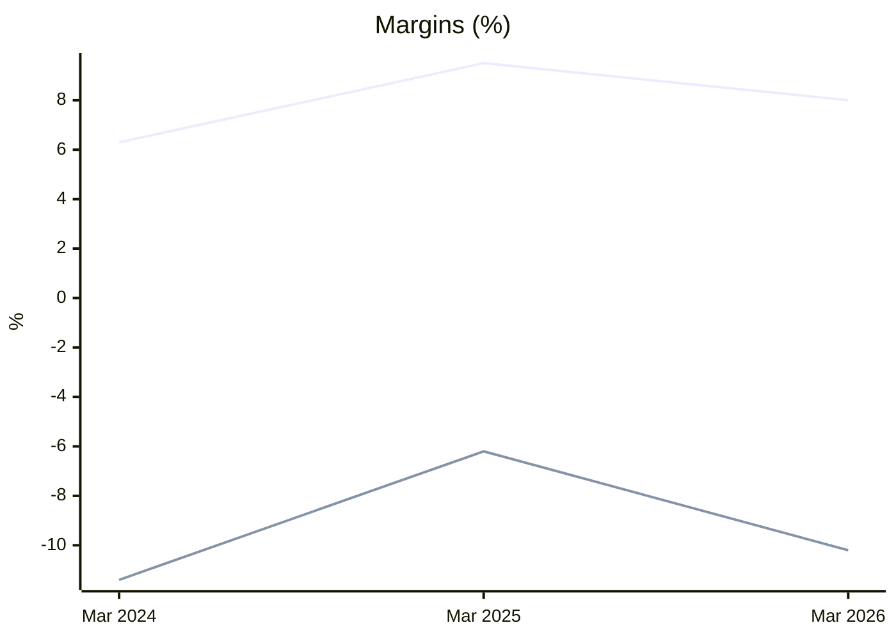

*Run 2026-11-24 · part of [SPINOFF_REPORT.md](../SPINOFF_REPORT.md) · the complete analysis of one company, with every management-call exchange in full.*

## ABFRL — Aditya Birla Fashion and Retail Ltd.

### 1. Aditya Birla Fashion and Retail Ltd. — CONFIRMED DEMERGER

**CONFIRMED** (a demerger scheme is on the exchange record) · **LISTED 1–2Y — the second-year window** · score 3.6/10 · spin-off · 5 filing(s) from NSE, NSE-register · first 2025-05-22, latest 2026-07-10

**The separated entities — every one the documents name:**

| Entity | Business | Listing | Who runs it |
|---|---|---|---|
| **Aditya Birla Lifestyle Brands Limited** | Madura Fashion and Lifestyle Business: Louis Philippe, Van Heusen, Allen Solly, Peter England, American Eagle… | listed 2025-06-23 as ABLBL (NSE) | Mr. Ashish Dikshit (DIN: 01842066) as the Managin… |

**What is being separated, as the documents put it:** Madura Fashion & Lifestyle Business, demerged from ABFRL into wholly owned subsidiary Aditya Birla Lifestyle Brands Limited, effective May 1, 2025 — class `not stated`.

### 2. Stages and dates

> **Listing:** LISTED — Aditya Birla Lifestyle Brands Limited (ABLBL) since 2025-06-23 (NSE equity list); record date 2025-05-22

| Date | Event | Source |
|---|---|---|
| 2024-04-01 | Appointed date — Scheme | as stated: NCLT order dated March 27, 2025 ("The appointed date is fixed as 01.0… |
| 2024-04-19 | Stage reached: **announced** | [Scheme of Arrangement](https://nsearchives.nseindia.in/corporate/ABFRL_19042024171846_SE.pdf) |
| 2024-04-19 | Board approval — Aditya Birla Fashion and Retail Limited and Aditya Birla Lifestyle Brands Limited | as stated: Outcome of Board Meeting / Scheme of Arrangement intimation dated Apr… |
| 2024-10-28 | Exchange no-objection — National Stock Exchange of India Limited observation letter | as stated: NCLT order dated March 27, 2025 (Regional Director report observation… |
| 2024-10-30 | Stage reached: **exchange noc** | [General Updates](https://nsearchives.nseindia.in/corporate/ABFRL_30102024204414_SE-Observation_letter_intimation.pdf) |
| 2024-10-30 | Exchange no-objection — BSE Limited observation letter | as stated: NCLT order dated March 27, 2025 (Regional Director report observation… |
| 2024-11-27 | Other — NCLT order directing the Company to convene the meeting of its equity shareholders for approving the Scheme (received November 28, 2024) | as stated: General Updates intimation dated November 28, 2024 |
| 2025-01-21 | Stage reached: **meetings** | [Shareholders meeting](https://nsearchives.nseindia.in/corporate/ABFRL_21012025152425_SE.pdf) |
| 2025-03-27 | NCLT order — NCLT, Mumbai Bench, Court-1 sanctioning the Scheme (C.P.(CAA)/43/MB/2025) | as stated: Intimation dated March 27, 2025 (Pronouncement of Order by NCLT) |
| 2025-04-22 | Other — Receipt of certified true copy of the NCLT order | as stated: Audited results note dated May 23, 2025 and intimation dated April 23… |
| 2025-04-23 | Other — Filing of certified copy of the NCLT order with the Registrar of Companies, Mumbai by ABFRL and ABLBL | as stated: Intimation dated April 23, 2025 |
| 2025-05-01 | Effective date — Scheme | as stated: Intimation dated April 23, 2025 ("Effective Date in terms of the Sche… |
| 2025-05-22 | **Record date** | NSE corporate-actions register |
| 2025-05-22 | Stage reached: **record date** | [Updates](https://nsearchives.nseindia.in/corporate/ABFRL_22052025113207_SE_Cost_Apportionment.pdf) |
| 2025-05-22 | Record date — Aditya Birla Fashion and Retail Limited shareholders entitled to ABLBL shares | as stated: Record Date intimation dated May 12, 2025 |
| 2025-05-26 | Allotment — Aditya Birla Lifestyle Brands Limited allotted 1,22,02,94,773 fully paid-up equity shares | as stated: Material Information/Updates intimation dated May 26, 2025 |
| 2025-06-23 | **Aditya Birla Lifestyle Brands Limited** listed (ABLBL) | NSE equity list |
| 2025-06-23 | Listing and trading — Aditya Birla Lifestyle Brands Limited, on BSE Limited and the National Stock Exchange of India Limited | as stated: Note 6 to standalone results for the quarter and nine months ended De… |
| 2026-02-10 | Stage reached: **effective** | [Updates](https://nsearchives.nseindia.com/corporate/ABFRL_10022026135217_Outcome.pdf) |
| 2026-07-02 | Stage reached: **nclt sanction** | [General Updates](https://nsearchives.nseindia.com/corporate/ABFRL_02072026181255_SE_Pronouncement_of_order.pdf) |

**The stages, as filed:** announced (2024-04-19) → exchange noc (2024-10-30) → meetings (2025-01-21) → record date (2025-05-22) → effective (2026-02-10) → nclt sanction (2026-07-02)

**Stated in the filings:** record date 2025-05-22.

**When it lists, in the documents' words:** Already listed: "The Equity Shares of the Resulting Company listed on BSE Limited and the National Stock Exchange of India Limited on June 23, 2025" (stated in the February 10, 2026 filing of Q3 FY26 results, note 6/note 8)

### 3. Size of the separated business beside the parent — is institutional selling likely?

**Reading: LESS LIKELY on size alone — the piece is the larger part of the business.**

| Entity | Stated turnover | Stated share of the whole | Segment revenue share | Market cap (₹ cr) | Share of combined market cap | Index member |
|---|---|---:|---:|---:|---:|---|
| Aditya Birla Lifestyle Brands Limited | Rs. 7,607 crores as on March 31, 2023 (turnover of the MFL … | 64.81% | 103.6% (FY2025) | 9,552 | 66.6% | yes |

*Stated figures are the documents' own (a turnover share, or the cost-of-acquisition split the company publishes for tax, which reflects relative value); the segment share is this business's revenue over the parent's sales, and the market-cap share is the entity's value over the entity plus the parent (parent ₹4,795 cr, NSE bhavcopy of 2026-11-13), both computed here.*

**In the documents' words:** “The turnover of the MFL Business of the Demerged Company as on March 31, 2023, was Rs. 7,607 crores and forms 64.81 % of the total standalone turnover of the Demerged Company as on March 31, 2023.”

**The judge's read of selling pressure:** unclear — Documents give 1:1 distribution to all shareholders and listing date, but no size, index or shareholder-base detail; same fashion-retail industry.

### 4. Insider ownership — share swap, promoters' holding, management incentives

**Share swap / entitlement, entity by entity:**

- **Aditya Birla Lifestyle Brands Limited:** 1 (one) fully paid-up equity share of ₹ 10/- (Rupees Ten) each of Resulting Company for every 1 (one) fully paid-up equity share of ₹ 10/- (Rupees Ten) each of Demerged Company.

**Promoters' holding, from the shareholding pattern:**

| Company | Promoters | FIIs | DIIs | Public | Quarter |
|---|---:|---:|---:|---:|---|
| Aditya Birla Fashion and Retail Ltd. (ABFRL) | 46.61% | 10.11% | 4.28% | 38.7% | Sep 2026 |
| Aditya Birla Lifestyle Brands Limited (ABLBL) | 46.6% | 12.29% | 20.94% | 19.69% | Sep 2026 |

*Source: screener.in shareholding pattern, stored under `ShareholdingPattern/NiftyTotalMarket/`. In a mirror demerger each shareholder holds the same proportion of the new company as of the parent on the record date.*

- **Promoters in the parent, per the documents:** not stated in the documents on file.
- **What the promoters will hold in the separated entity:** Upon effectiveness of the Scheme, the entire existing equity share capital of the Resulting Company shall stand cancelled and new equity shares (as mentioned in point (e) below) shall be allotted by the Resulting Company to the equity shareholders of the Demerged Company on the Record Date in accordance with the Scheme. Thus, the equity shareholding in the Resulting Company would mirror the shareholding of the Demerged Company.
- **What a public shareholder receives:** No cash consideration is payable under the Scheme. The consideration for demerger shall be discharged by issue of equity shares by the Resulting Company as follows: 1 (one) fully paid-up equity share of ₹ 10/- (Rupees Ten) each of Resulting Company for every 1 (one) fully paid-up equity share of ₹ 10/- (Rupees Ten) each of Demerged Company.
- **Management incentives:** Treatment of existing option grants under the Scheme is not stated, and no new plan in the Resulting Company is disclosed. The filings state only, verbatim: "ESOP Share Allotment: Pursuant to various Employees Stock Option Schemes, following Equity Shares of ₹.10 each were allotted /transferred to the option grantees" — 2,25,779 (Non-Trust Route) and 1,60,443 (by way of transfer from ESOP Trust) for the quarter ended December 31, 2025; 4,82,075 and 3,18,344 respectively for the year ended March 31, 2025. The Scheme also provided for "allotment of 5,55,000 8% non-cumulative non-convertible redeemable preference shares shares to Birla Management Centre Services Private Limited pursuant to Clause 4.2.16 of the Scheme". Management or insider shareholding: not stated.
- **Insider actions around the separation:** Promoter/Promoter Group subscribed to a preferential issue shortly before the demerger became effective: "On January 15, 2025, the Board of Directors of the Company approved the Preferential Issue aggregating to ₹2,378.75 crores to the Promoter Group and to certain Qualified Institutional Buyers under Non-Promoter category", of which "up to 4,08,33,990 equity shares of face value of ₹10 each at issue price of ₹317.75 each (including premium of ₹307.75 each), aggregating to ₹1,297.50 crores to the Promoter/ Promoter Group category" was approved by shareholders on February 13, 2025 and allotted by the Preferential Issue Committee on February 24, 2025. No promoter or management selling or pledging is stated.
- **Insiders, per the checklist read:** Not stated. Documents only state every ABFRL shareholder on record date May 22, 2025 received 1 ABLBL share per ABFRL share; no promoter stake or incentive disclosure. · *option pricing date:* not stated

### 5. Why the demerger — point by point

The business being separated is the Madura Fashion & Lifestyle / western-wear branded-apparel business — Louis Philippe-type premium lifestyle brands plus Reebok, American Eagle, Van Heusen Innerwear and the (exited) Forever 21 — demerged out of ABFRL into a separately listed Aditya Birla Lifestyle Brands Limited (ABLBL), leaving in ABFRL the Pantaloons/OWND (ex-Style Up) masstige-value play, the ethnic portfolio (Sabyasachi, Tarun Tahiliani, House of Masaba, Shantnu & Nikhil, Tasva, Jaypore, TCNS/W-Aurelia), luxury (The Collective, Galeries Lafayette) and digital-first TMRW. Management's stated reason is a capital-allocation and focus problem inside one company: ABLBL is a mature, high-margin, cash-generating platform (FY25 normalized revenue INR7,830 crores, EBITDA margin 16.2%, up 100bps; Q4 FY25 EBITDA margin 17%, +200bps; brands at 19.3% FY25 margin, retail LTL 9-12%) whose growth lever — an 'aggressive' net 300+ store rollout, 200 of them own-capex — was 'underleveraged in the combined entity', so the demerger was explicitly designed to 'leave that cash for allowing that business to soar' and let it invest through downcycles when franchisees cannot. Conversely the retained ABFRL is a portfolio of loss-making/investment-phase businesses (TCNS, Tasva, Style Up/OWND, Galeries Lafayette, TMRW) that needed a clean, cash-rich balance sheet: ABFRL raised USD 490 million via QIP plus preferential issue (promoters paying a significant premium) to make demerged ABFRL 'debt-free' with gross cash of INR2,350 crores at consolidation, versus ABLBL starting with ~INR700-781 crores net debt to be repaid in 2-3 years. Dikshit framed the underlying problem as too many simultaneous growth bets starving each other of attention — 'Innerwear will get the attention which it would not have got when we had 5 or 6 such growth opportunities in front of us' — i.e. separation is about focus, differentiated capital structures (dividend-paying ABLBL vs. investment-funding ABFRL) and separate value-creation journeys. The same philosophy is applied one level down: TMRW was built as a separate company from 2021 precisely so it would raise its own capital (INR437 crores from ServiceNow Ventures for ~11%, INR440-450 crores equity in FY26, INR500 crores NCDs, ~INR800 crores cash) and eventually have 'its own public market journey'. Mechanically the demerger was Board-approved 19 April 2024, shareholder-approved 21 January 2025, NCLT-sanctioned 27 March 2025, effective 1 May 2025 with an appointed date of 1 April 2024, a 1:1 share entitlement (1,22,02,94,773 ABLBL shares allotted 26 May 2025) and ABLBL listed 23 June 2025; it also reset intercompany accounting, producing a one-off INR97 crore gain from ending inter-division elimination on Madura stock sold through Pantaloons and INR148 crore of depreciation not charged on discontinued operations. Targets attached to the split: ABLBL to 'double in scale' and expand margins over five years and pay dividends at the earliest opportunity; ABFRL to deliver 3x revenue and 2x margin over five years, with most of that margin uplift coming from turning TCNS, Tasva and TMRW from EBITDA-negative to profitable.

**Point by point, with the source:**

1. First formal framing of the separation: the western-wear brands business is being carved into a separate listed entity, ABLBL, with NCLT scheduled for the third week of March 2025 and completion expected in 2-3 months. “First, the demerger of western wear brands business into a separate entity, that is Aditya Birla Lifestyle Brands Limited, or ABLBL, is progressing well and set for completion within the next 2, 3 months.” — *[Feb 2025](https://www.bseindia.com/stockinfo/AnnPdfOpen.aspx?Pname=86aee500-e77b-4d18-9566-af83384f5a37.pdf)*
2. The USD 490 million QIP plus preferential issue was raised inside the pre-demerger company specifically so the retained ABFRL would emerge debt-free with enough cash to fund its loss-making businesses until self-sustaining. “The fundraise within demerged ABFRL will strengthen its balance sheet by making it debt-free and leaving enough cash in the books to take care of the growth needs of its businesses until they become self-sustainable.” — *[Feb 2025](https://www.bseindia.com/stockinfo/AnnPdfOpen.aspx?Pname=86aee500-e77b-4d18-9566-af83384f5a37.pdf)*
3. Capital structures were deliberately split asymmetrically — debt with the cash-generating lifestyle entity, cash with the investment-phase entity. “We expect ABLBL to start the next year with opening debt of INR700 crores, whereas demerged ABFRL will have a likely cash balance of approximately INR1,300 crores.” — *[Feb 2025](https://www.bseindia.com/stockinfo/AnnPdfOpen.aspx?Pname=86aee500-e77b-4d18-9566-af83384f5a37.pdf)*
4. The sharpest stated rationale: Lifestyle Brands' store-expansion opportunity was under-exploited while inside the combined company, and the demerger was designed to free its own cash for that expansion (300+ stores, ~200 own-capex). “And one of the strategic rationale for the demerger was to leave that cash for allowing that business to soar.” — *[Feb 2025](https://www.bseindia.com/stockinfo/AnnPdfOpen.aspx?Pname=86aee500-e77b-4d18-9566-af83384f5a37.pdf)*
5. A second, cyclical argument: as a standalone entity ABLBL can self-fund store rollout when franchisee partners pull back in weak demand periods. “Lifestyle Brands particularly also will have access to their own cash. So their ability to grow even in downtimes, when franchisees sometimes are not in a position to invest during the low time, the business will be able to sort of short circuit that and invest deeper.” — *[Feb 2025](https://www.bseindia.com/stockinfo/AnnPdfOpen.aspx?Pname=86aee500-e77b-4d18-9566-af83384f5a37.pdf)*
6. The umbrella justification offered to investors was value unlock via two independently capitalised, independently growing entities. “The completion of these steps in the next 2, 3 months will enable us to unlock value through 2 independent entities, both with attractive growth potential and a strong balance sheet through a resilient growth-oriented business model sharpened over time.” — *[Feb 2025](https://www.bseindia.com/stockinfo/AnnPdfOpen.aspx?Pname=86aee500-e77b-4d18-9566-af83384f5a37.pdf)*
7. Completion announced: demerger done, 1:1 entitlement, ABLBL shares allotted to ABFRL shareholders and listing targeted by end-June 2025. “We successfully completed the demerger, creating two focused fashion power houses, Aditya Birla Lifestyle Brands Limited, ABLBL; and Aditya Birla Fashion and Retail Limited, ABFRL, both now set on independent high-growth trajectories.” — *[May 2025](https://www.bseindia.com/stockinfo/AnnPdfOpen.aspx?Pname=29b83308-dd71-4b41-9802-e328e83350ee.pdf)*
8. The underlying diagnosis stated plainly in answer to a question on why Innerwear had stagnated at ~INR500 crores since 2016 — one company carrying five or six growth bets could not give each the management attention and capital it needed, hence restructuring into separate entities. “I think as it becomes part of a company which is fundamentally profitable free cash flow generator and it's an important part of its growth journey, Innerwear will get the attention which it would not have got when we had 5 or 6 such growth opportunities in front of us.” — *[May 2025](https://www.bseindia.com/stockinfo/AnnPdfOpen.aspx?Pname=29b83308-dd71-4b41-9802-e328e83350ee.pdf)*
9. Same answer gives the structural logic for the split: multiple growth opportunities in one company required separate capitalisation and structure. “ABFRL, the combined ABFRL business had multiple growth opportunities, and we realized at some point of time, that we'll have to capitalize it and structure it differently to pursue independent growth opportunities more aggressively.” — *[May 2025](https://www.bseindia.com/stockinfo/AnnPdfOpen.aspx?Pname=29b83308-dd71-4b41-9802-e328e83350ee.pdf)*
10. Both halves were shown as independently healthy at separation — ABLBL Q4 margin +200bps (FY25 normalized revenue INR7,830 crores, 16.2% margin), demerged ABFRL Q4 EBITDA more than doubled to INR199 crores comparable. “Both entities delivered robust profitability, ABLBL clocking 200 basis points margin expansion, while demerged ABFRL more than doubling its EBITDA.” — *[May 2025](https://www.bseindia.com/stockinfo/AnnPdfOpen.aspx?Pname=29b83308-dd71-4b41-9802-e328e83350ee.pdf)*
11. ABLBL is positioned as the self-funding, net-debt-INR781-crore, dividend-paying mature platform with a 300+ store FY26 pipeline, to double in scale over five years. “ABLBL shall be a dividend-distributing company at the earliest appropriate opportunity.” — *[May 2025](https://www.bseindia.com/stockinfo/AnnPdfOpen.aspx?Pname=29b83308-dd71-4b41-9802-e328e83350ee.pdf)*
12. Retained ABFRL's post-demerger ambition quantified; management added that most of the margin uplift must come from turning TCNS, Tasva and TMRW from EBITDA-negative to profitable. “ABFRL with a sharpened brand portfolio, a comprehensive diversified play across high-growth segments and a gross cash balance of INR2,350 crores is set to unlock the next phase of growth, targeting a 3x revenue scale up and 2x margin expansion over the next 5 years.” — *[May 2025](https://www.bseindia.com/stockinfo/AnnPdfOpen.aspx?Pname=29b83308-dd71-4b41-9802-e328e83350ee.pdf)*
13. Accounting consequence of separating the two: the inter-division elimination on Madura brand merchandise sold through Pantaloons ends, producing a one-off INR97 crore inventory write-up gain, alongside INR148 crore of depreciation not charged on discontinued operations. “Reported EBITDA includes gain of INR97 crores on account of discontinuation of interdivision elimination post demerger as company's financials get reset to report on independent and stand-alone basis going forward.” — *[May 2025](https://www.bseindia.com/stockinfo/AnnPdfOpen.aspx?Pname=29b83308-dd71-4b41-9802-e328e83350ee.pdf)*
14. Process closed out and ABLBL separately listed, completing the separation. “On demerger, as previously communicated, all requisite processes have been successfully completed, culminating in the creation of Aditya Birla Lifestyle Brands Limited.” — *[Aug 2025](https://www.bseindia.com/stockinfo/AnnPdfOpen.aspx?Pname=605235b0-2e2b-4b89-9dcf-9a88f5115fa7.pdf)*
15. The same 'separate entity, separate capital' philosophy is applied one level down to TMRW, created as a separate company in 2021 so it would raise external capital (INR437 crores from ServiceNow Ventures for ~11%) and eventually list on its own rather than consume ABFRL's cash. “And over the next 8, 10 years, build a company which can find a very digital native path to this industry, which is fashion industry and have its own public market journey as we go forward from private to public.” — *[Aug 2025](https://www.bseindia.com/stockinfo/AnnPdfOpen.aspx?Pname=605235b0-2e2b-4b89-9dcf-9a88f5115fa7.pdf)*
16. A year on, the demerger persists only as a comparability adjustment in reported numbers; underlying ABFRL is now at standalone EBITDA breakeven and ex-TMRW consolidated pre-Ind AS loss narrowed to INR33 crores. “It is important to note that last year included a onetime gain of INR97 crores relating to inventory write-up and accounting treatment relating to demerger, which was explained in detail during Q4 results of last year.” — *[May 2026](https://www.bseindia.com/stockinfo/AnnPdfOpen.aspx?Pname=cf16c559-ad8d-4518-802d-9e35cc221c92.pdf)*
17. Leverage guidance is explicitly carried across both the pre-demerger combined company and the post-demerger entities, at 2-3x for any of the group's fashion companies. “We are very far, but that's the guidance we gave 5 years back and 3 years back.” — *[May 2026](https://www.bseindia.com/stockinfo/AnnPdfOpen.aspx?Pname=cf16c559-ad8d-4518-802d-9e35cc221c92.pdf)*
18. The later corporate action runs the other way: wholly-owned Jaypore E-Commerce and TG Apparel & Decor are amalgamated INTO ABFRL (Board 5 Feb 2026, NCLT order 2 July 2026, appointed date 1 April 2026, effective 1 August 2026) with no consideration or share issue, purely to simplify structure and cut administrative cost. “Seamless integration and better financial strength and flexibility for the Amalgamated Company, which would result in maximizing overall shareholder value.” — *Scheme*
19. Stated benefits of that simplification step are legal/operating structure and cost, not value unlock — a contrast with the ABLBL demerger rationale. “Streamlining of business & administrative operations consequently reducing administrative & other operating costs;” — *Scheme*

**How it evolved:** The demerger was Board-approved on 19 April 2024 and by the Feb 17, 2025 call was 'progressing well', with NCLT listed for the third week of March 2025, the USD 490 million QIP/preferential raise just closed, and guidance that ABLBL would open FY26 with INR700 crores debt while demerged ABFRL held ~INR1,300-1,500 crores cash; in that call the rationale sharpened from generic 'unlock value' into the specific point that Lifestyle Brands' store expansion had been 'underleveraged in the combined entity'. By the May 26, 2025 call it was 'successfully completed' — two 'focused fashion power houses', ABLBL shares allotted 1:1, ABFRL carrying INR2,350 crores gross cash, with the first explicit five-year targets (ABLBL to double in scale and pay dividends; ABFRL 3x revenue, 2x margin) and the clearest statement of cause, that a combined ABFRL with '5 or 6' growth opportunities starved businesses like Innerwear of attention. The Aug 14, 2025 call confirmed completion and listing on 23 June 2025 and extended the same logic to TMRW raising its own external capital, and by the Nov 2025/Feb 2026/May 2026 calls the demerger survives only as an accounting comparability footnote (the INR97 crore base-quarter gain) while the structural work shifts to simplification inside ABFRL — the Feb 5, 2026 Scheme amalgamating wholly-owned Jaypore E-Commerce and TG Apparel & Decor into ABFRL, NCLT-sanctioned 2 July 2026 and effective 1 August 2026.

**What management expects from it:** ABLBL: own cash flows fund 300+ net stores, scale to double and margins expand from 16.2%, INR781 crore net debt repaid in 2-3 years, dividends paid early. Demerged ABFRL: debt-free with INR2,350 crore cash to fund OWND, Tasva, TCNS, luxury and TMRW; 3x revenue and 2x margin in five years, chiefly by turning TCNS, Tasva and TMRW profitable; sharper focus and attention per business.

*Not explained on the calls:* No investor, lender or partner is named as having demanded it; no tax, dis-synergy, cost-allocation, brand-royalty or transition-service detail; no reason given why INR700-781 crore debt stayed with ABLBL.

- *Stated reason, in one line:* not stated
- *What it reveals:* The departed MFL business was the profitable half (FY25 discontinued-operations PBT Rs 230.97 crore on revenue Rs 7,618.62 crore), leaving a loss-making, cash-consuming parent: FY26 revenue Rs 8,177 crore, PAT loss Rs 830 crore, FCF positive only by FY29.
- *Parent or spin:* spin · *Read next:* Aditya Birla Lifestyle Brands Limited's own standalone results — the demerged MFL business's post-listing revenue, margin and debt
- *In their words:* “The Equity Shares of the Resulting Company listed on BSE Limited and the National Stock Exchange of India Limited on June 23, 2025.”

### 6. On the calls, verbatim

10 call(s), oldest first: **73 question-and-answer exchange(s)** given in full — the question and every answer to it, nothing trimmed — and 9 passage(s) from management's prepared remarks (the complete sentences about it; the whole remarks are in the linked transcript). Text is as the transcript prints it.

#### Nov 2023 — [transcript](https://www.bseindia.com/stockinfo/AnnPdfOpen.aspx?Pname=bf42de6b-979f-4684-9f29-726d098766f8.pdf)

**From the prepared remarks** *(the passage about it; the whole turn runs to 9,691 characters in the transcript)*

> **Jagdish Bajaj:** For H1 FY24, the company posted revenue of Rs. 6,423 crore, reflecting growth of 8% over same period last year. EBITDA for H1 F Y24 was Rs. 722 crore. EBITDA margi n stood at 11.2% for H1 FY2 4. I will now take you thr ough the performance of individual businesses : Starting with Lifestyle brands : Lifestyle brands, which has been growing steadily, was impacted this quarter primarily on account of feeble wedding calendar as these occasions drives a large part of its suits and blazer business . Shift in festive and e -com slowdown were other factors responsible for the adverse impact . Quarterly revenue for the segment was Rs. 1,586 crore, which was 6% lower than last year. Led by cost measures and gross margin improvement , EBITDA for Q2 stood at Rs. 339 crore s, reflecting a growth of 18% over last year.

**Question and answer**

> **Varun Singh:** Sir, my first question is related to Madura brands, Madura segment, sir, our performance has been relatively weak compared to peers during the quarter , so how should we, given that everyone has faced a similar kind of slowdown in the industry with regards to shifting festivals and lower wedding days etc. , but still, how should we read relative underperformance in our case, compared to peers, that is my first question ?
>
> **Ashish Dikshit:** Varun, I wil l take the first question , Vishak can add to it. If you look at Lifestyle brands performance, it has delivered by far the industry leading EBITDA margin for the quarter. In a tough quarter tha t is, there is nobody in the industry who I know of has delivered margins close to this, so I am a little surprised by the question. If you are talking of revenue, it is a reflection Aditya Birla Fashion and Retail Limited November 10, 2023 of the choices you make on channels. There are parts of revenues which are not as healthy, which at times you don't chase them so much and therefore to that extent the revenue growths will differ across business. It is a very high quality business, exceptionally strong brands and therefore I don't have a reason to believe that there is any level of underperformance in that , in fact, it is a strong performance on multiple accounts.

**Question and answer**

> **Tejash Shah:** Sir, you k ind of alluded that the initial feeler from the festiv e season is somewhere mixed except wedding pocke t, I believe the rest is actually flattish to o marginally positive that i s what perhaps you indicated , so just wanted to know let us assume that the demand does not recover for the second -half, how should we kind of think about or rollout expansion plan that you have jus t mentioned that you will stick to it , do you think that we will have to revi sit or we will go calibrated on that guidance?
>
> **Ashish Dikshit:** Yes, to large extent we have sort of factored in some of these medium -term challenges that the economy was suffering because it started practically from the post festive period of last year and therefore if you look at our strategy shift or calibration was to slow down expansion in the lower end of our markets were let us say Peter England Red operates in smaller towns, Pantaloons, particularly in smaller towns, slowdown in Northern East was mor e visible , so geographical expansion. We therefore continue to see that similar behavior. Lot of that has already factored in, so as I said, we will stay with our plan of about 30 to 40 stores for Pantaloons . Lifestyle brands continue to expand largely by demand driven , franchise driven model. So it is not really a push model where we decide how much we want to go. There is a lot of demand and there fore franchisees decide that we wi ll continue to that business is doing very well and I think you will see in the second -half as the weddings come back because there is a lot of suits and high end purchases in Lifestyle brands that are related to it. As far as Ethnic business is concerned , I think the best part of the year is coming in now. We are already beginnin g to see tremendous shift in trajectory as far as we dding related and ethnic businesses are concerned at that higher end, at least the Designer wear , Jaypore, Tasva etc. So to that extent, what we needed to do, we have factored in the sense that we have. W e will not need to change dramatically any major shift, and while I have said it is flattish, that is it compared to last festive compared to where we are, it is a significant upt ake in demand versus what you saw in the Q2, b ut that was natural to be expec ted. Aditya Birla Fashion and Retail Limited November 10, 2023

**Question and answer**

> **Tejash Shah:** And the last one if I may, we have guided on bringing our debt to somewhere around Rs. 2,600 or Rs. 2,800 crore and then obviously there is GIC money which will come through which is roughly Rs. 1,450 crores and then we have our own CAPEX need also , so we just wan ted to know , let us assume that this environment has to continue for slightly longer , this tepid growth environment, d o we need some more infusion of equity capital to kind of revive the growth engine or do you believe that managing between this infusion from GIC and our own internal accruals will be able to kind of fulfill our internal growth ambitions? Aditya Birla Fashion and Retail Limited November 10, 2023
>
> **Ashish Dikshit:** I think for just for our near-term growth ambitions, we think we are well positioned. We have to go through a perio d of slightly inflated debt as you said Rs. 2,600-Rs. 2, 800 crores, that is our reality, b ut we had factored that in when we made the investment and we were thoughtful and spent time thinking about how we see our business and a period of elevated debt afte r a large acquisition is almost a natural outcome and we are comfortable with that and feel that . Most of our investment phase, if you think about it, where have we put capital and how we have used capital in last 12 to 18 months, there is a large TCNS acq uisition investment that has gone in , that part is over only the merger part is left , 90% of TMRW investment is done. Our peak losses in Innerwear will perhaps play out this year and after that we will come closer to breakeven or much closer to that . I think except Tasva where we would continue to remain aggressive because the response is absolutely phenomenal what we are seeing and it is a large opportunity. Perhaps all our businesses are coming to a phase where the deep investment phase will come d own and we feel that we are well structured to respond around that and you will start to see some of the less capital needy business like Lifestyle brands , Reebok is on a very good growth, but most of it is self funded , Pantaloons, despite going through a phase o f very difficult period currently as we see despite these circumstances will be able to generate enough cash to fund its growth. So we feel comfortable with what lies ahead, but I have to say that this lev el of debt is something that we wil l have to get us ed to slightly higher debt level for next, maybe 18 to 24 months.

**Question and answer**

> **Sameer Gupta:** Sir, firstly on the networking capital, the P BT mention ed Rs. 1,360 crores. When I do a calculation from the balance sheet, I get a number of Rs. 2,000 crores , so just wanted that to be clarified and also between these two numbers, it will roughly translat e to around 40 to 50 days if you include TCNS sales , where do you see this number stabilizing because part of it like Lifestyle might have negative working capital, but your growing part of the business like Sabyasachi or Tasva o r these B2C business es that naturally might have higher working capital , also there is some channel realignment going in the Lifestyle brands wherein there is movement towards consignment , so just wanted your thoughts on that , where do you see this number on working capital stabiliz ing for the whole business?
>
> **Ashish Dikshit:** I think our business is very diversified now, but if you were to put it in very broad buckets of where substantive part of our inventory lies, it lies in our larger businesses, which is Lifestyle brands and Pantaloons a nd if you look at these businesses and current quarter is perhaps likely to reflect more inflated picture because festives have been pushed up and therefore you build up inventory , you don't have sales at that point of time in the previous quar ter, so lower Q2 sales, but higher inventory buildup , but broadly speaking we have operated Pantaloons over a long Aditya Birla Fashion and Retail Limited November 10, 2023 period of time in high single digit networking capital to sales . It gets inflated during some period, but comes back to around that , so betwe en 8, 9, 10, maximum 11 %-12%. As far as Lifestyle brands is concerned, because the business is increasingly moving to retail shift, the networking capital is a revenue for large part has been between 13 % to 15% and we don't expect these two are very strong stable businesses. We don't expect that to move . Rest of the individual businesses currently are small and perhaps have greater volatility if you were to say that and elevated level of working capital, but that is because they are in a slightly higher gro wth phase or still figuring out the right model till they find the stable area. Does that answer your question?

**Question and answer**

> **Gopal Nawandhar:** Sir, lastly, on this Lifestyle margins, do you expect these margins can be sustained or there could be some softness on the margins?
>
> **Ashish Dikshit:** See longer term, which is the point that I think Vishak is making , quarter -on-quarter margin changes are both reflection of markdowns, brand mix and channel mix. If you look at the long - term margins, the business has operated closer to 18 % to 19% margin, but in every few good quarters we get to 20 %-21%. This quarter has been particularly focused on quality of business. To that extent, we have not chased revenue in some of the low gross margin channels . To that extent, we have an upside on t he gross margin side just as we have let go of revenue on the revenue side.

**Question and answer**

> **Udhav Sinha:** Just within, even your department store versus your EBO channels, if there is any color that I could have?
>
> **Vishak Kumar:** They have both their own opportunities. They have both their own relevance. There are consumers who prefer shopping in a multi -brand environment and I do believe that our brands need to be there for that. We have very deep ways of working with Shoppers Stop, Lifestyle , Pantaloon, all we work very closely, Centro, w e work very closely on this and they have their own relevance, whic h is indepen dent of the relevance of the EBOs in both Malls and High Streets. So I would say they are not mutually exclusive, they go together.

#### Feb 2024 — [transcript](https://www.bseindia.com/stockinfo/AnnPdfOpen.aspx?Pname=161992c6-9b74-48ad-86ac-d84fc82f213c.pdf)

**From the prepared remarks** *(the passage about it; the whole turn runs to 10,973 characters in the transcript)*

> **Jagdish Bajaj:** Our brands continue to expand strategically in key markets, while in parallel, driving improvement in network helped by pruning nonperforming stores. For YTD Q3, company posted revenue of INR10,589 crores, reflecting growth of 11% over the same period last year. EBITDA for YTD Q3 was INR1,326 crores with EBITDA margin of 12.5%. I will now take you through the performance of individual businesses, starting with Lifestyle brands. Lifestyle brand s continued with their strong trajectory. The brands strengthen their position with customers through high -impact brand campaigns and aspirational and innovative product offerings. These brands continue to gain much stronger position with the third -party partners including departmental stores. Premiumization, product innovation and markdown management continues to be the key strategic levers for Lifestyle brands. Lifestyle brands achieved the highest -ever YTD Q3 EBITDA level with a conscious strategy of cutting down less profitable channels, marginally impacting their sales growth. I would like to point out that this revenue is on a base of 18% growth in same quarter last year. Quarterly revenue for the business was INR1,815 crores led by gross margin impro vement and increased focus on profitable channels. EBITDA for Q3 stood at INR349 crores. […] The brand posted another quarter of INR100 crores -plus profitable sales on the back of rapid distribution and e -commerce expansion. The brand is now available at 160 - plus stores and 800 -plus points of sales across departmental stores and multi -brand outlets. The brand has also significantly scaled up i ts e-com business, driven by deeper partnership with all major e -com players. With a strong trajectory of American Eagle and Reebok, we now have two new potential mega brands in our po rtfolio complementing existing four lifestyle brands. Let me now speak about innerwear business performance. The innerwear and athleisure wear category sustained decline in demand and sales volume due to shifting consumer preference away from athleisure post -COVID. The business in Q3 FY24 was impacted primarily led by athleis ure slowdown, while the innerwear category posted a 5% growth over last year.

**Question and answer**

> **Nihal Jham:** Sir, three questions from my side. First is, in case of Lifestyle brand specifically, it is in terms of its positioning a little more premium than a lot of our other categ ories. Does the overall slowdown, in a way, explain the muted growth that the segment has seen? And if I compare versus Pantaloons, is it mainly the festive shift because of there is a divergence of the performance between the Lifestyle brand and Pantaloon s?
>
> **Ashish Dikshit:** So yes, there is a slowdown, and it is reflected in the amount of footfalls into mall stores, etcetera . We also took a conscious call, Nihal, to scale down on discounting, okay? So that is also -- which is what has helped us to significantly expand margins. We recognized that in this market situation, it would be a sharper strategy to stay tight on discounts, manage for profitability, whi ch is what we have done. So we were able to make the most of the footfalls, which came into t he stores, which was linked with the premiumization strategy that JB spoke about in his opening speech. So I think all of that together, the market was tough in terms of footfalls, Nihal.

**Question and answer**

> **Aditya Soman:** Sir, two questions. Firstly, can you just give us any sort of indication of how the brands within Madura have fa red? And any reason for the differences, if any? And secondly, I mean, just on a sort of more medium -term or long -term strategy. We've seen this quarter that there's a sign ificant amount of growth that is coming inorganically, but some of the organic growth has been subdued because of conditions and otherwise. So how would we expect the mix of inorganic versus organic, let's say, over a medium term?
>
> **Ashish Dikshit:** So Aditya , the first question, we don't break down the brand -level details in public domain. So I will stay away from that. But I would give you a flavo ur that broadly, the performance is very similar across the segment. And as Vishak explained, the level of challe nge that we had even in the premium brands, that was visible in this quarter. . The only additional point I would say, there is a geographical difference and not the brand difference, where the smaller tier towns seem to be suffering a lot more and that's consistent across brands, whether it's Lifestyle brands or Pantaloons, we've seen it consistently across. So that seems to be the bigger driver of state of the market than the individual brands in that. Coming to your question around the share of new business versus old business. As you know, Aditya, we've been on a transformational journey of building very large new platforms and potentially very, very large markets. The entire Ethnic wear strategy, spor tswear category, the entry into D2C were very long -term bets that we have taken, and we have executed that strategy systematically over the last three and half , four years. Aditya Birla Fashion and Retail Limited February 15, 202 4 I think what you're seeing is the early signs of the outcome of that strategy, wher e this quarter, about 20 -odd percent -plus came from the businesses that we have added to our portfolio just in last three , three and half years. And as this portfolio settles down, obviously, this will also become part of the organic business. At some poin t, we'll have to call this also org anic as the strategy plays out. I would say both in organic versus inorganic, the way to look at our business is the segme nt that we operate in. We have two retail formats at t he top end of the collective and the bottom e nd is Pantaloons, which also has the layer below, which is Style Up. And we have a portfolio of brands in the Western wear segment, which is our traditional business that we have build over a longer period of time . We have added Reebok to that. We have a p ortfolio of brands in Ethnic wear segment, which is a portfolio we have built with seven , eight very, very strong brands in a large market. Just added over the last three and half years, and we have portfolio of brands, which are digital D2C brands, which is under TMRW . Now these are five platforms, which is retail formats at the top and bottom and the brands in the middle, which is really the part of strategy that we have played out over the last few years. You will see as these -- each of these busine sses grow. Many of them are early stage, and therefore, the growth potential is higher because the bases are very small. But individually, each one of this is a very large market.

**Question and answer**

> **Varun Singh:** This is Varun Singh from ICICI Securities. Sir, my first question is like in the sector, we see premium price point segment sector, etcetera , to be outperforming compared to value. This is what the case recovery, etcetera , that everyone is tal king about. For a few apparel companies also, we see Tier 3 cities to be maybe significantly underperforming compared to Tier 1, 2, etcetera . And given the similar kind of a context, which is a general slowdown, maybe less number of readings, if not number of wedding days in the current quarter and all those things. We see, in our case, Madura to be maybe significantly underperforming compared to Pantaloons. So of course -- in Ma dura, I mean, I'm specifically talking about Lifestyle brands. Yes, so like what are your understanding reasoning of -- I mean, looking at these two numbers if you can share that?
>
> **Ashish Dikshit:** So to a large extent, I think the phenomenon that you said continues to hold true, smaller markets, smaller towns, consumers at the lower i ncome segments continue to suffer more than the other customers. And to that extent, your broader thesis is correct. And most of the period, if you don't go by quarter -on-quarter, if you look at the medium term, that p henomena is absolutely correct. I thin k on Lifestyle brand performance, Vishak explained. It seems -- it is a larger part of conscious strategy, which we are driving in that. Because longer term, a journey of Aditya Birla Fashion and Retail Limited February 15, 202 4 premiumization would require us to manage that difference with other brands in the spac e. We are investing a lot in these brands. We have to build longer -term premiumization. In the medium term, on a very large base that we ha d last year, where I think the nine -mont h growth rate last year was -- nine-month growth rate was close to -- we will give you a number . But I think it is higher than 50%. The Q3 growth itself was 18%. So we're growing very rapidly on that business. And it's more an internal adjustment to the grade, but the CAGR, over a period of time will continue to remain strong. So I don't see it -- while the numbers may appear so I don't think it is in contradiction to the broader understanding of the market as you have explained.

**Question and answer**

> **Ashish Kanodia:** Sure. That's helpful. And second thing, in the Pantaloons and in the slightly affordable price segment, are you seeing that the competitive intensity has kind of increased in the last, say, three , four qu arters or so? And secondly, from a planning perspective, when you think about the next 12 to 18 months in terms of store growth and investing in branding, marketing, where do you see more focus? Is it going to be more on, say, Reebok, American Eagle and maybe Lifestyle by Pantaloons to a certain extent, maybe within Madura, Peter England takes slightly a calibrated approach. Your thoughts on that?
>
> **Ashish Dikshit:** I think actually, it's a very broad question across covering multiple segments. Let me try and see if I can answer you satisfactorily. See as far as the small format, branded stores are concerned, whether it is Peter England, Louis Philippe, Van Heusen, Allen Solly, America n Eagle, they're largely driven by our understanding of market opportunity, very often a franchisee who sees that opportunity in that market or a new model coming up. And therefore, to that extent, these growths are more organic. Of course, brands like Ree bok and American Eagle in very early stage. These are finding very strong traction. So they will grow at a much faster pace because there's a very large opportunity available. Distribution is very low in these brands. Your other question, which is slightly different. It's about the competitive intensity in the segment of Pantaloons, I would say and argue that Pantaloons has very strategically and steadily and consciously over the last three , four, five years, had chosen a path to premiumize itself, which ha s separated itself from some of the very competitive value play where large amount of competition has happening. The fact is you have seen how many players have come in, many more have announced entry. And yet Pantaloon's performance remains robust to the extent the economy has allowed to do that. It's a validation of the strategy that we have chosen, which is to take Pantaloons above some of these players, and that's playing out very well for us. In the longer term, we believe that, that strategy that will actually allow us to build longer -term value and create profitable business for Pantaloons. The competitive intensity is more below that and that's where we have also got Style Up as a play. It's an early stage. We now have about 25, 30 stores. We pro bably would have launched about 20 -odd stores this year. We will continue to expand that business. And as our confidence grows, we'll go and expand it a little bit more aggressively. But at this point of time, that's our response in that segment. I think Pantaloons' strategy will be guided by its own performance. We had said we'll open about 30 stores this year. We'll continue to drive that. And I don't see a shift in that strategy. We look at a similar number next year as well.

**Question and answer**

> **Himanshu:** Sir, just a couple of questions. Can you help with pre-IND AS margin s for Lifestyle and Pantaloons busine ss for either Q3 or preferably nine months FY24?
>
> **Ashish Dikshit:** We don't do that because it creates confusion on that because then people will need quarter -on- quarter, then we simply -- sort of simplified the whole business by giving only post -IND AS margin. That's a consistent policy we have followed for the last two and half years. Aditya Birla Fashion and Retail Limited February 15, 202 4

**Question and answer**

> **Himanshu:** Okay. And secondly, sir, we are talking about rationalizing stores in Pantaloons. So can you provide some color, like what percentage of stores are we looking to rationalize? And what kind of cost savings or it can have? Ashish Di kshit : So it's not specific to Pantaloons. I think the comment is very similar, whether it's Lifestyle brands, Pantaloons and any of our other businesses. As the market conditions are tough, we see consumer sentiments sort of where they are today. At this point of time, we are looking at costs far more strictly. And therefore, the rationalization is something that we are looking it at across businesses, whether it's innerwear stores, Pantaloon stores, Madura Lifestyle brand stores expansion. So that will re main same. I think as we announced in this quarter, we have opened about eight , nine Pantaloons stores and closed three , four stores. Net seven is what we have added. And we'll continue to look at it. I think at this point of time, that seems to be the mo re prudent strategy. We will expand in markets where we see the opportunity, which is bigger markets, towns where the impact of slowdown is much lesser. While the smaller markets where we see fundamentally market conditions not improving, that's where the r ationalization work.

#### Jun 2024 — [transcript](https://www.bseindia.com/stockinfo/AnnPdfOpen.aspx?Pname=89e45256-4dbf-4247-b593-895c275dc6fb.pdf)

**From the prepared remarks** *(the passage about it; the whole turn runs to 13,302 characters in the transcript)*

> **Jagdish Bajaj:** This fiscal, we announced our ethnic portfolio by acquiring TCNS to complete the gap in premium ethnic space that the portfolio had. Additionally, we run our TMRW business with a strong portfolio of digital first brands. These were key additions to make our portfolio more comprehensive in line with the long -term strategy of the company. Aditya Birla Fashion and Retail Limited May 29, 202 4 As you're already aware, that on April 19, 2024, the Board of ABFRL has approved the proposal of vertical demerger of Madu ra Fashion and Lifestyle business from ABFRL into company named Aditya Birla Lifestyle Brands Limited, which will be listed separately post the demerger. Pursuant to that, we have also reclassified our segmental reporting this quarter, and we'll continue to share the financials in a similar way till demerger becomes effective. The two proposed entities now are Aditya Birla Lifestyle Brands Limited consisting of Lifestyle brands, You th Western Wear, Innerwear and Sportswear, while Aditya Birla Fashion and R etail Limited consists of Masstige and Value retail, Ethnic, Super Premium and Digital First Brands. This strategic demerger of ABFRL is paving the way for the creation of two separate growth engines, each with a clear capital allocation strategy and uniq ue path for value creation. Both entities will focus on a specific growth areas aligned with their individual business models with a clear focus on maximizing stakeholder returns. Post demerger, ABFRL will raise fresh capital of INR2,500 crores to strength en its balance sheet and support the growth needs of its constituent businesses. Now I will talk about financial performance of our company for this quarter. The company delivered revenue of INR3,407 crores, a growth of 18% over same quarter last year, pr imarily driven by new lines of businesses. Excluding TCNS, growth was around 12%. Our standalone sales stood at INR2,852 crores, growing 8% over last year. Both our Ethnic and D2C businesses, driven by a combination of organic growth and strategic acquisi tions, more than doubled their revenue this quarter. The company achieved a consolidated EBITDA of INR377 crores with margin expansion of 300 basis points to reach 11.1% versus 8% last year, powered by profitability, enhancement measures by our large estab lished Lifestyle and Pantaloons businesses, our standalone business EBITDA grew by 59% Y -o-Y. Our total store network now stands at 4,664 stores, spanning 11.9 million square feet. This quarter, we have pruned our store network by closing stores mostly du e to slow recovery in certain markets and changing retail landscape. For full year FY '24, company posted revenue of INR13,996 crores, reflecting growth of 13% over the same period last year. Standalone sales grew 5% over last year despite challenging mark et environment throughout the year. As already mentioned, new businesses remain key drivers of our growth. Specifically, the contribution to overall sales from businesses other than Lifestyle and Pantaloons increased from approximately 16% last year to around 25% this year. EBITDA for FY '24 was INR1,703 crores with margin of 12.2%. Here too , EBITDA for standalone business led by profitability enhancement initiatives grew 10% with margin expansion expanding by 60 basis points. Our consolidated EBITDA gr ew by 5% Y -o-Y, factoring TCNS losses post acquisition and investment in ethnic businesses and TMRW. […] This segment posted revenue of INR7,794 crores with EBITDA of INR1,276 crores in FY '24. EBITDA margin expanded 270 basis points to reach 16.4% in FY '24. The share of emerging businesses portfolio, which was 13% in FY '23, increased to 16% in FY '24. For Lifestyle brand, over the past few years, our brands experienced strong growth, maintaining their market leadership position to brand, category and product extensions along with nurturing new channels of growth. As we have been guiding for the last few quarters, in a challenging demand environment, we prioritize d ou r focus on growing profitably and hence through slew of measures s uch as product premiumization, markdown management and tapering down low profitability channels , lifestyle brands have been consistently working towards enhancing profitability. Focused intervention around other operating cost item is also structurally ena bling the brands to move towards a more profitable model in the long run. Revenue for the quarter was INR1,564 crores, 2% higher than last year. EBITDA stood at INR305 crores, growing 36% versus last year's led by gross margin improvement.

**Question and answer**

> **Garima:** Got it. And just for understanding, this will be a part of the demerged ABFRL?
>
> **Ashish Dikshit:** Yes, it will be part of the ABFRL, along with Pantaloons.

**Question and answer**

> **Garima:** Understood. Last question really is on timelines of full consolidation for TCNS. Where are we? And hence, post that, what all is pending for the demerger really to happen?
>
> **Jagdish Bajaj:** So Garima, we already started consolidating the results with us because it is our subsidiary. As far as merger is concerned, our merger, you know the court conveying AGM will be held on 5th of June. And another 3 months' time, we will be able to merge TCNS with us. On d emerger, it may be, as you know, we are progressing as per our timeline. We plan to complete this exercise by end of fiscal -- end of Q3 or in last quarter of FY '25.

**Question and answer**

> **Nihal Jham:** My first question was for this quarter, you mentioned about cost reduction initiatives, both across Madura as well as for Pantaloons. If you g ive us detail what these are? Is it mainly, say, moderation in sales and marketing spend given the muted demand outlook or are there other aspects also?
>
> **Ashish Dikshit:** No. I think material part, and it's not really only specific to this quarter. And this is more a trend as we saw the demand side of the business coming down was on store expenses. You saw the rationalization network, so that reduces the fixed cost of less profitable stores or unprofitable stores. The second part really is discounting as we saw markets where laxity to perhaps discounting would have been lower and also in line with the overall strategy that our premium brands, either Lifestyle brands or the journey of Pantaloons in premiumization. So therefore, there is gain on account of lowe r discounting. The third part really is choosing the more profitable channel and focusing our energies on that, which means giving up a certain part of growth, which is a less profitable or less remunerative growth. So letting go of some of the volume and value in those channels. So these are the more important parts of choices that we made.

**Question and answer**

> **Nihal Jham:** Just 1 final question, I do understand in the middle of the demerger between the 2 businesses with our debt currently stands at around INR2,800 crores. Is there a possibility also giving us sense of what that number would be?

**Question and answer**

> **Nihal Jham:** Yes, I was just asking that I do understand that we are targeting to demerg e by the end of Q3 or Q4. But is there a possibility to say, give a sense of what the blended debt could be next year. We are currently at, say, INR2,850 crores ? Aditya Birla Fashion and Retail Limited May 29, 202 4
>
> **Ashish Dikshit:** So I think, Nihal, as you know, the Lifestyle brands opening debt number for t he first April is about INR900-odd crores. We expect that to come down during the course of this year and with the profitability -- shape of the profitability of that business, that is pretty much under -- pretty much under the sort of manageable levels. As far as the ABFRL, which is the demerged entity is concerned, we have mentioned that we'll start with a debt of about INR1,951 crores, and we'll raise capital, and therefore, we expect to be net positive at the end of this year or thereabouts, depending o n how the year goes. But that's really the intention at this point of time, yes.

**Question and answer**

> **Nihal Jham:** Very, very sorry about that. I was just asking, is there any growth targets for the two businesses also that you want to separately lay out?
>
> **Ashish Dikshit:** No, I think I don't want to comment on 1 quarter, 1 year growth. You know the growth trajectories of these businesses. Lifestyle, the brand company, not just has the four mega Lifestyle brands, it also has growth engines in Reebok, the Innerwear as well as American Eagle, Forever 21 segment. The demerged entity has multiple growth levers. We just talked about Pantaloons now getting its act together and beginning to grow back again with the renewed proposition. StyleUp is something that we are now feeling more about confident about, so that wil l get acceleration. Most of our ethnic subsidiaries, I think the hard work has happened in terms of growing them from very small subscale to coming to a meaningful scale, and you'll see a very rapid acceleration on that. TMRW , if again a new business wher e many of the acquired brands are in early stage. So you'll see very rapid growth as far as that part of the business is concerned. So really speaking, both the platforms have multiple growth drivers, and we feel very confident about medium to long - term gr owth stories in this.

**Question and answer**

> **Devanshu Bansal:** Congratulations on the good margin execution in the quarter. First set of question is on Lifestyle Brands. Just wanted to check if you could call out th e LTL growth for retail segment in Q4 and for full year FY '24?
>
> **Vishak Kumar:** Devanshu, hi this is Vishak here, we were about flat, if you were to look at LTL. But what you should look at it is in light of significant discount reductions into H2, especiall y in Q4, where we were able to bring down discounts in fact, in retail by almost about 5 percentage points. Said earlier was to be able to drive profitable growth, full price growth, et cetera. And we also realized that we were quite all right on inventory , and we didn't see much of elasticity in discounting. So we kept that tight, and that was all of the cost reduction efforts also that we spoke about earlier. So that was broadly the story.

**Question and answer**

> **Devanshu Bansal:** Jagdish. Last question from my end. I noticed that TCNS' working capital is closer to INR300 crores. And in the PPT, we have mentioned that overall demerged entity, it's about INR137 crores of working capital. So just wonder, which is the working capital negative for rest of the business like Pantaloons, other ethnic businesses, super premium D2C. So what's your view on that?
>
> **Jagdish Bajaj:** No, I don't think it's negative. You're say ing the full net working capital?

**Question and answer**

> **Devanshu Bansal:** No, no. So for proposed demerged entity on page number 45 or 46.
>
> **Jagdish Bajaj:** Understood, understood. So in demerge INR137 crores, you could say this is the only available to me. So generally when we calculate NWC, it is inventories, debtors and payables. So in the remaining company, my net working capital in Pantaloons is very low. But like TMRW also has debtors. So to that extent, I have a matching payables.

**Question and answer**

> **Sameer Gupta:** Okay. No worries. Secondly, sir, on the capex part. So I noticed that there is a INR750 crores capex in FY '24 on a consolidated basis and INR550 crores even on a standalone basis. Now considering that Pantaloons have not seen a large e xpansion in terms of stores and rest of the business in the standalone is relatively capex light. Just wondering or can you just provide a reconciliation of this capex number? And what is the guidance for the coming year for the whole entity, as in not con sidering the demerger is happening. As an overall entity, what would be the capex number likely?
>
> **Jagdish Bajaj:** So capex number for FY '24 is right because we are building up a new factory in ABLBL, which is under PLI scheme and few expenditure. We have -- in some expenditure, we have done for our GL store, which is under work in progress. FY '25, my own estimate is that capex should be in a range of around INR600 crores to INR650 crores in both the entities put together.
>
> **Ashish Dikshit:** So there's INR120-odd crores manufacturing capex , which is a onetime thing which happened last year.

**Question and answer**

> **Sameer Gupta:** Okay. But INR600 crores to INR650 crores is still a sizable number. Do you expect this net debt number, INR2,800 crores that you have given, to remain steady? Or do you expect this to come down?
>
> **Ashish Dikshit:** So we have said in our call earlier that it will come down primarily because there is a fundraise plan towards the end of this year. And therefor e, the net debt of independent two entities for Lifestyle B rand entity, it would be closer to INR600 crores, INR700 crores. And for ABFRL post equity infusion, we should possibly be neutral or net debt positive.

**Question and answer**

> **Gaurav Jogani:** Okay. And sir, the last question was with regards to the ROC for the Lifestyle business. I mean the ABLBL business that is. If you can guide what could be the now ROC for the business, excluding the goodwill numbers there? Aditya Birla Fashion and Retail Limited May 29, 202 4
>
> **Ashish Dikshit:** I think I can give you a range right now, maybe a more considered response can be given later. We do believe this business over a long period of time has operated at ROC without goodwill, anything between 35%, 40% to 60%, depending on the year. And we expect that trajectory to remain at that level.

**Question and answer**

> **Ankit Kedia:** Sure. My last question is regarding trade payables. Now there's INR4,000 crores of trade paya bles. While I understand at the portfolio level, you guys look at net working capital, but this is indirect debt, right? Industry works in 45 days to 55 days, and then there is bill discounting, which you guys do, given that there is the cash flow generati on over the next 3 years in Lifestyle and even the Pantaloons business will be net debt positive next year after the fundraise. Do you think it's prudent to have gross margin expansion instead of 2% paying to gross margins when slowly, slowly reverse the t rade payables, which we have built over the last 3 years?
>
> **Ashish Dikshit:** No. Fundamentally, I think you should un derstand why we have this. As you know, retail industry, you have increasingly most of our business is retail. And in retail, you keep invento ry. And depending on the productivity of the place, you could have a 90 -day, 120 -day inventory, or you could have 150 - to 180 -day inventory, depending on the state of evolution of that market. And therefore, on an average a pure -play retailer who has end -to-end sort of ownership of merchandise needs to have an inventory of that level, increasingly more so if you are a retailer. On top of it, we are, for a part of our business are also manufacturer. We also want to control quality, which means a lot of raw material inventory we keep with ourselves. If that's the state of the front end of the business, it is structurally therefore prudent for us to balance our front -end inventory and match it with our back -end payable. It is precisely for this reason that we have done this thing. We have done it over 6, 7 years. It's a consistent policy. It's something which has stood us over a long period of time. It's something that everybody understands, and its rationale is not really to take gross margin or leave gross m argin, etcetera. It's really to balance the front -end inventory with the back -end payables. So that business is relatively lower net working capital and a growth doesn't require more capital. Because remember, we are talking of a business where we still b elieve while this year, we have ended with close to INR14,000 crores, we still believe as a company, we are very early stage of exploiting the opportunity that this country offers to an apparel -- fashion apparel play. Aditya Birla Fashion and Retail Limited May 29, 202 4 Therefore, for a long -term large grow th runway available to us is the most sustainable model that we've carefully built and practiced over 7, 8 years. It's not happened in one shot.

**Question and answer**

> **Rajit Aggarwal:** I had a question regarding an announcement, which appeared in some of the news articles, that the group plans to invest INR5,000 crores on the jewellery business. So is that correct? And if that investment is going to come into ABFRL demerged entity? And so if you can throw more light as to the time spa n and the source of funding, et cetera.
>
> **Ashish Dikshit:** No. If you read t hat news announcement, you would know it has nothing to do with ABFRL, any of the two entities that we're talking about. It's a separate group investment, which has nothing to do with the listed combined form ABFRL nor with any of the two entities which ar e proposed. It's outside this business.

**Question and answer**

> **Rajit Aggarwal:** And if I may add a very quick question. Given that the demerged entities will have -- will still have businesses targeting different customer segments, would you rule out any further demerger going forward? Aditya Birla Fashion and Retail Limited May 29, 202 4
>
> **Ashish Dikshit:** I think at this point of time, it may be too early even to respond to that. We just got into a shape where many of these businesses, whether it's Pantaloons and StyleUp , which is in our mind, very early stage of what is possible. Ethnic businesses, which have just got together, TMRW which is in first year, I think our focus right now is to support these businesses to get to their steady state or next level of scale and size and more importantly, profitability that we want to get out of them. Therefore, there is no such plan at this point in time.

#### Aug 2024 — [transcript](https://www.bseindia.com/stockinfo/AnnPdfOpen.aspx?Pname=4ba9eff0-1a9c-47ed-9e66-6e1752dfe5c1.pdf)

**From the prepared remarks** *(the passage about it; the whole turn runs to 7,781 characters in the transcript)*

> **Jagdish Bajaj:** These efforts have enabled us to navigate through the tough demand landscape effectively and profitably. This quarter sa w growth primarily driven by our newer businesses, which are built around emerging fashion segments. These new businesses are proving to be vital in sustaining our momentum while setting up multiple growth platforms for the future. Before I talk about financial performance, I would like to share the status of both merger and demerger corporate actions which we announced. The amalgamation of TCNS with ABFRL is on track as the honourable NCLT has approved the merger. We are awaiting the court order and then we will work towards making this scheme effective. For demerger, we have filed the application with the stock exchanges and hopefully we'll be able to complete it within the timeline indicated earlier, that is by end of fiscal year '25. Now I'll talk abou t financial performance of our company for Q1 FY '25. Our company delivered revenue of INR3,428 crores in this quarter, reflecting a growth of 7% over last year. The demerged ABFRL grew 26% Y -o-Y this quarter. Both our ethnic and digital -first portfolio together more than doubled their revenues led by organic as well as inorganic growth. Company achieved consolidated EBITDA of INR406 crores with 11.8% margin. EBITDA increased 15% year -on-year in absolute terms. Both our established businesses, that is Lifestyle and Pantaloons witnessed margin expansion led by gross margin improvement and effective cost control measures. Our new businesses have continued to see robust revenue growth with improved profitability. Company's consolidated PAT was negative INR215 crores, majorly on account of continued investment in TMRW and ethnic businesses. Aditya Birla Fashion and Retail Limited August 0 7, 202 4 I will now take you through the performance of individual businesses, starting with the first proposed ABLBL segment. The segment posted revenue of INR1,799 crores, with EBITDA of INR283 crores in Q1. The EBITDA margin expanded 200 basis points to reach 15.7%. First, with Lifestyle Brands, this quarter's growth was primarily impacted by weak wedding season. Despite the pr olonged weak demand environment, the business has continued to deliver strong profitability. Quarter revenue for the brand stood at INR1,482 crores. EBITDA margin expanded by 50 basis points to reach 18.8%, led by sustained cost optimization and better discount control.

**Question and answer**

> **Nihal Mahesh Jham:** The first question is on Lifestyle brand. If you could just give the ballpark SSG for this quarter? And also what would be the approximate salience for all the wedding categories? Asking the same because I do believe we've been targeting to casualize the brands and if that would have had an impact in terms of moderating the impact of the lower revenue.
>
> **Vishak Kumar:** First question, low -single -digit negative, okay, for the quarter. Primarily impacted by wedding days. While definitely our suits and blazers business and categories which are more impacted by weddings, had that impact more. But overall itself consumption o ccasions had reduced. So we see that this time, the calendar we've been dealt with is very strongly loaded towards the second half of the year. So I think we'll have to just play it out with the calendar that way. Aditya Birla Fashion and Retail Limited August 0 7, 202 4

**Question and answer**

> **Nihal Mahesh Jham:** The related question th ere also was that Pantaloons have delivered a positive SSG. So the difference obviously is because of the wedding dates you're saying. And also with Pantaloons as you're highlighting about certain initiatives just if you could mention what are those becaus e despite us reducing the discounting, we've managed to see a positive NPL. So what have been the drivers to achieving that?
>
> **Ashish Dikshit:** So Nihal, this question is regarding Pantaloons or this question is in reference of Lifestyle Brands. Not clear.

**Question and answer**

> **Nihal Mahesh Jham:** It's regarding Pantaloons but just the divergence also, if you could just highlight that the performance of Lifestyle is maybe because of the wedding days or there is something more that you may want to highlight?
>
> **Ashish Dikshit:** So I thin k as Vishak explained, Nihal, the larger phenomenon in the market is that the premium brands are particularly bought for special locations, wedding being a very large part of it, but all other special occasions. This quarter being particularly slow either on festivals or in weddings, the premium brand demand has suffered more on a like -to-like basis as well in absolute terms. The share is highest for categories and brands, which cater to those segments, so highest for pure wedding wear brands, in our portf olio/designer brands, then relatively high for menswear brands, where suits, high -end shirts, etcetera, have a large share. And to that extent, slightly lower at the more regular occasions, which large part of Pantaloons caters to.

**Question and answer**

> **Sameer Gupta:** Got it, sir. Final last question, just an update on the net debt number for the company ending 1Q?
>
> **Jagdish Bajaj:** In 3 months, you want me to update. Okay, INR3,500 crores approximately. Sam eer Gupta: And you expect this number for FY '25 to be at?
>
> **Jagdish Bajaj:** Let us work on it because see as we announced that post demerger, we have an equity ra ise plan.

**Question and answer**

> **Anshuman Mohta:** Yes. This is Ansh uman Mohta here. Sir, do we expect Pantaloon division to break even post demerger, entire Pantaloon, Sabyasachi, ethnic, TMRW? As of now, Madura is funding for the losses of this division? What will happen to the division after the demerger?
>
> **Ashish Dikshit:** So there are multiple businesses. I won't have definite number, which would be an indicative of future. Pantaloons is a very profitable business, multiple parts of the businesses are profitable, Sabyasachi, Tarun Tahiliani, all the designer businesses are profitable. I think the losses in Tasva will continue this year, TMRW will continue this year. TCNS, we are winding down the losses. I think first half of this year was perhaps still be making losses. But from second half, we'll turn profitable even in TCNS. And therefore, as we go forward, the situation and the overall profitability of that division will also improve. In fact, the improvement will be much sharper there. As many businesses which are in incubation phase like Tasva or TMRW are coming into its being as we go forward. And to fund that growth, that's the reason we are raising capital -- that capital.

**Question and answer**

> **Gopal Navadhar:** Sure, sir. And now that the TCNS approval are through, by when we s hould expect this demerger process to get complete?
>
> **Ashish Dikshit:** Merger process or demerger?
>
> **Gopal Navadhar:** Demerger for brand business and ABFRL.
>
> **Jagdish Bajaj:** So Gopal, I'm awaiting the court order. As I spoke when I was speaking. After this, we'll go back again with the regulators and stock exchanges. Hopefully, once they approve, then it is a court procedure, which takes generally 90 to 100 days.
>
> **Ashish Dikshit:** We have filed for demerger also with the stock exchanges. We are waiting for the merger process, which is a precondition for process. So now that it's 5, 7 days away for the court order to come. And after that, maybe 4 months.

**Question and answer**

> **Tejas Shah:** And apology if I'm repeating the question because I have a patchy network, so I did not hear it - - all the questions properly. So the first question is on there has been some kind of pause in store Aditya Birla Fashion and Retail Limited August 0 7, 202 4 addition Lifestyle segment over the last 12 months. So is there a focus more on SSG -driven growth? Or there is some revisit on the expansion strategic growth?
>
> **Vishak Kumar:** Hi Tejash. Not having to the first question coming from you. Tejash, yes this quarter has been a combination of both expansion and some consolidation, particularly in some small town markets. So there were some expiring leases where the new stores which opened were in different -- not exactly same locations. So we treat that as closure and opening. And we've also been able to open slightl y larger stores as we have done that. But yes, this was a quarter of consolidation, especially in smaller town markets. Bigger cities, urban mall expansion, et cetera, continues aggressively. In some small -town markets, we've had to take some consolidation .

**Question and answer**

> **Tejas Shah:** Perfect. And the last one, in terms of channel saliency, we are seeing that in Lifestyle segment, wholesale channel is getting replaced by E -com in terms of saliency at least. So is this by design? Or is it by some market demand forces we are seeing that?
>
> **Vishak Kumar:** Tejash, first o f all, wholesale goes through this impact of primary versus secondary sales. So there is always a lag effect of primary to secondary. So that's fine. The -- it's not really replaced by e -commerce, something like that. What you see as others includes very strong exports performance also okay ? There is an outlet business that we have, there's an export business and there is an E -com business. So it's not only by E -com that it has been -- you see that growth number. And wholesale has the -- primarily the like -for-likes are similar to our EBO l ike-for-like. So it's a primary to secondary impact that you would see in the numbers.

**Question and answer**

> **Vaishnavi Mandhaniya:** So I have 2 questions. One is on how sh ould we see TCNS in terms of its margin trajectory because there's been a very big difference in terms of what the company used to do historically and what it has done in the last couple of years?
>
> **Ashish Dikshit:** So Vaishnavi, as I explained to an earlier question that historically in a post India team , the company used to operate in teens, high teens, which is 16%, 17%, 18%, 19% kind of margin at its peak, but I would say 15%, 16% very, very comfortably and most of the time, higher than that. Post 2019, t he margin has started to sort of drop a little bit. And for much of the COVID period, it fell quite steeply. What we have done in the last 3 quarters is taken a hard look at what's the long-term sustainable parts of the business is, which business, which n eeds to be sustained. What are the corrections that are required? And how do we address that? And which is the process that's going on. So some of what you're seeing is, I would call it, onetime, although it's happening over multiple quarters. deep correc tion in the business model of the company, improving their planning processes, getting rid of the old inventory, ensuring that the inventory and planning process doesn't recreate that. The team also is working on some of the -- sort of opportunities that they had identified in terms of product correction. And we expect this business to come closer to where Lifestyle brand margins are on an overall level in 12 to 18 months. Now if it takes a couple of quarters more or less, that's something that we have t o see. But that's really where it would come back to, which is high teens in terms of EBITDA margins. Aditya Birla Fashion and Retail Limited August 0 7, 202 4

**Question and answer**

> **Vaishnavi Mandhaniya:** That was very helpful. My second question is for Vishak. In terms of the Lifestyle brands, right, for the next few years going forwa rd, what kind of growth trajectory should we build for this? And what would be the sources of growth in terms of like the brand extensions and new store openings, et cetera? How should we see that happening?
>
> **Vishak Kumar:** Okay, first things first, if you l ook at even our last 5 -year trajectory, we've been at a double -digit CAGR, okay? And there is enough juice in this country for at least another 5 years for double - digit CAGR to continue. So we should continue aggressively on growth, on expansion. There are enough markets, enough products, categories, opportunities. Each of our brands has its own opportunities. So in the Louis Philippe, Van Heusen, Allen Solly, Peter England segments, there are growth opportunities. In Reebok, where it still our base is still lower, there is exponential growth opportunity. American Eagle, we've already -- this quarter itself when most of our -- rest of our businesses were going through a lot of impact of weddings, et cetera. American Eagle grew at 35%. In each of our -- even Forever 21, we're trying to find greater online strong -- we are trying to reinvent that brand and see how that can grow. So there is across various formats, various brands, a lot of growth opportunities. So specifi cally in each brand, there would be, of course, different levers for growth, different usage occasions that we will build stronger and stronger.

**Question and answer**

> **Ashish Kanodia:** So the first question is when you look at the industry and this is applicable both for whether you look at the Lifestyle business or the Pantaloons business. First, did you saw other participants being more aggressive on end of season sale vis -a-vis how ABFRL across the portfolio did? And the second related question is if you have to really look at the freshness of the inventory, given that demand has been kind of subdued for almost 12 to 18 quarters now, I think you alluded that Pantaloons definitely have much better inventory management. So -- but if you compare it with the overall industry, do you see that industry has much older inventory kind of a situation?
>
> **Ashish Dikshit:** So Ashish, I would -- we wouldn't know the details of all the players. But broadly speaking through our various busine sses, now we have presence across multiple business categories, whether it's e -commerce, B2C brands, retail formats like Pantaloons, Lifestyle brands, some of the ethnic wear businesses. We have realized that one of the big problems and which takes a long time to correct and many of the businesses have gone through that is being left with large inventory at times when markets are tough. So our approach in the last 12 months, and I think at different points of time, you've heard it from different leaders, i ncluding from me. Our approach in the last 12 months has been around improving the quality of business, enhancing the gross margin, which fundamentally means that you have to keep the inventory as low as lean as possible to have lesser risk of upscales and lower markdown. And fortunately, it's working well for us. Across all businesses, our inventory is lower. In fact, wherever we are fixing the business also, a large part of that fix involves not just correcting for the inventory that is excess, but also Aditya Birla Fashion and Retail Limited August 0 7, 202 4 ensuring and putting in systems that you don't fall into that again. And that's resulted in a situation where we are able to operate even in times like this where the organic health of the market is not very good. We are able to operate with cleaner invent ory, lower inventory, and therefore, the need for markdown is lower. It's visibly sort of -- visibly seen in Pantaloons' performance that we mentioned earlier in the quarter, Madura brands also, despite absence of growth in the last couple of quarters hav e managed to withhold the margins, primarily because the quality of inventory is superior and the level of markdown is lesser, we could and we consciously did exercise operating with lesser. At the same time, we are also making sure that the freshness rema ins. And therefore, our number of drops have increased, the frequency which we bring product is -- so all that is a cycle that different parts of businesses have sort of improved over the last couple of years.

#### Nov 2024

**From the prepared remarks** *(the passage about it; the whole turn runs to 10,561 characters in the transcript)*

> **Jagdish Bajaj:** Also not worthy to mention that Aditya Birla Fashion & Retail Limited November 0 8, 2024 our sustained efforts toward s improving our planning and merchandising process , and our tight inventory control , led to a marked improvement in our working capital profile, leading to better capital efficiency. Let me also give an Update on the “Corporate Actions :” The last step in t he acquisition of TCNS has been successfully completed and TCNS has been fully amalgamated with ABFRL from 1st September 2024. Hence , the results are consolidated considering TCNS as a division . On the parallel , demerger process , the Company has completed the first step when it received NOC's of the demerger proposal from stock exchanges. The application has been filed with the National Company Law Tribunal as the second step , and we will now go through the process as prescribed by the Honorable Tribunal. We expect to complete the demerger process before the end of this financial year. Coming to the “Financial Performance ” of our Company for Q2 FY ’25: Our Company delivered c onsolidated revenue of Rs. 3,644 crores in this quarter, growing 13% over Q2 FY ‘24 . Consolidated EBITDA stood at Rs. 410 crores , growing 11% Y-o-Y in absolute terms , with 11.2% margin . This includes the TCNS business this quarter, which was not there in the base last year . […] As on 30th September , ’24, our store network stands at 4,538 stores , spanning across a total retail area of 12 million square feet. I will now take you through the “Performance ” of individual businesses : Starting with proposed ABLBL segment : Aditya Birla Fashion & Retail Limited November 0 8, 2024 The segment in Q2 FY ‘25 posted revenue of Rs. 1,975 crores , with EBITDA of Rs. 302 crores. The EBITDA margin stood at 15.3% for the segment. First , Lifestyle brand grew 3% Y-o-Y to a revenue of Rs. 1,636 crores in Q2 FY ’25, with an EBITDA margin of 18.4% . Retail like -to- like growth for the brand stood at 3.4% , primarily impacted by lower demand in smaller markets . Continued focus on product innovation, casualization and markdown management , combined with elevated retail experience and consumer insights, supported profitable growth . Emerging growth businesses which include youth, western wear, inn erwear and athleisure, and sportswear segment posted 7% growth at an overall level, with the segment posting another quarter of positive EBITDA. Now , let us discuss the demerge d ABFRL segment : This segment has grown by 31% to Rs. 1,838 crores in Q2 FY ‘25 , validating our portfolio expansion strategy to build meaningful size businesses in large consumer spaces of the future. EBITDA for the segment grew by 66% with margin expanding by 170 basis point s to reach 8.1% this quarter . All businesses within this segment grew well, with profitability improvement across each of them. Let me start with Pantaloons : Pantaloons delivered yet another quarter of significantly improved profitability.

**Question and answer**

> **Gaurav Jogani:** Sir, my first question is with regards to the demand conditions , how have they been running into this first month of October and the festive season for both the brands , that is Pantaloons as well as the L ifestyle brand ? So, that is the first question answer. The sir, the second question also is with regards to , post the demerger between ABLBL and AB FRL, how do you plan to scale up things in the AB FRL piece of business given that that business will have a certain amount of debt? So, how the growth will be planned in that piece of the business , if you can answer that, that w ill be helpful.
>
> **Ashish Dikshit:** Thanks. I will get Vishak and Sang eeta to respond to the overall market conditions. Visha k, can you come in?
>
> **Vishak Kumar:** Hi, Gaurav. So, far we have had a decent start. I do not want to jinx it, but a decent start to Diwali. And what is important is the combination of wedding shopping as well as Diwali shopping that you have got. We still have to watch out how it pans out during November, December . And the good news is , there are a lot of wedding dates through this period, so I do believe that it should be a decent quarter in that sense, at least for our brand.
>
> **Sangeeta Tanwani:** So, very, very similar for us , Gaurav . I think festive , we had a good start just about closing . And I think it's like a mid -single -digit performance in terms of growth . Of course, the market conditions overall have been tough , but we have had an encouraging festive .

**Question and answer**

> **Gaurav Jogani:** Just one thing , we have been hearing from e astern based players that while the Pujo has been good, but the Pujo has not been that great as per the expectations , at least for them. So , is it similar for you , too?
>
> **Sangeeta Tanwani:** So, I will come in again. So, Pujo, as you know, is a very important period, especially for Pantaloons because east is a ver y important market for us. And we have had a low -single -digit Pujo. I think largely there were two or three external factors which disrupted the demand , the local protests that continued through Pujo, the fact that certain markets saw unprecedented rain , the disruptions in Bangladesh, there is a lot of purchase from customers who come in from Bangladesh during Pujo period. All of these factors actually impacted demand. But through that period we saw some disruption in Calcutta, but very encouraging to see those markets which behaved in a near normal fashion in terms of no disruptions, we in fact saw a very good high - single -digit growth in those markets. So, the rest of West Bengal , for example, did extremely Aditya Birla Fashion & Retail Limited November 0 8, 2024 well. The other markets in east did very well for us. So , I think it's a combination of disruptions that we saw in Calcutta, but very good performance in the rest of the market.
>
> **Ashish Dikshit:** Gaurav, to your other question regarding how do we fund the growth of the demerge d ABFRL, which will have a fair share of debt post separation. A t the time of the demerger announcement, the Board had also approved a fundraiser exercise. And as we go forward , at an appropriate time we would look to raise capital, which we had announced even at the time of demerger itself. We wanted to look at how the merger process is going and then time the fundraise. So, we will do that and we will fund it adequately to sort of drive the growth of the high growth segments that exist in the demerge d ABFRL .

**Question and answer**

> **Nihal:** I had two questions. One was , in Pantaloons, o bviously , we have highlighted that lower markdowns le ad to an improvement in the margin profile . Just in the case of Lifestyle brand, despite the positive LTL , was it a step -up in marketing spends or maybe a channel shift which has led to say margins being flat or slightly lower ? Aditya Birla Fashion & Retail Limited November 0 8, 2024
>
> **Vishak Kumar:** Two, three factors , Nihal. First is , we kept discounts very, very tight, and w e were able to squeeze out significant amounts on discounts. We were able to create superior product cost engineering solutions as well, which gave us gain. There was an overall cost improvement drive across the system which gave us benefits . And of course , some amount of network rationalization also we did which also further improved overall profitability situation. So, these were the key pieces , Nihal .

**Question and answer**

> **Nihal:** Absolutely sir. Visha k, but the thing is that maybe on a Y-o-Y basis the margins have been flat or slightly lower for the Lifestyle brand, so that is where I was just coming from that why was that the case?
>
> **Vishak Kumar:** Specifically , Nihal, last year same quarter we had a one -off gain, so that had an impact. J B can probably quantify that . But we had a one -off gain last year which we did not have this year, which should have impacted margins . Second , we are going through a situation with Centro where they are s caling down their business, so we had almost zero business with Centro's last quarter. They have been a very large trading partner for us in the past , so that also impacted our overall business in Q2.

**Question and answer**

> **Nihal:** Maybe later if you could clarify on that one -off or I will take it separately. The second question was on the debt part, currently we are at Rs. 3,800 crores on this , and this is a build -up because of festive. J ust to understand , say by the time we reach Q4, we will have the plan ned Rs. 2,500 crores QIP, we will obviously have, I think , around Rs. 1,000 crores left for ABLBL . So, what is the planned debt with which, say, the new entity will start after the QIP? If you could give a ballpark sense . And would the size of expansion that you are targeting be significant in terms of the CAPEX outflow, or overall CAPEX and working capital outflow ?
>
> **Ashish Dikshit:** So, Nihal, at this stage, unless the Board has formally approved a fundraiser, I would not be able to comment on it . But I would therefore speak of the debt from operating performance point of view. As you know second half of the year is where the retail sales picks up and much of our portfolio is also heavily skewed towards wedding and festival related periods , while all of the fashion industry like that are portfolio is particularly more heavily skewed around that. So, we expect that debt to come down by Rs. 400-odd crores to Rs. 500 crores in the second half of the year. As you said, there is a part which is allocated f rom 1st April 2024 , into the two entities. All I would say is we will sufficiently fund the demerged ABFRL to drive aspirations of the growth opportunities that we have created with the portfolio. I am not at liberty today to talk about either the size or the timing of the fundraise, and we will do that at an appropriate time. Aditya Birla Fashion & Retail Limited November 0 8, 2024

**Question and answer**

> **Aditya:** So, two questions from me. So, firstly on the ethnic business, can you give us a sense of how much of the growth is organic? And the second question on the Lifestyle business, any sort of indication of store additions over the next two quarters , and then also for fiscal ’26? And if you can break that by brand.
>
> **Ashish Dikshit:** So, just a quick comment on the ethnic business growth. You wanted to know organic growth of the business, which is without addition of TCNS and couture business of Tarun Tahiliani , I think Jagdish in his speech had talked about 10% growth for the remaining business, which is the organic part of the business. Sorry, what was the second question?
>
> **Vishak Kumar:** I will take that, Ashish. He wanted to know about expansion. Aditya , hi. Vishak here . Expansion , I think first half we have primarily focused on consolidating , especially to take away unviable stores. We have pretty much completed that exercise . And hence , as we go into Q3 , Q4, all the expansion would result in a significant net positive to the network. The o nly part where we will still stay guarded for maybe a couple more quarters is small town expansion. As you know the kind of business recovery that we need in small town I think will take a little longer. So , we have been very careful in expanding in small town , urban and middle India expansion will continue significantly. So, you will see that as the quarters unfold.

**Question and answer**

> **Ashish Dikshit:** Hi, Ashish, I will take it and Vishak , Sang eeta, if you have something more to add. So, Ashish , our relationship with franchisees have been long term. I have always believed that their capital is as impor tant as ours , and therefore we have been very balanced in the way we look at it . In times of crisis, we will s ee how we can support that . Last year and a half or so has continued to be weak , and that's why some of our expansion, if you look at the previous question , is the reason Vishak mentioned about slowdown in some of the small town expansions primarily because we do not want to grow to markets at times when franchisees do not see possibility . Most of our expansion , at least in Lifestyle brands , is driven through franchisee business. And therefore , our slower expansion is reflective of the franchisee situation today. But it is normal and we have gone through these cycles multiple times in over many years. So , I do not think there is anything extr aordinary to worry about.

**Question and answer**

> **Tejas Shah:** And the last question is for Vishak . Vishak, personally as a consumer, Reebok seems to be one of the most under - indexed brand in our Lifestyle portfolio. So , could you share some medium - term aspect ? You spoke about that there's a huge room and you are looking for locations, but can you throw some more light on how do you see these bands this band in medium term and what are your aspirations o r goal here ?
>
> **Vishak Kumar:** Thank you for that . Tejas . Yeah, we just had a review in the first half on Reebok, and we are looking at how we can accelerate expansion . We still want to be very sure on locations as we do that. But I do think that our footprint has to go through a significant enhancement over the next few years. We have a lot of catching up to do. What we are also making sure is that it is backed by a whole lot of solid products, both in footwear and in apparel that we are doing some really good stuff to make sure that these stores are viable from day one. Also , we are working a lot on multiple brand building initiatives to strengthen the brand. I do think t hat the next few years are going to be very significantly strong growth years for Reebok, just by footprint expansion and also by throughput improvements across the board on the brand .
>
> **Ashish Dikshit:** I think I would just add to that , the whole BRF implementation meant that we had to strengthen our capability in terms of local sourcing and product development, which Reebok team has done a wonderful job. We had to make sure that we have intrinsic capability and deep knowledge of the category, which w e have done very well. So, Tejas , it's just a matter of time , if BRF not happened , perhaps you would have accelerated even faster . But now we had to make sure that we have enough sort of back -end capability to drive the growth . And you will see a shift in momentum on that.

**Question and answer**

> **Tejas Shah:** And the last one, if I may. So, this October has been one of the warmest October in recent times, non-South India portfolio is usually known in fashion for being winter -oriented. So , how are you seeing and how much of our portfolio is exposed to that risk?
>
> **Ashish Dikshit:** Vishak , you can talk about it.
>
> **Vishak Kumar:** See, Tejas, we are very well prepared for winter. We do believe that there will be a strong winter. There are a lot of signs of that. If you read up on weather commentary, there is a lot of signs of a strong winter. So, we do believe in that. Having said that, it is an important part of our assortment in North India, eastern parts of India, some parts of central India etc . And we will figure ways to manage for the ups and downs . Usually, it's not strong versus weak winter , it's when it gets timed , early winter versus late winter , etc. We are fairly prepared for that . And my sense is that it should be a decent winter.
>
> **Ashish Dikshit:** Quickly from a portfolio point of view, I think , Tejas, other than Lifestyle brand , and particularly I would say one or two brands which have higher exposure , rest of our portfolio in the second half is actually not that exposed to winter wear per say. Of course , the wedding relevance and reliance is much higher.

**Question and answer**

> **Raj Kumar:** In this quarter on the consolidated basis, Mudra Lifestyle brand sale is Rs. 1,975 crores with Rs. 33 crores PBIT. A nd the Pantaloon s brand sale is Rs. 1,082 cores with the minus Rs. 42 cores of PBIT . In your Mudra Lifestyle brand, the sale as well as the PBIT is decreasing , and the Pantaloons brand your PBIT has been negative for the last couple of quarters. My question is, what is the reason behind it? I mean , in both the segments they are very old and repudiated segments , so we expect 10 % to 15% sale growth from both the segments . But why they are not giving that kind of sale as well as PBIT, I j ust want to know. And the second part is , when will Pantaloons PBIT come in profit?
>
> **Ashish Dikshit:** So, I think in Pantaloon s segment there is impact , of course , Style Up business which is in incubation phase at this point of time . Pantaloons on its own , in response to earlier question , has delivered positively. But the combined operation therefore is negative. Raj Kum ar : Sir, my second question is regardi ng employee expense and other expenses. Both the expenses are increasing rapidly on quarter -on-quarter basis, I mean, both have increased by 20% in standalone basis quarter -on-quarter and 10% on a consolidated basis. Is there any specific reason there and it , please gives some light on it? Aditya Birla Fashion & Retail Limited November 0 8, 2024
>
> **Jagdish Bajaj:** So, I think there have been a lot of additions which are inorganic in nature. We keep looking at our overall manpower expenses at overall level . Adjusted for a cquired business, which is removing the cost that comes through acquired businesses , the overall growth on that account is about 6 % to 7%.

**Question and answer**

> **Vaishnavi:** In the longer term, can we bill like a 10 % to 12% sort of revenue CAGR for the Lifestyle brand ?
>
> **Vishak Kumar:** Absolutely, I think definitely a double -digit growth CAGR is something which we should drive these brands for, absolutely.

**Question and answer**

> **Chintan Mehta:** Sir, what is the PBT margin we are looking in Lifestyle businesses ?
>
> **Jagdish Bajaj:** Sir, we do not give numbers at that leve l. So , therefore , I do not think I want to disclose the numbers at that. But over a longer period of time the portfolio of a ABLBL brand , we have talked about EBITDA margin range north of 18%, which is really what we are targeting from that portfolio , and that's the number that we have for you.

#### Feb 2025 — [transcript](https://www.bseindia.com/stockinfo/AnnPdfOpen.aspx?Pname=86aee500-e77b-4d18-9566-af83384f5a37.pdf)

**From the prepared remarks** *(the passage about it; the whole turn runs to 11,259 characters in the transcript)*

> **Jagdish Bajaj:** Through these measures, we have consistently delivered profitable growth over the pas t few quarters. This quarter as well, we have delivered EBITDA margin expansion with all our businesses demonstrating improved profitability. Update on key corporate actions. First, the demerger of western wear brands business into a separate entity, that is Aditya Birla Lifestyle Brands Limited, or ABLBL, is progressing well and set for completion within the next 2, 3 months. The NCLT hearing is scheduled in third week of March 2025. Number two, the company has successfully secured USD 490 mil lion equity capital through a mix of QIP and preferential issue. The fundraise within demerged ABFRL will strengthen its Aditya Birla Fashion and Retail Limited (ABFRL) February 17 , 202 5 balance sheet by making it debt -free and leaving enough cash in the books to take care of the growth needs of its businesses until they become self -sustainable. This fundraise attracted strong participation from leading global and domestic investors along with our promoters, who paid a significant premium to the prevailing share price, underscoring their confidence in the long -term potent ial of the business. Coming to the financial performance for this quarter. The company delivered consolidated revenue of INR4,305 crores, a growth of 3% over same quarter last year. […] As on 31st December 2024, our store network stands at 4,492 stores, spanning across a total retail area of 11.9 million square feet. The total net debt of consolidated ABFRL at the end of Janu ary 2025 stood at approximately INR1,800 crores after receiving INR1,860 crores of QIP money. This will further come down post receipt of preferential issue of INR2,379 crores. We expect ABLBL to start the next year with opening debt of INR700 crores, wher eas demerged ABFRL will have a likely cash balance of approximately INR1,300 crores. Let us now discuss business -wide performance. Starting with proposed Aditya Birla Lifestyle Brands Limited. ABLBL posted revenue of INR2,151 crores with EBITDA of INR355 c rores in Q3 FY '25 and an EBITDA margin of 16.5%, 90 basis point expansion versus last year. Lifestyle Brands, the brands have seen a retail LTL growth of 12% across brands on a network of more than 2,500 stores. This industry -leading LTL growth reflects t he strength and quality of franchisee that these brands have with Indian consumers. The total revenue remained flat on account of degrowth in wholesale and e -comm channel. Brands posted revenue of INR1,817 crores with EBITDA of INR357 crores in Q3 FY '25 w ith EBITDA margin of 19.6%. […] This transformation, further fueled by a strong festive and wedding season, reinforced their market leadership. The emerging growth businesses in ABLBL, which include youth western wear, innerwear, athleisure an d sportswear segment posted 5% growth at an overall level with the segment posting another quarter of EBITDA margin improvement. As you may be already aware, the company is in the process of phasing out its F21 offline operations, which has had a moderate impact on the growth of the emerging segment and also impacted its overall profitability. Post the demerger, ABLBL is set to embark on its independent value creation journey, well supported by access to its own cash flows to drive growth. Over the next 12 months, the brands are poised for an aggressive expansion with a significant rollout of 300 -plus new stores across the portfolio. Additionally, other sales channels are expected to regain momentum, further accelerating the overall growth. Let us now discus s performance of demerged ABFRL segments. The proposed demerged ABFRL reported a 3% Y -o-Y revenue growth, reaching INR2,218 crores. EBITDA stood at INR320 crores with an EBITDA margin of 14.4%, marking an increase of 250 basis points from 11.9% in the same quarter last year. Let me first cover Pantaloons. Pantaloons has been a driving premiumization strategy where it has consciously moved away from the overcrowded value retailing space. […] By strategically selecting profitable channels and stores, along with cost control initiatives, the business has successfully been able to streamline operat ions and drive leverage. Our merchandise has also seen improvement and the consumer feedback on recent ranges has been more than encouraging, backed by 4 consecutive quarter of positive LTL. We feel these efforts by our operating teams have laid a strong f oundation for sustained viable growth in the medium to long term for the brand. Post the fundraise, the balance sheet of demerged ABFRL is well placed to support the accelerated expansion of our Ethnic portfolio. Luxury Retail, the Collective & Mono brands grew by 13% in Q3 FY '25, led by a strong LTL of 10% and robust e -commerce performance. Similarly, our digital brand portfolios under TMRW posted a growth of 26% in sales year -on-year with an improvement in margin. This Aditya Birla Fashion and Retail Limited (ABFRL) February 17 , 202 5 validates our belief in the longer -term potential of digitally native brands focused on young India. To conclude, despite a challenging consumption environment, especially for discretionary category, our focus on driving productivity, efficiency, profitability, coupled with continuous impro vement in products and services has been able to guide us through this tough environment. One of the key strategic tasks of adequate fund raise has been successfully completed. Another important strategic initiative of demerger is on track. The completion of these steps in the next 2, 3 months will enable us to unlock value through 2 independent entities, both with attractive growth potential and a strong balance sheet through a resilient growth -oriented business model sharpened over time. We are open to questions now. Thank you.

**Question and answer**

> **Tejash Shah:** First question is on Lifestyle Brands. So very strong like -to-like performance, especially in the tight demand environment that we picked up from other retailers. So I wanted to know what worked for us. And interestingly, in margin expansion in the presentation, we credited channel mix tighter control, cost control and inventory management as key drivers for margin expansion, which are independent of LTL. So how should we think about margins also when, let's say, if we continue this LTL performance, how should we think about margin in coming periods? So those 2 questions on Lifestyle Brands.
>
> **Vishak Kumar:** Sure. Tejash, Vishak here. Yes, I think it was a decent quarter for us from a retail like -for-like point of view, largely driven by a very strong festive and wedding performance. We had prepared for this. We also knew that the calendar was, in that sense, mor e a Q3 calendar for wedding. So we had prepared for this with the kind of assortments that we had. In fact, frankly, if winter had been stronger this time, we would have had even better growth, but this was a tepid winter this time. Otherwise, we would hav e had that gain as well. So I think it was just preparing for a strong festive and winter season that enabled us to do this. Of course, your second question is around how do we maintain this kind of margin expansion. I think the biggest drain in our busine ss on margins is the discounting. And as we keep getting better and better at tightening discounting, getting into more and more of channel mix play, et cetera, which drives for reduced discounting, I think the stronger our business keeps getting. So that , Tejash, would be lever number one. Drivers of that full price sell -through, drivers of that superior retail experience, all of that is how we would look at keeping that driving quarter - on-quarter, Tejash. Aditya Birla Fashion and Retail Limited (ABFRL) February 17 , 202 5

**Question and answer**

> **Devanshu Bansal:** Congratulations on good LTL in Lifestyle Business and margin improvement across segments for the company. Sir, first question is on network optimization and restructuring with partners, both in Lifestyle and Pantaloons. I ju st wanted to check, do you foresee any losses related to inventory liquidation at these stores, any kind of asset write -offs which may happen, or that has already been taken care of?
>
> **Ashish Dikshit:** I'll chi p in here. I think the results that you see here a re inclusive of any inventory dormancy or any potential -- we have a very conservative but a consistent policy on that. So there will be no surprises on that account.

**Question and answer**

> **Devanshu Bansal:** Understood. And sir, we have sort of closed stores, right? And now we ar e sort of again going aggressive on the expansion. So I just wanted to check on the key learnings with the stores that we have closed, which we are now sort of building upon to open new stores aggressively again?
>
> **Ashish Dikshit:** So I think three different parts of businesses where store closures have happened. Lifestyle Brands, I'll let Vishak to comment. But primarily, we felt that there were operating conditions where many parts of the market, particularly our expansion into smaller towns, was taking time to fully fructify. Most of our store closures were consistent with this sort of phenomenon, which is smaller towns taking longer to recover. And that's where a lot of rationalization has happened. Pantaloons is a different thing. As Sangeeta just responded in previous question, it was a strategic call on shift in premium positioning. And therefore, we felt that a lot of smaller towns as well as Aditya Birla Fashion and Retail Limited (ABFRL) February 17 , 202 5 smaller size stores, which didn't do justice to overall Pantaloons proposition needed to be pruned. We have done a significant part of it. There's still some part which is left there. The third large rationalization came in TCNS, where post evaluation, once we came into the business over the next 6 to 9 month s, we looked at the network profitability took a onetime deep correction. So we think most of these are strategic onetime corrections in a large manner. And as the consumption improves, both the businesses -- all the 3 businesses will be able to grow. Life style Brands particularly also will have access to their own cash. So their ability to grow even in downtimes, when franchisees sometimes are not in a position to invest during the low time, the business will be able to sort of short circuit that and inves t deeper. Pantaloons -- our primary investment in the Pantaloons segment is going to be in Style Up, although we'll continue to gradually increase Pantaloons. And TCNS is an early stage for us to start growing. Right now, the focus is on profitability.
>
> **Devanshu Bansal:** Understood, sir. The last question...
>
> **Vishak Kumar:** I'll add, sorry, Devanshu, to what Ashish said, which is in terms of Forever 21, we had an accelerated closure of stores. And that will be there in Q4 also in that sense. So like Jagdish mentioned in his speech, we are getting out of the offline Forever 21 business. So that also added to the total list of closures. There is, of course, also the routine lease expiry, locations becoming irrelevant, et cetera, which is there. But usually, the ne w additions would be significantly higher than that. This time, there were a set of one -offs also, which had to be pruned. So those -- I think we have fairly robust criteria of stop loss and have robust criteria around evaluation of stores, et cetera. I th ink we get it 95% right, and that's the accuracy level at which we would like to work, because we do need to grow aggressively our network.

**Question and answer**

> **Devanshu Bansal:** Sir, just a small follow -up here. So within, say, 3 years, you expect the smaller sort of new ventures, Style Up, Ta sva, Galeries Lafayette to gain scale, and then post that they'll be able to sustain on their own or we may have to sort of raise more capital within ABFRL?
>
> **Ashish Dikshit:** So our current analysis, and that's why this level of capital was raised, is that w ith the capital that we have raised, over the next 3 years, we should be able to accelerate the growth of these new businesses to a point that at the end of that cycle, the company as a whole, which is the demerged ABFRL, will be free cash flow generating company.

**Question and answer**

> **Sheela Rathi:** Understood. My second and final question was on TMRW. How should we think about the growth going ahead? I did hear you say that we will require to do some capital raise. But how should we think about the growth trajectory and the profitability journey for TMRW, say, for the next 2 years?
>
> **Ashish Dikshit:** Sheela, this is Ashish here. As you can see, over the last couple of quarters, since TMRW's numbers are also getting represented here, that business is growing organically a t about 25% to 30%. And that's really the kind of growth rate we think we'll continue to maintain. Over a period of time, a part of capital raise will also go towards inorganic opportunity. I think the whole space of digitally -first focused and Gen -Z and y oung millennial customers is a very large opportunity. Our current portfolio of about 5 or 6 brands is focused largely on the young casual menswear space. There will be opportunities later. And post fundraise, we'll obviously look at entering some of the n ew categories as well. But at this point of time, therefore, 25% to 30% organic growth rate is what we are experiencing, and that will continue to remain. Overall picture may change post the fundraise, but that's something that we can talk about when that actually happens. On profitability, the intrinsic profitability of each of these brands is on a continuously improving path. Barring 1 out of 6 brands, I think most others are close to being profitable. Some of them already are profitable. There is a corpo rate overhead below that, which is sort of pulling down the overall profitability. We think over a period of time, as intrinsic profitability of the constituent brands of TMRW improves, that will be able to leverage the overhead that currently exists. Mode rator: We'll take the next question from the line of Sameer Gupta from India Infoline.
>
> **Sameer Gupta:** Firstly, sir, on Lifestyle Brands. Now I understand this is a more penetrated category versus others. And if I remember, a few years back the growth lever here which was identified was expansion into smaller cities with concepts like Peter England RED. Now the focus is back on larger cities. So how should we look at the growth outlook? Is it like calibrated down now to a more mid - to high -single digit, which is more realistic? Your thoughts on this? Visha k Kumar : Sameer, so we still have a very robust Peter England RED network. Likewise, we have a network of about -- totally, altogether, in Tier 4 towns itself, we would have about 700 -odd stores. So it's a very robust network and that grows. It's a reality that the headwinds in those markets have been a little more than the overall conditions in other markets. Aditya Birla Fashion and Retail Limited (ABFRL) February 17 , 202 5 But those are short -term ups and downs that we have to deal with. In the medium term, these are as important for us as markets as are the Tier 3, Tier 2, Tier 1 and the metro cities. So in that sense, all I can say is that at this point of time, maybe the number of new stores which will come up in bigger cities might be more. And also, we're looking at larger store formats as our merchandise assortment has expanded. But it doesn't mean that the other towns are any less important. Those will also continue to be. Short term, the aggression in growth in smaller towns would be a little muted as compared to w hat we would do in the bigger cities.
>
> **Sameer Gupta:** So short term, a mid - to high -single -digit growth rate considering demand comes back in a more consumer -friendly environment, that's a realistic assumption?
>
> **Ashish Dikshit:** In small towns, you're saying?
>
> **Sameer Gupta:** No, as an overall Lifestyle Brands.
>
> **Ashish Dikshit:** I think so. I mean, look, please recognize that our costs escalate 5% to 6% year -on-year, okay? So as a network, you've got to constantly keep growing faster than your cost to be a b etter and better network, okay? So that will be a continuous drive to keep improving like -for-like sales as we do. So I can only say this that there might be some ups and downs across quarters, but in general, that's the kind of direction going forward in our business.
>
> **Sameer Gupta:** Got it. Second question is on the net debt. Now I heard Jagdish also point this out that INR700 crores of net debt in ABLBL from FY '26 onwards. Now I remember last year, this number was around INR1,000 crores. So is my understa nding correct that the whole year, the more cash - generating business has only accrued INR300 crores, and this is despite low working capital and capex requirements in this set of business?
>
> **Jagdish Bajaj:** Sameer, so this is like we have to monitor the accou nt separately. Firstly, whatever working capital charge, plus working capital consumption, plus capital expenditure, all needs to be met by the business itself. Therefore, the opening date of INR1,000 crores, we are saying that year - end will be around INR700 crores. So the cash generation of the business has gone into fund the capex and working capital and interest.
>
> **Sameer Gupta:** I'll probably take this offline. Lastly, sir, if I may squeeze in. Outlook on Tasva, you've added 10 stores this year so far, and this year was a very healthy wedding -oriented, third quarter was very wedding heavy. So what is the outlook or plan in terms of store rollout going forwar d?
>
> **Ashish Dikshit:** So first half of the year was very, very poor, and it was one of the lowest weddin g period for Tasva, for the market itself. I think as the weddings are coming back, obviously, the expansion is increasing. Aditya Birla Fashion and Retail Limited (ABFRL) February 17 , 202 5 The second half of this year is seeing more expansion than previous half. But overall, post fundraise and strengthening the balance sheet of ABFRL, you will see a far more accelerated expansion in Tasva. I think what was important also was to establish and prove to ourselves a very strong store model, which is now increasingly visible, invest behind the brand, getting the store economi cs, supply chain, et cetera. I think so the foundation has been done. Post this fundraise and a stronger balance sheet, Tasva will be able to expand much faster.
>
> **Sameer Gupta:** Any number you can share for FY '26?
>
> **Ashish Dikshit:** I think it would be in the range of 40 to 50 stores from the current level of about -- we end this year at about 70 -odd stores, and we should be able to probably add closer to 50 stores next year.

**Question and answer**

> **Tanuj:** Sir, my first question is on Lifestyle. So how are we planning to revise the growth in wholesale in our e -commerce channel? And how is this impacting the profitability of the entire Lifestyle format considering that these channels are low on margin and requ ire higher working capital?
>
> **Ashish Dikshit:** Tanuj, so 2 -3 things. There is a part of wholesale which is very attractive from a profitability point of view, there are parts of retail which are less so. And we have a portfolio, each of them having their own role to play in each of our brand play. There are some one -offs in the quarter which we have to recognize. And one of our biggest trading partners in the department store formats has been going through, and I said this in the last quarter also, has bee n going through a strategic shift. And I think it will be probably another quarter or 2 before they can strongly bounce back. So that is there impacted in our base. So there are a couple of one -offs like that which do impact the wholesale and those will, i n that sense, go away in coming quarters for our business. On the e -comm side, actually, exactly what you're saying, Tanuj, which is to say how do we make our e -comm more profitable. In the past, there was also a lot of inventory from a liquidation of old season merchandise point of view. So as we made our inventory sharper, we have had less of that. And hence, the kind of business that we want to grow within e -comm is a lesser discount, more profitable growth path. So we're building models towards that. I think that is the way we'll be able to create something which is strengthening brands, addresses the kind of consumers who go to the e -commerce business and yet also is a more profitable mix for us. So that's the thinking on the wholesale side, Tanuj. Tanu j: Sure, sir. Sir, my second question is on Pantaloons format. Like what kind of store opening are we targeting in FY '25 and '26, net store opening in Pantaloons? And if you can provide the breakup of like what will drive growth in Pantaloons; between SSG and store openings, like how much will be from the SSG side and how much from the new store openings? Aditya Birla Fashion and Retail Limited (ABFRL) February 17 , 202 5
>
> **Ashish Dikshit:** So I think at this point of time, we don't want to give a number on growth broken up with this degree of detail. But as Sangeeta had said , we continue to sort of fine -tune our network at this point of time. I'll let Sangeeta chi p in and talk about the growth, which is the number of new stores added, but there will be a sort of marginal refinement of the network even in the next 6 to 12 mon ths.
>
> **Sangeeta Tanwani:** Yes. So specifically for this year, I think by the end of the financial year, we would have opened about 13 to 15 stores. We have a few more to go in the next few weeks before the end of the financial year. And just this year alone, we would have shut about 20 -odd stores. We have shut a few and a few are about to be shut in the next 5 to 6 months. Next year, we are looking at, again, opening about 15 to 20 stores.

**Question and answer**

> **Jignanshu Gor:** I wanted to check regarding the margin profile for 3 of our largest businesses, which is Lifestyle, Pantaloons, and Ethnic. The margins are all close to 20% for this quarter. So how s hould we think about these going forward? Do we expect them -- is there any expansion possible? Or do you think we are broadly near the peak and we should maintain that?
>
> **Ashish Dikshit:** I think we should look at margins not on a quarterly basis, because fa shion is very seasonal and festivals and especially quarters like this are very profitable in that sense. Look at YTD numbers. And then if you think about the large businesses, Lifestyle Brands over a consistent period of time has operated with revenues -- with EBITDA margins between 18% to 20%. And therefore, that's the kind of margin that -- I mean, last couple of years, it's been closer to 19%, 19.5%. Aditya Birla Fashion and Retail Limited (ABFRL) February 17 , 202 5 Pantaloons is where there is a significant shift in margins, because margins last year at the same time for 9 months was about 13 -odd percent, which has moved closer to about 17.5%. So that's where the big improvement has taken place. On Ethnic wear, I would say it's too early for us to say where the margins will eventually settle, because Ethnic wear consis ts of 2 kinds of businesses, some very profitable, well -settled businesses, though they may be small, and some businesses, where we are investing deeply, are turning around. So Tasva is where we are investing deeply. This quarter, it's shown profit -- just positive EBITDA for the first time. And TCNS is also at the low profitability base. Similarly, designers on the other side are very profitable. But quarter 3 margins are, I would say, exaggerated in the wedding and ethnic markets, simply because of amount of weddings and the festival period that falls in this period. And therefore, I don't think this is truly reflective of a long -term thing, but it's probably more reflective of the potential these businesses have. At this time, many of the businesses are t oo small to operate at this level of profitability on an annual basis.

**Question and answer**

> **Jignanshu Gor:** Okay. That's extremely helpful. I think the second thing I wanted to check, and apologies if this has been covered earlier, is where do we see our strongest sort of growth if we were to aim for a double -digit growth in the Lifestyle, the ABLBL part of the business? How is the management thinking about that? Because it has been a little bit tepid in the last few years now.
>
> **Ashish Dikshit:** Vishak, can you...
>
> **Vishak Kumar:** Yes. I think one of our b iggest levers for growth, which didn't happen this year is net retail expansion. So we took, in that sense, a consolidation year of getting the mix right of the kind of stores. Also, like I was explaining earlier, sma ll towns, there were a lot of headwinds that we had to go through. To a fair extent, that's behind us, and we are back to aggressive expansion. Of course, it takes a little time to crank up that engine, and you will see that over the coming quarters in ter ms of the kind of expansion that we see. So the way we see it is there's 3 big pillars within retail. So there is, of course, like -for-like retail. And like I was saying earlier, that will be a continuous journey to constantly keep getting stronger like -for-likes within our business. We have a fairly large network, which applies from a like -to-like definition. The second is new spaces, new spaces in new markets, also new spaces in existing markets. We also have a multiple portfolio of brands. So there are s ome brands in some places which also tells us proven spaces for other brands in those markets, et cetera. And that's the second wave of growth, and we have identified white spaces for that in the kind of network we want to expand. Aditya Birla Fashion and Retail Limited (ABFRL) February 17 , 202 5 The third is also what we call project stretch, which is to say there are markets where our stores do very well, but we don't have stores of the size that we would ideally want. So how do we make -- in those same markets, how do we create larger stores for ourselves. Sometimes a h igher floor in the same building might be available, but sometimes you might have to relocate to a larger store to be able to do that. So all of these would be, Jignanshu, drivers towards making for a stronger retail. And already, if you look at our overal l retail, it's 2/3 of our business. So when our retail grows very strongly, our overall business has to keep growing stronger. Not to say that the other parts of our business, other channels are any less important. Those we will continue to drive. We have a very strong department store and trade business. We have a strong e -comm business. All of those also we'll drive. But if you want to know significantly what changes in quarters ahead, it will be a very aggressive retail expansion.

**Question and answer**

> **Ashish Kanodia:** So the first question was on the fundraise. So given that this fundraise has happened at a consolidated entity level before the demerger happening. So just wanted to understand what w as the thought process of leaving ABLBL with INR700 crores of debt? And related question on this was, by when do you expect that entity to become debt free?
>
> **Ashish Dikshit:** Demerger plan and the fundraise. At that stage, our expectation was demerger will h appen faster. But because we were simultaneously doing the acquisition and therefore the corresponding merger of TCNS, we realized the whole demerger exercise will probably take 12 to 15 months. And that's when we decided to do the fundraise in the combine d entity, because that is the fastest way of raising capital at that point of time. On the question of the rationale for leaving INR700 crores, I think Jagdish, in his previous quarter's response, has explained that the demerger is effective from 1st April 2024. So the books of accounts of the 2 companies are separated with the relevant debts lying in both the companies. And therefore, the company started with close to INR1,000 crores of debt at that point of time, which they brought it down in these 9 mont hs to INR700 crores. Over next 2, 2.5 years, we expect this to become a debt -free company.

**Question and answer**

> **Ashish Kanodia:** Sure. That's helpful. And second thing, now when I look at your store expansion plan and looking at your presentation, I think there are 2 key catego ries which you are callin g out in terms of accelerated growth. One is on the value fashion segment, which would be Style Up. And the second thing is on the Ethnic business side. So on Ethnic business, I think you guided for maybe 50 stores addition in FY '26. But if you can also give some sense in terms of what to expect in Style Up, and also within Ethnic, beyond Tasva, what kind of a store expansion can we expect? Aditya Birla Fashion and Retail Limited (ABFRL) February 17 , 202 5
>
> **Ashish Dikshit:** So in terms of expansion, Ashish, there are not 2 but 3 large shifts that w e are looking at. And primarily driven by the fact that I think organic performance is improving, we have completed our acquisition journey, now the focus is sort of improving the strength of those businesses and creating larger leverage. The first that Vi shak talked about, which is Lifestyle Brands accelerating much faster than network expansion. We think that's a large opportunity, which was sort of underleveraged in the combined entity. And one of the strategic rationale for the demerger was to leave tha t cash for allowing that business to soar. So that's point number one. As far as value retail is concerned, you're absolutely right. I think Style Up is the opportunity. We expect this year to end with a network between 45 to 50 stores -- 48 to 50 stores. Next year, we'll definitely, at the minimum level, double it. As we go along during the course of the year, we'll see if we can expand faster than that. But at this point, I think the number that I would play out is about 50 more stores next year. Tasva ha s already got the momentum with 70 stores now in the network and a good model which is working well. So Tasva is about 50 -odd stores. Tasva is, of course, more concentrated network. Potential for Style Up in subsequent years is much larger, but we obviousl y want to take bite size as we keep improving the economics of the business before we expand too rapidly.

#### May 2025 — [transcript](https://www.bseindia.com/stockinfo/AnnPdfOpen.aspx?Pname=29b83308-dd71-4b41-9802-e328e83350ee.pdf)

**From the prepared remarks** *(the passage about it; the whole turn runs to 13,837 characters in the transcript)*

> **Jagdish Bajaj:** Welcome to the Q4 FY '25 earnings call. Thank you for joining us today. We are pleased to report a strong close to what has been a transformative year for our business. With culmination of our demerger exercise, this qu arter marked the beginning of a new era for Aditya Birla Group's fashion business as two powerful independent fashion entities now commence their distinct value -creation journeys. Let me begin with some key corporate updates for Q4. We successfully completed the demerger, creating two focused fashion power houses, Aditya Birla Lifestyle Brands Limited, ABLBL; and Aditya Birla Fashion and Retail Limited, ABFRL, both now set on independent high -growth trajectories. The Board of ABLBL has allotted shares to all the eligible shareholders of ABFRL as per the record date. These shares will be credited within the next 2, 3 days, and ABLBL is on track to be listed by the end of June. We successfully raised USD 490 million of equity capital through QIP and preferential issuance during this quarter. With that, we have infused tremendous strength into the balance sheet of demerged ABFRL with an availability of INR2,350 crores cash at consolidated level to pursue aggressive growth across its multiple high -growth platforms. Now industry scenario , the quarter continues to see strong macro headwinds with sustained impact on consumer discretionary consumption. We delivered a resilient performance in this tough quarter, underpinned by disciplined focus on profitable growth and sharper execution across businesses. Both entities delivered robust profitability, ABLBL clocking 200 basis points margin expansion, while demerged ABFRL more than doubling its EBITDA. Coming to the financial performance for this quarter. As you are aware, the demerger was approved by shareholders on 21st January 2025. Accordingly, ABFRL held ABLBL's assets as Aditya Birla Fashion and Retail Limited (ABFRL) May 26, 202 5 assets held for distribution. As a result, the published financial results reflect, a) continued operations of demerged ABFRL; b) discontinued operations pertaining to ABLBL. Starting with Aditya Birla Lifestyle Brands Limited - Our premium Western wear business and home to some of India's most loved lifestyle brands . ABLBL continued to demonstrate a robust and profitable growth trajectory with a marked improvement in performance during the second half of the year. In Q4, the business delivered high single -digit like -to-like retail growth, driven by consistently robust retail execution, continued product innovation and a sharp focus on enhancing customer experience. At the same time, the company strategically rationalized low -margin channels and enhan ced the overall quality of its distribution network. Please note that for ABLBL, depreciation of INR148 crores on discontinued operations was not charged in consolidated financials due to asset classification under the demerger. However, ABLBL's own financials reflect full depreciation. ABLBL delivered a resilient performance in Q4 '25, posting normalized revenue growth of 3% to INR1,942 crores. Post considering intercompany elimination adjustment, revenue reported under discontinued operations were INR1,859 crores. EBITDA stood at INR330 crores, reflecting an 18% Y -o-Y growth. And the normalized EBITDA margin that is ex demerger impact of elimination expanded by 200 basis points to reach 17%. For the full year '25, ABLBL reported normalized revenue of INR7,830 crores with a normalized EBITDA margin of 16.2%, a 100 basis point improvement over the previous year. Full year revenue under discontinued operations stood at INR7,619 crores. The normalized PAT would have been INR250 crores versus INR168 crores reported highlighting the strong underlying profitability of the businesses. […] INR50 crores higher interest in ABLBL from 1st Ap ril 2024, which will not be there next year. Net debt of ABLBL at the end of fiscal stand at INR781 crores with repayment targeted within next 2 to 3 years. ABLBL shall be a dividend -distributing company at the earliest appropriate opportunity. ABLBL stands today as India's most formidable premium lifestyle brand platform built on the backbone of strong operational excellence perfected over years and powered by strong brands, innovation -led cultures and industry -leading talent. Let me talk to you about Lifestyle Brands. With one of the strongest and most versatile brand portfolios in Indian fashion industry spanning categories, price points and consumer occasions, Brands continues to set the benchmark and redefine industry standa rds. Aditya Birla Fashion and Retail Limited (ABFRL) May 26, 202 5 Our Brands sustained their exceptional momentum, delivering an industry -leading retail like -to- like growth of 9% in Q4, following a very strong 12% LTL growth in Q3 over a network of 2,900 -plus stores. This marks the third consecutive quarter of positive LTL performance, reaffirming the salience of these brands amongst Indian consumers and also highlighting the exceptional quality of retail execution. Revenue for the brands grew by 5% Y -o-Y to INR1,639 crores this quarter with EBITDA margins expanded by 50 basis points to 20%, underscoring the business ability to drive profitable growth despite a subdued overall consumption environment. For full year FY '25, revenue for Brands stood at INR6,575 crores with EBITDA margin of 19.3%. All of our Lifestyle Brands have earlier surpassed the INR1,000 crores revenue mark with 2 exceeding INR2,000 crores, making them amongst the very few brands in the Indian fashion industry to achieve such a scale. Other businesses include Reebok, American Eagle and Van Heusen Innerwear posted 3% growth in Q4. Revenue performance was marginally impacted by the closure of Forever 21's off-line operations. Importantly, the segment delivered positive EBITDA, highlighting the improving profitability profile. Strategic distribution expansion continues to be a critical growth driver for ABLBL businesses. Over the next 12 months, leveraging its strong cash flows, ABLBL is set to embark on a historic expansion drive with an aggressive retail rollout across its bra nd portfolios, adding over net 300 stores across the country to accelerate growth and deepen market presence. Now operating as an independent entity post demerger, ABLBL is uniquely positioned to chart its own value -creation journey. Combined with a stable high -margin core, a high -growth emerging brand portfolio and the strong brand equity with its consumers, the company is strongly positioned to confidently invest in driving growth, innovation and long -term leadership in fashion and apparel space. Let me now explain to you the performance of demerged ABFRL. The demerged Aditya Birla Fashion and Retail Limited continued its strong growth trajectory in Q4 FY '25, anchored in a clear strategy of profitable scale -up across its diverse, high -potential bu siness segment with leadership positions across ethnic wear, masstige and value retail, luxury fashion and digital - first brands. The company remains well positioned to capture growth in India's evolving fashion landscape. ABFRL's focused execution translated into both top line growth and significant margin expansion this quarter. In Q4 FY '25, the company reported a robust 9% Y -o-Y revenue growth reaching INR1,719 crores. Comparable EBITDA more than doubled to INR199 crores, up 103% versus last year, reflecting strong operating leverage and efficiency improvement across segments. Reported EBITDA stood at INR295 crores with a significant margin expansion to 17.2%. Reported EBITDA includes gain of INR97 crores on account of discontinuation of interdivision elimination post Aditya Birla Fashion and Retail Limited (ABFRL) May 26, 202 5 demerger as company's financials get reset to report on independent and stand -alone basis going forward. For the full year FY '25, demerged ABFRL posted revenue of INR7,355 crores, registering a 14% increase over the previous year. The comparable EBITDA margin expanded by 220 basis points to 103% amidst a challenging consumption environment. Demerged ABFRL has INR2,350 crores cash at consolidated level. With a sharpened brand portfolio, strong balance sheet and margin momentum, ABFRL is evolving into one of India's most versatile multi -format, multi -brand fashion platform. Let me first cover Pantaloons. Pantaloons segment continued its trajectory of margin -led growth in Q4 FY '25, reporting revenue of INR885 crores, which were impacted due to 50 -plus stores closure in the last 15 months. […] Our digital -first brand portfolio under TMRW delivered 27% Y -o-Y growth in Q4, along with margin improvement. This sustained momentum reinforced our confidence in the long -term potential of digitally native brands as we continue to scale through innovative product offerings, curated off -line presence and focused investment in brand equity, tailored for young aspirational consumers in India. To conclude, even in a tough consumption environment, our businesses have demonstrated strong resilience with consistent margin improvement across the board. With the demerger behind us, we now stand as 2 focused, well -capitalized entities each poised for its own high - growth journey. ABLBL, backed by a robust portfolio over 3,200 stores and healthy free cash flows, is positioned to double in scale and expand margins meaningfully over the next 5 years with 300 -plus stores already in the pipeline for FY '26. ABFRL with a sharpened brand portfolio, a comprehensive diversified play across high -growth segments and a gross cash balance of INR2,350 crores is set to unlock the next phase of growth, targeting a 3x revenue scale up and 2x margin expansion over the next 5 years. Together, we are building two future -ready fashion platform, resilient, profitable and prime for long-term value creation.

**Question and answer**

> **Ashish Kanodia:** The first question is on the demerged ABFRL. Now when I look at the guidance, you're talking about doubling the margin. Now full year FY '25 post -Ind AS margin is 9% excluding the other income. And if you have to take it to, say, 18% in the next 5 years, w hat will drive this because Pantaloons it's at around, say, 16% to 17% margins? So do you see what will be the bridge for - - at a company level going to 18% margin? The second thing on the Pantaloons is part of, at least , the outside view is that when we look at the margin expansion, it's also driven through closure of these underperforming stores, almost 50 stores in the last 15 months. Now say in the next 1.5, 2 yea rs, as you start to open new stores, what is the sustainable margins for Pantaloons? And the third question is on this INR97 crore adjustment, is it fair to say that this intersegment, which is now not getting adjusted, this is predominantly sitting only in Pantaloons because within Pantaloons you would also fill the Lifestyle branded merchandise. So is that understanding cor rect?
>
> **Jagdish Bajaj:** So let me take Q3 first. INR97 crores is the elimination or writing up of the inventories in line with the purchase price of Pantaloons. So this is a onetime adjustment, which was earlier knocked off as interunit division. Now it will not be there going forward because both are indep endent companies. And on long -term margin guidance and Pantaloons' margin, Ashish?
>
> **Ashish Dikshit:** I think we have put out a longer -term guidance for each of our business segments in the last analyst meet that we conducted. It's in public domain, so you can look at some of those numbers to get a reference on that. But coming to demerged ABFRL entity, the primary -- I would say the largest uptick in margins will come from turning the businesses, which are currently negative EBITDA and taking away from the profitability. Notably, parts of Ethnic businesses, TCNS being the largest, Tasva being the second and TMRW being the other businesses, these are businesses which are actually suppressing the margins that other profitable businesses make. And that would be the largest. Of course, there will be margin expansion in so me of the other businesses as well. But I think the significant part of this will come from turning around the businesses, which are currently loss-making. On the question of Pantaloons margin, Ashish, I think while your observation is correct, we have shut 50 stores, the cumulative impact on EBITDA for these stores is not much. These are -- a lot of stores have not been shut because all of them are loss -maki ng. Many of them have been shut because either they were too small, not in line with the strategy, some of them were such that we didn't feel we'll be able to turn them around meaningfully enough to profitability. The large part of profit improvement in Pantaloons has come from margin expansion, which is gross margin expansion, which is a function of lower markdown, which in turn is a reflection of better product apart from better plan. Aditya Birla Fashion and Retail Limited (ABFRL) May 26, 202 5 So it's not that we have shut the stores, and therefore, margins have expanded. I think a larger part of margin expansion has come in underlying businesses through more long -term sustainable pieces. The margin for the Pantaloons segment, as we report, which includes the Style Up as you can make out, has moved significantly. Jagdish mentioned for 6 consecutive quarters we have shown margin improvement. On a full year basis, also the margins got for the segment closer to 17%. For Pantaloons format itself, obviously, you would know margins is even higher. I still believe there is a long runway. I think a lot of good work has happened in Pantaloons, but there's a long runway currently from where we are for Pantaloons also to expand its margin. We think at least 300 basis point improvements from here is prett y much something that we will look to target in the next couple of years.

**Question and answer**

> **Garima Mishra:** First question, demerged ABFRL has started off with a net cash balance, right? So would this current cash balance be sufficient to fund the planned expansion and investment across the different business segments in this company?
>
> **Ashish Dikshit:** Yes. Garima coming back to your question, as Jagdish mentioned, there is sufficient capital, close to INR2000 crore -plus, which is lying as a gross cash in the ABFRL subsidiary. You would also know that we are looking to raise capital separately in TMRW, which would be required to fund that part of the business. So we feel adequately capitalized to drive this over next 3, 4 years.

**Question and answer**

> **Devanshu Bansal:** Sir, I was referring to this company by balance sheet that you have provided in the PPT. The net working capital for the demerged ABFRL is at negative INR136 crores and there are some businesses like TCNS, which would be operating at around INR200 crores to INR250 crores of working capital. This implies that the working capital for the other businesses is even more negative. So I wanted to check are these sustainable levels? And what is the long -term assumption that we should work with?
>
> **Ashish Dikshit:** So I think two parts. One is, as you know, ABFRL demerged entity has multiple businesses. So they will behave differently, as you rightly mentioned, different parts of the business. For a regular branded business with small format stores, we operate with early double -digit net working capital to sales to high single digit. Our most productive, from a capital point of view -- from a working capital point of view, our most productive businesses are in the Pantaloons segment, which is the largest part of this company. And that operates with close to zero working net working capital. A part of it is negative, in some quarters you'll get marginally positive. So it's the net balance of these businesses, which is what you will see quarter -on-quarter.

**Question and answer**

> **Devanshu Bansal:** Understood. And sir, from a capex perspective, since we are opening about 40, 50 Style Up stores; 15, 20 Pantaloons; 25 in Tasva; and then TCNS luxury is also expected to accelerate, what is the capex expectation for this demerged ABFRL for next few years?
>
> **Ashish Dikshit:** About -- on an ongoing basis, close to INR400 crores.

**Question and answer**

> **Gaurav Jogani:** Sir, if we are reading the balance sheet for the ABFRL business, the net cash actually comes to around INR9.3 billion -odd, the net cash that is. Now of that INR9.3 billion -odd, if you look at the capex that you just announced, that would be around INR5 billion -odd. Now assuming there will be still some losses at the PAT level in FY '26, do you still think that it would suffice for the expansions and the plans going ahead?
>
> **Jagdish Bajaj:** Yes, Gaurav, thanks. As Ashish explained, the gross cash available with ABFRL demerge is INR2,300 crores, right? Then we have a long -term loan, which is up to FY '30 and -- which will go -- the repayment go up to '30, '31. And then the subsidiaries borrowings, that includes borrowing in TMRW also. As Ashish explained, we have a plan to raise separate capital in TMRW. If I exclude that, we have adequate cash and we are well capitalized at our company for taking care of the capex , working capital and the loss funding for next 2 years, which according to me, the losses will be for next 2 years and after that all my businesses will be profit -making. Aditya Birla Fashion and Retail Limited (ABFRL) May 26, 202 5

**Question and answer**

> **Kunal Shah:** Understood. Understood. The second question is on ABLBL. Beyond Lifestyle brands, if you see growth has been a bit muted for the last few quarters now. I did hear a comment that it was marginally impacted this quarter by fast fashion business being there i n the base, but any sense you can give on which parts of the portfolio beyond Lifestyle brands are growing well, which are struggling? And what's the outlook for the next year?
>
> **Ashish Dikshit:** Vishak, please take this.
>
> **Vishak Kumar:** Yes. Kunal, if you look at the outside of Lifestyle, what we've got, we've got American Eagle, we've got Reebok and we've got Van Heusen Innerwear. Apart from that, we also had F21. So a significant amount of the sales growth delta that you would see is be cause we were scaling down F21 and you would see the impact of that. Now if I were to take the other 3 segments, American Eagle has been on a steady growth path for the year. It's been a significant double -digit growth path for the year. Reebok is also growing suddenly -- sorry, steadily. And you would see that in the network expansion over the coming quarters also in Reebok and it's a profitable growth expansion. Innerwear has to -- we have done a lot of initiatives around Innerwear to be able to grow that business, and it is on its path to prof itability in that sense. And that is more important for us than growth per se. So it will be a calibrated growth with a ve ry high focus on getting on path to profitability. So that's the 3 big components within the mix that you will have.

**Question and answer**

> **Kunal Shah:** Understood. Understood. And finally, for Lifestyle brands, retail has done well, but wholesale and others have had a bit of volatile performance over the last few quarters. I know wholesale did well this quarter. But can you give a sense of how do you see next year panning out for both these channels? Aditya Birla Fashion and Retail Limited (ABFRL) May 26, 202 5
>
> **Vishak Kumar:** If you look at it, if you look at department store business, we've had a significant Q4 and I think that momentum should continue through the year. The other, which is largely driven by e -comm, etcetera, like I had said last time also, we're trying to see how we can make our overall business more and take on lines and parts of business which are more profitable. So the -- what is in terms of greater emphasis on profitable growth than growth per se in some of those segments, I think that trend is something you should see continuing. So a large part of our growth has to be fueled by retail followed by department sto res and other trade business. E - comm we will grow, we will grow steadily and we will grow through our profitable growth model, and that's how we're working with various partners to be able to drive that agenda for profitable growth.

**Question and answer**

> **Ashish Dikshit:** You are talking about the full company? Sam ir Gupta: ABFRL, the demerged entity.
>
> **Jagdish Bajaj:** Excluding TCNS, Sameer -- excluding TMRW, sorry, excluding TMRW, we will be EBITDA positive next year. Aditya Birla Fashion and Retail Limited (ABFRL) May 26, 202 5

**Question and answer**

> **Rajiv Bharati:** Sir, on the ABFRL demerged entity, if we were to add back that INR97 crores on the gross margin side, then the gross margin is basically up by close to 300 basis points. And on the post - Ind AS EBITDA is adjusting to the same thing, is up by 410. So the cost of retailing, which is the gap between the two is up by 130 basi s points. And this includes your store closure effort Aditya Birla Fashion and Retail Limited (ABFRL) May 26, 202 5 and also you said leverage on procurement stuff. But 130 basis points for the entire, is there more juice left here which probably we will see in the subsequent quarters or this is it?
>
> **Ashish Dikshit:** So I think this is -- I wouldn't say any part of this business this is it because this consists of many businesses with very, very different margin trajectory, margin profile. So I would be hesitant to make observation because the mix of businesses in this itself is going to change as we go forward. I think you should look at individual businesses, which is why we give segmental results in this, which contribute to the overall picture. So it will more be driven by the mix of the individual businesses and the improvement within the business itself. So there is a s ignificant improvement possible in this.
>
> **Jagdish Bajaj:** So Rajiv, what I suggested you look at my segmental result. The INR97 crores has gone into that elimination row, right? The individual businesses margins improvement, if you see Pantaloons margins have gone up from 13% to 16.9%. This I explained to you because of onetime effect, it's the interunit or intracompany eliminat ion, therefore, it does not include into the Pantaloons segment's margin.

#### Aug 2025 — [transcript](https://www.bseindia.com/stockinfo/AnnPdfOpen.aspx?Pname=605235b0-2e2b-4b89-9dcf-9a88f5115fa7.pdf)

**From the prepared remarks** *(the passage about it; the whole turn runs to 8,020 characters in the transcript)*

> **Jagdish Bajaj:** TMRW gets first investment of INR437 crores from ServiceNow Ventures in its current round of external fundraise, leveraging the ServiceNow AI platform. TMRW will further enhance its speed to market, dynamic and focused assortment and seamless consumer experiences across the rapidly expand ing omni - channel footprint. Relevant regulatory filings pertaining to the transactions have been completed. On demerger, as previously communicated, all requisite processes have been successfully completed, culminating in the creation of Aditya Birla Lifestyle Brands Limited. The company was listed on the stock exchange on 23rd June 2025. Coming to the financial performance for this quarter. ABFRL sustained its strong profitable growth momentum in Q1 FY '26, underpinned by a well -defined strategy of scaling its diverse, high-potential businesses with a disciplined focus on profitability. […] This reinforces our confidence that our emphasis on innovation, retail productivity and d isciplined cost management has strengthened margins and maintained resilience even amid a cautious demand environment. Going forward, we'll continue to scale our core market -leading brands while accelerating momentum in our newer high potential segments. With the festive season arriving early, we are well positioned to capture demand through compelling product stories, enh anced retail experiences and a wider omni -channel presence. Our strategy remains clear, build on the strength of our brands, sustain profitable growth and create long -term value by staying ahead on evolving consumer preferences in the Indian fashion and lifestyle space. We are open to questions now. Thank you.

#### Feb 2026 — [transcript](https://www.bseindia.com/stockinfo/AnnPdfOpen.aspx?Pname=f409de30-fb04-44d8-9dad-9deb9933f8a6.pdf)

**Question and answer**

> **Devanshu Bansal:** Ashish and Sangeeta, sorry for stressing on this. But from Pantaloons perspective, we have done a lot of store closures, right? So -- but this is still not reflecting into like-to-like growth for us. I'm taking cues from the performance of the other entity that we have, right? So in Lifestyle brands also, we have done store closures, but at least from a like-to-like growth perspective, we've delivered about 10% growth in 9 months. So even from a margin perspective, we are investing in terms of marketing, etcetera, we have done store refurbishments, but still the growth has been lackluster from Pantaloons. So how do you see this business returning to double-digit growth? Also, if you could provide some more color on this month-on-month growth improvement trajectory that you've talked about for better understanding?
>
> **Ashish Dikshit:** Okay. Let me try and answer your first question. I think you're right, the overall environment across the different price segments and consumer segments is somewhat different. You also see our portfolio of our business where we are growing at 25%, 30%. There is a premium brand business, which is growing at about 10% to 12%. Aditya Birla Fashion and Retail Limited (ABFRL) February 06, 2026 I think the competitive intensity and the overall consumption at the lower to mid-segment of consumption has been more challenging for much of last 12 to 24 months. Much of our store rationalization was not so much about -- it doesn't necessarily give you like-to-like shift. It provides store closure. And many times we close stores, although they're barely or marginally profitable because one of the things that we also look at -- I mean, 3 things that we look at in terms of thinking about store closure. One, is it in line with long-term strategy, and we look at it. Second, financially, does it make sense from profitability or loss point of view? Will there be further cash losses? And can we turn it around? And third, which is not visible in the numbers is what's the capital productivity, particularly from inventory point of view. There are stores which make money but have lower throughput and, in some ways, then creeps back into higher inve ntory and higher markdown, which is not visible on the surface. And we look at all this. And therefore, necessarily, to your point, store closure, store rationalization doesn't necessarily lead to like-to-like improvement in a significant manner. Having said that, I agree with you. I think the performance in this segment has been lower than our premium segment or -- which is lower than the super-premium segment. And in some ways, tells you the story of the market as well, apart from the challenges that business would have faced. On the more recent improvement, I think Sangeeta had given a color of it. Sangeeta, do you want to add something more to it?
>
> **Sangeeta Tanwani:** Yes, Devanshu. So like I mentioned before, I think all the improvements that we have been working on as they've kind of gotten rolled out, we've seen significant improvement in metrics and more so in our performance in the last 3 to 4 months, as Jagdish alluded to it. So the metrics on the efficiency of our merchandise, our inventory or be it the performance of our newer stores with the newer design, new retail identity. These are larger stores that we have opened and some of the stores that we've opened even in Tier 1 towns have started off exceedingly well. There is also a bit in terms of the marketing investments that we've made with the repositioning. We've seen the shift in the customer base, which actually was very heartening. Our focus has also been in terms of execution in stores and in-store experience. So again, on both of those, the inputs that have gotten and some of the metrics that we are seeing, so the efficiency with effectiveness with which the store staff launches the new merchandise, a significant shift in the execution parameters and a lot of other improvements that we are making in terms of creating a harmonized in-store experience with our customers. I think these are several actions across every single element and every single touch point, which is giving us the confidence. It's, of course, there in the results, but gives us the confidence for the future as well.

**Question and answer**

> **Sameer Gupta:** Got it, sir. That's fair. Second question is, sir, the understanding was that it is a subdued quarter for wedding-related categories. You also mentioned that during the Birla Lifestyle Brands call. But we've seen a Sabyasachi stellar performance, 44% growth. Tasva is doing well this quarter as well, healthy LTL also. So is it like these brands have been an exception versus the overall category or there are certain one-offs in this quarter?
>
> **Ashish Dikshit:** No, first of all, there are no one-offs. And let me explain both the comments that were made. As Sangeeta in her commentary, Vishak earlier in ABLBL commentary said, this quarter, part of festive had shifted to Q2. And therefore, to that extent, the business didn't get that benefit. Secondly, weddings in the second half of December were also low. And therefore, it is a fair representation -- fair comment to say that the wedding-related businesses didn't have the benefit of a very strong quarter from timing point of view. Having said that, for different reasons, Tasva because it's growing very, very rapidly, I think, in a very accelerated manner, and this has been established over the last 1.5 years, 2, the designers, whether it's Sabyasachi, Tarun and other businesses, I think, again, this is -- this would give you a sense of the belief that we had in these businesses that currently they're underpenetrated with time, these businesses are set to grow at a fairly rapid rate. And therefore, they will see several years this kind of growth with or without the wedding date. I mean this business -- these numbers would have been even better if the wedding dates were stronger in the second half of December. So it's because of the reasons they stand out compared to what the market is.

**Question and answer**

> **Sameer Gupta:** Got it. So it's basically an organic performance and had the wedding quarter been better, the performance also would have been better. That's the correct understanding, right?
>
> **Ashish Dikshit:** Because they're all in different phases of the business. These are not as mature business as, let's say, some of the larger business of lifestyle brands. Aditya Birla Fashion and Retail Limited (ABFRL) February 06, 2026

**Question and answer**

> **Sameer Gupta:** Got it, sir. That's very helpful. Last question, if I may squeeze in. So deferment of EOSS in Pantaloons 12 days and the competitors have had it bang in the middle of December like Shoppers Stop and Lifestyle. Rationale for deferring, I understand, but is there a risk of market share loss because you will probably having -- be having an end of season sale where most customers looking for discounts, they might have already had shopped in your compe titors -- so like as a strategy, can it backfire?
>
> **Ashish Dikshit:** Any strategy can backfire, but I think this should give you a sense of confidence that we have got to in our merchandising cycle in this business. It's taken us some time and a fair bit of understanding of business. You can be sure we have sort of thought deeply about it. It's a very difficult -- as you're rightly alluding, it's a different call -- difficult call. But we also believe over a period of time in the peak period of Christmas, winters when consumers are actually buying -- and holidays when consumers are actually buying and shopping for the right reason, every good retailer over a period of time should try to maximize margins apart from sale in this business. We've had -- we are confident that whatever we lose in this period, we'll be able to gain back in the month of January or February or at least the quarter 4. And that's what Sangeeta was indicating.

#### May 2026 — [transcript](https://www.bseindia.com/stockinfo/AnnPdfOpen.aspx?Pname=cf16c559-ad8d-4518-802d-9e35cc221c92.pdf)

**From the prepared remarks** *(the passage about it; the whole turn runs to 10,713 characters in the transcript)*

> **Jagdish Bajaj:** Within segments, Pantaloons segment delivered 19% Y -o-Y growth, led by 17% Y -o-Y growth Aditya Birla Fashion and Retail Limited (ABFRL) May 26 , 202 6 in the core Pantaloons format. TMRW maintained momentum, delivering 45% growth year -on- year. I would like to emphasize on profitability for this quarter in context of a few one -offs in the base quarter. It is important to note that last year included a onetime gain of INR97 crores relating to inventory write -up and accounting treatment relating to demerger, which was explained in detail during Q4 results of last year. Please note that comparisons are made against the base, excluding this impact. This quarter also saw a gain of INR83 crores from derivative gain within TMRW's associate company WROGN compared to INR22 crores in the same period last year. These gains are getting consolidated at ABFRL level and are non -cash in nature. […] Within overall EBITDA, our ethnic business margin, specifically saw a big expansion of 390 basis points year -on-year, mainly due to reduction in TCNS losses. Reported loss for the quarter stood at INR164 crores compared to INR171 crore s in the same period last year. This includes a one -time exceptional charge of INR11 crores related to the wage code. Here also, please note that last year's reported PAT included demerger gain of INR97 crores. Adjusting for this, the revaluation gain is TMRW's associate and wage code impact. The loss at PAT level has reduced from INR289 crores last year to INR235 crores this year, highlighting a better underlying operating performance. Moving to the financial performance for the year. ABFRL delivered revenue of INR8,177 crores, registering an 11% Y -o-Y growth. This was supported by double -digit growth across ethnic, TMRW and luxury businesses. EBITDA adjusted for the demerger gain and the revaluation gain in TMRW's associates grew by 23% Y -o-Y to INR903 crores with margin at 11% versus 10% last year. This reflects the continued improvement in operating performance across the portfolio. As of March 2026, ABFRL had gross cash of INR1,545 crores at the consolidated level, while gross cash at the standalone level stood at INR1,144 crores. The gross debt at consolidated level is INR1,695 crores and standalone level is INR748 crores.

### 7. The parent's financial statements

**The parent, last three fiscal years (consolidated)**

| | Mar 2024 | Mar 2025 | Mar 2026 |
|---|---:|---:|---:|
| Sales (₹ cr) | 6,441 | 7,351 | 8,177 |
| Sales growth (%) | -48.1% | +14.1% | +11.2% |
| Operating profit (₹ cr) | 408 | 699 | 657 |
| Operating profit growth (%) | -73.8% | +71.3% | -6.0% |
| Operating margin (%) | 6.3 | 9.5 | 8.0 |
| PAT (₹ cr) | -736 | -456 | -830 |
| PAT growth (%) | -1147.5% | +38.0% | -82.0% |
| PAT margin (%) | -11.4 | -6.2 | -10.2 |
| EPS (₹) | -6.2 | -3.1 | -6.4 |

*Source: ProfitStatement/NiftyTotalMarket/ABFRL.csv (consolidated, screener.in); growth and margins computed here.*

```mermaid
xychart-beta
    title "Sales, operating profit and PAT (₹ cr)"
    x-axis ["Mar 2024", "Mar 2025", "Mar 2026"]
    y-axis "₹ crore"
    bar [6441, 7351, 8177]
    bar [408, 699, 657]
    bar [-736, -456, -830]
```

*Series in order: Sales, Operating profit, PAT.*

*Series in order: Operating margin, PAT margin.*

**P/E:** — — EPS -6.36 for Mar 2026 is not positive (price ₹44.53 as of 2026-10-01).

**Cash flows (₹ cr):**

| | Mar 2024 | Mar 2025 | Mar 2026 |
|---|---:|---:|---:|
| Cash from operations (₹ cr) | 1,341 | 1,644 | 161 |
| Cash from investing (₹ cr) | -2,992 | -1,665 | -267 |
| Cash from financing (₹ cr) | 1,412 | 334 | -594 |
| Net cash flow (₹ cr) | -239 | 313 | -700 |
| Free cash flow (₹ cr) | 600 | 1,051 | -295 |

*Source: CashFlow/NiftyTotalMarket/ABFRL.csv (consolidated, screener.in).*

### 8. The separated business's financial statements

**The business being separated — its own numbers**, entity by entity: its reported statements once it is listed and on file, and the segment numbers the annual reports and presentations carry for it before that.

**Aditya Birla Lifestyle Brands Limited (ABLBL) — as reported since listing**

| | Mar 2025 | Mar 2026 |
|---|---:|---:|
| Sales (₹ cr) | 7,830 | 8,396 |
| Sales growth (%) | — | +7.2% |
| Operating profit (₹ cr) | 1,223 | 1,371 |
| Operating profit growth (%) | — | +12.1% |
| Operating margin (%) | 15.6 | 16.3 |
| PAT (₹ cr) | 60.0 | 171 |
| PAT growth (%) | — | +185.0% |
| PAT margin (%) | 0.8 | 2.0 |
| EPS (₹) | 1.4 | 1.4 |

*Source: ProfitStatement/NiftyTotalMarket/ABLBL.csv (consolidated, screener.in); growth and margins computed here.*

**Madura Fashion & Lifestyle (shown as Discontinued Operations from FY2025) → Aditya Birla Lifestyle Brands Limited** · unit ₹ crore · Revenue shown is external customers only (total revenue incl. inter-segment was 7,607.05 in FY2023, 7,793.72 in FY2024, 7,829.95 in FY2025). Profit line is 'Segment profit/(loss)' per Ind AS 108 — a segment result after depreciation/amortisation but before unallocated corporate costs, finance costs and tax; not PBT and not EBITDA. Assets/liabilities are segment (operating) assets and liabilities. Capex = additions to PPE and intangibles incl. assets from acquisitions.

| | FY2023 | FY2024 | FY2025 | FY2026 |
|---|---:|---:|---:|---:|
| Revenue (₹ crore) | 7,311 | 7,554 | 7,619 | — |
| Revenue growth (%) | — | +3.3% | +0.9% | — |
| Operating profit (₹ crore) | 453 | 592 | 711 | — |
| Operating profit growth (%) | — | +30.5% | +20.2% | — |
| Operating margin (%) | 6.2 | 7.8 | 9.3 | — |
| PAT (₹ crore) | — | — | — | — |
| PAT growth (%) | — | — | — | — |
| Segment assets (₹ crore) | 7,318 | 8,211 | 8,388 | — |
| Segment liabilities (₹ crore) | 6,741 | 7,131 | 7,003 | — |
| Capital employed (₹ crore) | 577 | 1,080 | 1,385 | — |
| Return on capital employed (%) | 78.6 | 54.8 | 51.4 | — |
| Segment assets / revenue (x) | 1.0 | 1.1 | 1.1 | — |
| Capex (₹ crore) | 469 | 302 | 300 | — |

*Sources:* Annual Report 2024 — page 334; Annual Report 2024 — page 333; Annual Report 2026 — page 298; Annual Report 2026 — page 297

*Not in the pages read:* No PAT, EBITDA or quarterly figures for Madura. FY2026 carries none — demerged (distributed) during FY2025; AR2026 p298 shows its assets removed (8,387.74) from the reconciliation.

*Businesses with no numbers in the pages read (3 annual report(s) and 11 presentation(s) on file):* No standalone financials for Aditya Birla Lifestyle Brands Limited (ABLBL) itself as an entity — only its Madura Fashion & Lifestyle segment figures inside ABFRL's consolidated accounts; no separate 'MFL Business' or 'Remaining Business: Pantaloons' scheme-basis statements on these pages.

*Documents on file:* [Annual Report 2026](https://www.bseindia.com/xml-data/corpfiling/AttachHis/9e4c1179-2b30-4c0f-9910-7b879a0ee39c.pdf); [Annual Report 2025](https://www.bseindia.com/xml-data/corpfiling/AttachHis/00a93d8c-d138-4094-9554-418cdb34127d.pdf); [Annual Report 2024](https://www.bseindia.com/xml-data/corpfiling/AttachHis/9388dcea-304e-4035-b7be-6d05fb80f614.pdf); [Presentation Nov 2026](https://www.bseindia.com/stockinfo/AnnPdfOpen.aspx?Pname=029e21ba-1eb9-4610-b1fa-5b58df4a215a.pdf); [Presentation Aug 2026](https://www.bseindia.com/stockinfo/AnnPdfOpen.aspx?Pname=abccbef1-304f-4ae4-9dbe-7a9228a8b9d9.pdf); [Presentation May 2026](https://www.bseindia.com/stockinfo/AnnPdfOpen.aspx?Pname=841a77fc-68d0-44e1-bddc-b86250cea82b.pdf); [Presentation Feb 2026](https://www.bseindia.com/stockinfo/AnnPdfOpen.aspx?Pname=a7d56c81-55c7-4acb-bd14-92225f5040d4.pdf); [Presentation Nov 2025](https://www.bseindia.com/stockinfo/AnnPdfOpen.aspx?Pname=6019978b-45a3-4e09-8469-af541d0b349b.pdf); [Presentation Aug 2025](https://www.bseindia.com/stockinfo/AnnPdfOpen.aspx?Pname=5f6c4068-6b52-4456-8104-32405826abe2.pdf)

### 9. Other financial differences — working capital, margins, returns, debt

| Metric (latest year) | Parent (ABFRL) | Aditya Birla Lifestyle Brands Limited (ABLBL) |
|---|---:|---:|
| *Basis* | *reported, consolidated* | *its own reported statements* |
| Sales (₹ cr) | 8,177 (Mar 2026) | 8,396 (Mar 2026) |
| Sales growth (%) | 11.2 (Mar 2026) | 7.2 (Mar 2026) |
| Operating margin (%) | 8 (Mar 2026) | 16.3 (Mar 2026) |
| Operating profit growth (%) | -6 (Mar 2026) | 12.1 (Mar 2026) |
| PAT margin (%) | -10.2 (Mar 2026) | 2 (Mar 2026) |
| ROCE % | -3 (Mar 2025) | 15 (Mar 2025) |
| Debtor Days | 18 (Mar 2026) | 52 (Mar 2026) |
| Inventory Days | 298 (Mar 2026) | 252 (Mar 2026) |
| Days Payable | 248 (Mar 2026) | 246 (Mar 2026) |
| Cash Conversion Cycle | 68 (Mar 2026) | 59 (Mar 2026) |
| Working Capital Days | 32 (Mar 2026) | 8 (Mar 2026) |
| Debt / equity (x) | 1.1 (Mar 2026) | 2.1 (Mar 2026) |
| Borrowings (₹ cr) | 6,189 (Mar 2026) | 3,018 (Mar 2026) |

*Each figure is the latest on file, with its year. Working-capital days and ROCE come from the stored working-capital file; segment figures from the pages cited in part 8. A dash means the documents do not carry it.*

**What stays with the parent — its segments, from the same pages:**

| Remaining segment | Revenue | Operating margin | ROCE | Segment assets / revenue | Unit | Year |
|---|---:|---:|---:|---:|---|---|
| Pantaloons | 4,560 | -0.4% | -1.3% | 1.28x | ₹ crore | FY2026 |
| Ethnic & Others | 3,616 | -11.0% | -12.8% | 2.78x | ₹ crore | FY2026 |
| TMRW (reported grouping within Ethnic & Others segment in the accounts) | 872 | -23.7% | — | — | ₹ crore | FY2026 |
| Others (includes Luxury Retail / The Collective, Galeries Lafayette) | 596 | 29.4% | — | — | ₹ crore | FY2026 |

**What the documents themselves say about the differences:**

- **growth** — parent / remaining: Demerged ABFRL revenue grew 14% in FY25, from Rs. 6441 Cr in FY24 to Rs. 7355 Cr in FY25; Q4 FY25 revenue Rs. 1719 Cr, up 9% YoY; separated business: ABLBL revenue grew 1% in FY25, from Rs. 7554 Cr in FY24 to Rs. 7619 Cr in FY25; Q4 FY25 revenue Rs. 1878 Cr, up 3% YoY “ABLBL posted 4% growth YoY , with revenue at Rs. 1942 Cr for the quarter in a tough market environment”
- **operating margin** — parent / remaining: Demerged ABFRL FY25 EBITDA Rs. 854 Cr on revenue of Rs. 7355 Cr (FY24: Rs. 520 Cr), up 64%; Q4 FY25 EBITDA Rs. 295 Cr, margin 17.2%; separated business: ABLBL FY25 EBITDA Rs. 1269 Cr on revenue of Rs. 7619 Cr (FY24: Rs. 1182 Cr), up 7%; Q4 FY25 EBITDA Rs. 330 Cr, margin 17% “ABLBL EBITDA grew 18% YoY while margin stood at 17%, ~200 bps higher vs LY in Q4”
- **return on capital** — parent / remaining: Described as a portfolio of multiple businesses; demerged ABFRL reported PAT of -624 Cr in FY25 and -907 Cr in FY24; separated business: Described as having a proven track record of consistent revenue growth, profitability, strong free cash flows and high return on capital; ABLBL PAT 168 Cr in FY25 and 171 Cr in FY24 “The MFL Business has built a leadership position over a long period of time and has a proven track record of delivering consistent revenue growth, profitability, strong free cash flows and high return on capital. The Remaining Business of the Demerged Company ( as defined in the Scheme ) comprises portfolio of multiple businesses.”
- **debt and leverage** — parent / remaining: Fund raise earmarked towards repayment of debt to make the company debt free; standalone debt equity ratio reported as NA with the note "Company has excess liquid Investment and cash over its debt" as at March 31, 2025 and December 31, 2025; total debts to total assets 0.06; separated business: Net debt for ABLBL was Rs. 781 Cr at March 31, 2025, expected to become debt free in the next 2-3 years; NCD Series 9 (7.97% p.a., redemption due January 29, 2026) transferred to and accounted by ABLBL “Net debt for ABLBL was Rs. 78 1 Cr; expected to become debt free in the next 2-3 years”
- **cash** — parent / remaining: Post fund raise in Q4 FY25, de-merged ABFRL closed its books with gross cash of ~Rs. 2350 Cr at consolidated level; gross cash Rs. 1,545 crores consolidated and Rs. 1,144 crores standalone as of March 2026, with gross debt Rs. 1,695 crores consolidated and Rs. 748 crores standalone; separated business: not stated (ABLBL described as a strong cash generating company with access to its cash flow) “Post fund raise in Q4, de -merged ABFRL closed its books with gross cash of ~Rs. 2350 Cr.”
- **other** — parent / remaining: As of March 31, 2025, presence across 1,167 stores spanning 7.3 Mn sq.ft. retail space; separated business: As of March 31, 2025, retail footprint of over 4.6 million sq. ft., comprising 3,253 exclusive brand outlets, presence across 38,000+ multi-brand outlets, and over 7,000 shop-in-shops “As of March 31, 202 5, the Company operates a retail footprint of over 4. 6 million sq. ft., comprising 3,253 exclusive brand outlets, presence across 3 8,000+ multi- brand outlets, and over 7,000 shop -in-shops in department stores across the country.”
- **tax** — parent / remaining: 75.68% of the pre-demerger cost of acquisition of equity shares is apportioned to Aditya Birla Fashion and Retail Limited; separated business: 24.32% of the pre-demerger cost of acquisition of equity shares is apportioned to Aditya Birla Lifestyle Brands Limited; demerger not taxable in the hands of shareholders “The Scheme has fulfilled the provisions of section 2(19AA) of the Income Tax Act, 1961, and hence, the demerger is in compliance with the provisions of the Act and accordingly, the transaction is not considered as a transfer and hence is not taxable in the hands of the shareholders.”
- **capex and capital intensity** — parent / remaining: FY26 capex of roughly INR450 crores within total cash utilisation of about INR1,000 crores (including INR150 crores for Galeries Lafayette and OWND! rebranding of INR200 crores in aggregate one-offs); FY27 plan of INR250 crores to INR300 crores capex at consol level; separated business: not stated “In FY '26, our investments were high due to onetime investment in GL and we rebranded OWND, which aggregate to INR200 crores.”

**The checklist:**

| Item | Status | Evidence |
|---|---|---|
| Why the spin-off | unknown | no stated rationale in the filings on file *(next: read the scheme's rationale section / the board's press release)* |
| Institutional selling likely (small / different business) | unknown | size of the demerged piece not stated *(next: pro-forma statements: revenue / assets of the demerged undertaking vs the parent)* |
| Insider ownership and incentives aligned | unknown | no promoter-continuity or option-pricing language found *(next: the date the management options are priced; promoter holding in the resulting company)* |
| A hidden value revealed (pro-forma, leverage, comparables) | partly | borrowings 6,189 cr (Mar 2026) = 0.84× market cap *(next: pro-forma P&L of each piece × the peer P/E of its own industry)* |
| Parent before the spin (clean parent, takeover prelude) | no | stage record_date — the pieces trade separately now |
| Timing (first year sells, second year gains) | yes | 551 days since listing/record date; second year since listing — where the notes found the largest gains |
| Management discussing it on the calls | yes | 3 mention(s) in the last 12 months of calls — “…NR8,177 crores, registering an 11% Y -o-Y growth. This was supported by double -digit growth across ethnic, TMRW and luxury businesses. EBITDA adjusted for the demerger gain and the revaluation gain in TMRW's associates” |

**On the calls (last 12 months):**

- *May 2026* (backward) — “…se quarter. It is important to note that last year included a onetime gain of INR97 crores relating to inventory write -up and accounting treatment relating to demerger, which was explained in detail during Q4 results of last year. Please note that comparisons are made against the base, excluding this impact. This quarter also…”
- *May 2026* (backward) — “…last year. This includes a one -time exceptional charge of INR11 crores related to the wage code. Here also, please note that last year's reported PAT included demerger gain of INR97 crores. Adjusting for this, the revaluation gain is TMRW's associate and wage code impact. The loss at PAT level has reduced from INR289 crores l…”
- *May 2026* (backward) — “…NR8,177 crores, registering an 11% Y -o-Y growth. This was supported by double -digit growth across ethnic, TMRW and luxury businesses. EBITDA adjusted for the demerger gain and the revaluation gain in TMRW's associates grew by 23% Y -o-Y to INR903 crores with margin at 11% versus 10% last year. This reflects the continued imp…”

The filings

| Date | Category | Headline | Attachment |
|---|---|---|---|
| 2025-05-22 | Record Date (corporate-actions register) | Record date 2025-05-22 for Demerger — NSE corporate-actions register |  |
| 2026-01-21 | General Updates | Disclosure pursuant to Regulation 30 of the Securities and Exchange Board of India (Listing Obligations and Disclosure Requirements) Regulations, 2015 | [pdf](https://nsearchives.nseindia.com/corporate/ABFRL_21012026152714_SE_Demand_order.pdf) |
| 2026-02-10 | Updates | Aditya Birla Fashion and Retail Limited has informed the Exchange regarding 'General Updated'. | [pdf](https://nsearchives.nseindia.com/corporate/ABFRL_10022026135217_Outcome.pdf) |
| 2026-07-02 | General Updates | ABFRL: Aditya Birla Fashion and Retail Limited has informed the Exchange about Pronouncement of Order by Hon ble National Company Law Tribunal, Mumbai Bench, re | [pdf](https://nsearchives.nseindia.com/corporate/ABFRL_02072026181255_SE_Pronouncement_of_order.pdf) |
| 2026-07-10 | General Updates | Aditya Birla Fashion and Retail Limited has informed the Exchange about Certified copy of order passed by Hon'ble NCLT regarding Scheme of Amalgamation amongst  | [pdf](https://nsearchives.nseindia.com/corporate/ABFRL_10072026183449_SE.pdf) |

