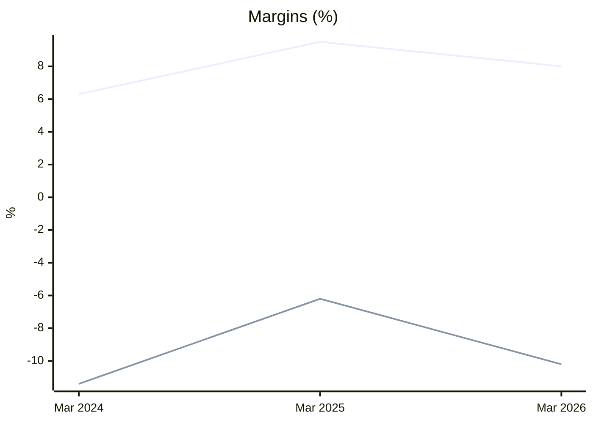

*Run 2026-11-24 · part of [SPINOFF_REPORT.md](../SPINOFF_REPORT.md) · the complete analysis of one company, with every management-call exchange in full.*

## ABFRL — Aditya Birla Fashion and Retail Ltd.

### 1. Aditya Birla Fashion and Retail Ltd. — CONFIRMED DEMERGER

**CONFIRMED** (a demerger scheme is on the exchange record) · **LISTED 1–2Y — the second-year window** · score 3.6/10 · spin-off · 5 filing(s) from NSE, NSE-register · first 2025-05-22, latest 2026-07-10

**The separated entities — every one the documents name:**

| Entity | Scheme | Business | Listing | Who runs it |
|---|---|---|---|---|
| **Aditya Birla Lifestyle Brands Limited** | 2024 demerger of the Madura Fashion and Lifestyle Business … | Madura Fashion and Lifestyle Business: Louis Philippe, Van Heusen, Allen Solly, Peter England, Simon Carter, … | listed 2025-06-23 as ABLBL (NSE) | Mr. Ashish Dikshit, Managing Director; Mr. Vishak… |

**The other parties to the scheme(s)** — not separated entities: TCNS Clothing Co. Limited — merged in — no shares for the parent's holders; Jaypore E-Commerce Private Limited — merged in — no shares for the parent's holders; TG Apparel & Decor Private Limited — merged in — no shares for the parent's holders

**What is being separated, as the documents put it:** Madura Fashion & Lifestyle Business, demerged from ABFRL into wholly owned subsidiary Aditya Birla Lifestyle Brands Limited, effective May 1, 2025 — class `not stated`.

### 2. Stages and dates

> **Listing:** LISTED — Aditya Birla Lifestyle Brands Limited (ABLBL) since 2025-06-23 (NSE equity list); record date 2025-05-22

| Date | Event | Source |
|---|---|---|
| 2024-04-01 | Other — Aditya Birla Fashion and Retail Limited | as stated: Press Release / media release, April 1, 2024 — Board authorized the m… |
| 2024-04-01 | Appointed date — ABFRL / ABLBL | as stated: Effective date intimation, April 23, 2025 ("Appointed Date as per the… |
| 2024-04-09 | Other — Aditya Birla Lifestyle Brands Limited | as stated: Intimation dated April 9, 2024 — incorporation of ABLBL (CIN U46410MH… |
| 2024-04-19 | Stage reached: **announced** | [Scheme of Arrangement](https://nsearchives.nseindia.in/corporate/ABFRL_19042024171846_SE.pdf) |
| 2024-04-19 | Board approval — ABFRL and ABLBL | as stated: Scheme of Arrangement filing / Outcome of Board Meeting, April 19, 20… |
| 2024-07-04 | Filed with exchanges — ABFRL | as stated: NSE Observation Letter Ref: NSE/LIST/41319 dated October 28, 2024 ("B… |
| 2024-10-25 | SEBI observations — ABFRL | as stated: NSE Observation Letter dated October 28, 2024 ("SEBI vide its letter … |
| 2024-10-28 | Exchange no-objection — National Stock Exchange of India Limited | as stated: NSE Observation Letter Ref: NSE/LIST/41319 dated October 28, 2024, di… |
| 2024-10-30 | Stage reached: **exchange noc** | [General Updates](https://nsearchives.nseindia.in/corporate/ABFRL_30102024204414_SE-Observation_letter_intimation.pdf) |
| 2024-10-30 | Exchange no-objection — BSE Limited | as stated: Filing dated October 30, 2024 — Receipt of "No Observation letters" f… |
| 2024-11-27 | Other — ABFRL | as stated: Filing dated November 28, 2024 — NCLT order dated November 27, 2024 d… |
| 2025-01-21 | Stage reached: **meetings** | [Shareholders meeting](https://nsearchives.nseindia.in/corporate/ABFRL_21012025152425_SE.pdf) |
| 2025-01-21 | Other — ABFRL | as stated: Corrigendum to EGM Notice dated February 4, 2025 — 6,85,83,059 equity… |
| 2025-01-21 | Shareholders / creditors meeting — ABFRL equity shareholders | as stated: Proceedings of NCLT-convened meeting, January 21, 2025, and Voting Re… |
| 2025-02-13 | Other — ABFRL | as stated: Press release February 14, 2025 and Corrigendum dated February 4, 202… |
| 2025-03-27 | NCLT order — ABFRL and ABLBL | as stated: Filing dated March 27, 2025 — NCLT, Mumbai Bench order in C.P.(CAA)/4… |
| 2025-04-22 | Other — ABFRL | as stated: Filing dated April 22, 2025 — receipt of certified copy of the NCLT o… |
| 2025-04-23 | Other — ABFRL and ABLBL | as stated: Filing dated April 23, 2025 — both ABFRL and ABLBL filed the certifie… |
| 2025-05-01 | Effective date — ABFRL / ABLBL | as stated: Filing dated April 23, 2025 ("Effective Date in terms of the Scheme i… |
| 2025-05-22 | **Record date** | NSE corporate-actions register |
| 2025-05-22 | Stage reached: **record date** | [Updates](https://nsearchives.nseindia.in/corporate/ABFRL_22052025113207_SE_Cost_Apportionment.pdf) |
| 2025-05-22 | Record date — ABFRL | as stated: Record Date intimation dated May 12, 2025 (Thursday, May 22, 2025 fix… |
| 2025-05-26 | Allotment — Aditya Birla Lifestyle Brands Limited | as stated: Filing dated May 26, 2025 — allotment of 1,22,02,94,773 equity shares… |
| 2025-06-23 | **Aditya Birla Lifestyle Brands Limited** listed (ABLBL) | NSE equity list |
| 2025-06-23 | Listing and trading — Aditya Birla Lifestyle Brands Limited | as stated: NSE equity list (ABLBL, listed 2025-06-23); company press release dat… |
| 2026-02-10 | Stage reached: **effective** | [Updates](https://nsearchives.nseindia.com/corporate/ABFRL_10022026135217_Outcome.pdf) |
| 2026-07-02 | Stage reached: **nclt sanction** | [General Updates](https://nsearchives.nseindia.com/corporate/ABFRL_02072026181255_SE_Pronouncement_of_order.pdf) |

**The stages, as filed:** announced (2024-04-19) → exchange noc (2024-10-30) → meetings (2025-01-21) → record date (2025-05-22) → effective (2026-02-10) → nclt sanction (2026-07-02)

**Stated in the filings:** record date 2025-05-22.

**When it lists, in the documents' words:** Already listed: "The Equity Shares of the Resulting Company listed on BSE Limited and the National Stock Exchange of India Limited on June 23, 2025" (stated in the February 10, 2026 filing of Q3 FY26 results, note 6/note 8)

### 3. Size of the separated business beside the parent — is institutional selling likely?

**Reading: LESS LIKELY on size alone — the piece is the larger part of the business.**

| Entity | Stated turnover | Stated share of the whole | Market cap (₹ cr) | Share of the whole by market cap | Segment revenue share | Index member | Selling on size |
|---|---|---:|---:|---:|---:|---|---|
| Aditya Birla Lifestyle Brands Limited | MFL Business turnover Rs. 7,607 crores as on March 31, 2023… | 64.81% (share of turnover) | 9,552 | 66.6% | 103.6% (FY2025) | yes | less likely |

*Stated figures are the documents' own (a turnover share, or the cost-of-acquisition split the company publishes for tax, which reflects relative value). The market-cap share is the entity's value over the whole — the parent plus every separated entity that trades (parent ₹4,795 cr, whole ₹14,347 cr, NSE bhavcopy of 2026-11-13); the segment share is the business's revenue over the parent's reported sales of that year. Both are computed here. The reading uses the market-cap share when the entity trades, else the stated share, else the segment share.*

**In the documents' words:** “The turnover of the MFL Business of the Demerged Company as on March 31, 2023, was Rs. 7,607 crores and forms 64.81 % of the total standalone turnover of the Demerged Company  as on March 31, 2023.”

**The judge's read of selling pressure:** unclear — Documents give 1:1 distribution to all shareholders and listing date, but no size, index or shareholder-base detail; same fashion-retail industry.

### 4. Insider ownership — share swap, promoters' holding, management incentives

**Share swap / entitlement, entity by entity:**

- **Aditya Birla Lifestyle Brands Limited:** "1 (one) fully paid-up equity share of ₹ 10/- (Rupees Ten) each of Resulting Company for every 1 (one) fully paid-up equity share of ₹ 10/- (Rupees Ten) each of Demerged Company." 1,22,02,94,773 equity shares allotted on May 26, 2025; entire pre-Scheme capital of 50,000 shares held by ABFRL cancelled

**Promoters' holding, from the shareholding pattern:**

| Company | Promoters | FIIs | DIIs | Public | Quarter |
|---|---:|---:|---:|---:|---|
| Aditya Birla Fashion and Retail Ltd. (ABFRL) | 46.61% | 10.11% | 4.28% | 38.7% | Sep 2026 |
| Aditya Birla Lifestyle Brands Limited (ABLBL) | 46.6% | 12.29% | 20.94% | 19.69% | Sep 2026 |

*Source: screener.in shareholding pattern, stored under `ShareholdingPattern/NiftyTotalMarket/`. In a mirror demerger each shareholder holds the same proportion of the new company as of the parent on the record date.*

- **Promoters in the parent, per the documents:** Promoter and promoter group: 52,75,17,139 shares, 46.28% pre-issue (pre-issue shareholding includes 6,85,83,059 equity shares allotted on January 21, 2025 pursuant to Qualified Institutional Placement) and 56,83,51,129 shares, 46.58% post the preferential issue, per the Corrigendum to the EGM Notice dated February 4, 2025 (EGM held February 13, 2025). Of this, Indian individuals/HUF 21,56,877 (0.19%) and bodies corporate 52,53,60,262 (46.09%).
- **What the promoters will hold in the separated entity:** 2024 demerger into ABLBL — mirror shareholding: "Upon effectiveness of the Scheme, the entire existing equity share capital of the Resulting Company shall stand cancelled and new equity shares (as mentioned in point (e) below) shall be allotted by the Resulting Company to the equity shareholders of the Demerged Company on the Record Date in accordance with the Scheme. Thus, the equity shareholding in the Resulting Company would m irror the shareholding of the Demerged Company." 2024 TCNS amalgamation and 2026 Jaypore/TG Apparel amalgamation: no promoter holding in a new entity arises — for the 2026 scheme "the shares held directly by the Amalgamated Company in the Amalgamating Companies along with nominees, will stand cancelled and no consideration whatsoever shall pass from the Amalgamated Company."
- **What a public shareholder receives:** 2024 demerger into ABLBL: "ABLBL shall issue and allot 1 (One) fully paid-up equity share of ABLBL having face value of Rs 10 (Rupees Ten) each for every 1 (One) fully paid-up equity share of Rs 10 (Rupees Ten) each of the Company to the shareholders of the Company whose names are recorded in the register of members and / or records of the depository a s on the Record Date (i.e., Thursday, 22nd May 2025)." — in addition to their existing shareholding in ABFRL: "the shareholders of ABFRL will get one share of ABLBL for every one share in ABFRL, in addi tion to their existing shareholding in ABFRL." 2024 TCNS amalgamation: ABFRL's own public shareholders received nothing; TCNS shareholders received "11 fully paid-up equity shares of the face value Rs. 10 each of ABFRL for every 6 fully paid-up equity shares of face value of Rs. 2 each held in TCNS." 2026 Jaypore/TG Apparel amalgamation: nothing — no consideration passes and no new shares are issued.
- **Management incentives:** Treatment of stock options / RSUs / SARs in the schemes is not stated. Insider and employee-trust shareholding is disclosed in Annexure A of the EGM Notice (Corrigendum dated February 4, 2025): "Directors and their relatives (excluding independent directors and nominee directors)  7,08,556  0.06 ... Key Managerial Personnel  1,24,564  0.01" and "Non - Promoter Non - Public Shareholders (Employee Benefit Trust)  44,06,334  0.39" (post-issue 0.06%, 0.01% and 0.36% respectively). The standalone financial results "include the financial information of ABFRL Employee Welfare Trust". On intent to subscribe to the preferential issue: "Other than above, none of the promoters, directors, key management personnel or senior management of the Company intends to subscribe the offer." New ABLBL management appointments were made (Ashish Dikshit as Managing Director, Vishak Kumar as Deputy Managing Director and CEO, Dharmendra Lodha as CFO, Rajeev Agrawal as Company Secretary, and senior managerial personnel Puneet Kumar Malik, Jacob John and Narahari N), but no incentive plan, exercise price or pricing date is stated.
- **Insider actions around the separation:** Promoter group subscribed to the pre-demerger capital raise: "The board of Aditya Birla Fashion and Retail Limited ("ABFRL") in its meeting today approved raising of USD 500 Mn through a combination of preferential issuance and Qualified Institutional Placement ("QIP") of equity shares. The Preferential issuance of USD 275 Mn will be led by the promoter group investing USD 150 Mn. and Fidelity Investments investing USD 125 Mn. The promoter participation is at a significant premium of 17.5% over yesterday's closing price, signalling strong conviction in the value creation potential of ABFRL." Specifically: "Pilani Investment and Industries Corporation Limited, part of Promoter Group of the Company intends to subscribe up to 4,08,33,990 equity shares in the proposed Preferential Issue" at ₹317.75 per share aggregating up to ₹12,97,50,00,521, taking its holding from 0.35% pre-issue to 3.67% post-issue. At announcement of the demerger: "ABFRL plans to raise ~ Rs. 2500 Cr equity capital within 12 months of demerger with promoter participation" and "The company's promoter group will fully support t he proposed equity raise." Promoter and promoter group voted 52,75,17,139 shares (100%) in favour of the Scheme at the NCLT-convened meeting, and "Whether promoter/ promoter group are intere sted in the agenda/resolution? NO". No promoter or management selling or pledging is stated.
- **Insiders, per the checklist read:** Not stated. Documents only state every ABFRL shareholder on record date May 22, 2025 received 1 ABLBL share per ABFRL share; no promoter stake or incentive disclosure. · *option pricing date:* not stated

### 5. Why the demerger — point by point

The business being separated is the Madura Fashion & Lifestyle / western-wear branded-apparel business — Louis Philippe-type premium lifestyle brands plus Reebok, American Eagle, Van Heusen Innerwear and the (exited) Forever 21 — demerged out of ABFRL into a separately listed Aditya Birla Lifestyle Brands Limited (ABLBL), leaving in ABFRL the Pantaloons/OWND (ex-Style Up) masstige-value play, the ethnic portfolio (Sabyasachi, Tarun Tahiliani, House of Masaba, Shantnu & Nikhil, Tasva, Jaypore, TCNS/W-Aurelia), luxury (The Collective, Galeries Lafayette) and digital-first TMRW. Management's stated reason is a capital-allocation and focus problem inside one company: ABLBL is a mature, high-margin, cash-generating platform (FY25 normalized revenue INR7,830 crores, EBITDA margin 16.2%, up 100bps; Q4 FY25 EBITDA margin 17%, +200bps; brands at 19.3% FY25 margin, retail LTL 9-12%) whose growth lever — an 'aggressive' net 300+ store rollout, 200 of them own-capex — was 'underleveraged in the combined entity', so the demerger was explicitly designed to 'leave that cash for allowing that business to soar' and let it invest through downcycles when franchisees cannot. Conversely the retained ABFRL is a portfolio of loss-making/investment-phase businesses (TCNS, Tasva, Style Up/OWND, Galeries Lafayette, TMRW) that needed a clean, cash-rich balance sheet: ABFRL raised USD 490 million via QIP plus preferential issue (promoters paying a significant premium) to make demerged ABFRL 'debt-free' with gross cash of INR2,350 crores at consolidation, versus ABLBL starting with ~INR700-781 crores net debt to be repaid in 2-3 years. Dikshit framed the underlying problem as too many simultaneous growth bets starving each other of attention — 'Innerwear will get the attention which it would not have got when we had 5 or 6 such growth opportunities in front of us' — i.e. separation is about focus, differentiated capital structures (dividend-paying ABLBL vs. investment-funding ABFRL) and separate value-creation journeys. The same philosophy is applied one level down: TMRW was built as a separate company from 2021 precisely so it would raise its own capital (INR437 crores from ServiceNow Ventures for ~11%, INR440-450 crores equity in FY26, INR500 crores NCDs, ~INR800 crores cash) and eventually have 'its own public market journey'. Mechanically the demerger was Board-approved 19 April 2024, shareholder-approved 21 January 2025, NCLT-sanctioned 27 March 2025, effective 1 May 2025 with an appointed date of 1 April 2024, a 1:1 share entitlement (1,22,02,94,773 ABLBL shares allotted 26 May 2025) and ABLBL listed 23 June 2025; it also reset intercompany accounting, producing a one-off INR97 crore gain from ending inter-division elimination on Madura stock sold through Pantaloons and INR148 crore of depreciation not charged on discontinued operations. Targets attached to the split: ABLBL to 'double in scale' and expand margins over five years and pay dividends at the earliest opportunity; ABFRL to deliver 3x revenue and 2x margin over five years, with most of that margin uplift coming from turning TCNS, Tasva and TMRW from EBITDA-negative to profitable.

**Point by point, with the source:**

1. First formal framing of the separation: the western-wear brands business is being carved into a separate listed entity, ABLBL, with NCLT scheduled for the third week of March 2025 and completion expected in 2-3 months. “First, the demerger of western wear brands business into a separate entity, that is Aditya Birla Lifestyle Brands Limited, or ABLBL, is progressing well and set for completion within the next 2, 3 months.” — *[Feb 2025](https://www.bseindia.com/stockinfo/AnnPdfOpen.aspx?Pname=86aee500-e77b-4d18-9566-af83384f5a37.pdf)*
2. The USD 490 million QIP plus preferential issue was raised inside the pre-demerger company specifically so the retained ABFRL would emerge debt-free with enough cash to fund its loss-making businesses until self-sustaining. “The fundraise within demerged ABFRL will strengthen its balance sheet by making it debt-free and leaving enough cash in the books to take care of the growth needs of its businesses until they become self-sustainable.” — *[Feb 2025](https://www.bseindia.com/stockinfo/AnnPdfOpen.aspx?Pname=86aee500-e77b-4d18-9566-af83384f5a37.pdf)*
3. Capital structures were deliberately split asymmetrically — debt with the cash-generating lifestyle entity, cash with the investment-phase entity. “We expect ABLBL to start the next year with opening debt of INR700 crores, whereas demerged ABFRL will have a likely cash balance of approximately INR1,300 crores.” — *[Feb 2025](https://www.bseindia.com/stockinfo/AnnPdfOpen.aspx?Pname=86aee500-e77b-4d18-9566-af83384f5a37.pdf)*
4. The sharpest stated rationale: Lifestyle Brands' store-expansion opportunity was under-exploited while inside the combined company, and the demerger was designed to free its own cash for that expansion (300+ stores, ~200 own-capex). “And one of the strategic rationale for the demerger was to leave that cash for allowing that business to soar.” — *[Feb 2025](https://www.bseindia.com/stockinfo/AnnPdfOpen.aspx?Pname=86aee500-e77b-4d18-9566-af83384f5a37.pdf)*
5. A second, cyclical argument: as a standalone entity ABLBL can self-fund store rollout when franchisee partners pull back in weak demand periods. “Lifestyle Brands particularly also will have access to their own cash. So their ability to grow even in downtimes, when franchisees sometimes are not in a position to invest during the low time, the business will be able to sort of short circuit that and invest deeper.” — *[Feb 2025](https://www.bseindia.com/stockinfo/AnnPdfOpen.aspx?Pname=86aee500-e77b-4d18-9566-af83384f5a37.pdf)*
6. The umbrella justification offered to investors was value unlock via two independently capitalised, independently growing entities. “The completion of these steps in the next 2, 3 months will enable us to unlock value through 2 independent entities, both with attractive growth potential and a strong balance sheet through a resilient growth-oriented business model sharpened over time.” — *[Feb 2025](https://www.bseindia.com/stockinfo/AnnPdfOpen.aspx?Pname=86aee500-e77b-4d18-9566-af83384f5a37.pdf)*
7. Completion announced: demerger done, 1:1 entitlement, ABLBL shares allotted to ABFRL shareholders and listing targeted by end-June 2025. “We successfully completed the demerger, creating two focused fashion power houses, Aditya Birla Lifestyle Brands Limited, ABLBL; and Aditya Birla Fashion and Retail Limited, ABFRL, both now set on independent high-growth trajectories.” — *[May 2025](https://www.bseindia.com/stockinfo/AnnPdfOpen.aspx?Pname=29b83308-dd71-4b41-9802-e328e83350ee.pdf)*
8. The underlying diagnosis stated plainly in answer to a question on why Innerwear had stagnated at ~INR500 crores since 2016 — one company carrying five or six growth bets could not give each the management attention and capital it needed, hence restructuring into separate entities. “I think as it becomes part of a company which is fundamentally profitable free cash flow generator and it's an important part of its growth journey, Innerwear will get the attention which it would not have got when we had 5 or 6 such growth opportunities in front of us.” — *[May 2025](https://www.bseindia.com/stockinfo/AnnPdfOpen.aspx?Pname=29b83308-dd71-4b41-9802-e328e83350ee.pdf)*
9. Same answer gives the structural logic for the split: multiple growth opportunities in one company required separate capitalisation and structure. “ABFRL, the combined ABFRL business had multiple growth opportunities, and we realized at some point of time, that we'll have to capitalize it and structure it differently to pursue independent growth opportunities more aggressively.” — *[May 2025](https://www.bseindia.com/stockinfo/AnnPdfOpen.aspx?Pname=29b83308-dd71-4b41-9802-e328e83350ee.pdf)*
10. Both halves were shown as independently healthy at separation — ABLBL Q4 margin +200bps (FY25 normalized revenue INR7,830 crores, 16.2% margin), demerged ABFRL Q4 EBITDA more than doubled to INR199 crores comparable. “Both entities delivered robust profitability, ABLBL clocking 200 basis points margin expansion, while demerged ABFRL more than doubling its EBITDA.” — *[May 2025](https://www.bseindia.com/stockinfo/AnnPdfOpen.aspx?Pname=29b83308-dd71-4b41-9802-e328e83350ee.pdf)*
11. ABLBL is positioned as the self-funding, net-debt-INR781-crore, dividend-paying mature platform with a 300+ store FY26 pipeline, to double in scale over five years. “ABLBL shall be a dividend-distributing company at the earliest appropriate opportunity.” — *[May 2025](https://www.bseindia.com/stockinfo/AnnPdfOpen.aspx?Pname=29b83308-dd71-4b41-9802-e328e83350ee.pdf)*
12. Retained ABFRL's post-demerger ambition quantified; management added that most of the margin uplift must come from turning TCNS, Tasva and TMRW from EBITDA-negative to profitable. “ABFRL with a sharpened brand portfolio, a comprehensive diversified play across high-growth segments and a gross cash balance of INR2,350 crores is set to unlock the next phase of growth, targeting a 3x revenue scale up and 2x margin expansion over the next 5 years.” — *[May 2025](https://www.bseindia.com/stockinfo/AnnPdfOpen.aspx?Pname=29b83308-dd71-4b41-9802-e328e83350ee.pdf)*
13. Accounting consequence of separating the two: the inter-division elimination on Madura brand merchandise sold through Pantaloons ends, producing a one-off INR97 crore inventory write-up gain, alongside INR148 crore of depreciation not charged on discontinued operations. “Reported EBITDA includes gain of INR97 crores on account of discontinuation of interdivision elimination post demerger as company's financials get reset to report on independent and stand-alone basis going forward.” — *[May 2025](https://www.bseindia.com/stockinfo/AnnPdfOpen.aspx?Pname=29b83308-dd71-4b41-9802-e328e83350ee.pdf)*
14. Process closed out and ABLBL separately listed, completing the separation. “On demerger, as previously communicated, all requisite processes have been successfully completed, culminating in the creation of Aditya Birla Lifestyle Brands Limited.” — *[Aug 2025](https://www.bseindia.com/stockinfo/AnnPdfOpen.aspx?Pname=605235b0-2e2b-4b89-9dcf-9a88f5115fa7.pdf)*
15. The same 'separate entity, separate capital' philosophy is applied one level down to TMRW, created as a separate company in 2021 so it would raise external capital (INR437 crores from ServiceNow Ventures for ~11%) and eventually list on its own rather than consume ABFRL's cash. “And over the next 8, 10 years, build a company which can find a very digital native path to this industry, which is fashion industry and have its own public market journey as we go forward from private to public.” — *[Aug 2025](https://www.bseindia.com/stockinfo/AnnPdfOpen.aspx?Pname=605235b0-2e2b-4b89-9dcf-9a88f5115fa7.pdf)*
16. A year on, the demerger persists only as a comparability adjustment in reported numbers; underlying ABFRL is now at standalone EBITDA breakeven and ex-TMRW consolidated pre-Ind AS loss narrowed to INR33 crores. “It is important to note that last year included a onetime gain of INR97 crores relating to inventory write-up and accounting treatment relating to demerger, which was explained in detail during Q4 results of last year.” — *[May 2026](https://www.bseindia.com/stockinfo/AnnPdfOpen.aspx?Pname=cf16c559-ad8d-4518-802d-9e35cc221c92.pdf)*
17. Leverage guidance is explicitly carried across both the pre-demerger combined company and the post-demerger entities, at 2-3x for any of the group's fashion companies. “We are very far, but that's the guidance we gave 5 years back and 3 years back.” — *[May 2026](https://www.bseindia.com/stockinfo/AnnPdfOpen.aspx?Pname=cf16c559-ad8d-4518-802d-9e35cc221c92.pdf)*
18. The later corporate action runs the other way: wholly-owned Jaypore E-Commerce and TG Apparel & Decor are amalgamated INTO ABFRL (Board 5 Feb 2026, NCLT order 2 July 2026, appointed date 1 April 2026, effective 1 August 2026) with no consideration or share issue, purely to simplify structure and cut administrative cost. “Seamless integration and better financial strength and flexibility for the Amalgamated Company, which would result in maximizing overall shareholder value.” — *Scheme*
19. Stated benefits of that simplification step are legal/operating structure and cost, not value unlock — a contrast with the ABLBL demerger rationale. “Streamlining of business & administrative operations consequently reducing administrative & other operating costs;” — *Scheme*

**How it evolved:** The demerger was Board-approved on 19 April 2024 and by the Feb 17, 2025 call was 'progressing well', with NCLT listed for the third week of March 2025, the USD 490 million QIP/preferential raise just closed, and guidance that ABLBL would open FY26 with INR700 crores debt while demerged ABFRL held ~INR1,300-1,500 crores cash; in that call the rationale sharpened from generic 'unlock value' into the specific point that Lifestyle Brands' store expansion had been 'underleveraged in the combined entity'. By the May 26, 2025 call it was 'successfully completed' — two 'focused fashion power houses', ABLBL shares allotted 1:1, ABFRL carrying INR2,350 crores gross cash, with the first explicit five-year targets (ABLBL to double in scale and pay dividends; ABFRL 3x revenue, 2x margin) and the clearest statement of cause, that a combined ABFRL with '5 or 6' growth opportunities starved businesses like Innerwear of attention. The Aug 14, 2025 call confirmed completion and listing on 23 June 2025 and extended the same logic to TMRW raising its own external capital, and by the Nov 2025/Feb 2026/May 2026 calls the demerger survives only as an accounting comparability footnote (the INR97 crore base-quarter gain) while the structural work shifts to simplification inside ABFRL — the Feb 5, 2026 Scheme amalgamating wholly-owned Jaypore E-Commerce and TG Apparel & Decor into ABFRL, NCLT-sanctioned 2 July 2026 and effective 1 August 2026.

**What management expects from it:** ABLBL: own cash flows fund 300+ net stores, scale to double and margins expand from 16.2%, INR781 crore net debt repaid in 2-3 years, dividends paid early. Demerged ABFRL: debt-free with INR2,350 crore cash to fund OWND, Tasva, TCNS, luxury and TMRW; 3x revenue and 2x margin in five years, chiefly by turning TCNS, Tasva and TMRW profitable; sharper focus and attention per business.

*Not explained on the calls:* No investor, lender or partner is named as having demanded it; no tax, dis-synergy, cost-allocation, brand-royalty or transition-service detail; no reason given why INR700-781 crore debt stayed with ABLBL.

- *Stated reason, in one line:* not stated
- *What it reveals:* The departed MFL business was the profitable half (FY25 discontinued-operations PBT Rs 230.97 crore on revenue Rs 7,618.62 crore), leaving a loss-making, cash-consuming parent: FY26 revenue Rs 8,177 crore, PAT loss Rs 830 crore, FCF positive only by FY29.
- *Parent or spin:* spin · *Read next:* Aditya Birla Lifestyle Brands Limited's own standalone results — the demerged MFL business's post-listing revenue, margin and debt
- *In their words:* “The Equity Shares of the Resulting Company listed on BSE Limited and the National Stock Exchange of India Limited on June 23, 2025.”

### 6. On the calls, verbatim

7 call(s), oldest first: **26 question-and-answer exchange(s)** given in full — the question and every answer to it, nothing trimmed — and 7 passage(s) from management's prepared remarks (the complete sentences about it; the whole remarks are in the linked transcript). Text is as the transcript prints it.

#### Jun 2024 — [transcript](https://www.bseindia.com/stockinfo/AnnPdfOpen.aspx?Pname=89e45256-4dbf-4247-b593-895c275dc6fb.pdf)

**From the prepared remarks** *(the passage about it; the whole turn runs to 13,302 characters in the transcript)*

> **Jagdish Bajaj:** This fiscal, we announced our ethnic portfolio by acquiring TCNS to complete the gap in premium ethnic space that the portfolio had. Additionally, we run our TMRW business with a strong portfolio of digital first brands. These were key additions to make our portfolio more comprehensive in line with the long -term strategy of the company. Aditya Birla Fashion and Retail Limited May 29, 202 4 As you're already aware, that on April 19, 2024, the Board of ABFRL has approved the proposal of vertical demerger of Madu ra Fashion and Lifestyle business from ABFRL into company named Aditya Birla Lifestyle Brands Limited, which will be listed separately post the demerger. Pursuant to that, we have also reclassified our segmental reporting this quarter, and we'll continue to share the financials in a similar way till demerger becomes effective. The two proposed entities now are Aditya Birla Lifestyle Brands Limited consisting of Lifestyle brands, You th Western Wear, Innerwear and Sportswear, while Aditya Birla Fashion and R etail Limited consists of Masstige and Value retail, Ethnic, Super Premium and Digital First Brands. This strategic demerger of ABFRL is paving the way for the creation of two separate growth engines, each with a clear capital allocation strategy and uniq ue path for value creation. Both entities will focus on a specific growth areas aligned with their individual business models with a clear focus on maximizing stakeholder returns. Post demerger, ABFRL will raise fresh capital of INR2,500 crores to strength en its balance sheet and support the growth needs of its constituent businesses. Now I will talk about financial performance of our company for this quarter. The company delivered revenue of INR3,407 crores, a growth of 18% over same quarter last year, pr imarily driven by new lines of businesses. Excluding TCNS, growth was around 12%.

**Question and answer**

> **Garima:** Got it. And just for understanding, this will be a part of the demerged ABFRL?
>
> **Ashish Dikshit:** Yes, it will be part of the ABFRL, along with Pantaloons.

**Question and answer**

> **Garima:** Understood. Last question really is on timelines of full consolidation for TCNS. Where are we? And hence, post that, what all is pending for the demerger really to happen?
>
> **Jagdish Bajaj:** So Garima, we already started consolidating the results with us because it is our subsidiary. As far as merger is concerned, our merger, you know the court conveying AGM will be held on 5th of June. And another 3 months' time, we will be able to merge TCNS with us. On d emerger, it may be, as you know, we are progressing as per our timeline. We plan to complete this exercise by end of fiscal -- end of Q3 or in last quarter of FY '25.

**Question and answer**

> **Nihal Jham:** Just 1 final question, I do understand in the middle of the demerger between the 2 businesses with our debt currently stands at around INR2,800 crores. Is there a possibility also giving us sense of what that number would be?

**Question and answer**

> **Nihal Jham:** Yes, I was just asking that I do understand that we are targeting to demerg e by the end of Q3 or Q4. But is there a possibility to say, give a sense of what the blended debt could be next year. We are currently at, say, INR2,850 crores ? Aditya Birla Fashion and Retail Limited May 29, 202 4
>
> **Ashish Dikshit:** So I think, Nihal, as you know, the Lifestyle brands opening debt number for t he first April is about INR900-odd crores. We expect that to come down during the course of this year and with the profitability -- shape of the profitability of that business, that is pretty much under -- pretty much under the sort of manageable levels. As far as the ABFRL, which is the demerged entity is concerned, we have mentioned that we'll start with a debt of about INR1,951 crores, and we'll raise capital, and therefore, we expect to be net positive at the end of this year or thereabouts, depending o n how the year goes. But that's really the intention at this point of time, yes.

**Question and answer**

> **Nihal Jham:** Very, very sorry about that. I was just asking, is there any growth targets for the two businesses also that you want to separately lay out?
>
> **Ashish Dikshit:** No, I think I don't want to comment on 1 quarter, 1 year growth. You know the growth trajectories of these businesses. Lifestyle, the brand company, not just has the four mega Lifestyle brands, it also has growth engines in Reebok, the Innerwear as well as American Eagle, Forever 21 segment. The demerged entity has multiple growth levers. We just talked about Pantaloons now getting its act together and beginning to grow back again with the renewed proposition. StyleUp is something that we are now feeling more about confident about, so that wil l get acceleration. Most of our ethnic subsidiaries, I think the hard work has happened in terms of growing them from very small subscale to coming to a meaningful scale, and you'll see a very rapid acceleration on that. TMRW , if again a new business wher e many of the acquired brands are in early stage. So you'll see very rapid growth as far as that part of the business is concerned. So really speaking, both the platforms have multiple growth drivers, and we feel very confident about medium to long - term gr owth stories in this.

**Question and answer**

> **Devanshu Bansal:** Jagdish. Last question from my end. I noticed that TCNS' working capital is closer to INR300 crores. And in the PPT, we have mentioned that overall demerged entity, it's about INR137 crores of working capital. So just wonder, which is the working capital negative for rest of the business like Pantaloons, other ethnic businesses, super premium D2C. So what's your view on that?
>
> **Jagdish Bajaj:** No, I don't think it's negative. You're say ing the full net working capital?

**Question and answer**

> **Devanshu Bansal:** No, no. So for proposed demerged entity on page number 45 or 46.
>
> **Jagdish Bajaj:** Understood, understood. So in demerge INR137 crores, you could say this is the only available to me. So generally when we calculate NWC, it is inventories, debtors and payables. So in the remaining company, my net working capital in Pantaloons is very low. But like TMRW also has debtors. So to that extent, I have a matching payables.

**Question and answer**

> **Sameer Gupta:** Okay. No worries. Secondly, sir, on the capex part. So I noticed that there is a INR750 crores capex in FY '24 on a consolidated basis and INR550 crores even on a standalone basis. Now considering that Pantaloons have not seen a large e xpansion in terms of stores and rest of the business in the standalone is relatively capex light. Just wondering or can you just provide a reconciliation of this capex number? And what is the guidance for the coming year for the whole entity, as in not con sidering the demerger is happening. As an overall entity, what would be the capex number likely?
>
> **Jagdish Bajaj:** So capex number for FY '24 is right because we are building up a new factory in ABLBL, which is under PLI scheme and few expenditure. We have -- in some expenditure, we have done for our GL store, which is under work in progress. FY '25, my own estimate is that capex should be in a range of around INR600 crores to INR650 crores in both the entities put together.
>
> **Ashish Dikshit:** So there's INR120-odd crores manufacturing capex , which is a onetime thing which happened last year.

**Question and answer**

> **Rajit Aggarwal:** I had a question regarding an announcement, which appeared in some of the news articles, that the group plans to invest INR5,000 crores on the jewellery business. So is that correct? And if that investment is going to come into ABFRL demerged entity? And so if you can throw more light as to the time spa n and the source of funding, et cetera.
>
> **Ashish Dikshit:** No. If you read t hat news announcement, you would know it has nothing to do with ABFRL, any of the two entities that we're talking about. It's a separate group investment, which has nothing to do with the listed combined form ABFRL nor with any of the two entities which ar e proposed. It's outside this business.

**Question and answer**

> **Rajit Aggarwal:** And if I may add a very quick question. Given that the demerged entities will have -- will still have businesses targeting different customer segments, would you rule out any further demerger going forward? Aditya Birla Fashion and Retail Limited May 29, 202 4
>
> **Ashish Dikshit:** I think at this point of time, it may be too early even to respond to that. We just got into a shape where many of these businesses, whether it's Pantaloons and StyleUp , which is in our mind, very early stage of what is possible. Ethnic businesses, which have just got together, TMRW which is in first year, I think our focus right now is to support these businesses to get to their steady state or next level of scale and size and more importantly, profitability that we want to get out of them. Therefore, there is no such plan at this point in time.

#### Aug 2024 — [transcript](https://www.bseindia.com/stockinfo/AnnPdfOpen.aspx?Pname=4ba9eff0-1a9c-47ed-9e66-6e1752dfe5c1.pdf)

**From the prepared remarks** *(the passage about it; the whole turn runs to 7,781 characters in the transcript)*

> **Jagdish Bajaj:** These efforts have enabled us to navigate through the tough demand landscape effectively and profitably. This quarter sa w growth primarily driven by our newer businesses, which are built around emerging fashion segments. These new businesses are proving to be vital in sustaining our momentum while setting up multiple growth platforms for the future. Before I talk about financial performance, I would like to share the status of both merger and demerger corporate actions which we announced. The amalgamation of TCNS with ABFRL is on track as the honourable NCLT has approved the merger. We are awaiting the court order and then we will work towards making this scheme effective. For demerger, we have filed the application with the stock exchanges and hopefully we'll be able to complete it within the timeline indicated earlier, that is by end of fiscal year '25. Now I'll talk abou t financial performance of our company for Q1 FY '25. Our company delivered revenue of INR3,428 crores in this quarter, reflecting a growth of 7% over last year. The demerged ABFRL grew 26% Y -o-Y this quarter. Both our ethnic and digital -first portfolio together more than doubled their revenues led by organic as well as inorganic growth. Company achieved consolidated EBITDA of INR406 crores with 11.8% margin. EBITDA increased 15% year -on-year in absolute terms.

**Question and answer**

> **Sameer Gupta:** Got it, sir. Final last question, just an update on the net debt number for the company ending 1Q?
>
> **Jagdish Bajaj:** In 3 months, you want me to update. Okay, INR3,500 crores approximately. Sam eer Gupta: And you expect this number for FY '25 to be at?
>
> **Jagdish Bajaj:** Let us work on it because see as we announced that post demerger, we have an equity ra ise plan.

**Question and answer**

> **Anshuman Mohta:** Yes. This is Ansh uman Mohta here. Sir, do we expect Pantaloon division to break even post demerger, entire Pantaloon, Sabyasachi, ethnic, TMRW? As of now, Madura is funding for the losses of this division? What will happen to the division after the demerger?
>
> **Ashish Dikshit:** So there are multiple businesses. I won't have definite number, which would be an indicative of future. Pantaloons is a very profitable business, multiple parts of the businesses are profitable, Sabyasachi, Tarun Tahiliani, all the designer businesses are profitable. I think the losses in Tasva will continue this year, TMRW will continue this year. TCNS, we are winding down the losses. I think first half of this year was perhaps still be making losses. But from second half, we'll turn profitable even in TCNS. And therefore, as we go forward, the situation and the overall profitability of that division will also improve. In fact, the improvement will be much sharper there. As many businesses which are in incubation phase like Tasva or TMRW are coming into its being as we go forward. And to fund that growth, that's the reason we are raising capital -- that capital.

**Question and answer**

> **Gopal Navadhar:** Sure, sir. And now that the TCNS approval are through, by when we s hould expect this demerger process to get complete?
>
> **Ashish Dikshit:** Merger process or demerger?
>
> **Gopal Navadhar:** Demerger for brand business and ABFRL.
>
> **Jagdish Bajaj:** So Gopal, I'm awaiting the court order. As I spoke when I was speaking. After this, we'll go back again with the regulators and stock exchanges. Hopefully, once they approve, then it is a court procedure, which takes generally 90 to 100 days.
>
> **Ashish Dikshit:** We have filed for demerger also with the stock exchanges. We are waiting for the merger process, which is a precondition for process. So now that it's 5, 7 days away for the court order to come. And after that, maybe 4 months.

#### Nov 2024

**From the prepared remarks** *(the passage about it; the whole turn runs to 10,561 characters in the transcript)*

> **Jagdish Bajaj:** Also not worthy to mention that Aditya Birla Fashion & Retail Limited November 0 8, 2024 our sustained efforts toward s improving our planning and merchandising process , and our tight inventory control , led to a marked improvement in our working capital profile, leading to better capital efficiency. Let me also give an Update on the “Corporate Actions :” The last step in t he acquisition of TCNS has been successfully completed and TCNS has been fully amalgamated with ABFRL from 1st September 2024. Hence , the results are consolidated considering TCNS as a division . On the parallel , demerger process , the Company has completed the first step when it received NOC's of the demerger proposal from stock exchanges. The application has been filed with the National Company Law Tribunal as the second step , and we will now go through the process as prescribed by the Honorable Tribunal. We expect to complete the demerger process before the end of this financial year. Coming to the “Financial Performance ” of our Company for Q2 FY ’25: Our Company delivered c onsolidated revenue of Rs. 3,644 crores in this quarter, growing 13% over Q2 FY ‘24 . Consolidated EBITDA stood at Rs. 410 crores , growing 11% Y-o-Y in absolute terms , with 11.2% margin . This includes the TCNS business this quarter, which was not there in the base last year . […] Retail like -to- like growth for the brand stood at 3.4% , primarily impacted by lower demand in smaller markets . Continued focus on product innovation, casualization and markdown management , combined with elevated retail experience and consumer insights, supported profitable growth . Emerging growth businesses which include youth, western wear, inn erwear and athleisure, and sportswear segment posted 7% growth at an overall level, with the segment posting another quarter of positive EBITDA. Now , let us discuss the demerge d ABFRL segment : This segment has grown by 31% to Rs. 1,838 crores in Q2 FY ‘25 , validating our portfolio expansion strategy to build meaningful size businesses in large consumer spaces of the future. EBITDA for the segment grew by 66% with margin expanding by 170 basis point s to reach 8.1% this quarter . All businesses within this segment grew well, with profitability improvement across each of them. Let me start with Pantaloons : Pantaloons delivered yet another quarter of significantly improved profitability.

**Question and answer**

> **Gaurav Jogani:** Sir, my first question is with regards to the demand conditions , how have they been running into this first month of October and the festive season for both the brands , that is Pantaloons as well as the L ifestyle brand ? So, that is the first question answer. The sir, the second question also is with regards to , post the demerger between ABLBL and AB FRL, how do you plan to scale up things in the AB FRL piece of business given that that business will have a certain amount of debt? So, how the growth will be planned in that piece of the business , if you can answer that, that w ill be helpful.
>
> **Ashish Dikshit:** Thanks. I will get Vishak and Sang eeta to respond to the overall market conditions. Visha k, can you come in?
>
> **Vishak Kumar:** Hi, Gaurav. So, far we have had a decent start. I do not want to jinx it, but a decent start to Diwali. And what is important is the combination of wedding shopping as well as Diwali shopping that you have got. We still have to watch out how it pans out during November, December . And the good news is , there are a lot of wedding dates through this period, so I do believe that it should be a decent quarter in that sense, at least for our brand.
>
> **Sangeeta Tanwani:** So, very, very similar for us , Gaurav . I think festive , we had a good start just about closing . And I think it's like a mid -single -digit performance in terms of growth . Of course, the market conditions overall have been tough , but we have had an encouraging festive .

**Question and answer**

> **Gaurav Jogani:** Just one thing , we have been hearing from e astern based players that while the Pujo has been good, but the Pujo has not been that great as per the expectations , at least for them. So , is it similar for you , too?
>
> **Sangeeta Tanwani:** So, I will come in again. So, Pujo, as you know, is a very important period, especially for Pantaloons because east is a ver y important market for us. And we have had a low -single -digit Pujo. I think largely there were two or three external factors which disrupted the demand , the local protests that continued through Pujo, the fact that certain markets saw unprecedented rain , the disruptions in Bangladesh, there is a lot of purchase from customers who come in from Bangladesh during Pujo period. All of these factors actually impacted demand. But through that period we saw some disruption in Calcutta, but very encouraging to see those markets which behaved in a near normal fashion in terms of no disruptions, we in fact saw a very good high - single -digit growth in those markets. So, the rest of West Bengal , for example, did extremely Aditya Birla Fashion & Retail Limited November 0 8, 2024 well. The other markets in east did very well for us. So , I think it's a combination of disruptions that we saw in Calcutta, but very good performance in the rest of the market.
>
> **Ashish Dikshit:** Gaurav, to your other question regarding how do we fund the growth of the demerge d ABFRL, which will have a fair share of debt post separation. A t the time of the demerger announcement, the Board had also approved a fundraiser exercise. And as we go forward , at an appropriate time we would look to raise capital, which we had announced even at the time of demerger itself. We wanted to look at how the merger process is going and then time the fundraise. So, we will do that and we will fund it adequately to sort of drive the growth of the high growth segments that exist in the demerge d ABFRL .

**Question and answer**

> **Nihal:** Maybe later if you could clarify on that one -off or I will take it separately. The second question was on the debt part, currently we are at Rs. 3,800 crores on this , and this is a build -up because of festive. J ust to understand , say by the time we reach Q4, we will have the plan ned Rs. 2,500 crores QIP, we will obviously have, I think , around Rs. 1,000 crores left for ABLBL . So, what is the planned debt with which, say, the new entity will start after the QIP? If you could give a ballpark sense . And would the size of expansion that you are targeting be significant in terms of the CAPEX outflow, or overall CAPEX and working capital outflow ?
>
> **Ashish Dikshit:** So, Nihal, at this stage, unless the Board has formally approved a fundraiser, I would not be able to comment on it . But I would therefore speak of the debt from operating performance point of view. As you know second half of the year is where the retail sales picks up and much of our portfolio is also heavily skewed towards wedding and festival related periods , while all of the fashion industry like that are portfolio is particularly more heavily skewed around that. So, we expect that debt to come down by Rs. 400-odd crores to Rs. 500 crores in the second half of the year. As you said, there is a part which is allocated f rom 1st April 2024 , into the two entities. All I would say is we will sufficiently fund the demerged ABFRL to drive aspirations of the growth opportunities that we have created with the portfolio. I am not at liberty today to talk about either the size or the timing of the fundraise, and we will do that at an appropriate time. Aditya Birla Fashion & Retail Limited November 0 8, 2024

#### Feb 2025 — [transcript](https://www.bseindia.com/stockinfo/AnnPdfOpen.aspx?Pname=86aee500-e77b-4d18-9566-af83384f5a37.pdf)

**From the prepared remarks** *(the passage about it; the whole turn runs to 11,259 characters in the transcript)*

> **Jagdish Bajaj:** Through these measures, we have consistently delivered profitable growth over the pas t few quarters. This quarter as well, we have delivered EBITDA margin expansion with all our businesses demonstrating improved profitability. Update on key corporate actions. First, the demerger of western wear brands business into a separate entity, that is Aditya Birla Lifestyle Brands Limited, or ABLBL, is progressing well and set for completion within the next 2, 3 months. The NCLT hearing is scheduled in third week of March 2025. Number two, the company has successfully secured USD 490 mil lion equity capital through a mix of QIP and preferential issue. The fundraise within demerged ABFRL will strengthen its Aditya Birla Fashion and Retail Limited (ABFRL) February 17 , 202 5 balance sheet by making it debt -free and leaving enough cash in the books to take care of the growth needs of its businesses until they become self -sustainable. This fundraise attracted strong participation from leading global and domestic investors along with our promoters, who paid a significant premium to the prevailing share price, underscoring their confidence in the long -term potent ial of the business. Coming to the financial performance for this quarter. The company delivered consolidated revenue of INR4,305 crores, a growth of 3% over same quarter last year. […] As on 31st December 2024, our store network stands at 4,492 stores, spanning across a total retail area of 11.9 million square feet. The total net debt of consolidated ABFRL at the end of Janu ary 2025 stood at approximately INR1,800 crores after receiving INR1,860 crores of QIP money. This will further come down post receipt of preferential issue of INR2,379 crores. We expect ABLBL to start the next year with opening debt of INR700 crores, wher eas demerged ABFRL will have a likely cash balance of approximately INR1,300 crores. Let us now discuss business -wide performance. Starting with proposed Aditya Birla Lifestyle Brands Limited. ABLBL posted revenue of INR2,151 crores with EBITDA of INR355 c rores in Q3 FY '25 and an EBITDA margin of 16.5%, 90 basis point expansion versus last year. […] This transformation, further fueled by a strong festive and wedding season, reinforced their market leadership. The emerging growth businesses in ABLBL, which include youth western wear, innerwear, athleisure an d sportswear segment posted 5% growth at an overall level with the segment posting another quarter of EBITDA margin improvement. As you may be already aware, the company is in the process of phasing out its F21 offline operations, which has had a moderate impact on the growth of the emerging segment and also impacted its overall profitability. Post the demerger, ABLBL is set to embark on its independent value creation journey, well supported by access to its own cash flows to drive growth. Over the next 12 months, the brands are poised for an aggressive expansion with a significant rollout of 300 -plus new stores across the portfolio. Additionally, other sales channels are expected to regain momentum, further accelerating the overall growth. Let us now discus s performance of demerged ABFRL segments. The proposed demerged ABFRL reported a 3% Y -o-Y revenue growth, reaching INR2,218 crores. EBITDA stood at INR320 crores with an EBITDA margin of 14.4%, marking an increase of 250 basis points from 11.9% in the same quarter last year. Let me first cover Pantaloons. Pantaloons has been a driving premiumization strategy where it has consciously moved away from the overcrowded value retailing space. […] By strategically selecting profitable channels and stores, along with cost control initiatives, the business has successfully been able to streamline operat ions and drive leverage. Our merchandise has also seen improvement and the consumer feedback on recent ranges has been more than encouraging, backed by 4 consecutive quarter of positive LTL. We feel these efforts by our operating teams have laid a strong f oundation for sustained viable growth in the medium to long term for the brand. Post the fundraise, the balance sheet of demerged ABFRL is well placed to support the accelerated expansion of our Ethnic portfolio. Luxury Retail, the Collective & Mono brands grew by 13% in Q3 FY '25, led by a strong LTL of 10% and robust e -commerce performance. Similarly, our digital brand portfolios under TMRW posted a growth of 26% in sales year -on-year with an improvement in margin. This Aditya Birla Fashion and Retail Limited (ABFRL) February 17 , 202 5 validates our belief in the longer -term potential of digitally native brands focused on young India. To conclude, despite a challenging consumption environment, especially for discretionary category, our focus on driving productivity, efficiency, profitability, coupled with continuous impro vement in products and services has been able to guide us through this tough environment. One of the key strategic tasks of adequate fund raise has been successfully completed. Another important strategic initiative of demerger is on track. The completion of these steps in the next 2, 3 months will enable us to unlock value through 2 independent entities, both with attractive growth potential and a strong balance sheet through a resilient growth -oriented business model sharpened over time. We are open to questions now. Thank you.

**Question and answer**

> **Devanshu Bansal:** Sir, just a small follow -up here. So within, say, 3 years, you expect the smaller sort of new ventures, Style Up, Ta sva, Galeries Lafayette to gain scale, and then post that they'll be able to sustain on their own or we may have to sort of raise more capital within ABFRL?
>
> **Ashish Dikshit:** So our current analysis, and that's why this level of capital was raised, is that w ith the capital that we have raised, over the next 3 years, we should be able to accelerate the growth of these new businesses to a point that at the end of that cycle, the company as a whole, which is the demerged ABFRL, will be free cash flow generating company.

**Question and answer**

> **Ashish Kanodia:** So the first question was on the fundraise. So given that this fundraise has happened at a consolidated entity level before the demerger happening. So just wanted to understand what w as the thought process of leaving ABLBL with INR700 crores of debt? And related question on this was, by when do you expect that entity to become debt free?
>
> **Ashish Dikshit:** Demerger plan and the fundraise. At that stage, our expectation was demerger will h appen faster. But because we were simultaneously doing the acquisition and therefore the corresponding merger of TCNS, we realized the whole demerger exercise will probably take 12 to 15 months. And that's when we decided to do the fundraise in the combine d entity, because that is the fastest way of raising capital at that point of time. On the question of the rationale for leaving INR700 crores, I think Jagdish, in his previous quarter's response, has explained that the demerger is effective from 1st April 2024. So the books of accounts of the 2 companies are separated with the relevant debts lying in both the companies. And therefore, the company started with close to INR1,000 crores of debt at that point of time, which they brought it down in these 9 mont hs to INR700 crores. Over next 2, 2.5 years, we expect this to become a debt -free company.

**Question and answer**

> **Ashish Kanodia:** Sure. That's helpful. And second thing, now when I look at your store expansion plan and looking at your presentation, I think there are 2 key catego ries which you are callin g out in terms of accelerated growth. One is on the value fashion segment, which would be Style Up. And the second thing is on the Ethnic business side. So on Ethnic business, I think you guided for maybe 50 stores addition in FY '26. But if you can also give some sense in terms of what to expect in Style Up, and also within Ethnic, beyond Tasva, what kind of a store expansion can we expect? Aditya Birla Fashion and Retail Limited (ABFRL) February 17 , 202 5
>
> **Ashish Dikshit:** So in terms of expansion, Ashish, there are not 2 but 3 large shifts that w e are looking at. And primarily driven by the fact that I think organic performance is improving, we have completed our acquisition journey, now the focus is sort of improving the strength of those businesses and creating larger leverage. The first that Vi shak talked about, which is Lifestyle Brands accelerating much faster than network expansion. We think that's a large opportunity, which was sort of underleveraged in the combined entity. And one of the strategic rationale for the demerger was to leave tha t cash for allowing that business to soar. So that's point number one. As far as value retail is concerned, you're absolutely right. I think Style Up is the opportunity. We expect this year to end with a network between 45 to 50 stores -- 48 to 50 stores. Next year, we'll definitely, at the minimum level, double it. As we go along during the course of the year, we'll see if we can expand faster than that. But at this point, I think the number that I would play out is about 50 more stores next year. Tasva ha s already got the momentum with 70 stores now in the network and a good model which is working well. So Tasva is about 50 -odd stores. Tasva is, of course, more concentrated network. Potential for Style Up in subsequent years is much larger, but we obviousl y want to take bite size as we keep improving the economics of the business before we expand too rapidly.

#### May 2025 — [transcript](https://www.bseindia.com/stockinfo/AnnPdfOpen.aspx?Pname=29b83308-dd71-4b41-9802-e328e83350ee.pdf)

**From the prepared remarks** *(the passage about it; the whole turn runs to 13,837 characters in the transcript)*

> **Jagdish Bajaj:** Welcome to the Q4 FY '25 earnings call. Thank you for joining us today. We are pleased to report a strong close to what has been a transformative year for our business. With culmination of our demerger exercise, this qu arter marked the beginning of a new era for Aditya Birla Group's fashion business as two powerful independent fashion entities now commence their distinct value -creation journeys. Let me begin with some key corporate updates for Q4. We successfully completed the demerger, creating two focused fashion power houses, Aditya Birla Lifestyle Brands Limited, ABLBL; and Aditya Birla Fashion and Retail Limited, ABFRL, both now set on independent high -growth trajectories. The Board of ABLBL has allotted shares to all the eligible shareholders of ABFRL as per the record date. These shares will be credited within the next 2, 3 days, and ABLBL is on track to be listed by the end of June. We successfully raised USD 490 million of equity capital through QIP and preferential issuance during this quarter. With that, we have infused tremendous strength into the balance sheet of demerged ABFRL with an availability of INR2,350 crores cash at consolidated level to pursue aggressive growth across its multiple high -growth platforms. Now industry scenario , the quarter continues to see strong macro headwinds with sustained impact on consumer discretionary consumption. We delivered a resilient performance in this tough quarter, underpinned by disciplined focus on profitable growth and sharper execution across businesses. Both entities delivered robust profitability, ABLBL clocking 200 basis points margin expansion, while demerged ABFRL more than doubling its EBITDA. Coming to the financial performance for this quarter. As you are aware, the demerger was approved by shareholders on 21st January 2025. Accordingly, ABFRL held ABLBL's assets as Aditya Birla Fashion and Retail Limited (ABFRL) May 26, 202 5 assets held for distribution. As a result, the published financial results reflect, a) continued operations of demerged ABFRL; b) discontinued operations pertaining to ABLBL. Starting with Aditya Birla Lifestyle Brands Limited - Our premium Western wear business and home to some of India's most loved lifestyle brands . ABLBL continued to demonstrate a robust and profitable growth trajectory with a marked improvement in performance during the second half of the year. In Q4, the business delivered high single -digit like -to-like retail growth, driven by consistently robust retail execution, continued product innovation and a sharp focus on enhancing customer experience. At the same time, the company strategically rationalized low -margin channels and enhan ced the overall quality of its distribution network. Please note that for ABLBL, depreciation of INR148 crores on discontinued operations was not charged in consolidated financials due to asset classification under the demerger. However, ABLBL's own financials reflect full depreciation. ABLBL delivered a resilient performance in Q4 '25, posting normalized revenue growth of 3% to INR1,942 crores. Post considering intercompany elimination adjustment, revenue reported under discontinued operations were INR1,859 crores. EBITDA stood at INR330 crores, reflecting an 18% Y -o-Y growth. And the normalized EBITDA margin that is ex demerger impact of elimination expanded by 200 basis points to reach 17%. For the full year '25, ABLBL reported normalized revenue of INR7,830 crores with a normalized EBITDA margin of 16.2%, a 100 basis point improvement over the previous year. Full year revenue under discontinued operations stood at INR7,619 crores. The normalized PAT would have been INR250 crores versus INR168 crores reported highlighting the strong underlying profitability of the businesses. […] Importantly, the segment delivered positive EBITDA, highlighting the improving profitability profile. Strategic distribution expansion continues to be a critical growth driver for ABLBL businesses. Over the next 12 months, leveraging its strong cash flows, ABLBL is set to embark on a historic expansion drive with an aggressive retail rollout across its bra nd portfolios, adding over net 300 stores across the country to accelerate growth and deepen market presence. Now operating as an independent entity post demerger, ABLBL is uniquely positioned to chart its own value -creation journey. Combined with a stable high -margin core, a high -growth emerging brand portfolio and the strong brand equity with its consumers, the company is strongly positioned to confidently invest in driving growth, innovation and long -term leadership in fashion and apparel space. Let me now explain to you the performance of demerged ABFRL. The demerged Aditya Birla Fashion and Retail Limited continued its strong growth trajectory in Q4 FY '25, anchored in a clear strategy of profitable scale -up across its diverse, high -potential bu siness segment with leadership positions across ethnic wear, masstige and value retail, luxury fashion and digital - first brands. The company remains well positioned to capture growth in India's evolving fashion landscape. ABFRL's focused execution translated into both top line growth and significant margin expansion this quarter. In Q4 FY '25, the company reported a robust 9% Y -o-Y revenue growth reaching INR1,719 crores. Comparable EBITDA more than doubled to INR199 crores, up 103% versus last year, reflecting strong operating leverage and efficiency improvement across segments. Reported EBITDA stood at INR295 crores with a significant margin expansion to 17.2%. Reported EBITDA includes gain of INR97 crores on account of discontinuation of interdivision elimination post Aditya Birla Fashion and Retail Limited (ABFRL) May 26, 202 5 demerger as company's financials get reset to report on independent and stand -alone basis going forward. For the full year FY '25, demerged ABFRL posted revenue of INR7,355 crores, registering a 14% increase over the previous year. The comparable EBITDA margin expanded by 220 basis points to 103% amidst a challenging consumption environment. Demerged ABFRL has INR2,350 crores cash at consolidated level. With a sharpened brand portfolio, strong balance sheet and margin momentum, ABFRL is evolving into one of India's most versatile multi -format, multi -brand fashion platform. Let me first cover Pantaloons. Pantaloons segment continued its trajectory of margin -led growth in Q4 FY '25, reporting revenue of INR885 crores, which were impacted due to 50 -plus stores closure in the last 15 months. […] Our digital -first brand portfolio under TMRW delivered 27% Y -o-Y growth in Q4, along with margin improvement. This sustained momentum reinforced our confidence in the long -term potential of digitally native brands as we continue to scale through innovative product offerings, curated off -line presence and focused investment in brand equity, tailored for young aspirational consumers in India. To conclude, even in a tough consumption environment, our businesses have demonstrated strong resilience with consistent margin improvement across the board. With the demerger behind us, we now stand as 2 focused, well -capitalized entities each poised for its own high - growth journey. ABLBL, backed by a robust portfolio over 3,200 stores and healthy free cash flows, is positioned to double in scale and expand margins meaningfully over the next 5 years with 300 -plus stores already in the pipeline for FY '26. ABFRL with a sharpened brand portfolio, a comprehensive diversified play across high -growth segments and a gross cash balance of INR2,350 crores is set to unlock the next phase of growth, targeting a 3x revenue scale up and 2x margin expansion over the next 5 years. Together, we are building two future -ready fashion platform, resilient, profitable and prime for long-term value creation.

**Question and answer**

> **Ashish Kanodia:** The first question is on the demerged ABFRL. Now when I look at the guidance, you're talking about doubling the margin. Now full year FY '25 post -Ind AS margin is 9% excluding the other income. And if you have to take it to, say, 18% in the next 5 years, w hat will drive this because Pantaloons it's at around, say, 16% to 17% margins? So do you see what will be the bridge for - - at a company level going to 18% margin? The second thing on the Pantaloons is part of, at least , the outside view is that when we look at the margin expansion, it's also driven through closure of these underperforming stores, almost 50 stores in the last 15 months. Now say in the next 1.5, 2 yea rs, as you start to open new stores, what is the sustainable margins for Pantaloons? And the third question is on this INR97 crore adjustment, is it fair to say that this intersegment, which is now not getting adjusted, this is predominantly sitting only in Pantaloons because within Pantaloons you would also fill the Lifestyle branded merchandise. So is that understanding cor rect?
>
> **Jagdish Bajaj:** So let me take Q3 first. INR97 crores is the elimination or writing up of the inventories in line with the purchase price of Pantaloons. So this is a onetime adjustment, which was earlier knocked off as interunit division. Now it will not be there going forward because both are indep endent companies. And on long -term margin guidance and Pantaloons' margin, Ashish?
>
> **Ashish Dikshit:** I think we have put out a longer -term guidance for each of our business segments in the last analyst meet that we conducted. It's in public domain, so you can look at some of those numbers to get a reference on that. But coming to demerged ABFRL entity, the primary -- I would say the largest uptick in margins will come from turning the businesses, which are currently negative EBITDA and taking away from the profitability. Notably, parts of Ethnic businesses, TCNS being the largest, Tasva being the second and TMRW being the other businesses, these are businesses which are actually suppressing the margins that other profitable businesses make. And that would be the largest. Of course, there will be margin expansion in so me of the other businesses as well. But I think the significant part of this will come from turning around the businesses, which are currently loss-making. On the question of Pantaloons margin, Ashish, I think while your observation is correct, we have shut 50 stores, the cumulative impact on EBITDA for these stores is not much. These are -- a lot of stores have not been shut because all of them are loss -maki ng. Many of them have been shut because either they were too small, not in line with the strategy, some of them were such that we didn't feel we'll be able to turn them around meaningfully enough to profitability. The large part of profit improvement in Pantaloons has come from margin expansion, which is gross margin expansion, which is a function of lower markdown, which in turn is a reflection of better product apart from better plan. Aditya Birla Fashion and Retail Limited (ABFRL) May 26, 202 5 So it's not that we have shut the stores, and therefore, margins have expanded. I think a larger part of margin expansion has come in underlying businesses through more long -term sustainable pieces. The margin for the Pantaloons segment, as we report, which includes the Style Up as you can make out, has moved significantly. Jagdish mentioned for 6 consecutive quarters we have shown margin improvement. On a full year basis, also the margins got for the segment closer to 17%. For Pantaloons format itself, obviously, you would know margins is even higher. I still believe there is a long runway. I think a lot of good work has happened in Pantaloons, but there's a long runway currently from where we are for Pantaloons also to expand its margin. We think at least 300 basis point improvements from here is prett y much something that we will look to target in the next couple of years.

**Question and answer**

> **Garima Mishra:** First question, demerged ABFRL has started off with a net cash balance, right? So would this current cash balance be sufficient to fund the planned expansion and investment across the different business segments in this company?
>
> **Ashish Dikshit:** Yes. Garima coming back to your question, as Jagdish mentioned, there is sufficient capital, close to INR2000 crore -plus, which is lying as a gross cash in the ABFRL subsidiary. You would also know that we are looking to raise capital separately in TMRW, which would be required to fund that part of the business. So we feel adequately capitalized to drive this over next 3, 4 years.

**Question and answer**

> **Devanshu Bansal:** Sir, I was referring to this company by balance sheet that you have provided in the PPT. The net working capital for the demerged ABFRL is at negative INR136 crores and there are some businesses like TCNS, which would be operating at around INR200 crores to INR250 crores of working capital. This implies that the working capital for the other businesses is even more negative. So I wanted to check are these sustainable levels? And what is the long -term assumption that we should work with?
>
> **Ashish Dikshit:** So I think two parts. One is, as you know, ABFRL demerged entity has multiple businesses. So they will behave differently, as you rightly mentioned, different parts of the business. For a regular branded business with small format stores, we operate with early double -digit net working capital to sales to high single digit. Our most productive, from a capital point of view -- from a working capital point of view, our most productive businesses are in the Pantaloons segment, which is the largest part of this company. And that operates with close to zero working net working capital. A part of it is negative, in some quarters you'll get marginally positive. So it's the net balance of these businesses, which is what you will see quarter -on-quarter.

**Question and answer**

> **Devanshu Bansal:** Understood. And sir, from a capex perspective, since we are opening about 40, 50 Style Up stores; 15, 20 Pantaloons; 25 in Tasva; and then TCNS luxury is also expected to accelerate, what is the capex expectation for this demerged ABFRL for next few years?
>
> **Ashish Dikshit:** About -- on an ongoing basis, close to INR400 crores.

**Question and answer**

> **Gaurav Jogani:** Sir, if we are reading the balance sheet for the ABFRL business, the net cash actually comes to around INR9.3 billion -odd, the net cash that is. Now of that INR9.3 billion -odd, if you look at the capex that you just announced, that would be around INR5 billion -odd. Now assuming there will be still some losses at the PAT level in FY '26, do you still think that it would suffice for the expansions and the plans going ahead?
>
> **Jagdish Bajaj:** Yes, Gaurav, thanks. As Ashish explained, the gross cash available with ABFRL demerge is INR2,300 crores, right? Then we have a long -term loan, which is up to FY '30 and -- which will go -- the repayment go up to '30, '31. And then the subsidiaries borrowings, that includes borrowing in TMRW also. As Ashish explained, we have a plan to raise separate capital in TMRW. If I exclude that, we have adequate cash and we are well capitalized at our company for taking care of the capex , working capital and the loss funding for next 2 years, which according to me, the losses will be for next 2 years and after that all my businesses will be profit -making. Aditya Birla Fashion and Retail Limited (ABFRL) May 26, 202 5

**Question and answer**

> **Ashish Dikshit:** You are talking about the full company? Sam ir Gupta: ABFRL, the demerged entity.
>
> **Jagdish Bajaj:** Excluding TCNS, Sameer -- excluding TMRW, sorry, excluding TMRW, we will be EBITDA positive next year. Aditya Birla Fashion and Retail Limited (ABFRL) May 26, 202 5

**Question and answer**

> **Rajiv Bharati:** Sir, on the ABFRL demerged entity, if we were to add back that INR97 crores on the gross margin side, then the gross margin is basically up by close to 300 basis points. And on the post - Ind AS EBITDA is adjusting to the same thing, is up by 410. So the cost of retailing, which is the gap between the two is up by 130 basi s points. And this includes your store closure effort Aditya Birla Fashion and Retail Limited (ABFRL) May 26, 202 5 and also you said leverage on procurement stuff. But 130 basis points for the entire, is there more juice left here which probably we will see in the subsequent quarters or this is it?
>
> **Ashish Dikshit:** So I think this is -- I wouldn't say any part of this business this is it because this consists of many businesses with very, very different margin trajectory, margin profile. So I would be hesitant to make observation because the mix of businesses in this itself is going to change as we go forward. I think you should look at individual businesses, which is why we give segmental results in this, which contribute to the overall picture. So it will more be driven by the mix of the individual businesses and the improvement within the business itself. So there is a s ignificant improvement possible in this.
>
> **Jagdish Bajaj:** So Rajiv, what I suggested you look at my segmental result. The INR97 crores has gone into that elimination row, right? The individual businesses margins improvement, if you see Pantaloons margins have gone up from 13% to 16.9%. This I explained to you because of onetime effect, it's the interunit or intracompany eliminat ion, therefore, it does not include into the Pantaloons segment's margin.

#### Aug 2025 — [transcript](https://www.bseindia.com/stockinfo/AnnPdfOpen.aspx?Pname=605235b0-2e2b-4b89-9dcf-9a88f5115fa7.pdf)

**From the prepared remarks** *(the passage about it; the whole turn runs to 8,020 characters in the transcript)*

> **Jagdish Bajaj:** TMRW gets first investment of INR437 crores from ServiceNow Ventures in its current round of external fundraise, leveraging the ServiceNow AI platform. TMRW will further enhance its speed to market, dynamic and focused assortment and seamless consumer experiences across the rapidly expand ing omni - channel footprint. Relevant regulatory filings pertaining to the transactions have been completed. On demerger, as previously communicated, all requisite processes have been successfully completed, culminating in the creation of Aditya Birla Lifestyle Brands Limited. The company was listed on the stock exchange on 23rd June 2025. Coming to the financial performance for this quarter. ABFRL sustained its strong profitable growth momentum in Q1 FY '26, underpinned by a well -defined strategy of scaling its diverse, high-potential businesses with a disciplined focus on profitability.

#### May 2026 — [transcript](https://www.bseindia.com/stockinfo/AnnPdfOpen.aspx?Pname=cf16c559-ad8d-4518-802d-9e35cc221c92.pdf)

**From the prepared remarks** *(the passage about it; the whole turn runs to 10,713 characters in the transcript)*

> **Jagdish Bajaj:** Within segments, Pantaloons segment delivered 19% Y -o-Y growth, led by 17% Y -o-Y growth Aditya Birla Fashion and Retail Limited (ABFRL) May 26 , 202 6 in the core Pantaloons format. TMRW maintained momentum, delivering 45% growth year -on- year. I would like to emphasize on profitability for this quarter in context of a few one -offs in the base quarter. It is important to note that last year included a onetime gain of INR97 crores relating to inventory write -up and accounting treatment relating to demerger, which was explained in detail during Q4 results of last year. Please note that comparisons are made against the base, excluding this impact. This quarter also saw a gain of INR83 crores from derivative gain within TMRW's associate company WROGN compared to INR22 crores in the same period last year. These gains are getting consolidated at ABFRL level and are non -cash in nature. […] Within overall EBITDA, our ethnic business margin, specifically saw a big expansion of 390 basis points year -on-year, mainly due to reduction in TCNS losses. Reported loss for the quarter stood at INR164 crores compared to INR171 crore s in the same period last year. This includes a one -time exceptional charge of INR11 crores related to the wage code. Here also, please note that last year's reported PAT included demerger gain of INR97 crores. Adjusting for this, the revaluation gain is TMRW's associate and wage code impact. The loss at PAT level has reduced from INR289 crores last year to INR235 crores this year, highlighting a better underlying operating performance. Moving to the financial performance for the year. ABFRL delivered revenue of INR8,177 crores, registering an 11% Y -o-Y growth. This was supported by double -digit growth across ethnic, TMRW and luxury businesses. EBITDA adjusted for the demerger gain and the revaluation gain in TMRW's associates grew by 23% Y -o-Y to INR903 crores with margin at 11% versus 10% last year. This reflects the continued improvement in operating performance across the portfolio. As of March 2026, ABFRL had gross cash of INR1,545 crores at the consolidated level, while gross cash at the standalone level stood at INR1,144 crores. The gross debt at consolidated level is INR1,695 crores and standalone level is INR748 crores.

### 7. The parent's financial statements

**The parent, last three fiscal years (consolidated)**

| | Mar 2024 | Mar 2025 | Mar 2026 |
|---|---:|---:|---:|
| Sales (₹ cr) | 6,441 | 7,351 | 8,177 |
| Sales growth (%) | -48.1% | +14.1% | +11.2% |
| Operating profit (₹ cr) | 408 | 699 | 657 |
| Operating profit growth (%) | -73.8% | +71.3% | -6.0% |
| Operating margin (%) | 6.3 | 9.5 | 8.0 |
| PAT (₹ cr) | -736 | -456 | -830 |
| PAT growth (%) | -1147.5% | +38.0% | -82.0% |
| PAT margin (%) | -11.4 | -6.2 | -10.2 |
| EPS (₹) | -6.2 | -3.1 | -6.4 |

*Source: ProfitStatement/NiftyTotalMarket/ABFRL.csv (consolidated, screener.in); growth and margins computed here.*

```mermaid
xychart-beta
    title "Sales, operating profit and PAT (₹ cr)"
    x-axis ["Mar 2024", "Mar 2025", "Mar 2026"]
    y-axis "₹ crore"
    bar [6441, 7351, 8177]
    bar [408, 699, 657]
    bar [-736, -456, -830]
```

*Series in order: Sales, Operating profit, PAT.*

*Series in order: Operating margin, PAT margin.*

**P/E:** — — EPS -6.36 for Mar 2026 is not positive (price ₹44.53 as of 2026-10-01).

**Cash flows (₹ cr):**

| | Mar 2024 | Mar 2025 | Mar 2026 |
|---|---:|---:|---:|
| Cash from operations (₹ cr) | 1,341 | 1,644 | 161 |
| Cash from investing (₹ cr) | -2,992 | -1,665 | -267 |
| Cash from financing (₹ cr) | 1,412 | 334 | -594 |
| Net cash flow (₹ cr) | -239 | 313 | -700 |
| Free cash flow (₹ cr) | 600 | 1,051 | -295 |

*Source: CashFlow/NiftyTotalMarket/ABFRL.csv (consolidated, screener.in).*

### 8. The separated business's financial statements

**The business being separated — its own numbers**, entity by entity: its reported statements once it is listed and on file, and the segment numbers the annual reports and presentations carry for it before that.

**Aditya Birla Lifestyle Brands Limited (ABLBL) — as reported since listing**

| | Mar 2025 | Mar 2026 |
|---|---:|---:|
| Sales (₹ cr) | 7,830 | 8,396 |
| Sales growth (%) | — | +7.2% |
| Operating profit (₹ cr) | 1,223 | 1,371 |
| Operating profit growth (%) | — | +12.1% |
| Operating margin (%) | 15.6 | 16.3 |
| PAT (₹ cr) | 60.0 | 171 |
| PAT growth (%) | — | +185.0% |
| PAT margin (%) | 0.8 | 2.0 |
| EPS (₹) | 1.4 | 1.4 |

*Source: ProfitStatement/NiftyTotalMarket/ABLBL.csv (consolidated, screener.in); growth and margins computed here.*

**Madura Fashion & Lifestyle (shown as Discontinued Operations from FY2025) → Aditya Birla Lifestyle Brands Limited (ABLBL) — Resulting Company** · unit ₹ crore · Profit line is 'Segment profit/(loss)' per Ind AS 108 (segment result, after depreciation/amortisation, before unallocated corporate costs, finance costs and tax — i.e. EBIT-like, not EBITDA). Revenue given here is external customer revenue; inter-segment revenue was additionally ₹239.57 Cr (FY24), ₹211.33 Cr (FY25), ₹296.01 Cr (FY23), so total segment revenue was ₹7,793.72 / ₹7,829.95 / ₹7,607.05 Cr. Assets/liabilities are segment operating assets and liabilities. No PAT disclosed at segment level.

| | FY2023 | FY2024 | FY2025 | FY2026 |
|---|---:|---:|---:|---:|
| Revenue (₹ crore) | 7,311 | 7,554 | 7,619 | — |
| Revenue growth (%) | — | +3.3% | +0.9% | — |
| Operating profit (₹ crore) | 453 | 592 | 711 | — |
| Operating profit growth (%) | — | +30.5% | +20.2% | — |
| Operating margin (%) | 6.2 | 7.8 | 9.3 | — |
| PAT (₹ crore) | — | — | — | — |
| PAT growth (%) | — | — | — | — |
| Segment assets (₹ crore) | 7,318 | 8,211 | 8,388 | — |
| Segment liabilities (₹ crore) | 6,741 | 7,131 | 7,003 | — |
| Capital employed (₹ crore) | 577 | 1,080 | 1,385 | — |
| Return on capital employed (%) | 78.6 | 54.8 | 51.4 | — |
| Segment assets / revenue (x) | 1.0 | 1.1 | 1.1 | — |
| Capex (₹ crore) | 469 | 302 | 300 | — |

*Sources:* Annual Report 2024 — page 334; Annual Report 2024 — page 333; Annual Report 2026 — page 298; Annual Report 2026 — page 297

*Not in the pages read:* No PAT, and no FY2026 or quarterly figures: segment ceased after demerger (distributed during FY2025); FY2026 reconciliation shows assets '-' vs ₹8,387.74 Cr in FY2025.

*Businesses with no numbers in the pages read (3 annual report(s) and 11 presentation(s) on file):* All named entities refer to the one separated business (Madura Fashion & Lifestyle → ABLBL), which the pages carry FY2023–FY2025 segment numbers for. No standalone ABLBL entity-level financials appear on these pages.

*Documents on file:* [Annual Report 2026](https://www.bseindia.com/xml-data/corpfiling/AttachHis/9e4c1179-2b30-4c0f-9910-7b879a0ee39c.pdf); [Annual Report 2025](https://www.bseindia.com/xml-data/corpfiling/AttachHis/00a93d8c-d138-4094-9554-418cdb34127d.pdf); [Annual Report 2024](https://www.bseindia.com/xml-data/corpfiling/AttachHis/9388dcea-304e-4035-b7be-6d05fb80f614.pdf); [Presentation Nov 2026](https://www.bseindia.com/stockinfo/AnnPdfOpen.aspx?Pname=029e21ba-1eb9-4610-b1fa-5b58df4a215a.pdf); [Presentation Aug 2026](https://www.bseindia.com/stockinfo/AnnPdfOpen.aspx?Pname=abccbef1-304f-4ae4-9dbe-7a9228a8b9d9.pdf); [Presentation May 2026](https://www.bseindia.com/stockinfo/AnnPdfOpen.aspx?Pname=841a77fc-68d0-44e1-bddc-b86250cea82b.pdf); [Presentation Feb 2026](https://www.bseindia.com/stockinfo/AnnPdfOpen.aspx?Pname=a7d56c81-55c7-4acb-bd14-92225f5040d4.pdf); [Presentation Nov 2025](https://www.bseindia.com/stockinfo/AnnPdfOpen.aspx?Pname=6019978b-45a3-4e09-8469-af541d0b349b.pdf); [Presentation Aug 2025](https://www.bseindia.com/stockinfo/AnnPdfOpen.aspx?Pname=5f6c4068-6b52-4456-8104-32405826abe2.pdf)

### 9. Other financial differences — working capital, margins, returns, debt

| Metric (latest year) | Parent (ABFRL) | Aditya Birla Lifestyle Brands Limited (ABLBL) |
|---|---:|---:|
| *Basis* | *reported, consolidated* | *its own reported statements* |
| Sales (₹ cr) | 8,177 (Mar 2026) | 8,396 (Mar 2026) |
| Sales growth (%) | 11.2 (Mar 2026) | 7.2 (Mar 2026) |
| Operating margin (%) | 8 (Mar 2026) | 16.3 (Mar 2026) |
| Operating profit growth (%) | -6 (Mar 2026) | 12.1 (Mar 2026) |
| PAT margin (%) | -10.2 (Mar 2026) | 2 (Mar 2026) |
| ROCE % | -3 (Mar 2025) | 15 (Mar 2025) |
| Debtor Days | 18 (Mar 2026) | 52 (Mar 2026) |
| Inventory Days | 298 (Mar 2026) | 252 (Mar 2026) |
| Days Payable | 248 (Mar 2026) | 246 (Mar 2026) |
| Cash Conversion Cycle | 68 (Mar 2026) | 59 (Mar 2026) |
| Working Capital Days | 32 (Mar 2026) | 8 (Mar 2026) |
| Debt / equity (x) | 1.1 (Mar 2026) | 2.1 (Mar 2026) |
| Borrowings (₹ cr) | 6,189 (Mar 2026) | 3,018 (Mar 2026) |

*Each figure is the latest on file, with its year. Working-capital days and ROCE come from the stored working-capital file; segment figures from the pages cited in part 8. A dash means the documents do not carry it.*

**What stays with the parent — its segments, from the same pages:**

| Remaining segment | Revenue | Operating margin | ROCE | Segment assets / revenue | Unit | Year |
|---|---:|---:|---:|---:|---|---|
| Pantaloons | 4,560 | -0.4% | -1.3% | 1.28x | ₹ crore | FY2026 |
| Ethnic & Others | 3,616 | -11.0% | -12.8% | 2.78x | ₹ crore | FY2026 |
| Ethnic Businesses (presentation sub-line within the Ethnic & Others reported segment) | 2,227 | 10.9% | — | — | ₹ crore | FY2026 |
| TMRW (presentation sub-line within the Ethnic & Others reported segment) | 872 | -23.7% | — | — | ₹ crore | FY2026 |
| Others (presentation sub-line; includes Luxury Retail / The Collective, Galeries Lafayette, treasury income) | 596 | 29.4% | — | — | ₹ crore | FY2026 |

**What the documents themselves say about the differences:**

- **debt and leverage** — parent / remaining: Balance of the ~Rs. 3000 Cr group borrowing stays with ABFRL; the Rs. 2,378.75 crore preferential issue earmarked Rs. 1,185.00 crore for "Prepayment or repayment, in full or part, of all or a portion of certain of the outstanding borrowings availed by Demerged ABFRL"; the fundraise "will make the proposed demerged ABFRL debt free"; separated business: ~Rs. 1000 Cr of debt estimated to be transferred to ABLBL; "Net debt for ABLBL was Rs. 78 1 Cr; expected to become debt free in the next 2-3 years" “In line wi th this, the overall ABFRL borrowing, which is estimated to be ~ Rs. 3000 Cr. as of 31st March 2024, will be split between the two companies. The estimated debt to be transferred to ABL BL will be ~Rs. 1000 Cr., and the balance will continue to stay with ABFRL.”
- **cash** — parent / remaining: De-merged ABFRL closed FY25 with gross cash of ~Rs. 2350 Cr at consolidated level following the capital raise; by March 2026 gross cash of INR1,545 crores consolidated and INR1,144 crores standalone; separated business: ABLBL described as "a strong cash generating company with access to its cash flow" with net debt of Rs. 781 Cr and "access to free cash flow post-demerger" “Post fund raise in Q4, de -merged ABFRL closed its books  with gross cash of  ~Rs. 2350 Cr.”
- **growth** — parent / remaining: De-merged ABFRL Q4 FY25 revenue Rs. 1719 Cr, up 9% YoY; FY25 revenue Rs. 7355 Cr, up 14% vs Rs. 6441 Cr in FY24; separated business: ABLBL Q4 FY25 revenue Rs. 1878 Cr, up 3% YoY; FY25 revenue Rs. 7619 Cr, up 1% vs Rs. 7554 Cr in FY24 “1. De-merged ABFRL posted 9% growth YoY in Q4, with revenue at Rs. 1719 Cr”
- **operating margin** — parent / remaining: De-merged ABFRL Q4 FY25 EBITDA Rs. 295 Cr, up 202% YoY, margin 17.2%; FY25 EBITDA Rs. 854 Cr, up 64%; Pantaloons segment margin up ~470 bps to 15.1% and ethnic brands margin 10%, a ~700 bps expansion YoY; separated business: ABLBL Q4 FY25 EBITDA Rs. 330 Cr, up 18% YoY, margin 17%, ~200 bps higher vs LY; FY25 EBITDA Rs. 1269 Cr, up 7%; Lifestyle brands EBITDA margin 20%, 50 bps gain vs LY “3. ABLBL EBITDA  grew 18% YoY  while margin stood at  17%, ~200 bps higher vs 
LY in Q4”
- **return on capital** — parent / remaining: "The Remaining Business of the Demerged Company (as defined hereinafter) comprises portfolio of multiple businesses" — multiple growth platforms, PAT loss of Rs. -624 Cr in FY25 "impacted by investments in newer businesses and higher interest on borrowings during the year"; separated business: MFL Business has "a proven track record of delivering consistent revenue growth, profitability, strong free cash flows and high return on capital"; ABLBL PAT Rs. 168 Cr in FY25 “The MFL Business (as defined in the Scheme) has built a 
leadership position over a long period of time and has a 
proven track record of delivering consistent revenue growth, 
profitability, strong free cash flows and high return on capital.”
- **capex and capital intensity** — parent / remaining: Rs. 600.00 crore of the preferential issue earmarked for "Investment towards capex and opex across high growth businesses within proposed Demerged ABFRL in business segments of Value Retail (Pantaloons & Style Up), Ethnic (designer led & premium ethnic wear brands) and luxury retail (The Collective & Galeries Lafayette)"; FY26 capex ~INR500 crores including INR150 crores for Galeries Lafayette; FY27 plan INR250–300 crores; separated business: ABLBL "with access to its cash flow will be able to drive accelerated distribution expansion" “2 Investment towards capex and opex across high growth businesses within proposed 
Demerged ABFRL in business segments of Value Retail (Pantaloons & Style Up), Ethnic 
(designer led & premium ethnic wear brands) and luxury retail (The Collective & Galeries 
Lafayette)  600.00”
- **tax** — parent / remaining: 75.68% of the pre-demerger cost of acquisition of equity shares apportioned to Aditya Birla Fashion and Retail Limited; separated business: 24.32% of the pre-demerger cost of acquisition of equity shares apportioned to Aditya Birla Lifestyle Brands Limited; demerger not a transfer under Section 47(vid), and holding period of ABFRL shares carries over to ABLBL shares “The Scheme has fulfilled the provisions of section 2(19AA) of the Income Tax Act, 1961, 
and hence, the demerger is in compliance with the provisions of the Act and accordingly, 
the transaction is  not considered as a transfer and hence is not taxable in the hands of 
the shareholders.”
- **other** — parent / remaining: "As of March 31, 2025 , the Company has presence across 1,1 67 stores spanning 7.3 Mn sq.ft. retail space"; aims "to triple in scale and double in profitability over the next 5 years"; separated business: "As of March 31, 202 5, the Company operates a retail footprint of over 4. 6 million sq. ft., comprising 3,253 exclusive brand outlets, presence across 3 8,000+ multi-brand outlets, and over 7,000 shop -in-shops in department stores across the country"; "expected to double in scale with improved profitability over the next five years, emerging as the largest branded fashion play in the country" “With 
over Rs. 2350 Cr of gross cash  at consolidated  level following the recent capital 
raise, the Company is all set to pursue aggressive  growth to triple in  scale and 
double in profitability over the next 5 years.”

**The checklist:**

| Item | Status | Evidence |
|---|---|---|
| Why the spin-off | unknown | no stated rationale in the filings on file *(next: read the scheme's rationale section / the board's press release)* |
| Institutional selling likely (small / different business) | unknown | size of the demerged piece not stated *(next: pro-forma statements: revenue / assets of the demerged undertaking vs the parent)* |
| Insider ownership and incentives aligned | unknown | no promoter-continuity or option-pricing language found *(next: the date the management options are priced; promoter holding in the resulting company)* |
| A hidden value revealed (pro-forma, leverage, comparables) | partly | borrowings 6,189 cr (Mar 2026) = 0.84× market cap *(next: pro-forma P&L of each piece × the peer P/E of its own industry)* |
| Parent before the spin (clean parent, takeover prelude) | no | stage record_date — the pieces trade separately now |
| Timing (first year sells, second year gains) | yes | 551 days since listing/record date; second year since listing — where the notes found the largest gains |
| Management discussing it on the calls | yes | 3 mention(s) in the last 12 months of calls — “…NR8,177 crores, registering an 11% Y -o-Y growth. This was supported by double -digit growth across ethnic, TMRW and luxury businesses. EBITDA adjusted for the demerger gain and the revaluation gain in TMRW's associates” |

**On the calls (last 12 months):**

- *May 2026* (backward) — “…se quarter. It is important to note that last year included a onetime gain of INR97 crores relating to inventory write -up and accounting treatment relating to demerger, which was explained in detail during Q4 results of last year. Please note that comparisons are made against the base, excluding this impact. This quarter also…”
- *May 2026* (backward) — “…last year. This includes a one -time exceptional charge of INR11 crores related to the wage code. Here also, please note that last year's reported PAT included demerger gain of INR97 crores. Adjusting for this, the revaluation gain is TMRW's associate and wage code impact. The loss at PAT level has reduced from INR289 crores l…”
- *May 2026* (backward) — “…NR8,177 crores, registering an 11% Y -o-Y growth. This was supported by double -digit growth across ethnic, TMRW and luxury businesses. EBITDA adjusted for the demerger gain and the revaluation gain in TMRW's associates grew by 23% Y -o-Y to INR903 crores with margin at 11% versus 10% last year. This reflects the continued imp…”

The filings

| Date | Category | Headline | Attachment |
|---|---|---|---|
| 2025-05-22 | Record Date (corporate-actions register) | Record date 2025-05-22 for Demerger — NSE corporate-actions register |  |
| 2026-01-21 | General Updates | Disclosure pursuant to Regulation 30 of the Securities and Exchange Board of India (Listing Obligations and Disclosure Requirements) Regulations, 2015 | [pdf](https://nsearchives.nseindia.com/corporate/ABFRL_21012026152714_SE_Demand_order.pdf) |
| 2026-02-10 | Updates | Aditya Birla Fashion and Retail Limited has informed the Exchange regarding 'General Updated'. | [pdf](https://nsearchives.nseindia.com/corporate/ABFRL_10022026135217_Outcome.pdf) |
| 2026-07-02 | General Updates | ABFRL: Aditya Birla Fashion and Retail Limited has informed the Exchange about Pronouncement of Order by Hon ble National Company Law Tribunal, Mumbai Bench, re | [pdf](https://nsearchives.nseindia.com/corporate/ABFRL_02072026181255_SE_Pronouncement_of_order.pdf) |
| 2026-07-10 | General Updates | Aditya Birla Fashion and Retail Limited has informed the Exchange about Certified copy of order passed by Hon'ble NCLT regarding Scheme of Amalgamation amongst  | [pdf](https://nsearchives.nseindia.com/corporate/ABFRL_10072026183449_SE.pdf) |

