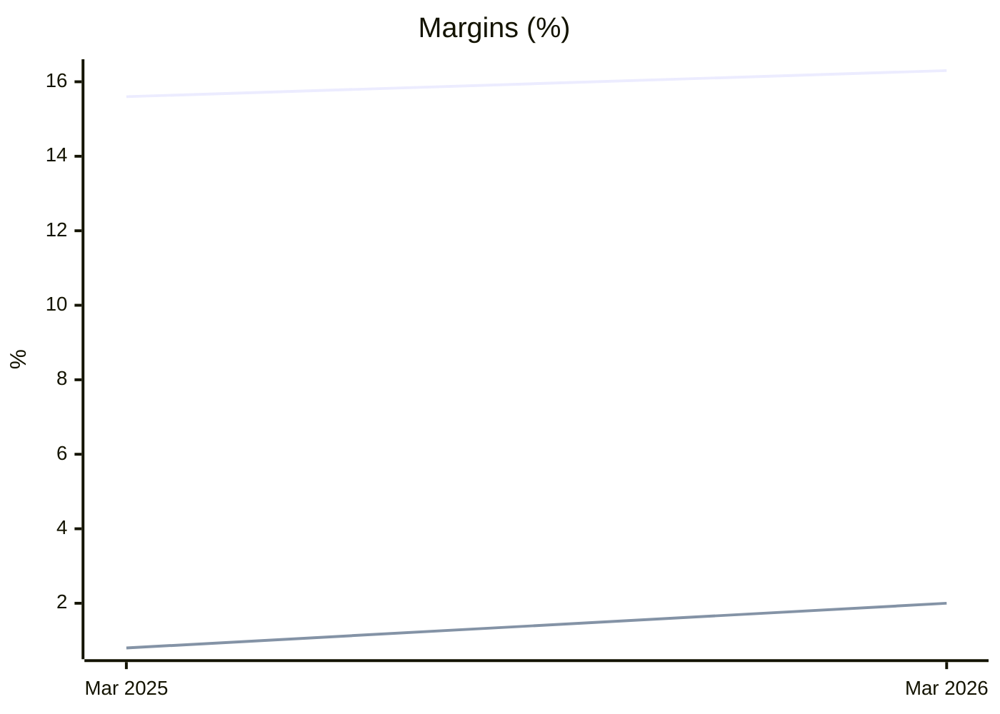

*Run 2026-11-24 · part of [SPINOFF_REPORT.md](../SPINOFF_REPORT.md) · the complete analysis of one company, with every management-call exchange in full.*

## ABLBL — Aditya Birla Lifestyle Brands Ltd.

### 1. Aditya Birla Lifestyle Brands Ltd. — THE SPIN-OFF ITSELF (the resulting company of a demerger)

**CONFIRMED** (this company IS the resulting company of Aditya Birla Fashion and Retail Limited's demerger, listed on 2025-06-23 — the spun entity in its second year) · **LISTED 1–2Y — the second-year window** · score 3.6/10 · spin-off · 6 filing(s) from CALLS, NSE · first 2026-02-02, latest 2026-03-31

**The separated entities — every one the documents name:**

| Entity | Business | Listing | Who runs it |
|---|---|---|---|
| **Aditya Birla Fashion and Retail Limited** | not stated (the Demerged Company, from which the Madura Fashion and Lifestyle Business was demerged, transfer… | listed 2013-07-17 as ABFRL (NSE) | not stated |

**What is being separated, as the documents put it:** Madura Fashion and Lifestyle ('MFL') branded apparel business demerged from Aditya Birla Fashion and Retail Limited — class `value_unlocking`.

### 2. Stages and dates

> **Listing:** THIS COMPANY IS THE SPIN-OFF — the resulting company of Aditya Birla Fashion and Retail Limited's demerger, listed on 2025-06-23 (519 days ago)

| Date | Event | Source |
|---|---|---|
| 2013-07-17 | **Aditya Birla Fashion and Retail Limited** listed (ABFRL) | NSE equity list |
| 2024-04-19 | Board approval — Aditya Birla Fashion and Retail Limited / Aditya Birla Lifestyle Brands Limited | as stated: Outcome of Board Meeting, Unaudited Standalone Financial Results, Not… |
| 2025-03-27 | NCLT order — Scheme of Arrangement (sanction by Hon'ble NCLT) | as stated: Outcome of Board Meeting, financial results Note 5/7 (filings dated A… |
| 2025-04-22 | Other — certified copy of NCLT order received — Demerged and Resulting Company | as stated: Outcome of Board Meeting, financial results Note 5/7 (filings dated A… |
| 2025-05-01 | Effective date — Scheme of Arrangement (on filing of certified copy of Order with Registrar of Companies, Mumbai) | as stated: Outcome of Board Meeting, financial results Note 5/7 (filings dated A… |
| 2025-05-22 | Record date — shareholders of the Demerged Company (Aditya Birla Fashion and Retail Limited) | as stated: Outcome of Board Meeting, financial results Note 5/7 (filings dated A… |
| 2025-05-26 | Allotment — Aditya Birla Lifestyle Brands Limited (Resulting Company) | as stated: Outcome of Board Meeting, financial results Note 5/7 (filings dated A… |
| 2025-06-23 | **Aditya Birla Lifestyle Brands Ltd.** itself listed | NSE equity list |
| 2025-06-23 | Stage reached: **listed** | [Press Release](https://nsearchives.nseindia.in/corporate/ABLBL_23062025104943_SEPressrelease.pdf) |
| 2025-06-23 | Listing and trading — Aditya Birla Lifestyle Brands Limited, on BSE Limited and the National Stock Exchange of India Limited | as stated: Press Release 'Aditya Birla Lifestyle Brands Limited debuts on the bo… |

**The stages, as filed:** listed (2025-06-23)

**Stated in the filings:** entitlement **1 for every 1**.

**When it lists, in the documents' words:** Stated in the February 2, 2026 results: "The Equity Share, of the Resulting Company have been listed on BSE Limited and th[e] N[a]t[io]nal Stock Exchange of India Limited on June 23, 2025."

### 3. Size of the separated business beside the parent — is institutional selling likely?

**Reading: LESS LIKELY on size alone — the piece is the larger part of the business.**

| Entity | Stated turnover | Stated share of the whole | Segment revenue share | Market cap (₹ cr) | Share of combined market cap | Index member |
|---|---|---:|---:|---:|---:|---|
| Aditya Birla Fashion and Retail Limited | not stated | — | 100.0% (FY2026) | 4,795 | 33.4% | yes |

*Stated figures are the documents' own (a turnover share, or the cost-of-acquisition split the company publishes for tax, which reflects relative value); the segment share is this business's revenue over the parent's sales, and the market-cap share is the entity's value over the entity plus the parent (parent ₹9,552 cr, NSE bhavcopy of 2026-11-13), both computed here.*

**The judge's read of selling pressure:** likely — 1:1 shares allotted to entire ABFRL shareholder base on May 26, 2025; listed June 23, 2025 without any fundraise.

### 4. Insider ownership — share swap, promoters' holding, management incentives

**Share swap / entitlement, entity by entity:**

- **Aditya Birla Fashion and Retail Limited:** not stated for this entity; "The Scheme provided that all shareholders of the demerged company will hold identical shareholdings in both the companies, post the demerger."

**Promoters' holding, from the shareholding pattern:**

| Company | Promoters | FIIs | DIIs | Public | Quarter |
|---|---:|---:|---:|---:|---|
| Aditya Birla Lifestyle Brands Ltd. (ABLBL) | 46.6% | 12.29% | 20.94% | 19.69% | Sep 2026 |
| Aditya Birla Fashion and Retail Limited (ABFRL) | 46.61% | 10.11% | 4.28% | 38.7% | Sep 2026 |

*Source: screener.in shareholding pattern, stored under `ShareholdingPattern/NiftyTotalMarket/`. In a mirror demerger each shareholder holds the same proportion of the new company as of the parent on the record date.*

- **Promoters in the parent, per the documents:** not stated in the documents on file.
- **What the promoters will hold in the separated entity:** "The Scheme provided that all shareholders of the demerged company will hold identical shareholdings in both the companies, post the demerger."
- **What a public shareholder receives:** "On May 26, 2025, the Resulting Company has allotted 1,22,02,94,773 fully paid-up equity shares of face value ₹10/- each, to the shareholders of the Demerged Company as on the record date i.e. May 22, 2025, in the share exchange ratio 1:1 i.e. 1 (one) fully paid-up equity share of the Resulting Company having face value of ₹10/- each for every 1 (one) fully paid-up equity share of ₹ 10/- each of the Demerged Company."
- **Management incentives:** "ESOP Share Allotment: Pursuant to various Employees Stock Option Schemes, following Equity Shares of ₹ 10/- each were allotted /transferred to the option grantees: Allotment Non-Trust Route pursuant to ABLBL Special Purpose Employee Stock Option Scheme 2,09,236 [quarter ended December 31, 2025] / 2,09,236 [nine months ended December 31, 2025]; Allotment By way of transfer from ESOP Trust pursuant to Special Purpose Employee Stock Option Scheme 42,015 / 42,015"; the consolidated results include "Aditya Birla Lifestyle Brands Limited Employees' Welfare Trust (with effect from September 29, 2025)" as a trust controlled by the Holding Company. Treatment of existing ABFRL grants in the scheme, exercise price or pricing date, and management or insider shareholding: not stated
- **Insider actions around the separation:** not stated in the documents on file.
- **Insiders, per the checklist read:** Promoter stake not stated. Scheme: all ABFRL shareholders hold identical shareholdings in both companies. ABLBL Special Purpose ESOP — 2,09,236 shares allotted, 42,015 transferred from ESOP Trust; Employees' Welfare Trust from September 29, 2025. · *option pricing date:* not stated

### 5. Why the demerger — point by point

The only separation described in these documents is the one that created ABLBL itself: the Madura Fashion and Lifestyle ('MFL') business was demerged out of Aditya Birla Fashion and Retail Limited ('ABFRL'), approved by the ABFRL board on April 19, 2024, sanctioned by NCLT on March 27, 2025, effective May 1, 2025, with ABLBL shares issued 1:1 so shareholders hold identical stakes in both companies — ABLBL carries the four Lifestyle/Power brands (Louis Philippe, Van Heusen, Allen Solly, Peter England, plus formats like Peter England Red and the Philippe bridge-to-luxury store) and the Emerging portfolio (Reebok, Van Heusen Innerwear, American Eagle; Forever 21 was closed/restructured with a ₹98.33 crore exceptional charge and ~₹50 crore of EBITDA loss plus ~₹50 crore interest in the FY25 base), while ABFRL retains the newer 'tomorrow' businesses. Management's stated reason is capital allocation, not operations: the mature Madura cash flow had been funding other things. Ashish Dikshit (Q1 FY26, Aug 14, 2025): 'The cash generated by this business in the past has -- was used to actually kick start or acquire multiple new businesses. And the whole purpose of demerger was actually to need the cash for this business to grow faster.' He restated it in Q3 FY26 (Feb 3, 2026) as 'One of the primary reasons for demerger was to create an entity which can reinvest back more aggressively into growth,' quantifying it: the business throws off EBITDA cash of close to ₹900 crore, historical capex was only ₹150–200 crore (₹225 crore in the best years), and FY26 capex was taken 'north of INR300 crores, perhaps INR320 crores, INR330 crores' — which is also why debt fell only modestly. Separation also fixed the funding and payout frame: no equity fundraise in either entity (only the 'tomorrow business' excepted), borrowings split 'based on the allocation formula', a ₹500 crore NCD repaid in January 2026 and refinanced with 'no fresh borrowing', a stated path to debt-free in 2.5–3 years at ₹200–300 crore repayment a year, and, within year one post-demerger, a first dividend of 50 paise per share with a policy of ~15–25% of net profit. Visible results of that reinvestment: 300+ store additions in FY26 to 3,348 stores / 4.9 million sq ft / ~800 towns, FY26 revenue ₹8,396 crore (+7%), EBITDA ₹1,429 crore (+13%, margin 17%, +90bps), normalized PAT ₹209 crore (+61%), net debt ₹726 crore versus ₹781 crore. Nobody in these texts says investors, lenders or brand partners demanded the split; the only external pressure visible is analysts policing the no-fundraise promise and the debt-reduction pace.

**Point by point, with the source:**

1. The structure: ABFRL's board approved demerging the Madura Fashion and Lifestyle business into ABLBL on a going-concern basis, consideration being ABLBL shares to ABFRL's own shareholders — a pure separation, no cash and no change in ownership. “The Board at its meeting held on April 19, 2024, subject to necessary approvals, considered and approved the demerger of the Madura Fashion and Lifestyle ('MFL') Business under a Scheme of Arrangement between Aditya Birla Fashion and Retail Limited ('Demerged Company') and Aditya Birla Lifestyle Brands Limited ('Resulting Company').” — *Scheme*
2. Mirror shareholding and 1:1 ratio: 1,22,02,94,773 shares of ₹10 allotted on May 26, 2025 to ABFRL holders of record May 22, 2025; NCLT sanction March 27, 2025, effective May 1, 2025, listed June 23, 2025. “The Scheme provided that all shareholders of the demerged company will hold Identical shareholdings in both the companies, post the demerger.” — *Scheme*
3. Legacy liabilities travel with the demerged business: GST orders for FY2019-20 to FY2022-23 still issued in ABFRL's name land on ABLBL, including a ₹310.13 crore demand (tax ₹59.07 crore, interest ₹23.81 crore, penalty ₹227.26 crore) dated March 30, 2026, which the company says it will appeal. “Order is in the name of Aditya Birla Fashion and Retail Limited (ABFRL). However, it relates to the business of the Company, which got demerged from ABFRL, pursuant to a Scheme of Arrangement effective from May 1, 2025.” — *Scheme*
4. The core rationale, given by MD Ashish Dikshit in answer to Niharika Karnani asking where the cash goes now that it won't be invested into ABFRL: Madura's cash had been bankrolling the group's new business bets, and the demerger exists to keep it inside Madura. “The cash generated by this business in the past has -- was used to actually kick start or acquire multiple new businesses. And the whole purpose of demerger was actually to need the cash for this business to grow faster.” — *CALL Aug 2025*
5. Explicit priority order for the retained cash — growth capex first (including the Lifestyle brands, not just Reebok and Innerwear), debt reduction only after that. “So the first use of cash would be to accelerate the growth in the businesses that we have.” — *CALL Aug 2025*
6. The balance-sheet promise attached to the separation: ₹200-300 crore of debt repayment a year off a ~₹700 crore March-2025 base (which had risen ~₹200 crore in Q1 on festive inventory), reaching debt-free in 2.5-3 years; capex guided at ~₹250 crore for retail, shop-in-shops, warehouse, some manufacturing and technology. “we expect between INR200 crores to INR300 crores reduction each year. And that's why we had indicated an overall debt-free status in two and a half years to three years.” — *CALL Aug 2025*
7. Growth ambitions the separated entity was given: Lifestyle Brands in early double digits off 15% Q1 retail LTL, and the emerging portfolio (Reebok, American Eagle, Van Heusen Innerwear) at 18-20%+, with Reebok already taken from ~₹200 crore/90 stores at acquisition to ~₹500 crore/180+ stores. “We expect the newer business to grow anything between 18 % to 20 %, while Lifestyle Brands business will grow in early double digits.” — *CALL Aug 2025*
8. Reinvestment visibly ahead of deleveraging in the second quarter as a standalone: 75+ new stores, 65 company-owned store renovations in a single quarter (each taking 45-60 days of lost trading), working capital and debt up on early-festive and Bangladesh winterwear inwarding; no restatement of the demerger rationale on this call. “So, just to give you a sense, we did 65 store renovations in just the last quarter.” — *CALL Nov 2025*
9. Dikshit restated the rationale in its sharpest form when asked why net debt had barely moved, and CFO Dharmendra Lodha framed it as the growth-capital rationale 'which we conveyed' at the time of demerger. “One of the primary reasons for demerger was to create an entity which can reinvest back more aggressively into growth.” — *CALL Feb 2026*
10. The numbers behind it: ~₹900 crore EBITDA cash, historical capex of ₹150-200 crore (₹225 crore at best) versus FY26 capex of ₹320-330 crore — with ~80%+ of it going to Lifestyle Brands expansion and renovation — which management says is precisely why debt fell only from ₹1,000 crore (September) to ₹800 crore (December). “This year, our capex will be north of INR300 crores, perhaps INR320 crores, INR330 crores. And that's really why the debt reduction is not very large this year.” — *CALL Feb 2026*
11. The no-fundraise commitment made at demerger was policed by Ambit's Videesha Sheth over a board-approved ₹500 crore NCD issue; management said debt came across on an allocation formula and the NCDs merely refinance a January repayment. “Yeah, you know, at the time of demerger, the company got the borrowings transferred based on the allocation formula.” — *CALL Feb 2026*
12. Portfolio ambition for the separated entity: the emerging brands (Reebok 200+ stores, doubled from 100 at acquisition; Van Heusen Innerwear; American Eagle) to become a quarter of ABLBL, with Lifestyle margins at a four-year-high 20.6% in Q3 and emerging-segment profitability up 790bps. “This portfolio is expected to be one-fourth of overall ABLBL business in next 4 -5 years.” — *CALL Feb 2026*
13. The payout half of the story delivered in year one: a maiden 50 paise per share dividend on top of FY26 revenue of ₹8,396 crore, EBITDA ₹1,429 crore (17%, +90bps), normalized PAT ₹209 crore (+61%), ₹450 crore operating cash flow and net debt down to ₹726 crore. “The Board of the company has also declared a dividend of INR 50 paisa per equity share within the first year of the company post -demerger.” — *CALL May 2026*
14. Dikshit tied dividend and debt-free status back to what was promised 'at the time of formation of company', guiding a 15-25% of net profit payout and debt-free in about three years while explicitly declining to chase zero debt. “As you know, we had announced at the time of formation of company that looking at the predictable, consistent, historical cash flows of the company, we are very confident that this company over a period of time will become a debt -free company and equally will be able to pay dividends as it goes forward.” — *CALL May 2026*
15. Reinvestment sustained rather than wound down: 300+ gross store additions in FY26 to 3,348 stores, FY27 capex of ₹250-300 crore (~₹200 crore into retail expansion and renovation), Reebok at 210+ stores adding 40-50 a year, and Van Heusen Innerwear targeting its first profitable quarter in FY27. “About INR 300 crores. So, we will continue with that kind of momentum. There is still a lot of growth opportunities in the market, so we will continue to drive that.” — *CALL May 2026*

**How it evolved:** The split was board-approved on April 19, 2024, NCLT-sanctioned March 27, 2025, effective May 1, 2025, with shares allotted May 26, 2025 and listing on June 23, 2025; the first post-demerger call (Aug 14, 2025) is where Dikshit framed the 'why' — cash previously used to kick-start/acquire new businesses would now fund this one, with 'first use of cash' for growth and 'only the subsequent part' for debt, ₹250 crore capex guided and debt-free in 2.5–3 years. Nov 5, 2025 added no new rationale, only execution and its cost — 65 store renovations in one quarter, debt up ~₹200 crore on festive inventory. Feb 3, 2026 sharpened it into a number: ~₹900 crore of EBITDA cash, capex lifted from ₹150–225 crore historically to ₹320–330 crore, explicitly explaining the small debt reduction, while Videesha Sheth challenged a ₹500 crore NCD against the no-fundraise commitment (answer: pure refinancing). By May 8, 2026 the emphasis shifted from reinvestment to returns — maiden 50 paise dividend 'within the first year of the company post-demerger', a 15–25% payout band, FY27 capex ~₹300 crore, and debt-free in three years described as achievable but 'not something that we are chasing'.

**What management expects from it:** For ABLBL: retained cash funds its own growth — capex up from ₹150-225 crore to ₹300-330 crore, 300+ stores a year, double-digit revenue growth, 7% steady LTL, Lifestyle margins ~20% improving on rent leverage, emerging brands to one-fourth of sales and rising EBITDA, debt-free in ~3 years, 15-25% dividend payout. For ABFRL: only implied — it keeps the newer 'tomorrow' businesses and the option to raise funds.

*Not explained on the calls:* No one is named as having asked for it — no investor, lender or brand-partner demand; no dis-synergy, separation cost, valuation or re-rating argument; no ABFRL-side rationale; debt allocation formula undisclosed.

- *Stated reason, in one line:* Management: "One of the primary reasons for demerger was to create an entity which can reinvest back more aggressively into growth," with growth capital available to it.
- *What it reveals:* A ₹8,396 crore single-segment branded apparel business, FY26 EBITDA ₹1,429 crore (17%), pre-Ind AS PAT ₹313 crore versus reported ₹171 crore; net debt cut to ₹726 crore, first dividend paid, plus inherited ABFRL-era GST demands exceeding ₹310 crore.
- *Parent or spin:* spin · *Read next:* Shareholding pattern / FY26 annual report for promoter stake and ESOP grants, and appeals against the ₹310 crore GST demand.
- *In their words:* “One of the primary reasons for demerger was to create an entity which can reinvest back more aggressively into growth.”

### 6. On the calls, verbatim

4 call(s), oldest first: **10 question-and-answer exchange(s)** given in full — the question and every answer to it, nothing trimmed — and 2 passage(s) from management's prepared remarks (the complete sentences about it; the whole remarks are in the linked transcript). Text is as the transcript prints it.

#### Aug 2025 — [transcript](https://www.bseindia.com/stockinfo/AnnPdfOpen.aspx?Pname=6ed70b88-0f97-4104-9463-ceb338b92bba.pdf)

**From the prepared remarks** *(the passage about it; the whole turn runs to 5,153 characters in the transcript)*

> **Dharmendra Lodha:** Good afternoon, everyone. Welcome to the Q1 FY ‘26 earnings call for Aditya Birla Lifestyle Brands Limited. Thank you for joining us today. This quarter marks our first earnings announcement post-demerger as an independently listed entity with our results shared yesterday. As of 1st May 2025, demerger is effective with a seamless transition across all fronts from front - end and back -end systems to employee records and operational processes. All our point -of-sale or MBO outlets, e -commerce and retail stores are now fully integrated under Aditya Birla Lifestyle Brands Limited, ensuring business continuity and readiness for the next phase of growth. As we look back on the first quarter of this fiscal, the consumption environment remains sluggish with apparel market displaying selective pockets of growth, largely fueled by wedding season. Although broader industry sentiment remains cautious, ABLBL maintained its strong growth momentum. […] PAT came in at INR24 crore s, up by 5% year -on-year. Adjusted for the incremental ad spend, the P AT would have been INR54 crore s for the quarter. As we move towards the second half of the year, we expect the profitability to be even higher. Our footprint extends across 3 200 plus stores, covering a total store retail area of 4.6 million square feet, an expansive network that allows us to fulfil the fashion needs in a diverse country like India, from large to small towns, from malls to high streets. Our distribution is a foundational pillar for our strategy that keeps us connected to our consumers across the country. Aditya Birla Lifestyle Brands Limited August 14, 202 5 About the Lifestyle Brand , in quarter one, our brand sustained exceptional momentum, delivering an industry -leading retail like -to-like growth of 15% across a robust network of 2,900 plus stores, marking the fourth consecutive quarter of strong LTL performance. This quarter's 15% LTL growth was preceded by 9% and 12% LTL growth for Q3 and Q4 of FY ‘25, reflecting the underlying strength of the brand and high -quality retail execution. […] Profitability improved meaningfully, with margins expanding by 170 bps year -on-year, reflecting operational efficiencies and a sharper focus on profitable growth levers. Youthwear and Innerwear segments remain a key contributor to ABLBL's growth ambitions, with ample headroom for expansion across channels. To conclude, ABLBL today stands as India's most formidable premium Lifestyle Brand platform, anchored in decades of operational excellence, powered by a portfolio of iconic brands, driven by an innovation -led culture and supported by an exceptional talent base. These strengths uniquely position us to sustain our momentum, strengthen our leadership, and capture the abundant opportunities available across the western fashion and lifestyle landscape. We are now well positioned to accelerate our growth trajectory driven by accelerated pace of store additions over the next three quarters. Alongside, we will also continue to strengthen our channels of distribution, building a comprehensive approach to reach consumers wherever they shop. With the festival season arriving early this year, we are well -placed to capture consumer demand through compelling product stories, immersive retail experiences and strengthened presence, ensuring ABLBL continues to deliver profitable growth while deepeni ng its connection with consumers across the country.

**Question and answer**

> **Kunal Shah:** Understood. Understood. Yes. My second question is on the other brands ’ piece. So what would be the growth like, let's say, this quarter, if you were to take out the fast fashion business from the base, if you can give some sense? And if you can give some color on, let's say, individual pieces and how have they done from a top line standpoint? Aditya Birla Lifestyle Brands Limited August 14, 202 5
>
> **Ashish Dikshit:** So, marginal growth, not very strong growth in Innerwear. Reebok obviously has a stronger like - to-like growth, but overall growth in Reebok is also very small. So, combined together, this quarter, the new business haven't contributed as much to the overall growth.
>
> **Vishak Kumar:** Yes. Kunal, I would just add that in a brand like Reebok, it's also a significantly primary sale - driven number reporting. So there will be these ups and downs. It had a 9% like -for-like, which again tells you that the overall business was good, but there has been -- some of the impacts are on primary business, which is what has led to the lower growth in Reebok.

**Question and answer**

> **Niharika Karnani:** Yes. Hi. So, I have a couple of questions here. First is, now since the cash won't be going to the other segment of the business, which was getting invested into ABFRL pre-demerger . How do we plan to use the cash apart from debt retirement? And second question, s ir, if we see Lifestyle Brands are growing at a stable rate of 9%, 10%, 11%, so would it be correct to say that the revenue growth drivers would be the other segment of business, say, American Eagle, Reebok, and Innerwear ? If so, w hen would we see them contributing meaningfully to the growth? Aditya Birla Lifestyle Brands Limited August 14, 202 5
>
> **Ashish Dikshit:** So, Niharika, I think , I answer to your first question. You're right. The cash generated by this business in the past has -- was used to actually kick start or acquire multiple new businesses. And the whole purpose of demerger was actually to need the cash for this business to grow faster. So, the first use of cash would be to accelerate the growth in the businesses that we have. And that's not just about new businesses like Innerwear , Reebok, even the Lifestyle Brands business have a large growth opportunity. And initially, therefore, you would have heard the previous question, the investments in capex , particularly in retail, will be higher to accelerate the growth. Only the subsequent part will go towards debt reduction. Also, to your question about how will the growth rate pan out ? I think Lifestyle Brands are showing very robust, intrinsic and organic growth with double -digit like -to-like over a sustained period of time. We will, therefore, multiply that by increasing network more rapidly than what we have done in the last one year or two years. Obviously, the smaller businesses have a smaller base, and therefore, in percentage terms, they will grow faster. We expect the newer business to grow anything between 18 % to 20 %, while Lifestyle Brands business will grow in early double digits.

**Question and answer**

> **Sameer Gupta:** Hi, sir. Just wanted some bookkeeping questions. I noticed that we still have a large working capital in this business for FY ‘25 , which is around INR5,500 crores, if I look at just the inventory receivable and creditors. So, s orry, not INR5,500 crores , my mistake. It's around INR1,300 crores, which is sizable. And traditionally, before the merger -demerger happened, we used to be a very light working capital business in which most of the inventory was taken over offset by creditors. So, first, can we revert back to that original or that lower lean working capital kind of a model or the current revenue doesn't allow to go back there?
>
> **Ashish Dikshit:** No. So , first of all, let me reassure you that there's not been any big shift from our past trajectory. This is a very steady business , and therefore, what you were probably seeing was the combined businesses across the portfolio. And when you pull out, this business has been pretty stable in that sense. The net working capital turn at different points and it keeps changing during the course of the year, has been ranging between 13%, 14% to 15%, 16%, 17%, depending on which quarter you're lo oking at and that's been the range that we've been operating. Aditya Birla Lifestyle Brands Limited August 14, 202 5

#### Nov 2025 — [transcript](https://www.bseindia.com/stockinfo/AnnPdfOpen.aspx?Pname=63fa46d6-934e-4c54-879e-60070181c14e.pdf)

**Question and answer**

> **Sucrit D Patil:** Good afternoon. I have a broader question on ABL's long-term direction. As more fashion and lifestyle brands expand across India, what is Aditya Birla Lifestyle doing to build a strong edge, not just through store count or celebrity tie -ups, but something deeper like a way of working or thinking that grows over time and makes the company hard to replace?
>
> **Vishak Kumar:** So you're saying what are our strategic strengths or differentiators? I think many, Sucrit . If you refer to our strategy deck that we shared some time back, you would see that. But it's also a very deep knowledge of markets, different segments, consumers, etc etera ., which in that sense gives us our strengths. It's also a very deep understanding of retailing. We run 3,000 plus stores, continue to do that, build very strong equations with various partners in the ecosystem. We work very closely with various business partners across franchisees, malls, department s tores, mills, and so on. We also have a very strong creation ecosystem with a very strong manufacturing base, a creation, designing creation base, product creation base. So , there are multiple things which give us that, a very tech -enabled organization. So it will be difficult for me to explain this over an earnings call, but I think a lot of things which we believe will give us a right to win in the market.

#### Feb 2026 — [transcript](https://www.bseindia.com/stockinfo/AnnPdfOpen.aspx?Pname=f0fc43d7-0cf3-4cd8-ad84-3341cf3f7d0a.pdf)

**Question and answer**

> **Videesha Sheth:** Yes, hi. My first question was that time and again since the demerger announcement, it has been called out that no fundraise would be made and either of the two entities barring for the tomor row business. But in yesterday's filing, it was mentioned that nearly INR500 crores of NCD issuance was approved by the board. So, can you please highlight as to what would be the utilization area for this fundraise and by when are you looking to, when are you intending to raise it? Management: Thanks, Vidisha. Yeah, you know, at the time of demerger, the company got the borrowings transferred based on the allocation formula. The INR500 crores debentures which we repaid recently in the month of January, we intend to raise it and to refinance the existing, the debentures repaid. There is no fresh borrowin g.

**Question and answer**

> **Videesha Sheth:** Got it. So, how should one be looking at the reduction in the net debt amount because I think in earlier calls, you had called out that every year the net debt would reduce by, I mean substantially and by two, three years, it should be net cash. So, any thoughts o ver there? Management: So, if you see from March, beginning of INR800 crores , the September borrowings were roughly INR1,000 crores which we reduced to INR800 crores . The plan is to reduce it, bring it to by another INR75 to INR100 crores . But you know , Vishak and Ashish can talk on the growth capex after demerger which was the rationale which we conveyed that the company will have the growth capital available to them. Vishak, Ashish. Management: Vishak, do you want to just come in?
>
> **Ashish Dikshit:** Okay. Let me answer this question. Just to give you an overall summary, the business generates through profit which is through EBITDA cash equivalent of close to 900 crores . Part of it goes into working capital funding. The other part goes into capex. Typically, we have been spending close to 150 to 200 in the best years, maybe INR225 odd crores kind of capex. Aditya Birla Lifestyle Brands Limited February 03 , 202 6 One of the primary reasons for demerger was to create an entity which can reinvest back more aggressively into growth. Some of those signals are visible here. This year, our capex will be north of INR300 crores , perhaps INR320 crores , INR330 crores . And that's really why the debt reduction is not very large this year. We still feel that over the next three years, which is what we had indicated, the net debt will be closer to zero in this, although that's not the only goal we are driving at.

**Question and answer**

> **Devanshu Bansal:** Yeah, the other I was referring to, if you want, from an Arvind Fashion perspective, they reported almost 13% growth in nine months, right?
>
> **Vishak Kumar:** So, possibly, and maybe we could look at comparisons, etc., but all I want to assure you is that in our brand, we are at a like -for-like of 10%. To the question Archana asked earlier, some of the impact of the retail expansion will start showing now. This quarter itself was a significant impact of net expansion that you will start seeing in the overall growth. Q4, we'll see that even more, where there is about a 90 -net store addition that you will see. So, if you look at it, we will enter into next financial year with a 150 -store larger network than last year. That itself, broadly, is a 5% extra business in reta il that you will have next year.

**Question and answer**

> **Tejas Shah:** Perfect, very assuring. Again, Vishak , you spoke about the Lifestyle portfolio. Lifestyle portfolio has a very strong loyal base of customers, but the growth is moderating and it's actually, the answer is there. It says that it's a very mature portfolio. Actually, the size is huge in terms of both distribution and in the absolute numb er. So what are the biggest or where are the bigger white spaces? Is it new formats, locations, geographies that can actually help us to go into, let's say, double -digit growth sustainably and not this just one or two low -base, high -base kind of triggers?
>
> **Vishak Kumar:** It is a simple answer. All of these that you said and a few more. Think of very, very large brands. Fashion business doesn't have a billion -dollar brand. Most other categories have very, very large brands. So let me put it this way. Take a brand like, say, Louis Philippe, which has 500 -plus stores. The opportunity for a brand like Louis Philippe in India should be about 1,500 stores. So maybe the methods of opening these stores, the formats, will have to be more nuanced, will have to find the right regional assortment requirements, etc. But we've bee n figuring formats which have Aditya Birla Lifestyle Brands Limited February 03 , 202 6 worked. There have been formats which have been more casual -driven, formats which are more wedding -driven, and so on, which have worked fairly well. We have also created, we just put a bridge -to-luxury store from Louis Philippe called Philippe, which we opened in DLS Promenade in Delhi, which has again been off to a very good start. So a lot of new formats, new segments, new usage occasions with consum ers as they emerge, again, are other growth possibilities. Other parts of business, women's wear, again, is another. In two of our brands, we have very meaningful women's presence, whether it's in Van Heusen or Allen Solly. So that is, again, another opportunity for growth. So there are various segments. So there is, of course, distribution and presence, etc. Many of our partners are also looking at aggressive growth plans. Some of the department stores are looking at growth plans. That adds to that. The e -commerce space, also with quick commerce, is also driving consumption. There is opportunities for growth there. So I would say, yes, while it might look like, look, these are large brands, I still think these are very early days in the evolution of these brands.

#### May 2026 — [transcript](https://www.bseindia.com/stockinfo/AnnPdfOpen.aspx?Pname=472b78a3-34af-4e82-b164-ddc4d01f99a8.pdf)

**From the prepared remarks** *(the passage about it; the whole turn runs to 6,026 characters in the transcript)*

> **Dharmendra Lodha:** Through business operations, the company generated operating cash flow (before CAPEX and security deposit) of INR 450 crores. A large share of this cash has gone towards funding aggressive store expansion during the year. Net debt at year - end stood at INR 726 crores versus INR 781 crores in March last year. The Board of the company has also declared a dividend of INR 50 paisa per equity share within the first year of the company post -demerger. Through the year, store expansion gathered strong momentum, culminating in new stores addition of 300 +, accelerated expansion supported by strong product market fit in new market and deeper penetration in existing one, reinforces confidence in the long -term opportunity, with momentum expected to sustain on the back of robust pipeline across catchments. At the end of this year, our footprint has expanded to 3,348 stores, spanning over 4.9 million square feet across nearly 800 cities and towns. Now turning to our Lifestyle Brands: The business delivered growth of 11% during the quarter, aided by broad -based traction across channels. […] American Eagle continued its profitable growth tr ajectory, delivering double - digit like -to-like growth during the quarter. Van Heusen Innerwear also recorded double -digit overall growth during the quarter, again continuing its strong recovery trajectory. The business also witnessed a sharp reduction in f ull-year losses and remained on track to achieve break -even quarter by Q uarter 4 of current fiscal year. This portfolio is expected to remain a strong growth driver for the company, with significant opportunity to scale these brands into mega -brands within the fashion and Lifestyle space over the medium term. The year marked a strong start to being an independent entity supported by encouraging business momentum and several positive operating milestones across brands and channels. Our strategic imperatives are clearly defined, and our execution engine is ready. Going forward, our focus will remain on consistently executing the fundamentals well while further sharpening the consumer proposition and relevance in line with changing consumer needs.

**Question and answer**

> **Shravan Vohra:** Hello. Hi. Hi team. Thanks for the opportunity. I just wanted to check a bit on the demand side. Are you seeing any divergent trends among the four brands in the Lifestyle business or any divergent trends between the premium or the mass end? Aditya Birla Lifestyle brands Limited May 08, 202 6
>
> **Vishak Kumar:** Hi Shravan. If you are saying in respect to Quarter 4 or if let's say if you look at it from a full year point of view, qua rter -to-quarter there will be ups and downs across brands. But in general, all our Power brands , all our Lifestyle Brands have grown in a similar fashion. Each segment has its own both tailwinds and headwinds. And in that sense, they have cancelled out. So, by and large, they have had similar growth trajectories. High -single digit is the broad report card for the year.

**Question and answer**

> **Abhijeet Kundu:** Yes, thanks for the opportunity. My question was on Lifestyle business. Here, the retail LTL has been at about 4%. So, if we have to look at this quarter, generally fashion retail relatively has done well when we compare it to the previous quarters. So, beyond this quarter, how has been Aditya Birla Lifestyle brands Limited May 08, 202 6 the scenario, just qualitatively, and what has been your understanding of the quarter because how do you improve the retail LTL? How do you see going ahead the retail LTL will improve? That is something, because what I am looking at is on the base of Lifestyle business , which has gone through a mutated phase.
>
> **Vishak Kumar:** Yes, so if you look at our full -year life -to-life, it's about 8 -9%, okay, on Lifestyle business . Our Lifestyle business , as you know, has a greater dependence on the calendar, especially the wedding calendar. So, some ups and downs are to be expected just from a wedding calendar point of view. But on a steady state, I mean, for the full year last year, I think we delivered 8.5% - 9%. So, we are in that 8%, 9% zone for the full year. Going ahead also, I think there are enough initiatives in place . We have projected for the next few years that we should be able to grow at an LTL of about 7%. I think that momentum should continue for the business, and there are enough initiatives in place to be able to drive that. There will be some higher quarters and some lower quarters, but by and large, that's what we are driving here.

### 7. The parent's financial statements

**The parent, last three fiscal years (consolidated)**

| | Mar 2025 | Mar 2026 |
|---|---:|---:|
| Sales (₹ cr) | 7,830 | 8,396 |
| Sales growth (%) | — | +7.2% |
| Operating profit (₹ cr) | 1,223 | 1,371 |
| Operating profit growth (%) | — | +12.1% |
| Operating margin (%) | 15.6 | 16.3 |
| PAT (₹ cr) | 60.0 | 171 |
| PAT growth (%) | — | +185.0% |
| PAT margin (%) | 0.8 | 2.0 |
| EPS (₹) | 1.4 | 1.4 |

*Source: ProfitStatement/NiftyTotalMarket/ABLBL.csv (consolidated, screener.in); growth and margins computed here.*

```mermaid
xychart-beta
    title "Sales, operating profit and PAT (₹ cr)"
    x-axis ["Mar 2025", "Mar 2026"]
    y-axis "₹ crore"
    bar [7830, 8396]
    bar [1223, 1371]
    bar [60, 171]
```

*Series in order: Sales, Operating profit, PAT.*

*Series in order: Operating margin, PAT margin.*

**P/E:** 54.1 — live market file (screener.in), trailing (price ₹94.70 as of 2026-08-02).

**Cash flows (₹ cr):**

| | Mar 2025 | Mar 2026 |
|---|---:|---:|
| Cash from operations (₹ cr) | 1,144 | 1,219 |
| Cash from investing (₹ cr) | 7.0 | -198 |
| Cash from financing (₹ cr) | -1,230 | -983 |
| Net cash flow (₹ cr) | -79.0 | 38.0 |
| Free cash flow (₹ cr) | 901 | 896 |

*Source: CashFlow/NiftyTotalMarket/ABLBL.csv (consolidated, screener.in).*

### 8. The separated business's financial statements

**The business being separated — its own numbers**, entity by entity: its reported statements once it is listed and on file, and the segment numbers the annual reports and presentations carry for it before that.

**Aditya Birla Fashion and Retail Limited (ABFRL) — as reported since listing**

| | Mar 2024 | Mar 2025 | Mar 2026 |
|---|---:|---:|---:|
| Sales (₹ cr) | 6,441 | 7,351 | 8,177 |
| Sales growth (%) | -48.1% | +14.1% | +11.2% |
| Operating profit (₹ cr) | 408 | 699 | 657 |
| Operating profit growth (%) | -73.8% | +71.3% | -6.0% |
| Operating margin (%) | 6.3 | 9.5 | 8.0 |
| PAT (₹ cr) | -736 | -456 | -830 |
| PAT growth (%) | -1147.5% | +38.0% | -82.0% |
| PAT margin (%) | -11.4 | -6.2 | -10.2 |
| EPS (₹) | -6.2 | -3.1 | -6.4 |

*Source: ProfitStatement/NiftyTotalMarket/ABFRL.csv (consolidated, screener.in); growth and margins computed here.*

**Madura Fashion and Lifestyle Business ("MFL Business") — demerged from Aditya Birla Fashion and Retail Limited; now reported as the single operating segment "Branded Apparels (Garments and Accessories)" / "ABLBL" consolidated → Aditya Birla Lifestyle Brands Limited (Resulting Company)** · unit ₹ Crore · Operating profit = EBITDA as reported in the investor presentations (Revenue from Operations basis, external revenue; PBT reported is after exceptional items). PAT = Net Profit after Tax (reported, not normalised). Depreciation = Depreciation & Amortisation Expense. Annual report confirms a single operating segment, so no segment assets/liabilities disclosure; balance-sheet items shown only as Capital Employed (₹4,038 Cr Mar-25, ₹4,322 Cr Mar-26).

| | FY2025 | FY2026 |
|---|---:|---:|
| Revenue (₹ Crore) | 7,830 | 8,396 |
| Revenue growth (%) | — | +7.2% |
| Operating profit (₹ Crore) | 1,269 | 1,429 |
| Operating profit growth (%) | — | +12.6% |
| Operating margin (%) | 16.2 | 17.0 |
| PAT (₹ Crore) | 60.0 | 171 |
| PAT growth (%) | — | +185.0% |

*Sources:* Presentation May 2026 — page 26 (revenue, PAT, depreciation); Presentation May 2026 — page 12 (EBITDA); Presentation May 2026 — page 26 (revenue, PAT, depreciation); Presentation May 2026 — page 12 (EBITDA); Annual Report 2026 — page 252 (revenue 8,395.81)

*Latest quarter (Q2 FY27):* revenue 2266, operating profit 390 — Presentation Nov 2026 — page 9

*Not in the pages read:* No FY2024 figures (company incorporated 09-Apr-2024). No segment assets/liabilities, no capex. Standalone-only PAT ₹59.60 Cr FY25, ₹134.61 Cr FY26.

*Businesses with no numbers in the pages read (2 annual report(s) and 6 presentation(s) on file):* Aditya Birla Fashion and Retail Limited (Demerged Company) — no own financials on these pages. Louis Philippe, Van Heusen, Allen Solly, Peter England: no brand-level numbers. Aditya Birla Garments Ltd shown only as net assets ₹74.04 Cr / profit ₹36.49 Cr (AR2026 p253).

*Documents on file:* [Annual Report 2026](https://www.bseindia.com/xml-data/corpfiling/AttachHis/75984f59-6fb1-459a-a74a-6cb594e9b311.pdf); [Annual Report 2025](https://www.bseindia.com/xml-data/corpfiling/AttachHis/0be3ed93-31a6-44b2-9bdb-2a49a442ef0a.pdf); [Presentation Nov 2026](https://www.bseindia.com/stockinfo/AnnPdfOpen.aspx?Pname=b9b1fe95-41d1-44e9-8e6e-9c1b00f69ce1.pdf); [Presentation Aug 2026](https://www.bseindia.com/stockinfo/AnnPdfOpen.aspx?Pname=063b0bb3-f0b0-4c09-adf4-01a539a33b66.pdf); [Presentation May 2026](https://www.bseindia.com/stockinfo/AnnPdfOpen.aspx?Pname=5f9cf651-1294-4d12-bb80-2c724e525587.pdf); [Presentation Feb 2026](https://www.bseindia.com/stockinfo/AnnPdfOpen.aspx?Pname=861fc9f0-7a7d-407a-a0b7-d1d0bc5b7584.pdf); [Presentation Nov 2025](https://www.bseindia.com/stockinfo/AnnPdfOpen.aspx?Pname=7b7387a0-4849-4d90-ae87-ebd5718fad44.pdf); [Presentation Aug 2025](https://www.bseindia.com/stockinfo/AnnPdfOpen.aspx?Pname=16f8294d-f917-4606-850f-bf522262550d.pdf)

### 9. Other financial differences — working capital, margins, returns, debt

| Metric (latest year) | Parent (ABLBL) | Aditya Birla Fashion and Retail Limited (ABFR… |
|---|---:|---:|
| *Basis* | *reported, consolidated* | *its own reported statements* |
| Sales (₹ cr) | 8,396 (Mar 2026) | 8,177 (Mar 2026) |
| Sales growth (%) | 7.2 (Mar 2026) | 11.2 (Mar 2026) |
| Operating margin (%) | 16.3 (Mar 2026) | 8 (Mar 2026) |
| Operating profit growth (%) | 12.1 (Mar 2026) | -6 (Mar 2026) |
| PAT margin (%) | 2 (Mar 2026) | -10.2 (Mar 2026) |
| ROCE % | 15 (Mar 2025) | -3 (Mar 2025) |
| Debtor Days | 52 (Mar 2026) | 18 (Mar 2026) |
| Inventory Days | 252 (Mar 2026) | 298 (Mar 2026) |
| Days Payable | 246 (Mar 2026) | 248 (Mar 2026) |
| Cash Conversion Cycle | 59 (Mar 2026) | 68 (Mar 2026) |
| Working Capital Days | 8 (Mar 2026) | 32 (Mar 2026) |
| Debt / equity (x) | 2.1 (Mar 2026) | 1.1 (Mar 2026) |
| Borrowings (₹ cr) | 3,018 (Mar 2026) | 6,189 (Mar 2026) |

*Each figure is the latest on file, with its year. Working-capital days and ROCE come from the stored working-capital file; segment figures from the pages cited in part 8. A dash means the documents do not carry it.*

**What stays with the parent — its segments, from the same pages:**

| Remaining segment | Revenue | Operating margin | ROCE | Segment assets / revenue | Unit | Year |
|---|---:|---:|---:|---:|---|---|
| Lifestyle Brands (Louis Philippe, Van Heusen, Allen Solly, Peter England) | 7,154 | 19.6% | — | — | ₹ Crore | FY2026 |
| Emerging Business (Reebok, American Eagle, Van Heusen Innerwear etc.; labelled "Youth Brands & Innerwear" in the Q1 FY26 presentation) | 1,282 | 3.9% | — | — | ₹ Crore | FY2026 |

**What the documents themselves say about the differences:**

- **growth** — parent / remaining: not stated; separated business: FY26 revenue ₹8,396 crores, up 7% YoY; Q4 FY26 revenue ₹2,174 crores, up 12% YoY; Lifestyle Brands FY26 revenue ₹7,154 crores, Emerging Business up 18% in Q4 “ABLBL revenue stood at INR 8,396 crores, up 7% YoY . EBITDA grew 13% to INR 1,429 crores versus INR 1,269 crores in last year, with margin improving by 90 bps to 17%.”
- **operating margin** — parent / remaining: not stated; separated business: Q4 FY26 EBITDA ₹375 crores vs ₹330 crores; EBITDA margin 17.2% vs 17%; Lifestyle Brands Q4 EBITDA margin 20%, FY26 19.6%; reported standalone operating margin 7.73% for quarter ended December 31, 2025 “EBITDA margin expanded by 20 bps, up from 17% in Q uarter 4 FY26 last year to 17.2% in Quarter 4 FY26 current year.”
- **debt and leverage** — parent / remaining: not stated; separated business: Net debt ₹726 crores at March FY26 year-end vs ₹781 crores in March last year; ₹800 crores at December end vs ₹1,000 crores at September end; debt equity ratio 0.39 times at December 31, 2025; ₹500 crores of NCDs approved by the Board on February 2, 2026 to refinance debentures repaid in January “Net debt at year -
end stood at INR 726 crores versus INR 781 crores in March last year.”
- **cash** — parent / remaining: not stated; separated business: FY26 operating cash flow before capex and security deposit ₹450 crores; management expects the company to become debt-free in about three years and to pay dividends of close to 15% to 25% of net profit; dividend of ₹0.50 per equity share declared “Through business operations, the company generated operating cash flow (before CAPEX and security deposit) of INR 450 crores.”
- **capex and capital intensity** — parent / remaining: not stated; separated business: FY26 capex about ₹325 crores (guided "north of INR300 crores, perhaps INR320 crores, INR330 crores"); FY27 plan ₹250 crores–₹300 crores, of which about ₹200 crores into retail; 300+ new stores added in FY26, footprint 3,348 stores over 4.9 million square feet across nearly 800 cities and towns; ~36-37% of network COCO “So, to answer your question very directly and simply, out of, say, INR 300 crores of CAPEX , about INR 200 crores would go into retail expansion.”
- **tax** — parent / remaining: GST orders continue to be issued in the name of Aditya Birla Fashion and Retail Limited, covering FY 2019-20 to FY 2022-23; separated business: The orders relate to the business of Aditya Birla Lifestyle Brands Limited, which got demerged from ABFRL; largest demand ₹3,10,13,33,083 (tax ₹59,06,52,705, interest ₹23,80,86,318, penalty ₹2,27,25,94,060); company says demand is not tenable and intends to appeal “Order is in the name of Aditya Birla Fashion and Retail Limited ( "ABFRL "). However, it relates to the business of the Company, which got demerged from ABFRL, pursuant to a Scheme of Arrangement effective from May 1, 2025 .”
- **other — rationale for the separation** — parent / remaining: not stated; separated business: Demerger created an entity able to reinvest more aggressively into growth, with greater agility, sharper strategic focus and more disciplined capital allocation; expected to double in scale with improved profitability over the next five years “One of the primary reasons for demerger was to create an entity which can reinvest back more aggressively into growth.”

**The checklist:**

| Item | Status | Evidence |
|---|---|---|
| Why the spin-off | unknown | no stated rationale in the filings on file *(next: read the scheme's rationale section / the board's press release)* |
| Institutional selling likely (small / different business) | unknown | size of the demerged piece not stated *(next: pro-forma statements: revenue / assets of the demerged undertaking vs the parent)* |
| Insider ownership and incentives aligned | unknown | no promoter-continuity or option-pricing language found *(next: the date the management options are priced; promoter holding in the resulting company)* |
| A hidden value revealed (pro-forma, leverage, comparables) | partly | borrowings 3,018 cr (Mar 2026) = 0.26× market cap; P/E 67.6 on Mar 2026 profit vs industry median 38.9 (17 peers) *(next: pro-forma P&L of each piece × the peer P/E of its own industry)* |
| Parent before the spin (clean parent, takeover prelude) | partly | stage announced — the spin has not happened; the parent can still be bought whole |
| Timing (first year sells, second year gains) | partly | not yet listed — 295 days since the first filing, stage announced |
| Management discussing it on the calls | yes | 5 mention(s) in the last 12 months of calls — “…81 crores in March last year. The Board of the company has also declared a dividend of INR 50 paisa per equity share within the first year of the company post -demerger. Through the year, store expansion gathered strong” |

**On the calls (last 12 months):**

- *Feb 2026* (neutral) — “…ou. The first question is from Videesha Sheth from Ambit Capital. Please go ahead. Videesha Sheth: Yes, hi. My first question was that time and again since the demerger announcement, it has been called out that no fundraise would be made and either of the two entities barring for the tomor row business. But in yesterday's fili…”
- *Feb 2026* (forward) — “…ization area for this fundraise and by when are you looking to, when are you intending to raise it? Management: Thanks, Vidisha. Yeah, you know, at the time of demerger, the company got the borrowings transferred based on the allocation formula. The INR500 crores debentures which we repaid recently in the month of January, we…”
- *Feb 2026* (neutral) — “…o INR800 crores . The plan is to reduce it, bring it to by another INR75 to INR100 crores . But you know , Vishak and Ashish can talk on the growth capex after demerger which was the rationale which we conveyed that the company will have the growth capital available to them. Vishak, Ashish. Management: Vishak, do you want to j…”
- *Feb 2026* (neutral) — “…n the best years, maybe INR225 odd crores kind of capex. Aditya Birla Lifestyle Brands Limited February 03 , 202 6 Page 5 of 18 One of the primary reasons for demerger was to create an entity which can reinvest back more aggressively into growth. Some of those signals are visible here. This year, our capex will be north of IN…”
- *May 2026* (backward) — “…81 crores in March last year. The Board of the company has also declared a dividend of INR 50 paisa per equity share within the first year of the company post -demerger. Through the year, store expansion gathered strong momentum, culminating in new stores addition of 300 +, accelerated expansion supported by strong product mar…”

The filings

| Date | Category | Headline | Attachment |
|---|---|---|---|
| 2026-02-01 | Earnings call Feb 2026 | …ization area for this fundraise and by when are you looking to, when are you intending to raise it? Management: Thanks, Vidisha. Yeah, you know, at the time of | [pdf](https://www.bseindia.com/stockinfo/AnnPdfOpen.aspx?Pname=f0fc43d7-0cf3-4cd8-ad84-3341cf3f7d0a.pdf) |
| 2026-02-02 | Outcome of Board Meeting | Aditya Birla Lifestyle Brands Limited has informed the Exchange regarding Board meeting held on February 02, 2026. | [pdf](https://nsearchives.nseindia.com/corporate/ABLBL_02022026172817_SE_Results.pdf) |
| 2026-02-02 | Outcome of Board Meeting | Aditya Birla Lifestyle Brands Limited has submitted to the Exchange, the financial results for the period ended December 31, 2025. | [pdf](https://nsearchives.nseindia.com/corporate/ABLBL_02022026173405_SE_Results.pdf) |
| 2026-03-18 | General Updates | Aditya Birla Lifestyle Brands Limited has informed the Exchange about Disclosure pursuant to Regulation 30 of the Securities and Exchange Board of India (Listin | [pdf](https://nsearchives.nseindia.com/corporate/ABLBL_18032026194327_SE_Demand_order.pdf) |
| 2026-03-19 | General Updates | Aditya Birla Lifestyle Brands Limited has informed regarding disclosure pursuant to Regulation 30 of the Securities and Exchange Board of India (Listing Obligat | [pdf](https://nsearchives.nseindia.com/corporate/ABLBL_19032026150635_SE_Demand_order_signed.pdf) |
| 2026-03-31 | General Updates | Disclosure pursuant to Regulation 30 of the Securities and Exchange Board of India (Listing Obligations and Disclosure Requirements) Regulations, 2015 ( SEBI Li | [pdf](https://nsearchives.nseindia.com/corporate/ABLBL_31032026180458_SE_Demand_order.pdf) |

