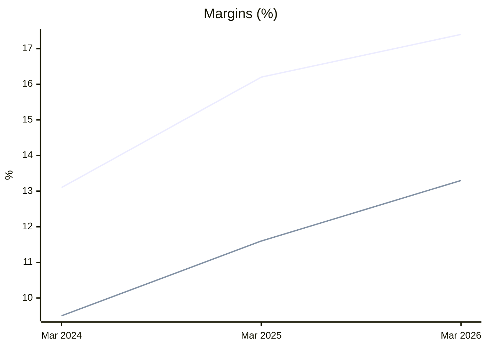

*Run 2026-11-24 · part of [SPINOFF_REPORT.md](../SPINOFF_REPORT.md) · the complete analysis of one company, with every management-call exchange in full.*

## AEGISLOG — Aegis Logistics Ltd.

### 1. Aegis Logistics Ltd. — PARTIAL SPIN-OFF (subsidiary IPO)

**CONFIRMED** (partial spin-off — Aegis Vopak Terminals Limited is listed since 2025-06-02) · **PARTIAL SPIN-OFF, LISTED 1–2Y — the stub against the piece, second year** · score 2.9/10 · partial spin-off (subsidiary IPO) · 1 filing(s) from NSE · first 2026-08-07, latest 2026-08-07

**The separated entities — every one the documents name:**

| Entity | Scheme | Business | Listing | Who runs it |
|---|---|---|---|---|
| **Aegis Vopak Terminals Limited** | 2025 initial public offering (IPO) of material subsidiary A… | Gas and liquid storage terminalling at Indian ports: cryogenic LPG terminals, liquid tank terminals, ammonia … | listed 2025-06-02 as AEGISVOPAK (NSE) | not stated |

**The other parties to the scheme(s)** — not separated entities: Hindustan Aegis LPG Limited — merged in — no shares for the parent's holders

**What is being separated, as the documents put it:** Aegis Vopak Terminals Limited (AVTL), the group's liquid and gas storage/terminalling subsidiary, separately listed — class `regulatory_strategic`.

### 2. Stages and dates

> **Listing:** PARTIAL SPIN-OFF, LISTED — Aegis Vopak Terminals Limited trades since 2025-06-02 (NSE equity list); the parent keeps 44%

| Date | Event | Source |
|---|---|---|
| 2024-10-28 | Board approval — Aegis Vopak Terminals Limited | as stated: Aegis Logistics Limited intimation to BSE/NSE dated October 28, 2024 … |
| 2024-11-19 | DRHP filed — Aegis Vopak Terminals Limited | as stated: Aegis Logistics Limited intimation dated November 19, 2024 (DRHP date… |
| 2024-12-11 | Shareholders / creditors meeting — Aegis Logistics Limited | as stated: Intimation dated December 11, 2024 – dispatch of Postal Ballot Notice… |
| 2025-01-10 | Shareholders / creditors meeting — Aegis Logistics Limited | as stated: Postal Ballot Notice dated December 10/11, 2024 – e-voting ended 5.00… |
| 2025-05-20 | Other — Aegis Vopak Terminals Limited | as stated: Aegis Logistics Limited intimation dated May 20, 2025 – Red Herring P… |
| 2025-05-28 | Other — Aegis Vopak Terminals Limited | as stated: Aegis Logistics Limited intimation dated May 29, 2025 – Prospectus da… |
| 2025-06-02 | **Aegis Vopak Terminals Limited** listed (AEGISVOPAK) | NSE equity list |
| 2025-06-02 | Listing and trading — Aegis Vopak Terminals Limited | as stated: BRSR for FY 2024-25 submitted July 21, 2025; also Chairman's speech a… |
| 2026-08-07 | Stage reached: **meetings** | [Shareholders meeting](https://nsearchives.nseindia.com/corporate/AEGISCHEM_07082026165718_ALL_SE_69AGM_Proceedings_Signed.pdf) |

**The stages, as filed:** meetings (2026-08-07)

**The partial spin-off:** **Aegis Vopak Terminals Limited** (subsidiary); parent's stake after: 44%; IPO stage: listed; exchange: BSE Limited and the National Stock Exchange of India Limited; NSE symbol AEGISVOPAK; timeline: listing of equity shares "with effect from June 2, 2025" (Chairman's speech at the 69th AGM, August 07, 2026).

> “This year also marked a significant achievement for one of our subsidiaries, Aegis Vopak Terminals Limited (AVTL), with successfully listing of its equity shares on BSE Limited and the National Stock ”

**When it lists, in the documents' words:** Chairman's speech at the August 07, 2026 AGM: AVTL achieved "successfully listing of its equity shares on BSE Limited and the National Stock Exchange of India Limited with effect from June 2, 2025"

### 3. Size of the separated business beside the parent — is institutional selling likely?

**Reading: POSSIBLE — the piece is a sizeable minority of the whole; forced selling on size alone is weaker.**

| Entity | Stated turnover | Stated share of the whole | Segment revenue share | Market cap (₹ cr) | Share of combined market cap | Index member |
|---|---|---:|---:|---:|---:|---|
| Aegis Vopak Terminals Limited | not stated | — | — | 31,681 | 42.4% | yes |

*Stated figures are the documents' own (a turnover share, or the cost-of-acquisition split the company publishes for tax, which reflects relative value); the segment share is this business's revenue over the parent's sales, and the market-cap share is the entity's value over the entity plus the parent (parent ₹42,976 cr, NSE bhavcopy of 2026-11-13), both computed here.*

**The judge's read of selling pressure:** unlikely — AVTL listed via fresh INR 2,800 crore primary issuance, not a share distribution to parent shareholders; documents state no shareholding-pattern change

### 4. Insider ownership — share swap, promoters' holding, management incentives

**Share swap / entitlement, entity by entity:**

- **Aegis Vopak Terminals Limited:** "The IPO comprises a fresh issue of equity shares of face value ₹ 10 each of AVTL (“Equity Shares”), for an amount aggregating up to ₹ 28,000 million." (Prospectus dated May 28, 2025; DRHP stage size was up to ₹ 35,000 million; board approval October 28, 2024 was up to ₹ 4000 Crores plus a preferential issue up to Rs. 800 Crore on a private placement basis). No offer for sale. Amount actually raised: "raised INR 2,800 crore through a primary issuance"

**Promoters' holding, from the shareholding pattern:**

| Company | Promoters | FIIs | DIIs | Public | Quarter |
|---|---:|---:|---:|---:|---|
| Aegis Logistics Ltd. (AEGISLOG) | 53.67% | 21.94% | 6.76% | 17.64% | Nov 2026 |
| Aegis Vopak Terminals Limited (AEGISVOPAK) | 86.94% | 5.09% | 5.27% | 2.72% | Sep 2026 |

*Source: screener.in shareholding pattern, stored under `ShareholdingPattern/NiftyTotalMarket/`. In a mirror demerger each shareholder holds the same proportion of the new company as of the parent on the record date.*

- **Promoters in the parent, per the documents:** not stated in the documents on file.
- **What the promoters will hold in the separated entity:** 2025 AVTL IPO: "Further to our intimations dated December 11, 2024, and January 10, 2025, and as approved by the shareholders of the Company, pursuant to the IPO, AVTL will cease to be a subsidiary of the Company resulting in the dilution of the Company's shareholding in AVTL to less than fifty percent (50%)."; "Pursuant to the aforesaid Issue, AVTL will ceases to be subsidiary of the Company resulting in the dilution of the Company's shareholding in the Material Subsidiary to less than fifty percent (50%). However, no change in the AVTL's management of its business is intended or expected pursuant to the Issue. The Company will continue to have management control over AVTL and further the accounts of the AVTL will continue to be consolidated with the Company." BRSR FY2024-25 shows "Aegis Vopak Terminals Limited# Subsidiary 50.10" % of shares held by listed entity; on the Q2 FY26 call (November 7, 2025) management said "we are also a 44% shareholder of AVTL". 2025-26 Hindustan Aegis LPG transfer: "this transaction is not going to affect us by in spite of diluting 51%, we indirectly continue to hold 34%." Nothing is stated about promoter (Chandaria family) holdings in any entity.
- **What a public shareholder receives:** not stated in the documents on file.
- **Management incentives:** not stated in the documents on file.
- **Insider actions around the separation:** No promoter or management buying, selling or pledging is stated. Related disclosures: "The trading window for dealing in the securities of the Company, which was closed for Company’s Director/designated persons associated with the Company from Tuesday, April 1, 2025 continues to remain closed till the conclusion of 48 hours after the declaration of audited financial results (standalone and consolidated) approved by the Board of Directors of the Company." (May 29, 2025); "None of the Directors/Key Managerial Personnel of the Company/their relatives are in any way, concerned or interested, financially or otherwise in the Special Resolution set out except to the extent to their shareholding in the Company, if any." (Postal Ballot Notice, December 10, 2024); and, at the subsidiary level, "Itochu Corporation has acquired a 10% stake in Aegis Terminal Pipavav Limited coming in as a strategic partner with an intention to raise that to 25% stake over the next 3 years."
- **Insiders, per the checklist read:** Promoter Raj Chandaria is Chairman & MD; parent holds "44% shareholder of AVTL", earns ~25% margin developing assets billed to AVTL; Itochu took 10% of ATPL, intending 25% · *option pricing date:* not stated

### 5. Why the demerger — point by point

Across these texts Aegis is not demerging a division to its own shareholders — one filing states plainly "Yes, transaction is outside the Scheme of Arrangement" — it is carving its port terminalling business out of Aegis Logistics Ltd (ALL) into the Royal Vopak joint venture Aegis Vopak Terminals Ltd (AVTL), IPO-ing it, and then migrating terminal assets into AVTL and its subsidiaries by slump sale; ALL retains Mumbai Liquid, Mumbai LPG, LPG/ammonia Distribution, Infrastructure Development (EPC), Sourcing and treasury. Management's stated reason is capital: the group is funding roughly USD 1.2 billion of gross capex (about INR 10,000 crores) by FY27 and a USD 5 billion pipeline to 2030 (including a non-binding INR 20,000 crore Vadhavan MoU, INR 1,675 crores at JNPA/J2, INR 525 crores per ammonia terminal), and Murad Moledina said the AVTL IPO's "primary objective was to reduce debt and strengthen the balance sheet enabling us to seize future growth opportunities and continue our GATI strategy" — GATI being Gateway Access to India. The dilution problem is answered two ways: in Nov 2024 he argued equity infused into the JV "will be value accrued into the holdco because we are eliminating interest cost which is a very high cost for infrastructure companies," so rising minority interest is offset by interest savings; post-listing he called it EPS accretive because reinvested proceeds more than compensate for profit shared with minorities. The split is engineered so cash returns to the parent: ALL (or a 100% subsidiary) builds the assets and bills AVTL at arm's length with a ~20–25% margin — 30% on signing the framework agreement (INR 500 crores of the INR 1,675 crore J2 project) and 70% on completion — so "we recover back whatever we have spent and the margin remains in cash," eliminated on consolidation but real at the standalone level, while ALL also keeps 44.71% of AVTL and management control, so AVTL is still consolidated line by line. Partner structure, not lender pressure, shapes it: Vopak dilutes equally alongside ALL; SEBI rules legally oblige a Phase-II equity infusion within three years; Itochu has taken 10% of Aegis Terminal (Pipavav) Ltd with intent to reach 25%; L&T (Kandla green ammonia) and Hindustan Zinc (15-year ammonia take-or-pay) sit on the project side. Consolidation of stragglers followed — Haldia's Hindustan Aegis LPG (25,000 MT, HPCL contract to 2038) moved 75% into AVTL, with 51% sold by Aegis Gas for INR 701.6 crores, and the Pipavav ammonia terminal transferred to ATPL for INR 525 crores — and performance has been strong throughout: FY26 revenue INR 8,333 crores (+23%), normalised EBITDA INR 1,599 crores (+36%), PAT INR 1,107 crores (+41%), EPS 25.59, cash and investments ~INR 5,939 crores versus INR 150 crores in FY22, consolidated debt-to-equity 0.04 and no net debt.

**Point by point, with the source:**

1. Investor Anil Sarin explicitly lobbied against separately listing AVTL, saying minority holders would be confused about which entity to own and that capital should instead be raised in the listed Holdco; management called the discussion premature. “it would be so much better if you retain that in the consolidated hold and raise money in the Holdco.” — *[Aug 2024](https://www.bseindia.com/stockinfo/AnnPdfOpen.aspx?Pname=d5eeb379-e933-48d9-aeb1-921a678ebcb6.pdf)*
2. Asked directly about press reports of an AVTL IPO, the CFO would not confirm it, framing it only as one of several ways to fund the capex programme. “As far as the second news item is concerned, I can tell you, we always explore many possibilities of funding our capex program and nothing finalized as of now.” — *[Aug 2024](https://www.bseindia.com/stockinfo/AnnPdfOpen.aspx?Pname=d5eeb379-e933-48d9-aeb1-921a678ebcb6.pdf)*
3. On the day after the DRHP was filed, the CFO gave the core defence of the structure: equity raised in the subsidiary repays infrastructure debt, so interest savings offset the increase in minority interest and the holdco is left unaffected. “We have already said earlier that the equity infusion into the JV will be value accrued into the holdco because we are eliminating interest cost which is a very high cost for infrastructure companies.” — *[Nov 2024](https://www.bseindia.com/stockinfo/AnnPdfOpen.aspx?Pname=65eba500-2091-45e4-803b-b6b3d3bd1264.pdf)*
4. The Chairman stated the stated use of IPO proceeds — debt reduction plus general corporate purposes — while an investor asked whether the listed parent would simply become a holdco since the bulk of the business was moving into the JV. “The capital raise in AVTL will help the company reduce a certain portion of the outstanding debt and also some portion helped fund other general corporate purposes.” — *[Nov 2024](https://www.bseindia.com/stockinfo/AnnPdfOpen.aspx?Pname=65eba500-2091-45e4-803b-b6b3d3bd1264.pdf)*
5. Post-listing (AVTL listed June 2025, ALL holding 44.71% with management control, so still consolidated line by line), the CFO gave the formal rationale and said reinvested proceeds would more than compensate for profit now shared with minorities. “The primary objective was to reduce debt and strengthen the balance sheet enabling us to seize future growth opportunities and continue our GATI strategy.” — *[Aug 2025](https://www.bseindia.com/stockinfo/AnnPdfOpen.aspx?Pname=33def260-c9ef-4d18-85ef-3a82fdb609f4.pdf)*
6. The Chairman tied the separation to a regulatory obligation: a second equity infusion into AVTL is mandated within three years under SEBI rules, which he said largely funds the USD 1.2 billion-to-USD 5 billion capex plan at 0.6x gearing capped at 3.5x EBITDA. “With the recently concluded Phase-I equity infusion by way of the IPO and as you know we are legally obliged to have a Phase-II equity infusion within the next 3 years under the SEBI regulations, the Capex therefore will be largely funded.” — *[Aug 2025](https://www.bseindia.com/stockinfo/AnnPdfOpen.aspx?Pname=33def260-c9ef-4d18-85ef-3a82fdb609f4.pdf)*
7. The allocation rule between parent and AVTL was stated: standard port terminals go into AVTL under the GATI strategy, while other assets (e.g. the INR 250 crore Mumbai liquid expansion) stay in the parent, decided case by case on where value is maximised and whether partners are involved. “But yes, most of the standard port terminals will be housed under the strategy GATI in Aegis Vopak, for sure.” — *[Aug 2025](https://www.bseindia.com/stockinfo/AnnPdfOpen.aspx?Pname=33def260-c9ef-4d18-85ef-3a82fdb609f4.pdf)*
8. Explaining the Haldia/Hindustan Aegis consolidation into AVTL, the CFO quantified the trade: holding drops from 51% to an indirect 34%, but roughly INR 700 crores of cash more than offsets the 17 points, and it lifts the subsidiary's EPS. “The 17% that drops is compensated by the surplus INR 700 crores, whatever is going to come in our hands.” — *[Nov 2025](https://www.bseindia.com/stockinfo/AnnPdfOpen.aspx?Pname=06b0ba8f-8eb6-42e0-98c0-4cb53ff2ae90.pdf)*
9. The cash mechanics of the two-entity structure were spelled out for a shareholder worried that the USD 5 billion capex benefits only AVTL: the parent builds at ~25% margin, is reimbursed in full plus margin, and also earns via its AVTL stake. “So, for AVTL, if we develop, then obviously, AVTL pays for the entire amount, including our margin. So, we recover back whatever we have spent and the margin remains in cash.” — *[Nov 2025](https://www.bseindia.com/stockinfo/AnnPdfOpen.aspx?Pname=06b0ba8f-8eb6-42e0-98c0-4cb53ff2ae90.pdf)*
10. Asked what is left in Aegis Logistics outside AVTL, the CFO enumerated the retained perimeter — and added that ammonia distribution is being added to it alongside LPG. “So we have Mumbai Liquid. We have Mumbai LPG. We have Distribution. We have Infrastructure Development. We have Sourcing and we have treasury.” — *[Feb 2026](https://www.bseindia.com/stockinfo/AnnPdfOpen.aspx?Pname=1b37f48b-924c-4da8-a968-b646d3dc0653.pdf)*
11. The steady-state operating model was confirmed: capex is incurred and the asset built at Aegis Logistics standalone (or a 100% subsidiary), billed as EPC, then transferred to Aegis Vopak, with consolidation capitalised at ALL's billed cost. “So, we will be doing capex at the Aegis level, the Aegis Logistics. And then after creating the asset, will we then transfer it to Aegis Vopak, am I right?” — *[Jun 2026](https://www.bseindia.com/stockinfo/AnnPdfOpen.aspx?Pname=d2ebd557-5ec3-4cb1-b90f-9d56e37dbbde.pdf)*
12. The Aug 24, 2026 Business Transfer Agreement transferred the 36,000 MT Pipavav ammonia terminal to Aegis Terminal (Pipavav) Limited by slump sale for INR 525 crores, and states the transaction sits outside any Scheme of Arrangement and is a related-party transaction at arm's length. “The Transfer of storage terminal for Ammonia to ATPL will consolidate the terminalling services under the Group, enabling operational synergy.” — *Scheme*
13. The Oct 29, 2025 board approval priced the Haldia step: 6,21,146 shares (51%) of Hindustan Aegis LPG sold by wholly-owned Aegis Gas (LPG) Pvt Ltd to AVTL, an entity contributing 2.49% of turnover and 10.07% of net worth in FY25. “The consideration to be received by AGPL against the sale of 6,21,146 Equity shares held by AGPL in HALPG from AVTL is  INR.7,01,60,71,920/-” — *Scheme*
14. A year after the AVTL IPO the parent itself moved to raise capital: the Sep 28, 2026 board approved raising borrowing limits to INR 6,000 crores and a fundraise of up to INR 6,000 crores via equity, FCCB/ADR/GDR, debentures or QIP, subject to shareholder special resolution. “raising of funds for an amount aggregating up to Rs. 6,000 Crores, for cash, in one or more tranches” — *Scheme*

**How it evolved:** The idea surfaced only as press speculation: on the Aug 2024 call (Jul 31, 2024) Murad Moledina refused to engage on an AVTL fundraise news item — "nothing finalized as of now" — and Anil Sarin used that call to lobby against it on behalf of minority holders, asking that capital instead be raised in the Holdco; the Nov 2024 call (Nov 19, 2024) opened by disclosing the DRHP had been filed the previous day, with Moledina declining detail ("We are not at liberty to talk as of now") beyond saying proceeds would repay debt and that dilution would be shared equally by both partners and done in two phases. By the Aug 2025 call (Aug 8, 2025) AVTL was listed (June 2025, INR 2,800 crores raised, ALL at 44.71%) and the rationale was given formally — debt reduction, GATI, EPS accretion, Phase-II infusion legally due within three years — plus the first slump sales (Sea Lord's Mangalore terminal, business transfer agreements of Jun 19, 2025) and the rule that "most of the standard port terminals will be housed under the strategy GATI in Aegis Vopak." Thereafter it became mechanical: Nov 2025 (Nov 7) and the Oct 28–29, 2025 filings moved Hindustan Aegis LPG and Aegis Terminal (Pipavav) into AVTL (INR 701.6 crores for 51%; ALL retaining 34% indirectly, offset by ~INR 700 crores cash), Feb 2026 (Jan 30, 2026) defined the parent's remaining six businesses, the Mar 26 / Aug 24, 2026 filings assigned and executed the INR 525 crore ammonia BTA to ATPL, and the Jun 2026 call (Jun 9, 2026) plus the Sep 28, 2026 board approval of INR 6,000 crores of borrowing limits and INR 6,000 crores of fundraising confirmed the steady state: ALL builds and funds, AVTL owns.

**What management expects from it:** AVTL: debt repaid, balance sheet strengthened, ~25% EBITDA on matured assets, terminals consolidated for operational synergy, partner capital from Vopak and Itochu. Aegis Logistics: upfront 20–25% EPC margin returned in cash, 44.71% of AVTL plus management control and line-by-line consolidation, high-return distribution/sourcing/treasury retained, EPS accretion, 0.6x gearing, and funding for USD 5 billion of capex to 2030.

*Not explained on the calls:* No stated valuation of retained versus transferred businesses, no answer to the which-entity-to-own dilution objection, no Phase-II infusion size, terms or timing, no lender rationale.

- *Stated reason, in one line:* Terminals housed in AVTL: transfer of the Ammonia terminal "will consolidate the terminalling services under the Group, enabling operational synergy"; AVTL's listing raised INR 2,800 crore primary capital
- *What it reveals:* Parent keeps Mumbai liquid/LPG, distribution, sourcing, infrastructure development, treasury, INR 5,939 crore cash and no net debt, plus 44% of listed AVTL and a 25% EPC margin on terminals built for it
- *Parent or spin:* parent · *Read next:* AVTL standalone results and shareholding — value of parent's 44% stake plus INR 5,939 crore cash versus parent market cap
- *In their words:* “This year also marked a significant achievement for one of our subsidiaries, Aegis Vopak Terminals Limited (AVTL), with successfully listing of its equity shares on BSE Limited and the National Stock Exchange of India Limited with effect from June 2, 2025, raised INR 2,800 crore through a primary issuance.”

### 6. On the calls, verbatim

8 call(s), oldest first: **21 question-and-answer exchange(s)** given in full — the question and every answer to it, nothing trimmed — and 7 passage(s) from management's prepared remarks (the complete sentences about it; the whole remarks are in the linked transcript). Text is as the transcript prints it.

#### Feb 2024 — [transcript](https://www.bseindia.com/stockinfo/AnnPdfOpen.aspx?Pname=977b774d-04ac-4894-a984-e7dcfed52ef4.pdf)

**Question and answer**

> **Lavanya Tottala:** Perfect. I mean the stabilized levels, where do you see the margins at for the liquids like up to where we can reach? We are at around 52% this quarter.
>
> **Murad Moledina:** You also wonder. So we reach as much as possible. But it's like the more value -added products you do by doing small tweaking in your infrastructure and that's an exercise ongoing at all the sites, all the time. So we'll keep looking at new products, big cl ients, complex products and try and get those we have the technical expertise of Vopak. And of course, we ourselves are having those expertise with us. So we are confident. I think the product mix and the improvement on EBITDA on that accou nt should also keep happening going forward.

**Question and answer**

> **Bhavin Pande:** So maybe if you could shed some life on the industry dynamics sort of consolidation that you see in the space for the next 5 years, and your perspective on getting higher market share and initiatives that we would like to have to do that?
>
> **Raj Chandaria:** Yes. Good question, and I'm glad you asked that. Look, market dynamics and industry dynamics and consolidation I think I've mentioned this in the past. I think with the combination of Aegis Aegis Logistics Limited February 02, 2024 and Vopak coming together, we have noticed that in every port that we are operating, we are now -- with our joint venture, Aegis Vopak Terminals Ltd., is essentially becoming the market leader -- unquestioned market le ader with maximum market share. And we have become the price leaders and the volume leaders in every single port. In Kandla, we are the unquestioned leader. In Pipavav, we are done unquestioned leader. In Mumbai, obviously, we are the unquestioned leader. We've just entered into JNPT. I could say that we are not the market leader, we have yet to commission the terminal, but please watch this space. In Mangalore, we are the market leader. In Kochi, we are the market leader, and in Haldia, we are the market leader. So I would say that there has been consolidation going on, consolidation where there's actual acquisitions happening. Kandla, of course, y ou' ve seen we've done 2 or 3 key acquisitions. Kochi, we've just done a small acquisition. Proposals come to us all the time, but we won't pay top rupee. We will pay because we can build it cheaper than what the market expectations are. So I'm extremely bullish on the prospects for liquids. There will be announcements as I've already mentioned to you that in Haldia, we are -- and overall, we are expanding next year, probably another 300,000 kiloliters all over different ports and so on, and it may be more than that. And that is because we are clearly becoming the market leader in all these ports. Secondly, I think the technical aspects of this industry. There are products that we are handling, which are very complex and difficult for -- unless you are technically sophisticated, which we combined forces of Aegis and Vopak, they're not easy to handl e and -- safely and even from a quality perspective. So customers, international customers, domestic customers are coming to us rather than choosing to go with competitors. So I think definitely in that area, we are very, very bullish and I'm happy with th e way things are going. And on the LPG side, at least in the -- we know that we have competition. We know, of course, you mentioned the A word many times, people have mentioned another group, which is very powerful and so on. But at least from our perspective, with the five terminals that we are, fourterminals operating and another two coming up, and more opportunities that we are exploring, we are pretty confident that we are certainly a leading player in this business.

**Question and answer**

> **Bhavin Pande:** Sounds great. Sounds good. And sir, when we look at an acquisition that's happening in India, what sort of turnaround time for that business to be integrated to our own set of values and processes? And also given that we have an international partner invol ved where the processes are much more aligned at a higher level. So how do you look at that?
>
> **Raj Chandaria:** Murad, I'm going to ask you because he's involved in...
>
> **Murad Moledina:** Asset , integrity has to be examined before we acquire. So it's not that any trash can will be acquired and it would take a lot of time for it to turnaround. So we have our due diligence process. And in fact, being in the business, we know what kind of assets are on ground. And when we do take up or acquire those assets, I think bec ause of our expertise and because more Aegis Logistics Limited February 02, 2024 so of our EPC expertise that we construct our own terminals, we are able to turn those around very, very quickly. So it could take 3 months, 6 months, a year, maybe. So -- but what best is in these cases is nothing comes to a standstill. So what you do is you start off with low -value, low -risk products to handle. And then as you upgrade your terminal, you move on to more value -added products. So it's not that it takes time and everything is zero till the time you upgrade. So our expertise on EPC, our expertise in operating and our marketing strength that we can get products which suits the infrastructure we acquire and thenWe upgrade and move to higher value products as the upgradation happens.
>
> **Raj Chandaria:** Yes. And in answer to your question, our agreement with Vopak is very clear that both partners must be satisfied that the operating asset adheres to their standards and our standards. And they operate globally. We operate, of course, all over India. And basically, we' ve aligned completely on our safety standards and operating standards, emission standards and everything. So whenever we are going in for acquisitions and so on, basically, these are the boxes that we have to check. They send their people over from Singapore and so on, and we send our teams. It's one team actually, which adheres to the common standard now. So I think we're pretty good. I mean the acquisitions we have done so far have learned -- have taught us a lot. And so it's a pretty seamless process now.

#### May 2024 — [transcript](https://www.bseindia.com/stockinfo/AnnPdfOpen.aspx?Pname=8648afaa-8a22-4c66-8493-c98c31acb5b4.pdf)

**From the prepared remarks** *(the passage about it; the whole turn runs to 8,434 characters in the transcript)*

> **Raj Chandaria:** We also delivered record volumes in our LPG logistics business of 4.1 million metric tons and distribution volumes of 0.56 million tons. And our profits for FY '24 amounted to INR672 crores, marking a 32% year-over-year growth. The outstanding performance aligns with our guidance of achieving a 25% cumulative average growth in earnings per share over the next 3 years. And I'm pleased to note that we have maintained, in fact, an EPS of 25% since 2022 after our joint venture with Vopak. So I think you'll agree with me that these results are consistent with our quarterly updates during the past Aegis Logistics Limited May 24, 2024 year. The main drivers for this have been the continued growth of the volumes in our Kandla terminal, growth in our distribution business, and continued growth in liquids through the addition of new capacity and full utilization of newly commissioned tanks. Furthermore, as the new projects that are now being implemented are commissioned, we are confident that the positive momentum we saw in FY '24 will be sustained in FY '25 and onwards. […] Moving on then to Mangalore. We successfully acquired a specialized storage terminal with a capacity of 44,168 KL in this last year. This acquisition meets the growing demand for specialized storage with the heating arrangements of up to 230 degrees centigrade in our Liquid division. This expands our facilities at Mangalore under the Aegis-Vopak Terminals Limited. The newly acquired capacity is already operational and with additional capacity under construction, expected to come online in phases by the end of FY '25. Following these expansions, our total liquid capacity at Mangalore will reach 154,000 KL and we are constructing an additional 71,000 KL in liquids that will be operational in the next 12 to 15 months. Our cryogenic LPG project, the 85,000 ton cryogenic LPG project is proceeding well on schedule and expected to be definitely commissioned on time.

#### Aug 2024 — [transcript](https://www.bseindia.com/stockinfo/AnnPdfOpen.aspx?Pname=d5eeb379-e933-48d9-aeb1-921a678ebcb6.pdf)

**Question and answer**

> **Saurabh Shroff:** So this will remain with the Listco. And secondly, sir, just a request. Given that we have sort of one subsidiary, which is the JV and then a bunch of others which are part of the Mumbai business or a step-down subsidiary which is a holdco for the JV or some other assets. If perhaps you could just in your presentation, just help us understand the breakup of the financials to the extent possible. Because like this quarter, for example, if we see your stand- alone net profit is actually higher than your consolidated net profit and this sort of just leads to a lot of confusion as to how the assets are doing. So while you may not -- obviously, I appreciate for competitive reasons, we want to disclose asset level information, but at least if you could club it as JV assets versus, let's say, all the assets which are under Aegis, the listed company, I think it would go a long way for us to understand the business better and how things are progressing on the various segments?
>
> **Murad Moledina:** Thank you for raising this. Very good question. And I request you to refer to our annual report for all the breakups that are there between the standalones, the subsidiaries, etc. But regarding the stand-alone Aegis profit being more than the consolidated profit, let me just highlight here Aegis Logistics Limited July 31, 2024 one more event which happened in Q1 was that we realized INR180 crores by -- as envisage in our JV by selling our compulsorily convertible preference shares in our subsidiary AVTL to Royal Vopak as it was envisaged in the JV. Now this INR180 crores does not come into consolidated profits because of the Indian accounting standard, therefore, it goes and directly sits into results, even though we have realized it in cash. I wish it would have been reflected in P&L to give the correct picture of what we have earned in the quarter. But that's how Indian accounting standards require you to do so. And therefore, you will see it reflected in the stand-alone, but not so i n console.

#### Nov 2024 — [transcript](https://www.bseindia.com/stockinfo/AnnPdfOpen.aspx?Pname=65eba500-2091-45e4-803b-b6b3d3bd1264.pdf)

**From the prepared remarks** *(the passage about it; the whole turn runs to 4,712 characters in the transcript)*

> **Raj Chandaria:** Let me repeat that. Out of the total capital expenditure program of Rs. 4,500 crores by FY27, approximately already 50% is complete and or currently in progress and we anticipate that the Pipavav and Mangalore projects will be commissioned soon with the revenue expected to start in Q1 of FY26. The pace of capital spending is expected to persist beyond FY27 as we explore further opportunities which are in our pipeline. Before I hand over the call to our CFO to brief you on the “Financial Performance” of the company in more detail, let me update you on the developments at Aegis-Vopak Terminals Limited subsidiary. Yesterday, let me announce that this company has filed a DRHP for an IPO and the document has been uploaded on the SEBI website and it's also available on the website of Aegis-Vopak Terminals Limited. The capital raise in AVTL will help the company reduce a certain portion of the outstanding debt and also some portion helped fund other general corporate purposes. So, to summarize, the coming year should see higher revenues and profitability led by the additional capacities which are already under construction and set to come online in phases by the end of FY25-26. The continuing ramp up of the Kandla LPG terminal along with the improved utilization at our existing terminals and leveraging the terminals and supporting infrastructure to increase our distribution business.

**Question and answer**

> **Kumar Saurabh:** And one bookkeeping question, how the profit from this JV currently flows into Aegis Logistics? That is question one. And second, a request, once we have spent, let's say one week, all of us can go through DRHP, we can have a call just to discuss that and then nuances of that like you discussed one when we had the Vopak JV that would be great?
>
> **Murad Moledina:** So, the JV consolidation happens line by line on account of it being a subsidiary. Even after the IPO as and when it happens, we will have management control and it will still get consolidated line by line. So, there will be no change whatsoever. Secondly, DRHP, we are very near because this time we did earnings call a little late on account of Diwali and certain we were also a little occupied. So, we will have our next call very soon and I think that will be end of January. So, we'll discuss more at that time.

**Question and answer**

> **Vinith Jain:** And post the IPO of Aegis Vopak, the standalone will be left with a lot of cash. So, what do you plan and have you already planned anything or can you give some idea over here?
>
> **Murad Moledina:** Yes, we are always holding a lot of cash for a lot of opportunities that we believe are there. As and when these opportunities crystallize and we are ready to undertake, we will do the disclosures and talk about it. But there are always opportunities that we look at, but only when they mature and we are ready to undertake, we then disclose and discuss with our investors. As of now, whatever we have disclosed, the CAPEX coming up are the ones that we are doing.

#### Aug 2025 — [transcript](https://www.bseindia.com/stockinfo/AnnPdfOpen.aspx?Pname=33def260-c9ef-4d18-85ef-3a82fdb609f4.pdf)

**From the prepared remarks** *(the passage about it; the whole turn runs to 7,707 characters in the transcript)*

> **Raj Chandaria:** Murad Moledina and Ms. Payal Dave from our Investor Relations Team. We will be presenting the performance for the 1st Quarter ended June ‘25. So, I am sure most of you would have attended the Aegis Vopak Terminals Limited; AVTL maiden earnings call earlier this afternoon. We are pleased to share that our subsidiary AVTL was successfully listed in June, 2025. Aegis Logistics continues to hold 44.71% equity in AVTL and it is important to note that given Aegis Logistics management control over the company, AVTL financials continue to be consolidated into Aegis Logistics financial statement. So, before we dive into the business overview, I am just pleased to announce that our ESG rating from MSCI has been upgraded from (A) to (AA) in this calendar year. […] We participated in various tenders to get additional land at Haldia to expand our capacity and the Haldia LPG terminal continues to do well and increase its utilization slowly and steadily. We are looking to extend our presence to a seventh port and once we are allotted some land, at the moment we are not able to disclose where we are bidding, but once we are allotted some Aegis Logistics Limited August 08, 2025 land, we will of course be able to set up some additional capacity in the liquid side there soon and we will be informing everybody. So, in summary, Aegis possesses really strong in which we have demonstrated in-house expertise in identifying opportunities and executing infrastructure projects that are cost effective, fast and flexible while at the same time maintaining the highest quality standards that ensure the long-term durability of these assets and we have also constructed them at the lowest cost for designated number of throughput terms. All these projects are housed and operated under Aegis Vopak Terminals Limited and we will already reach a Capex of US$ 1.2 billion by the end of next year and we expect to reach US$ 5 billion aggregate Capex by 2030 which would be funded by a mix of internal accruals and utilization of debt with a prudent debt gearing ratio of 0.6X capped to a 3.5X of EBITDA. With the recently concluded Phase-I equity infusion by way of the IPO and as you know we are legally obliged to have a Phase-II equity infusion within the next 3 years under the SEBI regulations, the Capex therefore will be largely funded. Coming to the distribution side, this is of course a key focus for us as we utilize our existing terminal facilities and infrastructure to reach the end customers. In the case of LPG, we manage the entire value chain from sourcing, storage to distribution across India and since distribution is a B2C segment it offers significantly higher earnings per ton compared to our other segments while requiring relatively little investment.

**Question and answer**

> **Joylon:** Maybe just one last question. On JNPT, as I understand, actually one of our competitions has announced a LPG terminal and I think they have started construction in February this year. So, with that in mind, do we anticipate an overcapacity situation over there? Are there any assumptions on their capacity build? Because after all, I think if you combine the two capacities that we have announced and the peer has announced, there seems to be a lot of capacity in JNPT. I don't know. Any color from that.
>
> **Murad Moledina:** Yes. So, JNPA, please keep in mind that there are two partners involved in the JNPA infrastructure, which we are setting up, Aegis and Vopak. Both are very experienced infrastructure players in storage business, one a leader in India and one world over. We have examined all the macro market conditions, competition, everything and after having confidence Aegis Logistics Limited August 08, 2025 on all the parameters, we have decided to go ahead. Another thing which you can notice that the so-called LPG infrastructure that you have referred to, there are news items saying that BW has, of course, withdrawn. So, we don't know the fate of that particular infrastructure. In spite of that, like I said, we do our own calculations, and we are confident of what we are doing at JNPA. We expect good and solid utilization going forward as far as JNPA is concerned. It is in Western India and near to the high consumption north of India.

**Question and answer**

> **Yash Nandwani:** Sure, sir. Secondly, apart from the expansions already announced in AVTL, do you plan to enter any new terminal or have any product or service in this company in the near future?
>
> **Murad Moledina:** Yash, please understand. Aegis Logistics Limited is a consolidated financial statement that we are talking about. It's inclusive of AVTL. It does not exclude AVTL. So, all of the CAPEX of AVTL are included line by line into this company. So, it's inclusive of whatever Aegis Vopak will house. So, it's like we have Mumbai Terminal No. 2 housed in Sealord. We have our packed cylinder business housed in Aegis Gas. We have Liquid and LPG Terminal housed in Aegis Vopak. So, all of these get combined and consolidated. So, Aegis Logistics is a whole, is what includes everything. And like we have said, in addition to Rs. 2,500 crores projects that we are doing, which will be housed in Aegis Vopak, another Rs. 250 crores of Mumbai expansion in Liquid will be housed in our parent - individual standalone company. But we will be inclusive of all of it.

**Question and answer**

> **Yash Nandwani:** Sure, sir. So, that means if you enter any new product, let's say hydrogen, that will be housed in Aegis Vopak only or any other sort of product, sir?
>
> **Murad Moledina:** Let me say it this way, that as and when the opportunity comes in any new energy, any new port, or any other infrastructure, the company will decide whether it falls within our benchmark returns that we expect. And secondly, then we will decide where housed it will bring the maximum value. It also depends on whether there are partners in those opportunities. So, it will be done as the opportunity will call for, so it depends. But yes, most of the standard port terminals will be housed under the strategy GATI in Aegis Vopak, for sure. Aegis Logistics Limited August 08, 2025
>
> **Raj Chandaria:** If I can just add here, I think the classic example is ammonia. That would be an example, just like, you know, 18 months ago, when we first announced that we were getting into the ammonia business. So, today that is a reality. The first ammonia terminal is under construction. The second ammonia terminal, I have just announced in the call in Kandla with L&T and so on. So, new opportunities like ammonia will come. And when they do come, we will assess where to house them correctly.
>
> **Yash Nandwani:** Sure, sir. Thanks a lot.

**Question and answer**

> **Amit Vora:** Hi, good afternoon, everyone. So, my question was, again accounting related, if Aegis Vopak had made a profit of Rs. 48 crores in this current quarter, June ‘25, the complete Rs. 48 crores is reflected in Aegis Logistics or the cash flow component or some other component?
>
> **Murad Moledina:** No, the complete profit is reflected except intercompany transactions are eliminated. So, the complete, but it won't affect the profit as such. So, it's line by line consolidation and all the profits will get embedded. Then whatever is the minority interest in the consolidation of Aegis will be shown as a deduction after PAT. So, it will come before EPS. That's minority interest.
>
> **Amit Vora:** Got it. Thank you so much. My question is answered.

**Question and answer**

> **Vineet Jain:** And then we are sitting on a large pile of cash. So, what are the other growth opportunities we are seeing apart from...already you have mentioned that major projects are going to be parked into JV. So, ex-JV, what are the other growth prospects the company has?
>
> **Murad Moledina:** There is nothing like major project housed in JV or not. Like we have said, every opportunity is to be seen in isolation and then decisions have to be taken based on a lot of factors. There could be multiple scenarios. There could be a scenario where Aegis standalone and AVTL together is investing in an asset. There could be a scenario where we are investing both of us together along with a partner. There could be a scenario where Aegis Vopak is doing on its own. There could be a scenario where Aegis Logistics is doing it on its own. So, there are multiple variables and multiple ways in which infrastructure can be structured. The opportunities are coming thick and fast. They are becoming bigger and bigger. And I think whatever cash we may have will not suffice for the kind of growth that we are looking at USD 5 billion by 2029-30 is a tall order and we will need every cash that we can lay our hands on, whether in holding company or whether in subsidiary or whether through a partner or whether equity infusion or debt, whatever. We will need it all to be able to carry on our strategy of GATI, which is becoming a Gateway Access to India for all liquid and gas products and including imports, exports, coastal movement, all of it.
>
> **Raj Chandaria:** If I can just add that having a strong cash balance and a very strong balance sheet has been a basic philosophy of the company for the last 15 years. And it gives us the flexibility to move fast on acquisitions, to move fast on projects, whether it's acquisition of land or even executing projects, which is I think, why you are seeing such an amazingly fast rollout of all our terminals. So, it is actually having that cash balance that really gives us that strength. So, we intend to continue with that policy.

#### Nov 2025 — [transcript](https://www.bseindia.com/stockinfo/AnnPdfOpen.aspx?Pname=06b0ba8f-8eb6-42e0-98c0-4cb53ff2ae90.pdf)

**From the prepared remarks** *(the passage about it; the whole turn runs to 6,801 characters in the transcript)*

> **Raj Chandaria:** The KGPL pipeline connection is also expected to become operational by Q4 of this current fiscal year, further improving throughput and logistics efficiency. At Mangalore Port, you will recall we have an LPG terminal with 82,000 metric tons of static cryogenic capacity, which was commissioned in June of 2025. And the first LPG vessel discharge was successfully completed using our new loading arm and the liquid capacity at Mangalore stands at 194,382 cubic meters, and we plan to add another 60,000 cubic meters of capacity on newly allotted land in the next phase. Aegis Logistics Limited November 07, 2025 At Haldia Port, our liquid capacity is 226,890 cubic meters and gas capacity is 25,000 metric tons, now proposed to be consolidated under Aegis Vopak Terminals Limited with a proposed acquisition of our 75% stake in Hindustan Aegis proposed to be divested from Aegis Gas LPG Private Limited, both Aegis Gas and Vopak India, of course, and subject to a shareholder approval. Operations continue at higher utilization levels, and we have acquired approximately 3 acres of new land to expand our terminal capacity at Haldia. The LPG terminal at Haldia continues to perform well, showing a steady increase in utilization. As far as new ports are concerned, we continue to explore expansion opportunities at 2 new ports. We have signed a nonbinding memorandum of understanding to invest in the proposed Vadhavan Port with a potential project outlay of approximately INR 20,000 crores. We are currently awaiting land allotment and formal approvals, after which the development of new liquid and gas capacity will commence. As far as the strategic overview is concerned, as of now, Aegis Logistics and AVTL together, Aegis Vopak terminals together have achieved* a capital expenditure outlay of $1.2 billion with a long-term plan to reach $5 billion by 2030. Our capital expenditure plan will continue to be funded through a mix of internal accruals and prudent debt, maintaining a conservative debt gearing ratio of 0.6x, capped at 3.5x EBITDA. *Errata: As far as the strategic overview is concerned, as of now, Aegis Logistics and AVTL together, Aegis Vopak terminals together will achieve by next year an aggregate* capital expenditure outlay of $1.2 billion. And we remain committed to our long-term strategy of building world-class infrastructure across India's key ports while maintaining operational excellence and strong financial discipline. Our integrated value chain, backed by a robust balance sheet positions Aegis well for sustainable growth and long-term shareholder value creation. With that overview, I will now hand over to our CFO, Mr.

**Question and answer**

> **Amit Vora:** Good afternoon, everyone. Good afternoon, Murad sir. Good afternoon, Mr. Chandaria. My question is regarding the proceeds that we get from Aegis Vopak regarding the sale of Hindustan Aegis and the previous sales. So, how are we planning to use those proceeds in Aegis Logistics?
>
> **Murad Moledina:** So, we continue piling up cash in anticipation of the opportunities that we are seeing. So, as of now, I can't say that this is where we are going to use. But I can say for sure that there are a lot of opportunities which we are looking at. As and when they materialize, the cash will be very useful. You saw Vadhavan Port, INR 20,000 crores. There is another new port we are trying to get into. There is new energy called ammonia, we are expanding. There is already LPG expansion and liquid expansion that is going on. There are Aegis Logistics Limited November 07, 2025 industrial terminals. There are jetties to do. We have a lot on our hand and opportunities that we are looking at. So, cash will never be enough, and this will definitely help us. Like I have said, this transaction is not going to affect us by in spite of diluting 51%, we indirectly continue to hold 34%. The 17% that drops is compensated by the surplus INR 700 crores, whatever is going to come in our hands. And even if we earn very low returns on that, it is going to more than make up the change in the holding of Hindustan Aegis. And it will be very positive on the EPS of our sub. So, it's a very good consolidation strategy, and we are looking forward to have it executed very quickly.

#### Feb 2026 — [transcript](https://www.bseindia.com/stockinfo/AnnPdfOpen.aspx?Pname=1b37f48b-924c-4da8-a968-b646d3dc0653.pdf)

**From the prepared remarks** *(the passage about it; the whole turn runs to 8,362 characters in the transcript)*

> **Raj Chandaria:** The port is also working on establishing a new VLGC-compliant jetty, which is -- construction is underway and is expected to be completed in this calendar year. And we are now in the process of developing world-class infrastructure in the liquid business as well to cater to a large Indian and global conglomerates. In that context, we have entered into a 15-year long-term take-or-pay contract with a large conglomerate for handling their petroleum products at Pipavav. And under this arrangement, the Aegis Vopak Terminals, our subsidiary, will manage over 0.5 million metric tons annually at the end of this calendar year, providing strong volume visibility and reinforcing our position as a reliable logistics partner for one of India's largest energy conglomerates. Construction of India's first independent ammonia terminal with a static capacity of 36,000 metric tons is progressing well and is expected to be completed before the first quarter of the next fiscal year. At Mangalore port, the LPG terminal with 82,000 metric tons of static capacity was successfully commissioned in June of '25, and the port currently has a liquid capacity of 194,382 cubic meters. And looking ahead, plans are underway to add a further 60,000 cubic meters of liquids on some newly al lotted land as part of the next phase of development. In Haldia port, one of the key strategic developments in this fiscal year has been the completion of AVTL's acquisition of a 75% stake in Hindustan Aegis LPG Limited from Aegis Gas LPG Private Limited and from Vopak India, resulting in Hindustan Aegis LPG Limited becoming a subsidiary of AVTL. This acquisition sort of transfers 25,000 metric tons of LPG storage capacity at Haldia to AVTL, cementing AVTL's position in the East Coast market. Our liquid capacity at this port stands at 226,890 cubic meters alongside the gas capacity of 25,000 and operations continue at a high utilization level, reflecting consistent demand. And we have recently acquired an additional 3 acres of land in Haldia to support the expansion of liquids at this port.

**From the prepared remarks** *(the passage about it; the whole turn runs to 3,499 characters in the transcript)*

> **Murad Moledina:** Thank you, Mr. Raj. So Aegis Logistics Limited, together with Aegis Vopak Terminals is expected to reach an aggregate capital expenditure outlay of USD1.2 billion by next year. Looking further ahead, we have laid out a long-term capex road map of USD5 billion by 2030. All investments will continue to be funded through a balanced mix of internal accruals, prudent debt, ensuring financial discipline. We remain committed to maintaining a conservative debt gearing ratio of 0.6x with an overall leverage capped at 3.5x EBITDA.

**Question and answer**

> **Sunidhi Joshi:** Aegis Vopak Terminals and Aegis Logistics together will achieve a capital expenditure outlay of $1.2 billion with a long-term plan to reach around $5 billion by 2030. So can you share the Aegis Logistics Limited January 30, 2026 path to $1.2 billion first? And where do you see incremental capex potential in existing and new ports, products, etc.?
>
> **Murad Moledina:** So if you look at my asset, the gross asset stands at around INR 6,000 crores. I've already -- we are already executing projects of INR1,675 crores at JNPA, and we are doing another INR 200 crores odd at Kandla. We have just announced additional liquid capacity at Mangalore, Pipavav, Kochi. We are also doing a INR 525 crore project of ammonia at Pipavav. So all of this gives a signal that we are on course to reach INR10,000 crores capex by FY '27, which is $1.2 billion.

**Question and answer**

> **Amit Vora:** So my question was about the business of Aegis Logistics minus AVTL, Aegis Vopak. So what my question was is, apart from Aegis Vopak's business, what would be the businesses of Aegis Logistics? One is Mumbai port, one is distribution. What else do you have or something in the future?
>
> **Murad Moledina:** So we have Mumbai Liquid. We have Mumbai LPG. We have Distribution. We have Infrastructure Development. We have Sourcing and we have treasury. And of course, just to add here, in addition to distribution of LPG, now we are on verge of starting distribution of ammonia, which we expect to grow fast in coming times.

**Question and answer**

> **Nandan:** Sir, my question is, as you have already said that we will have $1.2 billion of capex by the end of FY '27. So can you give us an idea of the capacity that we will have, including Aegis Vopak Aegis Logistics Limited January 30, 2026 in LPG, in ammonia and in liquid after that INR10,000 crores of capex. I mean as of now, we have 200,000 tons of LPG capacity. So any ballpark number?
>
> **Murad Moledina:** We have 225,000 tons of LPG capacity currently, including Haldia, which we have recently acquired. And we are building 77,000 tons at JNPA more. So that makes it around 300,000 tons of LPG. We have around 1.7 million CBM of liquid, which we expect to grow between 2.5 million to 3 million. And then ammonia, the first terminal that we are setting up is capable to do 1 million. S o this is the kind of spread. In addition, we have pipeline hook-ups, we have rail gantries, liquid and LPG that we are putting up. We are putting up bottling plants so that these are all additional assets, which enable more utilization of our terminals, more revenue, more EBITDA.

**Question and answer**

> **Rajesh Agarwal:** Sir, my question is the capex, which you said INR1.2 billion, it is including Aegis Vopak and Aegis Logistics?
>
> **Murad Moledina:** Absolutely, in aggregate, gross. Aggregate gross.

#### Jun 2026 — [transcript](https://www.bseindia.com/stockinfo/AnnPdfOpen.aspx?Pname=d2ebd557-5ec3-4cb1-b90f-9d56e37dbbde.pdf)

**From the prepared remarks** *(the passage about it; the whole turn runs to 6,602 characters in the transcript)*

> **Raj Chandaria:** And the first phase of the liquid capacity is expected to be commissioned in the first half of this year, FY '27. And we are evaluating a further cryogenic gas tank of between 36,000 to 50,000 metric ton capacity -- static capacity to further strengthen our West Coast gas handling capabilities. Aegis Logistics Limited June 09, 2026 At the Haldia port, switching to the other coast, we completed the acquisition of a 75% stake in Hindustan Aegis LPG Limited during the year, adding approximately 25,000 metric tons of LPG storage, and marking our entry into the East Coast market. Of course, this was basically acquired through -- by our subsidiary, Aegis Vopak Terminals Limited. The asset is anchored by an exclusive terminaling agreement with Hindustan Petroleum through 2038, providing strong long-term revenue visibility. And we operate 226,890 cubic meters of liquid storage her e, and we have acquired an additional 3 acres of land to support future expansion. Moving on to Kandla.

**Question and answer**

> **Kunal Mehta:** Okay. Sir, and my second question is on the capex. So, we will be doing capex at the Aegis level, the Aegis Logistics. And then after creating the asset, will we then transfer it to Aegis Vopak, am I right?
>
> **Murad Moledina:** Yes.

**Question and answer**

> **Kunal Mehta:** So, in the consol, do we capitalize at the value at which ALL bills? Or the value at which we sell to Aegis Vopak?
>
> **Murad Moledina:** At which ALL bills.
>
> **Kunal Mehta:** Okay. Sir, thank you so much. I will fall back in the queue.
>
> **Murad Moledina:** Thank you.

**Question and answer**

> **Rajesh Agarwal:** In this crisis, we have seen a change, substantial changes for us, for sourcing.
>
> **Murad Moledina:** There has to be, yes, there has to be, going forward, we will have multiple supply source.
>
> **Rajesh Agarwal:** Understood.
>
> **Raj Chandaria:** Now, can I just add one comment here, Murad? One of the advantages of having high quality joint venture partners like we have with Itochu and with Vopak and so on, it really has given us a tremendous edge in terms of sourcing alternative sources of gas.
>
> **Rajesh Agarwal:** Understood, sir. Thank you. Thanks a lot, sir.

**Question and answer**

> **Nandan:** I think, I can see from last three quarters, companies are delivering around 50% growth on year- on-year basis. So, my question is, sir, since, I mean, we have a 5 billion US dollar capex plan by 2030 December or FY2031 and assume that majority of the infrastructure will be built by Aegis Logistics or their 100% subsidiaries. Plus, we have a distribution, I mean, segment that is growing well with the margins and the ammonia growth, and there will be growth in the subsidiary, I mean, Vopak as well. So, my question is, sir, I think given the guidance, I think we are getting 25% guidance. I feel it is very, very conservative. I mean, in FY26 also, we have grown 43% at a PAT level. So, I mean, what's the reason for...
>
> **Murad Moledina:** We are beating our own guidance.

**Question and answer**

> **Nandan:** Yes, that's correct. Sir, and my second question is, what's our goal for the ammonia distribution, say by 2030? I mean, FY28 by FY28, you already said that the gas distribution should be at 2 Aegis Logistics Limited June 09, 2026 million volumes, including the LPG and ammonia. Probably LPG will be much higher as ammonia is at a new stage. So, by FY30, what is our target for -- if you can provide LPG as well, that will be very helpful as well.
>
> **Murad Moledina:** No, so if you look at the DRHP, CRISIL as an independent agency, in the case of Aegis Vopak, I had already said by ‘29, India will have a supply-demand gap in ammonia of around 3 million tons. So, we will try our best to see what best volume achievement we can do by ‘29- ‘30. This will depend on how many terminals we are able to construct and commission, how many locations we get ourselves positioned. So, we are very bullish. We have a partner, Itochu, along with us. They are already now participating in the hard assets also, taking a 10% stake in the Pipavav terminal. So, we are working very hard, but difficult to today project. This is a new product that we have stepped into. But looking at the macros and looking at what lies ahead, we are very bullish.
>
> **Nandan:** Thank you very much for the answer, sir. All the very best.
>
> **Murad Moledina:** Thank you.

### 7. The parent's financial statements

**The parent, last three fiscal years (consolidated)**

| | Mar 2024 | Mar 2025 | Mar 2026 |
|---|---:|---:|---:|
| Sales (₹ cr) | 7,046 | 6,764 | 8,333 |
| Sales growth (%) | -18.3% | -4.0% | +23.2% |
| Operating profit (₹ cr) | 923 | 1,098 | 1,452 |
| Operating profit growth (%) | +37.4% | +19.0% | +32.2% |
| Operating margin (%) | 13.1 | 16.2 | 17.4 |
| PAT (₹ cr) | 672 | 787 | 1,107 |
| PAT growth (%) | +31.5% | +17.1% | +40.7% |
| PAT margin (%) | 9.5 | 11.6 | 13.3 |
| EPS (₹) | 16.2 | 18.9 | 25.6 |

*Source: ProfitStatement/NiftyTotalMarket/AEGISLOG.csv (consolidated, screener.in); growth and margins computed here.*

```mermaid
xychart-beta
    title "Sales, operating profit and PAT (₹ cr)"
    x-axis ["Mar 2024", "Mar 2025", "Mar 2026"]
    y-axis "₹ crore"
    bar [7046, 6764, 8333]
    bar [923, 1098, 1452]
    bar [672, 787, 1107]
```

*Series in order: Sales, Operating profit, PAT.*

*Series in order: Operating margin, PAT margin.*

**P/E:** 51.7 — live market file (screener.in), trailing (price ₹1,281.00 as of 2026-08-02).

**Cash flows (₹ cr):**

| | Mar 2024 | Mar 2025 | Mar 2026 |
|---|---:|---:|---:|
| Cash from operations (₹ cr) | 656 | 558 | 2,028 |
| Cash from investing (₹ cr) | -712 | -1,463 | -2,533 |
| Cash from financing (₹ cr) | 256 | 1,283 | 1,606 |
| Net cash flow (₹ cr) | 200 | 378 | 1,101 |
| Free cash flow (₹ cr) | 42.0 | -386 | 1,212 |

*Source: CashFlow/NiftyTotalMarket/AEGISLOG.csv (consolidated, screener.in).*

### 8. The separated business's financial statements

**The business being separated — its own numbers**, entity by entity: its reported statements once it is listed and on file, and the segment numbers the annual reports and presentations carry for it before that.

**Aegis Vopak Terminals Limited (AEGISVOPAK) — as reported since listing**

| | Mar 2024 | Mar 2025 | Mar 2026 |
|---|---:|---:|---:|
| Sales (₹ cr) | 562 | 789 | 923 |
| Sales growth (%) | +59.2% | +40.4% | +17.0% |
| Operating profit (₹ cr) | 398 | 575 | 687 |
| Operating profit growth (%) | +73.8% | +44.5% | +19.5% |
| Operating margin (%) | 70.8 | 72.9 | 74.4 |
| PAT (₹ cr) | 87.0 | 225 | 342 |
| PAT growth (%) | — | +158.6% | +52.0% |
| PAT margin (%) | 15.5 | 28.5 | 37.1 |
| EPS (₹) | 865 | 2.0 | 2.8 |

*Source: ProfitStatement/NiftyTotalMarket/AEGISVOPAK.csv (consolidated, screener.in); growth and margins computed here.*

*Businesses with no numbers in the pages read (3 annual report(s) and 13 presentation(s) on file):* Aegis Vopak Terminals Limited/AVTL (its listed gas-and-liquid terminalling business), Aegis Terminal (Pipavav) Limited/ATPL and Hindustan Aegis LPG Limited/HALPG: pages carry only narrative (IPO, capacity), no own financials — segment notes are group/standalone only.

*Documents on file:* [Annual Report 2026](https://www.bseindia.com/xml-data/corpfiling/AttachHis/f5fba98c-ac6c-449d-ae61-6399e84b41dc.pdf); [Annual Report 2025](https://www.bseindia.com/xml-data/corpfiling/AttachHis/d83c9c0d-6933-48dc-b76b-4372a940e8a4.pdf); [Annual Report 2024](https://www.bseindia.com/xml-data/corpfiling/AttachHis/6afcd465-a751-44f6-8136-a57303a96b13.pdf); [Presentation Nov 2026](https://www.bseindia.com/stockinfo/AnnPdfOpen.aspx?Pname=0247d415-3494-4b7a-a23a-435e3141e9d2.pdf); [Presentation Aug 2026](https://www.bseindia.com/stockinfo/AnnPdfOpen.aspx?Pname=1e4aab73-75ac-412f-86b9-99e186c722ca.pdf); [Presentation Jun 2026](https://www.bseindia.com/stockinfo/AnnPdfOpen.aspx?Pname=d49bc953-4ed0-4a72-9a0d-085525fe2916.pdf); [Presentation Feb 2026](https://www.bseindia.com/stockinfo/AnnPdfOpen.aspx?Pname=595c3a8b-4f39-471b-9655-4d3033aa7286.pdf); [Presentation Nov 2025](https://www.bseindia.com/stockinfo/AnnPdfOpen.aspx?Pname=d67e3f51-6869-44fc-980f-5416d7375772.pdf); [Presentation Aug 2025](https://www.bseindia.com/stockinfo/AnnPdfOpen.aspx?Pname=1e02fd9e-15bd-4798-8568-4565a9d2b17b.pdf)

### 9. Other financial differences — working capital, margins, returns, debt

| Metric (latest year) | Parent (AEGISLOG) | Aegis Vopak Terminals Limited (AEGISVOPAK) |
|---|---:|---:|
| *Basis* | *reported, consolidated* | *its own reported statements* |
| Sales (₹ cr) | 8,333 (Mar 2026) | 923 (Mar 2026) |
| Sales growth (%) | 23.2 (Mar 2026) | 17 (Mar 2026) |
| Operating margin (%) | 17.4 (Mar 2026) | 74.4 (Mar 2026) |
| Operating profit growth (%) | 32.2 (Mar 2026) | 19.5 (Mar 2026) |
| PAT margin (%) | 13.3 (Mar 2026) | 37.1 (Mar 2026) |
| ROCE % | 13 (Mar 2026) | 8 (Mar 2025) |
| Debtor Days | 21 (Mar 2026) | 74 (Mar 2025) |
| Inventory Days | 7 (Mar 2026) | — |
| Days Payable | 40 (Mar 2026) | — |
| Cash Conversion Cycle | -12 (Mar 2026) | 74 (Mar 2025) |
| Working Capital Days | -113 (Mar 2026) | -618 (Mar 2025) |
| Debt / equity (x) | 0.7 (Mar 2026) | 0.9 (Mar 2026) |
| Borrowings (₹ cr) | 4,150 (Mar 2026) | 3,731 (Mar 2026) |

*Each figure is the latest on file, with its year. Working-capital days and ROCE come from the stored working-capital file; segment figures from the pages cited in part 8. A dash means the documents do not carry it.*

**What stays with the parent — its segments, from the same pages:**

| Remaining segment | Revenue | Operating margin | ROCE | Segment assets / revenue | Unit | Year |
|---|---:|---:|---:|---:|---|---|
| Liquid Terminal Division (consolidated segment; MD&A calls it Liquid Logistics Division) | 64,391 | 57.7% | 14.8% | 5.81x | ₹ lakh | FY2026 |
| Gas Terminal Division (consolidated segment; MD&A calls it Gas Division / LPG) | 768,929 | 13.0% | 22.3% | 0.8x | ₹ lakh | FY2026 |
| Liquid Terminal Division — standalone (parent company only, excludes AVTL and other subsidiaries) | 17,227 | 52.8% | 19.4% | 4.58x | ₹ lakh | FY2026 |
| Gas Terminal Division — standalone (parent company only, excludes AVTL and other subsidiaries) | 431,928 | 16.2% | 55.0% | 0.2x | ₹ lakh | FY2026 |

**What the documents themselves say about the differences:**

- **debt and leverage** — parent / remaining: Aegis Logistics group carries a very low debt to equity ratio of 0.04 and no net debt at 31 March 2026 on a consolidated basis; funding target gearing of approximately 0.6x with overall leverage capped at 3.5x EBITDA.; separated business: AVTL used its IPO proceeds to pay down outstanding debt during FY26 and then raised debt capital by private placement, listing non-convertible securities on the NSE debt segment. “The company remains in a strong financial position with a low debt to equity ratio of 0.04 and no net debt on 31 March 2026 on a consolidated basis.”
- **cash** — parent / remaining: Cash and investments of approximately INR6,000 crores (INR5,939 crores) at FY26, up from INR150 crores in FY22; held in Aegis Logistics standalone plus its 100% subsidiaries.; separated business: AVTL's cash is described as not significant within the consolidated cash figure. “Cash and investments have grown from INR150 crores in FY22, just 4 years back to INR5,939 crores in FY26, a transformation that positions us to fund growth at pace without compromising financial discipline.”
- **capex and capital intensity** — parent / remaining: Aegis Logistics standalone (or a 100% subsidiary) does the EPC / infrastructure development and bills AVTL at arm's length with roughly a 25% margin, receiving 30% on signing the framework agreement and 70% on completion; the capitalised value in consolidation is at which ALL bills.; separated business: The terminals built are housed in AVTL, which pays the full amount including the parent's margin; AVTL and ALL together target aggregate gross capex of USD1.2 billion by FY27 and a USD5 billion pipeline by 2030. “So, we do the infrastructure development at arm's length basis. Generally, the margins are 25%. And in consolidation gets eliminated.”
- **other** — parent / remaining: Business left in Aegis Logistics outside AVTL: Mumbai liquid, Mumbai LPG, distribution, infrastructure development, sourcing and treasury, plus the new ammonia distribution.; separated business: AVTL houses the terminalling assets; "if it is a terminal, yes, every chance that it will be housed in AVTL." “So we have Mumbai Liquid. We have Mumbai LPG. We have Distribution. We have Infrastructure Development. We have Sourcing and we have treasury.”
- **operating margin** — parent / remaining: FY26 group: LPG segment revenue INR7,689 crores with EBITDA INR1,131 crores (up 68%); distribution margin around INR7,000 per ton versus INR4,000-odd in the previous year.; separated business: Liquid (terminalling) segment delivered FY26 revenue of INR644 crores with EBITDA of INR472 crores, down 5%; Q3 FY26 liquid segment EBITDA margin expanded by 674 bps to 77%. “Liquid business delivered revenue of INR644 crores broadly stable year-on-year with EBITDA of INR472 crores, down 5%, reflecting phasing of capacity additions.”
- **other** — parent / remaining: The parent's results consolidation was delayed by the subsidiary's IPO, drawing SOP fines of Rs. 90,000 plus GST (Rs. 106,200) from each of BSE and NSE for the March 2025 quarter.; separated business: The AVTL IPO process was the stated cause of the delay. “The Board noted that the delay was on account of the consolidation of the Company’s financial results which was being impacted by the ongoing Initial Public Offering (“IPO”) of its material subsidiary, Aegis Vopak Terminals Limited (“AVTL”).”

**The checklist:**

| Item | Status | Evidence |
|---|---|---|
| Why the spin-off | unknown | no stated rationale in the filings on file *(next: read the scheme's rationale section / the board's press release)* |
| Institutional selling likely (small / different business) | unknown | size of the demerged piece not stated *(next: pro-forma statements: revenue / assets of the demerged undertaking vs the parent)* |
| Insider ownership and incentives aligned | unknown | no promoter-continuity or option-pricing language found *(next: the date the management options are priced; promoter holding in the resulting company)* |
| A hidden value revealed (pro-forma, leverage, comparables) | partly | borrowings 4,150 cr (Mar 2026) = 0.09× market cap; P/E 40.6 on Mar 2026 profit vs industry median 11.7 (16 peers) *(next: pro-forma P&L of each piece × the peer P/E of its own industry)* |
| Parent before the spin (clean parent, takeover prelude) | partly | stage meetings — the spin has not happened; the parent can still be bought whole |
| Partial spin-off: price the stub from the listed piece | partly | a subsidiary is being listed; once it trades, stub = parent price − (stake value ÷ parent shares) *(next: stub_value(parent price, parent shares, [(sub price, shares held)]))* |
| Timing (first year sells, second year gains) | partly | not yet listed — 109 days since the first filing, stage meetings |

The filings

| Date | Category | Headline | Attachment |
|---|---|---|---|
| 2026-08-07 | Shareholders meeting | Aegis Logistics Limited has informed the Exchange regarding Proceedings of Annual General Meeting held on August 07, 2026 | [pdf](https://nsearchives.nseindia.com/corporate/AEGISCHEM_07082026165718_ALL_SE_69AGM_Proceedings_Signed.pdf) |

