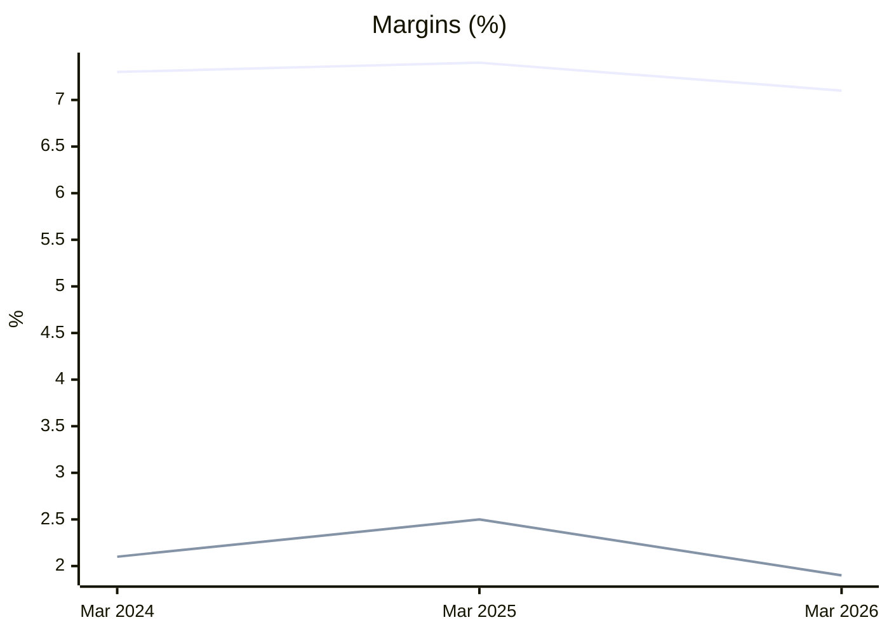

*Run 2026-11-24 · part of [SPINOFF_REPORT.md](../SPINOFF_REPORT.md) · the complete analysis of one company, with every management-call exchange in full.*

## AMBER — Amber Enterprises India Ltd.

### 1. Amber Enterprises India Ltd. — PARTIAL SPIN-OFF (subsidiary IPO)

**CONFIRMED** (partial spin-off — the IPO of IL JIN Electronics (India) Limited is in motion (DRHP filed)) · **PARTIAL SPIN-OFF, IPO IN MOTION — the parent's stub is priced once the piece trades** · score 4.3/10 · partial spin-off (subsidiary IPO) · 4 filing(s) from BSE-screener, NSE · first 2026-04-30, latest 2026-11-07

**The separated entities — every one the documents name:**

| Entity | Scheme | Business | Listing | Who runs it |
|---|---|---|---|---|
| **IL JIN Electronics (India) Limited** (earlier IL JIN Electronics (India) Private Limited) | 2026 proposed Initial Public Offer of IL JIN Electronics (I… | Printed circuit board assemblies and electronic components for air conditioners, washing machines, fans, cool… | to be listed | Mr. Sanjay Arora – Whole-Time Director, ILJIN Ele… |

**The other parties to the scheme(s)** — not separated entities: AmberPR Technoplast India Private Limited — merged in — no shares for the parent's holders; Ever Electronics Private Limited — merged in — no shares for the parent's holders

**What is being separated, as the documents put it:** IL JIN Electronics, Amber's material subsidiary in electronics manufacturing services (EMS), being separately listed via proposed IPO — class `regulatory_strategic`.

### 2. Stages and dates

> **Listing:** PARTIAL SPIN-OFF, IPO DRHP FILED — IL JIN Electronics (India) Limited; date not fixed

| Date | Event | Source |
|---|---|---|
| 2023-04-01 | Appointed date — Ever Electronics Private Limited / IL JIN Electronics (India) Private Limited scheme | as stated: NCLT Mumbai order pronounced 30.05.2025: "The Appointed Date of the S… |
| 2024-02-08 | Board approval — Ever Electronics Private Limited / IL JIN Electronics (India) Private Limited | as stated: NCLT Mumbai order pronounced 30.05.2025 in C.P.(CAA)/242(MB)2024: Boa… |
| 2024-09-07 | Board approval — AmberPR Technoplast India Private Limited (slump sale to Amber) | as stated: Restructuring intimation dated 7 September 2024 — Reconstruction Comm… |
| 2024-09-30 | Other — AmberPR Technoplast India Private Limited (slump sale to Amber) | as stated: Filing dated 7 September 2024: "The slump sale is expected to complet… |
| 2024-10-21 | Board approval — AmberPR Technoplast India Private Limited (board of the Transferor Company) | as stated: NCLT Chandigarh first motion order dated 05.06.2026, CA(CAA) No. 11/C… |
| 2024-10-22 | Board approval — Amber Enterprises India Limited (board of the Transferee Company) | as stated: NCLT Chandigarh first motion order dated 05.06.2026 (filing dated 8 J… |
| 2024-12-24 | Other — Amber Enterprises India Limited | as stated: Clarification to NSE on news item "Amber Enterprises looking to demer… |
| 2025-05-12 | Board approval — AmberPR Technoplast India Private Limited | as stated: NCLT Chandigarh first motion order dated 05.06.2026 (filing dated 8 J… |
| 2025-05-17 | Board approval — Amber Enterprises India Limited | as stated: NCLT Chandigarh first motion order dated 05.06.2026 (filing dated 8 J… |
| 2025-05-30 | NCLT order — Ever Electronics Private Limited / IL JIN Electronics (India) Private Limited | as stated: Intimation dated 30.05.2025 — NCLT Mumbai pronounced the order approv… |
| 2025-06-27 | Effective date — Ever Electronics Private Limited / IL JIN Electronics (India) Private Limited | as stated: Intimation dated 04 August 2025: "The Scheme became effective upon fi… |
| 2025-08-04 | Stage reached: **effective** | [Amalgamation/Merger](https://nsearchives.nseindia.in/corporate/AMBER_04082025185722_Intimation_Prouncement_of_Order_04082025_signed.pdf) |
| 2025-08-04 | Other — Ever Electronics Private Limited | as stated: Intimation dated 04 August 2025 — approval of ILJIN's e-Form INC-28 r… |
| 2026-04-01 | Appointed date — AmberPR Technoplast India Private Limited scheme of amalgamation | as stated: NCLT Chandigarh order dated 05.06.2026: "The Applicant Companies have… |
| 2026-04-17 | NCLT order — AmberPR Technoplast India Private Limited / Amber Enterprises India Limited | as stated: Intimation dated 30th April 2026 — NCLT Chandigarh order dated 17th A… |
| 2026-04-30 | Stage reached: **announced** | [Scheme of Arrangement](https://nsearchives.nseindia.com/corporate/AMBER_30042026193549_Intimation_Amberpr_Amber_Scheme_Update_30042026.pdf) |
| 2026-04-30 | Board approval — Amber Enterprises India Limited (Merger & Amalgamation Committee) | as stated: Intimation dated 30th April 2026 — approval of the change in Appointe… |
| 2026-06-05 | Shareholders / creditors meeting — AmberPR Technoplast India Private Limited / Amber Enterprises India Limited | as stated: Intimation dated 8th June 2026 — NCLT Chandigarh order dated 05th Jun… |
| 2026-06-08 | Stage reached: **nclt sanction** | [Scheme of Arrangement](https://nsearchives.nseindia.com/corporate/AMBER_08062026190432_SE_Intimation_Scheme_of_Arrangement_Amber_08062026.pdf) |
| 2026-07-03 | Other — AmberPR Technoplast India Private Limited / Amber Enterprises India Limited | as stated: NCLT order dated 25.09.2026 annexed to filing dated 1st October 2026:… |
| 2026-07-11 | Other — IL JIN Electronics (India) Limited | as stated: Earlier intimation dated 11th July 2026 regarding the proposed IPO, r… |
| 2026-09-25 | NCLT order — AmberPR Technoplast India Private Limited / Amber Enterprises India Limited | as stated: Intimation dated 1st October 2026 — second motion order dated 25th Se… |
| 2026-10-01 | Stage reached: **exchange noc** | [Announcement under Regulation 30 (LODR)…](https://www.bseindia.com/xml-data/corpfiling/AttachLive/8c3498cb-dcec-4256-9438-b81116fa0e7d.pdf) |
| 2026-10-23 | Other — AmberPR Technoplast India Private Limited / Amber Enterprises India Limited | as stated: NCLT order dated 25 September 2026 (filing dated 1st October 2026): "… |
| 2026-11-07 | DRHP filed — IL JIN Electronics (India) Limited | as stated: Regulation 30 intimation dated 07th November 2026 (DRHP dated 6th Nov… |

**The stages, as filed:** effective (2025-08-04) → announced (2026-04-30) → nclt sanction (2026-06-08) → exchange noc (2026-10-01)

**The partial spin-off:** **IL JIN Electronics (India) Limited** (subsidiary); parent's stake 89.72%; IPO stage: DRHP filed; exchange: BSE Limited and National Stock Exchange of India Limited.

> “IL JIN Electronics (India) Limited (formerly known as IL JIN Electronics (India) Private Limited), a material subsidiary of the Company, has filed the Draft Red Herring Prospectus dated 6th November 2”

**Stated in the filings:** appointed date 2025-04-01.

### 3. Size of the separated business beside the parent — is institutional selling likely?

**Reading: POSSIBLE — the piece is a sizeable minority of the whole; forced selling on size alone is weaker.**

| Entity | Stated turnover | Stated share of the whole | Segment revenue share | Market cap (₹ cr) | Share of combined market cap | Index member |
|---|---|---:|---:|---:|---:|---|
| IL JIN Electronics (India) Limited | not stated for the entity; Electronics division revenue of … | — | 26.8% (FY2026) | — | — | not listed |

*Stated figures are the documents' own (a turnover share, or the cost-of-acquisition split the company publishes for tax, which reflects relative value); the segment share is this business's revenue over the parent's sales, and the market-cap share is the entity's value over the entity plus the parent (parent ₹23,883 cr, NSE bhavcopy of 2026-11-13), both computed here.*

**In the documents' words:** “From the 7 September 2024 filing, for AmberPR only: "The amount and percentage of the turnover or revenue or income and net worth contributed by such unit or division or undertaking or subsidiary or associate company of the listed entity during the last financial year" — "Turnover FY 2023-24" "12,092.63" and "Net Worth FY 2023-24" "2,923.57" (Amount in Lakh); "% of Turnover or Revenue or Income and Net Worth contributed by AmberPR of the Company" "2.68%" and "1.71%". No size statement is given for IL JIN relative to Amber.”

**The judge's read of selling pressure:** unlikely — IPO, not a share distribution to Amber holders; Amber keeps 89.72%; offer size and index effects not stated

### 4. Insider ownership — share swap, promoters' holding, management incentives

**Share swap / entitlement:** not stated in the documents on file.

**Promoters' holding, from the shareholding pattern:**

| Company | Promoters | FIIs | DIIs | Public | Quarter |
|---|---:|---:|---:|---:|---|
| Amber Enterprises India Ltd. (AMBER) | 38.09% | 20.61% | 29.76% | 11.53% | Sep 2026 |

*Source: screener.in shareholding pattern, stored under `ShareholdingPattern/NiftyTotalMarket/`. In a mirror demerger each shareholder holds the same proportion of the new company as of the parent on the record date.*

- **Promoters in the parent, per the documents:** not stated in the documents on file.
- **What the promoters will hold in the separated entity:** For the IL JIN IPO: not stated. On Amber's own holding in IL JIN before the IPO, Q2 FY26 call: "So as of now, should we assume that the stake remains at 90% only and it will go down only once the CCPS converts in the future?" — "Yes, right." And Q4 FY26 call: "So nothing is being considered as a dilution on CCPS. Nothing -- no dilution has still now happened due to CCPS. It will happen in future based on the future multiple and valuation. So currently, on a conservative side, the auditor has considered the diluted percentage and calculated the NCI." / "I think they are considered around 30-odd percent." For the AmberPR amalgamation: "In terms of clause 18 of the Scheme, the Transferor Company is a wholly owned subsidiary of the Transferee Company, accordingly, upon the Scheme becoming effective, all the equity shares as held by the Transferee Company in the Transferor Company either by itself or through its subsidiaries/nominees shall stand cancelled and extinguished." For the 2024 slump sale: "There will be no change in the shareholding pattern of the Company pursuant to the proposed slump sale."
- **What a public shareholder receives:** For the 2026 AmberPR amalgamation, nothing: "No shares are to be issued by the Transferee Company in lieu or in exchange of its holding in the Transferor Company as consideration, and therefore, there is no reorganization in the paid-up capital structure of the Transferee Company" and "the proposed Scheme will not result in any dilution in the Shareholding of the Shareholders of the 'Transferee Company'". For the 2024 slump sale: "There will be no change in the shareholding pattern of the Company pursuant to the proposed slump sale." For the IL JIN IPO: not stated — the documents disclose no entitlement, reservation or shareholder quota for Amber's public shareholders.
- **Management incentives:** Existing grants: "Subsequent to April 01, 2025, the Transferee Company has issued and allotted shares under Amber Enterprises India Limited - Employee Stock Option Plan 2017 on April 18, 2025, June 05, 2025, August 02, 2025, November 06, 2025, and February 25, 2026." Reporting treatment: "For clarification, operating EBITDA is before impact of ESOP expenses and other nonoperating income and expenses." The documents do not state how existing grants are treated in any scheme, do not disclose any new plan in IL JIN, and do not give an exercise price or pricing date. On management of the new mobile-phone business: "Certainly, it requires a very dedicated efforts. And certainly, there will be a senior most management dedicated to this sector only". On where it will sit: "we'll give a clarity on that, whether it will come directly under Amber or it will go in IL JIN... But we will not be able to define it right now because we have other shareholders also in the IL JIN cap table."
- **Insider actions around the separation:** No promoter or management buying, selling or pledging of Amber shares is stated. The documents do state, on the Ascent management shareholding: "We have taken our -- earlier, we acquired 60%, now we own 98.5%. Yes, because of the arrangement in the agreement, Mr. Manjunath had to step down because he's no more a shareholder in the Ascent." Third-party capital raises around the separation: "ILJIN Electronics has successfully concluded fundraise with the entire INR1,750 crores received from marquee investors" (CCPS plus a small portion of equity; tranches of INR370 crores in September, INR280 crores in October and ChrysCapital's INR1,100 crores) and "Amber Enterprises raised equity fund of INR1,000 crores from marquee investors through QIP". Also "share of loss of Shivalik JV is INR64 crores from 1st January '26 till 30th March '26, the date of sale of Shivalik shares." On an earlier demerger report, the Company told NSE on 24 December 2024: "As on date, there is no such event that triggers the disclosure obligations under Regulation 30 of SEBI LODR Regulations."
- **Insiders, per the checklist read:** Amber holds 60,98,240 IL JIN shares, 89.72% post rights issue (Rs 296.02 crore subscribed); promoters Jasbir Singh and Daljit Singh are directors on IL JIN's board; CCPS holders' maximum dilution ~30% · *option pricing date:* not stated

### 5. Why the demerger — point by point

The business being separated is Amber's Electronics / EMS arm, housed in IL JIN Electronics (India) Ltd — PCB assembly (~INR2,281cr of FY26 revenue), bare PCB through Ascent Circuits (98.5% owned), Shogini Technoarts (80%) and the Ascent-K/Korea Circuit HDI JV (~INR600cr), plus Power-One Microsystems (60%, power electronics, ~15% EBITDA) and 50.4% of Israel-listed Unitronics (industrial automation, 24-25% EBITDA) — leaving Amber with the RAC/consumer-durables division (INR8,383cr FY26) and Sidwal railway/defence (INR535cr). The stated driver is funding: essentially all of the group's capex sits in electronics, with more than INR4,500cr of ECMS investment approvals (Ascent multilayer INR991cr, Ascent-K HDI INR3,200cr, Shogini INR500cr), asset turns of only 0.75-1.1x, and the 48% MeitY plus 42% UP incentives arriving 5-6 years after the spend, so FY27 capex of INR1,800-2,000cr (INR1,100-1,200cr cash) and ~INR1,400-1,500cr in FY28 must be pre-funded against a board policy never to exceed 2x debt/EBITDA and Jasbir Singh's pledge to be net-debt-free. Management said investors asked for it: private equity funds were 'chasing to invest in the electronic division', and instead of loading Amber's balance sheet they raised INR1,750cr inside ILJIN (mostly CCPS, including ChrysCapital's INR1,100cr) while Amber separately did a INR1,000cr QIP. Separation also gives electronics its own margin and valuation identity — 2.8% EBITDA when ILJIN was bought in 2018 on INR300cr revenue, 6.9% FY25, 8.8% FY26, 10.8% in Q4 FY26, 26% ROCE, guidance of 40% FY27 growth at 9.5-10% and a $1bn revenue target at 11.5-12% EBITDA — against a weather-driven RAC business that saw quarters of -30% to -35% and nine bad seasons in 25 years. The outside CCPS holders also need a price: conversion happens 'based on the future multiple and valuation' (auditors provisioned up to ~30% dilution in NCI), which a listing supplies; and their presence already constrains group structuring, since management could not say whether the new Oppo mobile-phone business would sit in ILJIN 'because we have other shareholders also in the IL JIN cap table'. It is being done as a listing of the subsidiary, not a demerger: in April 2026 Amber put another INR296.02cr into an INR328.12cr ILJIN rights issue (89.58% to 89.72%); in July 2026 ILJIN split shares from Rs10 to Rs5, raised authorised capital to Rs250cr, issued a 25:1 bonus, converted from private to public limited, shifted its registered office from Pune to Greater Noida and resolved to explore fund-raising 'including... public issue'; the DRHP was filed on 7 November 2026. In parallel Amber is cleaning up the rest of the portfolio — merging wholly-owned AmberPR Technoplast into itself for compliance/cost reduction and peer benchmarking, and selling Sidwal's entire 49% Shivaliks (Titagarh Firema) JV for a nominal Rs1,09,798.85 after INR112cr of FY26 impairment/JV losses, 'to curtail future losses'.

**Point by point, with the source:**

1. The capex need that later drives the separation starts here: the Korea Circuit HDI/substrate JV is on hold pending the ECMS scheme, with a likely Rs1,000cr-plus minimum investment and 70-75% of it only reimbursed later by MeitY and the states. “So, on Korea Circuit we are waiting for Government to finalize the incentive scheme.” — *[Jan 2025](https://www.bseindia.com/stockinfo/AnnPdfOpen.aspx?Pname=813804ee-c3a7-4425-bb42-2057de6be8b1.pdf)*
2. With an INR3,000cr PCB application planned and subsidies spread over 5-6 years, management says the Electronics division is itself seeking third-party funding — the first hint of capital being raised at the subsidiary rather than at Amber. “So we are already in touch with various institutions for that.” — *[May 2025](https://www.bseindia.com/stockinfo/AnnPdfOpen.aspx?Pname=069162e3-fda9-42bb-9c69-0db5b0c2a202.pdf)*
3. Two funding routes are named — an INR2,500cr QIP enabling resolution at Amber and private equity money targeted specifically at the electronics arm; the same call sets the constraint that drives it, a board cap of 2x debt/EBITDA and a goal to be net-debt-free by FY27. “Second direction is a lot of private equity funds who are chasing to invest in the electronic division.” — *[Aug 2025](https://www.bseindia.com/stockinfo/AnnPdfOpen.aspx?Pname=445f7c35-5bf5-4f56-9d6f-e16495c40233.pdf)*
4. The separated entity is given its own standalone ambition and margin identity — $1bn revenue in three years at 11.5-12% EBITDA, versus ILJIN's 2.8% EBITDA on INR300cr when acquired in 2018. “With all the add -ups, we intend to take Electronics division to $1 billion by next 3 years with target EBITDA of 11.5% to 12% range.” — *[Aug 2025](https://www.bseindia.com/stockinfo/AnnPdfOpen.aspx?Pname=445f7c35-5bf5-4f56-9d6f-e16495c40233.pdf)*
5. The raise happens at two levels simultaneously: INR1,750cr into ILJIN (mostly CCPS; INR370cr in September, INR280cr in October, ChrysCapital's INR1,100cr pending CCI) and a separate INR1,000cr QIP at Amber used mainly to cut debt. “We secured funding of INR1,750 crores from marquee investors.” — *[Nov 2025](https://www.bseindia.com/stockinfo/AnnPdfOpen.aspx?Pname=0bcb53ba-69d0-4386-9199-d20b4b029d9c.pdf)*
6. ILJIN's raise closes in full and Amber's stake stays at 90% only because the instrument is CCPS; the same call adds the ECMS approvals (Ascent-K HDI, Shogini) and 116 acres at Jewar that the money has to fund. “On the balance sheet front, ILJIN Electronics has successfully concluded fundraise with the entire INR1,750 crores received from marquee investors.” — *[Feb 2026](https://www.bseindia.com/stockinfo/AnnPdfOpen.aspx?Pname=99744db3-5ae9-451c-8d73-b33d28177128.pdf)*
7. The outside investors' economics depend on a valuation event: no dilution has occurred yet because CCPS convert off a future multiple, with auditors provisioning roughly 30% maximum dilution in non-controlling interest. FY27 capex is guided at INR1,800-2,000cr (INR1,100-1,200cr cash), net debt INR511cr rising to INR700-800cr. “It will happen in future based on the future multiple and valuation.” — *[May 2026](https://www.bseindia.com/stockinfo/AnnPdfOpen.aspx?Pname=469945ff-af54-4664-8bd7-ed051c694aff.pdf)*
8. The ILJIN cap table already limits group structuring — management cannot say whether the new Oppo mobile-phone business (8m units year one, 13-15m year two, sub-INR50cr capex, 1.5-2% industry EBITDA) will sit inside ILJIN or directly under Amber. “But we will not be able to define it right now because we have other shareholders also in the IL JIN cap table .” — *[Jun 2026](https://www.bseindia.com/stockinfo/AnnPdfOpen.aspx?Pname=e758d7f3-9942-4baf-b20b-0e80b2d6971a.pdf)*
9. April 2026: Amber pre-funds ILJIN again, subscribing INR296.02cr of a INR328.12cr rights issue (12,46,430 shares), taking its holding from 89.58% to 89.72% — capital in before the listing, not a stake sale. “Further, pursuant to the allotment of equity shares under the rights issue by IL JIN on 21st April 2026, which has resulted in an investment of Rs. 296.02 Crore, Amber Enterprises India Limited (“Amber” or “the Company”) has subscribed to and been allotted 12,46,430 equity shares.” — *Scheme*
10. July 2026: ILJIN is mechanically prepared for listing — Rs10 to Rs5 share split, authorised capital to Rs250cr, 25:1 bonus, conversion from private to public limited, registered office moved Pune to Greater Noida, and a board resolution to explore fund-raising modes including a public issue. “Evaluation and exploration of various fund-raising options to support its future growth initiatives.” — *Scheme*
11. 7 November 2026: the separation becomes a formal partial listing of the electronics arm — a DRHP for ILJIN's IPO filed with SEBI, BSE and NSE, Amber retaining ~90% pre-offer. “IL JIN Electronics (India) Limited (formerly known as IL JIN Electronics (India) Private Limited), a material subsidiary of the Company, has filed the Draft Red Herring Prospectus dated 6th November 2026 (“DRHP”), on 7th November 2026 with the Securities and Exchange Board of India, BSE Limited and National Stock Exchange of India Limited in connection with its proposed Initial Public Offer (“IPO”).” — *Scheme*
12. The rest of the group is being simplified in the opposite direction: wholly-owned AmberPR Technoplast (cross-flow fans) is merged into Amber — no shares issued, NCLT dispensed with meetings, appointed date moved to 1 April 2026 — for compliance savings, scale synergies and cleaner peer comparison. “more absolute and profound comparison with industry peers ie. benchmarking business performance with industry; and” — *Scheme*
13. Portfolio pruning runs alongside: the 49% Shivaliks/Titagarh Firema stake is impaired (INR94cr in Q3, INR112cr FY26 including JV losses) and then sold in March 2026 to JP Fincap for a nominal Rs1,09,798.85, ending Italy export ambitions while keeping the Titagarh commercial relationship worth ~INR700cr of visibility. “And to curtail future losses, on etime exceptional impairment loss has been recognized during this quarter.” — *[Feb 2026](https://www.bseindia.com/stockinfo/AnnPdfOpen.aspx?Pname=99744db3-5ae9-451c-8d73-b33d28177128.pdf)*

**How it evolved:** The capex trigger appears first on the Jan 2025 call (Korea Circuit JV awaiting the ECMS scheme, Rs1,000cr+ threshold) and on 19 May 2025, when the funding answer is still vague — 'in touch with various institutions' — alongside an INR3,000cr application plan. By 30 July 2025 it has split into two named routes, an INR2,500cr QIP enabling resolution at Amber and 'private equity funds who are chasing to invest in the electronic division', with the $1bn/11.5-12% electronics ambition and a net-debt-free pledge framing why outside money must sit at ILJIN; on 7 Nov 2025 the INR1,750cr ILJIN raise (CCPS, ChrysCapital INR1,100cr pending CCI) and Amber's INR1,000cr QIP are both announced, and 10 Feb 2026 confirms the full INR1,750cr received with Amber still at 90% until CCPS convert. From there it becomes an exit path for those investors: 18 May 2026 ties conversion to 'future multiple and valuation' (~30% assumed dilution), 20 June 2026 shows the ILJIN cap table already constraining where new businesses can be placed, and the filings then execute mechanically — Mar/Apr 2026 rights issue, 11 July 2026 split, 25:1 bonus, public-limited conversion, registered office to Greater Noida and a 'public issue' resolution, and the DRHP on 7 Nov 2026 — none of it ever discussed on an earnings call.

**What management expects from it:** Electronics: self-funded ECMS PCB capex, $1bn revenue in ~3 years, margins from 2.8% (2018) toward 11.5-12%, double digits from FY27, ~26% ROCE, stickier high-entry-barrier industrial/defence mix. Amber: retains ~89.7%, frees cash for consumer durables and railway (30-35% growth, 16-17% margins), stays under 2x debt/EBITDA near net-debt-free; CCPS dilution finally priced off a market valuation.

*Not explained on the calls:* Calls never discuss the IPO itself: offer size, fresh issue versus OFS, use of proceeds, valuation, Amber's post-listing stake, CCPS conversion terms, or why listing rather than demerger.

- *Stated reason, in one line:* Not stated for the IPO itself; IL JIN's board approved "evaluation and exploration of various fund-raising options to support its future growth initiatives", including a public issue
- *What it reveals:* Electronics division FY26 revenue Rs 3,268 crore (+49%), operating EBITDA Rs 287 crore (+89%), guided ~40% FY27 growth at 9.5-10% margins; IL JIN raised Rs 1,750 crore from marquee investors; bought 2018 as a Rs 300-crore, 3%-EBITDA company
- *Parent or spin:* parent · *Read next:* The DRHP dated 6th November 2026: IL JIN standalone financials, fresh-issue versus offer-for-sale split, and CCPS conversion terms
- *In their words:* “The IPO will be subject to receipt of the required regulatory approvals.”

### 6. On the calls, verbatim

11 call(s), oldest first: **74 question-and-answer exchange(s)** given in full — the question and every answer to it, nothing trimmed — and 25 passage(s) from management's prepared remarks (the complete sentences about it; the whole remarks are in the linked transcript). Text is as the transcript prints it.

#### Feb 2024 — [transcript](https://www.bseindia.com/stockinfo/AnnPdfOpen.aspx?Pname=9124ca7f-7d48-4df9-a782-1ea985c2c963.pdf)

**From the prepared remarks** *(the passage about it; the whole turn runs to 14,448 characters in the transcript)*

> **Jasbir Singh:** Hello and good morning , everyone on the call I'm joined by Mr. D aljit Singh – Managing Director; Mr. Sudhir Goyal – our CFO ; Mr. Sanjay Arora – Whole-Time Director of IL JIN Electronics ; and Mr. Sachin Gupta – CEO of R AC Division. We have uploaded our Results , Presentation on the exchanges and I hope everybody had an opportunity to go through the same . This year has been a year of transformation at Amber . […] Firstly, we shifted towards supply of components to room air conditioner customers with our goal of maintaining our share of business in this sector of 28 % to 29% in value terms . We are glad to announce that we have been able to maintain our share and are hopeful to continue maintaining it. Furthermore, we opted for going for non -room air conditioner components , like components for telecom, smart meters, automobiles, refrigerator compressor parts, washing machine parts, Amber Enterprises India Limited February 12, 2024 microwave parts, etc. , Today, our room AC contribution has come down from 72% in 2018 to 38% and will further reduce in the coming years to come. We also diversified our electronics PCBA portfolio to different applications apart from consumer durables . We added hearable and wearable sector, telecom sector , auto, smart metering and now further expanding into defense and industri als, plus, we acquired Ascent circuits for expanding our portfolio into PCB boards for various applications. Furthermore, we strengthen ed our railway portfolio . Apart from supplying air conditioners, we entered into doors and gangways and pantry systems and further now expanding into couplers, interiors, toilets, pantograph s and p assage through our recently announced JV with Titagarh . […] However, we are very strongly confident of maintaining our growth trajectory in our bottom line in the next financial year and years to come. Also, we are confident of maintaining our guidance of ROCE levels of 19 % to 21% range in the next three years, i.e. FY'27. I would now like to take you through Highlights of Recent Announcements made in Electronics and Railway Division . Ascent Circuits: Amber Group has acquired 60% stake in As cent Circuits Private Limited through IL JIN Electronics for consideration of Rs.311 crores subject to adjustments as stipulated in definitive agreements . This acquisition will aid us in manufacturing of printed circuit boards and help us develop capacities and capabilities for single -sided , double - sided, multi -layered and RF PCBs . Through this acquisition, we will be able to cater diverse set of customers for various applications that is aerospace and defense, medical, energy solutions, automotive, telecom, data centers, consumer electronics, IT, lighting , etc., Further , Amber via Ascent Circuit s also signed an MOU with South Korea ’s Circuit, which is a YoungPoon g Group Company, to manufacture Flex , HDI, semiconductor substrates , PCB s, thereby enhancing PCB manufacturing in India . Korea Circuit is the pioneer of Korean PCB industry and has pioneered various PCB solutions including HDI , flex, semiconductor substrates, multilayer double -sided and single -sided PCB s in the last 45 -years. These solutions find applications across diverse sectors such as mobile industry , IT industry, semiconductor industry, home appliances, consumer electronics, aerospace and defense, medical, energy solutions, automotive, telecom, data centers and more. Amber Enterprises India Limited February 12, 2024 The recent acquisition of a majority stake in Ascent C ircuits, followed by signing of this M oU with Korea Circuit , places Amber in a unique spot and positions it as a leading player in the electronic EMS space, thereby opening a myriad of new business opportunities. Moreover , it enhances Amber's EMS portfolio by increasing local value addition and fostering backward integration into passive components of PCB assemblies. This aligns seamlessly with the Atmanirbhar Bharat Vision of Government of India and is consistent with the group strategy of strengthening backward integration for its EMS play across diverse applications. We clearly see our electronics division becoming Amber 2.0 strategy that has exponential growth opportunities in the year to come. Now , I'll talk about Sidwal and Titagarh Announcement. Further, Amber through Sidwal has posed a strategic partnership with Titagarh Rail Systems Limited to enter the train components and subsystem business in India and Italy via a 50 :50 joint venture SPV named Shivali k. Titagarh Rail stands as a front runner in the railway rolling stock domain excelling in both freight and passenger rolling stock. […] Consequently, although it may seem that our revenues in these divisions have experienced a 3% and 5% YoY decline for the nine months and Q3 respectively, it's crucial to consider the context, namely the decline in finished goods sale compared to the previous fiscal year. Typically , orders for finished goods commence in late October to prepare for the upcoming business season, while orders for components usually kickstarts in January to February to minimize inventory holding period. We expect margin expansion in this division due to our shift of strategy towards components and we expect to maintain our share of bus iness of 28 % to 29% in value terms in this division . Shifting gears to the “Electronics Division ,” it has reported total revenue of Rs.757 crore s for the nine months FY'2 4 and Rs.241 cr ores for Q3 FY'24. Operating EBITDA increased to Rs.36 crores versus Rs.30 crores in the nine months as compared to the nine months FY'23. Despite witnessing a 7% Y oY increase in the revenues for the nine months FY'2 4, there was an 8% decline in Q3 FY' 24. Amber Enterprises India Limited February 12, 2024 As previously mentioned, we have recently done two strategic onboarding in Amber’s ambit ; Ascent Circuits and Korea Circuit which will significantly contribute to the top line and bottom line of the division going forward.

**Question and answer**

> **Rahul Gajeria:** I have two questions. One is on the mobility business I want to know . We are talking about the opportunity on Vande Bharat, know through Titagarh , but on the metro, do we have tie -ups with the likes of B EML, Siemens, Alstom, Bombardier? That's the first question. The second question is on the CAPEX side. We've spent over Rs.2,000 crores in the last 10 years and we are looking at the significant CAPEX given that we've spent almost Rs.260-odd crore s in the first nine months. You did indicate in the opening remarks , you want to get to ROC E of 19 % to 20% from Amber Enterprises India Limited February 12, 2024 single digit. Can you just take us through how will you reach from single digit ROCs given the CAPEX intensity that we can see in the next couple of years ?
>
> **Jasbir Singh:** To answer your first question, Rahul, we already are suppl ying to B EML, Alstom, then CR RC and now onboarded Titagarh plus, all the three railway manufacturing facilities, ICF Chennai , RCF Kapu rthala, MCF Raebareli and plus all the sub -divisional parts on the DCW and all , plus we are also supplying to locomotives as well , both Siemens and G E. So, on the customer front, we are already approved there. We just need to expand the product offering by increasing our wallet share. To answer the question on the second part on the CAPEX intensity, since all these new initiatives are higher margin businesses with a high ROC E businesses like Sidwal per s e today is sitting at about 22% of EBITDA margin with close to 40% of ROC E business , Electronics again is at about 27% of ROC E business. And furthermore, by the initiatives which we have taken, we are going to increase the margins in the business , and on the consumer durable side also because of our strategy shift on the component side, the margins are expanding. So , because of higher margin businesses and high growth plus the operational leverage on the plants, we will reach to the ROC Es level of what we guided.

**Question and answer**

> **Rahul Gajeria:** Isn’t consumer and electronics both are close to 5%-odd because that's what we've seen in the nine months numbers.
>
> **Jasbir Singh:** Consumer has now come to about 7.3% and electronics by next year will cross 7%.

**Question and answer**

> **Dhruv Jain:** On these two inorganic initiatives that you have taken right, so just wanted to understand what kind of revenue potential and margin that we can see in terms of improvement ? And if you could even talk about Ascent' s nine month s performance and how should we think about it in the next two or three years? And just one clarification there , on the electronic side, you mentioned that Amber Enterprises India Limited February 12, 2024 you will go to about 7%, 7.5% margin. So does this include the Ascent because we understand that the margins there are much higher ?
>
> **Jasbir Singh:** So Ascent , nine months is performing fine ; they have done Rs.206 crore s with almost Rs.42 crores of EBITDA, almost about 19 % to 20% of EBITDA levels which is very high for this kind of business sector. Yes, it will be consol of electronics division will reach to 7%, 7.5% moving forward, both PCB A as well as the Bare PCB Board put together , will be there on an EBITDA level.

**Question and answer**

> **Sonali:** My second question is of your new initiative on the Ascent and Tita garh, you' ve tie up with them . What is the kind of upside , very approximately that we can expect? Management: On Ascen t, we have done two things. One is we have acquired 60% in Ascen t, and secondly, we have also signed M oU for partnering with YP Group Korea C ircuit of South Korea. It is a $12 billion group and they are one of the leading players supplying to mobile industry as well as semiconductor in dustry there and a specialist in HDI board . So they are very keen . With both of them put together , we have opened up a good opportunity for this business sector . Right now this bare PCB board is largely getting imported and nobody is making mobile PCBs here and nobody is making semiconductor substrates here , plus you must have heard anti -dumping duty has been levied and the file is just awaiting the final notification to be out. Already, DGFT has recommended 30% anti -dumping duty on these products from single layer to six layer basis. We expect that notification should be up and out by March . So that will open up this whole complete import substitution for us . Currently , if you see , almost about $3.8 billion worth of bare PCB boards are getting imported, p lus, ongoing growth in electronics sector, where every sector is having more content of electronics, be it automobile , be it consumer durables, defense, aerospace, aviation, whatever sector you see , the content of electronics is increasing on yearly basis. So today, if we see, there's a lot of opportunity, which opens up because of As cent Circuits and our association with YP Group .

**Question and answer**

> **Indrajit:** I have got two questions. First is on electr onics division . Can you help us understand what prop ortion of the revenue as you report today is from R AC-related electronics and what is non - RAC related electronics, just to understand what kind of decline that we have seen in electronics can be attributed to ? Management: So, electronics basically contribute about 19% in the total con sol revenue and in that almost about 25% is air conditioner PCB boards.

**Question and answer**

> **Arafat Saiyed:** Any guidance on that , if you can quantify exactly you're looking in terms of margins, although you are looking to double the revenue for your electronics and also if you can guide on that what sort of margin are you looking for FY'26?
>
> **Jasbir Singh:** Well, all the divisions are at a different margin profile. I think we are at almost 7.2 % in the consumer durable division , we will be touching 7% plus in the electronics division by next year , and railway mobility is at about 20 % plus. So all divisions are at different stream and at good growth prospective . Like in railways , I've exp lained that by this announcement , we have opened a good TAM for us . If you see on the Vande Bharat Express, very few Vande Bharat Express will be delivered next year. But next -to-next year, the numbers are going up, and by FY '27 the numbers are exponentially going up. So our revenues in that stream also will go to in line with the requirement of the Indian Railways.

**Question and answer**

> **Anupam Goswami:** Now that you are focusing more on the non -AC part, whe n do we see the growth in the top line , do we have a better sort of growth than earlier , are you envisaging some stronger growth than earlier or do we see some slowdown in that now that the AC part is coming down in the proportions ? Management: It's very difficult to predict on the top line basis because on the component side also we have some sub -assemblies where customers do take sub -assemblies, sometimes they don't take sub- assembl ies. Similarly , in electronics division we have seen similar kind of a trend. So predicting and guiding on top line will be very difficult. But yes, as guided earlier , on the bottom line basis, we see a very, very strong growth moving forward .

#### May 2024 — [transcript](https://www.bseindia.com/stockinfo/AnnPdfOpen.aspx?Pname=b3593f24-44d1-400e-970b-ec0032f47b98.pdf)

**From the prepared remarks** *(the passage about it; the whole turn runs to 657 characters in the transcript)*

> **CIN NO.:** L28910PB1990PLC010265 “Amber Enterprises Limited Q4 & FY'24 Earnings Conference Call” May 18, 2024 MANAGEMENT : MR. JASBIR SINGH – EXECUTIVE CHAIRMAN & CHIEF EXECUTIVE OFFICER , & WHOLE -TIME DIRECTOR , AMBER ENTERPRISES INDIA LIMITED MR. DALJIT SINGH – MANAGING DIRECTOR , AMBER ENTERPRISES INDIA LIMITED MR. SUDHIR GOYAL – CHIEF FINANCIAL OFFICER , AMBER ENTERPRISES INDIA LIMITED MR. SANJAY ARORA – WHOLE -TIME DIRECTOR , IL JIN ELECTRONICS Disclaimer: E&OE -This transcript is edited for factual errors. In case of discrepancy, the audio recording uploaded on the stock exchange on 18th May 2024 will prevail Amber Enterprises India Limited May 18, 2024

**From the prepared remarks** *(the passage about it; the whole turn runs to 8,734 characters in the transcript)*

> **Jasbir Singh:** On the call, I'm joined by Mr. Daljit Singh, Managing Director, Mr. Sudhir Goyal, our CFO, Mr. Sanjay Arora, Whole -time Director of IL GIN Electronics and our Investor Relations Advisor, SGA. We have uploaded our Results, Presentation on the exchanges and I hope everybody had an opportunity to go through the same. FY'23 -24 has been a year of resilience and growth for Amber. And in this one year we have strengthened our portfolio and market offerings with strategic diversifications in new growth segments. […] Mass production from the new plant will commence from H2 second half this year, where we expect around 40,000 washing machines to be produced in this year, which will further take it to 1,25,000 in next financial year. We have already onboarded a couple of customers and the trials are currently going on. Through this JV , we gained access to manufacturing washing machines, thereby allowing us to offer wider range of high quality products to our customers. Now, I will take you the highlights on “Electronics Division. ” In the past five years, our stint which started from providing PCBA solution for inverter AC has now diversified into providing solutions for home appliances, consumer electronics, hearable and wearable , telecom, smart meters and automobile segments. We have further amplified our offerings by making an entry into manufacturing of bare PCB, which going forward will open new avenues for us in the sector of aerospace, defense, medical electronics, EV , mobile and energy solutions amongst others. We acquired 60% stake in Ascent Circuits for manufacturing of printed circuit boards, single sided, double sided multilayer and RF PCB. The company has been catering to marquee customers such as ISRO, BHEL, VHEL, automotive component customers, telecom, consumer electronic clients, both multinational and domestic, who have been driving India's growth journey. This acquisition will enable us to offer solutions to applications such as aerospace and defense, medical, energy solutions, etc., This acquisition strengthens our EMS portfolio by enhancing our presence in passive components of PCB assemblies. This uniquely positions Amber as a leading player in the electronic EMS space. Amber Enterprises India Limited May 18, 2024 Further, our MoU with South Korea, Korea Circuit through our recent venture Ascent Circuits for manufacturing of Flex HDI and semiconductor substrates, which means in India will bolster Amber's electronics EMS play. This MoU will enhance the capability of Ascent Circuits for providing solutions to the mobile and semiconductor industry, which has been a focus of the government recently. This association between Amber and Korea Circuit will envelope the entire portfolio of PCBs required for various applications in India's electronic manufacturing growth story, that is HDI, Flex, Semiconductor Substrate, Multilayer Double Layer, Single Sided, etc., Also, the recent decision by government to impose anti-dumping duty on imported printed circuit boar ds will settle the dust of import and make the road clear for localization of bare boards in the country. In this electronic EMS division, we have travelled a journey from 3% EBITDA in 2018 to 5.6% in FY'24.

**From the prepared remarks** *(the passage about it; the whole turn runs to 5,854 characters in the transcript)*

> **Sudhir Goyal:** The operating EBITDA in Q4 stood at Rs.179 crores compared to Rs.156 crores in Q4 Financial Year ‘23. We expect margin expansion in this division due to our shift of strategy towards components and further diversifying into manufacturing of fully automatic top load and front load washing machine and its components. We expect to maintain our share of business of around 27% of manufacturing footprint in value terms in our RAC division. The electronics division has reported total revenue of Rs.1,241 crores for Financial Year ‘24 compared to Rs.1,125 crores in Financial Year ‘23. For Q4 Financial Year ‘24 revenue stood at Rs.484 crores compared to Rs.415 crores in Q4 Financial Year ‘23. The operating EBITDA stood at Rs.69 crores in Financial Year ‘24 versus Rs.51 crores in Financial Year ‘23. The operating EBITDA in Q4 Financial Year ‘24 stood at Rs.33 crores compared to Rs.21 crores in Q4 Financial Year ‘23.

**Question and answer**

> **Natasha Jain:** Sir my question firstly is on the reported numbers. In your segmental number in the PPT versus what you've published, sir, specially at EBIT level for electronics, there's a very stark difference. So on your published number, I think there is a degrowth of almost 470 basis points and on the PPT there is an increase of 170 basis points. So if you can tell us what's the difference here because even if I take full impact of ESOP, there is still a decline. So, if you could call out what are these non-operating income and expenses? And secondly, on that segment again, we are seeing a tepid growth in FY'24. Now, our guidance have been that we want to clock in 50% top Amber Enterprises India Limited May 18, 2024 line CAGR. So like how you explained for Sidwal, if you could tell us the strategy here also going forward, how can we get back on the growth path?
>
> **Jasbir Singh:** So basically on the growth part like PCBAs, we have already expanded our applications. We are no more a consumer durable application company. We are now giving applications solutions for telecom industry, for hearables, wearables for smart meters, for auto players also and plus by acquisition of Ascent Circuits, which is largely into defense, aerospace and predominantly into auto space. This expands our portfolio of offering both into PCB as well as PCBA world and that's how we are very confident of achieving, because our PCB business is at a higher margin as compared to our PCBA business, but on a blended basis, now we are targeting to touch 7.5% to 8% in this current financial year. As far as on the other income is concerned, I would request Sudhir to answer that question.
>
> **Sudhir Goyal:** So on the operating EBITDA which you mentioned that there is a difference in division wise performance versus the consol. So if you see that consol level operating margin is 7.7% and on the divisional front like consumer durable division is having 7%, electronics division is having 5.6% operating EBITDA margin and railway subsystem is having 20.4%, so weighted average is coming to 7.7%. If there is some more difference is coming we can have a separate call and I will discuss with you and give you the proper explanation. On the operating EBITD A adjustments, one is the ESOP which is totaling to around Rs. 17.7 crores. Then we have one fixed assets, because gain on the sale of fixed assets comes in the other income, but loss is coming in the other expenses, so that we have netted off amounting to around Rs. 8.5 crores, which is including put call option adjustment on the acquisition. And these are the major differences which will make it to the operating EBITDA level from the normal EBITDA.

**Question and answer**

> **S Salgaonkar:** So my first question is regarding the multiple new product stories and the tie ups that you have recently entered. So the opportunity of each of these components is different and each of these will accrue to your top line in FY'25. So any kind of ballpark guidance in terms of revenue you would like to give? And also in Sidwal what percentage of your overall top line do you expect Sidwal to come through in the next three to four years? Ja sbir Singh: On a guidance, I mean since all these three divisions are on a growth path, I think it's very difficult to predict which division will contribute, how much in full financial year. But, yes, we are seeing positive uptick in each division. I think electronics is on a growth path of delivering about 30%, 35% range on the top line basis and also margin expansion, we expect it to touch to 7.5% to 8% this year. As Sidwal business is actually linked with the rolling of new Vande Bharat Express. So if you see all the order book which Indian Railways has given for Vande Bharat Express, so this financial year there are very less trains which are rolling out, but next year, the number of trains are exponentially increasing. And FY'27 is the peak year where it's the exponential increase in the number of trains which will be rolled out from all the rolling stock companies. We expect Sidwal to grow in that range only. As far as right now is concerned, we have got good order book. Our defense order book which used to be earlier at generally about 20, 25 crores, we have shifted to 70 crores and we are expecting that in line and we are adding some more products also for the defense offering. In metro space also, the same kind of about 10% to 15% growth is coming. And on the consumer durable side as I explained, we are running with a run rate of 20% right now. So on a blended basis, it's very difficult to guide right now on the top line but yes, you should expect a good growth and good bottom line growth on a consol level.

**Question and answer**

> **Bhoomika Nair:** A couple of questions. One on the electronics side. For the quarter, have we included Ascent as well for fourth quarter given that we've acquired?
>
> **Jasbir Singh:** Yes. So it's only two months of revenue which has been added, which is Rs.43 crores which has been added in this FY'24.

**Question and answer**

> **Bhoomika Nair:** So you did speak about a lot of demand and favorable import duty which will help Ascent grow. How do you expect this business to really pan out into FY'25, '26? And how should we pencil in the growth when you're talking about 35% growth for the segment, I'm assuming this is excluding the Ascent business. Would that be a fair statement to make?
>
> **Jasbir Singh:** No, Bhoomika, this will be including the Ascent business, but Ascent on its own as a company is witnessing a huge flow of customers and enquiries because of the anti-dumping duties and anti-dumping duties imposed is still six layer of PCB which is generally for applications like automobile, IT, and consumer durables, and already very big auto companies, large four wheeler companies have started visiting, they're auditing us. Their process is to audit and then approve in about 6 to 8 months ’time which they take. That process has started with almost five customers. If I consolidate the demand of five customers, this company has a potential to grow by 100% next year, but it will all depend, because we want to expand the capacities in line to the government incentives. There are specs scheme which is available and there is state incentives. So almost about 45% we will get that. So right now, we are taking inputs from everybody. We are also meeting Ministry of Electronics and IT officials for clarifying us on this specs scheme. And once the clarification comes and the customers commitments are onboarded, then definitely we will roll on. But yes, we have a plan to bring up India's largest PCB manufacturing plant for Ascent. Timing is very difficult to predict right now because it will all depend on the government incentive. So we will move in line to that.
>
> **Sudhir Goyal:** One correction here, that, like sir has said, operating EBITDA of Ascent for two months is Rs.7.1 crores instead of Rs. 5.8 crores.

**Question and answer**

> **Bhoomika Nair:** So here in the electronics segment itself, right, I mean, 70% is really the consumer durable segment. Within that, is it possible to understand how is RAC as a percentage of this electronic segment?
>
> **Jasbir Singh:** Out of that, almost 25% to 30% will be RAC.

**Question and answer**

> **Rahul Gajare:** I'm looking at least numbers as a percentage of EBITDA because whatever operating profit …you may include ESOP or other things, it's just a very high number basically that I just wanted to understand your thought process over the next three to five years is what I was saying. Fair enough. So it's going to be slightly higher for the next couple of years. Sir, my second question is, this company has diversified significantly over the last couple of years from electronics to train subsystems, including several MoU ’s, stakes in company. How do you intend to manage all these activities, do you have business head for this and what are the parameters you as an M.D. would be looking for as far as performance of these JVs, MoU entities is concerned?
>
> **Jasbir Singh:** So it's all led by professionals at each level. We have a divisional , CEO who's heading the RAC division, then we have components division CEO, electronics division CEO is right now sitting with us, Mr. Sanjay Arora, and Mobility is headed by Udaiveer, who's not on the call today . So, everybody, they are growing the product portfolio, they're adding customers profile, they're increasing the wallet share within the existing customers and also increasing the geographic profile of each division. And all these JVs and MoUs have been triggered by them only. I mean, I was just the catalyst of going and signing the agreement s largely, but it's all come from them because every division is excited for their own growth path. So it's the three themes which we are working on. Consumption theme is what consumer durable business is, electronics theme is Amber Enterprises India Limited May 18, 2024 what we all know about EMS and the infra theme which is led by the government initiatives on the infra spending for railways and defense sector.

**Question and answer**

> **Pulkit Patni:** So the first one is in continuation of the previous participant asked, because while you haven't grown the top line much on the consumer durable side, you're saying 27% market share in AC components is maintained. So it should have reflected in our electronics division, right, because part of electronics is also AC-related. I'm not sure why that 27% is not reflecting in the growth Amber Enterprises India Limited May 18, 2024 for this segment or have we actually on an overall basis lost market share in the AC segment, that's the first question?
>
> **Jasbir Singh:** No, if you see the total addressable market of air conditioners last year, earlier Q1 was a dampener because of this unseasonal rains and that's when we had predicted that industry will grow by 7% to 8%, but it has grown more than that in about 10% range, and the numbers of the whole finished goods have come to about 9.3 or 9.5 million numbers. And if you convert them into numbers and versus what Amber has delivered in the RAC and RAC components, we are maintaining the share of 27%. So nothing has changed on that. But yes, it is not getting reflected because we are not selling more air conditioners. So we are selling largely components and in air conditioners we had pass through items with us, because compressors and refrigerant, other things gets passed through which we are not producing which were supplied largely by the brands to us. So that's not happening right now. That's the reason why it is not getting reflected. But the right way to look at the reflection is from the margin perspective. If we were not maintaining our 27%, we wouldn't have delivered this kind of margin and the percentage of EBITDA wouldn't have improved.

**Question and answer**

> **Pulkit Patni:** Sir, I probably I will have to un derstand that better because I think top line is where the market share should reflect. So anyways, I will move to the next question. You have been talking about a 30%, 35% EBITDA growth for the company over two to three years and it hasn't come through. So, now that you have given some guidance in some of the sectors, are those numbers more like aspirational numbers or we have clear visibility for example in the electronics division, 35% growth and 7.5% margin, is that something that is part of our order book or is that part of our aspiration that we'd want to get there?
>
> **Jasbir Singh:** No, we've never told our aspirations. I mean, aspirations are of course to do 100% growth every year. But yes, I mean, this 7.5% is because of the blend of our strategy for PCB and PCBA business. Our PCBA business today stands at about 5%-odd and our PCB business stands at about 18% to 20% range. So that is the blend why we are confident of achieving 7.5% to 8% range of the consol electronic division bottom line number. And that's what if you see all the electronic EMS who are delivering to defense, aerospace or industrials, they have better margins and that's what we have done. So, we have shifted our strategies towards a better margin businesses.

**Question and answer**

> **Keyur Pandya:** I was just talking about the electronics segment. The organic growth of 10% to 12% excluding Ascent consolidation, is there any company -specific reason or there is macro challenge?
>
> **Jasbir Singh:** Organic, there is a little slight understanding here, because we were earlier manufacturing Noise products in Il Jin, now those products were worth of about Rs.400 crores, will shift to the new JV . So we are not including that. If we totally talk about the electronics part, it will be close to about 35% growth and this is without Noise. If we add the Noise JV that will be another 450- odd crores plus. So, it will be total of Rs. 2,200 crores.

#### Aug 2024 — [transcript](https://www.bseindia.com/stockinfo/AnnPdfOpen.aspx?Pname=fc895c56-6ee9-421b-a9b2-54dfd39172f1.pdf)

**From the prepared remarks** *(the passage about it; the whole turn runs to 1,699 characters in the transcript)*

> **CIN NO.:** L28910PB1990PLC010265 “Amber Enterprises India Limited Q1 FY '25 Earnings Conference Call” July 27, 2024 “E&OE - This transcript is edited for factual errors. In case of discrepancy, the audio recordings uploaded on the stock exchange on 27th July 2024 will prevail.” MANAGEMENT : MR. JASBIR SINGH – EXECUTIVE CHAIRMAN & CHIEF EXECUTIVE OFFICER AND WHOLE -TIME DIRECTOR – AMBER ENTERPRISES INDIA LIMITED MR. DALJIT SINGH – MANAGING DIRECTOR – AMBER ENTERPRISES INDIA LIMITED MR. SUDHIR GOYAL – CHIEF FINANCIAL OFFICER – AMBER ENTERPRISES INDIA LIMITED MR. SANJAY KUMAR ARORA – WHOLE TIME DIRECTOR – IL JIN ELECTRONICS MR. SACHIN GUPTA – CHIEF EXECUTIVE OFFICER – CAC & RAC DIVISION Amber Enterprises India Limited July 27, 2024 Page 2 of 18 Moderator: Ladies and gentlemen, good day, and welcome to Amber Enterprises India Limited Q1 FY '25 Earnings Conference Call. This conference call may contain forward -looking statements about the company, which are based on the beliefs, opinions and expectations of the company as on date of this call. These statements are not the guarantees of future performance and involve risks and uncertainties that are difficult to predict. As a reminder, all participant lines will be in the listen -only mode and there will be an opportunity for you to ask questions after the presentation concludes. Should you need assistance during the conference call, please signal an operator by pressing the star then zero on your touchstone phone. Please note that this conference is being recorded. I now hand the conference over to Mr. Jasbir Singh, Executive Chairman and CEO and Whole - Time Director of Amber Enterprises India Limited. Thank you, and over to you, sir.

**From the prepared remarks** *(the passage about it; the whole turn runs to 8,825 characters in the transcript)*

> **Jasbir Singh:** On the call, I'm joined by Mr. Daljit Singh, Managing Director; Mr. Sudhir Goyal, our CFO; Mr. Sanjay Kumar Arora, Whole -Time Director of IL JIN Electronics; and Mr. Sachin Gupta, CEO of CAC & RAC Division. We have uploaded our results presentation on the exchanges, and I hope everybody had an opportunity to go through the same. As you are all aware that over the years, we have transitioned from our core focus of room air conditioners and have structured our diversification in 3 business segments, namely Consumer Durable division, Electronics EMS division, and Railway Sub-system and Defense division. All these divisional engines are firing well and are marching forward, scripting new growth opportunities. It's been a good quarter, and we have delivered revenue growth of 41% at consol level, EBITDA grew by 45% and PAT recorded a growth of 60%. I will now take you through the divisional highlights. […] Propelling the diversification beyond air conditioners, our JV for washing machine, Resojet, is further strengthening our position in the consumer durable space. We are on track to deliver our guidance where the mass production will commence from second half of this year. We have already onboarded four customers for which trials are undergoing, and we expect to start mass production by Q3 of this year. Now coming to Electronics division, led by strategic acquisition, this division during the quarter grew by 45%. The journey, which started from around 3% EBITDA in 2018 has evolved to 7.7% in quarter 1 of FY '25. Going forward, we are confident to touch EBITDA in the range of 7.75% to 8% during this year. In PCBA segment, our journey which started with capturing the trends of air conditioners from fixed speed to inverters has now evolved to provide solutions for appliances, consumer electronics, hearable wearable, telecom, smart meters and automobile segments. I'm also glad to inform that we have received our first purchase order for defense products in the segment. This division has further received a thrust with induction of bare PCB in its fold through acquisition of Ascent Circuits and MOU with Korea Circuit. These partnerships have opened our avenues for manufacturing of single -sided, double -sided, multilayer, RF PCB, Flex HDI and semiconductor substrates. These acquisitions and MOU has helped to cater marquee customers in the segment of automotive component customers, telecom consumer electronics, both domestic and multi -nationals, defense, medical, energy solutions, and aerospace. The bare board PCB market in India stands today at INR37,000 crores and is expected to reach INR80,000 crores by 2030. The sector is growing at a CAGR of 11%, but 85% of its total demand today is still bring that through the imports. The current gap of localization versus imports is huge and, therefore, presents us with the opportunity to reduce this gap through import substitution. The recent announcement of government imposing antidumping duty on PCBs up to 6 layers has given the much needed boost to local PCB industry. This move has enabled us to onboard four new customers, which is a mix of multinational companies and domestic companies comprising of segments such as consumer electronics, IT, auto, EV and defense. In this quarter, we have also increased our stake in IL JIN and Ever from 70% to 90.2%. Looking into our current order book, our earlier guidance for revenue growth in EMS division of 35%, now stands revised to more than 45%. Now coming to our third division, Railway Sub-system and Defense.

**From the prepared remarks** *(the passage about it; the whole turn runs to 2,960 characters in the transcript)*

> **Sudhir Goyal:** We shall now take you through all the 3 divisional highlights, which are as follows: Consumer Durable division: The Consumer D urable division has reported total revenue of INR1,918 crores for quarter 1 financial year '25 compared to INR1,331 crores last year same quarter. The operating EBITDA stood at INR150 crores in quarter 1 financial year '25 versus INR106 crores in the same quarter last year. Strong summer season led to good demand, which resulted in improved revenue and EBITDA in quarter 1 financial year '25. Electronic division: the Electronics division has reported total revenue of INR388 crores in quarter 1 financial year '25 compared to INR267 crores in quarter 1 financial year '24, which is a growth of 45% year-on-year level. The operating EBITDA stood at INR30 crores in quarter 1 financial year '25 versus INR11 crores in quarter 1 financial year '24. Now coming to Railway Subsystem and Defense division: The Railway Subsystem Defense division has reported total revenue of INR95 crores in quarter 1 financial '25 compared to INR104 crores in quarter 1 financial year '24. The operating EBITDA stood at INR20 crores in quarter 1 financial year '25 versus INR21 crores in quarter 1 financial year '24.

**Question and answer**

> **Dhruv Jain:** So the share of your EMS verticals, consumer durables plus smart watches, revenue share was about 91% in FY '24, if I'm not wrong. Amber Enterprises India Limited July 27, 2024 Page 6 of 18 Jasbir Singh: No, I think you're mistaken on the numbers. But anyway, I'll give you a highlight on the Electronics EMS division. Basically, on this division, we have 2 segments now. We have PCBA and we have PCB. In our PCBA business, which started from 2018 by acquiring IL JIN and Ever, it was a small INR300 crore worth company, and we were at 3% EBITDA. And we were catering to refrigerators and air conditioners inverter PCB boards. So we took 2 years to develop our own boards, and we became the first company in India to develop our own inverter PCB solutions. And then we found that we were having headwinds from Chinese, they were dropping the prices, then we changed our strategies. While strengthening our inverters board for air conditioning industry, we started diversifying into hearable wearables, where the smartwatches and bluetooth speakers came in. And then we further added telecom equipments, telecom PCBAs. Then we added smart meters. We also added auto. And recently, we have added the defense portfolio. So in all, the trajectory was to take this 3% EBITDA from a bottom line towards more than 6%, 7%. And we achieved about 5.6% last quarter while diversifying these applications. Then we acquired Ascent Circuits, which is into bare PCB boards and which is a more marginable business plus a very high import substitution opportunity. And on a blended basis, that division is also growing very well. It's grown by more than 30% this year over last year. And it has further strengthened because of the anti-dumping duty imposed by the government. On a blended basis, now the EBITDA has come to 7.7%. So in a nutshell, if you see, we have a strong R&D layer built up. Today, we are catering to almost about 22% to 23% of inverter PCB boards for air conditioners, the prime reason for which we acquired this company, so that objective has been achieved. And now we are further graduating into becoming an EMS player, electronic EMS player like our peers, a very strong solution provider. So nobody has the solutions like we have. We have R&D layers on one side. We are giving full solution on the PCB and different applications plus we have a backward integration with the PCB support, which is a higher -margin business. So all 3 put together brings this division to a very robust growth opportunity moving forward.

**Question and answer**

> **Dhruv Jain:** So sir, how should we think about the contribution of non-consumer durables vertical evolving as a revenue share evolving over the next, say, over until FY '26 or FY '27?
>
> **Jasbir Singh:** See, if you remember, we used to speak about when we were just entering into electronics that we want that our air conditioner versus other businesses, there should be a decent split of 50-50 moving forward, so we are moving towards that. And the verticals created by us, which is railways and defense and electronics are contributing to that only. Today, all these divisions, which have been -- where we have invested further, they are nonseasonal in nature. They are having good EBITDA margins. And overall basis, if you will see, we will be a very different diversified B2B player in moving forward if we talk about 3 years or 4 years from now, which will be exporting our components both in different divisions. And also on the domestic side, there are huge growth opportunities.

**Question and answer**

> **Jasbir Singh:** So we are expanding both products -- product profile in the finished goods sector as well as in the component space. In the finished goods sector, as explained during my speech, we have expanded the product portfolio like tower air conditioners. We have become the first B2B company launching the tower air conditioners, cassette air conditioners and window top through inverter series and also the tropical high-efficiency split air conditions. That is one part. There are endeavors moving forward for the exports also. And we expect we should be able to crack our first orders for the export markets very soon. And that -- this is going on in the product business. On the component side, we are already very deeply penetrated from the inverter PCB boards from motors point of view. We can offer 70% of the bill of material in the air conditioners. Our wish list is that everybody should buy all the 70% from us so that we should be 70% of the market. But today, we have about 26%, 27% market share, and we are maintaining that. But yes, we are also looking to expand into other verticals, which we will announce as soon as there will be some advancements. We don't want to right now tell because it's little sensitive. We have signed some NDAs on that front for expanding our further footprint in the bill of material.
>
> **Ravi Swaminathan:** Okay. If compressor would be the one, which is... Amber Enterprises India Limited July 27, 2024 Page 8 of 18 Moderator: Sorry to interrupt Mr. Ravi. Could you please fall back in the question queue for further questions. The next question is from the line of Bhoomika Nair from DAM Capital.
>
> **Bhoomika Nair:** Congratulations on a good set of numbers. So my first question is related to the Electronics segment. If you can talk about in terms of what has been the contribution by Ascent in both the revenues and the EBITDA line number? And there has also been the shift of the hearable and wearable JV to a JV. So what was that lower revenue? Or what revenue kind of got shifted out to the JV. So we just get a like-to-like number.
>
> **Sudhir Goyal:** Good morning. Our revenue in Ascent is around INR73 crores for the quarter 1 ended 30th June 2024 and operating EBITDA is INR15 crores.
>
> **Bhoomika Nair:** Understood. And sir, any revenues have moved to the JV versus last year first quarter?
>
> **Sudhir Goyal:** So JVs are not subsidiaries. So JV, only PAT get consolidated in the overall PAT.
>
> **Bhoomika Nair:** Okay. So even 1Q of last year didn't have any JV revenue?
>
> **Sudhir Goyal:** Yes.
>
> **Bhoomika Nair:** Okay. So the reason I'm asking is that if I -- the kind of growth that we've seen in the AC segment, which has been quite robust. If I were to remove the Ascent bit, the growth for the -- for IL JIN and Ever per se is at about 18-odd percent. So any reason why the growth has been slightly lower and not kept in pace with the AC segment? And given the fact that we've added a lot of customers in various segments out there.

**Question and answer**

> **Jasbir Singh:** So firstly, I mean, we have already been allotted 12 acres additional land in the SIPCOT area. That is the first beginning, which we have done. And MOU with Korea Circuits have -- it has begun, the activities have begun. They have started visiting us. Our teams have started visiting them. And we are also waiting for the government to announce some incentive schemes because earlier, the incentive scheme was SPECS and also this was the central government subsidy of about 25% and states were giving about 20% subsidy. So now it is getting revised. So we have already got approval for about INR256 crore of plant and machinery in the SPECS Scheme 1, which is underway. That expansion has started happening. But we are expecting the new SPECS scheme or PLI scheme or some new incentives, which are getting changed for the component sector of electronics. Once the announcement will be done, we will be immediately going for the expansion with the Korea Circuits and Ascent put together in the HDI board. So we expect that at least 50% to 55% will be reimbursed by central and state governments.
>
> **Bhoomika Nair:** And by when do you think these revenues from these HDI boards would start coming in?

**Question and answer**

> **Abhishek Ghosh:** Okay. Got that. And sir, the other thing is on the electronics part of the business, now with Ascent having come into your fold, which is a good 18%, 20% kind of a margin business for you all. How should one look at the overall margin profile? I know you don't want to comment to our growth because there are multiple levers to it. But can the overall margin of the Electronics division move to something like a low double digit given that Ascent is already at a 20% revenue contribution with about a 20% margin profile. Any thoughts on that?
>
> **Jasbir Singh:** So Abhishek, when we acquired IL JIN we used to guide that, yes, in 5 years, we will be increasing our margin and that's what we have done. I would say that, yes, on a long-term perspective, if we talk about 3 to 4 years from today, we will definitely be targeting to do the early teen kind of numbers on this front, and we are taking adequate steps for capturing the applications, which are higher margin. So there has to be a blend on value versus volume. So some of the business are volume driven and some of the businesses are value driven. So we are gradually getting into these high entry barrier zones. And I believe that somewhere about in the long run, if we talk about 4 years from now, 4 to 5 years from now, somewhere above 12% to 13% should be possible.
>
> **Abhishek Ghosh:** And sir, just lastly on the AC part of...

**Question and answer**

> **Indrajit Agarwal:** I have a couple of questions. First, on Electronics business. On 45% growth target implies about INR1,800 crore revenue for next year. Of that, assuming Ascent is roughly about INR300 crores, INR330 crores. Can you give us a split of the end consumer of the rest of the business, that is how much hearable wearable? And what are the other businesses that you have got? Amber Enterprises India Limited July 27, 2024 Page 14 of 18 Jasbir Singh: We don't have handy right now, but yes, we can separately tell you, but it keeps on fluctuating. Even if we give you number that business will continue to fluctuate because if quarter 4 is very good, air conditioners will take the major jump as we have seen in quarter 1. So it will keep on varying like we have entered into elect ronics for 4-wheeler, we have light commercial vehicles, we have heavy commercial vehicles we have entered into, and we have entered into the auto part also for the EV charges and defense also. So it's very difficult to predict the complete bifurcation on the revenue mix of the applications.
>
> **Indrajit Agarwal:** But ballpark, would AC be a substantial part of it, RAC...
>
> **Jasbir Singh:** No, no. No, AC is very less part of it. If I talk about today also, AC will be less than 20%.

#### Oct 2024 — [transcript](https://www.bseindia.com/stockinfo/AnnPdfOpen.aspx?Pname=13b0e5d0-a4db-4cb2-b10c-a3f76f990548.pdf)

**From the prepared remarks** *(the passage about it; the whole turn runs to 894 characters in the transcript)*

> **Membership No.:** A30322 “Amber Enterprises India Limited Q2 & H1 FY '25 Earnings Conference Call ” October 23, 202 4 “E&OE - This transcript is edited for factual errors. In case of discrepancy, the audio recordings uploaded on the stock exchange on 23rd October 2024 will prevail.” MANAGEMENT : MR. JASBIR SINGH – EXECUTIVE CHAIRMAN AND CHIEF EXECUTIVE OFFICER – WHOLE TIME DIRECTOR – AMBER ENTERPRISES INDIA LIMITED MR. DALJIT SINGH – MANAGING DIRECTOR – AMBER ENTERPRISES INDIA LIMITED MR. SUDHIR GOYAL – CHIEF FINANCIAL OFFICER – AMBER ENTERPRISES INDIA LIMITED MR. SANJAY KUMAR ARORA – WHOLE TIME DIRECTOR – IL JIN ELECTRONICS MR. SACHIN GUPTA – WHOLE TIME DIRECTOR – AMBER ENTERPRISES INDIA LIMITED MR. RAVI KHARBANDA - HEAD INVESTOR RELATIONS - AMBER ENTERPRISES INDIA LIMITED MR. ROHIT SINGH - HEAD OF CORPORATE AFFAIRS - AMBER ENTERPRISES INDIA LIMITED Amber Enterprises India Limited October 23, 202 4

**From the prepared remarks** *(the passage about it; the whole turn runs to 7,937 characters in the transcript)*

> **Jasbir Singh:** On the call today, I'm joined by Mr. Daljit Singh, Managing Director; Mr. Sudhir Goyal , our CFO; Mr. Sachin Gupta, CEO of CAC and RAC Division and Whole -time Director; and Sanjay Kumar Arora, Whole -Time Director of IL JIN Electronics and CEO of Electronics. We have uploaded our results presentation on the Exchanges , and I hope everybody had an opportunity to go through the same. As you are aware, we have three business divisions, namely Consumer Durable division, Electronic EMS division and Railway Subsystem and Defence division. I'm pleased to say the diversification journey is progressing very well and each division is unlocking new horizons of growth for Amber. […] This collaboration will further strengthen the offering of bare PCB portfolio and marks the revolutionary progression of Amber Group into a leading full stack backward -integrated EMS company. The JV would leverage Korea Circuits experience of more than four decades in PCB production Amber Enterprises India Limited October 23, 202 4 and help us develop competitive advantage for rapid growth and additionally bring the connect with marquee global customers. This JV will expand our horizons newer segments, including mobile, IT modules and semiconductor industry. From the ownership perspective, we will have 70% ownership through our subsidiary IL JIN Electronics and 30% with the Korea Circuit in the new JV company. Now let me take you through the divisional performance. First is Consumer Durable division. This division comprises of three verticals: Room air conditioners and its components; non - room air conditioner components such as telecom components, smart meter components, IT server components, refrigerator components, microwave, washing machine, water purifier and automobile components. […] Additionally, during the quarter, we onboarded one new customer for the tower ACs and cassette ACs and successfully converted a customer from gas charging earlier to now ODM solutions. With regards to our diversification beyond air conditioners, I am pleased to report our washing machine JV with Resojet is on track and progressing very well to commence the mass production in second half. The trials are in progress for the four onboarded customers. Moving to Electronics division now. The division revenue almost doubled to INR492 crores with a robust growth of 98% in Q2 . The journey, which began for capturing the technological shift in the AC industry from fixed speed AC to inverter AC by acquiring IL JIN , then offering PCB assembly. It has evolved now to a full -fledged division, offering solutions for appliances, consumer electronics, hearable, wearable, telecom, smart meters, automobile segment and additionally entered into defence segment now, and further strengthened offering into the bare board PCB with acquisition of the Ascent Circuits. I would like to emphasize our recent key strategic developments once again, the ground - breaking of a new manufacturing plant of Ascent at Hosur, Tamil Nadu. This will add annual capacity of 840,000 square meter upon completion in two phases, more than doubling the capacity from current level. We plan to invest around INR650 crores for advanced manufacturing technologies of multilayer bare PCBs backed by state government and central government subsidies. Amber Enterprises India Limited October 23, 202 4 On the JV with Korea Circuit, JV will foray us into advanced manufacturing of HDI flex and semiconductor substrates PCBs. This JV will further graduate Amber as leading Electronic company, offering solutions in PCB assemblies and full stack backward integrated PCB solutions for a single layer, double layer, multilayer, RF, HDIs and semiconductor substrates PCBs. We await for the new incentive scheme by Ministry of Electronics and IT on HDIs and semiconductor substrates, which is likely to be announced in the next 3 to 4 months. Post announcement, we will finalize our capex plan and intimate our stakeholders accordingly. On the macro front, the bare board PCB market expects to grow to almost INR80,000 crore market by FY 2030 from current level of INR32,000 crore market and with a CAGR of almost 11% to 12%. And interestingly, close to 85% of market today is fed through imports.

**From the prepared remarks** *(the passage about it; the whole turn runs to 3,213 characters in the transcript)*

> **Sudhir Goyal:** This division reported total revenue of INR1,069 crores for quarter 2 financial year '25 against INR547 crores same quarter last year, reflecting a strong growth of 95%. Coming to divisional profitability. The operating EBITDA for the quarter 2 was INR62 crores, a growth of 196% on a year -on-year basis. Moving to Electronics division. The Electronics division has reported total revenue of INR492 crores in quarter 2 financial year '25 against INR248 crores, growth of 98% over last year. The operating EBITDA of INR37 crores in quarter 2 financial year '25, representing year -on-year growth of 187%. I will reiterate, we are progressing well towards the guided revenue growth of 45% for this Electronics division. To reiterate the recent expansion of Ascent Circuits, new plant and Korea Circuit JV dwell for the margin profile of division in long term, being the margin -accretive segment of the business. Now coming to Railway Subsystem and Defence division. The division reported a muted quarter owing to a slower offtake as mentioned earlier.

**Question and answer**

> **Ankur Sharma:** Great numbers in both the Durable as also the Electronics division. Just one question on the AC side. If you could just talk about; one, how are you seeing festive overall industry level? How is demand? Of course, Q2 was great in terms of channel filling but in terms of end demand, how you're seeing? And also, your views on overall industry growth and how much would Amber in turn be growing for FY '25? That's my first question.
>
> **Jasbir Singh:** Ankur, so I think on the industry side, on the air conditioners, as you all have seen that there were a lot of climatic volatilities, which we are seeing these days. Last year, I would say that it was the worst year of AC industry in 40 years. And this year has been the best year of 40 years of our industry. So, the channel inventories right now are at reasonable levels, which are standard levels, which keep -- the channel keeps with them. And this is the product which is not festivity product. So, this used to be product earlier, which was sold in the festivities. But yes, in the southern markets, definitely, it does bump up because of the climatic conditions. From a growth perspective, we expect that the industry should clock a 25% to 30% improvement from last year's number. So, I expect that the industry should be in the range of 1 crore 30 lakhs air conditioner this year as compared to about 95 lakhs last year -- 95 lakhs to 1 crores last year. And we are expecting -- I mean everybody looking from the current order book and the excitement from our customers level, we expect that the quarter 3 and quarter 4 will also be a good quarter because channel inventory is pretty low. And by December, customers will start filling in the inventory of various brands. So , we expect that the quarter 3 should also be a positive quarter for the industry. But overall basis, I expect that it should be about 30% growth for the whole industry in India.

**Question and answer**

> **Rahul Gajare:** Congratulations on a very good performance. Sir, my first question is on your EMS business. Now could you give us a sense of approximately what is the kind of investment that is being planned for the JV with Korea Circuit? I think Mr. Sudhir did indicate that we will give you, perfect number later on but some ballpark number. And typically , what should be the asset turn that one should expect in this kind of business?
>
> **Jasbir Singh:** So, Rahul, the asset turns in PCBs are very low. Generally, depending on what kind of PCBs you want to supply. So, it range s is from 0.75 x to 1.25x. But there's another way to look at the asset turns because in industry government is giving good incentives. So, ind ustry is being fed by incentives from Central Government , which is Ministry of Electronics and IT schemes. Earlier, there used to be a SPEC scheme, which used to fund 25% of plant and machinery. And then the state governments are also giving the capex subsidies plus GST subsidi es and logistics subsidies and other subsidies, in all totalling to about 30% to 35% depending on which state you want to go in for. So, if you reduce that point of almost 55% plus subsidies, which you are getting back, so you will be doing a capex of almost about 40% to 40% (wrongly said, kindly read it as 40% to 45%). So, from that perspective, the asset turns become very good. So, this is the way we are looking at it, and that's why I think this is the right time to take bold and brave step to create import substitution in the country. Otherwise, we will continue to import as a nation. And especially in the PCB business, there's a large total addressable market. I'll just give you all a very brief on how we are looking at it as an opportunity. Seven years back, India was consuming $32 billion worth of electronics. Last year, India ended up consuming $115 billion worth of electronics in our country. As a thumb rule basis, 3.5% to 4% is what is required as a PCB of this consumption. And today, almost about INR32,000 crores worth of PCBs are getting consumed in India either through products, full products or through imports. And incidentally, only 15% of this INR32,000 crores is getting manufactured in the country. Now that is a big delta, which is lying on. And where is this $115 billion of consumption heading towards in FY 2030. Business as usual, according to various research reports, it is Amber Enterprises India Limited October 23, 202 4 heading towards $300 billion, whereas our honourable Prime Minister has taken it as a mission mode for $500 billion by FY 2030, which was announced in the SemiCon Conference. So, if we even take the $300 billion mark, this is a $10 billion opportunity sitting for the nation. And we are assuming that at least 40%, or 45%, or maybe 50% will continue to get imported in this form of the finished good products or through imports. So , you can say a small number of INR3,000 crores versus the 5 billion, that is the TAM for this kind of industry. And we want to be very brave and bold to bring this import substitution to the nation. So , we will not shy away from announcing big capex . But the quantum of capex right now is very difficult to tell you because we are waiting for the incentives. Now what we hear from various media reports and during our meetings in the Ministry of Electronics and IT that they are coming up with a very big incentive schemes, almost similar to semiconductors kind of thing for the HDIs and semiconductor substrates and other electronic components, which government wants them to be being manufactured in the nation. So , if that happens and plus coupled with the state subsidy, we will come with a good number on the capex . We want to create a big import substitution slowly in India. And with the Korea Circuit's technology and with the buyback arrangement with us, we won't see any risk in implementation from execution point of view. So , we will become a full stack PCB player in the country, starting from single layer, multilayer, double -layer, RF, HDI, semiconductor substrates plus PCB assemblies delivered by IL JIN and Ever. So , this is a very unique electronic EMS, which we are creating.

**Question and answer**

> **Rahul Gajare:** This is very helpful. And typically, how much time does it take for construction of the kind of facility that you are envisaging with Korea Circuit?
>
> **Jasbir Singh:** So normally, this kind investment take somewhere about 10 to 12 months for construction because the lead time of the machineries are quite long. I think as soon as -- so what we are doing is in 3 to 4 months' time, you will have the notificat ion of the announcement by Ministry of Electronics and IT. Parallelly, our teams have started talking to various state governments for -- and scouting the land piece parcel. And also , one team is working with the customers along with the Korea Circuit. So , we are having very marquee customers, which Korea Circuit is planning to shift to India with us, and there are big names which are coming on the table.

**Question and answer**

> **Dhruv Jain:** Okay. And my second question, sir, you mentioned in your presentation with respect to commercial AC and light commercial AC coming up, right . So, I just want to understand, sir you say, 2 years' time or 3 years' time, how substantial it can be? Any number would be great?
>
> **Jasbir Singh:** I'll share my personal thought process, how we are seeing our Consumer Durables division by FY 2030. Last year, AC industry was about 1 crore air conditioning industry, about 10 million numbers. And this year, if it touches 1.3 , by FY 2030 we are expecting 3 crore air conditioners to be sold in the market. So , there is a clear 3x story what we have on the plate. Last year, we did about INR5,000 crores worth of our revenue on the AC and AC components. So even if we discount that number by bit, overall, above air conditioners, what we are doing Amber Enterprises India Limited October 23, 202 4 is we've launched this commercial air conditioner division. We have also launched our tower cassette air conditioners. Then on top of it, we have done washing machine initiatives. So plus, we are opening some doors for the exports, which is right now, we are seeing some green shoots. Maybe by next year, we will be able to crack something on that and that will be substantial numbers, which are coming forward. But largely on these 3, 4 initiatives over and out to the standard industry growth. This can contribute about INR1,500 crores to INR2,000 crores additional revenue in the next 3 to 4 years' time. So that is what we are doing. So , I think we are trying to hedge our seasonality. We are trying to also bring more initiatives over and above to the industry growth. So this sector can grow at least 3, 3.5x in next 5 years' time.
>
> **Dhruv Jain:** Sir, just 1 data point on the Electronics...

**Question and answer**

> **Bhoomika Nair:** Congratulations, sir, on a good set of numbers. My first question is related to the Electronics ex Ascent business. If I see that seen a very strong growth, both on Y -o-Y and also on Q -o-Q basis. So , what's really -- what segments are within this is really driving the growth? What new customers have you added, etcetera ? If you can just kind of throw some color would be useful.
>
> **Jasbir Singh:** Bhoomika, so we have added customers. In the automobile segment, we have also added. So these are all initiatives which we took three years back to diversify our applications in the PCBAs are now giving us good results. So, we started this journey in 2018 by just supplying air conditioner PCB and refrigerator PCBs. That is what IL JIN used to do in 2018 when we picked up 70% stake. And it was just an SMT assembling plant. So , we developed our own R&D unit. And then after applying to air conditioners, we started diversifying. So today, we are giving solutions in the smart watches and Bluetooth speaker. I'm glad to announce consistently from last three months, we have been clocking about 1 million watches every month. And then we've added telecom sector, which we are supplying to companies like Tejas. Then we added smart meter companies. Then now we have recently added automobile companies, both 2 -wheeler and 4 -wheeler, and we've added defence electronics company onboarded from the PCBA point of view. On the Ascent Circuits, we are already delivering solutions to auto, almost 65% of revenue is coming from the auto sector and almost about 15% is coming from the telecom sector and then rest is aerospace and defence sectors. So , this becomes a very big, good hybrid for us. And moving forward, we've recently added our consumer durable companies whom we were serving from here in the Ascent Circuits also. So that's given us a good leeway from the PCB point of view. So , I think we are horizontally deploying our customer base into Ascent now, and Ascent customer base into the PCBAs. Amber Enterprises India Limited October 23, 202 4 So, this is a good synergy, which we are able to do. And we are very excited. I think we are moving very positive on this division. It's a very strong division. We are almost touching about 8% EBITDA, and we want to go to a 10% EBITDA in next 3 years' time. And that is what the target is for this. And this division will continue to grow. I mean, it will be a very robust division for us.

**Question and answer**

> **Sonali:** Very clear, sir. Sir, my second question is regarding the AC industry. It's obviously a very strong year. Could you quantify the pricing actions that the AC industry has taken in the first 6 months of this fiscal year, that's April to September? And also lastly, I missed the number if you have already given for the potential capex for Korea Circuit's JV?
>
> **Jasbir Singh:** Sonali, I think on the capex front, we are right now in a stage where we are discussing with government for their incentives. I think that will be announced soon . Post the announcements are done by Ministry of Electronics. We'll come up with a number, and we'll have a call with all of you. I've explained the complete total addressable market and what is our rationale behind this JV. I have also explained about the buyback arrangements, which we have signed, which is a I think, good step and good confidence, which Korea Circuit is bringing on the table and plus by bringing new customers. What was your question on the AC front, do you want to ask...
>
> **Sonali:** Pricing action -- the pricing actions in the industry.
>
> **Jasbir Singh:** On the pricing, nothing has changed on the pricing. I think industry is moving as stable. Commodity cycles are not very volatile. So , there's no big changes in the pricing side.

**Question and answer**

> **Achal Lohade:** Sir 2 questions. One, this is pertaining to the Consumer Durables business. While you've talked about overall growth for the full year of the company, it implies only 5% for the second half. Obviously, you are being conservative here. But I'm just trying to figure out if this is 5%, the swing in terms of a reduction, so to say, in terms of growth rate, would that be more Durables or Electronics as well?
>
> **Jasbir Singh:** No. So , Electronics is moving fine. The guidance which we are giving for the AC industry is pertaining because this is a very seasonal product. So , we don't want to give any guidance where we can't commit , we can't hono ur those. But we are looking towards a 25% to 30% growth in the industry. And what we are guiding is we'll definitely outdo this growth because quarter 4 has a higher base as compared to the earlier because quarter 2, quarter 3 was a leaner section and quarter 1 was bad season last year. So , there were lower base there. On quarter 4 basis, it's sitting at a higher base. What we have guided is that if the industry goes by 30%, we'll definitely cross at least 5% to 10% more than the industry. Amber Enterprises India Limited October 23, 202 4

**Question and answer**

> **Achal Lohade:** Understood. And the second question I had with respect to margins. Can you help us , we have seen a substantial improvement in 2Q in the Durables business as well as Electronics. Durables, I obviously understand to do with the utilization. How do you see if current momentum to sustain theoretically, could this margin be significantly better in the second half?
>
> **Jasbir Singh:** Well, so each division is sitting at a different margin profile. But on the Electronic side, as I guided that we'll be closing near to about 8% on the EBITDA margins. And the Consumer Durables side, I think we will maintain the margins what we have done in H1. We don't see any big volatilities coming on the commodity side as of now. And that's how we think that the margins will be protected further. But yes, the more businesses, which we are adding are company with better margins. The larger part of significant revenue increase from those divisions , from those initiatives will start flowing in next year. So as far as H2 is concerned, I think we should be able to maintain the margins.
>
> **Achal Lohade:** Got it. And just 1 small question, if I may. Of the total...

**Question and answer**

> **Nirransh Jain:** Sure. And sir, lastly, 1 question on the Electronics side as well. I mean any particular reason why we have not increased our guidance to more than 45% considering that we've already clocked around 70% and the momentum is expected to remain strong and now that there is a Amber Enterprises India Limited October 23, 202 4 pickup in the core PCBA business as well from 18% last quarter, excluding Ascent to 65%, excluding Ascent this quarter. So any particular reason why the guidance has not been revised for the segment?
>
> **Jasbir Singh:** On the lighter note, the reason is the precedent set by the market s itself. Once we could not achieve our guidance and market punished us on an exponential basis. So , we want to be very conservative and then over -deliver our numbers. But yes, what I would like to say is that the Electronics division is standing at a very strong footing. And if you see on each and every division, all the 3 divisions have opened up multibillion -dollar opportunities moving forward for the next 5 to 10 years' time. So, we are taking the right steps. It has taken a little more time than expected for us to build this division. We were expecting that this will be built by last year, but it has taken 1 more year for us, but now things are very clear. We are the only Electronic EMS company in the country today, giving a complete solution, backward integrated solution coupled with the R&D, PCBA solutions and backward integrated in the PCB solutions. And both PCB as well as PCBAs with the applications, which we are addressing are very, very big opportunities coming forward. And we have stitched very sweet deals with our good partners, identifying good partners in both all the three divisions, whether it be Korea Circuits or by partnering into acquiring Ascent Circuits and also Yujin machinery of South Korea. They are a very beautiful company, manufacturing with marquee products, you'll see as we move ahead. And the ToT done for the doors and gangways and also now addition of commercial air conditioners and washing machines. So, each division is progressing very well. I think we are very excited for that. But we don't want to guide any number where -- and then because the seasonality and because of so many functions it is. So, we would rather be a conservative guidance people and then overdeliver .

#### Jan 2025 — [transcript](https://www.bseindia.com/stockinfo/AnnPdfOpen.aspx?Pname=813804ee-c3a7-4425-bb42-2057de6be8b1.pdf)

**From the prepared remarks** *(the passage about it; the whole turn runs to 881 characters in the transcript)*

> **Membership No.:** A30322 “Amber Enterprises India Limited Q3 & Nine Months FY '25 Earnings Conference Call ” January 2 4, 2025 “E&OE - This transcript is edited for factual errors. In case of discrepancy, the audio recordings uploaded on the stock exchange on 24th January 2025 will prevail.” MANAGEMENT : MR. JASBIR SINGH – EXECUTIVE CHAIRMAN , CHIEF EXECUTIVE OFFICER AND WHOLE -TIME DIRECTOR - AMBER ENTERPRISES INDIA LIMITED MR. DALJIT SINGH – MANAGING DIRECTOR - AMBER ENTERPRISES INDIA LIMITED MR. SUDHIR GOYAL – GROUP CHIEF FINANCIAL OFFICER - AMBER ENTERPRISES INDIA LIMITED MR. SANJAY ARORA – CHIEF EXECUTIVE OFFICER , ELECTRONIC DIVISION & WHOLE -TIME DIRECTOR - IL JIN ELECTRONICS MR. RAVI KHARBANDA - HEAD INVESTOR RELATIONS - AMBER ENTERPRISES INDIA LIMITED MR. ROHIT SINGH - HEAD OF CORPORATE AFFAIRS - AMBER ENTERPRISES INDIA LIMITED Amber Enterprises India Limited January 2 4, 202 5

**From the prepared remarks** *(the passage about it; the whole turn runs to 5,513 characters in the transcript)*

> **Jasbir Singh:** On the call today I am joined by Mr. Daljit Singh – Managing Director; Mr. Sudhir Goyal – Group CFO; Mr. Sanjay Arora – CEO of Electronic division and Whole -time Director of IL JIN Electronics. We have uploaded our Results Presentation on the Exchanges , and I hope everybody had an opportunity to go through the same. I am pleased to report robust quarterly performance in Quarter 3 FY '25, with revenue of Rs. 2,133 crores, registering growth of 65%. Operating EBITDA almost doubled to Rs 162 crores, recording 97% growth. And PAT grew to Rs. 37 crores from a loss of minus Rs. 1crore over the corresponding period previous year. As you are aware, we have three business divisions, namely :  The Consumer Durable division  Electronics division  Railway Sub -system & Defense Division. Let me take you through the divisional performance : The Consumer Durable division, which consists of Room AC and its components, plus non -room AC components and washing machine. The RAC industry continued the growth momentum with channel inventory fil ling during Quarter 3 in anticipation of the positive summer season. We recorded the blended division growth of 67%, led by both RAC and non -RAC vertical. […] I am pleased to report addition of one new customer and strengthening of the commercial AC order book. The washing machine JV with Resojet is progressing well, and trials are in progress with new customers. And we expect to commence the mass production from the new plant by H1 of the next financial year. Amber Enterprises India Limited January 2 4, 202 5 Switching to the Electronics division, the division continued the remarkable growth momentum, clocking revenue of Rs. 472 crores, reflecting growth of 96%. And resultant EBITDA of Rs. 34 crores reflecting 193% growth. Looking into current order book, we are pleased to revise our revenue growth guidance for Electronics division from 45% earlier to 55% for FY' 25, propelled by both PCBA and bare board verticals. The journey which began to capture the technological shift from fixed speed AC to inverter AC in 2018, has now evolved into a comprehensive full stack EMS company. In the PCBA vertical, we continued to expand our customers with the addition of renewable energy customers. On the strategic expansion front, the construction is progressing well for the new facility at Hosur and we expect to start commercial production by Q4 of FY '26. Additionally, we earlier announced the JV for HDI, flex and semiconductor substrates PCBs with Korea Circuit Company, a pioneer for Korean PCB industry with more than four decades of experience. To reiterate, the JV will bring the world class technology in to India, will leverage on connect with marquee global customers, along with an interim buyback arrangement for initially two years. On the way forward, we are waiting for the finalization of the electronic component scheme by the Ministry of Electronics & IT. Which, as per the recent media articles, has got the nod from the Finance Ministry. While in parallel we are scouting for the land and have started engaging with the customers. To summarize , the Electronic division is on a transformative growth path with addition of customer applications on PCBA front and on the bare board front, the Ascent facility expansion coupled with Korea Circuit JV will unlock the new scales for the company.

**From the prepared remarks** *(the passage about it; the whole turn runs to 3,410 characters in the transcript)*

> **Sudhir Goyal:** Now, let me take you through the Divisional Performance : Firstly, revenue and operating EBITDA details are not comparable with the published segmental results. To start with, Consumer Durable division : The division reported revenue of Rs. 1,555 crores in Quarter 3 Financial Year ‘2 5, compared to Rs. 932 crores, reflecting a growt h of 67% year -on-year on the back of strong RAC business growth, driven by positive season. Operating EBITDA for the quarter increased by 150% year -on- year and stood at Rs. 116 crores compared to Rs. 46 crores in Quarter 3 Financial Year ‘2 4. Amber Enterprises India Limited January 2 4, 202 5 Coming to Electronics Division performance : Revenue and operating EBITDA details are not comparable with published segmental results. That revenue for the quarter increased to Rs. 472 crores compared to Rs. 241 crores in previous year, reflecting a growth of 96% year -on-year. Operating EBIT DA for the quarter increased by 193% year-on-year and stood at Rs. 34 crores compared to Rs. 12 crores in Quarter 3 Financial Year ‘2 4. I will reiterate that we are progressing well and expect to close the year with revenue growth in excess of 55% for Financial Year ‘2 5.

**Question and answer**

> **Natasha Jain:** Sir, and my second question is on the Electronics side, and you have revised your guidance upward from 45 to 55 %. Now, given in the short term we have capacity constraints for Ascent, also there has been ASP decline in hearables and wearables. So, what is going to be needed so much that we are revising our guidance so much?
>
> **Jasbir Singh:** Natasha, first of all, congrats on your new role, and good morning.
>
> **Natasha Jain:** Thank you so much, sir.
>
> **Jasbir Singh:** Actually, if you see the traction and the journey of Electronics division, we have added lot of applications. So, we started our journey with the Consumer Durable specifically by supplying PCB applications and assembly boards to consumer durables, especially air conditioners, and then we graduated into refrigerator, washing machine. But now we are giving solutions in the space of telecom, in smart meter space , we are giving solutions in auto space, both four-wheeler and two wheeler. In fact, recently we have just started the commercial vehicles business also. And we have onboarded defense. So, looking into that, plus the Ascent circuit growth potential, we have revised the guidance. And we are very strongly hopeful that we shall be able to maintain more than 55% of the growth of this vertical.

**Question and answer**

> **Ankur Sharma:** Just one question on this proposed JV with Korea Circuit on the manufacturing of PCBs. If you could just help us, what is the overall Capex that you are looking at here? What could be the asset Amber Enterprises India Limited January 2 4, 202 5 turns? I understand we are expecting quite a bit of subsidy as well here, so ye s, some dot contours, by when do you commission this plan?
>
> **Jasbir Singh:** Good morning, Ankur. So, on Korea Circuit we are waiting for Government to finalize the incentive scheme. You would have all heard through the media reports that it has already got nod from the Finance Ministry. So, earlier we were talking of Rs. 40,000 cores incentive, but the nod which has come from the Finance Ministry is Rs. 25,000 crores. We are waiting for the structure. We are not privy to the final structure, which is going to come out, especially for the PCB parts. And once that is there, earlier we were hearing it is Rs. 1,000 cores minimum investment, but now we do not know because of this shift change, maybe they have reduced, or they have increased, we are not knowing about that. I personally feel that, we expect that it should get announced by the Budget time. And in case it does so, there will be a notification after that and then at least two to three months will be given for the applicants, and then another two to three months for the approval systems. So, by next year half, or maybe by September the approvals will be in place, and that is when the process will start. But what we have done parallelly is we have started scouting for land. And the incentives which is talked about is quite a good, it is more than 40% for HDIs and semiconductor substrates from the Central Ministry. And over and above to that, state governments are also giving incentives like the Hosur expansion we have been able to negotiate 35% of incentive from th e state government. So, we feel that it's a time to put a bold foot forward for creating this whole ecosystem in India. And just to give you just the numbers on the electronics getting consumed and the reason why we are planning this large Capex whenever the incentive schemes are announced. Largely if we see, India as a country consumed $32 billion of electronics eight years back. Last year, we consumed $115 billion. Business as usual is expected to be in the range of $300 billion, $285 billion t o $300 billion. Whereas our honorable Prime Minister has taken a mission mode for getting the number to $500 billion because this is one sector which is labor intensive and it creates a lot of jobs also. If we see what it what it calculates into the total addressable market for the bare board PCB, this is a MeitY number which I am talking to you right now, it is I think available on the MeitY 's website. India consumed about Rs. 30,000 crores plus PCBs and only 10% of that got manufactured in India. So, with that incentive schemes coming in right now, I think there's a huge potential for this going up. And if we talk about 5 to 10 years from now, there's a large potential and TAM available for this and we will be a single stack company offering complete s olution from single side, multi -layer RF category, flex category, HDI, semiconductor substrates, all categories in one place. So, that is what we are aiming to deliver to Indian markets.

**Question and answer**

> **Achal Lohade:** Understood. And the second question sir, with respect to the Electronics guidance, when you mention 45%, it implies actually a very small number for the fourth quarter for the Electronics revenue. So, I just wanted to understand what number could it be. I mean, is it a very, very conservative number or is this a realistic number we should work with?
>
> **Jasbir Singh:** No, we have given a conservative number. We have already revised the guidance. We have said that now it is not growing at 45%, it is growing at 55%+ for the complete year. So, we are very hopeful, strongly hopeful to deliver that 55% growth in the Electronics division.

**Question and answer**

> **Amit Mahawar:** Congratulations on great scale up across business. Sir, I just have one question. On a three -to-four- year basis, very clearly the Electronics division will lead the growth even in profitability and Consumer is anyway going to be a steady state. But in the Electronics division, so across the two, three divisions, can you help us understand how will we strategi ze the export opportunity? And once the new facility by Q4 '26 starts and stabilizes in '27, '28, should we expect a significant export scale -up? Or th at's going to cater to maybe 80%, 90% India only?
>
> **Jasbir Singh:** Well, right now, Amit, it is 90% India, and very small exports which are happening. But yes, as the ramp up is happening, the teams are already in touch for a lot of exports, not only for PCBs, but PCBAs also. I believe for cracking the customer outside I ndia it takes a little time and gradually share of business grow s. So, to answer your question on the three to four-year trajectory, yes, we see a significant scaling up of exports happening from both Ascent Circuits as well as IL JIN.

**Question and answer**

> **Amit Mahawar:** Sure. And a quick one on Capex and the cash flows. How should we think about maybe around next year or what kind of operating cash flow and investment should we understand? That's it, thank you.
>
> **Jasbir Singh:** On the Electr onics side or you are asking for the whole group?
>
> **Amit Mahawar:** Overall.
>
> **Jasbir Singh:** Overall I can tell, Amit, division wise. So, we are planning for about Rs. 250 -odd crores Capex in our Consumer Durable division where we are bringing up some new model lineups and also ramping up on the component side, giving solutions. Plus, we are also investing for our exports readiness. And then, we are also investing in our washing machine busi ness category. On the Electronics side, we think that we have already announced Rs. 650 crores Capex in Hosur, out of which land parcel has come this year, then major portion will come next year, close to about Rs. 400 crores to Rs. 450 crores will be next year for the Ascent Circuits and the PCBs. And then our Railways division has already been announce d, last year we announced Rs. 350 crores Capex for the two facilities which are coming up in Faridabad. Out of which Rs. 100 crores is being spent this year, and about Rs. 150 crores will come next year. So, that is going to be the overall Capex at the group level.

**Question and answer**

> **Manoj Gori:** Sir, secondly on the electronics announcement of the various scheme that the government is likely to announce, any timelines do you expect like by when they should be coming out with any scheme announcements or any indication? Or any judgment from your en d? That's all.
>
> **Jasbir Singh:** I believe you are talking of the electronic component scheme?
>
> **Manoj Gori:** Yes, sir.
>
> **Jasbir Singh:** So, basically, since it has been nodded by the Finance Ministry, it's a matter of time. It has gone to the Cabinet. We are expecting that it should get announced in the Budget. But in case if it does not get announced in the Budget, most likely it would come i n the month of March. And after that, the government do give some time for applicants to apply. And then, of course, there is a filtration process and approval process. So, most likely, by end of August, September, all the approvals should be in the place.

**Question and answer**

> **Naushad Chaudhary:** Thanks for the opportunity. And apology, I am in a bad network, so if my call gets dropped. Two, three very quick clarifications. Sir, first, in our Electronics business, typically what is the length of contract we do in this business and same for Railways business?
>
> **Jasbir Singh:** Well, depending on which applications we are serving, normally it takes close to about 2.5 to 3 years to onboard a customer . In Railways division, it's a process of four years minimum if everything goes fine at all the steps. And then you become Part 2. And then finally after supplying 300 coaches or three years, then you become Part 1 supplier in Railways. In Electronics, generally the contracts are longish time, ranging from three to five years contracts.

#### May 2025 — [transcript](https://www.bseindia.com/stockinfo/AnnPdfOpen.aspx?Pname=069162e3-fda9-42bb-9c69-0db5b0c2a202.pdf)

**From the prepared remarks** *(the passage about it; the whole turn runs to 683 characters in the transcript)*

> **Membership No.:** A30322 “Amber Enterprises India Limited Q4 FY '25 Earnings Conference Call ” May 19, 202 5 “E&OE - This transcript is edited for factual errors. In case of discrepancy, the audio recordings uploaded on the stock exchange on 1 9th May 2025 will prevail.” MANAGEMENT : MR. JASBIR SINGH – EXECUTIVE CHAIRMAN , CHIEF EXECUTIVE OFFICER AND WHOLE -TIME DIRECTOR MR. DALJIT SINGH – MANAGING DIRECTOR MR. SUDHIR GOYAL – GROUP CHIEF FINANCIAL OFFICER MR. SANJAY KUMAR ARORA – WHOLE -TIME DIRECTOR – IL JIN ELECTRONICS MR. SACHIN GUPTA – WHOLE -TIME DIRECTOR MR. RAVI KHARBANDA - HEAD INVESTOR RELATIONS MR. ROHIT SINGH - HEAD OF CORPORATE AFFAIRS Amber Enterprises India Limited May 19, 202 5

**From the prepared remarks** *(the passage about it; the whole turn runs to 5,136 characters in the transcript)*

> **Jasbir Singh:** On the call today, I'm joined by Mr. Daljit Singh, our Managing Director; Mr. Sudhir Goyal , our Group CFO; Sachin Gupta, CEO of RAC and CAC division Whole -Time Director; and Mr. Sanjay Arora, President of Electronics division and Whole -Time Director of ILJIN Electronics. We have uploaded quarterly presentation on the exchanges, and I hope everyone had an opportunity to go through the same. I'm pleased to report FY '25 has been a phenomenal year both in terms of the performance and the progression of the company. I'm delighted to report our total income crossed INR10,000 crores milestone and achieved ROCE of 19.5% , an affirmation of our long -term growth strategy and focused execution. Let me talk about progression. First of all, we sincerely applaud the efforts of Ministry of Electronics and IT, MeitY, and Government of India for launching electronic component scheme, the scheme will be a key catalyst for development of robust component ecosystem, attracting new investment and generating employment in the country. We plan to file an application under the PCB categories and finalizing our capex plan, which will be spent in phased manner over the scheme tenure . In parallel, we are also finalizing the land for our new joint venture, Korea Circuits . The expansion of Ascent is progressing well in Hosur for bare board PCB. With new facility, the manufacturing capacity will more than double . The journey of Electronics division, which began for capturing the technological shift in the AC industry from fixed speed AC to inverter AC , it is evolving as a unique full -stack EMS company with PCB -A vertical catering to diverse customer segments and bare board PCB vertical offering wide range of products, including high -end HDI and flex PCBs. Amber Enterprises India Limited May 19, 202 5 Further, considering the robust growth potential in RAC industry, we plan to augment component capacity at Sri City within existing plant. In Railways , the construction is progressing well for Sidwal's greenfield facility for HVAC, Pantry , Doors and Gangways , and is expected to commence operations by Q3 FY '26. With regards to Yujin machinery JV, the construction is progressing well, and I'm pleased to announce addition of brakes to the existing product lineup of Pantograph , Driving Gear and Couplers . […] We are optimistic about the growth outlook for the current year. With our strategic focus across the RAC, CAC component and non -RAC component verticals, we are well positioned to outpace the industry growth by a minimum margin of 10% to 12 %. Electronic division. Moving to Electronics division, I'm pleased to report we have clocked a stellar growth of 77% with revenue of INR2,194 crores for the year , surpassing guidance of 55%. The operating EBITDA more than doubled to INR151 crores, recording a growth of 119% year-on-year. The division reported remarkable ROCE of 26% for the year. On the margin outlook, we have travelled the journey of expanding our EBITDA margins from 2.8% in 2018 when we started Electronics division , to almost 7% last year. Looking ahead, we are strategically adding margin -accretive applications such as industrials, auto, aerospace and defense, with an aim to reach 10% to 12% margin for this division over the next 2 years . Coming to Railway division, our third division, which is Railway Subsystem and Defense . The division reported a revenue of INR450 crores with a decline of 6%.

**From the prepared remarks** *(the passage about it; the whole turn runs to 3,884 characters in the transcript)*

> **Sudhir Goyal:** To reiterate, we remain optimistic of doubling the division's revenue over next 2 financial years . On the incentive front, we have received the PLI amount of INR36 crores for financial year '24. In the current year, we expect to receive INR49.5 crores under the PLI scheme for the financial year '25. With the expansion of Electronics and Railway division, the company is in a transformative growth phase to strengthen the margin profile over the next couple of years. Thank you. Now I request the operator to please open the floor for the Q&A.

**Question and answer**

> **Aditya Bhartia:** Understood, sir. And my last question is on the capex that you spoke about for the electronics business, almost at INR3,000 crores over 5 years. Is that roughly how we are going to file the application? Is bulk of that on the bare PCB side? And how exactly is this capex likely to be split across different entities within the electronics business?
>
> **Jasbir Singh:** Well, it will be spread in 3 categories: PCB -A, PCB Ascent Circuit, which we are already doing and Korea Circuit, our new JV. So it will be in 3 categories. But the application which will go in the new scheme will be only for the PCBs because PCBAs are not allowed in that scheme. So large capex is going -- INR3,000 crore capex will come in that category, which is going to be spread over 5 years. But we should clearly note that in one scheme, the 48% is going to be returned by -- through -- over a period of 5 years by government. And above than that, the state government's incentives of close to about 35% are going to kick in. So net capex for us, out of that INR3,000 crores, which we will invest in after 5 years, the net capex , which will come in the balance sheet will be just 25% to 30% of the whole INR3,000 crores.
>
> **Aditya Bhartia:** Understood, sir. And this will be...

**Question and answer**

> **Anupam Goswami:** Sir, my first question is on the Electronics division. If you can give a little light on what are we currently doing? And where are we moving towards? And what kind of a market we can look at in that perspective? Also in your Railway division, sir, you sai d about 2x of your doubling the revenue, but a little on the more longer time horizon, again, what sort of TAM are we looking? And what are the projects we are currently working on and what would qualify to go more into this? That is all, s ir.
>
> **Jasbir Singh:** On Railway division, earlier, we were just catering to INR25 lakh in one passenger car. So normally, Vande Bharat Express has got 16 passenger cars, and one passenger car is costing about INR6 crores to INR6.25 crores. Out of that, we were catering only air conditioner part. But now we can cater to INR1.5 crores of what goes into it, as we added into Pantries , plus Doors and Gangways , Couplers , Brakes and Gears. So our TAM has expanded by 5x, while being in the same segment for metro and railway. That is one part. And on the Electronics side, PCB -- coming on what we do in the Electronics side, we do 2 parts in the electronics side. First is we give PCB assemblies for various sectors, such as consumer durables, comprising of air conditioners, inverter PCB boards, re frigerator electronic boards, washing machine boards, microwave boards, water purifiers and also some small appliances. That is our consumer durable catering. Then we do smart watches, Bluetooth speakers as a Amber Enterprises India Limited May 19, 202 5 hearable and wearable segment. We do smart meters. Then we do automobile telematics and other categories of products for 2 -wheeler and 4 -wheelers and large commercial vehicles also. And we do some optoelectronics for the defense applications also. And telecom also, we are doing 4G, 5G equipments. So this is our PCBA application side. And we are a backward integrated company with the PCB also in -house. We do single layer, multilayer, d ouble layer and radio frequency PCB up to 48 layers currently. But what we are adding now apart from this capacity is the HDI and semiconductor substrates, which is required in mobile phones and laptops and ITs and servers, etcetera . So this is going to b e added in the next 2 years.

**Question and answer**

> **Anupam Goswami:** Sir, just on the follow -up, what sort of revenue or market that we can look at from this new segment?
>
> **Jasbir Singh:** Well, it's a very big TAM, just to explain about PCB itself. Last year, India almost consumed $115 billion of electronics, out of which $4 billion of PCBs, almost about INR32,000 crores of PCBs got consumed in India and only 9% of that got manufactured in India. And looking into these data points, Government of India has already supported the sector by antidumping duty up to 6 layers, which has gained a lot of momentum for b ringing up capacities in the country. And now what we see in the next 5 years, the industry electronics consumption in India will go to almost about $300 billion to $400 billion. And as a thumb rule, 3.5% to 4% is the PCB consumption. So there is a TAM of about $10 billion of consumption, even if we assume that 50% will still be imported at that time, still, there is current level of INR3,000 crores worth of PCB getting manufactured, going to almost about $5 billion. So that's the opportunity size. And we expect to at least have 10% of this op portunity size moving forward.

**Question and answer**

> **Abhishek Ghosh:** Got that. And sir, the other question is in terms of the EMS division, you have called out that the margin trajectory can be double digit given the change in product mix. So will that be a gradual improvement from here on? Because this quarter, we have see n some softening of margins despite a very strong top line growth? Or is it going to be more like back -ended just from your thoughts?
>
> **Jasbir Singh:** Till now, if you see in our INR2,200 crores of the Electronics division, almost 55% is still coming from the consumable sector. So these are the sectors with the low EBITDA margins. Hearable, wearable, consumer durables, these are low EBITDA margins. What we are adding is automobile, in dustrial, energy sector and the defense sector. That is what we are adding. And that is why we are very confident that the trajectory will go beyond 10%. And I would like to also highlight that this division of ours is at 26% ROCE currently and which is a very healthy level. I was expecting -- personally, I was expecting that we'll cross 7.5% to 8% in this division, but it has come down to 6.9% because more of consumer durable applications were sold. But as I hear from the team, moving forward in the next 4 quarters and Amber Enterprises India Limited May 19, 202 5 next 8 quarters, they are adding a lot of customers from industrial side, and that is why we are confident of bringing up to 10% plus EBITDA margins of this division.

**Question and answer**

> **Keyur Pandya:** Sir, one question on the Electronics side. So considering -- so what is the capacity available in Ascent? And in backdrop, what would be the growth driver for FY '26 for the overall Electronics division, both in terms of, sir, revenue profitability as well as working capital?
>
> **Jasbir Singh:** Well, currently, Ascent is moving at almost 90% of capacity, and that's why we are putting up another 30,000 square meter plant. And Korea Circuits will be -- the first phase will be 10,000 square meter of HDI to begin with, and then we'll keep on adding a s we move ahead.

**Question and answer**

> **Pulkit:** And my question is in continuation with what Madhav asked. So one is the capex that you'll do. But is there any other sort of revenue threshold, etcetera, that you'll need to meet in order to get this incentive? Secondly, can we just discuss some rough time lines? For example, you do this capex now. What are the milestones the government would want to see before this subsidy comes to us? And thirdly, if there is a time gap between now and then, how are you going to be funding that particular piece?
>
> **Jasbir Singh:** Pulkit, on the time line basically and the turnover, so it's a hybrid scheme for capex and TLI, turnover -linked incentive, scheme. So out of 48%, 25% will be reimbursed after the plant is commissioned and 23% will come in next 5 years after achieving the turnover -linked incentive Amber Enterprises India Limited May 19, 202 5 and employee -linked incentives also. So there is employment generation also which we need to do. So once we meet those criteria, every year, we'll get -- we'll be -- it will be spread in -- 23% will be spread in 5 years. So that is how the time line on the subsidies are coming. Coming to the funding part, as an Electronics division, we are already in touch for raising the funds for this kind of -- meeting the objective because we are going to get back. So we are already in touch with various institutions for that.

**Question and answer**

> **Manikantha:** Just two questions from my side on the Electronics division again. I know that we have not mentioned this in the presentation, but wanted to check if we can give any order book for Electronics division, ballpark number by end of '25 and how this would have grown m aybe Y - o-Y in this year? That's the first question. And second question is, are we incrementally seeing any export opportunities in the Electronics division, given maybe the other B2B company out there is focusing a lot on this export opportunities ? Those are my two questions.
>
> **Jasbir Singh:** Yes. Because of this tariff being spoken so much, there are many customers who started talking to us for exports. And we are talking, but let us see. I mean, I think we are not giving really great mileage to that. Maybe 2 years down the line, yes, we may s ee some big exports coming. Largely, we are focusing on domestic industry at the moment. If I talk about the order book, so generally, the contracts are long term in nature. So we've already done INR2,193 crores. If I speak about 2 years order book, we are already sitting at close to about INR5,000 crores of order book kind of a thing at the moment from various customers, with various applications.

#### Aug 2025 — [transcript](https://www.bseindia.com/stockinfo/AnnPdfOpen.aspx?Pname=445f7c35-5bf5-4f56-9d6f-e16495c40233.pdf)

**From the prepared remarks** *(the passage about it; the whole turn runs to 8,323 characters in the transcript)*

> **Jasbir Singh:** We continue to remain optimistic about outperforming the RAC industry growth by a factor of 10% to 12% for the year, supported by our strong portfolio of finished goods and components to a diversified customer base. Additionally, on the washing machine front, quality control orders is getting implemented by October 2025 on this product. We are now revisiting th is strategy, considering the capex required due to this quality control order of washing machines. Coming to Electronics division. The division continued the stellar growth trajectory, almost doubling the revenues to INR766 crores, reflecting growth of 97% and resultant operating Amber Enterprises India Limited July 30 , 202 5 EBITDA of INR49 crores with growth of 62%. The performance is driven by both printed circuit board assemblies and bare printed circuit board vertical spanning across the customer segments in consumer durables, hearable and wearable, telecom, automotive, energy meters a nd defense. On the strategic front, we have filed 2 applications under the Electronic s Manufacturing Component Scheme , one for multilayer PCBs through Ascent Circuits of INR990 crores to be spent over the span of the scheme. Second, HDI, high -density interface PCBs through Korea Circuit JV for INR3,200 crores to be spent in phased manner over the scheme. The JV will cater to HDI and flex PCBs, bringing advanced technology in country, which so far has heavily relied on imports. An d the buyback arrangement with Korea Circuits offers us early visibility on the revenue. On the strategic front, I'm pleased to share that IL JIN Electronics has signed 2 definitive agreements, one with Power -One Micro Systems, Bangalore; and second, Unitronics Israel, strengthening the industrial segment of the electronics portfolio . Talking about the Power -One first. It's prominent player in rapidly growing battery energy storage systems, solar inverter space, including on -grid, off -grid and hybrid solar inverters, EV chargers and industrial UPS , catering to customers in large public sector units and large corporates. The Industrial segment complements to our well -spread portfolio of electronic division. From the financial standpoint, it's a debt -free company and clocked impressive EBITDA margin of 17% to 18% on the revenue base of approximately INR245 crores in FY '25 and is expected to reach INR325 crores in revenue in FY '26. This partnership enables the following: direct synergy to our Electronics division. It adds a portfolio of high -margin power electronics and energy sector modules. Given the multibillion - dollar TAM of this sector, it is highly scalable business. We shall be leveraging the group's purchasing power and also the capabilities of the component ecosystem such as printed circuit board assemblies, printed circuit board and sheet metal fabrication, enabling it to backward integrate and manufacture at scale . In Tranche 1, we will pay INR262 crores plus a deferred consideration basis on FY '26 numbers. […] Amber Enterprises India Limited July 30 , 202 5 This partnership enables the following for us: entry into rapidly growing sector of industry automation and control systems, access to global markets like U.S. and Europe, expansion of Unitronics products in the Indian market, leveraging backward integrati on of printed circuit board assemblies and bare PCB boards and leveraging the purchasing power of the group. The total consideration converted into Indian rupee is expected to be around INR403 crores for approximately 40.24% controlling stake. We plan to close the transaction in the next 60 to 75 days. To sum up, both the companies operate in fast -growing niches of industrial electronics applications, complementing with the strategy of strengthening the industrial portfolio and have rich margin profile, which will enhance the divisional profitability and returns. And these partnerships will augment the domestic manufacturing in the country aligned with Atmanirbhar Bharat vision. Both these add -ons balances volume and value play in our Electronics division. The Electronics division which began by addressing the shift from fixed speed to inverter air conditioners in 2018 and is now evolving into a full stack EMS company. It features printed circuit board assemblies vertical serving diverse customer segments and a bare printed circuit board vertical offering a range of products, including HDI , Flex PCBs and substrates. Furthermore, the division has expanded its capabilities to include complete box -build products into multibillion -dollar power electronics, energy market and automation market for industrial applications. With all the add -ups, we intend to take Electronics division to $1 billion by next 3 years with target EBITDA of 11.5% to 12% range. Coming to Railway division. This division delivered a strong performance due to offtake in the metro projects. The division recorded revenue of INR123 crores, registering strong growth of 29% and operating EBITDA of INR22 crores, reflecting growth of 8%.

**Question and answer**

> **Dhruv Jain:** Congratulations on a good set of numbers. Sir, first question on your opening remarks, you mentioned that you're looking at Electronics business touching $1 billion revenue in the next 3 Amber Enterprises India Limited July 30 , 202 5 to 4 years. So just wanted to understand how much of it will be driven by acquisitions? How much by the bare PCB and PCBAs? And broadly, just want some color on how are you thinking about the individual scalability of these various components of the Electronics segment? That's my first question.
>
> **Jasbir Singh:** Dhruv, thanks for the compliment. On Electronics division, see, it's a very big TAM today. If I tell you about the manufacturing footprint TAM of room air conditioning industry, that is about $5 billion today as a current year, right? But when we talk about PCB TAM, which is about $4 billion, PCBA is about $12 billion to $15 billion today under the $135 billion of electronics getting consumed in the country. Then we have added UPS inverter and battery storage space, which is another TAM of $4.75 billion. And plus, we have added VFD drives and HMIs and PLCs, which is about $6.5 billion TAM. So we've jumped into ocean on the addressable market side for the products which we are offering now in the electronics space. PCBA, PCB, the industrial parts of HMI and PLCs and drives and the UPS and battery energy storage. It's about $22 billion to $25 billion TAM. So I think looking into that whole number of today, going to next 3 to 4 years, this will be almost double. So out of that $1 billion achieving I think it's very much visible, the kind of customer profile which we have built. On a $1 billion kind of a thing, we should be about INR2,200 crores or INR2,500 crores in the PCB front by that time and largely driven by PCB applications and the industrial portfolio, which is HMI, PLCs and inverters plus the other one should be contributing around INR1,300 crores to INR1,400 crores by that time.

**Question and answer**

> **Vipraw Srivastava:** Yes. Just quickly, first ly, on the EMS industry. So obviously, the long -term growth trigger is there, and we remain bullish on that. But sir, for this year, FY '26, what kind of growth you are seeing? Should we continue with the quarter 1 run rate or you a re seeing any ramp -up in the coming quarters for the Electronics division?
>
> **Jasbir Singh:** Well, see, in the Electronics division, largely right now, if you see the split, we are about 60%, 58% to 60% is still the consumer durable. And in consumer durable, the quarter 2 and quarter 3 are generally the lean seasons. So I don't think that we will be able to maintain this run rate of 100% growth for quarter 2 . But on the overall year basis, yes, we are heading towards a very, very good growth because the automotive segment has started kicking in. Telecom has gained traction. Hearable wearable has gained traction. The smart meters is up and running. We believe that by year end, by year -end, we should be bringing the banking of consumer durable to as low as 45% and in the next 3 years to as low as 25 %, while growing the other segments.

**Question and answer**

> **Sonali:** A big congratulations to the team for such a stellar set of results. Sir, my first question is regarding the 2 applications that you have filed under ECMS, one worth about INR10 billion, one worth about INR32 billion via JV. Amber Enterprises India Limited July 30 , 202 5 Could you please help us understand the capex requirements for this over the period of next 5 to 6 years? And also how much of that do you expect to be subsidized from both the central and the state government? So in and I want to understand what's our capex outlook for FY '26, '27?
>
> **Jasbir Singh:** Thank you, Sonali. Basically, on the 2 applications, first one is Ascent Circuits, we filed INR990 crores to be spent over a period of scheme, out of which the first phase we've already announced last year, INR650 crores, which is getting implemented and executed this year at new facility in Hosur. Second is -- the remaining portion of that, we will be investing after 3 years . Second application we have filed is the joint venture with the Korea Circuits, which is INR3,200 crores. In that, the first phase will be INR1,200 crores in the very first year, which will be -- we expect that the scheme, the announcements of -- the approval from the applications filed will be done by maximum October or November by government and then 15 more months for start of production. So the real, I think, output -- tangible output from this new JV will start coming in maybe quarter 4 of FY '27. And this is the first phase is INR1,200 crores. Then after 2 years, another INR1,200 crores. And then last year, which is about fifth year, will be another remaining portion. Now coming to the incentive scheme. In HDI, 48% will be given back by the Ministry of Electronics and IT. And we have negotiated 42% of the incentives by the state governments, which is to be reimbursed over a period of the scheme . So nutshell, but t here is a catch here. The MeitY scheme is only applicable on the plant and machinery. The state government schemes are available only on building, plant and machinery. So on a net basis, if you will see, we will be able to get back almost about 70% of the net invested capital. But this is not a pari passu scheme. First, we will have to arrange funds and organize and implement, execute and then apply for this. Out of 48% from MeitY , 25% is the capital subsidy, which will be given after the start of commercial production. And remaining 23% is to be spread like it's a hybrid of top line incentive and employee -linked incentive. It's a hybrid of TLI and ELI, which will be given in a spa n of 6 years. And so are the cases with the state governments. Their incentive also starts from third year and spreading into next 5 years. So that's how we will get about 70% back.

**Question and answer**

> **Nirransh Jain:** Congratulations again. Sir, my first question is on the double -digit margin guidance for the Electronics division by next year. So is it fair to understand that this would primarily come from the uptick in the Ascent's new facility and the consolidation of the 2 acquired entities for whose benefit we might start seeing from third quarter this year itself? And also wanted to check on the Power -One margin guidance. So till FY '24 on the reported financials, the margins used to be in the range of 7% to 8%. So what is leading to the 17% to 18% guidance on the Power -One Micro Systems?
>
> **Jasbir Singh:** On the Electronics margin guidance, you see, I'll just take you all through the journey of electronics, which is very important for all of you to understand when we acquired IL JIN, this was a INR300 crore s company manufacturing printed circuit board assemblies for LG and IFB with 2.8% EBITDA. So this was what we started and inherited. For first 3 years, we were very focused in air conditioners and refrigerators and washing machine space. By 2021, the company grew to INR500 crores and the margins went to 4%. We were struggling to see that why we have not been able to cross 8%, 9% of the range. And then we realized that we need to balance the volume and the value play. So the large part of the pr inted circuit board assembl y, if you want to be in the highest range of the margins, you need to be in the defense and aerospace. Now that is a high entry barrier business, very sticky business. Net working capital days are a little stretched in that business, but margin profile is very good. Second comes the industrials which is again in the range of 15% to 20%. Now industrial itself is a very big ocean. You can divide it into the power electronics part like Power -One products, starting from UPS, battery energy storage space, you can divide it into HMI, PLCs, automation - related products. Even the smart meters comes into that. Even railway signaling also co mes under industrial. So these are large portions, which are in the range of 15% to 20%. Again, high entry barriers, sticky businesses, little net working capital stretched, but good decent ROC Es. Third comes is the medical sector, which is again 12% to 14% range. Then comes the automobile sector. Automobile can be further divided into 4 categories: EV, non -EV, 2 -wheeler, 4 -wheeler. With 2 -wheeler non -EV, which is like a high -volume business, it's a bout 7%. But if you can go Amber Enterprises India Limited July 30 , 202 5 for 4 -wheeler EV, you can make about 8%, 9%. Then comes the telecom, then comes hearable wearable and lowest is the consumer durable and appliances. So when we realize d this that we are not doing anything wrong, if we continue to be in consumer durable, our margins will be in the range of 4%, 4.5% range. But we have to balance the volume and value play. That's where the strategy of bringing new applications started. 2022 , we added hearable wearable. '23, we added automobile. '24, we added smart meters and defense. And now we have added this industrial applications by inorganic growth. So we are taking gradual steps, careful steps, building portfolio very cautiously. And then we backward integrated it into PCB to give more solutions and increasing our TAM while being focused in the electronic space, which is into PCB sector, which is a business of 15% to 20% range, depending on what kind of P CB you deliver. So this is our journey, and that's why we are confident that we will be able to deliver you double -digit number by next year. And on the Power -One margins, I think, Sudhir, I'll ask Sudhir to answer that.
>
> **Sudhir Goyal:** Yes. So on the Power -One, if you see their declared results of financial year '24, they used to give their sales revenue, including the GST. And GST gets adjusted in the notes to the accounts. So if you eliminate that, then it is around 9% to 10% plus ther e is some more salary they used to take, which is not maintainable after this transaction. So they normally draw the larger salary during the -- before the transaction. So that will become a maintainable salary, and that will bring the EBITDA level to arou nd 17% to 18%.

**Question and answer**

> **Achal Lohade:** Congratulations for fabulous growth. Sir, just on the margin part for the consumer durables, if you could give us some sense; for the quarter, we have seen a substantial revenue growth, but actually a margin contraction. So if you could explain for the fir st quarter and also give us some sense about the direction just the way you kind of highlighted for electronics business?
>
> **Jasbir Singh:** On consumer durable margins, see, we have a profile of business starting from 6% EBITDA to about 9% because some of the components are higher range. The assembly part is at a little lower range, but on the mid -level. And then we have also non -room air conditioner components, which are at 10% EBITDA also. So that's the range. But it's very difficult to predict the mix of the components and the finished goods. And within the finished goods, there is a big range starting from 1 tonne to 1.5 and 2 tonne plus all the star rating . So I think very, very difficult for us to give any number here. But yes, we should be in the range of 7% to 8% range in the consumer durable side of the business. But on the electronics, we have already explained why we feel that we should be hitting 10% plus range next year. And our railway segment is already at about 20%, which we will continue to maintain. So overall basis, we are very confident that the consol b alance sheet will move towards about 8.5 to 9% range. Amber Enterprises India Limited July 30 , 202 5

**Question and answer**

> **Vishal:** No, I was asking like your bill of material you will source in a local way, like as PLI scheme is promoting it?
>
> **Jasbir Singh:** Yes. So on the -- right now, there's applications going on. Factories are yet to be established. Once the component ecosystem starts getting available from here, we will be more than happy to source it locally. Like in air conditioners case, because of PLI , cross flow fans, inverter PCB boards, motors, valves, copper tubes, they have started -- even compressors, they have started getting available from India, and we have started sourcing from India. And I believe that is one of the most succes sful PLIs of the government because the main objective was to increase the value addition. Currently, in 2020, it used to be 25% and now it has touched to almost about 68% local value addition in the air conditioner space, and we are buying locally. So similarly, as the PLI scheme has been announced for the component in the electronics space, the moment factories are up and running, we'll definitely assess them.

**Question and answer**

> **Samyak Jain:** Sir, my question is on the 2 acquisitions that we have made. So on the face of it, it appears that it's a product company, whereas in our electronics, we are mostly contract manufacturing or supply components in our electronics division. So do you see any gaps in the capabilities that we currently have to grow the business for both the businesses that we have recently acquired?
>
> **Jasbir Singh:** I'll give you a little brief of Amber's history. We started as a component manufacturer of air conditioners. The first component we produced for air conditioner was the outside sheet metal box for window air conditioner. That's where our journey began. Amber Enterprises India Limited July 30 , 202 5 And then that's when we started assembling the boxes, full air conditioners, then gradually, we backward integrated to create moats in the industry. And plus, we coupled up from 2012 onwards, the R&D capabilities also. So while you see the whole ocean of e lectronics getting consumed, it doesn't [ inaudible 0:52:41 ] or it is semi knockdown or just the assemblies part of it. Yes, you're right. We started our journey from printed circuit board assembly. First, we grew different applications in that assembly business. And then we backward integrated into PCB. And now we have started coming into fully box -built capabilities also. But within the PCB, I would like to highlight that we are already doing box built for telecom. We are doing 4G and 5G equipment. We are doing box build for smart meters, and we are doing full box build for Bluetooth speakers and smart watches. So this is already in line. So nothing new. It is just the addition and the type of business which we have added.

**Question and answer**

> **Samyak Jain:** So what I meant -- got it, sir. So what I meant was currently, it's more of a contract manufacturing that we are doing, whereas in the businesses, it would be a customer -facing B2B kind of wherein we would be directly dealing with all the customers who are consuming these products. So is there any difference or any understanding gap in my understanding?
>
> **Jasbir Singh:** No, you see, like in railways, it is a business -- B2G business we have. And then we have a business with OEMs such as Alstom, Bombardier, Siemens, GE, Titagarh, B EML and all. In air conditioners, we have business with OEMs such as Daikin, Panasonic and all. Here, the Unitronics products, they are largely -- have a business relation with companies like Ingersoll Rand, who are manufacturing compressors, companies who are manufacturing machines, they are their users. So it's not a consumer -facing box -built bu sinesses. Similarly, when you come to Power -One Electronics, there, it's a B2G combination of B2G business plus projects business. On B2G business, they apply for the tenders. They give solutions for airports, they give solutions for Power Grid Corporation for BEML, for BHEL. And on the other side, on the solar panel installation, they take tenders for that. So it's a B2G and B2B businesses, not directly B2C. So there is no business which we've added is directly consumer - facing.

**Question and answer**

> **Rahul Agarwal:** Congratulations for a good set in a weak environment. Sir, 2 questions. One is, it looks like very hyper growth for Amber in Electronics and railways ahead. My sense was you're also getting into larger merger and acquisitions now. The challenge essentially going forward could be managing people, having heads of department and then integrating all of this into the Amber's culture. Amber Enterprises India Limited July 30 , 202 5 As of now, I just wanted to understand what are the gaps you have filled to handle such a large revenue. The P&Ls are going to be very big going forward. And what are the gaps which are still left to be addressed? So that's the first question. And secondly, on cash flow, I think there are a lot of questions revolving around how much is going to be the capex purely because there are going to be timing mismatches. Once you raise the funds, whenever in case the Board approves that, just wanted to be double sure that what is the peak debt Amber plans over the next, let's say, just by March '26, how does the balan ce sheet shape up for Amber consol? If Sudhirji can help us on understanding the overall cash outflow for the business over the next 9 months? And what could be the peak debt that will actually calm down the nerves a bit purely because till then we'll have full clarity on what is the equity funding plan and then we can work around the further numbers. So those are my 2 questions, sir.
>
> **Jasbir Singh:** So on the first question regarding the management bandwidth, what we do at Amber is the moment we start the due diligence process of any company - prospective company to be acquired, or to be partnered with, we, first of all, onboard who's going to lead that portion and who's going to integrate those companies after we acquire. So that is a proactive approach which we take. Just to give an example, when Ascent Circuits was acquired, parallelly Santosh was onboarded, who was MD and CEO of the company, large company catering in India, multinational company. And then parallelly, Mr. Agarwal joined us, who is taking care of the E lectronics division with Sanjay Arora. And now since Power -One and Unitronics have been onboarded, already the team leaders who will be heading this have been onboarded from large multinational companies. They have already joined. In fact, most of the vetting of the products and also the technical due diligence has been done by our own team now. So this is a proactive approach which we take. And good part of these , both 2 acquisitions is that both the promoters are -- they are traveling our journey further with us. So they will be with us for the next 5 years. And we don't think any big change coming in. And the large part of the CEOs of the company, they have agree d to continue with us. So we don't see any big change and challenge on the management bandwidth. As far as the Korea Circuit JV's capex is concerned and the numbers on the debt levels, what you were asking, I would like to tell all of you that at Amber, I would, in fact, like to guide this to all of you that at Amber, we have taken a very strategic decision that we should be net debt - free company by next financial year end. So that is our plan. In case though we have a policy and principle approved at the Board level that we will never ever cross 2x of debt EBITDA. But looking into the current situation and the capex plans, we will be raising some funds, and we'll keep you all posted. I think we are aiming to be a net debt - free company by next financial year. Amber Enterprises India Limited July 30 , 202 5

#### Nov 2025 — [transcript](https://www.bseindia.com/stockinfo/AnnPdfOpen.aspx?Pname=0bcb53ba-69d0-4386-9199-d20b4b029d9c.pdf)

**From the prepared remarks** *(the passage about it; the whole turn runs to 810 characters in the transcript)*

> **Membership No.:** A30322 “Amber Enterprises India Limited Q2 & H1 FY '26 Earnings Conference Call ” November 07 , 202 5 “E&OE - This transcript is edited for factual errors. In case of discrepancy, the audio recordings uploaded on the stock exchange on 7th November 2025 will prevail.” MANAGEMENT : MR. JASBIR SINGH – EXECUTIVE CHAIRMAN AND CHIEF EXECUTIVE OFFICER AND WHOLE -TIME DIRECTOR MR. DALJIT SINGH – MANAGING DIRECTOR MR. SUDHIR GOYAL – GROUP CHIEF FINANCIAL OFFICER MR. SANJAY ARORA – WHOLE -TIME DIRECTOR – IL JIN ELECTRONICS MR. SACHIN GUPTA – CHIEF EXECUTIVE OFFICER , RAC AND CAC DIVISION AND WHOLE -TIME DIRECTOR MR. RAVI KHARBANDA – HEAD OF INVESTOR RELATIONS MR. ROHIT SINGH - HEAD OF CORPORATE AFFAIRS STRATEGIC GROWTH ADVISORS – INVESTOR RELATIONS ADVISO RS Amber Enterprises India Limited November 07 , 202 5

**From the prepared remarks** *(the passage about it; the whole turn runs to 10,739 characters in the transcript)*

> **Jasbir Singh:** Daljit Singh, our Managing Director; Mr. Sudhir Goyal, Group CFO; Mr. Sachin Gupta, CEO of our RAC and CAC Division and Whole -Time Director; Mr. Sanjay Arora, Whole -Time Director of ILJIN Electronics. We have uploaded quarterly presentation on the exchanges, and I hope everyone had an opportunity to go through the same . To begin with, we sincerely appreciate the GST reform by Government of India and the reduction of rate from 28% to 18% on RAC. The move will strengthen the industry growth by enhancing affordability, driving deeper penetration and supporting premiumization. Let me take you through the quarterly performance despite the sharp decline in the room air conditioning industry of 30% to 35% in quarter 2, owing to non -conducive weather and significant deferment of purchase by customers in between the announcement and implementation of GST rate cut , the company delivered almost flat revenue of INR1,647 crores as compared to previous year. This is reflective of resilience in our business strategy and expansion of Electronics and Railway division. The operating EBITDA for the quarter is INR98 crores, which has declined by 19% and the resultant loss after tax of INR32 crores. The PAT during the period got impacted by the higher financing cost owing to Power -One stake purchase and elevated inventory level s and the share of loss of JVs. The inventory levels are expected to normalize by quarter 4, looking at the current situation of the sales going on . […] Amber Enterprises India Limited November 07 , 202 5 Commercial AC vertical continued the strong growth momentum during the year. Further strategic cooperation agreement between GMCC is in place, ensuring consistent compressor supplies for the 3 years as per our plans. In essence, subject to weather, we are hopeful for this division to touch more than double -digit growth for the year. Coming to Electronics division. We secured funding of INR1,750 crores from marquee investors. This will empower us to pursue both organic expansion and str ategic inorganic opportunities. Further, ILJIN completed the previously announced acquisition of majority stake of 60% in Power -One Microsystems to emphasize its prominent pl ayer in rapidly growing battery energy storage systems, solar inverter space, including on -grid, off -grid and hybr id solar inverters, EV chargers and industrial UPS, catering to customers in large public sec tor units and large corporates. […] It's an Israel -based listed company and a prominent player offering comprehensive solutions in industrial aut omation and control systems such as programmable logical controllers, human machine interface, HMIs, PLCs integrated with HMIs, VFDs and software solutions. Coming to Bare PCB boards, as informed earlier, we have filed 2 applications under the electronic component manufacturing scheme, one for the multilayer PCBs through Ascent circuits and second for HDI, High -Density Interface PCBs through Korea Circ uits JV. We are pleased to announce that our application for Ascent multilayer PCB project has been approved under the ECMS scheme with an investment of INR991 crores planned over the scheme tenure. We are thankful to Ministry of Electronics and IT, MeitY and Government of India. This reaffirms our long -term commitment to strengthening India's self -reliance in electronics manufacturing ecosystem and reinforcing our leadership in PCB and EMS solutions. While we await decision on second application for H DI PCBs through our JV with Korea Circuit s, which is also expected to be announced soon. Moving to performance. The division continued the growth trajectory for H1 FY '26 with revenue of INR1,409 crores, reflecting growth of 60% and operating EBITDA of INR88 crores, increase of 30%, driven by both PCBA and PCB verticals. […] In the PCB vertical, the slight movement in margins are due to raw material cost increase of copper clad laminate by 13% and gold price increases. Due to price variation clause with our customers, we are hopeful of revival of the margins in quarter 4. We e xpect this division margins to be in the range of 8% to 9% by the year -end. Amber Enterprises India Limited November 07 , 202 5 The Electronics division, which began by addressing the shift from fixed speed AC to inverter ACs in 2018 is now evolving into a full stack EMS company. It features PCB assemblies vertical serving diverse customer segment now and bare PCB vertical extending a range of products, includ ing flex PCBs, HDIs , etc. Furthermore, this division has expanded its capabilities to include complete box build products in power electronics, energy market and automation market for industrial applications. Turning to third division, Railway Subsystem and Defense. The division delivered a growth in quarter 2, driven by increased offtake in metro projects. The division recorded a revenue of INR132 crores, registering a growth of 7% and operating EBITDA of INR21 crores. […] The revenue for the quarter increased to INR132 crores compared to INR124 crores in quarter 2 financial year '25, reflecting a growth of 7% year -on-year and the resulting operating EBITDA of INR21 crores, translating into a growth of 2% year -on-year. With a robust order book and an expanding product portfolio, we remain confident in doubling the division's performance over the next 2 financial years. On the balance sheet front, we did 2 fundraising, one at ILJIN level and another one at Amber Enterprise level. Firstly, ILJIN Electronics secured funds of INR1,750 crores from marquee investors. The fund is predominantly in the form of compulsory convertible preference shares and a small portion of equity. We have already received INR370 crores in September and INR280 crores in October and remaining tranche of ChrysCapital of INR1,100 crores is under CCI approval, which we are expecting within this month, it will be received. Secondly, Amber Enterprises raised equity fund of INR1,000 crores from marquee investors through QIP.

**Question and answer**

> **Ankur:** A couple of questions. One, on the Electronics segment, there seems to have been a slowdown at least relative to the pa st few quarters in terms of growth at about 30%. So maybe because of the higher base also, but what is driving that? And more importantly , how do you see the full year growth for this segment along with margins?
>
> **Jasbir Singh:** Ankur, see, electronics, you all know the journey when we started. So this was a small company when we started only giving solutions in largely into the consumer durable space. So organically, it has grown pretty well. We are expecting a good growth. But s till, there's a large chunk of business which is coming from consumer durable s segment. If I look at the PCBA business, which is the volume driver for this division, that is still contributing majority of almost about 85% revenue is coming from PCBAs and the rest is contributing by PCB. And in PCBA, almost 58% to 60% revenue is still consumer durable. Amber Enterprises India Limited November 07 , 202 5 We are gradually building the businesses vertical by bringing automobile, by bringing energy meters, by bringing defense applications and by building telecom and other product category, which is ramping up gradually. So because consumer durable quarter has not done good and primarily air conditioners was a big dissuader, where ILJIN is one of the leading players supplying printed circuit board assemblies for all the air conditioning suppliers, majority of them. And that's the reason why you are s eeing the dip in the growth. That's the main prime reason. But otherwise, if you look at the way we are building the stack, organically, we are building a PCBA stack, which is growing pretty well, which when we started, it was INR300 crores. Last year, it was about INR1,800 crores. We are expecting it to be crossing almost touching INR2,450 crores or INR2,500 crores organically. Then PCB also is growing pretty well, printed circuit boards. You all know the story what we have done in the PCB. And now we have added power electronics, box build products and industry automation products. So these are 3 stacks which we are building. PC BA, diversified product portfolio. PCB in all starting from single layer, multilayer, double layer and getting into HDIs and of course, then future in sub strates as well. And then box build capabilities of power electronics and this. And if you look at the total addressable market of all the 3 basically sectors or verticals within this, it is a total addressable market out of $130 billion of electronics getting consumed in the country, all the 3 stacks built up is about $16 billion to $17 billion of TAM. And this is what we are doing. We are gradually building up the building blocks, but all the building blocks are ramping up properly. This one quarter -- until unless we will remain more dominant in the consumer durable in PCBA. So this kind of issues will come up. But we are trying to graduate ourselves beyond consumer durable. I believe by next financial year -end, our banking on consumer durabl e in PCBA should reduce to almost about 40% to 45%.

**Question and answer**

> **Dhruv Jain:** First question is on your electronics margin. So you mentioned in your presentation that you will do double -digit margins in the next year. If you could just spell out the breakup of the PCB margins, the PCB assembly margins and the acquisition margins that you're expecting for the next year?
>
> **Jasbir Singh:** Well, see, PCBA, I explained you last time also, I'll repeat it now. PCBA division of ours is in the range of 5% to 5.5% range. PCB is in the range of 17% to 19% range. It varies from quarter - Amber Enterprises India Limited November 07 , 202 5 to-quarter, depending on which models we are selling more. And the Unitronics company, which we have added, that is in the ra nge of 25% to 28% EBITDA range. And the Power -One should be in the range of 15% to 18%. So these are the building blocks which we have done. And on a consolidated basis, we think that it can cross double digits by next year. So we are graduating slowly, gradually from 3% EBITDA in 2018, we have touched almost about 6%, 7% and now hopeful to cross 8% or in the range of 8% to 9% range in this year and then double digit next year.

**Question and answer**

> **Nirransh Jain:** Sir, my first question is again on the Electronics segment margins. So if I look at the core PCB assembly business, like as you said that the margins are generally in the range of 5%, 5.5%. But if I exclude the Ascent Circuit s, our margins have been hovering at around 4%, 4.5% from the last 2, 3 quarters, which ideally should have moved up considering that we are now moving our portfolio more towards th e industrial and automotive, et c. So what is contributing to this margin weakness, which ideally should have come up with this portfolio skewness? And how should we look at the margins going ahead on this ? Yes, that's my first question?
>
> **Jasbir Singh:** So anyway, I've answered this question, but I'll repeat it. Largely we got impacted because of the copper clad laminate prices got increased by 13%, which is the basic raw material for PCB. And also the gold price also went up. So that has immediately -- and we are a B2B company. We have price variation clauses with all the customers. As you have seen in our other divisions also, we are able to pass on to our customer any price increase or decrease with a quarter lag. So from quarter 4 onwards, we expect the margins to bounce back. And that's the reason on the PCB front. Amber Enterprises India Limited November 07 , 202 5 On the PCB assembly side, we got impacted because the large part of the assembly is driven through consumer durable segment. And in that, large part is coming from air conditioners. And air conditioning did not do good this time, and that's the reason. But we are very hopeful that we should be in the range of 8% to 9% range in this division by the year -end.

**Question and answer**

> **Praveen Sahay:** Okay. Okay. And my next question is related to electronics and just a clarification because you had already given some indication on that. So the Q3 also, you are expecting a margin to be at the lower level because as you had mentioned, the Q4, you are abl e to pass on the higher prices in the gold and the copper clad?
>
> **Jasbir Singh:** That's right. Yes. That's what our expectation is because it takes time. Normally we start asking for the price increase, and it takes about a quarter because it's a quarterly lag procedure in B2B, and that's how the industry operates.

**Question and answer**

> **Achal Lohade:** First, on capex , if you could give us some sense in terms of total capex for FY '26, '27 and '28 ballpark numbers? And if you could break it up in terms of the divisions, please?
>
> **Sudhir Goyal:** Achal, this year, we are expecting a consol capex of between like INR700 crores to INR850-odd crores. I'm giving a range because sometimes construction gets delayed and the payment gets delayed. But this is the range for the consol capex this year. Next year, division -wise, I can explain like how it will be. For the Consumer Durable division, it will be in the range of around INR300 crores -- and if I talk about the electronics because we are doing a large capex in the PCB segment, where Ascent Circuit is we already explained that in the first phase, we'll be doing around INR650-odd crores. Out of that, a larger part of the capex will come in the next financial year . Then KCC will also get start in the next financial year, where the large part of the capex will be spended. In the first phase, we'll be doing around INR1,200 crores there, wherein large part of the capex will be done in the financial year '27. And in the PCB assembly and the other segments, the total capex should be around INR150 crores, INR175-odd crores . Railway, we are not expecting a large capex in the next financial year. It should be around like INR50 crores, INR60-odd crores maximum.

**Question and answer**

> **Achal Lohade:** Got it. The second question I have, in terms of the Electronics division, earlier, you had talked about $1 billion kind of revenue. If you could just reiterate what sort of number from a medium - term perspective, next 3 or 4 years perspective, we can look a t for electronics as well as for the Consumer Durables division, please?
>
> **Jasbir Singh:** Well, yes, we guided that in next 3 financial year, we should be touching about $1 billion revenue, and we seem to be quite on track as far as that is concerned in the Electronics division because of all the growth in the PCBA, PCB and the other building b locks, which we are building on the box build capabilities. So all this put together should be touching that kind of revenues.

**Question and answer**

> **Anupam Goswami:** Sir, given your guidance on the RAC about 13% to 15% growth, where do you see PCBA for this year? Amber Enterprises India Limited November 07 , 202 5
>
> **Jasbir Singh:** Only PCBA or Electronics division? For Electronics division - We have guided that we should be around INR3,200 crores plus, but only PCBA should be INR2,400 crores plus.

**Question and answer**

> **Keyur Pandya:** Okay. Second question on the electronics margin. Just basic back calculation suggests that, I mean, because of the higher share of PCBA, the impact of higher price copper clad laminate or gold should not be that much on the overall segment. So probably our PCB margins have come down from, say, 16%, 17% to around 8%, 9%. Otherwise, the impact should not be so large. Just correct me if anything is wrong in this calcula tion. So why such a sharp drop when the PCB is not relatively a large contributor to revenue or EBITDA for now?
>
> **Jasbir Singh:** No. Largely, see, there are 2, 3 factors which we have explained. First is the copper clad laminate 13% increase, which is a major raw material. It is about contributing close to about 45% in the purchase. Second is the gold prices. And third is our banking on consumer durable in the PCBA sector, where a large portion was disrupted because of air conditioners not doing good. So these all 3 factors have led to this.

**Question and answer**

> **Indrajit Agarwal:** Sorry for harping on the margins at Electronics again. So if I just do the back calculation number, it means that fourth quarter for Electronics, we can see more like a mid -teen kind of margin because we get the back rate for the cost inflation over there. So would it be very lumpy in fourth quarter given the third quarter is also going to be quite weak?
>
> **Jasbir Singh:** See, fourth quarter, we'll have first full quarter for all the other box build capabilities, Power - One and Unitronics and also the PCB -- the correction on the cost side and all. So that's the reason we are hopeful that this should be in that range of 8% t o 9% by the year -end.

#### Feb 2026 — [transcript](https://www.bseindia.com/stockinfo/AnnPdfOpen.aspx?Pname=99744db3-5ae9-451c-8d73-b33d28177128.pdf)

**From the prepared remarks** *(the passage about it; the whole turn runs to 698 characters in the transcript)*

> **Membership No.:** A30322 “Amber Enterprises India Limited Q3 & 9 Months FY '26 Earnings Conference Call ” February 10, 2026 “E&OE - This transcript is edited for factual errors. In case of discrepancy, the audio recordings uploaded on the stock exchange on 10th February 2026 will prevail.” MANAGEMENT : MR. JASBIR SINGH – EXECUTIVE CHAIRMAN , CEO, AND WHOLE -TIME DIRECTOR MR. DALJIT SINGH – MANAGING DIRECTOR MR. SUDHIR GOYAL – GROUP CHIEF FINANCIAL OFFICER MR. SANJAY ARORA – WHOLE TIME DIRECTOR , ILJIN ELECTRONICS MR. RAVI KHARBANDA – HEAD OF INVESTOR RELATIONS MR. ROHIT SINGH - HEAD OF CORPORATE AFFAIRS STRATEGIC GROWTH ADVISORS – INVESTOR RELATIONS ADVISORS Amber Enterprises India Limited February 10, 2026

**From the prepared remarks** *(the passage about it; the whole turn runs to 7,656 characters in the transcript)*

> **Jasbir Singh:** On the call today, I'm joined by Mr. Daljit Singh, our MD; Mr. Sudhir Goyal, Group CFO; and Mr. Sanjay Arora, Whole -Time Director of ILJIN Electronics. We have uploaded our quarterly presentation on the exchanges, and I hope everyone had an opportunity to go through the same. We extend our appreciation to the honourable Finance Minister for the enhanced outlay of INR40,000 crores towards the ECMS scheme. This scheme will serve as a catalyst for accelerating the growth of a robust electronics ecosystem in our country and creating significant employment opportunities. Further, we extend our sincere gratitude to Ministry of Electronics, MeitY, for granting approval under the ECMS scheme for Ascent -K Circuits, HDI PCB application and Shogini Technoarts multilayer PCB application. These approvals are in addition to the ear lier clearance received for Ascent's multilayer PCB application. The expansion reinforces our long -term commitment to strengthening India's ‘Atma nirbharta” ’ in electronics manufacturing ecosystem. We are pleased to share that land allotment of 16 acres have been secured in Jewar near new Noida airport for Ascent -K Circuit to establish state -of-art manufacturing facilities for HDI PCBs, and we look forward to shortly do groundbreaking to commence con struction. Additionally, Amber Enterprises has been allotted 100 acres of land in Jewar Airport, near new Noida Airport, enabling the company's future expansion plans. We extend our gratitude to the government of Uttar Pradesh for fast cabinet approvals of both proje cts and timely allotment of land parcels. […] We are cautious about sharp surge in commodity costs and currency depreciation. While we are navigating these challenges, the pass -through will happen with a quarterly lag as we have seen earlier. On the outlook, we believe industry will be flattish this year, while we continue to remain optimistic that this division should grow in the range of 13% to 15% for th e full year basis. Coming to the Electronics division. ILJIN purchased 80% stake in Shogini Technoarts, a Pune - based Printed Circuit Boards manufacturer with capabilities across single -sided, multilayer and flex PCBs. Shogini brings a sizable 4.5 lakh square meter capacity boost and broadens division reach to diverse customer base spanning across automotive, medical, industrial, power and othe r segments. Coupled with Ascent expansion, JV with Korea Circuit and Shogini lays a strong foundation to emerge as India's most comprehensive printed circuit board manufacturer, offering solutions from single -layer PCBs to advanced HDI products across the value chain. Further, strengthening its position in high -value Industrial Automation segment. ILJIN has increased its holding in Unitronics, Israel, taking its current stake to 45.5% now. Moving to the performance. The Electronics division continued its growth momentum with revenue of INR845 crores, reflecting growth of 79%, driven by printed circuit board assembly vertical PCBA, bare PCB board, PCB and new additions of power electronics and automation electronics. The division recorded EBITDA of INR88 crores, recorded growth of 157% despite the margin pressure in the bare PCB vertical. The PCB vertical continues to face headwinds of CCL and gold price spike. And as a Tier 2 B2B supplier, our ability to pass on comes with an inherent lag of almost 1 t o 1.5 quarters. And we are confident to pass on these to our customers. Looking ahead, driven by strong growth momentum and portfolio of high -value margin - accretive products, we expect FY '27 full year EBITDA margins to be in double -digit number. The Electronics division, which began to address the shift of fixed speed AC to i nverter AC in 2018 is now evolving into a full stack EMS company. It features PCB assemblies serving diverse customer segments and comprehensive bare printed circuit board solutions and box build solutions for hearable, wearable, power electronics and ind ustrial automation products. Amber Enterprises India Limited February 10, 2026 Now coming to the third division, Railway Subsystem and Defense. The record capex allocation in railway budget and announcement of 7 high -speed rail corridors positions India firmly on the path towards faster and future -ready mobility, which augurs well for the sector. On the performance, the division registered a growth of 20%, driven by railways, metro projects and defence solutions.

**From the prepared remarks** *(the passage about it; the whole turn runs to 3,028 characters in the transcript)*

> **Sudhir Goyal:** Starting with the Consumer Durable division. The Consumer Durable division reported revenue of INR1,971 crores in quarter 3 financial year '26 compared to INR1,555 crores in quarter 3 financial year '25, reflecting a growth of 27% year - on-year. Operating EBITDA for the quarter increased by 22% year -on-year and stood at INR141 crores compared to INR116 crores in quarter 3 financial year '25. Coming to the Electronics division performance. The revenue for the quarter increased to INR845 crores in quarter 3 financial year '26 compared to INR472 crores in the same quarter last year, reflecting a growth of 79% year -on-year, driven by PCBA vertical, bare PCB and new additions. I would like to emphasize we acquired Shogini on 1st of December and consolidated P&L includes results for 1 -month only in respect of Shogini. Operating EBITDA for the quarter recorded growth of 157% year -on-year and stood at INR88 crores compared to INR34 crores in quarter 3 financial year '25. Moving to Railway System -- railway subsystem and defence divisional performance. The revenue for the quarter increased to INR127 crores compared to INR106 crores in quarter 3 financial year '25, reflecting a growth of 20% year -on-year and the resulting operating EBITDA of INR18 crores, growth of 49% year -on-year. With a robust order book and expanding product portfolio, we remain confident in doubling the divisional revenue over the next 2 financial years. On the balance sheet front, ILJIN Electronics has successfully concluded fundraise with the entire INR1,750 crores received from marquee investors. As we embark on a growth p hase in our electronic division, we stand on a strength of robust balance sheet. Thank you. Now I request the operator to please open the floor for the Q&A.

**Question and answer**

> **Dhruv Jain:** If you could just give some numbers of Ascent, Shogini ?
>
> **Sudhir Goyal:** Dhruv, since you know, Unitronics is a listed entity in Israel, and their results are not still come out. So it is difficult for us to give you in the Electronics division entity -wise numbers because that will be an insider information, and it's not wise t o give you that number. We'll give you once those numbers are out individually.

**Question and answer**

> **Tanay Shah:** Congratulations on a great set of numbers. Sir, on the electronics piece side, right, I mean, we've acquired Power -One now and even Unitronics. If you could just spend some -- a couple of minutes here on how we're looking to scale these businesses up because Unitronics currently is not present in India. So what are our plans for scaling these businesses up? And to what opportunity can we possibly take it to?
>
> **Jasbir Singh:** See, Power -One and Unitronics, both are in the industrial power electronics space. Unitronics, we feel that there is a geography expansion scope, bring those products to India. Second is the product expansion space. They do not -- have not manufactured any PLCs, HMIs used for the heating ventilation air conditioning applications. So we've -- after acquisition, we've already sent them samples and th e team has visited India. And now they have started their R&D work. I think within 15 to 18 months' time, we are hopeful that we will add new product category on the heating ventilation, which will be launched worldwide because Unitronics, almost 55% to 60% growth comes -- sales comes from US markets and remaining comes fr om the European markets. So India will be their expansion on geography. Second will be product expansion strategy. And third will be, of course, due to the Amber's balance sheet, there will be some purchase leverage, which will come. And fourth is the backward integration. Unitronics, they only assemble the products because they are the designers of the products, they develop the software and they assemble the products in Israel. But they buy the printed circuit boards from outside. They buy printed circuit board assemblies from outside, even the injection molding required from outside. So that is what we are exploring right now gradually that the growth of Unitronics can be catered by India by supplying these components as a backward integration. So these are the 4 things as a synergy which we are looking into the Unitronics. Coming to Power -One products, which are UPS, solar inverters, both off -grid, on -grid and battery energy storage systems and EV chargers. So it's both B2B and B2G business. They apply in tenders, they apply directly to OEMs. And what we are doing right now is, again, similar case, they were assembling, not manufacturing components. So there is a scope of ILJIN and Amber put together supplying the boxes, the sheet metal boxes, injection molding components and PCB and PCBA. That is first thing. Amber Enterprises India Limited February 10, 2026 Second is purchase leverage. And they are largely south -based. We are now bringing them to north because it's a voluminous products. So we are planning to expand in existing facility as a brownfield expansion, one of their facilities in North , Noida for catering the clients from Noida. So that is what power electronics is. But these both -- the TAM of both the products, power electronics, the audience of Power -One products and Unitronics product is almost about -- current level is $6.5 billion. I'll just give you a heads up on PC -- what we are doing in electronics. PCBA, we are doing, we are doing printed circuit boards. We are doing power electronics and industrial automation. If you sum it up, the TAM of all the 4 today, out of $155 billion electronics getting consumed in the country at the moment, the TAM of these 4 things are about $16 billion to $17 billion. Now where is this $155 billion going ahead in next 5 years? As a business as usual, the growth is expected to be about $350 -odd billion, whereas Government of India has taken a very good target of touching $500 billion. So you can imagine, if we concentrate on India as operation, it's a good place to be in. And these are all value -added capabilities, which we have added. So in value -added PCBA is volume - based things. PCB and power electronics and Unitronics are all value -based things. So as a B2B supplier, you have to balance volume and value. Volume will give you purchase leverage and scale and value -based proposition will give you bottom line and also stickiness and entry barriers. And that is what we are trying to do in the electroni cs division.

**Question and answer**

> **Praveen Sahay:** My first question is related to the Electronics segment. Out of 79% of growth, if you can give some colour on how much is organic and how much is the inorganic growth in that?
>
> **Jasbir Singh:** In 9 months financial, about 12% is the inorganic growth contribution. Out of INR2,100 -odd number, almost about INR240 crores is the inorganic and rest is organic.

**Question and answer**

> **Keshav Lahoti:** Sir, as you have highlighted 9 -month inorganic growth, possibly, can you highlight the same for the Q3? And lastly, I just want to understand what is the impact of the inorganic on the margin front? What would be possibly the organic and inorganic? Because your inorganic is a high -margin business. And Electronics, we have seen hitting double - digit margin, which we are supposed to hit FY '27 slightly ahead of the target. So what is the EBITDA margin guidance for FY '27 for Electronics division?
>
> **Jasbir Singh:** Well, we've guided earlier also, and we'll reiterate that we should be hitting a double -digit number in FY '27 for Electronics division. This is the first quarter ever where we have seen about 10.5% EBITDA for our Electronics division. Both volume and valu e play could be exhibited here. But as our CFO told you that because of Unitronics is a listed entity, we'll not be able to give you a breakup of this. Once they declare the result, definitely, we can give you the numbers on all the subsidiar ies.

**Question and answer**

> **Keshav Lahoti:** Understood. Got it. One last question from my side. As you have highlighted, normally, copper and PCB prices , hit is there. Can you please quantify what would be the impact of margin because of this in this quarter? And when will it get normalized?
>
> **Jasbir Singh:** Well, in Consumer Durable division, we think that it will be maybe 0.25% kind of 0.25% to 0.5%, but which will be definitely -- we will change the costing. And as we have done in past, that happens at a quarterly lag that we come back. On the CCL front, only in the PCB sector, not in PCBA, not in the power electronics and other places, but only in the PCBA, right now, there is an impact of about 5% on the pricing. But the customers have started giving the revised approvals, and we are ho peful that this will be completely passed on by next quarter -- after the next quarter.

**Question and answer**

> **Rahul Agarwal:** So given the constraints on asking questions, I'll just summarize everything what I wanted to know in one question. We have different projects, projects going on into electronics . We've not discussed KCC in detail on this call, apart from the Ascent capex and stu ff like that. So if you just summarize for us across 3 segments, the project status in terms of execution, how do you think you will spend money over the next 2 years? What are the time lines for these projects? And for all 3 segments , if you could just summarize the growth outlook for fiscal '27, '28, just ballpark number on margins, that will really help to basically get a full understanding on the entire company ? That's the only question I had. Thank you.
>
> **Jasbir Singh:** So I'll give you detailed analysis on the projects -- ongoing projects in the electronics sector. The first expansion we are doing in Hosur, in Tamil Nadu, where the groundbreaking ceremony happened and it was blessed by the Chief Minister of Tamil Nadu fo r the groundbreaking. Construction is moving perfectly on time as guided. We should be starting our trial production in September of this 2026. And by January 2027, we should be coming in the mass production scale. That is on the Hosur side. There is an investment coming up for total investment , land we already acquired last year. The building -- major building part will come now. And I think on the complete capex , about -- close to about INR700 crores, INR800 crores will come this year on the machine building -- building plus the plant and machinery. Now coming to Korea Circuits, the KCC, which has been allotted, we have been allotted the land. We have deposited 10% of the land, and they have yet to give us the possession. The allotment has been done. I think coming weeks, we should be able to get the possession. And then that's when by March, we expect that we should be able to do the groundbreaking, March or April as our maps get approved. Total 15 months' time for the construction. First phase of investment is INR1,200 crores, which is -- and it's a 70 -30 JV. So we are expecting about 60 -40 or 70 -30 kind of ratio for equity and debt. And that's where our partners are also going to infuse funds. And after 15 months, there will be trial production period of 3 months. So you can imagine that after 18 months, we will start the commercial production of that. Offtake agreement has already been signed. The first 2 years, complete capacity offtake will be done by KCC themselves. So we are not bothered about the top line as soon as we start the project. After that, of course, there will be customers and the ecosys tem of complete semiconductor and OSAT businesses are getting established in the country. So they will be both domestic and export. Then there is another expansion going on in the Pune for organic expansion. We bought adjoining land in Pune, and that's the construction going on. I believe the construction will be over in the March or April. And May will be when it will start. And that is on the electronics side. These are 3 ongoing projects on electronics. Amber Enterprises India Limited February 10, 2026 Fourth investment, which we are doing is in Sidwal, which is almost -- the building is ready. Machine installation is happening in the greenfield facility for doors, gangways and pantries and heating, ventilation, air conditioning. I expect that by March, the trial production will start and April or May will be the commercial production start for that plant. For Yujin, the factory is already done. Now we have applied to RDSO for requisite approvals. Because these are all safety products, it will take time for approvals. We expect that in H2 of next financial year, we should be able to do the trial production. And in quarter 4, I think the commercial production will also start. So these are the status of all the projects going on.

**Question and answer**

> **Rahul Agarwal:** Would you like to summarize the guidance on growth and margins, just medium term?
>
> **Jasbir Singh:** Well, I think all the divisions are doing pretty good. I believe as we have already guided that in consumer durable, we expect to do about 15% kind of a growth des pite markets being flattish. And electronics is doing pretty good. All the divisions are doin g very good. We expect that it will be a good growth story for next year also because of all the projects adding up. And in Sidwal, we are on a good growth path. I believe we should see somewhere about 40% growth kind of a story in Sidwal next year itself. And we have guided and we maintain our guidance that we will reach a number of double -- doubling the revenue of Sid wal in next 2 financial years.

#### May 2026 — [transcript](https://www.bseindia.com/stockinfo/AnnPdfOpen.aspx?Pname=469945ff-af54-4664-8bd7-ed051c694aff.pdf)

**From the prepared remarks** *(the passage about it; the whole turn runs to 693 characters in the transcript)*

> **Membership No.:** A30322 “Amber Enterprises India Limited Q4 & FY '26 Earnings Conference Call ” May 18, 2026 “E&OE - This transcript is edited for factual errors. In case of discrepancy, the audio recordings uploaded on the stock exchange on 18th May 2026 will prevail.” MANAGEMENT : MR. JASBIR SINGH – EXECUTIVE CHAIRMAN , CEO, AND WHOLE -TIME DIRECTOR MR. DALJIT SINGH – MANAGING DIRECTOR MR. SUDHIR GOYAL – GROUP CHIEF FINANCIAL OFFICER MR. SACHIN GUPTA – WHOLE -TIME DIRECTOR MR. SANJAY ARORA – WHOLE TIME DIRECTOR , ILJIN ELECTRONICS MR. RAVI KHARBANDA – HEAD OF INVESTOR RELATIONS MR. ROHIT SINGH - HEAD OF CORPORATE AFFAIRS SGA – INVESTOR RELATIONS ADVISO RS Amber Enterprises India Limited May 18, 2026

**From the prepared remarks** *(the passage about it; the whole turn runs to 5,068 characters in the transcript)*

> **Jasbir Singh:** On the call today, I'm joined by Mr. Daljit Singh, our Managing Director; Mr. Sudhir Goyal , Group CFO; Mr. Sanjay Arora, Whole -Time Director of ILJIN Electronics; and Mr. Sachin Gupta:, Whole -Time Director of Amber. We have uploaded our presentation on the exchanges, and I hope everyone had an opportunity to go through the same. I'm pleased to report FY '26 has been a remarkable year for the company as our consolidated revenue surpassed INR 12,000 crore s milestone despite the RAC industry witnessed a challenging year on the account of weather conditions. […] On the way forward, Ascent -K Circuits, HDI PCB manufacturing facility is set to commence its construction by June of '26. With trial production expected by quarter 3 FY '28, this will be a state-of-the-art facility strategically located near new Noida Airp ort. The bare PCB business collectively with Ascent, Shogini and Ascent -K is well positioned to emerge as India's largest and most comprehensive PCB manufacturer, offering solutions from single -layer PCBs to advanced HDI products. This reinforces our long - term commitment to strengthening India's ‘Atmanirbharta ’ in electronics manufacturing ecosystem. Further, strengthening our foothold in the promising and fast -growing industrial automation space, we have now increased our stake in Unitronics , Israel to 50.4%, achieving the majority ownership. Switching to performance. The consolidated revenue of Amber grew by 22%, reaching INR12,186 crores for the year and recorded operating EBITDA of INR970 crores with growth of 22%. […] The performance is driven by a diversified product portfolio, deepening of wallet share and continued expansion of our product offerings. Further, considering the robust growth potential in room AC industry, we have augmented our RAC production capacity at Sri City in South India. On inventory front, considering the geopolitical uncertainty, we have proactively built inventory to mitigate for any supply chain risk. Coming to our Electronics division. The division continues its strong growth momentum in FY '26 with revenue of INR3,268 crores, reflecting a growth of 49% year -on-year basis, driven by strong PCBA business, along with bare PCB business and addition of new businesses. The division reported operating EBITDA of INR287 crores with growth of 89% . Continuing the strong growth momentum, this division is expected to grow by around 40% in FY '27.

**Question and answer**

> **Sameet Sinha:** Yes, thank you very much. So 2 questions. First one on the inventory side. So from my understanding, you're talking about inventory that's built up, that's basically the components and the parts, not the finished products because you said the demand was strong. So on that front, by front loading this, what sort of benefit do you think you've got in terms of if you could quantify how much savings would that be in current component prices, that would be appreciated ? And my second question is Jasbir, in just in terms of -- whenever we've spoken, you always mentioned how we've seen the progression about going towards high er -margin businesses. Does that still stand? Or would you think at this point, you'd be open to going towards high volume, low margin, bu t high ROCE business, if you can talk about that ? Thank you.
>
> **Jasbir Singh:** So coming on the first question on the inventory buildup, yes, we proactively increased our inventory level looking into the supply chain constraints. And we are not getting a very big advantage on the pricing side, but we are getting advantage on the supp ly side that we are able to fulfill our contracts on a timely basis to each and every customer. As far as our endeavor on going towards the higher business model goes, I'll just give you a brief of what we have done in electronics. We had acquired ILJIN in 2018 when this was a INR300 crore company with about 3% of EBITDA. Now this last year, we have crossed about -- close to about 8.8% of EBITDA in the Electronics division, and we have crossed INR3,200 crores of top line. We expect a 40% growth while getting towards -- closer towards a double -digit EBITDA numbers. So our endeavor on going towards the value side of the businesses is because in B2B business, what we are trying to attempt is we are trying to balance the left and right. So left side is the volume side business which are equally important to bring scale and to have a leverage on the purchase side. On the value side, there are more sticky businesses. There are entry barriers in those businesses like industrial electronics, industry automation electronics, power electronics or aerospace and defense going forward, medical electronics. These are more sticky businesses, more entry barriers and high -margin businesses. So we will continue to balance both volume and value play while attempting to build a very strong diversified B2B company. On the Railway side, also, we are doing the same things. We started with small company, INR157 crores with about 13% EBITDA. Now EBITDA’s are more about 17%, 18% type. And we are growing in that on more value -oriented products , we've gone into metro side. We've gone into doors and gangways. We've deep dive more into the BoM of railways. And now we are developing data center cooling solutions. We've grabbed almost 4 customers there. Amber Enterprises India Limited May 18, 2026 And we've already executed 3 projects, very marquee projects in India on the data center in rack and in row cooling side. So those are all value propositions which we are doing. But as a B2B company, there are 2 pulses which we feel. The 2 pulses is basically scale and second is efficiency. And the scale team is responsible to balance volume and value play. Whi le the efficiency teams are the operational teams, which have to bring in efficiency on the plant side, on the purchasing side, on the R&D side and so on and so forth.
>
> **Sameet Sinha:** Got it. Thank you.

**Question and answer**

> **Praveen Sahay:** Okay. Got it, sir. And second question, sir, related to the electronics segment, where you have now consolidated Unitronics as well. So now if you can give us some color on how is the -- because the Shogini and the Ascent is also there, how is the mix of P CB versus the PCBA segment?
>
> **Jasbir Singh:** So PCBA is growing. I mean, out of, I think, INR3,268 crores, which we have delivered. PCBA, how much is this? Okay. PCBA is INR2,281 crores, almost INR2,300 crores and then total on the other side is about INR596 crores, which is Power -One, Unitron ics and Shogini and Ascent clocks crossed INR402 crores. So almost about INR1,000 crores is the other, out of which if you see Shogini plus PCB will be about INR500 crores -- around INR600 crores is PCB. So INR2,200 crores is organic PCBA, around INR600 crores is PCB and remaining is Power Electronics and Industrial Automation electronics.

**Question and answer**

> **Achal Lohade:** Good morning, sir. Thank you for the opportunity. Sir, first, if you could clarify in terms of the growth, you said 40% revenue growth for the electronics business. Is this post the conversion, what you talked about and hence, the growth -- the revenue growth number is weaker. So in that case, could you also clarify the margin for that division? And within that, if you could also clarify if it would be driven by PCBA or PCB business in terms of the margin ?
>
> **Jasbir Singh:** So what conversion are you talking about?
>
> **Achal Lohade:** The job work what you said …
>
> **Jasbir Singh:** Considering the job work change, we are expecting a 40% growth on the top line. And the margins, what we are expecting right now should be in the range of 9.5% to 10% range. Amber Enterprises India Limited May 18, 2026

**Question and answer**

> **Rahul Agarwal:** Hi. Good morning everyone. Thank you so much for the opportunity. Jasbir, just clarifying whatever we have discussed so far, I think for the CD business, we're talking about 25% revenue growth and some bit of percentage m argin decline. On electronics, you already mentioned 40% growth after the job work adjustment with 9.5%, 10% range. For railways, the growth is about 30%, 35%. Margins you could clarify. We don't know the order book breakdown between Indian Railways and Metro Railways just clarify that. Amber Enterprises India Limited May 18, 2026 And second is a question with Sudhirji. First on capex. My sense is that given where we are right now and whatever capex is spending on the new project side, you should end up spending like INR1,800 crores to INR2,000 crores, assuming the Korea circuit JV capex also comes through . If you could just clarify and you can ignore the capitalization part to it that from a cash flow perspective, INR1,800 crores to INR2,000 crores for fiscal '27 and about INR1,200 crores to INR1,300 crores, '28 based on the current capex pipeline on the new projects. Is that number correct? Those are the 2 questions. Thank you.
>
> **Jasbir Singh:** So let me answer the first question, and Sudhir will take up for the second one. On the CD front, we have informed that the markets are expecting to grow in about range of 13% to 14% range, and that's how we are also expecting to move in tandem with the markets. It's not 24%, 25%, Rahul. On electronics, you are right, it's -- we expect that post our conversion of job work basis, we expect the number to be around 40% range bound and margins in the range of 9.5% to 10%. In railways, 30 to 35% looks doable if there is no disruption of offtake from Indian Railway and Metro. Currently, it's going smooth, and we don't anticipate at the moment. But in case there is some changes, we will let you know. But the margins in the railwa y side, we expect in the range of 16% to 17%. So that's how the whole part of it. Now , over to Sudhir.
>
> **Sudhir Goyal:** Yes. Hi Rahul . So on the capex, yes, we will be doing around INR1,800 crores to INR2,000 crores of overall capex, including Ascent new project, some part of Ascent -K and the other divisions. But from the cash flow perspective, since we have negotiated better terms, long -term terms from the many suppliers of Ascent circuit for PCB, we are expecting that the cash outflow will be much lesser INR1,800 crores to INR2,000 crores, it should be around INR1100 crores to INR1200 crores you can expect from the cash flow perspective.

#### Jun 2026 — [transcript](https://www.bseindia.com/stockinfo/AnnPdfOpen.aspx?Pname=e758d7f3-9942-4baf-b20b-0e80b2d6971a.pdf)

**From the prepared remarks** *(the passage about it; the whole turn runs to 3,795 characters in the transcript)*

> **Jasbir Singh:** On the path ahead, we view this as the beginning of a longer relationship with Oppo. Together, we will explore additional avenues of collaboration aligned with Government of India's vision of Atmanirbhar Bharat focusing on increasing local value addition. This milestone marks a sign ificant inflection point in Amber's evolution , we began as a predominantly room air conditioner focused company. We have since expanded meaningfully into electronics and railways. And today, we enter the mobile phone segment, one of the highest volume consumer electronics categories in the world. We are energized by the opportunities that this next phase of our growth journey presents for Amber, for our shareholders, and for our partnership with Oppo India. Now let me hand over to operator to open for Q&A please. Mod erator : Thank you very much.

### 7. The parent's financial statements

**The parent, last three fiscal years (consolidated)**

| | Mar 2024 | Mar 2025 | Mar 2026 |
|---|---:|---:|---:|
| Sales (₹ cr) | 6,729 | 9,973 | 12,186 |
| Sales growth (%) | -2.9% | +48.2% | +22.2% |
| Operating profit (₹ cr) | 491 | 736 | 862 |
| Operating profit growth (%) | +16.4% | +49.9% | +17.1% |
| Operating margin (%) | 7.3 | 7.4 | 7.1 |
| PAT (₹ cr) | 139 | 251 | 226 |
| PAT growth (%) | -15.2% | +80.6% | -10.0% |
| PAT margin (%) | 2.1 | 2.5 | 1.9 |
| EPS (₹) | 39.4 | 72.0 | 50.5 |

*Source: ProfitStatement/NiftyTotalMarket/AMBER.csv (consolidated, screener.in); growth and margins computed here.*

```mermaid
xychart-beta
    title "Sales, operating profit and PAT (₹ cr)"
    x-axis ["Mar 2024", "Mar 2025", "Mar 2026"]
    y-axis "₹ crore"
    bar [6729, 9973, 12186]
    bar [491, 736, 862]
    bar [139, 251, 226]
```

*Series in order: Sales, Operating profit, PAT.*

*Series in order: Operating margin, PAT margin.*

**P/E:** 133.0 — live market file (screener.in), trailing (price ₹7,440.00 as of 2026-08-02).

**Cash flows (₹ cr):**

| | Mar 2024 | Mar 2025 | Mar 2026 |
|---|---:|---:|---:|
| Cash from operations (₹ cr) | 965 | 711 | 240 |
| Cash from investing (₹ cr) | -1,035 | -953 | -3,074 |
| Cash from financing (₹ cr) | -122 | 323 | 2,683 |
| Net cash flow (₹ cr) | -191 | 81.0 | -151 |
| Free cash flow (₹ cr) | 567 | 155 | -1,048 |

*Source: CashFlow/NiftyTotalMarket/AMBER.csv (consolidated, screener.in).*

### 8. The separated business's financial statements

**The business being separated — its own numbers**, entity by entity: its reported statements once it is listed and on file, and the segment numbers the annual reports and presentations carry for it before that.

**Electronics Division (reported as "Electronics manufacturing services (EMS)" up to FY2024; key subsidiary IL JIN Electronics (India) Private Limited, with Ascent Circuits, Power-One Micro Systems, Unitronics, Shogini Technoarts — PCB-Assembly & Box Build, Bare PCB, Power Electronics, Industrial Automation) → IL JIN Electronics (India) Limited** · unit ₹ lakh · Annual figures from the consolidated segment note: segment revenue is gross and includes inter-segment (group inter-segment eliminations are shown only in total, not per segment); operating_profit = 'Segment Results (Profit before interest, depreciation and amortisation and tax)', i.e. segment EBITDA, not EBIT/PBT. Segment PAT, capex and depreciation are not disclosed per segment — finance cost, other income, depreciation/amortisation and tax are managed group-wide and not allocated. FY2026 additionally carries an Electronics exceptional item of (154.53) and nil share of JV loss. NOTE ON UNIT: the latest_quarter block below is in ₹ crore, as published in the investor presentation (presentation divisional revenue/Operating EBITDA are stated by the company to be 'not comparable with published segment results').

| | FY2024 | FY2025 | FY2026 |
|---|---:|---:|---:|
| Revenue (₹ lakh) | 124,040 | 219,385 | 326,847 |
| Revenue growth (%) | — | +76.9% | +49.0% |
| Operating profit (₹ lakh) | 6,879 | 15,435 | 28,181 |
| Operating profit growth (%) | — | +124.4% | +82.6% |
| Operating margin (%) | 5.5 | 7.0 | 8.6 |
| PAT (₹ lakh) | — | — | — |
| PAT growth (%) | — | — | — |
| Segment assets (₹ lakh) | 117,407 | 148,917 | 523,902 |
| Segment liabilities (₹ lakh) | 107,629 | 111,919 | 220,549 |
| Capital employed (₹ lakh) | 9,778 | 36,998 | 303,353 |
| Return on capital employed (%) | 70.4 | 41.7 | 9.3 |
| Segment assets / revenue (x) | 0.9 | 0.7 | 1.6 |
| Capex (₹ lakh) | — | — | — |

*Sources:* Annual Report 2025 — page 547 (FY2024 comparative, re-presented as 'Electronics Division'; as originally reported in Annual Report 2024 — page 485 under 'Electronics manufacturing services (EMS)': revenue 1,20,700.72, segment result 4,910.86, assets 1,17,150.46, liabilities 80,157.32); Annual Report 2025 — page 547 (confirmed as comparative in Annual Report 2026 — pages 552-553); Annual Report 2026 — pages 552-553

*Latest quarter (Q2 FY27):* revenue 1248, operating profit 116 — Presentation Nov 2026 — page 16 (also page 6); ₹ crore; Operating EBITDA before ESOP expense and other non-operating income/expenses and after ~₹13.5 Cr PPA fair-valued inventory consumption

*Not in the pages read:* No segment PAT, capex or depreciation; no standalone IL JIN entity financials (only Amber's guarantees/loans to IL JIN and a ~₹1,750 Cr fund raise).

*Businesses with no numbers in the pages read (3 annual report(s) and 13 presentation(s) on file):* None missing: all the named labels (IL JIN Electronics (India) Limited, Printed circuit board, IL JIN, ILJIN Electronics, Electronics division) denote the single separated Electronics Division/IL JIN business reported above.

*Documents on file:* [Annual Report 2026](https://www.bseindia.com/xml-data/corpfiling/AttachHis/687e644f-ff97-492b-be5a-63050d02fde4.pdf); [Annual Report 2025](https://www.bseindia.com/xml-data/corpfiling/AttachHis/7c139a14-8ead-4d84-887b-0cc055a8e377.pdf); [Annual Report 2024](https://www.bseindia.com/xml-data/corpfiling/AttachHis/9c1a0997-c532-49db-bebf-929fdadf2f63.pdf); [Presentation Nov 2026](https://www.bseindia.com/stockinfo/AnnPdfOpen.aspx?Pname=a29fefe8-e916-477f-9553-aa083b05585f.pdf); [Presentation Aug 2026](https://www.bseindia.com/stockinfo/AnnPdfOpen.aspx?Pname=3b95eaa2-37d9-46f3-8bc6-1d6600807e5a.pdf); [Presentation May 2026](https://www.bseindia.com/stockinfo/AnnPdfOpen.aspx?Pname=1c12bc98-868e-4c29-8a1e-d6b7565508e5.pdf); [Presentation Feb 2026](https://www.bseindia.com/stockinfo/AnnPdfOpen.aspx?Pname=65cc1543-79b1-4104-b24c-16cc2a0f2b34.pdf); [Presentation Nov 2025](https://www.bseindia.com/stockinfo/AnnPdfOpen.aspx?Pname=cfc60f4c-9087-477b-a03b-9b21224a2f99.pdf); [Presentation Aug 2025](https://www.bseindia.com/stockinfo/AnnPdfOpen.aspx?Pname=79f4b5c6-c2f2-4a78-a99a-671fb005e533.pdf)

### 9. Other financial differences — working capital, margins, returns, debt

| Metric (latest year) | Parent (AMBER) | IL JIN Electronics (India) Limited |
|---|---:|---:|
| *Basis* | *reported, consolidated* | *segment numbers (Electronics Division (report…* |
| Sales (₹ cr) | 12,186 (Mar 2026) | — |
| Sales growth (%) | 22.2 (Mar 2026) | 49 (FY2026) |
| Operating margin (%) | 7.1 (Mar 2026) | 8.6 (FY2026) |
| Operating profit growth (%) | 17.1 (Mar 2026) | 82.6 (FY2026) |
| PAT margin (%) | 1.9 (Mar 2026) | — |
| ROCE % | 10 (Mar 2026) | 9.3 (FY2026) |
| Debtor Days | 67 (Mar 2026) | — |
| Inventory Days | 90 (Mar 2026) | — |
| Days Payable | 104 (Mar 2026) | — |
| Cash Conversion Cycle | 53 (Mar 2026) | — |
| Working Capital Days | 8 (Mar 2026) | — |
| Debt / equity (x) | 0.6 (Mar 2026) | — |
| Borrowings (₹ cr) | 2,702 (Mar 2026) | — |
| Segment assets / revenue (x) | — | 1.6 (FY2026) |
| Sales (₹ lakh) | — | 326,846.8 (FY2026) |

*Each figure is the latest on file, with its year. Working-capital days and ROCE come from the stored working-capital file; segment figures from the pages cited in part 8. A dash means the documents do not carry it.*

**What stays with the parent — its segments, from the same pages:**

| Remaining segment | Revenue | Operating margin | ROCE | Segment assets / revenue | Unit | Year |
|---|---:|---:|---:|---:|---|---|
| Consumer Durables Division | 856,286 | 6.8% | 18.5% | 1.02x | ₹ lakh | FY2026 |
| Railway Sub-system & Defense Division (earlier labelled 'Railway subsystem & Mobility'; operates through Sidwal) | 53,540 | 16.8% | 40.7% | 1.44x | ₹ lakh | FY2026 |

**What the documents themselves say about the differences:**

- **growth** — parent / remaining: Consolidated revenue grew 22% to INR12,186 crores in FY26; Consumer Durable division grew 14% to INR8,383 crores; Railway Systems and Defence grew 19% to INR535 crores; separated business: Electronics division (IL JIN and its subsidiaries) revenue grew 49% to INR3,268 crores in FY26 and is guided to grow around 40% in FY27 “Revenue for financial year '26 increased to INR3,268 crores compared to INR2,194 crores in financial year '25, reflecting a strong growth of 49% year-on-year, driven by strong PCBA business along with bare PCB and the addition of new businesses.”
- **operating margin** — parent / remaining: Consolidated operating EBITDA INR970 crores on revenue of INR12,186 crores in FY26; Consumer Durable operating EBITDA INR593 crores, up 6%; Railway operating EBITDA INR90 crores, up 8%, with margins expected at 16% to 17%; separated business: Electronics division operating EBITDA INR287 crores in FY26, up 89%; guided to 9.5% to 10% in FY27; within it PCBA about 5%, PCB about 12%-13%, Power-One about 15% “Operating EBITDA for the year recorded growth of 89% year-on-year and stood at INR287 crores compared to INR151 crores in financial year '25.”
- **working capital** — parent / remaining: "Our net working capital days stood at 29 days as of March '26 compared to 9 days in March '25."; separated business: The new mobile phone business is described as structurally low on working capital intensity, at 4 to 5 days, maximum 10 days “It's very, very minimal working capital requirements. Normally, this sector operates on a net-working capital days of almost 4, 5 days, maximum 10 days.”
- **debt and leverage** — parent / remaining: "On the balance sheet front, net debt stood at INR511 crores as of March '26 against INR780 crores in March '25." Expected to rise to around INR700 crores to INR800 crores by FY27 year-end; separated business: IL JIN raised INR1,750 crores, predominantly compulsorily convertible preference shares with a small portion of equity, from marquee investors, part kept "in the war chest for the future expansion" “On the balance sheet front, ILJIN Electronics has successfully concluded fundraise with the entire INR1,750 crores received from marquee investors.”
- **capex and capital intensity** — parent / remaining: Overall FY26 capex around INR1,070 crores, of which capitalized capex only INR550 crores; FY27 overall capex INR1,800 crores to INR2,000 crores with cash outflow of around INR1,100 crores to INR1,200 crores; Railway capex only around INR50 crores to INR60 crores; separated business: The electronics/PCB businesses are the asset-heavy part: Ascent around INR1,200-odd crores in FY27, Ascent-K Circuits first phase INR1,200 crores (total INR3,200 crores), Shogini INR500 crores application with INR55 crores to INR60 crores in the coming year; ECMS approvals of more than INR4,500 crores total investment “See Dhruv, I'll add to what Sudhir has answered. These are all asset-heavy businesses where the capex is going, largely the printed circuit boards. This is exactly like OSAT and ATMP business where asset turns are about 0.8 to 1x.”
- **return on capital** — parent / remaining: not stated as a parent-level figure; on the component side "if we talk about the component side where our goal is the PCB, we work in the range of 15% to 16%"; separated business: The new high-volume mobile phone assembly business is said to be ROCE accretive on a stand-alone basis “And -- but we see a very, very good ROCEs. Generally, these are very ROCE accretive. If you take this on a stand-alone basis, I mean, the ROCEs will be more than 30%, 35%.”
- **other** — parent / remaining: Consumer Durable is a pass-through, quarterly-lag business with fixed margin per unit: "we have a fixed price margin per unit. So overall, fixed margin will remain same in terms of value"; Indian Railway contracts are fixed price contracts; separated business: The bare PCB business is a Tier 2 supplier with a longer pass-through lag; mobile phone assembly runs at industry EBITDA of 1.5% to 2% “But in the PCB business, we are Tier 2. We don't supply directly to Maruti or Hyundai, we supply to Tier 1 guys, and that's where the inventory has to be taken care at 2 levels. And hence, the lag in the PCB business to increase the cost is about 2 quarters.”
- **tax** — parent / remaining: Under the AmberPR scheme the authorized share capital of the Transferor Company transfers to Amber "without any liability for payment of any additional fees ... or stamp duty"; the scheme was certified as complying with accounting standards under section 133; separated business: The Ever/IL JIN scheme "complies with the relevant provisions of section 2(1B) and section 47 of the Income-tax Act, 1961", with pooling of interest accounting under Ind AS 103 “In respect of the aforesaid observation, it is submitted that in terms of clause 20 of the Scheme and upon the scheme becoming effective, the Transferee Company shall be accounted as per the "polling of Interest" method provided under Indian Accounting standard (Ind-As)-103 for "Business Combination" prescribed under section 133 of the Act.”

**The checklist:**

| Item | Status | Evidence |
|---|---|---|
| Why the spin-off | yes | regulatory / strategic knot — “…horised signatory of the Applicant Companies, stating that the proposed merger does not require approval of Competition Commission of India are annexed as Annexure- T(colly) with the Application. (i) The Scheme does not” |
| Institutional selling likely (small / different business) | unknown | size of the demerged piece not stated *(next: pro-forma statements: revenue / assets of the demerged undertaking vs the parent)* |
| Insider ownership and incentives aligned | unknown | no promoter-continuity or option-pricing language found *(next: the date the management options are priced; promoter holding in the resulting company)* |
| A hidden value revealed (pro-forma, leverage, comparables) | partly | borrowings 2,702 cr (Mar 2026) = 0.10× market cap; P/E 116.1 on Mar 2026 profit vs industry median 53.1 (15 peers) *(next: pro-forma P&L of each piece × the peer P/E of its own industry)* |
| Parent before the spin (clean parent, takeover prelude) | partly | stage nclt_sanction — the spin has not happened; the parent can still be bought whole |
| Partial spin-off: price the stub from the listed piece | partly | a subsidiary is being listed; once it trades, stub = parent price − (stake value ÷ parent shares) *(next: stub_value(parent price, parent shares, [(sub price, shares held)]))* |
| Timing (first year sells, second year gains) | partly | not yet listed — 208 days since the first filing, stage nclt_sanction |

The filings

| Date | Category | Headline | Attachment |
|---|---|---|---|
| 2026-04-30 | Scheme of Arrangement | Amber Enterprises India Limited has informed the Exchange that Merger & Amalgamation Committee of the Board of Directors of the Company has approved the change  | [pdf](https://nsearchives.nseindia.com/corporate/AMBER_30042026193549_Intimation_Amberpr_Amber_Scheme_Update_30042026.pdf) |
| 2026-06-08 | Scheme of Arrangement | Pursuant to Regulation 30 of SEBI LODR Regulations, we hereby inform the exchange that the Company has received an Order dated 5th June 2026 on 8th June 2026, p | [pdf](https://nsearchives.nseindia.com/corporate/AMBER_08062026190432_SE_Intimation_Scheme_of_Arrangement_Amber_08062026.pdf) |
| 2026-10-01 | Announcement under Regulation 30 (LODR)- | NCLT noted no objections from Income Tax and OL on AmberPR merger; next hearing on 23 October 2026. | [pdf](https://www.bseindia.com/xml-data/corpfiling/AttachLive/8c3498cb-dcec-4256-9438-b81116fa0e7d.pdf) |
| 2026-11-07 | Updates | In furtherance to our earlier intimation dated 11th July 2026 and pursuant to Regulation 30 of SEBI LODR Regulations, IL JIN Electronics (India) Limited (former | [pdf](https://nsearchives.nseindia.com/corporate/AMBER_07112026112953_StockExchangeIntimations_ILJINDRHPFiling.pdf) |

