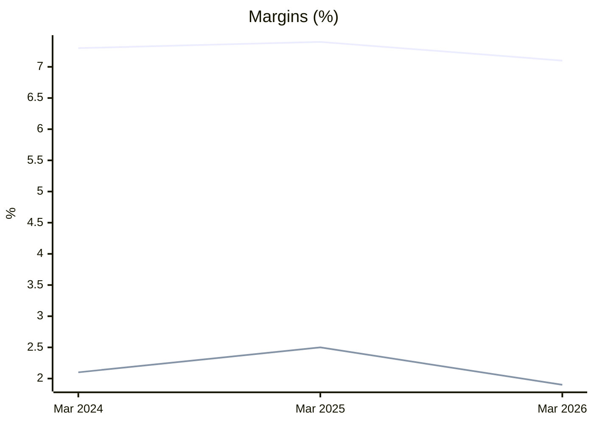

*Run 2026-11-24 · part of [SPINOFF_REPORT.md](../SPINOFF_REPORT.md) · the complete analysis of one company, with every management-call exchange in full.*

## AMBER — Amber Enterprises India Ltd.

### 1. Amber Enterprises India Ltd. — PARTIAL SPIN-OFF (subsidiary IPO)

**CONFIRMED** (partial spin-off — the IPO of IL JIN Electronics (India) Limited is in motion (DRHP filed)) · **PARTIAL SPIN-OFF, IPO IN MOTION — the parent's stub is priced once the piece trades** · score 4.3/10 · partial spin-off (subsidiary IPO) · 4 filing(s) from BSE-screener, NSE · first 2026-04-30, latest 2026-11-07

**The separated entities — every one the documents name:**

| Entity | Scheme | Business | Listing | Who runs it |
|---|---|---|---|---|
| **IL JIN Electronics (India) Limited** (earlier IL JIN Electronics (India) Private Limited) | 2026 proposed Initial Public Offer of IL JIN Electronics (I… | Printed circuit board assemblies and electronic components for air conditioners, washing machines, fans, cool… | to be listed | Mr. Sanjay Arora – Whole-Time Director, ILJIN Ele… |

**What is being separated, as the documents put it:** IL JIN Electronics, Amber's material subsidiary in electronics manufacturing services (EMS), being separately listed via proposed IPO — class `regulatory_strategic`.

### 2. Stages and dates

> **Listing:** PARTIAL SPIN-OFF, IPO DRHP FILED — IL JIN Electronics (India) Limited; date not fixed

| Date | Event | Source |
|---|---|---|
| 2023-04-01 | Appointed date — Ever Electronics Private Limited / IL JIN Electronics (India) Private Limited scheme | as stated: NCLT Mumbai order pronounced 30.05.2025: "The Appointed Date of the S… |
| 2024-02-08 | Board approval — Ever Electronics Private Limited / IL JIN Electronics (India) Private Limited | as stated: NCLT Mumbai order pronounced 30.05.2025 in C.P.(CAA)/242(MB)2024: Boa… |
| 2024-09-07 | Board approval — AmberPR Technoplast India Private Limited (slump sale to Amber) | as stated: Restructuring intimation dated 7 September 2024 — Reconstruction Comm… |
| 2024-09-30 | Other — AmberPR Technoplast India Private Limited (slump sale to Amber) | as stated: Filing dated 7 September 2024: "The slump sale is expected to complet… |
| 2024-10-21 | Board approval — AmberPR Technoplast India Private Limited (board of the Transferor Company) | as stated: NCLT Chandigarh first motion order dated 05.06.2026, CA(CAA) No. 11/C… |
| 2024-10-22 | Board approval — Amber Enterprises India Limited (board of the Transferee Company) | as stated: NCLT Chandigarh first motion order dated 05.06.2026 (filing dated 8 J… |
| 2024-12-24 | Other — Amber Enterprises India Limited | as stated: Clarification to NSE on news item "Amber Enterprises looking to demer… |
| 2025-05-12 | Board approval — AmberPR Technoplast India Private Limited | as stated: NCLT Chandigarh first motion order dated 05.06.2026 (filing dated 8 J… |
| 2025-05-17 | Board approval — Amber Enterprises India Limited | as stated: NCLT Chandigarh first motion order dated 05.06.2026 (filing dated 8 J… |
| 2025-05-30 | NCLT order — Ever Electronics Private Limited / IL JIN Electronics (India) Private Limited | as stated: Intimation dated 30.05.2025 — NCLT Mumbai pronounced the order approv… |
| 2025-06-27 | Effective date — Ever Electronics Private Limited / IL JIN Electronics (India) Private Limited | as stated: Intimation dated 04 August 2025: "The Scheme became effective upon fi… |
| 2025-08-04 | Stage reached: **effective** | [Amalgamation/Merger](https://nsearchives.nseindia.in/corporate/AMBER_04082025185722_Intimation_Prouncement_of_Order_04082025_signed.pdf) |
| 2025-08-04 | Other — Ever Electronics Private Limited | as stated: Intimation dated 04 August 2025 — approval of ILJIN's e-Form INC-28 r… |
| 2026-04-01 | Appointed date — AmberPR Technoplast India Private Limited scheme of amalgamation | as stated: NCLT Chandigarh order dated 05.06.2026: "The Applicant Companies have… |
| 2026-04-17 | NCLT order — AmberPR Technoplast India Private Limited / Amber Enterprises India Limited | as stated: Intimation dated 30th April 2026 — NCLT Chandigarh order dated 17th A… |
| 2026-04-30 | Stage reached: **announced** | [Scheme of Arrangement](https://nsearchives.nseindia.com/corporate/AMBER_30042026193549_Intimation_Amberpr_Amber_Scheme_Update_30042026.pdf) |
| 2026-04-30 | Board approval — Amber Enterprises India Limited (Merger & Amalgamation Committee) | as stated: Intimation dated 30th April 2026 — approval of the change in Appointe… |
| 2026-06-05 | Shareholders / creditors meeting — AmberPR Technoplast India Private Limited / Amber Enterprises India Limited | as stated: Intimation dated 8th June 2026 — NCLT Chandigarh order dated 05th Jun… |
| 2026-06-08 | Stage reached: **nclt sanction** | [Scheme of Arrangement](https://nsearchives.nseindia.com/corporate/AMBER_08062026190432_SE_Intimation_Scheme_of_Arrangement_Amber_08062026.pdf) |
| 2026-07-03 | Other — AmberPR Technoplast India Private Limited / Amber Enterprises India Limited | as stated: NCLT order dated 25.09.2026 annexed to filing dated 1st October 2026:… |
| 2026-07-11 | Other — IL JIN Electronics (India) Limited | as stated: Earlier intimation dated 11th July 2026 regarding the proposed IPO, r… |
| 2026-09-25 | NCLT order — AmberPR Technoplast India Private Limited / Amber Enterprises India Limited | as stated: Intimation dated 1st October 2026 — second motion order dated 25th Se… |
| 2026-10-01 | Stage reached: **exchange noc** | [Announcement under Regulation 30 (LODR)…](https://www.bseindia.com/xml-data/corpfiling/AttachLive/8c3498cb-dcec-4256-9438-b81116fa0e7d.pdf) |
| 2026-10-23 | Other — AmberPR Technoplast India Private Limited / Amber Enterprises India Limited | as stated: NCLT order dated 25 September 2026 (filing dated 1st October 2026): "… |
| 2026-11-07 | DRHP filed — IL JIN Electronics (India) Limited | as stated: Regulation 30 intimation dated 07th November 2026 (DRHP dated 6th Nov… |

**The stages, as filed:** effective (2025-08-04) → announced (2026-04-30) → nclt sanction (2026-06-08) → exchange noc (2026-10-01)

**The partial spin-off:** **IL JIN Electronics (India) Limited** (subsidiary); parent's stake 89.72%; IPO stage: DRHP filed; exchange: BSE Limited and National Stock Exchange of India Limited.

> “IL JIN Electronics (India) Limited (formerly known as IL JIN Electronics (India) Private Limited), a material subsidiary of the Company, has filed the Draft Red Herring Prospectus dated 6th November 2”

**Stated in the filings:** appointed date 2025-04-01.

### 3. Size of the separated business beside the parent — is institutional selling likely?

**Reading: NO FORCED SELLING ON SIZE — an IPO distributes no shares to the parent's shareholders, so nobody receives a piece they did not choose. Size matters here for the stub: how much of the parent's market value the listed piece accounts for.**

| Entity | Stated turnover | Market cap (₹ cr) | Its market value beside the parent's | Index member |
|---|---|---:|---:|---|
| IL JIN Electronics (India) Limited | not stated for the entity; Electronics division revenue of INR3,268 c… | — | — | not listed |

*The last column is the subsidiary's whole market value over the parent's (parent ₹23,883 cr, NSE bhavcopy of 2026-11-13), computed here; the parent's own value already contains the stake it keeps, so the stub is the parent's value less that stake.*

**In the documents' words:** “From the 7 September 2024 filing, for AmberPR only: "The amount and percentage of the turnover or revenue or income and net worth contributed by such unit or division or undertaking or subsidiary or associate company of the listed entity during the last financial year" — "Turnover FY 2023-24" "12,092.63" and "Net Worth FY 2023-24" "2,923.57" (Amount in Lakh); "% of Turnover or Revenue or Income and Net Worth contributed by AmberPR of the Company" "2.68%" and "1.71%". No size statement is given for IL JIN relative to Amber.”

**The judge's read of selling pressure:** unlikely — IPO, not a share distribution to Amber holders; Amber keeps 89.72%; offer size and index effects not stated

### 4. Insider ownership — share swap, promoters' holding, management incentives

**Share swap / entitlement:** not stated in the documents on file.

**Promoters' holding, from the shareholding pattern:**

| Company | Promoters | FIIs | DIIs | Public | Quarter |
|---|---:|---:|---:|---:|---|
| Amber Enterprises India Ltd. (AMBER) | 38.09% | 20.61% | 29.76% | 11.53% | Sep 2026 |

*Source: screener.in shareholding pattern, stored under `ShareholdingPattern/NiftyTotalMarket/`. In a mirror demerger each shareholder holds the same proportion of the new company as of the parent on the record date.*

- **Promoters in the parent, per the documents:** not stated in the documents on file.
- **What the promoters will hold in the separated entity:** For the IL JIN IPO: not stated. On Amber's own holding in IL JIN before the IPO, Q2 FY26 call: "So as of now, should we assume that the stake remains at 90% only and it will go down only once the CCPS converts in the future?" — "Yes, right." And Q4 FY26 call: "So nothing is being considered as a dilution on CCPS. Nothing -- no dilution has still now happened due to CCPS. It will happen in future based on the future multiple and valuation. So currently, on a conservative side, the auditor has considered the diluted percentage and calculated the NCI." / "I think they are considered around 30-odd percent." For the AmberPR amalgamation: "In terms of clause 18 of the Scheme, the Transferor Company is a wholly owned subsidiary of the Transferee Company, accordingly, upon the Scheme becoming effective, all the equity shares as held by the Transferee Company in the Transferor Company either by itself or through its subsidiaries/nominees shall stand cancelled and extinguished." For the 2024 slump sale: "There will be no change in the shareholding pattern of the Company pursuant to the proposed slump sale."
- **What a public shareholder receives:** For the 2026 AmberPR amalgamation, nothing: "No shares are to be issued by the Transferee Company in lieu or in exchange of its holding in the Transferor Company as consideration, and therefore, there is no reorganization in the paid-up capital structure of the Transferee Company" and "the proposed Scheme will not result in any dilution in the Shareholding of the Shareholders of the 'Transferee Company'". For the 2024 slump sale: "There will be no change in the shareholding pattern of the Company pursuant to the proposed slump sale." For the IL JIN IPO: not stated — the documents disclose no entitlement, reservation or shareholder quota for Amber's public shareholders.
- **Management incentives:** Existing grants: "Subsequent to April 01, 2025, the Transferee Company has issued and allotted shares under Amber Enterprises India Limited - Employee Stock Option Plan 2017 on April 18, 2025, June 05, 2025, August 02, 2025, November 06, 2025, and February 25, 2026." Reporting treatment: "For clarification, operating EBITDA is before impact of ESOP expenses and other nonoperating income and expenses." The documents do not state how existing grants are treated in any scheme, do not disclose any new plan in IL JIN, and do not give an exercise price or pricing date. On management of the new mobile-phone business: "Certainly, it requires a very dedicated efforts. And certainly, there will be a senior most management dedicated to this sector only". On where it will sit: "we'll give a clarity on that, whether it will come directly under Amber or it will go in IL JIN... But we will not be able to define it right now because we have other shareholders also in the IL JIN cap table."
- **Insider actions around the separation:** No promoter or management buying, selling or pledging of Amber shares is stated. The documents do state, on the Ascent management shareholding: "We have taken our -- earlier, we acquired 60%, now we own 98.5%. Yes, because of the arrangement in the agreement, Mr. Manjunath had to step down because he's no more a shareholder in the Ascent." Third-party capital raises around the separation: "ILJIN Electronics has successfully concluded fundraise with the entire INR1,750 crores received from marquee investors" (CCPS plus a small portion of equity; tranches of INR370 crores in September, INR280 crores in October and ChrysCapital's INR1,100 crores) and "Amber Enterprises raised equity fund of INR1,000 crores from marquee investors through QIP". Also "share of loss of Shivalik JV is INR64 crores from 1st January '26 till 30th March '26, the date of sale of Shivalik shares." On an earlier demerger report, the Company told NSE on 24 December 2024: "As on date, there is no such event that triggers the disclosure obligations under Regulation 30 of SEBI LODR Regulations."
- **Insiders, per the checklist read:** Amber holds 60,98,240 IL JIN shares, 89.72% post rights issue (Rs 296.02 crore subscribed); promoters Jasbir Singh and Daljit Singh are directors on IL JIN's board; CCPS holders' maximum dilution ~30% · *option pricing date:* not stated

### 5. Why the listing — point by point

The business being separated is Amber's Electronics / EMS arm, housed in IL JIN Electronics (India) Ltd — PCB assembly (~INR2,281cr of FY26 revenue), bare PCB through Ascent Circuits (98.5% owned), Shogini Technoarts (80%) and the Ascent-K/Korea Circuit HDI JV (~INR600cr), plus Power-One Microsystems (60%, power electronics, ~15% EBITDA) and 50.4% of Israel-listed Unitronics (industrial automation, 24-25% EBITDA) — leaving Amber with the RAC/consumer-durables division (INR8,383cr FY26) and Sidwal railway/defence (INR535cr). The stated driver is funding: essentially all of the group's capex sits in electronics, with more than INR4,500cr of ECMS investment approvals (Ascent multilayer INR991cr, Ascent-K HDI INR3,200cr, Shogini INR500cr), asset turns of only 0.75-1.1x, and the 48% MeitY plus 42% UP incentives arriving 5-6 years after the spend, so FY27 capex of INR1,800-2,000cr (INR1,100-1,200cr cash) and ~INR1,400-1,500cr in FY28 must be pre-funded against a board policy never to exceed 2x debt/EBITDA and Jasbir Singh's pledge to be net-debt-free. Management said investors asked for it: private equity funds were 'chasing to invest in the electronic division', and instead of loading Amber's balance sheet they raised INR1,750cr inside ILJIN (mostly CCPS, including ChrysCapital's INR1,100cr) while Amber separately did a INR1,000cr QIP. Separation also gives electronics its own margin and valuation identity — 2.8% EBITDA when ILJIN was bought in 2018 on INR300cr revenue, 6.9% FY25, 8.8% FY26, 10.8% in Q4 FY26, 26% ROCE, guidance of 40% FY27 growth at 9.5-10% and a $1bn revenue target at 11.5-12% EBITDA — against a weather-driven RAC business that saw quarters of -30% to -35% and nine bad seasons in 25 years. The outside CCPS holders also need a price: conversion happens 'based on the future multiple and valuation' (auditors provisioned up to ~30% dilution in NCI), which a listing supplies; and their presence already constrains group structuring, since management could not say whether the new Oppo mobile-phone business would sit in ILJIN 'because we have other shareholders also in the IL JIN cap table'. It is being done as a listing of the subsidiary, not a demerger: in April 2026 Amber put another INR296.02cr into an INR328.12cr ILJIN rights issue (89.58% to 89.72%); in July 2026 ILJIN split shares from Rs10 to Rs5, raised authorised capital to Rs250cr, issued a 25:1 bonus, converted from private to public limited, shifted its registered office from Pune to Greater Noida and resolved to explore fund-raising 'including... public issue'; the DRHP was filed on 7 November 2026. In parallel Amber is cleaning up the rest of the portfolio — merging wholly-owned AmberPR Technoplast into itself for compliance/cost reduction and peer benchmarking, and selling Sidwal's entire 49% Shivaliks (Titagarh Firema) JV for a nominal Rs1,09,798.85 after INR112cr of FY26 impairment/JV losses, 'to curtail future losses'.

**Point by point, with the source:**

1. The capex need that later drives the separation starts here: the Korea Circuit HDI/substrate JV is on hold pending the ECMS scheme, with a likely Rs1,000cr-plus minimum investment and 70-75% of it only reimbursed later by MeitY and the states. “So, on Korea Circuit we are waiting for Government to finalize the incentive scheme.” — *[Jan 2025](https://www.bseindia.com/stockinfo/AnnPdfOpen.aspx?Pname=813804ee-c3a7-4425-bb42-2057de6be8b1.pdf)*
2. With an INR3,000cr PCB application planned and subsidies spread over 5-6 years, management says the Electronics division is itself seeking third-party funding — the first hint of capital being raised at the subsidiary rather than at Amber. “So we are already in touch with various institutions for that.” — *[May 2025](https://www.bseindia.com/stockinfo/AnnPdfOpen.aspx?Pname=069162e3-fda9-42bb-9c69-0db5b0c2a202.pdf)*
3. Two funding routes are named — an INR2,500cr QIP enabling resolution at Amber and private equity money targeted specifically at the electronics arm; the same call sets the constraint that drives it, a board cap of 2x debt/EBITDA and a goal to be net-debt-free by FY27. “Second direction is a lot of private equity funds who are chasing to invest in the electronic division.” — *[Aug 2025](https://www.bseindia.com/stockinfo/AnnPdfOpen.aspx?Pname=445f7c35-5bf5-4f56-9d6f-e16495c40233.pdf)*
4. The separated entity is given its own standalone ambition and margin identity — $1bn revenue in three years at 11.5-12% EBITDA, versus ILJIN's 2.8% EBITDA on INR300cr when acquired in 2018. “With all the add -ups, we intend to take Electronics division to $1 billion by next 3 years with target EBITDA of 11.5% to 12% range.” — *[Aug 2025](https://www.bseindia.com/stockinfo/AnnPdfOpen.aspx?Pname=445f7c35-5bf5-4f56-9d6f-e16495c40233.pdf)*
5. The raise happens at two levels simultaneously: INR1,750cr into ILJIN (mostly CCPS; INR370cr in September, INR280cr in October, ChrysCapital's INR1,100cr pending CCI) and a separate INR1,000cr QIP at Amber used mainly to cut debt. “We secured funding of INR1,750 crores from marquee investors.” — *[Nov 2025](https://www.bseindia.com/stockinfo/AnnPdfOpen.aspx?Pname=0bcb53ba-69d0-4386-9199-d20b4b029d9c.pdf)*
6. ILJIN's raise closes in full and Amber's stake stays at 90% only because the instrument is CCPS; the same call adds the ECMS approvals (Ascent-K HDI, Shogini) and 116 acres at Jewar that the money has to fund. “On the balance sheet front, ILJIN Electronics has successfully concluded fundraise with the entire INR1,750 crores received from marquee investors.” — *[Feb 2026](https://www.bseindia.com/stockinfo/AnnPdfOpen.aspx?Pname=99744db3-5ae9-451c-8d73-b33d28177128.pdf)*
7. The outside investors' economics depend on a valuation event: no dilution has occurred yet because CCPS convert off a future multiple, with auditors provisioning roughly 30% maximum dilution in non-controlling interest. FY27 capex is guided at INR1,800-2,000cr (INR1,100-1,200cr cash), net debt INR511cr rising to INR700-800cr. “It will happen in future based on the future multiple and valuation.” — *[May 2026](https://www.bseindia.com/stockinfo/AnnPdfOpen.aspx?Pname=469945ff-af54-4664-8bd7-ed051c694aff.pdf)*
8. The ILJIN cap table already limits group structuring — management cannot say whether the new Oppo mobile-phone business (8m units year one, 13-15m year two, sub-INR50cr capex, 1.5-2% industry EBITDA) will sit inside ILJIN or directly under Amber. “But we will not be able to define it right now because we have other shareholders also in the IL JIN cap table .” — *[Jun 2026](https://www.bseindia.com/stockinfo/AnnPdfOpen.aspx?Pname=e758d7f3-9942-4baf-b20b-0e80b2d6971a.pdf)*
9. April 2026: Amber pre-funds ILJIN again, subscribing INR296.02cr of a INR328.12cr rights issue (12,46,430 shares), taking its holding from 89.58% to 89.72% — capital in before the listing, not a stake sale. “Further, pursuant to the allotment of equity shares under the rights issue by IL JIN on 21st April 2026, which has resulted in an investment of Rs. 296.02 Crore, Amber Enterprises India Limited (“Amber” or “the Company”) has subscribed to and been allotted 12,46,430 equity shares.” — *Scheme*
10. July 2026: ILJIN is mechanically prepared for listing — Rs10 to Rs5 share split, authorised capital to Rs250cr, 25:1 bonus, conversion from private to public limited, registered office moved Pune to Greater Noida, and a board resolution to explore fund-raising modes including a public issue. “Evaluation and exploration of various fund-raising options to support its future growth initiatives.” — *Scheme*
11. 7 November 2026: the separation becomes a formal partial listing of the electronics arm — a DRHP for ILJIN's IPO filed with SEBI, BSE and NSE, Amber retaining ~90% pre-offer. “IL JIN Electronics (India) Limited (formerly known as IL JIN Electronics (India) Private Limited), a material subsidiary of the Company, has filed the Draft Red Herring Prospectus dated 6th November 2026 (“DRHP”), on 7th November 2026 with the Securities and Exchange Board of India, BSE Limited and National Stock Exchange of India Limited in connection with its proposed Initial Public Offer (“IPO”).” — *Scheme*
12. The rest of the group is being simplified in the opposite direction: wholly-owned AmberPR Technoplast (cross-flow fans) is merged into Amber — no shares issued, NCLT dispensed with meetings, appointed date moved to 1 April 2026 — for compliance savings, scale synergies and cleaner peer comparison. “more absolute and profound comparison with industry peers ie. benchmarking business performance with industry; and” — *Scheme*
13. Portfolio pruning runs alongside: the 49% Shivaliks/Titagarh Firema stake is impaired (INR94cr in Q3, INR112cr FY26 including JV losses) and then sold in March 2026 to JP Fincap for a nominal Rs1,09,798.85, ending Italy export ambitions while keeping the Titagarh commercial relationship worth ~INR700cr of visibility. “And to curtail future losses, on etime exceptional impairment loss has been recognized during this quarter.” — *[Feb 2026](https://www.bseindia.com/stockinfo/AnnPdfOpen.aspx?Pname=99744db3-5ae9-451c-8d73-b33d28177128.pdf)*

**How it evolved:** The capex trigger appears first on the Jan 2025 call (Korea Circuit JV awaiting the ECMS scheme, Rs1,000cr+ threshold) and on 19 May 2025, when the funding answer is still vague — 'in touch with various institutions' — alongside an INR3,000cr application plan. By 30 July 2025 it has split into two named routes, an INR2,500cr QIP enabling resolution at Amber and 'private equity funds who are chasing to invest in the electronic division', with the $1bn/11.5-12% electronics ambition and a net-debt-free pledge framing why outside money must sit at ILJIN; on 7 Nov 2025 the INR1,750cr ILJIN raise (CCPS, ChrysCapital INR1,100cr pending CCI) and Amber's INR1,000cr QIP are both announced, and 10 Feb 2026 confirms the full INR1,750cr received with Amber still at 90% until CCPS convert. From there it becomes an exit path for those investors: 18 May 2026 ties conversion to 'future multiple and valuation' (~30% assumed dilution), 20 June 2026 shows the ILJIN cap table already constraining where new businesses can be placed, and the filings then execute mechanically — Mar/Apr 2026 rights issue, 11 July 2026 split, 25:1 bonus, public-limited conversion, registered office to Greater Noida and a 'public issue' resolution, and the DRHP on 7 Nov 2026 — none of it ever discussed on an earnings call.

**What management expects from it:** Electronics: self-funded ECMS PCB capex, $1bn revenue in ~3 years, margins from 2.8% (2018) toward 11.5-12%, double digits from FY27, ~26% ROCE, stickier high-entry-barrier industrial/defence mix. Amber: retains ~89.7%, frees cash for consumer durables and railway (30-35% growth, 16-17% margins), stays under 2x debt/EBITDA near net-debt-free; CCPS dilution finally priced off a market valuation.

*Not explained on the calls:* Calls never discuss the IPO itself: offer size, fresh issue versus OFS, use of proceeds, valuation, Amber's post-listing stake, CCPS conversion terms, or why listing rather than demerger.

- *Stated reason, in one line:* Not stated for the IPO itself; IL JIN's board approved "evaluation and exploration of various fund-raising options to support its future growth initiatives", including a public issue
- *What it reveals:* Electronics division FY26 revenue Rs 3,268 crore (+49%), operating EBITDA Rs 287 crore (+89%), guided ~40% FY27 growth at 9.5-10% margins; IL JIN raised Rs 1,750 crore from marquee investors; bought 2018 as a Rs 300-crore, 3%-EBITDA company
- *Parent or spin:* parent · *Read next:* The DRHP dated 6th November 2026: IL JIN standalone financials, fresh-issue versus offer-for-sale split, and CCPS conversion terms
- *In their words:* “The IPO will be subject to receipt of the required regulatory approvals.”

### 6. On the calls, verbatim

No call in the last 36 months carries a statement about it (or no transcript is on file).

### 7. The parent's financial statements

**The parent, last three fiscal years (consolidated)**

| | Mar 2024 | Mar 2025 | Mar 2026 |
|---|---:|---:|---:|
| Sales (₹ cr) | 6,729 | 9,973 | 12,186 |
| Sales growth (%) | -2.9% | +48.2% | +22.2% |
| Operating profit (₹ cr) | 491 | 736 | 862 |
| Operating profit growth (%) | +16.4% | +49.9% | +17.1% |
| Operating margin (%) | 7.3 | 7.4 | 7.1 |
| PAT (₹ cr) | 139 | 251 | 226 |
| PAT growth (%) | -15.2% | +80.6% | -10.0% |
| PAT margin (%) | 2.1 | 2.5 | 1.9 |
| EPS (₹) | 39.4 | 72.0 | 50.5 |

*Source: ProfitStatement/NiftyTotalMarket/AMBER.csv (consolidated, screener.in); growth and margins computed here.*

```mermaid
xychart-beta
    title "Sales, operating profit and PAT (₹ cr)"
    x-axis ["Mar 2024", "Mar 2025", "Mar 2026"]
    y-axis "₹ crore"
    bar [6729, 9973, 12186]
    bar [491, 736, 862]
    bar [139, 251, 226]
```

*Series in order: Sales, Operating profit, PAT.*

*Series in order: Operating margin, PAT margin.*

**P/E:** 133.0 — live market file (screener.in), trailing (price ₹7,440.00 as of 2026-08-02).

**Cash flows (₹ cr):**

| | Mar 2024 | Mar 2025 | Mar 2026 |
|---|---:|---:|---:|
| Cash from operations (₹ cr) | 965 | 711 | 240 |
| Cash from investing (₹ cr) | -1,035 | -953 | -3,074 |
| Cash from financing (₹ cr) | -122 | 323 | 2,683 |
| Net cash flow (₹ cr) | -191 | 81.0 | -151 |
| Free cash flow (₹ cr) | 567 | 155 | -1,048 |

*Source: CashFlow/NiftyTotalMarket/AMBER.csv (consolidated, screener.in).*

### 8. The separated business's financial statements

**The business being separated — its own numbers**, entity by entity: its reported statements once it is listed and on file, and the segment numbers the annual reports and presentations carry for it before that.

**Electronics Division (reported as "Electronics manufacturing services (EMS)" up to FY2024; key subsidiary IL JIN Electronics (India) Private Limited, with Ascent Circuits, Power-One Micro Systems, Unitronics, Shogini Technoarts — PCB-Assembly & Box Build, Bare PCB, Power Electronics, Industrial Automation) → IL JIN Electronics (India) Limited** · unit ₹ lakh · Annual figures from the consolidated segment note: segment revenue is gross and includes inter-segment (group inter-segment eliminations are shown only in total, not per segment); operating_profit = 'Segment Results (Profit before interest, depreciation and amortisation and tax)', i.e. segment EBITDA, not EBIT/PBT. Segment PAT, capex and depreciation are not disclosed per segment — finance cost, other income, depreciation/amortisation and tax are managed group-wide and not allocated. FY2026 additionally carries an Electronics exceptional item of (154.53) and nil share of JV loss. NOTE ON UNIT: the latest_quarter block below is in ₹ crore, as published in the investor presentation (presentation divisional revenue/Operating EBITDA are stated by the company to be 'not comparable with published segment results').

| | FY2024 | FY2025 | FY2026 |
|---|---:|---:|---:|
| Revenue (₹ lakh) | 124,040 | 219,385 | 326,847 |
| Revenue growth (%) | — | +76.9% | +49.0% |
| Operating profit (₹ lakh) | 6,879 | 15,435 | 28,181 |
| Operating profit growth (%) | — | +124.4% | +82.6% |
| Operating margin (%) | 5.5 | 7.0 | 8.6 |
| PAT (₹ lakh) | — | — | — |
| PAT growth (%) | — | — | — |
| Segment assets (₹ lakh) | 117,407 | 148,917 | 523,902 |
| Segment liabilities (₹ lakh) | 107,629 | 111,919 | 220,549 |
| Capital employed (₹ lakh) | 9,778 | 36,998 | 303,353 |
| Return on capital employed (%) | 70.4 | 41.7 | 9.3 |
| Segment assets / revenue (x) | 0.9 | 0.7 | 1.6 |
| Capex (₹ lakh) | — | — | — |

*Sources:* Annual Report 2025 — page 547 (FY2024 comparative, re-presented as 'Electronics Division'; as originally reported in Annual Report 2024 — page 485 under 'Electronics manufacturing services (EMS)': revenue 1,20,700.72, segment result 4,910.86, assets 1,17,150.46, liabilities 80,157.32); Annual Report 2025 — page 547 (confirmed as comparative in Annual Report 2026 — pages 552-553); Annual Report 2026 — pages 552-553

*Latest quarter (Q2 FY27):* revenue 1248, operating profit 116 — Presentation Nov 2026 — page 16 (also page 6); ₹ crore; Operating EBITDA before ESOP expense and other non-operating income/expenses and after ~₹13.5 Cr PPA fair-valued inventory consumption

*Not in the pages read:* No segment PAT, capex or depreciation; no standalone IL JIN entity financials (only Amber's guarantees/loans to IL JIN and a ~₹1,750 Cr fund raise).

*Businesses with no numbers in the pages read (3 annual report(s) and 13 presentation(s) on file):* None missing: all the named labels (IL JIN Electronics (India) Limited, Printed circuit board, IL JIN, ILJIN Electronics, Electronics division) denote the single separated Electronics Division/IL JIN business reported above.

*Documents on file:* [Annual Report 2026](https://www.bseindia.com/xml-data/corpfiling/AttachHis/687e644f-ff97-492b-be5a-63050d02fde4.pdf); [Annual Report 2025](https://www.bseindia.com/xml-data/corpfiling/AttachHis/7c139a14-8ead-4d84-887b-0cc055a8e377.pdf); [Annual Report 2024](https://www.bseindia.com/xml-data/corpfiling/AttachHis/9c1a0997-c532-49db-bebf-929fdadf2f63.pdf); [Presentation Nov 2026](https://www.bseindia.com/stockinfo/AnnPdfOpen.aspx?Pname=a29fefe8-e916-477f-9553-aa083b05585f.pdf); [Presentation Aug 2026](https://www.bseindia.com/stockinfo/AnnPdfOpen.aspx?Pname=3b95eaa2-37d9-46f3-8bc6-1d6600807e5a.pdf); [Presentation May 2026](https://www.bseindia.com/stockinfo/AnnPdfOpen.aspx?Pname=1c12bc98-868e-4c29-8a1e-d6b7565508e5.pdf); [Presentation Feb 2026](https://www.bseindia.com/stockinfo/AnnPdfOpen.aspx?Pname=65cc1543-79b1-4104-b24c-16cc2a0f2b34.pdf); [Presentation Nov 2025](https://www.bseindia.com/stockinfo/AnnPdfOpen.aspx?Pname=cfc60f4c-9087-477b-a03b-9b21224a2f99.pdf); [Presentation Aug 2025](https://www.bseindia.com/stockinfo/AnnPdfOpen.aspx?Pname=79f4b5c6-c2f2-4a78-a99a-671fb005e533.pdf)

### 9. Other financial differences — working capital, margins, returns, debt

| Metric (latest year) | Parent (AMBER) | IL JIN Electronics (India) Limited |
|---|---:|---:|
| *Basis* | *reported, consolidated* | *segment numbers (Electronics Division (report…* |
| Sales (₹ cr) | 12,186 (Mar 2026) | — |
| Sales growth (%) | 22.2 (Mar 2026) | 49 (FY2026) |
| Operating margin (%) | 7.1 (Mar 2026) | 8.6 (FY2026) |
| Operating profit growth (%) | 17.1 (Mar 2026) | 82.6 (FY2026) |
| PAT margin (%) | 1.9 (Mar 2026) | — |
| ROCE % | 10 (Mar 2026) | 9.3 (FY2026) |
| Debtor Days | 67 (Mar 2026) | — |
| Inventory Days | 90 (Mar 2026) | — |
| Days Payable | 104 (Mar 2026) | — |
| Cash Conversion Cycle | 53 (Mar 2026) | — |
| Working Capital Days | 8 (Mar 2026) | — |
| Debt / equity (x) | 0.6 (Mar 2026) | — |
| Borrowings (₹ cr) | 2,702 (Mar 2026) | — |
| Segment assets / revenue (x) | — | 1.6 (FY2026) |
| Sales (₹ lakh) | — | 326,846.8 (FY2026) |

*Each figure is the latest on file, with its year. Working-capital days and ROCE come from the stored working-capital file; segment figures from the pages cited in part 8. A dash means the documents do not carry it.*

**What stays with the parent — its segments, from the same pages:**

| Remaining segment | Revenue | Operating margin | ROCE | Segment assets / revenue | Unit | Year |
|---|---:|---:|---:|---:|---|---|
| Consumer Durables Division | 856,286 | 6.8% | 18.5% | 1.02x | ₹ lakh | FY2026 |
| Railway Sub-system & Defense Division (earlier labelled 'Railway subsystem & Mobility'; operates through Sidwal) | 53,540 | 16.8% | 40.7% | 1.44x | ₹ lakh | FY2026 |

**What the documents themselves say about the differences:**

- **growth** — parent / remaining: Consolidated revenue grew 22% to INR12,186 crores in FY26; Consumer Durable division grew 14% to INR8,383 crores; Railway Systems and Defence grew 19% to INR535 crores; separated business: Electronics division (IL JIN and its subsidiaries) revenue grew 49% to INR3,268 crores in FY26 and is guided to grow around 40% in FY27 “Revenue for financial year '26 increased to INR3,268 crores compared to INR2,194 crores in financial year '25, reflecting a strong growth of 49% year-on-year, driven by strong PCBA business along with bare PCB and the addition of new businesses.”
- **operating margin** — parent / remaining: Consolidated operating EBITDA INR970 crores on revenue of INR12,186 crores in FY26; Consumer Durable operating EBITDA INR593 crores, up 6%; Railway operating EBITDA INR90 crores, up 8%, with margins expected at 16% to 17%; separated business: Electronics division operating EBITDA INR287 crores in FY26, up 89%; guided to 9.5% to 10% in FY27; within it PCBA about 5%, PCB about 12%-13%, Power-One about 15% “Operating EBITDA for the year recorded growth of 89% year-on-year and stood at INR287 crores compared to INR151 crores in financial year '25.”
- **working capital** — parent / remaining: "Our net working capital days stood at 29 days as of March '26 compared to 9 days in March '25."; separated business: The new mobile phone business is described as structurally low on working capital intensity, at 4 to 5 days, maximum 10 days “It's very, very minimal working capital requirements. Normally, this sector operates on a net-working capital days of almost 4, 5 days, maximum 10 days.”
- **debt and leverage** — parent / remaining: "On the balance sheet front, net debt stood at INR511 crores as of March '26 against INR780 crores in March '25." Expected to rise to around INR700 crores to INR800 crores by FY27 year-end; separated business: IL JIN raised INR1,750 crores, predominantly compulsorily convertible preference shares with a small portion of equity, from marquee investors, part kept "in the war chest for the future expansion" “On the balance sheet front, ILJIN Electronics has successfully concluded fundraise with the entire INR1,750 crores received from marquee investors.”
- **capex and capital intensity** — parent / remaining: Overall FY26 capex around INR1,070 crores, of which capitalized capex only INR550 crores; FY27 overall capex INR1,800 crores to INR2,000 crores with cash outflow of around INR1,100 crores to INR1,200 crores; Railway capex only around INR50 crores to INR60 crores; separated business: The electronics/PCB businesses are the asset-heavy part: Ascent around INR1,200-odd crores in FY27, Ascent-K Circuits first phase INR1,200 crores (total INR3,200 crores), Shogini INR500 crores application with INR55 crores to INR60 crores in the coming year; ECMS approvals of more than INR4,500 crores total investment “See Dhruv, I'll add to what Sudhir has answered. These are all asset-heavy businesses where the capex is going, largely the printed circuit boards. This is exactly like OSAT and ATMP business where asset turns are about 0.8 to 1x.”
- **return on capital** — parent / remaining: not stated as a parent-level figure; on the component side "if we talk about the component side where our goal is the PCB, we work in the range of 15% to 16%"; separated business: The new high-volume mobile phone assembly business is said to be ROCE accretive on a stand-alone basis “And -- but we see a very, very good ROCEs. Generally, these are very ROCE accretive. If you take this on a stand-alone basis, I mean, the ROCEs will be more than 30%, 35%.”
- **other** — parent / remaining: Consumer Durable is a pass-through, quarterly-lag business with fixed margin per unit: "we have a fixed price margin per unit. So overall, fixed margin will remain same in terms of value"; Indian Railway contracts are fixed price contracts; separated business: The bare PCB business is a Tier 2 supplier with a longer pass-through lag; mobile phone assembly runs at industry EBITDA of 1.5% to 2% “But in the PCB business, we are Tier 2. We don't supply directly to Maruti or Hyundai, we supply to Tier 1 guys, and that's where the inventory has to be taken care at 2 levels. And hence, the lag in the PCB business to increase the cost is about 2 quarters.”
- **tax** — parent / remaining: Under the AmberPR scheme the authorized share capital of the Transferor Company transfers to Amber "without any liability for payment of any additional fees ... or stamp duty"; the scheme was certified as complying with accounting standards under section 133; separated business: The Ever/IL JIN scheme "complies with the relevant provisions of section 2(1B) and section 47 of the Income-tax Act, 1961", with pooling of interest accounting under Ind AS 103 “In respect of the aforesaid observation, it is submitted that in terms of clause 20 of the Scheme and upon the scheme becoming effective, the Transferee Company shall be accounted as per the "polling of Interest" method provided under Indian Accounting standard (Ind-As)-103 for "Business Combination" prescribed under section 133 of the Act.”

**The checklist:**

| Item | Status | Evidence |
|---|---|---|
| Why the spin-off | yes | regulatory / strategic knot — “…horised signatory of the Applicant Companies, stating that the proposed merger does not require approval of Competition Commission of India are annexed as Annexure- T(colly) with the Application. (i) The Scheme does not” |
| Institutional selling likely (small / different business) | unknown | size of the demerged piece not stated *(next: pro-forma statements: revenue / assets of the demerged undertaking vs the parent)* |
| Insider ownership and incentives aligned | unknown | no promoter-continuity or option-pricing language found *(next: the date the management options are priced; promoter holding in the resulting company)* |
| A hidden value revealed (pro-forma, leverage, comparables) | partly | borrowings 2,702 cr (Mar 2026) = 0.10× market cap; P/E 116.1 on Mar 2026 profit vs industry median 53.1 (15 peers) *(next: pro-forma P&L of each piece × the peer P/E of its own industry)* |
| Parent before the spin (clean parent, takeover prelude) | partly | stage nclt_sanction — the spin has not happened; the parent can still be bought whole |
| Partial spin-off: price the stub from the listed piece | partly | a subsidiary is being listed; once it trades, stub = parent price − (stake value ÷ parent shares) *(next: stub_value(parent price, parent shares, [(sub price, shares held)]))* |
| Timing (first year sells, second year gains) | partly | not yet listed — 208 days since the first filing, stage nclt_sanction |

The filings

| Date | Category | Headline | Attachment |
|---|---|---|---|
| 2026-04-30 | Scheme of Arrangement | Amber Enterprises India Limited has informed the Exchange that Merger & Amalgamation Committee of the Board of Directors of the Company has approved the change  | [pdf](https://nsearchives.nseindia.com/corporate/AMBER_30042026193549_Intimation_Amberpr_Amber_Scheme_Update_30042026.pdf) |
| 2026-06-08 | Scheme of Arrangement | Pursuant to Regulation 30 of SEBI LODR Regulations, we hereby inform the exchange that the Company has received an Order dated 5th June 2026 on 8th June 2026, p | [pdf](https://nsearchives.nseindia.com/corporate/AMBER_08062026190432_SE_Intimation_Scheme_of_Arrangement_Amber_08062026.pdf) |
| 2026-10-01 | Announcement under Regulation 30 (LODR)- | NCLT noted no objections from Income Tax and OL on AmberPR merger; next hearing on 23 October 2026. | [pdf](https://www.bseindia.com/xml-data/corpfiling/AttachLive/8c3498cb-dcec-4256-9438-b81116fa0e7d.pdf) |
| 2026-11-07 | Updates | In furtherance to our earlier intimation dated 11th July 2026 and pursuant to Regulation 30 of SEBI LODR Regulations, IL JIN Electronics (India) Limited (former | [pdf](https://nsearchives.nseindia.com/corporate/AMBER_07112026112953_StockExchangeIntimations_ILJINDRHPFiling.pdf) |

