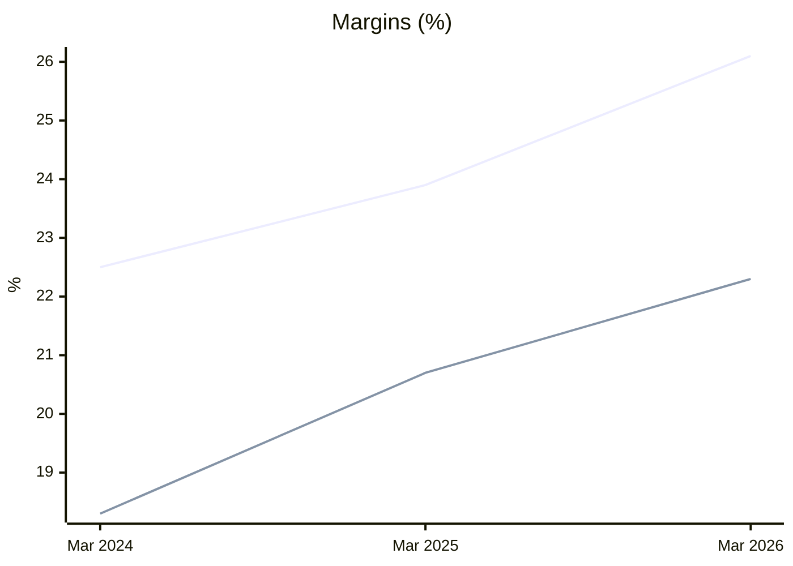

*Run 2026-11-24 · part of [SPINOFF_REPORT.md](../SPINOFF_REPORT.md) · the complete analysis of one company, with every management-call exchange in full.*

## ANANTRAJ — Anant Raj Ltd.

### 1. Anant Raj Ltd. — CONFIRMED DEMERGER

**CONFIRMED** (a demerger scheme is on the exchange record) · **PRE-SPIN — study the parent; the pieces do not trade yet** · score 5.0/10 · spin-off · 6 filing(s) from NSE, NSE-deep · first 2026-05-11, latest 2026-07-21

**The separated entities — every one the documents name:**

| Entity | Business | Listing | Who runs it |
|---|---|---|---|
| **Anant Raj Cloud Private Limited** | Data center development and cloud services — advanced data centers, colocation, managed hosting, disaster rec… | not stated (post-Arrangement shareholding of ARCPL shown as… | not stated |
| **Ashok Cloud Private Limited** | The Demerged Undertaking — the Data Center Business of ARL and ARCPL: data centre and co-location, sovereign … | to be listed — "the Resultant Company Demerger Shares issue… | not stated |

**What is being separated, as the documents put it:** The Data Centre and Cloud Services business of ARL and ARCPL, vested in Ashok Cloud Private Limited — class `value_unlocking`.

### 2. Stages and dates

> **Listing:** NOT YET — scheme at 'announced' stage; the resulting company will list only after NCLT sanction, effectiveness and a record date; no listing timeline stated

| Date | Event | Source |
|---|---|---|
| 2026-05-11 | Other — Board took note of the need for demerger/merger of the two businesses and constituted a committee (Amit Sarin, Ashim Sarin, Manoj Goyal, Pankaj Kumar Gupta) to evaluate the merger/demerger structure and recommend the final scheme — Anant Raj Limited | as stated: Outcome of the meeting of the Board of Directors held on May 11, 2026… |
| 2026-07-20 | Other — Finance and Investment Committee approved additional investment of Rs. 74,86,45,106/- in Ashok Cloud Private Limited by way of rights issue (37,43,22,553 equity shares), raising ACPL's paid-up capital to Rs. 74,91,45,106 / 37,45,72,553 shares — Ashok Cloud Private Limited (subscribed by Anant Raj Limited) | as stated: Acquisition / Committee Meeting Updates filing ARL/CS/13583 dated Jul… |
| 2026-07-21 | Stage reached: **announced** | [Scheme of Arrangement](https://nsearchives.nseindia.com/corporate/ANANTRAJ_21072026184608_Outcome_21072026.pdf) |
| 2026-07-21 | Board approval — Anant Raj Limited (Composite Scheme of Arrangement amongst ARL, ARCPL and ACPL) | as stated: Outcome of the Board Meeting / Scheme of Arrangement filing ARL/CS/13… |

**The stages, as filed:** announced (2026-07-21)

### 3. Size of the separated business beside the parent — is institutional selling likely?

**Reading: VERY LIKELY — the piece is under a tenth of the whole; index funds and large holders who receive it without choosing it tend to sell.**

| Entity | Stated turnover | Stated share of the whole | Segment revenue share | Market cap (₹ cr) | Share of combined market cap | Index member |
|---|---|---:|---:|---:|---:|---|
| Anant Raj Cloud Private Limited | Turnover As on 31st March, 2026: 136.20 (Amount in Crores) | — | 7.0% (FY2026) | — | — | not listed |
| Ashok Cloud Private Limited | Demerged Undertaking turnover as on March 31, 2026: 145.90 … | 8.96% | 7.0% (FY2026) | — | — | not listed |

*Stated figures are the documents' own (a turnover share, or the cost-of-acquisition split the company publishes for tax, which reflects relative value); the segment share is this business's revenue over the parent's sales, and the market-cap share is the entity's value over the entity plus the parent (parent ₹17,222 cr, NSE bhavcopy of 2026-11-13), both computed here.*

**In the documents' words:** “"As on March 31, 2026: Particulars Turnover* (in Crores) Demerged Undertaking 145.90 Total 1627.72 Percentage 8.96% . *The turnover has been calculated after taking impact of Part -II of the Composite Scheme i.e. the merger of AR CPL with ARL through aggregation of the turnover of ARCPL and ARL"”

**The judge's read of selling pressure:** likely — Small (8.96% of turnover), only 20.86% public float in ACPL, and a digital-infrastructure business alien to real-estate holders.

### 4. Insider ownership — share swap, promoters' holding, management incentives

**Share swap / entitlement, entity by entity:**

- **Anant Raj Cloud Private Limited:** For Merger: "Since, the Amalgamating Company is a wholly owned subsidiary of Amalgamated Company, no shares of the Amalgamated Company shall be issued or allotted in consideration of Part II of the Composite Scheme i.e. the merger of ARCPL with and into ARL."
- **Ashok Cloud Private Limited:** "1 (One) fully paid-up equity share of face value of INR 21-(Rupees Two) each of the Resultant Company for every 1 (One) fully paid-up equity share of face value of INR 2/-(Rupees Two) each held in the Demerged Company."

**Promoters' holding, from the shareholding pattern:**

| Company | Promoters | FIIs | DIIs | Public | Quarter |
|---|---:|---:|---:|---:|---|
| Anant Raj Ltd. (ANANTRAJ) | 57.43% | 10.96% | 4.55% | 27.08% | Sep 2026 |

*Source: screener.in shareholding pattern, stored under `ShareholdingPattern/NiftyTotalMarket/`. In a mirror demerger each shareholder holds the same proportion of the new company as of the parent on the record date.*

- **Promoters in the parent, per the documents:** 57.42% — "Promoters 20,66,57,823 57.42" of total 35,98,76,930 shares, stated as "Pre -Arrangement Shareholding as on date" in the Board outcome filing dated July 21, 2026; post-Arrangement unchanged at 20,66,57,823 shares / 57.42%
- **What the promoters will hold in the separated entity:** ARL: "Promoters 20,66,57 ,823 57.42" post-Arrangement (unchanged). ACPL: "Pursuant to the Scheme, the shareholders of ARL will directly hold 49% in the Resultant Company, proportionate to their shareholding m ARL. Consequently, the shareholding of the Resultant Company shall comprise 28.14% held by the promoters of ARL, 20.86% held by the public shareholders, and the remaining 51 % held by ARL." Post-arrangement ACPL table: "Promoters (ARL: 51%; Promoters of ARL: 28.14%) 58,12,30,376 79.14"; "Overall, the shareholders of ARL will hold 100% of the ultimate beneficial economic interest in the Resultant Company, ACPL ( direct holding of 49% and indirect holding of 51% throughARL)."
- **What a public shareholder receives:** "Upon the Scheme becoming effective, eligible shareholders of Anant Raj Limited will receive one fully paid- up equity share of face value of ₹2 each in Ashok Cloud Private Limited for every one fully paid- up equity share of face value of ₹2 each held in Ana nt Raj Limited." Public shareholders hold 15,32,19,107 shares of ACPL post-arrangement = 20.86%, and retain their 42.58% in ARL; "The Scheme will not result in the cancellation of Anant Raj Limited's existing shareholding in Ashok Cloud Private Limited, and ACPL will continue to remain a subsidiary of Anant Raj Limited."
- **Management incentives:** not stated as to stock options / RSUs / SARs — the Composite Scheme disclosures contain no mention of treatment of existing grants, of any new plan in Ashok Cloud, or of exercise price / pricing date. On insider shareholding and incentives the documents state: promoter holding in ARL of 57.42% (20,66,57,823 shares); earlier promoter warrant conversion per the Nov 12, 2025 call — "the promoters were issued warrants of INR 100 crores for which the promoters were supposed to convert by September '26. Actually, the promoters put in the money in March '25 itself and that additional cash flow of INR 100 crores really helped the company and we converted our share warrants at a price of INR 730 done."; and the May 11, 2026 Board approved "Increase in the limit of managerial remuneration by way of commission payable to Sh. Amit Sarin, Managing Director of the Company, subject to the approval of the shareholders of the Company." (similar increases for Sh. Aman Sarin and Sh. Ashim Sarin, and commission to four non-executive independent directors).
- **Insider actions around the separation:** No promoter or management buying, selling or pledging around the separation is stated. Related actions stated: (i) ARL's Finance and Investment Committee on July 20, 2026 "considered and approved an additional investment in Ashok Cloud Private Limited ("ACPL "), a wholly owned subsidiary of the Company, by acquiring additional 37,43,22,553 fully paid-up equity shares at a face value of Rs. 2/-per equity share aggregating to Rs. 74,86,45,106/- ... proposed to be issued by ACPL by way of right issue", cash consideration, timing "Immediate", with shareholding/control unchanged at 100%; (ii) appointment on May 11, 2026 of Sh. Anish Sarin (promoter group, son of the Managing Director) as Whole-time Director, who "is assisting Sh. Ashim Sarin, Whole-time Director and Chief Operating Officer to oversee the phased rollout of data center capacities across NCR and Haryana"; (iii) pre-separation promoter warrant conversion of INR 100 crores at INR 730 funded in March '25 (Nov 12, 2025 earnings call).
- **Insiders, per the checklist read:** ARL promoters hold 57.42% of ARL; post-scheme ACPL is 28.14% promoters directly plus 51% held by ARL (79.14% total), public 20.86%. Promoter-group Anish Sarin oversees data-centre rollout. · *option pricing date:* not stated

### 5. Why the demerger — point by point

Management says Anant Raj Ltd today runs two unlike businesses under one roof — the legacy real estate/infrastructure business (residential townships, luxury housing, commercial leasing, hospitality) and a data centre & cloud services business — and that the Data Centre Business is itself split across two entities, Anant Raj Limited and its wholly owned Anant Raj Cloud Private Limited (ARCPL), with assets, employees, investments and operations housed in both. The Composite Scheme therefore first amalgamates ARCPL into ARL and then demerges the whole Data Centre Business out of ARL into Ashok Cloud Private Limited (ACPL), so all of it sits in one dedicated, separately listed company. The stated problems it solves: the two verticals differ 'significantly in their nature, risk profile, competitive dynamics, and capital requirements', and the Board recorded on May 11, 2026 that keeping both in one company 'does not adequately reflect the true potential and intrinsic value of each business segment, thereby impacting stakeholder returns'; the split is meant to give independent market-driven valuation of a pure-play digital infrastructure asset, dedicated management focus, a simpler ownership structure with intra-group arrangements cancelled/rationalised, and the ability to attract sector-specific capital, strategic investors and partnerships. The numbers cited: the Demerged Undertaking did ₹145.90 cr turnover in FY26 versus ₹1,627.72 cr aggregated (8.96%); ARCPL turnover ₹136.20 cr and net worth ₹49.45 cr versus ARL's ₹1,491.52 cr turnover and ₹4,471.64 cr net worth; ACPL had nil turnover and ₹0.04 cr net worth and was capitalised days earlier via a ₹74.86 cr rights issue (37,43,22,553 shares at ₹2). Scale is the driver: the Board noted an MOU with the Govt. of Andhra Pradesh for 50 MW IT load taking total planned capacity to 357 MW IT load, requiring about ₹20,000 cr of investment — against a real estate business management repeatedly said should carry as little debt as possible. Mechanically, ARL shareholders get 1 ACPL share of ₹2 for every 1 ARL share of ₹2, giving them 49% of ACPL directly (promoters 28.14%, public 20.86%) while ARL retains 51%, so ACPL stays a subsidiary and ARL holders keep 100% of the ultimate economic interest; ACPL will be listed on BSE and NSE under the Rule 19(7) exemption. The ask came from the equity market side — an investor asked about a demerger as early as the Apr 2024 call, and analysts kept pressing for separate real estate vs data centre reporting — not from lenders or partners, who are never cited as requesting it.

**Point by point, with the source:**

1. An investor (Arpit Shah, Stallion Asset) directly asked about demerging the data centre business; management declined to engage, calling the business too young and prioritising execution toward the 300 MW mark in four years. “We are too soon to say anything on that. Let's focus on execution, Arpit.” — *[Apr 2024](https://www.bseindia.com/stockinfo/AnnPdfOpen.aspx?Pname=03aa7997-f0a0-4f9b-8373-f4a4684da92d.pdf)*
2. Management set out the different capital philosophies that later justify separation: real estate was to be net debt-free by December 2024 and the only debt acceptable would be lease rental discounting, including against long 10-15 year data centre leases. “And the only debt which Anant Raj is open to taking is LRD and this is one of the best items for LRD because you have long-term leases and good clients.” — *[Apr 2024](https://www.bseindia.com/stockinfo/AnnPdfOpen.aspx?Pname=03aa7997-f0a0-4f9b-8373-f4a4684da92d.pdf)*
3. Management began describing the group as two separate divisions — the historic real estate 'bread and butter' and a new technology division of colocation and cloud — the same two-vertical framing the Scheme later uses. “So Anant Raj Limited will now have two full-fledged divisions. Real estate division which is the historical, the division of the company, the bread and butter of the company as of now and plus the technology division, in which we will be data center, co-location infrastructure and cloud.” — *[Nov 2024](https://www.bseindia.com/stockinfo/AnnPdfOpen.aspx?Pname=27b8b856-615a-44a5-8be4-157fd1831d5c.pdf)*
4. The ₹2,100 cr fundraise (₹100 cr promoters, ₹2,000 cr market) was ring-fenced entirely for the data centre/cloud build-out, with real estate funded from internal accruals — distinct funding requirements per vertical, with cloud capex cited at ~₹100 cr per MW on top of ₹26 cr colocation capex. “This is purely data center, sir. This fund is going to be purely for data centers. For our real estate, we are completely funded with our internal sources.” — *[Nov 2024](https://www.bseindia.com/stockinfo/AnnPdfOpen.aspx?Pname=27b8b856-615a-44a5-8be4-157fd1831d5c.pdf)*
5. An analyst (Raj Sarraf of Finvestors) asked for data centre revenue to be reported separately from real estate because it would become the major contributor; management conceded the point. “Sir, both the revenues are going to be substantial and we will be breaking them up, sir . We will do that definitely.” — *[Nov 2024](https://www.bseindia.com/stockinfo/AnnPdfOpen.aspx?Pname=27b8b856-615a-44a5-8be4-157fd1831d5c.pdf)*
6. The CFO positioned the company at an 'inflection point' with a legacy real estate business and a separate future-ready data centre/cloud platform — H1 FY26 revenue ₹1,223.2 cr of which data centre only ₹58.42 cr, ₹1,100 cr QIP completed, net cash positive, ~₹700 cr capital employed in data centres at 75% EBITDA margin. “Our legacy real estate business continues to deliver a consistent growth and strengthen our leadership in high demanding markets. At the same time, our Data Center and Cloud initiatives are shaping up the future ready platform that positions us as a diversified resilient enterprise s.” — *[Nov 2025](https://www.bseindia.com/stockinfo/AnnPdfOpen.aspx?Pname=3ac557ff-2c8f-4014-b2d4-e7e582aa0e59.pdf)*
7. Investors (Sri Gopal of StockHifi, Ashwani Sharma of Emkay) again pressed for separate real estate vs data centre revenue and EBITDA reporting; management said formal segment disclosure was not yet triggered because data centre revenue was under 10% of the total. “In this, you have to give segmental breakup once you do 10%.” — *[Nov 2025](https://www.bseindia.com/stockinfo/AnnPdfOpen.aspx?Pname=3ac557ff-2c8f-4014-b2d4-e7e582aa0e59.pdf)*
8. Asked whether the company should lever up to scale data centres faster, management refused on the grounds that real estate is the backbone and must stay low-debt — a tension a separately funded data centre entity resolves. Capacity plans were 63 MW by Dec 2026, 117 MW by FY28 and 307 MW by FY31-32. “And as it is, we feel that our backbone is still real estate, which will always be. And we feel that real estate should be as low on debt as possible.” — *[Nov 2025](https://www.bseindia.com/stockinfo/AnnPdfOpen.aspx?Pname=3ac557ff-2c8f-4014-b2d4-e7e582aa0e59.pdf)*
9. The May 11, 2026 board note first records the need for a merger/demerger, citing differing nature, risk profile, competitive dynamics and capital requirements, plus the 357 MW IT load plan (after the 50 MW Andhra Pradesh MOU) needing about ₹20,000 cr; a committee of Amit Sarin, Ashim Sarin, Manoj Goyal and Pankaj Gupta was formed to design it. “The Board of Directors have considered that the Company is presently engaged in two distinct business undertakings, namely Real Estate Development and Data Center Services, which differ significantly in their nature, risk profile, competitive dynamics, and capital requirements and continuing both businesses under a single corporate does not adequately reflect the true potential and intrinsic value of each business segment, thereby impacting stakeholder returns.” — *Scheme*
10. The July 21, 2026 Scheme explains the data centre business is split across ARL and ARCPL, so ARCPL is first merged into ARL and the combined Data Centre Business then demerged into Ashok Cloud — consolidating it in one entity and creating two focused listed companies. “The Data Centre Business is presently conducted through ARL and ARCPL, with various assets, employees, investments and business operations pertaining to the Data Centre Business being housed across both entities.” — *Scheme*
11. Stated benefit one: independent market recognition and valuation of the data centre business given its distinct operating profile, growth trajectory, risk-return characteristics and funding needs; demerged undertaking turnover was ₹145.90 cr, 8.96% of ₹1,627.72 cr for FY26. “the segregation of the Data Centre Business into a separately listed company would facilitate independent market recognition and valuation of the Data Centre Business, having regard to its distinct operating profile, growth trajectory, risk-return characteristics and funding requirements;” — *Scheme*
12. Stated benefit two: a distinct legal entity lets Ashok Cloud attract sector-specific capital, investors, acquisitions and partnerships, with simpler ownership and intra-group arrangements cancelled or rationalised. “the separation of the Data Centre Business into a distinct legal entity will enable Ashok Cloud to effectively attract sector specific resources for its growth requirements and pursue strategic investments, partnerships, thereby unlocking greater value for its shareholders;” — *Scheme*
13. Consideration is 1 ACPL share of ₹2 for every 1 ARL share of ₹2; ARL holders get 49% of ACPL directly (promoters 28.14%, public 20.86%) while ARL keeps 51%, so ACPL remains a subsidiary and ARL holders retain 100% of the ultimate economic interest; listing on BSE and NSE via the Rule 19(7) exemption. “Overall, the shareholders of ARL will hold 100% of the ultimate beneficial economic interest in the Resultant Company, ACPL ( direct holding of 49% and indirect holding of 51% throughARL).” — *Scheme*
14. Days before the Scheme, the Finance and Investment Committee funded the shell resultant company: a ₹74,86,45,106 rights issue of 37,43,22,553 ₹2 shares in ACPL (incorporated Oct 11, 2021; nil turnover in FY24, FY25 and FY26) to meet data centre and cloud development funding. “ACPL proposes to raise the fund to meet the funding requirement for development of its data centres and cloud business.” — *Scheme*
15. The press release frames the outcome as two independent platforms — ARL in real estate/infrastructure and Ashok Cloud in data centres, sovereign public cloud, AI-ready cloud infrastructure and DC/DR services — citing separate growth trajectories, operational priorities and capital needs. “"Our real estate, infrastructure business and Data Centre & Cloud Services Business have evolved into two distinct platforms, each with its own growth trajectory, operational priorities, and capital needs.” — *Scheme*

**How it evolved:** On the Apr 25, 2024 call Arpit Shah of Stallion Asset asked outright whether there were plans to demerge the business and Amit Sarin refused — 'too soon', focus on execution — while describing the cloud venture as a half-megawatt pilot with TCIL. By the Oct 30, 2024 call (Q2 FY25) management was framing the group as 'two full-fledged divisions' (real estate plus a technology division) with a ₹2,100 cr fundraise earmarked purely for data centre/cloud, and Raj Sarraf pushed for separate data centre revenue disclosure; on the Nov 12, 2025 call (Q2/H1 FY26) the CFO called the company 'at an important inflection point' with a 'legacy real estate business' alongside the data centre/cloud 'future ready platform', the ₹1,100 cr QIP was done, and analysts again asked for a separate segment/EBITDA breakup, which management declined on the 10%-of-revenue threshold. The demerger itself was never discussed on any of the three calls: it surfaced in the May 11, 2026 board note (which recorded the need for merger/demerger and set up a committee of Amit Sarin, Ashim Sarin, Manoj Goyal and Pankaj Gupta to frame a scheme), then was executed as the ACPL rights-issue funding on July 20, 2026 and the Composite Scheme approved on July 21, 2026.

**What management expects from it:** Ashok Cloud: pure-play digital-infrastructure valuation and independent market recognition, sector-specific growth capital, partnerships and acquisitions, dedicated leadership, consolidated ownership (75% EBITDA-margin colocation/cloud, 357 MW plan, ~₹20,000 cr capex). Anant Raj: sharper focus on real estate, infrastructure and hospitality, low debt, continued execution. Both: operational efficiency, agility, faster decision-making, transparency, unlocked shareholder value, with holders participating directly in each.

*Not explained on the calls:* Calls never mention the demerger; no appointed date, debt/cash/asset split, valuation or swap basis, why ARL keeps 51%, how ₹20,000 cr capex gets funded, or listing timeline.

- *Stated reason, in one line:* Consolidate the entire Data Centre Business in one entity and create two dedicated listed companies, enabling independent market recognition and valuation, dedicated management focus and sector-specific funding.
- *What it reveals:* Demerged Undertaking turnover Rs 145.90 cr is only 8.96% of Rs 1,627.72 cr; management cites ~75% data-centre EBITDA margin, 357 MW planned capacity, Rs 20,000 cr capex, net-cash parent with Rs 4,471.64 cr net worth.
- *Parent or spin:* both · *Read next:* The full Composite Scheme: asset/liability split and valuation of the Demerged Undertaking versus ACPL's Rs 74.86 cr rights issue.
- *In their words:* “The Data Centre Business has evolved significantly over the years and is well poised to chart its own growth path and operate as a separate listed entity focused on the rapidly growing Data Centre Business whilst continuing to leverage ARL's institutional strengths, strong brand equity and goodwill.”

### 6. On the calls, verbatim

3 call(s), oldest first: **54 question-and-answer exchange(s)** given in full — the question and every answer to it, nothing trimmed — and 5 passage(s) from management's prepared remarks (the complete sentences about it; the whole remarks are in the linked transcript). Text is as the transcript prints it.

#### Apr 2024 — [transcript](https://www.bseindia.com/stockinfo/AnnPdfOpen.aspx?Pname=03aa7997-f0a0-4f9b-8373-f4a4684da92d.pdf)

**From the prepared remarks** *(the passage about it; the whole turn runs to 4,590 characters in the transcript)*

> **Amit Sarin:** As you all know that Anant Raj in data center has also become a major player in North India. We already started three megawatts. The balance fee is also ready and is in the handing over stage. We are doing that, and we are also very happy to announce that in t he previous year, technically in the previous year itself, in March, Anant Raj also entered into a fresh agreement with TCIL, one of our partners for data centers, for providing cloud services also. So this is an add- on, which the company has now started doing on a basis of trials. With this co- location, which the company is already doing, we are very confident that the project which we are delivering in the market is one of the best. And we understand this project very well.

**Question and answer**

> **Bhalchandra Shinde:** Sir, regarding clouds, as you mentioned, if you can provide how the revenue booking will happen and what kind of profitability we will be able to generate? And also on the 3 megawatt which additional come into operationa l, from when we can expect revenue contribution and EBITDA contribution from that?
>
> **Amit Sarin:** Mr. Bala, the three additional megawatt is already in the stage of handing over, so maximum another one month we will start recognizing revenue from there. It will start accruing. That's number one. Regarding the cloud services thing, this is a brand -new thing, sir, and this is something which came to us from the client itself. The co -location facility which we have created, like you just said, is one of the best. So, we got this offer that if you can provide the server for which they will give us all the details because we do not have a lot of expertise in this segment. But the revenue, sir, with the server coming in can actually go up al most five times. Anant Raj Limited April 25, 2024 So, like four years back, we started this data centre thing and now today it is practically happening on ground. So, let's start this. But this one is not going to take four years. God willing, if it works out well, you will see substantia l increase in revenues by the end of this year itself.

**Question and answer**

> **Upendra:** Lovely. So, is there any plan which you have for setting up the servers together, like any roadmap which you made? I know it is very early to ask you, but will you must have thought of some thing?
>
> **Amit Sarin:** Sir, let's try this because this is something which came in. And it is our duty to inform the market also because we have already informed the market about the agreement which we have signed. This agreement which we have signed with TCIL , Government of India Undertaking. And together now, TCIL and us, we will be providing cloud services to various clients. And in this case, we will be putting in the server. So, the agreement for this has already been signed. So, let's try this, sir. Let' s try this with maybe a few racks, like we just discussed, close to half or maybe a little less than half a megawatt. And then let's see how it works out.

**Question and answer**

> **Pavas Pethia:** Yes, I understand, but the only thing is, since you are a kind of a new player here, your knowledge about this server part is kind of quite limited, earning 80%, 90% margins, so what's in for the client?
>
> **Amit Sarin:** The client is as it is paying this, sir. The client is as it is paying this elsewhere. Sir, as if you -- you can simply go on any website of any major cloud provider and you can see for yourself what are the rates? So, the rates we are talking about 4x to 5x is actually in line with that. In fact, maybe a little cheaper.

**Question and answer**

> **Pavas Pethia:** Okay. And what kind of investment will you need from your side apart from the, say, the 20% of the operating cost?
>
> **Amit Sarin:** We will actually be investing in the server and that's how we become eligible to earn the cloud money. So, server is what we are going to be investing in, but as of now we are going to do it as a pilot in a very, as a test case, not even 0.5 megawatt. Let's see how it pans out and then we take it furthe r.

**Question and answer**

> **Rishith Shah:** Hi, sir. Good evening. Thank you for the opportunity. Great set of numbers. Two questions from my end. So, one regarding -- so while we do not want to give out the exact numbers, but some idea regarding -- so when we say the revenue from the cloud can be potentially 4x to 5x of the co-location. A similar range or a ballpark figure you can give regarding opex, how much increase do we see over there?
>
> **Amit Sarin:** Not much. Rishith, like we just sa id, we are doing this as a pilot because we had already informed the markets in March. So, we had to cover this in this call. As of now, this is going to be a pilot which is not even half a megawatt to start with. And the investment is very minimal in this . We are going to be getting servers as per the technical expertise of our client, which we have already signed the agreement with. And then we provide cloud services. So as of now, the expense is very minimal. As you know, we can't give future numbers li ke this. But as of now, we are talking about a basic expense which is may be INR20 crores -INR30 crores and then taking it from there. Anant Raj Limited April 25, 2024

**Question and answer**

> **Vignesh Iyer:** Right. So, again, on the P anchkula part, where you sai d the server, the cloud server, the business you are eyeing as of now for 0.5 megawatts, you are trying to get into it. So, when you say that the server cost is around, you are going to spend around INR30 crores. For that INR30 crores, is it linked to 0.5 megawatts, 1 megawatt? Would the serve r cost be that much? I mean, the capex?
>
> **Amit Sarin:** This is half a megawatt. This is 0.5 megawatt only. This is INR30 crores. And see, servers also, you know, vary. The cost of server also varies from server to server . But the one we are going to be providing for the pilot project is going to be within this limit.
>
> **Vignesh Iyer:** Okay. So, this specific… Sorry.
>
> **Amit Sarin:** Yes, tell us, please. No problems. Tell us.

**Question and answer**

> **Amit Sarin:** Thank you, everyone. Thank you for your time. And we hope we were able to answer all questions. Our cloud website has already been... Our presentation with our cloud has already been uploaded. The real estate will be uploaded by tomorrow ma ximum. You can have a look. And then if there are any questions, the management is more than happy to answer everything. So, thank you once again. And like we said we achieved a good year this time. So far, it has been the best. But we are pretty bullish, and the run rate will keep on ticking. And the revenues from last year really went up. And we... Today, the landmark which we are sitting on, we are very robust on the future as well. Thank you, everyone.
>
> **Pankaj Gupta:** Thank you.

#### Nov 2024 — [transcript](https://www.bseindia.com/stockinfo/AnnPdfOpen.aspx?Pname=27b8b856-615a-44a5-8be4-157fd1831d5c.pdf)

**From the prepared remarks** *(the passage about it; the whole turn runs to 2,867 characters in the transcript)*

> **Amit Sarin:** And all the real estate projects as planned and as discussed by us in our previous calls and on our various updates, in our presentations, all are fully on track. There is no delay whatsoever and everything is on track and has been launched on the decided dates, number one. Number two, the company was already into co -location as we all know that the company successfully initially started with 3 megawatts and added another 3 . In our last call in April, we had informed everybody that the company is now going to be v enturing out into its own cloud and this was done in the month of April this year and we very proudly and happily would like to share that we have already done that. On the 7th of October, the company launched its own cloud called Ashok Cloud, named after our Founder , Chairman, Shri Ashok Sari n. We got very good response for it and this today has placed Anant Raj Group as one of the main players of not only data center, but cloud also. So today we are a single stop solution for everything. If somebody wants simple co -location, we can provide that. If somebody wants to have cloud, we can do that. Somebody wants servers, we can do that and various services which as we go by, Mr. Ash im Sarin will explain further. Anant Raj Limited October 30, 202 4 Other than this, vis -à-vis is the real estate d ivision.

**From the prepared remarks** *(the passage about it; the whole turn runs to 2,168 characters in the transcript)*

> **Manoj Goyal:** We have done a lot of things operationally, but there are certain key operational highlights which I want to highlight to everyone. Anant Raj Limited October 30, 202 4 As Amit sir has mentioned, we have commenced 6 megawatts IT load of the data centre at our Manesar facility, and the work on 21 megawatts is going with a full speed. So this will reach to 28 megawatts of IT load at Manesar and the Pa nchkula by the end of FY2025. In the meantime, we have also commenced cloud services, and the pilot project of half megawatt of the IT load has already been commenced, and this cloud will be initially providing infrastructure as a service, which has been built along with the world's best of the OEM and the service provider. In addition to the infrastructure as a service, the company has a plan to take this infrastructure as a s ervice to the platform as a service and software as a service in the coming time. As Amit sir again mentioned that we have acquired about 20 acres of the land in Gurgaon, and that will enhance the overall development portfolio of the real estate site that is in the prime area of Gurgaon. As you are all aware that we have launched a group housing project called Estate Residences for which the construction work has been commenced, and it's going in a full fledge .

**Question and answer**

> **Gautam Shroff:** Congratulations, Amitji, on a stellar qu arter. You've entered a 100 crore club. That is an achievement, I would say. To many more. Amitji, my first question to you and team Anant R aj is, we also read about you announcing a fund raise program. How aggressive are the growth plans and how are you t hinking two or three years down the line?
>
> **Amit Sarin:** As of now, this fundraising is completely focused. It's going to be INR 2100 crores out of which promoters are going to put in 100 and we will go to the market for the balance 2000. The main focus of thi s fundraising is going to be for the data center business. As you know, one new development this year has been that the company has come into clouds. The company is fully funded and fully on track for its first 28 megawatts. For that, we do not need any m oney. But in the coming year, and we are almost there at 28 now, so in the coming year, we plan to add another 35, taking the toll to 63 megawatts. In this 63 megawatts, after launching Ashok Clouds, we are very confident because we've got very good response for Ashok Cloud, the cloud services which the company has launched. When we explained on the call, today we are a single-stop solution for any cloud need of any client anywhere in the world. Of course, the focus is always going to be India. In this situation, we feel that out of this 63 megawatts, 14 megawatts can be, as of now, depending on our fund position and the fundraising Anant Raj Limited October 30, 202 4 which we are going to do, can be easily put into clouds. This tak es the data center business and Anan t Raj Clouds into a different horizon. In this, you are going to be then competing with all the hyperscalers and the largest ones in the world. That is the category we want to go into. As it is already public knowledge, the technical tie-up for the product which we have launched so far, for which we got very good response, is with Orange, the French company. It's doing pretty well. That is the focus of the fundraising.
>
> **Gautam Shroff:** Thank you.

**Question and answer**

> **Akshat:** Congratulations, first of all. My question is, is there any realignment in the guidance for the number of data centers capacity to build over the years, like by 2029 or 2030, when it will be like 300 M W?
>
> **Amit Sarin:** Akshat, we are fully on track, sir. As you know, there are three locations the company is working on. As of now, location number one, which is Manesar, has already started. Location number two, which is Panchk ula, is about to start and should be up and running by December this year. So another two months to go, we will be starting Panchkula as well. And the third one is going to be Rai. In the coming year, Rai is going to start as well. So as of now, the focus vis-a-vis the location is going to be these three locations. But what is going to be different is that rather than just being a co-location player, which means that if you are only a co -location player, you are always dependent on hyperscalers for busines s. But now, with the cloud coming in and kicking and getting very good response, we are going to add on these services. Out of 63, 14 will go, which is alm ost about 25%. So we plan to maintain the same ratio. But we see a lot of business coming in, sir. Subject to our fund position, we will try and develop more of cloud, because that is much better in terms of cash flow and profitability, compared to the co -location.
>
> **Akshat:** Thank you, sir. I would ask that what is your...

**Question and answer**

> **Amit Sarin:** Actually, can you be a little louder? Sorry?
>
> **Akshat:** So, what is the capex cost for building a cloud service? What is for one megawatt of that?

**Question and answer**

> **Amit Sarin:** See, Akshat ji, the ballpark figures for a cloud, although this business is actually calculated in terabyte, megabyte, and petabyte, but if you just put it in simple words, one megawatt has an additional investment of close to INR 100 crores. So, that is how expensive it is. But then the horizon is very wide, sir. Anant Raj Limited October 30, 202 4 And we have done 0.5, for which we got very good response. And this is one of the best qualities available in the world which we have been able to launch.
>
> **Akshat:** Can we compare the type of service with companies like E2E and etc.?
>
> **Amit Sarin:** Just a bit louder, sir, please.
>
> **Akshat:** Sir, can we compare the type of service we are providing with companies like E2E networks?

**Question and answer**

> **Amit Sarin:** This I request Mr. Ashim Sari n to answer. Ashimji?
>
> **Ashim Sarin:** Yes, sir. The services that we are offering now is basically infrastructure as a service. So, that is the first layer of the cloud services, and that we've already started. And with time, the intent is to move on to platform as a service and software as a service, but that will take some time. But yes, we are at par with what the other players are offering in the market, as far as infrastructure as a service is concerned.
>
> **Akshat:** Okay. Thank you.

**Question and answer**

> **Pavas Pethia:** Hi, sir. The first thing about this fund is 2,100 odd crores. How do you plan to deploy it among various verticals, say data center, residential? What is the game plan there?
>
> **Amit Sarin:** This is purely data center, sir. This fund is going to be purely for data centers. For our real estate, we are completely funded with our internal sources. We do not need any money, sir. So, this fund will be mainly to get into the cloud business, sir, because thi s cloud business, fairly for the company, is new. But, you know, thanks to the co-location which the company created, which in terms of quality is one of the best which we were able to deliver. So, that is what generated this demand for coming into data c enters also. And that's how we came into it. And now, today, we have successfully started 0.5, which is up and running now, sir. This is in two categories. Ashim , can you explain the two categories, please?
>
> **Ashim Sarin:** Basically, sir, what we've done is w e've started with a private cloud and almost 50% of whatever we've set up right now, and the remaining 50% is for a government community cloud, which actually qualifies as a sovereign cloud. Because after we started with our co -location business, we saw a lot of requirements from our clients coming in for cloud services where they wanted us to shift them from a capex model to an opex model. That is how we started building up our own cloud services. And now, what we've launched is actually the first step be cause we were very cautious in our approach, and we've started with infrastructure as a service, where we are putting in the servers, we are putting in the routers, the firewalls, the switches. And basically, we are giving the customers come on board, they set up their own virtual machines, and they are able to manage their operations on their own. And the complete infrastructure is maintained and operated by us. Anant Raj Limited Octo ber 30, 202 4
>
> **Amit Sarin:** Most of the funds which we are going to be raising is co-location. We are up to 28, we are completely funded, we do not need any money. That real estate is taken care of. But now when we want to get into the cloud, we feel that 14 megawatt is going to convert into terabyte and megabyte. That's one thing. But can comfortably, as of now, c an be consumed by the market. We do not see any demand problems there. So we want to invest this much to get into cloud, and this will make us one of the largest players in the country doing this.

**Question and answer**

> **Pavas Pethia:** So just I missed that number. How is the conversion from, say, a megawatt cloud to crores of capex ?
>
> **Amit Sarin:** Sir, crore of capex is about 100, sir. One megawatt and additional cost of 100 is required to convert one megawatt into clouds.

**Question and answer**

> **Pavas Pethia:** So already the rentals are coming on this one?
>
> **Amit Sarin:** The good part about cloud is that your rentals start from day one. Co-location, you know, things take time because the facilities are made, then you hand it over, then the servers start to come in. But this year, in this case, your revenues start from day one itself. So in this case, the revenues have actually started from 7th of October, sir. So as and when we multiply, we see good demand. We'll keep filling it up, sir.

**Question and answer**

> **Pavas Pethia:** And on 100% utilization, this 0.5 megawatt translate to what revenue number?
>
> **Amit Sarin:** So this 0.5 will actually generate close to INR 75 crores of revenue. Mana gement: Just to add one thing here sir. This cost that we are talking about cloud can go to any extent and this is only for the basic level services. As I said, infrastructure as a service. So the cost and revenues are for infrastructure as a ser vice that we are talking about, b ut then we would want to move on to the next level also like platform as a service and then later on software as a service. So these numbers that we are talking about is only for the basic level of cloud which we've started operating now.
>
> **Amit Sarin:** So the basic idea is these are basic numbers, sir. So they will only go higher once we keep on adding services, sir.

**Question and answer**

> **Pavas Pethia:** And so on this 28 megawatt, which is supposed to come on by FY25 end how much is already tied up with clien ts?
>
> **Amit Sarin:** Completely tied up, sir, f ully tied up, sir. We will divert around 25% of t his towards our cloud business, b ut then we will catch up very fast because the work will continue and by next year we will be almost 63 megawatts.

**Question and answer**

> **Raj Sarraf:** And, sir, you just covered in the first question that 14 megawatt out of 63 megawatt will be of cloud by FY26. So maybe know the difference in EBITDA potential between the m, the colo and the cloud -based?
>
> **Amit Sarin:** So the basic difference when you come into the cloud business , one is talking like Mr. Ashim just explained to I'm sure yo u've been listening to the whole call. Like Mr. Ashim just explained that we are as of now we are just giving it as infrastructure as a service. So here the total top line one is able to achieve in terms of megawatts per year is close to about INR 150 crores.
>
> **Raj Sarraf:** Okay, so like clo ud-enabled.
>
> **Amit Sarin:** Exactly. So whatever additional services once we provide them, we'll talk about them. Hopefully in the next call, we will be talking about that as well, b ut as of now when we only talk about infrastructure as a service, we are talki ng about a billing amount of INR 150 crores per year.

**Question and answer**

> **Raj Sarraf:** Okay. And, sir, one request sir. Going forward, we will have data center revenue as a major contributor. So can we have revenue bifurcation in our investor presentation separately from real estate and data center or in the quarterly results as a significant revenue. We will have more clarity to what are shareholders ?
>
> **Amit Sarin:** See, real estate will continue the way it is going on. All the information is already on the website of the upcoming projects. So real estate, if we talk about this year sir, we are going to be launching 1.8 million square feet. We are fully on track for that. So that is all on the decided dates. It will all happen. So real estate is going to contribute a good amount of money for the next one or two years. And slowly, slowly data center will catch up and eventually, both the divisions are going to do very well. Anant Raj Limited October 30, 202 4 So Anant Raj Limited will now have two full-fledged divisions. Real estate division which is the historical, the division of the company, the bread and butter of the company as of now and plus the technology division, in which we will be data center, co -location infrastructure and cloud. We'll have both. So slowly 63 next year, 25% of 63 will be towards cloud a nd the balance will be co -location. See, co -location is something which we understand very well now, sir. And the project which we have delivered is one of the best products which anywhere in the world, one can do. And that is what has got appreciated and opened up the window of cloud also for us. And while we were dealing with our clients, they said that why don't you give this in frastructure also as a service and that's how we ventured out into this.

**Question and answer**

> **Raj Sarraf:** Sir, what is the planned timeline we have for 100-acre land in Delhi N CR for future residential and warehousing with revenue opportunity?
>
> **Amit Sarin:** Sir, Delhi total land which we have is 101 acres, which, you know, as per the present master plan, is eligible for all categories. It is eligible for residential. It is for hotels, service apartments, commercial, retail, and warehousing. But Delhi is one plan which we, as of now, hold, and we want to actually wait. As you know, Delhi is expecting a new master plan, and it is public knowledge. The draft master plan is already available on Janta Book Depot . It's a book anybody can buy. It is yet to be notified. So let us see when it is notified. And as of now, sir, we have enough work vis -a-vis 63-A Gurgaon, and the data center, and now the cloud. So, the focus for the next four years is very clear in the company. We will focus on 63-A because we feel that there is a huge top line with the real estate that the company can unlock there. And data center, of course, this is a sunrise Anant Raj Limited October 30, 202 4 industry in the country. And Anant Raj being one of the first movers in this, we started work in data center in the year 2019, sir. We got our certifications from international bodies. We today have all those th ings in place. And the product which we have delivered is easily comp arable to one of the best products anywhere in the world. So, for the next four years, this is our focus, sir. Delhi, we fully own 101 acres, completely, no dispute whatsoever, 100% in possession of the company. The draft master plan, we want to wait for it to get notified. And that is when we start Delhi.
>
> **Raj Shah:** Yeah, thank you. Very helpful, sir. And I wish you all the best and happy Diwali. And once again, congratulations on the great set of numbers. And I wish that Anant Raj should get greater height s in the future. Thank you very much.
>
> **Amit Sarin:** Thank you, sir. Really appreciate your good wishes.

**Question and answer**

> **Ruchita:** Hello, sir. Good evening. And congratulations on a good set of numbers. Sorry if I'm repeating the question again. So, my question is mainly on the cloud business. So we are talking about 14 megawatts, which will be coming, going ahead. So this is expected by which quarter? And what is the EBITDA per megawatt that we are expecting for this?
>
> **Amit Sarin:** Ruchita, like we just said, once we achieve 63, which is in the year March 26. Okay? In that, 14 will be cloud. And as we ramp up, as of now, we have 0.5, which is working. And by the end of this financial year, we feel we will have at least four in this category, of the cloud category. And here, like we just said, that the investment is about, actually, this is may be not the right term, but for easier for all of us to understand, is that when we talk about megawatts, we spend about 100 megawatts (corrected: 100 crores per megawatt ) to give cloud as an infrastructure service. We spend about INR 100 crores per megawat t. And in these INR 100 crores, we build about 150. Number one, the expense, because, when you do co-location, electricity, and all are pass - throughs. Here, you have to pay for all that. So we are talking about a running cost of about INR2 crores per month, which is INR24 crores. So your EBITDA is about INR 126 crores . So INR150 crores minus INR24 crores is your EBITDA in this situation.

**Question and answer**

> **Prateek Singh:** Hi, sir. Thanks for the opportunity and congrats for the set of numbers. Great, great, sir. So just to get this clarity here, you said that around 100 crores per megawatt of capex per megawatt in cloud, these INR 100 crores is on top of the co-location capex, right? Which is around INR 25 crores to INR30 crores for us.
>
> **Amit Sarin:** Yes, sir. The co -location is INR 26 crores and an additional INR 100 crores , sir.

**Question and answer**

> **Hardik Gandhi:** And going forward, I do understand that although we are looking to expand into data center and we are going to sell properties, but are we going to also have a significant number of properties just for rental so that there is a perpetuity rental income coming in?
>
> **Amit Sarin:** Absolutely, Hardikji. As you know, two years from now the company actually did some commercial deals also. But as per the basic policy of the company, we are always very happy leasing out commercial stuff. And touch wood now with the finances all back in place and looking good, we are back to our old policy wherein we will develop commercial and only lease it out. So you will see decent increase. Although as of now the first focus of the company is data center s and cloud, but simultaneously we are working on some commercial buildings and these commercial buildings now will be purely focused on leasing out.

**Question and answer**

> **Srigopal Bajaj:** Sir, you said INR 2,100 crores that you are raising for QIP , out of this, all goes to data center for 35 megawatts, right?
>
> **Amit Sarin:** Sir, 35 and so on, sir. Although it will b e completed in 35, but the internal accruals will be so much that there will be no need of money, sir.
>
> **Srigopal Bajaj:** Yes, sir. In 35, 14 megawatts.
>
> **Amit Sarin:** Sir, in 35, 14 will come in cloud , sir.

**Question and answer**

> **Prateek Singh:** Hi. Sir. Thanks for the opportunity again. So, just a bit of this clarity. So, when we say that we recognize the revenue of INR 8 crores for data centers this quarter, the same was there last quarter, on a 6 megawatt run rate, this number should be higher, right? This doesn’t mean that we are…
>
> **Amit Sarin:** The second one has just g ot handed over to the various clients. The second one has just got handed over. So, in this quarter, you will see that increase coming in, sir.
>
> **Prateek Singh:** Okay, understood…
>
> **Amit Sarin:** Like we were saying, Prateek Ji what happens is when you do cloud, your revenue starts from day one. But when you do co-location, there is a lead time, sir, which is like handing over, taking over type situation. So, in this quarter, it will run completely, sir.

**Question and answer**

> **Prakash Shandilya:** Thanks, sir, for giving me the opportunity, sir. First of all, I want to congratulate to posting on superlative Q2 results, sir. My question regarding cloud service adoption, sir. As I have gone through the presentation, sir, cloud service as an infrastructure, as a service, operational ized, working on scaling to platform as a service and plan to expand the software as a in future, sir. Can you give me the, in which year we are, can do this plan, sir?
>
> **Amit Sarin:** Ashim ji will tell you, sir, please.
>
> **Ashim Sarin:** So, infrastructure as a s ervice is already operational. In fact, we have already started work on going to the next phase. So, it is on the drawing board right now. Because when you create cloud, it can actually go to any limit. It is infinite. So, you just have to keep on adding m ore and more services. And the other thing that we want to add here is, sir, that this actually compliments the co-location business also. Because many of the co -location customers would be using some of our cloud services that we will be offering. So, bo th the businesses, both of these will actually complement each other also . And platform as a service, we have already started work on it, sir. So, once we complete our study and are able to finalize our roadmap, then we will be going ahead with those also.

**Question and answer**

> **Amit Sarin:** We would like to thank everyone for taking out the time, especially in the festival time. And we assure you that the company in the past three years has done growth quarter -on-quarter. We are very confident that we will continue this for the coming quarters as well. And data center and real estate is something that the company is always doing. The new thing which the company has added to its portfolio is the cloud services. And we are very robust on this. And the product which we have delivered is easily comparable to any product in the world in terms of quality. We assure you that the company will continue the growth process. And we thank all of you for supporting the company always and giving your good wishes. Thank you once again. And a very happy Diwali to everyone. Thank you. Thank you everyone. Happy Diwali.

#### Nov 2025 — [transcript](https://www.bseindia.com/stockinfo/AnnPdfOpen.aspx?Pname=3ac557ff-2c8f-4014-b2d4-e7e582aa0e59.pdf)

**From the prepared remarks** *(the passage about it; the whole turn runs to 4,470 characters in the transcript)*

> **Amit Sarin:** We invited them for 2 days to come and we showcase this. We are thankful to everybody who was able to come in and it was very encouraging for the company. So, that is done. Now the company as you must be all aware that the company in October last year started with its own Cloud called Ashok Cloud which was named after our F ounder Chairman Shri Ashok Sarin and we are a sovereign Cloud of the country and initially we start with B2B and that is successfully being launched and is getting very good response in the market. Other than that, prior to doing the Bharat Built from soil to server, the company at that time, the promoters were issued warrants of INR 100 crores for which the promoters were supposed to convert by September ‘26. Actually, the promoters put in the money in March ‘25 itself and that additional cash flow of INR 100 crores really helped the company and we converted our share warrants at a price of INR 730 done. The money came into the company and that got used in the Data Center business and we successfully did our soil to server day. […] So, vis-a-vis this also, the company is fully on track. The company also successfully completed it s QIP of INR 1,100 crores which is done. Other than that, in commercial, the company has started working on 2 major projects. The first one is in 63A which is Ashok Towers. The work has already started and the second one is our first endeavor in Delhi now. Prior to that, we were always focusing in Haryana. So, now in Delhi, we have already started with our first development which is 7 lakh square feet and the first phase of this development, this is a combination of commercial, service apartments and hotels and the first phase will be completed by FY '28.

**From the prepared remarks** *(the passage about it; the whole turn runs to 3,598 characters in the transcript)*

> **Pankaj Gupta:** Company plans to launch the third luxury Group Housing residential project in FY ' 27. Anant Raj Limited stands at an important inflection point. Our legacy real estate business continues to deliver a consistent growth and strengthen our leadership in high demanding markets. At the same time, our Data Center and Cloud initiatives are shaping up the future ready platform that positions us as a diversified resilient enterprise s. The progress we have made this quarter both operationally and financially reflects the disciplined execution, strategic investment, and a clear vision of sustainable growth. W ith a strong balance sheet , reverse cash flow, and healthy pipeline of projects, we are confident in our ability to create our long-term value for all stakeholders. Thank you.

**Question and answer**

> **Akash Gupta:** Congrats on a good set of results. Sir, my first question is with respect to your Data Center target. So, I wanted to understand what is our Cloud target for FY ' 27 and FY '2 8? And my second question is , how are we looking at the Data Center revenue scale-up in FY ' 27 and FY ' 28?
>
> **Amit Sarin:** Akash ji, like we just said, this by vis-a-vis Data Center by December ‘26, we are going to be 63 megawatts. So, this 28 megawatts will go to 63 megawatts . Now, the breakup in the 63 megawatts will be that 49 megawatts is going to be purely Colocation and 6 megawatts as of now will be Cloud and 8 megawatts we are going to keep vacant. As and when we are able to scale up, we will scale up this 8 megawatts and take the Cloud to 14 megawatts . So, the breakup with 63 megawatts will be 49 megawatts and 14 megawatts . But till December, we are commenting that we are going to have about 6 megawatts up and running.

**Question and answer**

> **Akash Gupta:** And what about FY ' 28?
>
> **Amit Sarin:** FY '28, this will jump to 117 megawatts . And in this 117 megawatts , 87 megawatts is going to be Colocation and 36 megawatts is going to be Cloud. And out of 36 megawatts , 14 megawatts will be up and running and 16 megawatts , we are keeping a provision to increase the Cloud .

**Question and answer**

> **Akash Gupta:** Understood, sir. And s ir, my second question is with respect to your demand for Cloud . We are probably doing roughly 2 megawatts of Cloud by this year end. How confident are we that we will be able to utilize this additional 4 megawatts of Cloud ? Do we have any demand visibility or are we like looking at any new contracts with any government or something , if you could give some visibility on that? Visibility for the cloud segment.
>
> **Amit Sarin:** Sir, we have enough demand right now. There is no problem vis -a-vis the demand. The bottleneck till we had done the QIP was the funds. Fortunately, we have that now. So, demand as of now is not a challenge. As you must have noticed in the call when we mentioned, so we are a sovereign Cloud of the country, Ashok Cloud is a sovereign Cloud and today's sovereign Cloud has a very niche demand for itself. And this demand is only growing, sir. And with the laws coming in place, as we know that Data Pr otection Act, we are all talking about Data Protection and other laws and all which are going to be coming in and rightly so. All major countries today have their Data Protection Act and all and very soon India will also have it. So, these things will only multiply, sir. So, we have enough demand, sir. Demand , we do not see as a challenge at all, sir. And today, we have a lot of e-commerce companies and all which are coming to us, which we are already there, sir. We are cost effective also, sir. Today, comp ared to the market, we are almost at 50% cost and even then our margins are pretty good. So, we are on track, sir.
>
> **Akash Gupta:** Got it, sir. Thanks a lot.
>
> **Amit Sarin:** Thank you.

**Question and answer**

> **Ashwani Sharma:** Thank you very much. Also, if you can help me with the kind of occupancy rate for Colo and Cloud both for H1?
>
> **Pankaj Gupta:** So, sir, in H1, we have given 8 megawatts of Colocation , completely handover. Rest is on the handing over process. And in Cloud , it is around 70%.

**Question and answer**

> **Ashwani Sharma:** So, you said Colo is 80% and Cloud is 70%. Am I right?
>
> **Amit Sarin:** No, sir. Colo is 8 megawatts, which is fully handed over. And Cloud is 0.5 megawatt, which is fully hand ed over. That is the number which we are now, which include the revenue which we have achieved.

**Question and answer**

> **Ashwani Sharma:** Cloud is 8 megawatts. Perfectly fine. Also, sir, lastly, if you can just talk about what is the mix in terms of clients as of now private and public. So, initially, we had three clients, RailTel, TCL, CAC and you have added one more, which is a private client. Is there any addition to that or?
>
> **Amit Sarin:** So, there is a lot of addition in clients, sir, but we are sorry, we cannot disclose the name of the clients as there is NDA and all which are in place. But the mix, if you see, as of now, vis-a-vis Colocation, we are about 75% government and 25% private and in Cloud , we are 50 -50.

**Question and answer**

> **Abhishek:** Thank you, sir. So, just one question. We have heard about the taxation benefit on DC business, right? And just want to understand how is it accretive to Colocation as well as Cloud business and any change in CAPEX strategy pertaining to that?
>
> **Amit Sarin:** It is a very welcome step, sir. It is going to be really encouraging. And it is applicable to both, sir, Colocation as well as Cloud. So, as and when it comes, we are very hopeful that it is going to come because this is an initiative which the government has taken on its own. This is really encouraging for the Data Center segment in the country and as it is, the segment really has to grow. So, this is really encouraging. And to answer your specific question, we have both the aspects, Colocation as well as Cloud because they are both directly Data Center s is covered.

**Question and answer**

> **Abhishek:** So, basically, we are not changing that 75 -25 mix of Colocation to Cloud CAPEX strategy ?
>
> **Amit Sarin:** As of now, let us grow with this. And tomorrow, once the Colocation is already there and we see enough demand and touchwood, the cash flows from next year will really start improving and contributing. So, we can always increase the Cloud part. And as it is, there is very good demand, sir. So, as of now, we maintain this ratio, sir, but this ratio actually, Cloud can also increase, will increase in fact.

**Question and answer**

> **Abhishek:** So, currently, basically, it is just proposed, not in the issue, right?
>
> **Amit Sarin:** So, proposed and that is how it is getting implemented also, sir. If you really see, in 28 megawatts , 4 megawatts is going to be Cloud, 24 megawatts is Colocation, then in 63 megawatts , 14 megawatts is Cloud , balance is Colocation. So, this is how it is going. But once you have the Colocation in place, sir, you can always convert your Colocation and take it to Cloud .

**Question and answer**

> **Prateek:** Namaskar, sir. All good, sir. Thanks for asking. Sir, the first question is largely on my empanelment of Cloud service providers. Are we looking to do that? And if yes, how does it work? How long does it take to get empaneled with MeitY ?
>
> **Amit Sarin:** Mr. Ashim Sarin , we are actually almost done, almost there, but he will just clarify.
>
> **Ashim Sarin:** So, we ha ve already applied for MietY empanelment, sir. And our last phase of audit has also completed successfully. We expect to get the approval within November, within this month only. So, we will be empaneled as a MeitY -approved Cloud service provider.

**Question and answer**

> **Vignesh Iyer:** Namaskar. Sir, I remember reading a press release where we targeted around INR 1,200 crores of revenue by FY '27 in Data Center . Is it correct to assume that this is from the mix of 36 megawatt Cloud and 81 megawatt Colocation, right?
>
> **Amit Sarin:** Yes, sir. Definitely. We are fully on track.

**Question and answer**

> **Hardik:** Understood. And then coming on the Data Center business part of it. S ir, right now, we are nearly debt free. We don't have any significant debt. And we are seeing such a big t raction in our Data Center business. All the multinational companies are planning to open up Data Center s. So, do you think it is the right time for us to get aggressive, take som e debt on our books, ramp up, I know we have already raised some funds in the recent QIP. But to capture the market at the right time as well as get the capacities ready early, wouldn' t that be a proactive approach? A mit Sarin : Harsh, we are on track. There is no limit to how much one can do. But with our plans, we are fully on track and we are capturing the market in the right way. If you really see that we started with Colocation, and we got such fantastic response on Colocation. And this is thanks to the product which we delivered, which we showcased also, and which is one of the best in the world. So, once we did that, then we got a chance to come into the Cloud business also, which is not very long ago. We starte d our Ashok Cloud in October ‘ 24 and we got very good response and now we are multiplying that. So, we are on track, sir and we don't see that we need to take debt. And as it is, we feel that our backbone is still real estate, which will always be. And we feel that real estate should be as low on debt as possible. And we are comfortable, sir. We are not missing any opportunity because of that.

**Question and answer**

> **Hardik:** Understood. And when are we planning to launch the other products related to Cloud ? I think so we did it. We spoke about SaaS, PaaS and services related to ?
>
> **Amit Sarin:** Ashim will answer that. Ashim is here. He will just answer that.
>
> **Ashim Sarin:** Basically, sir, we started with the infrastructure as a service for our Cloud services. And gradually, we are increasing the number of services. In fact, we have already moved on and started offering a few services which qualify as platform as a services also. Be it con tainerized services and all, we ha ve already started offering these to our customers. Anant Raj Limited November 12, 2025

**Question and answer**

> **Hardik:** And this is just for the Cloud , right?
>
> **Ashim Sarin:** Yes. Colocation is basically the infrastructure that we give to the customers. We give them racks with the complete infrastructure connected. And Cloud services, we ha ve got infrastructure as a service and platform, and then finally software as a service, and then managed services. So, sky is the limit as far as Cloud services are concerned.

**Question and answer**

> **Harish:** Total it will come in Financial Year 2028 that is what you are saying?
>
> **Amit Sarin:** Absolutely. And its substantial amount will come in 2026- 27, and it will come completely in 2027- 28.
>
> **Hardik:** Out of how many megawatts will it come in total?
>
> **Amit Sarin:** It will come from 63 megawatts , sir whatever will increase that would be additional . Anant Raj Limited November 12, 2025
>
> **Hardik:** Sir, you have also considered the target of Cloud in this ?
>
> **Amit Sarin:** Yes, sir. We told you that our Cloud will contribute about 6 megawatts, and the rest will be Colocation. It will come from the mix of these two, sir.
>
> **Hardik:** And for that, we have sufficien t capital, or we need to raise?
>
> **Amit Sarin:** We have sufficient capital, sir. Absolutely, we have the capital, sir.
>
> **Hardik:** Sir, there was one more request that if you can manage conference call every quarter, then it will be great.
>
> **Amit Sarin:** Sir, we will definitely do every 2nd Quarter , sir. And now we do earning meetings that we will keep doing that, sir. We will not reduce it. But yes, it was that we did the earning meetings in good amount the last 2 quarters, and we got such a good response in that. We were meeting almost 90 plus people, so we thought there are only so many people in the call, so we just thought, but the call is also required, sir, and we will definitely do every 2nd Quarter , sir.
>
> **Hardik:** Is there any way to join in the earning meetings?
>
> **Amit Sarin:** We do publicize, s ir. It is complete. We will let y ou know. A re you from Mumbai, so we do it in Mumbai only.
>
> **Hardik:** That means you will have to be physically present for that.
>
> **Amit Sarin:** Yes, sir. But for 2nd Quarter , you will definitely get a call. Done.
>
> **Hardik:** Yes. Thank you, sir.
>
> **Amit Sarin:** Thank you, sir.

**Question and answer**

> **Prateek:** Hi, thanks for the opportunity again, sir. Book keeping questions, sir. So, out of the INR 35 crores revenue in Data Center s, how much of it came from Colocation and how much from Cloud ?
>
> **Pankaj Gupta:** Sir, Colocation is INR 21.6 crore s and from Cloud it is INR 13.87 crores.

**Question and answer**

> **Prateek:** So, is that how we are going to account going ahead as well? Because usually our peers account by adding power pass -through to the revenue , I am not sure how the accounting principles are, but is that how we will be going ahead as well? Net of power pass -through?
>
> **Pankaj Gupta:** Sir, for Colocation , we will always do the netting of electricity pass through expenses . And for Cloud we charge for that.
>
> **Prateek:** Understood.
>
> **Amit Sarin:** In Colocation it is a pass -through that is why we don’t have to do it but in Cloud it is our expansion because we are giving the end product.

**Question and answer**

> **Vidhi Shah:** Sir, could you please repeat what you said for the revenue by FY ' 28? How much will come from Data Center and how much will come from Cloud ?
>
> **Amit Sarin:** Ma'am, we cannot give future numbers. But like we just told you that as of now, the differential is 75% is Colocation and 25% is coming in from Cloud . And future numbers we cannot give like this.

**Question and answer**

> **Vidhi Shah:** Yes, Colocation . So, could you share for Cloud ?
>
> **Amit Sarin:** Ma'am, Cloud is about per month is approximately INR 12 crores, ma'am.

**Question and answer**

> **Vidhi Shah:** And this EBITDA that you mentioned, does it exclude power cost or is it included in that?
>
> **Amit Sarin:** Ma'am, in the case of Colocation , there is no power cost because it is a pass -through. But yes, in the case of Cloud , it includes the power cost.
>
> **Vidhi Shah:** All right. Thank you, sir. And all the best.
>
> **Amit Sarin:** Right. Thank you.

**Question and answer**

> **Viral:** Yes. Hi. So, few quick questions from my side. So, first of all, the residential sale have been continued to gain the traction. So, could you share the contribution from the Anant Raj Estate and other key project?
>
> **Manoj Goyal:** See, hi, Viral , Manoj Goyal here . So, the major revenue that comes to our balance sheet is from 3-4 segments. One is the residential, one is the rental income and other is the Data Center business. So, the majority of revenue contribution, because we book the revenue on a percentage Anant Raj Limited November 12, 2025 completion basis, is from the Anant Raj Estate, which is the residential component. So, I think majority is coming from the Anant Raj Estate and the projects like Ashok Estate and Data Center .

**Question and answer**

> **Manan:** You can supply all of the 307 megawatts and people will like, companies will be using it. It will be online.
>
> **Amit Sarin:** See, Manan, we are doing this business in two segments. We are doing Colocation where we provide up to the rack with complete infrastructure. And like we told you, we have been able to establish a good world -class facility and then we are doing Cloud . As of now, we are doing infrastructure as a service and slowly , we are adding more services to it. And actually, sir, we cannot comment on South India, but today in North India, there is no dearth of demand. As you know today India generates, this is a factual point, sir, which you can verify. India today generates 28% of the data in the world and India houses today only 1%. And today, all countries today are realizing and they want to get their data back and keep it in their own country. Unfortunately, even our country is doing it. So, with this happening, this data eventually has to come back to the country. So, we do not see any dearth of demand here. Our Prime Minister, as we very proudly say, was the first leader in the world who in 2019 started talking about data localization and today, everybody wants to do it. So, as of now, there is no dearth of demand, sir. And this demand is actually going to go multifold , sir. I don't know what product they have launched, the people you are talking about, we don't know about the product they are launching into the market. But these two segments have good demand, sir , very good demand.
>
> **Manan:** Understood. That is it from my side. Thank you.
>
> **Amit Sarin:** Thank you.

**Question and answer**

> **Ashwani Sharma:** Got it. And sir, the second question I had was that since the power cost which you mentioned earlier that is passed thro ugh in Colo, but it is not passed through in the Cloud . So, margin, how does that work, sir? Mathematically, how that works?
>
> **Amit Sarin:** Yes, Ashim will answer that.
>
> **Ashim Sarin:** Basically, the revenues that you get in Cloud are much higher here, sir. So, the electricity cost is absorbed.

**Question and answer**

> **Ashwani Sharma:** So, it is around 75% for both Cloud and the Colo?
>
> **Ashim Sarin:** Yes, sir. And see, the basic principle behind Cloud is the customer is coming to you because he does not want to invest in hardware or software and he only wants to concentrate on his core business. So, that is why he is availing Cloud services from you so that you are handling everything for him. So, he does not want to be bothered with the electricity cost also. So, you give them a turnkey solution.

**Question and answer**

> **Ashwani Sharma:** Yes. So, when you look at Cloud, obviously, these are like sometimes the demand of the power is very high. It also depends on the client's usage. So, as an infrastructure provider, can you charge more on the availing the power which suddenly client is asking? Is there a probability in that you can charge more?
>
> **Ashim Sarin:** So, basically if they are going to actually use more, that means they will be taking more storage, more virtual machines from you. And your revenue depends on whatever capacity they are taking from you. So, in case their power is increasing, that means they are taking more capacity for which they are paying you.
>
> **Ashwani Sharma:** All right, sir. Best wishes, sir.
>
> **Ashim Sarin:** Yes. Thank you very much. Anant Raj Limited November 12, 2025

**Question and answer**

> **Akash Gupta:** Hi, sir. Thank you for taking up my follow -up question. Just to understand on the electricity cost thing. So, for instance, if the electricity prices go up, will it be a downside risk to our Cloud EBITDA margins or do we have any contract in place that safeguards us from any rise in electricity prices?
>
> **Ashim Sarin:** Basically, sir, we have clauses which say that the prices are based on the current market cost. So, if the electricity cost is going to go up, we charge more to the customer. If they go down, then, of course, the benefit can be passed on to the customer.

**Question and answer**

> **Akash Gupta:** Understood. And just my last question, I just wanted to understand on the economics of this Cloud business. So, like the payback period is roughly 2 years. I think that we are getting roughly INR 150 crores per megawatt. And our CAPEX is roughly INR 126 crores per megawatt. The question is that why shouldn't a customer just do the CAPEX himself instead of going to you for Cloud ? So, that is my question? Just wanted to understand what is the thought pr ocess for the customer?
>
> **Ashim Sarin:** So, basically , when we set up the Cloud , there are many customers or within the customer, they have got various departments who don't need the complete hardware for them. They don't need to use the complete server. And also, because we buy licenses in bulk from all the OEMs and the equipment, we are able to offer them better pricing. And also, we give them managed services. So, whoever is availing of our Cloud services, they get 24 -hour service also from our end. So, they don't need to have their own separate IT team to manage their business.
>
> **Amit Sarin:** Ultimately , all businesses are like that. If you really see, this is somebody doesn't want to have the headache. There is somebody, if you start doing it yourself, there is somewhere you will keep the primary Data Center , then you will have the secondary, then you have the DR. So, I would say what we have been in this business for almost 3.5 – 4 years now, up and running it. And we realized that a lot of people do. In fact, 99% people do not want the headaches of doing all this. Because if you start putting your own servers, then you are a hyperscaler. So, everybody doesn't want to become a hyperscaler. They want to focus on their own business line.
>
> **Akash Gupta:** Got it, sir. Makes sense. Thank you so much, sir.
>
> **Amit Sarin:** Thank you.

### 7. The parent's financial statements

**The parent, last three fiscal years (consolidated)**

| | Mar 2024 | Mar 2025 | Mar 2026 |
|---|---:|---:|---:|
| Sales (₹ cr) | 1,483 | 2,060 | 2,512 |
| Sales growth (%) | +55.0% | +38.9% | +21.9% |
| Operating profit (₹ cr) | 334 | 492 | 656 |
| Operating profit growth (%) | +69.5% | +47.3% | +33.3% |
| Operating margin (%) | 22.5 | 23.9 | 26.1 |
| PAT (₹ cr) | 271 | 426 | 559 |
| PAT growth (%) | +81.9% | +57.2% | +31.2% |
| PAT margin (%) | 18.3 | 20.7 | 22.3 |
| EPS (₹) | 7.6 | 12.4 | 15.4 |

*Source: ProfitStatement/NiftyTotalMarket/ANANTRAJ.csv (consolidated, screener.in); growth and margins computed here.*

```mermaid
xychart-beta
    title "Sales, operating profit and PAT (₹ cr)"
    x-axis ["Mar 2024", "Mar 2025", "Mar 2026"]
    y-axis "₹ crore"
    bar [1483, 2060, 2512]
    bar [334, 492, 656]
    bar [271, 426, 559]
```

*Series in order: Sales, Operating profit, PAT.*

*Series in order: Operating margin, PAT margin.*

**P/E:** 40.5 — live market file (screener.in), trailing (price ₹624.00 as of 2026-08-02).

**Cash flows (₹ cr):**

| | Mar 2024 | Mar 2025 | Mar 2026 |
|---|---:|---:|---:|
| Cash from operations (₹ cr) | -26.0 | 253 | -435 |
| Cash from investing (₹ cr) | 181 | -147 | -231 |
| Cash from financing (₹ cr) | 116 | -81.0 | 1,235 |
| Net cash flow (₹ cr) | 271 | 25.0 | 569 |
| Free cash flow (₹ cr) | -55.0 | 177 | -796 |

*Source: CashFlow/NiftyTotalMarket/ANANTRAJ.csv (consolidated, screener.in).*

### 8. The separated business's financial statements

**The business being separated — its own numbers**, entity by entity: its reported statements once it is listed and on file, and the segment numbers the annual reports and presentations carry for it before that.

**Data Center, Infrastructure and Allied services (Data Centre & Cloud Services business, "Ashok Cloud") → Ashok Cloud Private Limited** · unit ₹ crore · Only a revenue line is disclosed: "Revenue from Data Center, Infrastructure and Allied services", carved out of the parent's consolidated revenue from operations (external revenue; no inter-segment split given). The annual reports state the Company has a SINGLE reportable segment (real estate development) under Ind AS 108, so no segment result/EBIT/EBITDA, segment assets, segment liabilities, capex or depreciation is reported for this business in any year, including older annual reports.

| | FY2024 | FY2025 | FY2026 |
|---|---:|---:|---:|
| Revenue (₹ crore) | — | — | 176 |
| Revenue growth (%) | — | — | — |
| Operating profit (₹ crore) | — | — | — |
| Operating profit growth (%) | — | — | — |
| Operating margin (%) | — | — | — |
| PAT (₹ crore) | — | — | — |
| PAT growth (%) | — | — | — |

*Sources:* Annual Report 2024 — page 194 / page 252 (single reportable segment; no data centre figures); Annual Report 2025 — page 207 / page 263 (single reportable segment; no data centre figures); Presentation May 2026 — page 7

*Latest quarter (Q2 FY27):* revenue 115.41, operating profit None — Presentation Oct 2026 — page 8

*Not in the pages read:* No profit (EBITDA/PBT/PAT), assets, liabilities, capex or depreciation for the data centre/cloud business; no FY2024 or FY2025 revenue. Only MW capacity and planned investment figures.

*Businesses with no numbers in the pages read (3 annual report(s) and 12 presentation(s) on file):* Anant Raj Cloud Private Limited (ARCPL) and Anant Raj Ltd's "Demerged Undertaking" per se: pages carry no financials, only a planned ~₹4,500 Cr Andhra Pradesh investment; no scheme-of-arrangement pages included.

*Documents on file:* [Annual Report 2026](https://www.bseindia.com/xml-data/corpfiling/AttachHis/443e6268-09d2-4ba3-a3a9-4c478098b164.pdf); [Annual Report 2025](https://www.bseindia.com/xml-data/corpfiling/AttachHis/8698030a-7d1b-4cfb-987b-9571f7d1a989.pdf); [Annual Report 2024](https://www.bseindia.com/xml-data/corpfiling/AttachHis/8bf6dcbb-f722-4625-a066-66563b63e047.pdf); [Presentation Oct 2026](https://www.bseindia.com/stockinfo/AnnPdfOpen.aspx?Pname=a2512159-2289-49d9-9269-e9ffdc3bca4d.pdf); [Presentation Aug 2026](https://www.bseindia.com/stockinfo/AnnPdfOpen.aspx?Pname=7b3cf886-7a1d-4250-80fa-57d49521f681.pdf); [Presentation May 2026](https://www.bseindia.com/stockinfo/AnnPdfOpen.aspx?Pname=f24273e2-ebcf-475f-a448-64ffb3febd4e.pdf); [Presentation Jan 2026](https://www.bseindia.com/stockinfo/AnnPdfOpen.aspx?Pname=a1ea76a5-c69c-459a-9c84-75607719fb96.pdf); [Presentation Nov 2025](https://www.bseindia.com/stockinfo/AnnPdfOpen.aspx?Pname=2b3c7361-183e-4598-a569-dff8a843418b.pdf); [Presentation Jul 2025](https://www.bseindia.com/stockinfo/AnnPdfOpen.aspx?Pname=b6452a4f-1cd4-41f2-a11d-8eaea6ba62b1.pdf)

### 9. Other financial differences — working capital, margins, returns, debt

| Metric (latest year) | Parent (ANANTRAJ) | Anant Raj Cloud Private Limited | Ashok Cloud Private Limited |
|---|---:|---:|---:|
| *Basis* | *reported, consolidated* | *segment numbers (Data Center, Infrastructure …* | *segment numbers (Data Center, Infrastructure …* |
| Sales (₹ cr) | 2,512 (Mar 2026) | — | — |
| Sales growth (%) | 21.9 (Mar 2026) | — | — |
| Operating margin (%) | 26.1 (Mar 2026) | — | — |
| Operating profit growth (%) | 33.3 (Mar 2026) | — | — |
| PAT margin (%) | 22.3 (Mar 2026) | — | — |
| ROCE % | 12 (Mar 2026) | — | — |
| Debtor Days | 26 (Mar 2026) | — | — |
| Cash Conversion Cycle | 26 (Mar 2026) | — | — |
| Working Capital Days | 346 (Mar 2026) | — | — |
| Debt / equity (x) | 0.1 (Mar 2026) | — | — |
| Borrowings (₹ cr) | 681 (Mar 2026) | — | — |
| Sales (₹ crore) | — | 176.5 (FY2026) | 176.5 (FY2026) |
| Sales (₹ crore) | — | 176.5 (FY2026) | 176.5 (FY2026) |

*Each figure is the latest on file, with its year. Working-capital days and ROCE come from the stored working-capital file; segment figures from the pages cited in part 8. A dash means the documents do not carry it.*

**What stays with the parent — its segments, from the same pages:**

| Remaining segment | Revenue | Operating margin | ROCE | Segment assets / revenue | Unit | Year |
|---|---:|---:|---:|---:|---|---|
| Real estate development and related activities (single reportable segment) | 2,512 | 28.8% | — | — | ₹ crore | FY2026 |

**What the documents themselves say about the differences:**

- **debt and leverage** — parent / remaining: Net debt below INR 50 crores for a fifth quarter in a row, described as "almost a zero-debt company"; net cash positive after the INR 1,100 crore QIP and prepayment of INR 125 crores of debt; ARL standalone borrowings as at March 31, 2026 of INR 248.55 crores non-current and INR 74.21 crores current; outstanding qualified borrowings down from INR 388.47 crores to INR 297.92 crores in FY26; management view that "real estate should be as low on debt as possible"; separated business: Capital-intensive data centre build-out: total planned capacity 357 MW IT Load requiring about Rs. 20,000 Cr of investment; stated as needing "independent strategies for growth, funding, and capital allocation" and the ability "to effectively attract sector specific resources for its growth requirements" “The company will be investing about Rs. 20,000 Cr to reach total planned capacity.”
- **operating margin** — parent / remaining: Group EBITDA margin for Q2 FY26 of 27.76%, up from 23.62% year-on-year; H1 FY26 EBITDA margin 27.23% up from 23.52%; PAT margin for the quarter 21.56%; separated business: Data Center business EBITDA margin of 75% (H1 FY26), with PAT 43.23%; colocation at about 90 lakhs per month per megawatt (power a pass-through) and cloud at approximately INR 12 crores per month per megawatt (power included) “So, sir, we have generated the revenue from Data Center business in this quarter is INR 35.47 crore and the EBITDA margin is 75%.”
- **growth** — parent / remaining: Consolidated revenue from operations INR 2,511.60 crores in FY26 vs INR 2,059.97 crores in FY25; H1 FY26 revenue up 24.22% year-on-year to INR 1,223.2 crores; PAT INR 557.02 crores FY26 vs INR 425.82 crores FY25; 2.6 million square feet of launches planned for the year; separated business: Data Centre revenue INR 58.42 crores in H1 FY26 (INR 35.47 crores in Q2); capacity path 28 MW delivered, 63 MW by December '26, 117 MW by FY'28, 307/357 MW by FY'31-32; stated target of INR 1,200 crores of data centre revenue from 63 MW at full occupancy “Sir, we will develop the Data Center to the extent which will be able to generate INR 1,200 crore s in next financial year with full occupancy.”
- **capex and capital intensity** — parent / remaining: Standalone acquisition of property, plant and equipment INR 15.57 crores and investment property INR 10.53 crores in FY26; inventories of INR 552.68 crores standalone / INR 1,057.59 crores consolidated; revenue booked on a percentage completion basis; separated business: Capital employed in the Data Center business of about INR 700 crores, with INR 187 crores added in H1 FY26; incremental build cost of INR 26 crores per MW (against an earlier INR 50 crores per MW) because existing buildings already qualified; cloud capex of roughly INR 126 crores per megawatt against about INR 150 crores per megawatt of revenue “So, our additional spent is 26 Crores , sir.”
- **cash** — parent / remaining: Cash and cash equivalents of INR 806.90 crores standalone and INR 899.46 crores consolidated as at March 31, 2026, up from INR 250.67 crores / INR 330.02 crores; of the INR 1,099.99 crore QIP, "an amount of Rs. 750 crores remains unutilized as on March 31, 2026"; final dividend of Re. 1 per share recommended; separated business: ACPL had nil turnover and a net worth of Rs. 4.39 Lakh as on March 31, 2026 and is being funded by ARL ahead of the demerger: "ACPL proposes to raise the fund to meet the funding requirement for development of its data centres and cloud business." “Upon completion of proposed right issue by ACPL, the paid-up equity share capital of ACPL will increase from Rs. 5,00,000 comprising of 2,50,000 equity shares to Rs. 74,91,45,106 comprising of 37,45,72,553 equity shares of face value of Rs. 2/-each.”
- **working capital** — parent / remaining: FY26 consolidated cash generated/(used) from operations of INR (326.49) crores and net cash outflow from operating activities of INR (434.77) crores (against +INR 253.34 crores in FY25), driven by increases in other financial assets of INR (613.32) crores and other liabilities of INR (276.68) crores; Group Housing collections of INR 428 crores out of INR 1,850 crores with INR 322 crores of cost still to be spent; separated business: not stated “Net cash inflow/(outflow) from operating activities (434.77) 253.34”
- **tax** — parent / remaining: FY26 consolidated current tax of INR 119.24 crores and deferred tax credit of INR (10.96) crores; no separation-specific tax treatment stated; separated business: A government taxation benefit for the data centre business is described as proposed but not yet in effect, and as applying to both colocation and cloud “It is a very welcome step, sir. It is going to be really encouraging. And it is applicable to both, sir, Colocation as well as Cloud.”
- **other** — parent / remaining: Real estate development, reported as the Group's single reportable segment ('Real Estate Development') with no Ind AS 108 segment disclosure given, because the data centre business had not yet reached the 10% threshold; separated business: Data Center Services, stated to differ significantly in nature, risk profile, competitive dynamics and capital requirements, with its own "distinct operating profile, growth trajectory, risk-return characteristics and funding requirements" “The Board of Directors have considered that the Company is presently engaged in two distinct business undertakings, namely Real Estate Development and Data Center Services, which differ significantly in their nature, risk profile, competitive dynamics, and capital requirements and continuing both businesses under a single corporate does not adequately reflect the true potential and intrinsic value of each business segment, thereby impacting stakeholder returns.”

**The checklist:**

| Item | Status | Evidence |
|---|---|---|
| Why the spin-off | yes | unrelated businesses separated; a weak or capital-heavy business carved away; value unlocking for shareholders; regulatory / strategic knot; attracting different investors / capital — “…total planned capacity. The Board of Directors have considered that the Company is presently engaged in two distinct business undertakings, namely Real Estate Development and Data Center Services, which differ significa” |
| Institutional selling likely (small / different business) | partly | the businesses are described as distinct |
| Insider ownership and incentives aligned | unknown | no promoter-continuity or option-pricing language found *(next: the date the management options are priced; promoter holding in the resulting company)* |
| A hidden value revealed (pro-forma, leverage, comparables) | partly | borrowings 681 cr (Mar 2026) = 0.03× market cap; P/E 40.2 on Mar 2026 profit vs industry median 39.2 (8 peers) *(next: pro-forma P&L of each piece × the peer P/E of its own industry)* |
| Parent before the spin (clean parent, takeover prelude) | partly | stage announced — the spin has not happened; the parent can still be bought whole |
| Timing (first year sells, second year gains) | partly | not yet listed — 197 days since the first filing, stage announced |

The filings

| Date | Category | Headline | Attachment |
|---|---|---|---|
| 2026-05-11 | Outcome of Board Meeting | Anant Raj Limited has submitted to the Exchange, the financial results for the period ended March 31, 2026. | [pdf](https://nsearchives.nseindia.com/corporate/ANANTRAJ_11052026182706_Outcome_11052026.pdf) |
| 2026-05-11 | Updates | Anant Raj Limited has informed the Exchange regarding 'Code of Practices and Procedures for Fair Disclosure of Unpublished Price Sensitive Information'. | [pdf](https://nsearchives.nseindia.com/corporate/ANANTRAJ_11052026190844_Outcome_11052026.pdf) |
| 2026-07-21 | Scheme of Arrangement | Anant Raj Limited has informed the Exchange about Scheme of Arrangement | [pdf](https://nsearchives.nseindia.com/corporate/ANANTRAJ_21072026184608_Outcome_21072026.pdf) |
| 2026-07-21 | Outcome of Board Meeting | Outcome of the Board Meeting of Anant Raj Limited (''Amalgamated Company" I "Demerged | [pdf](https://nsearchives.nseindia.com/corporate/ANANTRAJ_21072026184858_Outcome_21072026.pdf) |
| 2026-07-21 | Outcome of Board Meeting | Anant Raj Limited has informed the Exchange regarding Outcome of Board Meeting held on July 21, 2026. | [pdf](https://nsearchives.nseindia.com/corporate/ANANTRAJ_21072026184858_Outcome_21072026.pdf) |
| 2026-07-21 | Press Release | Anant Raj Limited has informed the Exchange regarding a press release dated July 21, 2026, titled "Anant Raj Board Approves Strategic Demerger to Create Two Foc | [pdf](https://nsearchives.nseindia.com/corporate/ANANTRAJ_21072026190031_Intimation_Press_Release_21072026.pdf) |

