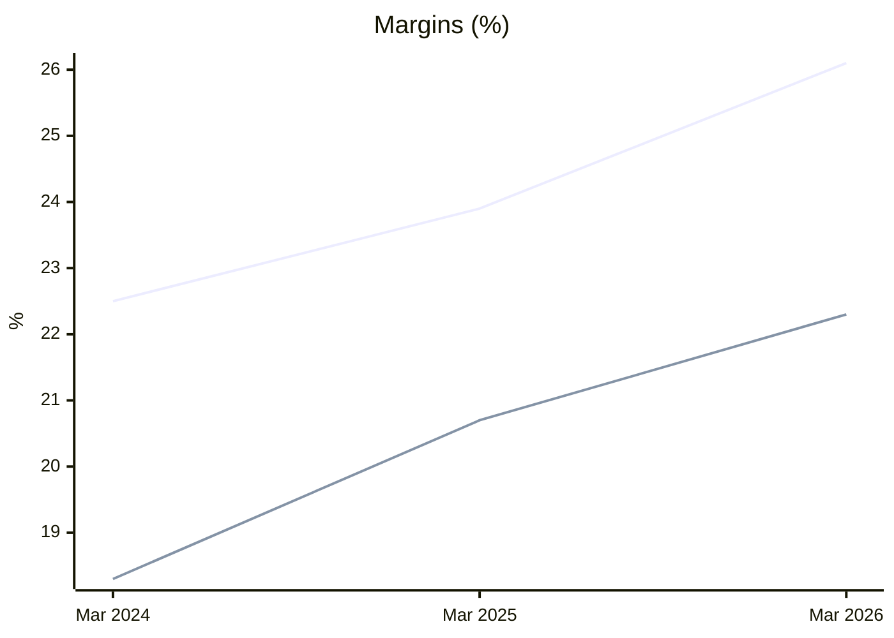

*Run 2026-11-24 · part of [SPINOFF_REPORT.md](../SPINOFF_REPORT.md) · the complete analysis of one company, with every management-call exchange in full.*

## ANANTRAJ — Anant Raj Ltd.

### 1. Anant Raj Ltd. — CONFIRMED DEMERGER

**CONFIRMED** (a demerger scheme is on the exchange record) · **PRE-SPIN — study the parent; the pieces do not trade yet** · score 5.0/10 · spin-off · 6 filing(s) from NSE, NSE-deep · first 2026-05-11, latest 2026-07-21

**The separated entities — every one the documents name:**

| Entity | Scheme | Business | Listing | Who runs it |
|---|---|---|---|---|
| **Ashok Cloud Private Limited** | 2026 Composite Scheme of Arrangement, Part III — demerger o… | The Data Center Business of ARL and ARCPL: data centre and co-location services, sovereign public cloud, AI-r… | to be listed — "shall be listed on BSE Limited and the Nati… | not stated |

**The other parties to the scheme(s)** — not separated entities: Anant Raj Cloud Private Limited — merged in — no shares for the parent's holders

**What is being separated, as the documents put it:** The Data Centre and Cloud Services business of ARL and ARCPL, vested in Ashok Cloud Private Limited — class `value_unlocking`.

### 2. Stages and dates

> **Listing:** NOT YET — scheme at 'announced' stage; the resulting company will list only after NCLT sanction, effectiveness and a record date; no listing timeline stated

| Date | Event | Source |
|---|---|---|
| 2026-05-11 | Other — board notes need for demerger/merger of the two businesses and constitutes a committee to evaluate the structure and recommend a scheme — Anant Raj Limited | as stated: Outcome of Board Meeting / financial results filing dated May 11, 202… |
| 2026-07-20 | Other — Finance and Investment Committee approves additional investment of Rs. 74,86,45,106 in Ashok Cloud Private Limited by way of rights issue of 37,43,22,553 equity shares (capitalising the resultant company before the scheme) — Ashok Cloud Private Limited | as stated: Acquisition / Committee Meeting Updates filing dated July 20, 2026 (A… |
| 2026-07-21 | Stage reached: **announced** | [Scheme of Arrangement](https://nsearchives.nseindia.com/corporate/ANANTRAJ_21072026184608_Outcome_21072026.pdf) |
| 2026-07-21 | Board approval — Anant Raj Limited (Amalgamated / Demerged Company) | as stated: Outcome of the Board Meeting and Scheme of Arrangement filing dated J… |

**The stages, as filed:** announced (2026-07-21)

### 3. Size of the separated business beside the parent — is institutional selling likely?

**Reading: VERY LIKELY — the piece is under a tenth of the whole; index funds and large holders who receive it without choosing it tend to sell.**

| Entity | Stated turnover | Stated share of the whole | Market cap (₹ cr) | Share of the whole by market cap | Segment revenue share | Index member | Selling on size |
|---|---|---:|---:|---:|---:|---|---|
| Ashok Cloud Private Limited | Demerged Undertaking turnover 145.90 crores as on March 31,… | 8.96% (share of turnover) | — | — | 7.0% (FY2026) | not listed | very likely |

*Stated figures are the documents' own (a turnover share, or the cost-of-acquisition split the company publishes for tax, which reflects relative value). The market-cap share is the entity's value over the whole — the parent plus every separated entity that trades (parent ₹17,222 cr, whole ₹17,222 cr, NSE bhavcopy of 2026-11-13); the segment share is the business's revenue over the parent's reported sales of that year. Both are computed here. The reading uses the market-cap share when the entity trades, else the stated share, else the segment share.*

**In the documents' words:** “As on March 31, 2026: Particulars Turnover* (in Crores) / Demerged Undertaking 145.90 / Total 1627.72 / Percentage 8.96% . *The turnover has been calculated after taking impact of Part -II of the Composite Scheme i.e. the merger of ARCPL with ARL through aggregation of the turnover of ARCPL and ARL”

**The judge's read of selling pressure:** likely — Small (8.96% of turnover), only 20.86% public float in ACPL, and a digital-infrastructure business alien to real-estate holders.

### 4. Insider ownership — share swap, promoters' holding, management incentives

**Share swap / entitlement, entity by entity:**

- **Ashok Cloud Private Limited:** "1 (One) fully paid-up equity share of face value of INR 21-(Rupees Two) each of the Resultant Company for every 1 (One) fully paid-up equity share of face value of INR 2/-(Rupees Two) each held in the Demerged Company."

**Promoters' holding, from the shareholding pattern:**

| Company | Promoters | FIIs | DIIs | Public | Quarter |
|---|---:|---:|---:|---:|---|
| Anant Raj Ltd. (ANANTRAJ) | 57.43% | 10.96% | 4.55% | 27.08% | Sep 2026 |

*Source: screener.in shareholding pattern, stored under `ShareholdingPattern/NiftyTotalMarket/`. In a mirror demerger each shareholder holds the same proportion of the new company as of the parent on the record date.*

- **Promoters in the parent, per the documents:** Promoters 20,66,57,823 shares, 57.42% (Pre-Arrangement Shareholding as on date, per the board-meeting disclosure dated July 21, 2026); Public 15,32,19,107 shares, 42.58%; Total 35,98,76,930 shares
- **What the promoters will hold in the separated entity:** Merger of ARCPL into ARL — no change in ARL: "Post -Arrangement Shareholding : Particulars Post-Arrangement (No. of Shares) Promoters 20,66,57,823 Public 15,32,19,107 Total 35,98,76,930 ... Post-Arrangement (Percentage) 57.42 42.58 100.00"; ARCPL's own capital is extinguished (Post-Arrangement Promoters -, Public -, Total -). Demerger into ACPL — ARL unchanged at Promoters 57.42% / Public 42.58%; in ACPL: "Pursuant to the Scheme, the shareholders of ARL will directly hold 49% in the Resultant Company, proportionate to their shareholding m ARL. Consequently, the shareholding of the Resultant Company shall comprise 28.14% held by the promoters of ARL, 20.86% held by the public shareholders, and the remaining 51 % held by ARL." Post-Arrangement ACPL: "Promoters (ARL: 51%; Promoters of ARL: 28.14%) 58,12,30,376 shares — 79.14%; Public 15,32,19,107 — 20.86%; Total 73,44,49,483 — 100.00%"
- **What a public shareholder receives:** Merger of ARCPL into ARL: no shares are issued or allotted, as ARCPL is a wholly owned subsidiary of ARL. Demerger into Ashok Cloud: "Upon the Scheme becoming effective, eligible shareholders of Anant Raj Limited will receive one fully paid-up equity share of face value of ₹2 each in Ashok Cloud Private Limited for every one fully paid-up equity share of face value of ₹2 each held in Anant Raj Limited." Public shareholders end up holding 20.86% of ACPL directly, and "Overall, the shareholders of ARL will hold 100% of the ultimate beneficial economic interest in the Resultant Company, ACPL ( direct holding of 49% and indirect holding of 51% throughARL)."
- **Management incentives:** not stated in the documents on file.
- **Insider actions around the separation:** Promoter warrant conversion funded ahead of schedule, per the November 12, 2025 earnings call: "prior to doing the Bharat Built from soil to server, the company at that time, the promoters were issued warrants of INR 100 crores for which the promoters were supposed to convert by September '26. Actually, the promoters put in the money in March '25 itself and that additional cash flow of INR 100 crores really helped the company and we converted our share warrants at a price of INR 730 done." Promoter-group management expansion: "the appointment of Sh. Anish Sarin as Additional Director designated as Whole-time Director of the Company w.e.f. May 11, 2026" — "Sh. Anish Sarin forms part of the promoter group of the Company". No promoter buying, selling or pledging of ARL shares around the separation is stated.
- **Insiders, per the checklist read:** ARL promoters hold 57.42% of ARL; post-scheme ACPL is 28.14% promoters directly plus 51% held by ARL (79.14% total), public 20.86%. Promoter-group Anish Sarin oversees data-centre rollout. · *option pricing date:* not stated

### 5. Why the demerger — point by point

Management says Anant Raj Ltd today runs two unlike businesses under one roof — the legacy real estate/infrastructure business (residential townships, luxury housing, commercial leasing, hospitality) and a data centre & cloud services business — and that the Data Centre Business is itself split across two entities, Anant Raj Limited and its wholly owned Anant Raj Cloud Private Limited (ARCPL), with assets, employees, investments and operations housed in both. The Composite Scheme therefore first amalgamates ARCPL into ARL and then demerges the whole Data Centre Business out of ARL into Ashok Cloud Private Limited (ACPL), so all of it sits in one dedicated, separately listed company. The stated problems it solves: the two verticals differ 'significantly in their nature, risk profile, competitive dynamics, and capital requirements', and the Board recorded on May 11, 2026 that keeping both in one company 'does not adequately reflect the true potential and intrinsic value of each business segment, thereby impacting stakeholder returns'; the split is meant to give independent market-driven valuation of a pure-play digital infrastructure asset, dedicated management focus, a simpler ownership structure with intra-group arrangements cancelled/rationalised, and the ability to attract sector-specific capital, strategic investors and partnerships. The numbers cited: the Demerged Undertaking did ₹145.90 cr turnover in FY26 versus ₹1,627.72 cr aggregated (8.96%); ARCPL turnover ₹136.20 cr and net worth ₹49.45 cr versus ARL's ₹1,491.52 cr turnover and ₹4,471.64 cr net worth; ACPL had nil turnover and ₹0.04 cr net worth and was capitalised days earlier via a ₹74.86 cr rights issue (37,43,22,553 shares at ₹2). Scale is the driver: the Board noted an MOU with the Govt. of Andhra Pradesh for 50 MW IT load taking total planned capacity to 357 MW IT load, requiring about ₹20,000 cr of investment — against a real estate business management repeatedly said should carry as little debt as possible. Mechanically, ARL shareholders get 1 ACPL share of ₹2 for every 1 ARL share of ₹2, giving them 49% of ACPL directly (promoters 28.14%, public 20.86%) while ARL retains 51%, so ACPL stays a subsidiary and ARL holders keep 100% of the ultimate economic interest; ACPL will be listed on BSE and NSE under the Rule 19(7) exemption. The ask came from the equity market side — an investor asked about a demerger as early as the Apr 2024 call, and analysts kept pressing for separate real estate vs data centre reporting — not from lenders or partners, who are never cited as requesting it.

**Point by point, with the source:**

1. An investor (Arpit Shah, Stallion Asset) directly asked about demerging the data centre business; management declined to engage, calling the business too young and prioritising execution toward the 300 MW mark in four years. “We are too soon to say anything on that. Let's focus on execution, Arpit.” — *[Apr 2024](https://www.bseindia.com/stockinfo/AnnPdfOpen.aspx?Pname=03aa7997-f0a0-4f9b-8373-f4a4684da92d.pdf)*
2. Management set out the different capital philosophies that later justify separation: real estate was to be net debt-free by December 2024 and the only debt acceptable would be lease rental discounting, including against long 10-15 year data centre leases. “And the only debt which Anant Raj is open to taking is LRD and this is one of the best items for LRD because you have long-term leases and good clients.” — *[Apr 2024](https://www.bseindia.com/stockinfo/AnnPdfOpen.aspx?Pname=03aa7997-f0a0-4f9b-8373-f4a4684da92d.pdf)*
3. Management began describing the group as two separate divisions — the historic real estate 'bread and butter' and a new technology division of colocation and cloud — the same two-vertical framing the Scheme later uses. “So Anant Raj Limited will now have two full-fledged divisions. Real estate division which is the historical, the division of the company, the bread and butter of the company as of now and plus the technology division, in which we will be data center, co-location infrastructure and cloud.” — *[Nov 2024](https://www.bseindia.com/stockinfo/AnnPdfOpen.aspx?Pname=27b8b856-615a-44a5-8be4-157fd1831d5c.pdf)*
4. The ₹2,100 cr fundraise (₹100 cr promoters, ₹2,000 cr market) was ring-fenced entirely for the data centre/cloud build-out, with real estate funded from internal accruals — distinct funding requirements per vertical, with cloud capex cited at ~₹100 cr per MW on top of ₹26 cr colocation capex. “This is purely data center, sir. This fund is going to be purely for data centers. For our real estate, we are completely funded with our internal sources.” — *[Nov 2024](https://www.bseindia.com/stockinfo/AnnPdfOpen.aspx?Pname=27b8b856-615a-44a5-8be4-157fd1831d5c.pdf)*
5. An analyst (Raj Sarraf of Finvestors) asked for data centre revenue to be reported separately from real estate because it would become the major contributor; management conceded the point. “Sir, both the revenues are going to be substantial and we will be breaking them up, sir . We will do that definitely.” — *[Nov 2024](https://www.bseindia.com/stockinfo/AnnPdfOpen.aspx?Pname=27b8b856-615a-44a5-8be4-157fd1831d5c.pdf)*
6. The CFO positioned the company at an 'inflection point' with a legacy real estate business and a separate future-ready data centre/cloud platform — H1 FY26 revenue ₹1,223.2 cr of which data centre only ₹58.42 cr, ₹1,100 cr QIP completed, net cash positive, ~₹700 cr capital employed in data centres at 75% EBITDA margin. “Our legacy real estate business continues to deliver a consistent growth and strengthen our leadership in high demanding markets. At the same time, our Data Center and Cloud initiatives are shaping up the future ready platform that positions us as a diversified resilient enterprise s.” — *[Nov 2025](https://www.bseindia.com/stockinfo/AnnPdfOpen.aspx?Pname=3ac557ff-2c8f-4014-b2d4-e7e582aa0e59.pdf)*
7. Investors (Sri Gopal of StockHifi, Ashwani Sharma of Emkay) again pressed for separate real estate vs data centre revenue and EBITDA reporting; management said formal segment disclosure was not yet triggered because data centre revenue was under 10% of the total. “In this, you have to give segmental breakup once you do 10%.” — *[Nov 2025](https://www.bseindia.com/stockinfo/AnnPdfOpen.aspx?Pname=3ac557ff-2c8f-4014-b2d4-e7e582aa0e59.pdf)*
8. Asked whether the company should lever up to scale data centres faster, management refused on the grounds that real estate is the backbone and must stay low-debt — a tension a separately funded data centre entity resolves. Capacity plans were 63 MW by Dec 2026, 117 MW by FY28 and 307 MW by FY31-32. “And as it is, we feel that our backbone is still real estate, which will always be. And we feel that real estate should be as low on debt as possible.” — *[Nov 2025](https://www.bseindia.com/stockinfo/AnnPdfOpen.aspx?Pname=3ac557ff-2c8f-4014-b2d4-e7e582aa0e59.pdf)*
9. The May 11, 2026 board note first records the need for a merger/demerger, citing differing nature, risk profile, competitive dynamics and capital requirements, plus the 357 MW IT load plan (after the 50 MW Andhra Pradesh MOU) needing about ₹20,000 cr; a committee of Amit Sarin, Ashim Sarin, Manoj Goyal and Pankaj Gupta was formed to design it. “The Board of Directors have considered that the Company is presently engaged in two distinct business undertakings, namely Real Estate Development and Data Center Services, which differ significantly in their nature, risk profile, competitive dynamics, and capital requirements and continuing both businesses under a single corporate does not adequately reflect the true potential and intrinsic value of each business segment, thereby impacting stakeholder returns.” — *Scheme*
10. The July 21, 2026 Scheme explains the data centre business is split across ARL and ARCPL, so ARCPL is first merged into ARL and the combined Data Centre Business then demerged into Ashok Cloud — consolidating it in one entity and creating two focused listed companies. “The Data Centre Business is presently conducted through ARL and ARCPL, with various assets, employees, investments and business operations pertaining to the Data Centre Business being housed across both entities.” — *Scheme*
11. Stated benefit one: independent market recognition and valuation of the data centre business given its distinct operating profile, growth trajectory, risk-return characteristics and funding needs; demerged undertaking turnover was ₹145.90 cr, 8.96% of ₹1,627.72 cr for FY26. “the segregation of the Data Centre Business into a separately listed company would facilitate independent market recognition and valuation of the Data Centre Business, having regard to its distinct operating profile, growth trajectory, risk-return characteristics and funding requirements;” — *Scheme*
12. Stated benefit two: a distinct legal entity lets Ashok Cloud attract sector-specific capital, investors, acquisitions and partnerships, with simpler ownership and intra-group arrangements cancelled or rationalised. “the separation of the Data Centre Business into a distinct legal entity will enable Ashok Cloud to effectively attract sector specific resources for its growth requirements and pursue strategic investments, partnerships, thereby unlocking greater value for its shareholders;” — *Scheme*
13. Consideration is 1 ACPL share of ₹2 for every 1 ARL share of ₹2; ARL holders get 49% of ACPL directly (promoters 28.14%, public 20.86%) while ARL keeps 51%, so ACPL remains a subsidiary and ARL holders retain 100% of the ultimate economic interest; listing on BSE and NSE via the Rule 19(7) exemption. “Overall, the shareholders of ARL will hold 100% of the ultimate beneficial economic interest in the Resultant Company, ACPL ( direct holding of 49% and indirect holding of 51% throughARL).” — *Scheme*
14. Days before the Scheme, the Finance and Investment Committee funded the shell resultant company: a ₹74,86,45,106 rights issue of 37,43,22,553 ₹2 shares in ACPL (incorporated Oct 11, 2021; nil turnover in FY24, FY25 and FY26) to meet data centre and cloud development funding. “ACPL proposes to raise the fund to meet the funding requirement for development of its data centres and cloud business.” — *Scheme*
15. The press release frames the outcome as two independent platforms — ARL in real estate/infrastructure and Ashok Cloud in data centres, sovereign public cloud, AI-ready cloud infrastructure and DC/DR services — citing separate growth trajectories, operational priorities and capital needs. “"Our real estate, infrastructure business and Data Centre & Cloud Services Business have evolved into two distinct platforms, each with its own growth trajectory, operational priorities, and capital needs.” — *Scheme*

**How it evolved:** On the Apr 25, 2024 call Arpit Shah of Stallion Asset asked outright whether there were plans to demerge the business and Amit Sarin refused — 'too soon', focus on execution — while describing the cloud venture as a half-megawatt pilot with TCIL. By the Oct 30, 2024 call (Q2 FY25) management was framing the group as 'two full-fledged divisions' (real estate plus a technology division) with a ₹2,100 cr fundraise earmarked purely for data centre/cloud, and Raj Sarraf pushed for separate data centre revenue disclosure; on the Nov 12, 2025 call (Q2/H1 FY26) the CFO called the company 'at an important inflection point' with a 'legacy real estate business' alongside the data centre/cloud 'future ready platform', the ₹1,100 cr QIP was done, and analysts again asked for a separate segment/EBITDA breakup, which management declined on the 10%-of-revenue threshold. The demerger itself was never discussed on any of the three calls: it surfaced in the May 11, 2026 board note (which recorded the need for merger/demerger and set up a committee of Amit Sarin, Ashim Sarin, Manoj Goyal and Pankaj Gupta to frame a scheme), then was executed as the ACPL rights-issue funding on July 20, 2026 and the Composite Scheme approved on July 21, 2026.

**What management expects from it:** Ashok Cloud: pure-play digital-infrastructure valuation and independent market recognition, sector-specific growth capital, partnerships and acquisitions, dedicated leadership, consolidated ownership (75% EBITDA-margin colocation/cloud, 357 MW plan, ~₹20,000 cr capex). Anant Raj: sharper focus on real estate, infrastructure and hospitality, low debt, continued execution. Both: operational efficiency, agility, faster decision-making, transparency, unlocked shareholder value, with holders participating directly in each.

*Not explained on the calls:* Calls never mention the demerger; no appointed date, debt/cash/asset split, valuation or swap basis, why ARL keeps 51%, how ₹20,000 cr capex gets funded, or listing timeline.

- *Stated reason, in one line:* Consolidate the entire Data Centre Business in one entity and create two dedicated listed companies, enabling independent market recognition and valuation, dedicated management focus and sector-specific funding.
- *What it reveals:* Demerged Undertaking turnover Rs 145.90 cr is only 8.96% of Rs 1,627.72 cr; management cites ~75% data-centre EBITDA margin, 357 MW planned capacity, Rs 20,000 cr capex, net-cash parent with Rs 4,471.64 cr net worth.
- *Parent or spin:* both · *Read next:* The full Composite Scheme: asset/liability split and valuation of the Demerged Undertaking versus ACPL's Rs 74.86 cr rights issue.
- *In their words:* “The Data Centre Business has evolved significantly over the years and is well poised to chart its own growth path and operate as a separate listed entity focused on the rapidly growing Data Centre Business whilst continuing to leverage ARL's institutional strengths, strong brand equity and goodwill.”

### 6. On the calls, verbatim

2 call(s), oldest first: **4 question-and-answer exchange(s)** given in full — the question and every answer to it, nothing trimmed — and 2 passage(s) from management's prepared remarks (the complete sentences about it; the whole remarks are in the linked transcript). Text is as the transcript prints it.

#### Nov 2024 — [transcript](https://www.bseindia.com/stockinfo/AnnPdfOpen.aspx?Pname=27b8b856-615a-44a5-8be4-157fd1831d5c.pdf)

**From the prepared remarks** *(the passage about it; the whole turn runs to 2,867 characters in the transcript)*

> **Amit Sarin:** There is no delay whatsoever and everything is on track and has been launched on the decided dates, number one. Number two, the company was already into co -location as we all know that the company successfully initially started with 3 megawatts and added another 3 . In our last call in April, we had informed everybody that the company is now going to be v enturing out into its own cloud and this was done in the month of April this year and we very proudly and happily would like to share that we have already done that. On the 7th of October, the company launched its own cloud called Ashok Cloud, named after our Founder , Chairman, Shri Ashok Sari n. We got very good response for it and this today has placed Anant Raj Group as one of the main players of not only data center, but cloud also. So today we are a single stop solution for everything. If somebody wants simple co -location, we can provide that.

**Question and answer**

> **Gautam Shroff:** Congratulations, Amitji, on a stellar qu arter. You've entered a 100 crore club. That is an achievement, I would say. To many more. Amitji, my first question to you and team Anant R aj is, we also read about you announcing a fund raise program. How aggressive are the growth plans and how are you t hinking two or three years down the line?
>
> **Amit Sarin:** As of now, this fundraising is completely focused. It's going to be INR 2100 crores out of which promoters are going to put in 100 and we will go to the market for the balance 2000. The main focus of thi s fundraising is going to be for the data center business. As you know, one new development this year has been that the company has come into clouds. The company is fully funded and fully on track for its first 28 megawatts. For that, we do not need any m oney. But in the coming year, and we are almost there at 28 now, so in the coming year, we plan to add another 35, taking the toll to 63 megawatts. In this 63 megawatts, after launching Ashok Clouds, we are very confident because we've got very good response for Ashok Cloud, the cloud services which the company has launched. When we explained on the call, today we are a single-stop solution for any cloud need of any client anywhere in the world. Of course, the focus is always going to be India. In this situation, we feel that out of this 63 megawatts, 14 megawatts can be, as of now, depending on our fund position and the fundraising Anant Raj Limited October 30, 202 4 which we are going to do, can be easily put into clouds. This tak es the data center business and Anan t Raj Clouds into a different horizon. In this, you are going to be then competing with all the hyperscalers and the largest ones in the world. That is the category we want to go into. As it is already public knowledge, the technical tie-up for the product which we have launched so far, for which we got very good response, is with Orange, the French company. It's doing pretty well. That is the focus of the fundraising.
>
> **Gautam Shroff:** Thank you.

#### Nov 2025 — [transcript](https://www.bseindia.com/stockinfo/AnnPdfOpen.aspx?Pname=3ac557ff-2c8f-4014-b2d4-e7e582aa0e59.pdf)

**From the prepared remarks** *(the passage about it; the whole turn runs to 4,470 characters in the transcript)*

> **Amit Sarin:** We invited them for 2 days to come and we showcase this. We are thankful to everybody who was able to come in and it was very encouraging for the company. So, that is done. Now the company as you must be all aware that the company in October last year started with its own Cloud called Ashok Cloud which was named after our F ounder Chairman Shri Ashok Sarin and we are a sovereign Cloud of the country and initially we start with B2B and that is successfully being launched and is getting very good response in the market. Other than that, prior to doing the Bharat Built from soil to server, the company at that time, the promoters were issued warrants of INR 100 crores for which the promoters were supposed to convert by September ‘26. Actually, the promoters put in the money in March ‘25 itself and that additional cash flow of INR 100 crores really helped the company and we converted our share warrants at a price of INR 730 done. The money came into the company and that got used in the Data Center business and we successfully did our soil to server day. […] So, vis-a-vis this also, the company is fully on track. The company also successfully completed it s QIP of INR 1,100 crores which is done. Other than that, in commercial, the company has started working on 2 major projects. The first one is in 63A which is Ashok Towers. The work has already started and the second one is our first endeavor in Delhi now. Prior to that, we were always focusing in Haryana. So, now in Delhi, we have already started with our first development which is 7 lakh square feet and the first phase of this development, this is a combination of commercial, service apartments and hotels and the first phase will be completed by FY '28.

**Question and answer**

> **Akash Gupta:** Understood, sir. And s ir, my second question is with respect to your demand for Cloud . We are probably doing roughly 2 megawatts of Cloud by this year end. How confident are we that we will be able to utilize this additional 4 megawatts of Cloud ? Do we have any demand visibility or are we like looking at any new contracts with any government or something , if you could give some visibility on that? Visibility for the cloud segment.
>
> **Amit Sarin:** Sir, we have enough demand right now. There is no problem vis -a-vis the demand. The bottleneck till we had done the QIP was the funds. Fortunately, we have that now. So, demand as of now is not a challenge. As you must have noticed in the call when we mentioned, so we are a sovereign Cloud of the country, Ashok Cloud is a sovereign Cloud and today's sovereign Cloud has a very niche demand for itself. And this demand is only growing, sir. And with the laws coming in place, as we know that Data Pr otection Act, we are all talking about Data Protection and other laws and all which are going to be coming in and rightly so. All major countries today have their Data Protection Act and all and very soon India will also have it. So, these things will only multiply, sir. So, we have enough demand, sir. Demand , we do not see as a challenge at all, sir. And today, we have a lot of e-commerce companies and all which are coming to us, which we are already there, sir. We are cost effective also, sir. Today, comp ared to the market, we are almost at 50% cost and even then our margins are pretty good. So, we are on track, sir.
>
> **Akash Gupta:** Got it, sir. Thanks a lot.
>
> **Amit Sarin:** Thank you.

**Question and answer**

> **Hardik:** Understood. And then coming on the Data Center business part of it. S ir, right now, we are nearly debt free. We don't have any significant debt. And we are seeing such a big t raction in our Data Center business. All the multinational companies are planning to open up Data Center s. So, do you think it is the right time for us to get aggressive, take som e debt on our books, ramp up, I know we have already raised some funds in the recent QIP. But to capture the market at the right time as well as get the capacities ready early, wouldn' t that be a proactive approach? A mit Sarin : Harsh, we are on track. There is no limit to how much one can do. But with our plans, we are fully on track and we are capturing the market in the right way. If you really see that we started with Colocation, and we got such fantastic response on Colocation. And this is thanks to the product which we delivered, which we showcased also, and which is one of the best in the world. So, once we did that, then we got a chance to come into the Cloud business also, which is not very long ago. We starte d our Ashok Cloud in October ‘ 24 and we got very good response and now we are multiplying that. So, we are on track, sir and we don't see that we need to take debt. And as it is, we feel that our backbone is still real estate, which will always be. And we feel that real estate should be as low on debt as possible. And we are comfortable, sir. We are not missing any opportunity because of that.

**Question and answer**

> **Viral:** Yes. Hi. So, few quick questions from my side. So, first of all, the residential sale have been continued to gain the traction. So, could you share the contribution from the Anant Raj Estate and other key project?
>
> **Manoj Goyal:** See, hi, Viral , Manoj Goyal here . So, the major revenue that comes to our balance sheet is from 3-4 segments. One is the residential, one is the rental income and other is the Data Center business. So, the majority of revenue contribution, because we book the revenue on a percentage Anant Raj Limited November 12, 2025 completion basis, is from the Anant Raj Estate, which is the residential component. So, I think majority is coming from the Anant Raj Estate and the projects like Ashok Estate and Data Center .

### 7. The parent's financial statements

**The parent, last three fiscal years (consolidated)**

| | Mar 2024 | Mar 2025 | Mar 2026 |
|---|---:|---:|---:|
| Sales (₹ cr) | 1,483 | 2,060 | 2,512 |
| Sales growth (%) | +55.0% | +38.9% | +21.9% |
| Operating profit (₹ cr) | 334 | 492 | 656 |
| Operating profit growth (%) | +69.5% | +47.3% | +33.3% |
| Operating margin (%) | 22.5 | 23.9 | 26.1 |
| PAT (₹ cr) | 271 | 426 | 559 |
| PAT growth (%) | +81.9% | +57.2% | +31.2% |
| PAT margin (%) | 18.3 | 20.7 | 22.3 |
| EPS (₹) | 7.6 | 12.4 | 15.4 |

*Source: ProfitStatement/NiftyTotalMarket/ANANTRAJ.csv (consolidated, screener.in); growth and margins computed here.*

```mermaid
xychart-beta
    title "Sales, operating profit and PAT (₹ cr)"
    x-axis ["Mar 2024", "Mar 2025", "Mar 2026"]
    y-axis "₹ crore"
    bar [1483, 2060, 2512]
    bar [334, 492, 656]
    bar [271, 426, 559]
```

*Series in order: Sales, Operating profit, PAT.*

*Series in order: Operating margin, PAT margin.*

**P/E:** 40.5 — live market file (screener.in), trailing (price ₹624.00 as of 2026-08-02).

**Cash flows (₹ cr):**

| | Mar 2024 | Mar 2025 | Mar 2026 |
|---|---:|---:|---:|
| Cash from operations (₹ cr) | -26.0 | 253 | -435 |
| Cash from investing (₹ cr) | 181 | -147 | -231 |
| Cash from financing (₹ cr) | 116 | -81.0 | 1,235 |
| Net cash flow (₹ cr) | 271 | 25.0 | 569 |
| Free cash flow (₹ cr) | -55.0 | 177 | -796 |

*Source: CashFlow/NiftyTotalMarket/ANANTRAJ.csv (consolidated, screener.in).*

### 8. The separated business's financial statements

**The business being separated — its own numbers**, entity by entity: its reported statements once it is listed and on file, and the segment numbers the annual reports and presentations carry for it before that.

**Data Centre & Cloud Services business — revenue line labelled "Revenue from Data Center, Infrastructure and Allied services" (platform presented as "Ashok Cloud Pvt. Ltd."; built in subsidiary Anant Raj Cloud Private Limited / ARCPL) → Ashok Cloud Private Limited** · unit ₹ crore · Only a revenue line is disclosed for this business; it is the data centre/infrastructure/allied-services revenue included in the consolidated 'Revenue from Operations (including income from Data Centers)'. No separate profit measure (no segment result/EBIT/EBITDA/PBT) is given for it — the annual reports state the Company has a SINGLE reportable segment (real estate development), so no Ind AS 108 segment disclosure of data-centre revenue, result, assets, liabilities or depreciation exists. Quarterly build-up of FY26: Q2 ₹35.47 Cr (Presentation Nov 2025 — page 7), Q3 ₹43.57 Cr (Presentation Jan 2026 — page 7), Q4 ₹74.51 Cr (Presentation May 2026 — page 7); 9M FY26 ₹101.99 Cr; H1 FY26 ₹58.42 Cr.

| | FY2024 | FY2025 | FY2026 |
|---|---:|---:|---:|
| Revenue (₹ crore) | — | — | 176 |
| Revenue growth (%) | — | — | — |
| Operating profit (₹ crore) | — | — | — |
| Operating profit growth (%) | — | — | — |
| Operating margin (%) | — | — | — |
| PAT (₹ crore) | — | — | — |
| PAT growth (%) | — | — | — |

*Sources:* no figure on the supplied pages; Presentation May 2026 — page 7

*Latest quarter (Q2 FY27):* revenue 115.41, operating profit None — Presentation Oct 2026 — page 8

*Not in the pages read:* No EBITDA/PBT/PAT, segment assets, liabilities, capex or depreciation for the data centre business; no FY2024 or FY2025 revenue. Planned capacity only (28 MW operational, 357 MW by FY32).

*Businesses with no numbers in the pages read (3 annual report(s) and 12 presentation(s) on file):* Ashok Cloud Pvt Limited/ACPL, Anant Raj Cloud Private Limited/ARCPL, Demerged Undertaking and 'The Data Center/Centre' carry no own entity-level financials on these pages; only one data-centre revenue line exists, reported for the business as a whole.

*Documents on file:* [Annual Report 2026](https://www.bseindia.com/xml-data/corpfiling/AttachHis/443e6268-09d2-4ba3-a3a9-4c478098b164.pdf); [Annual Report 2025](https://www.bseindia.com/xml-data/corpfiling/AttachHis/8698030a-7d1b-4cfb-987b-9571f7d1a989.pdf); [Annual Report 2024](https://www.bseindia.com/xml-data/corpfiling/AttachHis/8bf6dcbb-f722-4625-a066-66563b63e047.pdf); [Presentation Oct 2026](https://www.bseindia.com/stockinfo/AnnPdfOpen.aspx?Pname=a2512159-2289-49d9-9269-e9ffdc3bca4d.pdf); [Presentation Aug 2026](https://www.bseindia.com/stockinfo/AnnPdfOpen.aspx?Pname=7b3cf886-7a1d-4250-80fa-57d49521f681.pdf); [Presentation May 2026](https://www.bseindia.com/stockinfo/AnnPdfOpen.aspx?Pname=f24273e2-ebcf-475f-a448-64ffb3febd4e.pdf); [Presentation Jan 2026](https://www.bseindia.com/stockinfo/AnnPdfOpen.aspx?Pname=a1ea76a5-c69c-459a-9c84-75607719fb96.pdf); [Presentation Nov 2025](https://www.bseindia.com/stockinfo/AnnPdfOpen.aspx?Pname=2b3c7361-183e-4598-a569-dff8a843418b.pdf); [Presentation Jul 2025](https://www.bseindia.com/stockinfo/AnnPdfOpen.aspx?Pname=b6452a4f-1cd4-41f2-a11d-8eaea6ba62b1.pdf)

### 9. Other financial differences — working capital, margins, returns, debt

| Metric (latest year) | Parent (ANANTRAJ) | Ashok Cloud Private Limited |
|---|---:|---:|
| *Basis* | *reported, consolidated* | *segment numbers (Data Centre & Cloud Services…* |
| Sales (₹ cr) | 2,512 (Mar 2026) | — |
| Sales growth (%) | 21.9 (Mar 2026) | — |
| Operating margin (%) | 26.1 (Mar 2026) | — |
| Operating profit growth (%) | 33.3 (Mar 2026) | — |
| PAT margin (%) | 22.3 (Mar 2026) | — |
| ROCE % | 12 (Mar 2026) | — |
| Debtor Days | 26 (Mar 2026) | — |
| Cash Conversion Cycle | 26 (Mar 2026) | — |
| Working Capital Days | 346 (Mar 2026) | — |
| Debt / equity (x) | 0.1 (Mar 2026) | — |
| Borrowings (₹ cr) | 681 (Mar 2026) | — |
| Sales (₹ crore) | — | 176.5 (FY2026) |

*Each figure is the latest on file, with its year. Working-capital days and ROCE come from the stored working-capital file; segment figures from the pages cited in part 8. A dash means the documents do not carry it.*

**What stays with the parent — its segments, from the same pages:**

| Remaining segment | Revenue | Operating margin | ROCE | Segment assets / revenue | Unit | Year |
|---|---:|---:|---:|---:|---|---|
| Real estate development — the single reportable segment (residential, annuity/commercial and hospitality); as reported it still INCLUDES the data centre & cloud services business, which is not disclosed separately | 2,512 | 28.8% | — | — | ₹ crore | FY2026 |

**What the documents themselves say about the differences:**

- **other** — parent / remaining: Real Estate Development undertaking; separated business: Data Center Services undertaking — stated to differ significantly in nature, risk profile, competitive dynamics and capital requirements “The Board of Directors have considered that the Company is presently engaged in two distinct business undertakings, namely Real Estate Development and Data Center Services, which differ significantly in their nature, risk profile, competitive dynamics, and capital requirements and continuing both businesses under a single corporate does not adequately reflect the true potential and intrinsic value of each business segment, thereby impacting stakeholder returns.”
- **capex and capital intensity** — parent / remaining: Real estate launches planned of about 2.6 million square feet for FY26; company states real estate "should be as low on debt as possible"; separated business: Data Centre capacity to reach 357 MW IT Load with planned investment of about Rs. 20,000 crore; incremental build cost stated at Rs. 26 crore per MW on existing buildings (versus Rs. 50 crore per MW earlier guided) “With this plan, the total planned Data Center capacity will reach to 357 MW IT Load, mix of Colocation and Cloud Services. The company will be investing about Rs. 20,000 Cr to reach total planned capacity.”
- **operating margin** — parent / remaining: Consolidated EBITDA margin for Q2 FY26 stood at 27.76%, up year-on-year from 23.62%; separated business: Data Center business EBITDA margin of 75% on Q2 FY26 revenue of INR 35.47 crore “So, sir, we have generated the revenue from Data Center business in this quarter is INR 35.47 crore and the EBITDA margin is 75%.”
- **debt and leverage** — parent / remaining: Net debt below INR 50 crores for five quarters in a row; net cash positive after a INR 1,100 crore QIP and prepayment of INR 125 crore of debt; outstanding qualified borrowings down from INR 388.47 crore to INR 297.92 crore in FY26; separated business: Data Centre build stated to be fully funded without debt; the demerger is intended to let Ashok Cloud attract sector-specific resources and growth capital of its own “One main highlight which we are very proud of is that the fifth quarter in a row, even prior to the QIP which the company has successfully done, fifth quarter in a row, the net debt of the company has been below 50 crores.”
- **growth** — parent / remaining: Consolidated revenue from operations grew from Rs. 2,059.97 crore (FY25) to Rs. 2,511.60 crore (FY26); H1 FY26 revenue up 24.22% year-on-year; separated business: Data Centre revenue of INR 58.42 crore in H1 FY26, scaling from 28 MW to 63 MW by December 2026 and to 117 MW by FY28, with INR 1,200 crore of revenue targeted from 63 MW “The Data Centre Business has evolved significantly over the years and is well poised to chart its own growth path and operate as a separate listed entity focused on the rapidly growing Data Centre Business whilst continuing to leverage ARL's institutional strengths, strong brand equity and goodwill.”
- **cash** — parent / remaining: Standalone cash and cash equivalents Rs. 806.90 crore and consolidated Rs. 899.46 crore as at March 31, 2026; of the INR 1,099.99 crore QIP, "an amount of Rs. 750 crores remains unutilized as on March 31, 2026"; separated business: Ashok Cloud had net worth of Rs. 0.04 crore and nil turnover before being funded with Rs. 74,86,45,106 of fresh equity by ARL ahead of the scheme “ACPL proposes to raise the fund to meet the funding requirement for development of its data centres and cloud business.”
- **tax** — parent / remaining: not stated; separated business: A taxation benefit for the data centre business was described on the call as proposed by the government and not yet in effect, applicable to both Colocation and Cloud “It is a very welcome step, sir. It is going to be really encouraging. And it is applicable to both, sir, Colocation as well as Cloud.”
- **working capital** — parent / remaining: Standalone inventories fell from Rs. 720.15 crore to Rs. 552.68 crore; consolidated cash used from operations of Rs. (326.49) crore in FY26 against Rs. 322.33 crore generated in FY25; separated business: Colocation power cost is a pass-through to customers while in Cloud the power cost is borne and recovered in pricing “Sir, for Colocation , we will always do the netting of electricity pass through expenses . And for Cloud we charge for that.”

**The checklist:**

| Item | Status | Evidence |
|---|---|---|
| Why the spin-off | yes | unrelated businesses separated; a weak or capital-heavy business carved away; value unlocking for shareholders; regulatory / strategic knot; attracting different investors / capital — “…total planned capacity. The Board of Directors have considered that the Company is presently engaged in two distinct business undertakings, namely Real Estate Development and Data Center Services, which differ significa” |
| Institutional selling likely (small / different business) | partly | the businesses are described as distinct |
| Insider ownership and incentives aligned | unknown | no promoter-continuity or option-pricing language found *(next: the date the management options are priced; promoter holding in the resulting company)* |
| A hidden value revealed (pro-forma, leverage, comparables) | partly | borrowings 681 cr (Mar 2026) = 0.03× market cap; P/E 40.2 on Mar 2026 profit vs industry median 39.2 (8 peers) *(next: pro-forma P&L of each piece × the peer P/E of its own industry)* |
| Parent before the spin (clean parent, takeover prelude) | partly | stage announced — the spin has not happened; the parent can still be bought whole |
| Timing (first year sells, second year gains) | partly | not yet listed — 197 days since the first filing, stage announced |

The filings

| Date | Category | Headline | Attachment |
|---|---|---|---|
| 2026-05-11 | Outcome of Board Meeting | Anant Raj Limited has submitted to the Exchange, the financial results for the period ended March 31, 2026. | [pdf](https://nsearchives.nseindia.com/corporate/ANANTRAJ_11052026182706_Outcome_11052026.pdf) |
| 2026-05-11 | Updates | Anant Raj Limited has informed the Exchange regarding 'Code of Practices and Procedures for Fair Disclosure of Unpublished Price Sensitive Information'. | [pdf](https://nsearchives.nseindia.com/corporate/ANANTRAJ_11052026190844_Outcome_11052026.pdf) |
| 2026-07-21 | Scheme of Arrangement | Anant Raj Limited has informed the Exchange about Scheme of Arrangement | [pdf](https://nsearchives.nseindia.com/corporate/ANANTRAJ_21072026184608_Outcome_21072026.pdf) |
| 2026-07-21 | Outcome of Board Meeting | Outcome of the Board Meeting of Anant Raj Limited (''Amalgamated Company" I "Demerged | [pdf](https://nsearchives.nseindia.com/corporate/ANANTRAJ_21072026184858_Outcome_21072026.pdf) |
| 2026-07-21 | Outcome of Board Meeting | Anant Raj Limited has informed the Exchange regarding Outcome of Board Meeting held on July 21, 2026. | [pdf](https://nsearchives.nseindia.com/corporate/ANANTRAJ_21072026184858_Outcome_21072026.pdf) |
| 2026-07-21 | Press Release | Anant Raj Limited has informed the Exchange regarding a press release dated July 21, 2026, titled "Anant Raj Board Approves Strategic Demerger to Create Two Foc | [pdf](https://nsearchives.nseindia.com/corporate/ANANTRAJ_21072026190031_Intimation_Press_Release_21072026.pdf) |

