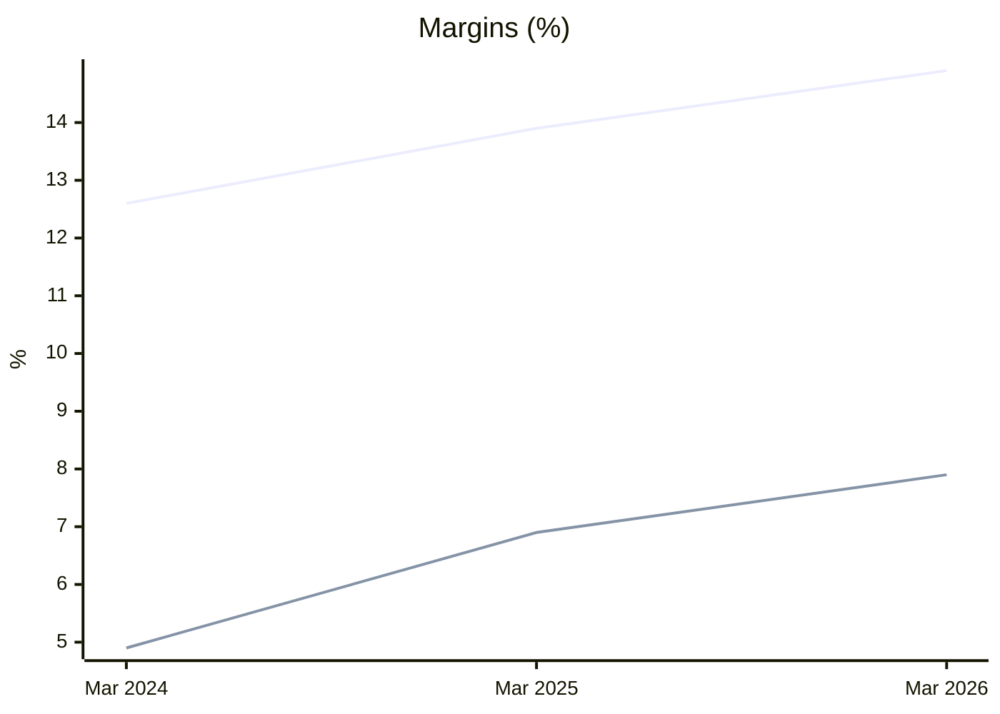

*Run 2026-11-24 · part of [SPINOFF_REPORT.md](../SPINOFF_REPORT.md) · the complete analysis of one company, with every management-call exchange in full.*

## APOLLOHOSP — Apollo Hospitals Enterprise Ltd.

### 1. Apollo Hospitals Enterprise Ltd. — CONFIRMED DEMERGER

**CONFIRMED** (a demerger scheme is on the exchange record) · **PRE-SPIN — study the parent; the pieces do not trade yet** · score 5.7/10 · spin-off · 25 filing(s) from CALLS, NSE · first 2025-12-24, latest 2026-06-26

**The separated entities — every one the documents name:**

| Entity | Scheme | Business | Listing | Who runs it |
|---|---|---|---|---|
| **Apollo Healthtech Limited** | 2025-26 composite scheme of arrangement (demerger of the Id… | Omni channel pharmacy distribution business and digital health platform business (Apollo 24/7 and AHEL's tele… | to be listed | Ms. Shobana Kamineni, proposed Executive Chairper… |

**The other parties to the scheme(s)** — not separated entities: Apollo Healthco Limited — merged in — no shares for the parent's holders; Keimed Private Limited — merged in — no shares for the parent's holders

**What is being separated, as the documents put it:** Apollo's omnichannel pharmacy and digital health business, demerged into a separately listed company — class `value_unlocking`.

### 2. Stages and dates

> **Listing:** NOT YET — scheme at 'nclt_sanction' stage; the resulting company will list only after NCLT sanction, effectiveness and a record date; indicated timeline: On May 21, 2026 management said the NCLT-convened shareholder meeting was called for June 24 and they were "hopeful the demerger process is completed by Q4 FY27 as planned earlier," with "end of December or early Q4 FY27" when Apollo Healthtech should get demerged and listed; NSE's December 23, 2025 observation letter requires trading to commence within sixty days of receipt of the NCLT order

| Date | Event | Source |
|---|---|---|
| 2025-06-30 | Board approval — Apollo Hospitals Enterprise Limited (and Apollo Healthco Limited) | as stated: Regulation 30 intimation dated June 30, 2025 (Scheme of Arrangement f… |
| 2025-09-23 | Other — all parties to the Scheme | as stated: Competition Commission of India approval under Section 31(1) of the C… |
| 2025-10-10 | Other — Apollo Hospitals Enterprise Limited | as stated: NSE observation letter NSE/LIST/49601 dated December 23, 2025: "Based… |
| 2025-12-22 | SEBI observations — Apollo Hospitals Enterprise Limited | as stated: SEBI letter dated December 22, 2025, as quoted in the NSE observation… |
| 2025-12-23 | Exchange no-objection — National Stock Exchange of India Limited | as stated: Intimation dated December 24, 2025 enclosing NSE observation letter w… |
| 2025-12-24 | Stage reached: **exchange noc** | [General Updates](https://nsearchives.nseindia.com/corporate/APOLLOHOSP_24122025100948_NSE_observation_letter.pdf) |
| 2025-12-24 | Exchange no-objection — BSE Limited | as stated: Intimation dated December 24, 2025 enclosing BSE observation letter R… |
| 2026-03-26 | NCLT order — all four applicant companies (first motion; application CA (CAA)/8/(CHE)/2026 allowed, meetings directed, quorum and chairperson fixed) | as stated: Order pronounced 26th March 2026, uploaded on the Tribunal website Ap… |
| 2026-04-03 | Stage reached: **nclt sanction** | [Scheme of Arrangement](https://nsearchives.nseindia.com/corporate/APOLLOHOSP_03042026170310_SE_let_NCLT_order.pdf) |
| 2026-04-15 | NCLT order — all four applicant companies (dispensation of secured creditors' meeting dismissed; meeting dates modified) | as stated: Order dated April 15, 2026, uploaded April 17, 2026; intimations date… |
| 2026-05-05 | NCLT order — all four applicant companies (meeting dates changed to June 24, 2026 / June 25, 2026) | as stated: Order dated May 5, 2026, uploaded May 7, 2026; certified copy receive… |
| 2026-05-15 | Other — Apollo Hospitals Enterprise Limited | as stated: Cut-off date for sending notice to eligible equity shareholders, per … |
| 2026-05-21 | Stage reached: **meetings** | [Shareholders meeting](https://nsearchives.nseindia.com/corporate/APOLLOHOSP_21052026222159_SE_equity_shareholders_notice-ocr.pdf) |
| 2026-05-21 | Other — Apollo Hospitals Enterprise Limited (notice dispatch to equity shareholders, secured and unsecured creditors) | as stated: Intimations dated May 21, 2026 enclosing the notices and explanatory … |
| 2026-05-23 | Other — Apollo Hospitals Enterprise Limited (newspaper publication of notice in Business Standard, All India English edition, and Makkal Kural, Tamil) | as stated: Intimation of Newspaper Publication dated May 25, 2026 |
| 2026-06-17 | Record date — Apollo Hospitals Enterprise Limited equity shareholders (cut-off date for e-voting) | as stated: Voting results and Scrutinizer's Report filing dated June 26, 2026 ("… |
| 2026-06-24 | Shareholders / creditors meeting — Apollo Hospitals Enterprise Limited - secured creditors (10.00 a.m.), unsecured creditors (11.00 a.m.) and equity shareholders (2.30 p.m.); resolutions passed with requisite majority | as stated: Summary of proceedings filed June 24, 2026 and Scrutinizer's Report /… |

**The stages, as filed:** exchange noc (2025-12-24) → nclt sanction (2026-04-03) → meetings (2026-05-21)

**When it lists, in the documents' words:** On May 21, 2026 management said the NCLT-convened shareholder meeting was called for June 24 and they were "hopeful the demerger process is completed by Q4 FY27 as planned earlier," with "end of December or early Q4 FY27" when Apollo Healthtech should get demerged and listed; NSE's December 23, 2025 observation letter requires trading to commence within sixty days of receipt of the NCLT order

### 3. Size of the separated business beside the parent — is institutional selling likely?

**Reading: VERY LIKELY — the piece is under a tenth of the whole; index funds and large holders who receive it without choosing it tend to sell.**

| Entity | Stated turnover | Stated share of the whole | Market cap (₹ cr) | Share of the whole by market cap | Segment revenue share | Index member | Selling on size |
|---|---|---:|---:|---:|---:|---|---|
| Apollo Healthtech Limited | "The turnover of the Identified Business Undertaking I deme… | 0.86% (share of turnover) | — | — | 42.8% (FY2026) | not listed | very likely |

*Stated figures are the documents' own (a turnover share, or the cost-of-acquisition split the company publishes for tax, which reflects relative value). The market-cap share is the entity's value over the whole — the parent plus every separated entity that trades (parent ₹122,591 cr, whole ₹122,591 cr, NSE bhavcopy of 2026-11-13); the segment share is the business's revenue over the parent's reported sales of that year. Both are computed here. The reading uses the market-cap share when the entity trades, else the stated share, else the segment share.*

**In the documents' words:** “The turnover of the Identified Business Undertaking I demerged division for the year ended March 31, 2025 was INR 70.13 Crores representing 0.86% of the total standalone turnover of the Company for the year ended March 31, 2025.”

**The judge's read of selling pressure:** likely — Shares distributed to all 1.75 lakh AHEL holders in a different industry (pharmacy distribution/digital health) than the hospital parent they own

### 4. Insider ownership — share swap, promoters' holding, management incentives

**Share swap / entitlement, entity by entity:**

- **Apollo Healthtech Limited:** "For every 100 (one hundred) equity shares held by an AHEL Eligible Shareholder (as defined in the Scheme) in Demerged Company, such AHEL Eligible Shareholder shall receive 195.2 (one hundred ninety five point two) Resultant Company Shares (as defined in the Scheme)" ("Demerger Share Entitlement Ratio")

**Promoters' holding, from the shareholding pattern:**

| Company | Promoters | FIIs | DIIs | Public | Quarter |
|---|---:|---:|---:|---:|---|
| Apollo Hospitals Enterprise Ltd. (APOLLOHOSP) | 28.02% | 43.19% | 22.07% | 6.49% | Sep 2026 |

*Source: screener.in shareholding pattern, stored under `ShareholdingPattern/NiftyTotalMarket/`. In a mirror demerger each shareholder holds the same proportion of the new company as of the parent on the record date.*

- **Promoters in the parent, per the documents:** Percentage not stated. The voting results for the NCLT-convened equity shareholders' meeting (record date 17-06-2026) show "Promoter and Promoter Group" holding 4,02,87,130 shares out of total shares held of 14,37,84,657, of which 4,02,76,928 votes were polled (99.97%) and cast in favour.
- **What the promoters will hold in the separated entity:** Percentage not stated for any scheme. For the 2025-26 composite scheme the documents state: "Rasmeli Limited ('Rasmeli') as well as the promoter and promoter group of Apollo Healthtech, are committed to waive their respective right to nominate director(s), when the respective shareholding of Rasmeli or of the promoter and promoter group, as the case may be, falls below 10%." and "Apollo Hospitals now further clarifies that the promoter and promoter group are committed to waiving their rights to nominate directors in excess of the maximum numbers set out below, by reference to their aggregate shareholding" - "Below 10% Nil; 10% to below 15% Up to 2 directors; 15% to below 25% Up to 3 directors; 25% to below 35% Up to 4 directors; 35% and above Up to 5 directors" - plus "each constituent of the promoter and promoter group is additionally committed to waiving its right to nominate a director if its individual shareholding (together with entities controlled by it) falls below 5%." On the company's own retained stake: "AHEL will retain 15% stake in the NewCo to ensure an integrated, seamless, and comprehensive healthcare offering across the patient lifecycle." For the 2026 Cloudnine transaction: not stated (AHLL, not the promoters, takes "9.9% equity stake in the combined entity").
- **What a public shareholder receives:** Under the 2025-26 composite scheme: "For every 100 (one hundred) equity shares held by an AHEL Eligible Shareholder (as defined in the Scheme) in Demerged Company, such AHEL Eligible Shareholder shall receive 195.2 (one hundred ninety five point two) Resultant Company Shares (as defined in the Scheme)"; stated in the press release as "For every 100 shares of AHEL, the shareholders of AHEL will receive 195.2 shares of NewCo, enabling their direct participation in the value unlock." and "AHEL shareholders to have direct shareholding in a combined entity, enabling full value discovery and eliminating any hold co discount in valuation." Under the 2026 Cloudnine transaction: not stated (consideration of cash and a 9.9% stake goes to AHLL, not to AHEL shareholders).
- **Management incentives:** Treatment of existing grants in the Scheme is not stated; no new plan of the new entity is described. The documents state: "In addition, an agreement dated June 30, 2025 has been executed between Rasmeli Limited (an existing shareholder of Transferor Company I) ('Rasmeli') and Ms. Shobana Kamineni (the promoter of Transferor Company I) ('AHL Promoter'), in terms of which Rasmeli has agreed to share an agreed portion of the upside received by it pursuant to its investment into Transferor Company I with the AHL Promoter and designated employees, in order to incentivise the management of such companies. Upon the effectiveness of the Scheme, the obligation of Rasmeli to provide upside as described above would stand automatically linked to the shareholding of Rasmeli in Resultant Company." Further: "No minimum amount is guaranteed, with a maximum of 9% of the upside delivered to Rasmeli for achieving at least 4x MOIC." and "Ms. Shobana Kamineni (the proposed Executive Chairperson of Apollo Healthtech) has been given flexibility to identify the relevant employees who will be the beneficiaries of the Upside Agreement so that the contributions of the employees who drive value creation over time is recognised and rewarded. Any such identification of beneficiaries will be done by Ms. Shobana Kamineni, in consultation with the Board of Apollo Healthtech (and the relevant committees thereof)." Approval: "The proposed Upside Agreement is subject to the approval of a majority of the public shareholders of the listed company, in accordance with Regulation 26(6) of the SEBI LODR Regulations." On existing stock options of the separated business: "EBITDA at Rs. 965 crore vs Rs. 762 crore in Q3FY25. This is after Apollo 24/7 cost of Rs. 124 crore in the quarter (incl. Rs. 38 crore non-cash ESOP charge) vs Rs. 141 crore in Q3FY25." and "So roughly in the range of about INR 50 crore is what we are looking at the overall ESOP cost for the current fiscal year." Exercise price or pricing date: not stated.
- **Insider actions around the separation:** No promoter or management buying, selling or pledging of shares is stated. The stated promoter/management actions around the separation are: the Upside Agreement dated June 30, 2025 under which Rasmeli Limited shares an agreed portion of its investment upside with Ms. Shobana Kamineni (the promoter of Apollo Healthco) and designated employees; Ms. Shobana Kamineni's proposed appointment as Executive Chairperson of Apollo Healthtech "pursuant to and upon sanction of the Scheme by the Hon'ble NCLT and consequent effectiveness of the Scheme"; and the promoter and promoter group's commitments to waive board nomination rights below the stated 10% aggregate and 5% individual shareholding thresholds, with the Articles of Association of Apollo Healthtech "to be suitably amended, after the Scheme becomes effective, to give effect to these waivers." Promoter and Promoter Group voted 4,02,76,928 shares (99.97% of their holding) in favour of the Scheme at the June 24, 2026 meeting.
- **Insiders, per the checklist read:** Promoter group held 4,02,87,130 shares (voted 100% for). Shobana Kamineni to be Executive Chairperson of Resultant Company; Rasmeli-funded upside share agreement (max 9% of upside at 4x MOIC) to her and identified employees; new ESOP to be established · *option pricing date:* not stated

### 5. Why the demerger — point by point

The business being separated is AHEL's omnichannel pharmacy and digital health vertical — Apollo HealthCo, comprising the ~7,500-store Apollo Pharmacy retail/front-end network and the Apollo 24/7 digital platform (46mn users, INR 528 cr quarterly platform GMV) — which is being demerged into Apollo Healthtech Ltd, with Apollo Healthco Ltd and the promoter-linked distributor Keimed Private Limited (which supplies ~60,000 pharmacy stores) amalgamated into the same vehicle, which is then renamed Apollo Healthco Limited and listed; hospital-based pharmacies stay inside Healthcare Services, since as A. Krishnan put it in Aug 2025, 'what we are spinning out is only the retail pharmacies and the online.' The Scheme's own rationale states the problem plainly: the Identified Business Undertaking is 'distinct from other businesses undertaken by the Demerged Company' and 'necessitates a differentiated strategy aligned to its industry specific risks, market dynamics, and growth trajectory', so separation lets hospitals and retail/digital each focus on 'their respective businesses, efficient management, and control', consolidates HealthCo's and Keimed's distribution 'in an independent company focusing exclusively on digital health and pharmacy distribution', and lets the new entity 'build a wider capital and financial base, by attracting a different set of investors, strategic partners, lenders and stakeholders' — plus supply-chain integration, wider assortment, 'improved transparency in the supply chain preventing the entry of counterfeit or substandard medicines', administrative efficiency, board/managerial rationalisation and economies of scale. The financial case management repeated for six straight quarters is scale plus margin convergence: pro-forma combined revenue of INR 4,430 cr in Q1 FY26 (~INR 17,000 cr run-rate, INR 19,000 cr for FY26) becoming a INR 25,000 cr run-rate at 7% EBITDA by Q4 FY27; Sanjiv Gupta's arithmetic was that a 3.2% blended FY25 margin is already 6.4% once Apollo 24/7's losses and the accelerated ESOP charge are stripped out, with offline pharmacy going 7.4%→8-9% on private label (15.5% of pharmacy sales) and Keimed 3.1%→3.5%. The loss drag has in fact collapsed — digital cash losses fell from INR 111 cr (Q4 FY24) and INR 101 cr (Q2 FY25) to INR 29 cr in Q3 FY26 and INR 16 cr in Q4 FY26, with breakeven ex-ESOP guided to Q1 FY27 and including ESOP (~INR 50 cr FY27) by Q3 FY27 — and Apollo HealthCo crossed INR 10,000 cr of annual revenue in FY26, making it listable on its own. Keimed's merger was justified on concrete synergies: shared technology, data, people and product categories, cheaper dark stores (22 today) to push beyond the top six metros to the next ten cities, and private-label penetration across Keimed's franchise base. The push is not purely internal: Rasmeli Limited, the investor holding Class A/B compulsorily convertible preference shares in Apollo Healthco, receives a nominee director in the Resultant Company and signed a June 30, 2025 Upside Agreement sharing up to 9% of its own upside (only above 4x MOIC) with Ms. Shobana Kamineni — proposed Executive Chairperson — and identified employees; after shareholder and proxy-adviser pushback the Company issued clarifications on June 15 and June 19, 2026 adding 10% fall-away thresholds on nomination rights, tiered caps on promoter nominees, an individual 5% waiver, six independent directors and a Lead Independent Director. A second, separate separation was announced in May 2026: AHLL's Apollo Cradle and fertility verticals (INR 450 cr FY26 revenue, INR 45 cr IGAAP EBITDA) were combined with Cloudnine at INR 1,550 cr — 35x EBITDA — for cash plus a 9.9% stake, with the INR 750 cr of cash redeployed into primary care and diagnostics, which management called the funnel into Apollo.

**Point by point, with the source:**

1. Earliest reference in the window: integration of the acquired distribution business plus offline pharmacy growth is framed as the path to HealthCo's 'strategic intent' over three years, before any demerger language appears. “Transaction integration and healthy growth in offline pharmacy distribution revenues will drive Apollo HealthCo towards its stated strategic intent in the next 3 years.” — *[Aug 2024](https://www.apollohospitals.com/apollo_pdf/Transcript-of-Apollo-Hospitals-Q1-FY25.pdf)*
2. The restructuring is still presented as a merger-plus-breakeven story, with Sanjiv Gupta quantifying the FY27 target for the combined entity at INR 25,000 crore of revenue and 6-7% EBITDA, against a then run-rate of ~INR 17,000 crore at 6.5% excluding digital losses. “So, we are looking at about INR 25,000 crore of revenue and about 6% to 7% of EBITDA in FY 27.” — *[Feb 2025](https://cdn.apollohospitals.com/apollohospitals/apollo_pdf/Transcript-of-Apollo-Hospitals-Q3-FY25.pdf)*
3. Suneeta Reddy's closing remarks on the Q4 FY25 call tie the Keimed merger explicitly to scale and margin durability in pharmacy, not to a listing. “The Keimed merger process is also progressing well, which will further enhance scale and margin resilience in our Pharmacy business.” — *[Jun 2025](https://www.apollohospitals.com/sites/default/files/2025-06/transcript-of-apollo-hospitals---q4-fy25-earnings-call---1-.pdf)*
4. Sanjiv Gupta gave the margin bridge that underpins the 7% target: removing Apollo 24/7's operating losses and the ESOP charge (INR 100 cr in FY26, falling to a third thereafter) lifts the blended 3.2% to 6.4% even on then-current numbers. “If I remove these two things, if I assume these two things even today and remove these losses and the ESOP cost, the new number that comes for the EBITDA percentage is 6.4%.” — *[Jun 2025](https://www.apollohospitals.com/sites/default/files/2025-06/transcript-of-apollo-hospitals---q4-fy25-earnings-call---1-.pdf)*
5. First explicit statement on a call of the demerger and separate listing, with the 18-21 month timetable and the INR 25,000 crore / 7% EBITDA end-state for the scheme concluding by FY27. “The strategic reorganization of our omni -channel pharmacy and digital health business is proceeding as planned , and we expect to complete all steps within 18 to 21 months, a timeline that we had earlier announced.” — *[Aug 2025](https://www.apollohospitals.com/sites/default/files/2025-08/transcript-of-apollo-hospitals---q1-fy26-earnings-call---13-august-2025.pdf)*
6. A. Krishnan confirmed the mechanics in answer to an investor: HealthCo in its current form is the entity being demerged and listed by Q4 FY27, by which time Keimed's NCLT merger will also have happened. “What will happen is Apollo HealthCo., as you are seeing in the current form, is what is going to be demerged and will be listed separately by Q4 of FY27.” — *[Aug 2025](https://www.apollohospitals.com/sites/default/files/2025-08/transcript-of-apollo-hospitals---q1-fy26-earnings-call---13-august-2025.pdf)*
7. Scope limit made explicit — hospital-based pharmacies stay with Healthcare Services; only the ~6,500-store retail chain and the online business leave, alongside Keimed, which supplies about 60,000 third-party pharmacy stores. “The hospital -based pharmacies continues as part of hospitals, which I am sure you know, but it is something that , remember, what we are spinning out is only the retail pharmacies and the online out of that.” — *[Aug 2025](https://www.apollohospitals.com/sites/default/files/2025-08/transcript-of-apollo-hospitals---q1-fy26-earnings-call---13-august-2025.pdf)*
8. Madhivanan Balakrishnan listed the Keimed synergies: shared technology, data and people, cheaper dark stores (22 at the time) enabling expansion from the top 6 cities to the next 10 and beyond, and private label (then 14.6% of sales) pushed across Keimed's franchises. “So , technology, data, people, and product categories , all the four synergies should start playing out as this merger comes in place.” — *[Aug 2025](https://www.apollohospitals.com/sites/default/files/2025-08/transcript-of-apollo-hospitals---q1-fy26-earnings-call---13-august-2025.pdf)*
9. Process update framing the combination as the way to capture scale benefits inside HealthCo; separately Madhivanan said merging Keimed, Apollo Pharmacy and the digital business would release further cost synergies from the next financial year. “The statutory processes for the restructuring within Apollo HealthCo and the Keimed merger continue to proceed as per plan, and we remain well positioned to capture the full benefit of scale within Apollo HealthCo.” — *[Nov 2025](https://drupal-cdn-hfaeddcdbng5hfbg.a01.azurefd.net/sites/default/files/2025-11/transcript-of-apollo-hospitals---q2-fy26-earnings-call---7-november-2025....pdf)*
10. Regulatory progress is reported and the combined-entity target is restated verbatim as INR 25,000 crore run-rate revenue with 7% EBITDA. “We have also made progress with respect to the regulatory integration process for the com posite scheme of Keimed merger and demerger of Apollo HealthCo and remain well positioned to capture the full benefits of scale with the combined entity to achieve a run rate of INR 25,000 crore in combined revenues with 7% EBITDA.” — *[Feb 2026](https://drupal-cdn-hfaeddcdbng5hfbg.a01.azurefd.net/sites/default/files/2026-02/transcript-of-ahel-q3fy26-concall_11feb2026.pdf)*
11. Obul Reddy itemised the approvals obtained (CCI, SEBI) and the NCLT filing, and confirmed Keimed had been cleaned up so that its subsidiaries are 100% owned before the merger. “We have obtained Competition Commission approval and SEBI approval. We have filed with NCLT.” — *[Feb 2026](https://drupal-cdn-hfaeddcdbng5hfbg.a01.azurefd.net/sites/default/files/2026-02/transcript-of-ahel-q3fy26-concall_11feb2026.pdf)*
12. The purpose is stated in value terms for the first time in opening remarks — sharpening focus and unlocking long-term value across the integrated platform — in the same breath as HealthCo crossing INR 10,000 crore of annual revenue. “During the year, we also announced a strategic restructuring of the omnichannel pharmacy and digital health business, an important step towards sharpening focus on unlocking long -term value across our integrated health care platform.” — *[May 2026](https://www.apollohospitals.com/sites/default/files/2026-05/transcript-of-apollo-hospitals---q4-fy26-earnings-call.pdf)*
13. Timeline and end-state confirmed: NCLT-convened shareholder meeting on June 24, 2026, listing of Apollo Healthtech around end-December/early Q4 FY27, annualised revenue of INR 25,000 crore at listing. “And hopefully, by Q4 FY27, end of December or early Q4 FY27 is when Apollo Healthtech should get demerged and listed.” — *[May 2026](https://www.apollohospitals.com/sites/default/files/2026-05/transcript-of-apollo-hospitals---q4-fy26-earnings-call.pdf)*
14. A second, separate disposal: AHLL's Cradle and fertility verticals (INR 450 cr revenue, INR 45 cr EBITDA) go into a Cloudnine-combined platform at INR 1,550 crore — 35x EBITDA — for cash plus a 9.9% stake, with INR 750 crore of cash redeployed into primary care and diagnostics. “One is the valuation, which is clearly key to get a valuation of INR 1,500 for EBITDA at a multiple of 35 in this market is something that you cannot ignore.” — *[May 2026](https://www.apollohospitals.com/sites/default/files/2026-05/transcript-of-apollo-hospitals---q4-fy26-earnings-call.pdf)*
15. The Scheme's stated core problem: the pharmacy/digital undertaking is a different business from hospitals and needs its own strategy, risk posture and growth path; separation gives each side focus, management and control. “The Scheme would enable carving-out of the Identified Business Undertaking, which is distinct from other businesses undertaken by the Demerged Company, necessitates a differentiated strategy aligned to its industry specific risks, market dynamics, and growth trajectory.” — *Scheme*
16. Capital-markets rationale: the separated entity is expected to attract its own investors, partners and lenders — i.e. a funding base hospitals cannot supply. “The Scheme is expected to enable Resultant Company to build a wider capital and financial base, by attracting a different set of investors, strategic partners, lenders and stakeholders, as well as promoting overall business growth;” — *Scheme*
17. The Keimed leg is justified as consolidating pharmacy distribution into a single pure-play vehicle, with the Scheme also citing supply-chain integration, wider assortment, counterfeit prevention, administrative efficiency and board rationalisation. “The Scheme would also result in consolidation of pharmacy distribution business of Transferor Company 1 and Transferor Company 2, in an independent company focusing exclusively on digital health and pharmacy distribution, enabling synergies;” — *Scheme*
18. Governance package embedded in the Scheme: a 12-member board with 6 independents, the AHL Promoter as Executive Chairperson, three promoter nominees, one AHEL nominee and one nominee for investor Rasmeli Limited, plus the Rasmeli-funded upside-sharing arrangement with Ms. Shobana Kamineni and identified employees. “reconstitution of the board of directors of Resultant Company as follows: (i) AHL Promoter (as defined in the Scheme); (ii) 3 (three) directors nominated by the Resultant Company Promoters (as defined in the Scheme); (iii) 1 (one) director nominated by the Demerged Company; (iv) 1 (one) director nominated by Rasmeli Limited; and (v) 6 (six) independent directors;” — *Scheme*
19. June 15, 2026 clarification issued in response to shareholder feedback: the Upside Agreement is investor-funded with no cash outflow from Apollo Healthtech, capped and conditional on a 4x MOIC hurdle, and Rasmeli plus the promoter group will waive nomination rights below 10% shareholding. “No minimum amount is guaranteed, with a maximum of 9% of the upside delivered to Rasmeli for achievin g at least 4x MOIC.” — *Scheme*
20. June 19, 2026 follow-up added a sliding scale of promoter nominee caps (nil below 10%, up to 5 at 35%+), an individual 5% waiver per promoter entity, half the board independent while there is an executive chairperson, and a Lead Independent Director. “Apollo Hospitals now further clarifies that the promoter and promoter gro up are committ ed to waiving their rights to nominate directors in excess of the maximum numbers set out below, by reference to their aggregate shareholding.” — *Scheme*
21. Shareholder vote on June 24, 2026 passed the Scheme (90.44% of votes polled in favour; 85.71% of public votes), but institutional public shareholders split 85.69% for / 14.31% against — the clearest sign of residual investor discomfort, which no earnings call addressed. “the public shareholders of the Demerged Company have approved the Scheme the votes cast in favour of the Scheme are more than the votes cast against the Scheme.” — *Scheme*

**How it evolved:** The idea surfaced before this window as the 'strategic intent' for Apollo HealthCo (Aug 14, 2024 call) and was tracked through Feb 11, 2025 and the May 31, 2025 (Jun 2025) call purely as the Keimed merger 'progressing well', with a ~15-month timeline and Sanjiv Gupta's 3.2%→7% FY27 margin bridge; the composite Scheme itself was board-approved and filed on June 30, 2025. On the Aug 13, 2025 call management first spelled out the full shape — Apollo HealthCo as it stands gets demerged and separately listed by Q4 FY27, all steps within 18-21 months, only retail plus online moving out, Keimed folded in for technology/data/people/product synergies. Nov 7, 2025 and Feb 11, 2026 were process updates (statutory steps on track; CCI and SEBI approvals obtained, NSE no-objection Dec 23, 2025, NCLT filed and hearings begun, Keimed's subsidiaries consolidated to 100%), and the May 21, 2026 call set the NCLT-convened shareholder meeting for June 24, 2026 with completion still Q4 FY27. In the final stretch the plan changed on governance rather than structure: clarifications dated June 15 and June 19, 2026 added nomination-right fall-away thresholds in response to shareholder feedback, and on June 24, 2026 the Scheme passed with 90.44% of all votes and 85.71% of public votes in favour, but 14.31% of institutional votes against.

**What management expects from it:** Apollo Healthtech becomes a pure-play pharmacy and digital health company: INR 25,000 cr run-rate revenue at 6.5-7% EBITDA by Q4 FY27 (FY26 exit 4.3%), digital at breakeven, Keimed 3.1%-to-3.5%, offline pharmacy 8-9% on private label, its own investors, lenders and board. AHEL keeps hospitals and AHLL at 25.4% ROCE, redeploying cash into beds, primary care and diagnostics.

*Not explained on the calls:* Calls never discussed the share entitlement ratio, debt/cash split, AHEL's residual stake, Keimed's purchase valuation or related-party pricing, the 14.31% institutional dissent, or the Upside Agreement.

- *Stated reason, in one line:* Value unlocking via separation and independent listing: sharper strategic focus, operational flexibility, enhanced capital allocation, clearer investor visibility, plus consolidation of pharmacy distribution and a wider capital base
- *What it reveals:* A pharmacy/digital platform at ~INR 25,000 crore run-rate revenue with 6.5-7% targeted EBITDA margin, digital losses near breakeven, Keimed distribution consolidated; promoter and investor incentives concentrated in the spin, not the hospital parent
- *Parent or spin:* spin · *Read next:* The Scheme's Demerger Share Entitlement Ratio and the Part E abridged-prospectus disclosures for Apollo Healthtech
- *In their words:* “During the year, we also announced a strategic restructuring of the omnichannel pharmacy and digital health business, an important step towards sharpening focus on unlocking long-term value across our integrated health care platform.”

### 6. On the calls, verbatim

3 call(s), oldest first: **3 question-and-answer exchange(s)** given in full — the question and every answer to it, nothing trimmed — and 2 passage(s) from management's prepared remarks (the complete sentences about it; the whole remarks are in the linked transcript). Text is as the transcript prints it.

#### Aug 2025 — [transcript](https://www.apollohospitals.com/sites/default/files/2025-08/transcript-of-apollo-hospitals---q1-fy26-earnings-call---13-august-2025.pdf)

**Question and answer**

> **Raman KV:** And my second question is with respect to the demerger . So, currently, under Apollo Healthcare Hospital Enterprises, there are three segments. One is the hospital business. Another one is the Apollo HealthCo, which is the pharmacy business. And the third one is AHLL, which is with respect to diagnostics , primary care. So, my understanding is you are demerging the pharmacy business into a new entity. Is that correct? And can you also explain , - how will the merger with Keimed Health be beneficial in terms of synergy for the pharmacy business?
>
> **A. Krishnan:** That is correct. You know, you are right in your under standing. What will happen is Apollo HealthCo., as you are seeing in the current form, is what is going to be demerged and will be listed separately by Q4 of FY27. By the time it will be listed, the NCLT process of merging Keimed into this business would also have come into play. Clearly, we have a proforma P&L. You can see the pro forma P&L, which has been shared as part of the investor relations, as part of the earnings deck . You would see that this current year, current quarter, we are at Rs. 4,430 crore of combined revenue, including Keimed . Keimed supplies to 60,000 odd pharmacy stores, apart from supplying to A pollo as well. So , you will have a combination of a consumer -focused business, which is the entire pharmacy, which we are doing with the 6,500 stores. The online, digital, as well as the Keimed business. So , all the three will be part of this number. So , run rating currently at Rs. 17,000 crore of revenue, which is what we have said that by Q4 of next year, FY27, by the time that this will also get listed, we should be run rating at Rs. 25,000 crore of revenue with a 7% EBITDA margin. So , there are synergies of the Keimed business, which I will allow Madhi to chime in. The hospital -based pharmacies continues as part of hospitals, which I am sure you know, but it is something that , remember, what we are spinning out is only the retail pharmacies and the online out of that.
>
> **Madhivanan B:** Very quickly on the synergies. See, while as the digital business becomes unit economics positive, and with this merger, we actually believe Keimed , besides being a part of the physical distribution business through us, there are a lot of integration Transcript of AHEL Q 1 FY26 Earnings Call Pag e 11 of 15 synergies that we believe, whether it be technology, whether it be people, whether it be cost. And what typically e -commerce and quick commerce players put it on the dark stores , today we have 22 dark stores . Once Keimed comes into the picture , we have the ability to find more synergies of setting up more economical dark stores across the country. So , our expansion beyond the top 6 cities to the next 10 and to the rest of India can become much more smoother with a greater integration between the two entities. On the product side, we believe our ability, like somewhere in the results we spoke about, a 14.6% for PL in generics. There is a huge scope available to drive that number, not just within the Apollo chain as well as Apollo Digital, but also across the various Keimed franchises. So , technology, data, people, and product categories , all the four synergies should start playing out as this merger comes in place.

#### Feb 2026 — [transcript](https://drupal-cdn-hfaeddcdbng5hfbg.a01.azurefd.net/sites/default/files/2026-02/transcript-of-ahel-q3fy26-concall_11feb2026.pdf)

**From the prepared remarks** *(the passage about it; the whole turn runs to 6,278 characters in the transcript)*

> **Suneeta Reddy:** We expect to operationalize roughly half of this capacity in the upcoming fiscal year with the balance coming online early FY '28. This phase d commissioning approach allow s us to calibrate ramp -up efficiently, optimize capital deployment and drive occupancy -led operating leverage as demand scales. Together, these additions position us well to capture growth opportunities in high -acuity care, deepen our market penetration and enhance long -term shareholder value. We have also made progress with respect to the regulatory integration process for the com posite scheme of Keimed merger and demerger of Apollo HealthCo and remain well positioned to capture the full benefits of scale with the combined entity to achieve a run rate of INR 25,000 crore in combined revenues with 7% EBITDA. Let me conclude by reiterating that Apollo's performance over the recent quarters reflects the depth, resilience and scalability of our integrated Healthcare ecosystem. Consumer interactions across all formats of care have increased and cross -format journeys are becoming more visible. These results are a reinforcement of our patient -centric strategy.

**Question and answer**

> **Bino Pathiparampil:** Understood. Okay. And finally, an update on wha t is happening on the HealthCo side regarding the corporate action about demerger, et cetera. How is the progress on the Keimed side in terms of accumulation of the different pieces of business that were separate, et cetera, would be great?
>
> **Obul Reddy:** We have obtained Competition Commission approval and SEBI approval. We have filed with NCLT. NCLT started -- it has listed and started the hearing. And we await for the next step.

#### May 2026 — [transcript](https://www.apollohospitals.com/sites/default/files/2026-05/transcript-of-apollo-hospitals---q4-fy26-earnings-call.pdf)

**From the prepared remarks** *(the passage about it; the whole turn runs to 8,515 characters in the transcript)*

> **Suneeta Reddy:** I trust you have had the opportunity to review the earnings material that we had circulated yesterday. FY26 has been a strong year for Apollo, marked by healthy growth across all three verticals: Healthcare Services, Apollo HealthCo and AHLL, alongside steady progress in our expansion agenda. During the year, we also announced a strategic restructuring of the omnichannel pharmacy and digital health business, an important step towards sharpening focus on unlocking long -term value across our integrated health care platform. Transcript of AHEL Q 4 FY26 Earnings Call Page 2 of 16 The NCLT convened meeting of the shareholders is now being called for on June 24 to obtain the requisite shareholder approval, consequent to which we are hopeful the demerger process is completed by Q4 FY27 as planned earlier. In terms of financial milestones, I am pleased to share that our consolidated revenues crossed INR 25,000 crore for the first time, reaching INR 25,229 crore. Apollo HealthCo also surpassed INR 10,000 crore in annual revenues for the first time following a similar milestone achieved by our Healthcare Services business in FY25. These achievements underscore the scale, the relevance and the growing strength of Apollo's integrated healthcare ecosyst em.

**Question and answer**

> **Kunal Dhamesha:** And sir, a follow -up. Can you update us on the timeline for this entire transaction on AHL and when will the new company will come into existence and when will the separation or the demerger will happen?
>
> **A. Krishnan:** So, as we said already that the shareholders, this call is scheduled for June 24, where we should be, which is the NCLT process, convened process, where once we get the shareholder approval of AHEL, we would go back to NCLT and then the NCLT process should ta ke it some 3, 4 months to close. And hopefully, by Q4 FY27, end of December or early Q4 FY27 is when Apollo Healthtech should get demerged and listed. That is the plan. And that Transcript of AHEL Q 4 FY26 Earnings Call Page 14 of 16 Company , when it gets listed, you should be in a position to see that INR 25,000 crore of revenue by that quarter, annualized revenue.

### 7. The parent's financial statements

**The parent, last three fiscal years (consolidated)**

| | Mar 2024 | Mar 2025 | Mar 2026 |
|---|---:|---:|---:|
| Sales (₹ cr) | 19,059 | 21,794 | 25,228 |
| Sales growth (%) | +14.7% | +14.4% | +15.8% |
| Operating profit (₹ cr) | 2,394 | 3,033 | 3,769 |
| Operating profit growth (%) | +15.9% | +26.7% | +24.3% |
| Operating margin (%) | 12.6 | 13.9 | 14.9 |
| PAT (₹ cr) | 935 | 1,505 | 2,003 |
| PAT growth (%) | +10.8% | +61.0% | +33.1% |
| PAT margin (%) | 4.9 | 6.9 | 7.9 |
| EPS (₹) | 62.5 | 101 | 135 |

*Source: ProfitStatement/NiftyTotalMarket/APOLLOHOSP.csv (consolidated, screener.in); growth and margins computed here.*

```mermaid
xychart-beta
    title "Sales, operating profit and PAT (₹ cr)"
    x-axis ["Mar 2024", "Mar 2025", "Mar 2026"]
    y-axis "₹ crore"
    bar [19059, 21794, 25228]
    bar [2394, 3033, 3769]
    bar [935, 1505, 2003]
```

*Series in order: Sales, Operating profit, PAT.*

*Series in order: Operating margin, PAT margin.*

**P/E:** 65.8 — live market file (screener.in), trailing (price ₹8,957.00 as of 2026-08-02).

**Cash flows (₹ cr):**

| | Mar 2024 | Mar 2025 | Mar 2026 |
|---|---:|---:|---:|
| Cash from operations (₹ cr) | 1,920 | 2,136 | 2,856 |
| Cash from investing (₹ cr) | -1,537 | -3,381 | -2,148 |
| Cash from financing (₹ cr) | -311 | 1,317 | -478 |
| Net cash flow (₹ cr) | 72.0 | 73.0 | 230 |
| Free cash flow (₹ cr) | 785 | 439 | 925 |

*Source: CashFlow/NiftyTotalMarket/APOLLOHOSP.csv (consolidated, screener.in).*

### 8. The separated business's financial statements

**The business being separated — its own numbers**, entity by entity: its reported statements once it is listed and on file, and the segment numbers the annual reports and presentations carry for it before that.

**Digital Health & Pharmacy Distribution (Apollo HealthCo / Apollo 24|7 omnichannel pharmacy) → Apollo Healthtech Limited** · unit ₹ million · operating_profit = 'Segment Profit/(loss)' per Ind AS 108 segment note, i.e. profit before tax of the segment without allocation of finance costs (not EBITDA). Revenue is segment revenue before elimination of inter-segment revenue (group inter-segment: 759 in FY2024, 774 in FY2025, 2,002 in FY2026). PAT is the reported segment PAT in the investor presentation. Presentation EBITDA (post Ind AS, after 24|7 operating cost and ESOP) for the same segment: FY2026 4,875 and FY2025 1,676 (Presentation May 2026 — page 13).

| | FY2024 | FY2025 | FY2026 |
|---|---:|---:|---:|
| Revenue (₹ million) | 78,269 | 90,930 | 108,081 |
| Revenue growth (%) | — | +16.2% | +18.9% |
| Operating profit (₹ million) | -1,309 | 1,127 | 3,987 |
| Operating profit growth (%) | — | +186.1% | +253.8% |
| Operating margin (%) | -1.7 | 1.2 | 3.7 |
| PAT (₹ million) | — | 469 | 3,238 |
| PAT growth (%) | — | — | +590.4% |
| Segment assets (₹ million) | 23,806 | 29,629 | 33,181 |
| Segment liabilities (₹ million) | 12,367 | 10,206 | 9,466 |
| Capital employed (₹ million) | 11,439 | 19,423 | 23,715 |
| Return on capital employed (%) | -11.4 | 5.8 | 16.8 |
| Segment assets / revenue (x) | 0.3 | 0.3 | 0.3 |
| Capex (₹ million) | — | — | — |

*Sources:* Annual Report 2024 — page 438; Annual Report 2024 — page 439; Annual Report 2025 — page 227; Presentation May 2026 — page 13; Annual Report 2026 — page 225; Annual Report 2026 — page 226; Presentation May 2026 — page 13

*Latest quarter (Q4 FY26):* revenue 28482, operating profit 1556 — Presentation May 2026 — page 12

*Not in the pages read:* No segment capex or depreciation; FY2024 PAT and EBITDA not given.

*Businesses with no numbers in the pages read (3 annual report(s) and 11 presentation(s) on file):* Keimed Private Limited, Apollo Healthtech Limited, the Identified Business Undertaking and the Resultant Company carry no own figures on these pages; Apollo 24|7 appears only inside the HealthCo online line.

*Documents on file:* [Annual Report 2026](https://www.bseindia.com/xml-data/corpfiling/AttachHis/f9b40997-8116-48ba-949a-ca2e7775e3c2.pdf); [Annual Report 2025](https://www.bseindia.com/xml-data/corpfiling/AttachHis/330724b4-fb72-4577-beb0-598b4672f77a.pdf); [Annual Report 2024](https://www.bseindia.com/xml-data/corpfiling/AttachHis/93fc23fd-104c-47e7-bfc9-cf91d3d41e33.pdf); [Presentation Aug 2026](https://www.bseindia.com/stockinfo/AnnPdfOpen.aspx?Pname=0a967b34-eaeb-44d0-82d8-5ff46e9b171f.pdf); [Presentation May 2026](https://www.bseindia.com/stockinfo/AnnPdfOpen.aspx?Pname=7cfb1747-054b-47c2-8073-a98cba8daca0.pdf); [Presentation Feb 2026](https://www.bseindia.com/stockinfo/AnnPdfOpen.aspx?Pname=2256258c-6663-42bc-866c-402f5dcc1cae.pdf); [Presentation Nov 2025](https://www.bseindia.com/stockinfo/AnnPdfOpen.aspx?Pname=4430a828-14c2-4c64-8cff-b68f1a2904f1.pdf); [Presentation Aug 2025](https://drupal-cdn-hfaeddcdbng5hfbg.a01.azurefd.net/sites/default/files/2025-08/ahel-q1fy26-earnings-update.pdf); [Presentation Jun 2025](https://www.bseindia.com/stockinfo/AnnPdfOpen.aspx?Pname=f30907dc-d76c-4a3b-bbf9-7a8b5121223c.pdf)

### 9. Other financial differences — working capital, margins, returns, debt

| Metric (latest year) | Parent (APOLLOHOSP) | Apollo Healthtech Limited |
|---|---:|---:|
| *Basis* | *reported, consolidated* | *segment numbers (Digital Health & Pharmacy Di…* |
| Sales (₹ cr) | 25,228 (Mar 2026) | — |
| Sales growth (%) | 15.8 (Mar 2026) | 18.9 (FY2026) |
| Operating margin (%) | 14.9 (Mar 2026) | 3.7 (FY2026) |
| Operating profit growth (%) | 24.3 (Mar 2026) | 253.8 (FY2026) |
| PAT margin (%) | 7.9 (Mar 2026) | — |
| ROCE % | 18 (Mar 2026) | 16.8 (FY2026) |
| Debtor Days | 50 (Mar 2026) | — |
| Inventory Days | 15 (Mar 2026) | — |
| Days Payable | 63 (Mar 2026) | — |
| Cash Conversion Cycle | 3 (Mar 2026) | — |
| Working Capital Days | -10 (Mar 2026) | — |
| Debt / equity (x) | 0.9 (Mar 2026) | — |
| Borrowings (₹ cr) | 8,493 (Mar 2026) | — |
| Segment assets / revenue (x) | — | 0.3 (FY2026) |
| Sales (₹ million) | — | 108,081 (FY2026) |

*Each figure is the latest on file, with its year. Working-capital days and ROCE come from the stored working-capital file; segment figures from the pages cited in part 8. A dash means the documents do not carry it.*

**What stays with the parent — its segments, from the same pages:**

| Remaining segment | Revenue | Operating margin | ROCE | Segment assets / revenue | Unit | Year |
|---|---:|---:|---:|---:|---|---|
| Healthcare Services | 127,501 | 19.1% | 23.0% | 1.14x | ₹ million | FY2026 |
| Retail Health & Diagnostics (Diagnostics & Retail Health / AHLL) | 18,653 | 3.9% | 21.9% | 0.79x | ₹ million | FY2026 |
| Others | 52 | -155.8% | -109.5% | 4.94x | ₹ million | FY2026 |

**What the documents themselves say about the differences:**

- **operating margin** — parent / remaining: Healthcare Services EBITDA of INR 781 crore in Q4 FY26 with margins at 23.9% (established hospitals at 25.5%); 24.8% in Q3 FY26 and 24.6% in Q2 FY26; separated business: Apollo HealthCo EBITDA margin of 4.5% in Q3 FY26 and 4.2% for YTD Dec FY26; pharmacy distribution EBITDA INR 195 crore in Q4 FY26; guided to a 6.5%-7% exit EBITDA margin by Q4 FY27 “EBITDA at Rs. 128 crore vs Rs. 57 crore in Q3FY25; Margins at 4.5% in Q3FY26”
- **growth** — parent / remaining: Healthcare Services revenues of INR 3,268 crore in Q4 FY26, up 16% year-on-year (Q3 FY26: INR 3,183 crore, up 14%), with 7% volume growth, 5% case mix and 4% from price revisions in Q4 FY26; separated business: Apollo HealthCo revenues of INR 2,848 crore in Q4 FY26, up 22% year-on-year (Q3 FY26: INR 2,827 crore, up 20%); Apollo 24/7 platform GMV INR 528 crore in Q4 FY26, up 20% “Apollo HealthCo reported revenues of INR 2,848 crore in Q4 FY26, representing a strong year -on-year growth of 22%.”
- **return on capital** — parent / remaining: "Within the Healthcare Services business, we delivered a ROCE of 25.4% for the year" (FY26); ROCE of 30.3% reported for Q2 FY26; separated business: not stated “Within the Healthcare Services business, we delivered a ROCE of 25.4% for the year, supported by balanced performance across our network spanning metro, Tier 1 and Tier 2.”
- **capex and capital intensity** — parent / remaining: Healthcare services segment assets of Rs. 1,36,651 million at December 31, 2025 (including Rs. 11,405 million of capital employed in hospital projects under construction); recurring capex of around INR 550 crore a year and FY27 growth capex of INR 1,980 crore for 1,000 beds; separated business: Digital health and pharmacy distribution segment assets of Rs. 31,937 million at December 31, 2025 against nine-month segment revenue of Rs. 79,599 million; growth through about 600 new stores a year (7,113 stores at Q3 FY26) “And also, the capex, which we have given INR 1,980 crore for 1,000 beds for FY27, should we assume that the entire capex for FY27 or some of it has already been spent?”
- **cash** — parent / remaining: "The operating cash flow before dividend that we have generated this year is before the dividend is approximately around at the consolidated SCS level alone, it would be in the region of INR 1,850 crore", about INR 1,550 crore after dividends and recurring capex, fully redeployable for growth capex; separated business: Digital business cash losses of INR 29 crore in Q3 FY26 and INR 16 crore in Q4 FY26, with cash breakeven targeted in Q1 FY27 “Within the online business, cash losses declined sharply to INR 16 crore compared to the INR 80 crore in Q4 FY25.”
- **debt and leverage** — parent / remaining: Consolidated finance costs of Rs. 3,305 million for the nine months ended December 31, 2025; moved from net cash to net debt in Q4 FY26, a difference of almost INR 1,200 crore, including the INR 1,250 crore IFC buyout paid from the Healthcare Services balance sheet; separated business: Apollo Healthco net worth of Rs. (924.57) million at March 31, 2025; "The Scheme is expected to enable Resultant Company to build a wider capital and financial base, by attracting a different set of investors, strategic partners, lenders and stakeholders, as well as promoting overall business growth" “So we also paid off IFC this quarter. This was the INR 1,250 crore payout that we had in this quarter, just to remind you, this came out from the Healthcare Services balance sheet.”
- **other** — parent / remaining: Segment revenue - Healthcare services Rs. 94,164 million, and Retail health and diagnostics Rs. 13,758 million, for the nine months ended December 31, 2025; separated business: Segment revenue - Digital health and pharmacy distribution Rs. 79,599 million for the nine months ended December 31, 2025; stated combined scale of about INR 16,300 Crores of FY25 revenue, targeted at INR 25,000 Crores by FY27 “Composite Scheme creates a formidable Omni Channel Pharmacy Distribution and Digital Health platform leader in India, with scale of INR -16,300 Crores (-US$1.9bn) of revenue in FY25, with stated plans to achieve INR-25,000 Crores revenue by FY27, with -7°/o EBITDA margin.”

**The checklist:**

| Item | Status | Evidence |
|---|---|---|
| Why the spin-off | yes | regulatory / strategic knot; attracting different investors / capital; value unlocking for shareholders — “…ions of the Listing Regulation s. On September 24. 2025 , we had intimated of the receipt of approval of the Competition Commission of India for the transactions contemplated under the Scheme. In furth erance to that, w” |
| Institutional selling likely (small / different business) | unknown | size of the demerged piece not stated *(next: pro-forma statements: revenue / assets of the demerged undertaking vs the parent)* |
| Insider ownership and incentives aligned | partly | …rperson Demerged Company – 10,43,915 equity shares (0.73%) 3. Suneeta Reddy Managing Director, KMP Demerged Company – 29,37,066 equity shares (2.04%) 4. Shobana Kamineni Non Executive Direc… | option pricing mentioned: …ecoming effective, Resultant Company shall formulate and establish an employee stock option plan or other stock incentive scheme or benefit programme, in accordance with the applicable laws, and grant such options or securities in Resultant Company similar to or substantially si… *(next: the date the management options are priced; promoter holding in the resulting company)* |
| A hidden value revealed (pro-forma, leverage, comparables) | partly | borrowings 8,493 cr (Mar 2026) = 0.07× market cap; P/E 64.3 on Mar 2026 profit vs industry median 52.6 (45 peers) *(next: pro-forma P&L of each piece × the peer P/E of its own industry)* |
| Parent before the spin (clean parent, takeover prelude) | partly | stage nclt_sanction — the spin has not happened; the parent can still be bought whole |
| Timing (first year sells, second year gains) | partly | not yet listed — 335 days since the first filing, stage nclt_sanction |
| Management discussing it on the calls | yes | 5 mention(s) in the last 12 months of calls — “…en the NCLT process should ta ke it some 3, 4 months to close. And hopefully, by Q4 FY27, end of December or early Q4 FY27 is when Apollo Healthtech should get demerged and listed. That is the plan. And that Transcript ” |

**On the calls (last 12 months):**

- *Feb 2026* (neutral) — “…ance long -term shareholder value. We have also made progress with respect to the regulatory integration process for the com posite scheme of Keimed merger and demerger of Apollo HealthCo and remain well positioned to capture the full benefits of scale with the combined entity to achieve a run rate of INR 25,000 crore in combi…”
- *Feb 2026* (forward) — “…see as expansion. Bino Pathiparampil : Understood. Okay. And finally, an update on wha t is happening on the HealthCo side regarding the corporate action about demerger, et cetera. How is the progress on the Keimed side in terms of accumulation of the different pieces of business that were separate, et cetera, would be great?…”
- *May 2026* (backward) — “…LT convened meeting of the shareholders is now being called for on June 24 to obtain the requisite shareholder approval, consequent to which we are hopeful the demerger process is completed by Q4 FY27 as planned earlier. In terms of financial milestones, I am pleased to share that our consolidated revenues crossed INR 25,000 c…”
- *May 2026* (forward) — “…Can you update us on the timeline for this entire transaction on AHL and when will the new company will come into existence and when will the separation or the demerger will happen? A. Krishnan: So, as we said already that the shareholders, this call is scheduled for June 24, where we should be, which is the NCLT process, conv…”
- *May 2026* (forward) — “…en the NCLT process should ta ke it some 3, 4 months to close. And hopefully, by Q4 FY27, end of December or early Q4 FY27 is when Apollo Healthtech should get demerged and listed. That is the plan. And that Transcript of AHEL Q 4 FY26 Earnings Call Page 14 of 16 Company , when it gets listed, you should be in a position to se…”

The filings

| Date | Category | Headline | Attachment |
|---|---|---|---|
| 2025-12-24 | General Updates | Apollo Hospitals Enterprise Limited has informed the Exchange about General Updates | [pdf](https://nsearchives.nseindia.com/corporate/APOLLOHOSP_24122025100948_NSE_observation_letter.pdf) |
| 2025-12-24 | General Updates | Apollo Hospitals Enterprise Limited has informed the Exchange about General Updates | [pdf](https://nsearchives.nseindia.com/corporate/APOLLOHOSP_24122025130730_BSE_observation_letter.pdf) |
| 2026-02-01 | Earnings call Feb 2026 | …see as expansion. Bino Pathiparampil : Understood. Okay. And finally, an update on wha t is happening on the HealthCo side regarding the corporate action about | [pdf](https://drupal-cdn-hfaeddcdbng5hfbg.a01.azurefd.net/sites/default/files/2026-02/transcript-of-ahel-q3fy26-concall_11feb2026.pdf) |
| 2026-02-10 | Outcome of Board Meeting | Apollo Hospitals Enterprise Limited has submitted to the Exchange, the financial results for the period ended December 31, 2025. | [pdf](https://nsearchives.nseindia.com/corporate/APOLLOHOSP_10022026174926_SE_communication_10022026.pdf) |
| 2026-02-10 | Record Date | Apollo Hospitals Enterprise Limited has informed the Exchange that Record date for the purpose of Interim Dividend is 16-Feb-2026. | [pdf](https://nsearchives.nseindia.com/corporate/APOLLOHOSP_10022026180253_SE_communication_10022026.pdf) |
| 2026-02-10 | Press Release | Apollo Hospitals Enterprise Limited has informed the Exchange regarding a press release dated February 10, 2026, titled "Apollo Hospitals announces Q3FY26 resul | [pdf](https://nsearchives.nseindia.com/corporate/APOLLOHOSP_10022026181122_SE_communication_10022026.pdf) |
| 2026-04-03 | Scheme of Arrangement | Apollo Hospitals Enterprise Limited has informed the Exchange about Scheme of Arrangement - update on receipt of NCLT order | [pdf](https://nsearchives.nseindia.com/corporate/APOLLOHOSP_03042026170310_SE_let_NCLT_order.pdf) |
| 2026-04-10 | Scheme of Arrangement | Apollo Hospitals Enterprise Limited has informed the Exchange about Scheme of Arrangement | [pdf](https://nsearchives.nseindia.com/corporate/APOLLOHOSP_10042026152459_SE_let_NCLT_CTC.pdf) |
| 2026-04-18 | Scheme of Arrangement | Apollo Hospitals Enterprise Limited has informed the Exchange about Scheme of Arrangement | [pdf](https://nsearchives.nseindia.com/corporate/APOLLOHOSP_18042026103633_SE_let_NCLT_15042026.pdf) |
| 2026-04-27 | Scheme of Arrangement | Apollo Hospitals Enterprise Limited has informed the Exchange about Scheme of Arrangement | [pdf](https://nsearchives.nseindia.com/corporate/APOLLOHOSP_27042026185704_SE_Communication_27042026.pdf) |
| 2026-05-01 | Earnings call May 2026 | …Can you update us on the timeline for this entire transaction on AHL and when will the new company will come into existence and when will the separation or the | [pdf](https://www.apollohospitals.com/sites/default/files/2026-05/transcript-of-apollo-hospitals---q4-fy26-earnings-call.pdf) |
| 2026-05-01 | Earnings call May 2026 | …en the NCLT process should ta ke it some 3, 4 months to close. And hopefully, by Q4 FY27, end of December or early Q4 FY27 is when Apollo Healthtech should get | [pdf](https://www.apollohospitals.com/sites/default/files/2026-05/transcript-of-apollo-hospitals---q4-fy26-earnings-call.pdf) |
| 2026-05-08 | Scheme of Arrangement | Apollo Hospitals Enterprise Limited has informed the Exchange about Scheme of Arrangement | [pdf](https://nsearchives.nseindia.com/corporate/APOLLOHOSP_08052026182823_SE_LET-order_NCLT.pdf) |
| 2026-05-21 | Shareholders meeting | Apollo Hospitals Enterprise Limited has informed the Exchange regarding Notice of Court Convened General Meeting to be held on Jun 24, 2026 | [pdf](https://nsearchives.nseindia.com/corporate/APOLLOHOSP_21052026222159_SE_equity_shareholders_notice-ocr.pdf) |
| 2026-05-21 | Scheme of Arrangement | Apollo Hospitals Enterprise Limited has informed the Exchange about Scheme of Arrangement - NCLT Convened meeting of equity shareholders | [pdf](https://nsearchives.nseindia.com/corporate/APOLLOHOSP_21052026222514_SE_equity_shareholders_notice-ocr.pdf) |
| 2026-05-21 | Scheme of Arrangement | Apollo Hospitals Enterprise Limited has informed the Exchange about Scheme of Arrangement - NCLT convened meeting of unsecured creditors | [pdf](https://nsearchives.nseindia.com/corporate/APOLLOHOSP_21052026222637_SE_unsecured_creditors_notice-ocr.pdf) |
| 2026-05-21 | Scheme of Arrangement | Apollo Hospitals Enterprise Limited has informed the Exchange about Scheme of Arrangement - NCLT convened meeting of secured creditors | [pdf](https://nsearchives.nseindia.com/corporate/APOLLOHOSP_21052026222751_SE_secured_creditors_notice-ocr.pdf) |
| 2026-05-25 | Scheme of Arrangement | Apollo Hospitals Enterprise Limited has informed the Exchange about Scheme of Arrangement | [pdf](https://nsearchives.nseindia.com/corporate/APOLLOHOSP_25052026162532_Se_let_advt_intimation.pdf) |
| 2026-05-25 | General Updates | Apollo Hospitals Enterprise Limited has informed the Exchange about General Updates | [pdf](https://nsearchives.nseindia.com/corporate/APOLLOHOSP_25052026162631_Se_let_advt_intimation.pdf) |
| 2026-06-15 | Scheme of Arrangement | Apollo Hospitals Enterprise Limited has informed the Exchange about Scheme of Arrangement - Additional information in relation to the scheme | [pdf](https://nsearchives.nseindia.com/corporate/APOLLOHOSP_15062026144530_SE_let_addl_info_scheme.pdf) |
| 2026-06-19 | Scheme of Arrangement | Apollo Hospitals Enterprise Limited has informed the Exchange about Scheme of Arrangement | [pdf](https://nsearchives.nseindia.com/corporate/APOLLOHOSP_19062026102054_SE_Communc_19062026.pdf) |
| 2026-06-24 | Shareholders meeting | Apollo Hospitals Enterprise Limited has informed the Exchange regarding Proceedings of Court Convened General Meeting held on Jun 24, 2026 along with a copy of  | [pdf](https://nsearchives.nseindia.com/corporate/APOLLOHOSP_24062026205613_se_nclt_proceedings_1.pdf) |
| 2026-06-24 | Scheme of Arrangement | Apollo Hospitals Enterprise Limited has informed the Exchange about Scheme of Arrangement | [pdf](https://nsearchives.nseindia.com/corporate/APOLLOHOSP_24062026205745_se_nclt_proceedings_1.pdf) |
| 2026-06-26 | Shareholders meeting | Apollo Hospitals Enterprise Limited has submitted the Exchange a copy Srutinizers report of Court Convened General Meeting held on Jun 24, 2026. Further, the co | [pdf](https://nsearchives.nseindia.com/corporate/APOLLOHOSP_26062026115108_SE_Scrutinizer_Report.pdf) |
| 2026-06-26 | Scheme of Arrangement | Apollo Hospitals Enterprise Limited has informed the Exchange about Scheme of Arrangement | [pdf](https://nsearchives.nseindia.com/corporate/APOLLOHOSP_26062026115527_SE_Scrutinizer_Report.pdf) |

