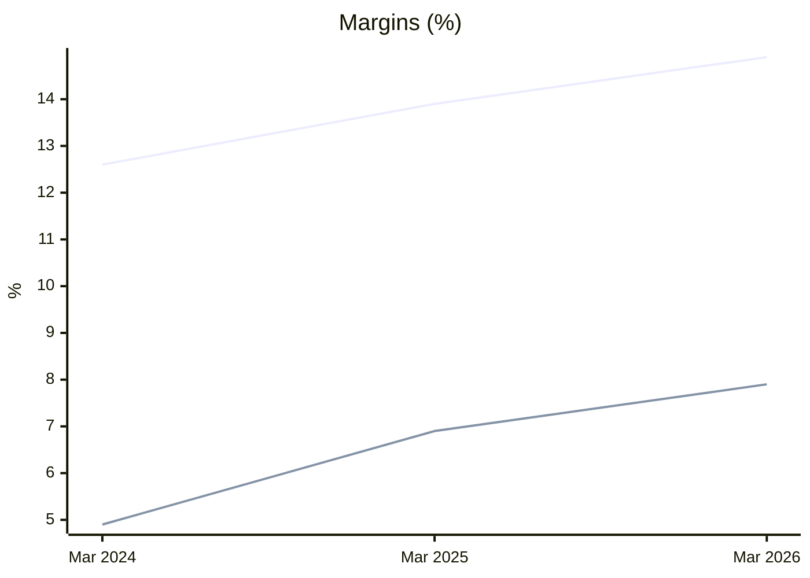

*Run 2026-11-24 · part of [SPINOFF_REPORT.md](../SPINOFF_REPORT.md) · the complete analysis of one company, with every management-call exchange in full.*

## APOLLOHOSP — Apollo Hospitals Enterprise Ltd.

### 1. Apollo Hospitals Enterprise Ltd. — CONFIRMED DEMERGER

**CONFIRMED** (a demerger scheme is on the exchange record) · **PRE-SPIN — study the parent; the pieces do not trade yet** · score 5.7/10 · spin-off · 25 filing(s) from CALLS, NSE · first 2025-12-24, latest 2026-06-26

**The separated entities — every one the documents name:**

| Entity | Business | Listing | Who runs it |
|---|---|---|---|
| **Apollo Healthtech Limited** | Identified Business Undertaking demerged from Apollo Hospitals Enterprise Limited, plus amalgamated Apollo He… | to be listed | Ms. Shobana Kamineni, proposed Executive Chairper… |
| **Apollo Healthco Limited** | Transferor Company 1, a material subsidiary of the Demerged Company; technology-led healthcare services (Apol… | not to be listed | Mr. Madhivanan Balakrishnan, CEO of Apollo Health… |
| **Keimed Private Limited** | Transferor Company 2; pharmaceutical distribution - producer, distributor, trader and stockist of medicines a… | not to be listed | not stated |

**What is being separated, as the documents put it:** Apollo's omnichannel pharmacy and digital health business, demerged into a separately listed company — class `value_unlocking`.

### 2. Stages and dates

> **Listing:** NOT YET — scheme at 'nclt_sanction' stage; the resulting company will list only after NCLT sanction, effectiveness and a record date; indicated timeline: On May 21, 2026 management said the NCLT-convened shareholder meeting was called for June 24 and they were "hopeful the demerger process is completed by Q4 FY27 as planned earlier," with "end of December or early Q4 FY27" when Apollo Healthtech should get demerged and listed; NSE's December 23, 2025 observation letter requires trading to commence within sixty days of receipt of the NCLT order

| Date | Event | Source |
|---|---|---|
| 2025-06-30 | Board approval — Apollo Hospitals Enterprise Limited (and the other Applicant Companies) | as stated: Disclosure under Regulation 30 dated 24 September 2025: "The board of… |
| 2025-07-30 | Other — Apollo Healthtech Limited, Apollo Healthco Limited and Keimed Private Limited | as stated: CCI letter dated 23rd September 2025 (filed 24 September 2025): notic… |
| 2025-09-23 | Other — Apollo Healthtech / Apollo Healthco / Keimed | as stated: Competition Commission of India letter dated 23rd September 2025 (fil… |
| 2025-12-23 | Exchange no-objection — Apollo Hospitals Enterprise Limited (NSE) | as stated: Shareholders'/creditors' meeting resolution text in Scrutinizer's Rep… |
| 2025-12-24 | Stage reached: **exchange noc** | [General Updates](https://nsearchives.nseindia.com/corporate/APOLLOHOSP_24122025100948_NSE_observation_letter.pdf) |
| 2025-12-24 | Exchange no-objection — Apollo Hospitals Enterprise Limited (BSE) | as stated: Shareholders'/creditors' meeting resolution text in Scrutinizer's Rep… |
| 2025-12-31 | Other — Apollo Hospitals Enterprise Limited (creditors) | as stated: Notice/advertisement published 23 May 2026 and voting results (filing… |
| 2026-03-26 | NCLT order — All four Applicant Companies (CA (CAA)/8/(CHE)/2026) | as stated: Order of NCLT Division Bench-II Chennai pronounced 26 March 2026, upl… |
| 2026-04-03 | Stage reached: **nclt sanction** | [Scheme of Arrangement](https://nsearchives.nseindia.com/corporate/APOLLOHOSP_03042026170310_SE_let_NCLT_order.pdf) |
| 2026-04-15 | NCLT order — All four Applicant Companies | as stated: NCLT order dated 15 April 2026 (uploaded 17 April 2026; intimation da… |
| 2026-05-05 | NCLT order — All four Applicant Companies | as stated: NCLT order dated 5 May 2026 (uploaded 7 May 2026, certified copy rece… |
| 2026-05-21 | Stage reached: **meetings** | [Shareholders meeting](https://nsearchives.nseindia.com/corporate/APOLLOHOSP_21052026222159_SE_equity_shareholders_notice-ocr.pdf) |
| 2026-05-21 | Other — Apollo Hospitals Enterprise Limited | as stated: Scrutinizer's Reports and intimation dated 21 May 2026: "Notice of th… |
| 2026-05-23 | Other — Apollo Hospitals Enterprise Limited and Keimed Private Limited | as stated: Intimation dated 25 May 2026: notices of the NCLT-convened meetings p… |
| 2026-06-17 | Other — Apollo Hospitals Enterprise Limited (equity shareholders) | as stated: Notice/advertisement (intimation dated 25 May 2026) and voting result… |
| 2026-06-20 | Other — Apollo Hospitals Enterprise Limited | as stated: Scrutinizer's Reports (filing dated 26 June 2026): "The remote e-voti… |
| 2026-06-23 | Shareholders / creditors meeting — Keimed Private Limited (unsecured creditors) | as stated: NCLT order dated 5 May 2026 and newspaper advertisement published 23 … |
| 2026-06-24 | Shareholders / creditors meeting — Apollo Hospitals Enterprise Limited (secured creditors 10:00 a.m., unsecured creditors 11:00 a.m., equity shareholders 2:30 p.m.) | as stated: Summary of proceedings and voting results (filings dated 24 June 2026… |
| 2026-06-25 | Shareholders / creditors meeting — Apollo Healthco Limited (unsecured creditors) | as stated: NCLT order dated 5 May 2026 (filing dated 8 May 2026): unsecured cred… |
| 2026-06-26 | Other — Apollo Hospitals Enterprise Limited | as stated: Filing dated 26 June 2026: submission of Voting Results under Regulat… |

**The stages, as filed:** exchange noc (2025-12-24) → nclt sanction (2026-04-03) → meetings (2026-05-21)

**When it lists, in the documents' words:** On May 21, 2026 management said the NCLT-convened shareholder meeting was called for June 24 and they were "hopeful the demerger process is completed by Q4 FY27 as planned earlier," with "end of December or early Q4 FY27" when Apollo Healthtech should get demerged and listed; NSE's December 23, 2025 observation letter requires trading to commence within sixty days of receipt of the NCLT order

### 3. Size of the separated business beside the parent — is institutional selling likely?

**Reading: POSSIBLE — the piece is a sizeable minority of the whole; forced selling on size alone is weaker.**

| Entity | Stated turnover | Stated share of the whole | Segment revenue share | Market cap (₹ cr) | Share of combined market cap | Index member |
|---|---|---:|---:|---:|---:|---|
| Apollo Healthtech Limited | Not stated for the entity as such; on the combined pro form… | — | 42.8% (FY2026) | — | — | not listed |
| Apollo Healthco Limited | "Apollo HealthCo also surpassed INR 10,000 crore in annual … | — | 42.8% (FY2026) | — | — | not listed |
| Keimed Private Limited | not stated | — | 42.8% (FY2026) | — | — | not listed |

*Stated figures are the documents' own (a turnover share, or the cost-of-acquisition split the company publishes for tax, which reflects relative value); the segment share is this business's revenue over the parent's sales, and the market-cap share is the entity's value over the entity plus the parent (parent ₹122,591 cr, NSE bhavcopy of 2026-11-13), both computed here.*

**In the documents' words:** “"In terms of financial milestones, I am pleased to share that our consolidated revenues crossed INR 25,000 crore for the first time, reaching INR 25,229 crore. Apollo HealthCo also surpassed INR 10,000 crore in annual revenues for the first time following a similar milestone achieved by our Healthcare Services business in FY25." (Q4 & FY26 earnings call, May 21, 2026). No percentage-of-parent comparison is stated.”

**The judge's read of selling pressure:** likely — Shares distributed to all 1.75 lakh AHEL holders in a different industry (pharmacy distribution/digital health) than the hospital parent they own

### 4. Insider ownership — share swap, promoters' holding, management incentives

**Share swap / entitlement, entity by entity:**

- **Apollo Healthtech Limited:** Ratio itself not stated; Scheme provides for "consequent issue of fully paid-up equity shares of Resultant Company to the eligible shareholders of the Demerged Company as on Record Date 1 (as defined in the Scheme) in consideration of the demerger and in accordance with the Demerger Share Entitlement Ratio (as defined in the Scheme)"
- **Apollo Healthco Limited:** Ratio itself not stated; Scheme provides for "consequent issue of fully paid-up equity shares of Resultant Company to the eligible shareholders of Transferor Company 1 as on Record Date 2 (as defined in the Scheme) in consideration of the merger and in accordance with Transferor Company 1 Merger Share Entitlement Ratio (as defined in the Scheme)"
- **Keimed Private Limited:** Ratio itself not stated; Scheme provides for "the consequent issue of fully paid-up equity shares of Resultant Company to the eligible shareholders of Transferor Company 2 as on Record Date 3 (as defined in the Scheme) in consideration of the merger and in accordance with Transferor Company 2 Merger Share Entitlement Ratio (as defined in the Scheme)"

**Promoters' holding, from the shareholding pattern:**

| Company | Promoters | FIIs | DIIs | Public | Quarter |
|---|---:|---:|---:|---:|---|
| Apollo Hospitals Enterprise Ltd. (APOLLOHOSP) | 28.02% | 43.19% | 22.07% | 6.49% | Sep 2026 |

*Source: screener.in shareholding pattern, stored under `ShareholdingPattern/NiftyTotalMarket/`. In a mirror demerger each shareholder holds the same proportion of the new company as of the parent on the record date.*

- **Promoters in the parent, per the documents:** Not stated as a percentage. The voting results for the NCLT-convened equity shareholders' meeting show "Promoter and Promoter Group" holding 4,02,87,130 shares out of total 14,37,84,657 shares, as on the record date 17-06-2026.
- **What the promoters will hold in the separated entity:** not stated in the documents on file.
- **What a public shareholder receives:** "demerger of the Identified Business Undertaking (as defined in the Scheme) of the Demerged Company into Resultant Company and consequent issue of fully paid-up equity shares of Resultant Company to the eligible shareholders of the Demerged Company as on Record Date 1 (as defined in the Scheme) in consideration of the demerger and in accordance with the Demerger Share Entitlement Ratio (as defined in the Scheme)", followed by "listing of equity shares of Resultant Company on the Stock Exchanges in accordance with the Scheme". The Scheme was also "conditional upon the Scheme being approved by the public shareholders of Demerged Company in terms of the SEBI Master Circular dated 20th June, 2023".
- **Management incentives:** No treatment of existing stock options/RSUs/SARs in the Scheme is stated. The Scheme includes an "upside share arrangement between Ms. Shobana Kamineni (a promoter of Transferor Company 1) and Rasmeli Limited (an investor holding shares of Transferor Company 1, a material subsidiary of Demerged Company), wherein pursuant to an upside share agreement dated June 30, 2025, ("Upside Agreement") between Rasmeli Limited and Ms. Shobana Kamineni, Rasmeli Limited has agreed to share an agreed portion of the upside received by it (and its affiliates) pursuant to its investment into Transferor Company 1 with Ms. Shobana Kamineni and the identified employees of Transferor Company 1 (or any successor entity), its (existing and future) subsidiaries and (existing and future) associate companies, in order to incentivise the management of such companies (it being clarified that upon the effectiveness of the Scheme, the obligation of Rasmeli Limited to provide upside (in relation to its shareholding in Transferor Company 1) to the Upside Recipients (as defined in the Scheme) would stand automatically linked to the shareholding of Rasmeli Limited in Resultant Company". Pricing/terms: "this Upside Agreement forms part of a broader performance-linked framework, contingent on the delivery of a highly ambitious equity value-linked target (measured by Multiple of Invested Capital ("MOIC")). No minimum amount is guaranteed, with a maximum of 9% of the upside delivered to Rasmeli for achieving at least 4x MOIC." Funding: "It is important to clarify that the Upside Agreement is entirely investor-funded (Rasmeli) and does not result in any cash outflow from Apollo Healthco or any of its other shareholders." Beneficiary selection: "Ms. Shobana Kamineni (the proposed Executive Chairperson of Apollo Healthtech) has been given flexibility to identify the relevant employees who will be the beneficiaries of the Upside Agreement". Approval: "The proposed Upside Agreement is subject to the approval of a majority of the public shareholders of the listed company, in accordance with Regulation 26(6) of the SEBI LODR Regulations", and "Apollo Healthtech will further seek a separate approval of a majority of the public shareholders of Apollo Healthtech (by way of a separate shareholders' resolution) once it is listed on the stock exchanges". Separately, on ESOP cost in the digital business: "roughly in the range of about INR 50 crore is what we are looking at the overall ESOP cost for the current fiscal year. You might experience about INR 22 crore, INR 23 crore for Q1."
- **Insider actions around the separation:** No promoter or management buying, selling or pledging of shares is stated. Stated intent/actions around the separation: "Whether promoter/promoter group are interested in the agenda/resolution? Yes, to the extent of shares held by them in the Demerged Company", and the Promoter and Promoter Group voted 4,02,76,928 shares (99.97% of the 4,02,87,130 shares held) with 100% in favour and NIL against at the meeting held 24 June 2026 (public institutions voted 85.69% in favour / 14.31% against; public non-institutions 96.96% / 3.04%). Also: "Rasmeli Limited ("Rasmeli") as well as the promoter and promoter group of Apollo Healthtech, are committed to waive their respective right to nominate director(s), when the respective shareholding of Rasmeli or of the promoter and promoter group, as the case may be, falls below 10%."
- **Insiders, per the checklist read:** Promoter group held 4,02,87,130 shares (voted 100% for). Shobana Kamineni to be Executive Chairperson of Resultant Company; Rasmeli-funded upside share agreement (max 9% of upside at 4x MOIC) to her and identified employees; new ESOP to be established · *option pricing date:* not stated

### 5. Why the demerger — point by point

The business being separated is AHEL's omnichannel pharmacy and digital health vertical — Apollo HealthCo, comprising the ~7,500-store Apollo Pharmacy retail/front-end network and the Apollo 24/7 digital platform (46mn users, INR 528 cr quarterly platform GMV) — which is being demerged into Apollo Healthtech Ltd, with Apollo Healthco Ltd and the promoter-linked distributor Keimed Private Limited (which supplies ~60,000 pharmacy stores) amalgamated into the same vehicle, which is then renamed Apollo Healthco Limited and listed; hospital-based pharmacies stay inside Healthcare Services, since as A. Krishnan put it in Aug 2025, 'what we are spinning out is only the retail pharmacies and the online.' The Scheme's own rationale states the problem plainly: the Identified Business Undertaking is 'distinct from other businesses undertaken by the Demerged Company' and 'necessitates a differentiated strategy aligned to its industry specific risks, market dynamics, and growth trajectory', so separation lets hospitals and retail/digital each focus on 'their respective businesses, efficient management, and control', consolidates HealthCo's and Keimed's distribution 'in an independent company focusing exclusively on digital health and pharmacy distribution', and lets the new entity 'build a wider capital and financial base, by attracting a different set of investors, strategic partners, lenders and stakeholders' — plus supply-chain integration, wider assortment, 'improved transparency in the supply chain preventing the entry of counterfeit or substandard medicines', administrative efficiency, board/managerial rationalisation and economies of scale. The financial case management repeated for six straight quarters is scale plus margin convergence: pro-forma combined revenue of INR 4,430 cr in Q1 FY26 (~INR 17,000 cr run-rate, INR 19,000 cr for FY26) becoming a INR 25,000 cr run-rate at 7% EBITDA by Q4 FY27; Sanjiv Gupta's arithmetic was that a 3.2% blended FY25 margin is already 6.4% once Apollo 24/7's losses and the accelerated ESOP charge are stripped out, with offline pharmacy going 7.4%→8-9% on private label (15.5% of pharmacy sales) and Keimed 3.1%→3.5%. The loss drag has in fact collapsed — digital cash losses fell from INR 111 cr (Q4 FY24) and INR 101 cr (Q2 FY25) to INR 29 cr in Q3 FY26 and INR 16 cr in Q4 FY26, with breakeven ex-ESOP guided to Q1 FY27 and including ESOP (~INR 50 cr FY27) by Q3 FY27 — and Apollo HealthCo crossed INR 10,000 cr of annual revenue in FY26, making it listable on its own. Keimed's merger was justified on concrete synergies: shared technology, data, people and product categories, cheaper dark stores (22 today) to push beyond the top six metros to the next ten cities, and private-label penetration across Keimed's franchise base. The push is not purely internal: Rasmeli Limited, the investor holding Class A/B compulsorily convertible preference shares in Apollo Healthco, receives a nominee director in the Resultant Company and signed a June 30, 2025 Upside Agreement sharing up to 9% of its own upside (only above 4x MOIC) with Ms. Shobana Kamineni — proposed Executive Chairperson — and identified employees; after shareholder and proxy-adviser pushback the Company issued clarifications on June 15 and June 19, 2026 adding 10% fall-away thresholds on nomination rights, tiered caps on promoter nominees, an individual 5% waiver, six independent directors and a Lead Independent Director. A second, separate separation was announced in May 2026: AHLL's Apollo Cradle and fertility verticals (INR 450 cr FY26 revenue, INR 45 cr IGAAP EBITDA) were combined with Cloudnine at INR 1,550 cr — 35x EBITDA — for cash plus a 9.9% stake, with the INR 750 cr of cash redeployed into primary care and diagnostics, which management called the funnel into Apollo.

**Point by point, with the source:**

1. Earliest reference in the window: integration of the acquired distribution business plus offline pharmacy growth is framed as the path to HealthCo's 'strategic intent' over three years, before any demerger language appears. “Transaction integration and healthy growth in offline pharmacy distribution revenues will drive Apollo HealthCo towards its stated strategic intent in the next 3 years.” — *[Aug 2024](https://www.apollohospitals.com/apollo_pdf/Transcript-of-Apollo-Hospitals-Q1-FY25.pdf)*
2. The restructuring is still presented as a merger-plus-breakeven story, with Sanjiv Gupta quantifying the FY27 target for the combined entity at INR 25,000 crore of revenue and 6-7% EBITDA, against a then run-rate of ~INR 17,000 crore at 6.5% excluding digital losses. “So, we are looking at about INR 25,000 crore of revenue and about 6% to 7% of EBITDA in FY 27.” — *[Feb 2025](https://cdn.apollohospitals.com/apollohospitals/apollo_pdf/Transcript-of-Apollo-Hospitals-Q3-FY25.pdf)*
3. Suneeta Reddy's closing remarks on the Q4 FY25 call tie the Keimed merger explicitly to scale and margin durability in pharmacy, not to a listing. “The Keimed merger process is also progressing well, which will further enhance scale and margin resilience in our Pharmacy business.” — *[Jun 2025](https://www.apollohospitals.com/sites/default/files/2025-06/transcript-of-apollo-hospitals---q4-fy25-earnings-call---1-.pdf)*
4. Sanjiv Gupta gave the margin bridge that underpins the 7% target: removing Apollo 24/7's operating losses and the ESOP charge (INR 100 cr in FY26, falling to a third thereafter) lifts the blended 3.2% to 6.4% even on then-current numbers. “If I remove these two things, if I assume these two things even today and remove these losses and the ESOP cost, the new number that comes for the EBITDA percentage is 6.4%.” — *[Jun 2025](https://www.apollohospitals.com/sites/default/files/2025-06/transcript-of-apollo-hospitals---q4-fy25-earnings-call---1-.pdf)*
5. First explicit statement on a call of the demerger and separate listing, with the 18-21 month timetable and the INR 25,000 crore / 7% EBITDA end-state for the scheme concluding by FY27. “The strategic reorganization of our omni -channel pharmacy and digital health business is proceeding as planned , and we expect to complete all steps within 18 to 21 months, a timeline that we had earlier announced.” — *[Aug 2025](https://www.apollohospitals.com/sites/default/files/2025-08/transcript-of-apollo-hospitals---q1-fy26-earnings-call---13-august-2025.pdf)*
6. A. Krishnan confirmed the mechanics in answer to an investor: HealthCo in its current form is the entity being demerged and listed by Q4 FY27, by which time Keimed's NCLT merger will also have happened. “What will happen is Apollo HealthCo., as you are seeing in the current form, is what is going to be demerged and will be listed separately by Q4 of FY27.” — *[Aug 2025](https://www.apollohospitals.com/sites/default/files/2025-08/transcript-of-apollo-hospitals---q1-fy26-earnings-call---13-august-2025.pdf)*
7. Scope limit made explicit — hospital-based pharmacies stay with Healthcare Services; only the ~6,500-store retail chain and the online business leave, alongside Keimed, which supplies about 60,000 third-party pharmacy stores. “The hospital -based pharmacies continues as part of hospitals, which I am sure you know, but it is something that , remember, what we are spinning out is only the retail pharmacies and the online out of that.” — *[Aug 2025](https://www.apollohospitals.com/sites/default/files/2025-08/transcript-of-apollo-hospitals---q1-fy26-earnings-call---13-august-2025.pdf)*
8. Madhivanan Balakrishnan listed the Keimed synergies: shared technology, data and people, cheaper dark stores (22 at the time) enabling expansion from the top 6 cities to the next 10 and beyond, and private label (then 14.6% of sales) pushed across Keimed's franchises. “So , technology, data, people, and product categories , all the four synergies should start playing out as this merger comes in place.” — *[Aug 2025](https://www.apollohospitals.com/sites/default/files/2025-08/transcript-of-apollo-hospitals---q1-fy26-earnings-call---13-august-2025.pdf)*
9. Process update framing the combination as the way to capture scale benefits inside HealthCo; separately Madhivanan said merging Keimed, Apollo Pharmacy and the digital business would release further cost synergies from the next financial year. “The statutory processes for the restructuring within Apollo HealthCo and the Keimed merger continue to proceed as per plan, and we remain well positioned to capture the full benefit of scale within Apollo HealthCo.” — *[Nov 2025](https://drupal-cdn-hfaeddcdbng5hfbg.a01.azurefd.net/sites/default/files/2025-11/transcript-of-apollo-hospitals---q2-fy26-earnings-call---7-november-2025....pdf)*
10. Regulatory progress is reported and the combined-entity target is restated verbatim as INR 25,000 crore run-rate revenue with 7% EBITDA. “We have also made progress with respect to the regulatory integration process for the com posite scheme of Keimed merger and demerger of Apollo HealthCo and remain well positioned to capture the full benefits of scale with the combined entity to achieve a run rate of INR 25,000 crore in combined revenues with 7% EBITDA.” — *[Feb 2026](https://drupal-cdn-hfaeddcdbng5hfbg.a01.azurefd.net/sites/default/files/2026-02/transcript-of-ahel-q3fy26-concall_11feb2026.pdf)*
11. Obul Reddy itemised the approvals obtained (CCI, SEBI) and the NCLT filing, and confirmed Keimed had been cleaned up so that its subsidiaries are 100% owned before the merger. “We have obtained Competition Commission approval and SEBI approval. We have filed with NCLT.” — *[Feb 2026](https://drupal-cdn-hfaeddcdbng5hfbg.a01.azurefd.net/sites/default/files/2026-02/transcript-of-ahel-q3fy26-concall_11feb2026.pdf)*
12. The purpose is stated in value terms for the first time in opening remarks — sharpening focus and unlocking long-term value across the integrated platform — in the same breath as HealthCo crossing INR 10,000 crore of annual revenue. “During the year, we also announced a strategic restructuring of the omnichannel pharmacy and digital health business, an important step towards sharpening focus on unlocking long -term value across our integrated health care platform.” — *[May 2026](https://www.apollohospitals.com/sites/default/files/2026-05/transcript-of-apollo-hospitals---q4-fy26-earnings-call.pdf)*
13. Timeline and end-state confirmed: NCLT-convened shareholder meeting on June 24, 2026, listing of Apollo Healthtech around end-December/early Q4 FY27, annualised revenue of INR 25,000 crore at listing. “And hopefully, by Q4 FY27, end of December or early Q4 FY27 is when Apollo Healthtech should get demerged and listed.” — *[May 2026](https://www.apollohospitals.com/sites/default/files/2026-05/transcript-of-apollo-hospitals---q4-fy26-earnings-call.pdf)*
14. A second, separate disposal: AHLL's Cradle and fertility verticals (INR 450 cr revenue, INR 45 cr EBITDA) go into a Cloudnine-combined platform at INR 1,550 crore — 35x EBITDA — for cash plus a 9.9% stake, with INR 750 crore of cash redeployed into primary care and diagnostics. “One is the valuation, which is clearly key to get a valuation of INR 1,500 for EBITDA at a multiple of 35 in this market is something that you cannot ignore.” — *[May 2026](https://www.apollohospitals.com/sites/default/files/2026-05/transcript-of-apollo-hospitals---q4-fy26-earnings-call.pdf)*
15. The Scheme's stated core problem: the pharmacy/digital undertaking is a different business from hospitals and needs its own strategy, risk posture and growth path; separation gives each side focus, management and control. “The Scheme would enable carving-out of the Identified Business Undertaking, which is distinct from other businesses undertaken by the Demerged Company, necessitates a differentiated strategy aligned to its industry specific risks, market dynamics, and growth trajectory.” — *Scheme*
16. Capital-markets rationale: the separated entity is expected to attract its own investors, partners and lenders — i.e. a funding base hospitals cannot supply. “The Scheme is expected to enable Resultant Company to build a wider capital and financial base, by attracting a different set of investors, strategic partners, lenders and stakeholders, as well as promoting overall business growth;” — *Scheme*
17. The Keimed leg is justified as consolidating pharmacy distribution into a single pure-play vehicle, with the Scheme also citing supply-chain integration, wider assortment, counterfeit prevention, administrative efficiency and board rationalisation. “The Scheme would also result in consolidation of pharmacy distribution business of Transferor Company 1 and Transferor Company 2, in an independent company focusing exclusively on digital health and pharmacy distribution, enabling synergies;” — *Scheme*
18. Governance package embedded in the Scheme: a 12-member board with 6 independents, the AHL Promoter as Executive Chairperson, three promoter nominees, one AHEL nominee and one nominee for investor Rasmeli Limited, plus the Rasmeli-funded upside-sharing arrangement with Ms. Shobana Kamineni and identified employees. “reconstitution of the board of directors of Resultant Company as follows: (i) AHL Promoter (as defined in the Scheme); (ii) 3 (three) directors nominated by the Resultant Company Promoters (as defined in the Scheme); (iii) 1 (one) director nominated by the Demerged Company; (iv) 1 (one) director nominated by Rasmeli Limited; and (v) 6 (six) independent directors;” — *Scheme*
19. June 15, 2026 clarification issued in response to shareholder feedback: the Upside Agreement is investor-funded with no cash outflow from Apollo Healthtech, capped and conditional on a 4x MOIC hurdle, and Rasmeli plus the promoter group will waive nomination rights below 10% shareholding. “No minimum amount is guaranteed, with a maximum of 9% of the upside delivered to Rasmeli for achievin g at least 4x MOIC.” — *Scheme*
20. June 19, 2026 follow-up added a sliding scale of promoter nominee caps (nil below 10%, up to 5 at 35%+), an individual 5% waiver per promoter entity, half the board independent while there is an executive chairperson, and a Lead Independent Director. “Apollo Hospitals now further clarifies that the promoter and promoter gro up are committ ed to waiving their rights to nominate directors in excess of the maximum numbers set out below, by reference to their aggregate shareholding.” — *Scheme*
21. Shareholder vote on June 24, 2026 passed the Scheme (90.44% of votes polled in favour; 85.71% of public votes), but institutional public shareholders split 85.69% for / 14.31% against — the clearest sign of residual investor discomfort, which no earnings call addressed. “the public shareholders of the Demerged Company have approved the Scheme the votes cast in favour of the Scheme are more than the votes cast against the Scheme.” — *Scheme*

**How it evolved:** The idea surfaced before this window as the 'strategic intent' for Apollo HealthCo (Aug 14, 2024 call) and was tracked through Feb 11, 2025 and the May 31, 2025 (Jun 2025) call purely as the Keimed merger 'progressing well', with a ~15-month timeline and Sanjiv Gupta's 3.2%→7% FY27 margin bridge; the composite Scheme itself was board-approved and filed on June 30, 2025. On the Aug 13, 2025 call management first spelled out the full shape — Apollo HealthCo as it stands gets demerged and separately listed by Q4 FY27, all steps within 18-21 months, only retail plus online moving out, Keimed folded in for technology/data/people/product synergies. Nov 7, 2025 and Feb 11, 2026 were process updates (statutory steps on track; CCI and SEBI approvals obtained, NSE no-objection Dec 23, 2025, NCLT filed and hearings begun, Keimed's subsidiaries consolidated to 100%), and the May 21, 2026 call set the NCLT-convened shareholder meeting for June 24, 2026 with completion still Q4 FY27. In the final stretch the plan changed on governance rather than structure: clarifications dated June 15 and June 19, 2026 added nomination-right fall-away thresholds in response to shareholder feedback, and on June 24, 2026 the Scheme passed with 90.44% of all votes and 85.71% of public votes in favour, but 14.31% of institutional votes against.

**What management expects from it:** Apollo Healthtech becomes a pure-play pharmacy and digital health company: INR 25,000 cr run-rate revenue at 6.5-7% EBITDA by Q4 FY27 (FY26 exit 4.3%), digital at breakeven, Keimed 3.1%-to-3.5%, offline pharmacy 8-9% on private label, its own investors, lenders and board. AHEL keeps hospitals and AHLL at 25.4% ROCE, redeploying cash into beds, primary care and diagnostics.

*Not explained on the calls:* Calls never discussed the share entitlement ratio, debt/cash split, AHEL's residual stake, Keimed's purchase valuation or related-party pricing, the 14.31% institutional dissent, or the Upside Agreement.

- *Stated reason, in one line:* Value unlocking via separation and independent listing: sharper strategic focus, operational flexibility, enhanced capital allocation, clearer investor visibility, plus consolidation of pharmacy distribution and a wider capital base
- *What it reveals:* A pharmacy/digital platform at ~INR 25,000 crore run-rate revenue with 6.5-7% targeted EBITDA margin, digital losses near breakeven, Keimed distribution consolidated; promoter and investor incentives concentrated in the spin, not the hospital parent
- *Parent or spin:* spin · *Read next:* The Scheme's Demerger Share Entitlement Ratio and the Part E abridged-prospectus disclosures for Apollo Healthtech
- *In their words:* “During the year, we also announced a strategic restructuring of the omnichannel pharmacy and digital health business, an important step towards sharpening focus on unlocking long-term value across our integrated health care platform.”

### 6. On the calls, verbatim

10 call(s), oldest first: **38 question-and-answer exchange(s)** given in full — the question and every answer to it, nothing trimmed — and 17 passage(s) from management's prepared remarks (the complete sentences about it; the whole remarks are in the linked transcript). Text is as the transcript prints it.

#### Nov 2023 — [transcript](https://www.apollohospitals.com/apollo_pdf/Transcript-of-Apollo-Hospitals-Q2-FY24.pdf)

**From the prepared remarks** *(the passage about it; the whole turn runs to 6,079 characters in the transcript)*

> **Suneeta Reddy:** ARPOB on an overall basis increase d 14% year-on-year to Rs. 57,379. Against this backdrop, let me walk you through the financials : Consolidated revenue grew by 14% on a year -on-year basis to Rs. 4,847 crore . Healthcare services grew by 12% to Rs. 2,547 crore . Revenues from Apollo HealthCo stood at Rs. 1,945 crore in Q2 FY24, a growth of 17% year-on-year. However, combined pharmacy grew by 21 % on a year-on-year basis. Apollo Health and Lifestyle revenues registered 11% year-on-year growth at Rs. 354 crore for Q2 FY24. Consolidated EBITDA was at 628 crore , registering an increase of 11% year-on- year. Within this, the healthcare services EBITDA w as at Rs. 634 crore , a growth of 11% and EBITDA margins were at 24.9% , marginally lower than Q2 last year on account of increased investments in clinical talent and enhanced focus on advertising and marketing. The pharmacy distribution business in Apollo HealthCo recorded an EBITDA of Rs. 130 crore , a year-on-year growth of 9%. 24/7 operating costs were at Rs. 197 crore against the operating cost of Rs. 204 crore in the trailing quarter . EBITDA loss in the Company was at Rs. 39 crore , of which non -cash ESOP charge accounted for Rs. 35 crore . This loss is down from Rs. 57 crore in the trailing quarter , in keeping with our commitment to reduce cost s in this vertical . The business is on track to achieve operational break even in Q4 FY24 .

**Question and answer**

> **Neha Manpuria:** So, I was wondering on the store addition of the physical distribution base . We're seeing a slower pace of store addition and probably I don't know, is that why the growth rate is lower than what we have done historically for the pharmacy business . What's the pace of growth that we should see here ? Second, on the 24/7, we've reduced the cost. I know you've mentioned a break even in fourth quarter . But is there scope to materially reduce opex more from FY25, '26 perspective or should we assume a large part of the profitability in Health Co comes from revenue growth rather than opex reduction ? Transcript of AHEL Q 2 FY24 Earnings Call Page 7 of 16
>
> **Obul Reddy:** First, the number of stores as explained to you during Q1 call, we have planned to open lower stores in the current half year. Our plan to add about 500 -plus stores is on. In H1 you will see more number of stores. On the operating cost of Apollo HealthCo, M r. Sanjeev will answer.
>
> **Sanjeev Gupta:** If you look at it, we had Rs. 190 crore of operating expenses excluding the ESOP non-cash expenses during Q4 of FY23 . From Rs. 190 crore we are down to Rs. 162 and I st rongly believe that another Rs. 10 to Rs. 15 crore will further come down as we move forward. So , I'm looking at anything as a run rate of Rs. 150 crore or slightly lesser than that in Q3 , Q4. To be fair to this question that , would we see some savings in the next financial year ; - I think we'll continue to look into all the opportunities. It is a fine balance between the growth and the cost plus the investments that we're doing in two system technologies . This cost also takes care of the clinical intelligence excellence that we have built up , some of the AI tools that we are working on. Those are the investments that we are doing it. But yes, we can expect some changes in the next fiscal year. But depending upon to what an extent we put money into technology, we'll be able to guide you much better in Q4 than today. But yes, current costs will continue to come down as we move into Q3 and Q4.
>
> **Suneeta Reddy:** Also, a rationalization discount .

**Question and answer**

> **Nitin Agarwal:** And then beyond the number that you reported in the HealthCo the omnichannel represents a front end of the business , that's not consolidated , that's the difference between the two?
>
> **Obul Reddy:** That's right.

**Question and answer**

> **Lavanya Tottala:** And anything on the fundraise at HealthCo level, like, how do you see what's the timeline and where is it struck?
>
> **Suneeta Reddy:** Regarding the fund ra ise at 24 /7 level, I think we've always maintained that as you know as long as we have enough cash for growth, we should be good. They had a loss of Rs. 38 crore of EBITDA, out of which Rs. 34 crore was the non -cash loss due to the ESOP. So just going forward I think the back end with Rs. 130 crore of EBITDA is able to support the growth. Having said that, we will look at an investment where we believe the valuation is appropriate because we're quite sure we don't want to go below our dilution of 10% and this cash will be used like Sanjeev said to develop to invest into AI and to offer new services. So , right now, let me just say that we have access to investment , we're looking at the right valuation and this could happen I think in the next 6 to 12 months, but there is no pressure unless we get the right valuation.

#### Feb 2024 — [transcript](https://www.apollohospitals.com/apollo_pdf/Transcript-of-Apollo-Hospitals-Q3-FY24.pdf)

**From the prepared remarks** *(the passage about it; the whole turn runs to 5,472 characters in the transcript)*

> **Suneeta Reddy:** ARPOB on an overall basis increased 10% year -on-year to INR 56,368. Against this backdrop, let me take you through our financial results : Consolidated revenue grew by 14% to INR 4,851 crore . Healthcare Services grew by 12% to INR 2,464 crore . Revenues from Apollo HealthCo were at INR 2,049 crore in Q3 FY 24, a growth of 17% year -on-year. Revenues from Apollo Health & Lifestyle registered a growth of 8% year -on-year at INR 338 crore in Q3 FY 24. The diagnostic s vertical within AHLL recorded revenue growth of 19% year -on-year and was at INR 1 12 crore . Consolidated EBITDA was at INR 614 crore , an increase of 21% year -on-year. Within this, Healthcare Services EBITDA was at INR 586 crore , registering an 8% growth year -on-year. Healthcare Services margins were at 23.8%. The margin impact was due to the reduced share of elective and surgical revenue in the revenue mix due to the holiday and festive season , as well as investments in clinical talent that have been made to strengthen our clinical profile, which is yet to be fully optimized. The pharmacy distribution business in Apollo HealthCo recorded an EBITDA of INR 134 crore , a year -on-year growth of 8%. In a significant milestone, Apollo HealthCo has reported a positive EBITDA of INR 2 crore , registering a break -even performance for the quarter, one quarter ahead of guidance. AHLL recorded an EBITDA of INR 26 crore in Q3 FY 24. Consolidated PAT was INR 245 crore , a growth of 56% year -on-year. Healthcare Services PAT was at INR 287 crore , up by 10%. […] Our efforts to offer outstanding clinical programs and technologies and deliver the best clinical outcomes for those who trust us has always been at the core of our DNA. On that note, I would like to hand over to our moderator and open the line for questions and answers. I have with me Dr. Hariprasad ; our CFO, Krishnan; Sriram Iyer from AHLL, Obul Reddy and Sanjiv from Apollo HealthCo with me ready to take all of your questions. Thank you.

**Question and answer**

> **Kunal Dhamesha:** So, the first questio n on the 24/7 GMV guidance that we had for FY 24 of around INR 3,000 crore . We have roughly done INR 2,000 + crore year to date. So , what is our expectation for full year and the next year? So, while we have achieved the breakeven at HealthCo level a quarter earlier than guided, that is good, but has that impacted the growth prospect of this business?
>
> **Sanjiv Gupta:** So I think INR 3,000 crore was the guidance that we had given it for FY 24 as far as digital GMV are concerned. I think we need to hit something like INR 2,750 crore to Transcript of AHEL Q 3 FY24 Earnings Call Page 5 of 14 about INR 2,800 crore . So that will be the final number versus INR 3,000 crore mark. And this would mean about 75% to 80% increase in GMV for FY 24 versus FY23. We expect to continue to s how a robust growth anything between 60% to 70% for the next year also versus this year. That's on the first question. The second question is that on six to eight quarters profitability. Absolutely, we've got the clear (inaudible 15 :20 min.) with respect to increasing the GMV, increasing the margin line for each of the firing engines that we have today, which is the pharmacy, diagnostic , consultation. And as wel l as doing the right thing for the fixed expenses that the Company has it. And whatever right things are required to be done, they w ould be taken care. And as we step into the annual operating plan for the next year, I think maybe when we meet next, we'll have a little more understanding about this. But as we see, we have a detailed action plan to turn digital division also in the next six to eight quarters.

**Question and answer**

> **Suneeta Reddy:** Ladies and gentlemen, thank you for participating in our conference call. We truly believe that as we look ahead, we are confident that in the upcoming quarters, there would be very strong growth. We have delivered ahead of time on EBITDA break -even for Apollo HealthCo. And I am sure we will continue to deliver on our strategic intent. W ith our network maintaining strong occupancies and ongoing expansions in key facilities, we are well prepared to seize emerging grow th opportunities. I would also like to emphasize that our unwavering confidence in the investments we've made and the solutions that we're working on. These efforts will surely differentiate us because they are anchored in a strong clinical core with convenience and access is key enablers. Once again, thank you for joining the call, and we look forward to connecting with you in the future.

#### May 2024 — [transcript](https://www.apollohospitals.com/apollo_pdf/Transcript-of-Apollo-Hospitals-Q4-FY24.pdf)

**From the prepared remarks** *(the passage about it; the whole turn runs to 5,923 characters in the transcript)*

> **Suneeta Reddy:** ARPOB on an overall basis increased 12% year -on-year to INR 59,523. Financial results : Our consolidated revenue grew by 15% on a year -on-year basis to INR 4,944 crore . Healthcare Services grew by 17% to INR 2,563 crore . Revenues from Apollo HealthCo were INR 2,027 crore in quarter 4, growing at 13% year -on-year. Revenues from Apollo Health & Lifestyle registered a growth of 15% year -on-year at INR 355 crore in Q4 FY24. Consolidated EBITDA was at INR 641 crore , registering an increase of 31% year-on-year. Within this, the Healthcare Services EBITDA was at INR 593 crore, registering a growth of 11% year -on-year and Healthcare Services margins were at 23.1%. The marginal dip in margins was due to curated investments in new doctors and enhanced sales and marketing costs. We believe that these investments in clinical talent would lead to traction in volumes in FY 25 and our increased focus on discretionary costs will help us restore and grow margins. The pharmacy distribution business in Apollo HealthCo recorded an EBITDA of INR 134 crore , year -on-year growth of 11%. 24/7 operating costs were INR 151 crore , lower than the operating costs of INR 156 crore in the trailing quarter of Q3 FY 24. Apollo HealthCo has, therefore, reported an EBITDA of INR 12 crore , sustaining a trajectory of positive EBITDA. AHLL recorded an EBITDA of INR 36 Crore , 40% year -on-year growth and an improved margin of 10.1% as compared to 8.3% in Q4 FY23. Consolidated PAT was at Rs. 254 crore, a strong growth of 76% year -on-year. Transcript of AHEL Q 4 FY24 Earnings Call Page 3 of 15 Within the Healthcare Services business, we have delivered a ROCE of 26.1% with balanced ROCEs across all our geographies; the metro, the Tier 1 and the Tier 2. […] These will be driven basically by the augmented medical team, higher -end procedures, innovative therapies such as CAR -T cells and aided by tailwinds provided by steadily increasing proportion of insurance patients in our payer mix. We are also implementing cost optimization measures, which accompanied by growth in surgical volumes should help improve Healthcare Services EBITDA margin by 150 basis. We are committed to achieving breakeven for Apollo 24/7 Digital business within AHLL in the next 6 to 8 quarters. We will continue to grow the platform GMV for Apollo HealthCo in FY 25, while progressing on the transaction and integration. We will deliver a healthy growth on the diagnostics vertical with an expanded test menu, and therefore, increasing margins. On that note, I would like to hand it over to our moderator and open the line for questions and answers. I have Krishnan, our CFO; Sriram Iyer: from Apollo Health and Lifestyle, as well as Obul Reddy and Sanjiv from Apollo HealthCo with me to take all of your questions. Thank you.

**Question and answer**

> **Kunal Dhamesha:** While we have said that there are multiple vectors of growth, can you provide more quantitative details on the growth outlook for each of our top 3 businesses; Healthcare Services, Pharmacy and AHLL for FY 25?
>
> **Suneeta Reddy:** So let me start with Healthcare Services ; so, we are looking at a growth of beyond 15%. This growth will be driven by volume, and we say this with confidence because as we look at part by our network expansion and better asset utilization, we also looked at our payer mix within these markets. There is a significant growth in the penetration of private insurance. And this is enabling people who would, otherwise, go to smaller nursing homes to come into the Apollo system, and I think it's creating access, and this is really driving volume s. Transcript of AHEL Q 4 FY24 Earnings Call Page 4 of 15 The second aspect of this is we have been focused on international patients. However, all of the connectivity was not as good last year as it is this year. And with that, international patient revenue is currently at 7% of total revenue. But in Delhi, it's at 20% of total revenue. So, we do hope that this will again move up the occupancy and ARPOB. The third is Centers of Excellence. We've made investments in Onco and neuro, but beyond that we've been able to attract the best doctors in these fields. And with that, we are seeing a growth of about 20%. I think we ended the year with close to INR 2,300 crore of revenue in Onco alone as an example. So, there's also cardiac. So, we've on -boarded 150 new doctors who you know this year is like a cost and really took away from margin. But as we go forward, these doctors have already started contributing, they will contribute. And some of them will be moved into our new hospitals so that we can achieve breakeven faster as we open these new hospitals.
>
> **Sanjiv Gupta:** I will take HealthCo. So , a couple of things, if you look at FY 24, we grew by about 73% in the digital business versus FY 23. As far as the current fiscal year is concerned, FY 25, we're looking at anything closer to 50% growth from the current levels of INR 2,700 crore for GMV that we did in the previous year. Majority of the growth is going to come from the pharmacy. And we have got certain action plans, which talk about increasing the private label, increasing the assortment and also looking into the omni way of acquisition of the customers and then looking in to the entire Apollo ecosystem to ensure that we have more access to the customers, and we have more number of transactions over there. Diagnostics will continue to grow. And apart from this, we are also banking on insurance and digital therapeutics. These are the 2 verticals that should give us a decent margin. And apart from the fact that corporate partnerships across the Apollo ecosystem is , was something which we believe that current year will give us the growth momentum. As far as the front -end or the offline stores are concerned, we closed with about 6,000 stores in FY 24. We added about 500 stores in the previous year. We strongly believe that we would add another 500 to 550 stores in the current fiscal year. And would see anything between 20% to 21% as the growth in the offline business. That's from the Apollo HealthCo.

#### Aug 2024 — [transcript](https://www.apollohospitals.com/apollo_pdf/Transcript-of-Apollo-Hospitals-Q1-FY25.pdf)

**From the prepared remarks** *(the passage about it; the whole turn runs to 1,165 characters in the transcript)*

> **Mayank Vaswani:** Thank you, Neerav. Good afternoon, everyone, and thank you for joining us on this call hosted by Apollo Hospitals to discuss the financial results for the first quarter of financial year 2024-25, which were announced yesterday. We have with us today the senior management team represented by Mrs. Suneeta Reddy - Managing Director; Mr. Krishnan Akhileswaran - Group CFO; Dr. Madhu Sasidhar - President and CEO of the Hospitals Division ; Mr. Madhivanan – CEO of Apollo HealthCo ; Mr. Sriram Iyer, CEO of AHLL; Mr. Sanjiv Gupta - CFO of Apollo HealthCo ; Mr. Obul Reddy, CFO of the Pharmacy Division; and Mr. Ashish Maheshwari - CFO of AHLL . Before we begin, I would like to mention that some of the statements made in today's discussion may be forward -looking in nature and may involve risks and uncertainties. Please note the disclaimer mentioning these risks and uncertainties in our investor presentation. Documents relating to our financial performance have been circulated earlier . These have also been posted on the corporate website. I would now like to turn the call over to Mrs. Suneeta Reddy for her opening remarks . Thank you, and over to you, ma'am.

**From the prepared remarks** *(the passage about it; the whole turn runs to 5,564 characters in the transcript)*

> **Suneeta Reddy:** ARPOB increased a little over 2% year-on-year to Rs. 59,073. We believe that ARPOB growth will improve over the next few quarters with stronger growth in surgical volume and better case mix. Our consolidated revenue grew by 15% on a year-on-year basis to Rs. 5,086 crore . Revenues from Apollo HealthCo were at Rs. 2,082 crore in quarter 1 , growing at 15% year-on-year. Given the strong efforts for stock liquidation in the front-end stores, combined pharmacy business revenue grew by 16%. 44 new stores were open ed this quarter. The election season resulted in lower store expansion due to a slight delay in approvals. We expect the pace to pick up in the subsequent quarters, which should also improve the growth momentum of the business going forward. […] Within this, the Healthcare Services EBITDA was at Rs. 622 crore , registering a growth of 15% year-on-year and Healthcare Services margin was at 23.6%. Our investment in clinical talent, marketing costs are helping to drive this double -digit volume growth. We believe enhanced volume growth, improvement in case mix and payer mix, and a focus on optim izing discretionary cost will drive margin expansion by 100 basis points over the next 3 to 4 quarters. The offline pharmacy distribution in Apollo HealthCo recorded an EBITDA of 139 crore representing a year-on-year growth of 11%. The digital platform cash losses Transcript of AHEL Q 1 FY25 Earnings Call Pag e 3 of 16 excluding ESOPs were at 97 crore, a significant reduction from 152 crore in the same quarter last year, demonstrating the Company's effort to drive profitable growth. Apollo HealthCo has therefore reported an EBITDA of 23 crore , extending its trajectory of positive EBITDA. AHLL recorded an EBITDA of 31 crore , delivering 33% year-on-year growth and an improved margin of 8.4% compared to 7.3% in quarter 1 last year. Consolidated PAT was at 305 crore , growing 83% year-on-year within the health care businesses. The outlook for FY25 continues to be promising. […] Our plan to operationalize 4 new hospitals, adding 1,500 beds in key markets, is progressing as planned. We anticipate operationalizing new facilities in Gurgaon, Kolkata, Hyderabad, and Pune within the next 5 quarters. We are on track to achieve break -even for Apollo 24/7 digital segment within the next 6 to 7 quarters, supported by strong growth in GMV and optimum portfolio mix. Transaction integration and healthy growth in offline pharmacy distribution revenues will drive Apollo HealthCo towards its stated strategic intent in the next 3 years. Our diagnostic business is also poised for strong healthy growth driven by investment in new capacity, expanded test menu, and an improved margin. On that note, I would like to hand it over to the moderator and open the line for questions. I have our CFO – Krishnan, with me, Dr. Madhu – CEO of the Hospital Division , Sriram Iyer from AHLL, as well as Obul Reddy , Sanjiv , and Madhivanan – the CEO of Apollo HealthCo , who are all here with me to take your questions. Thank you.

**Question and answer**

> **Tushar Manudhane:** And any scope of improving the margins for offline pharmacies from like 7.6%?
>
> **Obul Reddy:** This is at the back -end Apollo Pharmacy distribution level that margin , that is a structured margin. As you know, Apollo HealthCo supplies only for Apollo Pharmacy's front-end business. So, it has a fixed retail margin to be retained at this level. So, that if you notice, last 8 quarters operated within a range of 25 basis points as we see the margin expands in the front-end.

**Question and answer**

> **Shyam Srinivasan:** And lastly on this one, the EBITDA margin for the 24/7, 4 to 6 quarter even just on that piece ; I mean that Apollo 24/7, there was a breakeven guidance of 4 to 6 quarters that was announced I think last quarter or maybe before. Are we sticking to just that piece also breaking even?
>
> **Sanjiv Gupta:** Yes, we are sticking to that guidance and if you notice in the past also, when prior to the digital segment , which we call it Apollo 24/7, we had suggested that the entire Apollo HealthCo will get breakeven in Q4 FY24 which happened in Q3, one quarter in advance. And similar to that, we also gave the guidance in Q4 that digital business will get breakeven in 6 to 7 quarters. We are sticking to our promise . The entire management team and down below is working towards that common goal. So, at this stage , I think all of us need to believe to this point that digital segment will also break even in next 6 to 7 quarters.
>
> **Madhivanan B:** So, if I can come in for just 30 seconds, see, we are reasonably confident that the combination of growth in a calibrated way along with the breakeven goals that we have sort of given guidance to, we will stick to it. And that's where , and effectively, we are moving away from, like I told you, I am just reinforcing it once again , from a very high cost of customer acquisition model into a much more stronger omni - channel combined with loyalty. So, that is what will facilitate growth, not at an exorbitant operating expense model. So, both on the EBITDA side as well as on the growth side, we are reasonably on course , and we expect this particular change to time, and we are seeing the positive result. So, we stick to our analysis.

#### Feb 2025 — [transcript](https://cdn.apollohospitals.com/apollohospitals/apollo_pdf/Transcript-of-Apollo-Hospitals-Q3-FY25.pdf)

**From the prepared remarks** *(the passage about it; the whole turn runs to 1,131 characters in the transcript)*

> **Mayank Vaswani:** Good afternoon, everyone, and thank you for joining us on this call, hosted by Apollo Hospitals, to discuss the financial results for the Q3 FY25 , which were announced yesterday. We have with us today the senior management team, represented by Mrs. Suneeta Reddy – Managing Director; Mr. A. Krishnan – Group CFO; Dr. Madhu Sasidhar – President and CEO of the Hospitals Division; Mr. Madhivanan Balakrishnan – CEO of Apollo HealthCo Ltd.; Mr. Sriram Iyer – CEO of AHLL; Mr. Sanjiv Gupta – CFO of Apollo HealthCo Ltd.; and Mr. Obul Reddy – CFO of the Pharmacy business. Before we begin, I would like to mention that some of the statements made in today's discussion may be forward -looking in nature and may involve risks and uncertainties. Please note the disclaimer mentioning these risks , and uncertainties on Slide #2 of the investor presentation shared with all of you earlier. Documents relating to our financial performance have been circulated, and these have also been posted on the corporate website. I would now like to turn the call over to Mrs. Suneeta Reddy for her opening remarks. Thank you, and over to you, ma'am.

**From the prepared remarks** *(the passage about it; the whole turn runs to 6,007 characters in the transcript)*

> **Suneeta Reddy:** Our financial results ; our consolidated revenue grew by 14% on a year -on-year basis to INR 5,527 crore , consolidated EBITDA was at INR 762 crore , registering an increase of 24% year -on-year. Within this, the Healthcare Services EBITDA was at INR 671 crore , a growth of 14% year-on-year. Healthcare Services margins remained robust at 24.1%. Revenues from Apollo HealthCo were INR 2,352 crore in Q3, growing at 15% year -on-year. Revenues from Apollo Health & Lifestyle also grew by 15% year -on-year to INR 390 crore in Q3 FY 25. Apollo Health Co reported its first ever quarterly profit in Q2, has further strengthened its performance, delivering a PAT of INR 32 crore in Q3 against a loss of INR 28 crore in the same quarter last year. Meanwhile, AHLL has maintained its strong year -on- year growth momentum with all growth drivers aligned. We have delivered a 52% year-on-year increase in consolidated PAT, reinforcing the significant potential of our integrated offerings. The Offline Pharmacy Distribution business in Apollo HealthCo recorded an EBITDA of INR 159 crore , representing a year -on-year growth of 19%. The Online Pharmacy Distribution and Digital business in Apollo HealthCo recorded an EBITDA of INR 38 crore , excluding 24/7 operating costs, representing a growth of 51%. 24/7 operating costs were at INR 141 crore . Apollo HealthCo has therefore Transcript of AHEL Q 3 FY25 Earnings Call Pag e 3 of 17 reported an EBITDA of INR 57 crore in Q3 FY 25, registering a strong improvement from INR 2 crore in Q3 FY 24. AHLL recorded an EBITDA of INR 34 crore , delivering a 32% year -on-year growth , and an improved margin of 8.8% , compared to 7.7% in Q3 last year. Consolidated PAT was INR 372 crore , growing 52% year -on-year. Within the Healthcare Services business, we have delivered a ROCE of 29% with balanced ROCEs across all geographies, the metro, the Tier-1 and the Tier-2 cities. […] With new facilities coming online in the coming yea r and ongoing infrastructure enhancement, we are well positioned to capitalize on emerging market opportunities. Alongside these efforts, we remain focused on optimizing operational efficiency and enhancing profitability to drive sustainable long -term growth. On that note, I would like to hand it over to the moderator and open the line for questions. I have Krishnan – our CEO; Madhu Sasidhar – CEO of the Hospitals Division; Sriram Iyer – CEO of Apollo Health and Lifestyle; Madhivanan – CEO of Apollo HealthCo; Obul Reddy and Sanjiv from Apollo HealthCo with me to take all your questions. Thank you.

**Question and answer**

> **Nitin Agarwal:** Okay. And secondly, on the Apollo Healthco business , on the Digital , we're doing currently about operating cost of about INR 110 crore or thereabouts per quarter. So, these costs as the scale of the business increases, do they stay around here, or they also increase proportionately from here?
>
> **Sanjiv Gupta:** Yes. We actually expect it to rationalize a little bit more, the new structure, maybe a little bit of a tweaking on our manpower cost. But at the same time, we will also be investing into the Insurance business. So , I would say the rate of deacceleration in costs will come down. But it's not going to be a straight -line graph. So, we can expect that we will try to get a much better return for the cost that we are already incurring.

**Question and answer**

> **Nitin Agarwal:** And just one sort of clarification. So, the year 3 target that we put out for the Healthco business in its restructured from with an INR 25,000 crore revenue number, what timeframe are yo u looking at for that to achieve?
>
> **Sanjiv Gupta:** Yes, I can take this question. So, we are looking at about INR 25,000 crore of revenue and about 6% to 7% of EBITDA in FY 27. That's the guidance we have given. And if you notice, earnings call deck, we have also given memo accounts and including Keimed . And you will notice that we are already at a run rate of roughly INR 17,000 crore with a 6.5% margin, if I exclude the digital losses , given the fact that digital losses would become breakeven in next fiscal year, which is FY 26. So , FY27, we should be hopeful of hitting from INR 17,000 crore to INR 25,000 crore with a 7% to 8% EBITDA line.
>
> **Nitin Agarwal:** So, that's a full year number by FY 27, got it.
>
> **Sanjiv Gupta:** That's right, sir. That's right.
>
> **Nitin Agarwal:** Thank you, so much.

**Question and answer**

> **Suneeta Reddy:** Thank you, ladies and gentlemen, for joining this call. As we conclude our discussion on Q3 FY 25, we are encouraged by the strong momentum across all business segments. Our comprehensive and integrated health care offerings, marked by a robust pipeline of initiatives and calibrated expansion plan, continue to strengthen our leadership position. We are excited about the progress we are making in HealthCo with sustainable and high-quality growth in revenue, accompanied by margin expansion. The Keimed merger is advancing well, and the team is on track to achieve breakeven in the digital segment too within the next quarters. With a strategic focus on driving revenue growth, enhancing profitability and advancing operational excellence, we remain well positioned to deliver exceptional value. We sincerely appreciate your continued interest and support and look forward to sharing our progress with you in the coming quarters. Thank you, ladies and gentlemen.

#### Jun 2025 — [transcript](https://www.apollohospitals.com/sites/default/files/2025-06/transcript-of-apollo-hospitals---q4-fy25-earnings-call---1-.pdf)

**From the prepared remarks** *(the passage about it; the whole turn runs to 1,124 characters in the transcript)*

> **Mayank Vaswani:** Good morning, everyone, and thank you for joining us on this call , hosted by Apollo Hospitals to discuss the earnings for the 4th quarter and full year or financial year '24 - '25, which were announced yesterday. We have with us today the senior management team represented by Mrs. Suneeta Reddy – Managing Director; Mr. A. Krishnan – Group CFO; Dr. Madhu Sasidhar – President and CEO of the Hospitals Division; Mr. Madhivanan Balakrishnan – CEO of Apollo HealthCo; Mr. Sriram Iyer – CEO of AHLL; Mr. Sanjiv Gupta – CFO of Apollo HealthCo; and Mr. Obul Reddy – CFO of the Pharmacy business. Before we begin, I would like to mention that some of the statements made in today's discussion may be forward -looking in nature and may involve risks and uncertainties. Please note the disclaimer mentioning these risks and uncertainties on Slide # 2 of the investor presentation that has been circulated earlier. Documents relating to our financial performance have also been posted on the corporate website. I would now like to turn the call over to Mrs. Suneeta Reddy for her opening remarks . Thank you, and over to you, ma'am.

**From the prepared remarks** *(the passage about it; the whole turn runs to 8,318 characters in the transcript)*

> **Suneeta Reddy:** Alongside , Healthcare Services revenue crossed a milestone of INR 10,000 crore and came in at INR 11,147 crore. We believe these milestones reflect the scale and depth of our operations and give us the impetus to move ahead. Our performance in Q4 FY '25 reflects continued strength in execution , underpinned by resilient operating metrics and sustained growth across specialties and geographies. This has helped us to conclude FY '25 on a very strong note with healthy Transcript of AHEL Q 4 FY25 Earnings Call Pag e 2 of 19 momentum and double -digit growth across all 3 verticals of Healthcare Services, Apollo HealthCo and AHLL. Our Healthcare Services business continued to benefit from strategic investments in high-end specialties and a sharper focus on optimizing both the payer and case mix, all of which contributed to steady improvement in ARPOB and margins. Our investments in clinical programs, medical talent and digital transformation have further strengthened Apollo's position as a leader in integrated healthcare delivery. Apollo HealthCo has now delivered a third successive quarter of profitability after breaking even in quarter 2 earlier in FY '25. AHLL has sustained its growth trajectory, supported by ongoing expansion in diagnostics and primary care formats. This perform ance positions us well for sustainable growth and enhanced profitability as we step into FY '26. Against this backdrop, let me share some of the key highlights of our pe rformance for the quarter : - Consolidated revenue grew by 13% year -on-year to INR 5,592 crore. […] Occupancy in metro cities was at 70%. ARPOB grew 7% year -on-year, touching INR 63,569. We believe that the key driver such as increased surgical volumes, a higher complexity case mix and further incremental i mprovement in payer mix in select geographies will continue to support ARPOB growth going forward. Apollo HealthCo reported revenues of INR 2,376 crore, growing 17% year -on-year in quarter 4 on the back of omnichannel pharmacy growth and double -digit growth in GMV. Revenues from Apollo Health and Lifestyle increased by 11% on a year -on- year basis to INR 394 crore during the quarter. Consolidated EBITDA was at INR 770 crore, registering an increase of 20% year -on- year. Within this, the Healthcare Services EBITDA was at INR 686 crore, a growth of 16% year -on-year. Healthcare Services margins remained robust at 24.3%, reflecting the high proportion of tertiary care in the mix. Pharmacy Distribution business within Apollo HealthCo recorded an EBITDA of INR 162 crore, a growth of 21%. In the Digital segment, cash loss were at INR 80 crore compared to the INR 111 crore in Q4 FY '24. In addition, there was an accelerated ESOP charge of INR 45 crore in this quarter. Therefore, Apollo HealthCo reported an EBITDA of INR 36 crore in Q4 FY '25, up 3x from INR 12 crore in Q4 FY '24. Transcript of AHEL Q 4 FY25 Earnings Call Pag e 3 of 19 AHLL delivered an EBITDA growth of INR 47 crore, representing a 32% year -on-year growth with margins improving 12% from 10% in quarter 4 last year. Consolidated PAT was at INR 390 crore, growing 54% year -on-year. Within Healthcare Services, we delivered a ROCE of 27.5% with balanced ROCEs across all geographies, metro, Tier 1 and Tier 2. […] The platform GMV was at INR 795 crore, representing a growth of 11% over the same period last year. I now come to the summary of the full year performance for FY '25 : - FY '25 consolidated revenue was at INR 21,794 crore, a year -on-year growth of 14%. Healthcare Services revenue was at INR 11,147 crore, a growth of 13%. Apollo HealthCo reported revenue of INR 9,093 crore, a growth of 16%. AHLL revenue grew by 14% to INR 1,554 crore. Full year consolidated EBITDA grew by 26% year -on-year to INR 3,022 crore. Healthcare Services EBITDA grew by 15% to INR 2,701 crore. This represents a margin of 24.2%. Apollo HealthCo reported EBITDA of INR 168 crore after considering noncash impact of INR 108 crore for the year. AHLL EBITDA grew 32% to INR 154 crore. Consolidated PAT was at INR 1,446 crore, a growth of 61% year -on-year. Healthcare Services PAT was INR 1,426 crore, an increase of 25%. […] As always, our focus remains on creating long -term value for our patients, partners and stakeholders , while driving operational excellence across the board. On this note, I would like to hand it over to the moderator , and open the line for questions. I have our CFO, Krishnan with me; Dr. Madhu Sasidhar, CEO of the Hospital Division; Sriram Iyer, from AHLL; Madhivanan, Obul Reddy and Sanjiv from Apollo HealthCo with me to take all of your questions. Thank you.

**Question and answer**

> **Damayanti Kerai:** My first question is on 24/7. I wanted to understand that some of your competitors have tied up with quick commerce platform to deliver medicines in 10 minutes to 15 minutes. So how do you see competition ahead for your E-pharmacy business? And also, for 24/7, on a stand alone basis, when do you see cost breakeven in terms of higher ESOP charges, which we saw in the fourth quarter ?
>
> **M. Balakrishnan:** So to answer the first question, as far as the quick commerce alignment is concerned, as of now, we do not have any plans of working with any of these. We have received multiple offers, but we believe that it is not in the best interest of what we are tryi ng to put forward. We already have an alliance with Amazon over the last 2 to 3 years. So that we are continuing to build , wherein we will try and work towards how to make that as a sustainable growth engine. As far as the response to the quick commerce companies are concerned, this particular phenomena start ed around a year back. Since then, Apollo 24/7 has also launched a 19 -minute proposition, which today contributes to almost 30% of our total GMV. So we believe when it comes to medicine as against a 10 -minute proposition, something in the range of 19 minutes makes a lot of sense as it drives emergency purchases , and at the same time ensures that we are completely in line with all the regulations that are needed from a healthcare perspective. This particular 19 -minute has already been rolled out in our top 6 cities. As we progress, we intend to extend it to the next 10. So as we speak, we have no intentions of tying up with anybody , because that basically relegates us to a back office a function, which one of our group companies, Keimed is already doing. So that's something which will not work. And over the last 2 quarters, this particular approach of ours has been sustained. When the quick commerce initiative started, we actually saw a little bit of a drop in our health essentials, the FMCG products that we sell. That has come back again reasonably well, and we think we will continue to stick to our guns of building our own capabilities. That was on point 1. Transcript of AHEL Q 4 FY25 Earnings Call Pag e 5 of 19 Point 2, as we have always commented, we stick to a path of converting into a cash breakeven between Q3 and Q4. The last quarter, that is Q3, Q4 sequen tially for FY '25, it was a bit flat in terms of bringing down our expenses because of 1 or 2 one- time expenses. But our trajectory to continuously reduce cost at the same time increase our net revenue on the Pharmacy business, which effectively drives the turnaround is on course. Our unit economics is steadily increasing. And if I were to see the trend for q uarter 1 of this financial year, we are very much on that path of meeting cash even between Q3 and Q4.
>
> **Sanjiv Gupta:** I will take the last question of your s, which is related to the ESOP cost. As Suneeta ma'am mentioned, we had accelerated ESOP cost coming in Q4. So that is one of the reasons that we have a higher cost in Q4. However, for the current fiscal year, which is FY '26, we are looking at about INR 100 crore of overall ESOP cost in line with the previous year. However, the next year, it is going to be almost 1/3rd of the cost. So much of the cost is going to be only till this year -end, current fiscal year -end.

**Question and answer**

> **Tushar Manudhane:** Got it. Considering the cash breakeven for Apollo 24/7, maintaining the EBITDA margin in the Healthcare Services side. So if I sort of combine this at a consol level, so what kind of EBITDA growth one should think of for FY '26?
>
> **K. Akhileswaran:** I think, as you know, we don't guide you for any EBITDA growth. You are right in your assumption that you will see EBITDA expanding because of HealthCo clearly helping us in the overall EBITDA. You will have to model both the EBITDA separately, and you can look at the numbers. As we said, at a broad level, we would like to maintain our Healthcare Services numbers, including the new hospitals for the coming year.
>
> **Tushar Manudhane:** Okay , thank you.

**Question and answer**

> **A. Puranwala:** A couple of questions on your HealthCo business and on Keimed. So, starting with Keimed, I think this year, we have seen close to 22%, 23% kind of revenue growth, while the margins on a year -on-year basis have dipped a bit. I like to have your thoughts on what has happened in Keimed, which is driving this kind of growth. And while we were expecting some better margins, the reason for this margin slip to happen on a Y -o-Y basis?
>
> **K. Akhileswaran:** Sanjiv, would you have visibility now?
>
> **Sanjiv Gupta:** To an extent, we can give answer to this question, sir. So, I think Keimed, you saw a slight dip in the margin you know for or EBITDA for the current fiscal year or for the previous fiscal year , only because of the reason that onetime expenses related to the entire acquisition of various subsidiaries into the Company as well as you know the Transcript of AHEL Q 4 FY25 Earnings Call Pag e 10 of 19 overall there were a little bit of higher legal fees for the year. So that is one of the reasons that has knocked out about a few basis points. This is one point. And the second is that I think during the year, we also saw a certain mix undergoing change and resulting into a few drop. But as we move into this year, I think the current fiscal year, you would see a better margin, not only by virtue of the onetime or t he things not being there in this year, but also a focus on certain different categories of the products would also mean better EBITDA margins for the Company . So certainly, from this fiscal year, you would see we are going back to the better EBITDA profile.

**Question and answer**

> **A. Puranwala:** Understood. And secondly, on the annual CAGR guidance of close to 24% from 25% to 27 %; - while this year, I think our Pharmacy business would have grown close to 16%, 17% and top of that, Keimed would have added. If you could throw some light on how are we planning to achieve that 24% growth for this combined business, taking it to close to INR 25,000 crore?
>
> **Sanjiv Gupta:** Yes. So a couple of things. One is that while we still believe that we will be able to hit about INR 25,000 crore in FY '27 , but at this stage, the clear visibility comes around INR 24,000 crore. I think somewhere in the Q3 or Q4 of FY '27, the run rate should be in the range of about INR 25,000 crore. And as we said in the previous calls also, the growth across all the businesses are very strong. When it comes to Keimed, we grew nearly 20% and a variety of reasons for that growth coming in over there. As far as the pharmacy front -end business is concerned, last year, we saw a slightly dip in the growth only because of the reason that a couple of things happened ; - one is that we had the general elections in the country. So many of the approvals took time. Secondly, we had most of the stores coming into the fag end of the year versus equal or a symmetrical quarter -on-quarter increase or new openings. So I think those things have passed , and some bit of private label work that we saw happening in Q4. I think current year, as we see the Pharmacy business, the front -end business should be able to grow anything upwards of 20%. And of course, Digital business, Mr. Madhivanan talked about a growth of about 25% to 30%. All this put together, we strongly believe that we should be able to hit a number close to INR 24,000 crore for FY '27. And somewhere in Q3, Q4 of FY '27, the run rate should be hitting or crossing INR 25,000 crore.
>
> **A. Puranwala:** Understood , thank you.

**Question and answer**

> **Dheeresh Pathak:** Understood. And just a second clarity on this. The ESOPs when the chart that you showed, these are ESOPs given of the listed entity or the HealthCo, which is now merged with Keimed. So which company's shares are they given?
>
> **Suneeta Reddy:** HealthCo.

**Question and answer**

> **Dheeresh Pathak:** HealthCo , okay, understood. And one more question, so in the HealthCo, there is online pharmacy distribution , and there is offline and online distribution , and then 24/7. So when I just look at the EBITDA for the full year, there is a Slide # which talks that pre 24/7 cost, EBITDA is INR 140 crore right? Now this INR 140 crore would have a take rate on the INR 3,000 crore GMV and would have EBITDA margin on online pharmacy distribution. Now based on earlier conversations, if I take out the take rate on INR 3,000 crore of GMV on the platform, then there isn't much EBITDA left for online pharmacy distribution EBITDA. So is that fair understanding? And how are you allocating the cost? Because see, you have an offline distribution and online distribution sharing a lot of infrastructure common among the two. So how are you distributing the cost between off -line pharmacy distri bution and online pharmacy distribution?
>
> **Sanjiv Gupta:** Yes. So see, it's a common platform for the entire thing, as you rightly said, that the same platform is working towards fulfilling pharmacy, diagnostic, consultations, insurance now and subscription packages, so on and so forth. So it is extremely difficu lt to allocate expenses for 5, 6 verticals which are firing as of now. This is the first point. Second, the way we have presented in the earnings call also. What we look at is that an overall year basis, we had revenue of about INR 1,080 crore with an EBITDA margin of 13.1% for the last year versus 11.4% of FY '24. So, there is approximately 200 basis points of upward movement. And we have been guiding on this point that 13.1% in this year should be in the range of anything upwards of 17%, 18% with addition of insurance, with addition of various other levers of growth in margin that the Company is working on. I think we believe that is the way to look at it. However, in case you would like to understand the allocation, maybe we can take this point offline and work out something and then can discuss it with you for sure, sir. Transcript of AHEL Q 4 FY25 Earnings Call Pag e 12 of 19
>
> **Dheeresh Pathak:** Yes, would love to do that. Thank you so much.

**Question and answer**

> **Harith Mohammed:** Can you clarify the timelines for completing the Keimed merger?
>
> **Suneeta Reddy:** 15 months.

**Question and answer**

> **Harith Mohammed:** 15 months from now , okay. And the guidance that you have given for FY '27 for the combined business, Apollo HealthCo plus Keimed, you clarified on the top line part. But on the margins front, the guidance is 7% to 8% for FY '27. I am assuming it's the exit rate. But from the current level of around just over 3%, that's a significant expansion. So if you can give some color on the drivers for this?
>
> **Sanjiv Gupta:** Yes, let me just take this question. So, see, if you look at today, when we closed Q4 or the full FY '25, we had 3.2% and our guidance is 7% plus. Now this 3.2% also carries ESOP cost as well as the operating losses at 24/7. And in case, as I said, that ESOP cost is going to be tapering down by almost 1/3, they will come down to 1/3 from next year onwards, which is FY '27. And digital losses will also be made breakeven ; we believe that our revenue growth as well as various other things that we are doing in the digital segment would make the digit al P&L breakeven. If I remove these two things, if I assume these two things even today and remove these losses and the ESOP cost, the new number that comes for the EBITDA percentage is 6.4%. So that means clearly, once the digital losses are off, the ESOP cost is rationalized to a lower number, we should be seeing blended with offline pharma and Keimed to be in the range of about 6.5% to 7%. This is one point. The second important point is that themselves, both these businesses are also bettering their gross margin, net margin and the expenses line, resulting into the EBITDA percentage being better. While offline pharma, we are seeing 7.4%, there's a clear room of expansion of another 100 basis points over there as we progress into next year. And in the Keimed also, since the last fiscal year, we had one -off expenses, which I talked about a while ago, we believe that at least 40 to 50 basis points upward movement in Keimed EBITDA is also on to the table. These two things put together, plus the digital, I think 6.4%, or 3.2% blended should certainly be hitting a 7% number.

**Question and answer**

> **Sriram:** My question is on the market structure of the pharma industry. Both retail and distribution today are fragmented. So where do you see the long -term trends for each of them? Or what is the level of consolidation that can happen in India?
>
> **M. Balakrishnan:** So, two things. Let me handle the online business first. So like I said, online today contributes only 15% to our own Pharmacy business. And if you have to take the much larger industry, it continues to remain fragmented , there are only 2 or 3 major players besides us, one is Tata 1mg and PharmEasy. All of them are in a consolidation mode. So this is where I think the Apollo Pharmacy story plays out to its advantage of looking at a very strong omni model. And internally, we would like to keep a target that which we can be focused on, which is how does the 15% of contribution to the overall Pharmacy business moves up to the range of around 30%. I think that's when the significant our ability to retain customers, offer an omni proposition will work. As far as the Physical business is concerned, the Apollo Pharmacy story still plays out. It's 6,600 -plus outlets, the footprint that we are creating. There are still some markets which are available such as the western part of the country, to some extent, the North, which we will continue to grow. We almost open one outlet a day. So we are still looking at anywhere between 375 to 500 -odd outlets is still in the plan. So we see this consolidation happening. In between, we do keep getting offers, other offers or other chains, which we evaluate very, ve ry carefully. But at this point of time, we are not seeing any major synergies which could accrue given our road map. So that's something very much not there. We still feel that this business will continue. If you have to look at our growth itself, it's 17%. But if you look at only Rx, Rx was actually growing at more than 23%, 24%. The degrowth or the slowdown in the growth actually happened on the FMCG and othe r health essential side. So, we are very bullish that the Rx business will continue, and we would stick to our plan of opening up stores, increasing our digital penetration and looking at the synergies between these two businesses. And now with Keimed also Transcript of AHEL Q 4 FY25 Earnings Call Pag e 16 of 19 coming into the scope, there is enough of supply chain synergies, which we should be able to take advantage of.
>
> **Suneeta Reddy:** There has been a slowdown in the FMCG sector that has been there throughout the country. So I think it was reflected in AH LL's performance.

**Question and answer**

> **Suneeta Reddy:** So thank you, everyone, for joining the conference , in spite of this being a Saturday. But as you know, Apollo works 24/7. As we conclude our discussion on Q4 FY '25, we are pleased with the continued momentum across our core and emerging businesses. Our integrated healthcare ecosystem, which includes hospital, diagnostics, pharmacies and digital platforms continues to deliver on both growth and efficiency. We are making steady progress on our expansion road map , with multiple new facilities set to be commissioned over the year. In Apollo HealthCo, we remain focused on driving profitable growth, and the team is firmly on course to achieving breakeven in the Digital segment as guided. The Keimed merger process is also progressing well, which will further enhance scale and margin resilience in our Pharmacy business. We thank you for your continued interest and support , and look forward to updating you in the coming quarters.

#### Aug 2025 — [transcript](https://www.apollohospitals.com/sites/default/files/2025-08/transcript-of-apollo-hospitals---q1-fy26-earnings-call---13-august-2025.pdf)

**From the prepared remarks** *(the passage about it; the whole turn runs to 1,131 characters in the transcript)*

> **Mayank Vaswani:** Good afternoon, everyone, and thank you for joining us on this call, hosted by Apollo Hospitals, to discuss the financial results for the first q uarter of FY26 , which were announced yesterday. We have with us today the senior management team, represented by Mrs. Suneeta Reddy – Managing Director , Mr. A. Krishnan – Group CFO , Dr. Madhu Sasidhar – President and CEO of the Hospitals Division , Mr. Madhivanan Balakrishnan – CEO of Apollo HealthCo Limited , Mr. Sriram Iyer – CEO of AHLL , Mr. Sanjiv Gupta – CFO of Apollo HealthCo Limited , and Mr. Obul Reddy – CFO of the Pharmacy business. Before we begin, I would like to mention that some of the statements made in today's discussion may be forward -looking in nature and may involve risks and uncertainties. Please note the disclaimer mentioning these risks , and uncertainties on Slide 2 of the Investor Presentation shared with all of you earlier. Documents relating to our financial performance have been circulated earlier , and these have also been posted on the corporate website. I would now like to turn the call over to Mrs. Suneeta Reddy for her opening remarks.

**From the prepared remarks** *(the passage about it; the whole turn runs to 6,146 characters in the transcript)*

> **Suneeta Reddy:** Good afternoon, everyone, and thank you for taking time to join this earnings call. I believe you would have received our earnings documents, which we shared earlier yesterday. We are pleased to start FY26 on a strong footing with a healthy momentum and double -digit growth across all three verticals : - Healthcare Services, Apollo HealthCo , and Apollo Health & Lifestyle. The performance in Q1 reflects consistent execution across key geographies and business segments, resulting in broad -based growth, resilient operating metrics, and improved profitability. Consolidated revenue grew by 15% on a year -on-year basis to Rs. 5,842 crore. Within this, Healthcare Services business has delivered 11% year -on-year revenue growth to Rs. 2 ,935 crore. […] It reflects true pricing path and case mix strength. More complex cases leads directly to more ARPP. ARPP in Q1 FY26 was Rs. 172,282 and grew by 9% through a combination of better institutional tariffs, case mix and regular tariffs increase for inflation. Moving ahead, Apollo HealthCo reported revenues of Rs. 2,472 crore, marking a 19% year-on-year growth. Apollo Health and Lifestyle revenues increased by 19% to Rs. 435 crore during the quarter. Consolidated EBITDA was at Rs. 852 crore, registering an increase of 26% year -on- year. The Healthcare Services EBITDA was at Rs. 718 crore, registering a growth of 15% year -on-year. Healthcare Services margins remain robust at 24.5 %, a year -on- year increase of 88 basis points. The Pharmacy Distribution business in Apollo HealthCo recorded an EBITDA of Rs. 167 crore, as against Rs. 139 crore, higher by 20 % year -on-year. 24/7 EBITDA losses were at Rs. 73 cr ore, significantly lower than Rs. 116 crore in Q1 FY2 5. This is the result of conscious work on cost management and closely tracking unit economics in each line of service. As a result, Apollo HealthCo reported an EBITDA of Rs. 94 crore in Q1 FY26 , up from Rs. 23 crore in Q1 FY25 . This is an excellent outcome, and we are well on track to achieve break -even in the digital business by the end of this fiscal. Apollo Health and Lifestyle delivered an EBITDA Rs. 40 crore, representing 31% year-on-year growth, with margins improving to 9.3 from 8.4 in quarter 1 last year. Consolidated PAT was at Rs. 433 crore, g rowing 42% year -on-year. […] Our unwavering focus remains on delivering long - term value for patients, partners, a nd shareholders. On that note, I would like to hand over to the moderator for questions . I have with me Krishnan , our CFO, Dr. Madhu Sasidhar , CEO of the Hospital Division, Sriram Iyer , CEO of AHL L, Madhivanan , CEO of Apollo HealthCo, Obul Reddy and Sanjiv from Apollo HealthCo with me here to take all of your questions.

**Question and answer**

> **Raman KV:** And my second question is with respect to the demerger . So, currently, under Apollo Healthcare Hospital Enterprises, there are three segments. One is the hospital business. Another one is the Apollo HealthCo, which is the pharmacy business. And the third one is AHLL, which is with respect to diagnostics , primary care. So, my understanding is you are demerging the pharmacy business into a new entity. Is that correct? And can you also explain , - how will the merger with Keimed Health be beneficial in terms of synergy for the pharmacy business?
>
> **A. Krishnan:** That is correct. You know, you are right in your under standing. What will happen is Apollo HealthCo., as you are seeing in the current form, is what is going to be demerged and will be listed separately by Q4 of FY27. By the time it will be listed, the NCLT process of merging Keimed into this business would also have come into play. Clearly, we have a proforma P&L. You can see the pro forma P&L, which has been shared as part of the investor relations, as part of the earnings deck . You would see that this current year, current quarter, we are at Rs. 4,430 crore of combined revenue, including Keimed . Keimed supplies to 60,000 odd pharmacy stores, apart from supplying to A pollo as well. So , you will have a combination of a consumer -focused business, which is the entire pharmacy, which we are doing with the 6,500 stores. The online, digital, as well as the Keimed business. So , all the three will be part of this number. So , run rating currently at Rs. 17,000 crore of revenue, which is what we have said that by Q4 of next year, FY27, by the time that this will also get listed, we should be run rating at Rs. 25,000 crore of revenue with a 7% EBITDA margin. So , there are synergies of the Keimed business, which I will allow Madhi to chime in. The hospital -based pharmacies continues as part of hospitals, which I am sure you know, but it is something that , remember, what we are spinning out is only the retail pharmacies and the online out of that.
>
> **Madhivanan B:** Very quickly on the synergies. See, while as the digital business becomes unit economics positive, and with this merger, we actually believe Keimed , besides being a part of the physical distribution business through us, there are a lot of integration Transcript of AHEL Q 1 FY26 Earnings Call Pag e 11 of 15 synergies that we believe, whether it be technology, whether it be people, whether it be cost. And what typically e -commerce and quick commerce players put it on the dark stores , today we have 22 dark stores . Once Keimed comes into the picture , we have the ability to find more synergies of setting up more economical dark stores across the country. So , our expansion beyond the top 6 cities to the next 10 and to the rest of India can become much more smoother with a greater integration between the two entities. On the product side, we believe our ability, like somewhere in the results we spoke about, a 14.6% for PL in generics. There is a huge scope available to drive that number, not just within the Apollo chain as well as Apollo Digital, but also across the various Keimed franchises. So , technology, data, people, and product categories , all the four synergies should start playing out as this merger comes in place.

**Question and answer**

> **Avnish Burman:** I just have a question on Keimed . You mentioned that the HealthCo plus Keimed would reach about 7% EBITDA margin by the end of FY27. And Keimed margins, as I understand, is about 3.2% for the full year of FY25. So , I just wanted to know that how much increase in Keimed EBITDA margins are you baking in when you guide for 7% for these overall margins by Q 4 FY27?
>
> **Sanjiv Gupta:** Yes, so it would be roughly 40 basis points. So , 3.1% should go up to 3.5%.

**Question and answer**

> **Avnish Burman:** So, if I understand this correctly, 40 basis point improvement in Keimed margin is coming from you are saying both gross margins as well as the scale benefits.

**Question and answer**

> **Tushar Manudhane:** And only that new customer related share would reach out to HealthCo from Apollo Group, is that?
>
> **Madhivanan B:** From a GM V perspective, yes. Revenue is all encompassed.

**Question and answer**

> **Tushar Manudhane:** Secondly, on the offline pharmacy, the margins have been pretty stable at 7.7% , while on a long -term basis increasing private label or let's say , the non -pharma product would dry, but anything further to, any scope to further scale up this EBITDA margin ?
>
> **Obul Reddy:** This is at HealthCo level, it operates on a fixed model because we sell to the front - end business on a cost-plus basis. So, on a combined basis, it is fixed. This quarter, it is about 25 basis points more than last quarter. So , we should see that increase happening with the volume and scale. And one more thing to observe , last two quarters, we are at a stable private label number because of the repositioning of some products and introducing the new products. Now we have a separate head coming to drive that as an initiative . We should see the margin expansion in the coming quarter.

#### Nov 2025 — [transcript](https://drupal-cdn-hfaeddcdbng5hfbg.a01.azurefd.net/sites/default/files/2025-11/transcript-of-apollo-hospitals---q2-fy26-earnings-call---7-november-2025....pdf)

**From the prepared remarks** *(the passage about it; the whole turn runs to 1,131 characters in the transcript)*

> **Devrishi Singh:** Good morning, everyone, and thank you for joining us on this call, hosted by Apollo Hospitals to discuss the financial results for Q2 and H1 FY26, which were announced yesterday. We have with us today the senior management team represented by Mrs. Suneeta Reddy – Managing Director; Mr. A. Krishnan – Group CFO; Dr. Madhu Sasidhar – President and CEO of the Hospitals Division; Mr. Madhivanan Balakrishnan – CEO of Apollo HealthCo; Mr. Sriram Iyer – CEO of AHLL; Mr. Sanjiv Gupta – CFO of Apollo HealthCo ; and Mr. Obul Reddy, CFO of the Pharmacy business. Before we begin, I would like to mention that some of the statements made in today's discussion may be forward -looking in nature and may involve risk and uncertainties. Please note the disclaimer mentioning these risks and uncertainties on Slide number 2 of the investor presentation shared with all of you earlier. Documents relating to our financial performance have been calculated earlier, and these have also been posted on the corporate website. I would now like to turn the call over to Mr s. Suneeta Reddy for her opening remarks. Thank you, and over to you, ma'am.

**From the prepared remarks** *(the passage about it; the whole turn runs to 5,786 characters in the transcript)*

> **Suneeta Reddy:** Consolidated revenue was at INR 6,304 crore , a 13% year -on-year growth. Consolidated EBITDA was at INR 941 crore , registering an increase of 15% year -on-year. Within this, the Healthcare Services EBITDA was at INR 781 crore , registering a growth of 8% year -on-year and Healthcare Services margin remained robust at 24.6%. We are pleased to talk about the sustained and strong momentum fr om quarter 1 into quarter 2, delivering strong growth across all three verticals, Healthcare Services, Apollo HealthCo and AHLL. Despite the seasonal impact from the onset festival period, focussed execution has enabled us to report broad -based growth and resilient operating metrics. Transcript of AHEL Q 2 FY26 Earnings Call Page 2 of 16 Healthcare Services business has delivered a 9% year -on-year revenue growth to INR 3,169 crore . The revenue growth was driven by insurance and cash patients together accounting for 86% of the inpatient hospital revenue. […] As shared earlier , we have withdrawn the ARPOB metric and introduce d the average revenue per patient , ARPP as a more accurate measure of realization. ARPP in Q2 FY26 was 173,380 , recording a growth of 9% , through a combination of better clinical mix and regular tariff increased with inflation. Within the Healthcare Services business, we have delivered a ROCE of 30.3% with a balanced ROCE across all geographies, Metro Tier 1 and Tier 2 . Moving ahead, Apollo HealthCo reported revenues of INR 2,661 crore marking a 17% year - on-year growth. Apollo Health & Lifestyle revenues also increased by 17% to INR 474 crore during the quarter. Private label and generics were at 15. 2% of total pharmacy revenue. Our digital platform , 24/7 added 3 million new users, taking the total to 44 million users. The platform GMD was at INR 723 crore , growing 16% over the same period in the previous year. The pharmacy distribution business in Apollo HealthCo reported an EBITDA of INR 181 crore as against INR 153 crore , higher by 19%. Losses in the digital vertical was at INR 71 crore compared to INR 101 crore in the same quarter last year. As a result , Apollo HealthCo reported an EBITDA of INR 110 crore in Q2 FY26, up from INR 52 crore in Q2 FY25. AHLL delivered an EBITDA of INR 50 crore , representing a 21% year -on-year growth, with margins improving to 11% from 10% in quarter 2. During the quarter, the Chief Minister of Delhi inaugurated Apollo Athenaa , Asia's first dedicated cancer center for women in Defense Colony. The facility is designed to tackle the growing burden of breast and gynaecological cancers and integrate s precision medicine survivorship program s and world -class treatment protocol. We also performed a soft launch of the Multispecialty Tertiary Care hospital in Pun e. We continue to make steady progress on our other expansion projects across key metros including Kolkata, Hyderabad, Bangalore and Gurugram with commissioning lined up in the upcoming 12 months. Transcript of AHEL Q 2 FY26 Earnings Call Page 3 of 16 The statutory processes for the restructuring within Apollo HealthCo and the Keimed merger continue to proceed as per plan, and we remain well positioned to capture the full benefit of scale within Apollo HealthCo. Half year H1 FY26 Results : The consolidated revenue for H1 FY2 6 stood at INR 12,146 crore , a growth of 14% on a year -on-year basis, supported by balanced expansion across all three verticals. Healthcare Services revenue at INR 6,104 crore , up 10% year -on-year, driven by continued traction in high -end specialty and improving clinical mix. Apollo HealthCo delivered revenues of INR 5,132 crore , registering an 18% increase year -on-year. While AHLL grew 18% to INR 909 crore . Consolidated EBITDA for the first half was INR 1,793 crore , reflecting a 20% increase year - on-year. PAT stood at INR 910 crore , up by 33%. […] We remain focused on deepening our leadership in core healthcare services , accelerating digital in retail health and expanding our network through strategic capacity additions across key markets. With a disciplined approach to execution and a clear road map for growth, we are confident of enhancing our performance in the coming quarters, and we continue to create long -term value for patients, partners and shareholders. On that note, I would like to hand it over to the moderator and open the line for questions, I have Krishnan - o ur Group CFO; Mr. Madhu Sasidhar - CEO of Hospital s Division; Madhivanan - CEO of Apollo HealthCo ; Sriram Iyer - CEO of AHLL, Obul Reddy and Sanjeev from Apollo HealthCo , we will take all of your questions. Thank you.

**Question and answer**

> **Damayanti Kerai:** Okay. My second question is on your spend on Apollo 24/7. So, the last two quarters, I think somewhere INR 94, INR 96 crore kind of spend, which we have seen. So, what kind of headroom you have , to reduce from these levels? Or the se are more sustainable cost levels to look at?
>
> **Madhivanan B:** So Damayanti, when you say spend, it is a cost structure. So, a big chunk of the cost has been as an individual entity, we have reduced it quite a bit. So, this would be, in a way, a new normal . But as we get into the program of aligning between the three entities, Keimed , Apollo Pharmacy, PD, and we will see a few more , a little bit more of synergies coming through as both the teams will merge. But our biggest expenses are primarily on the marketing side, so which has been , it is come to a ve ry rational level. So, you will see some more, but that will typically happen from the next financial year. Q3, Q4, more or less, we w ill, there is nothing much more to bring down on the fence line . So, focusing on the revenue side of the story . Transcript of AHEL Q 2 FY26 Earnings Call Page 6 of 16

**Question and answer**

> **Harith Ahamed:** My first question is on margins for Keimed . We have seen some softness there of around 30 to 40 basis points decline on a Y -o-Y basis. In the past, you have talked about some restructuring and buyout of minority stakes, et cetera, within Keimed. Is that activity over? And how should we think about Keimed margins and especially in the context of the overall margin guidance of 7% by 4Q next year.
>
> **Sanjiv Gupta:** Yes, you are right in saying this Q2, we had slightly drop in the EBITDA margins for Keimed , but this is only onetime integration and scheme related expenses, which got accounted in Q2. So, you did not see the same happening in , from next quarter onwards. And as suggested earlier also, over a period of time , you are looking at 20 to 30 basis points over and above 3.1%, which normally used to be Keimed EBITDA since last two, three quarters to be happening as we move forward. As far as the overall 7%, which I think you are referring to the guidance of Q4 FY27, wherein we are suggesting about INR 25,000 crore of revenue run rate, with a 7% EBITDA. I think we are hopeful that we should be able to hit that mark. And progress is there quarter -on-quarter. This quarter, if I look at the H1 of FY26, we are at about INR 9,200 crore of turnover, which makes it to about INR 18,000 crore plus and EBITDA is 4.4% I think, once we get into breakeven, the margin should come closer to 7%. If you exclude the digital losses, we are already at about 6.2%. And as Mr. Madhivanan suggested that somewhere in Q4 we will be very near to breakeven. So, I think after that, you would start seeing overall EBITDA also to be in the range of 6% plus. And one year forward, we should be in the range of about 7%. Transcript of AHEL Q 2 FY26 Earnings Call Page 8 of 16

**Question and answer**

> **Bino Pathiparampil:** Got it. And in HealthCo when you say the diagnostic business, it is sourcing of the diagnostic business, right? Your back end would be AHLL ?
>
> **Madhivanan B:** Correct . So, we are primarily into originating business for them, the final labs, etcetera, are Transcript of AHEL Q 2 FY26 Earnings Call Page 12 of 16 with AHLL. So, think of us as a digital arm for AHLL

**Question and answer**

> **Avnish Burman:** My questions are on Keimed . I wanted to know that because of the GST change that happened in this quarter, how much sales did the business do, only the Keimed . How much sales loss was there?
>
> **Obul Reddy:** You will see somewhere about 4% of the sales revenue coming down because of the, 12% items into 5% item, something like that. The e ntire 12% GST slab is removed and that consists of almost 70%. That moved to 5%, and we expect about 4%, 4.5% revenue drop .

**Question and answer**

> **Avnish Burman:** Okay. And one question on the margin compression. We have seen Keimed margins getting compressed by about 40 basis points sequentially and Y -o-Y. Is there a reason for that?
>
> **Sanjiv Gupta:** This is only one time . This is related to the scheme and integration related expenses, sir . And you do not see that happening in the next coming quarters. Even if those expenses are there, they will be very low. They will not be material to pull down the EBITDA percentile . But Q2 has happened because of these expenses.
>
> **Avnish Burman:** Okay , thank you so much.

#### Feb 2026 — [transcript](https://drupal-cdn-hfaeddcdbng5hfbg.a01.azurefd.net/sites/default/files/2026-02/transcript-of-ahel-q3fy26-concall_11feb2026.pdf)

**From the prepared remarks** *(the passage about it; the whole turn runs to 1,177 characters in the transcript)*

> **Mayank Vaswani:** Thank you, Yashashri. Good afternoon, everyone, and thank you for joining us on this call, hosted by Apollo Hospitals to discuss the financial results for the third quarter and 9 months of FY '26, which were announced yesterday. We have with us today the senior management team represented by Mrs. Suneeta Reddy, Managing Director; Mr. A. Krishnan, Group CFO; Dr. Madhu Sasidhar, President and CEO of the Hospitals Division; Mr. Madhivanan Balakrishnan, CEO of Apollo HealthCo; Mr. Sriram Iyer, CEO of AHLL; Mr. Sanjiv Gupta, CFO of Apollo HealthCo; and Mr. Obul Reddy, CFO of the Pharmacy business. Before we begin, I would like to mention that some of the statements made in today's discussion may be forward -looking in nature and may involve risks and uncertainties. Please note the disclaimer mentioning these risks and uncertainties, which is on Slide 2 of the investor presentation shared with all of you earlier. Documents relating to our financial performance have been circulated earlier, and these have also been posted on the corporate website. I would now like to turn the call over to Mrs. Suneeta Reddy for her opening remarks. Thank you, and over to you, ma'am.

**From the prepared remarks** *(the passage about it; the whole turn runs to 6,278 characters in the transcript)*

> **Suneeta Reddy:** Good afternoon, everyone, and thank you for joining us on today's earnings call. I trust that you have all received our earnings material that we shared yesterday. We are pleased to report a strong performance during what is typically a seasonally weak quarter. Importantly, we have sustained the positive momentum from the first half of the year into Q3, delivering double -digit top line growth across all three of our business verticals, Healthcare Services , Apollo HealthCo and AHLL. On a consolidated basis, revenue grew by 17% year -on-year to INR 6,477 crore . Within this, the Healthcare Services business recorded revenue of INR 3,183 crore , reflecting a healthy 14% year -on-year growth. This growth was driven by a well -balanced mix, 5% from volume growth, 4% from case mix, and the remaining 5% from pricing. […] Group -wide occupancy stood at 67% in Q3 FY '26. Insurance and cash patients together accounted for 83% of inpatient hospital revenues for quarter 3 FY '26, underscoring the strength and resilience of our payer mix. Average revenue per patient was INR 180,917 in Q3 FY '26 compared to INR 173,246 in Q2 FY '26, reflecting an increase in clinical intensity during the quarter. Apollo HealthCo reported revenues of INR 2,827 crore , 20% year -on-year growth. Revenues from Apollo Health & Lifestyle increased by 20% year -on-year to INR467 crore during the quarter. Consolidated EBITDA for the quarter was at INR 965 crore , registering a robust growth of 27% year -on-year. Within this, Healthcare Services was at INR 719 crore , up by 18% with margins at 24.8%. Within Apollo HealthCo, the pharmacy distribution business recorded EBITDA of INR 195 crore compared to INR 159 crore last year, reflecting a 23% year -on- year increase. Losses in the Digital business were at INR 67 crore . Cumulatively, Apollo HealthCo more than doubled EBITDA to INR 128 crore in Q3 FY '26 compared to INR 57 crore in Q3 FY '25. Cash losses in the Digital business were at INR 29 crore , the lowest in any quarter by far. The private label and generics accounted for 15.53% of total pharmacy sales. Our digital platform, Apollo 24/7 added 2 million new users during the quarter and now serves over 46 million users. […] Turning to the 9 -month performance. Consolidated revenue for 9 M FY '26 stood at INR 18,623 crore , growing 15% year -on-year, supported by balanced expansion across all three verticals. Healthcare Services reported revenues of INR 9,287 crore , up by 12% year -on-year, driven by continued traction in high -acuity specialties and an improving payer mix. Apollo HealthCo delivered revenues of INR 7,960 crore , registering a 19% year -on-year increase, while AHLL revenues grew 19% to INR 1,376 crore . Consolidated EBITDA for the 9 -month period stood at INR 2,758 crore , reflecting a 22% year-on-year increase and PAT grew at 34% year -on-year to INR 1,412 crore. During the quarter, we operationalized 75 beds in our Pune facility. As we enter the next fiscal, we will be commissioning four new hospitals, one each in Hyderabad, Kolkata, Bangalore and Gurgaon, further strengthening our presence in key metropolitan mar kets with strong fundamentals. […] We expect to operationalize roughly half of this capacity in the upcoming fiscal year with the balance coming online early FY '28. This phase d commissioning approach allow s us to calibrate ramp -up efficiently, optimize capital deployment and drive occupancy -led operating leverage as demand scales. Together, these additions position us well to capture growth opportunities in high -acuity care, deepen our market penetration and enhance long -term shareholder value. We have also made progress with respect to the regulatory integration process for the com posite scheme of Keimed merger and demerger of Apollo HealthCo and remain well positioned to capture the full benefits of scale with the combined entity to achieve a run rate of INR 25,000 crore in combined revenues with 7% EBITDA. Let me conclude by reiterating that Apollo's performance over the recent quarters reflects the depth, resilience and scalability of our integrated Healthcare ecosystem. Consumer interactions across all formats of care have increased and cross -format journeys are becoming more visible. These results are a reinforcement of our patient -centric strategy. […] We value this trust and engagement and we will continue to sharpen our clinical differentiation, expand our capabilities across high -acuity s pecialties and strengthen our omnichannel healthcare platform to improve access, efficiency and high - quality care outcomes. On that note, I would like to hand it over to the moderator and open the line for questions. I have Krishnan, our CFO; Dr. Madhu Sasidhar, the CEO of the Hospitals Division; Sriram Iyer, CEO of AHLL; Madhivanan, CEO of Apollo HealthCo; and Obul Reddy and Sanjiv from Apollo HealthCo with me to take all of your questions. Thank you.

**Question and answer**

> **Bino Pathiparampil:** Understood. Okay. And finally, an update on wha t is happening on the HealthCo side regarding the corporate action about demerger, et cetera. How is the progress on the Keimed side in terms of accumulation of the different pieces of business that were separate, et cetera, would be great?
>
> **Obul Reddy:** We have obtained Competition Commission approval and SEBI approval. We have filed with NCLT. NCLT started -- it has listed and started the hearing. And we await for the next step.

**Question and answer**

> **Bino Pathiparampil:** Okay. And Keimed was supposed to buy out some of the associates, which were holding part of shares in different entities. How is that progressing? Is that all progressing on time?
>
> **Obul Reddy:** Keimed has progressing on time and Keimed has streamlined the entire subsidiary network, and they are 100% subsidiaries of Keimed, which is going to get -- I mean, Keimed is going to merge into AHLL.
>
> **Bino Pathiparampil:** Great. Thank you very much.

**Question and answer**

> **Tushar Manudhane:** Got it. And just secondly, on t he overall combined Keimed plus offline plus online, we are at a quarterly run rate of INR50 billion. And the target is to reach INR250 million annualized by Q4 FY '27, which is effectively INR60 billion, INR62 billion. If I go by earlier quarter numbers, we are sort of growing at 4%, then what could be -- while we have explained that in detail in terms of the online pharmacy or the HealthCo, but any other factors which will drive this number to INR62 billion by Q4 FY '27?
>
> **A. Krishnan:** Sanjiv ?
>
> **Sanjiv Gupta:** I think all the business lines, whether it is the frontend or Keimed or online, as you rightly said, online pharmacy is growing by about 30%. We are seeing a decent growth in the other business lines also. I think where we stand today at Q3 annualized numb er, we are roughly at say, INR20,000 crore, and we have got five more quarters to hit the run rate of about INR25,000 crore, which is roughly about 25% from now to there. Five quarters also, I think, if we continue to see the business with a growth trajectory of about 20%, 22% annually, we should be able to meet this number easily. At this stage, we do not see any challenge coming our way with respect to hitting the top lin e number. Thank you.
>
> **Tushar Manudhane:** Got it, sir. Thank you.

**Question and answer**

> **Avnish Burman:** Yes. Hi. Good afternoon. Thanks for taking my question. I just have a couple of questions on Keimed. We saw some good margin expansion this quarter on a Q -o-Q and a Y -o-Y basis. Can you just articulate what were the key reasons for that?
>
> **Suneeta Reddy:** Sanjiv?
>
> **Sanjiv Gupta:** So I think what you saw was the aberration in Q2 and as well as in Q1, where the overall EBITDA percentage was low because of the restructuring and the necessary legal cost associated with them. I think -- so now those are removed. And this is what we disc ussed in the last earnings call also that in Q3, you would see we will be coming back to operation of 3.1 upwards and 3.3% is what we have in Q3, but it is more as an aberration that got cleared in Q3 then plus the business efficiencies.

#### May 2026 — [transcript](https://www.apollohospitals.com/sites/default/files/2026-05/transcript-of-apollo-hospitals---q4-fy26-earnings-call.pdf)

**From the prepared remarks** *(the passage about it; the whole turn runs to 1,135 characters in the transcript)*

> **Mayank Vaswani:** Good afternoon, everyone, and thank you for joining us on this call hosted by Apollo Hospitals to discuss the financial results for the fourth quarter and full year of financial year 2026, which were announced yesterday. We have with us today the senior management team represented by Mrs. Suneeta Reddy - Managing Director; Mr. A. Krishnan - Group CFO; Dr. Madhu Sasidhar - President and CEO, Hospitals Division; Mr. Madhivanan Balakrishnan - CEO of Apollo HealthCo; Mr. Sriram Iyer - CEO of AHLL; Mr. Sanjiv Gupta - CFO of Apollo HealthCo; and Mr. Obul Reddy - CFO of the Pharmacy business. Before we begin, I would like to mention that some of the statements made in today's discussion may be forward -looking in nature and may involve risks and uncertainties. Please note the disclaimer mentioning these risks and uncertainties, which is on Slide 2 of the investor presentation shared with all of you earlier. Documents relating to our financial performance have been circulated earlier, and these have also been posted on the corporate website. I would now like to turn the call over to Mrs. Suneeta Reddy for her opening remarks.

**From the prepared remarks** *(the passage about it; the whole turn runs to 8,515 characters in the transcript)*

> **Suneeta Reddy:** Good afternoon, everyone, and thank you for joining us for today's earnings call. I trust you have had the opportunity to review the earnings material that we had circulated yesterday. FY26 has been a strong year for Apollo, marked by healthy growth across all three verticals: Healthcare Services, Apollo HealthCo and AHLL, alongside steady progress in our expansion agenda. During the year, we also announced a strategic restructuring of the omnichannel pharmacy and digital health business, an important step towards sharpening focus on unlocking long -term value across our integrated health care platform. Transcript of AHEL Q 4 FY26 Earnings Call Page 2 of 16 The NCLT convened meeting of the shareholders is now being called for on June 24 to obtain the requisite shareholder approval, consequent to which we are hopeful the demerger process is completed by Q4 FY27 as planned earlier. In terms of financial milestones, I am pleased to share that our consolidated revenues crossed INR 25,000 crore for the first time, reaching INR 25,229 crore. Apollo HealthCo also surpassed INR 10,000 crore in annual revenues for the first time following a similar milestone achieved by our Healthcare Services business in FY25. These achievements underscore the scale, the relevance and the growing strength of Apollo's integrated healthcare ecosyst em. Turning to our performance for the fourth quarter : - Consolidated revenue grew by 18% year -on-year to INR 2,605 crore in Q4 FY26. Within this, the Healthcare Services business reported revenues of INR 3,268 crore, up 16% year-on-year. […] Insurance revenues grew by 21% year -on-year, while self-pay revenues registered a growth of 13%, reflecting sustained demand across both segments. Average revenue per patient stood at INR 1,87,208 in Q4 FY26, an increase of 9% year -on-year, driven by an improvement in underlying clinical mix. Within the Healthcare Services business, we delivered a ROCE of 25.4% for the year, supported by balanced performance across our network spanning metro, Tier 1 and Tier 2. Apollo HealthCo reported revenues of INR 2,848 crore in Q4 FY26, representing a strong year -on-year growth of 22%. Revenues from Apollo Health & Lifestyle grew 24% to INR 489 crore. Transcript of AHEL Q 4 FY26 Earnings Call Page 3 of 16 Consolidated EBITDA for the quarter stood at INR 1,011 crore registering a robust growth of 31% year -on-year. Within this, Healthcare Services EBITDA was at INR 781 crore, reflecting a 14% growth, while margins remained strong at 23.9%. Established hospitals, however, grew the EBITDA margin to 25.5% and EBITDA losses from new units in Q4 FY26 came in at INR 41 crore. Within the Apollo HealthCo, the pharmacy distribution business reported EBITDA of INR 195 crore, an increase of 20% year -on-year. Within the online business, cash losses declined sharply to INR 16 crore compared to the INR 80 crore in Q4 FY25. Consequently, Apollo HealthCo reported EBITDA of INR 156 crore in Q4 FY26 versus INR 36 crore in Q4 FY25, a significant improvement in operating leverage and business efficiency. AHLL delivered a margin of INR 75 crore, representing a strong 58% year -on- year growth with margins improving to 15.3% from 12% in Q4 last year. Platform GMV of Apollo 24/7 was at INR 528 crore in Q4 FY26, a growth of 20% year -on-year. Digital revenues grew by 29% during the quarter on a like - for-like basis after excluding the closure of the Amazon corporate partnership. […] Alongside capacity expansion, we continue to deepen our clinical leadership through investments in high acuity specialties, oncology, robotics and advanced care pathways. Consumer engagement and technology adoption across physical and digital formats has a lso continued to improve with increasing integration across hospitals, pharmacies, diagnostics and digital platforms, reinforcing the strength of the One Apollo ecosystem. On this note, I would like to hand it over to Krishnan, our CFO; Dr. Madhu Sasidhar, CEO of the Hospitals; Madhivanan, CEO of Apollo HealthCo; Obul Reddy and Sanjiv from Apollo HealthCo and Sriram Iyer from Apollo Health and Lifestyle.

**Question and answer**

> **Neha Manpuria:** Understood, sir. That is very helpful. My second question is on HealthCo. So, we exited, I think, FY26 margins are at 4.3%. And I see the slide now mentioned 6.5% to 7% as the exit margin for '27. Other than the digital breaking even and possibly having positive EBITDA, could you just help us understand how we get to that? I mean, what would be the key drivers to get to the 6.5%, 7% margin for fourth quarter?
>
> **Sanjiv Gupta:** So I think this is what we have been discussing in the last couple of earnings call. We have a growth potential in private label coming out of the store front, which is the Apollo Pharmacy store. So, we strongly believe that further headroom is available on the private label, and that would be EBITDA accretive. Similarly, on the expenses side, also, you would see that digital also has started coming down on the losses. We continue to believe that Q1, we would be very close to the breaking even . And apart from this, the growth itself would accrue , would provide a decent flow-through to EBITDA , so we strongly believe that all these things put together and various other initiatives to increase sales and other things should help us to achieve what we have been guiding the street since last 2, 3 quarters.

**Question and answer**

> **Kunal Dhamesha:** Thank you for the follow up. AK sir, can you kind of consolidate all the outlook that we have provided business segment -wise for FY27 in terms of revenue growth and profitability?
>
> **A. Krishnan:** That will be offline because clearly, each of the businesses are on different growth rates. As we said, at least at the highest level, we have said that the hospitals businesses, we should look at a mid -teen growth into FY27. We have shown a good quarter e nd. And into the coming year, you should see a gradual acceleration of the revenue with all the new hospitals contributing as we said. We have guided that the overall Healthcare Services margin should still improve from the current levels by at least 100 basis points into next year, which is the established units. We have guided you that INR 150 crore is what we would for now look at for the overall hospitals business next year as the EBITDA loss. And AHLL, we are continuing on the growth momentum and Apollo HealthCo. We have already given an overall guidance on the pro forma which Madhi can reaffirm that we have said that by , in the pro forma basis, which we have seen a INR 19,000 crore of revenue for the pro forma basis, including distribution, we have said that we would be getting to a INR 25,000 crore run rate by Q4 of FY27 with a 6.5% to 7% EBITDA margin. And Madhi, you can confirm that as well.
>
> **Madhivanan B:** Yes, I think we will reconfirm that. We are very much on the task. Like last year, we grew between 19.5%, reasonably confident of growing at 21%. And with the integrated, so on the topline bit, we are on course to be going towards 25,000, whether it be ope ning new outlets in our distribution side, some of our new stores mature enough. So, the trend is visible. But I think the biggest lift will come the moment the digital business breaks even and then starts contributing to the EBITDA story because if you have to look at the cost structure that is something which is reasonably and this growth should be able to su stain that. So we are, we would be sort of very confident that we are on course on the pro forma side that we have published.

**Question and answer**

> **Kunal Dhamesha:** And sir, a follow -up. Can you update us on the timeline for this entire transaction on AHL and when will the new company will come into existence and when will the separation or the demerger will happen?
>
> **A. Krishnan:** So, as we said already that the shareholders, this call is scheduled for June 24, where we should be, which is the NCLT process, convened process, where once we get the shareholder approval of AHEL, we would go back to NCLT and then the NCLT process should ta ke it some 3, 4 months to close. And hopefully, by Q4 FY27, end of December or early Q4 FY27 is when Apollo Healthtech should get demerged and listed. That is the plan. And that Transcript of AHEL Q 4 FY26 Earnings Call Page 14 of 16 Company , when it gets listed, you should be in a position to see that INR 25,000 crore of revenue by that quarter, annualized revenue.

### 7. The parent's financial statements

**The parent, last three fiscal years (consolidated)**

| | Mar 2024 | Mar 2025 | Mar 2026 |
|---|---:|---:|---:|
| Sales (₹ cr) | 19,059 | 21,794 | 25,228 |
| Sales growth (%) | +14.7% | +14.4% | +15.8% |
| Operating profit (₹ cr) | 2,394 | 3,033 | 3,769 |
| Operating profit growth (%) | +15.9% | +26.7% | +24.3% |
| Operating margin (%) | 12.6 | 13.9 | 14.9 |
| PAT (₹ cr) | 935 | 1,505 | 2,003 |
| PAT growth (%) | +10.8% | +61.0% | +33.1% |
| PAT margin (%) | 4.9 | 6.9 | 7.9 |
| EPS (₹) | 62.5 | 101 | 135 |

*Source: ProfitStatement/NiftyTotalMarket/APOLLOHOSP.csv (consolidated, screener.in); growth and margins computed here.*

```mermaid
xychart-beta
    title "Sales, operating profit and PAT (₹ cr)"
    x-axis ["Mar 2024", "Mar 2025", "Mar 2026"]
    y-axis "₹ crore"
    bar [19059, 21794, 25228]
    bar [2394, 3033, 3769]
    bar [935, 1505, 2003]
```

*Series in order: Sales, Operating profit, PAT.*

*Series in order: Operating margin, PAT margin.*

**P/E:** 65.8 — live market file (screener.in), trailing (price ₹8,957.00 as of 2026-08-02).

**Cash flows (₹ cr):**

| | Mar 2024 | Mar 2025 | Mar 2026 |
|---|---:|---:|---:|
| Cash from operations (₹ cr) | 1,920 | 2,136 | 2,856 |
| Cash from investing (₹ cr) | -1,537 | -3,381 | -2,148 |
| Cash from financing (₹ cr) | -311 | 1,317 | -478 |
| Net cash flow (₹ cr) | 72.0 | 73.0 | 230 |
| Free cash flow (₹ cr) | 785 | 439 | 925 |

*Source: CashFlow/NiftyTotalMarket/APOLLOHOSP.csv (consolidated, screener.in).*

### 8. The separated business's financial statements

**The business being separated — its own numbers**, entity by entity: its reported statements once it is listed and on file, and the segment numbers the annual reports and presentations carry for it before that.

**Digital Health & Pharmacy Distribution → Apollo Healthtech Limited (Resultant Company) — the Identified Business Undertaking of Apollo Healthco Limited / Apollo 24/7 omnichannel pharmacy business** · unit ₹ million · operating_profit = 'Segment Profit/(loss)' per Ind AS 108 segment note = profit before tax of the segment without allocation of finance costs (equals 'EBIT' in the investor presentations). Segment revenue is before elimination of inter-segment revenue (group inter-segment revenue eliminated at total level: 2,002 mn FY26, 774 mn FY25, 759 mn FY24, 708 mn FY23). PAT taken from the investor-presentation segment columns (PAT Reported). Segment assets/liabilities exclude unallocated items.

| | FY2023 | FY2024 | FY2025 | FY2026 |
|---|---:|---:|---:|---:|
| Revenue (₹ million) | 67,044 | 78,269 | 90,930 | 108,081 |
| Revenue growth (%) | — | +16.7% | +16.2% | +18.9% |
| Operating profit (₹ million) | -2,465 | -1,309 | 1,127 | 3,987 |
| Operating profit growth (%) | — | +46.9% | +186.1% | +253.8% |
| Operating margin (%) | -3.7 | -1.7 | 1.2 | 3.7 |
| PAT (₹ million) | — | — | 469 | 3,238 |
| PAT growth (%) | — | — | — | +590.4% |
| Segment assets (₹ million) | 20,966 | 23,806 | 29,629 | 33,181 |
| Segment liabilities (₹ million) | 10,063 | 12,367 | 10,206 | 9,466 |
| Capital employed (₹ million) | 10,903 | 11,439 | 19,423 | 23,715 |
| Return on capital employed (%) | -22.6 | -11.4 | 5.8 | 16.8 |
| Segment assets / revenue (x) | 0.3 | 0.3 | 0.3 | 0.3 |
| Capex (₹ million) | — | — | — | — |

*Sources:* Annual Report 2024 — page 438; Annual Report 2024 — page 439; Annual Report 2025 — page 227; Presentation May 2026 — page 13; Annual Report 2026 — page 225; Annual Report 2026 — page 226; Presentation May 2026 — page 13

*Latest quarter (Q4 FY26):* revenue 28482, operating profit 1556 — Presentation May 2026 — page 12

*Not in the pages read:* No segment capex or depreciation; no segment PAT for FY2023/FY2024; FY26 EBITDA 4,875 and PBT 3,434 available (Presentation May 2026 p13) but not shown in annual report.

*Businesses with no numbers in the pages read (3 annual report(s) and 11 presentation(s) on file):* No numbers at all for: Keimed Private Limited (Transferor Company 2), Apollo Healthtech Limited standalone, Apollo Healthco Limited standalone/entity-level financials, and the 'Identified Business Undertaking' as defined in the scheme. The Jun 2025 scheme presentation page carries only the cover title, no figures. Apollo Hospitals Enterprise Limited standalone has one reportable segment only (Healthcare), so no standalone segment split.

*Documents on file:* [Annual Report 2026](https://www.bseindia.com/xml-data/corpfiling/AttachHis/f9b40997-8116-48ba-949a-ca2e7775e3c2.pdf); [Annual Report 2025](https://www.bseindia.com/xml-data/corpfiling/AttachHis/330724b4-fb72-4577-beb0-598b4672f77a.pdf); [Annual Report 2024](https://www.bseindia.com/xml-data/corpfiling/AttachHis/93fc23fd-104c-47e7-bfc9-cf91d3d41e33.pdf); [Presentation Aug 2026](https://www.bseindia.com/stockinfo/AnnPdfOpen.aspx?Pname=0a967b34-eaeb-44d0-82d8-5ff46e9b171f.pdf); [Presentation May 2026](https://www.bseindia.com/stockinfo/AnnPdfOpen.aspx?Pname=7cfb1747-054b-47c2-8073-a98cba8daca0.pdf); [Presentation Feb 2026](https://www.bseindia.com/stockinfo/AnnPdfOpen.aspx?Pname=2256258c-6663-42bc-866c-402f5dcc1cae.pdf); [Presentation Nov 2025](https://www.bseindia.com/stockinfo/AnnPdfOpen.aspx?Pname=4430a828-14c2-4c64-8cff-b68f1a2904f1.pdf); [Presentation Aug 2025](https://drupal-cdn-hfaeddcdbng5hfbg.a01.azurefd.net/sites/default/files/2025-08/ahel-q1fy26-earnings-update.pdf); [Presentation Jun 2025](https://www.bseindia.com/stockinfo/AnnPdfOpen.aspx?Pname=f30907dc-d76c-4a3b-bbf9-7a8b5121223c.pdf)

### 9. Other financial differences — working capital, margins, returns, debt

| Metric (latest year) | Parent (APOLLOHOSP) | Apollo Healthtech Limited | Apollo Healthco Limited | Keimed Private Limited |
|---|---:|---:|---:|---:|
| *Basis* | *reported, consolidated* | *segment numbers (Digital Health & Pharmacy Di…* | *segment numbers (Digital Health & Pharmacy Di…* | *segment numbers (Digital Health & Pharmacy Di…* |
| Sales (₹ cr) | 25,228 (Mar 2026) | — | — | — |
| Sales growth (%) | 15.8 (Mar 2026) | 18.9 (FY2026) | 18.9 (FY2026) | 18.9 (FY2026) |
| Operating margin (%) | 14.9 (Mar 2026) | 3.7 (FY2026) | 3.7 (FY2026) | 3.7 (FY2026) |
| Operating profit growth (%) | 24.3 (Mar 2026) | 253.8 (FY2026) | 253.8 (FY2026) | 253.8 (FY2026) |
| PAT margin (%) | 7.9 (Mar 2026) | — | — | — |
| ROCE % | 18 (Mar 2026) | 16.8 (FY2026) | 16.8 (FY2026) | 16.8 (FY2026) |
| Debtor Days | 50 (Mar 2026) | — | — | — |
| Inventory Days | 15 (Mar 2026) | — | — | — |
| Days Payable | 63 (Mar 2026) | — | — | — |
| Cash Conversion Cycle | 3 (Mar 2026) | — | — | — |
| Working Capital Days | -10 (Mar 2026) | — | — | — |
| Debt / equity (x) | 0.9 (Mar 2026) | — | — | — |
| Borrowings (₹ cr) | 8,493 (Mar 2026) | — | — | — |
| Segment assets / revenue (x) | — | 0.3 (FY2026) | 0.3 (FY2026) | 0.3 (FY2026) |
| Sales (₹ million) | — | 108,081 (FY2026) | 108,081 (FY2026) | 108,081 (FY2026) |
| Sales (₹ million) | — | 108,081 (FY2026) | 108,081 (FY2026) | 108,081 (FY2026) |
| Sales (₹ million) | — | 108,081 (FY2026) | 108,081 (FY2026) | 108,081 (FY2026) |

*Each figure is the latest on file, with its year. Working-capital days and ROCE come from the stored working-capital file; segment figures from the pages cited in part 8. A dash means the documents do not carry it.*

**What stays with the parent — its segments, from the same pages:**

| Remaining segment | Revenue | Operating margin | ROCE | Segment assets / revenue | Unit | Year |
|---|---:|---:|---:|---:|---|---|
| Healthcare Services (hospitals and hospital-based services, including hospital pharmacies) | 127,501 | 19.1% | 23.0% | 1.14x | ₹ million | FY2026 |
| Retail Health & Diagnostics (clinics, diagnostics, Cradle, Sugar, Dental, Dialysis; Spectra in earlier years) | 18,653 | 3.9% | 21.9% | 0.79x | ₹ million | FY2026 |
| Primary Care (AHLL) | 4,958 | 17.2% | — | — | ₹ million | FY2026 |
| Diagnostics (AHLL) | 7,058 | 11.4% | — | — | ₹ million | FY2026 |
| Specialty Care (AHLL) | 7,502 | 13.2% | — | — | ₹ million | FY2026 |
| Others (components not engaged in the three reportable businesses, plus treasury investments and fixed deposits) | 52 | -155.8% | -109.5% | 4.94x | ₹ million | FY2026 |

**What the documents themselves say about the differences:**

- **operating margin** — parent / remaining: Healthcare Services EBITDA margin 23.9% in Q4 FY26 (established hospitals 25.5%); management guided at least a further 100 basis points of margin expansion in the established hospitals, and stated "we have been saying that at least INR 100 crore to INR 125 crore impact is further possible"; separated business: Apollo HealthCo EBITDA INR 156 crore in Q4 FY26 versus INR 36 crore in Q4 FY25; guided to a 6.5% to 7% EBITDA margin at a INR 25,000 crore run rate by Q4 FY27 (FY26 exit margin cited in the call as 4.3%) “Within this, Healthcare Services EBITDA was at INR 781 crore, reflecting a 14% growth, while margins remained strong at 23.9%.”
- **growth** — parent / remaining: Healthcare Services revenue INR 3,268 crore in Q4 FY26, up 16% year-on-year (7% volume, 5% case mix, 4% price revisions); mid-teen growth guided for FY27 on existing hospitals plus 3%-4% from new beds; separated business: Apollo HealthCo revenue INR 2,848 crore in Q4 FY26, up 22% year-on-year; FY26 growth 19.5% with "reasonably confident of growing at 21%" into FY27; Apollo 24/7 platform GMV INR 528 crore in Q4 FY26, up 20%, digital revenues up 29% like-for-like “Apollo HealthCo reported revenues of INR 2,848 crore in Q4 FY26, representing a strong year-on-year growth of 22%.”
- **return on capital** — parent / remaining: Healthcare Services ROCE 25.4% for FY26 (30.3% reported in Q2 FY26, described as "a balanced ROCE across all geographies, Metro Tier 1 and Tier 2"); separated business: not stated “Within the Healthcare Services business, we delivered a ROCE of 25.4% for the year, supported by balanced performance across our network spanning metro, Tier 1 and Tier 2.”
- **capex and capital intensity** — parent / remaining: Capital-intensive bed expansion: four new hospitals operationalised in FY26 with 855 potential beds (185 operationalised, 670 over the next 12 months), two more hospitals in the next two quarters, approximately 1,400 operating beds in key metro markets; recurring capex around INR 550 crore and growth capex funded from roughly INR 1,550 crore of post-dividend operating cash flow; EBITDA losses from new units INR 41 crore in Q4 FY26 with INR 150 crore guided for FY27; separated business: not stated as capex; cost investment cited for the separated business is around INR 6 crore to INR 7 crore per quarter on AI technology and insurance, and ESOP cost of about INR 50 crore for the fiscal year “Established hospitals, however, grew the EBITDA margin to 25.5% and EBITDA losses from new units in Q4 FY26 came in at INR 41 crore.”
- **debt and leverage** — parent / remaining: Total secured debt Rs.17,37,93,85,616 and total unsecured debt Rs.3,49,99,31,787 as on 31st December 2025; moved from net cash to net debt in Q4 FY26, including a INR 1,250 crore payout to buy out IFC at AHLL from the Healthcare Services balance sheet; separated business: not stated (Apollo Healthtech Limited certified as having NIL secured creditors and NIL unsecured creditors as on 14.01.2026; Apollo Healthco Limited had 2 secured creditors and 1198 unsecured creditors; Keimed had 2 secured creditors and 55 unsecured creditors) “So we also paid off IFC this quarter. This was the INR 1,250 crore payout that we had in this quarter, just to remind you, this came out from the Healthcare Services balance sheet.”
- **other** — parent / remaining: Hospitals business reported occupancy of 68% group-wide (established hospitals 69%, metro 71%), average length of stay 3.19 days and average revenue per patient INR 1,87,208 in Q4 FY26, up 9%; separated business: Online/digital business cash losses declined to INR 16 crore in Q4 FY26 from INR 80 crore in Q4 FY25; private label and generics were 15.53% of total pharmacy sales (Q3 FY26); offline pharmacy EBITDA margin expected to settle "somewhere between 8% and 9%" at a mature stage; Keimed distribution EBITDA around 3.1%-3.3% “Within the online business, cash losses declined sharply to INR 16 crore compared to the INR 80 crore in Q4 FY25.”

**The checklist:**

| Item | Status | Evidence |
|---|---|---|
| Why the spin-off | yes | regulatory / strategic knot; attracting different investors / capital; value unlocking for shareholders — “…ions of the Listing Regulation s. On September 24. 2025 , we had intimated of the receipt of approval of the Competition Commission of India for the transactions contemplated under the Scheme. In furth erance to that, w” |
| Institutional selling likely (small / different business) | unknown | size of the demerged piece not stated *(next: pro-forma statements: revenue / assets of the demerged undertaking vs the parent)* |
| Insider ownership and incentives aligned | partly | …rperson Demerged Company – 10,43,915 equity shares (0.73%) 3. Suneeta Reddy Managing Director, KMP Demerged Company – 29,37,066 equity shares (2.04%) 4. Shobana Kamineni Non Executive Direc… | option pricing mentioned: …ecoming effective, Resultant Company shall formulate and establish an employee stock option plan or other stock incentive scheme or benefit programme, in accordance with the applicable laws, and grant such options or securities in Resultant Company similar to or substantially si… *(next: the date the management options are priced; promoter holding in the resulting company)* |
| A hidden value revealed (pro-forma, leverage, comparables) | partly | borrowings 8,493 cr (Mar 2026) = 0.07× market cap; P/E 64.3 on Mar 2026 profit vs industry median 52.6 (45 peers) *(next: pro-forma P&L of each piece × the peer P/E of its own industry)* |
| Parent before the spin (clean parent, takeover prelude) | partly | stage nclt_sanction — the spin has not happened; the parent can still be bought whole |
| Timing (first year sells, second year gains) | partly | not yet listed — 335 days since the first filing, stage nclt_sanction |
| Management discussing it on the calls | yes | 5 mention(s) in the last 12 months of calls — “…en the NCLT process should ta ke it some 3, 4 months to close. And hopefully, by Q4 FY27, end of December or early Q4 FY27 is when Apollo Healthtech should get demerged and listed. That is the plan. And that Transcript ” |

**On the calls (last 12 months):**

- *Feb 2026* (neutral) — “…ance long -term shareholder value. We have also made progress with respect to the regulatory integration process for the com posite scheme of Keimed merger and demerger of Apollo HealthCo and remain well positioned to capture the full benefits of scale with the combined entity to achieve a run rate of INR 25,000 crore in combi…”
- *Feb 2026* (forward) — “…see as expansion. Bino Pathiparampil : Understood. Okay. And finally, an update on wha t is happening on the HealthCo side regarding the corporate action about demerger, et cetera. How is the progress on the Keimed side in terms of accumulation of the different pieces of business that were separate, et cetera, would be great?…”
- *May 2026* (backward) — “…LT convened meeting of the shareholders is now being called for on June 24 to obtain the requisite shareholder approval, consequent to which we are hopeful the demerger process is completed by Q4 FY27 as planned earlier. In terms of financial milestones, I am pleased to share that our consolidated revenues crossed INR 25,000 c…”
- *May 2026* (forward) — “…Can you update us on the timeline for this entire transaction on AHL and when will the new company will come into existence and when will the separation or the demerger will happen? A. Krishnan: So, as we said already that the shareholders, this call is scheduled for June 24, where we should be, which is the NCLT process, conv…”
- *May 2026* (forward) — “…en the NCLT process should ta ke it some 3, 4 months to close. And hopefully, by Q4 FY27, end of December or early Q4 FY27 is when Apollo Healthtech should get demerged and listed. That is the plan. And that Transcript of AHEL Q 4 FY26 Earnings Call Page 14 of 16 Company , when it gets listed, you should be in a position to se…”

The filings

| Date | Category | Headline | Attachment |
|---|---|---|---|
| 2025-12-24 | General Updates | Apollo Hospitals Enterprise Limited has informed the Exchange about General Updates | [pdf](https://nsearchives.nseindia.com/corporate/APOLLOHOSP_24122025100948_NSE_observation_letter.pdf) |
| 2025-12-24 | General Updates | Apollo Hospitals Enterprise Limited has informed the Exchange about General Updates | [pdf](https://nsearchives.nseindia.com/corporate/APOLLOHOSP_24122025130730_BSE_observation_letter.pdf) |
| 2026-02-01 | Earnings call Feb 2026 | …see as expansion. Bino Pathiparampil : Understood. Okay. And finally, an update on wha t is happening on the HealthCo side regarding the corporate action about | [pdf](https://drupal-cdn-hfaeddcdbng5hfbg.a01.azurefd.net/sites/default/files/2026-02/transcript-of-ahel-q3fy26-concall_11feb2026.pdf) |
| 2026-02-10 | Outcome of Board Meeting | Apollo Hospitals Enterprise Limited has submitted to the Exchange, the financial results for the period ended December 31, 2025. | [pdf](https://nsearchives.nseindia.com/corporate/APOLLOHOSP_10022026174926_SE_communication_10022026.pdf) |
| 2026-02-10 | Record Date | Apollo Hospitals Enterprise Limited has informed the Exchange that Record date for the purpose of Interim Dividend is 16-Feb-2026. | [pdf](https://nsearchives.nseindia.com/corporate/APOLLOHOSP_10022026180253_SE_communication_10022026.pdf) |
| 2026-02-10 | Press Release | Apollo Hospitals Enterprise Limited has informed the Exchange regarding a press release dated February 10, 2026, titled "Apollo Hospitals announces Q3FY26 resul | [pdf](https://nsearchives.nseindia.com/corporate/APOLLOHOSP_10022026181122_SE_communication_10022026.pdf) |
| 2026-04-03 | Scheme of Arrangement | Apollo Hospitals Enterprise Limited has informed the Exchange about Scheme of Arrangement - update on receipt of NCLT order | [pdf](https://nsearchives.nseindia.com/corporate/APOLLOHOSP_03042026170310_SE_let_NCLT_order.pdf) |
| 2026-04-10 | Scheme of Arrangement | Apollo Hospitals Enterprise Limited has informed the Exchange about Scheme of Arrangement | [pdf](https://nsearchives.nseindia.com/corporate/APOLLOHOSP_10042026152459_SE_let_NCLT_CTC.pdf) |
| 2026-04-18 | Scheme of Arrangement | Apollo Hospitals Enterprise Limited has informed the Exchange about Scheme of Arrangement | [pdf](https://nsearchives.nseindia.com/corporate/APOLLOHOSP_18042026103633_SE_let_NCLT_15042026.pdf) |
| 2026-04-27 | Scheme of Arrangement | Apollo Hospitals Enterprise Limited has informed the Exchange about Scheme of Arrangement | [pdf](https://nsearchives.nseindia.com/corporate/APOLLOHOSP_27042026185704_SE_Communication_27042026.pdf) |
| 2026-05-01 | Earnings call May 2026 | …Can you update us on the timeline for this entire transaction on AHL and when will the new company will come into existence and when will the separation or the | [pdf](https://www.apollohospitals.com/sites/default/files/2026-05/transcript-of-apollo-hospitals---q4-fy26-earnings-call.pdf) |
| 2026-05-01 | Earnings call May 2026 | …en the NCLT process should ta ke it some 3, 4 months to close. And hopefully, by Q4 FY27, end of December or early Q4 FY27 is when Apollo Healthtech should get | [pdf](https://www.apollohospitals.com/sites/default/files/2026-05/transcript-of-apollo-hospitals---q4-fy26-earnings-call.pdf) |
| 2026-05-08 | Scheme of Arrangement | Apollo Hospitals Enterprise Limited has informed the Exchange about Scheme of Arrangement | [pdf](https://nsearchives.nseindia.com/corporate/APOLLOHOSP_08052026182823_SE_LET-order_NCLT.pdf) |
| 2026-05-21 | Shareholders meeting | Apollo Hospitals Enterprise Limited has informed the Exchange regarding Notice of Court Convened General Meeting to be held on Jun 24, 2026 | [pdf](https://nsearchives.nseindia.com/corporate/APOLLOHOSP_21052026222159_SE_equity_shareholders_notice-ocr.pdf) |
| 2026-05-21 | Scheme of Arrangement | Apollo Hospitals Enterprise Limited has informed the Exchange about Scheme of Arrangement - NCLT Convened meeting of equity shareholders | [pdf](https://nsearchives.nseindia.com/corporate/APOLLOHOSP_21052026222514_SE_equity_shareholders_notice-ocr.pdf) |
| 2026-05-21 | Scheme of Arrangement | Apollo Hospitals Enterprise Limited has informed the Exchange about Scheme of Arrangement - NCLT convened meeting of unsecured creditors | [pdf](https://nsearchives.nseindia.com/corporate/APOLLOHOSP_21052026222637_SE_unsecured_creditors_notice-ocr.pdf) |
| 2026-05-21 | Scheme of Arrangement | Apollo Hospitals Enterprise Limited has informed the Exchange about Scheme of Arrangement - NCLT convened meeting of secured creditors | [pdf](https://nsearchives.nseindia.com/corporate/APOLLOHOSP_21052026222751_SE_secured_creditors_notice-ocr.pdf) |
| 2026-05-25 | Scheme of Arrangement | Apollo Hospitals Enterprise Limited has informed the Exchange about Scheme of Arrangement | [pdf](https://nsearchives.nseindia.com/corporate/APOLLOHOSP_25052026162532_Se_let_advt_intimation.pdf) |
| 2026-05-25 | General Updates | Apollo Hospitals Enterprise Limited has informed the Exchange about General Updates | [pdf](https://nsearchives.nseindia.com/corporate/APOLLOHOSP_25052026162631_Se_let_advt_intimation.pdf) |
| 2026-06-15 | Scheme of Arrangement | Apollo Hospitals Enterprise Limited has informed the Exchange about Scheme of Arrangement - Additional information in relation to the scheme | [pdf](https://nsearchives.nseindia.com/corporate/APOLLOHOSP_15062026144530_SE_let_addl_info_scheme.pdf) |
| 2026-06-19 | Scheme of Arrangement | Apollo Hospitals Enterprise Limited has informed the Exchange about Scheme of Arrangement | [pdf](https://nsearchives.nseindia.com/corporate/APOLLOHOSP_19062026102054_SE_Communc_19062026.pdf) |
| 2026-06-24 | Shareholders meeting | Apollo Hospitals Enterprise Limited has informed the Exchange regarding Proceedings of Court Convened General Meeting held on Jun 24, 2026 along with a copy of  | [pdf](https://nsearchives.nseindia.com/corporate/APOLLOHOSP_24062026205613_se_nclt_proceedings_1.pdf) |
| 2026-06-24 | Scheme of Arrangement | Apollo Hospitals Enterprise Limited has informed the Exchange about Scheme of Arrangement | [pdf](https://nsearchives.nseindia.com/corporate/APOLLOHOSP_24062026205745_se_nclt_proceedings_1.pdf) |
| 2026-06-26 | Shareholders meeting | Apollo Hospitals Enterprise Limited has submitted the Exchange a copy Srutinizers report of Court Convened General Meeting held on Jun 24, 2026. Further, the co | [pdf](https://nsearchives.nseindia.com/corporate/APOLLOHOSP_26062026115108_SE_Scrutinizer_Report.pdf) |
| 2026-06-26 | Scheme of Arrangement | Apollo Hospitals Enterprise Limited has informed the Exchange about Scheme of Arrangement | [pdf](https://nsearchives.nseindia.com/corporate/APOLLOHOSP_26062026115527_SE_Scrutinizer_Report.pdf) |

