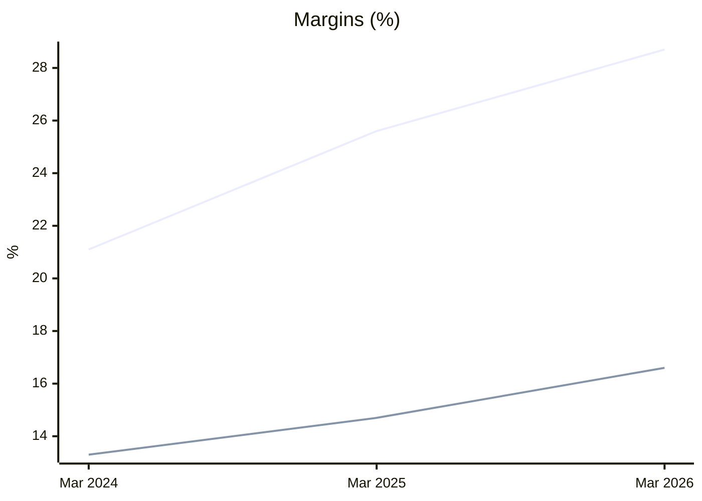

*Run 2026-11-24 · part of [SPINOFF_REPORT.md](../SPINOFF_REPORT.md) · the complete analysis of one company, with every management-call exchange in full.*

## ASTRAMICRO — Astra Microwave Products Ltd.

### 1. Astra Microwave Products Ltd. — CONFIRMED DEMERGER

**CONFIRMED** (a demerger scheme is on the exchange record) · **PRE-SPIN — study the parent; the pieces do not trade yet** · score 6.4/10 · spin-off · 17 filing(s) from CALLS, NSE, NSE-BM, NSE-deep · first 2026-02-27, latest 2026-11-12

**The separated entities — every one the documents name:**

| Entity | Scheme | Business | Listing | Who runs it |
|---|---|---|---|---|
| **Astra Space Technologies Limited** (earlier Astra Space Technologies Private Limited) | 2026 demerger of the Space, Meteorology and Hydrology Busin… | Houses the Space, Meteorology and Hydrology businesses transferred on a going-concern basis; satellite hardwa… | to be listed | not stated as CEO/MD/chair; "Mr. S. Gurunatha Red… |

**What is being separated, as the documents put it:** Space, Meteorology and Hydrology Business of Astra Microwave, hived off into wholly owned subsidiary Astra Space Technologies — class `value_unlocking`.

### 2. Stages and dates

> **Listing:** NOT YET — scheme at 'meetings' stage; Astra Space Technologies Private Limited will list only after NCLT sanction, effectiveness and a record date; indicated timeline: Not dated; NSE letter of October 29, 2026 says ASTPL "shall ensure that steps for listing of specified securities are completed and trading in securities commences within sixty days of receipt of the order of the Hon'ble High Court/NCLT"; the observation letter is valid six months from October 29, 2026 within which the Scheme must be submitted to NCLT.

| Date | Event | Source |
|---|---|---|
| 2026-02-27 | Board approval — Astra Microwave Products Limited | as stated: Outcome of Board Meeting / Press Release dated February 27, 2026 - in… |
| 2026-05-26 | Stage reached: **announced** | [Press Release](https://nsearchives.nseindia.com/corporate/ASTRAMICRO_26052026165633_PressRelease.pdf) |
| 2026-06-01 | Other — Astra Microwave Products Limited | as stated: Intimation of Board Meeting under Regulation 29 dated June 01, 2026, … |
| 2026-06-10 | Board approval — Astra Microwave Products Limited and Astra Space Technologies Private Limited | as stated: Demerger announcement dated 10.06.2026 - Board approved the Scheme of… |
| 2026-08-18 | Other — Astra Microwave Products Limited | as stated: NSE Observation Letter Ref: NSE/LIST/55855 dated October 29, 2026 - N… |
| 2026-08-22 | Stage reached: **meetings** | [Shareholders meeting](https://nsearchives.nseindia.com/corporate/ASTRAMICRO_22082026141503_AGMNotice.pdf) |
| 2026-09-30 | Other — Astra Microwave Products Limited / Astra Space Technologies | as stated: Outcome of Board Meeting dated August 10, 2026 - Mr. S. Gurunatha Red… |
| 2026-10-29 | Stage reached: **exchange noc** | [Scheme of Arrangement](https://nsearchives.nseindia.com/corporate/ASTRAMICRO_29102026164303_NOCLetter.pdf) |
| 2026-10-29 | SEBI observations — Astra Microwave Products Limited | as stated: NSE Observation Letter Ref: NSE/LIST/55855 dated October 29, 2026 - "… |
| 2026-10-29 | Exchange no-objection — Astra Microwave Products Limited | as stated: Filing dated October 29, 2026 - observation letter with "no adverse o… |

**The stages, as filed:** announced (2026-05-26) → meetings (2026-08-22) → exchange noc (2026-10-29)

**Stated in the filings:** resulting company **Astra Space Technologies Private Limited**; demerged undertaking: ) is proposed to be demerged into; size hint: 10.6% of ebitda.

**When it lists, in the documents' words:** Not dated; NSE letter of October 29, 2026 says ASTPL "shall ensure that steps for listing of specified securities are completed and trading in securities commences within sixty days of receipt of the order of the Hon'ble High Court/NCLT"; the observation letter is valid six months from October 29, 2026 within which the Scheme must be submitted to NCLT.

### 3. Size of the separated business beside the parent — is institutional selling likely?

**Reading: LIKELY — the piece is small beside the parent; mandates with size limits tend to sell.**

| Entity | Stated turnover | Stated share of the whole | Market cap (₹ cr) | Share of the whole by market cap | Segment revenue share | Index member | Selling on size |
|---|---|---:|---:|---:|---:|---|---|
| Astra Space Technologies Limited | "approximately INR. 157 Crores" for the financial year ende… | 13.58% (share of turnover) | — | — | 13.4% (FY2026) | not listed | likely |

*Stated figures are the documents' own (a turnover share, or the cost-of-acquisition split the company publishes for tax, which reflects relative value). The market-cap share is the entity's value over the whole — the parent plus every separated entity that trades (parent ₹16,174 cr, whole ₹16,174 cr, NSE bhavcopy of 2026-11-13); the segment share is the business's revenue over the parent's reported sales of that year. Both are computed here. The reading uses the market-cap share when the entity trades, else the stated share, else the segment share.*

**In the documents' words:** “The turnover of the Demerged Undertaking of the Company for the financial year ended 31st March 2026 was approximately INR. 157 Crores , representing 13.58% of the total turnover of the Demerged Company for the said year.”

**The judge's read of selling pressure:** likely — Small (13.58% of turnover), distinct sector from parent's radar/EW/telemetry, 1:1 shares pushed to all holders, promoters only 6.45%.

### 4. Insider ownership — share swap, promoters' holding, management incentives

**Share swap / entitlement, entity by entity:**

- **Astra Space Technologies Limited:** "the Resulting Company shall issue 1 fully paid -up equity share of INR 2 (Indian Rupees 2/- only) each for every 1 fully paid -up equity share of INR 2 (Indian Rupees 2/- only) each held in the Demerged Company (“Share Entitlement Ratio”)"

**Promoters' holding, from the shareholding pattern:**

| Company | Promoters | FIIs | DIIs | Public | Quarter |
|---|---:|---:|---:|---:|---|
| Astra Microwave Products Ltd. (ASTRAMICRO) | 6.54% | 10.48% | 16.52% | 66.47% | Sep 2026 |

*Source: screener.in shareholding pattern, stored under `ShareholdingPattern/NiftyTotalMarket/`. In a mirror demerger each shareholder holds the same proportion of the new company as of the parent on the record date.*

- **Promoters in the parent, per the documents:** not stated in the documents on file.
- **What the promoters will hold in the separated entity:** 2026 demerger into Astra Space Technologies: "Upon the effectiveness of the Scheme, the shareholding of the Resulting Company will mirror the shareholding of the Demerged Company." ASTPL change in shareholding pattern: Pre-Scheme (as on 31.03.2026) Promoters 100.00%, Public 0.00%; Post-Scheme (Indicative) Promoters 6.45%, Public 93.55%. Also: "The post Scheme shareholding pattern of ASTPL will replicate/ mirror the shareholding pattern of AMPL." For AMPL itself: "AMPL: No change". Press release: "Will have mirror shareholding identical to that of Astra ."
- **What a public shareholder receives:** 2026 demerger into Astra Space Technologies: "ASTPL will issue and allot 1 fully paid -up equity share of INR 2 (Indian Rupees 2/- only) to the eligible shareholders of the Company, in accordance with Share Entitlement Ratio (as defined under the Scheme) , without any further application, act or deed. After the Scheme has been effected, the issued shares shall be listed on BSE and NSE." Also: "There is no cash consideration being discharged under the Scheme." The entire pre-scheme paid up share capital of ASTPL held by AMPL "shall stand cancelled and reduced".
- **Management incentives:** No stock option, RSU or SAR plan is mentioned in the documents, and no treatment of existing grants in the Scheme is stated. Convertible warrants: "The Board of the Directors of the Company at its meeting held on May 20, 2025 and the shareholders of the company at Extraordinary General Meeting held on June13, 2025 has approved the allotment of up to 20,13,885 convertible warrants each convertible into, or exchangeable for, one fully paid up equity share of the Company, having a face value of Rs. 2, within the period of eighteen months in accordance with the applicable laws at a price of Rs. 864 aggregating up to Rs. 173.99 crores ("issue proceeds"). During the previous year ended March 31, 2026, the Company has received 25% of the issue proceeds i.e., Rs. 43.50 crores (Upfront monies) on June 23, 2025 and June 24, 2025." Managerial performance bonus is linked to restructuring: for Dr. M. V. Reddy and Mr. Atim Kabra the performance criteria include "Other intiatives of corporate restructuring like merger/demerger 10.0%" weightage. Cash compensation on exit of the outgoing MD: "the consent of the Members of the Company be and is hereby accorded for payment of Rs.1,35,00,000/- (Rupees One Crore Thirty-Five Lakhs only) to Mr. S. Gurunatha Reddy (DIN: 00003828) in the nature of cash" (Explanatory Statement: recommended "payment of a cash compensation of Rs.1,35,68,889/-" representing "the remuneration payable for the unexpired portion of his tenure as Managing Director"). Director shareholding in AMPL: Mr. P. A. Chitrakar "32,40,830 Equity Shares.", Mr. Atim Kabra "33,56,074 Equity Shares.", Dr. M. V. Reddy "Holds 63,570 equity shares." Insider holdings in the JV: "Mr. S. Gurunatha Reddy is holding 0.20% shareholding in ARC", "Dr. M.V. Reddy is holding 0.20% shareholding in ARC", "Mr. Atim Kabra is holding 0.10% Shareholding in ARC", "Mr. Suresh Kumar Somani is holding 0.10% Shareholding in ARC", "Mr. P. A. Chitrakar is holding 0.20% Shareholding in ARC."
- **Insider actions around the separation:** No promoter or management buying, selling or pledging of shares is stated. Stated intent around the separation: "Mr. S. Gurunatha Reddy, Managing Director of AMPL has agreed to take on the additional responsibility of overseeing the ongoing demerger of the Space and Meteorology business and thereafter shall join Astra Space Technologies Private Limited (ASTPL) as a Director subject to the approval of the Board." His resignation letter states: "I am resigning from the position Directorship also with effect from the close of business hours on 30th September, 2026, to oversee the ongoing demerger of the Space and Meteorology business pursuant to the Scheme of Arrangement." Reason for change recorded with the exchanges: "Has taken responsibility to over see demerger of the Company and focus in establishing resulting Company."
- **Insiders, per the checklist read:** Promoters hold 100% of ASTPL pre-scheme (cancelled on effectiveness); post-scheme promoters 6.45%, public 93.55%, mirroring AMPL. Outgoing MD S. Gurunatha Reddy will join ASTPL as Director; MD/WTD bonus weights "merger/demerger" 10%. · *option pricing date:* not stated

### 5. Why the demerger — point by point

Astra Microwave is splitting itself into two sector-focused listed companies: the parent (AMPL) keeps Radar Electronics, Electronic Warfare and Telemetry, while the Space, Meteorology and Hydrology business is demerged on a going-concern basis into its wholly-owned subsidiary Astra Space Technologies Pvt Ltd (ASTPL), which will itself be listed on BSE and NSE. On the May 27, 2026 call MD S.G. Reddy said the board had given in-principle approval and framed the objective as creating 'sharper strategic and operational focus,' enabling dedicated management teams to chase sector-specific opportunities, enhancing governance and accountability, simplifying the corporate structure and creating 'clearer investment propositions to shareholders,' with focused growth, better capital allocation and improved operational efficiency over the medium to long term. The sizing numbers management gave: FY26 standalone turnover INR1,157 crore of which radar was ~60% and space plus meteorology ~16%; the scheme puts the demerged undertaking's FY26 turnover at ~INR157 crore, i.e. 13.58% of standalone turnover; the Dec-2025 order book of INR2,226 crore contained INR249 crore of space and INR369 crore of meteorology/hydrology orders. The scheme's stated reasoning is that space/met/hydro has 'distinct industry characteristics, competitive dynamics, regulatory environment, and risk profile' needing a differentiated strategy, and that a standalone entity would be 'better positioned to attract investors, strategic partners, lenders, and other stakeholders with sector-specific interests,' thereby unlocking the value of that undertaking for shareholders. Mechanically there is no cash consideration: shareholders get 1 ASTPL share of Rs 2 for every 1 AMPL share of Rs 2, ASTPL's existing promoter-held capital is cancelled, and post-scheme ASTPL mirrors AMPL (promoters 6.45%, public 93.55%). No investor, lender or partner is identified anywhere as having demanded the separation — it is presented as management/board-initiated strategic re-alignment, though Atim Kabra had repeatedly argued on earlier calls that the embedded space business was worth far more than the market credited (Aug 2025: 'very, very valuable'; Nov 2025: peers raising at $750-800m valuations with almost no revenue, close to Astra's whole market cap). The move is also backed with people: MD S. Gurunatha Reddy took on oversight of the demerger, stepped down as AMPL MD and director from close of September 30, 2026 to join ASTPL as a director, and Joint MD Dr M.V. Reddy became AMPL's MD from October 1, 2026. As of the last filings, BSE gave 'no adverse observations' and NSE 'no objection' on October 29, 2026, SEBI/NCLT approvals are still pending, and no effect of the scheme has been taken into the Q2 FY27 accounts.

**Point by point, with the source:**

1. First disclosure on a call: the board has in-principle approved demerging the space, meteorology and hydrology business, with the formal scheme to follow within weeks. “On a strategic front, the Board of Directors have in-principle approved demerger of our space, meteorology, and hydrology business.” — *[Jun 2026](https://www.bseindia.com/stockinfo/AnnPdfOpen.aspx?Pname=78f3aacc-b7ef-4d51-b1e1-d6e5863786b8.pdf)*
2. The stated objective is focus, not cash or deleveraging. “The objective of this move is to create sharper strategic and operational focus for business segments.” — *[Jun 2026](https://www.bseindia.com/stockinfo/AnnPdfOpen.aspx?Pname=78f3aacc-b7ef-4d51-b1e1-d6e5863786b8.pdf)*
3. The specific problems named: management bandwidth, governance/accountability, a complicated corporate structure and an unclear investment case for shareholders. “The proposed structure will enable dedicated management teams to pursue sector-specific growth opportunities, enhance governance and accountability, simplify the corporate structure, and create clearer investment propositions to shareholders.” — *[Jun 2026](https://www.bseindia.com/stockinfo/AnnPdfOpen.aspx?Pname=78f3aacc-b7ef-4d51-b1e1-d6e5863786b8.pdf)*
4. Expected outcome framed over the medium to long term, including capital allocation. “Over the medium to long term, we believe this initiative will support focused growth, better capital allocation, and improved operational efficiency.” — *[Jun 2026](https://www.bseindia.com/stockinfo/AnnPdfOpen.aspx?Pname=78f3aacc-b7ef-4d51-b1e1-d6e5863786b8.pdf)*
5. Scale of the business being separated, as management described FY26 revenue mix: space and meteorology ~16% versus radar ~60%. “Our radar business continued to be a primary growth driver, contributing nearly 60% of our revenue, while space and meteorology segment contributed around 16%, demonstrating our expanding footprint in strategic and high-technology domains.” — *[Jun 2026](https://www.bseindia.com/stockinfo/AnnPdfOpen.aspx?Pname=78f3aacc-b7ef-4d51-b1e1-d6e5863786b8.pdf)*
6. The June 10, 2026 scheme disclosure states the purpose as creating two separately listed sector-focused companies — radar/EW/telemetry on one side, space/met/hydro on the other. “The proposed demerger is intended to create two sector-focused listed entities, namely: (a) Radar Electronics, Electronic Warfare and Telemetry business focused entity; and (b) Space, Meteorology and Hydrology focused entity;” — *Scheme*
7. Core argument: the two businesses face different industry, competitive, regulatory and risk conditions and therefore need different strategies. “The Space, Meteorology and Hydrology business operates in a sector with distinct industry characteristics, competitive dynamics, regulatory environment, and risk profile, necessitating a differentiated growth strategy aligned with its specific market opportunities.” — *Scheme*
8. Capital-access rationale — the only place any outside constituency (investors, partners, lenders) is invoked, and as a prospective benefit rather than as a party that asked for the split. “A standalone Space, Meteorology and Hydrology entity would be better positioned to attract investors, strategic partners, lenders, and other stakeholders with sector-specific interests.” — *Scheme*
9. Explicit value-unlock objective for AMPL shareholders. “unlocking the value of the Demerged Undertaking for the shareholders of the Demerged Company.” — *Scheme*
10. Size of the carve-out quantified in the filing: ~INR157 crore of FY26 turnover, 13.58% of the parent's total. “The turnover of the Demerged Undertaking of the Company for the financial year ended 31st March 2026 was approximately INR. 157 Crores , representing 13.58% of the total turnover of the Demerged Company for the said year.” — *Scheme*
11. No cash changes hands; a 1:1 share entitlement mirrors AMPL's register into ASTPL (promoters 6.45%, public 93.55% post-scheme), and ASTPL shares will be listed on BSE and NSE. “For the purpose of the demerger of Demerged Undertaking ( as defined in the Scheme ) of Demerged Company into Resulting Company, the Resulting Company shall issue 1 fully paid-up equity share of INR 2 (Indian Rupees 2/- only) each for every 1 fully paid-up equity share of INR 2 (Indian Rupees 2/- only) each held in the Demerged Company ("Share Entitlement Ratio").” — *Scheme*
12. Leadership is being split alongside the businesses: MD S. Gurunatha Reddy was given the demerger and will move to ASTPL, with Dr M.V. Reddy taking over as AMPL MD from October 1, 2026 (April 3, 2026 press release; confirmed in the August 10, 2026 board outcome). “In this role, he will lead the adoption of tailored growth strategies and capital allocation frameworks suited to the Space, Meteorology and Hydrology sector, thereby enabling focused management attention, enhanced operational efficiency and the unlocking of value for the shareholders of the Company.” — *Scheme*
13. Status as of the latest filings: exchange clearances in hand on October 29, 2026; SEBI/NCLT and other approvals still pending, with no accounting effect taken in Q2 FY27. “AMPL has received observation letter with "no adverse observations" from BSE Limited on 29th October 2026 and observation letter with "no objection" from the National Stock Exchange of India Limited on 29th October 2026 in relation to the Scheme of Arrangement.” — *Scheme*
14. Pre-announcement value framing: Kabra argued the embedded space business alone could justify something close to Astra's entire market capitalisation, versus peers raising at high valuations with little revenue. “Companies are raising money at like $750 million, $800 million valuation with hardly any revenue numbers to their credit. If I extrapolate these numbers, actually, I got close to my current market capitalization.” — *[Nov 2025](https://www.bseindia.com/stockinfo/AnnPdfOpen.aspx?Pname=8920e2b3-bd77-473a-94ef-a0dba0be3236.pdf)*
15. Earliest hint of the value-unlock logic, alongside disclosure that Astra Space Technologies had been set up as a wholly-owned subsidiary with a ~INR230 crore space order book. “So our order book, as SG mentioned, is in excess of INR230 crores over there. And given where companies with very limited indigenous capabilities are valued, you might find that our space business is actually very, very valuable.” — *[Aug 2025](https://www.bseindia.com/stockinfo/AnnPdfOpen.aspx?Pname=8665322a-8313-49d9-b271-c9f46183b085.pdf)*
16. Two weeks before the in-principle board approval, Kabra flagged a need for creative financing for development projects and told investors to watch for options crystallising — the closest the calls come to foreshadowing the restructuring. “But as you know, balance sheet for efficiently -- for them to efficiently function, especially when our sales volumes are projected to go significantly higher, we need to be creative as well as ensure that there is enough financing is there so that our NCNC projects, the products being developed and the large blue sky thinking driven projects do not suffer due to inadequate financing.” — *[Feb 2026](https://www.bseindia.com/stockinfo/AnnPdfOpen.aspx?Pname=82557eb2-8eb5-49c4-b6db-4fe6f8761102.pdf)*

**How it evolved:** Through the Aug 14, 2025 and Nov 13, 2025 calls there was no demerger talk at all, but the groundwork was visible: Astra Space Technologies had been incorporated as a wholly-owned subsidiary with Bangalore clean rooms and a ~INR230-239 crore space order book, and Atim Kabra argued the space business was being carried inside Astra at far less than standalone peers' valuations. On the Feb 13, 2026 call there was still no mention of a demerger, only Kabra's hint about needing to 'be creative' on financing and 'watch the space.' The board granted in-principle approval on Feb 27, 2026, which surfaced publicly in the April 3, 2026 press release (tied to the MD succession) and was first spoken to investors on the May 27, 2026 (Jun 2026) call, where the detailed scheme was promised 'over the next few weeks.' The board approved the full Scheme of Arrangement on June 10, 2026, and the stock exchanges issued their observation/no-objection letters on October 29, 2026; notably, not a single analyst asked a question about the demerger on the May 27, 2026 call.

**What management expects from it:** AMPL becomes a radar/EW/telemetry-focused listed company; space/met/hydro becomes a separately listed entity with its own management team, tailored growth strategy and capital allocation, sharper focus, better governance and accountability, a simpler structure, improved operational efficiency, easier access to sector-specific investors, partners and lenders, a clearer investment proposition and unlocked shareholder value. No margin, EBITDA or valuation targets were quantified.

*Not explained on the calls:* No segment margins/EBITDA, asset-debt-employee split, ASTPL standalone financials, listing timeline, transaction costs, or where ARC/MMIC sit; no analyst questioned it; no requesting party named.

- *Stated reason, in one line:* Strategic re-alignment to create two sector-focused listed entities; Space/Meteorology/Hydrology has distinct industry characteristics, enabling focused management, tailored growth and capital allocation, sector-specific investors, and "unlocking the value of the Demerged Undertaking for the shareholders".
- *What it reveals:* Demerged undertaking turnover INR 157 crores, 13.58% of FY26 total; management says "the space margins are better compared to even defence also"; Dec-2025 order book INR 249 crores space plus INR 369 crores met/hydrology. Parent keeps radar/EW/telemetry with QRSAM, Uttam, Su-30 programs.
- *Parent or spin:* both · *Read next:* ASTPL abridged-prospectus disclosure in the NCLT shareholders' notice: demerged undertaking assets, liabilities, net worth, PAT, EBITDA.
- *In their words:* “Yes, all new shares of ASTPL will be listed and will be admitted for trading on the NSE and BSE, subject to receipt of requisite approvals from the Stock Exchanges.”

### 6. On the calls, verbatim

4 call(s), oldest first: **2 question-and-answer exchange(s)** given in full — the question and every answer to it, nothing trimmed — and 2 passage(s) from management's prepared remarks (the complete sentences about it; the whole remarks are in the linked transcript). Text is as the transcript prints it.

#### Aug 2024 — [transcript](https://www.bseindia.com/stockinfo/AnnPdfOpen.aspx?Pname=7eb70fbb-8890-48a4-85d9-af5c27274526.pdf)

**Question and answer**

> **Ravindra Shah:** Sir, I have two questions. The first question is, can you please elabora te a bit on your Bangalore facility like for which business this facility will be ded icated, domestic defense, space or other business segments? Astra Microwave Products Limited August 13, 2024 Management: Originally, we have created that facility for our systems integration an d testing, especially in the radar and electronic warfare domain and we have built up NFTR f acility also and also assembly hangers to handle and address the radar systems. And also we have created space division in Bangalore facility. We have incorporated 100% subsidiary u nit, Astra Space Technologies Limited and that group is basically going to address a ll future satellite requirements and they are also working in the same facility. We have created the infrastructure to meet that particular requirement.

#### May 2025 — [transcript](https://www.bseindia.com/stockinfo/AnnPdfOpen.aspx?Pname=2a87d22a-4d49-44dd-8273-a4a664fbe476.pdf)

**Question and answer**

> **Akshay J.:** In the last few interviews on new channels and on these calls, you've spoken about space having the potential to be as large as our current defense business. Can you spend a little bit more time understanding and explaining to us what the parts -- any areas that we see as large oppo rtunity in the near term and the medium term. If we have to imagine a business as large as defense in space, what would the journey look like from here to say, 3 years or 5 years? Management: : Yes. In space segment, we started our journey by supplying comp onents and subsystems to all communication and remote radar imaging satellite programs to ISRO. This is almost -- we started from 2001 onwards. And we -- with the transformation in the space sector and the reforms being introduced in 2020, and the governme nt has given the opportunity for companies to build and launched satellites . Astra Microwave Products Limited May 23, 202 5 And keeping -- taking this opportunity, we decided to start our own space satellite division, and we formed Astra Space Private Limited and the 100% subsidiary of Astra. Here, ba sically, we are planning to build our own satellite and as a technology demonstrator for this and which is already in the advanced stage. And apart from that, we are also participating in a couple of RFPs being floated by IN -SPACe and all, wherein the pri vate company has been allowed to build the satellite constellation and to operate and sell the data. This kind of RFPs, we started looking into this. So going forward, while we continue to supply our subsystems to satellites made by ISRO and other key OEMs and international OEMs, we also -- we are planning to build our own satellite for generating revenue from the data. This is what the mission. Maybe Atim may add a few more points on this. Management: : Yes. Guys, there's a lot of talk about the need to lau nch spy satellites. There is a need for application of satellite source data for agriculture, for fisheries, for water management, you name it. Data is the key here. Data monetization abilities which exist in the West has now -- the time has come for that to be implemented across the board in India. Now Astra's journey was as we explained over a period of time, has been for more than a decade where we have space -grade facilities to manufacture components. Components have to be tested, and they have to be forced, if I may say, to withstand high temperatures as we send them into the space. So there are dedicated facilities and testing units, which are within Astra for space -grade components. We -- in the last mission, which went, I think it was Samudrayaan , if I'm not wrong, Dr. M.V. Reddy , where we were 9% of the payload and 3% of the overall satellite in value terms, okay? So once you supply components which are space grade, you move into subsystems. We are -- we have been a very activ e part of the reset satellite programs. We -- across multiple bands frequencies, we are able to create these communication links, which will come in very, very handy as we go forward. You have subsystems, which are made and then you have payloads. Now Ast ra has in certain segments, in certain kinds of payloads, very significant capabilities, which have been built up over a period of time. There are a few gaps which we are hoping to fill in through JVs or alliances or through tech absorption from external s ources. We have in our Bangalore unit, satellite assembly clean rooms, which have already been set up and commissioned. We have designing capabilities, satellite designing capabilities, which are being continuously improved. We are already there in the gr ound segment for satellites, the communication ground stations, which need to be built. Astra is a part of that, okay. And this completes -- almost completes the hardware chain. And then there is a data monetization part, which I mentioned to you the vario us applications. And Astra will be a significant player over there also is our effort. So I hope I'm able to explain the value spectrum where we are. Astra Microwave Products Limited May 23, 202 5 Management: : Point that for the defense programs, which have been DRDO has made a few satellites like OTGR , Anvesha, SAMOOHA, wherein we are an active partner, and we have been supplying critical subsystems to those programs.

#### Aug 2025 — [transcript](https://www.bseindia.com/stockinfo/AnnPdfOpen.aspx?Pname=8665322a-8313-49d9-b271-c9f46183b085.pdf)

**From the prepared remarks** *(the passage about it; the whole turn runs to 5,025 characters in the transcript)*

> **Atim Kabra:** We are also now building a strong and credible presence in the space sector. Our stand -alone order bo ok on -- order book includes about INR239 crores worth of orders from the space sector. These comprise high -quality complex components and subsystems that require precision engineering, reliability and a deep technical know -how, areas where Astra has consi stently delivered. As you are aware, we have incorporated a wholly owned subsidiary by name Astra Space Technologies Private Limited recently to focus in space business in a bigger way and have already taken steps to recruit skilled manpower and to establish clean and assembly rooms for assembly and integration of small -sized satellites. These operations will be carried out from our Bangalore facility with support from Hyderabad Space division, which has more than 20 -plus years of experience in supp lying under BTS and BTP mode, various electronic components and subsystems required for ground and onboard applications. In terms of group company's performance, our wholly owned subsidiaries are doing well, though they are largely serving our captive consumption needs. Our joint venture company, Astra Rafael Comsys Private Limited too has done well during the quarter and its prospect looks bright for the coming years.

#### Jun 2026 — [transcript](https://www.bseindia.com/stockinfo/AnnPdfOpen.aspx?Pname=78f3aacc-b7ef-4d51-b1e1-d6e5863786b8.pdf)

**From the prepared remarks** *(the passage about it; the whole turn runs to 5,676 characters in the transcript)*

> **S. G. Reddy:** We continue to proactively invest in development of products and solutions for various defence applications, which is reflected in our increased R&D expenditure on year -on-year basis. These investments are expected to translate into significant business opportunities over the medium to long term and help us to achieve important milestones in revenue and profitability as we move forward. Other key business development happened during the year. On a strategic front, the Board of Directors have in -principle approved demerger of our space, meteorology, and hydrology business. The objective of this move is to create sharper strategic and operational focus for business segments. The proposed structure will enable dedicated management teams to pursue sector - specific growth opportunities, enhance governance and accountability, simp lify the corporate structure, and create clearer investment propositions to shareholders. Furthermore, this restructuring will position us to capitalize on emerging opportunities both in India and globally. Over the medium to long term, we believe this initiative will support focused growth, better capital allocation, and improved operational e fficiency. We will share the detailed Astra Microwave Products Limited May 27 , 202 6 scheme of demerger once it is formally approved by board, which is expected over the next few weeks. I will now hand over the call to Mr. M. V.

### 7. The parent's financial statements

**The parent, last three fiscal years (consolidated)**

| | Mar 2024 | Mar 2025 | Mar 2026 |
|---|---:|---:|---:|
| Sales (₹ cr) | 909 | 1,051 | 1,163 |
| Sales growth (%) | +11.4% | +15.6% | +10.7% |
| Operating profit (₹ cr) | 192 | 269 | 334 |
| Operating profit growth (%) | +32.4% | +40.1% | +24.2% |
| Operating margin (%) | 21.1 | 25.6 | 28.7 |
| PAT (₹ cr) | 121 | 154 | 193 |
| PAT growth (%) | +72.9% | +27.3% | +25.3% |
| PAT margin (%) | 13.3 | 14.7 | 16.6 |
| EPS (₹) | 12.8 | 16.2 | 20.3 |

*Source: ProfitStatement/NiftyTotalMarket/ASTRAMICRO.csv (consolidated, screener.in); growth and margins computed here.*

```mermaid
xychart-beta
    title "Sales, operating profit and PAT (₹ cr)"
    x-axis ["Mar 2024", "Mar 2025", "Mar 2026"]
    y-axis "₹ crore"
    bar [909, 1051, 1163]
    bar [192, 269, 334]
    bar [121, 154, 193]
```

*Series in order: Sales, Operating profit, PAT.*

*Series in order: Operating margin, PAT margin.*

**P/E:** 79.9 — close 2026-10-01 ÷ EPS 20.32 (Mar 2026) (price ₹1,624.50 as of 2026-10-01).

**Cash flows (₹ cr):**

| | Mar 2024 | Mar 2025 | Mar 2026 |
|---|---:|---:|---:|
| Cash from operations (₹ cr) | -182 | -90.0 | 387 |
| Cash from investing (₹ cr) | -44.0 | -76.0 | -85.0 |
| Cash from financing (₹ cr) | 232 | 141 | -196 |
| Net cash flow (₹ cr) | 7.0 | -25.0 | 106 |
| Free cash flow (₹ cr) | -229 | -169 | 304 |

*Source: CashFlow/NiftyTotalMarket/ASTRAMICRO.csv (consolidated, screener.in).*

### 8. The separated business's financial statements

**The business being separated — its own numbers**, entity by entity: its reported statements once it is listed and on file, and the segment numbers the annual reports and presentations carry for it before that.

**Space → Astra Space Technologies Limited** · unit ₹ lakh (Rs. Lakhs) · Only sector-wise sales (revenue) is disclosed. Figures are the Company's standalone sector-wise sales (external revenue from operations, split by sector); no segment profit line, assets, liabilities, capex or depreciation is given — the notes to accounts state the company operates in a single product segment, so Ind AS 108 segment result/asset disclosures are not provided for Space.

| | FY2024 | FY2025 | FY2026 |
|---|---:|---:|---:|
| Revenue (₹ lakh (Rs. Lakhs)) | — | 5,848 | 10,975 |
| Revenue growth (%) | — | — | +87.7% |
| Operating profit (₹ lakh (Rs. Lakhs)) | — | — | — |
| Operating profit growth (%) | — | — | — |
| Operating margin (%) | — | — | — |
| PAT (₹ lakh (Rs. Lakhs)) | — | — | — |
| PAT growth (%) | — | — | — |

*Sources:* no sector-wise split disclosed for FY2024 in the pages provided; Annual Report 2026 — page 191

*Not in the pages read:* No profit, PAT, assets, liabilities, capex or depreciation for Space; no FY2024 split; no quarterly Space revenue (presentations give only quarterly order inflow/order book by sector).

**Metrology/Civil Telecom/Others (meteorology and hydrology business) → Astra Space Technologies Limited** · unit ₹ lakh (Rs. Lakhs) · Sector-wise sales (external revenue from operations) only. The line as printed is 'Metrology/Civil Telecom/Others', i.e. meteorology is bundled with civil telecom and other items, so it is not a clean figure for the meteorology+hydrology business being demerged. No profit line, assets, liabilities, capex or depreciation disclosed (single reported product segment).

| | FY2024 | FY2025 | FY2026 |
|---|---:|---:|---:|
| Revenue (₹ lakh (Rs. Lakhs)) | — | 3,437 | 4,584 |
| Revenue growth (%) | — | — | +33.4% |
| Operating profit (₹ lakh (Rs. Lakhs)) | — | — | — |
| Operating profit growth (%) | — | — | — |
| Operating margin (%) | — | — | — |
| PAT (₹ lakh (Rs. Lakhs)) | — | — | — |
| PAT growth (%) | — | — | — |

*Sources:* no sector-wise split disclosed for FY2024 in the pages provided; Annual Report 2026 — page 191

*Not in the pages read:* No standalone meteorology or hydrology revenue (bundled with civil telecom/others); no profit, PAT, assets, liabilities, capex, depreciation; no FY2024 split; no quarterly revenue.

*Businesses with no numbers in the pages read (3 annual report(s) and 13 presentation(s) on file):* No entity-level financials for Astra Space Technologies Limited / Astra Space Technologies Private Limited (ASTPL) or the Demerged Undertaking; also no numbers for Electronic Warfare, Telemetry or Hydrology business segments.

*Documents on file:* [Annual Report 2026](https://www.bseindia.com/xml-data/corpfiling/AttachHis/006109cf-3709-427d-8b15-87513e040708.pdf); [Annual Report 2025](https://www.bseindia.com/xml-data/corpfiling/AttachHis/10122c22-40d6-4556-9b87-34a0ab677b28.pdf); [Annual Report 2024](https://www.bseindia.com/xml-data/corpfiling/AttachHis/c307696a-1240-438e-907b-8c9a7c2401de.pdf); [Presentation Nov 2026](https://www.bseindia.com/stockinfo/AnnPdfOpen.aspx?Pname=1be38ad4-4c04-47d0-ba02-7d5726ad55a6.pdf); [Presentation Aug 2026](https://www.bseindia.com/stockinfo/AnnPdfOpen.aspx?Pname=c4b03964-affd-4c16-a7e2-384c4ab877f4.pdf); [Presentation Jun 2026](https://www.bseindia.com/stockinfo/AnnPdfOpen.aspx?Pname=03c484ea-f8f7-4cee-9b9d-ab2696cf9a5d.pdf); [Presentation Feb 2026](https://www.bseindia.com/stockinfo/AnnPdfOpen.aspx?Pname=261d1e80-99bc-4c41-a6d1-d71577988dc1.pdf); [Presentation Nov 2025](https://www.bseindia.com/stockinfo/AnnPdfOpen.aspx?Pname=f02a1760-94f0-4f9a-9111-3a1f0f1d9b2b.pdf); [Presentation Aug 2025](https://www.bseindia.com/stockinfo/AnnPdfOpen.aspx?Pname=29ae7a47-5b97-4717-9a51-89fcde383fae.pdf)

### 9. Other financial differences — working capital, margins, returns, debt

| Metric (latest year) | Parent (ASTRAMICRO) | Astra Space Technologies Limited |
|---|---:|---:|
| *Basis* | *reported, consolidated* | *segment numbers (Space)* |
| Sales (₹ cr) | 1,163 (Mar 2026) | — |
| Sales growth (%) | 10.7 (Mar 2026) | 87.7 (FY2026) |
| Operating margin (%) | 28.7 (Mar 2026) | — |
| Operating profit growth (%) | 24.2 (Mar 2026) | — |
| PAT margin (%) | 16.6 (Mar 2026) | — |
| ROCE % | 20 (Mar 2026) | — |
| Debtor Days | 216 (Mar 2026) | — |
| Inventory Days | 394 (Mar 2026) | — |
| Days Payable | 73 (Mar 2026) | — |
| Cash Conversion Cycle | 537 (Mar 2026) | — |
| Working Capital Days | 267 (Mar 2026) | — |
| Debt / equity (x) | 0.2 (Mar 2026) | — |
| Borrowings (₹ cr) | 288 (Mar 2026) | — |
| Sales (₹ lakh (Rs. Lakhs)) | — | 10,975 (FY2026) |

*Each figure is the latest on file, with its year. Working-capital days and ROCE come from the stored working-capital file; segment figures from the pages cited in part 8. A dash means the documents do not carry it.*

**What stays with the parent — its segments, from the same pages:**

| Remaining segment | Revenue | Operating margin | ROCE | Segment assets / revenue | Unit | Year |
|---|---:|---:|---:|---:|---|---|
| Defense | 83,748 | — | — | — | ₹ lakh (Rs. Lakhs) | FY2026 |
| Exports (including deemed exports) | 16,228 | — | — | — | ₹ lakh (Rs. Lakhs) | FY2026 |

**What the documents themselves say about the differences:**

- **capex and capital intensity** — parent / remaining: Not stated for the remaining Defence business; company-wide capex guidance given on the call as routine augmentation; separated business: Space and Weather business described as capital-intensive and execution-dependent, requiring focused management attention “However, the business is capital -intensive and execution -dependent, requiring focused management attention to realise its significant growth prospects.”
- **growth** — parent / remaining: FY27 top line growth guidance reaffirmed at 15% to 20%; radar business contributing nearly 60% of revenue; separated business: Space and Weather described as a scaled-up, profitable, high-growth opportunity driven by satellite design and assembly and satellite data applications “The Space and Weather business represents a scaled -up, profitable, high -growth opportunity, driven by expanding demand for satellite design and assembly, as well as satellite data applications in both domestic and international markets.”
- **operating margin** — parent / remaining: Defence margins lower than space margins; FY26 standalone EBITDA margin 28.0% and PAT margin 15.4%; separated business: Space margins stated to be better than defence, but space is only about 10% to 15% of total sales so its order-book reduction does not hurt overall margins “Definitely the space margins are better compared to even defence also, but when you look at the overall space sales contribution , in the overall sales of the company, it is just around 10% to 15% kind of thing.”
- **other** — parent / remaining: Radar business contributed nearly 60% of FY26 revenue; separated business: Space and meteorology segment contributed around 16% of FY26 revenue “Our radar business continued to be a primary growth driver, contributing nearly 60% of our revenue, while space and meteorology segment contributed around 16%, demonstrating our expanding footprint in strategic and high -technology domains.”
- **other** — parent / remaining: Standalone order book of Rs. 2,141 crores as on March 31, 2026; Rs. 3,937.00 crores as at September 30, 2026; separated business: Space: cumulative ISRO orders over Rs. 750 crore with Rs. 250 crore more to be executed by FY28; Meteorology and Hydrology: cumulative contracts over Rs. 330 crore with an order book of Rs. 285 crore to be executed by FY28 “Over the last 20 years, the Company has executed cumulative contracts worth over ₹330 crore in this segment and has an order book of ₹285 crore to be executed by FY28.”
- **cash** — parent / remaining: FY26 operating cash flow of INR370 crores versus minus INR99 crores in the prior year (company level, pre-demerger); separated business: not stated “FY26 has been another strong year for the company, characterized by consistent growth, effective execution, margin expansion driven by favourable revenue mix, and improved working capital cycle, resulting in operating cash flow of INR37 0 crores compared to minus INR99 crores as of last year.”
- **working capital** — parent / remaining: Inventories rose to Rs. 79,349.95 Lakhs and current borrowings to Rs. 41,158.92 Lakhs at September 30, 2026 (standalone), with half-year operating cash outflow of Rs. 14,612.63 Lakhs; separated business: not stated “Yes, in terms of the capex, as you know every year , we are augmenting the existing requirements by spending close to about INR40 crores, INR50 crores.”

**The checklist:**

| Item | Status | Evidence |
|---|---|---|
| Why the spin-off | yes | unrelated businesses separated; value unlocking for shareholders; a weak or capital-heavy business carved away; attracting different investors / capital — “…ndertaking s of the Company into a separate entity. The management believes that this move shall enable a focused management attention and operational efficiency by creating an independent company exclusively dedicated ” |
| Institutional selling likely (small / different business) | yes | the demerged piece is 10.6% of ebitda; the businesses are described as distinct |
| Insider ownership and incentives aligned | partly | …res shall be listed on BSE and NSE. Upon the effectiveness of the Scheme, the shareholding of the Resulting Company will mirror the shareholding of the Demerged Company. Brief details of change in sharehol… *(next: the date the management options are priced; promoter holding in the resulting company)* |
| A hidden value revealed (pro-forma, leverage, comparables) | unknown | no pro-forma or market data on file *(next: pro-forma P&L of each piece × the peer P/E of its own industry)* |
| Parent before the spin (clean parent, takeover prelude) | partly | stage meetings — the spin has not happened; the parent can still be bought whole |
| Timing (first year sells, second year gains) | partly | not yet listed — 270 days since the first filing, stage meetings |
| Management discussing it on the calls | yes | 2 mention(s) in the last 12 months of calls — “…ter capital allocation, and improved operational e fficiency. We will share the detailed Astra Microwave Products Limited May 27 , 202 6 Page 4 of 19 scheme of demerger once it is formally approved by board, which is ex” |

**On the calls (last 12 months):**

- *Jun 2026* (neutral) — “…itability as we move forward. Other key business development happened during the year. On a strategic front, the Board of Directors have in -principle approved demerger of our space, meteorology, and hydrology business. The objective of this move is to create sharper strategic and operational focus for business segments. The p…”
- *Jun 2026* (forward) — “…ter capital allocation, and improved operational e fficiency. We will share the detailed Astra Microwave Products Limited May 27 , 202 6 Page 4 of 19 scheme of demerger once it is formally approved by board, which is expected over the next few weeks. I will now hand over the call to Mr. M. V. Reddy and Atim Kabra, who will pro…”

The filings

| Date | Category | Headline | Attachment |
|---|---|---|---|
| 2026-02-27 | Outcome of Board Meeting | Plot No. 51(P), Bangalore Aerospace Park, Singanahalli Village, Budigere Post, Bangalore North Taluk, Karnataka - 562149 February 27, 202 6 | [pdf](https://nsearchives.nseindia.com/corporate/ASTRAMICRO_27022026125251_outcomeofBM.pdf) |
| 2026-02-27 | Outcome of Board Meeting | Astra Microwave Products Limited has informed the Exchange regarding Outcome of Board Meeting held on February 27, 2026. | [pdf](https://nsearchives.nseindia.com/corporate/ASTRAMICRO_27022026125251_outcomeofBM.pdf) |
| 2026-02-27 | Press Release | Demerger of Space, Meteorology and Hydrology Business into a Separate Listed Entity. | [pdf](https://nsearchives.nseindia.com/corporate/ASTRAMICRO_27022026131954_PressRelease.pdf) |
| 2026-02-27 | Press Release (Revised) | Astra Microwave Products Limited has informed the Exchange regarding a revised press release dated February 27, 2026, titled "Revised Press Release". | [pdf](https://nsearchives.nseindia.com/corporate/ASTRAMICRO_27022026193116_revisedPressReleasesigned.pdf) |
| 2026-04-03 | Press Release | Astra Microwave Products Limited has informed the Exchange regarding a press release dated April 03, 2026, titled "Press Release - Stepping down from the positi | [pdf](https://nsearchives.nseindia.com/corporate/ASTRAMICRO_03042026182957_PressReleasefull.pdf) |
| 2026-05-26 | Press Release | Astra Microwave Products Limited has informed the Exchange regarding a press release dated May 26, 2026, titled "Press Release on the Audited Financial Results  | [pdf](https://nsearchives.nseindia.com/corporate/ASTRAMICRO_26052026165633_PressRelease.pdf) |
| 2026-06-01 | Earnings call Jun 2026 | …ter capital allocation, and improved operational e fficiency. We will share the detailed Astra Microwave Products Limited May 27 , 202 6 Page 4 of 19 scheme of | [pdf](https://www.bseindia.com/stockinfo/AnnPdfOpen.aspx?Pname=78f3aacc-b7ef-4d51-b1e1-d6e5863786b8.pdf) |
| 2026-06-10 | Demerger | Announcement of approval of the Scheme of Arrangement by the Board of Directors of Astra Microwave Products Limited ( AMPL / Demerged Company ) pursuant the Reg | [pdf](https://nsearchives.nseindia.com/corporate/ASTRAMICRO_10062026123059_Letter.pdf) |
| 2026-06-10 | Outcome of Board Meeting | Announcement of approval of the Scheme of Arrangement by the Board of Directors of Astra Microwave Products Limited ( AMPL / Demerged Company ) pursuant the Reg | [pdf](https://nsearchives.nseindia.com/corporate/ASTRAMICRO_10062026123601_Letter.pdf) |
| 2026-06-10 | Board Meeting (purpose) | Board Meeting Intimation ASTRA MICROWAVE PRODUCTS LIMITED has informed the Exchange about Board Meeting to be held on 10-Jun-2026 to consider Scheme of arrangem | [pdf](https://nsearchives.nseindia.in/corporate/xbrl/PIBM_532493_162026175623_PRIOR_INTIMATION_WebXMLFile_20260601_175626465.xml) |
| 2026-06-10 | Board Meeting (purpose) | Other business matters Intimation of Board Meeting for consideration of Scheme of Arrangement, as per Regulation 29 of the SEBI (Listing Obligations and Disclos | [pdf](https://nsearchives.nseindia.in/corporate/ASTRAMICRO_01062026175859_Boardmeetingintimation.pdf) |
| 2026-08-10 | Outcome of Board Meeting | Astra Microwave Products Limited has submitted to the Exchange, the Un-Audited financial results for the period ended Jun 30, 2026. | [pdf](https://nsearchives.nseindia.com/corporate/ASTRAMICRO_10082026131039_OutcomeofBoardMeeting.pdf) |
| 2026-08-10 | Outcome of Board Meeting | Astra Microwave Products Limited has informed the Exchange regarding Outcome of Board Meeting held on August 10, 2026. | [pdf](https://nsearchives.nseindia.com/corporate/ASTRAMICRO_10082026131830_OutcomeofBoardMeeting.pdf) |
| 2026-08-22 | Shareholders meeting | Astra Microwave Products Limited has informed the Exchange regarding Notice of Annual General Meeting to be held on September 18, 2026 | [pdf](https://nsearchives.nseindia.com/corporate/ASTRAMICRO_22082026141503_AGMNotice.pdf) |
| 2026-10-29 | Scheme of Arrangement | Receipt of Observation letter with no adverse observations/No Objection letter from the Stock Exchanges on the Scheme of Demerger. | [pdf](https://nsearchives.nseindia.com/corporate/ASTRAMICRO_29102026164303_NOCLetter.pdf) |
| 2026-11-12 | Outcome of Board Meeting | Astra Microwave Products Limited has submitted to the Exchange, the financial results for the period ended September 30, 2026. | [pdf](https://nsearchives.nseindia.in/corporate/ASTRAMICRO_12112026122358_OutcomeofBoardMeeting.pdf) |
| 2026-11-12 | Outcome of Board Meeting | Astra Microwave Products Limited has informed the Exchange regarding Outcome of Board Meeting held on November 12, 2026. | [pdf](https://nsearchives.nseindia.in/corporate/ASTRAMICRO_12112026123212_OutcomeofBoardMeeting.pdf) |

