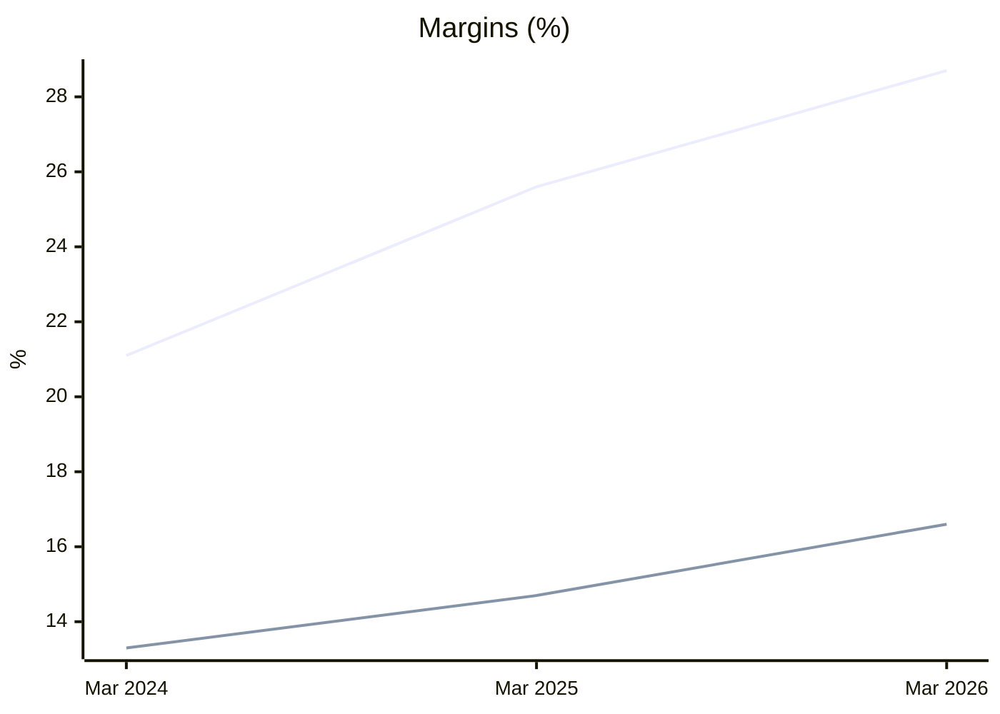

*Run 2026-11-24 · part of [SPINOFF_REPORT.md](../SPINOFF_REPORT.md) · the complete analysis of one company, with every management-call exchange in full.*

## ASTRAMICRO — Astra Microwave Products Ltd.

### 1. Astra Microwave Products Ltd. — CONFIRMED DEMERGER

**CONFIRMED** (a demerger scheme is on the exchange record) · **PRE-SPIN — study the parent; the pieces do not trade yet** · score 6.4/10 · spin-off · 17 filing(s) from CALLS, NSE, NSE-BM, NSE-deep · first 2026-02-27, latest 2026-11-12

**The separated entities — every one the documents name:**

| Entity | Scheme | Business | Listing | Who runs it |
|---|---|---|---|---|
| **Astra Space Technologies Limited** (earlier Astra Space Technologies Private Limited) | 2026 demerger of the Space, Meteorology and Hydrology Busin… | Houses the Space, Meteorology and Hydrology businesses transferred on a going-concern basis; satellite hardwa… | to be listed | not stated as CEO/MD/chair; "Mr. S. Gurunatha Red… |

**What is being separated, as the documents put it:** Space, Meteorology and Hydrology Business of Astra Microwave, hived off into wholly owned subsidiary Astra Space Technologies — class `value_unlocking`.

### 2. Stages and dates

> **Listing:** NOT YET — scheme at 'meetings' stage; Astra Space Technologies Private Limited will list only after NCLT sanction, effectiveness and a record date; indicated timeline: Not dated; NSE letter of October 29, 2026 says ASTPL "shall ensure that steps for listing of specified securities are completed and trading in securities commences within sixty days of receipt of the order of the Hon'ble High Court/NCLT"; the observation letter is valid six months from October 29, 2026 within which the Scheme must be submitted to NCLT.

| Date | Event | Source |
|---|---|---|
| 2026-02-27 | Board approval — Astra Microwave Products Limited | as stated: Outcome of Board Meeting / Press Release dated February 27, 2026 - in… |
| 2026-05-26 | Stage reached: **announced** | [Press Release](https://nsearchives.nseindia.com/corporate/ASTRAMICRO_26052026165633_PressRelease.pdf) |
| 2026-06-01 | Other — Astra Microwave Products Limited | as stated: Intimation of Board Meeting under Regulation 29 dated June 01, 2026, … |
| 2026-06-10 | Board approval — Astra Microwave Products Limited and Astra Space Technologies Private Limited | as stated: Demerger announcement dated 10.06.2026 - Board approved the Scheme of… |
| 2026-08-18 | Other — Astra Microwave Products Limited | as stated: NSE Observation Letter Ref: NSE/LIST/55855 dated October 29, 2026 - N… |
| 2026-08-22 | Stage reached: **meetings** | [Shareholders meeting](https://nsearchives.nseindia.com/corporate/ASTRAMICRO_22082026141503_AGMNotice.pdf) |
| 2026-09-30 | Other — Astra Microwave Products Limited / Astra Space Technologies | as stated: Outcome of Board Meeting dated August 10, 2026 - Mr. S. Gurunatha Red… |
| 2026-10-29 | Stage reached: **exchange noc** | [Scheme of Arrangement](https://nsearchives.nseindia.com/corporate/ASTRAMICRO_29102026164303_NOCLetter.pdf) |
| 2026-10-29 | SEBI observations — Astra Microwave Products Limited | as stated: NSE Observation Letter Ref: NSE/LIST/55855 dated October 29, 2026 - "… |
| 2026-10-29 | Exchange no-objection — Astra Microwave Products Limited | as stated: Filing dated October 29, 2026 - observation letter with "no adverse o… |

**The stages, as filed:** announced (2026-05-26) → meetings (2026-08-22) → exchange noc (2026-10-29)

**Stated in the filings:** resulting company **Astra Space Technologies Private Limited**; demerged undertaking: ) is proposed to be demerged into; size hint: 10.6% of ebitda.

**When it lists, in the documents' words:** Not dated; NSE letter of October 29, 2026 says ASTPL "shall ensure that steps for listing of specified securities are completed and trading in securities commences within sixty days of receipt of the order of the Hon'ble High Court/NCLT"; the observation letter is valid six months from October 29, 2026 within which the Scheme must be submitted to NCLT.

### 3. Size of the separated business beside the parent — is institutional selling likely?

**Reading: LIKELY — the piece is small beside the parent; mandates with size limits tend to sell.**

| Entity | Stated turnover | Stated share of the whole | Segment revenue share | Market cap (₹ cr) | Share of combined market cap | Index member |
|---|---|---:|---:|---:|---:|---|
| Astra Space Technologies Limited | "approximately INR. 157 Crores" for the financial year ende… | 13.58% | 9.4% (FY2026) | — | — | not listed |

*Stated figures are the documents' own (a turnover share, or the cost-of-acquisition split the company publishes for tax, which reflects relative value); the segment share is this business's revenue over the parent's sales, and the market-cap share is the entity's value over the entity plus the parent (parent ₹16,174 cr, NSE bhavcopy of 2026-11-13), both computed here.*

**In the documents' words:** “The turnover of the Demerged Undertaking of the Company for the financial year ended 31st March 2026 was approximately INR. 157 Crores , representing 13.58% of the total turnover of the Demerged Company for the said year.”

**The judge's read of selling pressure:** likely — Small (13.58% of turnover), distinct sector from parent's radar/EW/telemetry, 1:1 shares pushed to all holders, promoters only 6.45%.

### 4. Insider ownership — share swap, promoters' holding, management incentives

**Share swap / entitlement, entity by entity:**

- **Astra Space Technologies Limited:** "the Resulting Company shall issue 1 fully paid -up equity share of INR 2 (Indian Rupees 2/- only) each for every 1 fully paid -up equity share of INR 2 (Indian Rupees 2/- only) each held in the Demerged Company (“Share Entitlement Ratio”)"

**Promoters' holding, from the shareholding pattern:**

| Company | Promoters | FIIs | DIIs | Public | Quarter |
|---|---:|---:|---:|---:|---|
| Astra Microwave Products Ltd. (ASTRAMICRO) | 6.54% | 10.48% | 16.52% | 66.47% | Sep 2026 |

*Source: screener.in shareholding pattern, stored under `ShareholdingPattern/NiftyTotalMarket/`. In a mirror demerger each shareholder holds the same proportion of the new company as of the parent on the record date.*

- **Promoters in the parent, per the documents:** not stated in the documents on file.
- **What the promoters will hold in the separated entity:** 2026 demerger into Astra Space Technologies: "Upon the effectiveness of the Scheme, the shareholding of the Resulting Company will mirror the shareholding of the Demerged Company." ASTPL change in shareholding pattern: Pre-Scheme (as on 31.03.2026) Promoters 100.00%, Public 0.00%; Post-Scheme (Indicative) Promoters 6.45%, Public 93.55%. Also: "The post Scheme shareholding pattern of ASTPL will replicate/ mirror the shareholding pattern of AMPL." For AMPL itself: "AMPL: No change". Press release: "Will have mirror shareholding identical to that of Astra ."
- **What a public shareholder receives:** 2026 demerger into Astra Space Technologies: "ASTPL will issue and allot 1 fully paid -up equity share of INR 2 (Indian Rupees 2/- only) to the eligible shareholders of the Company, in accordance with Share Entitlement Ratio (as defined under the Scheme) , without any further application, act or deed. After the Scheme has been effected, the issued shares shall be listed on BSE and NSE." Also: "There is no cash consideration being discharged under the Scheme." The entire pre-scheme paid up share capital of ASTPL held by AMPL "shall stand cancelled and reduced".
- **Management incentives:** No stock option, RSU or SAR plan is mentioned in the documents, and no treatment of existing grants in the Scheme is stated. Convertible warrants: "The Board of the Directors of the Company at its meeting held on May 20, 2025 and the shareholders of the company at Extraordinary General Meeting held on June13, 2025 has approved the allotment of up to 20,13,885 convertible warrants each convertible into, or exchangeable for, one fully paid up equity share of the Company, having a face value of Rs. 2, within the period of eighteen months in accordance with the applicable laws at a price of Rs. 864 aggregating up to Rs. 173.99 crores ("issue proceeds"). During the previous year ended March 31, 2026, the Company has received 25% of the issue proceeds i.e., Rs. 43.50 crores (Upfront monies) on June 23, 2025 and June 24, 2025." Managerial performance bonus is linked to restructuring: for Dr. M. V. Reddy and Mr. Atim Kabra the performance criteria include "Other intiatives of corporate restructuring like merger/demerger 10.0%" weightage. Cash compensation on exit of the outgoing MD: "the consent of the Members of the Company be and is hereby accorded for payment of Rs.1,35,00,000/- (Rupees One Crore Thirty-Five Lakhs only) to Mr. S. Gurunatha Reddy (DIN: 00003828) in the nature of cash" (Explanatory Statement: recommended "payment of a cash compensation of Rs.1,35,68,889/-" representing "the remuneration payable for the unexpired portion of his tenure as Managing Director"). Director shareholding in AMPL: Mr. P. A. Chitrakar "32,40,830 Equity Shares.", Mr. Atim Kabra "33,56,074 Equity Shares.", Dr. M. V. Reddy "Holds 63,570 equity shares." Insider holdings in the JV: "Mr. S. Gurunatha Reddy is holding 0.20% shareholding in ARC", "Dr. M.V. Reddy is holding 0.20% shareholding in ARC", "Mr. Atim Kabra is holding 0.10% Shareholding in ARC", "Mr. Suresh Kumar Somani is holding 0.10% Shareholding in ARC", "Mr. P. A. Chitrakar is holding 0.20% Shareholding in ARC."
- **Insider actions around the separation:** No promoter or management buying, selling or pledging of shares is stated. Stated intent around the separation: "Mr. S. Gurunatha Reddy, Managing Director of AMPL has agreed to take on the additional responsibility of overseeing the ongoing demerger of the Space and Meteorology business and thereafter shall join Astra Space Technologies Private Limited (ASTPL) as a Director subject to the approval of the Board." His resignation letter states: "I am resigning from the position Directorship also with effect from the close of business hours on 30th September, 2026, to oversee the ongoing demerger of the Space and Meteorology business pursuant to the Scheme of Arrangement." Reason for change recorded with the exchanges: "Has taken responsibility to over see demerger of the Company and focus in establishing resulting Company."
- **Insiders, per the checklist read:** Promoters hold 100% of ASTPL pre-scheme (cancelled on effectiveness); post-scheme promoters 6.45%, public 93.55%, mirroring AMPL. Outgoing MD S. Gurunatha Reddy will join ASTPL as Director; MD/WTD bonus weights "merger/demerger" 10%. · *option pricing date:* not stated

### 5. Why the demerger — point by point

Astra Microwave is splitting itself into two sector-focused listed companies: the parent (AMPL) keeps Radar Electronics, Electronic Warfare and Telemetry, while the Space, Meteorology and Hydrology business is demerged on a going-concern basis into its wholly-owned subsidiary Astra Space Technologies Pvt Ltd (ASTPL), which will itself be listed on BSE and NSE. On the May 27, 2026 call MD S.G. Reddy said the board had given in-principle approval and framed the objective as creating 'sharper strategic and operational focus,' enabling dedicated management teams to chase sector-specific opportunities, enhancing governance and accountability, simplifying the corporate structure and creating 'clearer investment propositions to shareholders,' with focused growth, better capital allocation and improved operational efficiency over the medium to long term. The sizing numbers management gave: FY26 standalone turnover INR1,157 crore of which radar was ~60% and space plus meteorology ~16%; the scheme puts the demerged undertaking's FY26 turnover at ~INR157 crore, i.e. 13.58% of standalone turnover; the Dec-2025 order book of INR2,226 crore contained INR249 crore of space and INR369 crore of meteorology/hydrology orders. The scheme's stated reasoning is that space/met/hydro has 'distinct industry characteristics, competitive dynamics, regulatory environment, and risk profile' needing a differentiated strategy, and that a standalone entity would be 'better positioned to attract investors, strategic partners, lenders, and other stakeholders with sector-specific interests,' thereby unlocking the value of that undertaking for shareholders. Mechanically there is no cash consideration: shareholders get 1 ASTPL share of Rs 2 for every 1 AMPL share of Rs 2, ASTPL's existing promoter-held capital is cancelled, and post-scheme ASTPL mirrors AMPL (promoters 6.45%, public 93.55%). No investor, lender or partner is identified anywhere as having demanded the separation — it is presented as management/board-initiated strategic re-alignment, though Atim Kabra had repeatedly argued on earlier calls that the embedded space business was worth far more than the market credited (Aug 2025: 'very, very valuable'; Nov 2025: peers raising at $750-800m valuations with almost no revenue, close to Astra's whole market cap). The move is also backed with people: MD S. Gurunatha Reddy took on oversight of the demerger, stepped down as AMPL MD and director from close of September 30, 2026 to join ASTPL as a director, and Joint MD Dr M.V. Reddy became AMPL's MD from October 1, 2026. As of the last filings, BSE gave 'no adverse observations' and NSE 'no objection' on October 29, 2026, SEBI/NCLT approvals are still pending, and no effect of the scheme has been taken into the Q2 FY27 accounts.

**Point by point, with the source:**

1. First disclosure on a call: the board has in-principle approved demerging the space, meteorology and hydrology business, with the formal scheme to follow within weeks. “On a strategic front, the Board of Directors have in-principle approved demerger of our space, meteorology, and hydrology business.” — *[Jun 2026](https://www.bseindia.com/stockinfo/AnnPdfOpen.aspx?Pname=78f3aacc-b7ef-4d51-b1e1-d6e5863786b8.pdf)*
2. The stated objective is focus, not cash or deleveraging. “The objective of this move is to create sharper strategic and operational focus for business segments.” — *[Jun 2026](https://www.bseindia.com/stockinfo/AnnPdfOpen.aspx?Pname=78f3aacc-b7ef-4d51-b1e1-d6e5863786b8.pdf)*
3. The specific problems named: management bandwidth, governance/accountability, a complicated corporate structure and an unclear investment case for shareholders. “The proposed structure will enable dedicated management teams to pursue sector-specific growth opportunities, enhance governance and accountability, simplify the corporate structure, and create clearer investment propositions to shareholders.” — *[Jun 2026](https://www.bseindia.com/stockinfo/AnnPdfOpen.aspx?Pname=78f3aacc-b7ef-4d51-b1e1-d6e5863786b8.pdf)*
4. Expected outcome framed over the medium to long term, including capital allocation. “Over the medium to long term, we believe this initiative will support focused growth, better capital allocation, and improved operational efficiency.” — *[Jun 2026](https://www.bseindia.com/stockinfo/AnnPdfOpen.aspx?Pname=78f3aacc-b7ef-4d51-b1e1-d6e5863786b8.pdf)*
5. Scale of the business being separated, as management described FY26 revenue mix: space and meteorology ~16% versus radar ~60%. “Our radar business continued to be a primary growth driver, contributing nearly 60% of our revenue, while space and meteorology segment contributed around 16%, demonstrating our expanding footprint in strategic and high-technology domains.” — *[Jun 2026](https://www.bseindia.com/stockinfo/AnnPdfOpen.aspx?Pname=78f3aacc-b7ef-4d51-b1e1-d6e5863786b8.pdf)*
6. The June 10, 2026 scheme disclosure states the purpose as creating two separately listed sector-focused companies — radar/EW/telemetry on one side, space/met/hydro on the other. “The proposed demerger is intended to create two sector-focused listed entities, namely: (a) Radar Electronics, Electronic Warfare and Telemetry business focused entity; and (b) Space, Meteorology and Hydrology focused entity;” — *Scheme*
7. Core argument: the two businesses face different industry, competitive, regulatory and risk conditions and therefore need different strategies. “The Space, Meteorology and Hydrology business operates in a sector with distinct industry characteristics, competitive dynamics, regulatory environment, and risk profile, necessitating a differentiated growth strategy aligned with its specific market opportunities.” — *Scheme*
8. Capital-access rationale — the only place any outside constituency (investors, partners, lenders) is invoked, and as a prospective benefit rather than as a party that asked for the split. “A standalone Space, Meteorology and Hydrology entity would be better positioned to attract investors, strategic partners, lenders, and other stakeholders with sector-specific interests.” — *Scheme*
9. Explicit value-unlock objective for AMPL shareholders. “unlocking the value of the Demerged Undertaking for the shareholders of the Demerged Company.” — *Scheme*
10. Size of the carve-out quantified in the filing: ~INR157 crore of FY26 turnover, 13.58% of the parent's total. “The turnover of the Demerged Undertaking of the Company for the financial year ended 31st March 2026 was approximately INR. 157 Crores , representing 13.58% of the total turnover of the Demerged Company for the said year.” — *Scheme*
11. No cash changes hands; a 1:1 share entitlement mirrors AMPL's register into ASTPL (promoters 6.45%, public 93.55% post-scheme), and ASTPL shares will be listed on BSE and NSE. “For the purpose of the demerger of Demerged Undertaking ( as defined in the Scheme ) of Demerged Company into Resulting Company, the Resulting Company shall issue 1 fully paid-up equity share of INR 2 (Indian Rupees 2/- only) each for every 1 fully paid-up equity share of INR 2 (Indian Rupees 2/- only) each held in the Demerged Company ("Share Entitlement Ratio").” — *Scheme*
12. Leadership is being split alongside the businesses: MD S. Gurunatha Reddy was given the demerger and will move to ASTPL, with Dr M.V. Reddy taking over as AMPL MD from October 1, 2026 (April 3, 2026 press release; confirmed in the August 10, 2026 board outcome). “In this role, he will lead the adoption of tailored growth strategies and capital allocation frameworks suited to the Space, Meteorology and Hydrology sector, thereby enabling focused management attention, enhanced operational efficiency and the unlocking of value for the shareholders of the Company.” — *Scheme*
13. Status as of the latest filings: exchange clearances in hand on October 29, 2026; SEBI/NCLT and other approvals still pending, with no accounting effect taken in Q2 FY27. “AMPL has received observation letter with "no adverse observations" from BSE Limited on 29th October 2026 and observation letter with "no objection" from the National Stock Exchange of India Limited on 29th October 2026 in relation to the Scheme of Arrangement.” — *Scheme*
14. Pre-announcement value framing: Kabra argued the embedded space business alone could justify something close to Astra's entire market capitalisation, versus peers raising at high valuations with little revenue. “Companies are raising money at like $750 million, $800 million valuation with hardly any revenue numbers to their credit. If I extrapolate these numbers, actually, I got close to my current market capitalization.” — *[Nov 2025](https://www.bseindia.com/stockinfo/AnnPdfOpen.aspx?Pname=8920e2b3-bd77-473a-94ef-a0dba0be3236.pdf)*
15. Earliest hint of the value-unlock logic, alongside disclosure that Astra Space Technologies had been set up as a wholly-owned subsidiary with a ~INR230 crore space order book. “So our order book, as SG mentioned, is in excess of INR230 crores over there. And given where companies with very limited indigenous capabilities are valued, you might find that our space business is actually very, very valuable.” — *[Aug 2025](https://www.bseindia.com/stockinfo/AnnPdfOpen.aspx?Pname=8665322a-8313-49d9-b271-c9f46183b085.pdf)*
16. Two weeks before the in-principle board approval, Kabra flagged a need for creative financing for development projects and told investors to watch for options crystallising — the closest the calls come to foreshadowing the restructuring. “But as you know, balance sheet for efficiently -- for them to efficiently function, especially when our sales volumes are projected to go significantly higher, we need to be creative as well as ensure that there is enough financing is there so that our NCNC projects, the products being developed and the large blue sky thinking driven projects do not suffer due to inadequate financing.” — *[Feb 2026](https://www.bseindia.com/stockinfo/AnnPdfOpen.aspx?Pname=82557eb2-8eb5-49c4-b6db-4fe6f8761102.pdf)*

**How it evolved:** Through the Aug 14, 2025 and Nov 13, 2025 calls there was no demerger talk at all, but the groundwork was visible: Astra Space Technologies had been incorporated as a wholly-owned subsidiary with Bangalore clean rooms and a ~INR230-239 crore space order book, and Atim Kabra argued the space business was being carried inside Astra at far less than standalone peers' valuations. On the Feb 13, 2026 call there was still no mention of a demerger, only Kabra's hint about needing to 'be creative' on financing and 'watch the space.' The board granted in-principle approval on Feb 27, 2026, which surfaced publicly in the April 3, 2026 press release (tied to the MD succession) and was first spoken to investors on the May 27, 2026 (Jun 2026) call, where the detailed scheme was promised 'over the next few weeks.' The board approved the full Scheme of Arrangement on June 10, 2026, and the stock exchanges issued their observation/no-objection letters on October 29, 2026; notably, not a single analyst asked a question about the demerger on the May 27, 2026 call.

**What management expects from it:** AMPL becomes a radar/EW/telemetry-focused listed company; space/met/hydro becomes a separately listed entity with its own management team, tailored growth strategy and capital allocation, sharper focus, better governance and accountability, a simpler structure, improved operational efficiency, easier access to sector-specific investors, partners and lenders, a clearer investment proposition and unlocked shareholder value. No margin, EBITDA or valuation targets were quantified.

*Not explained on the calls:* No segment margins/EBITDA, asset-debt-employee split, ASTPL standalone financials, listing timeline, transaction costs, or where ARC/MMIC sit; no analyst questioned it; no requesting party named.

- *Stated reason, in one line:* Strategic re-alignment to create two sector-focused listed entities; Space/Meteorology/Hydrology has distinct industry characteristics, enabling focused management, tailored growth and capital allocation, sector-specific investors, and "unlocking the value of the Demerged Undertaking for the shareholders".
- *What it reveals:* Demerged undertaking turnover INR 157 crores, 13.58% of FY26 total; management says "the space margins are better compared to even defence also"; Dec-2025 order book INR 249 crores space plus INR 369 crores met/hydrology. Parent keeps radar/EW/telemetry with QRSAM, Uttam, Su-30 programs.
- *Parent or spin:* both · *Read next:* ASTPL abridged-prospectus disclosure in the NCLT shareholders' notice: demerged undertaking assets, liabilities, net worth, PAT, EBITDA.
- *In their words:* “Yes, all new shares of ASTPL will be listed and will be admitted for trading on the NSE and BSE, subject to receipt of requisite approvals from the Stock Exchanges.”

### 6. On the calls, verbatim

11 call(s), oldest first: **29 question-and-answer exchange(s)** given in full — the question and every answer to it, nothing trimmed — and 23 passage(s) from management's prepared remarks (the complete sentences about it; the whole remarks are in the linked transcript). Text is as the transcript prints it.

#### Nov 2023 — [transcript](https://www.bseindia.com/stockinfo/AnnPdfOpen.aspx?Pname=b7ff3df9-a487-433d-8218-8ad93bfff339.pdf)

**From the prepared remarks** *(the passage about it; the whole turn runs to 5,008 characters in the transcript)*

> **S G Reddy:** Our top line performance was in line with the previously indicated quarterly guidance. EBITDA margins also came in at a healthy 22%. Our order wins continue to be healthy. We have booked a bout INR405 crores worth of orders in this quarter, which comprise of about INR115 crores from radars, INR233 crores from EW segment, INR9 crores from telemetry, INR19 crores from space, INR26 crores from exports and rest from metrology and hydrology secto rs. Overall order book at the end of half year stands at INR1,867 crores, with majority being domestic orders. At the organizational side, I wish to inform you that we have strengthened our board with the induction of Mr. Suresh Somani as a Non -Executive Director and Mr. […] Further, we have been taking steps to move up in the value cha in, moving from subsystem to a systems vendor, where operational advantages are fairly large. We have identified specific growth areas for fut ure expansion, such as adcom systems, wind profile radars, ground surveillance radars, Doppler weather radars, an ti-drone and so on. Apart from these specific business -related updates which I would like to share with you, apart from bagging about 405 crores of orders in the quarter, we were able to close P&Cs worth about INR11 crores and are waiting to receive orders for the same very soon. The company has signed a ToT with IN-SPACe , NSIL, Forexpa and Mini SAR , which we hope will help us in terms of getting into the defense radars, apart from the space -related radars in a bigger way. Anti -drone radar, which we kept on sharing with you the developments in the last two quarters, which is being developed with LRDA technology, is in the final stage of testing. We expect to start field trials by the end of this year. NavIC chip approval is still waiting, unfortunately.

**Question and answer**

> **Venkatesh Subramanian:** Yes. Good morning to all of you. Season's greetings. Happy Deepavali. Congratulations on a very good set of numbers. I have basically three ques tions. Taking off from what you said. One is in terms of what we are pursuing and in the past transcripts we have been talking about broadly looking at a top line revenue in excess of INR8,000 -odd crores over a period of time at a run rate of approximately INR2,000 crores. That is one. But to achieve that kind of numbers, you would need to have an order build -up over the next 18 months to have a visibility for say four years to five years. Do we have some sort of a blueprint to get there? That is one questi on. Second question is, sir, which is with respect to NAVIC. I was reading one of the recent interviews of Rajiv Chandrasekhar, the Minister, Honorable Minister, saying NAVIC could be mandatory in a lot of devices. In NAVIC, are we a pure play or do you th ink we have competition out there and we will only get a piece of the pie? That is second. Third question is, NMIC, how big can this opportunity be in terms of say over a five years, six- year period of time if things work out for you? And you said you are uniquely positioned in the defense application side. One suggestion on the fourth one is, sir, if we are doing a little bit of crystal ball gazing over the next five years to seven years, where would our revenue spread broadly come from? Whether it would b e in terms of domestic tenders, would it be other services and activities as Atim mentioned, or would it be exports, would it be NMIC? Some sort of crystal ball gazing over a five years, six-year period will give us an idea of where the company is headed to in various strategic segments? And also, would be helpful because the Indian elections are coming up and defense tendering, Atmanirbhar, all that takes a backseat for some reason. Then we will have a plan B in executing revenues over a period of time. That's it from my side.
>
> **S G Reddy:** Atim, you take a couple of questions on N avIC and NMIC, then we will take the rest.
>
> **Atim Kabra:** There are two ways to look at N avIC. You can be the basic chip su pplier or you can look at being a value -added supplier. N avIC is still some time away, just to be very upfront about this, number one. Number two, METI had given the contract to two entities on this to develop the chip within the country. One was us and th e other is an entity called Accord. We did it in a joint effort along with another partner where we own 50% of the IP. So it's not exclusive to us, number one. We believe there's another entity by the name of [LNR] Geosystems which has made some claims abo ut this. We don't know much about this for you guys to explore. Our strategy would hinge around having the processor combined with the RF content and then creating some modules around it so we can be a value -added supplier in the NAVIC space. That would be the broad strategy. I'm reiterating, this is still a few years away to the bare minimum. Astra Microwave Products Limited November 15, 2023 We recently met some very senior government official, ex -government official and it was reiterated that the intention is there to completely support the ecosystem, b ut it will take some more time for the product to be developed. The good thing is we are first coded, which means our products can actually be multiple positioning systems. So we can do GPS from NavIC, NavIC on GPS or for that matter, we can code in BeiDou also, etcetera, etcetera. I hope that answers the question on NavIC. The MMIC part, which I would like to address here is that we are looking at creating a portfolio of MMIC products wherein a few chips or few products from our existing sale portfolio can be picked up by our marketing partner, while we develop midterm quick reaction product for them jointly. And at the same time, in parallel, these are our capabilities in MMIC to create products over the long term, which could be one to two years, right? I would -- let's say, we are looking at least seven to 10x maybe that's aggressive, okay, over the five years that you spoke about, okay? But we definitely are looking at about 3x, 4x of the current MMIC portfolio in a few years' time. Now that -- interesti ngly enough, that would imply creating a long sale of royalty which should come if our current efforts are successful and translate into a business opportunity and that's dedicated to dotting the Is and crossing the Ts in our final agreements, which are go ing to be done. So it's -- we'll keep you posted as it happens, but this is a long vision , which you guys are looking for. S.G.? Management: Yes. So the other part in terms of the visibility for the company for the next three to five years. As we have men tioned in multiple interactions with many of you, basically, we are looking at the overall pie that is available in the areas where we are there in terms of the radar, EWs, missiles and telemetry, sales, exports and turn key projects and special projects. We see a visibility of -- in excess of about INR39,000 crores up to year 2030. So this visibility, we have split up into three parts where we see definite opportunity for us maybe on a single tender or a preferred tender basis, about INR5,000 crores of opp ortunity. There are other two segments where there is a limited competition and severe competition, where the success rate we are assuming at about 30% to 40% where there is a medium competition, and about 10% to 15% with severe competition. If you take al l these three parameters and looking at the products, what I have indicated, we see a visibility of business in excess of about INR8,000 to INR10,000 crores. That is what we can say as of today.

#### Feb 2024 — [transcript](https://www.bseindia.com/stockinfo/AnnPdfOpen.aspx?Pname=f9edbd90-3b61-4994-82bc-2f1a07176049.pdf)

**From the prepared remarks** *(the passage about it; the whole turn runs to 4,326 characters in the transcript)*

> **S. G. Reddy:** However, w e should be able to cross the bottom line target in te rms of the PBT. We are happy to inform you that we have a significant contribution in Akash -NG, which was successfully testified during the quota. This has the potential to give a steady revenue for the company in the coming future. We are also happy to inform you that the company has decided to further expand its business and space segment by foraying into satellite integration, testing and launch its own next satellite in the next couple of years. Facilities for the same will be built at our existing Bangalore unit and we have budgeted to spend about 40 crores in the next 3 years. For the coming year, we target to achieve about 1300 crores of order booking, a top line in the range of about 1 ,000 to 1 ,100 crores , with a P BT in the range of 16 to 18%. With these remarks, now I hand it over to my colleague Mr.

**From the prepared remarks** *(the passage about it; the whole turn runs to 2,031 characters in the transcript)*

> **M. V. Reddy:** G. R. had mentioned, our overall performance in Q3 was at par with the guidance given in the previous quarter ending call. We have booked 256 crores worth of orders in the last quarter, that is Q3, which constitutes 161 crores from the domestic segment and 95 crores export orders. In the domestic market, we backed 136 crores from radar, which is our main focus area, 16 crores from EW and Defense Communications segment and 9 crores from space and metrology sector. Also pleased to inform you that we won close to 66 crores worth of development contracts from various DRDO and ISRO labs. Overall, we have booked 830 crores in FY '24 as of 31st December and that results to be close to the 1 ,813 Crores as a total overall order book as of 31st December and expect to book a minimum of 230 crores less in the current quarter. We have bright visibility to book 1 ,300 crores worth of orders in FY '25.

**From the prepared remarks** *(the passage about it; the whole turn runs to 5,426 characters in the transcript)*

> **Atim Kabra:** I will start with an observation. The legacy of the Second World War which nearly 80 years ago still defines the strategic vision of wars. Though it has been seriously rewritten as war is increasingly being shaped by technology and that's where we fit in. And within that unmanned and within this overall space, the unmanned weapon system, they have changed the very paradigm of how wars were fought. With the new unmanned weapon systems being very cheap and highly effective, with delivery mechanisms ranging from the vehicles to the sky, to the sea, and they allow not only real -time intelligence but als o adjustments to fire around the clock without pause with high precision while striking both in the front line as well as behind the enemy line. Now if I combine this capability with digital field creation, radio electronics, environmental control and cy ber offense , basically technology driven war is reinforcing superiority over traditional ways of warfare. Astra Microwave Products Limited February 09, 2024 In our opinion, therefore, countering these unmanned systems will be a big opportunity on a global scale. […] Communication payloads, signal controls, reconnaissance capabilities, high -end optics, hyper spectral cameras, they will all find uses in agriculture, Internet penetration on a wide r scale, effective communications, remote sensing as well as warfare. So, nano satellites with custom usage to micro and large satellites will be a big market at scale. As S. G. mentioned, I am glad to share that Astra's Board has decided to focus on sat ellite space in a significant manner. As you are already aware, Astra has a sizable order book in the space segment, and we have been providing a significant portion of the communication systems used in our three satellites. We intend to offer complete satellite systems right from, hopefully, the design capability to satellite bus, to the command, control, preloads, all under one group. And as we see, we are being joined by senior experienced professionals who have been involv ed in satellite building since long. We intend partnering with companies, both local and overseas, offering supplementary skill sets and intent being a one -stop shop for all things satellite. Towards this, budgets have been allocated and a new 100% owned subsidiary has been incorporated as space technology is limited. We expect this new business line to start contributing to our numbers in a span of two years plus. We will share more as the plans are to fly further. We, personally speaking , are all very e xcited by the growth prospects and our ability to be a significant player in space , building on top of our capabilities. We keep testing upon a few other initiatives, taking concrete space with a concrete shape at this point in time. We have identified a few potential acquisitions that will fill the gaps in our skill portfolio and augment our capability to emerge as a systems entity. We hope to complement the first such transaction over the next few months. So, please look at this space for some more news on this area. The other area for growth where we intend to build up significantly on our core capabilities is our in -house MMIC division. As we are well aware, Astra is one of the few companies that has in-house MMIC design capabilities, which have helped us innovate and build newer products with newer and different form factors. We intend to scale up this business line significantly in the global marketplace by leveraging our MMIC design capabilities.

**Question and answer**

> **Amit Dixit:** I have two questions. The first one is on the EBITDA margin in this quarter. So, if I look at EBITDA margin, it is very healthy, possibly the highest EBITDA margin ever. Now it has a very low proportion of exports, only at 20% and of course , the space execution has picked up significantly in this quarter. So, just wanted to get an understanding of what is the proportion of exports is that we can expect in FY '25 . Will it be closer to 20, 30 or I mean , higher than that, and also the space execution if you could highlight ? That is the first question. I have the second question . I can ask it together. So, in the last call , you indicated that , you know , the final trials of SDR are scheduled in January and February. So, just wanted to get an update on that. These are the two questions. Management : SDR. I think the final trials of SDR are pushed to June, July, but things are moving positively. Coming back to the first question , in terms of the proportion of export sales in the next year projections , I think export sales will be close to about 20% to 25%.

**Question and answer**

> **Santanu Chatterjee:** My first question is on, s ir, major opportunities on your different platforms which you have already depicted in your quarter 2 presentation , but strangely this time around that in this latest presentation it is missing. In different platforms you have depicted in FY '24 major opportunity size is more or less 4,000 crore . 2,060 crore is from radar segment and 2 ,000 crore from the system itself. Can you explain , sir, or can you give some kind of guidance that what is the Astra Microwave Products Limited February 09, 2024 present status of those orders or when this kind of opportunities from different platforms get converted into the form orders? Management : Yes, there are various platforms which we indicated in the presentation. I am not sure whether it was included or not this time , but you know , it is the same as the last quarter, not much of change. We have our presence in Uttam , which is going for production. As you know , HAL is producing radars . 50% of the quantity we have marked for the indigenous version that is Uttam wherein we are supplying AA AU. And then s econd is the upgradation or LCA Mark 1 . That is LCA Mark 2 also DRDO is planning to go for radar . In that also , we are likely to compete with other players. As one gentleman mentioned, about Su-30 is also coming out in near future wherein we have to compete with other industry players for the radar and EW segments. And in LCA Mark 1 , we are also there in ASPJ pod j ammer wherein we are the only source as of now for that pod unit . In that, we are supplying AATRU. And other platforms like AWC , which we have mentioned, AWC , which you know two programs have been sanctioned . One is called Mark 2 and another one is Mark 1A. We are there in both the platforms, we supplied originally the sub-systems for Mark 1 about 5 years back. Now Mark 1 is also being sanctioned. So, we are likely to expect a good amount of business from that. Similarly Mark 2, DRD O is finalizing the c onfiguration soon. So, there we have a competition. We have to compete with other players. It all depends like, you know, how these tenders get results. But otherwise , we have good opportunities for us to work on this domain. And in the ground segment , we have various platforms like weapon locating radar and also TLR , which is a radar for the Akash version. And also, we are working for like QSM, and then other major programs called like you know, Akash -NG. These are all other programs which we have been supporting BEL. Then coming to the missile platforms, we are there in Akash and then Akash -NG as well as Akash Prime, then Astra missile and also in QSM, Akash -NG missile. In all these missiles we have subsystems. And as far as EW is concerned, we are t here in more or less in , you know, many platforms which BEL is being produced like Shakti, Himshakti, Dharashakti , Varuna . All these platforms we have been supplying subsystems. And yes, that's all. These are the major programs in the defense sector. In space, we have our products for RSH which are in production right now. And we are expecting repeats for similar payloads in the near future. And apart from that, we are building our own satellite , you know, payloads as well as in the satellites to address this particular market segment. Astra Microwave Products Limited February 09, 2024 And in metrology, we supply automatic weather station and as well as remote terminals. These are all major projects which we have been supplying to IMD and all. The other one which we have not covered is Doppler w eather radar, which we supplied to IMD and also ISRO. We are working in various frequency bands. So, far more than 15 have been installed and commissioned. Yes, these are all some of the major programs which I think we have highlighted in last e arning call .

**Question and answer**

> **Abhijit Mitra:** No worries. And 1 ,300 crores of order inflow guidance for FY '25 , you mentioned 3 projects. Those 3 p rojects will be like what 60-70% of the total 1,300 crores or it is like a long tail, or I mean ? Management : Yes, actually out of 1 ,300 crores, close to 1 ,000 crores from these major programs, defense and electronic warfare put together and the rest is from space and metrology sector. Astra Microwave Products Limited February 09, 2024

**Question and answer**

> **Ketan Gandhi:** In opening remarks, you said something about satellite integration. Can you please throw some more light on that, exactly what we are planning to do there? Management : We are building a satellite for the Earth observation satellite, based on a particular requirement. And there, in fact, the payloads for that particular satellite is being already made by our space unit in Hyderabad. This new facility, which we have initiate d in Bangalore, is going to be an integration of the complete satellite. So, that addresses the Earth observation satellite and also in the future, all kind of a communication satellite we are planning to build in that particular facility.

**Question and answer**

> **Col. Sarjeet Yadav:** Just one question , in case you can give some color on the space opportunity. As I understand that as of nowadays , one product which is a SAR payload, any other opportunity we see ? And in how much time do we see it getting commerc ialized? This is the question , sir. Management : Well, we are working on that SAR payload. We got technology transfer from ISRO, and we are trying to build payload based on the technology. Right now it is in the optimization phase. May take two more years for us to build this particular payload and to offer to th e radar imaging satellite programs.

**Question and answer**

> **Col. Sarjeet Yadav:** So, any other product in this space segment that which we are targeting , sir? Management : Yes we have a few clients who are working over this kind of remote sensing satellites . We have been discussing with them . So, I think , probably , we are in a position to offer a solution to them.

#### May 2024 — [transcript](https://www.bseindia.com/stockinfo/AnnPdfOpen.aspx?Pname=51894a8e-05b9-45c2-97c3-a640c31addc8.pdf)

**From the prepared remarks** *(the passage about it; the whole turn runs to 3,203 characters in the transcript)*

> **M. V. Reddy:** The overall performance in the year FY '24 was a par with the guidance given in the beginning of the year. We have booked INR472 crores in Q4, which constitutes almost 95% in the different sectors of the domestic market. We have had INR350 crores from the Radar segment, which is our prime focus area for the last few years, INR84 cror es from the EW and INR18 crores from the Defense Communication segment. We also booked INR26 crores from the space and metrology sector. In the last quarter, we have booked INR27 crores development orders from DRDO Labs and rest all from the production is in nature. Overall, we have booked INR1,325 crores in FY '24, resulting standalone order book of INR1,956 crores brought out for the financial year FY '25. Astra Microwave Products Limited May 24, 202 4 Ladies and gentlemen, it gives me immense pleasure to inform you all that with few orders which will be booked in April '24, that is in the current financial year, we have reached a landmark of INR2,000 crores order book for the first time and we have a bright visibility to book INR1,200 crores to INR1,300 crores for FY '25.

**From the prepared remarks** *(the passage about it; the whole turn runs to 9,163 characters in the transcript)*

> **Atim Kabra:** Numbers are numbers , but I think what is being conveyed across is that the opportunity set is Astra Microwave Products Limited May 24, 202 4 huge and companies like Astra and it's not limited to us, but the defense se ctor itself, are fairly well placed to capitalize on this extremely large opportunity. I read a report recently, it speaks about the share of defense capital outlet is expected to increase to 37% of the total defense budget in FY'30 as compared to 26% in FY'24. And that is a cumulative capital outlay of $186 billion over FY'24 to '30. I 'm saying this is a large opportunity space that we need to attack and are operating in. But suffice it to say that over the next two years, based on the orders in hand and the visibility thereof, we are fairly confident of delivering CAGR growth in sales of around 18% to 22% , with a better CAGR growth in our profitability numbers as higher sales slowdown disproportionately to the bottom line in face of limited increase in fi xed cost base. So I'm fairly confident that S.G . and M.V . will meet these forecasts quite handily. But I want to talk to you more about our broader vision which will position us firmly on a path towards sustainable and predictable growth over the next deca de. […] Astra Microwave Products Limited May 24, 202 4 It is tied around our capabilities to deliver, our proven capabilities to deliver. And our technological base, which can imbibe the new tech, provide them a framework to create newer sales products, newer sales and newer sales channels. E in the LEAP framework denotes our commitment to adjacencies and expansion, E is expansion, expansion in to areas which can be significant in themselves and where the future lies in our assessment and where our current set of capabilities can be deployed to make a meaningful impact going forward. Astra is already a significant player in the space sector and we see immense opportunities for expansion in the space sector. We will be one of the major companies major players out there ranging from space -grade components, subsystems to designing satellites, to satellite bus as well as payloads. I think we will be able to deliver our first satellite, sizable size satellite maybe in the next 12 months to 15 months. This activity is being co -ordinated by both our Bang alore a s well as Hyderabad facilities a nd a lot of folks with significant experience have been onboar ded for this initiative. Similarly, we have spoken about our MMIC capabili ties being one of our core strength .

**Question and answer**

> **Col Sarjeet Yadav:** Okay. Sir, one more question. In Space segment, I saw revenue of about INR15 crores. So can you tell me what kind of product are you supplying in the space segment? Management : Yes. We have orders from ISRO for subsystems of Radar Imaging Satellite. Some of them have been supplied last year and left over, we are go ing to complete it in the next two quarters.

#### Aug 2024 — [transcript](https://www.bseindia.com/stockinfo/AnnPdfOpen.aspx?Pname=7eb70fbb-8890-48a4-85d9-af5c27274526.pdf)

**From the prepared remarks** *(the passage about it; the whole turn runs to 4,065 characters in the transcript)*

> **S. G. Reddy:** The Results and Investors Presentation for Q1 are uploaded on our Company website and stock exchanges and I hope you had a chanc e to look at it. In terms of the highlights: I am happy to share with you that Q1 FY24 (wrongly said, please read it as Q1 FY25) is a good start to the Financial Year FY25. Keeping in mind the seasona lity pattern inherent to our business wherein Q1 is the weakest quarter and the major chunk of revenues are captured in the subsequent part of the financial year. We want to highlight th at we have also improved our gross margin significantly, which were primarily driven by continuous improvement in the product mix where the domestic defense business contributed to 65% of the topline, followed by exports whose contribution is around 21% and the space with 11.5% with rest of the business coming in from metrology and other sectors. This performance is in line with our expectations and guidance. Coming to our order book: We have crossed the milestone of Rs. 2,000 crores mark this time whe re the standalone order book as of June 2024 stood at Rs. 2,099 crores and our or der wins continues to be healthy. As guided in Q4 Earnings Call, we have booked about Rs. 3,002 crore s(wrongly said, please read it as 302 crores) of worth of orders in this quarter out of which Rs. 240 crores of orders are from defense industry. […] At the end of the quarter, the employees count is close to about 1537, up from 1468 at the end of the financial year. EBITDA stood at Rs. 23 crores as against Rs. 5 crores in the same period of last year and the m argin stood at 15% as against 3.50% of previous period. The Company reported profit after tax of Rs. 5 crores which was the loss of Rs. 4 crores at the corresponding period of last yea r. T he execution of space orders continues to be good and more than 11% of revenue is c oming from this segment. Export sales revenue was also in line with the previous quarter, remaining sta ble at a reasonable level of 21%. We are confident about the growth in the overall industry as we believe that the Government's objective has widened and the im plications of the Indian Government ’s Aatmanirbhar Program extends beyond import substitute. It also provides Indian companies like Astra, which has expertise an engineering patt ern with a platform on which to build global visibility and businesses.

**From the prepared remarks** *(the passage about it; the whole turn runs to 6,308 characters in the transcript)*

> **Atim Kabra:** So, these initiatives are hand in glove with our LEAP strategy. More project managers with a deep grounding impact, with a deep grounding in Company culture not only lays the foundation for or ganic growth, but also helps us think outside the box on a collaborative effort which underpin our LEAP strategy. I am glad to inform you that the base pillars of LEAP strategy which were around financial accretiveness, productization and lean and learn, implying a colla borative approach with external IP holders also is well on its way to deliver results. Glad to share that two definitive binding term sheets have been signe d this past quarter alone, one in the area of chip design services and another in the radar space while discussions have been initiated with multiple companies, both listed space as well a s in the smaller unlisted space for enhanced collaboration with the platform, which Astra p rovides to further enhance our joint intellectual property and create products which are well suited for the future. We are also in a hurry to monetize things at the fastest possible pace and collaborations are possibly Astra Microwave Products Limited August 13, 2024 one way to go about doing this. We aim to conclude a few suc h collaborative arrangements every quarter going forward and that is one of the basic premises of ou r LEAP strategy. To conclude, Astra will continue to build on its track record of de livering on its numbers.

**Question and answer**

> **Rupesh Tatia:** Also the next question sir is, I think we have a patent with I think one of the labs for Netra Primary radar and I think some order is expected in Netra or o rder is received, I am not clear. So, can you talk about what kind of commercial orders are expected in Netra? And then will we supply only primary radar or some other components as well? Management: In Netra, you are talking about AWC Mk1. So, there we supplied subsy stems of Primary radar and we have already supplied a few years back and we are ge tting some repeat contracts for maintenance and also for one more aircraft I think. So, we have o rders on hand and also we are likely to get some of them for the space.

**Question and answer**

> **Ravindra Shah:** Sir, I have two questions. The first question is, can you please elabora te a bit on your Bangalore facility like for which business this facility will be ded icated, domestic defense, space or other business segments? Astra Microwave Products Limited August 13, 2024 Management: Originally, we have created that facility for our systems integration an d testing, especially in the radar and electronic warfare domain and we have built up NFTR f acility also and also assembly hangers to handle and address the radar systems. And also we have created space division in Bangalore facility. We have incorporated 100% subsidiary u nit, Astra Space Technologies Limited and that group is basically going to address a ll future satellite requirements and they are also working in the same facility. We have created the infrastructure to meet that particular requirement.

**Question and answer**

> **Ravindra Shah:** And what kind of opportunities do we foresee in the global s pace business on the BTS side? Management: Actually, we are focusing more in the Indian market as of toda y. We would like to address this Indian market and then wanted to address the global market. Yes, oppo rtunities are there opportunity size is very large as far as this space segment is conce rned. So, that is the reason why we are investing into thi s particular sector and we are planning to enhance our operations in this particular segment, but to be precise figures and all, we d on't have as much as far as the global business is concerned. But for Indian, yes, we have a figu re. Based on that, we worked out our business model.

**Question and answer**

> **Nishi Shah:** I have one question. What kind of margins does this space busin ess comes with and is it same as the domestic defense orders or is it better than that? Management: More or less we carry the same margins between space and defe nse.

#### Nov 2024 — [transcript](https://www.bseindia.com/stockinfo/AnnPdfOpen.aspx?Pname=b0527413-e100-4fb3-8252-231bfcfcc3cc.pdf)

**From the prepared remarks** *(the passage about it; the whole turn runs to 3,796 characters in the transcript)*

> **S. G. Reddy:** This performance is in line with our expectations. On the profitability front, we continue to maintain our EBITDA margins at a sustainable level at the rate of around 21%. This improved profitability is largely because of the product mix, which is skewed more towards domest ic as we have shared with you in recent calls. In terms of the composition of the sales, the defense -- local defense production has contributed to 80% of the top line, followed by exports up to 12% and the rest of the things came from space and meteorolog y sectors. In terms of general business development, I wish to inform you that during the quarter, we have signed an MOU with Premier Explosives Limited for a strategic alliance to develop and sell multiple products jointly. And the JV agreement was signe d with Manjeera Digital Systems to establish a new entity focused on manufacturing NavIC chips and the G NSS products using NavIC chips. This joint venture is going to be owned equally by the parties. […] As of September '24, at consol level, it is around INR2,269 crores, whereas stand -alone number is about INR2,097 crores. And our orde r wins continues to be healthy. In Q2 FY '25, for stand -alone, we received new orders worth of INR230 crores, which is mainly from the domestic defense and meteorology segments. In terms of the breakup of these Astra Microwave Products Limited November 13 , 202 4 new orders received in Q2, INR73 crores came from radars, INR71 crores for EW segment, INR77 crores for meteorology and the rest from space and exports. Overall, our order book comprise of 98% of domestic orders, which are largely BTS that is built to spec and a 2% of export orders, which are a mix of BTP and BTS. Our consolidated order book consist of INR117 crores worth of service orders, which are typic ally margin accretive. Further details on order links and the business trends will be shared by Mr.

#### Feb 2025 — [transcript](https://www.bseindia.com/stockinfo/AnnPdfOpen.aspx?Pname=0502c674-78b1-4151-8d2f-da59e6e97b83.pdf)

**From the prepared remarks** *(the passage about it; the whole turn runs to 4,060 characters in the transcript)*

> **S. G. Reddy:** To start with the Q3 results, I'm delighted to share with you that Astra h as delivered a healthy performance with a 12% year-on-year growth in the top line , which stood at INR257 crores on a stand-alone basis. This performance is in line with our expectations. On the profitability front, we continue to maintain our EBITDA margins at a sustainable level of 29.1%, indicating stability in our margin profile of current order book and a better m ix of products sold during the quarter. We saw healthy order execution during the quarter, wherein domestic defense orders contributed to 85% of our revenue, followed by export business at 8.4%, space 3.4%, metrology 2.7% and balance coming from other businesses. Our consolidated order book as o f December '24 stood at INR2,332.6 crores. The stand-alone order book as of December stood at INR1,960.2 crores with new orders of INR141 crores received during the quarter. For 9 months, we booked about INR674 crores of new orders, g radually moving towards our annual order booking target.

**Question and answer**

> **Amit Dixit:** Sure, sir. One last question, if I may. You also spoke on the anti- drone radar in your prepared remarks. So can you just highlight the kind of -- what potential do we see in this? How is it different from our peers who are in this space? Management: Probably M.V. Reddy will take that. Management: Yes. Amit, so this is -- as we mentioned in our previous calls also, this T oT, we got it from DRDO, but we optimized the design. And today, we are competing w ith a couple of companies in this particular domain. So initially, we developed the total rada r solution and then we have demonstrated. And as Mr. S.G. has mentioned in the opening remarks, we are now integrating with the radar jammer and other sensors to provide the overall soft kil l and as well as hard kill options.

#### May 2025 — [transcript](https://www.bseindia.com/stockinfo/AnnPdfOpen.aspx?Pname=2a87d22a-4d49-44dd-8273-a4a664fbe476.pdf)

**From the prepared remarks** *(the passage about it; the whole turn runs to 4,997 characters in the transcript)*

> **S.G. Reddy:** For FY '25, our EBITDA margin is about 25.5% and PAT stood at ab out INR143 crores with a margin of about 13.7%. Based on our product mix for the current order book, we are confident to maintain margins -- margin profile around 18% on a PBT level for the coming year also. During the year, we received orders worth about INR1,098 crores on a stand -alone basis. These new orders are essentially Astra Microwave Products Limited May 23, 202 5 from radar and other segments, where radars have contributed to about INR556 crores , INR226 crores coming from electronic counter intelligence, about INR36 crores from telemetry, INR60 crores from space, INR79 crores from exports and about INR140 crores from metrology and hydrology sectors. Overall, our stand -alone order book of about INR1,951 crores consists of 91% of domestic orders, primarily build to spec and 9% export orders, which include both BTP and BTS business. Moreover, our consolidated order book includes service orders valued at about INR150 crores, which are typically more accreti ve to margins. Apart from regular orders, during the quarter, we have received orders for AAAU for LCA Mark 2 and Su -30, which have significant business potential in the years to come. […] In terms of top line, though there is a dip in profitability due to low level of performance in Q4. It has huge potential to grow in the years to come in. And in the immediate com ing year, it is estimated to reach about INR350-plus crores of sales with a PBT of about 12%. In terms of capital expenditure, we have budgeted to spend about INR45 crores for purchase of various test equipment to augment existing operations and another INR45 crores for building additional space at our production unit to take care of expected load in the coming years. This capex will be met out of internal accruals and term loans from the bankers. Over the years, Astra has grown strength by strength and i nvested significantly both in infrastructure and talent in view of enhancing capacity and capability and opportunities. Our performance during the year and our order book mix are a clear sign of these strengths. Today, Astra stands as a tall as well as div ersified defense company that offers critical components, subsystems , high-end MMICs, and systems, especially in the radars for both defense and weather and anti -drones. In this world of heightened uncertainty, Astra is strategically well positioned to serve both domestic and international markets with a diversified product portfolio catering to a wide spectrum of applications in defense, space, and metrology. In the end, I would like to share with you, we are aiming to grow our top line at around 20% with a bottom line of about 18% with an order book target of about INR1,400 crores for the financial year FY '26. Now I hand it over to Dr. M.V.

**From the prepared remarks** *(the passage about it; the whole turn runs to 4,256 characters in the transcript)*

> **Dr. M.V. Reddy:** These projects are not only techno logically advanced, but also strategically aligned with India's long -term defense requirements. We also would like to bring out a few key operational highlights from Q4, which also include other order wins like radar subsystems, which we won for Akash Pri me, VL-SRSAM and a few radars, weather radars from meteorology sector and also the Agro AW S system from Indian meteorology Department and the X-band vehicle for a strategic missile program. A few major programs which we have delivered in last year, which includes Ashlesha Rohini modules, 3D -Car frame modules and other subsystems for MPR, WLR likewise and also EW subsystems like H imshakti modules, Nayan, etcetera. And also, we have delivered subsystems for Anvesha program of space program. We have also del ivered successfully precision approach radar to HAL and its installation and integration is in progress. And during Aero India Show, we have signed multiple MOUs with the large defense and aerospace companies, include L&T, BDL for expanding our collaborati ve ecosystem and market reach. In a nutshell, in FY '25, we won orders 80% in defense, 20% in space and metrology. Overall, radar contribute 50% and 20% we bagged from AW sector. Similarly, we have made sales in the same ratio, that is 80% in defense and 20% in space and metrology. As we look forward, we see a strong order pipeline and robust demand for our indigenous defense technologies. We are cautiously optimistic keeping in view of process timeline constraints, and we expect to achieve a top line gro wth of 20% in the coming financial year, that is FY '26 onwards, driven by Astra Microwave Products Limited May 23, 202 5 a sustained government focus on self -reliance and strategic procurement. We target to book a revenue of INR1,300 crores to INR1,400 crores orders in FY '26, including INR1,000 plus from the domestic segment and INR300 crores plus from the export.

**From the prepared remarks** *(the passage about it; the whole turn runs to 5,801 characters in the transcript)*

> **Atim Kabra:** And as you very well know, Astra manufactures complete r adars right from MMIC to T/R modules upwards. And we are strengthening that core capability continuously, bolstering it by concerted move into smaller, lighter radars with a predominantly digital footprint. Astra Microwave Products Limited May 23, 202 5 I also wish to share with you today the broad sp ectrum of our product range, which establishes Astra as a well -diversified defense sector key player, with deep rooted capabilities that expand much beyond our expertise in land and airborne radar platforms. So we are not only into high - end radars, but als o significantly into electronic warfare systems, missile electronics, telemetry, space sector and weather and hydrology segment with exports contributing as the final niche. So in a predominantly tender -driven procurement system, our diversified presence insulates us to a large extent from extreme swings and brings about a predictability and sustainability to the earnings stream, which is our focus. More than 50% of our revenues are driven by the segments which I just described above besides the radars. S o we make radars, but we are a key player in electronic warfare systems, missile electronics, space and weather and hydrology. So this will give you a sense of the deep talent pool, which is the backbone of Astra. Now as multiple AF1 platforms get upgrade d and ground -based radars cover larger swaths of our products, will give us an ability to look deeper into hostile territory where -- and we expect our radar business to grow at a steady pace. But the evolving sector of warfare will be predominantly based on electronics in our opinion. […] Precise targeted strikes with minimum collateral damage will place importance on command guidance units in missiles, fuses and missiles with AI -based data inte rpretation becoming the norm. Our solid -state seekers will propel safe to say, new generation missiles. And there is a substantial potential market in both offensive as well as defensive missile capabilities, where we hope to continue playing a critical role, much like the success of Akash missiles. We also believe that space will be the next frontier in war, with space -based surveillance and spy satellites becoming the norm, high -speed data transfer, satellite -based communication links and there are eyes in the sky, which never blink and penetrate through clouds and foliage. And this will be besides the multiple civilian applications that you will see for space sector. You will be very happy to note that barring launch capabilities, Astra has over more th an a decade, developed capabilities in the space sector that cover space -grade components, subsystems, significant payload contribution capabilities, satellite designing and assembly capabilities, ground stations. And now we are moving into solutions acros s sectors from the space sector. Further, I would say, diversification is also provided by our weather business, with Doppler weather radars, wind profiler radars, automatic weather stations, which enable us to offer weather prediction solutions over time . But as we shift our focus on th e solutions, I hope you are able to share our vision of being a deep tech company providing solutions across a spectrum of needs for our defense forces and beyond in a focused, profitable manner. We together, I would say, both you and us to our soldiers in our own ways, supporting the vision of a self -focused partner that dominate over our interest.

**Question and answer**

> **Akshay J.:** In the last few interviews on new channels and on these calls, you've spoken about space having the potential to be as large as our current defense business. Can you spend a little bit more time understanding and explaining to us what the parts -- any areas that we see as large oppo rtunity in the near term and the medium term. If we have to imagine a business as large as defense in space, what would the journey look like from here to say, 3 years or 5 years? Management: : Yes. In space segment, we started our journey by supplying comp onents and subsystems to all communication and remote radar imaging satellite programs to ISRO. This is almost -- we started from 2001 onwards. And we -- with the transformation in the space sector and the reforms being introduced in 2020, and the governme nt has given the opportunity for companies to build and launched satellites . Astra Microwave Products Limited May 23, 202 5 And keeping -- taking this opportunity, we decided to start our own space satellite division, and we formed Astra Space Private Limited and the 100% subsidiary of Astra. Here, ba sically, we are planning to build our own satellite and as a technology demonstrator for this and which is already in the advanced stage. And apart from that, we are also participating in a couple of RFPs being floated by IN -SPACe and all, wherein the pri vate company has been allowed to build the satellite constellation and to operate and sell the data. This kind of RFPs, we started looking into this. So going forward, while we continue to supply our subsystems to satellites made by ISRO and other key OEMs and international OEMs, we also -- we are planning to build our own satellite for generating revenue from the data. This is what the mission. Maybe Atim may add a few more points on this. Management: : Yes. Guys, there's a lot of talk about the need to lau nch spy satellites. There is a need for application of satellite source data for agriculture, for fisheries, for water management, you name it. Data is the key here. Data monetization abilities which exist in the West has now -- the time has come for that to be implemented across the board in India. Now Astra's journey was as we explained over a period of time, has been for more than a decade where we have space -grade facilities to manufacture components. Components have to be tested, and they have to be forced, if I may say, to withstand high temperatures as we send them into the space. So there are dedicated facilities and testing units, which are within Astra for space -grade components. We -- in the last mission, which went, I think it was Samudrayaan , if I'm not wrong, Dr. M.V. Reddy , where we were 9% of the payload and 3% of the overall satellite in value terms, okay? So once you supply components which are space grade, you move into subsystems. We are -- we have been a very activ e part of the reset satellite programs. We -- across multiple bands frequencies, we are able to create these communication links, which will come in very, very handy as we go forward. You have subsystems, which are made and then you have payloads. Now Ast ra has in certain segments, in certain kinds of payloads, very significant capabilities, which have been built up over a period of time. There are a few gaps which we are hoping to fill in through JVs or alliances or through tech absorption from external s ources. We have in our Bangalore unit, satellite assembly clean rooms, which have already been set up and commissioned. We have designing capabilities, satellite designing capabilities, which are being continuously improved. We are already there in the gr ound segment for satellites, the communication ground stations, which need to be built. Astra is a part of that, okay. And this completes -- almost completes the hardware chain. And then there is a data monetization part, which I mentioned to you the vario us applications. And Astra will be a significant player over there also is our effort. So I hope I'm able to explain the value spectrum where we are. Astra Microwave Products Limited May 23, 202 5 Management: : Point that for the defense programs, which have been DRDO has made a few satellites like OTGR , Anvesha, SAMOOHA, wherein we are an active partner, and we have been supplying critical subsystems to those programs.

**Question and answer**

> **Yash:** Congratulations on a good set of numbers. Sir, I just wanted to understand the importance of antennas, which are being used for our radar, electronic warfare, missiles, and counter drone. Do we make that in -house? That's my first question. Management: : Yes. Antenna is one of our core strengths in our products. Actually, we were one among the first set of companies who started antenna design and development and manufacturing. Even in 1992, we have established antenna design center and the open -air antenna t est range with the capability to build antenna for -- to begin with telecom, and then we entered into defense and space. We have supplied these antenna for many programs for ground -based, airborne -based and shipborne -based programs in defense. And also, we have supplied these antenna panels to satellite programs. So today, we have a very strong antenna design development and manufacturing facility in -house. So all the antennas, whichever required for our radar systems and EW being built in -house.

**Question and answer**

> **Yash:** Okay. Got it, sir. And just a follow -up on that, sir, that -- can you help us understand the criticality of designing and dev eloping these antennas in -house and not getting it made from someone outside the company? Management: : Actually, this antenna is a specialized skills like in this particular domain since we have this expertise built in a company right from inception of the organization. So we have been growing with the upgradation of this particular technology, and we have been using specialized tools and with the software designed by our own team. And with that, we are able to turn out these antennas and to be supplied to the defense and space requirement. So the software plays a very key role while designing this antenna. And our team has a full established capabilities, and they have been successful in developing this antenna using those softwares. And also added to that , we should have an infrastructure to test and measure the radiation and all like we have an open -air antenna test range. As I mentioned earlier, in the beginning, we have established. And then also we have established a near -field Astra Microwave Products Limited May 23, 202 5 test range in Bengaluru to test all active phase antennas, which is one of the, I would say, first in private sector to build this kind of a test range in India.

**Question and answer**

> **Bharat Sheth:** In the initial remarks, you spoke a lot about drone side. So can you give some color what exactly and what stage we are in the drone space? Management: : Let me answer that, Dr. M.V. Reddy The counter drone systems are a very, very wide range. They range from simple stuff like drone guns to jammers and to jammers, which can be o f varying distances, right? There are passive detectors and active radars, which are included as a part of counter drone systems. On top of that, you have panels, which decide the direction as Astra Microwave Products Limited May 23, 202 5 well as the strength of the signal and the length to which you can jam the signals and the height to which you can jump the signals, right? And whether you can do it in parallel simul taneously or in how many directions can you cover the jamming. So now these are for standardized drones. Then you have tactical drones, which are -- which come in with their own built -in anti -jamming systems. So there are different technologies which are deployed to counter them. Suffice to say that Astra has a presence across the entire spectrum of drones at this point in anti -drone syst ems. And they are being tested as we speak.

#### Aug 2025 — [transcript](https://www.bseindia.com/stockinfo/AnnPdfOpen.aspx?Pname=8665322a-8313-49d9-b271-c9f46183b085.pdf)

**From the prepared remarks** *(the passage about it; the whole turn runs to 5,025 characters in the transcript)*

> **Atim Kabra:** Apart from weather radar, over the medium term, we see opportunities, particularly in lightweight, low -level radars, anti -drone radars and ground penetration radars. In Q2, we received an impo rtant order worth INR135 crores at a gross value from the Defense Research and Development Organization in August 2025. This project involves upgradation of ground -based radar system. Further, we remain committed to advancing indigenous innovation across t he defense space and Me trological sectors. Backed by a strong order book and significant order booking opportunities in the near term and a deep focus on execution, we are confident in our ability to sustain growth and create long -term value in the quarte rs to come. In the last few years, we have made conscious and strategic investments to diversify both in terms of technology and sectors where we are in. We are also now building a strong and credible presence in the space sector. Our stand -alone order bo ok on -- order book includes about INR239 crores worth of orders from the space sector. These comprise high -quality complex components and subsystems that require precision engineering, reliability and a deep technical know -how, areas where Astra has consi stently delivered. As you are aware, we have incorporated a wholly owned subsidiary by name Astra Space Technologies Private Limited recently to focus in space business in a bigger way and have already taken steps to recruit skilled manpower and to establish clean and assembly rooms for assembly and integration of small -sized satellites. These operations will be carried out from our Bangalore facility with support from Hyderabad Space division, which has more than 20 -plus years of experience in supp lying under BTS and BTP mode, various electronic components and subsystems required for ground and onboard applications. In terms of group company's performance, our wholly owned subsidiaries are doing well, though they are largely serving our captive consumption needs. Our joint venture company, Astra Rafael Comsys Private Limited too has done well during the quarter and its prospect looks bright for the coming years. It has an order book of INR400-plus crores as of today and is expected to do about INR350- plus crores of top line with a PBT of around 10% for the year.

**From the prepared remarks** *(the passage about it; the whole turn runs to 12,102 characters in the transcript)*

> **Atim Kabra:** And these are the basic building blocks of TR modules that are th e backbone for most of our core products. We have today a portfolio of more than 40 chips, and we are focusing on building them up and upgrading quite a few of them to compete in the global markets where potential exists to sell chips in excess of $50 mill ion or more over the next 5 years or so from this portfolio alone. And you have already seen the global relationships, which we are tryin g to put together, Teledyne, et cetera, to enable these sales on a global basis. Astra set up its space business, which was spoken about by S.G. Reddy right now in excess of INR225 crores, INR230 crores is our order book. But we set up the space business more than a decade back, and that is the foresight which the management had. And credit is due to the management team fo r doing so then. In the space sector, h ardware supply chain, Astra has a very spread out presence across the spectrum. We make critical components, have extensive test facilities to ensure the space wordiness of our products. We make critical subsystems. We contribute significantly to multiple payloads, be they in the communication area or be they SAR -enabled payloads. Astra has been beefing up its supply -- sorry, satellite bus design capabilities. And we have a clean room, which, as we mentioned, to asse mble small satellites in our Bangalore unit near ready. We have made a conscious decision for now not to go in for launch vehicles, but we already have a presence in the ground station capability -- in the ground station segment. So as you -- Astra Microwave Products Limited August 14, 202 5 what I'm try ing to paint is that we have a capability which exists across the entire spectrum of satellite hardware, and we intend building up significant capabilities in data monetization space too, to provide a complete satellite -based data ecosystem. And it was in recognition, I must mention, of our capabilities that one of the leading defense PSUs recently had formed an SPV with us to bid for a specific space tender. And we hope that we'll collaborate with them and others in our space -related endeavors going forwa rd. So our order book, as SG mentioned, is in excess of INR230 crores over there. And given where companies with very limited indigenous capabilities are valued, you might find that our space business is actually very, very valuable. Similarly, when we ta lk of our diversified order book and product portfolio, it would be very necessary to highlight our capabilities in Metrological and hydrological sector. We just heard about Project Mausam with an allocation of more than INR2,000 crores. And at this point in time, M.V. can correct me, but I think out of 14 Doppler weather radars, which are installed in India, 13 are from Astra. […] There are not too many successful joint ventures of the nature, which are scaling up nicely and contribute to our consolidated bottom line consistently. This is a testament to the fact that we don't even -- we don't have -- we have not only the required capabilities, but we are able to s ource tech and indigenize it to a certain extent for creating value. Astra Microwave Products Limited August 14, 202 5 It is expected, in my opinion, and again, M.V. and S.G. can chip in on this, that we will have an order book in excess of $100 millio n in this -- from the JV alone pretty soon. So please watch this space fairly carefully as this is a profitable diversification for our shareholders. So in our core business, if I talk about that now for a second, we are now creating platform capabilities on the back of a deeply backward integrated capability set, which has been built up over decades. We make the MMICs, we make the TR modules, we make the radars, be there for ground forces, be there for airborne platforms and be there for the Navy. We have -- and this is not just us. […] And we see this both as a domestic and e xport market. So if I gaze into the future, what are we talking about? This has been, I think, established the fact that we are a very well -diversified company with significant and sizable business in our noncore business, if I may say, if I define them a s noncore, though I think they are as integrated with us as possible. MMIC chips, that's where as we move into the semiconductor space, as miniaturization takes hold, digital takes hold, MMIC will play a very, very important role. And we have already signed one equity participation linked transaction with a chip development company and another one should be closing very soon. And that's the kind of a leap strategy, lean and learn and collaborate thing, which we have always spoken about. So over 3 decades, the base which we have created and the basic building blocks, which have been put in place over the years are now being utilized to create complete platforms where Astra is extremely well positioned. […] That's a sizable growth, if I'm talking about over the next 5 years. So our focus remains on breaking up the massive potential into executable pieces and a razor eye focus on delivering the numbers without fail. Let the numbers speak for themselves and single out the leading players in the industry. We are carving a niche space of our own alongside the large, much larger defense PSUs and the defense labs, which are our esteemed partners. We would prefer to deliver more than talk. And with that, let's open the field for questions. Thank you.

**Question and answer**

> **Keyurkumar:** Congratulations on a good set of numbers, sir. My question is, first of all, related to the space vertical. Like you mentioned there is some big opportunity ahead of us. So can you tell us more about like how many ground stations would be working o ut on that aspect and your whether as a service at the other portion. So that would increase a lot of potential on the revenue. So like our CAGR on the longer -term prospect would be increased or how you are evaluating on this front? MANAGEMENT : Yes. We are trying to focus on both ground stations and as well as satellite building. And here initially, we have started building the small satellites from the LEO orbit for a particular application. And that, in fact, it is already on. And in future, w e are also trying to take up a few constellations with the consortium partners whom we already have.

#### Nov 2025 — [transcript](https://www.bseindia.com/stockinfo/AnnPdfOpen.aspx?Pname=8920e2b3-bd77-473a-94ef-a0dba0be3236.pdf)

**From the prepared remarks** *(the passage about it; the whole turn runs to 4,962 characters in the transcript)*

> **S. G. Reddy:** It has also secured INR286 crores order from The Ministry of Defense for supplying advanced communication systems to The Indian Air Force Specia l Forces very recently. It is expected to do about INR41 million sales for the year and expected to have an order book of close to $100 million by the end of the year. In terms of technical achievements, we are proud of our recent achievements that highli ght Astra's technological leadership. We have been engaged with the India's space program for the last 25 years and have contributed to several landmark missions, including the recent ISRO's CMS -03 satellite, India's heaviest communication satellite , throu gh the supply of advanced RF and microwave subsystems such as C -band 15 -watt SSPA and the Ku -band receiver and converter. In terms of industry outlook, India's 15 -year defense road map envisions a future -ready, self - reliant and technology -led military by 2040, emphasizing indigenization, innovation and integration across land, sea, air, space and cyber domains. The recently approved procurement proposals worth INR79,000 crores mark a significant step towards accelerated capability building and a deeper par ticipation from the Indian defense industry companies. This vision also aligns with India's goal of becoming a global defense exporter, paving the way for greater opportunities for the private players like Astra Microwave. In the long-term, Astra is well p ositioned to capitalize on these developments, continue delivering cutting -edge products , and expand its capabilities and contribute meaningfully to India's defense and space again. With these remarks, now I hand over to Dr. M.V. Reddy, Joint MD and Atim Kabra later on, who will give more insight into new product development, business outlook in the near and long term, and the strategies adopted to take the company to the next level of growth cycle.

**From the prepared remarks** *(the passage about it; the whole turn runs to 1,986 characters in the transcript)*

> **Dr. M. V. Reddy:** In the last quarter, majority of the orders we booked Astra Microwave Products Limited November 13, 2025 are in the radar and EW segment, including strategically very important orders, as Mr. SGR mentioned, for the growth of our organization. I'm als o happy to share that we have emerged very successful bidder in most competitive project of EW suite for Su -30 as a lead system integrator. On the execution front, we are almost at par with our sales target, though we are facing few challenges to complete a couple of space projects. Our JVC, ARC has picked up well and expected to book approximately $100 million to $120 million worth of orders by end of FY '26. With regard to sales also, ARC is in line with the guidance given and expected to book sales of $4 2 million in the current year. We reiterate to mention that with a strong order inflow, healthy prospects and strengthened technological capabilities, we have a clear visibility of delivering consistent growth and creating long-term value for our stakehold ers.

**From the prepared remarks** *(the passage about it; the whole turn runs to 10,802 characters in the transcript)*

> **Atim Kabra:** The ability to detect threats ahead of time using radars will be critical. Similarly, offensive capabilities will be built around radars and seekers, forming into targets with agility and precision. And Astra is proud to b e operating in all these critical segments. As you know and as we stressed big time and explained in detail the last time we spoke, that we are a very well -diversified company operating in the areas of radar, missile systems, electronic Astra Microwave Products Limited November 13, 2025 warfare, space, chi p design, weather, metrology, communication systems, etcetera , etcetera . And when we speak of radars, they are both airborne, shipborne and ground -based. So, we are a platform company operating in the entire segment of electronic warfare, if I may say so. Our scientists have proven that systems which have been developed over the years have worked well and self -reliance and self -sufficiency has gained much currency.

**Question and answer**

> **Amit Dixit:** Thanks for the opportunity and sharing the medium -term/long -term vision for Astra. A couple of questions from my side. The vision that we talked about actually is more domestic focused. But what we are seeing now is a lot of defense surge -- spending surge in Europe. And with our branded produc t solutions, what kind of strategy we have to penetrate these export markets with the kind of products we have, particularly now some of these like Uttam radars, EW Suite for Su-30, these are fairly proven. So just wanted to get a little bit of flavor on e xport strategy. That is the first question. Astra Microwave Products Limited November 13, 2025 The second question I have is on the working capital side. As Mr. Reddy said in his opening remarks that it is very, very evident also that receivables have been unlocked. So, what kind of working capital days o r cash conversion cycle we are looking at end of FY '2 6? Management : Let me take the first question -- the first part of the question, then I'm sure SG Reddy will address the second part. Just 2 hours back, MV Reddy and I had a discussion on our European a nd NATO expansion strategy. We cannot build anything from scratch sitting here, right? We have identified one potential partner. We don't know if the deal is going to happen or not, okay? But these are guys who have been working in that space, etcetera , etcetera . We have multiple ways of collaborating with them. But I think collaboration is the way to go forward, wherein not only will they act as our distributors, but also our technology partners, sourcing technologies, licensing technologies, etcetera , etcetera . I would hasten to add here that to penetrate overseas markets in any larger context, you require complete products. I can't go to somebody and say that I will build an AATRU for you, AAA U unit for you, okay? Or I will bring a small subsystem thing. It has to fit in into their overall context. So if you have to really look at capturing a larger slice of the overall market out there, you need solutions which have been tested here, tested somewhere and meet the nee ds of the market, right? So, we are actually -- that will be one of the key cornerstones of our strategy, if I'm answering your question. Obviously, I cannot give you any significant details, but that's the broad thrust of our thing. If you think about it , our lead strategy, which we have defined earlier, we are a collaborative platform. We are looking -- we don't seek to claim that we have everything or we are 100% in - house complete platform. Platforms and solutions will require skill sets and tech, which we source from others also to build up around our core tech and have it tested out for real -time solutions. But that's probably one of the quickest ways to go into the market. I think SG will answer your working capital question. Management : Yes. Amit, the days are improving primarily because of some of the critical programs we are able to close it in the first half of the year. As a result, the long -pending receivables were realized and hence, the cash flow position has improved. Going forwar d also, we see the same trend to continue. Therefore, there is a positive thing happening in terms of working capital days. But only time will tell whether we are actually able to stand at that number by the end of the financial year. But we are very hopef ul that the number of days will come down significantly. I don't want to put any specific number now. I'm sharing with you the internal developments, which I believe will facilitate the improvement of the working capital days. Astra Microwave Products Limited November 13, 2025

**Question and answer**

> **Vikash Singh:** Sir, just pertaining to this $1 billion program basically or the target, in terms of capability of the capex , in order to achieve there over the next 5 or 6 years, how much of the capabilities ar e already in place? What we need to develop? And how much the additional capex would be needed for the same? Management : Vikash, it is not 5 to 6 years for the $1 billion. Next 3 to 4 years are to cross -- to exceed quarter billion dollars , okay? But as yo u know, these programs require years of proactive planning. So today, 3 to 4 years back, we are embarking on multiple strategies, fine -tuning partners, alliances, etcetera , etcetera . Let me give you one example of what we are talking about, right, okay? Ev erybody knows that space is the next frontier, right, okay? SG mentioned that, that we have been more than two decades in the space business. Quite a few of you actually have come to our unit and you have gone through the kind of equipment, which we have i n place to test space grade equipment and subsystems, which are made for ISRO, SAC, etcetera , etcetera . Is it a far shot to imagine that we would be doing what we've been doing for ISRO and SAC for global players where everywhere, the space is exploding, number one. Astra Microwave Products Limited November 13, 2025 Number two, very -- we have all been talking about LEO. Now, near LEO is also very well is getting established, which at some point in time, will compete with drones, drones which a re seen may possibly become an intermediate step in the evolution, right, okay? That again will necessitate a large number of satellites, mass manufacturing to happen. Companies are raising money at like $750 million, $800 million valuation with hardly any revenue numbers to their credit. If I extrapolate these numbers, actually, I got close to my current market capitalization. Actually, I have numbers to support that kind of a valuation if I extrapolate space business alone. But forget about that. Very near Earth orbit will require and LEO satellites will require a whole lot of satellites to be put in place, right? And I don't -- I think 5 or 6 companies in India, which have the capability to create these kind of products on a mass scale, okay? We being one of them. We intend completely to capitalize on this larger trend. And I believe space will be a fascinating business. In terms of capex , right, space, I don't think it will require honestly in the immediate short term, any significant investment from our side because we have already commissioned our facility in Bangalore to assemble -- to design and assemble small satellites. It's already commissioned, okay? We are building our own satellite, which we shall put in space in about less than 24 months, our own Astra SAT -1 should be in space with multiple payloads, okay? We could have done that earlier as a demo satellite, but no, we want it to be revenue accretive. We don't want to just spend money to be eligible for programs. We want it to be revenue a ccretive and profitable for us. That's why we delayed the launch of these satellites. So, these are multiple programs which are in the works, right? So as the strategy is developed, I guess capital requirement subsequently will be at that point in time. B ut please remember that if you're doing quarter billion dollars kind of a turnover, our cash flow is also going to be quite significant. If our cost base doesn't increase, it should not because we have the facilities in place. So, we will not see dramatic improvement or requirement to invest in doubling our turnover, okay? And that should lead to a disproportionate impact on the bottom line from a cash flow perspective. And that's where we are. Rest time will tell.

**Question and answer**

> **Vikash Singh:** Noted , sir. So to sum up, up to quarter billion dollars kind of the revenue, all necessary ingredients are in place. Is that a correct assumption? And how we should look at the margins because space and defense are the two better margin business usually? So, how should we look at your margins going forward overall? Management : I think there are a couple of players in the market, which have better margins than us. So, we have something to look forward to, okay? I don't think our margins have reached probably the peak. But as we go into systems, right, okay, and which we are increasingly going into, I don't - - in a very competitive environment, okay? Astra Microwave Products Limited November 13, 2025 I think instead of an upfront complete margin business, you might see a strategic decision where upfront is less, but you hav e AMC contracts, which are kicking in, which will be multi -year, etcetera , etcetera . But we don't -- I think the margin base which we have right now, right, that plus/minus a few percentage, that is very, very defensible. S.G, M.V, do you want to add somet hing to this? Or am I being right? Management : Yes, not much, Atim. Management : Okay. So, I'm on the right track then. Okay.

**Question and answer**

> **Keyurkumar Vadaliya:** Okay. And sir, last thing, in last quarter, you have commented that you submitted many RFI on the counter drone side and there was kind of a ground penetrating radar that we can get like 100 units every year. So, what is the status on that, sir? Management : On counter drones, let me answer the counter drones, right? On the counter drones, we were L2 in 3 bids. We lost out on them. There are many more opening up. Hopefully, we'll get something, okay? But it's a bid-based process. On GPR, I think it is -- we -- that's the kind of outlook we have. That's one of the product lines. But M .V, if I'm not wrong, none of the GPR bids have been opened, right? Is it? Management : No. We have participated in a few RFPs. We'll come to know in the next couple of months. Actually, counter drone now we are working out a strategy to optimize further the technology to make sure that we can offer a different solution to different market segments. Initially, the product what we have d eveloped is basically kind of a generic and a product -- for a few of the customers, it became a bit costly. So hence, we lost out in a couple of cases. But now we are further optimizing this technology. Our team is working on that to make sure that each s egment will have kind of a competitive solution. Management : So, guys, here, I think what M .V is saying is we don't want to be competing at the low -end, low - volume space in counter drones. I think we'd rather be going for specialized high -value, slightly more complicated multi -faceted solutions. That is our strategy on which we are working on right now.

#### Feb 2026 — [transcript](https://www.bseindia.com/stockinfo/AnnPdfOpen.aspx?Pname=82557eb2-8eb5-49c4-b6db-4fe6f8761102.pdf)

**From the prepared remarks** *(the passage about it; the whole turn runs to 5,687 characters in the transcript)*

> **S.G. Reddy:** On a standalone basis, 9 months revenue surged to INR 668 crores with the EBITDA at INR 165 crores with a healthy margin of 25%. And the PAT has shown a growth of 6.3% year-on- year with a margin of 10.9%. Our stand-alone order book has crossed the INR 2,000 crores mark and stands at INR 2,226 crores, as of December 2025, providing strong visibility for the upcoming quarters. This includes orders of INR1,477 crores from defence PSUs and DRDO labs, INR 249 crores from space sector, INR369 crores from metrology and hydrology sector and INR130 crores from exports and deemed exports. We continue to focus and execute the modules and subsystems with critical and complex applications in the area of electronic warfare, radar systems, space-based platforms. To mention a few, we have delivered Ashlesha and Rohini modules, expand DWR, AATRU, telemetry products and some more products for QRSAM and SSPA during the quarter. To strengthen our relationship and be a partner in Make in India programs, we signed an MOU with Bharat Electronics to work together on design development and manufacturing of advanced systems with a shared objective of strengthening indigenous design and production capabilities in key defence technologies. Astra Microwave Products Limited February 13, 2026 On the order flow front, we received INR 450 plus crores of orders during the year, which has a mix of defence and other segments. We are on the way to achieve our order guidance for the year. More details about the same will be shared by JMD. Our joint venture, Astra Rafael Comsys has bagged two prestigious orders worth INR300-plus crores during the quarter and is poised to do well in the coming years. From a strategic standpoint, we continue to take steady steps towards becoming an integrated player in advanced electronic modules, subsystems and complete systems for defence electronics and space applications. More business-related updates and future plans will be shared by my other two colleagues. Quick industry updates. When we look at the broader industry landsca pe, it is evident that the defence sector has undergone a structural shift. […] The Indian government now chooses to prioritize the Indian companies that focus on research and development and invest in owning IPR rather than just obtaining technology transfers. Looking ahead, the Union Budget 26-27 provides a strong thrust towards indigenous manufacturing and reduced import dependence, positioning domestic defence industries, including private sector players, as key beneficiaries. The government's continued focus on defence modernization, Make in India and self-reliant is clearly reflected in the budget with allocation towards defence increasing by 15%. Within the aerospace ecosystem, the Space segment is witnessing accelerated momentum, supported by raising investments, expanding capabilities and strong policy backing. The Union Budget 2026 underscores this trend by healthy allocation to the space sector, highlighting government's intent to strengthen India's space capabilities and support long-term ecosystem development. Currently, our order visibility across the industry is strong and backlogs are no longer a constraint. The focus has therefore moved to execution specifically, the ability to meet delivery milestones, while protecting margins and maintaining balance sheet discipline. Additionally, a further support from various global trade engagements is expected to enhance export potential.

**From the prepared remarks** *(the passage about it; the whole turn runs to 3,416 characters in the transcript)*

> **Dr. M.V. Reddy:** We also secured strategically significant wins such as DcPP for EW suites for Su-30 platform and also a few other subsystems, strengthening our role in complex subsystem integration and deepening our participation in mission-critical national programs. Looking ahead, we are even more energized by the strategic opportunities before us. We are strongly positioned in the major programs, which our DPSU customers are expecting contracts in the next couple of quarters. where our competitive edge lies in key subsystems and in-house critical MMIC capabilities. At the same time, as we had mentioned earlier, we are expanding our presence in space domain, which we see as a major long-term growth driver. We partnered with a couple of start-up companies to participate meaningfully in the evolving space ecosystem, combining our RF and microwave strength with advanced propulsion and satellite technologies to capture opportunities in both domestic and global markets. We continue to invest in future-ready technologies aligned with evolving Ministry of Défense requirements and growing export opportunities. Our JVC, ARC overall performance is Astra Microwave Products Limited February 13, 2026 exceptionally well and executed USD18.19 million in Q3. With order book of $80 million and with the visibility of opportunities, which we have today, we are confident of maintaining sustainable growth for the ARC in next 5 to 6 years.

**From the prepared remarks** *(the passage about it; the whole turn runs to 6,184 characters in the transcript)*

> **Atim Kabra:** As far as the availability of financing is an issue, for us, it is actually not that big an issue. But as you know, balance sheet for efficiently -- for them to efficiently function, especially when our sales volumes are projected to go significantly higher, we need to be creative as well as ensure that there is enough financing is there so that our NCNC projects, the products being developed and the large blue sky thinking driven projects do not suffer due to inadequate financing. So watch the space. There are a few very interesting options as they crystallize, we'll be letting you know. So the way we look at -- why is the inventory high? The way we look at it, our high inventory is a function of the long gestation product cycles and the lengthy time spans between the quotations we make to the placement of orders and the price negotiations before that, and finally, the lengthy delivery schedules over which the contracted products have to be delivered on contracted pricing.

**Question and answer**

> **Vikas Singh:** And sir, just one clarification. On an average, what percentage we are getting as advance in the order book? Management: Generally, for the development orders, we get an advance anywhere ranging from about 20% to 25%. Export orders, we get about 30% advance. Whereas for the production orders, we don't get any advance. Again, the orders from the space application center and metrology sectors, again, there, we get advance in the range of 20% to 25%.

**Question and answer**

> **Keyurkumar Vadaliya:** Sir, my question is regarding the space vertical one. We have INR249 crores order like how this order is split like is it unity -- if so these orders are related to payload or payload subsystems or related to launch vehicles, sir? And if you can give us a direction with how we are looking forward to get the order in this vertical on which directions, payloads or the vehicles? Management: Yes. Whatever orders we have in this space as on today, it is all related to the satellite payload electronics and some small portion, I would say, only 5% or 6% of the overall order what we have is related to the launch vehicle electronics. Otherwis e, most of these are part of the payload, which ISRO is trying to build this payload for strategic applications. And going forward, we do have a good visibility to get repeat orders in the same configuration and all. Maybe in the next 2 to 3 years, I think we should have a similar size of order book. And apart from that, as we mentioned, we are trying to build our own satellite with the payload for the -- for future. So that, I think, will take another 2 years to launch the satellite. And then we are also -- we're trying to address the end market.

#### Jun 2026 — [transcript](https://www.bseindia.com/stockinfo/AnnPdfOpen.aspx?Pname=78f3aacc-b7ef-4d51-b1e1-d6e5863786b8.pdf)

**From the prepared remarks** *(the passage about it; the whole turn runs to 5,676 characters in the transcript)*

> **S. G. Reddy:** We continue to proactively invest in development of products and solutions for various defence applications, which is reflected in our increased R&D expenditure on year -on-year basis. These investments are expected to translate into significant business opportunities over the medium to long term and help us to achieve important milestones in revenue and profitability as we move forward. Other key business development happened during the year. On a strategic front, the Board of Directors have in -principle approved demerger of our space, meteorology, and hydrology business. The objective of this move is to create sharper strategic and operational focus for business segments. The proposed structure will enable dedicated management teams to pursue sector - specific growth opportunities, enhance governance and accountability, simp lify the corporate structure, and create clearer investment propositions to shareholders. Furthermore, this restructuring will position us to capitalize on emerging opportunities both in India and globally. Over the medium to long term, we believe this initiative will support focused growth, better capital allocation, and improved operational e fficiency. We will share the detailed Astra Microwave Products Limited May 27 , 202 6 scheme of demerger once it is formally approved by board, which is expected over the next few weeks. I will now hand over the call to Mr. M. V.

**From the prepared remarks** *(the passage about it; the whole turn runs to 3,918 characters in the transcript)*

> **Dr. M. V. Reddy:** Reddy, Joint Managing Director, and thank you for joining us today. I am pleased to share that FY26 has been another strong year for the company. As mentioned, we achieved turnover of INR1157 crore s, delivering at par with the guidance given in the beginning of the year, that shows the strength of the technology portfolio and execution capabilities. Our radar business continued to be a primary growth driver, contributing nearly 60% of our revenue, while space and meteorology segment contributed around 16%, demonstrating our expanding footprint in strategic and high -technology domains. In Q4 alone, we secured fresh orders worth of approximately INR530 crores , taking our total order book to a robust INR2141 crores as on 31st March, and concluded PNC of INR300 crores more orders which are expected to be received in next couple of months. Key orders received during the quarter, which is in Q4, including SDR programs, subsystems of various radar projects from BEL, and the checkout hardware for prestigious Gaganyaan mission from ISRO. I am also proud to share that we h ave successfully completed all our related works in shipborne radar, which we took about couple of years back, and handed over the systems to DRDO for final testing. This marks the successful delivery of one of the nation' s most strategic and technologically advanced defence program during this financial year, further reinforcing our capabilities in complex mission -critical systems. Additionally, we have successfully delivered critical subsystems for one of the nation's unique and strategic defence space program, showcasing our growing technological strength and contribution towards the Indian strategic space capabilities. We also continue to strengthen our future growth pipeline through proprietary products, particularly in MMIC technologies. On th e execution front, we have achieved Q4 billing of INR490 crores , reflecting the strong 16% year - on-year growth. Major programs executed during the quarter included subsystems of radar, EW, and satellite programs, and Doppler weather radar for IMD. Going forward, we have a clear visibility of approximately INR1600 crores plus orders which can be booked in the current year, that is FY27. Around 25% of this expected to come from R&D programs, while balance are basically driven by the production orders. Segment -wise, radar segment is again expected to contribute around 45%, electronic warfare and missile together around 25%, space and meteorology around 25%, and the remaining other Astra Microwave Products Limited May 27 , 202 6 from strategic business areas. So, this provides us strong confidence in sustaining our growth momentum and improving scale in the coming years. Regarding execution front, we have planned to book sales of INR1300 crores to INR1400 crores , that is around 15% to 20% growth compared to FY26, covering 40% of R&D and 60% from the production area. As far as ARC concerned, it was a fabulous year for ARC.

**Question and answer**

> **Amit Dixit:** Yes, hi. Good morning everyone and thanks for the opportunity. Congratulations for a very strong set of numbers, operating cash flow as well as very nice deck that you have put highlighting quite a few details. I have couple of questions. The first one is essentially if I look at EBITDA margin for the quarter, again, I mean not looking at the quarter per se, but if I look at the overall trajectory of EBITDA margin, particularly I mean it is like almost 33.3% for this for this quarter. And space revenue has increased. I understand I mean marg ins in space can be quite high. Exports has also gone up. And so just want to understand two points over here since we are focusing a bit more on space and in export as well if I look at the order inflow it has remained quite strong. So, considering that space proportion would go grow, so do we can we expect margin trajectory to strengthen further? And secondly, what are these exports? I mean traditionally we had deemed exports which used to give us lower margin, but I think these are more IP-driven exports or subsystem -driven exports act ually. So just wanted to get your thought on these parameters. This is the first question. Astra Microwave Products Limited May 27 , 202 6 Management : Hi Amit. So, regarding exports, these are the exports made to our wholly owned subsidiary ARC. As we mentioned in the previous calls, these exports are different from the earlier offset -based exports where we were paid only for the conversion cost. Here actually these are the things where the RF portion of the SDRs are being co -deve loped between Rafael and Astra. So, because of that, the value add is much higher than the regular exports that were recorded in the previous periods. Therefore, generally these carry good amount of value add. I would say the gross margin will be close to about 40% kind of thing in these ex ports. So that is the reason why there is an improved margin from export business as such. I think I have answered your first question Amit. What is the next one?

**Question and answer**

> **Amit Dixit:** Sir, another part was space because space is going up significantly. Management : Your other question Amit, as far as space is concerned, we have deliv ered the subsystems for a defenc e satellite program, which is a very main like complex subsystems which we made in over a period of one year, that would completed in last quarter and that has a decent contribution. And we are expecting similar subsystems going forward as the user is plan ning to go for constell ation of those satellites. So, this will continue as for the orders what we are expecting from both ISR O and as well as from the defenc e side as far as the space business is concerned. And on your other question on the deemed export, yes, we year -on-year we are increasing our value addition in the overall contribution like whatever we've been contributing to our JV as well as the company. We are increasing that value addition in Astra and both in the testing front and also on the qualification front, hence the margins are also been i ncreasing.

**Question and answer**

> **Amit Dixit:** Yes, so just as a follow -up, sir, I mean since ARC outlook is expected to be quite strong and space as you highlighted that you know we will be continuing with the value addition. So, the trajectory of margins, I'm not asking for a quarter or something, I'm asking a year -on-year kind of trend, would continue to strengthen or at least remain at this particular level? Will this be correct? Management : Yes, as far as the ARC is concerned, we have an order book. And last quarter, we have booked some quarter orders and this year also, we are expecting close to INR150 crores kind of orders from the JVC and the value addition will remain the same. So, going forward, for the next two to three years, we have a clear visibility to have a good growth. Management: But the numbers will be a function of the order mix which has been delivered, right? So, there may be some variations, you have to be acceptable and ready for that.

**Question and answer**

> **Vikas Singh:** Understood. Thank you so much. Second, my second question pertains to our mix of the order book. Given that the space segment order book as a percentage, year start order book as a percentage has shrunk, how should we look at the overall margin mix basically? Because I understand that probably space is number one or number two in terms of our margin profile ? Management : Definitely the space margins are better compared to even defence also, but when you look at the overall space sales contribution , in the overall sales of the company, it is just around 10% to 15% kind of thing. Therefore, the reduction in the space order book or overall space contribution to the sales of the company should not have any negative impact in terms of the overall margins .

**Question and answer**

> **Vansh Modi:** What would be the growth drivers for this revenue? Management : Yes, the growth drivers, there are many programs are there, both, you know, especially in the radar segment, we have seen clear visibility in to grow in airborne radar, fire control radar and surveillance and tracking radars and medium -range and long -range radars. So likewise in radar segment we have a huge opportunity in the industry. Similarly in electronic warfare segment also, as I've explained just now, I mean we have we been there in the DRDO programs for some few of the airborne platforms which we are DCPP in that. So, we are developing that and once the development and qualificat ion get completed, we expect production orders to come from the services. And also, apart from that, we are part of part and parcel of BEL major programs like Nayan Shakti , Hima Shakti , Shatrughna or some other, there are so many programs which BEL is integrating. So, we are the qualified subsystem supplier for these systems. So that business will continue for next four to five years, three to four years. And in the other segment like in the missile and telemetry also, we are there -- in the some of the active seekers we have developed for couple of missiles. We are expecting few orders in next two to three years. And in space segment, we are expecting repeat orders for the some of the satellite programs from ISRO and also from t he defence satellites. So, these are all our growth drivers going forward. And apart from that, as Mr. Atim had mentioned that in meteorology business also we have developed Doppler weather radars, wind profiler radars, which are, you know, the production orders are yet to come. So, we are we already booked few orders, more orders we are expecting next two to three years.

### 7. The parent's financial statements

**The parent, last three fiscal years (consolidated)**

| | Mar 2024 | Mar 2025 | Mar 2026 |
|---|---:|---:|---:|
| Sales (₹ cr) | 909 | 1,051 | 1,163 |
| Sales growth (%) | +11.4% | +15.6% | +10.7% |
| Operating profit (₹ cr) | 192 | 269 | 334 |
| Operating profit growth (%) | +32.4% | +40.1% | +24.2% |
| Operating margin (%) | 21.1 | 25.6 | 28.7 |
| PAT (₹ cr) | 121 | 154 | 193 |
| PAT growth (%) | +72.9% | +27.3% | +25.3% |
| PAT margin (%) | 13.3 | 14.7 | 16.6 |
| EPS (₹) | 12.8 | 16.2 | 20.3 |

*Source: ProfitStatement/NiftyTotalMarket/ASTRAMICRO.csv (consolidated, screener.in); growth and margins computed here.*

```mermaid
xychart-beta
    title "Sales, operating profit and PAT (₹ cr)"
    x-axis ["Mar 2024", "Mar 2025", "Mar 2026"]
    y-axis "₹ crore"
    bar [909, 1051, 1163]
    bar [192, 269, 334]
    bar [121, 154, 193]
```

*Series in order: Sales, Operating profit, PAT.*

*Series in order: Operating margin, PAT margin.*

**P/E:** 79.9 — close 2026-10-01 ÷ EPS 20.32 (Mar 2026) (price ₹1,624.50 as of 2026-10-01).

**Cash flows (₹ cr):**

| | Mar 2024 | Mar 2025 | Mar 2026 |
|---|---:|---:|---:|
| Cash from operations (₹ cr) | -182 | -90.0 | 387 |
| Cash from investing (₹ cr) | -44.0 | -76.0 | -85.0 |
| Cash from financing (₹ cr) | 232 | 141 | -196 |
| Net cash flow (₹ cr) | 7.0 | -25.0 | 106 |
| Free cash flow (₹ cr) | -229 | -169 | 304 |

*Source: CashFlow/NiftyTotalMarket/ASTRAMICRO.csv (consolidated, screener.in).*

### 8. The separated business's financial statements

**The business being separated — its own numbers**, entity by entity: its reported statements once it is listed and on file, and the segment numbers the annual reports and presentations carry for it before that.

**Space → Astra Space Technologies Limited** · unit ₹ lakh (Rs. Lakhs) · Only sector-wise sales (revenue) is disclosed. Figures are the Company's standalone sector-wise sales (external revenue from operations, split by sector); no segment profit line, assets, liabilities, capex or depreciation is given — the notes to accounts state the company operates in a single product segment, so Ind AS 108 segment result/asset disclosures are not provided for Space.

| | FY2024 | FY2025 | FY2026 |
|---|---:|---:|---:|
| Revenue (₹ lakh (Rs. Lakhs)) | — | 5,848 | 10,975 |
| Revenue growth (%) | — | — | +87.7% |
| Operating profit (₹ lakh (Rs. Lakhs)) | — | — | — |
| Operating profit growth (%) | — | — | — |
| Operating margin (%) | — | — | — |
| PAT (₹ lakh (Rs. Lakhs)) | — | — | — |
| PAT growth (%) | — | — | — |

*Sources:* no sector-wise split disclosed for FY2024 in the pages provided; Annual Report 2026 — page 191

*Not in the pages read:* No profit, PAT, assets, liabilities, capex or depreciation for Space; no FY2024 split; no quarterly Space revenue (presentations give only quarterly order inflow/order book by sector).

**Metrology/Civil Telecom/Others (meteorology and hydrology business) → Astra Space Technologies Limited** · unit ₹ lakh (Rs. Lakhs) · Sector-wise sales (external revenue from operations) only. The line as printed is 'Metrology/Civil Telecom/Others', i.e. meteorology is bundled with civil telecom and other items, so it is not a clean figure for the meteorology+hydrology business being demerged. No profit line, assets, liabilities, capex or depreciation disclosed (single reported product segment).

| | FY2024 | FY2025 | FY2026 |
|---|---:|---:|---:|
| Revenue (₹ lakh (Rs. Lakhs)) | — | 3,437 | 4,584 |
| Revenue growth (%) | — | — | +33.4% |
| Operating profit (₹ lakh (Rs. Lakhs)) | — | — | — |
| Operating profit growth (%) | — | — | — |
| Operating margin (%) | — | — | — |
| PAT (₹ lakh (Rs. Lakhs)) | — | — | — |
| PAT growth (%) | — | — | — |

*Sources:* no sector-wise split disclosed for FY2024 in the pages provided; Annual Report 2026 — page 191

*Not in the pages read:* No standalone meteorology or hydrology revenue (bundled with civil telecom/others); no profit, PAT, assets, liabilities, capex, depreciation; no FY2024 split; no quarterly revenue.

*Businesses with no numbers in the pages read (3 annual report(s) and 13 presentation(s) on file):* No entity-level financials for Astra Space Technologies Limited / Astra Space Technologies Private Limited (ASTPL) or the Demerged Undertaking; also no numbers for Electronic Warfare, Telemetry or Hydrology business segments.

*Documents on file:* [Annual Report 2026](https://www.bseindia.com/xml-data/corpfiling/AttachHis/006109cf-3709-427d-8b15-87513e040708.pdf); [Annual Report 2025](https://www.bseindia.com/xml-data/corpfiling/AttachHis/10122c22-40d6-4556-9b87-34a0ab677b28.pdf); [Annual Report 2024](https://www.bseindia.com/xml-data/corpfiling/AttachHis/c307696a-1240-438e-907b-8c9a7c2401de.pdf); [Presentation Nov 2026](https://www.bseindia.com/stockinfo/AnnPdfOpen.aspx?Pname=1be38ad4-4c04-47d0-ba02-7d5726ad55a6.pdf); [Presentation Aug 2026](https://www.bseindia.com/stockinfo/AnnPdfOpen.aspx?Pname=c4b03964-affd-4c16-a7e2-384c4ab877f4.pdf); [Presentation Jun 2026](https://www.bseindia.com/stockinfo/AnnPdfOpen.aspx?Pname=03c484ea-f8f7-4cee-9b9d-ab2696cf9a5d.pdf); [Presentation Feb 2026](https://www.bseindia.com/stockinfo/AnnPdfOpen.aspx?Pname=261d1e80-99bc-4c41-a6d1-d71577988dc1.pdf); [Presentation Nov 2025](https://www.bseindia.com/stockinfo/AnnPdfOpen.aspx?Pname=f02a1760-94f0-4f9a-9111-3a1f0f1d9b2b.pdf); [Presentation Aug 2025](https://www.bseindia.com/stockinfo/AnnPdfOpen.aspx?Pname=29ae7a47-5b97-4717-9a51-89fcde383fae.pdf)

### 9. Other financial differences — working capital, margins, returns, debt

| Metric (latest year) | Parent (ASTRAMICRO) | Astra Space Technologies Limited |
|---|---:|---:|
| *Basis* | *reported, consolidated* | *segment numbers (Space)* |
| Sales (₹ cr) | 1,163 (Mar 2026) | — |
| Sales growth (%) | 10.7 (Mar 2026) | 87.7 (FY2026) |
| Operating margin (%) | 28.7 (Mar 2026) | — |
| Operating profit growth (%) | 24.2 (Mar 2026) | — |
| PAT margin (%) | 16.6 (Mar 2026) | — |
| ROCE % | 20 (Mar 2026) | — |
| Debtor Days | 216 (Mar 2026) | — |
| Inventory Days | 394 (Mar 2026) | — |
| Days Payable | 73 (Mar 2026) | — |
| Cash Conversion Cycle | 537 (Mar 2026) | — |
| Working Capital Days | 267 (Mar 2026) | — |
| Debt / equity (x) | 0.2 (Mar 2026) | — |
| Borrowings (₹ cr) | 288 (Mar 2026) | — |
| Sales (₹ lakh (Rs. Lakhs)) | — | 10,975 (FY2026) |

*Each figure is the latest on file, with its year. Working-capital days and ROCE come from the stored working-capital file; segment figures from the pages cited in part 8. A dash means the documents do not carry it.*

**What stays with the parent — its segments, from the same pages:**

| Remaining segment | Revenue | Operating margin | ROCE | Segment assets / revenue | Unit | Year |
|---|---:|---:|---:|---:|---|---|
| Defense | 83,748 | — | — | — | ₹ lakh (Rs. Lakhs) | FY2026 |
| Exports (including deemed exports) | 16,228 | — | — | — | ₹ lakh (Rs. Lakhs) | FY2026 |

**What the documents themselves say about the differences:**

- **capex and capital intensity** — parent / remaining: Not stated for the remaining Defence business; company-wide capex guidance given on the call as routine augmentation; separated business: Space and Weather business described as capital-intensive and execution-dependent, requiring focused management attention “However, the business is capital -intensive and execution -dependent, requiring focused management attention to realise its significant growth prospects.”
- **growth** — parent / remaining: FY27 top line growth guidance reaffirmed at 15% to 20%; radar business contributing nearly 60% of revenue; separated business: Space and Weather described as a scaled-up, profitable, high-growth opportunity driven by satellite design and assembly and satellite data applications “The Space and Weather business represents a scaled -up, profitable, high -growth opportunity, driven by expanding demand for satellite design and assembly, as well as satellite data applications in both domestic and international markets.”
- **operating margin** — parent / remaining: Defence margins lower than space margins; FY26 standalone EBITDA margin 28.0% and PAT margin 15.4%; separated business: Space margins stated to be better than defence, but space is only about 10% to 15% of total sales so its order-book reduction does not hurt overall margins “Definitely the space margins are better compared to even defence also, but when you look at the overall space sales contribution , in the overall sales of the company, it is just around 10% to 15% kind of thing.”
- **other** — parent / remaining: Radar business contributed nearly 60% of FY26 revenue; separated business: Space and meteorology segment contributed around 16% of FY26 revenue “Our radar business continued to be a primary growth driver, contributing nearly 60% of our revenue, while space and meteorology segment contributed around 16%, demonstrating our expanding footprint in strategic and high -technology domains.”
- **other** — parent / remaining: Standalone order book of Rs. 2,141 crores as on March 31, 2026; Rs. 3,937.00 crores as at September 30, 2026; separated business: Space: cumulative ISRO orders over Rs. 750 crore with Rs. 250 crore more to be executed by FY28; Meteorology and Hydrology: cumulative contracts over Rs. 330 crore with an order book of Rs. 285 crore to be executed by FY28 “Over the last 20 years, the Company has executed cumulative contracts worth over ₹330 crore in this segment and has an order book of ₹285 crore to be executed by FY28.”
- **cash** — parent / remaining: FY26 operating cash flow of INR370 crores versus minus INR99 crores in the prior year (company level, pre-demerger); separated business: not stated “FY26 has been another strong year for the company, characterized by consistent growth, effective execution, margin expansion driven by favourable revenue mix, and improved working capital cycle, resulting in operating cash flow of INR37 0 crores compared to minus INR99 crores as of last year.”
- **working capital** — parent / remaining: Inventories rose to Rs. 79,349.95 Lakhs and current borrowings to Rs. 41,158.92 Lakhs at September 30, 2026 (standalone), with half-year operating cash outflow of Rs. 14,612.63 Lakhs; separated business: not stated “Yes, in terms of the capex, as you know every year , we are augmenting the existing requirements by spending close to about INR40 crores, INR50 crores.”

**The checklist:**

| Item | Status | Evidence |
|---|---|---|
| Why the spin-off | yes | unrelated businesses separated; value unlocking for shareholders; a weak or capital-heavy business carved away; attracting different investors / capital — “…ndertaking s of the Company into a separate entity. The management believes that this move shall enable a focused management attention and operational efficiency by creating an independent company exclusively dedicated ” |
| Institutional selling likely (small / different business) | yes | the demerged piece is 10.6% of ebitda; the businesses are described as distinct |
| Insider ownership and incentives aligned | partly | …res shall be listed on BSE and NSE. Upon the effectiveness of the Scheme, the shareholding of the Resulting Company will mirror the shareholding of the Demerged Company. Brief details of change in sharehol… *(next: the date the management options are priced; promoter holding in the resulting company)* |
| A hidden value revealed (pro-forma, leverage, comparables) | unknown | no pro-forma or market data on file *(next: pro-forma P&L of each piece × the peer P/E of its own industry)* |
| Parent before the spin (clean parent, takeover prelude) | partly | stage meetings — the spin has not happened; the parent can still be bought whole |
| Timing (first year sells, second year gains) | partly | not yet listed — 270 days since the first filing, stage meetings |
| Management discussing it on the calls | yes | 2 mention(s) in the last 12 months of calls — “…ter capital allocation, and improved operational e fficiency. We will share the detailed Astra Microwave Products Limited May 27 , 202 6 Page 4 of 19 scheme of demerger once it is formally approved by board, which is ex” |

**On the calls (last 12 months):**

- *Jun 2026* (neutral) — “…itability as we move forward. Other key business development happened during the year. On a strategic front, the Board of Directors have in -principle approved demerger of our space, meteorology, and hydrology business. The objective of this move is to create sharper strategic and operational focus for business segments. The p…”
- *Jun 2026* (forward) — “…ter capital allocation, and improved operational e fficiency. We will share the detailed Astra Microwave Products Limited May 27 , 202 6 Page 4 of 19 scheme of demerger once it is formally approved by board, which is expected over the next few weeks. I will now hand over the call to Mr. M. V. Reddy and Atim Kabra, who will pro…”

The filings

| Date | Category | Headline | Attachment |
|---|---|---|---|
| 2026-02-27 | Outcome of Board Meeting | Plot No. 51(P), Bangalore Aerospace Park, Singanahalli Village, Budigere Post, Bangalore North Taluk, Karnataka - 562149 February 27, 202 6 | [pdf](https://nsearchives.nseindia.com/corporate/ASTRAMICRO_27022026125251_outcomeofBM.pdf) |
| 2026-02-27 | Outcome of Board Meeting | Astra Microwave Products Limited has informed the Exchange regarding Outcome of Board Meeting held on February 27, 2026. | [pdf](https://nsearchives.nseindia.com/corporate/ASTRAMICRO_27022026125251_outcomeofBM.pdf) |
| 2026-02-27 | Press Release | Demerger of Space, Meteorology and Hydrology Business into a Separate Listed Entity. | [pdf](https://nsearchives.nseindia.com/corporate/ASTRAMICRO_27022026131954_PressRelease.pdf) |
| 2026-02-27 | Press Release (Revised) | Astra Microwave Products Limited has informed the Exchange regarding a revised press release dated February 27, 2026, titled "Revised Press Release". | [pdf](https://nsearchives.nseindia.com/corporate/ASTRAMICRO_27022026193116_revisedPressReleasesigned.pdf) |
| 2026-04-03 | Press Release | Astra Microwave Products Limited has informed the Exchange regarding a press release dated April 03, 2026, titled "Press Release - Stepping down from the positi | [pdf](https://nsearchives.nseindia.com/corporate/ASTRAMICRO_03042026182957_PressReleasefull.pdf) |
| 2026-05-26 | Press Release | Astra Microwave Products Limited has informed the Exchange regarding a press release dated May 26, 2026, titled "Press Release on the Audited Financial Results  | [pdf](https://nsearchives.nseindia.com/corporate/ASTRAMICRO_26052026165633_PressRelease.pdf) |
| 2026-06-01 | Earnings call Jun 2026 | …ter capital allocation, and improved operational e fficiency. We will share the detailed Astra Microwave Products Limited May 27 , 202 6 Page 4 of 19 scheme of | [pdf](https://www.bseindia.com/stockinfo/AnnPdfOpen.aspx?Pname=78f3aacc-b7ef-4d51-b1e1-d6e5863786b8.pdf) |
| 2026-06-10 | Demerger | Announcement of approval of the Scheme of Arrangement by the Board of Directors of Astra Microwave Products Limited ( AMPL / Demerged Company ) pursuant the Reg | [pdf](https://nsearchives.nseindia.com/corporate/ASTRAMICRO_10062026123059_Letter.pdf) |
| 2026-06-10 | Outcome of Board Meeting | Announcement of approval of the Scheme of Arrangement by the Board of Directors of Astra Microwave Products Limited ( AMPL / Demerged Company ) pursuant the Reg | [pdf](https://nsearchives.nseindia.com/corporate/ASTRAMICRO_10062026123601_Letter.pdf) |
| 2026-06-10 | Board Meeting (purpose) | Board Meeting Intimation ASTRA MICROWAVE PRODUCTS LIMITED has informed the Exchange about Board Meeting to be held on 10-Jun-2026 to consider Scheme of arrangem | [pdf](https://nsearchives.nseindia.in/corporate/xbrl/PIBM_532493_162026175623_PRIOR_INTIMATION_WebXMLFile_20260601_175626465.xml) |
| 2026-06-10 | Board Meeting (purpose) | Other business matters Intimation of Board Meeting for consideration of Scheme of Arrangement, as per Regulation 29 of the SEBI (Listing Obligations and Disclos | [pdf](https://nsearchives.nseindia.in/corporate/ASTRAMICRO_01062026175859_Boardmeetingintimation.pdf) |
| 2026-08-10 | Outcome of Board Meeting | Astra Microwave Products Limited has submitted to the Exchange, the Un-Audited financial results for the period ended Jun 30, 2026. | [pdf](https://nsearchives.nseindia.com/corporate/ASTRAMICRO_10082026131039_OutcomeofBoardMeeting.pdf) |
| 2026-08-10 | Outcome of Board Meeting | Astra Microwave Products Limited has informed the Exchange regarding Outcome of Board Meeting held on August 10, 2026. | [pdf](https://nsearchives.nseindia.com/corporate/ASTRAMICRO_10082026131830_OutcomeofBoardMeeting.pdf) |
| 2026-08-22 | Shareholders meeting | Astra Microwave Products Limited has informed the Exchange regarding Notice of Annual General Meeting to be held on September 18, 2026 | [pdf](https://nsearchives.nseindia.com/corporate/ASTRAMICRO_22082026141503_AGMNotice.pdf) |
| 2026-10-29 | Scheme of Arrangement | Receipt of Observation letter with no adverse observations/No Objection letter from the Stock Exchanges on the Scheme of Demerger. | [pdf](https://nsearchives.nseindia.com/corporate/ASTRAMICRO_29102026164303_NOCLetter.pdf) |
| 2026-11-12 | Outcome of Board Meeting | Astra Microwave Products Limited has submitted to the Exchange, the financial results for the period ended September 30, 2026. | [pdf](https://nsearchives.nseindia.in/corporate/ASTRAMICRO_12112026122358_OutcomeofBoardMeeting.pdf) |
| 2026-11-12 | Outcome of Board Meeting | Astra Microwave Products Limited has informed the Exchange regarding Outcome of Board Meeting held on November 12, 2026. | [pdf](https://nsearchives.nseindia.in/corporate/ASTRAMICRO_12112026123212_OutcomeofBoardMeeting.pdf) |

