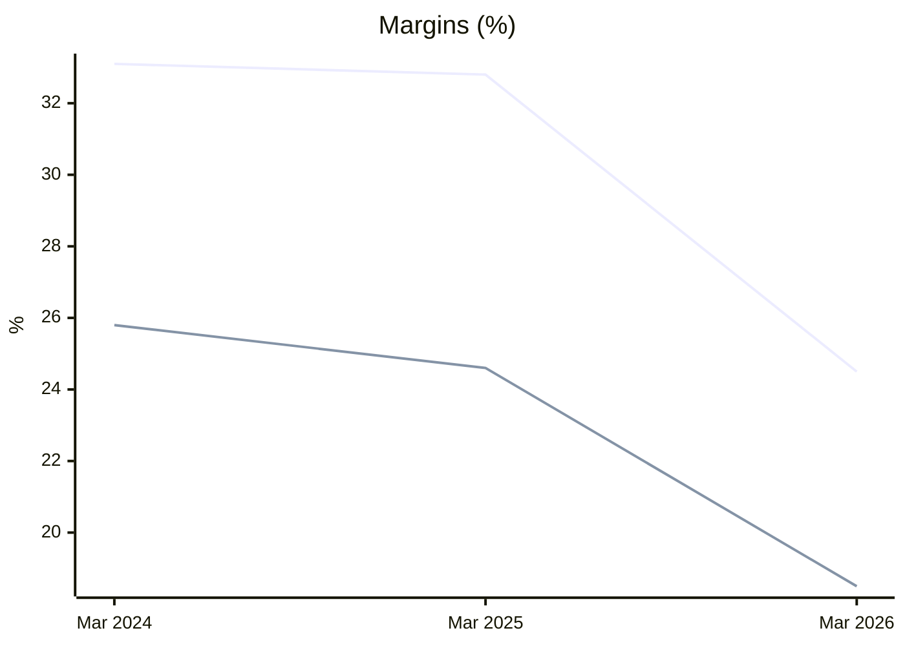

*Run 2026-11-24 · part of [SPINOFF_REPORT.md](../SPINOFF_REPORT.md) · the complete analysis of one company, with every management-call exchange in full.*

## COALINDIA — Coal India Ltd.

### 1. Coal India Ltd. — PARTIAL SPIN-OFF (subsidiary IPO)

**CONFIRMED** (partial spin-off — the IPO of Mahanadi Coalfields Limited is in motion (SEBI observations)) · **PARTIAL SPIN-OFF, IPO IN MOTION — the parent's stub is priced once the piece trades** · score 3.6/10 · partial spin-off (subsidiary IPO) · 11 filing(s) from NSE · first 2025-12-23, latest 2026-11-14

**The separated entities — every one the documents name:**

| Entity | Business | Listing | Who runs it |
|---|---|---|---|
| **Bharat Coking Coal Limited** | not stated | listed 2026-01-19 as BHARATCOAL (NSE) | not stated |
| **Central Mine Planning & Design Institute Limited** | not stated | listed 2026-03-30 as CMPDI (NSE) | not stated |
| **Mahanadi Coalfields Limited** | not stated | to be listed | not stated |
| **South Eastern Coalfields Limited** | not stated | to be listed | not stated |

**What is being separated, as the documents put it:** Coal India's wholly owned coal subsidiaries Mahanadi Coalfields (MCL) and South Eastern Coalfields (SECL), listed via IPO offer for sale — class `regulatory_strategic`.

### 2. Stages and dates

> **Listing:** PARTIAL SPIN-OFF, IPO SEBI OBSERVATIONS — Mahanadi Coalfields Limited; Filing dated 23.12.2025: Ministry of Coal Office Memorandum I/37811/2025 dated 16.12.2025 "had advised CIL to take concrete steps to ensure further listing of s

| Date | Event | Source |
|---|---|---|
| 2025-05-20 | Other — CMPDIL and BCCL | as stated: Rumour Verification - Regulation 30(11) filing dated 20.05.2025: "Act… |
| 2025-05-26 | DRHP filed — Central Mine Planning & Design Institute Limited | as stated: CIL disclosure under Regulation 30 dated 27.05.2025 (DRHP dated May 2… |
| 2025-05-30 | DRHP filed — Bharat Coking Coal Limited | as stated: CIL disclosure under Regulation 30 dated 31.05.2025 (DRHP dated 30th … |
| 2025-12-16 | Other — Mahanadi Coalfields Limited and South Eastern Coalfields Limited | as stated: CIL filings dated 23.12.2025: "Ministry of Coal, vide its Office Memo… |
| 2025-12-23 | Stage reached: **announced** | [General Updates](https://nsearchives.nseindia.com/corporate/COALINDIA_23122025170458_MCLsigned.pdf) |
| 2025-12-23 | Board approval — Mahanadi Coalfields Limited and South Eastern Coalfields Limited (in-principle approval by CIL Board through circular resolution) | as stated: CIL filings "In-principle approval of Listing of Mahanadi Coalfields … |
| 2026-01-02 | Filed with exchanges — Bharat Coking Coal Limited (RHP dated 02.01.2026 filed with SEBI, BSE and NSE) | as stated: CIL General Updates filing dated 03.01.2026 |
| 2026-01-07 | Other — Bharat Coking Coal Limited (addendum-cum-corrigendum to the red herring prospectus) | as stated: CIL filing dated 14.01.2026 |
| 2026-01-14 | Other — Bharat Coking Coal Limited (prospectus dated January 13, 2026 filed with the Registrar of Companies, Jharkhand at Ranchi) | as stated: CIL filing "Filing of Prospectus of Bharat Coking Coal Limited (BCCL)… |
| 2026-01-19 | **Bharat Coking Coal Limited** listed (BHARATCOAL) | NSE equity list |
| 2026-01-19 | Listing and trading — Bharat Coking Coal Limited | as stated: CIL filing "Listing of Bharat Coking Coal Limited, a subsidiary of Co… |
| 2026-03-12 | Filed with exchanges — Central Mine Planning & Design Institute Limited (RHP dated 12th March, 2026 filed with SEBI, BSE and NSE) | as stated: CIL disclosure under Regulation 30 dated 13.03.2026 |
| 2026-03-25 | Other — Central Mine Planning & Design Institute Limited (prospectus dated March 24, 2026 filed with the Registrar of Companies, Jharkhand at Ranchi on March 25, 2026) | as stated: CIL disclosure dated 25.03.2026 |
| 2026-03-30 | **Central Mine Planning & Design Institute Limited** listed (CMPDI) | NSE equity list |
| 2026-03-30 | Listing and trading — Central Mine Planning & Design Institute Limited | as stated: CIL disclosure under Regulation 30 dated 30.03.26 |
| 2026-09-01 | DRHP filed — Mahanadi Coalfields Limited | as stated: CIL disclosure under Regulation 30 dated 02.09.2026 (DRHP dated 1st S… |
| 2026-11-01 | DRHP filed — South Eastern Coalfields Limited | as stated: CIL disclosure under Regulation 30 dated 02.11.2026 (draft red herrin… |
| 2026-11-13 | Filed with exchanges — Mahanadi Coalfields Limited (RHP dated 13th November, 2026 filed with RoC, SEBI, BSE and NSE) | as stated: CIL disclosure under Regulation 30 dated 14.11.2026 |

**The stages, as filed:** announced (2025-12-23)

**The partial spin-off:** **Mahanadi Coalfields Limited** (subsidiary); parent's stake 100% (described as a wholly owned subsidiary of Coal India Limited); IPO stage: SEBI observations; exchange: BSE and NSE (RHP filed with RoC, SEBI, BSE and NSE); timeline: Filing dated 23.12.2025: Ministry of Coal Office Memorandum I/37811/2025 dated 16.12.2025 "had advised CIL to take concrete steps to ensure further listing of s.

> “The RHP filing pertains to the proposed initial public offering (“IPO”) of MCL comprising an offer for sale of up to 661,836,300 equity shares by Coal India Limited, which remains subject to receipt o”

**When it lists, in the documents' words:** On 23.12.2025 CIL said MoC had advised "further listing of subsidiaries namely MCL and SECL in the upcoming financial year", "subject to completion of various regulatory approvals"; MCL RHP dated 13.11.2026 filed with RoC, SEBI, BSE, NSE (disclosed 14.11.2026) and SECL DRHP dated 01.11.2026 filed (disclosed 02.11.2026), with no listing date stated. Comparables: BCCL listed effective January 19, 2026; CMPDIL listed effective March 30, 2026.

### 3. Size of the separated business beside the parent — is institutional selling likely?

**Reading: VERY LIKELY — the piece is under a tenth of the whole; index funds and large holders who receive it without choosing it tend to sell.**

| Entity | Stated turnover | Stated share of the whole | Segment revenue share | Market cap (₹ cr) | Share of combined market cap | Index member |
|---|---|---:|---:|---:|---:|---|
| Bharat Coking Coal Limited | not stated | — | — | 14,688 | 5.6% | no |
| Central Mine Planning & Design Institute Limited | not stated | — | — | 13,509 | 5.2% | no |
| Mahanadi Coalfields Limited | not stated | — | — | — | — | not listed |
| South Eastern Coalfields Limited | not stated | — | — | — | — | not listed |

*Stated figures are the documents' own (a turnover share, or the cost-of-acquisition split the company publishes for tax, which reflects relative value); the segment share is this business's revenue over the parent's sales, and the market-cap share is the entity's value over the entity plus the parent (parent ₹248,666 cr, NSE bhavcopy of 2026-11-13), both computed here.*

**The judge's read of selling pressure:** unlikely — Offers for sale to new IPO buyers, not distributions of shares to existing CIL shareholders; no index exclusion stated.

### 4. Insider ownership — share swap, promoters' holding, management incentives

**Share swap / entitlement, entity by entity:**

- **Bharat Coking Coal Limited:** Initial public offering by way of an Offer for Sale of up to 465,700,000 Equity Shares of face value ₹10 each by Coal India Limited; sold 465,700,000 Equity Shares at an issue price of ₹23 per share
- **Central Mine Planning & Design Institute Limited:** Initial public offering by way of an Offer for Sale of up to 107,100,000 Equity Shares of face value ₹2 each by Coal India Limited (DRHP dated May 26, 2025 had stated up to 71,400,000 equity shares); sold 107,100,000 Equity Shares at an offer price of ₹172.00 per share
- **Mahanadi Coalfields Limited:** Proposed initial public offering comprising an offer for sale of up to 661,836,300 equity shares having a face value of INR 2 each by Coal India Limited
- **South Eastern Coalfields Limited:** Proposed Initial Public Offering comprising an Offer for Sale of up to 668,056,100 equity shares having a face value of INR 2 each, held by Coal India Limited

**Promoters' holding, from the shareholding pattern:**

| Company | Promoters | FIIs | DIIs | Public | Quarter |
|---|---:|---:|---:|---:|---|
| Coal India Ltd. (COALINDIA) | 61.13% | 9.59% | 23.44% | 5.73% | Sep 2026 |
| Bharat Coking Coal Limited (BHARATCOAL) | 90.0% | 0.06% | 0.98% | 8.94% | Sep 2026 |
| Central Mine Planning & Design Institute Limited (CMPDI) | 85.0% | 0.25% | 8.87% | 5.9% | Sep 2026 |

*Source: screener.in shareholding pattern, stored under `ShareholdingPattern/NiftyTotalMarket/`. In a mirror demerger each shareholder holds the same proportion of the new company as of the parent on the record date.*

- **Promoters in the parent, per the documents:** not stated in the documents on file.
- **What the promoters will hold in the separated entity:** BCCL: "the Company’s shareholding in Bharat Coking Coal Limited stands reduced from 100% to 90% (i.e., from 4,657,000,000 Equity Shares to 4,191,300,000 Equity Shares) of the issued and paid-up Equity Share capital of Bharat Coking Coal Limited." CMPDIL: "the Company’s shareholding in Central Mine Planning & Design Institute Limited stands reduced from 100% to 85% (i.e., from 714,000,000 Equity Shares to 606,900,000 Equity Shares) of the issued and paid-up Equity Share capital of Central Mine Planning & Design Institute Limited." MCL and SECL: not stated
- **What a public shareholder receives:** not stated in the documents on file.
- **Management incentives:** not stated in the documents on file.
- **Insider actions around the separation:** Coal India Limited, the parent/promoter, is the selling shareholder in each listing: it sold 465,700,000 Equity Shares of Bharat Coking Coal Limited at ₹23 per share and 107,100,000 Equity Shares of Central Mine Planning & Design Institute Limited at ₹172.00 per share, both "offered for sale by the Company", and has offered for sale up to 661,836,300 equity shares of MCL and up to 668,056,100 equity shares of SECL. No other promoter or management buying, selling or pledging is stated.
- **Insiders, per the checklist read:** Not stated for MCL/SECL. CIL is the sole selling shareholder in each offer for sale; in the completed BCCL and CMPDIL IPOs CIL retained 90% and 85% respectively. · *option pricing date:* not stated

### 5. Why the demerger — point by point

The texts do not contain any management-stated rationale for a separation: what the filings actually show is not a demerger or carve-out of a business line but the government-directed partial listing of Coal India's existing wholly-owned coal subsidiaries through pure offers for sale by CIL, with no rationale, synergy argument or use-of-proceeds ever explained in the three earnings calls. The only stated 'why' anywhere in the material is a directive: the Ministry of Coal's Office Memorandum I/37811/2025 dated 16.12.2025 'advised CIL to take concrete steps to ensure further listing of subsidiaries namely MCL and SECL in the upcoming financial year', after which the CIL Board gave in-principle approval by circular resolution on 23.12.2025 for onward submission to DIPAM — i.e. the asker was the owner/government (MoC and DIPAM), not investors, lenders or partners. The word 'further' implies a programme already under way: Bharat Coking Coal Limited (BCCL) listed on 19.01.2026 after selling 465,700,000 equity shares of ₹10 face value at ₹23 per share, cutting CIL's holding from 100% to 90% (4,657,000,000 to 4,191,300,000 shares); Central Mine Planning & Design Institute Limited (CMPDIL) listed on 30.03.2026 after selling 107,100,000 shares of ₹2 face value at ₹172.00, cutting CIL from 100% to 85% (714,000,000 to 606,900,000 shares). Both remain subsidiaries, so no business is being separated operationally — only minority equity is being sold, and because each is an offer for sale by CIL, proceeds accrue to the parent and not to the subsidiary. The pipeline then moved to the two largest producers: MCL's DRHP dated 01.09.2026 and RHP dated 13.11.2026 for an OFS of up to 661,836,300 shares (₹2 face value), and SECL's DRHP dated 01.11.2026 for up to 668,056,100 shares (₹2 face value), each 'subject to receipt of applicable approvals, prevailing market conditions'. The calls supply only indirect context for why these particular units are separable: management described sharply different subsidiary economics and problems — MCL producing 89.4 mt in H1 FY24 with just 21,523 employees and very low overburden versus SECL/ECL carrying ~30-35 old underground mines and high manpower (CIL total ~2,35,000 employees in Nov 2023, ~2.20 lakh by May 2025, ~12,000 superannuating a year); SECL repeatedly missing targets (197 mt target vs 162 mt FY23; ~8-9 mt short in FY24; heavy rainfall and land acquisition in FY25); BCCL as the pure coking-coal entity (36.18 mt FY23, 41 mt FY24 target) whose output cannot be used fully 'because of the lack of washing capacities', prompting washery monetisation (2 mt Durga washery won by JSW Steel); and CMPDIL building CIL's in-house e-auction platform from Ranchi to phase out MSTC. None of that was ever linked by management to listing or separation, so any value-unlocking logic is inference, not something the company stated.

**Point by point, with the source:**

1. Asked directly whether the energy/renewables vertical would be hived off as a separate demerged entity, management rejected it — existing subsidiaries and JVs suffice and no such plan was under discussion. “We had already formed the joint ventures and the new companies, so those we'll pursue that. We are not going to create any new subsidy. It is not in our discussion right now.” — *[Feb 2024](https://www.bseindia.com/stockinfo/AnnPdfOpen.aspx?Pname=06da4b0a-5420-4ecc-aa42-737719710147.pdf)*
2. Structural separation at this point meant only putting non-coal businesses into dedicated subsidiaries — CIL Solar PV Limited and CIL Navikarniya Urja Limited — for a 3,000 MW solar net-zero programme, with 250 MW due by that year-end. “Sir now we have two subsidiaries, CIL Solar PV Limited and CIL Navikarniya Urja Limited.” — *Nov 2023*
3. Management explained why subsidiary economics differ radically — MCL produced 89.4 mt with 21,523 employees on low stripping ratios and few underground mines, while SECL and ECL each carry ~30-35 old underground mines and legacy manpower that cannot be shed. “MCL has formed out in 1992, it was carved out from SECL, the deep coal field, and Talcher is from Central Coalfields. So relatively new mines, open cast mines, stripping ratio is very less.” — *Nov 2023*
4. Management flagged SECL as the single lagging subsidiary against a 197 mt target (162 mt in FY23, 147 mt before), running 8-9 mt short on land shortage while five other subsidiaries were ahead of target. “In SECL, there is an issue in initially mega projects, two projects.” — *[Feb 2024](https://www.bseindia.com/stockinfo/AnnPdfOpen.aspx?Pname=06da4b0a-5420-4ecc-aa42-737719710147.pdf)*
5. The two subsidiaries later put up for listing were named as the sources of FY25 volume slippage — SECL on abnormal rainfall and land acquisition, CCL on EC/FC clearances — with unmet demand rather than weak demand. “At SECL, the main issue was abnormally heavy rainfall, seasonal rainfall and certain issues related to land acquisition there and in CCL also issues related to clearances, EC and FC clearances from the Ministry for certain patches.” — *[May 2025](https://www.bseindia.com/stockinfo/AnnPdfOpen.aspx?Pname=f26c1f2d-5905-47eb-b473-a448cab9c8ee.pdf)*
6. BCCL was described as a pure coking-coal entity whose output cannot be monetised for lack of washing capacity, addressed by monetising washeries — the 2 mt Durga washery auctioned to JSW Steel — and by consortium-based steel-coking linkages; supplies were ~3.7 mt, of which 2.4-2.7 mt washed. “So, BCCL, the entire production is basically coking coal. We are not able to use it fully because of the lack of washing capacities.” — *[May 2025](https://www.bseindia.com/stockinfo/AnnPdfOpen.aspx?Pname=f26c1f2d-5905-47eb-b473-a448cab9c8ee.pdf)*
7. No listing, IPO, demerger or separation of any subsidiary was raised by management or by any analyst across the entire May 2025 analyst meet; the forward agenda given was 875 mt FY26 volumes, ~₹20,000 crore annual mining capex and ~₹80,000 crore over four-five years including gasification and thermal. “And for that also, equity is required. Based on that, this cash balance, as and when the capex will progress, the cash balance will also be getting deployed.” — *[May 2025](https://www.bseindia.com/stockinfo/AnnPdfOpen.aspx?Pname=f26c1f2d-5905-47eb-b473-a448cab9c8ee.pdf)*
8. The only stated cause of the separation programme is a government instruction: MoC's Office Memorandum I/37811/2025 of 16.12.2025, after which the CIL Board approved listing of MCL and SECL in principle by circular resolution on 23.12.2025 for onward submission to DIPAM. “Ministry of Coal, vide its Office Memorandum I/37811/2025 dated 16.12.2025 had advised CIL to take concrete steps to ensure further listing of subsidiaries namely MCL and SECL in the upcoming financial year.” — *Scheme*
9. BCCL was the first to list: 465,700,000 equity shares of ₹10 face value sold at ₹23 per share (≈₹1,071 crore to CIL on those numbers), listed 19.01.2026, taking CIL from 100% to 90% — it remains a subsidiary, so this is a minority sell-down, not an operational separation. “As a result of the above, the Company's shareholding in Bharat Coking Coal Limited stands reduced from 100% to 90% (i.e., from 4,657,000,000 Equity Shares to 4,191,300,000 Equity Shares) of the issued and paid-up Equity Share capital of Bharat Coking Coal Limited.” — *Scheme*
10. CMPDIL, the planning/design and in-house e-auction-platform arm, listed on 30.03.2026 selling 107,100,000 shares of ₹2 face value at ₹172.00 (≈₹1,842 crore on those numbers), reducing CIL from 100% to 85% while remaining a subsidiary. “Central Mine Planning & Design Institute Limited, pursuant to its IPO, has sold 107,100,000 Equity Shares at an offer price of ₹172.00 per share which were offered for sale by the Company.” — *Scheme*
11. MCL, CIL's lowest-cost and largest producer, moved from DRHP on 01.09.2026 to RHP dated 13.11.2026 for an offer for sale of up to 661,836,300 equity shares of ₹2 face value held by CIL. “The RHP filing pertains to the proposed initial public offering ("IPO") of MCL comprising an offer for sale of up to 661,836,300 equity shares by Coal India Limited, which remains subject to receipt of applicable approvals, market conditions, and other relevant considerations.” — *Scheme*
12. SECL, the chronic laggard on production, filed its DRHP dated 01.11.2026 for an offer for sale of up to 668,056,100 equity shares of ₹2 face value by CIL — the largest share count of the four and the second limb of the MoC directive. “The DRHP filing pertains to the proposed Initial Public Offering ("IPO") of SECL, comprising an Offer for Sale of up to 668,056,100 equity shares having a face value of INR 2 each, held by Coal India Limited.” — *Scheme*
13. In parallel, non-coal diversification stayed inside JV subsidiaries rather than being separated: CIL subscribed 2,22,000 shares at ₹10 (₹22,20,000) in CIL Rajasthan Akshay Urja Limited's rights issue on 27.07.2026, holding 74% against RVUNL's 26% for solar, PSP and wind projects. “To develop, construct and operate the solar power projects, PSP projects and wind power projects or such other projects as may be mutually agreed between the Parties in writing through a suitable model” — *Scheme*

**How it evolved:** On the Nov 2023 call (21.11.2023) the only structural discussion was housing non-coal verticals in subsidiaries/JVs — CIL Solar PV Limited and CIL Navikarniya Urja Limited for 3,000 MW of solar, plus coal-gasification JVs with BHEL and GAIL. On the Feb 2024 call (19.02.2024) an investor explicitly asked whether these would become 'a separate demerged entity' and management refused the idea: subsidiaries and JVs already exist, 'we are not going to create any new subsidy. It is not in our discussion right now.' The May 2025 analyst meet (14.05.2025) contains no mention of listing, demerger or subsidiary IPOs at all — only operations, e-auction premiums, ₹80,000 crore capex and BCCL washery monetisation. The idea then appears only in filings, and top-down: MoC's OM of 16.12.2025 and the CIL Board's in-principle approvals of 23.12.2025 for MCL and SECL, followed by BCCL's listing (19.01.2026), CMPDIL's (30.03.2026), MCL's DRHP/RHP (01.09.2026 and 13.11.2026) and SECL's DRHP (01.11.2026).

**What management expects from it:** Nothing was stated. Across all three calls management gave no expectation for margins, capital, valuation or focus from any separation, and in Feb 2024 denied a demerger was under discussion. The filings assert only compliance with the MoC directive and dissemination of material information; each IPO is an offer for sale by CIL, so proceeds go to the parent and the subsidiaries stay subsidiaries.

*Not explained on the calls:* Everything: no stated rationale, no valuation, margin, capital-allocation, cost-of-capital or focus argument, no use of proceeds, no pricing basis, and no explanation of why MCL, SECL, BCCL and CMPDIL were chosen or what happens to CCL, NCL, WCL and ECL.

- *Stated reason, in one line:* Ministry of Coal Office Memorandum I/37811/2025 dated 16.12.2025 advised CIL to take concrete steps to ensure further listing of subsidiaries MCL and SECL in the upcoming financial year.
- *What it reveals:* Separate listings put market prices on subsidiaries previously buried in CIL: CMPDIL sold 107,100,000 shares at Rs 172 (face value Rs 2), BCCL 465,700,000 shares at Rs 23 (face value Rs 10). MCL/SECL pricing not stated.
- *Parent or spin:* parent · *Read next:* MCL's Red Herring Prospectus dated 13 November 2026 — price band, financials and CIL's residual stake post-offer.
- *In their words:* “Ministry of Coal, vide its Office Memorandum I/37811/2025 dated 16.12.2025 had advised CIL to take concrete steps to ensure further listing of subsidiaries namely MCL and SECL in the upcoming financial year.”

### 6. On the calls, verbatim

3 call(s), oldest first: **7 question-and-answer exchange(s)** given in full — the question and every answer to it, nothing trimmed — and 6 passage(s) from management's prepared remarks (the complete sentences about it; the whole remarks are in the linked transcript). Text is as the transcript prints it.

#### Nov 2023

**Question and answer**

> **Amit Dixit:** Okay. Sir, the second question is on e -auction. So what is our targeted e -auction volume for the second half of the year? And if you could highlight the latest e -auction premium over notified price that is currently going on, on an average?
>
> **P M Prasad:** It is a percentage of premium was -- notified price, it is 90% at -- overall as Coal India as a whole. In BCCL it is 56%; ECL, 71%; CCL, 114%; NCL, 114%; Mahanadi, 107%. It is almost 90% premium over notified price whereas [Quanti ] offered in that -- whatever we offer, what the 51 million, 45.6 million was booked. So primarily, we have to supply these power plants and then we have to balance this e -auction. Both goes together. In power plant, we are supposed to give 610 million. We are quite sure that we will be committing and we will be fulfilling 610 million. And after that, this e -auction and other than that, supplies to RINL also we are taking care.

**Question and answer**

> **Ashish Kejriwal:** Sir, reason being why I'm saying so because on an average also, on a month, we can do 60, 65 million tons maybe in a month. And if I do that calculation, our growt h rate because of the high base of last year, it should come down by -- come down to 5% to 6% rather than 10% or 12%, which is required at least. So that's why -- what could be the probable or a realistic target, which we can achieve by looking at the mont hly run rate which we have achieved so far?
>
> **P M Prasad:** First thing you have to understand, this dispatch target, it depends on other factors also, other power plants lifting come outside other than the railway. In railway and at two areas, in Korba Coal India Limited November 21, 2023 distri ct, in SECL, three more mega projects are there. In Mahanadi, there is a little shortage of a rakes on a daily basis. Even in rainy season, we are supposed to load end number of rakes, we are getting in both these coalfields only, five, five rakes less. So everyday loss is a loss at that particular place. But however, in CCL, BCCL, ECL, NCL, from railways end, there is no issue. Only at two fields in SECL, MCL, there is an issue. But it will be peaking up. And overall, if you do, say, 67, 65 even by your un derstanding also, if we can start, will be increased at our end. Right now, it is 40, 41 million. Last year, it has went up to almost 65 to 69 million. Now it is 41. So this 30 million, even if it ends -- even if it builds up at our end. And more plant sid e also, it is 20 million right now. Our target is to build there also at around 38 million. If we are there at 38 million. So at least 18 to 19 days, 20 days stock will be there. So in any case, first volumes has to come -- move from beneath the ground to surface and vis -a-vis from there to power plants. And we should focus and we will focus.

**Question and answer**

> **Vipulkumar Shah:** Congratulations for a very good set of numbers. Sir, on slide 16, if I see M CL and NCL, we are producing very high production with less number of employees. So why this cannot be applied to other subsidiaries? So what is the reason for that? In MCL, we have produced 89.4 million tons with just 21,523 employees.
>
> **P M Prasad:** MCL has formed out in 1992, it was carved out from SECL, the deep coal field, and Talcher is from Central Coalfields. So relatively new mines, open cast mines, stripping ratio is very less. The overburden and coal, the ratio is very less. And the number of underg round mines is only two to three are operational. Whereas if you see in SECL, the number of underground mines is maybe 30. Even in ECL, it is around 30, 35. So underground, old manpower is there. So we cannot just get rid of them. So as a company, we are having a policy. Right now, it is like 2,35,000 employee strength. In a five years to 10 year period, almost every year, 5% is being the attrition with this natural retirements and other things. So SECL, WCL, ECL, BCCL, it is manpower -wise high. So overall , it is 2,35,000. So MCL is the lowest, maybe around 15,500. Next is Mahanadi. Mahanadi's overburden is very less. There are less cover and number of mines are very limited and highly productive mines.

#### Feb 2024 — [transcript](https://www.bseindia.com/stockinfo/AnnPdfOpen.aspx?Pname=06da4b0a-5420-4ecc-aa42-737719710147.pdf)

**Question and answer**

> **Meet Parikh:** Okay. And sir, last question I wanted to ask was Indian coal in comparison to international coal, could you give a comparison of what is gross calorific value there? And what kind of -- what is the benchmark that you use for comparing our prices to international coal?
>
> **P M Prasad:** Regarding ash content, you should understand, Indian coal is predominantly high ash content. Say, in companies like Mahanadi, some part of SECL, CCL, it may be around 42%. Internationally, if you see some countries, there may be 8% to 10%. So same level comparison cannot be there, number one. And even if we import also, import also, there is a band. Band-wise calorific value only, either it is Indonesian coal, Australian coal, you see particular bands, a particular GCV that is being -- the rates are being numbered. So it cannot be, but in India also in ECL, there are -- there is good quality G6 to G8 band is there, where we -- our quality is also very good. Similarly in Mahanadi, it is a little inferior, but it is very much friendly to thermal power plants. So it varies. Coal India Limited February 19, 2024

**Question and answer**

> **Venkatesh Subramanian:** Okay. And do you have any plans going forward once we have coal, we have CIL energy and then we have -- we're investing a lot in terms of alternative energy as well. Would you have that as a separate demerged e ntity or something in the future? Management: We had already -- some verticals are there for the renewable energy and other projects, for that we had already subsidiaries companies are there. We had already formed the joint ventures and the new companies, so those we'll pursue that. We are not going to create any new subsidy. It is not in our discussion right now.

**Question and answer**

> **Siddharth Gadekar:** So first one, the washery part. So can you give an update on what is happening on that side of the business? And when can we see some higher volumes on the beneficiated coal part?
>
> **P M Prasad:** Washeries part, we are having a few washeries under construction. One Madhuband washery is recently completed, commissioned. Right now, we are doing 5,000 tons per day, new washery. And 2 more washeries in BCCL are under construction, one Bhojudih. Bhojudih, it may be commissioned by July. So once it is completed next year, there will be increase in washing part. And one more washery is under started, under construction, Patherdih II. But after a period of 2 years, that coking coal share will be green. Last year -- we are around 10% to 12% more than last year, but a significant increase will be coming after the commissioning up new washeries. In CCL also, two washeries, we have given LOA, both the Dhori and Kathara, some EC and other statutory complaints are underway. Once this is done for 2 years, it will be constructed. Maybe FY '27, there will be a growth from present level of 1.5 million to 2 million wash coal, we will be going to around 6 million to 7 million after 2 years. In Mahanadi, 1 non-coking coal washery just recently commissioned in Lakhanpur. That is a 10 million ton non-coking coal washery. There is demand and agreement with APGENCO and other GENCOs. So it has -- trial run has completed, so it will be a 10 million ton non-coking coal washery is added in our kitty.

**Question and answer**

> **Ashish Kejriwal:** Okay. Great. And sir, thirdly, for e-auction price. We mentioned that, I think, Jan, the average e-auction premium was something like 54%, but in absolute terms, I think it's around INR2,700 per ton. So when we are talking about 36%, 40% premium, is it possible to quantify on an absolute term? Because sometimes because of the grade also things change materially, so is it possible to quantify on absolute terms what's happening in February? Management: It's difficult to quantify in absolute terms because in the last quarter, we have asked the coal companies to offer around 20% of their monthly production there. And the monthly production in absolute numbers, what we are getting is, it's huge in Mahanadi coal fields and SECL where the grades are not very high. So as of now, it will be very difficult to quantify it in absolute Coal India Limited February 19, 2024 numbers. Going ahead, maybe by middle of March or so, we'll be in a position to get those numbers.

#### May 2025 — [transcript](https://www.bseindia.com/stockinfo/AnnPdfOpen.aspx?Pname=f26c1f2d-5905-47eb-b473-a448cab9c8ee.pdf)

**From the prepared remarks** *(the passage about it; the whole turn runs to 636 characters in the transcript)*

> **Mukesh Choudhary:** Actually, we had the projections from seven subsidiaries and the slippages were from South Eastern Coal company andCCL, Central Coalfields Ltd. At SECL, the main issue was abnormally heavy rainfall, seasonal rainfall and certain issues related to land acquisition there and in CCL also issues related to clearances, EC and FC clearances from the Ministry for certain patches. So that was the main issue where the production was slightly less than what we are projected.As far as demand is concerned from these two subsidies, we don't have any shortages of demand rather the consumers, they want more coal from these subsidies as of now.

**From the prepared remarks** *(the passage about it; the whole turn runs to 384 characters in the transcript)*

> **Mukesh Choudhary:** Last year we actually had a growth of around 32% in terms of rake loading through the FMCs and this year in the first 45 days we already had a growth of more than 15% there and the new silos which are coming up in the subsidiaries of Mahanadi Coalfields and CCL and NCL will further increase that. So, we are expecting a growth of around 20% or so in this FY as compared to last year.

**From the prepared remarks** *(the passage about it; the whole turn runs to 4,713 characters in the transcript)*

> **Mukesh Choudhary:** If you see the forecast, then for the last 2 to 3 years we have been projecting that production and offtake figures were the same. This year if you see the projections, then we are saying the offtake will be 25 million tonnes more than the productions which are there. Now when we go on this demand subsidiary- wise and try to see what is happening at different fronts, Northern Coalfields and WCL, the figures are almost in the same range what was there for the last 2 to 3 years.And the localised demand is also available there. Mahanadi Coalfields, yes,we are banking for supplies towards the southern parts of the country or the incremental demand which is going to come. And SCCL, there is a huge demand which is still unmet in the catchment area of SCCL.What I was saying is the sponge iron sector is asking in the newspaper report, for more linkages from that place. We are not able to do that. And in terms of the e-auctions also, what we have tried to do is to increase the e-auction volumes.Because if you see the volume, the percentage bookings have come down as compared to 21-22 where the booking was almost 100%,last year the booking levels came down to 63%.

**From the prepared remarks** *(the passage about it; the whole turn runs to 1,111 characters in the transcript)*

> **Mukesh Choudhary:** In SCCL, if we go for FMCs, then Northern Coalfields, we have got the capacity which is more or less fully utilized. In CCL, we have got a capacity loading four rakes per day.We are loading around three rakes per day, only one FMC at Urimari which is presently operational. Then we go to ECL, we have got only one silo in terms of rakes. Whatever we send through MGR is a different capacity.But whatever we send through the rakes, we have got a capacity of around 12 rakes. We loaded around 9 to 10 rakes because of less loading during the period of Q2, during rainy season, yes. And then the main issue comes in SCCL and Mahanadi where we are having silos but the spread of railways, it requires that coal should be made available at all the sidings.And at some places, even with our silos, because of the issues of less production or less availability during the rainy season, the full capacity of the silos or the FMCs was not used on both these accounts. Arjit Dutta :Sir, last question from my side, if I may. On the bridge linkage, currently what would be the volume that is going for this bridge linkage?

**From the prepared remarks** *(the passage about it; the whole turn runs to 2,456 characters in the transcript)*

> **Mukesh Choudhary:** Actually, if you see the power sector then from 2007, '11, '12, then '17, and then again '19, the policies which are in place for supplying coal to the power sector in a transparent and objective manner, they keep on getting updated based on the market dynamics. So, 2017 we had this equity policy where everybody was getting coal on an auction mechanism instead of a nomination based mechanism. Nomination based was only available for the state and central gencos where the profits or whatever was going ultimately to the PSUs. In this case, what they have now said is that the centralgencos will keep on this is what I read in the newspapers, the formal orders, I think,they are on their way today andwe are going to receive them,the center gencos will get linkages on nomination basis. The states will be getting linkages on nomination. They can use it for two purposes.

**From the prepared remarks** *(the passage about it; the whole turn runs to 670 characters in the transcript)*

> **Mukesh Agarwal:** Land, plant and machinery for the mine. These are the diversification capex. But the regular capex for the mines will continue where the land, plant and machinery and other equipment will be required. Participant 1: Which will obviously go into the growth of the production. So, this could be like your maintenance capex. There is thermal project also. We are working Mahanadi Coalfields. [inaudible].. We are trying for the one DVC joint venture. So, all those capex will also come.These are only the diversification and critical mineral, we had not considered here. So, those figures are firm. Around 20,000 crores capex will continue for the next three to four years.

### 7. The parent's financial statements

**The parent, last three fiscal years (consolidated)**

| | Mar 2024 | Mar 2025 | Mar 2026 |
|---|---:|---:|---:|
| Sales (₹ cr) | 144,762 | 143,369 | 168,400 |
| Sales growth (%) | +4.7% | -1.0% | +17.5% |
| Operating profit (₹ cr) | 47,971 | 47,064 | 41,242 |
| Operating profit growth (%) | +8.5% | -1.9% | -12.4% |
| Operating margin (%) | 33.1 | 32.8 | 24.5 |
| PAT (₹ cr) | 37,369 | 35,302 | 31,071 |
| PAT growth (%) | +17.8% | -5.5% | -12.0% |
| PAT margin (%) | 25.8 | 24.6 | 18.5 |
| EPS (₹) | 60.7 | 57.4 | 50.5 |

*Source: ProfitStatement/NiftyTotalMarket/COALINDIA.csv (consolidated, screener.in); growth and margins computed here.*

```mermaid
xychart-beta
    title "Sales, operating profit and PAT (₹ cr)"
    x-axis ["Mar 2024", "Mar 2025", "Mar 2026"]
    y-axis "₹ crore"
    bar [144762, 143369, 168400]
    bar [47971, 47064, 41242]
    bar [37369, 35302, 31071]
```

*Series in order: Sales, Operating profit, PAT.*

*Series in order: Operating margin, PAT margin.*

**P/E:** 8.18 — live market file (screener.in), trailing (price ₹414.00 as of 2026-08-02).

**Cash flows (₹ cr):**

| | Mar 2024 | Mar 2025 | Mar 2026 |
|---|---:|---:|---:|
| Cash from operations (₹ cr) | 18,103 | 29,200 | 43,215 |
| Cash from investing (₹ cr) | -4,486 | -10,076 | -33,955 |
| Cash from financing (₹ cr) | -13,899 | -13,308 | -11,801 |
| Net cash flow (₹ cr) | -282 | 5,815 | -2,541 |
| Free cash flow (₹ cr) | 1,353 | 15,960 | 31,191 |

*Source: CashFlow/NiftyTotalMarket/COALINDIA.csv (consolidated, screener.in).*

### 8. The separated business's financial statements

**The business being separated — its own numbers**, entity by entity: its reported statements once it is listed and on file, and the segment numbers the annual reports and presentations carry for it before that.

**Bharat Coking Coal Limited (BHARATCOAL) — as reported since listing**

| | Mar 2024 | Mar 2025 | Mar 2026 |
|---|---:|---:|---:|
| Sales (₹ cr) | 14,246 | 15,917 | 13,645 |
| Sales growth (%) | +12.8% | +11.7% | -14.3% |
| Operating profit (₹ cr) | 2,088 | 1,758 | -493 |
| Operating profit growth (%) | +318.4% | -15.8% | -128.0% |
| Operating margin (%) | 14.7 | 11.0 | -3.6 |
| PAT (₹ cr) | 1,564 | 1,240 | 128 |
| PAT growth (%) | +135.2% | -20.7% | -89.7% |
| PAT margin (%) | 11.0 | 7.8 | 0.9 |
| EPS (₹) | 3.4 | 2.7 | 0.3 |

*Source: ProfitStatement/NiftyTotalMarket/BHARATCOAL.csv (consolidated, screener.in); growth and margins computed here.*

**Central Mine Planning & Design Institute Limited (CMPDI) — as reported since listing**

| | Mar 2023 | Mar 2024 | Mar 2025 |
|---|---:|---:|---:|
| Sales (₹ cr) | 1,386 | 1,733 | 2,103 |
| Sales growth (%) | — | +25.0% | +21.4% |
| Operating profit (₹ cr) | 383 | 727 | 841 |
| Operating profit growth (%) | — | +89.8% | +15.7% |
| Operating margin (%) | 27.6 | 42.0 | 40.0 |
| PAT (₹ cr) | 297 | 503 | 667 |
| PAT growth (%) | — | +69.4% | +32.6% |
| PAT margin (%) | 21.4 | 29.0 | 31.7 |
| EPS (₹) | 4.2 | 7.0 | 9.3 |

*Source: ProfitStatement/NiftyTotalMarket/CMPDI.csv (consolidated, screener.in); growth and margins computed here.*

**BCCL → Bharat Coking Coal Limited** · unit ₹ crore · Subsidiary-wise standalone company figures from the quarterly investor presentations, not segment reporting (both standalone and consolidated annual reports state CIL has no separate reportable segments). operating_profit = Profit Before Tax as labelled in the deck (not EBIT/EBITDA); pat = Profit After Tax. No revenue line is given per subsidiary. BCCL shares listed on BSE and NSE on 19 January 2026 (Presentation Apr 2026 — page 3).

| | FY2025 | FY2026 |
|---|---:|---:|
| Revenue (₹ crore) | — | — |
| Revenue growth (%) | — | — |
| Operating profit (₹ crore) | 1,703 | 149 |
| Operating profit growth (%) | — | -91.3% |
| Operating margin (%) | — | — |
| PAT (₹ crore) | 1,240 | 128 |
| PAT growth (%) | — | -89.7% |

*Sources:* Presentation Apr 2026 — page 19; Presentation Apr 2026 — page 20

*Latest quarter (Q2 FY27):* revenue None, operating profit 186 — Presentation Oct 2026 — page 41

*Not in the pages read:* No revenue, segment assets/liabilities, capex or depreciation per subsidiary; no FY2024 subsidiary PBT/PAT. Q2 FY27 PAT 124 (Oct 2026 p42) available though not a schema field.

**CMPDIL → Central Mine Planning** · unit ₹ crore · Subsidiary-wise standalone company figures from the quarterly presentations, not segment reporting. operating_profit = Profit Before Tax as labelled (not EBIT/EBITDA); pat = Profit After Tax. No revenue per subsidiary. CMPDIL shares listed on BSE and NSE on 30 March 2026 (Presentation Apr 2026 — page 3).

| | FY2025 | FY2026 |
|---|---:|---:|
| Revenue (₹ crore) | — | — |
| Revenue growth (%) | — | — |
| Operating profit (₹ crore) | 882 | 824 |
| Operating profit growth (%) | — | -6.6% |
| Operating margin (%) | — | — |
| PAT (₹ crore) | 667 | 613 |
| PAT growth (%) | — | -8.1% |

*Sources:* Presentation Apr 2026 — page 19; Presentation Apr 2026 — page 20

*Latest quarter (Q2 FY27):* revenue None, operating profit 260 — Presentation Oct 2026 — page 41

*Not in the pages read:* No revenue, segment assets/liabilities, capex, depreciation or FY2024 figures for CMPDIL; no trade receivables row either. Q2 FY27 PAT 195 (Oct 2026 p42).

**SECL → South Eastern Coalfields Limited** · unit ₹ crore · Subsidiary-wise standalone company figures from the quarterly presentations, not segment reporting. operating_profit = Profit Before Tax as labelled; pat = Profit After Tax. No revenue per subsidiary. The pages do not state that SECL has been listed or separated — it is still reported as a CIL subsidiary; classified separated only because it is among the named entities.

| | FY2025 | FY2026 |
|---|---:|---:|
| Revenue (₹ crore) | — | — |
| Revenue growth (%) | — | — |
| Operating profit (₹ crore) | 6,267 | 6,433 |
| Operating profit growth (%) | — | +2.6% |
| Operating margin (%) | — | — |
| PAT (₹ crore) | 4,540 | 4,755 |
| PAT growth (%) | — | +4.7% |

*Sources:* Presentation Apr 2026 — page 19; Presentation Apr 2026 — page 20

*Latest quarter (Q2 FY27):* revenue None, operating profit 772 — Presentation Oct 2026 — page 41

*Not in the pages read:* No revenue, segment assets/liabilities, capex, depreciation or FY2024 figures; no confirmation in these pages of any SECL separation/listing. Q2 FY27 PAT 655 (Oct 2026 p42).

**MCL → Mahanadi Coalfields Limited** · unit ₹ crore · Subsidiary-wise standalone company figures from the quarterly presentations, not segment reporting. operating_profit = Profit Before Tax as labelled; pat = Profit After Tax. No revenue per subsidiary. The pages do not state that MCL has been listed or separated — it is still reported as a CIL subsidiary; classified separated only because it is among the named entities.

| | FY2025 | FY2026 |
|---|---:|---:|
| Revenue (₹ crore) | — | — |
| Revenue growth (%) | — | — |
| Operating profit (₹ crore) | 14,162 | 14,361 |
| Operating profit growth (%) | — | +1.4% |
| Operating margin (%) | — | — |
| PAT (₹ crore) | 10,825 | 10,698 |
| PAT growth (%) | — | -1.2% |

*Sources:* Presentation Apr 2026 — page 19; Presentation Apr 2026 — page 20

*Latest quarter (Q2 FY27):* revenue None, operating profit 3349 — Presentation Oct 2026 — page 41

*Not in the pages read:* No revenue, segment assets/liabilities, capex, depreciation or FY2024 figures; no confirmation in these pages of any MCL separation/listing. Q2 FY27 PAT 2,482 (Oct 2026 p42).

*Businesses with no numbers in the pages read (3 annual report(s) and 12 presentation(s) on file):* 'Not stated' and "Coal India's wholly" are not identifiable businesses and carry no figures. NEC (North Eastern Coalfields) has volume data only, no profit. No FY2024 subsidiary-level figures anywhere in these pages.

*Documents on file:* [Annual Report 2026](https://www.bseindia.com/xml-data/corpfiling/AttachHis/0a545232-5986-454c-b936-70e14712b84e.pdf); [Annual Report 2025](https://www.bseindia.com/xml-data/corpfiling/AttachHis/5690e342-8065-42d0-b598-274aa8ef4fa9.pdf); [Annual Report 2024](https://www.bseindia.com/xml-data/corpfiling/AttachHis/ecb5c7db-530d-4a07-a38f-392f0007f2a1.pdf); [Presentation Oct 2026](https://www.bseindia.com/stockinfo/AnnPdfOpen.aspx?Pname=f75efe8d-6304-4b92-8fbb-ac51edaaa17d.pdf); [Presentation Jul 2026](https://www.bseindia.com/stockinfo/AnnPdfOpen.aspx?Pname=32b8c85f-6bdb-47dc-9aef-728e526ec886.pdf); [Presentation Apr 2026](https://www.bseindia.com/stockinfo/AnnPdfOpen.aspx?Pname=eaca51fa-e009-4738-a3dc-5fbc54257fcf.pdf); [Presentation Feb 2026](https://www.bseindia.com/stockinfo/AnnPdfOpen.aspx?Pname=74fd3fb9-d128-435b-9071-2b419b92f44a.pdf); [Presentation Oct 2025](https://www.bseindia.com/stockinfo/AnnPdfOpen.aspx?Pname=26b8819a-3526-4bc9-a999-6d1237473181.pdf); [Presentation Jul 2025](https://d3u7ubx0okog7j.cloudfront.net/documents/presentation310725.pdf)

### 9. Other financial differences — working capital, margins, returns, debt

| Metric (latest year) | Parent (COALINDIA) | Bharat Coking Coal Limited (BHARATCOAL) | Central Mine Planning & Design Institute Limi… | Mahanadi Coalfields Limited | South Eastern Coalfields Limited |
|---|---:|---:|---:|---:|---:|
| *Basis* | *reported, consolidated* | *its own reported statements* | *its own reported statements* | *segment numbers (MCL)* | *segment numbers (SECL)* |
| Sales (₹ cr) | 168,400 (Mar 2026) | 13,645 (Mar 2026) | 2,103 (Mar 2025) | — | — |
| Sales growth (%) | 17.5 (Mar 2026) | -14.3 (Mar 2026) | 21.4 (Mar 2025) | — | — |
| Operating margin (%) | 24.5 (Mar 2026) | -3.6 (Mar 2026) | 40 (Mar 2025) | — | — |
| Operating profit growth (%) | -12.4 (Mar 2026) | -128 (Mar 2026) | 15.7 (Mar 2025) | 1.4 (FY2026) | 2.6 (FY2026) |
| PAT margin (%) | 18.5 (Mar 2026) | 0.9 (Mar 2026) | 31.7 (Mar 2025) | — | — |
| ROCE % | 35 (Mar 2026) | 4 (Mar 2025) | — | — | — |
| Debtor Days | 31 (Mar 2026) | 77 (Mar 2026) | 164 (Mar 2023) | — | — |
| Inventory Days | 541 (Mar 2016) | 413 (Mar 2021) | — | — | — |
| Days Payable | 215 (Mar 2016) | 338 (Mar 2021) | — | — | — |
| Cash Conversion Cycle | 31 (Mar 2026) | 77 (Mar 2026) | 164 (Mar 2023) | — | — |
| Working Capital Days | 11 (Mar 2026) | -39 (Mar 2026) | 133 (Mar 2023) | — | — |
| Debt / equity (x) | 0.1 (Mar 2026) | 0.4 (Sep 2026
            
            (S)) | 0 (Mar 2023) | — | — |
| Borrowings (₹ cr) | 14,072 (Mar 2026) | 2,478 (Sep 2026
            
            (S)) | 1 (Mar 2023) | — | — |

*Each figure is the latest on file, with its year. Working-capital days and ROCE come from the stored working-capital file; segment figures from the pages cited in part 8. A dash means the documents do not carry it.*

**What stays with the parent — its segments, from the same pages:**

| Remaining segment | Revenue | Operating margin | ROCE | Segment assets / revenue | Unit | Year |
|---|---:|---:|---:|---:|---|---|
| Eastern Coalfields Limited (ECL) | — | — | — | — | ₹ crore |  |
| Central Coalfields Limited (CCL) | — | — | — | — | ₹ crore |  |
| Northern Coalfields Limited (NCL) | — | — | — | — | ₹ crore |  |
| Western Coalfields Limited (WCL) | — | — | — | — | ₹ crore |  |
| CIL Standalone (excl. dividend) | — | — | — | — | ₹ crore |  |

**The checklist:**

| Item | Status | Evidence |
|---|---|---|
| Why the spin-off | unknown | no stated rationale in the filings on file *(next: read the scheme's rationale section / the board's press release)* |
| Institutional selling likely (small / different business) | unknown | size of the demerged piece not stated *(next: pro-forma statements: revenue / assets of the demerged undertaking vs the parent)* |
| Insider ownership and incentives aligned | unknown | no promoter-continuity or option-pricing language found *(next: the date the management options are priced; promoter holding in the resulting company)* |
| A hidden value revealed (pro-forma, leverage, comparables) | yes | borrowings 14,072 cr (Mar 2026) = 0.06× market cap; P/E 8.2 on Mar 2026 profit vs industry median 12.9 (16 peers) |
| Parent before the spin (clean parent, takeover prelude) | partly | stage announced — the spin has not happened; the parent can still be bought whole |
| Partial spin-off: price the stub from the listed piece | partly | a subsidiary is being listed; once it trades, stub = parent price − (stake value ÷ parent shares) *(next: stub_value(parent price, parent shares, [(sub price, shares held)]))* |
| Timing (first year sells, second year gains) | partly | not yet listed — 336 days since the first filing, stage announced |

The filings

| Date | Category | Headline | Attachment |
|---|---|---|---|
| 2025-12-23 | General Updates | Coal India Limited has informed the Exchange about General Updates-In-principle approval of Listing of Mahanadi Coalfields Limited (MCL) a Wholly owned subsidia | [pdf](https://nsearchives.nseindia.com/corporate/COALINDIA_23122025170458_MCLsigned.pdf) |
| 2025-12-23 | General Updates | Coal India Limited has informed the Exchange about General Updates-In-principle approval of Listing of South Eastern Coalfields Limited (SECL), a Wholly owned s | [pdf](https://nsearchives.nseindia.com/corporate/COALINDIA_23122025170609_SECLsigned.pdf) |
| 2026-01-03 | General Updates | Coal India Limited has informed the Exchange about General Updates | [pdf](https://nsearchives.nseindia.com/corporate/COALINDIA_03012026145853_RHPf.pdf) |
| 2026-01-14 | General Updates | Filing of Prospectus of Bharat Coking Coal Limited (BCCL) , A Wholly Owned Subsidiary of Coal India Limited, With the Registrar of Companies, Jharkhand at Ranch | [pdf](https://nsearchives.nseindia.com/corporate/COALINDIA_14012026115033_BCCLProspectus.pdf) |
| 2026-01-19 | General Updates | Listing of Bharat Coking Coal Limited, a subsidiary of Coal India Limited | [pdf](https://nsearchives.nseindia.com/corporate/COALINDIA_19012026111242_listingbccl.pdf) |
| 2026-03-13 | Updates | Coal India Limited has informed the Exchange regarding 'Filing of Red Herring Prospectus(RHP) of Central Mine Planning and Design Institute Limited (CMPDIL), a  | [pdf](https://nsearchives.nseindia.com/corporate/COALINDIA_13032026144405_RHP.pdf) |
| 2026-03-25 | Updates | Coal India Limited has informed the Exchange regarding ''.Initial Public Offering ( IPO ) Of Equity Shares of Face Value Rs. 2 Each ( Equity Shares ) Of Central | [pdf](https://nsearchives.nseindia.com/corporate/COALINDIA_25032026161724_prospectus_CMPDIL.pdf) |
| 2026-03-30 | General Updates | Coal India Limited has informed the Exchange about General Updates-Disclosure under Regulation 30 of Securities and Exchange Board of India (Listing Obligations | [pdf](https://nsearchives.nseindia.com/corporate/COALINDIA_30032026173416_siged.pdf) |
| 2026-09-02 | General Updates | Disclosure under Regulation 30 of SEBI LODR, 2015 Filing of DRHP of Mahanadi Coalfields Limited (MCL), a wholly owned Subsidiary of CIL. | [pdf](https://nsearchives.nseindia.com/corporate/COALINDIA_02092026103250_Draft_letter_to_stock_exchange_DRHP_MCL_signed.pdf) |
| 2026-11-02 | General Updates | Disclosure under Regulation 30 of SEBI LODR, 2015 - Filing of DRHP of South Eastern Coalfields Limited (SECL), a wholly owned Subsidiary of CIL, with SEBI | [pdf](https://nsearchives.nseindia.com/corporate/COALINDIA_02112026120108_SECL.pdf) |
| 2026-11-14 | General Updates | Filing of RHP of Mahanadi Coalfields Limited (MCL), a wholly owned Subsidiary of CIL, with SEBI | [pdf](https://nsearchives.nseindia.in/corporate/COALINDIA_14112026072625_rhp.pdf) |

