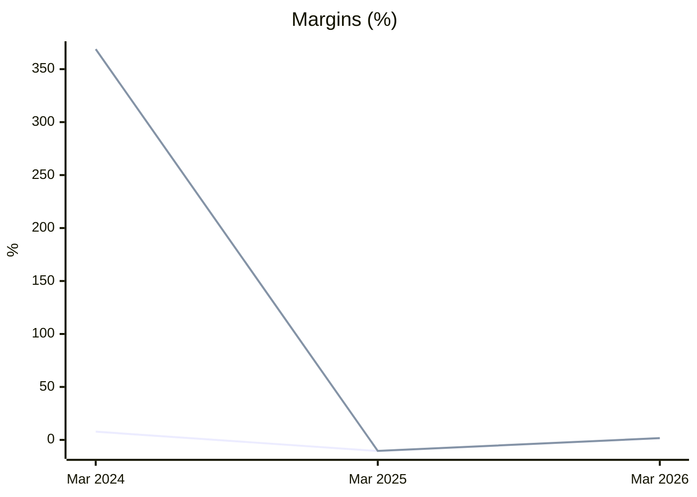

*Run 2026-11-24 · part of [SPINOFF_REPORT.md](../SPINOFF_REPORT.md) · the complete analysis of one company, with every management-call exchange in full.*

## DBREALTY — VALOR ESTATE Ltd.

### 1. VALOR ESTATE Ltd. — CONFIRMED DEMERGER

**CONFIRMED** (a demerger scheme is on the exchange record) · **LISTED 1–2Y — the second-year window** · score 5.0/10 · spin-off · 6 filing(s) from NSE, NSE-register · first 2025-07-18, latest 2026-01-30

**The separated entities — every one the documents name:**

| Entity | Scheme | Business | Listing | Who runs it |
|---|---|---|---|---|
| **Advent Hotels International Limited** (earlier Shiva Realtors Suburban Private Limited) | 2024-25 Composite Scheme of Amalgamation and Arrangement — … | Hospitality Business: ownership/licensing/management of multiple hotel properties — Hilton Mumbai (171 keys),… | listed 2025-11-13 as ADVENTHTL (NSE) | Mr. Rahul Pandit — Managing Director and Chief Ex… |

**The other parties to the scheme(s)** — not separated entities: Esteem Properties Private Limited — merged in — no shares for the parent's holders; Advent Convention and Hotels International Limited — merged in — no shares for the parent's holders; Sahyadri Agro and Dairy Private Limited — merged in — no shares for the parent's holders

**What is being separated, as the documents put it:** The hospitality (hotel ownership) business of Valor Estate, demerged into Advent Hotels International Limited — class `value_unlocking`.

### 2. Stages and dates

> **Listing:** LISTED — Advent Hotels International Limited (ADVENTHTL) since 2025-11-13 (NSE equity list); record date 2025-07-18

| Date | Event | Source |
|---|---|---|
| 2024-04-01 | Appointed date — Amalgamation of Esteem Properties Private Limited with Valor Estate Limited (Appointed Date 1) | as stated: Effective Date intimation dated 01st July 2025 |
| 2024-06-06 | Stage reached: **announced** | [Scheme of Arrangement](https://nsearchives.nseindia.in/corporate/DBREALTY_06062024185054_amalgamation.pdf) |
| 2024-06-06 | Board approval — Valor Estate Limited, Esteem Properties Private Limited, Advent Hotels International Private Limited | as stated: Intimation under Regulation 30 dated 6th June 2024; NCLT order dated … |
| 2024-09-17 | Filed with exchanges — Valor Estate Limited | as stated: NSE Observation Letter Ref: NSE/LIST/42393 dated December 06, 2024 (l… |
| 2024-12-05 | SEBI observations — Valor Estate Limited | as stated: NSE Observation Letter dated December 06, 2024 ("SEBI vide its letter… |
| 2024-12-06 | Exchange no-objection — BSE Limited and National Stock Exchange of India Limited | as stated: Disclosure under Regulation 30 dated 7th December 2024 — Observation … |
| 2024-12-07 | Stage reached: **exchange noc** | [Scheme of Arrangement](https://nsearchives.nseindia.in/corporate/DBREALTY_07122024141751_Disclosure_by_Valor_Estate.pdf) |
| 2025-02-11 | NCLT order — Valor Estate Limited — order convening meeting of equity shareholders | as stated: Intimation dated February 12, 2025 (Receipt of Order of the Hon'ble N… |
| 2025-02-21 | Stage reached: **meetings** | [Shareholders meeting](https://nsearchives.nseindia.in/corporate/DBR_21022025195907_Disclosure.pdf) |
| 2025-03-28 | Shareholders / creditors meeting — Equity Shareholders of Valor Estate Limited (NCLT-convened meeting, 3:00 P.M. IST, via VC/OAVM) | as stated: Corrigendum dated March 20, 2025 to the Notice dated February 25, 2025 |
| 2025-04-01 | Appointed date — Demerger of hospitality business into Advent Hotels International Private Limited (Appointed Date 2) | as stated: Effective Date intimation dated 01st July 2025 |
| 2025-04-01 | Appointed date — Amalgamation of Sahyadri Agro and Dairy Private Limited with Horizontal Ventures Private Limited | as stated: NCLT Order delivered 29.01.2026, CP (CAA) No. 249/MB/2025 |
| 2025-04-03 | Other — Valor Estate Limited — Joint Company Scheme Petition filed | as stated: Intimation dated 6th June 2025 (petition filed on 3rd April 2025 and … |
| 2025-06-06 | Other — NCLT final hearing; order reserved | as stated: Intimation under Regulation 30 dated 6th June 2025 |
| 2025-06-12 | NCLT order — Valor Estate Limited / Esteem Properties / Advent Hotels — Scheme sanctioned, C.P.(CAA) No. 68/MB-I/2025 | as stated: Intimation dated 14th June 2025; certified copy received 18th June 20… |
| 2025-07-01 | Effective date — Composite Scheme of Amalgamation and Arrangement | as stated: Intimation dated 01st July 2025 (Effective Date of the Composite Sche… |
| 2025-07-18 | **Record date** | NSE corporate-actions register |
| 2025-07-18 | Stage reached: **record date** | Record Date (corporate-actions register) |
| 2025-07-18 | Record date — Valor Estate Limited equity (and preference) shareholders | as stated: Intimation of Record Date dated 8th July 2025 |
| 2025-08-01 | Allotment — Advent Hotels International Limited — 5,39,42,887 equity shares and 71,75,574 preference shares allotted | as stated: Intimation dated 1st August 2025 (Allotment of Shares by Advent Hotel… |
| 2025-08-18 | Board approval — Sahyadri Agro and Dairy Private Limited and Horizontal Ventures Private Limited | as stated: NCLT Order delivered 29.01.2026, CP (CAA) No. 249/MB/2025 |
| 2025-10-07 | Filed with exchanges — Sahyadri Agro and Dairy Private Limited / Horizontal Ventures Private Limited scheme | as stated: Intimation dated 30th January 2026 ("We refer to our earlier intimati… |
| 2025-10-29 | NCLT order — Order in connected Company Scheme Application C.A.(CAA)/243(MB)/2025 directing filing of the joint petition | as stated: NCLT Order delivered 29.01.2026, CP (CAA) No. 249/MB/2025 |
| 2025-11-13 | **Advent Hotels International Limited** listed (ADVENTHTL) | NSE equity list |
| 2025-11-13 | Listing and trading — Advent Hotels International Limited on NSE and BSE | as stated: Press Release issued by Advent Hotels International Limited, 12th Nov… |
| 2025-11-14 | Stage reached: **effective** | [Outcome of Board Meeting](https://nsearchives.nseindia.com/corporate/DBR_14112025221835_NSE.pdf) |
| 2025-11-15 | Stage reached: **nclt sanction** | [Outcome of Board Meeting](https://nsearchives.nseindia.com/corporate/DBR_15112025000257_fr.pdf) |
| 2026-01-29 | NCLT order — Sahyadri Agro and Dairy Private Limited with Horizontal Ventures Private Limited — Scheme sanctioned, appointed date 1st April 2025 | as stated: Intimation under Regulation 30 dated 30th January 2026 |

**The stages, as filed:** announced (2024-06-06) → exchange noc (2024-12-07) → meetings (2025-02-21) → record date (2025-07-18) → effective (2025-11-14) → nclt sanction (2025-11-15)

**Stated in the filings:** resulting company **Horizontal Ventures Private Limited**; demerged undertaking: / Discontinued Operations are given as under:; entitlement **1 for every 10**; record date 2025-07-18; appointed date 2025-04-01.

**When it lists, in the documents' words:** Press release dated November 12, 2025: "today announced the proposed listing of its equity shares on the National Stock Exchange of India Ltd. (NSE) and BSE Ltd on November 13, 2025"

### 3. Size of the separated business beside the parent — is institutional selling likely?

**Reading: LIKELY — the piece is small beside the parent; mandates with size limits tend to sell.**

| Entity | Stated turnover | Stated share of the whole | Market cap (₹ cr) | Share of the whole by market cap | Segment revenue share | Index member | Selling on size |
|---|---|---:|---:|---:|---:|---|---|
| Advent Hotels International Limited | Turnover of the Demerged Undertaking for the year ended 31s… | 13.23% (share of turnover) | 633 | 12.2% | 32.3% (FY2025) | no | likely |

*Stated figures are the documents' own (a turnover share, or the cost-of-acquisition split the company publishes for tax, which reflects relative value). The market-cap share is the entity's value over the whole — the parent plus every separated entity that trades (parent ₹4,558 cr, whole ₹5,192 cr, NSE bhavcopy of 2026-11-13); the segment share is the business's revenue over the parent's reported sales of that year. Both are computed here. The reading uses the market-cap share when the entity trades, else the stated share, else the segment share.*

**In the documents' words:** “The turnover of the Demerged Undertaking for the year ended 31st March, 2024 was Rs. 47.29 Crores on a consolidated basis representing 13.23% of the total consolidated turnover of the Company for the year ended 31st March, 2024.”

**The judge's read of selling pressure:** likely — Only 1 AHIL share per 10 held, so tiny odd-lot positions; hospitality is a different industry from the parent's real estate.

### 4. Insider ownership — share swap, promoters' holding, management incentives

**Share swap / entitlement, entity by entity:**

- **Advent Hotels International Limited:** 1 (One) fully paid-up equity share of AHIL (face value Rs.10) for every 10 (Ten) fully paid-up equity shares of VEL (face value Rs.10) held as on the Record Date, i.e., Friday, 18th July 2025 ("Share Entitlement Ratio"); and 1 fully paid-up preference share of INR 10 of the Resulting Company for every 10 preference share of INR 10 each of the Demerged Company

**Promoters' holding, from the shareholding pattern:**

| Company | Promoters | FIIs | DIIs | Public | Quarter |
|---|---:|---:|---:|---:|---|
| VALOR ESTATE Ltd. (DBREALTY) | 47.17% | 3.87% | 0.32% | 48.65% | Sep 2026 |
| Advent Hotels International Limited (ADVENTHTL) | 47.69% | 1.59% | 0.34% | 50.37% | Sep 2026 |

*Source: screener.in shareholding pattern, stored under `ShareholdingPattern/NiftyTotalMarket/`. In a mirror demerger each shareholder holds the same proportion of the new company as of the parent on the record date.*

- **Promoters in the parent, per the documents:** not stated in the documents on file.
- **What the promoters will hold in the separated entity:** 2024-25 hospitality demerger: "Following the demerger, Advent Hotels is expected to have mirror-image shareholding as that of VEL as on the record date. Promoters to hold ~47% and remainder to be held by public shareholders." Also: "ADVENT WILL BE A WHOLLY-OWNED SUBSIDIARY OF VALOR ESTATE UNTIL THE COMPOSITE SCHEME IS FULLY SANCTIONED AND WILL HAVE A MIRROR SHAREHOLDING OF VALOR ESTATE UPON LISTING". Esteem amalgamation: "There will not be any change in the shareholding pattern of the Amalgamated Company, as a result of Amalgamation, as the Amalgamating Company is a wholly owned subsidiary of the Amalgamated Company." 2025-26 Sahyadri / Horizontal Ventures amalgamation: not stated.
- **What a public shareholder receives:** 2024-25 demerger: "Pursuant to the Scheme, shareholders of VEL have been allotted 1 (One) fully paid-up equity share of AHIL (face value Rs.10) for every 10 (Ten) fully paid-up equity shares of VEL (face value Rs.10) held as on the Record Date, i.e., Friday, 18th July 2025"; preference shareholders received "1 fully paid-up preference share of INR 10 of the Resulting Company ... for every 10 preference share of INR 10 each of the Demerged Company" (these preference shares shall remain unlisted), and the paid-up preference share capital of VEL was reduced by 10% without consideration. Post-demerger cost of acquisition apportioned: Valor Estate Limited 81.47, Advent Hotels International Limited 18.53. Esteem amalgamation into VEL: no consideration payable. 2025-26 Sahyadri amalgamation into Horizontal Ventures: not stated (amalgamation of a wholly-owned subsidiary with its holding company within the same corporate group).
- **Management incentives:** not stated in the documents on file.
- **Insider actions around the separation:** not stated in the documents on file.
- **Insiders, per the checklist read:** Mr. Arshad Balwa is Promoter Director of AHIL; Rahul Pandit is MD & CEO; AHIL governed by own Board post-demerger. Shareholders received 1 AHIL share per 10 Valor shares; promoters held 47.43% of Valor. AHIL promoter stake not stated. · *option pricing date:* 14th August 2025 (Nomination and Remuneration Committee approved grant of 10,00,000 options under ESOP 2024); earlier ESOP 2022 options exercised at Rs. 41.45 per share during quarter ended 30th June 2025

### 5. Why the demerger — point by point

No earnings-call transcripts are on file, so the reasoning below is reconstructed only from the filings. The separation is the demerger of Valor Estate Ltd's (formerly D B Realty Ltd) hospitality business into Advent Hotels International Limited (formerly Shiva Realtors Suburban Private Limited) under a Composite Scheme of Amalgamation and Arrangement that also amalgamated Esteem Properties Private Limited into Valor; the Explanatory Statement to the 12th December 2025 EGM says the Scheme was entered into 'mainly with aim to demerge hospitality business of the Company into Resulting Company and thus unlock overall value for the shareholders.' NCLT Mumbai sanctioned it on 12 June 2025, it became effective 1 July 2025 (demerger appointed date 1 April 2025; Esteem amalgamation appointed date 1 April 2024), and shareholders on the 18 July 2025 record date received 1 AHIL share of Rs. 10 for every 10 Valor shares. The carve-out moved consolidated net assets of Rs. 1,02,194.65 lakhs (standalone Rs. 1,01,512.91 lakhs) out of Valor — Rs. 1,49,386.00 lakhs of property, plant and equipment, Rs. 54,858.00 lakhs of goodwill, Rs. 29,117.12 lakhs of intangibles, against Rs. 46,196.17 lakhs non-current and Rs. 16,028.03 lakhs current borrowings, Rs. 2,01,956.25 lakhs of other non-current financial liabilities and Rs. 28,951.71 lakhs of deferred tax liability — and took out a business that had FY25 revenue of Rs. 36,650.21 lakhs and PAT of Rs. 4,468.06 lakhs, now shown as discontinued operations. Management's stated problems solved are focus and structure: Valor 'is now engaged solely in the real estate business, which constitutes its only reportable segment,' so segment reporting ceased, while Advent gets 'its own Board and Management team,' NSE/BSE listing on 13 November 2025 for 'enhanced market visibility, liquidity for existing shareholders, and a strengthened capital structure,' and an asset-heavy growth path (five projects, 3,100 keys, EBITDA from under Rs. 200 crore to over Rs. 1,200 crore by FY32, targeted mid-teens compounded ROE) that a combined entity would have had to fund alongside real estate. The second, smaller separation/consolidation strand is non-core cleanup: Sahyadri Agro and Dairy Private Limited (dairy farming, milk procurement and trading), taken to 76.63% via enforcement of security and then to 100% 'as the transaction relates to the liquidation of non-core assets,' sold its entire dairy business under a Business Transfer Agreement at a gain of Rs. 6,901.20 lakhs with Rs. 1,697.63 lakhs of non-compete fees booked as an exceptional item, is now 'evaluating opportunities to engage in the business of real estate development,' and was amalgamated into Horizontal Ventures Private Limited for structural simplification, synergies, avoidance of duplication and lower compliance and overhead costs. Running alongside is balance-sheet repair the filings tie to the same strategy: consolidated secured debt down to Rs. 730 crore, full redemption of Rs. 235 crore of NCDs out of the Rs. 262 crore Dahisar/Aradhya Park development-rights conveyance, and the Scheme-driven reduction and consolidation of the 8% RPS (Clause 32: Rs. 10 face value cut to Rs. 9, then 10 consolidated into 9) plus Clause 20's 1:10 allotment of AHIL preference shares, followed by the November 2025 proposal to convert KRPL's 6,45,75,000 RPS into 0.0001% CCPS converting into 32,02,330 equity shares at Rs. 201.65 'with a view to conserve the financial resources of the Company.' No filing names any investor, lender or partner as having demanded the separation; the only named partner is Prestige Group, which sits on Advent's side as a 50:50 JV partner in the Sahar project and co-developer at Aerocity.

**Point by point, with the source:**

1. The Composite Scheme's stated purpose, as put to shareholders in the EGM explanatory statement, was to demerge the hospitality business into Advent Hotels International Limited and unlock shareholder value; it simultaneously amalgamated Esteem Properties Private Limited into Valor. “mainly with aim to demerge hospitality business of the Company into Resulting Company and thus unlock overall value for the shareholders” — *Scheme*
2. Post-demerger Valor is a pure-play real estate company with a single reportable segment, and prior-period hospitality results are reclassified as discontinued operations under Ind AS 105. “Consequent to the demerger, the Company is now engaged solely in the real estate business, which constitutes its only reportable segment.” — *Scheme*
3. Management framed the separation as letting each business pursue its own growth path: Chairman Vinod Goenka tied Q2FY26 progress to completing the demerger and listing of hospitality. “We successfully completed the demerger and listing of our Hospitality business, an important milestone that enables each platform to pursue its independent growth path.” — *Scheme*
4. The Q2FY26 press release states the problems the split solves on Valor's side: targeted independent strategies for each business, sharper operational focus, and unlocked long-term value. “This development enables each business to pursue a targeted, independent growth strategy, strengthens operational focus, and positions the Group to unlock enhanced long-term value for shareholders.” — *Scheme*
5. Advent's 13 November 2025 NSE/BSE listing was justified on visibility, shareholder liquidity and capital structure, with Advent carved out of Valor and run by its own board and management. “The listing will mark a significant milestone in Advent's journey as a dedicated hospitality platform, enabling enhanced market visibility, liquidity for existing shareholders, and a strengthened capital structure to support future growth.” — *Scheme*
6. Advent now has independent governance: two operating hotels (313-key Grand Hyatt Bambolim Goa plus 113 keys under development, and a 171-key Hilton in Andheri East, Mumbai). “The Company is governed by its own Board and Management team following the demerger.” — *Scheme*
7. Advent quantified the growth the standalone platform is meant to fund: five projects under development including St. Regis and Marriott Marquis at Aerocity Delhi with Prestige Group (FY27), Waldorf Astoria and Hilton at Worli, and a 1,175-key BKC hotel. “With five projects under development, the company is on track to expand to 3,100 keys. EBITDA, currently under ₹200 crore, is projected to surpass ₹1,200 crore as these projects mature by FY32, reflecting the company's robust growth and institutional approach.” — *Scheme*
8. Advent's MD & CEO Rahul Pandit cast the separation and listing as a governance and financing fix for an asset-heavy hospitality business; Promoter Director Arshad Balwa targeted mid-teens compounded ROE over the next decade. “This listing enhances our financial flexibility, strengthens governance, and enables sustainable value generation for all stakeholders.” — *Scheme*
9. Vice Chairman & MD Shahid Balwa linked the demerger and non-core divestments to deleveraging — consolidated secured debt of ₹730 crore, full redemption of ₹235 crore of NCDs from the ₹262 crore Dahisar/Aradhya Park development-rights conveyance. “The rationalisation of our project portfolio, combined with selective monetisation initiatives, including the divestment of non-core assets, has enabled us to reduce debt levels, bringing us closer to our medium-term objective of a leaner and more efficient capital structure.” — *Scheme*
10. Sahyadri Agro and Dairy was treated explicitly as a non-core asset being liquidated: the Group went to 76.63% through enforcement of security, then to 100%, and SADPL sold its dairy assets under a Business Transfer Agreement at a gain of Rs. 6,901.20 lakhs with Rs. 1,697.63 lakhs of non-compete fees as an exceptional item. “As the transaction relates to the liquidation of non-core assets, SADPL has not been consolidated.” — *Scheme*
11. The NCLT order of 29 January 2026 records the benefits claimed for folding dairy-turned-real-estate SADPL into Horizontal Ventures Private Limited, a wholly-owned-subsidiary merger inside the group with appointed date 1 April 2025, effective 12 March 2026. “Simplification  and rationalisation  of corporate  struct ure through consolidation;” — *Scheme*
12. The same order lists compliance and overhead reduction as the operating rationale for the SADPL-HVPL consolidation, with the petitioners undertaking not to claim Section 72A tax-loss benefits after the Income-tax Officer objected. “Reduction in multiplicity of legal and regulatory compliances,  reduction in overheads, including administrative, managerial and other administrative costs.” — *Scheme*
13. The Scheme itself restructured Valor's preference capital: Clause 32 cut RPS face value from Rs. 10 to Rs. 9 and consolidated 10 into 9 (KRPL's 7,17,50,000 becoming 6,45,75,000), and Clause 20 allotted 1 AHIL preference share for every 10 Valor RPS (71,75,000 to KRPL). “which were reduced and consolidated as per the recent Scheme of Amalgamation and Arrangement sanctioned by the Hon’ble National Company Law Tribunal, Mumbai Bench on 12th	June,	2025	(effecting	 the	demerger	 of	Company’s	 hospitality	 business,” — *Scheme*
14. Building on the Scheme, the Board on 14 November 2025 proposed converting KRPL's 6,45,75,000 8% RPS into 0.0001% CCPS convertible into 32,02,330 equity shares at Rs. 201.65 (premium Rs. 191.65), to avoid the redemption cash outflow and lift net worth. “The conversion of RPS into CCPS is expected to reduce the future cash outflows otherwise required for the redemption of RPS, thereby improving liquidity, conserving cash resources, and enabling the Company to channel funds towards its operational and growth requirements.” — *Scheme*

**How it evolved:** There are no transcripts on file, so the idea cannot be traced call by call; the paper trail runs through filings and the Scheme itself. The Composite Scheme was sanctioned by NCLT Mumbai on 12 June 2025, became effective 1 July 2025 with demerger appointed date 1 April 2025, and the 1:10 entitlement was fixed on the 18 July 2025 record date; the SADPL-into-HVPL amalgamation was approved by both boards on 18 August 2025 with appointed date 1 April 2025. The plan then became visible in public filings in quick succession: Advent's listing press release (12 November 2025), Valor's Q2FY26 results and press release (14-15 November 2025) which first framed the demerger as completed and as the basis for debt reduction, the EGM notice and corrigendum (20 November and 8 December 2025) which disclosed the Scheme's preference-share reduction, consolidation and 1:10 AHIL allotment and layered the RPS-to-CCPS conversion on top, and finally the NCLT order of 29 January 2026 and effective date of 12 March 2026 completing the SADPL consolidation. The shape of the plan therefore widened over time from a single hospitality demerger into a package: demerger plus listing, plus non-core dairy liquidation and merger, plus capital-structure conversion.

**What management expects from it:** Valor: pure-play real estate, single reportable segment, leaner and more efficient capital structure, lower debt (secured debt ₹730 crore), greater financial flexibility, unlocked value. Advent: independent board and management, focused hospitality platform, better visibility, shareholder liquidity, stronger capital structure, 3,100 keys and EBITDA above ₹1,200 crore by FY32, mid-teens compounded ROE.

*Not explained on the calls:* No call transcripts supplied; filings never name investors, lenders or partners who asked for it, nor give swap-ratio valuation basis, cost savings, or Advent fundraising plans.

- *Stated reason, in one line:* "mainly with aim to demerge hospitality business of the Company into Resulting Company and thus unlock overall value for the shareholders"; listing enables each platform to pursue independent growth, focus and financial flexibility.
- *What it reveals:* Spin holds 313-key Grand Hyatt Goa and 171-key Hilton Mumbai, five projects under development, EBITDA under Rs.200 crore targeted above Rs.1,200 crore by FY32 (3,100+ keys). Parent left as pure real estate; consolidated borrowings fell sharply post-demerger.
- *Parent or spin:* both · *Read next:* AHIL's own balance sheet: the Rs. 2,01,956.25 lakhs other non-current financial liabilities transferred with the demerged undertaking
- *In their words:* “A Composite Scheme of Amalgamation and Arrangement was entered into between the Company ("Amalgamated Company" and "Demerged Company") and Esteem Properties Private Limited ("Amalgamating Company"/"EPPL") and Advent Hotels International Limited (formerly known as Shiva Realtors Suburban Private Limited) ("Resulting Company"/"AHIL) ("Scheme") mainly with aim to demerge hospitality business of the Company into Resulting Company and thus unlock overall value for the shareholders.”

### 6. On the calls, verbatim

No call in the last 36 months carries a statement about it (or no transcript is on file).

### 7. The parent's financial statements

**The parent, last three fiscal years (consolidated)**

| | Mar 2024 | Mar 2025 | Mar 2026 |
|---|---:|---:|---:|
| Sales (₹ cr) | 357 | 1,133 | 1,593 |
| Sales growth (%) | -48.9% | +217.4% | +40.6% |
| Operating profit (₹ cr) | 28.0 | -119 | 25.0 |
| Operating profit growth (%) | +103.9% | -525.0% | +121.0% |
| Operating margin (%) | 7.8 | -10.5 | 1.6 |
| PAT (₹ cr) | 1,317 | -118 | 27.0 |
| PAT growth (%) | +1563.3% | -109.0% | +122.9% |
| PAT margin (%) | 369 | -10.4 | 1.7 |
| EPS (₹) | 24.5 | -2.3 | 0.5 |

*Source: ProfitStatement/NiftyTotalMarket/DBREALTY.csv (consolidated, screener.in); growth and margins computed here.*

```mermaid
xychart-beta
    title "Sales, operating profit and PAT (₹ cr)"
    x-axis ["Mar 2024", "Mar 2025", "Mar 2026"]
    y-axis "₹ crore"
    bar [357, 1133, 1593]
    bar [28, -119, 25]
    bar [1317, -118, 27]
```

*Series in order: Sales, Operating profit, PAT.*

*Series in order: Operating margin, PAT margin.*

**P/E:** 195.1 — close 2026-10-01 ÷ EPS 0.47 (Mar 2026) (price ₹91.70 as of 2026-10-01).

**Cash flows (₹ cr):**

| | Mar 2024 | Mar 2025 | Mar 2026 |
|---|---:|---:|---:|
| Cash from operations (₹ cr) | 237 | 540 | 939 |
| Cash from investing (₹ cr) | 486 | -689 | -336 |
| Cash from financing (₹ cr) | 18.0 | -595 | -580 |
| Net cash flow (₹ cr) | 741 | -743 | 22.0 |
| Free cash flow (₹ cr) | 184 | 436 | 925 |

*Source: CashFlow/NiftyTotalMarket/DBREALTY.csv (consolidated, screener.in).*

### 8. The separated business's financial statements

**The business being separated — its own numbers**, entity by entity: its reported statements once it is listed and on file, and the segment numbers the annual reports and presentations carry for it before that.

**Advent Hotels International Limited (ADVENTHTL) — as reported since listing**

| | Mar 2024 | Mar 2025 | Mar 2026 |
|---|---:|---:|---:|
| Sales (₹ cr) | 201 | 367 | 388 |
| Sales growth (%) | — | +82.6% | +5.7% |
| Operating profit (₹ cr) | 78.0 | 131 | 131 |
| Operating profit growth (%) | — | +67.9% | +0.0% |
| Operating margin (%) | 38.8 | 35.7 | 33.8 |
| PAT (₹ cr) | -152 | 27.0 | 65.0 |
| PAT growth (%) | — | +117.8% | +140.7% |
| PAT margin (%) | -75.6 | 7.4 | 16.8 |
| EPS (₹) | -75,270 | 11,220 | 11.7 |

*Source: ProfitStatement/NiftyTotalMarket/ADVENTHTL.csv (consolidated, screener.in); growth and margins computed here.*

**Hospitality / hospitality business (Demerged Undertaking; from FY2026 presented as Discontinued Operations) → Advent Hotels International Limited ("AHIL", Advent Hotels International Private Limited) — Resulting Company** · unit ₹ lakh (Rs. in lacs) · Consolidated segment disclosure under Ind AS 108. Revenue = segment revenue (external; no inter-segment amounts disclosed). Operating profit = 'Segment Results' i.e. profit before unallocable (expenditure)/income, interest and finance cost and tax (EBIT-type, before segment finance cost: FY2024 ₹3,152.86 lacs, FY2025 ₹6,125.95 lacs, and share of JV loss FY2024 (112.75), FY2025 (20.05)). Segment PAT, capex and depreciation are not disclosed. Standalone segment figures for the same business are much smaller (FY2024 revenue nil, result nil, assets 2,58,148.57; FY2025 revenue 408.15, result 19.44, assets 96,027.79, liabilities nil — AR2025 p.164) because standalone only holds the dedicated hospitality investments.

| | FY2024 | FY2025 | FY2026 |
|---|---:|---:|---:|
| Revenue (₹ lakh (Rs. in lacs)) | 20,095 | 36,650 | — |
| Revenue growth (%) | — | +82.4% | — |
| Operating profit (₹ lakh (Rs. in lacs)) | 4,355 | 8,378 | — |
| Operating profit growth (%) | — | +92.4% | — |
| Operating margin (%) | 21.7 | 22.9 | — |
| PAT (₹ lakh (Rs. in lacs)) | — | — | — |
| PAT growth (%) | — | — | — |
| Segment assets (₹ lakh (Rs. in lacs)) | 339,965 | 367,306 | — |
| Segment liabilities (₹ lakh (Rs. in lacs)) | 105,626 | 86,089 | — |
| Capital employed (₹ lakh (Rs. in lacs)) | 234,339 | 281,217 | — |
| Return on capital employed (%) | 1.9 | 3.0 | — |
| Segment assets / revenue (x) | 16.9 | 10.0 | — |
| Capex (₹ lakh (Rs. in lacs)) | — | — | — |

*Sources:* Annual Report 2024 — pages 263, 264 (consolidated); confirmed in Annual Report 2025 — page 267; Annual Report 2025 — page 267 (consolidated); Annual Report 2026 — pages 141, 180, 282

*Not in the pages read:* No FY2026 figures (demerged w.e.f. 1 Apr 2025; shown as discontinued operations with no amounts on these pages, only net assets transferred ₹1,01,512.91 lakhs). No PAT, capex, depreciation or quarterly hospitality revenue/EBITDA.

*Businesses with no numbers in the pages read (3 annual report(s) and 4 presentation(s) on file):* Horizontal Ventures Private Limited and Shiva Realtors Suburban: named only, no financials. Advent Hotels International Limited: no entity-level (standalone AHIL) financials; only the hospitality segment and ₹1,01,512.91 lakhs net assets transferred.

*Documents on file:* [Annual Report 2026](https://www.bseindia.com/xml-data/corpfiling/AttachHis/999c589b-9faa-4084-b794-b71f09661e2a.pdf); [Annual Report 2025](https://www.bseindia.com/xml-data/corpfiling/AttachHis/5ec35742-c43f-472d-948c-b01998f14cec.pdf); [Annual Report 2024](https://www.bseindia.com/xml-data/corpfiling/AttachHis/009c9959-39ea-4d7b-a1af-73cb6cd964d6.pdf); [Presentation Aug 2025](https://www.bseindia.com/stockinfo/AnnPdfOpen.aspx?Pname=be73df3c-6551-47d0-bef7-50ffadbbbb92.pdf); [Presentation Feb 2025](https://www.bseindia.com/stockinfo/AnnPdfOpen.aspx?Pname=2f1a0e9a-0a6b-40eb-a8f0-6fef79933b5b.pdf); [Presentation Nov 2024](https://www.bseindia.com/stockinfo/AnnPdfOpen.aspx?Pname=f73beef9-804e-4264-bb83-22366cf0363c.pdf); [Presentation Mar 2024](https://www.bseindia.com/stockinfo/AnnPdfOpen.aspx?Pname=404990bf-591b-413a-ab02-2c4d88838a2f.pdf)

### 9. Other financial differences — working capital, margins, returns, debt

| Metric (latest year) | Parent (DBREALTY) | Advent Hotels International Limited (ADVENTHT… |
|---|---:|---:|
| *Basis* | *reported, consolidated* | *its own reported statements* |
| Sales (₹ cr) | 1,593 (Mar 2026) | 388 (Mar 2026) |
| Sales growth (%) | 40.6 (Mar 2026) | 5.7 (Mar 2026) |
| Operating margin (%) | 1.6 (Mar 2026) | 33.8 (Mar 2026) |
| Operating profit growth (%) | 121 (Mar 2026) | 0 (Mar 2026) |
| PAT margin (%) | 1.7 (Mar 2026) | 16.8 (Mar 2026) |
| ROCE % | 2 (Mar 2026) | 7 (Mar 2024) |
| Debtor Days | 64 (Mar 2026) | 10 (Mar 2025) |
| Inventory Days | 490 (Mar 2018) | — |
| Days Payable | 18 (Mar 2018) | — |
| Cash Conversion Cycle | 537 (Mar 2026) | 10 (Mar 2025) |
| Working Capital Days | 182 (Mar 2026) | -2,016 (Mar 2025) |
| Debt / equity (x) | 0.2 (Mar 2026) | 0.9 (Sep 2026) |
| Borrowings (₹ cr) | 747 (Mar 2026) | 852 (Sep 2026) |

*Each figure is the latest on file, with its year. Working-capital days and ROCE come from the stored working-capital file; segment figures from the pages cited in part 8. A dash means the documents do not carry it.*

**What stays with the parent — its segments, from the same pages:**

| Remaining segment | Revenue | Operating margin | ROCE | Segment assets / revenue | Unit | Year |
|---|---:|---:|---:|---:|---|---|
| Real Estate / real estate business (real estate development — sole reportable segment from FY2026) | 76,658 | -24.2% | -8.6% | 6.36x | ₹ lakh (Rs. in lacs) | FY2025 |

**What the documents themselves say about the differences:**

- **debt and leverage** — parent / remaining: Of consolidated secured debt of Rs 1,328 crores, Rs 839 crores are secured against real estate project cashflows, expected to be repaid in the next financial year; separated business: Rs 489 crores pertains to the borrowing facility for hotel operations (now Advent Hotels), backed by its assets and cashflows, which shall flow into the demerged entity “The Group's consolidated secured debt presently amounts to Rs 1,328 crores. Of this, Rs 839 crores are secured against real estate project cashflows, and these real estate project loans are expected to be repaid in the next financial year. The remaining Rs 489 Crores pertains to the borrowing facility for hotel operations (now Advent Hotels), backed by its assets and cashflows which shall flow into the demerged entity upon the hospitality demerger coming through.”
- **debt and leverage** — parent / remaining: Debt-to-equity for real estate among the lowest in the sector at 0.21:1 (Q1FY26); 0.34:1 at FY25, and 0.30:1 including hospitality loans; separated business: not stated “DEBT-TO-EQUITY AMONG THE LOWEST IN THE SECTOR — 0.21:1 (REAL ESTATE)”
- **operating margin** — parent / remaining: Real estate Q1FY26: revenue Rs 840.33 crore with EBITDA of Rs 45.31 crore and PBT Rs 26.55 crore; separated business: Hospitality Q1FY26: revenue Rs 80.43 crore with EBITDA of Rs 25.10 crore, representing 31% of hospitality revenue “In Q1FY26, revenue from the hospitality business amounted to Rs 80.43 crores, with an EBITDA of Rs 25.10 crores, representing 31% of hospitality revenue.”
- **growth** — parent / remaining: Real estate revenue surged 123x to ₹840 Cr from ₹6.79 Cr (Q1 FY26 vs Q1 FY25); EBITDA rose 8x to ₹45 Cr from ₹5 Cr; separated business: Hospitality revenue increased by 11% to ₹80 Cr from ₹73 Cr; EBITDA grew by 18% to ₹25 Cr from ₹21 Cr “Revenue surged 123x to ₹840 Cr from ₹6.79 Cr.”
- **other** — parent / remaining: Real estate recognises revenue only on project completion and issuance of the occupation certificate, so revenue is asymmetrical rather than linear; separated business: Hospitality revenue is operating and recurring — 171-key Hilton Mumbai occupancy 92% and 313-key Grand Hyatt Goa occupancy 81% in Q1FY26 “Our real estate business recognizes revenue and other profit and loss only upon project completion and the issuance of an occupation certificate by authorities. Consequently, the revenue recognition will be asymmetrical rather than linear, despite project efforts spanning multiple financial years.”
- **capex and capital intensity** — parent / remaining: Debt-light / asset-light approach to real estate development, capitalising on land acquisition expertise while partnering for construction, branding and working capital; separated business: Asset-heavy, independent hospitality platform with five projects under development, expanding to 3,100 keys and EBITDA currently under ₹200 crore projected to surpass ₹1,200 crore by FY32 “As an independent, asset-heavy company with marquee partnerships and a strong development pipeline, we are well-positioned to capture the next phase of growth in India's premium and luxury hospitality sector.”
- **other** — parent / remaining: Remaining Business — real estate, with differentiated strategy, industry risks, market dynamics, growth trajectory and funding requirements; separated business: Hospitality Business requiring differentiated capital structure, partnerships and management, ready to operate independently as a separate publicly listed entity “Each business of the Demerged Company has a differentiated strategy, different industry specific risks and operates inter alia under different market dynamics, growth trajectory, and funding requirements, structure, and timescales.”

**The checklist:**

| Item | Status | Evidence |
|---|---|---|
| Why the spin-off | yes | unrelated businesses separated; value unlocking for shareholders; regulatory / strategic knot; a weak or capital-heavy business carved away — “…of Valor Estate Ltd (formerly DB Realty Ltd), Advent Hotels International now operates independently with a focused strategy for developing, owning, and managing marquee hotel assets across India. The Company is governe” |
| Institutional selling likely (small / different business) | partly | the businesses are described as distinct |
| Insider ownership and incentives aligned | partly | option pricing mentioned: …roup Companies, and Associate Companies under the“Valor Estate Limited–Employee Stock Option Plan2024” (ESOP 2024). Also during the previous quarter ended 30th June, 2025, the Company has allotted 7.39 lakhs equity shares ofRs. 10each atanexercise price ofRs. 41.45 per share, upon exercise of options granted under the "DB Realty Li… *(next: the date the management options are priced; promoter holding in the resulting company)* |
| A hidden value revealed (pro-forma, leverage, comparables) | unknown | no pro-forma or market data on file *(next: pro-forma P&L of each piece × the peer P/E of its own industry)* |
| Parent before the spin (clean parent, takeover prelude) | no | stage record_date — the pieces trade separately now |
| Timing (first year sells, second year gains) | yes | 494 days since listing/record date; second year since listing — where the notes found the largest gains |

The filings

| Date | Category | Headline | Attachment |
|---|---|---|---|
| 2025-07-18 | Record Date (corporate-actions register) | Record date 2025-07-18 for Demerger — NSE corporate-actions register |  |
| 2025-11-12 | Press Release | Press Release issued by Advent Hotels International Limited on the proposed listing on the stock exchanges. | [pdf](https://nsearchives.nseindia.com/corporate/DBR_12112025142836_Valor_SE_Intimation_Press_release_by_Advent.pdf) |
| 2025-11-14 | Outcome of Board Meeting | Valor Estate Limited has informed the Exchange regarding Board meeting held on November 14, 2025. | [pdf](https://nsearchives.nseindia.com/corporate/DBR_14112025221835_NSE.pdf) |
| 2025-11-15 | Outcome of Board Meeting | Valor Estate Limited has submitted to the Exchange, the financial results for the period ended September 30, 2025. | [pdf](https://nsearchives.nseindia.com/corporate/DBR_15112025000257_fr.pdf) |
| 2025-11-15 | Press Release | Press Release issued by the Company on Financial Results for the second quarter ended on 30th September, 2025 | [pdf](https://nsearchives.nseindia.com/corporate/DBR_15112025190714_SE_Intimation_Press_Release_on_FS_Q2-26.pdf) |
| 2026-01-30 | Amalgamation/Merger | Intimation of receipt of the order from Hon'ble NCLT approving the Scheme of Merger/Amalgamation of Sahyadri Agro and Dairy Private Limited with Horizontal Vent | [pdf](https://nsearchives.nseindia.com/corporate/DBR_30012026154136_NSE.pdf) |

