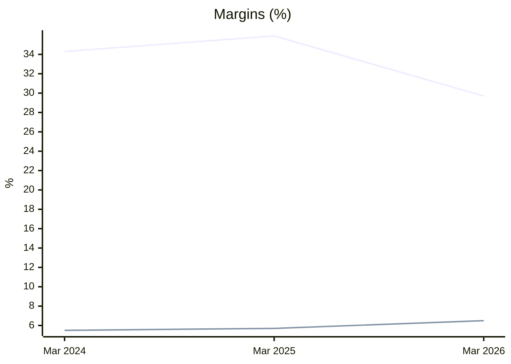

*Run 2026-11-24 · part of [SPINOFF_REPORT.md](../SPINOFF_REPORT.md) · the complete analysis of one company, with every management-call exchange in full.*

## EDELWEISS — Edelweiss Financial Services Ltd.

### 1. Edelweiss Financial Services Ltd. — PARTIAL SPIN-OFF (subsidiary IPO)

**CONFIRMED** (partial spin-off — EAAA India Alternatives Limited is listed since 2026-11-02) · **PARTIAL SPIN-OFF, LISTED <1Y — price the parent's stub against the listed piece** · score 2.1/10 · partial spin-off (subsidiary IPO) · 5 filing(s) from NSE · first 2026-01-20, latest 2026-11-02

**The separated entities — every one the documents name:**

| Entity | Scheme | Business | Listing | Who runs it |
|---|---|---|---|---|
| **EAAA India Alternatives Limited** (earlier Edelweiss Alternative Asset Advisors Limited) | 2026 IPO of EAAA India Alternatives Limited (offer for sale… | Acts as the Investment Manager to the funds under alternate asset domain; alternative asset management (FPAUM… | listed 2026-11-02 as EDELALTS (NSE) | not stated (Deepak Mukhija is named as Company Se… |

**The other parties to the scheme(s)** — not separated entities: Edelweiss Retail Finance Limited — merged in — no shares for the parent's holders

**What is being separated, as the documents put it:** EAAA India Alternatives Limited, the alternative asset management (investment manager to alternate-asset funds) business, part-listed via IPO offer for sale — class `value_unlocking`.

### 2. Stages and dates

> **Listing:** PARTIAL SPIN-OFF, LISTED — EAAA India Alternatives Limited trades since 2026-11-02 (NSE equity list); the parent keeps 83.88% held by the Company through all its subsidiaries (ESIPL holds 78.43%)

| Date | Event | Source |
|---|---|---|
| 2026-01-19 | DRHP filed — EAAA India Alternatives Limited | as stated: EFSL disclosure to BSE/NSE dated January 20, 2026 (EW/Sec/2025-26/388… |
| 2026-01-20 | Filed with exchanges — EAAA India Alternatives Limited | as stated: EFSL disclosure dated January 20, 2026 intimating the DRHP filing wit… |
| 2026-02-10 | Other — Nido Home Finance Limited | as stated: EFSL intimation dated February 10, 2026 (EW/Sec/2025-26/431), Annexur… |
| 2026-04-23 | SEBI approval — EAAA India Alternatives Limited | as stated: EFSL disclosure dated April 24, 2026 (EW/Sec/2026-27/29): "the Securi… |
| 2026-09-25 | Effective date — Nido Home Finance Limited | as stated: EFSL intimation dated September 25, 2026 (EW/Sec/2026-27/277): "the T… |
| 2026-10-19 | Other — EAAA India Alternatives Limited | as stated: EFSL disclosure dated October 20, 2026 (EW/Sec/2026-27/377): Red Herr… |
| 2026-10-20 | Other — EAAA India Alternatives Limited | as stated: EFSL disclosure dated October 20, 2026 (EW/Sec/2026-27/378): IPO Comm… |
| 2026-10-23 | Other — EAAA India Alternatives Limited | as stated: EFSL disclosure dated October 20, 2026: "The Anch or Investor Bidding… |
| 2026-10-26 | IPO opened — EAAA India Alternatives Limited | as stated: EFSL disclosure dated October 20, 2026: "The IPO opens on Monday , Oc… |
| 2026-10-28 | Other — EAAA India Alternatives Limited | as stated: EFSL disclosure dated November 2, 2026 (EW/Sec/2026-27/404): "The off… |
| 2026-10-29 | Allotment — EAAA India Alternatives Limited | as stated: EFSL disclosure dated November 2, 2026: "The shares were allotted to … |
| 2026-11-02 | **EAAA India Alternatives Limited** listed (EDELALTS) | NSE equity list |
| 2026-11-02 | Listing and trading — EAAA India Alternatives Limited | as stated: EFSL disclosure dated November 2, 2026: "admitted for listing and tra… |

**The partial spin-off:** **EAAA India Alternatives Limited** (subsidiary); parent's stake after: 83.88% held by the Company through all its subsidiaries (ESIPL holds 78.43%); IPO stage: listed; exchange: BSE Limited and National Stock Exchange of India Limited; NSE symbol EDELALTS; timeline: The offer period in relation to the IPO was closed on October 28, 2026. The shares were allotted to the investors on October 29, 2026 and admitted for listing a.

> “In continuation of our earlier intimations made in connection with the Initial Public Offering ("IPO") of EAAA India Alternatives Limited ("EAAA"), a subsidiary of the Company and in accordance with t”

**When it lists, in the documents' words:** DRHP filed January 19, 2026 (intimated January 20, 2026); SEBI observation letter April 23, 2026 "enables EAAA to proceed with IPO in next 12 months"; IPO opened October 26 and closed October 28, 2026; allotted October 29, 2026 and "admitted for listing and trading with effect from November 2, 2026"

### 3. Size of the separated business beside the parent — is institutional selling likely?

**Reading: VERY LIKELY — the piece is under a tenth of the whole; index funds and large holders who receive it without choosing it tend to sell.**

| Entity | Stated turnover | Stated share of the whole | Segment revenue share | Market cap (₹ cr) | Share of combined market cap | Index member |
|---|---|---:|---:|---:|---:|---|
| EAAA India Alternatives Limited | Total Income of EAAA during FY 2025-26: Rs. 963.76 crores; … | — | 9.3% (FY2026) | 12,764 | 49.8% | no |

*Stated figures are the documents' own (a turnover share, or the cost-of-acquisition split the company publishes for tax, which reflects relative value); the segment share is this business's revenue over the parent's sales, and the market-cap share is the entity's value over the entity plus the parent (parent ₹12,891 cr, NSE bhavcopy of 2026-11-13), both computed here.*

**In the documents' words:** “For Nido Home Finance Limited (Regulation 30 annexure, "The amount and percentage of the turnover or revenue or income and net worth contributed by such unit or division or undertaking or subsidiary or associate company of the listed entity during the last financial year", As on March 31, 2025): "Income  520.63  5.47%" and "Net Worth  828.2  13.99%" of "% contribution to EFSL consolidated financials". For EAAA, the documents give only absolute figures — "Total Income of EAAA during FY 2025 -26: Rs.  963.76 crores ." and "Net worth of EAAA as on March 31, 2026: Rs. 1,075.54 crores ." — with no stated percentage of the parent.”

**The judge's read of selling pressure:** unlikely — No shares distributed to EFSL shareholders; EAAA shares were sold into a book-built IPO at Rs 1,665 to bidding investors.

### 4. Insider ownership — share swap, promoters' holding, management incentives

**Share swap / entitlement, entity by entity:**

- **EAAA India Alternatives Limited:** IPO was an offer for sale only, no fresh issue: "The IPO comprises an offer for sale (“OFS”) for an amount not exceeding Rs. 12,000 million, which is proposed to be undertaken by Edelweiss Securities & Investments Private Limited (“ESIPL”), a wholly owned subsidiary of the Company." DRHP size was "an amount not exceeding Rs. 15,000 million"; face value Rs. 5 each; price band Rs. 1,585 floor to Rs. 1,665 cap; bid lot 9 equity shares; final: 72,07,207 equity shares sold at Rs. 1,665 per share, gross consideration Rs. 1,200 crores, net consideration to ESIPL Rs. 1,120.63 crores

**Promoters' holding, from the shareholding pattern:**

| Company | Promoters | FIIs | DIIs | Public | Quarter |
|---|---:|---:|---:|---:|---|
| Edelweiss Financial Services Ltd. (EDELWEISS) | 31.53% | 18.74% | 7.89% | 41.83% | Sep 2026 |
| EAAA India Alternatives Limited (EDELALTS) | 83.88% | 1.25% | 4.61% | 10.26% | Nov 2026 |

*Source: screener.in shareholding pattern, stored under `ShareholdingPattern/NiftyTotalMarket/`. In a mirror demerger each shareholder holds the same proportion of the new company as of the parent on the record date.*

- **Promoters in the parent, per the documents:** not stated in the documents on file.
- **What the promoters will hold in the separated entity:** EAAA 2026 IPO: "ESIPL sold 72,07,207  equity shares of EAAA in the IPO, post which ESIPL holds 78.43%  of the total paid -up equity share capital  of EAAA ." and "Consequently, the Company,  through all its subsidiaries,  hold 54,233,039  equity shares of EAAA representing 83.88 % of the total paid -up equity share capital of EAAA." — "ESIPL is the holding company and one of the promoters of the Company." / Nido 2026 transaction: "Consequent to the above, Nido has ceased to be a subsidiary of the Company and the Sellers now hold 38.91% in Nido and would hold 25.46% on a fully diluted basis post conversion of the warrants." / EAML and ETCL 2025 transaction: 15% stake sold (10% consummated, 5% to be sold subsequently) and "the Group now has joint control for both of these Entities with the new investor". No mirror shareholding or distribution of shares to the promoters of the parent is stated, since none of the transactions is a demerger.
- **What a public shareholder receives:** not stated in the documents on file.
- **Management incentives:** Existing parent-level stock options continue to be exercised: "During the quarter ended 31 December 2025, the Company has issued 3,83,021 equity shares of face value of  1 each to the eligible employees on exercise of employee stock options." Bonus provisioning: "During the quarter ended 31 December 2025, employee benefit expenses includes provision of 160 crores towards annual performance bonuses across some subsidiary entities, driven by higher profitability in respective businesses and subsidiaries." Treatment of existing grants in connection with the EAAA IPO or the Nido / asset-management transactions, any new EAAA stock option or RSU plan, exercise price or pricing date, and management or insider shareholding in EAAA: not stated.
- **Insider actions around the separation:** Group selling in the EAAA IPO: "As part of the IPO, Edelweiss Securities and Investments Private Limited (“ESIPL”), a wholly owned subsidiary of the Company  has sold  72,07,207  equity shares  by way of Offer for Sale, at the price of Rs. 1,665 per share." with net consideration of Rs. 1,120.63 crores to ESIPL; the offer for sale "does not fall within the related party transaction s". Group selling in Nido: the Company, ERCSL and EFCL transferred 45% of Nido's paid-up equity for INR 5,80,67,79,525, with a possible "additional payment based upon returns realized by CA Sardo Investments from its investment in Nido". Pledges of group holdings for debt: "Investment of Rs. 149.72 crores in equity shares of Edelweiss Asset Management Limited, a subsidiary of the Company, has been pledged as security against the debt securities issued by Ecap Equities Limited and Edel Finance Company Limited.", "Investment of Rs. 232.11 crores in equity shares of Edel Finance Company Limited, a subsidiary of the Company, has been pledged as security against the debt securities issued by Edelcap Securities Limited.", "Investment of Rs. 140.04 crores in equity shares of Edelweiss Asset Reconstruction Company Limited, a subsidiary of the Company, has been pledged as security against the debt securities issued by Ecap Equities Limited." and a pledge of CCDs of Rs 625 crores issued by Ecap Securities and Investment Limited. No buying, selling, pledging or stated intent by the promoters or management in the shares of Edelweiss Financial Services Limited itself is stated.
- **Insiders, per the checklist read:** ESIPL, wholly owned subsidiary and "one of the promoters", sold 72,07,207 shares yet still holds 78.43%; EFSL through all subsidiaries holds 83.88%. Management incentives in EAAA not stated. · *option pricing date:* not stated

### 5. Why the demerger — point by point

On the documentary record available, Edelweiss is not executing a demerger scheme but a sequence of subsidiary-level separations that convert a holding-company conglomerate into separately capitalised, separately owned businesses — described in its own press release as "seven independent and well-governed businesses" each with "dedicated management teams and strong boards." The clearest stated reason is the Alternative Asset Management arm, EAAA India Alternatives: management said the IPO was "the first step towards building EAAA as a standalone institutionalized platform," i.e. separating the fastest-growing, fee-income business (FPAUM INR 41,920 Cr, +33% YoY; nine-month fund raise INR 7,576 Cr, +67% YoY; total income Rs 963.76 Cr in FY26 versus Rs 584.25 Cr in FY24; net worth Rs 1,075.54 Cr) from the credit-heavy parent so it can be valued and institutionalised on its own. Critically, the EAAA listing was a pure offer for sale by holdco subsidiary ESIPL (originally up to Rs 15,000 mn, cut to Rs 12,000 mn in the RHP, finally Rs 1,200 Cr gross / Rs 1,120.63 Cr net at Rs 1,665 per share) — no primary money went to EAAA, so the cash accrues to the Edelweiss holding structure, which fits the stated priority of "focused reduction in corporate net debt" (down 15% to INR 6,520 Cr over two years, with consolidated net debt INR 11,390 Cr and a 3.46x debt-equity ratio). The second separation is Housing Finance: Nido Home Finance was handed to a strategic majority investor, CA Sardo Investments (The Carlyle Group) with Salisbury Investments (Aditya Puri's family vehicle), investing ~INR 2,100 Cr — Rs 580.68 Cr of secondary for 45% plus Rs 1,446.14 Cr of primary equity and warrants at INR 193 — taking them to 58.26% immediately and 72.70% fully diluted within 18 months, so Nido "ceased to be a subsidiary" and Edelweiss fell to 38.91% (25.46% diluted). Here the separation solves a growth-capital problem Edelweiss itself was not funding: a business contributing only 5.47% of consolidated income (Rs 520.63 Cr) but consuming 13.99% of net worth (Rs 828.2 Cr) was recapitalised with third-party primary money, with Edelweiss retaining upside via a minority stake and "an additional payment based upon returns realized by CA Sardo Investments." The same template was applied to the Mutual Fund arm, where a 15% sale of Edelweiss Asset Management and Edelweiss Trusteeship to WestBridge moved both into joint control, crystallising a Rs 2,440 Cr unrealised and Rs 281 Cr realised gain (and a Rs 389 Cr deferred tax charge) — evidence that the separations are also being used to mark up carrying value and lift reported net worth/PAT (nine-month PAT Rs 549 Cr, +45% YoY). Taken together, the stated logic is: each business reaches scale, then gets its own owner, its own capital and its own valuation, while the parent de-levers.

**Point by point, with the source:**

1. The EAAA IPO is explicitly positioned as the first step in separating the alternatives business into a self-standing institutional platform, announced alongside the DRHP filing in January 2026. “We are pleased to share that we have filed EAAA’s DRHP for IPO in January and are on track for the listing, marking the first step towards building EAAA as a standalone institutionalized platform.” — *Scheme*
2. The structural end-state management describes for the group is a set of separately governed operating companies rather than an integrated financial conglomerate. “Edelweiss is a diversified financial services company with seven independent and well-governed businesses.” — *Scheme*
3. The separations sit directly under the stated priority of de-levering the holding company, with corporate net debt the metric management tracks. “Corporate net debt continues to be on path to reduction, with a 15% decline to INR 6,520 Cr over the last two years” — *Scheme*
4. Housing Finance was separated by bringing in Carlyle and Aditya Puri's family vehicle as strategic majority owners with roughly INR 2,100 crores of new money. “has entered into definitive agreements (the Agreements) with CA Sardo Investments (an affiliate of The Carlyle Group (NASDAQ: CG)) and Salisbury Investments Private Limited (an investment vehicle of Aditya Puri and his family) (collectively Buyers) for the Buyers to invest approximately INR 2,100 crores to acquire a strategic majority stake in Nido.” — *Scheme*
5. The Nido deal is a true deconsolidation, not a minority stake sale — Edelweiss gives up control of the housing finance book. “Consequent to the transaction, Nido will cease to be a subsidiary of the Company.” — *Scheme*
6. Nido was absorbing far more of the group's capital than it contributed in income — 13.99% of net worth for 5.47% of income — which the recapitalisation by third parties addresses. “Income 520.63 5.47% Net Worth 828.2 13.99%” — *Scheme*
7. Most of the Carlyle money is primary capital into Nido's balance sheet rather than cash out to Edelweiss: Rs 580.68 Cr secondary versus Rs 1,446.14 Cr of fresh equity and warrants. “Further, in accordance with the Agreements, Nido has also issued 2,59,06,736 equity shares and 5,18,13,472 warrants, to the Buyers, for an aggregate amount of INR 14,46,13,99,102.56.” — *Scheme*
8. Edelweiss retains economic upside in the separated housing business through a retained minority stake and a contingent payment linked to Carlyle's realised returns. “Pursuant to the Agreements and subject to applicable laws, the Sellers (Edelweiss) may also receive an additional payment based upon returns realized by CA Sardo Investments from its investment in Nido.” — *Scheme*
9. Control of Nido passes progressively to the buyers — 58.26% on closing rising to 72.70% fully diluted — while Edelweiss falls to 25.46%. “the Buyers now hold 58.26% shareholding of Nido which would be increased to 72.70% within 18 months, on a fully diluted basis post conversion of the warrants.” — *Scheme*
10. The Mutual Fund business was separated on the same template, with a 15% strategic sale converting EAML and ETCL into jointly controlled entities. “Additionally, the WestBridge investment in Mutual Fund received its final approval from the regulators, and the deal has been consummated this quarter.” — *Scheme*
11. That Mutual Fund separation crystallised very large accounting gains — Rs 2,440 Cr unrealised plus Rs 281 Cr realised — showing the separations also re-rate carrying values inside the consolidated accounts. “Pursuant to the terms of the SHA, the Group now has joint control for both of these Entities with the new investor, and consequently, in accordance with Ind AS 110 and Ind AS 28, these entities are now classified as jointly controlled entities under Ind AS accounting principles.” — *Scheme*
12. The EAAA listing raised no primary capital for EAAA itself; proceeds went to the holding-company subsidiary ESIPL, consistent with using separation to fund parent de-leveraging. “The IPO comprises an offer for sale (“OFS”) for an amount not exceeding Rs. 12,000 million, which is proposed to be undertaken by Edelweiss Securities & Investments Private Limited (“ESIPL”), a wholly owned subsidiary of the Company.” — *Scheme*
13. The alternatives business being separated had tripled income over three years, supporting the argument that it deserves its own valuation. “FY 2025-26: Rs 963.76 crores FY 2024-25: Rs 786.54 crores. FY 2023-24: Rs 584.25 crores.” — *Scheme*
14. On completion Edelweiss kept overwhelming ownership of EAAA — 83.88% across subsidiaries — so this is a listing and institutionalisation step, not an exit. “Consequently, the Company, through all its subsidiaries, hold 54,233,039 equity shares of EAAA representing 83.88% of the total paid-up equity share capital of EAAA.” — *Scheme*
15. The separations are set against an insurance drag and a credit book being wound down, including a Rs 920 Cr discretionary overlay on discontinued security receipts and a 34% YoY cut in the wholesale book. “the Group has recognised a discretionary management overlay provision of 920 crores on its discontinued Security Receipts (Purchased or Originated Credit-Impaired (POCI) loans) in the consolidated financial results as at 31 December 2025.” — *Scheme*

**How it evolved:** This cannot be traced call by call: all ten earnings-call transcripts supplied (Nov 2023, May/Aug/Oct/Nov 2024, May/Aug/Nov 2025, Feb 2026, Apr 2026) contained no extractable text, so no dated management commentary is available. From the filings, the sequence is: EAAA's DRHP filed 19–20 January 2026 (OFS up to Rs 15,000 mn by ESIPL); on 10 February 2026 the Q3FY26 release framed it as "the first step towards building EAAA as a standalone institutionalized platform" and the same day the Carlyle/Salisbury definitive agreements for a majority of Nido were announced, with WestBridge's Mutual Fund investment consummated in that quarter; SEBI observations came 23 April 2026, the Nido transaction closed 25 September 2026 (versus a 31 July 2026 expectation), and the EAAA IPO was repriced down to Rs 12,000 mn in the RHP of 19 October 2026 before listing on 2 November 2026 at Rs 1,665. So the plan visibly scaled down in size (Rs 1,500 Cr to Rs 1,200 Cr) and slipped in timing, while widening from one business to three.

**What management expects from it:** EAAA becomes a listed, "standalone institutionalized platform" with its own valuation; Nido gets Carlyle/Puri growth capital and majority ownership while Edelweiss keeps 25–39% plus a returns-linked earn-out; Mutual Fund gains a strategic partner and a Rs 2,440 Cr value mark; the parent frees capital (Rs 1,120.63 Cr net OFS proceeds) to push corporate net debt below INR 6,520 Cr.

*Not explained on the calls:* All ten earnings-call transcripts were unextractable, so management's spoken rationale, investor/lender demands, use of proceeds, valuation targets, and any formal demerger scheme are absent.

- *Stated reason, in one line:* "marking the first step towards building EAAA as a standalone institutionalized platform"; IPO comprised an offer for sale by Edelweiss Securities & Investments Private Limited, a wholly owned subsidiary
- *What it reveals:* IPO price Rs 1,665 values EAAA's ~6.47 crore shares near Rs 10,700 crore versus EFSL net worth of Rs 5,866 crore; Alternatives segment earned PBT Rs 241.40 crore on Rs 989.53 crore capital employed; FPAUM Rs 41,920 crore, up 33% YoY.
- *Parent or spin:* parent · *Read next:* EAAA's Red Herring Prospectus dated October 19, 2026 — fee-earning AUM, fee rates and the Rs 963.76 crore FY26 income mix
- *In their words:* “We are pleased to share that we have filed EAAA's DRHP for IPO in January and are on track for the listing, marking the first step towards building EAAA as a standalone institutionalized platform.”

### 6. On the calls, verbatim

No call in the last 36 months carries a statement about it (or no transcript is on file).

### 7. The parent's financial statements

**The parent, last three fiscal years (consolidated)**

| | Mar 2024 | Mar 2025 | Mar 2026 |
|---|---:|---:|---:|
| Sales (₹ cr) | 9,523 | 9,415 | 10,417 |
| Sales growth (%) | +12.0% | -1.1% | +10.6% |
| Operating profit (₹ cr) | 3,271 | 3,382 | 3,090 |
| Operating profit growth (%) | +15.5% | +3.4% | -8.6% |
| Operating margin (%) | 34.3 | 35.9 | 29.7 |
| PAT (₹ cr) | 528 | 536 | 680 |
| PAT growth (%) | +30.0% | +1.5% | +26.9% |
| PAT margin (%) | 5.5 | 5.7 | 6.5 |
| EPS (₹) | 4.5 | 4.2 | 5.8 |

*Source: ProfitStatement/NiftyTotalMarket/EDELWEISS.csv (consolidated, screener.in); growth and margins computed here.*

```mermaid
xychart-beta
    title "Sales, operating profit and PAT (₹ cr)"
    x-axis ["Mar 2024", "Mar 2025", "Mar 2026"]
    y-axis "₹ crore"
    bar [9523, 9415, 10417]
    bar [3271, 3382, 3090]
    bar [528, 536, 680]
```

*Series in order: Sales, Operating profit, PAT.*

*Series in order: Operating margin, PAT margin.*

**P/E:** 23.9 — close 2026-10-01 ÷ EPS 5.78 (Mar 2026) (price ₹137.90 as of 2026-10-01).

**Cash flows (₹ cr):**

| | Mar 2024 | Mar 2025 | Mar 2026 |
|---|---:|---:|---:|
| Cash from operations (₹ cr) | 2,894 | 2,052 | 897 |
| Cash from investing (₹ cr) | -482 | 3,726 | -963 |
| Cash from financing (₹ cr) | -2,785 | -3,428 | -1,936 |
| Net cash flow (₹ cr) | -373 | 2,350 | -2,002 |
| Free cash flow (₹ cr) | 2,806 | 1,886 | 827 |

*Source: CashFlow/NiftyTotalMarket/EDELWEISS.csv (consolidated, screener.in).*

### 8. The separated business's financial statements

**The business being separated — its own numbers**, entity by entity: its reported statements once it is listed and on file, and the segment numbers the annual reports and presentations carry for it before that.

**EAAA India Alternatives Limited (EDELALTS) — as reported since listing**

| | Mar 2024 | Mar 2025 | Mar 2026 |
|---|---:|---:|---:|
| Sales (₹ cr) | 584 | 787 | 964 |
| Sales growth (%) | -16.6% | +34.8% | +22.5% |
| Operating profit (₹ cr) | 255 | 345 | 417 |
| Operating profit growth (%) | -29.6% | +35.3% | +20.9% |
| Operating margin (%) | 43.7 | 43.8 | 43.3 |
| PAT (₹ cr) | 175 | 230 | 265 |
| PAT growth (%) | -45.7% | +31.4% | +15.2% |
| PAT margin (%) | 30.0 | 29.2 | 27.5 |
| EPS (₹) | 27.1 | 35.5 | 41.0 |

*Source: ProfitStatement/NiftyTotalMarket/EDELALTS.csv (consolidated, screener.in); growth and margins computed here.*

**Alternatives business (Alternative Asset Mgt — EAAA India Alternatives Ltd / Edelweiss Alternatives) → EAAA India Alternatives Limited** · unit ₹ million · Annual figures are consolidated segment disclosures (Ind AS 108) in ₹ million: Segment Revenue (no inter-segment line disclosed in FY25/FY26 tables; FY24 restated figure likewise shown gross of nothing separate) and 'Segment results - Profit/(loss) before tax' i.e. PBT = Segment Revenue less Segment Expenditure. No PAT, capex or depreciation is given per segment. Quarterly/annual PAT for this business exists only in the investor presentations and in a DIFFERENT unit (₹ crore / $ Mn): FY26 PAT ₹265 Cr and FY25 PAT ₹230 Cr (Presentation Sep 2026 — page 8); year ended Mar 26 Total Income $102 Mn, Opex $66 Mn, PAT $28 Mn vs year ended Mar 25 $83 Mn / $53 Mn / $24 Mn (Presentation Apr 2026 & Jul 2026 — page 34).

| | FY2024 | FY2025 | FY2026 |
|---|---:|---:|---:|
| Revenue (₹ million) | 5,842 | 7,865 | 9,638 |
| Revenue growth (%) | — | +34.6% | +22.5% |
| Operating profit (₹ million) | 2,127 | 2,843 | 3,485 |
| Operating profit growth (%) | — | +33.6% | +22.6% |
| Operating margin (%) | 36.4 | 36.1 | 36.2 |
| PAT (₹ million) | — | — | — |
| PAT growth (%) | — | — | — |
| Segment assets (₹ million) | 17,585 | 20,836 | 21,722 |
| Segment liabilities (₹ million) | 10,295 | 11,174 | 10,967 |
| Capital employed (₹ million) | 7,290 | 9,662 | 10,755 |
| Return on capital employed (%) | 29.2 | 29.4 | 32.4 |
| Segment assets / revenue (x) | 3.0 | 2.6 | 2.2 |
| Capex (₹ million) | — | — | — |

*Sources:* Annual Report 2025 — page 249 (restated comparative; Annual Report 2024 page 155 reported this activity within 'Agency' instead); Annual Report 2025 — page 247; Annual Report 2026 — page 250

*Latest quarter (Q2 FY27):* revenue 280, operating profit None — Presentation Nov 2026 — page 26 (figures in ₹ Cr, not ₹ million: Total Income 280, Opex 168, PAT 88, Fee Paying AUM 49,164, Equity 1,219, annualised RoE 29%)

*Not in the pages read:* No segment PAT, capex or depreciation in ₹ million; PAT only in ₹ crore/$ Mn in presentations. FY2023 Alternatives split not restated.

*Businesses with no numbers in the pages read (3 annual report(s) and 6 presentation(s) on file):* All named entities refer to the one separated Alternatives business (EAAA India Alternatives Ltd), for which figures are given; no other separated business is carried by these pages.

*Documents on file:* [Annual Report 2026](https://www.bseindia.com/xml-data/corpfiling/AttachHis/99940134-ba81-45dc-928d-124b232833f9.pdf); [Annual Report 2025](https://www.bseindia.com/xml-data/corpfiling/AttachHis/d6252c7d-1eea-4728-8223-e6fdfa78b521.pdf); [Annual Report 2024](https://www.bseindia.com/xml-data/corpfiling/AttachHis/fc2679de-97b8-472e-9dfd-2c1a8c79226c.pdf); [Presentation Nov 2026](https://www.bseindia.com/stockinfo/AnnPdfOpen.aspx?Pname=0a879ce8-f0c1-4703-ab7a-885793b97ca7.pdf); [Presentation Sep 2026](https://www.bseindia.com/stockinfo/AnnPdfOpen.aspx?Pname=a569578c-793b-4554-b3c7-52dd1544adbf.pdf); [Presentation Aug 2026](https://www.bseindia.com/stockinfo/AnnPdfOpen.aspx?Pname=8b565b0f-7215-4a71-90c0-d3fcd5dc88eb.pdf); [Presentation Jul 2026](https://www.bseindia.com/stockinfo/AnnPdfOpen.aspx?Pname=81b01795-f3b2-4b77-98f1-c9aa036b1e5d.pdf); [Presentation Apr 2026](https://www.bseindia.com/stockinfo/AnnPdfOpen.aspx?Pname=81b01795-f3b2-4b77-98f1-c9aa036b1e5d.pdf); [Presentation Feb 2026](https://www.bseindia.com/stockinfo/AnnPdfOpen.aspx?Pname=770d10fc-9ba6-4062-97df-88fe7f1764f4.pdf)

### 9. Other financial differences — working capital, margins, returns, debt

| Metric (latest year) | Parent (EDELWEISS) | EAAA India Alternatives Limited (EDELALTS) |
|---|---:|---:|
| *Basis* | *reported, consolidated* | *its own reported statements* |
| Sales (₹ cr) | 10,417 (Mar 2026) | 964 (Mar 2026) |
| Sales growth (%) | 10.6 (Mar 2026) | 22.5 (Mar 2026) |
| Operating margin (%) | 29.7 (Mar 2026) | 43.3 (Mar 2026) |
| Operating profit growth (%) | -8.6 (Mar 2026) | 20.9 (Mar 2026) |
| PAT margin (%) | 6.5 (Mar 2026) | 27.5 (Mar 2026) |
| ROCE % | 14 (Mar 2026) | 27 (Mar 2025) |
| Debtor Days | 17 (Mar 2026) | 63 (Mar 2026) |
| Cash Conversion Cycle | 17 (Mar 2026) | 63 (Mar 2026) |
| Working Capital Days | -457 (Mar 2026) | -32 (Mar 2026) |
| Debt / equity (x) | 4 (Mar 2026) | 0.1 (Sep 2026) |
| Borrowings (₹ cr) | 18,595 (Mar 2026) | 137 (Sep 2026) |

*Each figure is the latest on file, with its year. Working-capital days and ROCE come from the stored working-capital file; segment figures from the pages cited in part 8. A dash means the documents do not carry it.*

**What stays with the parent — its segments, from the same pages:**

| Remaining segment | Revenue | Operating margin | ROCE | Segment assets / revenue | Unit | Year |
|---|---:|---:|---:|---:|---|---|
| Capital business (lending and investment activities; NBFC + Housing Finance) | 49,700 | 2.7% | 21.0% | 4.54x | ₹ million | FY2026 |
| Insurance business (life and general insurance) | 34,823 | -4.4% | -13.8% | 4.13x | ₹ million | FY2026 |
| Asset reconstruction business (Edelweiss Asset Reconstruction Company Ltd) | 9,300 | 50.7% | 15.8% | 3.79x | ₹ million | FY2026 |
| Mutual fund business (Edelweiss Asset Management Ltd) | 2,191 | 36.5% | 31.1% | 1.18x | ₹ million | FY2026 |
| Other business (custodian and CSR) | 3,000 | 7.0% | 18.1% | 3.64x | ₹ million | FY2026 |
| Agency business (advisory, transactional and merchant banking) — legacy consolidated segment, replaced by 'Alternatives business' from FY2025 reporting | 8,369 | 16.2% | 15.8% | 1.92x | ₹ million | FY2024 |
| Treasury business (income from trading activities) — legacy consolidated segment, not reported from FY2025 | 11,524 | 19.5% | 74.8% | 4.27x | ₹ million | FY2024 |
| Holding company activities (standalone segment) — plus standalone Agency business | 10,132 | 53.8% | 10.9% | 8.31x | ₹ million | FY2024 |

**What the documents themselves say about the differences:**

- **growth** — parent / remaining: Consolidated PAT (pre MI) of INR 549 Cr for nine months ended December 2025, up 45% YoY; consolidated revenue of INR 8,896 Cr; underlying business profits grew at 22% CAGR to INR 452 Cr over the last two years; separated business: Alternative Asset Management PAT grew at 28% CAGR over the same two-year period; FPAUM up 33% YoY to INR 41,920 Cr; EAAA total income grew from Rs. 584.25 crores (FY 2023-24) to Rs. 786.54 crores (FY 2024-25) to Rs. 963.76 crores (FY 2025-26) “In the same period, Alternative Asset Management PAT grew by 2 8% CAGR and Mutual Fund PAT grew by 57% CAGR”
- **debt and leverage** — parent / remaining: Consolidated net debt at INR 11,390 Cr and consolidated debt equity ratio of 3.46 for nine months ended 31 December 2025 (2.87 a year earlier); standalone debt equity ratio 0.66; corporate net debt INR 6,520 Cr; separated business: not stated for EAAA; capital adequacy of nearly 30% across credit entities is stated at group level “Corporate net debt continues  to be on  path to reduction , with a 15% decline to INR 6,520 Cr over  the last two years”
- **cash** — parent / remaining: Comfortable liquidity of INR 5,600 Cr and net worth of INR 5,866 Cr at group level; separated business: not stated for EAAA; proceeds of the offer for sale went to ESIPL, not to EAAA — net consideration of Rs. 1,120.63 crores “Comfortable  Liquidity  of INR  5,600 Cr”
- **operating margin** — parent / remaining: Total profit before tax of INR 856.38 Cr on total income of INR 8,900.48 Cr for the nine months ended 31 December 2025 (segment basis); separated business: Alternatives business segment profit before tax of INR 241.40 Cr on segment revenue of INR 698.00 Cr for the nine months ended 31 December 2025 (INR 284.25 Cr on INR 786.54 Cr for FY 2024-25) “Alternatives business 240.84                      245.51                      186.43                     698.00                       600.78                       786.54”
- **return on capital** — parent / remaining: Total capital employed of INR 5,866.04 Cr as at 31 December 2025, of which Capital business INR 563.40 Cr, Insurance INR 1,249.87 Cr and Asset reconstruction INR 2,958.63 Cr; separated business: Alternatives business segment capital employed of INR 989.53 Cr as at 31 December 2025 (INR 966.23 Cr as at 31 March 2025), against segment profit before tax of INR 241.40 Cr for nine months “Alternatives business 989.53                       1,022.57                    918.14                      989.53                        918.14                        966.23”
- **tax** — parent / remaining: Deferred tax charge of 389 crores on the asset management stake sale, plus a 232 crore tax charge on deferred tax assets at other subsidiaries; consolidated deferred tax of INR 565.05 Cr in the December 2025 quarter; separated business: not stated for EAAA “During the quarter, deferred tax liabilities of 389 crores arising from the stake sale of Edelweiss Asset Management Company Limited (EAML) and Edelweiss Trusteeship Company Limited (ETCL) were recognised and charged to the Profit and Loss account in accordance with Ind AS requirements.”
- **other** — parent / remaining: Consolidated net worth of INR 5,866.04 Cr as at 31 December 2025; discretionary management overlay provision of 920 crores on discontinued Security Receipts and 480 crore of conservative provisions and fair value losses at Ecap Equities, Edelweiss Investment Advisor and Edelweiss Rural and Corporate Services; separated business: EAAA net worth of Rs. 1,075.54 crores as on March 31, 2026; Alternatives segment liabilities of INR 1,089.19 Cr against segment assets of INR 2,078.72 Cr “During the quarter, to further strengthen the resilience of the balance sheet of the Group, the Group has recognised a discretionary management overlay provision of 920 crores on its discontinued Security Receipts (Purchased or Originated Credit-Impaired (POCI) loans) in the consolidated financial results as at 31 December 2025.”

**The checklist:**

| Item | Status | Evidence |
|---|---|---|
| Why the spin-off | unknown | no stated rationale in the filings on file *(next: read the scheme's rationale section / the board's press release)* |
| Institutional selling likely (small / different business) | unknown | size of the demerged piece not stated *(next: pro-forma statements: revenue / assets of the demerged undertaking vs the parent)* |
| Insider ownership and incentives aligned | unknown | no promoter-continuity or option-pricing language found *(next: the date the management options are priced; promoter holding in the resulting company)* |
| A hidden value revealed (pro-forma, leverage, comparables) | unknown | no pro-forma or market data on file *(next: pro-forma P&L of each piece × the peer P/E of its own industry)* |
| Parent before the spin (clean parent, takeover prelude) | partly | stage announced — the spin has not happened; the parent can still be bought whole |
| Partial spin-off: price the stub from the listed piece | partly | a subsidiary is being listed; once it trades, stub = parent price − (stake value ÷ parent shares) *(next: stub_value(parent price, parent shares, [(sub price, shares held)]))* |
| Timing (first year sells, second year gains) | partly | not yet listed — 308 days since the first filing, stage announced |

The filings

| Date | Category | Headline | Attachment |
|---|---|---|---|
| 2026-01-20 | General Updates | EDELWEISS: Disclosure under the Securities and Exchange Board of India (Listing Obligations and Disclosure Requirements) Regulations 2015 | [pdf](https://nsearchives.nseindia.com/corporate/EDELWEISS_20012026185911_EFSLExchangeIntimation.pdf) |
| 2026-04-24 | Updates | Edelweiss Financial Services Limited has informed the Exchange regarding 'Disclosure under the Securities and Exchange Board of India (Listing Obligations and D | [pdf](https://nsearchives.nseindia.com/corporate/EDELWEISS_24042026084616_ExchangeIntimationEAAA.pdf) |
| 2026-10-20 | Updates | Edelweiss Financial Services Limited has informed the Exchange regarding 'Disclosure under the Securities and Exchange Board of India (Listing Obligations andDi | [pdf](https://nsearchives.nseindia.com/corporate/EDELWEISS_20102026105739_EFSLExchange_IntimationRHP.pdf) |
| 2026-10-20 | Updates | Edelweiss Financial Services Limited has informed the Exchange regarding 'Disclosure under the Securities and Exchange Board of India (Listing Obligations and D | [pdf](https://nsearchives.nseindia.com/corporate/EDELWEISS_20102026144319_EFSLExchangeIntimationPriceband.pdf) |
| 2026-11-02 | Updates | Edelweiss Financial Services Limited has informed the Exchange regarding Disclosure under the Securities and Exchange Board of India (Listing Obligations and Di | [pdf](https://nsearchives.nseindia.com/corporate/EDELWEISS_02112026134336_EFSLExchangedisclosureforEAAAListingFinal.pdf) |

