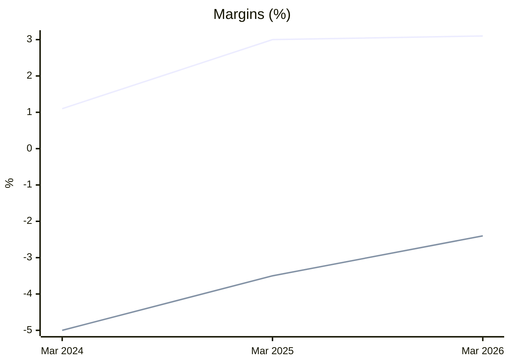

*Run 2026-11-24 · part of [SPINOFF_REPORT.md](../SPINOFF_REPORT.md) · the complete analysis of one company, with every management-call exchange in full.*

## FIRSTCRY — Brainbees Solutions Ltd.

### 1. Brainbees Solutions Ltd. — PARTIAL SPIN-OFF (subsidiary IPO)

**CONFIRMED** (partial spin-off — the IPO of Swara Baby Products Limited is in motion (DRHP filed)) · **PARTIAL SPIN-OFF, IPO IN MOTION — the parent's stub is priced once the piece trades** · score 4.3/10 · partial spin-off (subsidiary IPO) · 11 filing(s) from NSE · first 2025-12-26, latest 2026-10-07

**The separated entities — every one the documents name:**

| Entity | Business | Listing | Who runs it |
|---|---|---|---|
| **Swara Baby Products Limited** | Contract manufacturing of disposable hygiene products: baby diapers, adult diapers and sanitary napkins; manu… | to be listed | Mr. Alok Birla (operations led by him, with his s… |

**What is being separated, as the documents put it:** Swara Baby, the group's hygiene contract-manufacturing business (baby/adult diapers, sanitary napkins), via a separate IPO — class `unrelated`.

### 2. Stages and dates

> **Listing:** PARTIAL SPIN-OFF, IPO DRHP FILED — Swara Baby Products Limited; date not fixed

| Date | Event | Source |
|---|---|---|
| 2026-07-01 | Board approval — Brainbees Solutions Limited (approval of participation in the Offer for Sale of Swara Baby Products Limited) | as stated: Stock exchange intimation FC/SE/2026-27/26 dated July 1, 2026 |
| 2026-07-02 | DRHP filed — Swara Baby Products Limited (filed with SEBI, BSE Limited and National Stock Exchange of India Limited) | as stated: Stock exchange intimation FC/SE/2026-27/27 dated July 2, 2026 |
| 2026-08-29 | Stage reached: **meetings** | [Shareholders meeting](https://nsearchives.nseindia.com/corporate/BRAINBEES_29082026232500_IntimationofAGMNotice.pdf) |

**The stages, as filed:** meetings (2026-08-29)

**The partial spin-off:** **Swara Baby Products Limited** (subsidiary); parent's stake 76.59%; IPO stage: DRHP filed; exchange: BSE Limited and National Stock Exchange of India Limited.

> “In this connection, we wish to inform you that Swara Baby has filed a DRHP dated July 02, 2026 with the Securities and Exchange Board of India, BSE Limited and National Stock Exchange of India Limited”

### 3. Size of the separated business beside the parent — is institutional selling likely?

**Reading: not determinable — the documents on file give no size for the separated piece.**

| Entity | Stated turnover | Stated share of the whole | Segment revenue share | Market cap (₹ cr) | Share of combined market cap | Index member |
|---|---|---:|---:|---:|---:|---|
| Swara Baby Products Limited | Revenue from operations for FY 26: Rs. 11,639 Million (rest… | — | — | — | — | not listed |

*Stated figures are the documents' own (a turnover share, or the cost-of-acquisition split the company publishes for tax, which reflects relative value); the segment share is this business's revenue over the parent's sales, and the market-cap share is the entity's value over the entity plus the parent (parent ₹8,374 cr, NSE bhavcopy of 2026-11-13), both computed here.*

**In the documents' words:** “If we refer to the summary of restated consolidated Profit and Loss account of Swara Baby as disclosed in page no. 75 of the DRHP, the revenue from operations of Swara Baby for FY 26 is Rs. 11,639 Million. Further, post adjustment of the inter-company transaction between Swara Baby and Brainbees of Rs. 2,634.61 Million as disclosed in the Risk Factor No. 2 on Page No. 23 of Swara Baby's DRHP, the revenue from operations is Rs. 9,004.39 Million which got consolidated in the revenue from operations of India Multi-channel business of Brainbees.”

**The judge's read of selling pressure:** unlikely — No shares distributed to Brainbees holders; Swara Baby lists via fresh issue plus OFS, and Brainbees stays majority owner.

### 4. Insider ownership — share swap, promoters' holding, management incentives

**Share swap / entitlement, entity by entity:**

- **Swara Baby Products Limited:** Not a share swap. IPO offer structure: "The proposed IPO is aggregating up to Rs. 10,000 Million, comprising of a fresh issue of such number of Equity Shares of face value of Rs. 2/- each, aggregating up to Rs. 5,000 Million and an OFS of such number of Equity Shares of face value of Rs. 2/- each aggregating to Rs. 5,000 Million (each subject to any revisions to such amounts as may be permissible under applicable law...)"; within that OFS, the Brainbees board approved "the participation in the Offer for Sale up to such number of equity shares of face value of Rs. 2/- each of Swara Baby, a Subsidiary of the Company, for an amount aggregating up to Rs. 3,000 million, held by the Company"

**Promoters' holding, from the shareholding pattern:**

| Company | Promoters | FIIs | DIIs | Public | Quarter |
|---|---:|---:|---:|---:|---|
| Brainbees Solutions Ltd. (FIRSTCRY) | — | 5.63% | 22.08% | 65.34% |  |

*Source: screener.in shareholding pattern, stored under `ShareholdingPattern/NiftyTotalMarket/`. In a mirror demerger each shareholder holds the same proportion of the new company as of the parent on the record date.*

- **Promoters in the parent, per the documents:** No percentage or date stated; the documents state "The Company does not have any identifiable promoters or controlling shareholders and accordingly, there is no requirement to provide an exit offer in the proposed resolution, as per proviso to Regulation 59 read with Schedule XX of the SEBI ICDR Regulations." (AGM notice dated August 13, 2026) and "The Company does not have identifiable promoter or promoter group." (October 7, 2026 filing)
- **What the promoters will hold in the separated entity:** "Brainbees currently holds 76.59% shareholding in Swara Baby. Brainbees continue to remain invested and supportive of the business of Swara Baby and Swara Baby will continue to remain as Subsidiary Company of Brainbees. This is only a partial monetization of our investment in Swara Baby." Also: "Brainbees is a Promoter of Swara Baby" and "Swara Baby shall continue to be the Subsidiary of the Company, in compliance with the provisions of the applicable regulations." The exact percentage after the IPO is not stated
- **What a public shareholder receives:** not stated in the documents on file.
- **Management incentives:** No new plan in the listed entity and no exercise price or pricing date are stated. Parent-level disclosures: "Mr. Sanket Hattimattur did not receive any remuneration from the Company during the financial year 2025-26. However, the ESOP Cost of options already granted to him was Rs. 2,01,15,927/-, for the financial year 2025-26."; his "Shareholding in the Company: 6,34,780 Equity Shares of Rs. 2/- each (as at the date of this Notice)"; Independent Directors' "Details of shareholding in the Company: Nil"; "It is further clarified that the Company, while calculating the limits under Section 197 of the Act for the managerial remuneration, has also considered the ESOP cost towards the ESOPs granted to Executive Director(s)."; consolidated "Employee share based payment expense" of Rs. 2,236.13 million for the year ended March 31, 2026. At Swara Baby: "A further adjustment of Share based payment expenses of Rs. 3.42 Million (as disclosed on Page No. 75 of Swara Baby's DRHP) gives an EBITDA of Rs. 1,445.7 Million which has got consolidated in the adjusted EBITDA of India Multi-channel business of Brainbees in FY 26."
- **Insider actions around the separation:** The parent is selling down: the Brainbees board on July 01, 2026 "considered and approved the participation in the Offer for Sale up to such number of equity shares of face value of Rs. 2/- each of Swara Baby, a Subsidiary of the Company, for an amount aggregating up to Rs. 3,000 million, held by the Company". Stated intent: "Partial monetization of a successful investment allows us to crystallize value, improve return on investment and maintain flexibility for future strategic opportunities. We continue to remain invested and supportive of the business of Swara Baby and Swara Baby will continue to remain as Subsidiary Company of Brainbees." and "This is only a partial monetization of our investment in Swara Baby." No promoter/management buying or pledging is stated; the Company states it has no identifiable promoter or promoter group
- **Insiders, per the checklist read:** Brainbees holds 76.59% and remains Promoter of Swara Baby; it will sell up to Rs 3,000 million in the Rs 5,000 million OFS. Operations led by Mr. Alok Birla and Mr. Udit Birla; Supam Maheshwari and Gautam Sharma are non-executive directors. · *option pricing date:* not stated

### 5. Why the demerger — point by point

The business being separated is Swara Baby Products Limited, Brainbees' diaper/hygiene manufacturing subsidiary, which filed a DRHP on July 02, 2026 for an IPO of up to Rs 10,000 million (Rs 5,000 million fresh issue plus Rs 5,000 million offer for sale), with Brainbees itself selling up to Rs 3,000 million in the OFS (board approval July 01, 2026). Management's stated reason is drift in purpose: Brainbees invested Rs 906.17 million in 2020 for 53.45% (fully diluted) purely as backward integration — "to scale up our home brands within diaper category" with "more control on quality at scale, production timelines and continued innovation in diaper manufacturing" — but Swara then became the largest contract manufacturer by value in Fiscal 2025 in Indian hygiene manufacturing, adding adult diapers and sanitary napkins (similar absorbent raw materials and processes), third-party and multinational customers, and exports via a US subsidiary (Swara Corp, incorporated 08 December 2025). Brainbees' share of Swara's revenue fell from 27.03% in FY24 to 22.64% in FY26, so management says Swara "has charted a very different long term vision as compared to the original alignment with Brainbees," with "different capex and working capital needs" it should "bridge their own capital requirement" rather than draw on Brainbees' cash. On selling into the OFS despite holding cash, management argued "holding cash and holding an investment are two different capital allocation decisions" and that partial monetisation lets it "crystallize value, improve return on investment and maintain flexibility for future strategic opportunities." Control and commercials are explicitly unchanged: Brainbees stays Promoter at 76.59% (raised from 75.92% in a December 2025 swap that moved Solis Hygiene under Swara to put the hygiene vertical "under a single roof"), Swara remains a subsidiary, Brainbees' management has no involvement in running it (Alok Birla and Udit Birla lead; Supam Maheshwari and Gautam Sharma sit as non-executive directors), and "terms of trade" stay at arm's length with "no impact either on supply chain or pricing." Swara contributed Rs 11,639 million revenue in FY26 (Rs 9,004.39 million after eliminating Rs 2,634.61 million of inter-company sales) and Rs 1,445.7 million of adjusted EBITDA into the India multi-channel segment. No lender, partner or investor is named as having demanded it; analysts had only pushed on a separate asset, GlobalBees, where Supam said in August 2025 that "the most probable outcome for Globalbees... will be listing" given its separate board, management and investors (Premji, Lightspeed, Chiratae).

**Point by point, with the source:**

1. Asked by JM Financial's Sachin Dixit whether FirstCry shareholders could get liquidity from GlobalBees being demerged or separately IPO'd, Supam framed listing as the likely eventual route and Brainbees' monetisation path over a few years. “Having said this, the most probable outcome for Globalbees as an outcome will be listing, which company and its shareholders will decide over a period of time, is when Brainbees also will find a monetization opportunity over a period of a few years.” — *[Aug 2025](https://www.bseindia.com/stockinfo/AnnPdfOpen.aspx?Pname=4e061dce-c165-4749-9bdb-c4d6dae5f4c6.pdf)*
2. The structural argument for separability given for GlobalBees was that it already runs independently of Brainbees, with its own CEO, board and outside shareholders including Premji, Lightspeed and Chiratae. “The company has a separate management team, which is run separately and also it has its separate board, and also it has a separate set of investors as well, apart from Brainbees as well, which includes Premji, Lightspeed, and Chiratae, and so on and so forth.” — *[Aug 2025](https://www.bseindia.com/stockinfo/AnnPdfOpen.aspx?Pname=4e061dce-c165-4749-9bdb-c4d6dae5f4c6.pdf)*
3. Garima Mishra pressed on the CCPS infusion into GlobalBees; Gautam said it funded working capital, and that all three investor-directors who had stepped off the GlobalBees board participated in that round — the capital-need theme that later justifies Swara funding itself. “This is largely for taking care of their working capital requirement, Garima” — *[May 2025](https://www.bseindia.com/stockinfo/AnnPdfOpen.aspx?Pname=b7f23ae4-cfbb-47ce-b8a9-a579caae0f24.pdf)*
4. Ajay Agarwal again asked directly for a GlobalBees listing timeline; the reply covered only Flipkart's revenue-recognition impact and GlobalBees' EBITDA growth (c.150% YoY in Q3, c.50% in 9M), with no timeline given. “And again on Globalbees, any plans on listing of Globalbees? Can you share the tentative timelines or any sense on the same?” — *[Feb 2026](https://www.bseindia.com/stockinfo/AnnPdfOpen.aspx?Pname=c27dd63f-321b-4b7b-af06-12c29e11d89d.pdf)*
5. Five weeks before the Swara DRHP, asked about the low valuation, takeover risk and buybacks, Supam said no such capital action had been discussed internally or by the board — and said nothing about any separation. “Yes, we have sufficient cash on the company, but we haven't discussed any of these buybacks and stuff like that so far, in our internal discussions or even board discussions.” — *[Jun 2026](https://www.bseindia.com/stockinfo/AnnPdfOpen.aspx?Pname=c3d40b3d-ee57-4607-a1df-fcd732269f6b.pdf)*
6. The July 02, 2026 DRHP filing states the original purpose of the 2020 Rs 906.17 million investment for 53.45%: backward integration to scale FirstCry's own diaper home brands with control over quality, timelines and innovation. “We wanted to scale up our home brands within diaper category and wanted to do backward integration to get more control on quality at scale, production timelines and continued innovation in diaper manufacturing.” — *Scheme*
7. Core rationale: Swara outgrew the FirstCry ecosystem — multiple third-party and multinational customers, adult diapers and feminine hygiene, exports and a US subsidiary, with Brainbees' share of its revenue down from 27.03% (FY24) to 22.64% (FY26). “With Swara Baby's diversification across product lines, more channels, expansion into International geographies, the business has charted a very different long term vision as compared to the original alignment with Brainbees.” — *Scheme*
8. Why not just fund Swara off Brainbees' balance sheet: its capex and working-capital profile differs, so it should raise its own money while Brainbees keeps supply and arm's-length pricing unchanged. “With this expansive and global vision in contract manufacturing of disposable hygiene products with different capex and working capital needs, we decided to initiate the process of separately listing this business so that they can follow their independent journey and bridge their own capital requirement.” — *Scheme*
9. Why Brainbees sells up to Rs 3,000 million into the OFS despite ample cash: capital-allocation discipline and value crystallisation, while Swara stays a 76.59% subsidiary and Brainbees' management stays out of its operations. “Partial monetization of a successful investment allows us to crystallize value, improve return on investment and maintain flexibility for future strategic opportunities.” — *Scheme*
10. Preparatory step on December 26, 2025: Swara Baby acquired 100% of Solis Hygiene (FY25 turnover Rs 240.73 crore, 3% of consolidated), with Brainbees swapping its 79.34% Solis stake for 56,26,738 Swara shares, lifting its Swara holding from 75.92% to 76.59%. “In order to bring the complete Hygiene vertical under a single roof, the restructuring is being done.” — *Scheme*
11. The parallel pruning at GlobalBees: on October 07, 2026 it signed an MOU to sell its entire 51.54% in Mush Textile (brands Mush and BePlush, Rs 11.34 crore or 0.13% of FY26 turnover) for Rs 5,68,93,940 to Nihar Gosalia and Vaishvik Brahmbhatt. “Upon completion of the aforesaid transaction, Mush will cease to be a Subsidiary of GlobalBees and, accordingly, will also cease to be a Step-down Subsidiary of the Company.” — *Scheme*
12. The GlobalBees brand-rationalisation logic that frames the Mush exit: loss-making, slow-growing non-core brands were being exited, with core categories at 30% growth and 4.9% adjusted EBITDA versus 2% consolidated. “As you're aware, over the last few quarters, we've been speaking about rationalizing certain brands because they were delivering a relatively lower revenue growth as well as incurring losses.” — *[Feb 2026](https://www.bseindia.com/stockinfo/AnnPdfOpen.aspx?Pname=c27dd63f-321b-4b7b-af06-12c29e11d89d.pdf)*

**How it evolved:** The idea first surfaced as an analyst question about a different unit: on the Aug 2025 call (Aug 13, 2025) Sachin Dixit asked whether FirstCry investors could expect liquidity from GlobalBees "getting demerged, having its own IPO," and Supam said listing was the most probable outcome over a few years; on the Feb 2026 call (Feb 13, 2026) Ajay Agarwal asked for GlobalBees listing timelines and got no answer. Meanwhile the hygiene business was quietly being tidied for separation — a December 26, 2025 intra-group restructuring put Solis Hygiene under Swara Baby to bring the whole hygiene vertical under one roof, lifting Brainbees' Swara stake to 76.59%. Neither the Feb 2026 nor the Jun 2026 call (May 26, 2026) mentioned Swara or any separation at all; on Jun 2026 Supam even said buybacks and similar capital actions had not been discussed internally or at board level. The plan then appeared fully formed in filings only — board approval of OFS participation on July 01, 2026, DRHP plus a management Q&A on July 02, 2026 — followed by a related narrowing at GlobalBees, whose non-core brand rationalisation culminated in the October 07, 2026 sale of its entire 51.54% in Mush Textile.

**What management expects from it:** Swara funds its own capex/working capital from the Rs 5,000 million fresh issue and pursues an independent global contract-manufacturing path; Brainbees crystallizes value, improves ROI and gains flexibility via up to Rs 3,000 million OFS cash, while keeping 76.59% control, Promoter status, consolidation of Swara's Rs 9,004 million revenue and Rs 1,445.7 million adjusted EBITDA, and unchanged arm's-length supply and pricing.

*Not explained on the calls:* No earnings call ever mentions the Swara IPO, its valuation, or use of OFS proceeds; GlobalBees listing timeline never answered; Mush sale pricing and loss unexplained.

- *Stated reason, in one line:* Swara Baby's diversification across product lines, channels and international geographies charted "a very different long term vision as compared to the original alignment with Brainbees", with different capex and working-capital needs, so it can bridge its own capital requirement.
- *What it reveals:* Swara Baby is "the largest contract manufacturer by value in Fiscal 2025" in Indian hygiene manufacturing, with FY26 revenue of Rs 11,639 million and EBITDA of Rs 1,927.70 million buried inside Brainbees' India multi-channel segment, while consolidated Brainbees posted an FY26 loss of Rs 2,036.58 million.
- *Parent or spin:* parent · *Read next:* Swara Baby DRHP dated July 2, 2026 - Risk Factor No. 2, pages 23-24, on revenue dependence on Brainbees
- *In their words:* “With this expansive and global vision in contract manufacturing of disposable hygiene products with different capex and working capital needs, we decided to initiate the process of separately listing this business so that they can follow their independent journey.”

### 6. On the calls, verbatim

1 call(s), oldest first: **0 question-and-answer exchange(s)** given in full — the question and every answer to it, nothing trimmed — and 1 passage(s) from management's prepared remarks (the complete sentences about it; the whole remarks are in the linked transcript). Text is as the transcript prints it.

#### Aug 2025 — [transcript](https://www.bseindia.com/stockinfo/AnnPdfOpen.aspx?Pname=4e061dce-c165-4749-9bdb-c4d6dae5f4c6.pdf)

**From the prepared remarks** *(the passage about it; the whole turn runs to 43,640 characters in the transcript)*

> **ICSI Membership No.:** My second question is on Globalbees , which is a business which continues to su rprise positively every quarter . On that piece, I mean, two mi nor questions. The first one is, do you plan to start acquiring brands any time soon, there? And secondly , as First Cry investors, can they anticipate any liquidity from that business getting demerged, having its own IPO, or anything like th at? Those were my two questions. Thank you. Mr.

### 7. The parent's financial statements

**The parent, last three fiscal years (consolidated)**

| | Mar 2024 | Mar 2025 | Mar 2026 |
|---|---:|---:|---:|
| Sales (₹ cr) | 6,481 | 7,660 | 8,548 |
| Sales growth (%) | +15.1% | +18.2% | +11.6% |
| Operating profit (₹ cr) | 70.0 | 230 | 262 |
| Operating profit growth (%) | +122.1% | +228.6% | +13.9% |
| Operating margin (%) | 1.1 | 3.0 | 3.1 |
| PAT (₹ cr) | -322 | -265 | -204 |
| PAT growth (%) | +33.7% | +17.7% | +23.0% |
| PAT margin (%) | -5.0 | -3.5 | -2.4 |
| EPS (₹) | — | — | — |

*Source: ProfitStatement/NiftyTotalMarket/FIRSTCRY.csv (consolidated, screener.in); growth and margins computed here.*

```mermaid
xychart-beta
    title "Sales, operating profit and PAT (₹ cr)"
    x-axis ["Mar 2024", "Mar 2025", "Mar 2026"]
    y-axis "₹ crore"
    bar [6481, 7660, 8548]
    bar [70, 230, 262]
    bar [-322, -265, -204]
```

*Series in order: Sales, Operating profit, PAT.*

*Series in order: Operating margin, PAT margin.*

**P/E:** — — EPS -2.69 for Mar 2019 is not positive (price ₹174.75 as of 2026-10-01).

**Cash flows (₹ cr):**

| | Mar 2024 | Mar 2025 | Mar 2026 |
|---|---:|---:|---:|
| Cash from operations (₹ cr) | -42.0 | -83.0 | 365 |
| Cash from investing (₹ cr) | 63.0 | -1,438 | -108 |
| Cash from financing (₹ cr) | 81.0 | 1,431 | -282 |
| Net cash flow (₹ cr) | 102 | -91.0 | -25.0 |
| Free cash flow (₹ cr) | -385 | -292 | 176 |

*Source: CashFlow/NiftyTotalMarket/FIRSTCRY.csv (consolidated, screener.in).*

### 8. The separated business's financial statements

**The business being separated — its own numbers**, entity by entity: its reported statements once it is listed and on file, and the segment numbers the annual reports and presentations carry for it before that.

*Businesses with no numbers in the pages read (2 annual report(s) and 10 presentation(s) on file):* No own financials on these pages for Swara Baby Products Limited/Private Limited (Swara Baby, Swara Corp, contract manufacturing), Hygiene vertical, Solis Hygiene or Swara Hygiene Private Limited — only shareholding (87.30%→76.59%; Solis 79.34%→0%) and the Swara IPO note, which withholds FY27 figures under publicity guidelines. The four reported segments carry no separate Swara/hygiene line.

The segment pages read (2 annual report(s) and 10 presentation(s) on file) do not carry this business's own revenue or profit.

*Documents on file:* [Annual Report 2026](https://www.bseindia.com/xml-data/corpfiling/AttachHis/a97ee909-ef22-407c-b8dc-4b7e82ab0bc3.pdf); [Annual Report 2025](https://www.bseindia.com/xml-data/corpfiling/AttachHis/ef3c3a83-a151-4bd6-af63-43160c695bee.pdf); [Presentation Nov 2026](https://www.bseindia.com/stockinfo/AnnPdfOpen.aspx?Pname=173859c6-ad73-4ae7-ad8c-42fdec2c9eff.pdf); [Presentation Aug 2026](https://www.bseindia.com/stockinfo/AnnPdfOpen.aspx?Pname=f64c0354-9f8c-4f14-8a34-591a491d5dcd.pdf); [Presentation Jun 2026](https://www.bseindia.com/stockinfo/AnnPdfOpen.aspx?Pname=c9a2e703-796b-4a76-891a-83623d92747e.pdf); [Presentation Feb 2026](https://www.bseindia.com/stockinfo/AnnPdfOpen.aspx?Pname=56c41e48-a8b6-44cd-8054-b31d016c4b7e.pdf); [Presentation Nov 2025](https://www.bseindia.com/stockinfo/AnnPdfOpen.aspx?Pname=de99f468-60b9-4241-8053-0542c9f20743.pdf); [Presentation Aug 2025](https://www.bseindia.com/stockinfo/AnnPdfOpen.aspx?Pname=d51e4267-fb19-4121-b873-091a08880cb9.pdf)

### 9. Other financial differences — working capital, margins, returns, debt

Only the parent's figures are on file: Sales (₹ cr) 8,548 (Mar 2026); Sales growth (%) 11.6 (Mar 2026); Operating margin (%) 3.1 (Mar 2026); PAT margin (%) -2.4 (Mar 2026); Operating profit growth (%) 13.9 (Mar 2026); Debtor Days 16 (Mar 2026); Inventory Days 133 (Mar 2026); Days Payable 68 (Mar 2026); Cash Conversion Cycle 81 (Mar 2026); Working Capital Days 44 (Mar 2026); ROCE % 1 (Mar 2025); Debt / equity (x) 0.3 (Mar 2026); Borrowings (₹ cr) 1,594 (Mar 2026). The separated business has no comparable numbers in the documents read.

**What stays with the parent — its segments, from the same pages:**

| Remaining segment | Revenue | Operating margin | ROCE | Segment assets / revenue | Unit | Year |
|---|---:|---:|---:|---:|---|---|
| India multi-channel | 57,533 | 8.8% | 8.5% | 1.45x | ₹ million | FY2026 |
| International | 9,474 | -9.6% | -72.3% | 0.41x | ₹ million | FY2026 |
| Globalbees | 18,943 | 2.9% | 6.3% | 1.26x | ₹ million | FY2026 |
| Others (includes FirstCry Intelli Education / preschools) | 472 | 26.6% | — | 0.13x | ₹ million | FY2026 |

**What the documents themselves say about the differences:**

- **capex and capital intensity** — parent / remaining: Brainbees retains the baby, kids and maternity multi-channel retail business, which it says the IPO will not affect on supply chain or pricing (arm's length); separated business: Diversified across product lines, channels and international geographies with different capex and working capital needs, requiring its own capital-raising “With this expansive and global vision in contract manufacturing of disposable hygiene products with different capex and working capital needs, we decided to initiate the process of separately listing this business so that they can follow their independent journey and bridge their own capital requirement.”
- **cash** — parent / remaining: Has sufficient cash on the balance sheet but chooses partial monetization over funding the business itself; consolidated cash and cash equivalents Rs. 2,462.83 million and other bank balances Rs. 11,562.71 million as at March 31, 2026; separated business: To bridge its own capital requirement through the fresh issue of up to Rs. 5,000 million “Holding cash and holding an investment are two different capital allocation decisions. Even when a company has sufficient cash, management must periodically evaluate whether capital is optimally deployed. Partial monetization of a successful investment allows us to crystallize value, improve return on investment and maintain flexibility for future strategic opportunities.”
- **growth** — parent / remaining: Share of Swara Baby's sales going to Brainbees is falling; Brainbees' own India multi-channel revenue grew 9% in FY26 and consolidated revenue 12%; separated business: Became the largest contract manufacturer by value in Fiscal 2025 in the hygiene manufacturing industry in India, with a reducing proportion of revenue from Brainbees “It has become the largest contract manufacturer by value in Fiscal 2025 in the fast-growing hygiene manufacturing industry in India, including baby diapers, adult diapers and sanitary napkins with a reducing proportion of revenue from operations coming from Brainbees as is evident from the disclosure made in Page No. 23 and 24 - Risk Factor No. 2 in the DRHP wherein the % of revenue from operations derived by Swara Baby from Brainbees has reduced from 27.03% in FY 24 to 22.64% in FY 26.”
- **operating margin** — parent / remaining: Consolidated FY26: Revenue from operations Rs. 85,479.44 million, Loss for the year Rs. (2,036.58) million; India multi-channel adjusted EBITDA "around 505 Crores" and 8.8% of revenue in FY26 (9.5% in FY25); separated business: Swara Baby FY26 EBITDA Rs. 1,927.70 million; Rs. 1,442.28 million excluding other income; Rs. 1,445.7 million consolidated into Brainbees' India multi-channel adjusted EBITDA “As disclosed in page nos.435 of the Swara Baby's DRHP, the EBITDA of Swara Baby for FY 26 is Rs. 1,927.70 Million. However, post adjustment of the other income (as disclosed on Page No. 75 of Swara Baby's DRHP) from the EBITDA, the EBITDA (excluding other income) becomes Rs. 1,442.28 Million.”
- **debt and leverage** — parent / remaining: Parent (standalone) has no secured creditors, no bank or financial institution loans and no debentures outstanding, as on the date of the AGM notice; separated business: not stated “The members are also informed that as on the date of this notice, the Company does not have any secured creditor and it has neither taken any loan from any bank or public financial institution, nor issued any debentures, in view of the same, there is no default in payment of dues to the aforesaid parties.”
- **other** — parent / remaining: No management involvement in the separated business; terms of trade unchanged and at arm's length after listing; separated business: Completely managed by a separate team led by Mr. Alok Birla and Mr. Udit Birla “There is no involvement of Brainbees' management in the business and operations of Swara Baby.”

**The checklist:**

| Item | Status | Evidence |
|---|---|---|
| Why the spin-off | yes | a weak or capital-heavy business carved away — “…down subsidiary (subsidiarie(s) of globalbees) has written off current assets including inventories from its non-core business amounting to Rs 278.18 million and Rs 355. 71 million during quarter and year ended March 31” |
| Institutional selling likely (small / different business) | unknown | size of the demerged piece not stated *(next: pro-forma statements: revenue / assets of the demerged undertaking vs the parent)* |
| Insider ownership and incentives aligned | unknown | no promoter-continuity or option-pricing language found *(next: the date the management options are priced; promoter holding in the resulting company)* |
| A hidden value revealed (pro-forma, leverage, comparables) | partly | borrowings 1,594 cr (Mar 2026) = 0.14× market cap *(next: pro-forma P&L of each piece × the peer P/E of its own industry)* |
| Parent before the spin (clean parent, takeover prelude) | partly | stage meetings — the spin has not happened; the parent can still be bought whole |
| Partial spin-off: price the stub from the listed piece | partly | a subsidiary is being listed; once it trades, stub = parent price − (stake value ÷ parent shares) *(next: stub_value(parent price, parent shares, [(sub price, shares held)]))* |
| Timing (first year sells, second year gains) | partly | not yet listed — 333 days since the first filing, stage meetings |

The filings

| Date | Category | Headline | Attachment |
|---|---|---|---|
| 2025-12-26 | Outcome of Board Meeting | Brainbees Solutions Limited has informed the Exchange regarding Outcome of Board Meeting held on December 26, 2025. | [pdf](https://nsearchives.nseindia.com/corporate/BRAINBEES_26122025184313_Disclosureunderregulation30OutcomeofBM26122025.pdf) |
| 2025-12-26 | Change in Company Secretary/Compliance O | Brainbees Solutions Limited has informed the Exchange about Change in Company Secretary/Compliance Officer | [pdf](https://nsearchives.nseindia.com/corporate/BRAINBEES_26122025185228_Disclosureunderregulation30OutcomeofBM26122025.pdf) |
| 2025-12-26 | Acquisition | Brainbees Solutions Limited has informed the Exchange about Acquisition | [pdf](https://nsearchives.nseindia.com/corporate/BRAINBEES_26122025190047_Disclosureunderregulation30OutcomeofBM26122025_.pdf) |
| 2025-12-26 | Sale or disposal | Brainbees Solutions Limited has informed the Exchange about Sale or disposal | [pdf](https://nsearchives.nseindia.com/corporate/BRAINBEES_26122025190355_Disclosureunderregulation30OutcomeofBM26122025_.pdf) |
| 2026-05-26 | Outcome of Board Meeting | Brainbees Solutions Limited has submitted the outcome of Board Meeting held on May 26, 2026. | [pdf](https://nsearchives.nseindia.com/corporate/BRAINBEES_26052026173216_Boardmeetingoutcome_March26.pdf) |
| 2026-05-26 | Acquisition | Brainbees Solutions Limited has informed the Exchange about acquisition in Firstcry Management DWC LLC. | [pdf](https://nsearchives.nseindia.com/corporate/BRAINBEES_26052026180538_Boardmeetingoutcome_March26.pdf) |
| 2026-06-30 | Acquisition | Brainbees Solutions Limited has informed the Exchange about the extension in the timeline of further investment in Firstcry Management DWC LLC, a wholly owned s | [pdf](https://nsearchives.nseindia.com/corporate/BRAINBEES_30062026165703_Disclosureunderregulation30UpdateFCManagementsigned.pdf) |
| 2026-07-01 | General Updates | Brainbees Solutions Limited has informed the Exchange about an intimation under Regulation 30 of the SEBI (Listing Obligations and Disclosure Requirements) Regu | [pdf](https://nsearchives.nseindia.com/corporate/BRAINBEES_01072026193848_DraftDisclosureunderRegulation30OFSParticipation.pdf) |
| 2026-07-02 | General Updates | Brainbees Solutions Limited has informed the Exchange about filing of Draft Red Herring Prospectus by Swara Baby Products Limited, a Subsidiary of Brainbees Sol | [pdf](https://nsearchives.nseindia.com/corporate/BRAINBEES_02072026151519_DisclosureunderRegulation30DRHPStage.pdf) |
| 2026-08-29 | Shareholders meeting | Brainbees Solutions Limited has informed the Exchange regarding Notice of 16th Annual General Meeting of the Members of the Company to be held through Video Con | [pdf](https://nsearchives.nseindia.com/corporate/BRAINBEES_29082026232500_IntimationofAGMNotice.pdf) |
| 2026-10-07 | Sale or disposal | Brainbees Solutions Limited has informed the Exchange about Execution of Memorandum of Understanding by GlobalBees Brands Private Limited ("Globalbees") , a Sub | [pdf](https://nsearchives.nseindia.com/corporate/BRAINBEES_07102026192542_Disclosureunderregulation30_MOUtosellMush.pdf) |

