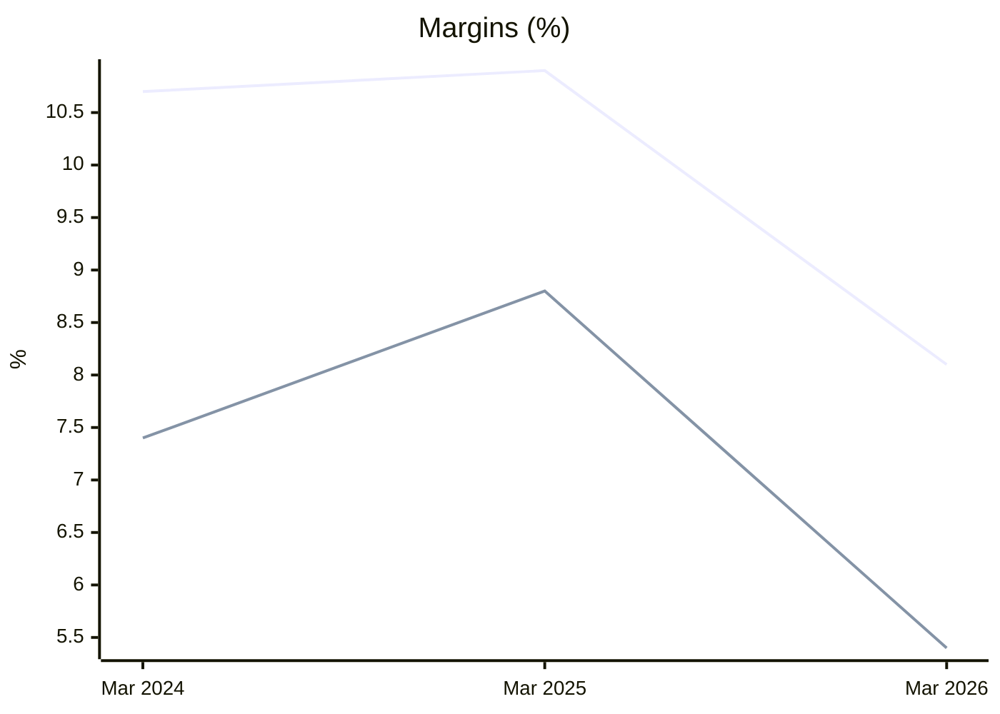

*Run 2026-11-24 · part of [SPINOFF_REPORT.md](../SPINOFF_REPORT.md) · the complete analysis of one company, with every management-call exchange in full.*

## GAIL — GAIL (India) Ltd.

### 1. GAIL (India) Ltd. — PARTIAL SPIN-OFF (subsidiary IPO)

**CONFIRMED** (partial spin-off — the IPO of GAIL Gas Limited is in motion (board approval)) · **PARTIAL SPIN-OFF, IPO IN MOTION — the parent's stub is priced once the piece trades** · score 2.9/10 · partial spin-off (subsidiary IPO) · 2 filing(s) from NSE · first 2026-07-31, latest 2026-10-30

**The separated entities — every one the documents name:**

| Entity | Business | Listing | Who runs it |
|---|---|---|---|
| **GAIL Gas Limited** | Wholly owned subsidiary of GAIL; with its JVs/subsidiaries operates 12,46,000 DPNG connections and 674 CNG st… | to be listed | not stated |

**What is being separated, as the documents put it:** GAIL Gas Limited, GAIL's wholly owned city gas distribution subsidiary, listed via IPO diluting up to 25% — class `not stated`.

### 2. Stages and dates

> **Listing:** PARTIAL SPIN-OFF, IPO BOARD APPROVAL — GAIL Gas Limited; date not fixed

| Date | Event | Source |
|---|---|---|
| 2026-10-30 | Board approval — GAIL (India) Limited board, in-principle approval for IPO listing of GAIL Gas Limited | as stated: GAIL Regulation 30 disclosure, General Updates, letter ND/GAIL/SECTT/… |

**The partial spin-off:** **GAIL Gas Limited** (subsidiary); parent's stake 100% (wholly owned subsidiary of GAIL); IPO stage: board approval; exchange: Indian stock exchanges.

> “This is to inform that GAIL Board in its meeting held today i.e. 30.10.2026 accorded in-principle approval for Listing of shares of GAIL Gas Limited, (a wholly owned subsidiary of GAIL) (GGL) on the I”

### 3. Size of the separated business beside the parent — is institutional selling likely?

**Reading: VERY LIKELY — the piece is under a tenth of the whole; index funds and large holders who receive it without choosing it tend to sell.**

| Entity | Stated turnover | Stated share of the whole | Segment revenue share | Market cap (₹ cr) | Share of combined market cap | Index member |
|---|---|---:|---:|---:|---:|---|
| GAIL Gas Limited | "In Q3 FY26, turnover of GAIL Gas stood at Rs.3,292 crores … | — | 5.2% (FY2026) | — | — | not listed |

*Stated figures are the documents' own (a turnover share, or the cost-of-acquisition split the company publishes for tax, which reflects relative value); the segment share is this business's revenue over the parent's sales, and the market-cap share is the entity's value over the entity plus the parent (parent ₹123,612 cr, NSE bhavcopy of 2026-11-13), both computed here.*

**The judge's read of selling pressure:** unlikely — IPO route sells shares to willing subscribers; no distribution to GAIL shareholders, no index exclusion stated.

### 4. Insider ownership — share swap, promoters' holding, management incentives

**Share swap / entitlement, entity by entity:**

- **GAIL Gas Limited:** IPO: "Listing of shares of GAIL Gas Limited, (a wholly owned subsidiary of GAIL) (GGL) on the Indian stock exchanges through Initial Public Offering (IPO) route by diluting GAIL's equity in GGL upto 25%" — in-principle only; "After GGL submits the final proposal based on BRLM recommendations on valuation, price band, modality and other terms & conditions, approval of GAIL Board for the final extent of dilution, modality & other terms & condition of IPO will be obtained." Split between fresh issue and offer for sale, and issue size: not stated

**Promoters' holding, from the shareholding pattern:**

| Company | Promoters | FIIs | DIIs | Public | Quarter |
|---|---:|---:|---:|---:|---|
| GAIL (India) Ltd. (GAIL) | 51.85% | 16.59% | 17.88% | 6.07% | Sep 2026 |

*Source: screener.in shareholding pattern, stored under `ShareholdingPattern/NiftyTotalMarket/`. In a mirror demerger each shareholder holds the same proportion of the new company as of the parent on the record date.*

- **Promoters in the parent, per the documents:** not stated in the documents on file.
- **What the promoters will hold in the separated entity:** "by diluting GAIL's equity in GGL upto 25%"; "approval of GAIL Board for the final extent of dilution, modality & other terms & condition of IPO will be obtained"
- **What a public shareholder receives:** not stated in the documents on file.
- **Management incentives:** not stated in the documents on file.
- **Insider actions around the separation:** not stated in the documents on file.
- **Insiders, per the checklist read:** GGL is a wholly owned subsidiary of GAIL; GAIL dilutes equity in GGL upto 25%, retaining at least 75%. No management incentives stated. · *option pricing date:* not stated

### 5. Why the demerger — point by point

The business being separated is GAIL's own directly-authorised city gas distribution (CGD) retail business — the six geographical areas Varanasi, Patna, Ranchi, East Singhbhum (Jamshedpur), Cuttack and Khordha (Bhubaneswar) — which the Board resolved to hive down into its 100% subsidiary GAIL Gas Limited as a slump sale on a going-concern basis, effective 01.01.2027, with the subsidiary then to be listed via IPO diluting up to 25% of GAIL's equity. Management's stated reason was structural, not financial distress: CMD Sandeep Kumar Gupta said it was 'in order to have a single entity for development of GAIL's CGD business and for bringing business synergy, efficiency and retail focused business approach' — i.e. GAIL group CGD was split across GAIL's own balance sheet (six GAs, 0.36–0.55 MMSCMD, 195→215 CNG stations and 3.53→4.64 lakh DPNG connections over FY25–Q3FY26, volumes up ~25% in FY25 but 'currently in their early stages of development'), GAIL Gas (16 GAs plus 9 JVs, 7.0→7.8 MMSCMD, 12.46 lakh DPNG connections, 674 CNG stations, FY25 turnover Rs 12,231 crore, PBT Rs 615 crore up 42%, PAT Rs 451 crore up 40%) and 72 group GAs in all. A pipeline-and-marketing parent was also an awkward owner of a retail business: management said 'we are constantly reviewing these CGDs to optimize costs and enhance efficiencies', and segment reporting of the CGD/marketing split was itself confusing analysts (the Rs 400 crore standalone-to-consolidated regrouping queried in Jul 2025). The upside case cited was CGD demand: a PNGRB projection of consumption rising '2.5 times to 3.5 times by 2030 and 6 times to 7 times by 2040 from the baseline of approximately 37 MMSCMD in FY 24' (~15% CAGR), PNGRB capping CNG/domestic-PNG tariffs at Zone 1 and expected GST inclusion lowering CGD input costs. For the IPO, the argument was scale and timing — 'GAIL Gas is one of the biggest company in the country in terms of city gas distribution... now is high time that we started the process of listing GAIL Gas' — with a consultant already selected and a roughly one-year timeline. The impetus came largely from sell-side investors (Citi's Saurabh Handa on restructuring CGD investments in Nov 2024; Alliance Services' Balaji Das on the IPO consultant in Oct 2025); the only external consent management named was CCEA, 'since these six GAs were authorized to GAIL by CCEA' — no lender or JV-partner demand was cited. Running in the opposite direction, GAIL simultaneously pulled Konkan LNG Limited in: it bought out MSEB Holding's 7,40,55,220 shares via a NCLT-approved capital reduction (paid 06.07.2026, GAIL to 100%) and then merged KLL (FY26 turnover Rs 741 crore, versus GAIL's Rs 1,41,483 crore) into GAIL to 'create a larger and stronger vertically integrated entity, simplify and rationalize group structure'.

**Point by point, with the source:**

1. Citi's Saurabh Handa raised the split of CGD investments between GAIL standalone and GAIL Gas and asked whether GAIL would restructure them — the first time the idea appears in the record. “On your City Gas investments, whether they are at the standalone entity or in GAIL Gas? Is there any thought process to look at restructuring these streamline these investments?” — *[Nov 2024](https://gailonline.com/pdf/InvestorsZone/GAIL_Earnings_Call_Q2_FY25_11112024.pdf)*
2. Director (Finance) R.K. Jain confirmed restructuring was under internal consideration but that no decision existed, while separately flagging that GAIL was working on listing one or two JVs with an update promised in Q3. “As a company about GAIL Gas has not yet taken any call for restructuring of GAIL Gas. This is in our mind, but nothing concrete I can share with you right now.” — *[Nov 2024](https://gailonline.com/pdf/InvestorsZone/GAIL_Earnings_Call_Q2_FY25_11112024.pdf)*
3. Alongside CGD restructuring, Jain said listing of group entities was already in progress and at 'a good stage', promising an update in Q3 FY25. “So also, we are looking for listing one or two JVs, which we are in the process and once we move forward and we take a call, we'll come back to you, but that we are certainly working and we are in a good stage.” — *[Nov 2024](https://gailonline.com/pdf/InvestorsZone/GAIL_Earnings_Call_Q2_FY25_11112024.pdf)*
4. CMD Sandeep Kumar Gupta disclosed the Board's 13.05.2025 recommendation to transfer GAIL's six directly-held CGD geographical areas to wholly-owned GAIL Gas Limited — the core rationale being one single, synergistic, retail-focused CGD entity. “In order to have a single entity for development of GAIL's CGD business and for bringing business synergy, efficiency and retail focused business approach, the Board has recommended to transfer six geographical areas of GAIL to its wholly owned subsidiary, GAIL Gas Limited.” — *[May 2025](https://www.gailonline.com/pdf/InvestorsZone/GAIL%20Analysts%20Meet%20Q4%20FY25%2014.05.2025.pdf)*
5. The only approval condition management named was CCEA, because the six GAs (Varanasi, Patna, Ranchi, Jamshedpur, Bhubaneswar, Cuttack) had been awarded to GAIL by CCEA rather than won by GAIL Gas. “This is subject to approval of CCEA since these six GAs were authorized to GAIL by CCEA.” — *[May 2025](https://www.gailonline.com/pdf/InvestorsZone/GAIL%20Analysts%20Meet%20Q4%20FY25%2014.05.2025.pdf)*
6. The six GAs were described as early-stage but fast-growing (volumes up ~25% in FY25, then ~0.4–0.45 MMSCMD) and under continuous cost review — the sub-scale retail assets being pushed into the dedicated CGD vehicle. “In the Financial Year 24-25, these six GAs have shown impressive growth with volumes increasing by approximately 25%. We are constantly reviewing these CGDs to optimize costs and enhance efficiencies.” — *[May 2025](https://www.gailonline.com/pdf/InvestorsZone/GAIL%20Analysts%20Meet%20Q4%20FY25%2014.05.2025.pdf)*
7. The growth case for a standalone CGD entity rested on PNGRB's demand projection, supplemented by PNGRB's proposal to cap CNG/domestic-PNG tariffs at Zone 1 and expected GST inclusion to cut CGD input costs. “the CGD sector is anticipated to be the key driver of growth, with consumption expected to increase 2.5 times to 3.5 times by 2030 and 6 times to 7 times by 2040 from the baseline of approximately 37 MMSCMD in FY '24” — *[May 2025](https://www.gailonline.com/pdf/InvestorsZone/GAIL%20Analysts%20Meet%20Q4%20FY25%2014.05.2025.pdf)*
8. GAIL Gas's own FY25 numbers framed the receiving entity as a scaled, improving business: turnover Rs 12,231 crore, PBT Rs 615 crore (+42%), PAT Rs 451 crore (+40%), 16 GAs owned plus 9 JVs. “During the current financial year, that is FY '25, GAIL Gas Limited's turnover stood at Rs. 12,231 crores as against Rs. 10,944 crores in FY '24. PBT increased by 42% and stood at Rs. 615 crores as against Rs. 434 crores in FY '24.” — *[May 2025](https://www.gailonline.com/pdf/InvestorsZone/GAIL%20Analysts%20Meet%20Q4%20FY25%2014.05.2025.pdf)*
9. On the other entity later consolidated in, management said Konkan LNG (Dabhol) would swing to profit once the all-weather breakwater let it run 34–36 cargoes versus 21, worth roughly Rs 300 crore. “So this year certainly we were not in positive because of the breakwater issue. But going forward, we will have positive bottom line from KLL.” — *[May 2025](https://www.gailonline.com/pdf/InvestorsZone/GAIL%20Analysts%20Meet%20Q4%20FY25%2014.05.2025.pdf)*
10. An investor (Balaji Das) pressed on the GAIL Gas IPO and the consultant being hired for listing analysis, confirming the second leg of the plan was investor-driven. “And the second question is on, we had like on the listing of the GAIL Gas IPO actually. So, any further progress on consultant and when are the future plans actually for GAIL Gas actually, because we heard that we are hiring consultants for analysis of listing.” — *Oct 2025*
11. Jain confirmed the listing process had begun — consultant selected, order imminent — and justified it on GAIL Gas's scale: 7.72 MMSCMD of volume and more GAs than any peer, with Bangalore alone at 1 MMSCMD. “And we in GAIL believe that now is high time that we started the process of listing GAIL Gas, in that regard we have already started the process of hiring of consultant.” — *Oct 2025*
12. He put a roughly one-year timeline on the listing, contingent on the consultant's study — the only timing guidance given on the IPO. “So, we are on a path to study about listing of GAIL Gas and after conclusion of that study, certainly that study is very important for us, we expect a one year time line or so should be good enough.” — *Oct 2025*
13. The last call in the record discussed the six GAs and GAIL Gas purely operationally (0.55 MMSCMD, 215 CNG stations, 4.64 lakh DPNG; GAIL Gas 7.8 MMSCMD, PBT Rs 143 crore) with no mention of the transfer or the IPO. “GAIL has direct authorization of 6 GAs and has an infrastructure of 215 CNG stations and 4.64 lakh DPNG connections.” — *[Feb 2026](https://www.gailonline.com/pdf/InvestorsZone/GAIL_Earnings_Call_Q3_FY_26.pdf)*
14. Filing 30.10.2026: Board approved the carve-out of the six named CGD GAs to GAIL Gas as a slump sale, via Business Transfer Agreement on a going-concern basis, effective 01.01.2027. “GAIL Board in its meeting held today i.e. 30.10.2026 accorded approval for Transfer of Six CGD Geographical Areas of GAIL India Ltd. viz. Varanasi, Patna, Ranchi, East Singhbhum, Cuttack and Khordha to GAIL Gas Ltd. (wholly owned Subsidiary of GAIL) through slump sale by Execution of Business Transfer Agreement on going concern basis, with effective date of transfer as 01.01.2027.” — *Scheme*
15. Same-day filing: in-principle Board approval to list GAIL Gas on Indian exchanges via IPO, diluting GAIL's stake by up to 25%, with valuation, price band and final dilution left to BRLM recommendations and a later Board approval. “accorded in-principle approval for Listing of shares of GAIL Gas Limited, (a wholly owned subsidiary of GAIL) (GGL) on the Indian stock exchanges through Initial Public Offering (IPO) route by diluting GAIL's equity in GGL upto 25%.” — *Scheme*
16. Filing 31.07.2026: in the opposite direction, GAIL approved absorbing wholly-owned Konkan LNG (FY26 turnover Rs 741 crore, versus GAIL's Rs 1,41,483 crore) into itself under Section 233, with KLL's shares cancelled and no change in GAIL's shareholding. “To create a larger and stronger vertically integrated entity, simplify and rationalize group structure which will enhance operational efficiencies.” — *Scheme*
17. Filing 10.07.2026: the KLL merger was preceded by an NCLT-approved capital reduction (order 03.06.2026) buying out partner MSEB Holding, taking GAIL from 50% to 100% of Konkan LNG before the absorption. “an aggregate of 14,81,10,440 equity shares of ₹10 each, including 7,40,55,220 equity shares held by GAIL and 7,40,55,220 equity shares held by MSEB in KLL stand cancelled and extinguished i.e. MSEB holding in KLL reduced to Nil and GAIL shareholding increased to 100% of the equity share capital of KLL.” — *Scheme*

**How it evolved:** The idea first surfaced only as an unprompted analyst question on the Nov 06, 2024 Q2 FY25 call, where R.K. Jain said no call had been taken on restructuring GAIL Gas — 'this is in our mind, but nothing concrete' — while adding that GAIL was 'looking for listing one or two JVs'; the Jan 30, 2025 call did not touch it. It became concrete at the May 14, 2025 annual analyst meet, where the CMD disclosed the Board's recommendation (passed 13.05.2025) to transfer the six GAs to GAIL Gas for a 'single entity... retail focused business approach', subject to CCEA. On Oct 31, 2025 the second leg appeared: GAIL confirmed it had started the GAIL Gas listing process, had selected a consultant, and expected 'a one year time line or so'; the Feb 02, 2026 Q3 FY26 call was silent on both. The filings then executed it: 31.07.2026 KLL merger into GAIL, and 30.10.2026 Board approval of the six-GA slump sale effective 01.01.2027 plus in-principle approval of a GAIL Gas IPO diluting up to 25%.

**What management expects from it:** One consolidated, retail-focused CGD entity with business synergy and efficiency; the six early-stage GAs (0.55 MMSCMD) folded into GAIL Gas's 7.8 MMSCMD platform (674 CNG stations, 12.46 lakh DPNG) to capture CGD demand rising 2.5–3.5x by 2030, aided by Zone-1 tariff capping and expected GST; price discovery and capital via an IPO of up to 25%. Parent keeps transmission/marketing; Konkan LNG's merger simplifies the group and adds its cargo-driven profit.

*Not explained on the calls:* No valuation, slump-sale consideration, IPO size or use of proceeds, standalone margin/ROCE or capex targets, CCEA timing, or why 25%; calls after Oct 2025 went silent.

- *Stated reason, in one line:* not stated
- *What it reveals:* GGL Q3 FY26 turnover Rs.3,292 crore, PBT Rs.143 crore, PAT Rs.106 crore, 7.8 MMSCMD volume, 12,46,000 DPNG connections, 674 CNG stations; plus six GAs (0.55 MMSCMD, 215 CNG stations) transferred in by slump sale effective 01.01.2027.
- *Parent or spin:* parent · *Read next:* GGL's final IPO proposal to GAIL Board on valuation, price band, extent of dilution and modality
- *In their words:* “This is to inform that GAIL Board in its meeting held today i.e. 30.10.2026 accorded in-principle approval for Listing of shares of GAIL Gas Limited, (a wholly owned subsidiary of GAIL) (GGL) on the Indian stock exchanges through Initial Public Offering (IPO) route by diluting GAIL's equity in GGL upto 25%.”

### 6. On the calls, verbatim

1 call(s), oldest first: **1 question-and-answer exchange(s)** given in full — the question and every answer to it, nothing trimmed — and 0 passage(s) from management's prepared remarks (the complete sentences about it; the whole remarks are in the linked transcript). Text is as the transcript prints it.

#### Jan 2024 — [transcript](https://www.gailonline.com/pdf/InvestorsZone/EarningsCallTranscript290124.pdf)

**Question and answer**

> **Amarnath:** My first question was with respect to this value unlocking activities which the management and the board was thinking whether with respect to CGD or with respect to merger or reverse merger with your petrochemical side any update you can give on this regard at the moment?
>
> **Rakesh Kumar Jain:** Actually we have not come out with any such kind of value creations through disinvestment of CGD or petrochemical. Yes, we are internally evaluating and we will take this call at an Gail India Limited January 29, 2024 Page 18 of 19 appropriate time. But till now we have not concluded what we will do about these investments in CGD and there is no thought about petrochemicals.

### 7. The parent's financial statements

**The parent, last three fiscal years (consolidated)**

| | Mar 2024 | Mar 2025 | Mar 2026 |
|---|---:|---:|---:|
| Sales (₹ cr) | 133,228 | 141,903 | 141,598 |
| Sales growth (%) | -8.5% | +6.5% | -0.2% |
| Operating profit (₹ cr) | 14,314 | 15,493 | 11,510 |
| Operating profit growth (%) | +90.9% | +8.2% | -25.7% |
| Operating margin (%) | 10.7 | 10.9 | 8.1 |
| PAT (₹ cr) | 9,903 | 12,463 | 7,582 |
| PAT growth (%) | +77.0% | +25.9% | -39.2% |
| PAT margin (%) | 7.4 | 8.8 | 5.4 |
| EPS (₹) | 15.1 | 18.9 | 11.5 |

*Source: ProfitStatement/NiftyTotalMarket/GAIL.csv (consolidated, screener.in); growth and margins computed here.*

```mermaid
xychart-beta
    title "Sales, operating profit and PAT (₹ cr)"
    x-axis ["Mar 2024", "Mar 2025", "Mar 2026"]
    y-axis "₹ crore"
    bar [133228, 141903, 141598]
    bar [14314, 15493, 11510]
    bar [9903, 12463, 7582]
```

*Series in order: Sales, Operating profit, PAT.*

*Series in order: Operating margin, PAT margin.*

**P/E:** 12.1 — live market file (screener.in), trailing (price ₹181.00 as of 2026-08-02).

**Cash flows (₹ cr):**

| | Mar 2024 | Mar 2025 | Mar 2026 |
|---|---:|---:|---:|
| Cash from operations (₹ cr) | 12,586 | 15,735 | 11,249 |
| Cash from investing (₹ cr) | -8,226 | -6,623 | -9,154 |
| Cash from financing (₹ cr) | -3,457 | -8,941 | -2,750 |
| Net cash flow (₹ cr) | 902 | 171 | -655 |
| Free cash flow (₹ cr) | 98.0 | 7,818 | 2,451 |

*Source: CashFlow/NiftyTotalMarket/GAIL.csv (consolidated, screener.in).*

### 8. The separated business's financial statements

**The business being separated — its own numbers**, entity by entity: its reported statements once it is listed and on file, and the segment numbers the annual reports and presentations carry for it before that.

**City Gas (City Gas Distribution / CGD) → GAIL Gas Limited** · unit ₹ crore · Consolidated Ind AS 108 segment disclosure; the 'City Gas' segment is noted as including subsidiaries GAIL Gas Ltd. and Tripura Natural Gas Company Ltd. (Note 2). Revenue shown is external sales/other income (inter-segment shown separately and negligible for this segment). operating_profit = Segment Result (Profit before Interest & Tax); the table's per-segment 'Net Profit/(Loss)' row equals that same figure because interest and tax are unallocated, so no true PAT is disclosed. capex = 'Cost to acquire fixed assets'. In GAIL standalone accounts CGD is not a separate segment — it sits inside 'Other Segment' — so only the consolidated City Gas segment carries CGD numbers. FY2024 figures below are as restated in AR2025 (p390); AR2024 (p356) originally reported FY2024 City Gas external revenue 10,738.75, total revenue 11,851.69, segment result 560.65, assets 7,930.57, liabilities 1,175.91.

| | FY2024 | FY2025 | FY2026 |
|---|---:|---:|---:|
| Revenue (₹ crore) | 5,065 | 6,052 | 7,400 |
| Revenue growth (%) | — | +19.5% | +22.3% |
| Operating profit (₹ crore) | 492 | 736 | 699 |
| Operating profit growth (%) | — | +49.7% | -5.1% |
| Operating margin (%) | 9.7 | 12.2 | 9.4 |
| PAT (₹ crore) | — | — | — |
| PAT growth (%) | — | — | — |
| Segment assets (₹ crore) | 7,387 | 8,253 | 9,077 |
| Segment liabilities (₹ crore) | 501 | 1,246 | 1,409 |
| Capital employed (₹ crore) | 6,886 | 7,007 | 7,668 |
| Return on capital employed (%) | 7.1 | 10.5 | 9.1 |
| Segment assets / revenue (x) | 1.5 | 1.4 | 1.2 |
| Capex (₹ crore) | 1,603 | 1,414 | 1,628 |

*Sources:* Annual Report 2025 — page 390; Annual Report 2026 — page 395; Annual Report 2026 — pages 394-395

*Not in the pages read:* No PAT (tax/interest unallocated to segments); no quarterly CGD financials on the presentation pages (only FY capex profile, incl. 'City Gas Distribution (Equity)' ₹237 crore in FY2024-25).

*Businesses with no numbers in the pages read (3 annual report(s) and 10 presentation(s) on file):* No standalone financials for GAIL Gas Limited as an entity (only the consolidated City Gas segment), and no separate numbers for the 'six CGD geographical areas' transferred to GAIL Gas.

*Documents on file:* [Annual Report 2026](https://www.bseindia.com/xml-data/corpfiling/AttachHis/474d7528-dc8d-40e6-bc63-d81008cbb813.pdf); [Annual Report 2025](https://www.bseindia.com/xml-data/corpfiling/AttachHis/6e59a978-52ed-4d18-ab76-c42d748c90de.pdf); [Annual Report 2024](https://www.bseindia.com/xml-data/corpfiling/AttachHis/a3d9f45c-7451-469c-a953-87d895e6fcb2.pdf); [Presentation Oct 2026](https://www.bseindia.com/stockinfo/AnnPdfOpen.aspx?Pname=9eb0688d-53f6-469d-a85b-13dc5a01d8f2.pdf); [Presentation Jul 2026](https://www.bseindia.com/stockinfo/AnnPdfOpen.aspx?Pname=3eda4efe-9d6d-438f-941c-a3a8a2389644.pdf); [Presentation May 2026](https://www.bseindia.com/stockinfo/AnnPdfOpen.aspx?Pname=6679d94c-aa3c-49c1-837c-6dfc5cfed984.pdf); [Presentation Feb 2026](https://www.bseindia.com/stockinfo/AnnPdfOpen.aspx?Pname=7bfcc61f-7cdc-416b-85e6-1b71480c55ee.pdf); [Presentation Oct 2025](https://www.bseindia.com/stockinfo/AnnPdfOpen.aspx?Pname=3cdcfaf1-346e-4b0c-9ca3-a89fca2da1af.pdf); [Presentation Jul 2025](https://www.bseindia.com/stockinfo/AnnPdfOpen.aspx?Pname=c46f4d72-a5ad-4563-b349-c6aa9e02a7ad.pdf)

### 9. Other financial differences — working capital, margins, returns, debt

| Metric (latest year) | Parent (GAIL) | GAIL Gas Limited |
|---|---:|---:|
| *Basis* | *reported, consolidated* | *segment numbers (City Gas (City Gas Distribut…* |
| Sales (₹ cr) | 141,598 (Mar 2026) | — |
| Sales growth (%) | -0.2 (Mar 2026) | 22.3 (FY2026) |
| Operating margin (%) | 8.1 (Mar 2026) | 9.4 (FY2026) |
| Operating profit growth (%) | -25.7 (Mar 2026) | -5.1 (FY2026) |
| PAT margin (%) | 5.4 (Mar 2026) | — |
| ROCE % | 10 (Mar 2026) | 9.1 (FY2026) |
| Debtor Days | 22 (Mar 2026) | — |
| Inventory Days | 16 (Mar 2026) | — |
| Days Payable | 19 (Mar 2026) | — |
| Cash Conversion Cycle | 19 (Mar 2026) | — |
| Working Capital Days | -15 (Mar 2026) | — |
| Debt / equity (x) | 0.3 (Mar 2026) | — |
| Borrowings (₹ cr) | 24,831 (Mar 2026) | — |
| Segment assets / revenue (x) | — | 1.2 (FY2026) |
| Sales (₹ crore) | — | 7,399.8 (FY2026) |

*Each figure is the latest on file, with its year. Working-capital days and ROCE come from the stored working-capital file; segment figures from the pages cited in part 8. A dash means the documents do not carry it.*

**What stays with the parent — its segments, from the same pages:**

| Remaining segment | Revenue | Operating margin | ROCE | Segment assets / revenue | Unit | Year |
|---|---:|---:|---:|---:|---|---|
| Transmission services – Natural Gas | 10,223 | 60.9% | 14.1% | 6.38x | ₹ crore | FY2026 |
| Transmission services – LPG | 912 | 49.9% | 56.2% | 1.06x | ₹ crore | FY2026 |
| Natural Gas Marketing (Natural Gas Trading/Marketing) | 113,858 | 2.7% | — | — | ₹ crore | FY2026 |
| Petrochemicals | 7,574 | -18.6% | -7.8% | 2.61x | ₹ crore | FY2026 |
| LPG and other Liquid Hydrocarbons | 3,945 | 12.4% | 25.8% | 0.54x | ₹ crore | FY2026 |
| Other Segment (City Gas Distribution, E&P, Compressed Bio Gas, Power Generation; GAILTEL in earlier years) | 2,183 | 23.7% | 15.1% | 1.94x | ₹ crore | FY2026 |

**What the documents themselves say about the differences:**

- **operating margin** — parent / remaining: GAIL standalone PBT fell to Rs.2,030 crores in Q3 FY26 from Rs.2,823 crores in Q2 FY26; PAT Rs.1,603 crores versus Rs.2,217 crores; separated business: GAIL Gas PBT fell to Rs.143 crores from Rs.148 crores and PAT to Rs.106 crores from Rs.111 crores, attributed to higher input gas cost and exchange rate reducing margin “PBT stood at Rs.143 crore s as against Rs.148 crore s in Q2 FY26. The decrease is mainly due to increase in input gas cost and exchange rate resulted in reduction in margin.”
- **other** — parent / remaining: GAIL standalone turnover Rs.34,030 crores in Q3 FY26 (consolidated Rs.35,253 crores); turnover for FY 2025-26 Rs. 1,41,483 Crore; separated business: GAIL Gas turnover Rs.3,292 crores in Q3 FY26 “In Q3 FY26, turnover of GAIL Gas stood at Rs.3 ,292 crore s as against Rs.3 ,235 crore s in Q2 FY26.”
- **growth** — parent / remaining: GAIL has direct authorization of 6 GAs with 215 CNG stations and 4.64 lakh DPNG connections, volume 0.55 MMSCMD; during the quarter 2 new CNG stations and 15,990 new DPNG connections added; targets ~85 new CNG stations and ~1,50,000 new DPNG connections in the next two years; separated business: GAIL Gas with its JVs/subsidiaries has 12,46,000 DPNG connections and 674 CNG stations, volume 7.8 MMSCMD; added 71,411 new DPNG connections and 9 CNG stations in the quarter “During Q3 FY26, GAIL Gas along with its J Vs/subsidi aries has added 71,411 new DPNG connections and 9 CNG stations.”

**The checklist:**

| Item | Status | Evidence |
|---|---|---|
| Why the spin-off | unknown | no stated rationale in the filings on file *(next: read the scheme's rationale section / the board's press release)* |
| Institutional selling likely (small / different business) | unknown | size of the demerged piece not stated *(next: pro-forma statements: revenue / assets of the demerged undertaking vs the parent)* |
| Insider ownership and incentives aligned | unknown | no promoter-continuity or option-pricing language found *(next: the date the management options are priced; promoter holding in the resulting company)* |
| A hidden value revealed (pro-forma, leverage, comparables) | partly | borrowings 24,831 cr (Mar 2026) = 0.21× market cap; P/E 15.7 on Mar 2026 profit vs industry median 12.5 (16 peers) *(next: pro-forma P&L of each piece × the peer P/E of its own industry)* |
| Parent before the spin (clean parent, takeover prelude) | partly | stage announced — the spin has not happened; the parent can still be bought whole |
| Partial spin-off: price the stub from the listed piece | partly | a subsidiary is being listed; once it trades, stub = parent price − (stake value ÷ parent shares) *(next: stub_value(parent price, parent shares, [(sub price, shares held)]))* |
| Timing (first year sells, second year gains) | partly | not yet listed — 116 days since the first filing, stage announced |

The filings

| Date | Category | Headline | Attachment |
|---|---|---|---|
| 2026-07-31 | Scheme of Arrangement | GAIL (India) Limited has informed the Exchange about Scheme of Arrangement | [pdf](https://nsearchives.nseindia.com/corporate/DEVIKA_31072026140652_KLL_Signed.pdf) |
| 2026-10-30 | General Updates | GAIL (India) Limited has informed the Exchange about General Updates | [pdf](https://nsearchives.nseindia.com/corporate/DEVIKA_30102026145647_GAIL_Gas_Listing.pdf) |

