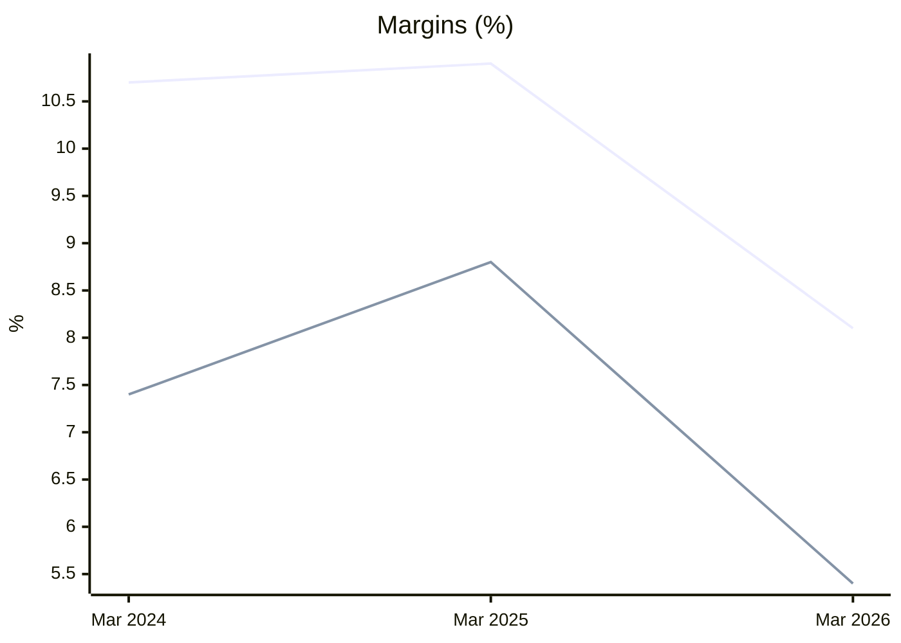

*Run 2026-11-24 · part of [SPINOFF_REPORT.md](../SPINOFF_REPORT.md) · the complete analysis of one company, with every management-call exchange in full.*

## GAIL — GAIL (India) Ltd.

### 1. GAIL (India) Ltd. — PARTIAL SPIN-OFF (subsidiary IPO)

**CONFIRMED** (partial spin-off — the IPO of GAIL Gas Limited is in motion (board approval)) · **PARTIAL SPIN-OFF, IPO IN MOTION — the parent's stub is priced once the piece trades** · score 2.9/10 · partial spin-off (subsidiary IPO) · 2 filing(s) from NSE · first 2026-07-31, latest 2026-10-30

**The separated entities — every one the documents name:**

| Entity | Scheme | Business | Listing | Who runs it |
|---|---|---|---|---|
| **GAIL Gas Limited** | 2026 IPO / listing of GAIL Gas Limited (in-principle board … | Wholly owned subsidiary of GAIL; city gas distribution — with its JVs/subsidiaries 12,46,000 DPNG connections… | to be listed | not stated |

**What is being separated, as the documents put it:** GAIL Gas Limited, GAIL's wholly owned city gas distribution subsidiary, listed via IPO diluting up to 25% — class `not stated`.

### 2. Stages and dates

> **Listing:** PARTIAL SPIN-OFF, IPO BOARD APPROVAL — GAIL Gas Limited; date not fixed

| Date | Event | Source |
|---|---|---|
| 2026-07-31 | Board approval — Scheme of merger of Konkan LNG Limited with GAIL (India) Limited; board meeting commenced 12:00 noon and concluded 01:55 p.m. | as stated: GAIL Regulation 30 disclosure to NSE/BSE, ND/GAIL/SECTT/2026 dated 31… |
| 2026-10-30 | Board approval — GAIL Gas Limited (in-principle approval for listing through IPO by diluting GAIL's equity upto 25%); board meeting commenced 11.00 a.m. and concluded 02:25 p.m. | as stated: GAIL Regulation 30 disclosure to NSE/BSE, ND/GAIL/SECTT/2026 dated 30… |

**The partial spin-off:** **GAIL Gas Limited** (subsidiary); parent's stake 100% (wholly owned subsidiary of GAIL); IPO stage: board approval; exchange: Indian stock exchanges.

> “This is to inform that GAIL Board in its meeting held today i.e. 30.10.2026 accorded in-principle approval for Listing of shares of GAIL Gas Limited, (a wholly owned subsidiary of GAIL) (GGL) on the I”

### 3. Size of the separated business beside the parent — is institutional selling likely?

**Reading: NO FORCED SELLING ON SIZE — an IPO distributes no shares to the parent's shareholders, so nobody receives a piece they did not choose. Size matters here for the stub: how much of the parent's market value the listed piece accounts for.**

| Entity | Stated turnover | Market cap (₹ cr) | Its market value beside the parent's | Index member |
|---|---|---:|---:|---|
| GAIL Gas Limited | "In Q3 FY26, turnover of GAIL Gas stood at Rs.3 ,292 crore s as again… | — | — | not listed |

*The last column is the subsidiary's whole market value over the parent's (parent ₹123,612 cr, NSE bhavcopy of 2026-11-13), computed here; the parent's own value already contains the stake it keeps, so the stub is the parent's value less that stake.*

**In the documents' words:** “Transferee Company - GAIL (India) Limited (GAIL) Turnover for FY 2025 -26: Rs. 1,41,483 Crore ... Transferor Company - Konkan LNG Limited (KLL) Turnover for FY 2025 -26: Rs. 741 Crore”

**The judge's read of selling pressure:** unlikely — IPO route sells shares to willing subscribers; no distribution to GAIL shareholders, no index exclusion stated.

### 4. Insider ownership — share swap, promoters' holding, management incentives

**Share swap / entitlement, entity by entity:**

- **GAIL Gas Limited:** "Listing of shares of GAIL Gas Limited, (a wholly owned subsidiary of GAIL) (GGL) on the Indian stock exchanges through Initial Public Offering (IPO) route by diluting GAIL's equity in GGL upto 25%"; split between fresh issue and offer for sale, size, price band and modality not stated — "After GGL submits the final proposal based on BRLM recommendations on valuation, price band, modality and other terms & conditions, approval of GAIL Board for the final extent of dilution, modality & other terms & condition of IPO will be obtained."

**Promoters' holding, from the shareholding pattern:**

| Company | Promoters | FIIs | DIIs | Public | Quarter |
|---|---:|---:|---:|---:|---|
| GAIL (India) Ltd. (GAIL) | 51.85% | 16.59% | 17.88% | 6.07% | Sep 2026 |

*Source: screener.in shareholding pattern, stored under `ShareholdingPattern/NiftyTotalMarket/`. In a mirror demerger each shareholder holds the same proportion of the new company as of the parent on the record date.*

- **Promoters in the parent, per the documents:** not stated in the documents on file.
- **What the promoters will hold in the separated entity:** 2026 GAIL Gas IPO: "by diluting GAIL's equity in GGL upto 25%" and "After GGL submits the final proposal based on BRLM recommendations on valuation, price band, modality and other terms & conditions, approval of GAIL Board for the final extent of dilution, modality & other terms & condition of IPO will be obtained." — GAIL's residual percentage and the promoter/promoter group holding percentages are not stated. 2026 Konkan LNG merger: "No change in shareholding of GAIL."
- **What a public shareholder receives:** not stated in the documents on file.
- **Management incentives:** not stated in the documents on file.
- **Insider actions around the separation:** GAIL (promoter of GGL) has stated the intent to dilute its own holding: "GAIL Board in its meeting held today i.e. 30.10.2026 accorded in-principle approval for Listing of shares of GAIL Gas Limited, (a wholly owned subsidiary of GAIL) (GGL) on the Indian stock exchanges through Initial Public Offering (IPO) route by diluting GAIL's equity in GGL upto 25%." No promoter or management buying, selling or pledging of GAIL shares is stated.
- **Insiders, per the checklist read:** GGL is a wholly owned subsidiary of GAIL; GAIL dilutes equity in GGL upto 25%, retaining at least 75%. No management incentives stated. · *option pricing date:* not stated

### 5. Why the listing — point by point

The business being separated is GAIL's own directly-authorised city gas distribution (CGD) retail business — the six geographical areas Varanasi, Patna, Ranchi, East Singhbhum (Jamshedpur), Cuttack and Khordha (Bhubaneswar) — which the Board resolved to hive down into its 100% subsidiary GAIL Gas Limited as a slump sale on a going-concern basis, effective 01.01.2027, with the subsidiary then to be listed via IPO diluting up to 25% of GAIL's equity. Management's stated reason was structural, not financial distress: CMD Sandeep Kumar Gupta said it was 'in order to have a single entity for development of GAIL's CGD business and for bringing business synergy, efficiency and retail focused business approach' — i.e. GAIL group CGD was split across GAIL's own balance sheet (six GAs, 0.36–0.55 MMSCMD, 195→215 CNG stations and 3.53→4.64 lakh DPNG connections over FY25–Q3FY26, volumes up ~25% in FY25 but 'currently in their early stages of development'), GAIL Gas (16 GAs plus 9 JVs, 7.0→7.8 MMSCMD, 12.46 lakh DPNG connections, 674 CNG stations, FY25 turnover Rs 12,231 crore, PBT Rs 615 crore up 42%, PAT Rs 451 crore up 40%) and 72 group GAs in all. A pipeline-and-marketing parent was also an awkward owner of a retail business: management said 'we are constantly reviewing these CGDs to optimize costs and enhance efficiencies', and segment reporting of the CGD/marketing split was itself confusing analysts (the Rs 400 crore standalone-to-consolidated regrouping queried in Jul 2025). The upside case cited was CGD demand: a PNGRB projection of consumption rising '2.5 times to 3.5 times by 2030 and 6 times to 7 times by 2040 from the baseline of approximately 37 MMSCMD in FY 24' (~15% CAGR), PNGRB capping CNG/domestic-PNG tariffs at Zone 1 and expected GST inclusion lowering CGD input costs. For the IPO, the argument was scale and timing — 'GAIL Gas is one of the biggest company in the country in terms of city gas distribution... now is high time that we started the process of listing GAIL Gas' — with a consultant already selected and a roughly one-year timeline. The impetus came largely from sell-side investors (Citi's Saurabh Handa on restructuring CGD investments in Nov 2024; Alliance Services' Balaji Das on the IPO consultant in Oct 2025); the only external consent management named was CCEA, 'since these six GAs were authorized to GAIL by CCEA' — no lender or JV-partner demand was cited. Running in the opposite direction, GAIL simultaneously pulled Konkan LNG Limited in: it bought out MSEB Holding's 7,40,55,220 shares via a NCLT-approved capital reduction (paid 06.07.2026, GAIL to 100%) and then merged KLL (FY26 turnover Rs 741 crore, versus GAIL's Rs 1,41,483 crore) into GAIL to 'create a larger and stronger vertically integrated entity, simplify and rationalize group structure'.

**Point by point, with the source:**

1. Citi's Saurabh Handa raised the split of CGD investments between GAIL standalone and GAIL Gas and asked whether GAIL would restructure them — the first time the idea appears in the record. “On your City Gas investments, whether they are at the standalone entity or in GAIL Gas? Is there any thought process to look at restructuring these streamline these investments?” — *[Nov 2024](https://gailonline.com/pdf/InvestorsZone/GAIL_Earnings_Call_Q2_FY25_11112024.pdf)*
2. Director (Finance) R.K. Jain confirmed restructuring was under internal consideration but that no decision existed, while separately flagging that GAIL was working on listing one or two JVs with an update promised in Q3. “As a company about GAIL Gas has not yet taken any call for restructuring of GAIL Gas. This is in our mind, but nothing concrete I can share with you right now.” — *[Nov 2024](https://gailonline.com/pdf/InvestorsZone/GAIL_Earnings_Call_Q2_FY25_11112024.pdf)*
3. Alongside CGD restructuring, Jain said listing of group entities was already in progress and at 'a good stage', promising an update in Q3 FY25. “So also, we are looking for listing one or two JVs, which we are in the process and once we move forward and we take a call, we'll come back to you, but that we are certainly working and we are in a good stage.” — *[Nov 2024](https://gailonline.com/pdf/InvestorsZone/GAIL_Earnings_Call_Q2_FY25_11112024.pdf)*
4. CMD Sandeep Kumar Gupta disclosed the Board's 13.05.2025 recommendation to transfer GAIL's six directly-held CGD geographical areas to wholly-owned GAIL Gas Limited — the core rationale being one single, synergistic, retail-focused CGD entity. “In order to have a single entity for development of GAIL's CGD business and for bringing business synergy, efficiency and retail focused business approach, the Board has recommended to transfer six geographical areas of GAIL to its wholly owned subsidiary, GAIL Gas Limited.” — *[May 2025](https://www.gailonline.com/pdf/InvestorsZone/GAIL%20Analysts%20Meet%20Q4%20FY25%2014.05.2025.pdf)*
5. The only approval condition management named was CCEA, because the six GAs (Varanasi, Patna, Ranchi, Jamshedpur, Bhubaneswar, Cuttack) had been awarded to GAIL by CCEA rather than won by GAIL Gas. “This is subject to approval of CCEA since these six GAs were authorized to GAIL by CCEA.” — *[May 2025](https://www.gailonline.com/pdf/InvestorsZone/GAIL%20Analysts%20Meet%20Q4%20FY25%2014.05.2025.pdf)*
6. The six GAs were described as early-stage but fast-growing (volumes up ~25% in FY25, then ~0.4–0.45 MMSCMD) and under continuous cost review — the sub-scale retail assets being pushed into the dedicated CGD vehicle. “In the Financial Year 24-25, these six GAs have shown impressive growth with volumes increasing by approximately 25%. We are constantly reviewing these CGDs to optimize costs and enhance efficiencies.” — *[May 2025](https://www.gailonline.com/pdf/InvestorsZone/GAIL%20Analysts%20Meet%20Q4%20FY25%2014.05.2025.pdf)*
7. The growth case for a standalone CGD entity rested on PNGRB's demand projection, supplemented by PNGRB's proposal to cap CNG/domestic-PNG tariffs at Zone 1 and expected GST inclusion to cut CGD input costs. “the CGD sector is anticipated to be the key driver of growth, with consumption expected to increase 2.5 times to 3.5 times by 2030 and 6 times to 7 times by 2040 from the baseline of approximately 37 MMSCMD in FY '24” — *[May 2025](https://www.gailonline.com/pdf/InvestorsZone/GAIL%20Analysts%20Meet%20Q4%20FY25%2014.05.2025.pdf)*
8. GAIL Gas's own FY25 numbers framed the receiving entity as a scaled, improving business: turnover Rs 12,231 crore, PBT Rs 615 crore (+42%), PAT Rs 451 crore (+40%), 16 GAs owned plus 9 JVs. “During the current financial year, that is FY '25, GAIL Gas Limited's turnover stood at Rs. 12,231 crores as against Rs. 10,944 crores in FY '24. PBT increased by 42% and stood at Rs. 615 crores as against Rs. 434 crores in FY '24.” — *[May 2025](https://www.gailonline.com/pdf/InvestorsZone/GAIL%20Analysts%20Meet%20Q4%20FY25%2014.05.2025.pdf)*
9. On the other entity later consolidated in, management said Konkan LNG (Dabhol) would swing to profit once the all-weather breakwater let it run 34–36 cargoes versus 21, worth roughly Rs 300 crore. “So this year certainly we were not in positive because of the breakwater issue. But going forward, we will have positive bottom line from KLL.” — *[May 2025](https://www.gailonline.com/pdf/InvestorsZone/GAIL%20Analysts%20Meet%20Q4%20FY25%2014.05.2025.pdf)*
10. An investor (Balaji Das) pressed on the GAIL Gas IPO and the consultant being hired for listing analysis, confirming the second leg of the plan was investor-driven. “And the second question is on, we had like on the listing of the GAIL Gas IPO actually. So, any further progress on consultant and when are the future plans actually for GAIL Gas actually, because we heard that we are hiring consultants for analysis of listing.” — *Oct 2025*
11. Jain confirmed the listing process had begun — consultant selected, order imminent — and justified it on GAIL Gas's scale: 7.72 MMSCMD of volume and more GAs than any peer, with Bangalore alone at 1 MMSCMD. “And we in GAIL believe that now is high time that we started the process of listing GAIL Gas, in that regard we have already started the process of hiring of consultant.” — *Oct 2025*
12. He put a roughly one-year timeline on the listing, contingent on the consultant's study — the only timing guidance given on the IPO. “So, we are on a path to study about listing of GAIL Gas and after conclusion of that study, certainly that study is very important for us, we expect a one year time line or so should be good enough.” — *Oct 2025*
13. The last call in the record discussed the six GAs and GAIL Gas purely operationally (0.55 MMSCMD, 215 CNG stations, 4.64 lakh DPNG; GAIL Gas 7.8 MMSCMD, PBT Rs 143 crore) with no mention of the transfer or the IPO. “GAIL has direct authorization of 6 GAs and has an infrastructure of 215 CNG stations and 4.64 lakh DPNG connections.” — *[Feb 2026](https://www.gailonline.com/pdf/InvestorsZone/GAIL_Earnings_Call_Q3_FY_26.pdf)*
14. Filing 30.10.2026: Board approved the carve-out of the six named CGD GAs to GAIL Gas as a slump sale, via Business Transfer Agreement on a going-concern basis, effective 01.01.2027. “GAIL Board in its meeting held today i.e. 30.10.2026 accorded approval for Transfer of Six CGD Geographical Areas of GAIL India Ltd. viz. Varanasi, Patna, Ranchi, East Singhbhum, Cuttack and Khordha to GAIL Gas Ltd. (wholly owned Subsidiary of GAIL) through slump sale by Execution of Business Transfer Agreement on going concern basis, with effective date of transfer as 01.01.2027.” — *Scheme*
15. Same-day filing: in-principle Board approval to list GAIL Gas on Indian exchanges via IPO, diluting GAIL's stake by up to 25%, with valuation, price band and final dilution left to BRLM recommendations and a later Board approval. “accorded in-principle approval for Listing of shares of GAIL Gas Limited, (a wholly owned subsidiary of GAIL) (GGL) on the Indian stock exchanges through Initial Public Offering (IPO) route by diluting GAIL's equity in GGL upto 25%.” — *Scheme*
16. Filing 31.07.2026: in the opposite direction, GAIL approved absorbing wholly-owned Konkan LNG (FY26 turnover Rs 741 crore, versus GAIL's Rs 1,41,483 crore) into itself under Section 233, with KLL's shares cancelled and no change in GAIL's shareholding. “To create a larger and stronger vertically integrated entity, simplify and rationalize group structure which will enhance operational efficiencies.” — *Scheme*
17. Filing 10.07.2026: the KLL merger was preceded by an NCLT-approved capital reduction (order 03.06.2026) buying out partner MSEB Holding, taking GAIL from 50% to 100% of Konkan LNG before the absorption. “an aggregate of 14,81,10,440 equity shares of ₹10 each, including 7,40,55,220 equity shares held by GAIL and 7,40,55,220 equity shares held by MSEB in KLL stand cancelled and extinguished i.e. MSEB holding in KLL reduced to Nil and GAIL shareholding increased to 100% of the equity share capital of KLL.” — *Scheme*

**How it evolved:** The idea first surfaced only as an unprompted analyst question on the Nov 06, 2024 Q2 FY25 call, where R.K. Jain said no call had been taken on restructuring GAIL Gas — 'this is in our mind, but nothing concrete' — while adding that GAIL was 'looking for listing one or two JVs'; the Jan 30, 2025 call did not touch it. It became concrete at the May 14, 2025 annual analyst meet, where the CMD disclosed the Board's recommendation (passed 13.05.2025) to transfer the six GAs to GAIL Gas for a 'single entity... retail focused business approach', subject to CCEA. On Oct 31, 2025 the second leg appeared: GAIL confirmed it had started the GAIL Gas listing process, had selected a consultant, and expected 'a one year time line or so'; the Feb 02, 2026 Q3 FY26 call was silent on both. The filings then executed it: 31.07.2026 KLL merger into GAIL, and 30.10.2026 Board approval of the six-GA slump sale effective 01.01.2027 plus in-principle approval of a GAIL Gas IPO diluting up to 25%.

**What management expects from it:** One consolidated, retail-focused CGD entity with business synergy and efficiency; the six early-stage GAs (0.55 MMSCMD) folded into GAIL Gas's 7.8 MMSCMD platform (674 CNG stations, 12.46 lakh DPNG) to capture CGD demand rising 2.5–3.5x by 2030, aided by Zone-1 tariff capping and expected GST; price discovery and capital via an IPO of up to 25%. Parent keeps transmission/marketing; Konkan LNG's merger simplifies the group and adds its cargo-driven profit.

*Not explained on the calls:* No valuation, slump-sale consideration, IPO size or use of proceeds, standalone margin/ROCE or capex targets, CCEA timing, or why 25%; calls after Oct 2025 went silent.

- *Stated reason, in one line:* not stated
- *What it reveals:* GGL Q3 FY26 turnover Rs.3,292 crore, PBT Rs.143 crore, PAT Rs.106 crore, 7.8 MMSCMD volume, 12,46,000 DPNG connections, 674 CNG stations; plus six GAs (0.55 MMSCMD, 215 CNG stations) transferred in by slump sale effective 01.01.2027.
- *Parent or spin:* parent · *Read next:* GGL's final IPO proposal to GAIL Board on valuation, price band, extent of dilution and modality
- *In their words:* “This is to inform that GAIL Board in its meeting held today i.e. 30.10.2026 accorded in-principle approval for Listing of shares of GAIL Gas Limited, (a wholly owned subsidiary of GAIL) (GGL) on the Indian stock exchanges through Initial Public Offering (IPO) route by diluting GAIL's equity in GGL upto 25%.”

### 6. On the calls, verbatim

8 call(s), oldest first: **5 question-and-answer exchange(s)** given in full — the question and every answer to it, nothing trimmed — and 16 passage(s) from management's prepared remarks (the complete sentences about it; the whole remarks are in the linked transcript). Text is as the transcript prints it.

#### Jan 2024 — [transcript](https://www.gailonline.com/pdf/InvestorsZone/EarningsCallTranscript290124.pdf)

**From the prepared remarks** *(the passage about it; the whole turn runs to 9,870 characters in the transcript)*

> **Rakesh Kumar Jain:** During the current quarter, eight new CNG stations and approximate 16,000 DPNG connections were added. The physical volume is 0.3 MMSCMD during the quarter. In the next two years, GAIL targets to add over 100 new CNG stations and approximate 2,00,000 new DPNG connections. I will share now the performance of GAIL gas. During the current quarter Q3 FY2023–24 turnover stood at Rs.3145 Crores as against Rs.2745 Crores in Q2 FY2024. There is increase of 15% mainly on account of increase in bulk trading quantity by 12%, and CNG quantity by 11%. Profit before tax stood at Rs.153 Crores as against Rs.57 Crores in Q2 FY2024. There is increase of 168%. Profit after taxes stood at Rs.113 Crores as against Rs.42 Crores in Q2 FY2024 increased by 169% for reasons as explained above. The physical volume increased to 7.18 MMSCMD in Q3 FY2024, an increase of 10% mainly on account of increase in bulk trading quantity by 12% and CNG quantity by 11%. During the Gail India Limited January 29, 2024 Page 4 of 19 current quarter, GAIL Gas along with JV subsidiaries has added 17,731 new DPNG connections and 29 CNG stations and having infrastructure of 9,06,000 DPNG connections GAIL Gas as a group company. If I have to talk about Gail Gas, GAIL Gas has almost 5,00,000 of DPNG connections. Bengal Gas Company Limited as on December 31, 2023, BGCL is having 13 CNG stations, 237 kilometer pipeline and 8000 numbers of domestic PNG collection infrastructure is made available. During the current quarter one new CNG station and 22 kilometers pipeline were added. Project performance.

**Question and answer**

> **Amarnath:** My first question was with respect to this value unlocking activities which the management and the board was thinking whether with respect to CGD or with respect to merger or reverse merger with your petrochemical side any update you can give on this regard at the moment?
>
> **Rakesh Kumar Jain:** Actually we have not come out with any such kind of value creations through disinvestment of CGD or petrochemical. Yes, we are internally evaluating and we will take this call at an Gail India Limited January 29, 2024 Page 18 of 19 appropriate time. But till now we have not concluded what we will do about these investments in CGD and there is no thought about petrochemicals.

#### May 2024 — [transcript](https://www.gailonline.com/pdf/InvestorsZone/GailInvestorsAndAnalystMeet2024.pdf)

**From the prepared remarks** *(the passage about it; the whole turn runs to 0 characters in the transcript)*

> **(speaker not labelled):** up by 74% in current financial y ear to ■ 12,595 crores as against ■ 7256 crores in FY 23. The PAT increased by 76% to ■ 9899 crores as against ■ 5616 crores in last financial year. During the year, the company has paid a total dividend of ■5.50 per share amounting to ■ 3616 crores. - Now I will take you through the quarterly performance highlights for Q4 24. The gross turnover stood at ■ 32,250 crores in the Q4, as against ■ 34,168 crores in Q3 FY 24 and there is a decrease of 6%, mainly due to decrease in price of our LNG in Natural Gas marketing segment. The PBT for the quarter stood at ■ 2842 crores as against ■ 3694 crores in Q3 FY 24, mainly due to lower trading margins in gas marketing segment, lower dividend income and increase in depreciation cost due to additional capitalization a nd revision in residual value of underground pipelines. The PAT during the quarter stood at ■ 2177 crores as against ■ 2843 crores in the Q3 of FY 24 for the regions in the indicated. - Consolidated financials for Q4 as compared to Q3 FY 24, the consolidated turnover in the current quarter stood at ■ 32,744 crores versus ■ 34,678 crores in the previous quarter, down by 6%. The PBT in the current quarter is ■ 3099 crores versus ■ 4075 cror es in Q3 FY 24, down by 24%. The PAT is ■ 2469 crores versus ■ 3195 crores in Q3 FY 24, down by 23%. - Before I take you through the physical performance, I would like to inform you that GAIL Board has approved laying of C2C3 liquid pipeline from Vijaipur to Auraiya, having 3 estimated project cost of ■ 1792 crores and with a commissioning period of 32 months. This project will enhance the feedstock availability at Pata Petrochemical plants, which in turn augment capacity to almost a million tons of polymer a nd also reduces energy consumption and carbon footprint. Now I will take you through the physical performance. - The physical performance on yearly basis, gas marketing volume stood at 98.45 MMSCMD in the current year as against 94.91 MMSCMD in FY 23. Natu ral gas transmission volume stood at 120.46 MMSCMD in the current financial year as against 107.28 MMSCMD in FY 23. Polymer production stood at 777 TMT as against 442 TMT in Financial Year 23. LHC production stood at 996 TMT as against 934 TMT. LPG transmission stood at 4396 TMT as against 4335 TMT. In terms of quarterly physical performance, gas marketing volume stood at 99.99 MMSCMD in current quarter as against 98.14 MMSCMD previous quarter. Natural gas transmission volume stood at 123.65 MMSCMD in quarter four as against 121.54 MMSCMD in previous quarter, that is Q3. The capacity utilization was 59%. Polymer production stood at 248 TMT as against 205 TMT last quarter. LHC production is stood at 265 TMT against 249 TMT in previous quarter. LPG transmission stood at 1114 TMT as against 1095 TMT in previous quarter. As you know, GAIL has also six CGD directly in its fold. Now, I will take you through the infrastructure and the performance of those CGD's. GAIL is having infrastructure of 189 CN G stations and 3,42,948 DPNG connections as on 31st March, 24 and 6G is allotted to GAIL. During the current quarter that is Q4, 24 new CNG stations and 52,897 new DPNG connections were added. The physical volume for Q4 for these 6 CGDs were 0.33 MMSCMD. In next two years, GAIL targets to add over 80 new CNG stations in six geographical area just I shared with you and 1,50,000 new DPNG corrections. - Now, I will take you through the performance highlights of our own 100% subsidiary, that is GAIL Gas Limite d. During financial year 23 -24, turnover of GAIL Gas stood at 10,944 crore s as against ■ 10,530 crores in financial year 23. There is increase of almost 4% in turnover and this increase is mainly on account of increase in volume CGD segment and CNG and P NG by 16%, and increase in bulk trading volume by 19%. PBT for GAIL Gas increased to ■434 crores as against 400 crores in financial year 22 -23 and increase of 9%. PAT increased to ■323 crores as against 297 crores in Financial Year 22 -23. The physical volume during financial year 23 -24 increased to 6.46 MMSCMD from 5.69 MMSCMD in Financial Year 22 -23. - Now, I will take you through the highlights for quarter four for GAIL Gas. Gross turnover stood at ■2 ,853 crores as against ■3 ,154 crores in Q3 Financial y ear 24, decrease of 10% and this decrease is mainly on account of decrease in bulk trading volume by 9% and industrial by 4%. Profit before tax stood at ■121 crores as against ■154 crores in Q3 Financial year 24. PAT stood at ■92 crores as against ■113 c rores in Q3 financial year 2 4 down by 19%. The physical volume decreased to 6.88 MMSCMD in Q4 financial year 24, decrease of 4% mainly on account of decrease in bulk trading volume by 9% and industrial volume by 4%. During financial year 24, 94 new CNG s tations and 68,695 new DPNG connections were added. During financial year 24, 114 new CNG stations and 1,10,103 4 new DPNG connections were added by GAIL Gas. During Q4 financial year 23 -24, GAIL

**From the prepared remarks** *(the passage about it; the whole turn runs to 0 characters in the transcript)*

> **(speaker not labelled):** Gas along with its joint ventures and Subsidiaries added 63, 164 new DPNG connections and 79 CNG stations having infrastructure of 9,76,000 GAIL Gas and its group companies DPNG connections and 570 CNG stations. There is another subsidiary of GAIL, which is Bengal Gas Limited. As on 31st March, 2024 Bengal Gas Lim ited has installed 20 CNG stations, laid 267 kilomet er of pipeline, added 5124 DPNG connections. - During the quarter 4, 7 CNG stations were added and 30 -kilometer pipeline was also installed. - Now, I will also take you through the project performance. The projects which are taken up by GAIL, Mumbai -Nagpur -Jharsuguda pipeline. As you know this pipeline is of 1 ,755 kilometer. Activity for laying this pipeline are in full swing and this pipeline in totality is expected to be completed by October 24 and Mumba i, Nagpur section of this pipeline is likely to be completed by June 24, that is next month. Regarding Jagdishpur -Haldia - Bokaro -Dhamra pipeline, this pipeline is of 3289 -kilometer, out of that 2986 kilometer of pipeline have been commissioned and remainin g part that is Durgapur, Haldia pipeline is expected to be completed by next month, that is June 24. - Srikakulam Angul Pipeline, this pipeline is of 420 -kilometer. Work is under progress and likely to be completed by next month, again June 24. Spur lines are anticipated to be completed by September 24. Gurdaspur, Jammu natural gas pipeline, this pipeline is having length of 160 kilometer and likely to be completed by July 26. Dhamra Haldia pipeline, this pipeline is of 253 kilometers of length and this is Odisha section have been completed and remaining part is expected to be completed progressively by again next month June 24. - Now, I will take you through the other projects which GAIL is taking up. PDHPP at Usar, the capacity of this plant is 500 KTPA, project cost is 11,256 crores, completion date April 25 next year. PPF Pata, the capacity of this plant is 60 KTPA, project cost is 1299 crores, completion date by December 2024. - IPA at Usar, capacity of this plant is 50 KTPA, project cost is 530 crore, completion date by December 2025. - GAIL Mangalore Petrochemicals Limited, as you know, this plant we have acquired through NCLT process erstwhile JBF Petrochemicals, capacity of this plant is 1250 KTPA. Project costs 4200 crore and plant again is expected to be completed by March 2025. Total CapEx for financial year 24 is ■11,425 crore and mainly on pipelines, petrol camps, CGD proje cts, operational CapEx, equity contributions etc. - Now, I will take you through this segmental outlook for short -to-medium ter m. Natural gas transmission, as you know that and I shared with you just now, average transmission volume for 23 -24 has been 120.46 MMSCMD and this is in line with the guidance which we have been giving like 119-120 MMSCMD , which is actually exceeded thos e to 120.46. 5 Now, we expect that in coming two years that is this current financial year 24 -25 and 25 - 26, our volumes are likely to increase by 10 to 12 MMSCMD on per annum basis that's how we are expecting that this year we may end up with average volume of 130, MMSCMD to 132 and then 25 -26 we may be achieving around 140 to 142 MMSCMD. - Gas marketing volume, gas marketing businesses exhibited robust performance due to better arbitrage and various optimization measures like destination swap, shipping optimi zation, time swaps, GAIL clock gas marketing profits of almost 6000 crore - to be precise 5966 crores including one time custom duty receivers of ■155 crore during financial year 24 and which is in line with our guidance which we revised in during results of Q3 in Earning Call to 5500 crore. Now, we have actually achieved 5966 crores. In terms of next year's guidance, we expect that we will earn marketing margin in the range of 4000 to 4500 crores at least. - For the gas marketing volume, we expect the gas marketing volume to increase from current level of 98.45 MMSCMD to 105 MMSCMD during financial year 24 -25. Polymer production as you know that petrochemical plant has done significantly better as compared to last year and we have been giving through our various guidances that this financial year we will end up almost at breakeven level and through financials you must have known that we are almost at breakeven level. - In terms of performance, production stood at 777 TMT as against 442 TMT last year. During the year, we also had gross margin of that is EBITDA level 421 crore as against negative gross margin of 508 crores in financial year 23. Petrochemical segment mainly due to optimization of inputs, improvement of operational efficiency. These results hav e happened. Further during next financial year, we expect that petrochemical plant will run at a normal level that is around 8,10,000 tons, which will be more than this year and we are likely to earn normal or reasonable amount of profits during 24 -25. - LHC production stood at 996 TMT as against 934 TMT in financial year 23 and posted a PBT of ■769 crore during financial year 24. GAIL is also effectively involved in LPG hedging to protect our margins. Basically, we time -to-time see how the futures of prop ane and

#### Aug 2024 — [transcript](https://www.gailonline.com/pdf/InvestorsZone/GAIL_Q1%20FY25_Earning_Call.pdf)

**From the prepared remarks** *(the passage about it; the whole turn runs to 9,287 characters in the transcript)*

> **Rakesh Kumar Jain:** The physical volume is 0.3 MMSCMD during the qu arter. In the next two years, GAIL targets to add around 8 0 new CNG stations and around 1, 20,000 new DPNG connections. As you know , we have GAIL G as as our 100% subsidy. Now I will take you through the GAIL Gas financial highlights for Q1 and also their pl an for next two years. Gross turnover stood at Rs. 298 7 crores as against Rs. 2 853 crores in Q4 FY24, an increase of 5% and this is mainly on account of increase in revenue from CNG segment by 4% and bulk trading segment by 7%. Profit before tax stood at Rs. 149 crore as against Rs. 121 crore in Q4 FY24 and there is an increase of 23%. Profit after tax stood at Rs. 110 crore as against Rs. 92 crore in Q4 FY24 , increase d by 20%.

#### Nov 2024 — [transcript](https://gailonline.com/pdf/InvestorsZone/GAIL_Earnings_Call_Q2_FY25_11112024.pdf)

**From the prepared remarks** *(the passage about it; the whole turn runs to 7,201 characters in the transcript)*

> **Rakesh Jain:** The physical volume remained at 0.38 MMSCMD during the quarter. The share of APM and RLNG in the phy sical volume is around 0.23 MMSCMD and 0.15 MMSCMD respe ctively. In the next two years GAIL targets to add around 80 new CNG stations and around 1,20,000 new DPNG connections. GAIL Gas Limited. Turnover was up by 5% at ■ 3,150 crores as against ■ 2,987 crore in Q1 financial year '25. The increase is mainly on account of 8% increase in sales volume from CNG segment, 15% from industrial segment and bulk trading segment by 5%. PBT stood at ■167 crore as against ■ 149 crore in Q1 financial year '25, an i ncrease of 12%. PAT stood at ■124 crore as against ■ 110 crore in Q1 financial year '25, up by 13%. During Q2 financial year '25 GAIL Gas along with its JV added 2 6,795 new DPNG connections and 8 new CNG stations and is having infrastructure of ~10,30,000 DPNG connections and 580 CNG stations. I will take you through project performance. Mumbai -Nagpur -Jharsuguda pipeline work is under progress and the entire pipeline is anticipated to be completed progressively by June '25. Jagdishpur -Haldia -Bokaro -Dhamra pipeline, this pipeline is having length of 3,289 kilometers, 2,896 kilometers has been commissioned and remaining part is expected to be completed progressively by March '25.

**Question and answer**

> **Puneet:** Third quarter. Okay, fine. That's all for me. Thank you so much and all the best. GAIL (India ) Limited November 06, 202 4 Mod erator: Thank you so much. We have next question from the line of Maulik Patel from Equirus. Please go ahead.
>
> **Maulik Patel:** Yes. So thanks for the opportunity. Just a couple of things. One, on this recent government notification where they reduced allocati on APM allocations to the CGD sector. Your thoughts on that? What kind of outlook one could have for the GAIL Gas which is your subsidiary? And second is that where do you see the gas consumption in the country in next one year or so?
>
> **Rakesh Jain:** Because there is some issue of clarity of voice, if I understood you, the impact of the reduction in gas allocation, the impact on subsidiary and also if you are on GAIL.
>
> **Maulik Patel:** Yes.
>
> **Rakesh Jain:** So GAIL Gas, we expect the impact of ■ 16 crore p er month. Right. And for GAIL around ■ 6 crore. But GAIL as a company has an opportunity. Sorry, I have been corrected. ■ 16 crore per quarter for GAIL Gas and ■ 6 crore per quarter for GAIL. GAIL, as a company has a n opportunity now to source and market more and more volume in terms of LNG to meet those demands which have come up because of de -allocation. So, we are very, very positive in terms of GAIL and company.
>
> **Maulik Patel:** And do you think that in the future, t here will be less and less gas which will divert from the CNG sector from within the CGD and will go to the other sectors? From a policy perspective, because what we understand that there was already a 3 MM SCMD reduction in the last one year or so to the CN G sector and this additional 4 MMCMD has come. So what's your thought? Will the government make CNG a much more a market -driven business compared to where they get a significant cheaper gas to the APM allocation?
>
> **Rakesh Jain:** So, this is very difficult f or me to answer what will happen in the future. History suggest that in view of increased consumption by city gas distribution, expansion of geographic areas, certainly, history suggests that this allocation may come down.
>
> **Maulik Patel:** And you have raised the prices in your GAIL Gas, the CNG prices or the price revision is yet to be taken?
>
> **Rakesh Jain:** So, this call will be taken by GAIL Gas. They are analyzing it. Certainly, there is an impact, but during the course they will certainly review their prices. A nd considering the customers demand how it will be going to impact, they will take action. But as on date, the price revision has to take place.
>
> **Maulik Patel:** And just last question. What's the outlook on the spot LNG, given that there are like this spot LNG. It's been very steady at $13 per MMBTU for the last couple of months and the inventory levels in Europe are at a relatively higher level, but the price is not coming down. What's your thought overall on the spot LNG price, which you expect in 2025?
>
> **Rakesh Jain:** Actually, this is abnormal situation. Normally, you find that spot prices except the Ukraine war situation or geopolitical situation remains lower. Currently, the spot prices are a bit higher than normally it used to be. We expect these spot pric es to come down. But all this is in future. GAIL (India ) Limited November 06, 202 4
>
> **Maulik Patel:** Okay, thanks.

**Question and answer**

> **Saurabh Handa:** Okay, sir. And just my second question. On your City Gas investments, whether they are at the standalone entity or in GAIL Gas? Is there any thought process to look at restructuring these streamline these investments?
>
> **Rakesh Jain:** As a company about GAIL Gas has not yet taken any call for restructuring of GAIL Gas. This is in our mind, but nothing concrete I can share with you right now.

#### Jan 2025 — [transcript](https://www.gailonline.com/pdf/InvestorsZone/GAIL_Earnings_Call_Q3_FY25.pdf)

**From the prepared remarks** *(the passage about it; the whole turn runs to 8,205 characters in the transcript)*

> **Rakesh Kumar Jain:** During the quarter, approximately 5,000 new DP NG connections were added. The phy sical volume remained at 0.36 MMSCMD during the quarter. In the next two years, GAIL targets to add around 80 new CNG stations and around 1,20,000 new DP NG connections. Now I will take you through GAIL Gas Limited , which is a 100% subsidiary of GAIL . The performance of GAIL Gas Limited , during the current quarter , turnover was down by 3% and stood at Rs . 3,043 crores as against 3,150 crore in Q2 Financial Year ‘2 5. PBT decreased by 7% and stood at Rs. 155 crore as against 167 crore in Q2 Financial Ye ar ’25, following cut in APM gas allocation. PAT was down by 8% and stood at Rs . 114 crore as against 124 crore in Q2 Financial Year ‘2 5. GAIL (India) Limited January 30, 2025 During Q3 Financial Year ‘2 5, GAIL Gas along with J Vs added 25,000 new DPNG connections and 5 CNG stations and is havi ng an infrastructure of 10,50,000 DPNG connections and 585 CNG stations. In the next 2 years, GAIL Gas targets to add around 170 new CNG stations and around 5 lakh new DPNG connections. I will now take you through the status of ongoing projects. Pipeline projects, majority of the pipeline projects viz. Mumbai -Nagpur-Jharsuguda pipeline , Jagdishpur -Haldia -Bokaro -Dhamra pipeline , Kochi -Koottanad -Bangalore -Mangalore pipeline and Srikakulam -Angul pipeline are scheduled to be completed in coming financial yea r that is '25-'26, whereas Gurdaspur -Jammu pipeline is scheduled to be completed in finan cial year '26-'27.

#### May 2025 — [transcript](https://www.gailonline.com/pdf/InvestorsZone/GAIL%20Analysts%20Meet%20Q4%20FY25%2014.05.2025.pdf)

**From the prepared remarks** *(the passage about it; the whole turn runs to 2,933 characters in the transcript)*

> **Abhishek:** He has wide experience of over 36 years in the oil and gas industry. Before joining GAIL in October 2022, S hri Gupta held the position of Director Finance since August 2019 on the board of I OCL. As Director Finance, he was in charg e of F &A, t reasury , pricing , international trade, corporate affairs and enterprise risk management. Sh ri Gupta is also Chairman of various other companies such as Mahanagar Gas, Brahmaputra Cracker and Polymer Limited , GAIL Gas Limited , and Director on the board of Petronet LNG Limited. We are also joined by S hri Rakesh Kumar Jain, who is Director Finance. He's a cost and management accountant by profession and joined GAIL in 1992. Prior to his appointment as Director Finance, Shri Jain held the positio n of Executive Director, Finance and accounts in GAIL . Additionally, Shri Jain holds the position of Director in GAIL Gas, GAIL Global USA and GAIL Global USA LNG. As E D Finance and Accounts, he headed corporate finance and treasur y, and took investment decisions in large infrastructure projects. He was also actively involved in investor relations and interactions with analyst fraternity . Besides serving a long tenure at GAIL , he was on deputation to PN GRB as Joint Advisor Commercia l and Finance.

**From the prepared remarks** *(the passage about it; the whole turn runs to 14,381 characters in the transcript)*

> **Sandeep Kumar Gupta:** Among these, GAIL directly operates in six geographical areas, namely Varanasi, Patna, Ranchi, Jamshedpur, Bhubaneswar and Cuttack , which are currently in their e arly stages of development . In the Financial Year 24-25, these six GAs have shown impressive growth with volumes increasing by approximately 25%. We are constantly reviewing these CGDs to optimize costs and enhance efficiencies . In order to have a single entity for development of GAIL's CGD business and for bringing business synergy, efficiency and retail focused business approach, the Board has recommended to transfer six geographical areas of GAIL to its wholly owned subsidiary, GAIL Gas Limited. This was approved in the Board Meeting yesterday. This is subject to approval of CCEA since these six GAs were authorized to GAIL by CC EA. PNGRB has recently proposed important reforms to the natural gas pipeline tariff structure, focus ing on simplifying the tariff zones, capping tariff for CNG and domestic PNG consumers at the level of Zone 1 tariff, and facilitating commercial viability of isolated networks through tariff rationalization . […] We expect good margins and improved production from this segment in FY '26. LPG transmission volume increased to 4 ,478 TMT as against 4 ,396 TMT in p revious quarter , and this was highest ever LPG transmission by GAIL . CGD : According to a recent report published by PNB RB, the CGD sector is anticipated to be the key driver of growth, with consumption expected to increase 2.5 times to 3.5 times by 2030 and 6 times to 7 times by 2040 from the baseline of approximately 37 MMS CMD in FY '24, reflecting a CAGR of around 15% and 12% , respectively. Further , GAIL Gas Limited, a wholly owned subsidiary of GAIL , which was incorporated in May 2008 for developing city gas distribution business as its focus area, GGL currently owns and operates 16 GAs across India and have nine others as their JVs. During the current financial year, that is FY '25 , GAIL Gas Limited's turnover stood at Rs. 12,231 crores as against Rs. 10,944 crores in FY '24. P BT increased by 42% and stood at Rs. 615 crores as against Rs. 434 crores in FY '24 . And PAT was up by 40% and stood at Rs. 451 crores as against Rs. 323 crores in FY '24. During the current quarter, that is Q4 FY '25 , GAIL Gas Limited 's turnover stood at Rs. 3,051 crores as against Rs. 3,043 crores in Q3 FY '25 . PBT decreased by 7% and stood at Rs. 144 crores as against Rs. 155 crores in Q3 FY’25. And PAT was down by 8% and stood at Rs. 102 crores as against Rs. 114 crores in Q3 FY '25. In the next two years, GAIL Gas targets to add around 255 new CNG stations and approximately 3.09 lakhs new DP NG connections. As regards Bengal Gas Company Limited, I just wanted to inform you that the pipeline has been completed and gasified by GAIL till tap-off point for Kolkata connectivity. GAIL has got the PESO approval on 26th November '24, for the stretch Durgapur to IP8 and CGS Kolkata . Further , GAIL Indi a Limited May 15, 2025 PESO approval from GAIL Terminal at IPA to Bengal Gas CGS is received on 28 February , 2025 , and it will take about one to two months for B GCL to complete the construction work on its part before it starts taking gas for Kolkata.

**From the prepared remarks** *(the passage about it; the whole turn runs to 81 characters in the transcript)*

> **Rakesh Kumar Jain:** So it's GAIL Gas which we have incorporated line by line , that's the difference.

**From the prepared remarks** *(the passage about it; the whole turn runs to 189 characters in the transcript)*

> **Rakesh Kumar Jain:** Actually, this year we have regrouped marketing and CGD business of GAIL Gas . Earlier it was getting depicted in CGD , so we have regrouped , and bulk sale we have considered in marketing.

**From the prepared remarks** *(the passage about it; the whole turn runs to 184 characters in the transcript)*

> **Varatharajan:** Yes. Thanks, Abhishek. And thank the management for the opportunity. Sir if you can provide the GAIL Gas and the six GA volumes , and the breakup in terms of CLG and other gas, please.

**From the prepared remarks** *(the passage about it; the whole turn runs to 372 characters in the transcript)*

> **RK Jain:** The Gas volume stood at 7.31 MMSCMD during last year in GAIL Gas. And if you are interested in breakup, the bulk trading was 4.37 MMS CMD , supplies to Taj Trapezium Zone on unified price basis 1.27 MMS CMD, and then PNG and CNG 1.67 MMS CMD put together . These are the three segments PNG -CNG 1.67 MMS CMD, Taj Trapezium Zone 1.27 MMS CMD and 4.37 MMS CMD bulk trading .

**From the prepared remarks** *(the passage about it; the whole turn runs to 152 characters in the transcript)*

> **Rakesh Kumar Jain:** This is not including six GAs, six GAs are still with GAIL , so that volume will be added as and when it is actually part of GAIL Gas , today it is not.

**From the prepared remarks** *(the passage about it; the whole turn runs to 412 characters in the transcript)*

> **Sanjay Kumar:** So presently 6 GAs of GAIL , we are marketing about 0.4 to 0.45 MMS CMD of gas there . During Kumbh we had the opportunity of marketing 0.5 million cubic meter also in many days . And our outlook is that these particular geographical areas would grow by about 25% volume every year, these six GAs. In due course , as my CMD announced, these will be merged with GAIL Gas, but the volume projections are like that.

#### Oct 2025

**From the prepared remarks** *(the passage about it; the whole turn runs to 11,653 characters in the transcript)*

> **Rakesh Kumar Jain:** The physical volume stood at 0.46 MMSCMD. In the next two years, GAIL targets to add around 85 new CNG stations and around 150,000 new DPNG corrections. As you know that GAIL also has got 100% sub sidiary exclusively d ealing in retail business. Now , I will also briefly touch about the financials of GAIL Gas Limited : In Q2 Financial Year ‘ 26, turnover of GAIL Gas stood at Rs. 3,235 crores as against Rs. 2,927 crores in Q1 Financial Year ‘ 26. PBT increased by 1% and stood at Rs. 148 crores as against Rs. 146 crores in Q1 Financial Year ‘ 26. Profit after tax was up by 3% and stood at Rs. 111 crores as against Rs. 108 crores in Q1 Financial Year ‘ 26. The physical volume stood at 7.72 MMSCMD. During Q2 Financial Year ‘ 26, GAIL Gas along with the JV s & subsidiar ies, has added 44,512 new DPNG collections and one CNG station. GAIL Gas, with its JVs, subsidiaries , has an infrastructure of 11 ,74,000 DPNG connections and 66 5 CNG stations. I will also touch upon the ongoing projects with GAIL : Pipeline projects , SAPL, as I already shared, is commissioned and MNJPL, JHBDPL and KKMBPL Phase 2 are scheduled to be completed during this financial year, and Gurdaspur - Jammu p ipeline is scheduled for completion in Financial Year ’26-'27. Petrochemicals project , I will first say about 60 KTA polypropylene at PATA and 1,250 KT A PTA plant at GMPL are scheduled t o be commissioned in current financial year, whereas 500 KTA PDH -PP plant at Usar i s expected to be completed in Financial Year ‘ 27. CAPEX for Q2 Financial Year ’26: During the quarter, a CAPEX of Rs. 1,662 crores was incurred , out of which Rs. 784 crores was incurred o n pipelines, Rs. 514 crores was incurred on petrochemical , Rs. 226 crores is operational CA PEX and the remaining approximate Rs. 138 crores on CGD , E&P, renew ables and equity investment.

**Question and answer**

> **Balaji Das:** Okay , thanks for the update. And the second question is on , we had like on the listing of the GAIL Gas IPO actually. So , any further progress on consultant and when are the future plans actually for GAIL Gas actually , because we heard that we are hiring consultants for analysis of listing .
>
> **Rakesh Kumar Jain:** You heard rightly. GAIL Gas is one of the biggest company in the country in terms of city gas distribution. I share d in the brief that currently it is marketing 7. 72 MMSCMD volumes, GAIL Gas has got most of the geographical area any city gas distribution company has . We are one of the geographical areas like Bangalore, it has already leased 1 MMSCMD. And we in GAIL believe that now is high time that we started the process of listing GAIL Gas, in that regard we have already started the process of hiring of consultant. As I understand, the consultant has already been selected and the order may have been here maybe in giving in very few days from now. Either it might have been given, so will be given. So, we are on a path to study about listing of GAIL Gas and after conclusion of that study, c ertainly that study is very important for us , we expect a one year time line or so should be good enough.
>
> **Balaji Das:** Thanks for the opportunity. Thank you.

**Question and answer**

> **Varatharajan S:** Thanks for the opportunity, sir. In the case of GAIL Gas, if you can give us a breakup in terms of CN G and PNG in GAIL Gas.
>
> **Rakesh Kumar Jain:** GAIL Gas, you are looking for breakup in terms of CNG P NG supplies?
>
> **Varatharajan S:** That's right , sir.
>
> **Rakesh Kumar Jain:** So, we have bulk trading in GAIL Gas in 4.5 MMSCMD , bulk trading which GAIL Gas does. Then Taj Trapezium zone which is the UPM based pricing, 1.32 MMSCMD. And in terms of city gas distribution, which includes PNG, CNG put together around 2 MMSCMD.

#### Feb 2026 — [transcript](https://www.gailonline.com/pdf/InvestorsZone/GAIL_Earnings_Call_Q3_FY_26.pdf)

**From the prepared remarks** *(the passage about it; the whole turn runs to 13,060 characters in the transcript)*

> **Shri Rakesh Kumar Jain:** During the quarter, 2 new CNG stations and 15,990 new DPNG stations were added. The physical volume stood at 0.55 MMSCMD . In the next two years, GAIL targets to add around 85 new CNG stations and around 1,50,000 new DPNG collections. I will also take you through the “Performance of our 100% Subsid iary, GAIL Gas L imited”: In Q3 FY26, turnover of GAIL Gas stood at Rs.3 ,292 crore s as against Rs.3 ,235 crore s in Q2 FY26. PBT stood at Rs.143 crore s as against Rs.148 crore s in Q2 FY26. The decrease is mainly due to increase in input gas cost and exchange rate resulted in reduction in margin. PAT stood at Rs.106 crore s as against Rs.111 crore s in Q2 FY26. The physical volume stood at 7.8 MMSCMD . During Q3 FY26, GAIL Gas along with its J Vs/subsidi aries has added 71,411 new DPNG connections and 9 CNG stations. GAIL Gas with its J Vs/subsidi aries have an infrastructure of 12,46,000 DPNG co nnections and 674 CNG stations. GAIL (India) Limited February 02, 2026 I will also take you through the “Status of Ongoing Project s”: As of December 2025, G AIL's operational natural gas pipeline length has crossed to 18,000 Kms. Calend ar year 2026 will be an important year for project commissioning with several major pipelines scheduled to come on stream like Mumbai -Nagpur -Jharsuguda, that is remaining portion I am talking about. T he Jagdishpur -Haldia project, KKMBPL Phase -2, Gurdaspur -Jammu pipeline .Together, these projects will significantly enhance reach, reliability and regional balance in national gas grid.

### 7. The parent's financial statements

**The parent, last three fiscal years (consolidated)**

| | Mar 2024 | Mar 2025 | Mar 2026 |
|---|---:|---:|---:|
| Sales (₹ cr) | 133,228 | 141,903 | 141,598 |
| Sales growth (%) | -8.5% | +6.5% | -0.2% |
| Operating profit (₹ cr) | 14,314 | 15,493 | 11,510 |
| Operating profit growth (%) | +90.9% | +8.2% | -25.7% |
| Operating margin (%) | 10.7 | 10.9 | 8.1 |
| PAT (₹ cr) | 9,903 | 12,463 | 7,582 |
| PAT growth (%) | +77.0% | +25.9% | -39.2% |
| PAT margin (%) | 7.4 | 8.8 | 5.4 |
| EPS (₹) | 15.1 | 18.9 | 11.5 |

*Source: ProfitStatement/NiftyTotalMarket/GAIL.csv (consolidated, screener.in); growth and margins computed here.*

```mermaid
xychart-beta
    title "Sales, operating profit and PAT (₹ cr)"
    x-axis ["Mar 2024", "Mar 2025", "Mar 2026"]
    y-axis "₹ crore"
    bar [133228, 141903, 141598]
    bar [14314, 15493, 11510]
    bar [9903, 12463, 7582]
```

*Series in order: Sales, Operating profit, PAT.*

*Series in order: Operating margin, PAT margin.*

**P/E:** 12.1 — live market file (screener.in), trailing (price ₹181.00 as of 2026-08-02).

**Cash flows (₹ cr):**

| | Mar 2024 | Mar 2025 | Mar 2026 |
|---|---:|---:|---:|
| Cash from operations (₹ cr) | 12,586 | 15,735 | 11,249 |
| Cash from investing (₹ cr) | -8,226 | -6,623 | -9,154 |
| Cash from financing (₹ cr) | -3,457 | -8,941 | -2,750 |
| Net cash flow (₹ cr) | 902 | 171 | -655 |
| Free cash flow (₹ cr) | 98.0 | 7,818 | 2,451 |

*Source: CashFlow/NiftyTotalMarket/GAIL.csv (consolidated, screener.in).*

### 8. The separated business's financial statements

**The business being separated — its own numbers**, entity by entity: its reported statements once it is listed and on file, and the segment numbers the annual reports and presentations carry for it before that.

**City Gas (City Gas Distribution / CGD) → GAIL Gas Limited** · unit ₹ crore · Consolidated Ind AS 108 segment disclosure; the 'City Gas' segment is noted as including subsidiaries GAIL Gas Ltd. and Tripura Natural Gas Company Ltd. (Note 2). Revenue shown is external sales/other income (inter-segment shown separately and negligible for this segment). operating_profit = Segment Result (Profit before Interest & Tax); the table's per-segment 'Net Profit/(Loss)' row equals that same figure because interest and tax are unallocated, so no true PAT is disclosed. capex = 'Cost to acquire fixed assets'. In GAIL standalone accounts CGD is not a separate segment — it sits inside 'Other Segment' — so only the consolidated City Gas segment carries CGD numbers. FY2024 figures below are as restated in AR2025 (p390); AR2024 (p356) originally reported FY2024 City Gas external revenue 10,738.75, total revenue 11,851.69, segment result 560.65, assets 7,930.57, liabilities 1,175.91.

| | FY2024 | FY2025 | FY2026 |
|---|---:|---:|---:|
| Revenue (₹ crore) | 5,065 | 6,052 | 7,400 |
| Revenue growth (%) | — | +19.5% | +22.3% |
| Operating profit (₹ crore) | 492 | 736 | 699 |
| Operating profit growth (%) | — | +49.7% | -5.1% |
| Operating margin (%) | 9.7 | 12.2 | 9.4 |
| PAT (₹ crore) | — | — | — |
| PAT growth (%) | — | — | — |
| Segment assets (₹ crore) | 7,387 | 8,253 | 9,077 |
| Segment liabilities (₹ crore) | 501 | 1,246 | 1,409 |
| Capital employed (₹ crore) | 6,886 | 7,007 | 7,668 |
| Return on capital employed (%) | 7.1 | 10.5 | 9.1 |
| Segment assets / revenue (x) | 1.5 | 1.4 | 1.2 |
| Capex (₹ crore) | 1,603 | 1,414 | 1,628 |

*Sources:* Annual Report 2025 — page 390; Annual Report 2026 — page 395; Annual Report 2026 — pages 394-395

*Not in the pages read:* No PAT (tax/interest unallocated to segments); no quarterly CGD financials on the presentation pages (only FY capex profile, incl. 'City Gas Distribution (Equity)' ₹237 crore in FY2024-25).

*Businesses with no numbers in the pages read (3 annual report(s) and 10 presentation(s) on file):* No standalone financials for GAIL Gas Limited as an entity (only the consolidated City Gas segment), and no separate numbers for the 'six CGD geographical areas' transferred to GAIL Gas.

*Documents on file:* [Annual Report 2026](https://www.bseindia.com/xml-data/corpfiling/AttachHis/474d7528-dc8d-40e6-bc63-d81008cbb813.pdf); [Annual Report 2025](https://www.bseindia.com/xml-data/corpfiling/AttachHis/6e59a978-52ed-4d18-ab76-c42d748c90de.pdf); [Annual Report 2024](https://www.bseindia.com/xml-data/corpfiling/AttachHis/a3d9f45c-7451-469c-a953-87d895e6fcb2.pdf); [Presentation Oct 2026](https://www.bseindia.com/stockinfo/AnnPdfOpen.aspx?Pname=9eb0688d-53f6-469d-a85b-13dc5a01d8f2.pdf); [Presentation Jul 2026](https://www.bseindia.com/stockinfo/AnnPdfOpen.aspx?Pname=3eda4efe-9d6d-438f-941c-a3a8a2389644.pdf); [Presentation May 2026](https://www.bseindia.com/stockinfo/AnnPdfOpen.aspx?Pname=6679d94c-aa3c-49c1-837c-6dfc5cfed984.pdf); [Presentation Feb 2026](https://www.bseindia.com/stockinfo/AnnPdfOpen.aspx?Pname=7bfcc61f-7cdc-416b-85e6-1b71480c55ee.pdf); [Presentation Oct 2025](https://www.bseindia.com/stockinfo/AnnPdfOpen.aspx?Pname=3cdcfaf1-346e-4b0c-9ca3-a89fca2da1af.pdf); [Presentation Jul 2025](https://www.bseindia.com/stockinfo/AnnPdfOpen.aspx?Pname=c46f4d72-a5ad-4563-b349-c6aa9e02a7ad.pdf)

### 9. Other financial differences — working capital, margins, returns, debt

| Metric (latest year) | Parent (GAIL) | GAIL Gas Limited |
|---|---:|---:|
| *Basis* | *reported, consolidated* | *segment numbers (City Gas (City Gas Distribut…* |
| Sales (₹ cr) | 141,598 (Mar 2026) | — |
| Sales growth (%) | -0.2 (Mar 2026) | 22.3 (FY2026) |
| Operating margin (%) | 8.1 (Mar 2026) | 9.4 (FY2026) |
| Operating profit growth (%) | -25.7 (Mar 2026) | -5.1 (FY2026) |
| PAT margin (%) | 5.4 (Mar 2026) | — |
| ROCE % | 10 (Mar 2026) | 9.1 (FY2026) |
| Debtor Days | 22 (Mar 2026) | — |
| Inventory Days | 16 (Mar 2026) | — |
| Days Payable | 19 (Mar 2026) | — |
| Cash Conversion Cycle | 19 (Mar 2026) | — |
| Working Capital Days | -15 (Mar 2026) | — |
| Debt / equity (x) | 0.3 (Mar 2026) | — |
| Borrowings (₹ cr) | 24,831 (Mar 2026) | — |
| Segment assets / revenue (x) | — | 1.2 (FY2026) |
| Sales (₹ crore) | — | 7,399.8 (FY2026) |

*Each figure is the latest on file, with its year. Working-capital days and ROCE come from the stored working-capital file; segment figures from the pages cited in part 8. A dash means the documents do not carry it.*

**What stays with the parent — its segments, from the same pages:**

| Remaining segment | Revenue | Operating margin | ROCE | Segment assets / revenue | Unit | Year |
|---|---:|---:|---:|---:|---|---|
| Transmission services – Natural Gas | 10,223 | 60.9% | 14.1% | 6.38x | ₹ crore | FY2026 |
| Transmission services – LPG | 912 | 49.9% | 56.2% | 1.06x | ₹ crore | FY2026 |
| Natural Gas Marketing (Natural Gas Trading/Marketing) | 113,858 | 2.7% | — | — | ₹ crore | FY2026 |
| Petrochemicals | 7,574 | -18.6% | -7.8% | 2.61x | ₹ crore | FY2026 |
| LPG and other Liquid Hydrocarbons | 3,945 | 12.4% | 25.8% | 0.54x | ₹ crore | FY2026 |
| Other Segment (City Gas Distribution, E&P, Compressed Bio Gas, Power Generation; GAILTEL in earlier years) | 2,183 | 23.7% | 15.1% | 1.94x | ₹ crore | FY2026 |

**What the documents themselves say about the differences:**

- **growth** — parent / remaining: GAIL standalone turnover Rs.34,030 crores in Q3 FY26 against Rs.34,972 crores in Q2 FY26 (down quarter on quarter); consolidated turnover Rs.35,253 crores against Rs.35,594 crores; separated business: GAIL Gas turnover Rs.3,292 crores in Q3 FY26 against Rs.3,235 crores in Q2 FY26 (up quarter on quarter) “In Q3 FY26, turnover of GAIL Gas stood at Rs.3 ,292 crore s as against Rs.3 ,235 crore s in Q2 FY26.”
- **operating margin** — parent / remaining: GAIL standalone PBT Rs.2,030 crores in Q3 FY26 against Rs.2,823 crores in Q2 FY26; PAT Rs.1,603 crores against Rs.2,217 crores; petrochemical segment loss of Rs.483 crores in Q3 FY26; separated business: GAIL Gas PBT Rs.143 crores in Q3 FY26 against Rs.148 crores in Q2 FY26; PAT Rs.106 crores against Rs.111 crores, the decrease attributed to higher input gas cost and exchange rate “PBT stood at Rs.143 crore s as against Rs.148 crore s in Q2 FY26. The decrease is mainly due to increase in input gas cost and exchange rate resulted in reduction in margin.”
- **other** — parent / remaining: GAIL itself has direct authorisation of 6 GAs with 215 CNG stations and 4.64 lakh DPNG connections and physical volume of 0.55 MMSCMD; targets about 85 new CNG stations and about 1,50,000 new DPNG connections in the next two years; separated business: GAIL Gas physical volume 7.8 MMSCMD; with its JVs/subsidiaries 12,46,000 DPNG connections and 674 CNG stations, and 71,411 new DPNG connections plus 9 CNG stations added in Q3 FY26 “GAIL Gas with its J Vs/subsidi aries have an infrastructure of 12,46,000 DPNG co nnections and 674 CNG stations.”
- **capex and capital intensity** — parent / remaining: GAIL capex of Rs.2,186 crores in Q3 FY26 (Rs.804 crores pipelines, Rs.455 crores petrochemicals, Rs.620 crores operational and others, rest on CGD, E&P, Renewable, equity contribution etc.) and Rs.9,000 to 10,000 crores guided for FY27; separated business: not stated separately for GAIL Gas Limited (the Rs.800 to 1,000 crores figure cited for FY27 covers CGD, LNG and CBG projects and equity together, not GAIL Gas alone) “Subject to addition of new projects, which I am not fa ctoring it, we expect to incur Rs.9,000 to 10,000 crore s of CAPEX in financial year '27.”

**The checklist:**

| Item | Status | Evidence |
|---|---|---|
| Why the spin-off | unknown | no stated rationale in the filings on file *(next: read the scheme's rationale section / the board's press release)* |
| Institutional selling likely (small / different business) | unknown | size of the demerged piece not stated *(next: pro-forma statements: revenue / assets of the demerged undertaking vs the parent)* |
| Insider ownership and incentives aligned | unknown | no promoter-continuity or option-pricing language found *(next: the date the management options are priced; promoter holding in the resulting company)* |
| A hidden value revealed (pro-forma, leverage, comparables) | partly | borrowings 24,831 cr (Mar 2026) = 0.21× market cap; P/E 15.7 on Mar 2026 profit vs industry median 12.5 (16 peers) *(next: pro-forma P&L of each piece × the peer P/E of its own industry)* |
| Parent before the spin (clean parent, takeover prelude) | partly | stage announced — the spin has not happened; the parent can still be bought whole |
| Partial spin-off: price the stub from the listed piece | partly | a subsidiary is being listed; once it trades, stub = parent price − (stake value ÷ parent shares) *(next: stub_value(parent price, parent shares, [(sub price, shares held)]))* |
| Timing (first year sells, second year gains) | partly | not yet listed — 116 days since the first filing, stage announced |

The filings

| Date | Category | Headline | Attachment |
|---|---|---|---|
| 2026-07-31 | Scheme of Arrangement | GAIL (India) Limited has informed the Exchange about Scheme of Arrangement | [pdf](https://nsearchives.nseindia.com/corporate/DEVIKA_31072026140652_KLL_Signed.pdf) |
| 2026-10-30 | General Updates | GAIL (India) Limited has informed the Exchange about General Updates | [pdf](https://nsearchives.nseindia.com/corporate/DEVIKA_30102026145647_GAIL_Gas_Listing.pdf) |

