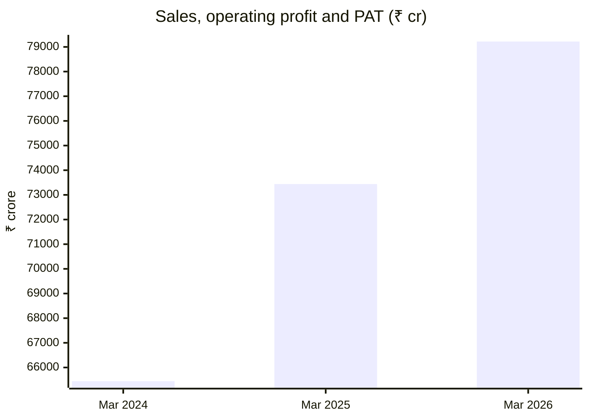

*Run 2026-11-24 · part of [SPINOFF_REPORT.md](../SPINOFF_REPORT.md) · the complete analysis of one company, with every management-call exchange in full.*

## HDFCBANK — HDFC Bank Ltd.

### 1. HDFC Bank Ltd. — PARTIAL SPIN-OFF (subsidiary IPO)

**CONFIRMED** (partial spin-off — HDB Financial Services Limited is listed since 2025-07-02) · **PARTIAL SPIN-OFF, LISTED 1–2Y — the stub against the piece, second year** · score 5.0/10 · partial spin-off (subsidiary IPO) · 2 filing(s) from NSE · first 2026-01-17, latest 2026-01-17

**The separated entities — every one the documents name:**

| Entity | Scheme | Business | Listing | Who runs it |
|---|---|---|---|---|
| **HDB Financial Services Limited** | 2025 initial public offering (IPO) of HDB Financial Service… | Upper layer non-deposit taking Non-Banking Financial Company; "HDBFS delivers a wide range of solutions throu… | listed 2025-07-02 as HDBFS (NSE) | not stated (Dipti Khandelwal named as Company Sec… |

**What is being separated, as the documents put it:** HDB Financial Services Limited, the Bank's non-deposit-taking NBFC subsidiary, separately listed via IPO (fresh issue plus Bank's offer for sale) — class `not stated`.

### 2. Stages and dates

> **Listing:** PARTIAL SPIN-OFF, LISTED — HDB Financial Services Limited trades since 2025-07-02 (NSE equity list); the parent keeps 74.1%

| Date | Event | Source |
|---|---|---|
| 2024-07-20 | Board approval — HDFC Bank Limited | as stated: Note 17 / 11 to the September 30, 2024 results (filing dated October … |
| 2024-09-20 | Board approval — HDB Financial Services Limited | as stated: Intimation of outcome of Board Meeting filed by HDBFS and forwarded b… |
| 2024-10-19 | Board approval — HDFC Bank Limited (quantum of Offer for Sale up to Rs. 10,000 crore) | as stated: Intimation 'Quantum of Offer for Sale of equity shares of HDB Financi… |
| 2024-10-23 | Stage reached: **effective** | [Updates](https://nsearchives.nseindia.in/corporate/HDFCBANK_23102024153625_SEResultSept2024MRF.pdf) |
| 2024-10-30 | DRHP filed — HDB Financial Services Limited (filed with SEBI, BSE Limited and National Stock Exchange of India Limited) | as stated: General Updates intimation dated October 31, 2024 and corrigendum dat… |
| 2025-06-25 | IPO opened (offer launched) — HDB Financial Services Limited | as stated: Note 11 / 5 to the December 31, 2025 results (filing dated January 17… |
| 2025-06-27 | Other (offer period closed) — HDB Financial Services Limited | as stated: Intimation 'Sale of shares of HDB Financial Services Limited in its I… |
| 2025-06-30 | Allotment — HDB Financial Services Limited | as stated: Intimation dated July 2, 2025: "The shares were allotted to investors… |
| 2025-07-02 | **HDB Financial Services Limited** listed (HDBFS) | NSE equity list |
| 2025-07-02 | Listing and trading — HDB Financial Services Limited | as stated: Intimation dated July 2, 2025: "which were admitted for listing and t… |

**The stages, as filed:** effective (2024-10-23)

**The partial spin-off:** **HDB Financial Services Limited** (subsidiary); parent's stake after: 74.1%; IPO stage: listed; NSE symbol HDBFS.

> “On June 25, 2025, the Bank's subsidiary company, HDB Financial Services Limited ("HDBFS") launched its initial public offering ("IPO"), comprised of a fresh issuance of equity shares aggregating to ? ”

**When it lists, in the documents' words:** "On June 25, 2025, the Bank's subsidiary company, HDB Financial Services Limited ("HDBFS") launched its initial public offering ("IPO")" — stated in the January 17, 2026 results (note 11); already listed, no further timeline given.

### 3. Size of the separated business beside the parent — is institutional selling likely?

**Reading: NO FORCED SELLING ON SIZE — an IPO distributes no shares to the parent's shareholders, so nobody receives a piece they did not choose. Size matters here for the stub: how much of the parent's market value the listed piece accounts for.**

| Entity | Stated turnover | Market cap (₹ cr) | Its market value beside the parent's | Index member |
|---|---|---:|---:|---|
| HDB Financial Services Limited | Total revenue of HDBFS during FY 2024-2025: Rs. 16,300.28 crore (FY 2… | 47,055 | 3.8% | yes |

*The last column is the subsidiary's whole market value over the parent's (parent ₹1,239,503 cr, NSE bhavcopy of 2026-11-13), computed here; the parent's own value already contains the stake it keeps, so the stub is the parent's value less that stake.*

**The judge's read of selling pressure:** unlikely — Listing was an IPO/offer for sale, not a share distribution to parent shareholders; no index exclusion or forced holder reshuffle stated.

### 4. Insider ownership — share swap, promoters' holding, management incentives

**Share swap / entitlement, entity by entity:**

- **HDB Financial Services Limited:** IPO (no swap): "comprised of a fresh issuance of equity shares aggregating to? 2,500.00 crore and an offer for sale ("OFS") of equity shares by the Bank, aggregating to? 10,000.00 crore"; "the Bank had offered 13,51,35,135 equity shares of face value of Rs. 10 each of HDBFS, in the said IPO, by way of Offer for Sale, at the issue price of Rs. 740 per share" (gross consideration Rs. 9999,99,99,900; net consideration Rs. 9814,51,63,982). DRHP stage: fresh issue up to ₹ 25,000.00 million and offer for sale up to ₹ 1,00,000.00 million (revised from ₹ 10,000.00 million per corrigendum dated October 31, 2024)

**Promoters' holding, from the shareholding pattern:**

| Company | Promoters | FIIs | DIIs | Public | Quarter |
|---|---:|---:|---:|---:|---|
| HDFC Bank Ltd. (HDFCBANK) | — | 39.39% | 43.44% | 16.96% |  |
| HDB Financial Services Limited (HDBFS) | 74.08% | 4.04% | 11.95% | 9.7% | Sep 2026 |

*Source: screener.in shareholding pattern, stored under `ShareholdingPattern/NiftyTotalMarket/`. In a mirror demerger each shareholder holds the same proportion of the new company as of the parent on the record date.*

- **Promoters in the parent, per the documents:** "The Bank has no promoter/ promoter group company." (disclosure dated October 18, 2024). Also disclosed in every results filing: "Percentage of shares held by Government of India — Nil" (as at December 31, 2025)
- **What the promoters will hold in the separated entity:** 2025 HDBFS IPO: "The Bank sold 13,51,35,135 shares of face value of Rs. 10 each of HDBFS in the IPO, post which the shareholding of the Bank in HDBFS has reduced to 74.19% of its total paid-up equity share capital." (July 2, 2025); as of the December 2025 quarter, "HDB Financial Services Ltd (HDBFSL), is a non-deposit taking NBFC in which the Bank holds a 74.1% stake." 2023 amalgamation scheme: not stated. 2024 HDFC Edu sale: 91% sold on October 18, 2024, "The remaining 9% stake would be divested no later than June 30, 2025."
- **What a public shareholder receives:** not stated in the documents on file.
- **Management incentives:** HDBFS board, September 20, 2024: "Amendment to the Employee Stock Option Scheme – 2014, Employee Stock Option Scheme – 2017 and Employee Stock Option Scheme – 2022 in order to comply with the regulatory requirements." At the Bank: "During the quarter and nine months ended December 31, 2025, the Bank has allotted 2,08,78,662 and 5,53,15,781 equity shares respectively, pursuant to the exercise of options / units under the approved employee stock option schemes / employee stock incentive master scheme."; "Employees stock options outstanding 4,249.96" crore as at December 31, 2025; HDB Employee Welfare Trust ("EWT") is "Consolidated as a subsidiary". Treatment of existing grants in the IPO, any new plan in the listed entity, exercise price / pricing date, and management or insider shareholding: not stated.
- **Insider actions around the separation:** The parent itself sold shares in the IPO: "Under the OFS, the Bank divested 13,51,35,135 equity shares off 10 each of HDBFS at? 740/-per share, for a consideration aggregating to? 10,000.00 crore"; "Post reduction of the customary offer expenses, the Bank has received a net consideration of Rs. 9814,51,63,982, in cash."; "the net gain to the Bank on sale of shares under the OFS is? 9,179.40 crore (before tax and net of IPO related expenses)" (standalone) and "? 7,000.27 crore" (consolidated). The sale "was approved by the Reserve Bank of India" and "The offer for sale will not fall within related party transactions." Trading window: "the window for trading in Securities of the Bank by its designated persons and their immediate relatives shall open on Tuesday, January 20, 2026." No promoter or management buying, selling or pledging around the separation is stated ("The Bank has no promoter/ promoter group company.").
- **Insiders, per the checklist read:** Bank retains 74.1% stake in HDBFSL post-IPO; HDB Employee Welfare Trust is consolidated as a subsidiary. No promoter or management stake or incentive in HDBFS is stated. · *option pricing date:* not stated

### 5. Why the listing — point by point

These texts contain no separation, demerger, spin-off or scheme of arrangement for HDFC Bank, and management never explains one; the question's premise is not supported by the documents supplied. The only business that was partly separated from the Bank is HDB Financial Services Limited (HDBFS), the group's non-deposit-taking NBFC, and that was done by listing it rather than by demerging it: a June 25, 2025 IPO comprising a fresh issue of Rs 2,500.00 crore plus an offer for sale of Rs 10,000.00 crore of the Bank's shares (13,51,35,135 shares of Rs 10 each at Rs 740 per share), after which the Bank still held 74.1%. Management gave no reason for the listing at all — no regulatory mandate, no capital need, no valuation argument, no investor or lender demand was cited; Sashidhar Jagdishan only reported that 'we carried out the HDB Financial Services listing process, wherein the bank also diluted some stake' and thanked IPO investors. The only strategic point made about HDBFS was in answer to Pranav Gundlapalle (Jul 2025), who asked about customer conflict between the two entities: management said HDBFS serves a segment 'a notch or two below' the Bank, with 'zero or very minimal overlap' expected to persist, i.e. the two are kept distinct by customer segment and pricing, not separated to fix a problem. Financially the event was treated as a one-off gain — Rs 9,179.40 crore standalone and Rs 7,000.27 crore consolidated (before tax, net of IPO expenses) — which Srinivasan Vaidyanathan later flagged (Jul 2026) as a base-effect distortion making reported PAT growth 5% versus 9.8% adjusted. Every other corporate action in these texts runs the other way: deepening the 2023 HDFC Limited merger (Apr 2026: e-HDFC home-loan customers' liability penetration up from 36% to ~50%, their CASA balances up from about Rs 50,000 crore to Rs 86,000 crore, 98% of new home loans opening a liability account, 23% carrying active Bank credit cards) and the Apr 16, 2026 board approval to invest up to Rs 1,000 crore in HDFC Life's preferential issue. The closest thing to a forward-looking separation hint is Jagdishan's unprompted remark on surplus capital (Oct 2025): if options arise 'to sort of delight shareholders, we would be more than happy to do so' — unspecified, with no business named.

**Point by point, with the source:**

1. The only partial separation disclosed in any call: HDBFS was listed and the Bank sold down part of its holding, reported as a completed process with no stated rationale. “During the quarter, we carried out the HDB Financial Services listing process, wherein the bank also diluted some stake, and which eventually culminated in the stocks being listed on 2nd of July.” — *[Jul 2025](https://www.bseindia.com/stockinfo/AnnPdfOpen.aspx?Pname=d1268138-e288-4335-9764-7a944dfa3570.pdf)*
2. Asked by Pranav Gundlapalle (Bernstein) whether the Bank and HDBFS would end up chasing the same customers, Jagdishan said HDBFS sits a notch or two below the Bank's segment on customer profile and pricing. “HDB, we have maintained this. I think the segment that they cater to is about a notch or two below that of HDFC Bank.” — *[Jul 2025](https://www.bseindia.com/stockinfo/AnnPdfOpen.aspx?Pname=d1268138-e288-4335-9764-7a944dfa3570.pdf)*
3. Management framed the two entities as permanently distinct by segmentation rather than as a business being carved out to solve a conflict. “There is zero or very minimal overlap at this juncture that will continue to stay for a long period of time.” — *[Jul 2025](https://www.bseindia.com/stockinfo/AnnPdfOpen.aspx?Pname=d1268138-e288-4335-9764-7a944dfa3570.pdf)*
4. On the capital question (CET1 near 20%, draft RWA relief, ECL), Jagdishan said capital will be consumed once FY27 growth exceeds system growth, but left unnamed shareholder-friendly options open — the only forward-looking hint of any corporate action. “Having said that, if there are any opportunities that may arise in terms of other options that are available to sort of delight shareholders, we would be more than happy to do so.” — *Oct 2025*
5. The Jan 17, 2026 filing quantifies the HDBFS sell-down: fresh issue of Rs 2,500 crore plus Rs 10,000 crore offer for sale by the Bank, 13,51,35,135 shares at Rs 740, producing a Rs 9,179.40 crore standalone gain (Rs 7,000.27 crore consolidated) with the Bank retaining 74.1%. “On June 25, 2025, the Bank's subsidiary company, HDB Financial Services Limited ("HDBFS") launched its initial public offering ("IPO"), comprised of a fresh issuance of equity shares aggregating to 2,500.00 crore and an offer for sale ("OFS") of equity shares by the Bank, aggregating to 10,000.00 crore.” — *Scheme*
6. Six weeks before the Apr 2026 call the Board moved in the opposite direction, approving fresh capital into a subsidiary rather than any separation, subject to RBI approval. “the Board of Directors of the Bank, at its meeting held today i.e. on April 16, 2026, approved investment of an amount not exceeding Rs. 1,000 crore (Rupees One thousand crore only) in the preferential issue of equity shares to be made by HDFC Life Insurance Company Limited, a subsidiary of the Bank” — *Scheme*
7. Kaizad Bharucha's merger-synergy update shows integration, not separation: e-HDFC mortgage customers' liability penetration up from 36% to ~50%, their CASA from about Rs 50,000 crore to Rs 86,000 crore, 60-65% paying EMIs from in-house accounts, 23% holding active Bank credit cards. “Net of attritions, net of acquisitions over this journey, this 36% has come as high as 50% within the last 2.5 years.” — *[Apr 2026](https://www.bseindia.com/stockinfo/AnnPdfOpen.aspx?Pname=a77abbbb-954a-4221-8240-67bf0da6ba1c.pdf)*
8. The HDBFS transaction appears only as a prior-year one-timer distorting the growth base, with adjusted PAT growth of 9.8% versus 5% reported — the last mention of it in any call. “But last year included certain one-timers like HDB gains and then we had a floating provision counter-cyclical buffer that we added and some contingent provision and so on.” — *[Jul 2026](https://www.bseindia.com/stockinfo/AnnPdfOpen.aspx?Pname=509cc499-6cb1-4d9f-8de9-9c7de6c70eef.pdf)*
9. At the special call on Atanu Chakraborty's resignation, the only structural change hinted at was an internal reorganisation of responsibilities, explicitly not a business separation and with nothing decided. “Yes, as I said, as we move forward, we will sort of re-examine our organization structure and with the consent and the advice of the board, we will announce it at the appropriate time.” — *[Mar 2026](https://www.bseindia.com/stockinfo/AnnPdfOpen.aspx?Pname=56739132-e21e-4503-aeb6-85f4f53c1244.pdf)*

**How it evolved:** Jul 19, 2025: the HDB Financial Services IPO and the Bank's stake dilution are reported as completed (listed Jul 2, 2025), with no rationale, and management answers only the question of bank-versus-HDBFS customer overlap. Oct 18, 2025: asked by Chintan (Autonomous) what the Bank will do with excess CET1, Jagdishan leaves the door open to unnamed 'other options... to delight shareholders' while stressing capital will be consumed once growth accelerates from FY27. Jan 17, 2026 filings quantify the transaction (Rs 10,000 crore OFS, Rs 9,179.40 crore standalone gain, 74.1% residual stake); Apr 16, 2026 the Board instead commits up to Rs 1,000 crore of fresh capital to subsidiary HDFC Life. Jul 18, 2026: the HDB gain is referred to only retrospectively, as a prior-year one-timer depressing headline PAT growth to 5% versus 9.8% adjusted — the idea never develops into any separation plan.

**What management expects from it:** Nothing was said about a separation, because none was announced. For the one partial carve-out, the HDBFS listing, management claimed no margin, capital, valuation or focus benefit; it cited only a Rs 9,179.40 crore standalone one-time gain (later called a base-effect distortion) and segment distinctness — HDBFS one to two notches below the Bank, with minimal customer overlap.

*Not explained on the calls:* Everything: no separation, demerger or scheme exists here. No reason, regulator, lender or investor demand, valuation case, timeline or margin/capital effect for the HDBFS listing is given.

- *Stated reason, in one line:* not stated
- *What it reveals:* Sale of 13,51,35,135 shares at Rs 740 raised Rs 10,000 crore, netting Rs 9,179.40 crore standalone gain (Rs 7,000.27 crore consolidated) — implying carrying value far below market; HDBFSL loan book Rs 1,146 billion, Stage 3 2.81%, CAR 21.8%.
- *Parent or spin:* parent · *Read next:* HDBFS's own standalone financials and shareholding pattern — the Bank's residual 74.1% stake and its carrying value.
- *In their words:* “On June 25, 2025, the Bank's subsidiary company, HDB Financial Services Limited ("HDBFS") launched its initial public offering ("IPO"), comprised of a fresh issuance of equity shares aggregating to ₹ 2,500.00 crore and an offer for sale ("OFS") of equity shares by the Bank, aggregating to ₹ 10,000.00 crore.”

### 6. On the calls, verbatim

4 call(s), oldest first: **2 question-and-answer exchange(s)** given in full — the question and every answer to it, nothing trimmed — and 2 passage(s) from management's prepared remarks (the complete sentences about it; the whole remarks are in the linked transcript). Text is as the transcript prints it.

#### Apr 2024 — [transcript](https://www.bseindia.com/stockinfo/AnnPdfOpen.aspx?Pname=880ee466-e764-4e05-9ef3-3d9bb8e485f4.pdf)

**Question and answer**

> **Chintan Joshi:** Thank you. Moderat or: Thank you. The next question is from the line of Rahul Jain from Goldman Sachs. Please go ahead.
>
> **Rahul Jain:** Thank you. Good evening Sashi. Good evening Srini. Sorry for bad throat. Just wanted to put across some thoughts and would be paint ing some scenarios if I may. What I've heard you, Sashi, so far speak it appears to me is that we are -- we seem to be in a balance sheet fixing mode and we would sort of use all the possible levers to bring the LDR down? And in that context, what you talked about ma rgins versus LDR in response to previous questions. So I want to check with you , we saw 4 basis point of margin expansion with quarter basis in your presentation. And that also corresponded into the LDR drop. If we see scope for further margin expansion, do we get to a scenario where the LDR drops could be even more meaningful as we move forward, of course, subject to wherever there is a scope given that there are contractual obligations in place. So that's question number one.
>
> **Sashidhar Jagdishan:** Okay, l et me answer the question number one. See, as I said, -- I'm not sort of keeping a certain anchor on a margin and working out a strategy. This is -- that is never -- as I probably said it in the opening remarks we just want to have one anchor because a mar gin and Rahul, you probably know this much better is a function of the demand from each of the customer segment. It's a function of the pricing behavior in each of the segments and the competition at that poi nt HDFC Bank Limited April 20, 2024 Classification - Public Classification - Public in time. Three, it's a function of the business mix. And so I don't want to have that as an anchor at all. But having said that we are very clear that we're not going to chase growth for the sake of growth. In the past, there have been some periods of customer engagement and customer commitments, but now that we have absolute control on the ship post the merger, we are very clear that we'll deploy basis what we mobilize. So the -- I believe and as I mentioned a few minutes ago that from here on I believ e the margin, even if it's stable is something that will be delighted because we want to ensure that the cost of incremental deposits continues to be range bound and then whatever thresholds we have laid out a -- little bit of tweaking. We will ensure that the margins either remain stable. And the business mix is what will then determine the margin movement also because if I continue to have more / higher proportion of retail and CRB, all things remaining same it will have a positive impact on the margin. S o that's not something that we are focusing. We want to -- as I said we want to anchor our thought process in terms of seeing stability of metric es with a positive bias moving slowly and surely over the next 2 years to 3 years. So I'm not sort of giving an y outlook on that, but I'm very clear that I want to maintain stability. We are not going down the risk ladder to oust as well and neither are we going to go down the price ladder anymore. So if we have to sort of drop off some volumes, so be it, okay. Pr ofitability is extremely important. It has to make economic sen se otherwise no , all things remaining same. The fact that now we have a perfect control or we have the control on our assets and liability movements , the margin accretion should be a function o f how we substitute our bonds that come up for maturity over a period of time with deposits. And that is where you will start to see that kind of momentum. But you have to be patient because these are things that will happen only on defined time lines. It's not something that I can call. So it has to be a gradual path. In the meantime, if the orga nization grows, builds stability on its metrics including the core ROA and earnings at over a 2-year to 3-year period, has a positive trajectory. I think, that's a big positive for us because , when in the medium -to-long term , when you have subsequently and finally exhausted the high -cost bonds . trust me we would have not just liquidity, we will have the ability to unleash growth with profitability coming back to the pre - merger levels as well on a core basis.
>
> **Srinivasan Vaidyanathan:** CASA mix is also one of the important elements in this and that's not what we can drive. It's a customer propensity and customer preference in terms of what the mix of between CASA and the TD they need, and we are balanced in offering.
>
> **Sashidhar Jagdishan:** In a high interest rate scenario, Rahul, normally , you probably go back in time, the CASA ratios have been a little tepid. And this is exactly what we have been seeing because incrementally we are seeing in the system as well , people are spending, people are moving monies into o ther alternative instruments. HDFC Bank Limited April 20, 2024 Classification - Public Classification - Public So effectively, the household savings themselves have also started to come down. So these are structural changes that are happening. But having said that, these are things that is there at a system level. We can't be cribbing . I think we have enough opportunity to incrementally gain share even on CASA and that's our endeavour . And that's something that you have to look at it on a longer -term basis.
>
> **Rahul Jain:** Thanks. Very helpful. The other question was on the cost of deposit s and deposit mobilization given that the system is still pretty much operating in a tight liquidity environment, the rates are still pretty much elevated. You talked about pressure on household savings, the alternatives, is it the interest rate sensitive, alternatives are also very high. We have a kind of -- it seems that the cost of deposits has stabilized for us. It was down, as per presentation marginally in this quarter. So does it mean that we will not be seeing an increase now, we've kind of stabili zed on that? And if market -- if the competition is bidding up for deposits, we might choose to let go off like the way we did it in the third quarter. And therefore, the cost of deposit is something that you have control over or how would you react to it?
>
> **Sashidhar Jagdishan:** Great question. If there is irrational competition absolutely and we will not be apologetic. As I said, while most of you did not like what we did in quarter 3, the reality was there was sort of heightened war on deposits and which we elected not to chase. But having said that, if you've seen over the last 12 months I think there has been stability in the rates that we offer across tenors on our retail deposits whether it's the granular retail deposits or some higher ticket sizes as we ll. We have not changed and it's pretty much reflected in the stability in the cost of deposits. But if there are changes because you never know the , life is very uncertain. What's happening in the Middle East is also extremely uncertain. How that sort of impacts global rate scenarios and hence has a ripple effect on India , is something that we have to watch. And if there is continued hawkish stance on the monetary policy and we continue to see rates elevated at the system level and probably that also lead s to a little bit of tightening on the liquidity. These are aspects that we really would not have a handle on. And if all the other large competitive banks were to raise rates, we cannot be an outlier. We have to maybe match to that, but it doesn't mean th at beyond that, I mean, where we will not chase is beyond the card rates. If at all even we chase then, of course, we will have to chase even the threshold yields on our loans as well. But beyond the card rates, even if we were to change the rate, would w e be chasing bid base deposits ? Absolutely no. There is a certain proportion we will patronize because our customer segment is across multiple segments. It ranges from individuals to corporates and there is a certain proportion that we have always patroniz ed. I think largely about 84% to 85% is retail and non -retail is about 15% to 16%. As long as we maintain this balance, I think we are all right. But do we go to extra mile to go for volatile bid based transitory flows? Not really. HDFC Bank Limited April 20, 2024 Classification - Public Classification - Public Rahul Jain: Very helpfu l Sashi. Just one last question I would like to squeeze in with regards to the provisioning that we have done in this quarter to absorb and to offset the gain through Credila stake sale. News reports also talked about you are looking to be maybe in a sell stake in HDB Financial Services. So just wanted to understand the choice of provisions that you've made here , floating provision , which is generally very hard to dip into without RBI approval. So next year again the core credit cost doesn't come down, it remains in that band, so shareholders don't get to benefit from these stake sales even now or in the future. And when the merger happened there was an impact on the book value because of these investments. So what's the thinking that the management team i s having here? Why floating and why not contingent provisions that can be used in the future?
>
> **Sashidhar Jagdishan:** Very happy that you asked this because that's exactly what we wanted to convey. Floating provision is actually a counter cyclical provision w hich is made in good times. It does not reflect anything that's adverse in the portfolio or in our early indicators at all. We have a pristine asset quality. Our early indicators across segments are even better and that is pretty much what we had anticipa ted. So unlike in a contingent provision which is precautionary in nature against certain standard exposures that may possible because of certain potential contingent events could slip into the delinquent buckets in stress scenarios, that is the reason why we provide contingent. But here we don't have any - - what shall I say -- any reason to do that is contingent. We've put in a floating. We are very much cognizant of the fact that we have to take prior approval of RBI, which reflects the fact that the res iliency of our balance sheet and our credit portfolio, which means that if the organization has taken the courage to put it in floating, it all means that things are pretty good and that is what we want to convey.
>
> **Rahul Jain:** Can this be used in an event o f ECL implementation?
>
> **Sashidhar Jagdishan:** No. See, the point is, I think the bank's pricing and the bank's financials are such that it prices for the expected credit loss. The contingent is something that is very specific on certain events or certain pote ntial events that may happen or may not happen, so that's contingent event. Floating is something that you will dip in when there are some adverse unanticipated events in the future. You don't do it because you're anticipating anything, but you do it beca use you want to bring in resiliency and you are actually trying to say that in good times, why do you want to be there is of course a lot of debate in literature whether / why don't you take it straight to profits. I'm sure a lot of people on the call who probably would be thinking it’s better to I would have loved this going into the book straight. In fact, you should sort of probably come up -- and I'm telling you that you can consider this as a deemed book, a deemed attrition to book. But having said th at, I believe that this is not something that we will invoke for a long time to come. This is something -- an investment for the future. It is only getting the balance sheet HDFC Bank Limited April 20, 2024 Classification - Public Classification - Public stronger so that you are protected any unanticipated movement say, 5 years, 10 yea rs, 15 years, 20 years from now and we are not going to be apologetic of doing so. But is it something that we'll be doing every time we have a one -off? Sorry, that's not what I'm trying to say. This is something that we have taken a call now and we will evaluate periodically as and when any further instances happen in the future.
>
> **Srinivasan Vaidyanathan:** And for now this qualifies for Tier 2 capital within regulatory limits, and so it is part of the Tier 2 capital and total capital as a floating provision .
>
> **Sashidhar Jagdishan:** And it sort of now is about 0.5% of the total loan book as we speak?
>
> **Srinivasan Vaidyanathan:** Yes, the floating position is about 50 basis points. The contingent provision is about 59 basis points combined about 109 basis points within reasonable limits of...
>
> **Rahul Jain:** Thank you so much. Very helpful. Thanks for being patient and responding to my question, Good job to you and your team and good luck for the future.
>
> **Sashidhar Jagdishan:** Thank you, Rahul. Thank you very much.

#### Jul 2024

**Question and answer**

> **Mahrukh Adajania:** Sashi, my first question is on LDR. So when you say you wanted to , or possibly LDRs could come down faster than anticipated, all the large private banks -- of course, one is at above 90%, but most of them are on an average of 83% to 87%. So is that kind of an LDR you are hinting at and over what time frame? Because that really sets things very clear ly, right, in terms of what loan growth to anticipate. And also in terms of loan growth, right, now if you see other than CVs, most of retail and most other segments have grown below 2% Q -o-Q. I don't understand the first quarter seasonality. But if you wish to have focus on profitability over growth and growth remains kind of weakish relative to your historical trends, would it be very easy to then regain market share once you think your balance sheet has cost corrected, right? Because you're possibly giving up share. You can do much better on growth , but obviously, we know the constraints on deposits. So that's my question on HDFC Bank. And if you could explain the high provisioning on HDB Financial as well?
>
> **Sashidhar Jagdishan:** Okay. Thank you, Mahrukh. Number one is we don't have or rather, if at all, you're expecting that, is there a prescription from anybody, including the regulator, whether there is a prescription for a loan deposit ratio, not at all. As I mentioned, it is in our interest to have a glide path. Two, you're absolutely right, it's -- theoretically, I would love to do this in 1 year. But is it feasible? Is it practical when you have an objective of a profitable growth? Absolutely. You're absolutely right that it's not something that I can do -- where I can just drop it in one go and then be done with this, et cetera. It's not practical. Now let's go segment by segment. We have a machinery. There is a lot of buoyancy there, whether -- you know this much better that funding or providing financing or loans to customers, HDFC Bank Limited July 20, 2024 Classification - Public Classification - Public whether it's the retail segment, whether it is the MSME segment, whether it is the corporate segment is actually a feeder for us in terms of the primary banking and hence, liabilities as well. So there is an optimal level that you can work with. You cannot drop the levels. So therefore, this is a play that we have to manage very gingerly. The reality is there is a tight liquidity environment. There is, as I mentioned to you and if you really look at the averages, the EOP period numbers are not a reflection of what is the underlying resiliency, in fact, of deposits. In reality, the deposit momen tum, when you look at it, maybe at some point in time, Srini will explain that, the gross inflows across the multiple products and deposits have actually been increasing. It's a very healthy trend. And as I mentioned to you, one of the things that we do not have some control is the velocity of the flows in the current accounts and which is what has created this kind of a little bit of -- it unsettles you, it unsettles us in terms of a number on a particular date. It has never happened before. Of course, there may be some inst ances where it has happened before -- -- all of you rightfully so are seeing a little bit of a disappointment there. But when you look at the averages, which I'm sure you will compute, it's rather pretty steady over a longish period of time -- and even on the advances side, what has happened in quarter 1 is not a reflection of what we pl an to do. This is a kind of an adjustment that has happened. It's a matter of time that you would see in the next 3 quarters, what we do. Our relationship, since you spoke about market share, you spoke about relationships, we are very clear. We have one of the best relationships in the corporate side. Even though you are seeing a little bit of a negative growth, it's just -- we have high amounts of already great penetration levels to the best set of corporates in the country. What we are losing is transactional business consciously because it's not meeting our pricing thresholds. We are all right to do so because we -- maybe this is the best time for us to adjust our mix, which is what you're seeing a bit of a flavour in this particular quarter. We want to continue this kind of a mix change over a longer period of time. Of course, it cannot be forever. There will be -- during this period of adjustment, we may have to do it for some time before it sort of normalizes. But having said that, I don't have a specific number because then it will sort of bring in a fair amount of pressure on the system. We have an internal benchmark for ourselves as to what we need to do. As I said, neither have we received any regulatory pre scription. But at the same time, the thought processes can be, to the best of our ability, try and get this done as quickly as possible and still maintain the objectives of profitable growth. So all I can say is that it's best that you see what we do in the next 3 or 4 quarters. And yes, when I relate this number that what we are planning, I'm relating into what we were probably thinking of at the time of announcement of the merger. Obviously, things have changed. And we realized that maybe as you alluded to a lot of other -- there has been literature, which has been spelt out in the monetary policy literature on credit deposit ratio. So we are very cognizant of the risks that are there in the system. And instead of being nudged on that, we want to do it ourselves because it makes the most economic sense to bring it as quick ly as possible. HDFC Bank Limited July 20, 2024 Classification - Public Classification - Public Srinivasan Vaidyanathan: Two more things that you alluded to that I can describe is that the activity at the various distribution points, we did add 2.2 million new customer relationships in the quarter. So last quarter was very similar. So from that sense, the pace at which the g round teams are operating is quite strong. So we do get the new account value. It is those existing customers or the transactional balances in the current account where I've seen that outflow. Now coming to the other aspect that Sashi alluded to in terms of the inflows. We measure inflows monthly to see what are the credits coming into various customers' accounts at individual, aggregate, branch level and so on. When we look at the inflows that come and compare those inflows that are coming to the similar time pe riod last year, the monthly inflows are up over 20%. So we do see enormous traction happening in the account s, which means the credit flows that are coming, cash that is coming in, when I say cash, I mean funds that are coming in, is of a good order. It gets deployed in various means. But again, this is across current account, savings account, across all of these and the salaries, so when I say savings that include the salary account that we have, is gaining good traction from inflows that come at aggregate level. And then one other point she had was about the HDB credit cost.
>
> **Srinivasan Vaidyanathan:** HDB credit costs. Okay. The GNPA ratio remained flat at 1.9 %. The Stage 3 has remained flat. The credit costs have been higher because seasonally, again, various reasons you can attribute to various reaching ability during this quarter has been hampered a bit due to -- they are far more distributed into the interlands than we are. The heatwave issues and the electoral preoccupation at various levels, so there is a seasonality that was there. So the early flows have caused the provisions to be higher, but the NPAs remained stable. So the sudden flow into that NPA bucket is limited, but the early -- they have to do more on that. That's where that is.

#### Oct 2024 — [transcript](https://www.bseindia.com/stockinfo/AnnPdfOpen.aspx?Pname=c7affe75-673f-4507-b421-a7d5bab9d3e6.pdf)

**From the prepared remarks** *(the passage about it; the whole turn runs to 358 characters in the transcript)*

> **Kunal Shah:** Yes. So, the question is on RBI's draft circular in terms of the overlap in lending of group entities. So, what do you think should be the impact on HDB Financial and maybe till the time there is the final guidelines, would it any ways impact the listing of the HDB Financial that is being planned and that is required as per the regulatory requirement, yes?

#### Jul 2025 — [transcript](https://www.bseindia.com/stockinfo/AnnPdfOpen.aspx?Pname=d1268138-e288-4335-9764-7a944dfa3570.pdf)

**From the prepared remarks** *(the passage about it; the whole turn runs to 4,311 characters in the transcript)*

> **Sashidhar Jagdishan:** You're seeing that in the results just announced. Whilst we may see quarterly fluctuations in margins due to this lead lag impact, we expect to stabilize it over a period of time . Our asset quality, one of our main USPs, remains healthy, positioning us well for growth in both assets and deposits as liquidity and demand improves. During the quarter, we carried out the HDB Financial Services listing process, wherein the bank also di luted some stake, and which eventually culminated in the stocks being listed on 2nd of July. We thank all the investors who participated in the said IPO. Earlier today, the Board also announced an interim dividend of INR 5 per share, and they also recommended to shareholders the first ever bonus share issue in the ratio of 1 :1. Srini and team will probably give you more details as questions come about from all of you all.

### 7. The parent's financial statements

**The parent, last three fiscal years (consolidated)**

| | Mar 2024 | Mar 2025 | Mar 2026 |
|---|---:|---:|---:|
| Sales (₹ cr) | — | — | — |
| Sales growth (%) | — | — | — |
| Operating profit (₹ cr) | — | — | — |
| Operating profit growth (%) | — | — | — |
| Operating margin (%) | — | — | — |
| PAT (₹ cr) | 65,446 | 73,440 | 79,219 |
| PAT growth (%) | +41.8% | +12.2% | +7.9% |
| PAT margin (%) | — | — | — |
| EPS (₹) | 42.2 | 46.3 | 49.4 |

*Source: ProfitStatement/NiftyTotalMarket/HDFCBANK.csv (consolidated, screener.in); growth and margins computed here.*

*Series in order: PAT.* *Not plotted (gap in the data): Sales, Operating profit.*

**P/E:** 14.6 — live market file (screener.in), trailing (price ₹748.00 as of 2026-08-02).

**Cash flows (₹ cr):**

| | Mar 2024 | Mar 2025 | Mar 2026 |
|---|---:|---:|---:|
| Cash from operations (₹ cr) | 19,069 | 127,242 | 113,506 |
| Cash from investing (₹ cr) | 16,600 | -3,651 | 7,477 |
| Cash from financing (₹ cr) | -3,983 | -102,478 | -59,005 |
| Net cash flow (₹ cr) | 31,687 | 21,113 | 61,978 |
| Free cash flow (₹ cr) | 14,882 | 123,267 | 110,144 |

*Source: CashFlow/NiftyTotalMarket/HDFCBANK.csv (consolidated, screener.in).*

### 8. The separated business's financial statements

**The business being separated — its own numbers**, entity by entity: its reported statements once it is listed and on file, and the segment numbers the annual reports and presentations carry for it before that.

**HDB Financial Services Limited (HDBFS) — as reported since listing**

| | Mar 2023 | Mar 2024 | Mar 2025 |
|---|---:|---:|---:|
| Sales (₹ cr) | — | — | — |
| Sales growth (%) | — | — | — |
| Operating profit (₹ cr) | — | — | — |
| Operating profit growth (%) | — | — | — |
| Operating margin (%) | — | — | — |
| PAT (₹ cr) | 1,959 | 2,461 | 2,176 |
| PAT growth (%) | +69.9% | +25.6% | -11.6% |
| PAT margin (%) | — | — | — |
| EPS (₹) | 24.8 | 31.0 | 27.3 |

*Source: ProfitStatement/NiftyTotalMarket/HDBFS.csv (consolidated, screener.in); growth and margins computed here.*

**HDB Financial Services (HDBFS) — subsidiary listed via IPO/offer for sale; 74.08% held by the Bank as of September 30, 2026 → HDB Financial Services Limited** · unit ₹ billion · No segment result / EBIT / PBT or revenue line is disclosed for HDBFS anywhere on these pages. Only entity-level quarterly net profit (PAT, as per GAAP applicable to the entity), loan book, NIM, RoA, RoE, EPS and book value per share are given in the quarterly 'Group companies / Subsidiaries update' slides. In the consolidated segment tables HDBFS is not a separate segment — it sits inside the 'Others' segment, which also contains other consolidated entities.

| | n/a |
|---|---:|
| Revenue (₹ billion) | — |
| Revenue growth (%) | — |
| Operating profit (₹ billion) | — |
| Operating profit growth (%) | — |
| Operating margin (%) | — |
| PAT (₹ billion) | 7.8 |
| PAT growth (%) | — |

*Sources:* Presentation Oct 2026 — page 22 (also page 23)

*Latest quarter (Q2 FY27):* revenue None, operating profit None — Presentation Oct 2026 — page 23

*Not in the pages read:* Only quarterly PAT exists (Q2 FY27 ₹7.8bn; Q1 FY27 ₹7.9bn; Q4 FY26 ₹7.5bn; Q3 FY26 ₹6.4bn). No fiscal-year revenue, operating profit, PAT, assets, liabilities, capex or depreciation for HDBFS.

*Businesses with no numbers in the pages read (3 annual report(s) and 5 presentation(s) on file):* All named entities are the same company (HDB Financial Services Limited / HDBFS / HDBFSL), covered above. The pages carry no HDBFS revenue, operating profit, assets, liabilities, capex or depreciation — only quarterly entity PAT.

*Documents on file:* [Annual Report 2026](https://www.bseindia.com/xml-data/corpfiling/AttachHis/7d621500-082a-4342-b98d-ba677d3890c5.pdf); [Annual Report 2025](https://www.bseindia.com/xml-data/corpfiling/AttachHis/411e22d2-0720-4cec-b659-9ccd639f0f1a.pdf); [Annual Report 2024](https://www.bseindia.com/xml-data/corpfiling/AttachHis/2160dea5-d49e-4409-83a4-c2b111a3bd12.pdf); [Presentation Oct 2026](https://www.hdfc.bank.in/content/dam/hdfcbankpws/in/en/pdf/about-us/financial-results/2026-2027/quarter-2/q2fy27-earnings-presentation.pdf); [Presentation Jul 2026](https://www.hdfc.bank.in/content/dam/hdfcbankpws/in/en/pdf/about-us/financial-results/2026-2027/quarter-1/q1fy27-earnings-presentation.pdf); [Presentation Apr 2026](https://www.hdfc.bank.in/content/dam/hdfcbankpws/in/en/pdf/about-us/financial-results/2025-2026/quarter-4/q4fy26-earnings-presentation.pdf); [Presentation Jan 2026](https://www.hdfc.bank.in/content/dam/hdfcbankpws/in/en/pdf/financial-results/2025-2026/quarter-3/Q3FY26-earnings-presentation.pdf); [Presentation Apr 2025](https://nsearchives.nseindia.com/corporate/HDFCBANK_19042025160318_SEpresentation19042025.pdf)

### 9. Other financial differences — working capital, margins, returns, debt

| Metric (latest year) | Parent (HDFCBANK) | HDB Financial Services Limited (HDBFS) |
|---|---:|---:|
| *Basis* | *reported, consolidated* | *its own reported statements* |
| ROE % | 14 (Mar 2026) | 15 (Mar 2025) |
| ROE % | 14 (Mar 2026) | 15 (Mar 2025) |

*Each figure is the latest on file, with its year. Working-capital days and ROCE come from the stored working-capital file; segment figures from the pages cited in part 8. A dash means the documents do not carry it.*

**What stays with the parent — its segments, from the same pages:**

| Remaining segment | Revenue | Operating margin | ROCE | Segment assets / revenue | Unit | Year |
|---|---:|---:|---:|---:|---|---|
| Treasury | 84,337 | 25.1% | 2.0% | 13.63x | ₹ crore | FY2026 |
| Retail banking — Digital banking (sub-segment, Digital Banking Units) | 10 | -15.3% | — | 13.31x | ₹ crore | FY2026 |
| Retail banking — Non-Digital Banking (labelled 'Other retail banking' in FY2024 report) | 301,843 | 10.6% | — | 5.24x | ₹ crore | FY2026 |
| Wholesale banking | 174,506 | 19.5% | 9.2% | 8.59x | ₹ crore | FY2026 |
| Other banking Operations (labelled 'Other banking business' in FY2024 report) | 36,841 | 28.3% | 9.6% | 3.06x | ₹ crore | FY2026 |
| Insurance business (HDFC Life Insurance consolidated and HDFC ERGO General Insurance) — consolidated segment only | 108,080 | 6.6% | 44.8% | 3.83x | ₹ crore | FY2026 |
| Others / Other (operations of consolidated entities not covered in other segments — includes HDB Financial Services and HDFC Securities) — consolidated segment only | 19,507 | 10.6% | 7.0% | 6.6x | ₹ crore | FY2026 |

**What the documents themselves say about the differences:**

- **growth** — parent / remaining: Bank standalone total income Rs. 346,149.32 crore for FY 2024-25 (FY 2023-24: Rs. 307,581.55 crore); net revenue up 8.9% in the December 2025 quarter; separated business: HDBFS revenue grew from Rs. 12,402.88 crore (FY 2022-23) to Rs. 14,171.12 crore (FY 2023-24) to Rs. 16,300.28 crore (FY 2024-25); PAT for the December 2025 quarter up 36.3% “The turnover of HDBFS during the last 3 years is given below: FY 2022 -23: Rs. 12,402.88 crore FY 2023 -24: Rs. 14,171.12 crore FY 2024 -25: Rs. 16,300.28 crore”
- **debt and leverage** — parent / remaining: Bank total Capital Adequacy Ratio 19.9% as on December 31, 2025, Tier 1 CAR 17.8%, CET1 17.4%, against a regulatory requirement of 11.9%; Debt Equity Ratio 0.49 and Total Debts to Total Assets 12.75%; separated business: HDBFS Total CAR 21.8% with Tier-I CAR 17.3% as on December 31, 2025 “The total loan book was o!' 1,146 billion as on December 31, 2025. Stage 3 loans were at 2.81% of gross loans. Total CAR was at 21.8% with Tier"! CAR at 17.3%.”
- **other (asset quality)** — parent / remaining: Bank gross NPAs 1.24% of gross advances and net NPAs 0.42% of net advances as on December 31, 2025 (0.97% excluding agricultural NPAs); separated business: HDBFS Stage 3 loans at 2.81% of gross loans as on December 31, 2025 “Gross non-performing assets were at 1.24% of gross advances as on December 31, 2025 (0.97% excluding NPAs in the agricultural segment), as against 1.24% as on September 30, 2025 (0.99% excluding NPAs in the agricultural segment), and 1.42% as on December 31, 2024 (1.19% excluding NPAs in the agricultural segment).”
- **other (gain on the separation)** — parent / remaining: The Bank booked a pre-tax gain of 9,179.40 crore (standalone) and 7,000.27 crore (consolidated) on the OFS in the nine months ended December 31, 2025; net cash received Rs. 9814,51,63,982; separated business: HDBFS received the fresh issue proceeds of 2,500.00 crore; the Bank's stake fell to 74.19% (74.1% by December 2025) and HDBFS remains a subsidiary “In the Consolidated Financials, profit on sale of investment is considered as the difference between the sale consideration and the Bank's share in the carrying amount of HDBFS's net assets (to the extent of sale), as of the date of sale. Consequently, the net gain to the Bank in the Consolidated Financials, on sale of shares under the OFS is f 7,000.27 crore (before tax and net of IPO related expenses) during the nine months ended December 31, 2025.”

**The checklist:**

| Item | Status | Evidence |
|---|---|---|
| Why the spin-off | yes | regulatory / strategic knot — “…ovide appropriate accounting effect on the basis of such developments, as needed. 11 ln accordance with the RBI guidelines, banks are required to make consolidated Pillar 3 disclosures including leverage ratio, liquidi.” |
| Institutional selling likely (small / different business) | unknown | size of the demerged piece not stated *(next: pro-forma statements: revenue / assets of the demerged undertaking vs the parent)* |
| Insider ownership and incentives aligned | unknown | no promoter-continuity or option-pricing language found *(next: the date the management options are priced; promoter holding in the resulting company)* |
| A hidden value revealed (pro-forma, leverage, comparables) | yes | P/E 14.5 on Mar 2026 profit vs industry median 24.6 (97 peers) |
| Parent before the spin (clean parent, takeover prelude) | partly | stage announced — the spin has not happened; the parent can still be bought whole |
| Partial spin-off: price the stub from the listed piece | partly | a subsidiary is being listed; once it trades, stub = parent price − (stake value ÷ parent shares) *(next: stub_value(parent price, parent shares, [(sub price, shares held)]))* |
| Timing (first year sells, second year gains) | partly | not yet listed — 311 days since the first filing, stage announced |

The filings

| Date | Category | Headline | Attachment |
|---|---|---|---|
| 2026-01-17 | Outcome of Board Meeting | HDFC Bank Limited has submitted to the Exchange, the financial results for the period ended December 31, 2025. | [pdf](https://nsearchives.nseindia.com/corporate/HDFCBANK_17012026143925_SEResultReg3017012026.pdf) |
| 2026-01-17 | Press Release | HDFC Bank Limited has informed the Exchange regarding a press release dated January 17, 2026, titled FINANCIAL RESULTS (INDIAN GAAP) FOR THE QUARTER AND NINE MO | [pdf](https://nsearchives.nseindia.com/corporate/HDFCBANK_17012026150829_SEResultReg3017012026.pdf) |

