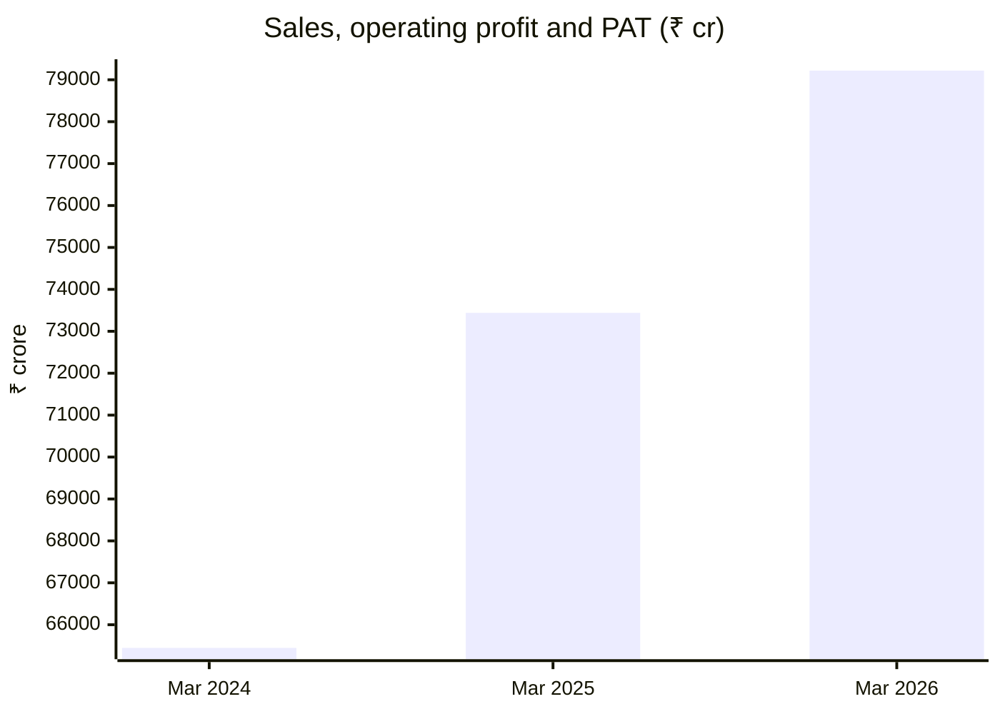

*Run 2026-11-24 · part of [SPINOFF_REPORT.md](../SPINOFF_REPORT.md) · the complete analysis of one company, with every management-call exchange in full.*

## HDFCBANK — HDFC Bank Ltd.

### 1. HDFC Bank Ltd. — PARTIAL SPIN-OFF (subsidiary IPO)

**CONFIRMED** (partial spin-off — HDB Financial Services Limited is listed since 2025-07-02) · **PARTIAL SPIN-OFF, LISTED 1–2Y — the stub against the piece, second year** · score 5.0/10 · partial spin-off (subsidiary IPO) · 2 filing(s) from NSE · first 2026-01-17, latest 2026-01-17

**The separated entities — every one the documents name:**

| Entity | Business | Listing | Who runs it |
|---|---|---|---|
| **HDB Financial Services Limited** | Non-deposit taking, RBI-identified upper layer NBFC delivering Enterprise Lending, Asset Finance and Consumer… | listed 2025-07-02 as HDBFS (NSE) | not stated |

**What is being separated, as the documents put it:** HDB Financial Services Limited, the Bank's non-deposit-taking NBFC subsidiary, separately listed via IPO (fresh issue plus Bank's offer for sale) — class `not stated`.

### 2. Stages and dates

> **Listing:** PARTIAL SPIN-OFF, LISTED — HDB Financial Services Limited trades since 2025-07-02 (NSE equity list); the parent keeps 74.1%

| Date | Event | Source |
|---|---|---|
| 2024-07-20 | Board approval — HDFC Bank Limited | as stated: Filing dated October 23, 2024 (Q2 FY25 results, note 17): "The Board … |
| 2024-09-20 | Board approval — HDB Financial Services Limited | as stated: Filing dated October 23, 2024 (Q2 FY25 results, note 17): "The Board … |
| 2024-10-23 | Stage reached: **effective** | [Updates](https://nsearchives.nseindia.in/corporate/HDFCBANK_23102024153625_SEResultSept2024MRF.pdf) |
| 2024-10-30 | DRHP filed — HDB Financial Services Limited | as stated: Filing dated October 31, 2024 (intimation of filing of Draft Red Herr… |
| 2024-10-31 | Filed with exchanges — HDB Financial Services Limited | as stated: Filing dated October 31, 2024 (HDBFS letter HDB/SLC/2024/1287 dated O… |
| 2025-06-25 | IPO opened — HDB Financial Services Limited | as stated: Filing dated January 17, 2026 (Q3 FY26 results, note 11): "On June 25… |
| 2025-06-27 | Other — HDB Financial Services Limited | as stated: Filing dated July 2, 2025: "The offer period in relation to the IPO w… |
| 2025-06-30 | Allotment — HDB Financial Services Limited | as stated: Filing dated July 2, 2025: "The shares were allotted to investors on … |
| 2025-07-02 | **HDB Financial Services Limited** listed (HDBFS) | NSE equity list |
| 2025-07-02 | Listing and trading — HDB Financial Services Limited | as stated: Filing dated July 2, 2025: "which were admitted for listing and tradi… |

**The stages, as filed:** effective (2024-10-23)

**The partial spin-off:** **HDB Financial Services Limited** (subsidiary); parent's stake after: 74.1%; IPO stage: listed; NSE symbol HDBFS.

> “On June 25, 2025, the Bank's subsidiary company, HDB Financial Services Limited ("HDBFS") launched its initial public offering ("IPO"), comprised of a fresh issuance of equity shares aggregating to ? ”

**When it lists, in the documents' words:** "On June 25, 2025, the Bank's subsidiary company, HDB Financial Services Limited ("HDBFS") launched its initial public offering ("IPO")" — stated in the January 17, 2026 results (note 11); already listed, no further timeline given.

### 3. Size of the separated business beside the parent — is institutional selling likely?

**Reading: VERY LIKELY — the piece is under a tenth of the whole; index funds and large holders who receive it without choosing it tend to sell.**

| Entity | Stated turnover | Stated share of the whole | Segment revenue share | Market cap (₹ cr) | Share of combined market cap | Index member |
|---|---|---:|---:|---:|---:|---|
| HDB Financial Services Limited | Total revenue of HDBFS during FY 2024-2025: Rs. 16,300.28 c… | — | — | 47,055 | 3.7% | yes |

*Stated figures are the documents' own (a turnover share, or the cost-of-acquisition split the company publishes for tax, which reflects relative value); the segment share is this business's revenue over the parent's sales, and the market-cap share is the entity's value over the entity plus the parent (parent ₹1,239,503 cr, NSE bhavcopy of 2026-11-13), both computed here.*

**In the documents' words:** “Total revenue of HDBFS during FY  2024-2025: Rs. 16,300.28 crore .  Net worth of HDBFS as on March 31,  2025: Rs. 15,819.75 crore.”

**The judge's read of selling pressure:** unlikely — Listing was an IPO/offer for sale, not a share distribution to parent shareholders; no index exclusion or forced holder reshuffle stated.

### 4. Insider ownership — share swap, promoters' holding, management incentives

**Share swap / entitlement, entity by entity:**

- **HDB Financial Services Limited:** IPO "comprised of a fresh issuance of equity shares aggregating to ₹ 2,500.00 crore and an offer for sale ("OFS") of equity shares by the Bank, aggregating to ₹ 10,000.00 crore"; the Bank "had offered 13,51,35,135 equity shares of face value of Rs. 10 each of HDBFS, in the said IPO, by way of Offer for Sale, at the issue price of Rs. 740 per share" (gross consideration Rs. 9999,99,99,900; net consideration Rs. 9814,51,63,982 in cash). DRHP stage size was fresh issue up to ₹25,000.00 million and offer for sale up to ₹1,00,000.00 million.

**Promoters' holding, from the shareholding pattern:**

| Company | Promoters | FIIs | DIIs | Public | Quarter |
|---|---:|---:|---:|---:|---|
| HDFC Bank Ltd. (HDFCBANK) | — | 39.39% | 43.44% | 16.96% |  |
| HDB Financial Services Limited (HDBFS) | 74.08% | 4.04% | 11.95% | 9.7% | Sep 2026 |

*Source: screener.in shareholding pattern, stored under `ShareholdingPattern/NiftyTotalMarket/`. In a mirror demerger each shareholder holds the same proportion of the new company as of the parent on the record date.*

- **Promoters in the parent, per the documents:** not stated in the documents on file.
- **What the promoters will hold in the separated entity:** The Bank sold 13,51,35,135 shares of face value of Rs. 10 each of HDBFS in the IPO , post which the shareholding of the Bank in HDBFS has reduced to 74.19% of its total  paid-up equity share capital.
- **What a public shareholder receives:** not stated in the documents on file.
- **Management incentives:** not stated in the documents on file.
- **Insider actions around the separation:** The Bank (parent and seller) sold down in the IPO: "Under the OFS, the Bank divested 13,51,35,135 equity shares of ₹ 10 each of HDBFS at ₹ 740/-per share, for a consideration aggregating to ₹ 10,000.00 crore." "Post reduction of the customary offer expenses, the Bank has receive d a net consideration of Rs. 9814,51,63,982 , in cash." "Please note that even post the aforesaid sale, HDBFS continues to be a subsidiary company of the Bank." No promoter or management buying or pledging is stated.
- **Insiders, per the checklist read:** Bank retains 74.1% stake in HDBFSL post-IPO; HDB Employee Welfare Trust is consolidated as a subsidiary. No promoter or management stake or incentive in HDBFS is stated. · *option pricing date:* not stated

### 5. Why the demerger — point by point

These texts contain no separation, demerger, spin-off or scheme of arrangement for HDFC Bank, and management never explains one; the question's premise is not supported by the documents supplied. The only business that was partly separated from the Bank is HDB Financial Services Limited (HDBFS), the group's non-deposit-taking NBFC, and that was done by listing it rather than by demerging it: a June 25, 2025 IPO comprising a fresh issue of Rs 2,500.00 crore plus an offer for sale of Rs 10,000.00 crore of the Bank's shares (13,51,35,135 shares of Rs 10 each at Rs 740 per share), after which the Bank still held 74.1%. Management gave no reason for the listing at all — no regulatory mandate, no capital need, no valuation argument, no investor or lender demand was cited; Sashidhar Jagdishan only reported that 'we carried out the HDB Financial Services listing process, wherein the bank also diluted some stake' and thanked IPO investors. The only strategic point made about HDBFS was in answer to Pranav Gundlapalle (Jul 2025), who asked about customer conflict between the two entities: management said HDBFS serves a segment 'a notch or two below' the Bank, with 'zero or very minimal overlap' expected to persist, i.e. the two are kept distinct by customer segment and pricing, not separated to fix a problem. Financially the event was treated as a one-off gain — Rs 9,179.40 crore standalone and Rs 7,000.27 crore consolidated (before tax, net of IPO expenses) — which Srinivasan Vaidyanathan later flagged (Jul 2026) as a base-effect distortion making reported PAT growth 5% versus 9.8% adjusted. Every other corporate action in these texts runs the other way: deepening the 2023 HDFC Limited merger (Apr 2026: e-HDFC home-loan customers' liability penetration up from 36% to ~50%, their CASA balances up from about Rs 50,000 crore to Rs 86,000 crore, 98% of new home loans opening a liability account, 23% carrying active Bank credit cards) and the Apr 16, 2026 board approval to invest up to Rs 1,000 crore in HDFC Life's preferential issue. The closest thing to a forward-looking separation hint is Jagdishan's unprompted remark on surplus capital (Oct 2025): if options arise 'to sort of delight shareholders, we would be more than happy to do so' — unspecified, with no business named.

**Point by point, with the source:**

1. The only partial separation disclosed in any call: HDBFS was listed and the Bank sold down part of its holding, reported as a completed process with no stated rationale. “During the quarter, we carried out the HDB Financial Services listing process, wherein the bank also diluted some stake, and which eventually culminated in the stocks being listed on 2nd of July.” — *[Jul 2025](https://www.bseindia.com/stockinfo/AnnPdfOpen.aspx?Pname=d1268138-e288-4335-9764-7a944dfa3570.pdf)*
2. Asked by Pranav Gundlapalle (Bernstein) whether the Bank and HDBFS would end up chasing the same customers, Jagdishan said HDBFS sits a notch or two below the Bank's segment on customer profile and pricing. “HDB, we have maintained this. I think the segment that they cater to is about a notch or two below that of HDFC Bank.” — *[Jul 2025](https://www.bseindia.com/stockinfo/AnnPdfOpen.aspx?Pname=d1268138-e288-4335-9764-7a944dfa3570.pdf)*
3. Management framed the two entities as permanently distinct by segmentation rather than as a business being carved out to solve a conflict. “There is zero or very minimal overlap at this juncture that will continue to stay for a long period of time.” — *[Jul 2025](https://www.bseindia.com/stockinfo/AnnPdfOpen.aspx?Pname=d1268138-e288-4335-9764-7a944dfa3570.pdf)*
4. On the capital question (CET1 near 20%, draft RWA relief, ECL), Jagdishan said capital will be consumed once FY27 growth exceeds system growth, but left unnamed shareholder-friendly options open — the only forward-looking hint of any corporate action. “Having said that, if there are any opportunities that may arise in terms of other options that are available to sort of delight shareholders, we would be more than happy to do so.” — *Oct 2025*
5. The Jan 17, 2026 filing quantifies the HDBFS sell-down: fresh issue of Rs 2,500 crore plus Rs 10,000 crore offer for sale by the Bank, 13,51,35,135 shares at Rs 740, producing a Rs 9,179.40 crore standalone gain (Rs 7,000.27 crore consolidated) with the Bank retaining 74.1%. “On June 25, 2025, the Bank's subsidiary company, HDB Financial Services Limited ("HDBFS") launched its initial public offering ("IPO"), comprised of a fresh issuance of equity shares aggregating to 2,500.00 crore and an offer for sale ("OFS") of equity shares by the Bank, aggregating to 10,000.00 crore.” — *Scheme*
6. Six weeks before the Apr 2026 call the Board moved in the opposite direction, approving fresh capital into a subsidiary rather than any separation, subject to RBI approval. “the Board of Directors of the Bank, at its meeting held today i.e. on April 16, 2026, approved investment of an amount not exceeding Rs. 1,000 crore (Rupees One thousand crore only) in the preferential issue of equity shares to be made by HDFC Life Insurance Company Limited, a subsidiary of the Bank” — *Scheme*
7. Kaizad Bharucha's merger-synergy update shows integration, not separation: e-HDFC mortgage customers' liability penetration up from 36% to ~50%, their CASA from about Rs 50,000 crore to Rs 86,000 crore, 60-65% paying EMIs from in-house accounts, 23% holding active Bank credit cards. “Net of attritions, net of acquisitions over this journey, this 36% has come as high as 50% within the last 2.5 years.” — *[Apr 2026](https://www.bseindia.com/stockinfo/AnnPdfOpen.aspx?Pname=a77abbbb-954a-4221-8240-67bf0da6ba1c.pdf)*
8. The HDBFS transaction appears only as a prior-year one-timer distorting the growth base, with adjusted PAT growth of 9.8% versus 5% reported — the last mention of it in any call. “But last year included certain one-timers like HDB gains and then we had a floating provision counter-cyclical buffer that we added and some contingent provision and so on.” — *[Jul 2026](https://www.bseindia.com/stockinfo/AnnPdfOpen.aspx?Pname=509cc499-6cb1-4d9f-8de9-9c7de6c70eef.pdf)*
9. At the special call on Atanu Chakraborty's resignation, the only structural change hinted at was an internal reorganisation of responsibilities, explicitly not a business separation and with nothing decided. “Yes, as I said, as we move forward, we will sort of re-examine our organization structure and with the consent and the advice of the board, we will announce it at the appropriate time.” — *[Mar 2026](https://www.bseindia.com/stockinfo/AnnPdfOpen.aspx?Pname=56739132-e21e-4503-aeb6-85f4f53c1244.pdf)*

**How it evolved:** Jul 19, 2025: the HDB Financial Services IPO and the Bank's stake dilution are reported as completed (listed Jul 2, 2025), with no rationale, and management answers only the question of bank-versus-HDBFS customer overlap. Oct 18, 2025: asked by Chintan (Autonomous) what the Bank will do with excess CET1, Jagdishan leaves the door open to unnamed 'other options... to delight shareholders' while stressing capital will be consumed once growth accelerates from FY27. Jan 17, 2026 filings quantify the transaction (Rs 10,000 crore OFS, Rs 9,179.40 crore standalone gain, 74.1% residual stake); Apr 16, 2026 the Board instead commits up to Rs 1,000 crore of fresh capital to subsidiary HDFC Life. Jul 18, 2026: the HDB gain is referred to only retrospectively, as a prior-year one-timer depressing headline PAT growth to 5% versus 9.8% adjusted — the idea never develops into any separation plan.

**What management expects from it:** Nothing was said about a separation, because none was announced. For the one partial carve-out, the HDBFS listing, management claimed no margin, capital, valuation or focus benefit; it cited only a Rs 9,179.40 crore standalone one-time gain (later called a base-effect distortion) and segment distinctness — HDBFS one to two notches below the Bank, with minimal customer overlap.

*Not explained on the calls:* Everything: no separation, demerger or scheme exists here. No reason, regulator, lender or investor demand, valuation case, timeline or margin/capital effect for the HDBFS listing is given.

- *Stated reason, in one line:* not stated
- *What it reveals:* Sale of 13,51,35,135 shares at Rs 740 raised Rs 10,000 crore, netting Rs 9,179.40 crore standalone gain (Rs 7,000.27 crore consolidated) — implying carrying value far below market; HDBFSL loan book Rs 1,146 billion, Stage 3 2.81%, CAR 21.8%.
- *Parent or spin:* parent · *Read next:* HDBFS's own standalone financials and shareholding pattern — the Bank's residual 74.1% stake and its carrying value.
- *In their words:* “On June 25, 2025, the Bank's subsidiary company, HDB Financial Services Limited ("HDBFS") launched its initial public offering ("IPO"), comprised of a fresh issuance of equity shares aggregating to ₹ 2,500.00 crore and an offer for sale ("OFS") of equity shares by the Bank, aggregating to ₹ 10,000.00 crore.”

### 6. On the calls, verbatim

12 call(s), oldest first: **17 question-and-answer exchange(s)** given in full — the question and every answer to it, nothing trimmed — and 18 passage(s) from management's prepared remarks (the complete sentences about it; the whole remarks are in the linked transcript). Text is as the transcript prints it.

#### Feb 2024 — [transcript](https://www.bseindia.com/stockinfo/AnnPdfOpen.aspx?Pname=d34bd589-124e-40f2-80b5-82f360a98639.pdf)

**From the prepared remarks** *(the passage about it; the whole turn runs to 2,276 characters in the transcript)*

> **Regd. Office:** HDFC Bank Limited, HDFC Bank House, Senapati Bapat Marg, Lower Parel (West), Mumbai – 400 013 January 23, 2024 BSE Limited National Stock Exchange of India Limited Dept of Corporate Services The Listing Department Phiroze Jeejeebhoy Towers, Exchange Plaza Dalal Street, Fort, Bandra Kurla Complex, Mumbai 400 001 Mumbai 400 051 Dear Sir /Madam , Sub: Transcript of Earnings Call for the third quarter ended December 31 , 2023 We wish to inform you that pursuant to Regulation 30 of the SEBI (Listing Obligations and Disclosure Requirements) Regulations, 2015, the transcript of the ear nings call with analysts and investors held on January 16 , 2024 , with respect to the financial results of the Bank for the third quarter ended December 31 , 2023, has been made available on the website of the Bank at the link: https://www.hdfcbank.com/personal/about -us/investor -relations A copy of the transcript is annexed herewith. This is for your information and appro priate dissemination. Thanking you, Yours truly, For HDFC Bank Limited Santosh Haldankar Company Secretary Encl: a/a CIN: L65920MH1994PLC080618 Email: shareholder.grievances@hdfcbank.com Website: www.hdfcbank.com HDFC Bank Limited, Zenith House, Opp. Race Course Gate no. 5 & 6, Keshavrao Khadye Marg, Mahalaxmi, Mumbai - 400034 Tel.: 022 - 3976 0000 / 0012 Classification - Public Classification - Public HDFC Bank Limited Q3 FY24 Earnings Conference Call January 16, 2024 MANAGEMENT : MR. SRINIVASAN VAIDYANATHAN – CHIEF FINANCIAL OFFICER – HDFC BANK LIMITED HDFC Bank Limited January 16, 2024 Classification - Public Classification - Public Moderator: Ladies and gentlemen, good day and welcome to HDFC Bank Limited's Q3 FY '24 Earnings Conference Call on the financial results presented by the management of HDFC Bank Limited. As a reminder all participant lines will be in the list en-only mode and there will be an opportunity for you to ask questions, after the presentation concludes. Should you need assistance during this conference call, please signal an operator by pressing start then zero on your touchtone phone. Please note tha t this conference is being recorded. I now hand the conference over to Mr. Srinivasan Vaidyanathan, Chief Financial Officer, HDFC Bank. Thank you, and over to you, sir.

#### Apr 2024 — [transcript](https://www.bseindia.com/stockinfo/AnnPdfOpen.aspx?Pname=880ee466-e764-4e05-9ef3-3d9bb8e485f4.pdf)

**From the prepared remarks** *(the passage about it; the whole turn runs to 2,378 characters in the transcript)*

> **Regd. Office:** HDFC Bank Limited, HDFC Bank House, Senapati Bapat Marg, Lower Parel (West), Mumbai – 400 013 April 26, 2024 BSE Limited National Stock Exchange of India Limited Dept of Corporate Services The Listing Department Phiroze Jeejeebhoy Towers, Exchange Plaza Dalal Street, Fort, Bandra Kurla Complex, Mumbai 400 001 Mumbai 400 051 Dear Sirs, Sub: Transcript of Earnings Call for the year ended March 31, 2024 We wish to inform you that pursuant to Regulation 30 of the SEBI (Listing Obligations and Disclosure Requirements) Regulations, 2015, the transcript of the earnings call with analysts and investors held on April 20, 2024, with respect to the financial results of the Bank for the year ended March 31, 2024, has been made available on the website of the Bank at the link: https://www.hdfcbank.com/personal/about-us/investor-relations A copy of the transcript is annexed herewith. This is for your information and appropriate dissemination. Thanking you, Yours truly, For HDFC Bank Limited Santosh Haldankar Company Secretary Encl: a/a CIN: L65920MH1994PLC080618 Email: shareholder.grievances@hdfcbank.com Website: www.hdfcbank.com HDFC Bank Limited, Zenith House, Opp. Race Course Gate no. 5 & 6, Keshavrao Khadye Marg, Mahalaxmi, Mumbai- 400034 Tel.: 022 - 3976 0000 / 0012 Classification - Public Classification - Public “HDFC Bank Limited Earnings Call” April 20, 2024 MANAGEMENT : MR. SASHI DHAR JAGDISHAN – MANAGING DIRECTOR & CHIEF EXECUTIVE OFFICER – HDFC BANK LIMITED MR. SRINIVASAN VAIDYANATHAN – CHIEF FINANCIAL OFFICER – HDFC BANK LIMITED BHAVIN LAKHPATWALA - EXECUTIVE VICE PRESIDENT – HDFC BANK LIMITED HDFC Bank Limited April 20, 2024 Classification - Public Classification - Public Moderator: Ladies and gentlemen, good evening, and welcome to HDFC Bank Limited ’s Q4 FY '24 Earnings Conference Call on the Financial Results presented by the Management of HDFC Bank. As a reminder, all participant lines will be in the listen -only mode and there will be an opportunity for you to ask questions after a brief commentary b y the Management . Should you need assistance during this conference call, please signal an operator by pressing star then zero on your touchtone phone. Please note that this conference is being recorded . I now hand the conference over to Mr. Srinivasan Va idyanathan, Chief Financial Officer, HDFC Bank. Thank you. And over to you, sir.

**From the prepared remarks** *(the passage about it; the whole turn runs to 7,262 characters in the transcript)*

> **Sashidhar Jagdishan:** With all humility, we have incorporated most of the feedback, so we are grateful for that. Thank you for that. I may have mentioned in the past, maybe in the last investor conference that I came on, it's important to reiterate that this is a completely new organization. The merger with a nonbank financial entity, the eHDFC Limited and the bank has landed a certain set of day one financials, and so there is a new starting point across all metri cs. This is a new organization. So it will be -- we have to, not only you but even us, we have to desist from having any comparisons vis -a-vis the stand -alone financ ials of either the bank or even the erstwhile HDFC Limited. We are now 9 months into the merger. […] There's a competitive environment that is there. That's a reality. But how do we ensure that we are on par with some of the key players in the market and w e don't try and overprice ourselves or don't bid for some of these deposits, that is HDFC Bank Limited April 20, 2024 Classification - Public Classification - Public the strength of the franchise. We have done that and probably as we go along, and that will be reflected in some of the financial metrics of the organization. The key to t his sustainable momentum is our enhanced customer engagements and elevated service -first culture. We are not saying that after 30 years, obviously, there's a reason why we have reached this kind of excellence in this deposit mobilization franchise, but we have realized that if you have to be even better, the only way is to elevate the customer service -first culture and we have a lot of measurement and monitoring mechanism in place internally for that. So the intensity of the same is going to be heightened and that's what we're driving and that's somewhere reflected even in this tighter environment that we have seen.

**Question and answer**

> **Sashidhar Jagdishan:** So thank you, Pranav. The fact is that I cannot sort of predict how the competition is going to behave. All I can tell you is we have sufficient history, which suggests that the price -based competition or price -based strategy is not a sustainable strategy, and it's only a short -term strategy at the most. We have seen it in the mid of 2000s on a certain asset product. We see -- we have seen it in multiple products over the years, a nd we have a rich experience to that effect. Frankly, as I said over the last months, we have been witness to this. We have actually experienced rather intensely , the competitive environment, which also borders on some amount of, what should I say, heighte ned rate wars on the liability side because liquidity was tight and probably there were a lot of other compulsions for other competitive players, which force d them to sort of price their deposits higher. But I mean since the most infamous quarter three , where all of you have probably done a lot of research, frankly, Q3 was actually a classical quarter where we chose or elected not to do so. Now can I predict this that this will not happen? Absolutely not. But I can tell you one thing that none of the organi zations will have the ability to continue this kind of heightened irrational pricing for a long period of time. It is important for us to be focused, continue to get the granular momentum, principally out of our product and service offerings, which is the reason why one of the strategic objectives that we have laid out as an organization is to elevate the customer service culture. Let me explain it in very simple terms what we mean by that. Frankly, as you -- probably all of you know that I have now trave lled rather well over the last 18 months across the length and breadth of the country. We have a fantastic team at the ground level. We are very proud of them. I'm very proud of the leadership team at the ground level. I think there is a kind of a congruence in terms of the strategic goals of focusing on granular deposits, focusing on service -first culture. Now to a customer, the customers' needs are very limited. He would either have a financial need in the form of an account, opening a savings account or a checking account or he may need an insurance, he may probably need to deploy his surpluses in mutual funds or in equity instruments or any other alternative instruments or even have a need for a loan, it could be any kinds of loan. The fact that the bank h as now with mortgages, the entire suite of product offering, all that is needed is how do we respond in a manner that depicts a lot of respect to the customer. The speed of response is what we are looking at. It may be very, in your words, Pranav, very “truistic ”, in terms of very generic and this is not something measurable. I can assure you that we have a reasonable amount of measurement. We have tasked our supervisory architecture, which is 10% of the total workforce to -- in their KRAs to be measuring and monitoring all that comes in from a customer and try and see how we turn it around in the shortest possible time. HDFC Bank Limited April 20, 2024 Classification - Public Classification - Public We have the objectives of the supervisory architectures to ensure that the helpdesk front line shake the entire organization to be able to wow the customer. And that's the only sustainable way of ensuring that we get our primary banking from our customers, our higher wallet share. The very fact that we are incrementally gaining more share than what we have on stock basis. I mean if you look at the incremental deposit market share, over a period of time, we have gained more than what we have as a stock, which means that this particular so -called strategy is working. We just want to elevate and enhance this. And despite the kind of intense comp etition, which continues to be existing or which was there both in quarter three , in quarter four as well. We have gained reasonable market share means that strategy is going to work and if we just pull up our socks -- we have a long way to go -- we are no t saying we’re there, we are perfect, but that's the opportunity. And as we execute this to the T, I'm telling you this is going to be one of our greatest achievements over the next medium to long term. So that's part one. Part two is on the pri ority secto r. It's not going be easy. Let's face it. We have, if you really look at our pricing sector obligations and our achievement, I'm not too sure that is where in the public domain, but probably…
>
> **Srinivasan Vaidyanathan:** It will be published or it will soon be published , because these are -- annually published .

**Question and answer**

> **Chintan Joshi:** Thank you. Moderat or: Thank you. The next question is from the line of Rahul Jain from Goldman Sachs. Please go ahead.
>
> **Rahul Jain:** Thank you. Good evening Sashi. Good evening Srini. Sorry for bad throat. Just wanted to put across some thoughts and would be paint ing some scenarios if I may. What I've heard you, Sashi, so far speak it appears to me is that we are -- we seem to be in a balance sheet fixing mode and we would sort of use all the possible levers to bring the LDR down? And in that context, what you talked about ma rgins versus LDR in response to previous questions. So I want to check with you , we saw 4 basis point of margin expansion with quarter basis in your presentation. And that also corresponded into the LDR drop. If we see scope for further margin expansion, do we get to a scenario where the LDR drops could be even more meaningful as we move forward, of course, subject to wherever there is a scope given that there are contractual obligations in place. So that's question number one.
>
> **Sashidhar Jagdishan:** Okay, l et me answer the question number one. See, as I said, -- I'm not sort of keeping a certain anchor on a margin and working out a strategy. This is -- that is never -- as I probably said it in the opening remarks we just want to have one anchor because a mar gin and Rahul, you probably know this much better is a function of the demand from each of the customer segment. It's a function of the pricing behavior in each of the segments and the competition at that poi nt HDFC Bank Limited April 20, 2024 Classification - Public Classification - Public in time. Three, it's a function of the business mix. And so I don't want to have that as an anchor at all. But having said that we are very clear that we're not going to chase growth for the sake of growth. In the past, there have been some periods of customer engagement and customer commitments, but now that we have absolute control on the ship post the merger, we are very clear that we'll deploy basis what we mobilize. So the -- I believe and as I mentioned a few minutes ago that from here on I believ e the margin, even if it's stable is something that will be delighted because we want to ensure that the cost of incremental deposits continues to be range bound and then whatever thresholds we have laid out a -- little bit of tweaking. We will ensure that the margins either remain stable. And the business mix is what will then determine the margin movement also because if I continue to have more / higher proportion of retail and CRB, all things remaining same it will have a positive impact on the margin. S o that's not something that we are focusing. We want to -- as I said we want to anchor our thought process in terms of seeing stability of metric es with a positive bias moving slowly and surely over the next 2 years to 3 years. So I'm not sort of giving an y outlook on that, but I'm very clear that I want to maintain stability. We are not going down the risk ladder to oust as well and neither are we going to go down the price ladder anymore. So if we have to sort of drop off some volumes, so be it, okay. Pr ofitability is extremely important. It has to make economic sen se otherwise no , all things remaining same. The fact that now we have a perfect control or we have the control on our assets and liability movements , the margin accretion should be a function o f how we substitute our bonds that come up for maturity over a period of time with deposits. And that is where you will start to see that kind of momentum. But you have to be patient because these are things that will happen only on defined time lines. It's not something that I can call. So it has to be a gradual path. In the meantime, if the orga nization grows, builds stability on its metrics including the core ROA and earnings at over a 2-year to 3-year period, has a positive trajectory. I think, that's a big positive for us because , when in the medium -to-long term , when you have subsequently and finally exhausted the high -cost bonds . trust me we would have not just liquidity, we will have the ability to unleash growth with profitability coming back to the pre - merger levels as well on a core basis.
>
> **Srinivasan Vaidyanathan:** CASA mix is also one of the important elements in this and that's not what we can drive. It's a customer propensity and customer preference in terms of what the mix of between CASA and the TD they need, and we are balanced in offering.
>
> **Sashidhar Jagdishan:** In a high interest rate scenario, Rahul, normally , you probably go back in time, the CASA ratios have been a little tepid. And this is exactly what we have been seeing because incrementally we are seeing in the system as well , people are spending, people are moving monies into o ther alternative instruments. HDFC Bank Limited April 20, 2024 Classification - Public Classification - Public So effectively, the household savings themselves have also started to come down. So these are structural changes that are happening. But having said that, these are things that is there at a system level. We can't be cribbing . I think we have enough opportunity to incrementally gain share even on CASA and that's our endeavour . And that's something that you have to look at it on a longer -term basis.
>
> **Rahul Jain:** Thanks. Very helpful. The other question was on the cost of deposit s and deposit mobilization given that the system is still pretty much operating in a tight liquidity environment, the rates are still pretty much elevated. You talked about pressure on household savings, the alternatives, is it the interest rate sensitive, alternatives are also very high. We have a kind of -- it seems that the cost of deposits has stabilized for us. It was down, as per presentation marginally in this quarter. So does it mean that we will not be seeing an increase now, we've kind of stabili zed on that? And if market -- if the competition is bidding up for deposits, we might choose to let go off like the way we did it in the third quarter. And therefore, the cost of deposit is something that you have control over or how would you react to it?
>
> **Sashidhar Jagdishan:** Great question. If there is irrational competition absolutely and we will not be apologetic. As I said, while most of you did not like what we did in quarter 3, the reality was there was sort of heightened war on deposits and which we elected not to chase. But having said that, if you've seen over the last 12 months I think there has been stability in the rates that we offer across tenors on our retail deposits whether it's the granular retail deposits or some higher ticket sizes as we ll. We have not changed and it's pretty much reflected in the stability in the cost of deposits. But if there are changes because you never know the , life is very uncertain. What's happening in the Middle East is also extremely uncertain. How that sort of impacts global rate scenarios and hence has a ripple effect on India , is something that we have to watch. And if there is continued hawkish stance on the monetary policy and we continue to see rates elevated at the system level and probably that also lead s to a little bit of tightening on the liquidity. These are aspects that we really would not have a handle on. And if all the other large competitive banks were to raise rates, we cannot be an outlier. We have to maybe match to that, but it doesn't mean th at beyond that, I mean, where we will not chase is beyond the card rates. If at all even we chase then, of course, we will have to chase even the threshold yields on our loans as well. But beyond the card rates, even if we were to change the rate, would w e be chasing bid base deposits ? Absolutely no. There is a certain proportion we will patronize because our customer segment is across multiple segments. It ranges from individuals to corporates and there is a certain proportion that we have always patroniz ed. I think largely about 84% to 85% is retail and non -retail is about 15% to 16%. As long as we maintain this balance, I think we are all right. But do we go to extra mile to go for volatile bid based transitory flows? Not really. HDFC Bank Limited April 20, 2024 Classification - Public Classification - Public Rahul Jain: Very helpfu l Sashi. Just one last question I would like to squeeze in with regards to the provisioning that we have done in this quarter to absorb and to offset the gain through Credila stake sale. News reports also talked about you are looking to be maybe in a sell stake in HDB Financial Services. So just wanted to understand the choice of provisions that you've made here , floating provision , which is generally very hard to dip into without RBI approval. So next year again the core credit cost doesn't come down, it remains in that band, so shareholders don't get to benefit from these stake sales even now or in the future. And when the merger happened there was an impact on the book value because of these investments. So what's the thinking that the management team i s having here? Why floating and why not contingent provisions that can be used in the future?
>
> **Sashidhar Jagdishan:** Very happy that you asked this because that's exactly what we wanted to convey. Floating provision is actually a counter cyclical provision w hich is made in good times. It does not reflect anything that's adverse in the portfolio or in our early indicators at all. We have a pristine asset quality. Our early indicators across segments are even better and that is pretty much what we had anticipa ted. So unlike in a contingent provision which is precautionary in nature against certain standard exposures that may possible because of certain potential contingent events could slip into the delinquent buckets in stress scenarios, that is the reason why we provide contingent. But here we don't have any - - what shall I say -- any reason to do that is contingent. We've put in a floating. We are very much cognizant of the fact that we have to take prior approval of RBI, which reflects the fact that the res iliency of our balance sheet and our credit portfolio, which means that if the organization has taken the courage to put it in floating, it all means that things are pretty good and that is what we want to convey.
>
> **Rahul Jain:** Can this be used in an event o f ECL implementation?
>
> **Sashidhar Jagdishan:** No. See, the point is, I think the bank's pricing and the bank's financials are such that it prices for the expected credit loss. The contingent is something that is very specific on certain events or certain pote ntial events that may happen or may not happen, so that's contingent event. Floating is something that you will dip in when there are some adverse unanticipated events in the future. You don't do it because you're anticipating anything, but you do it beca use you want to bring in resiliency and you are actually trying to say that in good times, why do you want to be there is of course a lot of debate in literature whether / why don't you take it straight to profits. I'm sure a lot of people on the call who probably would be thinking it’s better to I would have loved this going into the book straight. In fact, you should sort of probably come up -- and I'm telling you that you can consider this as a deemed book, a deemed attrition to book. But having said th at, I believe that this is not something that we will invoke for a long time to come. This is something -- an investment for the future. It is only getting the balance sheet HDFC Bank Limited April 20, 2024 Classification - Public Classification - Public stronger so that you are protected any unanticipated movement say, 5 years, 10 yea rs, 15 years, 20 years from now and we are not going to be apologetic of doing so. But is it something that we'll be doing every time we have a one -off? Sorry, that's not what I'm trying to say. This is something that we have taken a call now and we will evaluate periodically as and when any further instances happen in the future.
>
> **Srinivasan Vaidyanathan:** And for now this qualifies for Tier 2 capital within regulatory limits, and so it is part of the Tier 2 capital and total capital as a floating provision .
>
> **Sashidhar Jagdishan:** And it sort of now is about 0.5% of the total loan book as we speak?
>
> **Srinivasan Vaidyanathan:** Yes, the floating position is about 50 basis points. The contingent provision is about 59 basis points combined about 109 basis points within reasonable limits of...
>
> **Rahul Jain:** Thank you so much. Very helpful. Thanks for being patient and responding to my question, Good job to you and your team and good luck for the future.
>
> **Sashidhar Jagdishan:** Thank you, Rahul. Thank you very much.

#### Jul 2024

**From the prepared remarks** *(the passage about it; the whole turn runs to 1,740 characters in the transcript)*

> **Regd. Office:** HDFC Bank Limited, HDFC Bank House, Senapati Bapat Marg, Lower Parel (West), Mumbai – 400 013 Ref. No. SE/2024-25/04 July 25, 2024 BSE Limited National Stock Exchange of India Limited Dept of Corporate Services The Listing Department Phiroze Jeejeebhoy Towers, Exchange Plaza Dalal Street, Fort, Bandra Kurla Complex, Mumbai 400 001 Mumbai 400 051 Dear Sirs, Sub: Transcript of Earnings Call for the quarter ended June 30, 2024 We wish to inform you that pursuant to Regulation 30 of the SEBI (Listing Obligations and Disclosure Requirements) Regulations, 2015, the transcript of the earnings call with analysts and investors held on July 20, 2024 with respect to the financial results of the Bank for the quarter ended June 30, 2024, has been made available on the website of the Bank at the link: https://www.hdfcbank.com/personal/about-us/investor-relations/financial-results A copy of the transcript is annexed herewith. This is for your information and appropriate dissemination. Thanking you, Yours truly, For HDFC Bank Limited V. Srinivasa Rangan Executive Director Encl: a/a CIN: L65920MH1994PLC080618 Email: shareholder.grievances@hdfcbank.com Website: www.hdfcbank.com HDFC Bank Limited, Zenith House, Opp. Race Course Gate no. 5 & 6, Keshavrao Khadye Marg, Mahalaxmi, Mumbai- 400034 Tel.: 022 - 3976 0000 / 0012 Classification - Public Classification - Public HDFC Bank Limited Q1 FY25 Earnings Conference Call July 20, 2024 MANAGEMENT : MR. SASHIDHAR JAGDISHAN – MANAGING DIRECTOR AND CHIEF EXECUTIVE OFFICER – HDFC BANK MR. SRINIVASAN VAIDYANATHAN – CHIEF FINANCIAL OFFICER – HDFC BANK MR. BHAVIN LAKHPATWALA - EXECUTIVE VICE PRESIDENT – HDFC BANK HDFC Bank Limited July 20, 2024 Classification - Public Classification - Public

**From the prepared remarks** *(the passage about it; the whole turn runs to 6,636 characters in the transcript)*

> **Sashidhar Jagdishan:** Probably in the last couple of external forums or the public forums that we have come on, we did sort of affirm that our focus is going to be on profitable growth and not just on growth. And yes, in the bargain, it is in our interest to bring down the loan -deposit ratios much faster than what one would have a nticipated. It is in our interest, and I'll explain that to you probably when one of you ask questions. If you see the track record right from the time we merged on 1st July 2023, there was a starting pro forma financial, the day 1 financial as one calls it, and probably this is also there and visible to each one of you in an investor deck. If you look at so me of the key metrics, whether it's the NIMs, whether it is the CASA ratios, whether it is the cost -to-income, whether it's the GNPA, from that starting point to 30th June 2024, it's been rather stable, and range bound. For example, the NIMs have been in the range of 3.4% to 3.5% with an increasing bias. The CASA ratio has been in the range of 36% to 38%.

**Question and answer**

> **Mahrukh Adajania:** Sashi, my first question is on LDR. So when you say you wanted to , or possibly LDRs could come down faster than anticipated, all the large private banks -- of course, one is at above 90%, but most of them are on an average of 83% to 87%. So is that kind of an LDR you are hinting at and over what time frame? Because that really sets things very clear ly, right, in terms of what loan growth to anticipate. And also in terms of loan growth, right, now if you see other than CVs, most of retail and most other segments have grown below 2% Q -o-Q. I don't understand the first quarter seasonality. But if you wish to have focus on profitability over growth and growth remains kind of weakish relative to your historical trends, would it be very easy to then regain market share once you think your balance sheet has cost corrected, right? Because you're possibly giving up share. You can do much better on growth , but obviously, we know the constraints on deposits. So that's my question on HDFC Bank. And if you could explain the high provisioning on HDB Financial as well?
>
> **Sashidhar Jagdishan:** Okay. Thank you, Mahrukh. Number one is we don't have or rather, if at all, you're expecting that, is there a prescription from anybody, including the regulator, whether there is a prescription for a loan deposit ratio, not at all. As I mentioned, it is in our interest to have a glide path. Two, you're absolutely right, it's -- theoretically, I would love to do this in 1 year. But is it feasible? Is it practical when you have an objective of a profitable growth? Absolutely. You're absolutely right that it's not something that I can do -- where I can just drop it in one go and then be done with this, et cetera. It's not practical. Now let's go segment by segment. We have a machinery. There is a lot of buoyancy there, whether -- you know this much better that funding or providing financing or loans to customers, HDFC Bank Limited July 20, 2024 Classification - Public Classification - Public whether it's the retail segment, whether it is the MSME segment, whether it is the corporate segment is actually a feeder for us in terms of the primary banking and hence, liabilities as well. So there is an optimal level that you can work with. You cannot drop the levels. So therefore, this is a play that we have to manage very gingerly. The reality is there is a tight liquidity environment. There is, as I mentioned to you and if you really look at the averages, the EOP period numbers are not a reflection of what is the underlying resiliency, in fact, of deposits. In reality, the deposit momen tum, when you look at it, maybe at some point in time, Srini will explain that, the gross inflows across the multiple products and deposits have actually been increasing. It's a very healthy trend. And as I mentioned to you, one of the things that we do not have some control is the velocity of the flows in the current accounts and which is what has created this kind of a little bit of -- it unsettles you, it unsettles us in terms of a number on a particular date. It has never happened before. Of course, there may be some inst ances where it has happened before -- -- all of you rightfully so are seeing a little bit of a disappointment there. But when you look at the averages, which I'm sure you will compute, it's rather pretty steady over a longish period of time -- and even on the advances side, what has happened in quarter 1 is not a reflection of what we pl an to do. This is a kind of an adjustment that has happened. It's a matter of time that you would see in the next 3 quarters, what we do. Our relationship, since you spoke about market share, you spoke about relationships, we are very clear. We have one of the best relationships in the corporate side. Even though you are seeing a little bit of a negative growth, it's just -- we have high amounts of already great penetration levels to the best set of corporates in the country. What we are losing is transactional business consciously because it's not meeting our pricing thresholds. We are all right to do so because we -- maybe this is the best time for us to adjust our mix, which is what you're seeing a bit of a flavour in this particular quarter. We want to continue this kind of a mix change over a longer period of time. Of course, it cannot be forever. There will be -- during this period of adjustment, we may have to do it for some time before it sort of normalizes. But having said that, I don't have a specific number because then it will sort of bring in a fair amount of pressure on the system. We have an internal benchmark for ourselves as to what we need to do. As I said, neither have we received any regulatory pre scription. But at the same time, the thought processes can be, to the best of our ability, try and get this done as quickly as possible and still maintain the objectives of profitable growth. So all I can say is that it's best that you see what we do in the next 3 or 4 quarters. And yes, when I relate this number that what we are planning, I'm relating into what we were probably thinking of at the time of announcement of the merger. Obviously, things have changed. And we realized that maybe as you alluded to a lot of other -- there has been literature, which has been spelt out in the monetary policy literature on credit deposit ratio. So we are very cognizant of the risks that are there in the system. And instead of being nudged on that, we want to do it ourselves because it makes the most economic sense to bring it as quick ly as possible. HDFC Bank Limited July 20, 2024 Classification - Public Classification - Public Srinivasan Vaidyanathan: Two more things that you alluded to that I can describe is that the activity at the various distribution points, we did add 2.2 million new customer relationships in the quarter. So last quarter was very similar. So from that sense, the pace at which the g round teams are operating is quite strong. So we do get the new account value. It is those existing customers or the transactional balances in the current account where I've seen that outflow. Now coming to the other aspect that Sashi alluded to in terms of the inflows. We measure inflows monthly to see what are the credits coming into various customers' accounts at individual, aggregate, branch level and so on. When we look at the inflows that come and compare those inflows that are coming to the similar time pe riod last year, the monthly inflows are up over 20%. So we do see enormous traction happening in the account s, which means the credit flows that are coming, cash that is coming in, when I say cash, I mean funds that are coming in, is of a good order. It gets deployed in various means. But again, this is across current account, savings account, across all of these and the salaries, so when I say savings that include the salary account that we have, is gaining good traction from inflows that come at aggregate level. And then one other point she had was about the HDB credit cost.
>
> **Srinivasan Vaidyanathan:** HDB credit costs. Okay. The GNPA ratio remained flat at 1.9 %. The Stage 3 has remained flat. The credit costs have been higher because seasonally, again, various reasons you can attribute to various reaching ability during this quarter has been hampered a bit due to -- they are far more distributed into the interlands than we are. The heatwave issues and the electoral preoccupation at various levels, so there is a seasonality that was there. So the early flows have caused the provisions to be higher, but the NPAs remained stable. So the sudden flow into that NPA bucket is limited, but the early -- they have to do more on that. That's where that is.

**Question and answer**

> **M.B. Mahesh:** Just one question on the non -interest income line. This miscellaneous income has gone up quite sharply. So just trying to understand what has driven that. And also on the fee income line, there's a slowdown, but largely the growth has come from third -party products. If you could just kind of give an explanation to that, sir?
>
> **Srinivasan Vaidyanathan:** See, Mahesh, two things happened here. The third -party products is seasonal. March quarter, highest; first quarter, comes down. Miscellaneous income has got credit recoveries as well as it has got dividends from subsidiaries, that is also seasonal and more or less offsetting, right, as you see there because the third -party seasonality comes on in the first quarter and then you have the dividends coming in , and so they are offsetting. So these are the 2 items there. HDFC Bank Limited July 20, 2024 Classification - Public Classification - Public Moderator: The next question is from the line of Sameer Bhise from JM Financial.
>
> **Sameer Bhise:** Just wanted to ask on the HDFC Limited borrowings that you have mentioned. Is there a case for any repricing in terms of floating versus fixed for what is due for repayment over the next 3 years?
>
> **Srinivasan Vaidyanathan:** No, a good amount of that is fixed. Two, a good amount also we have hedged. We have hedges on some of them. And where there is a floating rate, that's again subject to periodic discussion and negotiations.
>
> **Sameer Bhise:** Okay. But you would say a large amount is fixed in nature?
>
> **Srinivasan Vaidyanathan:** There's a combination of fixed and floating both are there. And if it is fixed, we have some hedges. If it's floating, some are negotiable and some are not. And -- so it's a combination. It's a quarter -to-quarter -- actually month -to-month review in our ALCO to se e how to optimize it, what are the opportunity space that opens up. So there's no one aspect that we can think ourselves to say this is what we will do.
>
> **Sashidhar Jagdishan:** In fact, I'm not too sure whether this data is there. But when you look at the modified duration of our assets and liabilities, the very fact that it is more or less in a very narrow band, gaps are much lower, means that what Srini is saying is what we do, and this is not something that we are doing now. We've been doing it for a long period of time to ensure that these are matched in a very narrow band. So that's one of the reasons why we are able to see the margins in a range bound , in a band of whatever that I have specified or had laid out at the beginning of the conversation.
>
> **Srinivasan Vaidyanathan:** So that's true before the merger and true after the merger, the gaps remain very closely and tightly managed.
>
> **Sameer Bhise:** Yes. And just one last thing on staff costs. So while there was a one -off last quarter, there is a bit of a jump even on a sequential basis for this quarter. Anything to read i nto it?
>
> **Srinivasan Vaidyanathan:** No, other than a quarter -to-quarter impact because some people additions of last quarter could have been part of the quarter, coming into the full quarter , this quarter. Those kinds of changes will be there , and certain compensation changes will happen and will continue to happen as we go along. So there's nothing new other than the ex-gratia amount that was there last quarter and not this quarter. I do not know where you are seeing an increase, but that's different.

#### Oct 2024 — [transcript](https://www.bseindia.com/stockinfo/AnnPdfOpen.aspx?Pname=c7affe75-673f-4507-b421-a7d5bab9d3e6.pdf)

**From the prepared remarks** *(the passage about it; the whole turn runs to 2,401 characters in the transcript)*

> **Regd. Office:** HDFC Bank Limited, HDFC Bank House, Senapati Bapat Marg, Lower Parel (West), Mumbai – 400 013 Ref. No. SE/2024-25/85 October 25, 2024 BSE Limited National Stock Exchange of India Limited Dept of Corporate Services The Listing Department Phiroze Jeejeebhoy Towers, Exchange Plaza Dalal Street, Fort, Bandra Kurla Complex, Mumbai 400 001 Mumbai 400 051 Dear Sirs, Sub: Transcript of Earnings Call for the quarter and half year ended September 30, 2024 We wish to inform you that pursuant to Regulation 30 of the SEBI (Listing Obligations and Disclosure Requirements) Regulations, 2015, the transcript of the Earnings Call with analysts and investors held on October 19, 2024 with respect to the financial results of the Bank for the quarter and half year ended September 30, 2024, has been made available on the website of the Bank at the below link: https://www.hdfcbank.com/personal/about-us/investor-relations/financial-results A copy of the transcript is annexed herewith. This is for your information and appropriate dissemination. Thanking you, Yours truly, For HDFC Bank Limited Ajay Agarwal Company Secretary and Head – Group Oversight Encl: a/a CIN: L65920MH1994PLC080618 Email: shareholder.grievances@hdfcbank.com Website: www.hdfcbank.com HDFC Bank Limited, HDFC House, H.T. Parekh Marg 165-166, Backbay Reclamation, Churchgate, Mumbai- 400020 Tel.:022-66316000 Classification - Public Classification - Public HDFC Bank Limited Q2 FY’25 Earnings Conference Call October 19, 202 4 MANAGEMENT : MR. SASHI DHAR JAGDISHAN – MANAGING DIRECTOR AND CHIEF EXECUTIVE OFFICER – HDFC BANK MR. SRINIVASAN VAIDYANATHAN – CHIEF FINANCIAL OFFICER – HDFC BANK MR. BHAVIN LAKHPATWALA – SENIOR EXECUTIVE VICE PRESIDENT – HDFC BANK HDFC Bank Limited October 19, 202 4 Classification - Public Classification - Pubic Moderator : Ladies and gentlemen, good day and welcome to HDFC Bank Limited ’s Q2 FY '25 Earnings Conference Call. As a reminder, all participant lines will be in the listen -only mode and there will be an opportunity for you to ask questions after the presentation concludes. Should you need assistance during this conference call, pl ease signal an operator by pressing star, then zero on your touchtone phone. Please note that this conference is being recorded. I now hand the conference over to Mr. Srinivasan Vaidyanathan, Chief Financial Officer, HDFC Bank. Thank you, and over to you, sir.

**From the prepared remarks** *(the passage about it; the whole turn runs to 358 characters in the transcript)*

> **Kunal Shah:** Yes. So, the question is on RBI's draft circular in terms of the overlap in lending of group entities. So, what do you think should be the impact on HDB Financial and maybe till the time there is the final guidelines, would it any ways impact the listing of the HDB Financial that is being planned and that is required as per the regulatory requirement, yes?

**Question and answer**

> **Rahul Jain:** Got it. Appreciate it. Last question is on your latest thoughts on the credit quality , because I think you got the cycle again right on the unsecured, you stayed away. Now you're starting to grow that piece, while others are having the normalized experiences or elevated credit cost s. So, what's your latest thoughts on asset quality in gener al, unsecured microfinance, any other segment that you are cautious about, anything that we all should know from your perspective where the credit con cern may be starting to build up?
>
> **Sashidhar Jagdishan:** No. We have been sort of mentioning this for quite some time. As Srini did mention for a couple of years, we have been calibrating our growth depending on what we have been seeing - the HDFC Bank Limited October 19, 202 4 Classification - Public Classification - Pubic early indicators. But I think the call that has been taken by our credit architecture has come out well yet again. And so, as we speak today, we are in an extremely comfortable position. Obviously, there are risks in the system. The impact of what's going to happen in the macro side is something that you and I may not be able to predict, but we are well positi oned as we speak looking at our portfolio and that we don't have too much of a worry at this juncture. Which is one of the reasons why, whilst it will take some time for the book to build. The retail, as you can see, we are seeing the retail disbursals going up. And this will take a little bit of time for the book to start to reflect that because a large part of the book will happen only in about , if you continue this kind of momentum over the next 12 to 18 months' time. But definitely, we'll be ahead of the curve and probably should capture the right customer segmentation at the right price going into the future. So that's the thought process, but we are very watchful of what's happening in the environment, what's happening in the ecosystem. And good to say that as of now, we are not seeing any red alerts or amber alerts, and we continue to calibr ate our growth depending on what pulse we have at the ground level. And just to chime or complement or supplement what Srini has been talking on the LCR. The one thing that we don't want to control or -- is on the deposit franchise. The depo sit momentum is not something that you can have as an overnight plug and play. It's a very large franchise, and there is a momentum that it needs to have, and we don't want to sort of curtail that kind of a momentum. Obviously, we are working in a very competitive environment and a very tough macro and liquidity environment. So, there is a little bit of an uncertainty where we want to cushion ourselves in terms of a higher LCR. In addition to that, we have just , both Srini and I just mentioned about the glide path on why and what we want to do on the credit growth rate. Obviously, that will lead to this extra amount of high-quality liquid assets, which probably you're right, may depress in the near end , some amou nt of margins, which we are okay , because we are not here in the shorter end, we want to ensure that the balance sheet and our financial statements are very resilient in the medium to long-term. The third aspect, which you alluded rightfully is the fact that there is an overhang in terms of what will happen if the guidelines come into play, the draft guidelines when it comes in circular. Obviously, we want to position for that as well. So, the 129 or whatever that you're seeing is probably a kind of a temporary phenomenon , which we will keep on. We'll watch as to how the various macro and the regulatory framework keeps evolving. And at some point, in time, I think it will normalize to the median levels at which we have operated, which is what Srini all uded to. I think it's just a timing difference that you are seeing this kind of slightly elevated LCRs, which will adjust itself into the future. HDFC Bank Limited October 19, 202 4 Classification - Public Classification - Pubic Moderator: Next question is from the line of Rikin Shah from IIFL Securities.
>
> **Rikin Shah:** Just have one question. With faster normalization in the LDR, we are generating excess liquidity on the balance sheet. So, the cash balances have gone up almost by INR750 billion in this quarter. In the past, we have demonstrated to prepay some of the bond borrowings in a ddition to the scheduled maturity. But this quarter, we didn't see that. So, I just wanted to understand, do you still see those prepayment optionalities available in the quarters to come by or we could probably see for a few more quarters where this excess liquidity could sit on the balance sheet?
>
> **Srinivasan Vaidyanathan:** Rikin, you're right. Our efforts are towards that endeavor. But as you know, a large part of the borrowings that we have inherited from erstwhile HDFC is noncallable. So, it requires a lot of negotiations across the table. Obviously, it has to find favor with the investors. It's n ot a done thing that this will happen. It depends on their interest as well. But having said that, the efforts are on. Also, in line with what I just said, just about a moment ago towards -- in Rahul's question, we also want to ensure that we have adequate cushion and liquidity to balance off not just the probability of -- the sustainability of deposits going into the future. The draft guidelines that will come about and also the fact that if there's an opportunity to bring down the bor rowings, yes, why not? So, we have to play this depending on the circumstances and how all this plays out in the future. But if at all, we do have an opportunity to do so and still keep adequate cushion in terms of liquidity, why not, we will d o that.

#### Jan 2025 — [transcript](https://www.bseindia.com/stockinfo/AnnPdfOpen.aspx?Pname=a7e4ad26-5c9e-4ffe-a610-28241b35c3b0.pdf)

**From the prepared remarks** *(the passage about it; the whole turn runs to 1,755 characters in the transcript)*

> **Regd. Office:** HDFC Bank Limited, HDFC Bank House, Senapati Bapat Marg, Lower Parel (West), Mumbai – 400 013 Ref. No. SE/2024-25/155 January 29, 2025 BSE Limited National Stock Exchange of India Limited Dept of Corporate Services The Listing Department Phiroze Jeejeebhoy Towers, Exchange Plaza Dalal Street, Fort, Bandra Kurla Complex, Mumbai 400 001 Mumbai 400 051 Scrip code: 500180 Scrip code: HDFCBANK Dear Sirs, Sub: Transcript of Earnings Call for the quarter and nine-months ended December 31, 2024 We wish to inform you that pursuant to Regulation 30 of the SEBI (Listing Obligations and Disclosure Requirements) Regulations, 2015, the transcript of the Earnings Call with analysts and investors held on January 22, 2025 with respect to the financial results of the Bank for the quarter and nine-months ended December 31, 2024, has been made available on the website of the Bank at the below link: https://www.hdfcbank.com/personal/about-us/investor-relations/financial-results A copy of the transcript is annexed herewith. This is for your information and appropriate dissemination. Thanking you, Yours truly, For HDFC Bank Limited Ajay Agarwal Company Secretary and Head – Group Oversight Encl: a/a CIN: L65920MH1994PLC080618 Email: shareholder.grievances@hdfcbank.com Website: www.hdfcbank.com HDFC Bank Limited, HDFC House, H.T. Parekh Marg 165-166, Backbay Reclamation, Churchgate, Mumbai- 400020 Tel.:022-66316000 “HDFC Bank Limited Q3 FY’25 Earnings Conference Call” January 22, 2025 MANAGEMENT : MR. SASHIDHAR JAGDISHAN – CHIEF EXECUTIVE OFFICER – HDFC BANK LIMITED M R. SRINIVASAN VAIDYANATHAN – CHIEF FINANCIAL OFFICER – HDFC BANK LIMITED M R. BHAVIN LAKHPATWALA – SENIOR EXECUTIVE VICE PRESIDENT – HDFC BANK LIMITED HDFC Bank Limited January 22, 2025

#### Apr 2025 — [transcript](https://www.bseindia.com/stockinfo/AnnPdfOpen.aspx?Pname=ff4ae1b4-cf07-4f6d-b097-3bd8139fb570.pdf)

**From the prepared remarks** *(the passage about it; the whole turn runs to 1,791 characters in the transcript)*

> **Regd. Office:** HDFC Bank Limited, HDFC Bank House, Senapati Bapat Marg, Lower Parel (West), Mumbai – 400 013 Ref. No. SE/202 5-26/20 April 24, 2025 BSE Limited National Stock Exchange of India Limited Dept of Corporate Services The Listing Department Phiroze Jeejeebhoy Towers, Exchange Plaza Dalal Street, Fort, Bandra Kurla Complex, Mumbai 400 001 Mumbai 400 051 Scrip code: 500180 Scrip code: HDFCBANK Dear Sirs, Sub: Transcript of Earnings Call for the quarter and year ended March 31, 2025 We wish to inform you that pursuant to Regulation 30 of the SEBI (Listing Obligations and Disclosure Requirements) Regulations, 2015, the transcript of the Earnings Call with analysts and investors held on April 19 , 2025 with respect to the financial resu lts of the Bank for the quarter and year ended March 31 , 2025 has been made available on the website of the Bank at the below link: https://www.hdfcbank.com/pe rsonal/about -us/investor -relations/financial -results A copy of the transcript is annexed herewith. This is for your information and appropriate dissemination. Thanking you, Yours truly, For HDFC Bank Limited Ajay Agarwal Company Secretary Group Head – Secretarial & Group Oversight Encl: a/a CIN: L65920MH1994PLC080618 Email: shareholder.grievances@hdfcbank.com Website: www.hdfcbank.com HDFC Bank Limited, HDFC House, H.T. Parekh Marg 165 -166, B ackbay Reclamation, Churchgate, Mumbai - 400020 Tel.:022 -66316000 “HDFC Bank Limited Q4 FY ’25 Earnings Conference Call” April 19, 202 5 MANAGEMENT : MR. SASHI DHAR JAGDISHAN – MANAGING DIRECTOR AND CHIEF EXECUTIVE OFFICER – HDFC BANK LIMITED MR. SRINIVASAN VAIDYANATHAN – CHIEF FINANCIAL OFFICER – HDFC BANK LIMITED MR. BHAVIN LAKHPATWALA – EXECUTIVE VICE PRESIDENT , INVESTOR RELATIONS – HDFC BANK LIMITED HDFC Bank Limited April 19, 202 5

**Question and answer**

> **Rikin Shah:** Got it. And the reversal of AIF provision, please?
>
> **Srinivasan Vaidyanathan:** AIF, there's nothing significant in this quarter in terms of th e contingency. If you remember the AIF provision that we had last financial year, not th e one that ended, was about INR 1,200 crores - or-so. Then after the RBI clarification in the beginning of the recent financial year, it was taken down. And then depending on the volumes that move up and down, it moves, but there's nothing significant as such on that, yes.

#### Jul 2025 — [transcript](https://www.bseindia.com/stockinfo/AnnPdfOpen.aspx?Pname=d1268138-e288-4335-9764-7a944dfa3570.pdf)

**From the prepared remarks** *(the passage about it; the whole turn runs to 2,591 characters in the transcript)*

> **Regd. Office:** HDFC Bank Limited, HDFC Bank House, Senapati Bapat Marg, Lower Parel (We st), Mumbai – 400 013 Ref. No. SE/202 5-26/79 July 25, 2025 BSE Limited National Stock Exchange of India Limited Dept of Corporate Services The Listing Department Phiroze Jeejeebhoy Towers, Exchang e Plaza Dalal Street, Fort, Bandra Kurla Complex, Mumbai 400 001 Mumbai 400 051 Scrip code: 500180 Scrip code: HDFCBANK Dear Sir/Madam, Sub: Transcript of Earnings Call in relation to the unaudited standalone and consolidated financial results for the quarter ended June 30, 2025 We wish to inform you that pursuant to Regulation 30 of the SEBI (Listing Obligations and Disclosure Requirements) Regulations, 2015, the transcript of the Earnings Call with an alysts and investors held on July 19 , 2025 with respect to the unaudited standalone and consolidated financial results of the Bank for the quarter ended June 30, 2025 , has been made available on the website of the Bank at the below link: https://www.hdfcbank.com/personal/about -us/investor -relations/financial -results A copy of the transcript is annexed herewith. This is for your information and appropriate di ssemination. Thank you. Yours faithfully, For HDFC Bank Limited Ajay Agarwal Company Secretary Group Head – Secretarial & Group Oversight Encl: a/a CIN: L65920MH1994PLC080618 Email: shareholder.grievances@hdfcbank.com Website: www.hdfcbank.com HDFC Bank Limited, HDFC House, H.T. Parekh Marg 165-166, Backbay Reclamation, Churchgate, Mumbai - 400020 Tel.:022 -66316000 Classification - Public Classification - Public “HDFC Bank Limited Q1 FY ’26 Earnings Conference Call” July 19, 202 5 MANAGEMENT : MR. SASHIDHAR JAGDISHAN – MANAGING DIRECTOR AND CHIEF EXECUTIVE OFFICER – HDFC BANK LIMITED MR. SRINIVASAN VAIDYANATHAN – CHIEF FINANCIAL OFFICER – HDFC BANK LIMITED MR. BHAVIN LAKHPATWALA – SENIOR EXECUTIVE VICE PRESIDENT , FINANCE – HDFC BANK LIMITED HDFC Bank Limited July 19, 202 5 Classification - Public Classification - Public Moderator: Ladies and gentlemen, good day and welcome to HDFC Bank L imited Q1 FY26 Earnings Conference Call . As a reminder, all participant lines will be in the listen -only mode and there will be an opportunity for you to ask questions after the brief commentary by the management. Should you need assistance during this conference call, please signal an operator by pressing star then zero on your touch -tone phone. Please note that this conference is being recorded. I now hand the conference over to Mr. Srinivasan Vaidyanathan, Chief Financial Officer, HDFC Bank. Thank you and over to Mr. Vaidyanathan.

**From the prepared remarks** *(the passage about it; the whole turn runs to 4,311 characters in the transcript)*

> **Sashidhar Jagdishan:** You're seeing that in the results just announced. Whilst we may see quarterly fluctuations in margins due to this lead lag impact, we expect to stabilize it over a period of time . Our asset quality, one of our main USPs, remains healthy, positioning us well for growth in both assets and deposits as liquidity and demand improves. During the quarter, we carried out the HDB Financial Services listing process, wherein the bank also di luted some stake, and which eventually culminated in the stocks being listed on 2nd of July. We thank all the investors who participated in the said IPO. Earlier today, the Board also announced an interim dividend of INR 5 per share, and they also recommended to shareholders the first ever bonus share issue in the ratio of 1 :1. Srini and team will probably give you more details as questions come about from all of you all.

**Question and answer**

> **Rikin Shah:** Just had a couple of questions. The first one, notice that the CRB loan classification has been regrouped. So how are the portfolios now allocated to different business heads? Has there been any rejig there as well? That's the first question. The second one is on the asset quality. Just wanted to clarify what is the NPA recognition policy for any one-time settlements offered to the standard customers. And thirdly, on the credit cost, while it's still very, very benign, it has moved up from 29 to 41 basis points on net credit cost basis. Where do you expect this to settle in the interim?
>
> **Srinivasan Vaidyanathan:** Okay. Yes. A few things. One, on the rejig of the portfolio, you'll see it on Page 11. You'll see that there is a small and mid -market which is there as a separate category , and the emerging corporates is part of corporate. That's one. Second, there is one other reporting that is there, which product - wise advances, which is part of the separate release, which is also a financial metrics release that is done. That also has got similar breakup for the three time periods, which is last year, last quarter, and this quarter. But that's where it has moved. And there are some agriculture book and some SLI book, which are part of retail, which are core retail, which has moved to the retail part. That grouping you will see in that product -wise advances list that we have provided. You'll see that what has moved from the previous.

**Question and answer**

> **Pranav:** Two questions. One on the CASA deposit. The bank hasn't really gained CASA market share or maybe even lost some share in the last four to six quarters after a stellar three -year period from 2022 to 2023. So, what's really changed? And of course, more importantly, what will reverse the trend? The second question is on your lending franchise. Can you share what percent of your 100 million customers would be loan customers? And I ask th is in the context of HDB, right, w hich claims almost 20 million customer franchise and has growth ambition. And was wondering if there's a chance of a future conflict where both entities target the same customer.
>
> **Sashidhar Jagdishan:** Pranav, let me answer this and then Srini can sort of compl ement what I'm trying to tell. So, number one is - let's face it , when we merged with HDFC Limited in July '23, there was a day zero adjustment of about 3.5% /4% from where we were. So, 41 to 38 is or 37.5, 38 is where we settled down on that. If you look at what we needed to do right from the day zero of the merger, we had a massive effort to reduce the credit deposit ratio. HDFC Bank Limited July 19, 202 5 Classification - Public Classification - Public It was a combination of trying to slow down the engine on the loan side and also try and step up the deposits to not only cater to some of the incremental reserve requirements that was necessitated because we took in more liabilities from the erstwhile HDFC Limited balance sheet, but also provide that business as usual incremental reserve requirements as well where we needed to keep that amount of extra deposit momentum. And mind you, we had a kind of an environment which is rather challenging where the liquidity was very tight from the time we merged with HDFC Limited. When you have this scenario, you need to give clear directions in terms of what their priorities are. Wh en you have branches and when you need to give clear directions, the direction s that was given was you need to get deposits so that we can ultimately ensure that the primary objective of bringing down the CD ratio comes down. So we did not provide any nuances to say that we also want good CASA, etc etera , because it's not something that you can ask anyone to say get CASA. CASA is a resultant of multiple ground -level strategies in terms of how you engage with customers, how you fulfil the financial needs of a customer, how do you upsell multiple products, and when you upsell, there is a lot of historical evidence and empirical evidence to say that with more and more products that you upsell, you will get your CASA balances. So we are very clear that the priority is to get deposits and that is what the signal was given which is reflected in the fact that we got in deposits, we got in a good amount of market share, we got in at the prices the market is paying amongst the large peer group entities, and I think they have done extremely well . And where we are at this juncture, I think going forward with the liquidity environment being rather benign, the fact is that now we have some amount of breather on the credit deposit ratio and the liquidity in the system and in the bank, we probably will have and this year in FY 26, our direction to the frontline team is to now start to upsell more and more products, fulfil the needs of what a customer wants, step up engagement, use great customer experience which we will talk about now or even in the coming quarters in terms of how we are going to be creating a great delight, which will eventually lead to getting back some of the mojo on the low -cost deposit franchise as well. So this is part one and you will start to see this. Of course, for a large balance sheet, this will take a little bit of time, but I think we will cover it up and you will see the needle moving slowly but surely on this particular front. The seco nd part of this question was on th e?
>
> **Srinivasan Vaidyanathan:** Lending and the H DB, lending customers and the H DB.
>
> **Sashidhar Jagdishan:** HDB, we have maintained this. I think the segment that they cater to is about a notch or two below that of H DFC Bank. For the kind of rates that they offer in the market for products, there is definitely you know, why would a customer from H DFC Bank who has a much lesser rack rate s would even go to an H DB for their incremental requirements. Obviously, it has to be a notch below and that is not a segment that we are catering to at this juncture. I think we have enough to penetrate our own existing customer base and also the kind of segment that we are comfortable with from a product program basis. So even if one were to do a HDFC Bank Limited July 19, 202 5 Classification - Public Classification - Public kind of a de -duplication between the customer sets, the overlaps would be extremely minimal, etcetera . So as we speak and Srini, if you want to add something, the segmentation will continue to be distinct between the bank and H DB for a long period of time. There is zero or very minimal overlap at this juncture that will continue to stay for a long period of time.
>
> **Srinivasan Vaidyanathan:** One other aspect of what you had asked also, Pranav, if I venture to say, in our customer base, cards is the maximum penetration from a customer base. I almost call it 15 % to 20% card. We have 24 million cards. It is one of the highest penetration with that. So every other product, we call it anywhere between 5 % to 10 % to 12% kind of. So it is a long runway in terms of penetrating into our own customer base for various cross -sell opportunities.

#### Oct 2025

**From the prepared remarks** *(the passage about it; the whole turn runs to 2,627 characters in the transcript)*

> **Regd. Office:** HDFC Bank Limited, HDFC Bank House, Senapati Bapat Marg, Lower Parel (West), Mumbai – 400 013 Ref. No. SE/2025-26/129 October 27, 2025 BSE Limited National Stock Exchange of India Limited Dept of Corporate Services The Listing Department Phiroze Jeejeebhoy Towers, Exchange Plaza Dalal Street, Fort, Bandra Kurla Complex, Mumbai 400 001 Mumbai 400 051 Scrip code: 500180 Scrip code: HDFCBANK Dear Sir/Madam, Sub: Transcript of Earnings Call in relation to the unaudited standalone and consolidated financial results for the quarter and half-year ended September 30, 2025 We wish to inform you that pursuant to Regulation 30 of the SEBI (Listing Obligations and Disclosure Requirements) Regulations, 2015, the transcript of the Earnings Call with analysts and investors held on October 18, 2025 with respect to the unaudited standalone and consolidated financial results of the Bank for the quarter and half-year ended September 30, 2025, has been made available on the website of the Bank at the below link: https://www.hdfcbank.com/personal/about-us/investor-relations/financial-results A copy of the transcript is annexed herewith. This is for your information and appropriate dissemination. Thank you. Yours faithfully, For HDFC Bank Limited Ajay Agarwal Company Secretary Group Head – Secretarial & Group Oversight Encl: a/a CIN: L65920MH1994PLC080618 Email: shareholder.grievances@hdfcbank.com Website: www.hdfcbank.com HDFC Bank Limited, HDFC House, H.T. Parekh Marg 165-166, Backbay Reclamation, Churchgate, Mumbai- 400020 Tel.:022-66316000 “HDFC Bank Limited's Q2 FY26 Earnings Co nference Call ” October 18 , 2025 MANAGEMENT : MR. SASHIDHAR JAGDISHAN – MANAGING DIRECTOR & CHIEF EXECUTIVE OFFICER , HDFC BANK LIMITED MR. KAIZAD BHARUCHA – DEPUTY MANAGING DIRECTOR , HDFC BANK LIMITED MR. SRINIVASAN VAIDYANATHAN – CHIEF FINANCIAL OFFICER , HDFC BANK LIMITED MR. BHAVIN LAKHPATWALA – SENIOR EXECUTIVE VICE PRESIDENT , FINANCE – HDFC BANK LIMITED HDFC Bank Limited October 18 , 2025 Classification - Public Classification - Public Moderator: Ladies and Gentlemen, Good Day and welcome to HDFC Bank Limited Q2 FY'26 Earnings Conference Call. As a reminder, all participant lines will be in the listen -only mode and there will be an opportunity for you to ask questions after the presentation concludes. Should you need assistance during the conference call, please signal an operator by pressing “*” then “0” on your touchtone phone. Please note that this conference is being recorded. I now hand the conference over to Mr. S Vaidyanathan, Chief Financial Officer, HDFC Bank. Thank you, and over to you Mr. Vaidyanathan.

**Question and answer**

> **Sashidhar Jagdishan:** So, let me try and attempt this and maybe later on, Kaizad or Srini can just jump in. Number one is, let us face it, this is one of the most complex mergers in recent history. Two is, as you know, the bank had to do much more than what it was normally doing in terms of trying to step up the pace of raising funds to meet the incremental reserve requirements, th e other LCR requirements that happened on their liabilities, which we inherited and also the funding for the incremental priority sector requirements as well. In addition to that, obviously, when we realized that the economic outlook was changing post the merger, we took a strategic call that we would like to relook at our glide path and we said we want to bring down the credit deposit ratio much faster than wha t we had envisaged at the time of announcing the merger. So, that meant that you needed to step up the pace of deposit growth much more than what one would have done, even though the liquidity environment is extremely tight. So, I think these were all extraordinary events that we went through post the merger , and I think doing all these slightly more than what the organization's capacity was, we still maintain ed reasonable stability in terms of margins right from the time we had our day zero or day one financial metrices, whether it is in NIMs, whether it is cost to earnings, whether it is the asset quality or whether it is a return on assets. If you have looked at it over the two-year period, I think it has been reasonably stable and range bound and that itself is very commendable for a population scale kind of an organization. Having said that, during this period, we continue to invest into the future, into technology, into distribution and into resources because we believe that if you need to really harness the opportunity of the merger, we need to ensure that we have enough funding to be able to fund the future growth as well. So, that said, so we were not too focused on managing the cost to earnings during this period. We said, let us invest and this will harvest itself over the next three to five years p hase. As we see, one of the most important things is on the home loan space. Home loans, as we mentioned, is a very emotional product and the kind of relationship that comes about is going to be long -term in nature, having a better emotional quotient , and it is going to have a far-reaching impact than some of the short -term consumption products. The process has commenced I think the team has done a fabulous job of trying to ensure that we try and sell home loans from a larger distribution than what we were doing premerger. Two is when we start ed to offer home loans, we said that we will try and cut down the turnaround time of sanctions. I think now it is in the public domain. For salaried loans , we have now brought down the turnaround time to two days and for self -employed, it is about three days. Three is , we will have journeys, which will ensure that we have a one -click experience in offering a bouquet of products when we sell a home loan. So , in terms of the upsell, whether it is in HDFC Bank Limited October 18 , 2025 Classification - Public Classification - Public terms of having a savings account attached to every home loan disbursal . Let me have Kaizad speak about it because he runs this very passionately.
>
> **Kaizad Bharucha:** So, thank you, Sashi. Without going through all the pointers that Sashi mentioned, I think one of the advantages that we brought apart from changing the turnaround times was opening the segment to the self -employed base, which was not there previously when hom e loans were being done. And that has opened up a larger segment for us. It has also ensured that we are in a position to upsell far more products, including the liability side of it. Empirical data has shown that whenever a customer h as a home loan and he brings with it the check -in account, there is a change in the value of the relationship that comes. So, I think we have been already able to start implementing that . We have seen good results over the last one year. So, with increased dist ribution, changing our turnaround times, being able to offer home loans and customized products in home loans to different customer segments based on geography as well as their demographics. And in addition to that, the upsell that we have been able to do across a whole range of products, which is the credit cards that go along with it, when a person buys a home loan, the consumer dura ble loans that go along with it , as well as being able to offer them our brokerage services and insurance. So, when you look at the whole gamut of the upsell along with the checkin g account and an emotional product like a home loan, which is a good duratio n product, it s already started playing out what we had envisaged as the road map, and I would say that we are on track.
>
> **Srinivasan Vaidyanathan:** I will add to Kaizad , so that this number we can keep talking and tracking - credit cards for when a new mortgage is given, the credit card penetration, we have been successful, as Kaizad alluded to, is now a little more than 14% , we are able to get that penetrated. On the consumer durable sanction, our penetration is in the mid -30s, and on a brokerage account, we are like a 15 %-plus penetration. And so we are progressing on each of those products on the scale of how we want to hit. On the savings account, I think we alluded to, we are at 98%, 99% .

**Question and answer**

> **Sashidhar Jagdishan:** And the end result in terms of the balance buildup in such accounts are far higher than the normal savings account where we don ’t place in a home loan. But having said that, as we have mentioned in the call, we believe that from FY'27, when we get back our trajectory, when we start to ensure that all our distribution outlets start to sell home loans, you will start to see the benef its getting more visible over a three -to five-year period. And more than that, even the operating leverage on the kind of investments that we have done both in distribution and technology will also start to play. So, I see a fair amount of positive bias in the key financial metrics over the next three to five years.
>
> **Anand Swaminathan:** Any comments on the ROA trajectory? Our intention always was to go back to the upper end of that 1.8% to 2.2% ROA range. Where are we in that journey now? What timeframe we should think about? HDFC Bank Limited October 18 , 2025 Classification - Public Classification - Public Srinivasan Vaidyanathan : Yes. Anand, those opportunity space on the ROA, yes, we are between 1.8% to 1.85% to 1.95%. That is where we have operated over the last eight quarters or so, as you see. The space on the ROA comes from cost of funds . The merger benefits come a lot on the P&L through the cost of funds because you replace the borrowings, you change the mix of the deposits from time deposits to CASA , as we have so far last two years had predominant growth in time deposits . So, these are some of those levers , they remain intact, and they remain the opportunity space for us to get there. And yes, these are the drivers, and it is about the cost of funds which changes that trajectory.
>
> **Anand Swaminathan:** Thanks a lot.

#### Jan 2026 — [transcript](https://www.bseindia.com/stockinfo/AnnPdfOpen.aspx?Pname=6e45f8a0-0fe6-40a3-8e5a-51c53713e6f0.pdf)

**From the prepared remarks** *(the passage about it; the whole turn runs to 2,804 characters in the transcript)*

> **Regd. Office:** HDFC Bank Limited, HDFC Bank House, Senapati Bapat Marg, Lower Parel (West), Mumbai – 400 013 Ref. No. SE/2025 -26/177 January 23, 2026 BSE Limited National Stock Exchange of India Limited Dept of Corporate Services The Listing Department Phiroze Jeejeebhoy Towers, Exchange Plaza Dalal Street, Fort, Bandra Kurla Complex, Mumbai 400 001 Mumbai 400 051 Scrip code: 500180 Scrip code: HDFCBANK Dear Sir/Madam, Sub: Transcript of Earnings Call in relation to the unaudited standalone and consolidated financial results for the quarter and nine -months ended December 31, 2025 In furtherance to our previous intimation s in this regard dated January 12, 2026 and January 17, 2026, we wish to infor m you that pursuant to Regulation 30 of the SEBI (Listing Obligations and Disclosure Requirements) Regulations, 2015, the transcript of the Earnings Call with analysts and investors held on Saturday, January 17, 202 6 with respect to the unaudited standalone and consolidated financial results of the Bank for the quarter and nine -months ended December 31, 2025, has been made available on the website of the Bank at the below link: https://www.hdfc.bank.in/about -us/investor -relations A copy of the transcript is also annexed herewith. This is for your information and appropriate dissemination. Thank you. Yours faithfully, For HDFC Bank Limited Ajay Agarwal Company Secretary Group Head – Secretarial & Group Oversight Encl: a/a CIN: L65920MH1994PLC080618 Email: shareholder.grievances@hdfc .bank.in Website: www.hdfc .bank. in HDFC Bank Limited, HDFC House , H T Parekh Marg , 165-166 Backbay Reclamation , Churchgate , Mumbai - 400 020 Tel. No.:022-66316000 Classification - Internal Classification - Internal “HDFC Bank Limited Q3 FY '26 Earnings Conference Call” January 17, 2026 MANAGEMENT : MR. SASHIDHAR JAGDISHAN – MANAGING DIRECTOR AND CHIEF EXECUTIVE OFFICER – HDFC BANK LIMITED M R. KAIZAD BHARUCHA – DEPUTY MANAGING DIRECTOR – HDFC BANK LIMITED M R. SRINIVASAN VAIDYANATHAN – CHIEF FINANCIAL OFFICER – HDFC BANK LIMITED M R. BHAVIN LAKHPATWALA– SENIOR EXECUTIVE VICE PRESIDENT , FINANCE – HDFC BANK LIMITED HDFC Bank Limited January 17, 2026 Classification - Internal Classification - InternalModerator: Ladies and gentlemen, good day, and welcome to HDFC Bank Limited Q3 FY '26 Earnings Conference Call. As a reminder, all participant lines will be in the listen only mode and there will be an opportunity for you to ask questions after the presentation concludes. Should you need assistance during this conference call, please signal an operator by pressing star then zero on your touchtone phone. Please note that this conference is being recorded. I now hand the conference over to Mr. Srinivasan Vaidyanathan, Chief Financial Officer, HDFC Bank. Thank you, and over to Mr. Vaidyanathan.

**From the prepared remarks** *(the passage about it; the whole turn runs to 4,575 characters in the transcript)*

> **Sashidhar Jagdishan:** Good evening, friends. Thank you very much for joining in on a Saturday evening. I know it's rather late, but always appreciate your being here on a Saturday evening. I think we've just sort of declared the results, and you probably would have seen the financial numbers. We're reasonably sanguine and happy about the outcome that has happened. It's in line with our expectations. Looking back, I think the credit growth buildup has been extremely encouraging. […] But having said that, we're very confident that whatever we seem to have committed in the last 2 years, I think by March, I think we should see and by March '26 and '27, we should sort of achieve most of the committed metrics that we have laid out for. I would like to say that under the current scenario, we don't think that we shall be constrained by the CD ratio. To reiterate, we are confident that it will be on a downward glide path. I would also like to reiterate that we shall meet the glide path that we had indicated earlier in terms of the growth, our top line growth, which is in line with the system this financial year and faster than the system in the next financial year. In summary, I have a great appreciation for our customers for partnering with us, and I have the greatest gratitude to all our 200,000 staff who are pillars making this place work successfully. We are confident of the path forward that we have set for ourselves. Thank you very much, and we have all of us here, Kaizad, Srini, and the team here to take on any questions that you may have.

**Question and answer**

> **Nitin Aggarwal:** Right. See, the reason to ask this is also because while advances side is still in our control, we can maneuver the advances growth and choose the business segments we want to underwrite. But deposits, if we compare across the best and private banks also, typically, the growth kind of has its own saturation point. And if you look as to how HDFC Bank has done last year and versus what the current year, probably we will be closer to in terms of deposit rate versus what we were last year on a good cas e basis. So for us to talk about that LDR can come so sharply next year, do we look at this deposit growth run rate break out from as to how the trends have been in the recent years? Can this really happen with the kind of vintage gains that we talk about? HDFC Bank Limited January 17, 2026 Classification - Internal Classification - InternalSrinivasan Vaidyanathan: See Nitin these get benchmarked by district, by our presence in those districts, that's how we benchmark and that's how we work our marketing and product teams work with our distribution channels where we are present to orchestrate and move this, right. So, 2 things I want to mention. One is new account acquisition is an important element. We are at about 100 million customers. Last quarter, we added about 1, 1.5 million new liability relationships. It is important to get that new account value because that's how you keep building. And the change in balances, so that means the existing customers adding, accreting has been lower in the recent time periods when some kind of choices into various other financial institution they take. So some of that has been slower. But again, you beat that by getting more presence and more customers and have diversified asset product because you know that in the last 2 years, our retail asset products were slow than where we are now trying to accelerate or move. For every asset product that you have, again, cards, I think not in the last quarter, but maybe a few quarters ago, we have spoken cards. For card customers spending on their card account and having 100 outstanding, at the aggregate level in the bank, we see almost north of 5.5x deposit balances from the customers. So what does it mean? We want more of our customers to have cards. And same with mortgages, which I think last time we spoke, 99% today, we have penetration. That means we are not selling a mortgage product. We want to get the customer relationship. When we are giving a mortgage product, we get the savings account and the savings account gets funded approximately today at initiation at about INR35,000. And then when you look at the 12-month, 18 months on books, which is the kind of vintage we can measure today and see, we are seeing that it is growing 2, 2.5x. But historically, some of those category customers that we have seen, it has got the propensity to have 5x more than a customer who does not have a mortgage. So, liabilities don't come only purely on just an engagement and asking. It also comes by multiple products that get sold.

#### Mar 2026 — [transcript](https://www.bseindia.com/stockinfo/AnnPdfOpen.aspx?Pname=56739132-e21e-4503-aeb6-85f4f53c1244.pdf)

**From the prepared remarks** *(the passage about it; the whole turn runs to 2,812 characters in the transcript)*

> **Regd. Office:** Yours faithfully, For HDFC Bank Limited Ajay Agarwal Company Secretary Group Head – Secretarial & Group Oversight Encl: a/a CIN: L65920MH1994PLC080618 Email: shareholder.grievances@hdfc.bank.in Website: www.hdfc.bank.in HDFC Bank Limited, HDFC House, H T Parekh Marg, 165-166 Backbay Reclamation, Churchgate, Mumbai- 400 020 Tel. No.:022-66316000 Classification - Internal Classification - Internal “HDFC Bank Limited Investor Conference Call” March 19, 2026 MANAGEMENT : MR. SASHIDHAR JAGDISHAN – MANAGING DIRECTOR AND CHIEF EXECUTIVE OFFICER – HDFC BANK LIMITED M R. SRINIVASAN VAIDYANATHAN – CHIEF FINANCIAL OFFICER – HDFC BANK LIMITED M R. KEKI MISTRY – INTERIM PART-TIME CHAIRMAN , ALSO CHAIR - STAKEHOLDERS RELATIONSHIP COMMITTEE – HDFC BANK LIMITED M R. HARSH BHANWALA – INDEPENDENT DIRECTOR - CHAIRPERSON , GOVERNANCE AND NOMINATION COMMITTEE – HDFC BANK LIMITED D R. (MRS).

**Question and answer**

> **Ankur Mishra:** Just wanted to make a sense of the comments which has been made so far regarding HDFC Bank chairman resignation. You have said that the board is not aware regarding what are the reasons which Atanu Chakraborty would have had. Fair point. But it is also kind of a reputation loss when somebody has mentioned in the letter that these are ethics issues, and he has clearly mentioned even the time period of 2 months. So I want to understand that will board in the capacity will seek an answer from Atanu Chakraborty? And second question is that what are the learnings so far from this incident?
>
> **Keki Mistry:** Well, I'll be trying and answer that very quickly. Look, I think to my mind there could be a relationship issue between him and the management. That may have been manifested over a period of time but leave aside that. Let's talk about governance in the bank. The bank has the strongest form of governance that is possible in a financial institution. Number one. HDFC Bank Limited March 19, 2026 Classification - Internal Classification - Internal Number two, we are very, very strong on ethics. And as far as our seeking some explanation from Mr. Chakraborty, the Board will of course meet very, very soon and take a call on how to take it forward. But as some of my colleagues mentioned, I was not in Mumbai yesterday, so I was partly in the meeting on the call. As my colleagues mentioned, he was asked why he, what were the issues which we had, what were the lapses in governance that he sort of indicated and again you heard from my colleagues, they, he did not say anything.

**Question and answer**

> **Gopika:** Can you tell us what that could be?
>
> **Sashidhar Jagdishan:** No. Not at this juncture without the approval of the board, which I will take it up to them at the right time. Post the financial year closure.

#### Apr 2026 — [transcript](https://www.bseindia.com/stockinfo/AnnPdfOpen.aspx?Pname=a77abbbb-954a-4221-8240-67bf0da6ba1c.pdf)

**From the prepared remarks** *(the passage about it; the whole turn runs to 2,859 characters in the transcript)*

> **Regd. Office:** HDFC Bank Limited, HDFC Bank House, Senapati Bapat Marg, Lower Parel (West), Mumbai – 400 013 Ref. No. SE/2026-27/26 April 24, 2026 BSE Limited National Stock Exchange of India Limited Dept of Corporate Services The Listing Department Phiroze Jeejeebhoy Towers, Exchange Plaza Dalal Street, Fort, Bandra Kurla Complex, Mumbai 400 001 Mumbai 400 051 Scrip code: 500180 Scrip code: HDFCBANK Dear Sir/Madam, Sub: Transcript of Earnings Call in relation to the audited standalone and consolidated financial results of the HDFC Bank Limited (“the Bank”) for the quarter and year ended March 31, 2026 We wish to inform you that pursuant to Regulation 30 of the SEBI (Listing Obligations and Disclosure Requirements) Regulations, 2015, the transcript of the Earnings Call with analysts and investors held on Saturday, April 18, 2026 with respect to the audited standalone and consolidated financial results of the Bank for the quarter and year ended March 31, 2026, has been made available on the website of the Bank at the below link: https://www.hdfc.bank.in/about-us/investor-relations A copy of the transcript is also annexed herewith. This is for your information and appropriate dissemination. Thank you. Yours faithfully, For HDFC Bank Limited Ajay Agarwal Company Secretary Group Head – Secretarial & Group Oversight Encl: a/a CIN: L65920MH1994PLC080618 Email: shareholder.grievances@hdfc.bank.in Website: www.hdfc.bank.in HDFC Bank Limited, HDFC House, H T Parekh Marg, 165-166 Backbay Reclamation, Churchgate, Mumbai- 400 020 Tel. […] KEKI MISTRY – INTERIM PART-TIME CHAIRMAN – HDFC BANK LIMITED MR. SASHI DHAR JAGDISHAN – MANAGING DIRECTOR AND CHIEF EXECUTIVE OFFICER – HDFC BANK LIMITED MR. KAIZAD BHARUCHA – DEPUTY MANAGING DIRECTOR – HDFC BANK LIMITED MR. SRINIVASAN VAIDYANATHAN – CHIEF FINANCIAL OFFICER – HDFC BANK LIMITED MR. BHAVIN LAKHPATWALA – SENIOR EXECUTIVE VICE PRESIDENT , FINANCE – HDFC BANK LIMITED HDFC Bank Limited April 18, 202 6 Classification - Internal Classification - Internal Moderator: Ladies and gentlemen, good day, and welcome to HDFC Bank Limited Q4 and Full Year FY 2026 Earnings Conference Call on the financial results presented by the management of HDFC Bank. As a reminder, all participant lines will be in the listen -only mode and t here will be an opportunity for you to ask questions after the presentation concludes. Should you need assistance during this conference call, please signal an operator by pressing star then zero on your touchtone phone. Please note that this co nference is being recorded. I now hand the conference over to Mr. Srinivasan Vaidyanathan, Chief Financial Officer, HDFC Bank. Thank you, and over to you, Mr. Vaidyanathan.

**From the prepared remarks** *(the passage about it; the whole turn runs to 9,920 characters in the transcript)*

> **Sashidhar Jagdishan:** As you can see, there is positive momentum as we had expected. Deposit growth rate at 14.4% continues to grow faster than the credit growth, which is what we've always been doing. The growth rate is better than the system growth rate yet again. Net income growth clocked at 11%, similar to the last financial year, whilst EPS growth of 10% versus 3% last year. The yield on assets had a faster transmission as against deposits on a full year basis, leading to a NIM drop. Despite the drop in NIMs, the return on assets continue to be stable at 1.9% due to cost efficiencies with cost -to-income declining from 40.5% to 39.5% on a core basis and focus on quality growth reflecting in lower credit costs. I would like to remind the sizable investments we made over the last 5 to 6 years, which will bear fruit in the coming years. […] We are amongst the top 2 MSME banks in the country, so as in the mortgages, we are among the top 2 mortgage bank in the country. In the wheels business, whether it's auto or transportation, we're the top wheels bank in the country. The above, despite intense competitive environment, reflects the excellence and execution capability of the bank. Our financial parameters reflect strength and resilience of the bank. We have a strong capital position at 19.7%. Our asset quality is extreme ly healthy at 1.15% gross NPAs. This has been tested across 3 decades of business cycles. […] The Government of India, the Reserve Bank of India and SEBI came out with statements in favor of the bank. The legal review, which is what we had committed at the time when we went to the press, is in process. As and when this happens, we shall provide a summary of the same. The audited financial statements of the bank for the year ended March '26 carry notes, which are self - explanatory. On the Dubai branch -related matter, the same has been covered in the notes to accounts as well. There is also an NCDRC order, which came out on the 23rd of March, which highlights that the complainants are not retail in nature or are not uninformed investors, and they had a clear intent to pursue high -yield, high -risk investment products. So we do not have anything incremental other than the above.

**Question and answer**

> **Mahrukh Adajania:** Hi. I just have a few questions. Firstly, in terms of growth next year, what would be the key drivers? So first of all, where do you see your growth? You said possibly above sector. So what could that be? What range could that be? And then corporate growth has been a good driver, I guess, for everyone for the fourth quarter, and that's partly to do with yields as well. So do you see corporate growth sustaining? Or do you see retail growth picking up from these levels? So that's my question.
>
> **Kaizad Bharucha:** So Mahrukh, Kaizad here. If I got your question as to what would be the growth drivers. First, on the corporate side, I think you would have seen in our release the increase that we have done over the previous year. We do see this sustaining as there has b een demand. Of course, we will have to temper it given the fallout of what we see in the geopolitical area, which hopefully should not be more than a couple of months going into this financial year. But we do see an opportunity in corporate across sectors , in electronics, food processing, auto, auto ancillaries, the renewable sector and the semiconductors. Also, it opens up, as you well know and aware of, the different opportunities which are now available from an acquisition financing point of view, includ ing what was already there for project finance and supply chain. So we see the corporate sector, the emerging corporates and corporates holding up in the year ahead. Coming to your point on retail growth, Mahrukh, if you really see our retail growth has certainly stepped up from where we were last year. And we have seen a better step -up if you've followed our results in the last 3 quarters. And this step -up has been th ere across our wheels business as well as on the personal loan , business loan side. To add to that, we've also seen consistent holding of demand on the mortgage book, and that has also performed well. So we've seen a growth overall, if you look at it or if you look at the balance sheet, we've been about 53%, 54% in the retail and the bala nce coming out of wholesale.

**Question and answer**

> **Nitin Aggarwal:** So firstly, congrats on a good quarter in a very challenging environment. So my question is like 2 questions. Firstly, on the deposits. So how do you look at the deposit market share? We have done very well in this quarter but if I look at it in context of how the system itself has done, we have seen a very sharp pickup in the deposit accretion for the system overall. HDFC Bank Limited April 18, 202 6 Classification - Internal Classification - Internal So how do you kind of look at the market share that HDFC Bank has been able to garner this quarter in context of system number? And any color if you can also share on what has driven this huge surge in the business numbers over the last fortnight?
>
> **Srinivasan Vaidyanathan:** Okay. Let me take that, if that's okay. See, if you look at the quarter, the INR 2.45 lakh crores of deposits that came in, typically, you see that the market is pretty active and accretes maximum , almost more than half , close to half or slightly above half of what the year accretes in the last quarter. In this year, it's no exception. If anything, it has been more squeezed towards the last month of the quarter rather than the full quarter because January was still tight a ll across. Somewhere from lat er part of February to March, it has been quite easy and liquid and the possibility of deposit gathering is there. So that's one. There's a market tailwind that is there. I think the system growth as we saw somewhere r eported a couple of days ago was about at an aggregate level, 11.5% or so system type of growth. Now when you look at the composition of the deposits between retail and wholesale, there is some level of wholesale deposits that come in March quarter naturally because of relationships as well as how the corporates manage their balance sheets towards the end of their financial year. And you'll see that the average of the retail versus wholesale is about a percentage point or 2 different in this quarter, which in our earnings deck, you will notice that it is 82% against 84% or something, 82%, 83% against 8 4%. So retail, I'm talking about retail. So retail continues to power and stays ahead of the 80% mark. And within that, when we look at the composition of the deposits between the core retail, when I s ay core retail, I mean the higher ticket size, NRIs or certain other institutions that are managed through the branches and so on. when you look at it, the core retail is faster and almost close to the total despite there is a good power coming from the wholesale business, but core retail is also almost at that level. So we feel quite enthused by the relationship managers gathering and engaging to get these things done. So we are quite positioned for continued growth on this area.

#### Jul 2026 — [transcript](https://www.bseindia.com/stockinfo/AnnPdfOpen.aspx?Pname=509cc499-6cb1-4d9f-8de9-9c7de6c70eef.pdf)

**From the prepared remarks** *(the passage about it; the whole turn runs to 1,896 characters in the transcript)*

> **Regd. Office:** HDFC Bank Limited, HDFC Bank House, Senapati Bapat Marg, Lower Parel (West), Mumbai – 400 013 Ref. No. SE/202 6-27/77 July 24, 2026 BSE Limited National Stock Exchange of India Limited Dept of Corporate Services The Listing Department Phiroze Jeejeebhoy Towers, Exchange Plaza Dalal Street, Fort, Bandra Kurla Complex, Mumbai 400 001 Mumbai 400 051 Scrip code: 500180 Scrip code: HDFCBANK Dear Sir/Madam, Sub: Transcript of Earnings Call in relation to the unaudited standalone and consolidated financial results of the HDFC Bank Limited (“the Bank”) for the quarter ended June 30 , 202 6 We wish to inform you that pursuant to Regulation 30 of the SEBI (Listing Obligations and Disclosure Requirements) Regulations, 2015, the transcript of the Earnings Call with analysts and investors held on Saturday, July 18, 202 6 with respect to the unaudited standalone and consolidated financial results of the Bank for the quarter ended June 30 , 202 6, has been made available on the website of the Bank at the below link: https://www.hdfc.ba nk.in/about -us/investor -relations A copy of the transcript is also annexed herewith. This is for your information and appropriate dissemination. Thank you. Yours faithfully, For HDFC Bank Limited Ajay Agarwal Company Secretary Group Head – Secretarial & Group Oversight Encl: a/a CIN: L65920MH1994PLC080618 Email: shareholder.grievances@hdfc .bank.in Website: www.hdfc .bank. in HDFC Bank Limited, HDFC House , H T Parekh Marg , 165-166 Backbay Reclamation , Churchgate , Mumbai - 400 020 Tel. No.:022-66316000 “HDFC Bank Limited Q1 FY27 Earnings Conference Call” July 18, 2026 MANAGEMENT : MR. SASHIDHAR JAGDISHAN – MANAGING DIRECTOR AND CHIEF EXECUTIVE OFFICER – HDFC BANK LIMITED M R. KAIZAD BHARUCHA – DEPUTY MANAGING DIRECTOR – HDFC BANK LIMITED M R. SRINIVASAN VAIDYANATHAN – CHIEF FINANCIAL OFFICER – HDFC BANK LIMITED HDFC Bank Limited July 18, 2026

**Question and answer**

> **Suresh Ganapathy:** Yes, sure. Thanks. Just two questions. One thing is your PAT growth or your earnings growth has been lagging your balance sheet growth, right? Look at last year, if I look at this quarter, it's been just 5%. Balance sheet growth is well upwards of 13%, 14%. So are you confident over the next two, three years you can get earnings growth above balance sheet growth? Because if you're going to grow at 15%, would earnings grow well above that? Are you confident of doing that? That's the first question. The second question, I mean one of the biggest aspects post the merger is that sharp decline in CASA down to 34%. I know there are several reasons for it. All of your peers are at 40%. I know even RBI's own financial stability report has explicitly talked about that the correlation between rates and CASA is breaking down completely. So it doesn't mean that if rates are going to go down, CASA may go up or anything like that as per Reserve Bank of India's own report. So how can you go back to the levels of 40%? So just wanted an answer for these two questions.
>
> **Srinivasan Vaidyanathan:** Okay. The first one in terms of the profits, Suresh, just to mention that, Suresh, you asked about the profit. The reported profits when you compare last year this year, it does show 5%. But last year included certain one-timers like HDB gains and then we had a floating provision counter- cyclical buffer that we added and some contingent provision and so on. So adjusted for that, I think in one of our reports that we filed, it shows 9.8% profit growth, yes. But 9.8% profit growth is still lower than the overall balance sheet growth correct. We do think that in the longer term that the profit growth should be at or above the balance sheet growth. Yes, that's still in our plans and that's how we approach. Again, please don't look at quarter-to-quarter, but since you touched upon the five, I talked about the 9.8, but you should look at the full year. And yes, that's part of how we envisage to do. The second aspect that you touched upon is also where CASA correlation to the rates. Yes, we're cognizant of that fact and we have seen over the last few years about the household deposit growth and how that is functioning. We are also aware that you and me included, every individual is going to keep only certain level of their individuals' working capital, so to say, their needs in the savings account and similarly the small merchants, which is our target for current account, into their current account. And so the way I was describing to another person was that it is about the unit increase. HDFC Bank Limited July 18, 2026 And that is why the distribution is important and we are adding customers into that and we are more than 100 million, 101 million, 102 million customer relationships. We'll keep building on that and that's an important ingredient to get that. Yes, can it organically go by the nominal rate of a 10%? Yes, it can go. Nominally 10%, but anything more gaining on the market share comes from the unit economics here, which is get more units for the same average balance.
>
> **Suresh Ganapathy:** Thank you.
>
> **Srinivasan Vaidyanathan:** Thank you.

**Question and answer**

> **Nitin Aggarwal:** Yes. Hi, good evening everyone and thanks for the opportunity. I have two questions. One is around growth. Now with this like we have started Q1 on a healthy note with this FCNR opportunity that is there, are we looking at a improved growth run rate this year? We earlier talked about that we'll want to grow higher than the system, but I believe with the system in a different tangent, I'm not sure we'll want to really go by that? So any number if you can share or growth estimate outlook that we are targeting at. That's one. And second is on the PCR, provisioning coverage we have seen some downward drift on in this number over the last few years. So post ECL transition, where we would like our coverage ratio to be maintained?
>
> **Kaizad Bharucha:** So Nitin, I'll answer your first question and ask Srini to take the second. In terms of growth we've seen growth if you see the pack that we've already released and the advances mix, we have seen, very good growth happen in our corporate and wholesale segment. We've seen that grow at about 18% and this is continuing from the growth that we had seen in the previous quarter as well, which was around those levels. HDFC Bank Limited July 18, 2026 We've also continued to see very good growth come in our MSME segment and out over there, we have seen a business banking which is the largest component of our MSME segment grow at 22.3% this year. And this even tops what we had done in the March quarter. Typically June is a little softer quarter, but what we have done in June in the MSME segment tells you the traction that we are seeing out over there. We've also in the MSME, as you would be aware, the scheme of ECLGS 5.0 was launched and we have participated in that scheme and we have already as of 30th of June had a disbursement in that scheme of close to INR14,000 crores under the ECLGS scheme. And I think and I believe that's amongst the highest in terms of the participating banks because of the spread of customers and the quality of the portfolio that we have out over there. So we'v e seen even the MSME segment grow very robustly and I mentioned to you the pace of growth that has taken place over there. In addition to the wholesale and MSME, we've seen good growth also come through in our core retail segment. We've seen on a year-on-year basis very strong growth in our disbursements in the wheels business. We've also similarly seen a strong growth in our unsecured business on disbursements in terms of the personal loans and business loans that we do out over there, as well as touching upon finally the mortgages piece. Again, we've seen a growth of close to 14% in terms of disbursements on mortgages on year-on-year and the earlier two pieces that I talked about, we've seen disbursement growth approximately of about 20% odd. So that should give you a flavor of how we've participated in each of these segments and we do see credit demand holding. We do see a lot of resilience which has been there in the economy even post what we have seen in terms of the geopolitical situation. Yes, we have to wait for the full impact of the El Niño and see because that does have a bearing which plays out in the third quarter of the financial year. So therefore we're well positioned across most of our business segments in terms of how we have approached them and there continues to be an opportunity and a relationship which we will continue to mine whether on the wholesale segment or in the mid- market and retail segment.
>
> **Srinivasan Vaidyanathan:** Okay, thank you, Kaizad. I want to take your second part of the question relating to the coverage. See, the overall coverage that you see now is 66%, right? I would draw your attention to go back to 2019. And the reason for that is in between there could be COVID, somewhere up, somewhere down in terms of coverage and subsequently there was a merger, somewhere up and then subsequently down in terms of various coverage. There are several other nuances in between. So you go back to a longer term what the coverage is, it was 71, now it is 66. That is the headline coverage. If you peel that and get to what is it, if you look at the coverage excluding the agricultural book, agriculture is a secured part of the book, at that time it was 71 was the total and today excluding agri it is 70. So it's the proportion of the agriculture book which is at a higher proportion right now, that is the difference that you are seeing in the coverage. That's number one. Number two in the shorter term, shorter term means when you look at a quarter or a year kind of a shorter term, it is the secured- unsecured mix that shows the difference. If you look at the unsecured mix, the provision coverage will be in the 70s, mid-70s or higher. The secured will be lower, the unsecured is in the mid-70s or above. And the reason for that is if you HDFC Bank Limited July 18, 2026 look at our rate of growth that we've had over a 2 year period on some of those retail type of unsecured loans have been modest. Even now when you look at the book growth on cards is 2.3% or something, while the spends growth at 13%, but the book grows at 2% to 3%. And similarly the unsecured on personal loan and so on and so forth still remains in the in the single digit there, right? And it is the disbursements are in healthy double digit, but it's yet to catch up on that. So the PCR is a function of the composition of the book and where there is a necessity to build reserves, it is there, it's formulaic, it doesn't go through any kind of a discretion, it goes through formula and gets it done. And same when we benchmark this to an ECL method also, which is the which is the stage 3 ECL provision, we seem to be adequate there too even in the go-to model.

### 7. The parent's financial statements

**The parent, last three fiscal years (consolidated)**

| | Mar 2024 | Mar 2025 | Mar 2026 |
|---|---:|---:|---:|
| Sales (₹ cr) | — | — | — |
| Sales growth (%) | — | — | — |
| Operating profit (₹ cr) | — | — | — |
| Operating profit growth (%) | — | — | — |
| Operating margin (%) | — | — | — |
| PAT (₹ cr) | 65,446 | 73,440 | 79,219 |
| PAT growth (%) | +41.8% | +12.2% | +7.9% |
| PAT margin (%) | — | — | — |
| EPS (₹) | 42.2 | 46.3 | 49.4 |

*Source: ProfitStatement/NiftyTotalMarket/HDFCBANK.csv (consolidated, screener.in); growth and margins computed here.*

*Series in order: PAT.* *Not plotted (gap in the data): Sales, Operating profit.*

**P/E:** 14.6 — live market file (screener.in), trailing (price ₹748.00 as of 2026-08-02).

**Cash flows (₹ cr):**

| | Mar 2024 | Mar 2025 | Mar 2026 |
|---|---:|---:|---:|
| Cash from operations (₹ cr) | 19,069 | 127,242 | 113,506 |
| Cash from investing (₹ cr) | 16,600 | -3,651 | 7,477 |
| Cash from financing (₹ cr) | -3,983 | -102,478 | -59,005 |
| Net cash flow (₹ cr) | 31,687 | 21,113 | 61,978 |
| Free cash flow (₹ cr) | 14,882 | 123,267 | 110,144 |

*Source: CashFlow/NiftyTotalMarket/HDFCBANK.csv (consolidated, screener.in).*

### 8. The separated business's financial statements

**The business being separated — its own numbers**, entity by entity: its reported statements once it is listed and on file, and the segment numbers the annual reports and presentations carry for it before that.

**HDB Financial Services Limited (HDBFS) — as reported since listing**

| | Mar 2023 | Mar 2024 | Mar 2025 |
|---|---:|---:|---:|
| Sales (₹ cr) | — | — | — |
| Sales growth (%) | — | — | — |
| Operating profit (₹ cr) | — | — | — |
| Operating profit growth (%) | — | — | — |
| Operating margin (%) | — | — | — |
| PAT (₹ cr) | 1,959 | 2,461 | 2,176 |
| PAT growth (%) | +69.9% | +25.6% | -11.6% |
| PAT margin (%) | — | — | — |
| EPS (₹) | 24.8 | 31.0 | 27.3 |

*Source: ProfitStatement/NiftyTotalMarket/HDBFS.csv (consolidated, screener.in); growth and margins computed here.*

*Businesses with no numbers in the pages read (3 annual report(s) and 5 presentation(s) on file):* All named entities (HDB Financial Services Limited / HDBFS / HDBFSL) are one and the same company; pages carry only its quarterly PAT-level metrics, no annual or revenue/asset figures.

*Documents on file:* [Annual Report 2026](https://www.bseindia.com/xml-data/corpfiling/AttachHis/7d621500-082a-4342-b98d-ba677d3890c5.pdf); [Annual Report 2025](https://www.bseindia.com/xml-data/corpfiling/AttachHis/411e22d2-0720-4cec-b659-9ccd639f0f1a.pdf); [Annual Report 2024](https://www.bseindia.com/xml-data/corpfiling/AttachHis/2160dea5-d49e-4409-83a4-c2b111a3bd12.pdf); [Presentation Oct 2026](https://www.hdfc.bank.in/content/dam/hdfcbankpws/in/en/pdf/about-us/financial-results/2026-2027/quarter-2/q2fy27-earnings-presentation.pdf); [Presentation Jul 2026](https://www.hdfc.bank.in/content/dam/hdfcbankpws/in/en/pdf/about-us/financial-results/2026-2027/quarter-1/q1fy27-earnings-presentation.pdf); [Presentation Apr 2026](https://www.hdfc.bank.in/content/dam/hdfcbankpws/in/en/pdf/about-us/financial-results/2025-2026/quarter-4/q4fy26-earnings-presentation.pdf); [Presentation Jan 2026](https://www.hdfc.bank.in/content/dam/hdfcbankpws/in/en/pdf/financial-results/2025-2026/quarter-3/Q3FY26-earnings-presentation.pdf); [Presentation Apr 2025](https://nsearchives.nseindia.com/corporate/HDFCBANK_19042025160318_SEpresentation19042025.pdf)

### 9. Other financial differences — working capital, margins, returns, debt

| Metric (latest year) | Parent (HDFCBANK) | HDB Financial Services Limited (HDBFS) |
|---|---:|---:|
| *Basis* | *reported, consolidated* | *its own reported statements* |
| ROE % | 14 (Mar 2026) | 15 (Mar 2025) |
| ROE % | 14 (Mar 2026) | 15 (Mar 2025) |

*Each figure is the latest on file, with its year. Working-capital days and ROCE come from the stored working-capital file; segment figures from the pages cited in part 8. A dash means the documents do not carry it.*

**What stays with the parent — its segments, from the same pages:**

| Remaining segment | Revenue | Operating margin | ROCE | Segment assets / revenue | Unit | Year |
|---|---:|---:|---:|---:|---|---|
| Treasury | 84,337 | 25.1% | 2.0% | 13.63x | ₹ crore | FY2026 |
| Retail banking — Digital banking (sub-segment, Digital Banking Units) | 10 | -15.3% | — | 13.31x | ₹ crore | FY2026 |
| Retail banking — Non-Digital Banking (labelled 'Other Retail Banking' in FY2024 report) | 301,843 | 10.6% | — | 5.24x | ₹ crore | FY2026 |
| Wholesale banking | 174,506 | 19.5% | 9.2% | 8.59x | ₹ crore | FY2026 |
| Other banking Operations (labelled 'Other banking business' in FY2024 report) | 36,841 | 28.3% | 9.6% | 3.06x | ₹ crore | FY2026 |
| Insurance business (consolidated segment: HDFC Life Insurance consolidated and HDFC ERGO General Insurance) | 108,080 | 6.6% | 44.8% | 3.83x | ₹ crore | FY2026 |
| Other / Others (consolidated segment: operations of consolidated entities not covered by other segments — includes HDB Financial Services, HDFC Securities, HDFC AMC etc.) | 19,507 | 10.6% | 7.0% | 6.6x | ₹ crore | FY2026 |

**What the documents themselves say about the differences:**

- **growth** — parent / remaining: Bank total income Rs. 346,149.32 crore for FY 2024-25 against Rs. 307,581.55 crore for FY 2023-24; profit after tax for FY 2024-25 Rs. 67,347.36 crore, "up by 10.7%"; separated business: HDBFS turnover grew from Rs. 12,402.88 crore (FY 2022-23) to Rs. 14,171.12 crore (FY 2023-24) to Rs. 16,300.28 crore (FY 2024-25) “The turnover  of HDBFS during the last 3 years is given below:  FY 2022 -23: Rs. 12,402.88 crore  FY 2023 -24: Rs. 14,171.12 crore  FY 2024 -25: Rs. 16,300.28 crore”
- **other** — parent / remaining: Bank profit after tax for the quarter ended December 31, 2025 was ₹ 186.5 billion, "a growth of 11.5% over the quarter ended December 31, 2024"; nine-month PAT ₹ 554.5 billion, up 11.5%; separated business: HDBFSL profit after tax for the quarter ended December 31, 2025 was ₹ 6.4 billion, a growth of 36.3%; nine-month PAT ₹ 17.9 billion; net revenue ₹ 29.7 billion for the quarter “Profit after tax for the quarter ended December 31, 2025 was ₹ 6.4 billion compared to ₹ 4.7 billion for the quarter ended December 31, 2024, a growth of 36.3%.”
- **debt and leverage** — parent / remaining: "The Bank's total Capital Adequacy Ratio (CAR) as per Basel Ill guidelines was at 19.9% as on December 31, 2025 (20.0% as on December 31, 2024) as against a regulatory requirement of 11.9%. Tier 1 CAR was at 17.8%"; Debt Equity Ratio 0.49 and Total Debts to Total Assets 12.75% at December 31, 2025; separated business: HDBFSL total CAR 21.8% with Tier-I CAR 17.3% as on December 31, 2025 (19.2% with Tier-I 14.7% as on March 31, 2025) “Total CAR was at 21.8% with Tier"! CAR at 17.3%.”
- **other** — parent / remaining: "Gross non-performing assets were at 1.24% of gross advances as on December 31, 2025 (0.97% excluding NPAs in the agricultural segment)"; net NPAs 0.42% of net advances; separated business: HDBFSL Stage 3 loans were 2.81% of gross loans as on December 31, 2025 (2.26% as on March 31, 2025), on a total loan book of ₹ 1,146 billion “Stage 3 loans were at 2.81% of gross loans.”
- **cash** — parent / remaining: The Bank received net cash consideration of Rs. 9814,51,63,982 from the OFS and booked a net gain of ₹ 9,179.40 crore standalone (₹ 7,000.27 crore in the consolidated financials) in the nine months ended December 31, 2025; separated business: HDBFS retained the fresh issue proceeds of ₹ 2,500.00 crore of primary equity issued in the IPO “Consequently, the net gain to the Bank on sale of shares under the OFS is ₹ 9,179.40 crore (before tax and net of IPO related expenses) during the nine months ended December 31, 2025.”

**The checklist:**

| Item | Status | Evidence |
|---|---|---|
| Why the spin-off | yes | regulatory / strategic knot — “…ovide appropriate accounting effect on the basis of such developments, as needed. 11 ln accordance with the RBI guidelines, banks are required to make consolidated Pillar 3 disclosures including leverage ratio, liquidi.” |
| Institutional selling likely (small / different business) | unknown | size of the demerged piece not stated *(next: pro-forma statements: revenue / assets of the demerged undertaking vs the parent)* |
| Insider ownership and incentives aligned | unknown | no promoter-continuity or option-pricing language found *(next: the date the management options are priced; promoter holding in the resulting company)* |
| A hidden value revealed (pro-forma, leverage, comparables) | yes | P/E 14.5 on Mar 2026 profit vs industry median 24.6 (97 peers) |
| Parent before the spin (clean parent, takeover prelude) | partly | stage announced — the spin has not happened; the parent can still be bought whole |
| Partial spin-off: price the stub from the listed piece | partly | a subsidiary is being listed; once it trades, stub = parent price − (stake value ÷ parent shares) *(next: stub_value(parent price, parent shares, [(sub price, shares held)]))* |
| Timing (first year sells, second year gains) | partly | not yet listed — 311 days since the first filing, stage announced |

The filings

| Date | Category | Headline | Attachment |
|---|---|---|---|
| 2026-01-17 | Outcome of Board Meeting | HDFC Bank Limited has submitted to the Exchange, the financial results for the period ended December 31, 2025. | [pdf](https://nsearchives.nseindia.com/corporate/HDFCBANK_17012026143925_SEResultReg3017012026.pdf) |
| 2026-01-17 | Press Release | HDFC Bank Limited has informed the Exchange regarding a press release dated January 17, 2026, titled FINANCIAL RESULTS (INDIAN GAAP) FOR THE QUARTER AND NINE MO | [pdf](https://nsearchives.nseindia.com/corporate/HDFCBANK_17012026150829_SEResultReg3017012026.pdf) |

