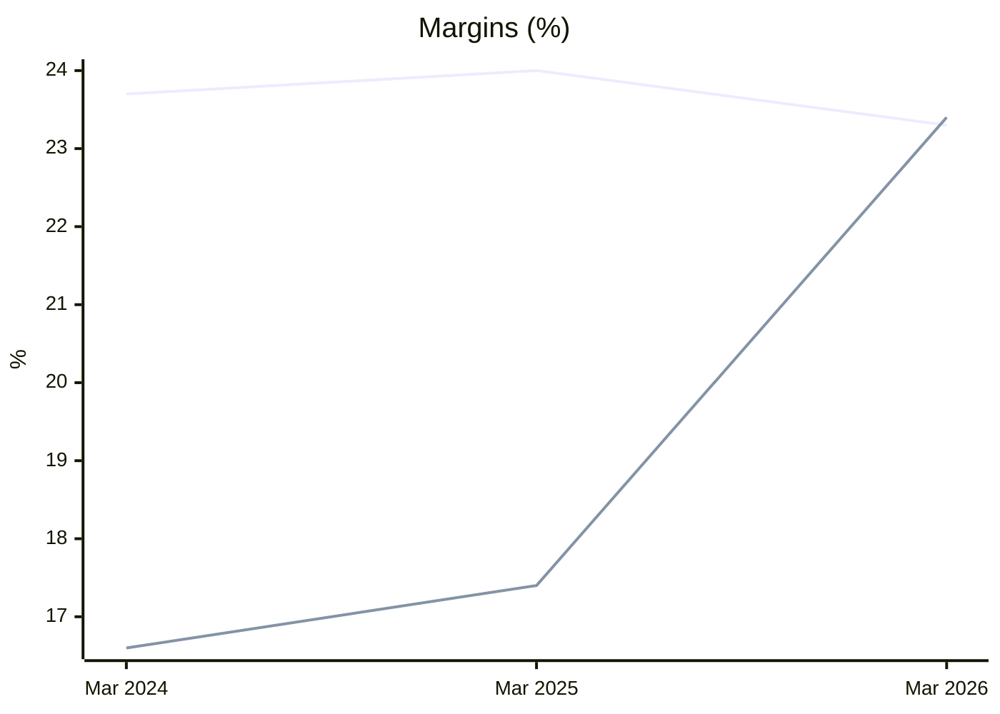

*Run 2026-11-24 · part of [SPINOFF_REPORT.md](../SPINOFF_REPORT.md) · the complete analysis of one company, with every management-call exchange in full.*

## HINDUNILVR — Hindustan Unilever Ltd.

### 1. Hindustan Unilever Ltd. — CONFIRMED DEMERGER

**CONFIRMED** (a demerger scheme is on the exchange record) · **LISTED <1Y — selling-pressure window; the bargain forms here** · score 5.7/10 · spin-off · 18 filing(s) from CALLS, NSE, NSE-register · first 2025-10-30, latest 2026-02-13

**The separated entities — every one the documents name:**

| Entity | Scheme | Business | Listing | Who runs it |
|---|---|---|---|---|
| **Kwality Wall's (India) Limited** | 2025 demerger of the Ice Cream Business Undertaking of HUL … | Ice Cream Business Undertaking of HUL on a going concern basis - ice creams, frozen desserts, frozen snacks; … | listed 2026-02-16 as KWIL (NSE) | Chitrank Goel, Additional Director designated as … |

**What is being separated, as the documents put it:** HUL's Ice Cream Business Undertaking, demerged on a going-concern basis into Kwality Wall's (India) Limited — class `value_unlocking`.

### 2. Stages and dates

> **Listing:** LISTED — Kwality Wall's (India) Limited (KWIL) since 2026-02-16 (NSE equity list); record date 2025-12-05

| Date | Event | Source |
|---|---|---|
| 2024-09 | Other — Hindustan Unilever Limited | as stated: Press Release annexed to Outcome of Board Meeting filing dated 25 Nov… |
| 2024-10-23 | Other — Hindustan Unilever Limited | as stated: Letter dated 23rd October 2024 intimating the Board's decision to sep… |
| 2024-11-25 | Other — Hindustan Unilever Limited | as stated: Outcome of Board Meeting filing dated 25 November 2024 (in-principle … |
| 2025-01-10 | Other — Kwality Wall's (India) Limited | as stated: General Updates filing dated 10 January 2025 (incorporation of wholly… |
| 2025-01-22 | Board approval — Hindustan Unilever Limited and Kwality Wall's (India) Limited | as stated: Scheme of Arrangement filing dated 22 January 2025; NCLT order dated … |
| 2025-03-12 | Filed with exchanges — Hindustan Unilever Limited | as stated: NSE Observation Letter Ref: NSE/LIST/46775 dated May 14, 2025 ("Based… |
| 2025-05-13 | SEBI observations — Hindustan Unilever Limited | as stated: BSE and NSE Observation Letters dated 14 May 2025 ("SEBI vide its Let… |
| 2025-05-14 | Exchange no-objection — Hindustan Unilever Limited | as stated: Demerger filing dated 14 May 2025 - Observation letters No. NSE/LIST/… |
| 2025-06-11 | NCLT order — Hindustan Unilever Limited and Kwality Wall's (India) Limited | as stated: General Updates filing dated 11 June 2025 - NCLT, Mumbai Bench order … |
| 2025-06-25 | Other — Unilever Group Shareholders / The Magnum Ice Cream Company HoldCo 1 Netherlands B.V. | as stated: Others filing dated 25 June 2025 - share purchase agreement dated Jun… |
| 2025-08-05 | Other — Hindustan Unilever Limited | as stated: Summary of Proceedings filing dated 12 August 2025 ("The number of sh… |
| 2025-08-12 | Stage reached: **meetings** | [Shareholders meeting](https://nsearchives.nseindia.in/corporate/HINDUNILVR_12082025191033_ProceedingsofCCMvfsigned.pdf) |
| 2025-08-12 | Shareholders / creditors meeting — Hindustan Unilever Limited | as stated: Shareholders meeting filing dated 12 August 2025 - NCLT-convened meet… |
| 2025-10-30 | Stage reached: **effective** | [Demerger](https://nsearchives.nseindia.in/corporate/HINDUNILVR_30102025210005_SEIntimationFinalOrdersigned.pdf) |
| 2025-10-30 | NCLT order — Hindustan Unilever Limited and Kwality Wall's (India) Limited | as stated: Demerger filing dated 30 October 2025 - NCLT, Mumbai Bench order sanc… |
| 2025-11-06 | NCLT order — Hindustan Unilever Limited and Kwality Wall's (India) Limited | as stated: General Updates filing dated 11 November 2025 - Rectification Order d… |
| 2025-11-11 | Stage reached: **nclt sanction** | [General Updates](https://nsearchives.nseindia.com/corporate/HINDUNILVR_11112025175242_Final_Order_SE_Intimation_signed.pdf) |
| 2025-11-18 | Other — Hindustan Unilever Limited | as stated: Record Date filing dated 18 November 2025 - receipt of certified copy… |
| 2025-11-23 | Stage reached: **exchange noc** | [General Updates](https://nsearchives.nseindia.com/corporate/HINDUNILVR_23112025211049_23112025SEIntimation_signed.pdf) |
| 2025-12-01 | Appointed date — Hindustan Unilever Limited and Kwality Wall's (India) Limited | as stated: Record Date filing dated 18 November 2025 ("in terms of Clause 1.1 of… |
| 2025-12-01 | Effective date — Hindustan Unilever Limited and Kwality Wall's (India) Limited | as stated: Record Date filing dated 18 November 2025 and FAQs filing dated 29 No… |
| 2025-12-05 | **Record date** | NSE corporate-actions register |
| 2025-12-05 | Stage reached: **record date** | Record Date (corporate-actions register) |
| 2025-12-05 | Record date — Hindustan Unilever Limited | as stated: Record Date filing dated 18 November 2025 ("the Board also fixed Frid… |
| 2025-12-13 | Allotment — Kwality Wall's (India) Limited | as stated: General Updates filing dated 13 December 2025 ("This is further to ou… |
| 2026-02-12 | Other — Kwality Wall's (India) Limited | as stated: General Updates filing dated 13 February 2026 - BSE letter DCS/AMAL/B… |
| 2026-02-13 | Stage reached: **listed** | [General Updates](https://nsearchives.nseindia.com/corporate/HINDUNILVR_13022026140635_SEIntimationKWIL13022026signed.pdf) |
| 2026-02-16 | **Kwality Wall's (India) Limited** listed (KWIL) | NSE equity list |
| 2026-02-16 | Listing and trading — Kwality Wall's (India) Limited | as stated: General Updates filing dated 13 February 2026 ("the date of commencem… |

**The stages, as filed:** meetings (2025-08-12) → effective (2025-10-30) → nclt sanction (2025-11-11) → exchange noc (2025-11-23) → record date (2025-12-05) → listed (2026-02-13)

**Stated in the filings:** entitlement **1 for every 1**; record date 2025-12-05; appointed date 2025-12-01.

**When it lists, in the documents' words:** FAQ dated 29 November 2025: "the statutory timeline for the listing and commencement of trading of shares of KWIL is within a period of 60 days from the receipt of the certified copy of the order of the NCLT sanctioning the Scheme (in or around Q4 of FY26)"; listing and trading approval received 12 February 2026, with "Date of Commencement of Trading: ... 16th February, 2026" for 2,34,95,91,262 shares of Re. 1 each.

### 3. Size of the separated business beside the parent — is institutional selling likely?

**Reading: VERY LIKELY — the piece is under a tenth of the whole; index funds and large holders who receive it without choosing it tend to sell.**

| Entity | Stated turnover | Stated share of the whole | Segment revenue share | Market cap (₹ cr) | Share of combined market cap | Index member |
|---|---|---:|---:|---:|---:|---|
| Kwality Wall's (India) Limited | INR 1,595 Crores for the year ended 31st March, 2024 (turno… | 2.7% | 1.9% (FY2026) | 9,871 | 2.1% | no |

*Stated figures are the documents' own (a turnover share, or the cost-of-acquisition split the company publishes for tax, which reflects relative value); the segment share is this business's revenue over the parent's sales, and the market-cap share is the entity's value over the entity plus the parent (parent ₹468,250 cr, NSE bhavcopy of 2026-11-13), both computed here.*

**In the documents' words:** “The turnover of the Ice Cream Business Undertaking for the year ended 31st March, 2024 was INR 1,595 Crores representing 2.7% of the total standalone turnover of the Company for the year ended 31st March, 2024”

**The judge's read of selling pressure:** likely — Tiny relative value (1.91% of cost basis), distributed 1:1 to every HUL holder; distinctive ice cream operating model, different from HUL's FMCG portfolio.

### 4. Insider ownership — share swap, promoters' holding, management incentives

**Share swap / entitlement, entity by entity:**

- **Kwality Wall's (India) Limited:** "for every 1 (one) equity share of face value of Re. 1/- fully paid up held in the Demerged Company, 1 (one) equity share(s) of face value of Re. 1/- credited as fully paid up in the Resulting Company", i.e. in the ratio of 1:1 ("Share Entitlement Ratio"); 2,34,95,91,262 Equity Shares of Re. 1/- each allotted

**Promoters' holding, from the shareholding pattern:**

| Company | Promoters | FIIs | DIIs | Public | Quarter |
|---|---:|---:|---:|---:|---|
| Hindustan Unilever Ltd. (HINDUNILVR) | 61.9% | 9.26% | 17.05% | 11.71% | Sep 2026 |
| Kwality Wall's (India) Limited (KWIL) | 61.91% | 2.89% | 9.98% | 25.21% | Sep 2026 |

*Source: screener.in shareholding pattern, stored under `ShareholdingPattern/NiftyTotalMarket/`. In a mirror demerger each shareholder holds the same proportion of the new company as of the parent on the record date.*

- **Promoters in the parent, per the documents:** "The Unilever Group holds 61.9% of the issued and paid-up share capital of HUL." (joint press release dated 25 June 2025). Seven promoter and promoter group shareholders attended the NCLT-convened shareholders' meeting of 12 August 2025.
- **What the promoters will hold in the separated entity:** 2025 ice cream demerger: "Following completion of the Demerger, Unilever PLC, Unilever Group Limited, Unilever Overseas Holdings AG, Unilever UK&CN Holdings Limited, Unilever South India Estates Limited, Unilever Assam Estates Limited, Unilever Overseas Holdings B.V. (together, the "Unilever Group Shareholders") will collectively hold 61.9% of the issued and paid-up share capital of KWIL." and "As a result, the Unilever Group is expected to hold 61.9% of the issued and paid-up share capital of KWIL following completion of the India Demerger." Thereafter: "Magnum HoldCo has agreed to acquire all of the KWIL shares to be issued to the Unilever Group as a result of the India Demerger (i.e., 61.9% of the issued and paid-up share capital of KWIL)", subject to "Magnum HoldCo making an open offer to the public shareholders of KWIL for additional shares of KWIL in accordance with the Securities and Exchange Board of India (Substantial Acquisition of Shares and Takeovers) Regulations, 2011." There will be no change in the shareholding pattern of HUL (the Demerged Company). For the 2026 Zywie, Nutritionalab and 2024 Pureit transactions: "The promoter/ promoter group/group companies have no interest in the Target and the Subsidiary."
- **What a public shareholder receives:** 2025 ice cream demerger: "the shareholders of HUL as on the Record Date, i.e. Friday, 5th December, 2025, will receive 1 equity share of KWIL for every 1 equity share held by them in HUL, upon effectiveness of the Scheme" - "for every 1 (one) equity share of face value of Re. 1/- fully paid up held in HUL, 1 (one) equity share of face value of Re. 1/- credited as fully paid up in KWIL"; all KWIL shares to be allotted in dematerialised form ONLY, and existing shares of KWIL held by HUL stand cancelled and reduced without any consideration. 2026 Zywie acquisition and Nutritionalab divestment and 2024 Pureit divestment: cash transactions with no issue of shares to HUL's shareholders; "There will be no change in the shareholding pattern of HUL pursuant to the proposed slump sale."
- **Management incentives:** not stated in the documents on file.
- **Insider actions around the separation:** Promoter sale around the separation: "the Unilever Group Shareholders, The Magnum Ice Cream Company HoldCo 1 Netherlands B.V. ("Magnum HoldCo") and The Magnum Ice Cream Company B.V. have today announced the execution of a share purchase agreement ("SPA") pursuant to which Magnum HoldCo has agreed to acquire all of the KWIL shares to be issued to the Unilever Group Shareholders pursuant to the Demerger, comprising 61.9% of the issued and paid-up share capital of KWIL." Closing remains subject to "fulfilment of certain conditions in the SPA (including the successful demerger of KWIL from HUL, and listing of KWIL shares) and receipt of requisite statutory and other approvals" and to "Magnum HoldCo making an open offer to the public shareholders of KWIL for additional shares of KWIL in accordance with the Securities and Exchange Board of India (Substantial Acquisition of Shares and Takeovers) Regulations, 2011." Neither HUL nor KWIL is a party to the SPA. The Scheme required that "There shall be no change in the shareholding pattern or control in Kwality Wall's (India) Limited between the record date and the listing which may affect the status of this approval." No promoter or management buying or pledging of HUL or KWIL shares is stated.
- **Insiders, per the checklist read:** Not stated. Entitlement is 1 KWIL share per HUL share, so holdings mirror HUL; KWIL has a dedicated management team (Chitrank Goel, Deputy MD; Prashant Premrajka, Executive Director & CFO). · *option pricing date:* not stated

### 5. Why the demerger — point by point

The business being separated is HUL's Ice Cream business — brands Kwality Wall's, Cornetto and Magnum — demerged into Kwality Wall's (India) Limited (KWIL) under a Sections 230-232 scheme sanctioned by NCLT Mumbai on 30th October 2025 (rectified 6th November 2025), effective (and appointed) 1st December 2025. The stated commercial logic in the scheme is creation of a leading listed Indian ice cream company with focused management having 'greater flexibility to deploy strategies suited to the Ice Cream businesses' distinctive operating model and market dynamics, to realise its full potential'; on the Feb 2026 call Priya Nair framed the same point as 'a dedicated management team and singular focus' letting KWIL capitalise on a growing India market. The financial problem it solves for HUL is dilution: management sized Ice Cream at 'roughly 3-odd percentage of our business' earning 'low single-digit margin' — below HUL average, and even below that in FY26 because of monsoon and investment impacts — so removing it adds 50-60 bps to reported EBITDA margin, which is exactly how the band moved from 22-23% to an implied 22.5-23.5% (confirmed by Niranjan Gupta as 'the implied number' and restated as the mid-term guide in May 2026). The business was also volatile and seasonal: September quarter 2025 Ice Cream 'declined year on year, impacted by extended monsoon in addition to GST transition', while March quarter 2025 had double-digit volume-led growth. Execution was a deliberate two-step: demerge and report Ice Cream as a discontinued business from the December 2025 quarter, then list — KWIL allotted 2,34,95,91,262 equity shares of Re. 1 on a 1:1 entitlement to HUL holders of record 5th December 2025, listing and trading from 16th February 2026, with cost of acquisition apportioned 98.09% HUL / 1.91% KWIL based on HUL net worth versus Ice Cream net assets at 30th November 2025. Accounting consequences disclosed were a one-time non-cash gain inside reported PAT of Rs 6,603 crores (+121% y-o-y) in the December 2025 quarter, and loss of PLI benefit accruals that had flowed through other operating income. Strategically it is presented as one leg of continuous portfolio rotation toward 'fewer, bigger bets' — alongside Pureit divestment (circa Rs 600 crores), Minimalist (90.5%), OZiva (remaining 49% for Rs 824 crores) and the Nutritionalab exit (Rs 307 crores) — with May 2026 citing the Ice Cream demerger as already 'enhancing the growth mix of the portfolio'.

**Point by point, with the source:**

1. The scheme's own stated benefit is a focused, separately listed Indian ice cream company whose management can run strategies fitted to ice cream's different operating model and market dynamics. “Creation of a leading listed ice cream company in India with focused management having greater flexibility to deploy strategies suited to the Ice Cream businesses’ distinctive operating model and market dynamics, to realise its full potential” — *Scheme*
2. First mention in the window is purely a status update on regulatory progress and completion timing, listed alongside Pureit divestment and the Minimalist/OZiva portfolio moves. “The demerger of Ice cream business is progressing on track with regulatory requirements, and we expect it to be completed by the end of financial year 2026.” — *[Apr 2025](https://www.bseindia.com/stockinfo/AnnPdfOpen.aspx?Pname=57aad284-8283-4c21-8035-99627387a92d.pdf)*
3. Ritesh Tiwari quantified the margin rationale: Ice Cream runs below HUL's average margin, so its exit lifts reported EBITDA margin by 50-60 bps over the 22-23% guided band. “Coming to EBITDA margin, Ice Cream demerger is expected to result in an improvement of 50-60 bps to the reported margin as Ice Cream business operates at a margin lower than HUL average.” — *[Oct 2025](https://www.bseindia.com/stockinfo/AnnPdfOpen.aspx?Pname=2eb875fe-ef79-4b40-88b8-228ccc8be17e.pdf)*
4. He sized the business being removed — about 3% of HUL turnover earning low single-digit margins, and even lower in FY26 because of monsoon and investment impacts. “Ice Cream, as we had called out even earlier, it's roughly 3-odd percentage of our business. and the business makes low single-digit margin.” — *[Oct 2025](https://www.bseindia.com/stockinfo/AnnPdfOpen.aspx?Pname=2eb875fe-ef79-4b40-88b8-228ccc8be17e.pdf)*
5. The plan was explicitly sequenced in two steps — demerge and report Ice Cream as a discontinued business from the December quarter, then list the entity in the March quarter. “So, this is two-step process, demerger, reporting discontinued business for December quarter and then listing the business in March quarter.” — *[Oct 2025](https://www.bseindia.com/stockinfo/AnnPdfOpen.aspx?Pname=2eb875fe-ef79-4b40-88b8-228ccc8be17e.pdf)*
6. The segment's in-quarter weakness underlined its seasonality and volatility: it declined year-on-year on extended monsoon plus GST transition, and its PLI benefit would stop flowing into HUL's P&L. “Ice Cream business declined year on year, impacted by extended monsoon in addition to GST transition.” — *[Oct 2025](https://www.bseindia.com/stockinfo/AnnPdfOpen.aspx?Pname=2eb875fe-ef79-4b40-88b8-228ccc8be17e.pdf)*
7. Priya Nair stated the completion and gave the focus argument for KWIL — a dedicated management team with singular focus to pursue India's growing ice cream opportunity; listing set for 16th February. “With a dedicated management team and singular focus, we are confident that KWIL is well positioned to capitalise on the growing market opportunity in India and deliver sustained performance.” — *[Feb 2026](https://www.bseindia.com/stockinfo/AnnPdfOpen.aspx?Pname=38a5c0b9-6eee-4de5-bdd8-98ac200204cc.pdf)*
8. The guidance band was formally rebased for the demerger — 22-23% plus roughly 50 bps, which Niranjan Gupta confirmed as an implied 22.5-23.5%; December quarter EBITDA margin of 23.3% was reported excluding Ice Cream. “We also outlined that the range, therefore, you will see a benefit of the ice cream demerger to the extent of 50 basis points.” — *[Feb 2026](https://www.bseindia.com/stockinfo/AnnPdfOpen.aspx?Pname=38a5c0b9-6eee-4de5-bdd8-98ac200204cc.pdf)*
9. Accounting effect disclosed: reported PAT of Rs 6,603 crores (+121% y-o-y) included a one-time non-cash gain from the Ice Cream demerger recognised per the approved scheme. “And the second item is one- time non -cash gain arising from I ce Cream demerger accounted for in accordance with the approved scheme of demerger and applicable accounting standards.” — *[Feb 2026](https://www.bseindia.com/stockinfo/AnnPdfOpen.aspx?Pname=38a5c0b9-6eee-4de5-bdd8-98ac200204cc.pdf)*
10. The demerger is retrospectively grouped with the OZiva and Minimalist investments as portfolio rotation that has already improved the quality and growth profile of what remains. “Strategic actions such as the demerger of Ice Cream, along with the investments at OZiva and Minimalist, are already enhancing the growth mix of the portfolio.” — *[May 2026](https://www.bseindia.com/stockinfo/AnnPdfOpen.aspx?Pname=55988411-440d-4801-8c08-90a5908c4a04.pdf)*
11. On perimeter: asked why HUL is doubling down on Foods while Unilever globally exits foods, Priya Nair said HUL's Foods (Tea, Coffee, Lifestyle Nutrition, Kissan) was deliberately left out of the Unilever transaction. “So therefore that, combined with the opportunities that exist in India in Foods, is the reason why Foods is outside the perimeter of the Unilever transaction that we have done, and Foods continues to be a very important area and focus of strategy for HUL.” — *[May 2026](https://www.bseindia.com/stockinfo/AnnPdfOpen.aspx?Pname=55988411-440d-4801-8c08-90a5908c4a04.pdf)*
12. Mechanics and shareholder economics: 1:1 entitlement, 2,34,95,91,262 KWIL shares of Re. 1 allotted to HUL holders of record 5th December 2025, trading from 16th February 2026, with cost of acquisition split 98.09% HUL / 1.91% KWIL based on net worth versus Ice Cream net assets at 30th November 2025. “In accordance with the provisions of the Scheme, KWIL has allotted 2,34,95,91,262 (Two Hundred Thirty -Four Crore Ninety -Five Lakh Ninety -One Thousand Two Hundred Sixty -Two Only) Equity Shares of  Re. 1 /- each to the shareholders of HUL” — *Scheme*

**How it evolved:** On the Apr 2025 call (24th April 2025, March quarter FY25) it was only a progress line — on track with regulatory requirements, completion expected by end of FY26 — bundled with Pureit, Minimalist and OZiva as portfolio rotation. By the Oct 2025 call (23rd October 2025) Ritesh Tiwari hardened both timing and economics: demerger in the December quarter with listing in Q4 FY26, a two-step 'demerger then listing' sequence, Ice Cream at ~3% of business on low single-digit margin, and a quantified 50-60 bps uplift to reported EBITDA margin on top of the 22-23% guidance. Filings then closed the mechanics: NCLT sanction 30th October 2025, effective 1st December 2025, record date 5th December 2025, 1:1 allotment of 2,34,95,91,262 shares, 98.09%/1.91% cost apportionment, listing from 16th February 2026 — and on the Feb 2026 call (12th February 2026) Priya Nair declared the demerger complete, reported the continuing business ex-Ice Cream, attributed part of the Rs 6,603 crores reported PAT to a one-time non-cash demerger gain, and reset margin guidance to an implied 22.5-23.5%. By the May 2026 call (30th April 2026) it was retrospective justification — a completed action improving portfolio growth mix, with Foods explicitly kept 'outside the perimeter of the Unilever transaction'.

**What management expects from it:** HUL: reported EBITDA margin up ~50-60 bps (guidance rebased 22-23% to an implied 22.5-23.5%), a better growth mix, and capital redeployed into bigger bets (Rs 3,500 crores acquisitions, Rs 2,000 crores premium-format capex). KWIL: dedicated management, singular focus and flexibility for ice cream's distinct operating model to capture a growing India market. Shareholders: direct 1:1 listed exposure.

*Not explained on the calls:* No KWIL standalone financials, cold-chain capex or stranded costs; no Unilever brand-licensing/royalty terms; no named investor, lender or partner demand; no demerger-versus-sale comparison or valuation target.

- *Stated reason, in one line:* "Creation of a leading listed ice cream company in India with focused management having greater flexibility to deploy strategies suited to the Ice Cream businesses' distinctive operating model and market dynamics, to realise its full potential"
- *What it reveals:* Cost-of-acquisition split allots only 1.91% to KWIL vs 98.09% to HUL (based on HUL net worth and Ice Cream net assets at 30 Nov 2025), so a very small, cold-chain business carrying Kwality Wall's, Cornetto and Magnum is separated from a 23.6% EBITDA-margin FMCG parent.
- *Parent or spin:* spin · *Read next:* KWIL's first standalone results, and the net assets of the Ice Cream Business Undertaking at 30 November 2025 underlying the 1.91% allocation.
- *In their words:* “The aforesaid ratio has been determined based on the net worth of HUL and the net assets of the Ice Cream Business Undertaking, as at 30 November 2025, in accordance with Sections 49(2C) and 49(2D) of the Act.”

### 6. On the calls, verbatim

7 call(s), oldest first: **4 question-and-answer exchange(s)** given in full — the question and every answer to it, nothing trimmed — and 7 passage(s) from management's prepared remarks (the complete sentences about it; the whole remarks are in the linked transcript). Text is as the transcript prints it.

#### Jan 2024 — [transcript](https://www.bseindia.com/stockinfo/AnnPdfOpen.aspx?Pname=2aa60d9d-1ea9-4e6d-9d91-0707e0071ace.pdf)

**From the prepared remarks** *(the passage about it; the whole turn runs to 2,491 characters in the transcript)*

> **Sensitivity:** Bru Gold expand ed its product portfolio with a new range of flavored coffee. Available in 3 flavors, vanilla, caramel and hazelnut, this freeze -dried coffee is sure to transform your usual cup of coffee into a luxur ious treat . Following the launch of Korean Meal Pot, Knorr launched Korean noodles in popular flavors Kimchi and Jjajangmyeon. Continuing with its endeavour to de-seasonalise ice cream consumption Kwality Walls had activations around Diwali and Puja festivals. Talking about F&R performance in the quarter. We continue d to see the impact of judicious price increases taken during the year to offset the impact of inflation. Consequently, volumes have declined year -on-year in low single digits.

#### Oct 2024 — [transcript](https://www.bseindia.com/stockinfo/AnnPdfOpen.aspx?Pname=a208b4bc-a7a8-4ffc-b0f0-00f1f72b4129.pdf)

**Question and answer**

> **Abneesh Roy:** So, wanted to follow up in the outlets where the ice cream adds synergy to distribution once ice cream goes away. Then what happens to those existing portfolio? And second, does separation means that eventually HUL will have zero stake in the ice cream? Is that a right understanding?
>
> **Ritesh Tiwari:** Yes. So for a typical kirana store and the scale of HUL will not get impacted just because 3 percentage of the business will get separated. And seeing the kind of growth that we have, that's the amount of accretion much more than that, we end up -- typically end up adding to overall scale up Hindustan Unilever. So, for typical kirana store, it does not change anywhere materially - the scale at which we operate in the kirana store, it does not impact to start with. So that's where it is . And in terms of the mode of separation -- to your question. There are typical 2 standard ways of separating the business. Either we could sell the business, or we could demerge and list the business. And of course, the key objective that the independent committee and hence, Board going forward, will end up making a decision on is -what's the best route in which we can maximize shareholder value and minimize business disruption. That's the mode of separation we end up doing. Our idea is, by end of the year, we will come to a conclusion what route we want to take. And the way we have done -- last quarter we communicated where we were in the process after Unilever globally announced its decision to separate. And this quarter, we further gave an update, and we will keep doing that. As and when we end up making progress by independent September Quarter 2024 Earnings call of Hindustan Unilever Limited committee, which will then inform the Board and then we end up sharing with all of you as to where our mind is at this point in time and way forward.

#### Jan 2025 — [transcript](https://www.bseindia.com/stockinfo/AnnPdfOpen.aspx?Pname=f5b86e3e-937f-42e9-940b-ce01bf35a1bc.pdf)

**From the prepared remarks** *(the passage about it; the whole turn runs to 16,655 characters in the transcript)*

> **Ritesh Tiwari:** Ketchup, mayonnaise, international sauces and cuisines continues to see strong consumer traction, while Food Solutions maintained its double -digit growth momentum. Ice Cream revenue remained flat year -on-year. On an ongoing basis, we evaluate various strategic opportunities for organic as well as inorganic growth, strategic partnerships and investments, divestments, disposals, etcetera, for furtherance of our business and to maximize shareholder value. After the divestment of our atta and salt business, we have continued to drive sharper focus in the business this year by making strategic portfolio choices, including divestment of water busine ss and decision to demerge Ice Cream business. We have previously expressed our interest in strategic bolt -on acquisitions, particularly within the Beauty and Food s segment. In alignment with our intent of doubling down on our Beauty & Wellbeing portfolio, we have entered into a definitive agreement to acquire a stake in premium beauty brand, Minimalist. This marks another step in the transformation journey of our portfolio towards higher growth demand spaces. […] Coming to Ice Cream separation. I spoke to you in detail explaining the business rationale for separation in our Capital Markets Day. Let me give you a quick update of our progress on this action. Our Board of Directors has approved the scheme of arrangeme nt to demerge HUL's Ice Cream business into Kwality Walls ’s (India) Limited. Pursuant to the scheme, 1 equity share of the new entity will be allotted for every 1 equity share held in HUL. Upon demerger and listing of the entity, the entire shareholding will be held directly by shareholders of HUL. This will 12/40 December Quarter 2024 Earnings call of Hindustan Unilever Limited give an opportunity for all shareholders to participate in future value creation of the company. Our Ice Cream category is a high -growth business with several iconic brands. The demerger will equip an experienced management with greater focus and flexibility to deploy strategies suited to its distinctive business model and market dynamics, thus realiz ing its full potential. Moving on to our announcement of agreement to acquire majority stake in Uprising Science Private Limited, which owns the brand Minimalist. Before I get into details of the transaction, let me share some information on the brand. Founded in 2020 by Mohit Ya dav and Rahul Yadav, Minimalist is an evidence - based consumer -focused skin and hair care brand that provides high -quality science backed solutions. […] We remain watchful of various macroeconomic indicators that could impact the pace of recovery, such as real wage growth, food inflation and employment levels. In this context, our focus remains on driving competitive volume -led growth across our business as we continue to transform our portfolio to high -growth spaces. We will step up investments and prioritize them across our core, future core and market makers portfolio to maximize growth. Activities on Ice Cream demerger and the announced acquisition will be executed with agility to bring them to a closure as per timelines . If commodity prices remain where they are, we expect a low single -digit price growth in the near term. Amidst inflationary material prices, we expect to maintain EBITDA at the lower end of 23 -24% range. We will continue to manage our business dynamically to drive savings through our net productivity program and provide the right price value equation to our consumers.

#### Apr 2025 — [transcript](https://www.bseindia.com/stockinfo/AnnPdfOpen.aspx?Pname=57aad284-8283-4c21-8035-99627387a92d.pdf)

**From the prepared remarks** *(the passage about it; the whole turn runs to 78,034 characters in the transcript)*

> **Membership No:** Last quarter, we announced the acquisition of 9059', stake in MinimaUsl As of 21st April, the closing formalities have been completed. The business delivered a turnover exceeding Rs. soo crores In full year 24 -25, and we are Looking forward to unlocking the next phase of growth with Minimalist now becoming a part of the larger HUL family. Divestment of Purelt was completed this year, unlocking wlue of circa Rs. 600 crores. The demerger of Ice cream business Is progressing on track with regulatory requirements, and we expect It to be completed by the end of financial year 2026. In line with our stn::ltegy to strengthen business reslUence, we announced the acquisition of a palm undertaking from VlshwateJ OIL Industries Private Limited and announced our Investment In Lucro Plastecycle Private Limited. The former wlU aid our palm locaUzatlon strategy, while the latter Is a step forward towards developing flexible plastic clrculmtty. These wlue chain Integrations are long-term strategic decisions, designed to strengthen our Pagelof4D March Quarterand Financial Year 2025 Earnings call of Hindustan Unilever Limited RlluhTlwart: business and partake In our firm beUef of'What Is good for lndla Is good for HUL'. […] The next sUde wtU cover the performance of Nutrition Drinks In more detail Packaged Foods delivered mid-single-digit volume-led growth. Driven by market development actMtfes, our Market Makers portfolio continued to deliver strong double-digit volume growth. Page11 of40 March Quarterand Financial Year 2025 Earnings call of Hindustan Unilever Limited Ice cream had a quarter of double-digit volume-led growth. We had exciting launches In Ice cream this quarter to leverage the upcoming season, including Magnum Mini, Magnum Pistachio and Kwality Wall's Twister. We've also revamped our in-home business with a tiered portfolio structure, each with CL different role to play. Let me cover Nutrition Drinks performance in a bit more detail Over the last few years, we have been able to increase penetration by unlocking access while also strengthening market leadership. However, we have been unable to drfve consumption as overall cCLtegory witnessed a drop In average household consumption.

#### Oct 2025 — [transcript](https://www.bseindia.com/stockinfo/AnnPdfOpen.aspx?Pname=2eb875fe-ef79-4b40-88b8-228ccc8be17e.pdf)

**From the prepared remarks** *(the passage about it; the whole turn runs to 10,637 characters in the transcript)*

> **Ritesh Tiwari:** Mayonnaise and International sauces range continued to deliver double-digit growth. This business was also impacted, as I call ed out earlier, by GST transition. Ice Cream business declined year on year, impacted by extended monsoon in addition to GST transition. As you are aware, the Ice Cream demerger process is currently underway. We expect to complete the demerger by December, with the listing anticipated in Quarter 4 of Financial Year 2026, subject to necessary regulatory approvals Moving on to the summary of our performance for SQ’25. I have taken you through topline growth and margins. The year-on-year moderation in other income primarily reflects reduced cash reserves post special dividend payout and Minimalist acquisition, alongside softer interest rate trends. Exceptional items are higher year-on-year on account of one-off impact from resolution of certain tax matters between UK and Indian tax author ities, for previous years. […] Overall, we expect growth of second half of this financial year to be better than the first half. We remain vigilant about the evolving impact of weather patterns— particularly as the winter season approaches and the effects of a prolonged monsoon begin to play out. We remain firmly committed to investing be hind our business, confident that this continued focus will unlock sustained growth. Coming to EBITDA margin, Ice Cream demerger is expected to result in an improvement of 50-60 bps to the reported margin as Ice Cream business operates at a margin lower than HUL av erage. Our current near to mid-term guidance is 22-23%, hence everything else being equal, Ice Cream demerger adds 50-60 bps to this guidance. September Quarter 2025 Earnings call of Hindustan Unilever Limited We remain committed to executing our strategy with sharp focus and agility, prioritising competitive, volume-led growth across our portfolio. With this, we conclude our prepared remarks. This is my last earnings call in my curr ent role as the CFO of HUL before I hand over the baton to Niranjan and embark on my next chapter at Unilever as the Global Head of M&A, Treasury, and Ventures.

**Question and answer**

> **Abneesh Roy:** Sure. My second question is on the margins. So, one is you had given the guidance of 22% to 23%. In the first half, you have met the higher end of that guidance. So, is there an upside risk in H2, given th e cost has corrected? And PFAD also, there September Quarter 2025 Earnings call of Hindustan Unilever Limited could be some lag benefit. It is quite volatile. I understand that. But is there an upside risk? Second, media channels were carrying that the margin guidance for HUL has been upgraded. You clarified on that bit that there was an Ice Cream impact of 50, 60 bps. But if you could clarify becau se –Ice Cream demerger is going to be at the year end. So, when does that benefit happen? That happens in FY'27 essentially, 50-60 bps?
>
> **Ritesh Tiwari:** So yes, currently, where we are with the Ice Cream plans, Abneesh, we expect the demerger to happen in December quarter. And when I say demerger, which means if everything goes as per plan an d with all regulatory approvals, when we declare our results for December quarter, it will be excluding Ice Cream and Ice Cream business will be shown as a discontinued business. And hence, margins excluding Ice Cream will start getting reflected in our December quarter results. Now this is wh ere we are with our timelines assuming nothing changes with all the approvals in place. We expect this to be the course of the day. Second, in March quarter at the end of the financial year, we'll end up listing the company. So, this is two-step process, demerger, reporting discontinued business for December quarter and then listing the business in March quarter. Again, as I mentioned, subject to all necessary regulatory approvals. And as we speak, we are on track on this timeline. Now once this happens, when we report ou r results for December quarter, it will be excluding Ice Cream business. Ice Cream, as we had called out even earlier, it's roughly 3-odd percentage of our business. and the business makes low single-digit margin. And I had called out even earl ier that this year, given the impact of monsoons, given the impact of investment s, in fact, we have a little lower compared to that margins. And hence, we expect once we have re sults declared and reported excluding Ice Cream, on an average annually, we should see 50 to 60 bps improvement in September Quarter 2025 Earnings call of Hindustan Unilever Limited our reported EBITDA margin, which is why we clarified that we are not changing our margin guidance. It remains 22 to 23% . And you're right, within that margin guidance this quarter we operated at higher end. Some other quarter, it could be a diffe rent part of the range we'll end up operating. But the point is on top of this ra nge of 22 to 23%, we will see a 50 to 60 bps increase in our reported margin once Ice Cream demerger happens from December quarter onwards.

**Question and answer**

> **Arnab Mitra:** Yeah , Understood. Just a follow-up on that. I mean, what I meant was that ultimately, operating leverage does translate into margins also but in the past, HUL has had this range of margins, which they have -- the company held at 22% to 23%. Do you feel that is a defendabl e range or that depends on the growth environment and therefore, as you focus only on growth, there could be a situation where margins could be lower or below that range?
>
> **Ritesh Tiwari:** So let me come in Arnab, about here. So , as we mentioned that our outlook for margin and guidance is a range of 22 to 23. As we do the demerger of Ice Cream, everything else equal, 50 to 60 bps ge ts added to this number once we start reporting ex Ice Cream results. And we're very clear that as Priya mentioned that, when a choice comes between top line an d bottom line, it's always competitive volume growth. That's always the first protocol. And if at all we have to invest more in the business like we have done. You know, today, we operate at almost 200 bps lower than our peak margin. And that is a conscious call that we took because we knew that, to drive growth, especially in the tepid consumption atmosphere that we have been the last couple of years, we have to invest on portfolio on capabi lities and hence, across different lines of the P&L to ensure that we are able to drive competitive volume growth. So, this is exactly what we will do going forward as well. Currently, where commodities are, where our investment plans are, where our innovations and portfolio is placed, we do believe that at a range of 22% to 23%, excluding the Ice Cream impact and on top of that, as I ment ioned, 50, 60 bps of ice cream, at this level, we'll be able to support th e investments which is required. But we are very clear that if at all a time comes, we ever have to come back with a revised change in our outlook, because commodities change, because operating environment change, we'll always come back and share. The guidance that we have given today and, in the past, as well as for next couple of quarters, read that as 2 to 3 quarters. And if so mething changes, we'll always come back on top of that. September Quarter 2025 Earnings call of Hindustan Unilever Limited

#### Feb 2026 — [transcript](https://www.bseindia.com/stockinfo/AnnPdfOpen.aspx?Pname=38a5c0b9-6eee-4de5-bdd8-98ac200204cc.pdf)

**From the prepared remarks** *(the passage about it; the whole turn runs to 10,586 characters in the transcript)*

> **Priya Nair:** Given the evolving geopolitical dynamics, we will continue to closely monitor currency and commodity movements and take calibrated price increases wherever necessary, while continuing to drive strong savings delivery to minimis e impact to consumers. In this backdrop, we delivered an Underlying Sales Growth of 5% driven by an Underlying Volume Growth of 4%. This growth was broad -based with all categories contributing and it was competitive as we continued to gain turnover weighted market share. As you are aware, we have completed the demerger of the I ce Cream business this quarter. The numbers on this slide reflect performance of the continuing business, excluding I ce Cream. EBITDA at Rs. 3,788 crores was up 3% year -on- year, while EBITDA margin at 23.3% was within the range that we have previously guided to. Profit A fter Tax before exceptional items at Rs. 2,562 crores grew by 1% year -on-year. Reported Profit After Tax for the period at Rs. 6,603 crores grew 121% year -on- year. This includes several one- off impacts arising from the I ce Cream demerger and O Ziva fair valuation in the quarter. It also includes the base effect of the December Quarter 2025 Earnings call of Hindustan Unilever Limited income from the sale of the water business in December 2024. Niranjan will double- click on the financials later in the presentation . In our last earnings call, I had outlined the key strategic priorities that will shape the organi sation's agenda moving forward.

**From the prepared remarks** *(the passage about it; the whole turn runs to 10,451 characters in the transcript)*

> **Niranjan Gupta:** As I mentioned, PAT bei at Rs. 2,562 crores grew 1% year -on-year after factoring the gratuity impact. The reported PAT includes the following items: Number one is the impact of increase in fair valuation of OZiva and Minimalist versus exceptional income from sale of Pureit business in the base . The higher fair valuation is a reflection of O Ziva and Minimalist ’s continued strong performance over the last year. December Quarter 2025 Earnings call of Hindustan Unilever Limited And the second item is one- time non -cash gain arising from I ce Cream demerger accounted for in accordance with the approved scheme of demerger and applicable accounting standards. The detailed amounts on each of these is there in the notes to accounts. Consequently, the reported profit after tax for the period stood at Rs. 6 ,603 crores, up 121% year -on-year. Moving on to our segment -wise performance for the quarter. […] The brand has scaled up significantly in the last 3 years, driven by a steady flywheel of innovation and effective digital first demand generation. The Health & Wellbeing segment presents significant headroom for growth, and we will strengthen our participation here through OZiva. Continuing with our intent of sharpening portfolio, we have decided to divest our minority stake in Nutritiona lab Private Limited, we are selling the stake to USV Private Limited for a consideration of Rs. 307 crores. We also recently concluded the I ce Cream demerger process in December. With a dedicated management team and singular focus, we are confident that KWIL is well positioned to capitali se on the growing market opportunity in India and deliver sustained performance. The KWIL listing, as you would have seen from the BSE notice will be listed on 16th of February. We will continue to evaluate and transform our portfolio on an ongoing basis to ensure we are focusing and investing disproportionately in high -growth demand spaces.

**Question and answer**

> **Mihir P Shah:** Just a few clarifications. First, post the divestment of the ice cream business, what can be considered as the margin guidance range? It used to be 22% to 23%. So , should one expect it to inch up further or are you holding on to that range still?
>
> **Niranjan Gupta:** So, our guided range has been that 22% to 23%. We also outlined that the range, therefore, you will see a benefit of the ice cream demerger to the extent of 50 basis points. So basically, we remain with this guidance that we have provided.

#### May 2026 — [transcript](https://www.bseindia.com/stockinfo/AnnPdfOpen.aspx?Pname=55988411-440d-4801-8c08-90a5908c4a04.pdf)

**From the prepared remarks** *(the passage about it; the whole turn runs to 12,436 characters in the transcript)*

> **Priya Nair:** Resource allocation has become March Quarter & Financial Year 2026 Earnings call of Hindustan Unilever Limited more deliberate with a focus on making fewer, bigger bets in areas with the highest growth potential. For instance, we have recently committed Rs. 2,000 crores of capex investments in premium formats of Beauty and Home Care. We have actively rotated our portfolio to sharpen the quality and growth profile of the business. Strategic actions such as the demerger of I ce Cream, along with the investments at O Ziva and Minimalist, are already enhancing the growth mix of the portfolio. The company has also been reorganized to drive speed and sharper execution. The move to a U nified India organization, including the introduction of a Chief Marketing Officer role and the creation of a dedicated India R&D structure, has simplified decision -making and enabled faster response to market and channel dynamics. Taken together, these actions have further strengthened the fundamentals of the business and are translating into a consistent step -up in the growth momentum that you see today.

### 7. The parent's financial statements

**The parent, last three fiscal years (consolidated)**

| | Mar 2024 | Mar 2025 | Mar 2026 |
|---|---:|---:|---:|
| Sales (₹ cr) | 61,896 | 61,328 | 64,468 |
| Sales growth (%) | +2.2% | -0.9% | +5.1% |
| Operating profit (₹ cr) | 14,659 | 14,698 | 15,039 |
| Operating profit growth (%) | +3.6% | +0.3% | +2.3% |
| Operating margin (%) | 23.7 | 24.0 | 23.3 |
| PAT (₹ cr) | 10,282 | 10,671 | 15,059 |
| PAT growth (%) | +1.4% | +3.8% | +41.1% |
| PAT margin (%) | 16.6 | 17.4 | 23.4 |
| EPS (₹) | 43.7 | 45.3 | 64.0 |

*Source: ProfitStatement/NiftyTotalMarket/HINDUNILVR.csv (consolidated, screener.in); growth and margins computed here.*

```mermaid
xychart-beta
    title "Sales, operating profit and PAT (₹ cr)"
    x-axis ["Mar 2024", "Mar 2025", "Mar 2026"]
    y-axis "₹ crore"
    bar [61896, 61328, 64468]
    bar [14659, 14698, 15039]
    bar [10282, 10671, 15059]
```

*Series in order: Sales, Operating profit, PAT.*

*Series in order: Operating margin, PAT margin.*

**P/E:** 44.8 — live market file (screener.in), trailing (price ₹2,101.00 as of 2026-08-02).

**Cash flows (₹ cr):**

| | Mar 2024 | Mar 2025 | Mar 2026 |
|---|---:|---:|---:|
| Cash from operations (₹ cr) | 15,469 | 11,886 | 10,999 |
| Cash from investing (₹ cr) | -5,324 | 6,473 | -3,676 |
| Cash from financing (₹ cr) | -10,034 | -13,101 | -10,810 |
| Net cash flow (₹ cr) | 111 | 5,258 | -3,487 |
| Free cash flow (₹ cr) | 14,012 | 10,624 | 9,667 |

*Source: CashFlow/NiftyTotalMarket/HINDUNILVR.csv (consolidated, screener.in).*

### 8. The separated business's financial statements

**The business being separated — its own numbers**, entity by entity: its reported statements once it is listed and on file, and the segment numbers the annual reports and presentations carry for it before that.

**Ice Cream Business / Demerged Undertaking — reported as "Segment Revenue / Segment Results from Discontinued Operations" → Kwality Wall's (India) Limited** · unit ₹ crore · Operating profit = Segment Results (profit before other income, finance costs, exceptional items and tax) for Discontinued Operations; revenue is segment revenue with no intersegment transactions. PAT = 'Profit/(Loss) for the year from Discontinued Operations'. FY2026 PAT of 4,407 is dominated by the one-off gain recognised on the Ice Cream demerger (demerger completed; KWIL ceased to be a subsidiary on 30th November, 2025), so FY2026 figures cover only the pre-demerger part of the year. FY2026 PBT from Discontinued Operations 4,336 and loss before exceptional items and tax (135); FY2025 PBT (13) and profit before exceptional items and tax 29.

| | FY2024 | FY2025 | FY2026 |
|---|---:|---:|---:|
| Revenue (₹ crore) | — | 1,793 | 1,257 |
| Revenue growth (%) | — | — | -29.9% |
| Operating profit (₹ crore) | — | 43.0 | -122 |
| Operating profit growth (%) | — | — | -383.7% |
| Operating margin (%) | — | 2.4 | -9.7 |
| PAT (₹ crore) | — | -9.0 | 4,407 |
| PAT growth (%) | — | — | +49066.7% |

*Sources:* Annual Report 2024 — page 213 (ice-cream and frozen desserts reported inside 'Foods & Refreshment'; no separate Ice Cream numbers); Annual Report 2026 — page 229

*Not in the pages read:* No segment assets, liabilities, capex or depreciation for the Ice Cream business; no quarterly revenue/profit; FY2024 not separately disclosed (sat within Foods & Refreshment).

*Businesses with no numbers in the pages read (3 annual report(s) and 12 presentation(s) on file):* No standalone financials for Kwality Wall's (India) Limited / KWIL as an entity, and no separate numbers for brands Cornetto or Magnum; the pages carry Ice Cream only as 'Discontinued Operations' segment lines.

*Documents on file:* [Annual Report 2026](https://www.bseindia.com/xml-data/corpfiling/AttachHis/881493e4-75af-4a7f-8c64-9d0886e63f1d.pdf); [Annual Report 2025](https://www.bseindia.com/xml-data/corpfiling/AttachHis/770bf03e-526d-45d8-8364-13f7fc523289.pdf); [Annual Report 2024](https://www.bseindia.com/xml-data/corpfiling/AttachHis/02d8d87d-90ce-4191-8b3f-4167267aee8a.pdf); [Presentation Nov 2026](https://www.bseindia.com/stockinfo/AnnPdfOpen.aspx?Pname=c54cbd79-ba64-4bcc-b114-b5ad02c75ade.pdf); [Presentation Oct 2026](https://www.bseindia.com/stockinfo/AnnPdfOpen.aspx?Pname=aecfd799-4d6c-49d4-9d7b-221d87d1352d.pdf); [Presentation Sep 2026](https://www.bseindia.com/stockinfo/AnnPdfOpen.aspx?Pname=d9d8d7e9-c5ef-40ef-bbd6-bc832320c0d5.pdf); [Presentation Aug 2026](https://www.bseindia.com/stockinfo/AnnPdfOpen.aspx?Pname=163e0f27-042e-41a9-9db7-14f5d0172218.pdf); [Presentation Feb 2026](https://www.bseindia.com/stockinfo/AnnPdfOpen.aspx?Pname=6e6dea43-db7a-4075-82c6-71024ed4436a.pdf); [Presentation Oct 2025](https://www.bseindia.com/stockinfo/AnnPdfOpen.aspx?Pname=b38b0312-d563-42a1-96e7-d61213c82925.pdf)

### 9. Other financial differences — working capital, margins, returns, debt

| Metric (latest year) | Parent (HINDUNILVR) | Kwality Wall's (India) Limited |
|---|---:|---:|
| *Basis* | *reported, consolidated* | *segment numbers (Ice Cream Business / Demerge…* |
| Sales (₹ cr) | 64,468 (Mar 2026) | — |
| Sales growth (%) | 5.1 (Mar 2026) | -29.9 (FY2026) |
| Operating margin (%) | 23.3 (Mar 2026) | -9.7 (FY2026) |
| Operating profit growth (%) | 2.3 (Mar 2026) | -383.7 (FY2026) |
| PAT margin (%) | 23.4 (Mar 2026) | — |
| ROCE % | 28 (Mar 2026) | — |
| Debtor Days | 19 (Mar 2026) | — |
| Inventory Days | 61 (Mar 2026) | — |
| Days Payable | 169 (Mar 2026) | — |
| Cash Conversion Cycle | -89 (Mar 2026) | — |
| Working Capital Days | -23 (Mar 2026) | — |
| Debt / equity (x) | 0 (Mar 2026) | — |
| Borrowings (₹ cr) | 1,478 (Mar 2026) | — |
| Sales (₹ crore) | — | 1,257 (FY2026) |

*Each figure is the latest on file, with its year. Working-capital days and ROCE come from the stored working-capital file; segment figures from the pages cited in part 8. A dash means the documents do not carry it.*

**What stays with the parent — its segments, from the same pages:**

| Remaining segment | Revenue | Operating margin | ROCE | Segment assets / revenue | Unit | Year |
|---|---:|---:|---:|---:|---|---|
| Home Care | 23,672 | 19.1% | 7064.1% | 0.27x | ₹ crore | FY2026 |
| Beauty & Wellbeing | 14,990 | 27.8% | 111.0% | 0.56x | ₹ crore | FY2026 |
| Personal Care | 9,564 | 18.9% | 200.8% | 0.39x | ₹ crore | FY2026 |
| Foods | 14,061 | 20.1% | 6.1% | 3.57x | ₹ crore | FY2026 |
| Others (includes Exports, Consignment, etc.) | 2,181 | 18.8% | 73.9% | 0.51x | ₹ crore | FY2026 |

**What the documents themselves say about the differences:**

- **growth** — parent / remaining: HUL delivered 5% Underlying Sales Growth driven by 4% Underlying Volume Growth for FY'26 on turnover of Rs. 63,763 crores, exiting with 7% USG in the March quarter 2026; management guides FY'27 to be better than FY'26.; separated business: The Ice Cream business delivered Underlying Sales Growth of 12.6% CAGR over FY19-20 to FY24-25 but only 4.5% in H1 FY25-26, with Volume Led Growth of 8.5% CAGR falling to 6.5%; KWIL aims to grow ahead of market and the India Ice Cream market is "US$ 2.6 bn market, forecasted to grow at 11% and projected to become US$ 4.4 bn by 2030". “Strong Historical performance; Recent performance impacted”
- **operating margin** — parent / remaining: HUL EBITDA margin was 23.6% for FY'26 and 23.7% in the March quarter 2026, at the higher end of guidance, with mid-term margin guidance "around our current guided range of 22.5% to 23.5%"; the demerger of Ice Cream contributes "a benefit of the ice cream demerger to the extent of 50 basis points".; separated business: Ice Cream EBITDA Margins were 7.1% in FY 24-25 and 0.0% in H1 FY 25-26, with factors impacting H1'25-26 EBITDA being "Cocoa inflation and Strategic Pricing", "Supply chain Investments", "GST transition & Production Linked incentives" and "Standalone entity cost"; in November 2024 the business was described as having "mid to high single digit profitability"; KWIL has a "robust margin improvement roadmap". “Ice Cream is a high -growth business with iconic brands such as "Kwality Wall's", "Cornetto" and "Magnum" , operating in an attractive category, and has mid to high single digit profitability .”
- **capex and capital intensity** — parent / remaining: HUL has "signed off a Rs. 2,000 crores planned capex investment to expand capacity in the premium formats" of Beauty and Home Care, and deployed Rs. 3,500 crores into bolt-on acquisitions during FY'26.; separated business: KWIL plans "Rapid Cabinet Expansion" and to "Increase and Regionalize Capacity" with "More Cabinets", "More factories" and "Regionalize mfg. Lines" from 2024-25 through 2030-31; it had "200,000+ Kwality wall's Cabinets & Trikes across India" as at 31 Dec 2024. “Prioritizing Capital allocation for growth and productivity”
- **return on capital** — parent / remaining: "Both our ROCE and ROE have improved on year-on-year basis. Together, these metrics reinforce the robustness of our financial growth model."; separated business: KWIL targets "Continuous improvement in ROCE", with ROCE defined as "Profit ( bei) + Interest + Tax / Capital employed". “ROCE Continuous improvement in ROCE4”
- **cash** — parent / remaining: "Our cash flow from operations stood close to Rs. 10,500 crores, underpinned by strong execution across the business, robust cash conversion, and focus on working capital discipline." Total reserves close to Rs. 49,000 crores at end FY'26; final dividend of Rs. 22 per share taking total dividend for the year to Rs. 41 per share.; separated business: KWIL's value creation framework targets "Cash conversion Improving Free Cash flow", with Free Cashflow defined as "Cashflow from operating activities - net Capital Investments - net interest payment"; "Improving cashflow from operations" is part of its clear path to value. “Our cash flow from operations stood close to Rs. 10,500 crores, underpinned by strong execution across the business, robust cash conversion, and focus on working capital discipline.”
- **working capital** — parent / remaining: HUL cites "focus on working capital discipline" underpinning cash flow from operations close to Rs. 10,500 crores for FY'26.; separated business: not stated “Our cash flow from operations stood close to Rs. 10,500 crores, underpinned by strong execution across the business, robust cash conversion, and focus on working capital discipline.”
- **debt and leverage** — parent / remaining: "That there are no secured creditors of the Demerged Company as well as in the Resulting, the same is verified the chartered account in its report." HUL had 2,973 unsecured creditors as on 31st March 2025 with an aggregate outstanding amount of INR 57,68,20,71,497.18, and positive net worth before (INR 49,123 crores) and after (INR 48,163 crores) the Demerger sufficient to meet unsecured creditors' liabilities.; separated business: "There are no unsecured creditors of the Applicant Company 2 as on 31st March, 2025." Creditors of the Ice Cream Business Undertaking are entitled to make claims against the Resulting Company and such claims "shall consequently be entirely borne by the Resulting Company"; "Both Petitioner Companies will service their respective debts/ liabilities post effectiveness of the Scheme". “There are are 2,973 (Two Thousand Nine Hundred Seventy Three) unsecured creditors of Applicant Company 1 as on 31st March, 2025 having an aggregate outstanding amount of INR 57,68,20,71,497.18/- (Rupees Five Thousand Sixty Eight Crores Twenty Lakhs Seventy One Thousand Four Hundred Ninety Seven and Eighteen paise Only).”
- **tax** — parent / remaining: HUL shareholders apportion 98.09% of their total cost of acquisition to Hindustan Unilever Limited; the Scheme is in accordance with Section 2(19AA) of the Income Tax Act, 1961, and the Income Tax Department retains liberty to examine any tax payable as a result of the Scheme.; separated business: 1.91% of the total cost of acquisition is apportioned to Kwality Wall's (India) Limited; "as per Section 47(vid) of the Act, the aforesaid allotment of equity shares by KWIL pursuant to the Scheme will not be regarded as transfer" and the date of acquisition of HUL shares is deemed to be the date of acquisition of the KWIL shares. “For example, if 1,000 Ordinary Shares of HUL were purchased at Rs 400/ - per share , by a shareholder, the total cost of acquisition would amount to Rs 4,00,000/ - before the Demerger.”
- **other** — parent / remaining: The Demerger "will enable the Demerged Company to drive sharper focus in the business as it further accelerates its play in high-growth demand spaces, strengthening its future fit portfolio"; HUL Foods remains "outside the perimeter of the Unilever transaction".; separated business: KWIL gets "Access to introduce three more Global Brands" and "Patented global capabilities" "Basis access to global brands and global technologies via a royalty agreement between KWIL and Unilever entities"; Unilever PLC agreed to facilitate a licence with Magnum IP Holdings B.V. for the India IPRs "on substantially the same commercial terms as the existing licence arrangements and until a date no earlier than 1 February 2028". “the Resulting Company will have ability to benefit from the portfolio, brand and innovation resources and technical expertise from the largest global ice cream business enabling it to keep winning in the market space;”

**The checklist:**

| Item | Status | Evidence |
|---|---|---|
| Why the spin-off | yes | value unlocking for shareholders; regulatory / strategic knot; a weak or capital-heavy business carved away; unrelated businesses separated — “…s to sharpen focus on their respective businesses and strategies in pursuit of their respective growth and value creation models; (ii) the Ice Cream Business Undertaking (as defined in the Scheme ) operates in an attrac” |
| Institutional selling likely (small / different business) | partly | the businesses are described as distinct |
| Insider ownership and incentives aligned | unknown | no promoter-continuity or option-pricing language found *(next: the date the management options are priced; promoter holding in the resulting company)* |
| A hidden value revealed (pro-forma, leverage, comparables) | yes | borrowings 1,478 cr (Mar 2026) = 0.00× market cap; P/E 32.8 on Mar 2026 profit vs industry median 51.5 (27 peers) |
| Parent before the spin (clean parent, takeover prelude) | no | stage listed — the pieces trade separately now |
| Timing (first year sells, second year gains) | partly | 284 days since listing/record date; first year since listing — the selling-pressure window; watch, size the entry |
| Management discussing it on the calls | yes | 7 mention(s) in the last 12 months of calls — “…ormats of Beauty and Home Care. We have actively rotated our portfolio to sharpen the quality and growth profile of the business. Strategic actions such as the demerger of I ce Cream, along with the investments at O Ziv” |

**On the calls (last 12 months):**

- *Feb 2026* (backward) — “…-based with all categories contributing and it was competitive as we continued to gain turnover weighted market share. As you are aware, we have completed the demerger of the I ce Cream business this quarter. The numbers on this slide reflect performance of the continuing business, excluding I ce Cream. EBITDA at Rs. 3,788 cr…”
- *Feb 2026* (backward) — “…year. Reported Profit After Tax for the period at Rs. 6,603 crores grew 121% year -on- year. This includes several one- off impacts arising from the I ce Cream demerger and O Ziva fair valuation in the quarter. It also includes the base effect of the December Quarter 2025 Earnings call of Hindustan Unilever Limited Page 4 of…”
- *Feb 2026* (neutral) — “…st year. December Quarter 2025 Earnings call of Hindustan Unilever Limited Page 9 of 34 And the second item is one- time non -cash gain arising from I ce Cream demerger accounted for in accordance with the approved scheme of demerger and applicable accounting standards. The detailed amounts on each of these is there in the not…”
- *Feb 2026* (backward) — “…r Limited Page 9 of 34 And the second item is one- time non -cash gain arising from I ce Cream demerger accounted for in accordance with the approved scheme of demerger and applicable accounting standards. The detailed amounts on each of these is there in the notes to accounts. Consequently, the reported profit after tax for t…”
- *Feb 2026* (neutral) — “…utritiona lab Private Limited, we are selling the stake to USV Private Limited for a consideration of Rs. 307 crores. We also recently concluded the I ce Cream demerger process in December. With a dedicated management team and singular focus, we are confident that KWIL is well positioned to capitali se on the growing market op…”

The filings

| Date | Category | Headline | Attachment |
|---|---|---|---|
| 2025-10-30 | Demerger | Sanction of Scheme of Arrangement for demerger of Ice Cream Business by Hon'ble NCLT, Mumbai Bench | [pdf](https://nsearchives.nseindia.in/corporate/HINDUNILVR_30102025210005_SEIntimationFinalOrdersigned.pdf) |
| 2025-11-11 | General Updates | Receipt of copy of Order of Scheme of Arrangement obtained from the Hon ble NCLT, Mumbai Bench | [pdf](https://nsearchives.nseindia.com/corporate/HINDUNILVR_11112025175242_Final_Order_SE_Intimation_signed.pdf) |
| 2025-11-18 | Record Date | Intimation of Record Date | [pdf](https://nsearchives.nseindia.com/corporate/HINDUNILVR_18112025175401_SEIntimationRecordDate18112025signed.pdf) |
| 2025-11-18 | General Updates | Material update in connection with the Scheme of Arrangement Communication received from Kwality Wall s (India) Limited | [pdf](https://nsearchives.nseindia.com/corporate/HINDUNILVR_18112025181853_HULKWILSEIntimationsigned.pdf) |
| 2025-11-23 | General Updates | Material update in connection with the Scheme of Arrangement - Communication received from Kwality Wall's (India) Limited | [pdf](https://nsearchives.nseindia.com/corporate/HINDUNILVR_23112025211049_23112025SEIntimation_signed.pdf) |
| 2025-11-23 | General Updates | Material update in connection with the Scheme of Arrangement - Communication received from Kwality Wall's (India) Limited | [pdf](https://nsearchives.nseindia.com/corporate/HINDUNILVR_23112025214533_InvestorPresentationKWILsigned.pdf) |
| 2025-11-29 | Updates | FAQs on the allotment of shares of Kwality Wall s (India) Limited pursuant to the approved Scheme of Arrangement | [pdf](https://nsearchives.nseindia.com/corporate/HINDUNILVR_29112025134344_SEIntimationFAQs.pdf) |
| 2025-12-01 | General Updates | Material update in connection with the Scheme of Arrangement - Communication received from Kwality Wall's (India) Limited | [pdf](https://nsearchives.nseindia.com/corporate/HINDUNILVR_01122025225329_KWILSEIntimation01122025Final_signed.pdf) |
| 2025-12-05 | Record Date (corporate-actions register) | Record date 2025-12-05 for Demerger — NSE corporate-actions register |  |
| 2025-12-10 | General Updates | Material update in connection with the Scheme of Arrangement - Communication received from Kwality Wall's (India) Limited | [pdf](https://nsearchives.nseindia.com/corporate/HINDUNILVR_10122025194900_HULKWILIntiamtionCSResignationsigned.pdf) |
| 2025-12-13 | General Updates | Material update in connection with the Scheme of Arrangement - Communication received from Kwality Wall's (India) Limited | [pdf](https://nsearchives.nseindia.com/corporate/HINDUNILVR_13122025214953_SEIntimationCostofAcquisitionFinalsigned.pdf) |
| 2025-12-30 | General Updates | Material update in connection with the Scheme of Arrangement - Communication received from Kwality Wall's (India) Limited | [pdf](https://nsearchives.nseindia.com/corporate/HINDUNILVR_30122025214126_SEIntimation30122025signed.pdf) |
| 2026-01-05 | General Updates | Material update in connection with the Scheme of Arrangement - Communication received from Kwality Wall's (India) Limited | [pdf](https://nsearchives.nseindia.com/corporate/HINDUNILVR_05012026120352_KWILSEIntimation05012026_signed.pdf) |
| 2026-02-01 | Earnings call Feb 2026 | …range still? Niranjan Gupta: So, our guided range has been that 22% to 23%. We also outlined that the range, therefore, you will see a benefit of the ice cream | [pdf](https://www.bseindia.com/stockinfo/AnnPdfOpen.aspx?Pname=38a5c0b9-6eee-4de5-bdd8-98ac200204cc.pdf) |
| 2026-02-09 | General Updates | Material Update in connection with the Scheme of Arrangement - Communication received from Kwality Wall's (India) Limited | [pdf](https://nsearchives.nseindia.com/corporate/HINDUNILVR_09022026140003_09022026KWILIntimationsigned.pdf) |
| 2026-02-12 | Acquisition | Hindustan Unilever Limited has informed the Exchange about Acquisition | [pdf](https://nsearchives.nseindia.com/corporate/HINDUNILVR_12022026100904_SEIntimationMA12022026signed.pdf) |
| 2026-02-12 | Diversification/Disinvestment | Divestment of Stake in Nutritionalab | [pdf](https://nsearchives.nseindia.com/corporate/HINDUNILVR_12022026101937_SEIntimationMA12022026signed.pdf) |
| 2026-02-13 | General Updates | Material update in connection with the Scheme of Arrangement - Communication received from Kwality Wall's (India) Limited | [pdf](https://nsearchives.nseindia.com/corporate/HINDUNILVR_13022026140635_SEIntimationKWIL13022026signed.pdf) |

