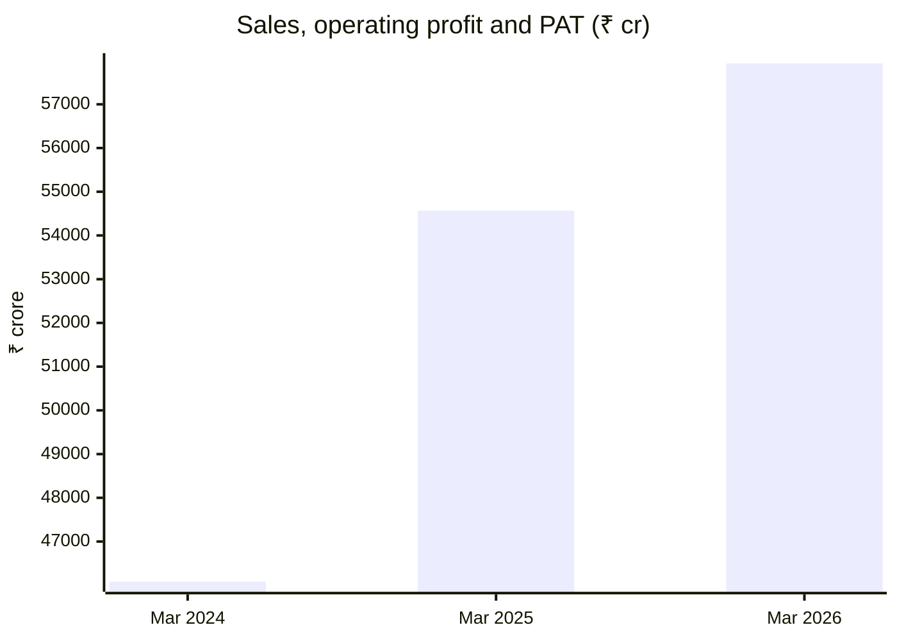

*Run 2026-11-24 · part of [SPINOFF_REPORT.md](../SPINOFF_REPORT.md) · the complete analysis of one company, with every management-call exchange in full.*

## ICICIBANK — ICICI Bank Ltd.

### 1. ICICI Bank Ltd. — PARTIAL SPIN-OFF (subsidiary IPO)

**CONFIRMED** (partial spin-off — ICICI Prudential Asset Management Company Limited is listed since 2025-12-19) · **PARTIAL SPIN-OFF, LISTED <1Y — price the parent's stub against the listed piece** · score 3.6/10 · partial spin-off (subsidiary IPO) · 4 filing(s) from NSE · first 2025-12-06, latest 2025-12-19

**The separated entities — every one the documents name:**

| Entity | Scheme | Business | Listing | Who runs it |
|---|---|---|---|---|
| **ICICI Prudential Asset Management Company Limited** | 2025 listing and partial divestment of PCHL's stake in ICIC… | Asset management joint venture providing mutual fund, portfolio management and advisory services; from April … | listed 2025-12-19 as ICICIAMC (NSE) | not stated |

**What is being separated, as the documents put it:** ICICI Prudential Asset Management Company, the group's asset management and portfolio/advisory services subsidiary — class `not stated`.

### 2. Stages and dates

> **Listing:** PARTIAL SPIN-OFF, LISTED — ICICI Prudential Asset Management Company Limited trades since 2025-12-19 (NSE equity list); the parent keeps 53.0%

| Date | Event | Source |
|---|---|---|
| 2025-02 | Other — ICICI Prudential Asset Management Company Limited / PCHL | as stated: Annual Securities Report for fiscal year April 1, 2025 to March 31, 2… |
| 2025-06 | Board approval — ICICI Bank Limited (purchase of up to 2.0% additional shareholding in ICICI Prudential Asset Management Company Limited ahead of the listing) | as stated: Annual Securities Report for fiscal year April 1, 2025 to March 31, 2… |
| 2025-06-27 | Stage reached: **record date** | [Outcome of Board Meeting](https://nsearchives.nseindia.in/corporate/ICICI2022_27062025120055_NSEBSE_27062025.pdf) |
| 2025-12-19 | **ICICI Prudential Asset Management Company Limited** listed (ICICIAMC) | NSE equity list |
| 2025-12-19 | Listing and trading — ICICI Prudential Asset Management Company Limited (Bombay Stock Exchange and National Stock Exchange) | as stated: Annual Securities Report for fiscal year April 1, 2025 to March 31, 2… |

**The stages, as filed:** record date (2025-06-27)

**The partial spin-off:** **ICICI Prudential Asset Management Company Limited** (joint venture); parent's stake after: 53.0%; IPO stage: listed; exchange: Bombay Stock Exchange and National Stock Exchange; NSE symbol ICICIAMC.

> “Effective December 19, 2025, ICICI Prudential Asset Management Company Limited is listed on Bombay Stock Exchange and National Stock Exchange.”

**When it lists, in the documents' words:** Said in the Annual Securities Report filed September 18, 2026: "Effective December 19, 2025, ICICI Prudential Asset Management Company Limited is listed on Bombay Stock Exchange and National Stock Exchange."

### 3. Size of the separated business beside the parent — is institutional selling likely?

**Reading: NO FORCED SELLING ON SIZE — an IPO distributes no shares to the parent's shareholders, so nobody receives a piece they did not choose. Size matters here for the stub: how much of the parent's market value the listed piece accounts for.**

| Entity | Stated turnover | Market cap (₹ cr) | Its market value beside the parent's | Index member |
|---|---|---:|---:|---|
| ICICI Prudential Asset Management Company Limited | not stated | 150,274 | 13.2% | yes |

*The last column is the subsidiary's whole market value over the parent's (parent ₹1,136,781 cr, NSE bhavcopy of 2026-11-13), computed here; the parent's own value already contains the stake it keeps, so the stub is the parent's value less that stake.*

**The judge's read of selling pressure:** unlikely — No shares distributed to Bank shareholders; listing came via PCHL's partial divestment, with the Bank retaining 53.0%

### 4. Insider ownership — share swap, promoters' holding, management incentives

**Share swap / entitlement, entity by entity:**

- **ICICI Prudential Asset Management Company Limited:** Offer for sale by the joint venture partner: "a potential listing and partial divestment of its stake in ICICI Prudential Asset Management Company Limited, subject to market conditions, requisite approvals and other considerations"; no fresh issue, offer-for-sale size or price stated

**Promoters' holding, from the shareholding pattern:**

| Company | Promoters | FIIs | DIIs | Public | Quarter |
|---|---:|---:|---:|---:|---|
| ICICI Bank Ltd. (ICICIBANK) | — | 34.68% | 41.77% | 23.32% |  |
| ICICI Prudential Asset Management Company Limited (ICICIAMC) | 85.6% | 3.26% | 8.41% | 2.72% | Sep 2026 |

*Source: screener.in shareholding pattern, stored under `ShareholdingPattern/NiftyTotalMarket/`. In a mirror demerger each shareholder holds the same proportion of the new company as of the parent on the record date.*

- **Promoters in the parent, per the documents:** not stated in the documents on file.
- **What the promoters will hold in the separated entity:** 2025 listing of ICICI Prudential Asset Management Company Limited: "We had 53.0% interest in the entity and PCHL owned 34.6% at March 31, 2026." — after the Bank's purchase of 2.0% from PCHL. 2023 Delisting Scheme: "with effect from March 24, 2025, ICICI Securities Limited has become a wholly owned subsidiary of the Bank". 2025-2026 pension transaction: "the Bank acquired 100% shareholding in ICICI PFM. Accordingly, ICICI PFM is now a wholly owned subsidiary of the Bank." ICICI Prudential Life Insurance Company Limited: "Following this, the Bank's shareholding in ICICI Life stands at approximately 52.8%."
- **What a public shareholder receives:** not stated for the 2025 listing and partial divestment of ICICI Prudential Asset Management Company Limited — no distribution or entitlement to ICICI Bank's own public shareholders is described (the divestment is of PCHL's stake). Under the 2023 Delisting Scheme the Bank issued its shares to the subsidiary's public shareholders, not to its own: "On March 26, 2025, the Bank allotted its equity shares to the public shareholders of ICICI Securities as of the record date, in accordance with a swap ratio of 67 to 100, as provided in the Delisting Scheme." The 2025-2026 pension and ICICI Venture business transfers were intra-group; nothing is stated as received by public shareholders of the parent.
- **Management incentives:** "In June 2025, the Board approved the purchase of up to 2.0% additional shareholding in the ICICI Prudential Asset Management Company Limited. Following the receipt of requisite approvals, the Bank purchased 2.0% additional shareholding from PCHL. This purchase was primarily for the purposes of maintaining the Bank's majority shareholding in ICICI Prudential Asset Management Company Limited were it to grant stock-based compensation." For the life insurer: "The Board, at its meeting held in February 2026, approved purchase of up to 2.0% additional shareholding in its subsidiary, ICICI Prudential Life Insurance Company Limited... This purchase was primarily towards maintaining the Bank's majority shareholding in the event of exercise of stock-based compensation of ICICI Prudential Life Insurance Company Limited." Parent capital includes "capital and reserves and surplus including employees' stock options outstanding at year-end fiscal 2026, were Rs. 3,630.6 billion". No treatment of existing grants under a scheme, no new plan in a new entity, and no exercise price or pricing date are stated.
- **Insider actions around the separation:** "In February 2025, the Bank's joint venture partner, PCHL, made an announcement regarding a potential listing and partial divestment of its stake in ICICI Prudential Asset Management Company Limited, subject to market conditions, requisite approvals and other considerations." "Following the receipt of requisite approvals, the Bank purchased 2.0% additional shareholding from PCHL." For the life insurer: "the Bank has, through multiple tranches executed between July 22, 2026 and September 2, 2026, completed the purchase of approximately 2.0% of ICICI Life's equity share capital at June 30, 2026, through the stock exchange mechanism." "PCHL entered into definitive agreements on May 17, 2026, pursuant to which PCHL has agreed to acquire a 75% stake in Bharti Life Insurance Company Limited" and "ICICI Prudential Life Insurance Company Limited has applied to IRDAI for the reclassification of PCHL from 'promoter' to 'investor'". No pledging is stated.
- **Insiders, per the checklist read:** Bank held 53.0% and PCHL 34.6% at March 31, 2026; Bank bought 2.0% more from PCHL primarily to keep majority shareholding if stock-based compensation is granted · *option pricing date:* not stated

### 5. Why the listing — point by point

There is no separation, demerger or spin-off of a business by ICICI Bank in these texts — the question's premise is not supported by the transcripts or the filing, and the dominant direction of travel is the opposite: consolidation of group entities into the Bank. The nearest things management actually described are four entity-level reorganizations. (1) Pension funds: the Board on July 19, 2025 approved acquiring 100% of ICICI Prudential Pension Funds Management Company Limited from ICICI Prudential Life Insurance, moving it from a step-down subsidiary of ICICI Life to a direct wholly owned subsidiary of the Bank; the share purchase agreement was executed January 12, 2026, and on the Jan 2026 media call Sandeep Batra said the rationale was that 'the synergy with the Bank will be better and the business will be able to expand in a much better fashion,' i.e. 'synergising with the banking set of customers'; ICICI Life booked a Rs. 1.1 billion gain on the sale, which was part of why its FY2026 PAT rose 34.6% to Rs. 16.00 billion (25.0% excluding the sale). (2) ICICI Venture's private equity, venture capital and real estate fund management business was approved in principle on May 8, 2025 for transfer to ICICI Prudential AMC, completed with ICICI Prudential AMC managing the transferred funds effective April 1, 2026; the stated purpose was 'offering of an integrated full range of investment asset classes, including private equity,' while ICICI Venture keeps only 'certain advisory activities' and 'certain residual funds' — ICICI Venture's PAT jumped to Rs. 1.5 billion in FY2026 from Rs. 0.2 billion in FY2025. (3) A small divestment of the Bank's entire stake in the NIIT Institute of Finance and Banking JV (set up around 2006), which Batra on Apr 2025 called 'a very small amount' done to 'rationalise and simplify our own portfolio where we want to remain focused on.' (4) Closure of the Offshore Banking Unit in the SEEPZ, Mumbai, for which RBI gave a no-objection letter in May 2026 (a prior OBU closure had already pushed Rs. 3.40 billion of negative foreign currency translation reserve into the Q4-FY2024 P&L). Against these, the Bank was pulling businesses in, not pushing them out: ICICI Securities was delisted on March 24, 2025 and became wholly owned (56 million ICICI Bank shares issued at a 67:100 swap, which Anindya Banerjee cited as the main reason net worth rose about Rs. 20,000 crore sequentially, 'while it's capital neutral'); the Bank bought ~2% more of ICICI Prudential AMC and ~2% more of ICICI Life, explicitly 'towards maintaining the Bank's majority shareholding' against stock-based compensation dilution; it infused Rs. 5.0 billion (including Rs. 500 crore in Q3-FY2026) into ICICI Home Finance, which Batra justified as meeting 'the regulatory requirement and expansion that is required from their business point of view'; and it acquired the remaining equity of I-Process Services. The only genuine ownership separations described are at the partner/JV level, not the Bank's: ICICI Prudential AMC listed on BSE and NSE effective December 19, 2025 following Prudential Corporation Holdings' February 2025 announcement of a 'potential listing and partial divestment of its stake,' and after PCHL agreed on May 17, 2026 to buy 75% of Bharti Life, ICICI Life applied to IRDAI to reclassify PCHL from 'promoter' to 'investor' and to rename itself 'ICICI Life Insurance Limited' (IRDAI approved the name change August 7, 2026).

**Point by point, with the source:**

1. Batra confirmed the Bank had taken over the pension fund business from ICICI Life, explaining it was a step-down subsidiary and that the decision had been disclosed about two quarters earlier. “It was a step-down subsidiary. We explained this, I think, about two quarters back when we made the decision.” — *[Jan 2026](https://www.icici.bank.in/content/dam/icicibank/india/managed-assets/docs/about-us/2026/transcript-earnings-call-jan2026.pdf)*
2. The stated rationale for moving the pension fund manager under the Bank was synergy with the Bank's customer base and faster expansion, not value unlocking or capital release. “We do believe that the synergy with the Bank will be better and the business will be able to expand in a much better fashion.” — *[Jan 2026](https://www.icici.bank.in/content/dam/icicibank/india/managed-assets/docs/about-us/2026/transcript-earnings-call-jan2026.pdf)*
3. Asked directly whether the pension business had been acquired from the subsidiary, Batra confirmed it in one word; no numbers, consideration or targets were given on the call. “Yes, we have.” — *[Jan 2026](https://www.icici.bank.in/content/dam/icicibank/india/managed-assets/docs/about-us/2026/transcript-earnings-call-jan2026.pdf)*
4. The only outright exit discussed on any call — the entire stake in the NIIT Institute of Finance and Banking JV set up around 2006 — was framed as immaterial portfolio simplification, with no consideration disclosed. “And over the period, we are just wanting to rationalise and simplify our own portfolio where we want to remain focused on.” — *[Apr 2025](https://www.bseindia.com/stockinfo/AnnPdfOpen.aspx?Pname=1a691340-05c5-4029-a15f-cdd78f457400.pdf)*
5. The one real carve-out of a business line in the texts: ICICI Venture's private equity, venture capital and real estate fund management business was approved for transfer to ICICI Prudential AMC on May 8, 2025, with ICICI Prudential AMC managing those funds from April 1, 2026. “On May 8, 2025, ICICI Venture Funds Management Company Limited's Board of Directors and ICICI Prudential Asset Management Company Limited's Board of Directors, in their respective meetings, approved, in principle, a proposal to transfer the private equity, venture capital and real estate fund management business of ICICI Venture Funds Management Company Limited to ICICI Prudential Asset Management Company Limited.” — *Scheme*
6. The purpose of that transfer was to give ICICI Prudential AMC a complete asset-class platform, leaving ICICI Venture with only advisory work and residual funds. “The transaction enabled the offering of an integrated full range of investment asset classes, including private equity, by ICICI Prudential Asset Management Company Limited.” — *Scheme*
7. The pension transaction was a Board-approved intra-group purchase to convert a step-down subsidiary into a direct wholly owned subsidiary, conditional on RBI and PFRDA approvals; the SPA was executed January 12, 2026. “The Board at its meeting held on July 19, 2025 approved the acquisition of 100% shareholding in ICICI Prudential Pension Funds Management Company Limited from ICICI Prudential Life Insurance Company Limited to make ICICI PFM a wholly owned subsidiary of the Bank, subject to the Reserve Bank of India, PFRDA and other necessary approvals.” — *Scheme*
8. The seller side quantified it: ICICI Life's FY2026 PAT of Rs. 16.00 billion (up 34.6%) included a Rs. 1.1 billion gain on selling the pension subsidiary; growth was 25.0% excluding it. “The profit after tax of ICICI Prudential Life Insurance Company Limited grew by 34.6% year-on-year from Rs. 11.9 billion in fiscal 2025 to Rs. 16.0 billion in fiscal 2026, primarily driven by higher investment income from Shareholders' funds, which includes a gain of Rs. 1.1 billion realized from sale of 100% equity shareholding in ICICI PFM.” — *Scheme*
9. Direction of travel was consolidation, not separation: ICICI Securities was delisted and absorbed as a wholly owned subsidiary on March 24, 2025, with Bank shares issued to its public shareholders at a 67:100 swap. “Pursuant to the Scheme of Arrangement amongst ICICI Bank Limited and ICICI Securities Limited and their respective shareholders, ICICI Securities Limited has been delisted from stock exchanges on March 24, 2025 and became a wholly-owned subsidiary of the Bank.” — *[Apr 2025](https://www.bseindia.com/stockinfo/AnnPdfOpen.aspx?Pname=1a691340-05c5-4029-a15f-cdd78f457400.pdf)*
10. Banerjee attributed the ~Rs. 20,000 crore sequential jump in net worth to the shares issued to ICICI Securities' minority holders, describing it as capital neutral rather than value creating. “So, we would have issued shares to the minority shareholders of ISec that would have, while it's capital neutral, it would have increased the net-worth by a substantial amount.” — *[Apr 2025](https://www.bseindia.com/stockinfo/AnnPdfOpen.aspx?Pname=1a691340-05c5-4029-a15f-cdd78f457400.pdf)*
11. Stake increases in the listed subsidiaries were defensive against stock-compensation dilution, not steps toward separation: ~2% more of ICICI Prudential AMC and ~2% of ICICI Life (taking it to ~52.8%). “This purchase was primarily for the purposes of maintaining the Bank's majority shareholding in ICICI Prudential Asset Management Company Limited were it to grant stock-based compensation.” — *Scheme*
12. The only partner-level separation: Prudential Corporation Holdings signalled a partial exit from the AMC, which listed on December 19, 2025, and after agreeing to buy 75% of Bharti Life it is being reclassified from promoter to investor in ICICI Life, which is renaming itself. “Consequently, ICICI Prudential Life Insurance Company Limited has applied to IRDAI for the reclassification of PCHL from 'promoter' to 'investor', along with a proposal to change the name of the company from 'ICICI Prudential Life Insurance Company Limited' to 'ICICI Life Insurance Limited'.” — *Scheme*
13. Capital was being pushed into subsidiaries rather than freed from them — Rs. 500 crore into ICICI Home Finance in Q3-FY2026 (Rs. 5.0 billion in FY2026), with Batra committing to fund it further. “We are happy to infuse the capital to meet the regulatory requirement and expansion that is required from their business point of view.” — *[Jan 2026](https://www.icici.bank.in/content/dam/icicibank/india/managed-assets/docs/about-us/2026/transcript-earnings-call-jan2026.pdf)*
14. The only operational unit being shut is an offshore branch, not a business: RBI issued a no-objection letter in May 2026 for closing the SEEPZ Mumbai Offshore Banking Unit. “In May 2026, the Bank received the no-objection letter from the Reserve Bank of India to close the Offshore Banking Unit located in the Santacruz Electronic Exports Promotion Zone, Mumbai.” — *Scheme*
15. The most recent call contains no mention of any separation, demerger, carve-out or subsidiary restructuring — management's framing of strategy is entirely about growing PBT excluding treasury within one integrated bank. “At ICICI Bank, our strategic focus continues to be on growing profit before tax excluding treasury through the 360-degree customer centric approach and by serving opportunities across ecosystems and micro-markets.” — *[Apr 2026](https://www.bseindia.com/stockinfo/AnnPdfOpen.aspx?Pname=50d0e36c-8e96-4fde-9d2e-d33a9443ec34.pdf)*

**How it evolved:** No separation idea ever surfaces as such: on Apr 2025 (call of April 19, 2025) the only disposal discussed is the small NIIT Institute JV stake sale, framed as portfolio simplification, in the same quarter ICICI Securities was delisted into the Bank (March 24, 2025). The ICICI Venture PE/VC/real-estate fund management transfer was approved in principle on May 8, 2025 and the pension-fund acquisition on July 19, 2025 — the same day as the Jul 2025 call, where neither was mentioned and no analyst asked. By Jan 2026 (call of January 17, 2026) Batra confirmed the pension step-down subsidiary had been brought under the Bank, noting 'we explained this, I think, about two quarters back when we made the decision,' and the Oct 2025 transcript is unreadable so any interim discussion is unverifiable; the Apr 2026 call (April 18, 2026) contains no mention of any of it, and only the September 18, 2026 Annual Securities Report records the ICICI Venture transfer as effective April 1, 2026 and the PCHL promoter-to-investor reclassification.

**What management expects from it:** Nothing was said about a separation, because none was announced. For the moves that were made: the pension business gains Bank-customer synergies and faster expansion; ICICI Prudential AMC gains a full asset-class platform including private equity; ICICI Venture keeps only advisory and residual funds; ICICI Life booked a Rs. 1.1 billion gain. No margin, capital-release, valuation-unlock or focus claims were offered.

*Not explained on the calls:* Everything a separation thesis needs: no demerger exists. No consideration for NIIT or ICICI Venture's transfer, no pension AUM/economics, no lender, investor or partner demands, no analyst questions, and Oct 2025's transcript is unreadable.

- *Stated reason, in one line:* not stated; documents only record that JV partner PCHL announced a potential listing and partial divestment of its stake, subject to market conditions, requisite approvals and other considerations
- *What it reveals:* A listed price for a fee business earning Rs 33.0 billion PAT in fiscal 2026 vs Rs 26.5 billion in fiscal 2025, now also holding ICICI Venture's private equity, venture capital and real estate fund management business
- *Parent or spin:* parent · *Read next:* Slides 33 to 35 of the Q4-FY2026 investor presentation for ICICI AMC's standalone financials versus the Bank's 53.0% stake
- *In their words:* “Effective December 19, 2025, ICICI Prudential Asset Management Company Limited is listed on Bombay Stock Exchange and National Stock Exchange.”

### 6. On the calls, verbatim

1 call(s), oldest first: **0 question-and-answer exchange(s)** given in full — the question and every answer to it, nothing trimmed — and 1 passage(s) from management's prepared remarks (the complete sentences about it; the whole remarks are in the linked transcript). Text is as the transcript prints it.

#### Apr 2025 — [transcript](https://www.bseindia.com/stockinfo/AnnPdfOpen.aspx?Pname=1a691340-05c5-4029-a15f-cdd78f457400.pdf)

**From the prepared remarks** *(the passage about it; the whole turn runs to 30,971 characters in the transcript)*

> **On Costs:** The profit after tax was 5.10 billion Rupees in this quarter compared to 5. 19 billion Rupees in Q4 of last year. The profit after tax of ICICI AMC , as per Ind AS was 6.92 billion Rupees in this quarter compared to 5.29 billion Rupees in Q4 of last year . The profit after tax of ICICI Securities, as per Ind AS on a consolidated basis, was 3.81 billion Rupees in this quarter compared to 5.37 billion Rupees in Q4 of last year. Pursuant to the Scheme of Arrangement amongst ICICI Bank Limited and ICICI Securities Limited and their respective shareholders, ICICI Securities Limited has been delisted from stock exchanges on March 24, 2025 and became a wholly -owned subsidiary of the B ank. 10 ICICI Bank Canada had a profit after tax of 12.5 million Canadian dollars in this quarter compared to 19.9 million Canadian dollars in Q4 last year . ICICI Bank UK had a profit after tax of 6.0 million US dollars in this quarter compared to 9.5 million US dollars in Q4 of last year . As per Ind AS, ICICI Home Finance had a profit after tax of 2.41 billion Rupees in the current quarter compared to 1.69 billion Rupees in Q4 of last year. With this, we conclude our opening remarks and we will now be happy to take your questions.

### 7. The parent's financial statements

**The parent, last three fiscal years (consolidated)**

| | Mar 2024 | Mar 2025 | Mar 2026 |
|---|---:|---:|---:|
| Sales (₹ cr) | — | — | — |
| Sales growth (%) | — | — | — |
| Operating profit (₹ cr) | — | — | — |
| Operating profit growth (%) | — | — | — |
| Operating margin (%) | — | — | — |
| PAT (₹ cr) | 46,081 | 54,569 | 57,936 |
| PAT growth (%) | +29.9% | +18.4% | +6.2% |
| PAT margin (%) | — | — | — |
| EPS (₹) | 63.0 | 71.7 | 75.7 |

*Source: ProfitStatement/NiftyTotalMarket/ICICIBANK.csv (consolidated, screener.in); growth and margins computed here.*

*Series in order: PAT.* *Not plotted (gap in the data): Sales, Operating profit.*

**P/E:** 18.4 — live market file (screener.in), trailing (price ₹1,435.00 as of 2026-08-02).

**Cash flows (₹ cr):**

| | Mar 2024 | Mar 2025 | Mar 2026 |
|---|---:|---:|---:|
| Cash from operations (₹ cr) | 157,284 | 122,805 | 67,325 |
| Cash from investing (₹ cr) | -144,737 | -77,140 | -11,708 |
| Cash from financing (₹ cr) | 13,765 | 5,589 | -4,661 |
| Net cash flow (₹ cr) | 26,312 | 51,255 | 50,957 |
| Free cash flow (₹ cr) | 153,676 | 118,100 | 63,778 |

*Source: CashFlow/NiftyTotalMarket/ICICIBANK.csv (consolidated, screener.in).*

### 8. The separated business's financial statements

**The business being separated — its own numbers**, entity by entity: its reported statements once it is listed and on file, and the segment numbers the annual reports and presentations carry for it before that.

**ICICI Prudential Asset Management Company Limited (ICICIAMC) — as reported since listing**

| | Mar 2024 | Mar 2025 |
|---|---:|---:|
| Sales (₹ cr) | 3,758 | 4,977 |
| Sales growth (%) | — | +32.4% |
| Operating profit (₹ cr) | 2,777 | 3,635 |
| Operating profit growth (%) | — | +30.9% |
| Operating margin (%) | 73.9 | 73.0 |
| PAT (₹ cr) | 2,050 | 2,651 |
| PAT growth (%) | — | +29.3% |
| PAT margin (%) | 54.6 | 53.3 |
| EPS (₹) | 1,161 | 1,502 |

*Source: ProfitStatement/NiftyTotalMarket/ICICIAMC.csv (consolidated, screener.in); growth and margins computed here.*

**ICICI Prudential Asset Management Company Limited → ICICI Prudential Asset Management Company Limited (ICICI AMC)** · unit ₹ million · No separate segment P&L is disclosed for the AMC — it is subsumed in the consolidated 'Others' segment. The only entity-level figures on these pages are from the Schedule III 'Additional information to consolidated accounts': share in profit or loss (profit after tax) and net assets. PAT is entity-level PAT, not a segment result; no revenue, operating profit, segment assets/liabilities, capex or depreciation is disclosed for the entity. AR2026 MD&A (page 234) corroborates PAT of ₹26.48 bn FY2025 and ₹32.99 bn FY2026.

| | FY2024 | FY2025 | FY2026 |
|---|---:|---:|---:|
| Revenue (₹ million) | — | — | — |
| Revenue growth (%) | — | — | — |
| Operating profit (₹ million) | — | — | — |
| Operating profit growth (%) | — | — | — |
| Operating margin (%) | — | — | — |
| PAT (₹ million) | 18,145 | 26,482 | 32,986 |
| PAT growth (%) | — | +45.9% | +24.6% |

*Sources:* Annual Report 2024 — page 401; Annual Report 2025 — page 397; Annual Report 2026 — page 438

*Not in the pages read:* Revenue, operating profit/PBT, segment assets and liabilities, capex, depreciation, AUM and any quarterly figures for the AMC. Net assets are disclosed (₹24,849.0 mn FY2024; ₹35,315.8 mn FY2025; ₹42,218.7 mn FY2026) but not segment assets.

*Businesses with no numbers in the pages read (3 annual report(s) and 11 presentation(s) on file):* All named entities refer to the same separating business, ICICI Prudential Asset Management Company (ICICI AMC); the pages carry only its PAT and net assets. No pages reference an 'asset management joint venture' entity separately.

*Documents on file:* [Annual Report 2026](https://www.bseindia.com/xml-data/corpfiling/AttachHis/01c30537-c969-4503-bbae-a07d51eb09a5.pdf); [Annual Report 2025](https://www.bseindia.com/xml-data/corpfiling/AttachHis/d80c4401-bed9-4aa4-b532-00255b963376.pdf); [Annual Report 2024](https://www.bseindia.com/xml-data/corpfiling/AttachHis/9d5f21fd-9b1e-42e5-a48b-84d2623f293c.pdf); [Presentation Oct 2026](https://www.bseindia.com/stockinfo/AnnPdfOpen.aspx?Pname=b831cebf-9ddc-48a6-861f-1879e07a86fc.pdf); [Presentation Jul 2026](https://www.bseindia.com/stockinfo/AnnPdfOpen.aspx?Pname=881c8fc3-a4c2-40ff-bacf-d68efc0e3d7a.pdf); [Presentation Apr 2026](https://www.bseindia.com/stockinfo/AnnPdfOpen.aspx?Pname=245b872b-cdb6-4c0d-b8ae-1c9d3d3ee9af.pdf); [Presentation Jan 2026](https://www.bseindia.com/stockinfo/AnnPdfOpen.aspx?Pname=8a0e8729-682f-40bf-ade8-3daeaa2a1173.pdf); [Presentation Oct 2025](https://www.bseindia.com/stockinfo/AnnPdfOpen.aspx?Pname=d2976060-1fb3-415b-952e-d26f9f95b237.pdf); [Presentation Jul 2025](https://www.bseindia.com/stockinfo/AnnPdfOpen.aspx?Pname=9c02e638-1133-4048-a9a5-be65ae7418b7.pdf)

### 9. Other financial differences — working capital, margins, returns, debt

| Metric (latest year) | Parent (ICICIBANK) | ICICI Prudential Asset Management Company Lim… |
|---|---:|---:|
| *Basis* | *reported, consolidated* | *its own reported statements* |
| Sales (₹ cr) | — | 4,977 (Mar 2025) |
| Sales growth (%) | — | 32.4 (Mar 2025) |
| Operating margin (%) | — | 73 (Mar 2025) |
| Operating profit growth (%) | — | 30.9 (Mar 2025) |
| PAT margin (%) | — | 53.3 (Mar 2025) |
| ROE % | 16 (Mar 2026) | — |

*Each figure is the latest on file, with its year. Working-capital days and ROCE come from the stored working-capital file; segment figures from the pages cited in part 8. A dash means the documents do not carry it.*

**What stays with the parent — its segments, from the same pages:**

| Remaining segment | Revenue | Operating margin | ROCE | Segment assets / revenue | Unit | Year |
|---|---:|---:|---:|---:|---|---|
| Retail Banking | 1,623,942 | 14.3% | — | 5.41x | ₹ million | FY2026 |
| Wholesale Banking | 878,473 | 27.9% | 72.3% | 7.72x | ₹ million | FY2026 |
| Treasury | 1,384,092 | 12.4% | 6.2% | 5.5x | ₹ million | FY2026 |
| Other Banking Business | 47,029 | 26.7% | 2.9% | 10.58x | ₹ million | FY2026 |
| Life insurance (ICICI Prudential Life Insurance Company Limited) | 654,720 | 2.8% | — | 4.87x | ₹ million | FY2026 |
| General insurance (ICICI Lombard General Insurance Company Limited) | 288,906 | 12.7% | — | 2.61x | ₹ million | FY2026 |
| Others (non-banking, non-insurance subsidiaries — includes ICICI Prudential Asset Management Company, ICICI Securities, ICICI Home Finance, ICICI Securities Primary Dealership, etc.) | 199,701 | 42.0% | — | 5.18x | ₹ million | FY2026 |

**What the documents themselves say about the differences:**

- **growth** — parent / remaining: Consolidated profit after tax grew by 6.2% year-on-year to 542.08 billion Rupees in FY2026; profit before tax excluding treasury grew by 7.1% year-on-year to 650.21 billion Rupees; separated business: The listed asset management subsidiary's net profit rose from Rs. 26.5 billion in fiscal 2025 to Rs. 33.0 billion in fiscal 2026 (about 24.5% growth, as computed from the stated figures) “ICICI Prudential Asset Management Company Limited earned a net profit of Rs. 33.0 billion during fiscal 2026 compared to a net profit of Rs. 26.5 billion during fiscal 2025.”
- **other** — parent / remaining: After the listing and the purchase of 2.0% from PCHL, the Bank retains majority control of the asset management company; separated business: Bank 53.0%, PCHL 34.6% at March 31, 2026; the balance is public float created by the listing “We had 53.0% interest in the entity and PCHL owned 34.6% at March 31, 2026.”
- **return on capital** — parent / remaining: "Return on average assets and standalone RoE would have been 2.3% and 15.5% respectively in this quarter" (Q3-FY2026, adjusted for the additional standard asset provision); CET-1 ratio 16.35% and total capital adequacy ratio 17.18% at March 31, 2026; separated business: not stated “Return on average assets and standalone RoE would have been 2.3% and 15.5% respectively in this quarter.”
- **capex and capital intensity** — parent / remaining: The Bank infused capital into subsidiaries rather than receiving separation proceeds: "During the year ended March 31, 2026, the Bank infused capital of Rs. 5.0 billion" into its housing finance subsidiary, and bought 2.0% stakes in the asset management and life insurance subsidiaries; separated business: not stated “During the year ended March 31, 2026, the Bank infused capital of Rs. 5.0 billion.”

**The checklist:**

| Item | Status | Evidence |
|---|---|---|
| Why the spin-off | unknown | no stated rationale in the filings on file *(next: read the scheme's rationale section / the board's press release)* |
| Institutional selling likely (small / different business) | unknown | size of the demerged piece not stated *(next: pro-forma statements: revenue / assets of the demerged undertaking vs the parent)* |
| Insider ownership and incentives aligned | unknown | no promoter-continuity or option-pricing language found *(next: the date the management options are priced; promoter holding in the resulting company)* |
| A hidden value revealed (pro-forma, leverage, comparables) | yes | P/E 17.8 on Mar 2026 profit vs industry median 24.6 (97 peers) |
| Parent before the spin (clean parent, takeover prelude) | partly | stage announced — the spin has not happened; the parent can still be bought whole |
| Partial spin-off: price the stub from the listed piece | partly | a subsidiary is being listed; once it trades, stub = parent price − (stake value ÷ parent shares) *(next: stub_value(parent price, parent shares, [(sub price, shares held)]))* |
| Timing (first year sells, second year gains) | partly | not yet listed — 353 days since the first filing, stage announced |

The filings

| Date | Category | Headline | Attachment |
|---|---|---|---|
| 2025-12-06 | General Updates | ICICI Bank Limited has informed the Exchange about Disclosure under Regulation 30 of the SEBI (Listing Obligations and Disclosure Requirements) Regulations, 201 | [pdf](https://nsearchives.nseindia.com/corporate/ICICI2022_06122025141444_NSEBSE_PriceBand.pdf) |
| 2025-12-09 | General Updates | ICICI Bank Limited has informed the Exchange about disclosure under Regulation 30 of the SEBI (Listing Obligations and Disclosure Requirements) Regulations, 201 | [pdf](https://nsearchives.nseindia.com/corporate/ICICI2022_09122025221929_NSEBSE_09122025.pdf) |
| 2025-12-17 | General Updates | ICICI Bank Limited has informed the Exchange about disclosure under Regulation 30 of the SEBI (Listing Obligations and Disclosure Requirements) Regulations, 201 | [pdf](https://nsearchives.nseindia.com/corporate/ICICI2022_17122025105720_NSEBSE_17122025.pdf) |
| 2025-12-19 | General Updates | ICICI Bank Limited has informed the Exchange about disclosure under Regulation 30 of the SEBI (Listing Obligations and Disclosure Requirements) Regulation, 2015 | [pdf](https://nsearchives.nseindia.com/corporate/ICICI2022_19122025113528_NSEBSE_19122025.pdf) |

