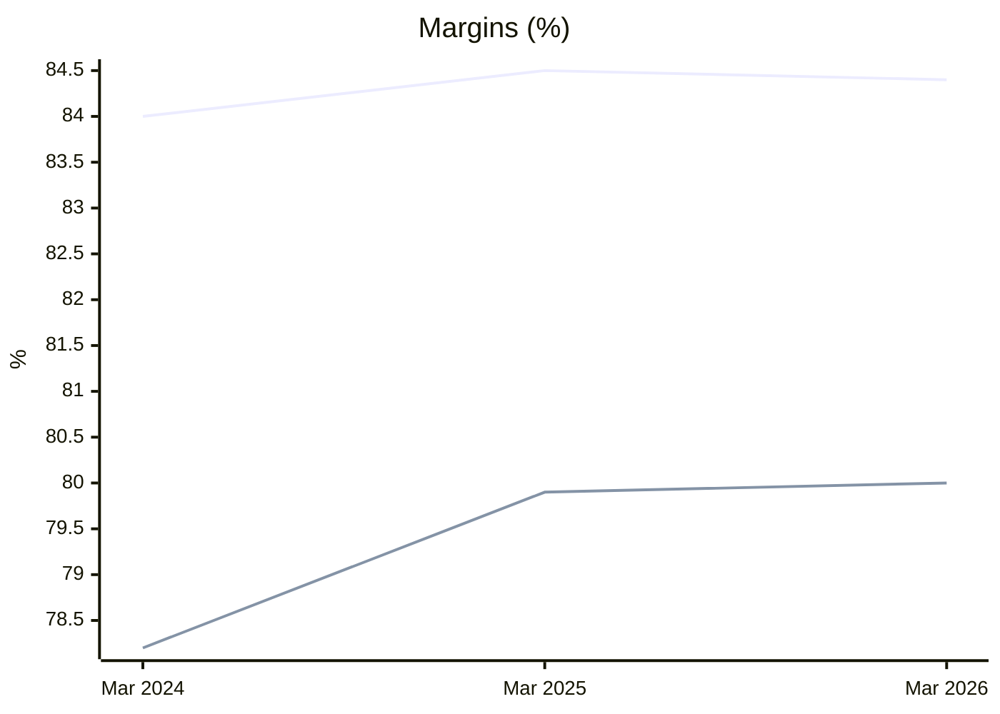

*Run 2026-11-24 · part of [SPINOFF_REPORT.md](../SPINOFF_REPORT.md) · the complete analysis of one company, with every management-call exchange in full.*

## IEX — Indian Energy Exchange Ltd.

### 1. Indian Energy Exchange Ltd. — PARTIAL SPIN-OFF (subsidiary IPO)

**CONFIRMED** (partial spin-off — the IPO of Indian Gas Exchange Limited is in motion (DRHP filed)) · **PARTIAL SPIN-OFF, IPO IN MOTION — the parent's stub is priced once the piece trades** · score 2.9/10 · partial spin-off (subsidiary IPO) · 1 filing(s) from NSE · first 2026-07-15, latest 2026-07-15

**The separated entities — every one the documents name:**

| Entity | Scheme | Business | Listing | Who runs it |
|---|---|---|---|---|
| **Indian Gas Exchange Limited** | 2026 IPO of Indian Gas Exchange Limited (offer for sale by … | India's only natural gas exchange; spot and forward trading of domestic gas and R-LNG across 23 delivery poin… | to be listed | not stated |

**What is being separated, as the documents put it:** Indian Gas Exchange (IGX), IEX's 47.3%-held natural gas spot exchange associate, partly sold via IPO — class `regulatory_strategic`.

### 2. Stages and dates

> **Listing:** PARTIAL SPIN-OFF, IPO DRHP FILED — Indian Gas Exchange Limited; At the IEX Analyst Meet held July 24, 2026 the CFO said "the good part is that they filed the DRHP in this month and hopefully (would be) getting listed soon"; 

| Date | Event | Source |
|---|---|---|
| 2025-12-03 | Other — Indian Gas Exchange Limited | as stated: Intimation under Regulation 30, IEX filing dated July 15, 2026 ("In f… |
| 2026-07-14 | DRHP filed — Indian Gas Exchange Limited | as stated: IEX intimation to BSE and NSE dated July 15, 2026 (DRHP dated July 14… |
| 2026-07-15 | Filed with exchanges — Indian Gas Exchange Limited | as stated: IEX Regulation 30 intimation to BSE (Scrip Code 540750) and NSE (Symb… |
| 2026-12-31 | Other — Indian Gas Exchange Limited | as stated: Q4 FY26 earnings call, April 24, 2026 — PNGRB extended deadline for I… |

**The partial spin-off:** **Indian Gas Exchange Limited** (associate); parent's stake 47.3% → 25%; IPO stage: DRHP filed; exchange: BSE Limited; timeline: At the IEX Analyst Meet held July 24, 2026 the CFO said "the good part is that they filed the DRHP in this month and hopefully (would be) getting listed soon"; .

> “In furtherance of our intimation dated December 03, 2025, and in terms of Regulation 30 of the SEBI Listing Regulations, we wish to inform that the Indian Gas Exchange Limited ("IGX"), an associate co”

**When it lists, in the documents' words:** DRHP dated July 14, 2026 filed with SEBI and BSE on July 14, 2026 (filing July 15, 2026); 'they filed the DRHP in this month and hopefully (would be) getting listed soon' (July 24, 2026); PNGRB extension to bring holding to 25% runs to December 31, 2026 (stated April 24, 2026).

### 3. Size of the separated business beside the parent — is institutional selling likely?

**Reading: NO FORCED SELLING ON SIZE — an IPO distributes no shares to the parent's shareholders, so nobody receives a piece they did not choose. Size matters here for the stub: how much of the parent's market value the listed piece accounts for.**

| Entity | Stated turnover | Market cap (₹ cr) | Its market value beside the parent's | Index member |
|---|---|---:|---:|---|
| Indian Gas Exchange Limited | not stated (profit after tax of INR 41.9 crores for FY'26 and volume … | — | — | not listed |

*The last column is the subsidiary's whole market value over the parent's (parent ₹10,378 cr, NSE bhavcopy of 2026-11-13), computed here; the parent's own value already contains the stake it keeps, so the stub is the parent's value less that stake.*

**In the documents' words:** “We achieved Rs.493 crore of consolidated profit during the previous year, which is 17.2% CAGR. IEX standalone was around 474 crores, IGX 42 crores and ICX though it's a small beginning, but we hope it will also have the big opportunity in the future.”

**The judge's read of selling pressure:** unlikely — Listing is an IPO offer for sale by IEX, not a distribution of IGX shares to IEX shareholders; buyers self-select.

### 4. Insider ownership — share swap, promoters' holding, management incentives

**Share swap / entitlement, entity by entity:**

- **Indian Gas Exchange Limited:** "The Offer comprises of an offer for sale of up to 16,710,000 equity shares by IEX, and remains subject to receipt of applicable approvals, market conditions, and other relevant considerations." No fresh issue is stated; offer size in rupees not stated. On the July 2026 call: "to sell this 22.3% equity, we have offered that in the IPO."

**Promoters' holding, from the shareholding pattern:**

| Company | Promoters | FIIs | DIIs | Public | Quarter |
|---|---:|---:|---:|---:|---|
| Indian Energy Exchange Ltd. (IEX) | — | 12.02% | 31.79% | 55.93% |  |

*Source: screener.in shareholding pattern, stored under `ShareholdingPattern/NiftyTotalMarket/`. In a mirror demerger each shareholder holds the same proportion of the new company as of the parent on the record date.*

- **Promoters in the parent, per the documents:** not stated in the documents on file.
- **What the promoters will hold in the separated entity:** For the 2026 IGX IPO, the documents give the parent's (IEX's) holding, not a promoter holding: "As you may be aware that we have already filed a DRHP (Draft Red Herring Prospectus) for IPO of IGX as we today hold 47.3% in IGX. As per PNGRB (Petroleum and Natural Gas Board) regulati ons, we have to bring this down to 25% within 5 years." Earlier calls state 47.5%: "as per the regulations, our holding in the gas exchange is 47.5% and w e have to bring it out to 25% as per regulations." Shareholding norms for the proposed coal exchange: "Nobody can hold more than 25 percent, and no trading member can hold more than 5% ." No promoter-group percentage is stated.
- **What a public shareholder receives:** Nothing is distributed to IEX shareholders; the IGX listing is an offer for sale by IEX, and a shareholder reservation was expressly ruled out: "Your point regarding IGX, I don't think it is really possible to have that kind of reservation for the IEX shareholders in the IGX IPO. The IGX IPO is an independent IPO"
- **Management incentives:** not stated in the documents on file.
- **Insider actions around the separation:** IEX itself is the selling shareholder in the IGX IPO: "The Offer comprises of an offer for sale of up to 16,710,000 equity shares by IEX". On a buyback of IEX shares: "but buyback , yes definitely , we will consider it in future because now SEBI also has revised its rules for doing the buyback through the market . So, we will consider that part of it." and "So again, buyback has become one of the good options for distributing money to the shareholders. We are definitely considering it... So the management is observing all the development and will take a due call considering the benefit of the stakeholders." No promoter or management buying, selling or pledging of IEX shares is stated.
- **Insiders, per the checklist read:** IEX holds 47.3% of IGX and offers for sale up to 16,710,000 shares (22.3%), retaining 25%; management refused any IEX-shareholder reservation, calling it an independent IPO. Other incentives not stated. · *option pricing date:* not stated

### 5. Why the listing — point by point

The separation here is not a demerger of IEX's own operations but the carve-out of its gas arm, Indian Gas Exchange (IGX), via an offer-for-sale IPO, driven purely by PNGRB's exchange ownership rules, which cap any single shareholder at 25% and any trading member at 5%. IEX held 47.3%-47.5% of IGX and had to cut that to 25% within five years; that five-year window expired in December 2025, so IEX took a one-year extension from PNGRB, now running to 31 December 2026. Management said the original slippage was commercial, not strategic: 'there were huge challenges in the gas market and gas exchange' and the 'business ramp-up has not happened at the rate at which we were expecting it' (Nov 2025). With IGX now scaled - FY26 volume 76.8 million MMBtu (+28% YoY, over 40% CAGR), PAT Rs 41.9-42 crore (+35%), roughly 3% of India's gas consumption and 20% of the spot market, 23 delivery points versus 4 in FY22 and 10 contract types versus 6 - IEX chose the IPO over other divestment options and formally asked IGX to proceed. The DRHP was filed on 14 July 2026 with SEBI and BSE as a pure offer for sale of up to 16,710,000 shares by IEX, i.e. the 22.3% it must shed; no fresh issue, proceeds or valuation was discussed. The same ownership-cap logic makes IEX house each new commodity in its own company: Indian Coal Exchange Ltd was incorporated in June 2026 with board approval, a mineral exchange company is planned, and its shareholding rules are 'similar to what has been notified for the power exchange and the gas exchange.' The only parties asking for the separation were regulators (PNGRB; the Ministry of Coal rules for the coal exchange) - not investors, lenders or partners; investors asked only about timing and for a proportionate reservation in the IGX IPO, which Goel refused because it is 'an independent IPO'. Separately, management rejected the analyst suggestion that the exchange's clearing and settlement function must be hived into its own entity, saying the PSS Act requires registration, not separation, with no financial impact.

**Point by point, with the source:**

1. First disclosure of the mandated sell-down: IEX's 47.5% stake in IGX must fall to 25% by December 2025 under PNGRB regulations, with an extension requested (one and a half years asked) and the regulator supportive. “As per the PNGRB regulations, we have to bring down the equity to 25% by December 2025.” — *[Nov 2025](https://www.bseindia.com/stockinfo/AnnPdfOpen.aspx?Pname=adc1e4df-3d65-4223-ab80-2062887ba7a8.pdf)*
2. Reason the deadline could not be met on the original schedule was weak gas-exchange ramp-up, and the route was still undecided at this point. “So we have applied to PNGRB and the regulator was quite supportive, and they have assured that they will give time extension. And we are also working out option s, we are considering different options for divestment and complying with the regulatory provisions.” — *[Nov 2025](https://www.bseindia.com/stockinfo/AnnPdfOpen.aspx?Pname=adc1e4df-3d65-4223-ab80-2062887ba7a8.pdf)*
3. Goel attributed the shortfall explicitly to gas market conditions rather than any strategic choice. “because in the past, there were huge challenges in the gas market and gas exchange. The business ramp -up has not happened at the rate at which we were expecting it.” — *[Nov 2025](https://www.bseindia.com/stockinfo/AnnPdfOpen.aspx?Pname=adc1e4df-3d65-4223-ab80-2062887ba7a8.pdf)*
4. The divestment route is fixed as an IPO; IEX directs its associate to execute it, with timing dependent on SEBI clearances. “As far as IPO is concerned, basically, as per the regulations, our holding in the gas exchange is 47.5% and w e have to bring it out to 25% as per regulations. So , we have requested IGX to proceed with the IPO for this.” — *[Feb 2026](https://www.bseindia.com/stockinfo/AnnPdfOpen.aspx?Pname=ea303d49-0bbd-4685-9ae8-0171e9c43ebc.pdf)*
5. The PNGRB extension is confirmed as running to end-December 2026, setting the hard deadline for the sell-down. “PNGRB has given us time up to 31st of December 2026.” — *[Apr 2026](https://www.bseindia.com/stockinfo/AnnPdfOpen.aspx?Pname=3908d8d0-1956-4b09-9086-99d514549c00.pdf)*
6. Process underway but CMD gave no detail on status, pricing or structure. “I think IGX IPO process is we have initiated the process.” — *[Apr 2026](https://www.bseindia.com/stockinfo/AnnPdfOpen.aspx?Pname=3908d8d0-1956-4b09-9086-99d514549c00.pdf)*
7. The filing confirms the structure: a pure offer for sale by IEX of up to 16,710,000 IGX shares, no fresh issue, filed with SEBI and BSE on 14 July 2026. “The Offer comprise s of an offer for  sale of up to 16,710,000 equity shares by IEX, and remains  subject to receipt of applicable approvals, market conditions, and other relevant considerations .” — *Scheme*
8. Goel quantifies the stake being sold - 22.3% of IGX, taking IEX from 47.3% to the 25% regulatory ceiling - and ties it directly to the expired five-year PNGRB window. “As you may be aware that we have already filed a DRHP (Draft Red Herring Prospectus) for IPO of IGX as we today hold 47.3% in IGX.” — *[Jul 2026](https://www.bseindia.com/stockinfo/AnnPdfOpen.aspx?Pname=dc327ed0-8c29-4b9f-9334-114e92200e5b.pdf)*
9. The compliance driver and the one-year extension are restated as the sole rationale for the share sale. “In fact, this 5 -year period was over in the month of December 2025. So , we took an extension of one year from the PNGRB. And therefore, to sell this 22.3% equity, we have offered that in the IPO.” — *[Jul 2026](https://www.bseindia.com/stockinfo/AnnPdfOpen.aspx?Pname=dc327ed0-8c29-4b9f-9334-114e92200e5b.pdf)*
10. An investor (Paresh Sanghani) asked for a proportionate reservation of IGX shares for IEX shareholders; Goel refused, treating IGX as a standalone issuer, and offered a buyback instead. “The IGX IPO is an independent IPO, but buyback , yes definitely , we will consider it in future because now SEBI also has revised its rules for doing the buyback through the market .” — *[Jul 2026](https://www.bseindia.com/stockinfo/AnnPdfOpen.aspx?Pname=dc327ed0-8c29-4b9f-9334-114e92200e5b.pdf)*
11. IGX's scale-up is presented as what makes the listing viable: 76.8 million MMBtu at over 40% CAGR and Rs 42 crore profit, within consolidated FY26 PAT of Rs 493 crore (IEX standalone Rs 474 crore). “it was a very new concept when it was started in 2019 and it reached with CAGR growth of over 40% a volume of 76.8 million MM Btu and reported profit of 42 crores .” — *[Jul 2026](https://www.bseindia.com/stockinfo/AnnPdfOpen.aspx?Pname=dc327ed0-8c29-4b9f-9334-114e92200e5b.pdf)*
12. The same separate-entity logic is applied to new commodities: a dedicated coal exchange company was incorporated with board approval in June 2026, with a mineral exchange company to follow. “And we with the approval of the (IEX) B oard have al ready incorporated Indian Coal Exchange Ltd – a separate company for this purpose .” — *[Jul 2026](https://www.bseindia.com/stockinfo/AnnPdfOpen.aspx?Pname=dc327ed0-8c29-4b9f-9334-114e92200e5b.pdf)*
13. Why each exchange must be a separate company with diluted ownership: identical shareholding caps apply across power, gas and coal exchanges. “Nobody can hold more than 25 percent, and no trading member can hold more than 5% .” — *[Jul 2026](https://www.bseindia.com/stockinfo/AnnPdfOpen.aspx?Pname=dc327ed0-8c29-4b9f-9334-114e92200e5b.pdf)*
14. Management explicitly rejected a second possible separation - hiving off clearing and settlement into its own entity - saying the PSS Act demands registration, not a separate company, with no financial impact. “There is no question of any separation because this narrative is coming where SEBI requires the separation of the clearing and settlement function for the stock exchanges .” — *[Jul 2026](https://www.bseindia.com/stockinfo/AnnPdfOpen.aspx?Pname=dc327ed0-8c29-4b9f-9334-114e92200e5b.pdf)*

**How it evolved:** The idea surfaced on the Nov 2025 call (31 Oct 2025), where Goel disclosed the 25% PNGRB deadline of December 2025, blamed the slow gas-market ramp-up for the delay, said the regulator had assured an extension (IEX asked for eighteen months), and that IEX was 'considering different options for divestment'. By the Feb 2026 call (30 Jan 2026) the option had narrowed to an IPO: IEX had asked IGX to proceed, targeting completion within the year subject to SEBI clearance. On the Apr 2026 call (24 Apr 2026) the extension was confirmed to 31 December 2026 and the process was 'progressing well'. The DRHP followed on 14 July 2026, and at the Jul 2026 analyst meet (24 Jul 2026) Goel sized it as a 22.3% sell-down while also disclosing that Indian Coal Exchange Ltd had been incorporated in June 2026 as a separate company.

**What management expects from it:** Compliance first: IEX falls to 25% of IGX, keeping an associate stake in a business they expect to grow volumes 25-30% annually as gas prices fall; IGX gets its own listing and price. Each new commodity (coal, minerals) sits in its own company under the same 25%/5% ownership caps. No margin, capital or valuation benefit for IEX was claimed.

*Not explained on the calls:* No price band, valuation, IGX stake-sale proceeds or gain, no post-IPO accounting/control impact, no use of cash, and no plan if the 31 December 2026 deadline is missed.

- *Stated reason, in one line:* PNGRB regulations require IEX to cut its 47.3% IGX holding to 25% within five years; the five-year period ended December 2025, a one-year extension was taken, so 22.3% is offered in the IPO.
- *What it reveals:* IGX is India's only natural gas exchange: FY26 volume 76.8 million MMBtu, PAT Rs 42 crore (up 28-35%), ~3% of India's gas consumption and 20% of the spot market, 40%+ volume CAGR, embedded inside IEX's Rs 492-493 crore consolidated profit.
- *Parent or spin:* parent · *Read next:* IGX's DRHP dated July 14, 2026 — offer size, IGX standalone financials and post-offer shareholding.
- *In their words:* “As you may be aware that we have already filed a DRHP (Draft Red Herring Prospectus) for IPO of IGX as we today hold 47.3% in IGX.”

### 6. On the calls, verbatim

3 call(s), oldest first: **0 question-and-answer exchange(s)** given in full — the question and every answer to it, nothing trimmed — and 4 passage(s) from management's prepared remarks (the complete sentences about it; the whole remarks are in the linked transcript). Text is as the transcript prints it.

#### Aug 2024 — [transcript](https://www.bseindia.com/stockinfo/AnnPdfOpen.aspx?Pname=77a737ff-110e-43b7-9bb3-00d0baf22ff8.pdf)

**From the prepared remarks** *(the passage about it; the whole turn runs to 892 characters in the transcript)*

> **Aparna Garg:** Good Evening Everyone and Welcome to the Analyst M eet of the Indian Energy Exchange . I am Aparna Garg and I would be anchoring the event today. With us from the IEX Management , we have Mr . S N Goel Chairman and MD of IEX ; Mr. Rohit Bajaj - Executive Director Business Development, Strategy, Regulatory Affairs and IT ; Mr Vineet Harlalka - Chief Financial Officer & Company Secretary ; and Mr. Amit Kumar, Executive Director Market Operations, New Product Initiatives and Exchange Technology . We also have with us Mr. Deepak Mehta, who is the Chief Business Officer from Indian Gas Exchange . And we have Mr. Aditya Wali , who is the Investor Relations Officer at IEX. We will be beginning with t he opening remarks from Mr. Goe l, followed by a detailed presentation by each of the leaders. And without wasting muc h time I now request Mr. SN Goe l to please share his opening remarks.

**From the prepared remarks** *(the passage about it; the whole turn runs to 61,120 characters in the transcript)*

> **SN Goel:** Further, since lot of renewable capacity addition is happening and based on the feedback received from these (RE) generators, because renewable generation has large variability , they wanted a green RTM market. So , we have filed a petition with C ERC for approval of green RTM market also. That will be the next new product . Friends, as you are aware, IEX also incorporated Indian Gas Exchange in 2020. And IGX is doing good business from the last three and half years . It has been making profit . And Government of India has a vision to increase gas consumption from 6% of energy basket to 15% of energy basket.

#### Feb 2026 — [transcript](https://www.bseindia.com/stockinfo/AnnPdfOpen.aspx?Pname=ea303d49-0bbd-4685-9ae8-0171e9c43ebc.pdf)

**From the prepared remarks** *(the passage about it; the whole turn runs to 14,546 characters in the transcript)*

> **Rohit Bajaj:** This segment would facilitate trading of power during high -demand hours such as late evening and early mornings. Stakeholder consultation on the same has been completed and the matter awaits further proceedings. Moving on to IGX performance. December 2025 marked five years of operations for the Indian Gas Exchange, IGX. IGX currently represent close to 3% of India's overall gas consumption and 20% of the spot market. Over the years, IGX has steadily expanded its market footprint, increasing the delivery points availabl e from 4 in FY '22 to 23 today, covering both domestic as well as R -LNG. The product portfolio at IGX has also grown over the last 5 years, up from 6 contract types available initially to 10 contract types currently available.

#### Apr 2026 — [transcript](https://www.bseindia.com/stockinfo/AnnPdfOpen.aspx?Pname=3908d8d0-1956-4b09-9086-99d514549c00.pdf)

**From the prepared remarks** *(the passage about it; the whole turn runs to 15,708 characters in the transcript)*

> **Aparna Garg:** To support the development of merchant storage capacity, we have filed a petition with CERC seeking introduction of peak DAM and peak RTM segments. These segments are intended to enable power trading during high demand periods such as late evening and early morning. The CERC's order on this petition is currently reserved. On the IGX front, the Indian Gas Exchange completed five years of operations in financial year '26. The exchange currently represents close to 3% of India's overall gas consumption and 20% of the spot market. For quarter four of financial year '26, IGX traded gas volumes of 18.6 million MMBtu, lower by 8% over Q4 FY25, largely on account of supply disruptions in t he Middle East beginning March. For the full year, IGX traded gas volumes of 76.8 million MMB TU, a growth of 28% on a year -on-year basis, led by demand from domestic gas producers, heightened power demand and demand from city gas distribution.

### 7. The parent's financial statements

**The parent, last three fiscal years (consolidated)**

| | Mar 2024 | Mar 2025 | Mar 2026 |
|---|---:|---:|---:|
| Sales (₹ cr) | 449 | 537 | 616 |
| Sales growth (%) | +12.0% | +19.6% | +14.7% |
| Operating profit (₹ cr) | 377 | 454 | 520 |
| Operating profit growth (%) | +12.2% | +20.4% | +14.5% |
| Operating margin (%) | 84.0 | 84.5 | 84.4 |
| PAT (₹ cr) | 351 | 429 | 493 |
| PAT growth (%) | +14.7% | +22.2% | +14.9% |
| PAT margin (%) | 78.2 | 79.9 | 80.0 |
| EPS (₹) | 3.9 | 4.8 | 5.5 |

*Source: ProfitStatement/NiftyTotalMarket/IEX.csv (consolidated, screener.in); growth and margins computed here.*

```mermaid
xychart-beta
    title "Sales, operating profit and PAT (₹ cr)"
    x-axis ["Mar 2024", "Mar 2025", "Mar 2026"]
    y-axis "₹ crore"
    bar [449, 537, 616]
    bar [377, 454, 520]
    bar [351, 429, 493]
```

*Series in order: Sales, Operating profit, PAT.*

*Series in order: Operating margin, PAT margin.*

**P/E:** 23.3 — live market file (screener.in), trailing (price ₹132.00 as of 2026-08-02).

**Cash flows (₹ cr):**

| | Mar 2024 | Mar 2025 | Mar 2026 |
|---|---:|---:|---:|
| Cash from operations (₹ cr) | 298 | 427 | 433 |
| Cash from investing (₹ cr) | -24.0 | -196 | -231 |
| Cash from financing (₹ cr) | -183 | -272 | -272 |
| Net cash flow (₹ cr) | 91.0 | -41.0 | -70.0 |
| Free cash flow (₹ cr) | 284 | 420 | 418 |

*Source: CashFlow/NiftyTotalMarket/IEX.csv (consolidated, screener.in).*

### 8. The separated business's financial statements

**The business being separated — its own numbers**, entity by entity: its reported statements once it is listed and on file, and the segment numbers the annual reports and presentations carry for it before that.

**Indian Gas Exchange (IGX) — India's first and only natural gas exchange (physical delivery-based gas trading); subsidiary/associate that has filed a DRHP with SEBI and BSE for its proposed IPO → Indian Gas Exchange Limited** · unit ₹ million · Only a bottom-line PAT series is given, labelled 'PAT (in million)' in the IGX slide; no revenue, EBITDA, segment result, assets or liabilities are disclosed for IGX. The group slide separately states FY26 PAT of 'INR 42 Cr' (consistent with ₹420.22 million) and gas volumes of 76.8 million MMBtu for FY26. IGX was never a reported operating segment of IEX — the annual reports state IEX/the Group has only one reportable segment, so no Ind AS 108 segment data exists for IGX.

| | FY2024 | FY2025 | FY2026 |
|---|---:|---:|---:|
| Revenue (₹ million) | — | — | — |
| Revenue growth (%) | — | — | — |
| Operating profit (₹ million) | — | — | — |
| Operating profit growth (%) | — | — | — |
| Operating margin (%) | — | — | — |
| PAT (₹ million) | 230 | 308 | 420 |
| PAT growth (%) | — | +33.6% | +36.5% |

*Sources:* Presentation Jul 2026 — page 32; Presentation Jul 2026 — page 32; Presentation Nov 2026 — page 31

*Not in the pages read:* Revenue, operating profit/EBITDA, assets, liabilities, capex, depreciation and any quarterly figures for IGX are not on these pages; only annual PAT and traded volumes.

*Businesses with no numbers in the pages read (3 annual report(s) and 13 presentation(s) on file):* All named entities are the same business (Indian Gas Exchange Limited / IGX), for which PAT figures exist. Indian Coal Exchange (incorporated 2026) is mentioned with no financials.

*Documents on file:* [Annual Report 2026](https://www.bseindia.com/xml-data/corpfiling/AttachHis/6b4c0801-5233-47fc-8d66-7de6795f88a4.pdf); [Annual Report 2025](https://www.bseindia.com/xml-data/corpfiling/AttachHis/fbcd5640-0d48-4015-8674-c43757686dbb.pdf); [Annual Report 2024](https://www.bseindia.com/xml-data/corpfiling/AttachHis/35754ce2-aaee-4f63-9a72-564a21605a94.pdf); [Presentation Nov 2026](https://www.bseindia.com/stockinfo/AnnPdfOpen.aspx?Pname=9155f08d-bc64-4848-9660-3e1279c3604d.pdf); [Presentation Jul 2026](https://www.bseindia.com/stockinfo/AnnPdfOpen.aspx?Pname=b3ce6c35-25ec-4248-b1a3-1dd0dbb5d5ef.pdf); [Presentation Apr 2026](https://www.bseindia.com/stockinfo/AnnPdfOpen.aspx?Pname=6d8a5f6d-f1db-4710-90ce-1c3e8a057e51.pdf); [Presentation Feb 2026](https://www.bseindia.com/stockinfo/AnnPdfOpen.aspx?Pname=ab1574d4-0de8-4f6d-bc53-309ef7a1b11d.pdf); [Presentation Nov 2025](https://www.bseindia.com/stockinfo/AnnPdfOpen.aspx?Pname=08805b89-400f-4157-bb2f-b40c59dbae47.pdf); [Presentation Aug 2025](https://www.bseindia.com/stockinfo/AnnPdfOpen.aspx?Pname=80528e08-0e06-401d-8c27-02897442d148.pdf)

### 9. Other financial differences — working capital, margins, returns, debt

Only the parent's figures are on file: Sales (₹ cr) 616 (Mar 2026); Sales growth (%) 14.7 (Mar 2026); Operating margin (%) 84.4 (Mar 2026); PAT margin (%) 80 (Mar 2026); Operating profit growth (%) 14.5 (Mar 2026); Debtor Days 1 (Mar 2026); Cash Conversion Cycle 1 (Mar 2026); Working Capital Days 539 (Mar 2026); ROCE % 51 (Mar 2025); Debt / equity (x) 0 (Mar 2026); Borrowings (₹ cr) 11 (Mar 2026). The separated business has no comparable numbers in the documents read.

**What stays with the parent — its segments, from the same pages:**

| Remaining segment | Revenue | Operating margin | ROCE | Segment assets / revenue | Unit | Year |
|---|---:|---:|---:|---:|---|---|
| Power exchange — spot trading in electricity and trading of Renewable Energy Certificates (REC) and ESCerts; the Company's/Group's single reportable operating segment | 608 | — | — | — | ₹ crore | FY2026 |
| International Carbon Exchange (ICX) — India's only International REC (I-REC) issuer; IEX subsidiary (not a reportable segment) | — | — | — | — | ₹ crore |  |

**What the documents themselves say about the differences:**

- **growth** — parent / remaining: FY'26 electricity trade of 141 billion units, up 17%; consolidated revenue up 13.6% to Rs.747 crore; PAT Rs.492 crore, up about 15%; Q1 FY'27 volume 37.5 billion units, up 16%; separated business: IGX FY'26 volume 76.8 million MMBtu with profit of Rs.42 crore, growth 28% year-on-year; Q1 FY'27 trade of 27.5 million MMBtu with profit of Rs.16 crore “In this last year, they did a volume of almost about 76.8 million MMBtu of gas with a profit of 42 crore rupees and with a growth of 28% on a year -on-year basis.”
- **other** — parent / remaining: IEX standalone profit around Rs.474 crore in FY'26 within consolidated PAT of Rs.493 crore; separated business: IGX full-year FY'26 PAT of INR 41.9 crores, up 35% over INR 30.9 crores; Q4 FY'26 PAT INR 9.4 crores “And for the full year, IGX rec orded a profit after tax of INR 41.9 crores, which is higher by 35% compared with INR 30.9 crores in the same period last year.”
- **other** — parent / remaining: IEX traded 141 billion units in FY'26, "a little over 8% of the (country's) total consumption", with 80-85% market share of power exchanges (83-84% electricity market share); separated business: IGX accounts for close to 3% of India's overall gas consumption and 20% of the gas spot market “IGX currently represent close to 3% of India's overall gas consumption and 20% of the spot market.”
- **return on capital** — parent / remaining: ROE maintained at around 42% to 44% over the last 4-5 years; EPS Rs. 5.33 for FY'26; dividend payout of more than 50%, 65%; separated business: not stated “and ROE we are maintaining around 42 % to 44% ROE continuously over the last 4 -5 years.”
- **cash** — parent / remaining: Total cash of around INR1,500 crores as on 31 December 2025, of which shareholder funds around INR1,200 crores; settlement payable about Rs. 500 crores as on 30 September 2025; separated business: not stated “We have a total cash of around INR1,500 crores as on 31st of December. And out of that, the shareholder fund is around INR1,200 crores.”
- **capex and capital intensity** — parent / remaining: IEX described as an asset-light, high-margin platform business with strong cash flows funding diversification; no additional cost expected for market-coupling software ("No additional costs."); separated business: not stated “This (IEX) is an asset light high -margin platform business .”
- **operating margin** — parent / remaining: Electricity transaction fee around four paise per unit; REC transaction fee reduced from Rs. 40 to Rs. 20; in the Term Ahead Market, where all three exchanges compete, margins stated to be intact; separated business: not stated “Against INR 0.04 (four paise) , I think the margin is around (3.6 or 3.7 paisa) INR 0.036, INR 0.037. That's the kind of number. So we don't expect significant impact on the margin part of it, the transaction fees part.”

**The checklist:**

| Item | Status | Evidence |
|---|---|---|
| Why the spin-off | unknown | no stated rationale in the filings on file *(next: read the scheme's rationale section / the board's press release)* |
| Institutional selling likely (small / different business) | unknown | size of the demerged piece not stated *(next: pro-forma statements: revenue / assets of the demerged undertaking vs the parent)* |
| Insider ownership and incentives aligned | unknown | no promoter-continuity or option-pricing language found *(next: the date the management options are priced; promoter holding in the resulting company)* |
| A hidden value revealed (pro-forma, leverage, comparables) | partly | borrowings 11 cr (Mar 2026) = 0.00× market cap; P/E 23.9 on Mar 2026 profit vs industry median 24.6 (97 peers) *(next: pro-forma P&L of each piece × the peer P/E of its own industry)* |
| Parent before the spin (clean parent, takeover prelude) | partly | stage announced — the spin has not happened; the parent can still be bought whole |
| Partial spin-off: price the stub from the listed piece | partly | a subsidiary is being listed; once it trades, stub = parent price − (stake value ÷ parent shares) *(next: stub_value(parent price, parent shares, [(sub price, shares held)]))* |
| Timing (first year sells, second year gains) | partly | not yet listed — 132 days since the first filing, stage announced |

The filings

| Date | Category | Headline | Attachment |
|---|---|---|---|
| 2026-07-15 | Updates | Indian Energy Exchange Limited has informed the Exchange regarding 'Filing of DRHP of Indian Gas Exchange Limited , An Associate Company of Indian Energy Exchan | [pdf](https://nsearchives.nseindia.com/corporate/IEX_15072026114919_Signed_IEX_Intimation_IGX_DRHP_14_07_2026.pdf) |

