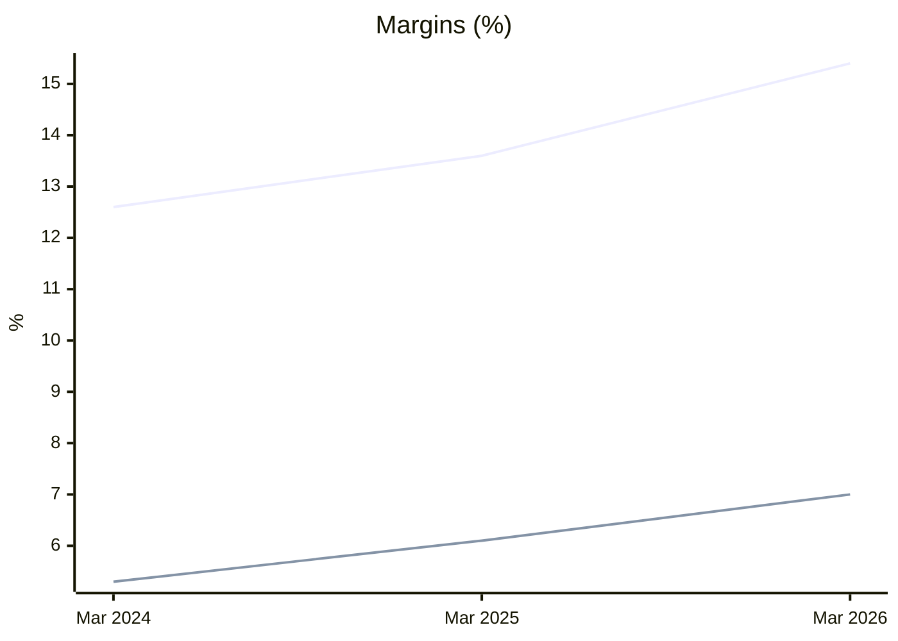

*Run 2026-11-24 · part of [SPINOFF_REPORT.md](../SPINOFF_REPORT.md) · the complete analysis of one company, with every management-call exchange in full.*

## INDIAGLYCO — India Glycols Ltd.

### 1. India Glycols Ltd. — CONFIRMED DEMERGER

**CONFIRMED** (a demerger scheme is on the exchange record) · **LISTED <1Y — selling-pressure window; the bargain forms here** · score 4.3/10 · spin-off · 42 filing(s) from BSE-screener, CALLS, NSE, NSE-register · first 2025-11-14, latest 2026-11-02

**The separated entities — every one the documents name:**

| Entity | Business | Listing | Who runs it |
|---|---|---|---|
| **Ennature Bio Pharma Limited** | Biopharma Undertaking — production of nutraceuticals, phytochemicals, and natural plant-based active pharmace… | listed 2026-11-04 as ENNATURE (NSE) | Ms. Pragya Bhartia Barwale (DIN: 02109262) as Man… |
| **IGL Spirits Limited** | Spirits and Biofuel Undertaking — manufacturing and production of alcoholic & non-alcoholic beverages, ethano… | listed 2026-11-04 as IGLSPIRITS (NSE) | Shri U.S. Bhartia (DIN: 00063091) as Chairman and… |

**What is being separated, as the documents put it:** The Bio Pharma (Biopharma) Undertaking — bio-pharma and bio-polymers businesses, plant-based APIs, nutraceuticals and nicotine derivatives — class `value_unlocking`.

### 2. Stages and dates

> **Listing:** LISTED — Ennature Bio Pharma Limited (ENNATURE) since 2026-11-04; IGL Spirits Limited (IGLSPIRITS) since 2026-11-04 (NSE equity list); record date 2026-09-02

| Date | Event | Source |
|---|---|---|
| 2025-02-04 | Board approval — Composite Scheme: KHL amalgamation into IGL + demerger of Bio Pharma Undertaking into EBL and Spirits and Biofuel Undertaking into ISL | as stated: Scheme of Arrangement intimation IGL/SE, 4th February 2025 |
| 2025-05-16 | Board approval — Modified Scheme (demerger only into EBL and ISL); Original Scheme withdrawn, Part I (KHL amalgamation) deleted | as stated: Scheme of Arrangement intimation IGL/SE/2025-26/05, 16th May 2025 |
| 2025-11-17 | Exchange no-objection — National Stock Exchange of India Limited — Observation letter no. NSE/LIST/48932 | as stated: cited in filings incl. Q1 FY27 results note 4, 12th August 2026, and … |
| 2025-11-19 | Exchange no-objection — BSE Limited — Observation letter no. DCS/AMAL/TS/R37/3905/2025-26 | as stated: cited in filings incl. Q1 FY27 results note 4, 12th August 2026, and … |
| 2025-11-20 | Stage reached: **exchange noc** | [General Updates](https://nsearchives.nseindia.com/corporate/INDIAGLYCO_20112025145105_Reg_30_Disclosure_Observation_Letter-ocr.pdf) |
| 2026-01-15 | Other — NCLT Allahabad Bench first motion order dispensing with certain meetings and directing meetings of Equity Shareholders and Unsecured Creditors of IGL | as stated: NCLT order dated 17.07.2026 and FY26 results note 4, 14th May 2026 |
| 2026-01-16 | Stage reached: **nclt sanction** | [Updates](https://nsearchives.nseindia.com/corporate/INDIAGLYCO_16012026154638_Reg_30_NCLT_Order.pdf) |
| 2026-02-16 | Other — NCLT modification order read with the first motion order | as stated: NCLT order dated 17.07.2026; shareholders meeting filings 24th March … |
| 2026-03-24 | Stage reached: **meetings** | [Shareholders meeting](https://nsearchives.nseindia.com/corporate/INDIAGLYCO_24032026201628_OutcomeSM.pdf) |
| 2026-03-24 | Shareholders / creditors meeting — India Glycols Limited — Equity Shareholders (4,42,48,625 of 4,42,48,626 votes in favour, 1 against) and Unsecured Creditors (36 of 36 participating creditors in favour, 100% in value) | as stated: filings IGL/SE/2025-26/93 and /94, 24th March 2026; Chairperson's Rep… |
| 2026-03-28 | Other — Second motion Company Petition CP (CAA) No. 07/ALD/2026 filed | as stated: NCLT order dated 17.07.2026 |
| 2026-04-01 | Appointed date — all three companies | as stated: NCLT order dated 17.07.2026; filing 20th August 2026 |
| 2026-04-09 | Other — NCLT admitted the Second Motion Petition and directed notices/publication (order uploaded 10th April 2026) | as stated: filing IGL/SE/2026-27/02, 10th April 2026 |
| 2026-05-05 | Other — newspaper notices of hearing published in Business Standard (English) and Uttar Ujala (Hindi, Nainital Edition) | as stated: NCLT order dated 17.07.2026 |
| 2026-07-02 | Other — NCLT heard the matter and reserved the order | as stated: filing IGL/SE/2026-27/22, 3rd July 2026, with NCLT order sheet dated … |
| 2026-07-17 | NCLT order — NCLT Allahabad Bench, Prayagraj sanctioned the Scheme (CP (CAA) No.07/ALD/2026) | as stated: filings IGL/SE/2026-27/24 (17th July 2026) and /25 (20th July 2026) |
| 2026-08-20 | Other — certified true copy of the NCLT order received by the Company | as stated: filing IGL/SE/2026-27/45, 20th August 2026 |
| 2026-08-21 | Other — Board resolution by circulation fixing the Effective Date and Record Date; boards of EBL and ISL appoint directors/KMP | as stated: filings IGL/SE/2026-27/47, /48 and /49, 21st August 2026 |
| 2026-09-01 | Effective date — all three companies; certified copy of NCLT order filed with Registrar of Companies, Uttarakhand; Resulting Companies ceased to be subsidiaries | as stated: filing IGL/SE/2026-27/51, 1st September 2026, with news release |
| 2026-09-02 | **Record date** | NSE corporate-actions register |
| 2026-09-02 | Stage reached: **record date** | Record Date (corporate-actions register) |
| 2026-09-02 | Record date — India Glycols Limited shareholders entitled to shares of EBL and ISL | as stated: filings IGL/SE/2026-27/47 (21st August 2026) and the cost-of-acquisit… |
| 2026-09-08 | Allotment — Ennature Bio Pharma Limited — 2,23,42,255 fully paid-up equity shares of INR 5/- each in the ratio of 1:3 | as stated: filing IGL/SE/2026-27/59, 8th September 2026 |
| 2026-09-08 | Allotment — IGL Spirits Limited — 6,70,26,765 fully paid-up equity shares of INR 5/- each in the ratio of 1:1 | as stated: filing IGL/SE/2026-27/58, 8th September 2026 |
| 2026-10-06 | Stage reached: **effective** | [Updates](https://nsearchives.nseindia.com/corporate/INDIAGLYCO_06102026180443_Apportionment_of_Cost_of_Acquisition.pdf) |
| 2026-11-02 | Stage reached: **listed** | [Updates](https://nsearchives.nseindia.com/corporate/INDIAGLYCO_02112026231155_Intimation_ISL_.pdf) |
| 2026-11-02 | Listing and trading — Ennature Bio Pharma Limited (2,23,42,255 shares) and IGL Spirits Limited (6,70,26,765 shares) — Listing and Trading Approvals received from BSE and NSE | as stated: filings IGL/SE/2026-27/72 and /73, 2nd November 2026 |
| 2026-11-04 | **Ennature Bio Pharma Limited** listed (ENNATURE) | NSE equity list |
| 2026-11-04 | **IGL Spirits Limited** listed (IGLSPIRITS) | NSE equity list |
| 2026-11-04 | Listing and trading — Ennature Bio Pharma Limited and IGL Spirits Limited — Date of Commencement of Trading | as stated: filings IGL/SE/2026-27/72 and /73, 2nd November 2026 |

**The stages, as filed:** exchange noc (2025-11-20) → nclt sanction (2026-01-16) → meetings (2026-03-24) → record date (2026-09-02) → effective (2026-10-06) → listed (2026-11-02)

**Stated in the filings:** resulting company **Ennature Bio Pharma Limited**; demerged undertaking: s from the Demerged; entitlement **1 for every 3**; record date 2026-09-02; appointed date 2026-04-01.

**When it lists, in the documents' words:** Per EBPL's letter dated 2 November 2026: listing and trading approvals received from BSE and NSE on November 02, 2026 for 2,23,42,255 equity shares of Rs 5/- each, with "Date of Commencement of Trading: November 04, 2026"; earlier, the 1 September 2026 news release said only that "The management of Ennature Bio Pharma Limited will apply to BSE and NSE for listing of its shares on the respective bourses."

### 3. Size of the separated business beside the parent — is institutional selling likely?

**Reading: VERY LIKELY — the piece is under a tenth of the whole; index funds and large holders who receive it without choosing it tend to sell.**

| Entity | Stated turnover | Stated share of the whole | Segment revenue share | Market cap (₹ cr) | Share of combined market cap | Index member |
|---|---|---:|---:|---:|---:|---|
| Ennature Bio Pharma Limited | Biopharma Undertaking — INR 250.47 Crs, turnover as per FY … | 3.16% | 5.8% (FY2026) | 467 | 18.3% | no |
| IGL Spirits Limited | Spirits and Biofuel Undertaking — INR 6,188.82 Crs, turnove… | 78.15% | 66.5% (FY2026) | 5,521 | 72.6% | no |

*Stated figures are the documents' own (a turnover share, or the cost-of-acquisition split the company publishes for tax, which reflects relative value); the segment share is this business's revenue over the parent's sales, and the market-cap share is the entity's value over the entity plus the parent (parent ₹2,087 cr, NSE bhavcopy of 2026-11-13), both computed here.*

**In the documents' words:** ““Turnover of the demerged division and as percentage to the total turnover of the listed entity in the immediately preceding financial year / based on financials of the last financial year — Turnover as per FY 23-24 financials in INR Crs / %: Biopharma Undertaking 250.47 3.16%; Spirits and Biofuel Undertaking 6,188.82 78.15%; Remaining business 1,479.48 18.69%; Total 7,918.77 100%””

**The judge's read of selling pressure:** likely — Smallest of three entities, only 2,23,42,255 shares on a 1-for-3 ratio creating odd lots; pharma/nutraceuticals unrelated to chemicals or spirits holders bought.

### 4. Insider ownership — share swap, promoters' holding, management incentives

**Share swap / entitlement, entity by entity:**

- **Ennature Bio Pharma Limited:** “EBL shall issue 1 (One) Equity Share having face value INR 10 (Indian Rupees Ten) each, to the shareholders of IGL holding 3 (Three) Equity Shares of INR 10 (Indian Rupees Ten) each”; after the stock split, per the NCLT order and record-date intimation: 1 (One) Equity Share of face value INR 5 each for every 3 (Three) Equity Shares of INR 5 each held in the Demerged Company
- **IGL Spirits Limited:** “ISL shall issue 1 (One) Equity Share having face value INR 10 (Indian Rupees Ten) each, to the shareholders of IGL holding 1 (One) Equity Share of INR 10 (Indian Rupees Ten) each”; after the stock split, per the NCLT order and record-date intimation: 1 (One) Equity Share of face value INR 5 each for every 1 (One) Equity Share of INR 5 each held in the Demerged Company

**Promoters' holding, from the shareholding pattern:**

| Company | Promoters | FIIs | DIIs | Public | Quarter |
|---|---:|---:|---:|---:|---|
| India Glycols Ltd. (INDIAGLYCO) | 59.63% | 2.77% | 3.06% | 34.54% | Sep 2026 |
| Ennature Bio Pharma Limited (ENNATURE) | 59.63% | 2.44% | 4.61% | 33.33% | Nov 2026 |
| IGL Spirits Limited (IGLSPIRITS) | 59.63% | 2.43% | 4.61% | 33.32% | Nov 2026 |

*Source: screener.in shareholding pattern, stored under `ShareholdingPattern/NiftyTotalMarket/`. In a mirror demerger each shareholder holds the same proportion of the new company as of the parent on the record date.*

- **Promoters in the parent, per the documents:** Promoters 1,88,91,032 equity shares, 61.01% of voting rights, Pre-Scheme as on 31st March 2025 (same 1,88,91,032 / 61.01 shown Post-Scheme); the same 61.01% is shown as on 31st December 2024 in the 4th February 2025 filing
- **What the promoters will hold in the separated entity:** Mirror shareholding: “Such withdrawal and simultaneous approval of Modified Scheme would, therefore, not have any impact on the interest of the stakeholders including public shareholders as they will continue to own the same percentage of shares in IGL and Resulting Companies.” Post-Scheme: EBL Promoters 62,97,011 shares = 61.01% (Public 40,23,489 = 38.99%, total 1,03,20,500); ISL Promoters 1,88,91,032 shares = 61.01% (Public 1,20,70,468 = 38.99%, total 3,09,61,500); IGL Promoters 1,88,91,032 = 61.01%. Benefit to promoter/promoter group/group companies from the restructuring: “NIL.”
- **What a public shareholder receives:** “Each Shareholder of India Glycols on the record date of September 2, 2026, will be entitled to receive one equity share of IGL Spirits Limited for every one equity share held in India Glycols Limited, and one equity share of Ennature Bio Pharma Limited for every three equity shares held in India Glycols Limited.” And: “As a result, a Shareholder holding 300 India Glycols shares on September 2, 2026, will be entitled to receive 300 equity shares of IGL Spirits Limited and 100 equity share of Ennature Bio Pharma Limited, resulting a total of 700 shares across the three entities, including the 300 equity shares held in India Glycols Limited.” Shares allotted rank pari passu with the existing equity shares of the respective Resulting Company; allotment is “Subject to the provisions for fractional entitlement in terms of the Scheme”.
- **Management incentives:** not stated in the documents on file.
- **Insider actions around the separation:** Promoter subscription ahead of the demerger: the Board on 16th October 2025 approved “Raising funds through Issuance of up to 51,03,765 Equity Shares of Face Value of Rs. 5/- each, at a price of Rs. 915/- per Equity Share, (including a premium of Rs. 910/- per equity share) ... for an aggregate amount of up to Rs.4,66,99,44,975/- on preferential basis”, approved by shareholders at the EGM held on November 12, 2025, with allotment completed on 24th November 2025 (paid-up capital raised to Rs. 33,51,33,825/-; listing and trading approvals 5th January 2026, effective 6th January 2026). The CFO stated on the Nov 2025 call: “the company has decided to come out with the preferential allotment to the promoters, friends and relatives. Out of that, the Board has already approved the issuance of 467 crores equity at the rate of INR 915 to the promoters, friends and relatives”, and on the May 2026 call: “the company has prepaid almost about INR804 crores in this quarter, which has been funded by INR467 crores through equity issue”. At the court-convened meeting of 24th March 2026 the Promoter and Promoter Group cast 3,99,67,854 votes, 100% in favour. Earlier (pre-dating this separation), under a separate composite scheme effective 2nd December 2024, Kashipur Holdings Limited acquired an additional 37,79,819 equity shares representing 12.21% of paid-up capital from promoter group entities (Ajay Commercial Co. 6,11,255; Facit Commosales 10,57,853; JB Commercial 9,77,915; J Boseck & Co. 8,64,401; Lund & Blockley 500; Supreet Vyapaar 2,67,895), taking Kashipur Holdings to 1,55,88,291 shares or 50.35%. No promoter or management pledging, selling or stated intent to sell in the Resulting Companies is stated. Benefit to promoter/promoter group/group companies from the proposed restructuring: “NIL.”
- **Insiders, per the checklist read:** Promoter family controls it: Pragya Bhartia Barwale Managing Director 5 years (ran the division to Rs 200 crore revenue); father U.S. Bhartia and sister Pooja Jhaver non-executive directors; promoters held 3,99,67,854 of 6,70,26,765 IGL shares, voted 100% in favour. · *option pricing date:* not stated

### 5. Why the demerger — point by point

Management presented the separation as a focus-and-investor-base argument, not a rescue: India Glycols was running four structurally different businesses under one listing — Bio-based Specialties & Performance Chemicals (BSPC, including the 49% Clariant IGL Specialty Chemicals JV into which IGL sells ethylene oxide), Potable Spirits (country liquor/IMIL plus IMFL, with the Amrut and Bacardi tie-ups), Bio-Fuel/ethanol-ENA sold at government-administered prices to OMCs, and Ennature Biopharma (thiocolchicoside, nicotine, nutraceuticals) with biopolymers. On 4 February 2025 the board approved splitting these into India Glycols (chemicals, glycols, bio-glycols, new specialties, industrial gases, plus the Clariant JV), IGL Spirits (spirits + bio-fuel/ENA) and Ennature Bio Pharma (biopharma + biopolymers), all three to be listed via the NCLT route. CEO Rupark Sarswat said the purpose was to run the companies differently with much more focus and to allow potential investments in different businesses because different investors have different appetites; CFO Anand Singhal listed the benefits as independent growth for each business, reducing the risk of one business affecting the others, unlocking value by drawing focused investors, and clearer focus leading to improved management and resource allocation — while insisting the structure would not unduly increase the cost base. Scale was quantified with 9MFY25 numbers: chemicals Rs 1,079 cr at 13.6% EBITDA margin, IGL Spirits Rs 1,628 cr net at 14.4%, Ennature Bio Pharma Rs 178 cr at 14.9% (against FY24 BSPC Rs 1,626 cr, Bio-Fuel Rs 512 cr, Potable Spirits Rs 5,575 cr gross). Capital allocation was the hard constraint: big capex was frozen until after the demerger, long-term debt was pre-allocated with the SBI-led consortium (about Rs 500 cr chemicals / Rs 700 cr liquor out of Rs 1,200 cr in May 2025, restated to Rs 600 cr / Rs 800 cr out of about Rs 1,400 cr in November 2025), the Rs 467 cr preferential allotment at Rs 915/share in November 2025 went entirely into prepaying debt, and the credit rating was parked on watch-list with no upgrade possible until the demerger completed. Management simultaneously defended keeping bio-fuel with spirits rather than with chemicals, arguing captive multi-feedstock ethanol/ENA gives backward integration, quality control, scale and resilience even if it dilutes percentage margin, and that plant proximity and the EO-to-JV link preserve synergies. By FY26 the residual chemicals business was pitched as under-earning for want of focus and in-house cost streamlining, with the contracted sale of a further 24% of the Clariant JV in FY29 expected to make the chemicals entity debt-free. The scheme was sanctioned by NCLT Allahabad on 17 July 2026, became effective 1 September 2026 (appointed date 1 April 2026), with IGL Spirits and Ennature Bio Pharma listing and trading from 2–4 November 2026.

**Point by point, with the source:**

1. Rupark Sarswat first unveiled the three-way restructuring, initially to sit inside the IGL group before listing. “So, essentially what we are trying to do is to restructure these businesses into three separate companies, for the time being within the IGL group.” — *CALL Feb 2025*
2. The core stated reason: different businesses need different strategies and attract different pools of capital. “And also, to allow potential investments in different businesses because different investors tend to have a different focus for investments.” — *CALL Feb 2025*
3. CFO Anand Singhal framed one benefit as ring-fencing contagion between segments (relevant given Ennature's margin collapse and the chemicals/EO price squeeze). “Separating the business will reduce the risk of one business affecting the others.” — *CALL Feb 2025*
4. Anand gave the pro-forma 9MFY25 size and margins of each proposed entity — chemicals Rs 1,079 cr at 13.6%, spirits+biofuel Rs 1,628 cr at 14.4%, Ennature Rs 178 cr at 14.9%. “IGL Spirits, which is proposed to be the other Company which will be having the Liquor business and the Bio-Fuel business, is having 9MFY25 turnover of Rs. 1,628, this is on net basis with 14.4% EBITDA margin.” — *CALL Feb 2025*
5. Anand confirmed the NCLT route, a 12-15 month timetable, 1 April 2026 appointed date and listing of all three entities. “So, this demerger will be effective from 1st April, 26 and all the three companies will be listed on the stock exchange.” — *CALL Feb 2025*
6. Investors pushed on listing of the biggest piece, noting over 75% of the business would sit in IGL Spirits. “Sir, my first question regarding post restructuring, more than 75% of business comes from IGL Spirits. Is there any plan to list that entity?” — *CALL Feb 2025*
7. Lender involvement: working capital and term loan allocation across the three companies had to be negotiated with the SBI-led consortium and was not yet confirmed. “Rohit, regarding the working capital allocation to each Company and the term loan allocation, we are talking to the term lender, mainly the State Bank of India, who is the leader in our consortium banking.” — *CALL Feb 2025*
8. Rupark stressed the split must not create duplicate overheads; corporate resources would stay shared with an allocation mechanism. “The principle of demerger to start with is to continue to run the businesses under one umbrella, but differently as in separately from a strategic perspective, but not unduly increasing the cost base.” — *CALL Feb 2025*
9. Asked by Saket Kapoor whether clubbing government-priced bio-fuel with liquor would dilute the IMFL valuation, Rupark defended it as backward integration, quality control and scale. “Well, percentage margin is one factor, but the overall profitability and resilience of the business also improves.” — *CALL Feb 2025*
10. First debt allocation disclosed: Rs 1,200 cr long-term debt split roughly Rs 500 cr to chemicals and Rs 700 cr to liquor, with annual repayments of Rs 150-160 cr (spirits) and Rs 90 cr (chemicals). “Just to brief you as of now position, we are having about INR 1,200 crores long-term debt in the books of the company, out of which about INR 500 crores will go to the Chemical division and INR 700 crores will go to the liquor division.” — *CALL May 2025*
11. Rupark restated the rationale and the exact clustering — spirits with ethanol/bio-fuel into IGL Spirits, chemicals with the Clariant JV, Ennature with biopolymers. “The idea is that different investors have different appetites for different kind of businesses.” — *CALL Aug 2025*
12. Growth capex was explicitly deferred to the post-demerger entities; FY26 limited to rollover and Rs 40-50 cr maintenance capex. “And after the demerger, the separate companies will think over the CapEx.” — *CALL Aug 2025*
13. Investor pushback: a long-term shareholder challenged unlocking value by demerging a unit whose net margin had fallen from ~33% (2021) to ~2.4%. “We are planning to unlock shareholder value by demerging our business units when there is extreme degrowth in that business.” — *CALL Aug 2025*
14. Entity-level debt restated: of about Rs 1,400 cr long-term debt, Rs 600 cr to India Glycols and Rs 800 cr to IGL Spirits, with the Rs 467 cr raise plus Rs 180 cr scheduled repayment cutting both proportionately. “INR 600 crores in India Glycols and INR 800 crores in IGL Spirits.” — *CALL Nov 2025*
15. The Rs 467 cr preferential issue at Rs 915/share to promoters, friends and relatives was earmarked entirely for debt reduction ahead of the split. “So, this is the update, and the money which whatever we will receive out of this preferential will be utilized for the reduction of the term loan.” — *CALL Nov 2025*
16. Rupark tied the restructuring to the broader strategy of focusing on bio-based ingredients and consumer/lifestyle value capture. “And one of the outcomes of that is in the last few years and now once again, how we've been reorganizing and restructuring our businesses to bring the necessary focus.” — *CALL Feb 2026*
17. Rating agencies had placed IGL on watch-list because of the demerger; no upgrade (and hence no full benefit of the Rs 582 cr debt reduction) until completion. “So, you will not find the rating improvement till our demerger happens.” — *CALL Feb 2026*
18. Capex remained gated on the demerger even after the Rs 467 cr raise and planned FY26 closing term debt of about Rs 1,100 cr. “Apart from this, we are not having any big size capex. And any capex will be undertaken only after the demerger.” — *CALL Feb 2026*
19. Rupark argued the chemicals business (FY26 net revenue Rs 1,203 cr, down 10.4%, EBIT Rs 141 cr, margin 11.7%) is understated and needs in-house cost streamlining and dedicated focus. “Now, there is, if you look at EBITDA without adjusting the other income and probably some streamlining that is required in-house, we will start to see that the quality of the Chemicals business is probably going to be better than this going forward.” — *CALL Jun 2026*
20. Anand said the contracted sale of a further 24% of the Clariant JV in FY29 would fund term-loan repayment and leave the chemicals entity debt-free. “So, in '28-'29, I'm hopeful that the Chemical business will be totally debt-free.” — *CALL Jun 2026*
21. Investors were tracking the NCLT timetable; management expected the sanction order around 21 May/early June 2026, then ROC filing. “21st May, we are hopeful that we will get the order for the demerger of the division.” — *CALL Jun 2026*
22. Plan change: the board on 16 May 2025 dropped the amalgamation of promoter vehicle Kashipur Holdings Limited and pursued the demerger alone, with appointed date 1 April 2026. “The earlier proposal for the amalgamation of KHL into the Company will no longer form part of the Scheme being pursued.” — *Scheme*
23. The 1 September 2026 news release stated the benefit as dedicated focus and better oversight and resource allocation for each of the three companies. “Each company will have a dedicated focus, enabling improved management oversight and more efficient allocation of resources towards growth.” — *Scheme*
24. The release made the capital-allocation argument explicit — each entity sizing its own capital and investment needs. “In addition, each company will be able to manage its capital, investments and resources based on its specific business requirements, thereby enabling more efficient utilisation of capital.” — *Scheme*
25. Share entitlement: 1 IGL Spirits share for every 1 IGL share, and 1 Ennature Bio Pharma share for every 3 IGL shares (6,70,26,765 and 2,23,42,255 shares of Rs 5 allotted on 8 September 2026). “Resulting Company 2 shall issue 1 (One) Equity Share having face value of INR 5 (Indian Rupees Five) each, to the shareholders of Demerged Company holding 1 (One) Equity Share of INR 5 (Indian Rupees Five) each.” — *Scheme*
26. The tax cost-of-acquisition apportionment implies relative weights of IGL Spirits 47.62%, India Glycols 31.77% and Ennature Bio Pharma 20.61%. “Accordingly, for the purpose of determining the Cost of Acquisition of the Equity Shares of the Company and the Resulting Companies following the Demerger, the shareholders may apportion the original Cost of Acquisition of their Equity Shares of India Glycols Limited in the following manner” — *Scheme*
27. Near-unanimous stakeholder approval at the 24 March 2026 court-convened meetings; the secured creditors' meeting was dispensed with on 95.46% consent, and unsecured creditors voted 36/36, 100% by value. “it appearing from the said reports that the Scheme of Arrangement has been approved by the requisite majority of Equity Shareholders (4,42,48,625 votes in favour out of 4,42,48,626, with 1 vote against)” — *Scheme*
28. Completion: ROC filing on 1 September 2026 made the scheme effective, Q1 FY27 pro-forma net revenues being India Glycols Rs 345 cr, IGL Spirits Rs 694 cr and Ennature Bio Pharma Rs 90 cr; both new entities began trading 4 November 2026. “Accordingly, in terms of the provisions of the Clause 24 of the Scheme, the “Effective Date” of the Scheme is 1st September, 2026 and the Scheme contemplating the Demerger has now become effective and the Resulting Companies have ceased to be the subsidiaries of the Company.” — *Scheme*

**How it evolved:** First disclosed on the 6 February 2025 call as a composite scheme that also folded promoter holding company Kashipur Holdings into IGL so promoters would hold IGL directly; by the 21 May 2025 call it was accompanied by a Rs 500 cr/Rs 700 cr debt split, and the board on 16 May 2025 dropped the KHL amalgamation to pursue the demerger alone. The 11 August 2025 and 18 November 2025 calls hardened the mechanics — three named entities, capex deferred to the post-demerger companies, debt restated to Rs 600 cr/Rs 800 cr, and a Rs 467 cr promoter-and-associates preferential issue to cut debt — while an investor on the August call openly questioned demerging a unit in degrowth. The 12 February 2026 call added that the credit rating would stay on watch-list and no sizeable capex would be sanctioned until completion, and the 18 May 2026 call was spent waiting on the NCLT hearing of 21 May. Shareholders (4,42,48,625 of 4,42,48,626 votes) and unsecured creditors (100% by value) approved on 24 March 2026; NCLT sanctioned on 17 July 2026, effective 1 September 2026, record date 2 September 2026, with trading in both new entities from 4 November 2026.

**What management expects from it:** Chemicals: cost streamlining, higher-value performance chemicals, improving EBIT (11.7% FY26), JV stake sale funding a debt-free unit by FY29. IGL Spirits: premiumisation toward ~22% EBIT margins on captive ENA, geographic and CSD expansion. Ennature: branded nutraceuticals margin recovery. All three: dedicated focus, own capital allocation, focused investors, value unlock.

*Not explained on the calls:* Never quantified: value unlock, standalone corporate costs, inter-company ENA/EO transfer pricing, shared Kashipur utilities, debt-covenant consents; no investor, lender or partner was named as having requested it.

- *Stated reason, in one line:* "The demerger will result in the creation of three separate companies, each with a clear business focus," giving each dedicated management oversight and capital, investments and resources managed to its own business requirements.
- *What it reveals:* Tax cost apportionment assigns Ennature 20.61% of value on only ~2% of group revenue (FY26 segment revenue Rs 207.77 crore, EBIT Rs 7.23 crore, 3.5%, down from 20.76 crore EBIT in FY25), with segment assets Rs 426.42 crore versus liabilities Rs 92.49 crore — a depressed-margin, asset-heavy business management says is being rebuilt into branded nutraceuticals.
- *Parent or spin:* spin · *Read next:* Ennature Bio Pharma's Information Memorandum (board-approved 8 September 2026) — standalone balance sheet, debt allocation and segment margin trend.
- *In their words:* “Ennature Bio Pharma Limited will house the bio-pharma and bio-polymers businesses.”

### 6. On the calls, verbatim

11 call(s), oldest first: **32 question-and-answer exchange(s)** given in full — the question and every answer to it, nothing trimmed — and 44 passage(s) from management's prepared remarks (the complete sentences about it; the whole remarks are in the linked transcript). Text is as the transcript prints it.

#### Nov 2023 — [transcript](https://www.bseindia.com/stockinfo/AnnPdfOpen.aspx?Pname=43cf98b1-158d-4aa9-9a57-e8d74c011449.pdf)

**From the prepared remarks** *(the passage about it; the whole turn runs to 0 characters in the transcript)*

> **(speaker not labelled):** realization would go on to adding the top line in biofuel, which I think is, if it continues, it's going to be even more positive than what it has been right now. That is how we see it. I've already spoken about, the new value-added product and a brief comment on the joint venture. Joint venture overall has been functioning quite well. I think the integration has been very good. The challenge of cost pressures like our chemical business has continued on the joint venture. And by and large, the joint venture has been focusing on formulated products, indigenizing products in India, and also looking at exports from India for bio-based products, fetching us some premium. So, there is some pressure there, but the joint venture is functioning well. And, we believe that as we do think about improving ethanol costs, including going back to the softened ethanol prices of internationally imported ethanol, that should help the joint venture. In terms of headlines for our business units, if you talk about bio-based specialties and performance chemical, I think we are moving towards, calling it, chemicals and biofuels, as biofuels becomes a significant part of what we do in the space, so this will continue to drive top line. As I said, we have been somewhat, let’s say, being doing business in the sense that we have done business, which was not profitable, which we had to do for various reasons. And things like reduction in freight, reduction in coal costs have also helped improve our margins. And, yes, it is an important sector for us in bio-based MEG. Bio-based MEG has been, kind of flat or has been under pressure in terms of volumes. But the development that we go seeing into the future is that the market for bio-based MEG will continue. Bio-based MEG goes into manufacture of polyester or PET, there was a feeling that recycled PET will replace a lot of bio-based MEG. We see that recycled PET has its own challenges, including the number of recycles that you can do. So, we will continue to see some traction for bio-based MEG in its own way. World is also working on 100% bio-based PET, which include bio-MEG and, bio-based PTA, we are engaged with those people who are working on those projects and as those materialize in the next maybe couple of years that will be another interesting growth period. I have already spoken about what has happened in the portable space. In the Ennature Biopharma space, it is a relatively smaller segment for us. The headline is that, whilst we've been under some pressure for sales, largely because there's a lot of competition in nicotine and there's a lot of cost pressure there, which has also eroded our margins. However, we continue to maintain our position in Thiocolchicoside. We have our sourcing of raw materials well covered over there. And there is a push for data quantities and demand in the market. And to some extent, it will continue to mitigate some of the market pressures on prices and costs that we have in this segment. India Glycols Limited November 06, 2023

**From the prepared remarks** *(the passage about it; the whole turn runs to 0 characters in the transcript)*

> **(speaker not labelled):** Saket Kapoor Right. Sir, if I may add just one more point. In your presentation, especially, sir, if we see, you mentioned about that our Ennature Biopharma performance has been subdued for the quarter also and for the first half also. If we take the top line and you mentioned in your presentation about the nicotine prices and the pressures, there. So, what's the next step of mitigation activities we are doing? And also, sir, in your presentation, you have mentioned about that you have a commenced production of nicotine at Kashipur doubling the capacity. So, if you could just give us some more understanding, and also about the other product. Rupark Sarswat So, Saket, basically what has happened is, nicotine has use in first of all in therapy because for de-addiction people use nicotine, and I think it has some use of intermediate, et cetera. So, there is a large number of player in the marketplace has been quite competitive because which has meant that we have seen price realization fall off something like 10% to 15% in 2023-24 compared to 2022-23. So that is mainly because of increased competition, not because of suppressed demand. And as far as the Kashipur facility where we were converting some of our given assets that were concerned, it is looking at the demand scenario. What we are also doing for nicotine is working with and because it is in the pharma space and similar space, et cetera. We are looking at newer markets where, say, the US, in Europe, et c etera, where realization is better, though the approval time is higher. So, we are working on our standards, our quality so that we can get those approvals. And, we are also looking at, in some cases, having tie-ups for some of our products which are right now not a very large part of what we do in Ennature Biopharma. It seems like where we could supply ready to consume B2C kind of branded products. So, we are looking at those kinds of tie-ups for curcumin, Astaxanthin etcetera. So, these are the main actions. And of course, in this scenario, we are also looking at how we can reduce our cost, improve our processes, improve our sourcing, for example, in Thiocolchicoside, that's the raw material plant-based, India is the largest producer. So, your position with respect to sourcing also determines your margin. So, one of the good things that I understand, people have Thiocolchicoside supplies covered better than what we think some others have, and Thiocolchicoside demand has been strong. So, we expect that our top line and bottom line in Thiocolchicoside, will continue to remain healthy in the near future.

**From the prepared remarks** *(the passage about it; the whole turn runs to 0 characters in the transcript)*

> **(speaker not labelled):** Saket Kapoor And what has been its contribution, sir? This product which you mentioned right now, for the first half in terms of the top line and bottom line. Also, sir, if you take into account this segment performance, last year, our top line was at closer to INR 192 crore and the bottom line was around INR 49 crore profitability. So, taking into account the current situation, what should be the trajectory for the second half, since the profitability has moved lower QoQ from INR 13 crore to INR 7 crore, and for the first half it is closer to INR 20 crore. So, especially for the segment if can tell us the future outlook? Rupark Sarswat Look, also keep in mind that, before that Ennature Biopharma productivity and top line had grown very well. So, business has a bit of cyclicality. So, if you look at potable spirit for Ennature Biopharma, H1, we registered a top line of INR 99 crores, right? And we’ve registered, a bottom line of INR 20 crores, in terms of EBIT that is what has been shared to you in H1. The expectation is, while we expect the pressures on nicotine, et cetera, to continue in the second half, because we are working on approvals and new market, et cetera. But because of our better position in Thiocolchicoside, in terms of sourcing, we expect that, while the pressure will continue, our profitability in our top line will be better in the second half. Saket Kapoor Okay. So, is it fair to match last year’s number, sir? Is there any visibility basis the current numbers? Rupark Sarswat We think that it will be better than first half. We are trying to kind of be equal or better what we’ve done last year. But we expect some challenge in the whole year, though the second half will be better than first- half. Moderator Thank you, sir. Next question comes from Makarand Tilloo, an Individual Investor. Please go ahead. Makarand Tilloo Thank you very much. Sir, I would like to ask you that, this LanzaTech, that was mentioned in previous presentations. When this project will be in full fledge next year? What kind of turnover we are expecting? India Glycols Limited November 06, 2023

#### Feb 2024 — [transcript](https://www.bseindia.com/stockinfo/AnnPdfOpen.aspx?Pname=938871a7-abe3-4aec-a16d-ed622582e084.pdf)

**From the prepared remarks** *(the passage about it; the whole turn runs to 0 characters in the transcript)*

> **(speaker not labelled):** MR. ANAND SINGHAL – CHIEF FINANCIAL OFFICER MR. RAJESH MARWAHA – HEAD, SALES & MARKETING (BSPC) MR. S. K. SHUKLA – HEAD - LIQUOR BUSINESS MR. ANKUR JAIN – HEAD (LEGAL) AND COMPANY SECRETARY ANALYST: MR. ROHIT SINHA – SUNIDHI SECURITIES LIMITED India Glycols Limited February 05, 2024 Page - 2 - of 25 Moderator Good evening, ladies, and gentlemen. I'm Pelsia, moderator for the conference call. Welcome to India Glycols Limited Q3 FY24 Earnings Conference Call. As a reminder, all participants will be in the listen-only mode, and there will be an opportunity for you to ask questions after the presentation concludes. Should you need assistance during the conference call, please signal an operator by pressing * and then 0 on your touchtone telephone. Please note that this conference is being recorded. I would now like to hand over the floor to Mr. Rohit Sinha from Sunidhi Securities Limited. Thank you, and over to you, sir. Rohit Sinha Thank you. Good evening, everyone. Thank you for joining us on India Glycols Limited Q3 FY24 Results Conference Call. We are joined on this call with India Glycols management represented by Mr. Rupark Sarswat, Chief Executive Officer; Mr. Anand Singhal, Chief Financial Officer; Mr. Rajesh Marwaha, Head - Sales and Marketing (BSPC); Mr. S.K. Shukla, Head-Liquor Business; and Mr. Ankur Jain, Head (Legal) and Company Secretary. I would like to invite Mr. Rupark Sarswat to initiate this proceeding with his opening remarks post which we will have a Q&A session. Thank you and over to you, sir. Rupark Sarswat Good afternoon, everybody, and thank you for joining us for this investor presentation. As we normally do, I will take you through a quick update on the performance of IGL so far in this quarter and nine month and my quick comments on that and subsequently we can take questions. So, as you would have seen, it was a strong overall performance with robust growth in revenue and profitability for IGL. Our gross turnover at INR 2,119 crores was up 39.0% for the quarter. As you know, there is a very high excise component in our gross turnover. Our net turnover of INR 904 crores was up 63.3% for the quarter. Similarly, EBITDA at INR 107 crore for the quarter is up 40.3% and EBITDA margin at 11.8%, PAT at INR 42 crores up 90.1% and PAT margin at 4.6% up 68 basis points. As I will talk about it briefly a little later all three segments for us which we classify broadly as Bio-based Specialties and Performance Chemicals. I was saying that there has been a strong overall performance with robust growth in revenue and profitability in all three segments delivering a strong double-digit revenue as well as profit growth. There also has been a strong margin growth in all the segments, particularly led by potable spirits for the quarter. If you look at the yearly performance, our gross turnover at INR 5,882 crores is up 17.0% and our net turnover at INR 2,368 crores for the nine months is up 16.6% as compared to the same period last year. Our EBITDA at INR 319 crores is up 45.6%. Our EBITDA margin is at 13.3% which is also up 267 basis points, and our PAT is also up 79.0% at INR 131 crores. So, on a nine-monthly basis also there is a strong revenue and profitability growth, particularly led by good performance in potable spirits and bio-based chemicals and specialties As I mentioned with a positive start in Biofuels, we expect to do better in the coming year as well. Amongst other things that we have spoken about, our actions to put in grain-based ethanol plants was timely and has helped us in mitigating the cost increases. And we've also discontinued some low-margin domestic business which has also helped overall performance. If you India Glycols Limited February 05, 2024 Page - 3 - of 25 look at business performance and drill down a little bit more, our gross revenue is up 39.0%, net revenue of 63.3% what I already said. For the chemicals segment, which is BSPC, the net revenue grew by 87.8% in the quarter. For potable spirits it grew by 30.1% in the quarter over the same quarter last year, and for Ennature Biopharma it grew by 21.8%. Overall EBITDA grew for 40.3%. And if you look at the nine monthly basis, it was supported by a strong growth particularly in BSPC and Potable Spirit segments which is 15.4% and 23.3% respectively. As I mentioned to you, we have benefited from our actions really, wherein the fact that we are putting grain-based ethanol plants which

**From the prepared remarks** *(the passage about it; the whole turn runs to 0 characters in the transcript)*

> **(speaker not labelled):** IMFL or Indian Made Foreign Liquor growth has been led by sales expansion, mainly in the paramilitary segment where our presence was relatively low, where we have expanded to 13 states, and also IMFL sales in Delhi, which have been significant contributors in driving the IMFL sales for this quarter as well as the year. In-house manufacturing of ethanol has not only helped us in the BSPC segment but also in the potable spirit segment, both from a supplier perspective as well as from a cost perspective. We've also been focusing on premiumization and improvement in the width of distribution, which is also yielding results both in terms of top line growth as well as quality of the business. In Ennature Biopharma, we've visited a Q3 revenue of INR 51 crores up 21.8%, EBIT of INR 12 crores up 16.2%, 9MFY24 revenues at INR 149 crores and EBIT margin of 21.2%. We've had continued pressures, particularly on nicotine sales, because it's becoming a competitive market with more and more players. However, our efforts have been on building value-added pharma customers, which we believe will start to result in the times to come. India Glycols Limited February 05, 2024 Page - 5 - of 25 Fortunately for us, our position on the raw material has been stronger and there has been an upward trajectory in prices, but we had our bookings which has resulted in better margins for Thiocolchicoside & Colchicine. Broadly our focus also has continued to expand nutraceuticals in the key global market. I will now hand over to my colleague Mr. Anand Singhal to take you to the financial. Anything else you would like to add? Okay. So, I think we will leave it for you to then ask us questions on financials or all the business. We can then take them to the Q&A. Q&A Moderator First question comes from Bala Subramanian from Arihant Capital Markets. Please go ahead. Bala Subramanian Good evening, sir. Congratulations for good set of numbers. On the earlier call, the guidance was around INR 3,500 crore top line by end of this year. Is there any change in that guidance? And we got recently one order of INR 1,164 crore. Is that fair to assume around INR 300 crore revenue per quarter from this order we can expect? Because the order supply period is around November 2023 to October 2024. What's your view on that? Rupark Sarswat So, Bala, two points. One is that we do not generally issue specific guidance, there may have been some discussions. But my broad expectation for the coming quarter and for the year is that we expect the current business performance and the environment to continue. And that would guide you towards the kind of results that we would expect. The other small correction I would like to make for the purpose of bein g precise is on biofuel. It is an allocation and not exactly an order. While we expect that this allocation, will translate into supplies which is what these big oil companies usually do. But I must mention that it is an allocation and not a purchase order for that period. However, from an allocation perspective, obviously it is a contract. And it will be fair to assume that depending on the macroeconomic environment, depending upon the policies of the government and some other factors which sometimes may affect biofuel blending from time-to-time. This kind of top line growth is something that we would like to potentially see from this allocation. Bala Subramanian Got it. On the second side, on the JV Clariant side, what would be the top line; and on margin side, what kind of opportunities we have in this business? India Glycols Limited February 05, 2024 Page - 6 - of 25 Rupark Sarswat

**From the prepared remarks** *(the passage about it; the whole turn runs to 0 characters in the transcript)*

> **(speaker not labelled):** Moderator I'm sorry, sir. Disturbance is from Bala Subramanian line, sir. He got dropped. Shall we move to next question? Rupark Sarswat Yes, please. Thank you. Moderator Thank you, sir. The next question comes from Saket Kapoor from Kapoor & Co. Please go ahead. I repeat. Question comes from Saket Kapoor from Kapoor & Co. Please go ahead. India Glycols Limited February 05, 2024 Page - 8 - of 25 Saket Kapoor Yes, sir. Namaskar, sir, and thank you for this opportunity. Sir, I just missed some part of your remarks to the previous participant. So, pardon me if I'm repetitive. Sir, firstly, taking into account the current scenario with respect to the raw material, we may expect an increase in margin for our bio-based specialty and potable spirit going ahead. That is a good understanding? Rupark Sarswat I think that's a fair expectation based on how we at this point in time see imported bio-based ethanol prices coming down. However, I may need to say that with caution as far as biofuels and potable spirits is concerned. And the reason I’m saying this, I am not so concerned about the top line. The reason I’m saying this is that the dynamics of the two is different. Whilst for chemicals, we can use imported ethanol as well as ethanol produced within India either by ourselves or purchased domestically by us. However, for potable spirits, we can only use ethanol which is produced in India and for biofuels, there is a predetermined price by the government on various feedstocks, C heavy molasses, B heavy molasses, cane juice and damaged rice or FCI supplied rice and MEG, etc. Which means that our profitability can get affected based on price movements of two or three things, which is the grain that we buy or the molasses that we buy, as well as sale price of one of the byproducts, DDGS, which is a protein into the market. So, while it is a reasonably fair assumption for bio-based chemicals, and however it is not something that I can exactly predict for potable spirits as well as for biofuels. Within potable spirits, there is a cost factor which involves cost of ethanol. Yes, this year it has benefited us because instead of buying we have been producing grain-based ethanol. But grain-based ethanol costs can be variable in the future as well. But the larger focus in the potable spirit space for us is about expanding, one, to selected new markets and also improving our product mix. So, does that answer your question, Saket? Saket Kapoor Yes, sir. I got the understanding. So, my next question was also pertaining to this policy framework, pertaining to both our potable alcohol as well as bioethanol segment. In terms of I think so, for this sugar season, the levy molasses percentage has also been increased by the Uttar Pradesh government. So, how does that gel for us as a company in terms of the purchase of molasses, as levy molasses percentage goes up? S. K. Shukla See, this is a good part in UP because government is giving the full security in the raw material, availability of raw material as well as the price both to the manufacturer of potable liquor. So, this year also as compared to the last year when the reservation percentage was around 19%, now the government has increased from 19% to 26%. So, we are assuming that next year would be the very comfortable year for the potable spirit manufacturers in UP as India Glycols Limited February 05, 2024 Page - 9 - of 25 far as the raw material is concerned. So, we are hoping that margin should be fair in the coming months from the

**From the prepared remarks** *(the passage about it; the whole turn runs to 0 characters in the transcript)*

> **(speaker not labelled):** Potable Spirit sector. Saket Kapoor Hi Shukla ji, like you’re saying and we also got some price increase in potable alcohol segment. So, that will aid our margins only going ahead, since the cost is not going to go up. S. K. Shukla Yes, certainly we are hoping that and now this year new segment of the grain ethanol this government has added in 36 degrees. So, we are hoping that the coming years will be the more good months for just evaluating or just increasing our potable production for the grain in UP annual category in the 42.8 and 36 degree. So, these two steps are good for the industry. Saket Kapoor My question to Rupark, sir. When we look at our number for the company sequentially, we find that for the bio- based specialty performance and also for our potable alcohol, we see a dip in margins. You were alluding to the fact that margins have improved YoY, but how? Please correct me here. When we look at our September quarter performance with December quarter for both the segments, it is only the Ennature Biopharma wherein we have seen an expansion in margin. Both the other segments, there is a dip in margin with the commensurate revenue the margins have taken a hit. So, if you could explain the key reason why these two segments have not performed with the increase, why there is a reduction in margin. Rupark Sarswat You mean in margin percentage? Saket Kapoor Correct sir. On a top line of INR 508 crore for September quarter for bio-based, we posted an EBIT of INR 40 crore. Whereas for this quarter, on a revenue base on INR 610 crore, the EBIT is INR 39 crore and simultaneously for potable spirit also INR 1316 crore had INR 40 crore of EBIT, and now INR 1459 crore had INR 41 crore, we can see contraction in both the segments. If you can explain this anomaly? India Glycols Limited February 05, 2024 Page - 10 - of 25 Rupark Sarswat See, as far as this quarter for bio-based chemicals is concerned. Overall, the number we have shared with you for the business, all the margins are not only coming from Ennature Biopharma, that is a relatively lower contribution. So, if you see, there has been a margin expansion in BSPC from at an EBIT level for the quarter from 30-38 and for 9M from 80-121, right? Saket Kapoor Yes, sir, continue. Rupark Sarswat So, we had an overall margin expansion, margin meaning overall absolute margin. But in terms of percentages, let me just have a look, I have the numbers. In terms of percentages, there is a slight drop for the 9M period for chemicals, and it has also happened because of grain prices going up quite sharply. And for the time being, there is a lag between before the government acts to revise the prices etc., which also as far as I understand they have revised efforts, so that eroded some margins. That impacted the percentage margin for us. Saket Kapoor Okay. And lastly sir for Ennature Biopharma. In your presentation, you have articulated about nicotine sales

**From the prepared remarks** *(the passage about it; the whole turn runs to 0 characters in the transcript)*

> **(speaker not labelled):** continue to face pressure, but also you have pointed out to strong raw material position in an upward trajectory in Thiocolchicoside and another word terminology you have used. So, if you could give us the trajectory of what the likelihood should be? Because we are flat on the Ennature Biopharma for the 9M. So, how are we performing in this segment? And sir, the base that’s being prepared for the next year, what growth can we expect depending upon the business environment? Manish Pant Saket, Manish this side. So, as far as nutraceutical is concerned, first two quarter was in stress, no doubt. But in Q3 we have a recovery, not only in margin but also in sales volume. And the Q4 is going to be remained same as Q3 or it could be more than the Q3. So, we are going to end the whole of the year as far as the nutraceutical is concerned at par with the previous year at least, if not less. With respect to the next year guidelines, in nicotine, no doubt, it is under pressure as far as the export is concerned. So, we are now developing the nicotine derivatives for which we have already backed some very good orders from the local manufacturing of the tobacco-related and the nicotine patches related companies. So, I hope that nicotine will recover somewhere in the Q2 of the next year. And Thiocolchicoside, right now the prices are very India Glycols Limited February 05, 2024 Page - 11 - of 25 good and we are having quite raw material already available with us in the lower margins, in the higher margins with respect to the preview prices. So, I think the first two quarters would be same as the Q3 and Q4 of this year. Saket Kapoor If we get the split between nicotine and Thiocolchicoside out of this INR 50 crore, what should be the percentage or even for the nine months if you could give the split between the two? Manish Pant As far as Thiocolchicoside, there is a very much price difference in that. Like Thiocolchicoside is a very high-value item like INR 4.25 lakhs per kg and on the other nicotine is hardly INR 7,000 per kg. So, the value comparison would not be there. As far as the EBITDA percentage is required to maintain the overall EBITDA. Thiocolchicoside is certainly going to give some very good margin to us. And nicotine, we are trying to recover and trying to increase the margins by adding the new derivatives in the nicotine segment, not pure nicotine. Saket Kapoor Okay. And last point to Anand Singhal ji is about the finance cost part, sir. If we look at the number again for QoQ also and I think for YoY also, there is a significant increase from INR 26 crore to INR 32 crore. So, Anand ji, if you could give me, first of all our current debt numbers, what is our net debt as on 31st December and what has led to this increase in the finance cost? Anand Singhal Saket, finance cost has increased because of the recent expansion for which we have raised some term loans, and that is in our radar to reduce the finance cost for which we are taking some measures. As far as the term loan is concerned. Sorry. Net term loan as of 31st December it is around INR 650 crore. Saket Kapoor And our working capital, sir? Anand Singhal Working capital, Fund-based working capital is INR 350 crore and non-fund-based sanction limit is INR 850 crore. Saket Kapoor INR 850 crores. For the 9M how much we did on CapEx, how much have we spent? India Glycols Limited February 05, 2024 Page - 12 - of 25

**From the prepared remarks** *(the passage about it; the whole turn runs to 0 characters in the transcript)*

> **(speaker not labelled):** Anand Singhal Till 9M, the total work in progress in our book is around INR 414 crore and hopefully the CapEx for about INR 300 crore will be completed by 31st March which will be capitalized and rest of the funds will be shown under CWIP and which will capitalize in next year when the CapEx will be completed. Saket Kapoor Okay, sir. If the time permit, just a small observation. We have found that this time Pragya madam has chaired the meeting. Any particular reason or do you generally find Mr. Bhartia there? Anything to be mentioned? Succession planning or what could be? Anything to read about it, sir? Ankur Jain Please don't make any speculation or like that. Mr. Bhartia was not well that time. Anand Singhal You would have noticed, we have not noticed Saket this thing. Saket Kapoor Okay sir. I wish him a speedy recovery. Moderator Thank you. Next question comes from Bala Murli Krishna from Oman Investment Advisors. Please go ahead. Bala Murli Krishna Hi, good evening. This is my first call. First of all, I would like to say that I've gone through Annual Report and it's a very well described product wise and category wise. This is one of the best Annual Report I came across. Regarding this distillery segment I have a few questions. So as of now, we have around 340 KLPD capacity and we are going to add 700 KLPD in the coming maybe three-four quarters. Is it right sir? Anand Singhal Right now, in Kashipur we have 400 KLPD grain-based distillery which we are further increasing to 500 KLPD. In Gorakhpur, we have 110 KLPD distillery which is working right now and adding 180 KLPD distillery more in Gorakhpur, which will be completed say in 2024-2025. India Glycols Limited February 05, 2024 Page - 13 - of 25 Bala Murli Krishna But sir, in recent action selling and in Kashipur I think we are showing that existing capacity at 140 KLPD. Anand Singhal That is biofuel not distillery. Bala Murli Krishna Biofuel. Okay, understood. So, my question is regarding this biofuel only. Rupark Sarswat I think it will just be good to understand that we produce ethanol. This ethanol, basically, is produced using various feedstocks which include grain and molasses, both at Kashipur as well as Gorakhpur. This ethanol is then used for potable spirits, biofuels as well as potentially as an intermediate for chemicals. So, this interlinkage, it is good to

**From the prepared remarks** *(the passage about it; the whole turn runs to 0 characters in the transcript)*

> **(speaker not labelled):** keep in mind, and sometimes if we understand that, we will be aligned in terms of our understanding. Okay, please go ahead. Bala Murli Krishna So, regarding capacity additions. Are we planning to sell all the ethanol to OMCs or do we have any plan to use for captive consumption also? Rupark Sarswat Look, it is a dynamic situation for us where we evaluate, what is the best mix for us to sell into potable, to put it into potable spirits, which obviously gives us good returns per liter of ethanol, to use it as an intermediate for chemicals or to sell it into biofuel segment. The reason I'm saying this is that, for example, when imported ethanol was very expensive, we diverted significant quantities of our grain-based ethanol produced in-house as an intermediate to the chemical segment. Now that imported ethanol prices are correcting, it makes sense for us to start importing ethanol for intermediate use in chemicals and divert higher quantities into biofuel. So, it is a combination of demand and allocation that we have got, the price of imported ethanol, the realization that we are getting in potable spirit. What we find is that given the scenario that I more or less see for the year ahead, based on how we see our businesses going, we will be able to place all our excess feedstock in terms of ethanol into the biofuels market. We should not have a problem in filling up our plants there. And that is obviously based on allocation that the India Glycols Limited February 05, 2024 Page - 14 - of 25 government has decided, making some assumptions with respect to grain availability, making some assumptions with respect to imported ethanol. We believe going forward for some time we will be buying, getting back to buying imported ethanol for chemicals, and releasing more and more capacity of grain-based ethanol for biofuels, obviously after covering for our potable spirits. Bala Murli Krishna Okay sir, understood. Thanks for the explanation. So, sir, regarding this 700 KLPD, normally 200 KLPD can contribute approximately INR 500 crores of revenue on annual basis. So, the 700K LPD can contribute around INR 1,700 crore of revenue with the EBIT margins of around 16-18%. As I compared with the peers, I'm tracking them also. So, is it the fair assumption, sir, in your case also? Rupark Sarswat See, I have already indicated to you the biofuels part of the turnover. I also mentioned to you that it is not as status calculations for us to assess turnover for our case because our ethanol can go into intermediate use, will go into potable spirit where it will go as intermediate. Now, you are probably making an assumption for a plant which only produces ethanol and sells all the ethanol that it produces. And also, you may yourself need to check your numbers based on the cost which can be very variable in terms of margins which as far as I understand, that is not the margin that industry is making on selling biofuels at this point in time. It was the case earlier, but not at this point in time. Bala Murli Krishna Okay, sir. And regarding the feedstock for these new capacities, which feedstock we are preferring and are there any sourcing already happened like long term contracts of feedstock, raw material? Rupark Sarswat Can you please repeat your question? I'm not very clear. Anand Singhal I think you are asking about grain supply, no? Bala Murli Krishna Yes.

#### Jun 2024 — [transcript](https://www.bseindia.com/stockinfo/AnnPdfOpen.aspx?Pname=47d07394-61eb-4ec4-8e04-35c30855d685.pdf)

**From the prepared remarks** *(the passage about it; the whole turn runs to 0 characters in the transcript)*

> **(speaker not labelled):** ANALYST MR. ROHIT SINHA - SUNIDHI SECURITIES LIMITED India Glycols Limited May 30, 2024 2 Moderator: Good evening, ladies and gentlemen. I am Saumya, moderator for the conference call. Welcome to India Glycols Limited Q4 & FY24 Earnings Conference Call. As a reminder, all participant lines will be in the listen-only mode, and there will be an opportunity for you to ask questions after the presentation concludes. Should you need assistance during the conference call, please signal an operator by pressing * and then 0 on your touchtone telephone. Please note that this conference is being recorded. I would now like to hand over the floor to Mr. Rohit Sinha. Thank you and over to you. Rohit Sinha: Good evening, everyone. Thank you for joining us on India Glycols Limited Q4 & FY24 results conference call. We are joined on this call with India Glycols management, represented by Mr. Rupark Sarswat, Chief Executive Officer; Mr. Anand Singhal, Chief Financial Officer; Mr. Rajesh Marwaha, Head - Sales and Marketing (BSPC); Mr. S.K. Shukla, Head-Liquor Business; and Mr. Ankur Jain, Head (Legal) and Company Secretary. I would like to invite Mr. Rupark Sarswat to initiate this proceeding with his opening remarks post which we will have a Q&A session. Thank you and over to you, sir. Rupark Sarswat: Yes. Thank you, Rohit. Very good afternoon to everybody who has joined on this hot summer afternoon, particularly from a Delhi perspective. I'm joined here by my colleagues, who Rohit has already introduced. I'll take this opportunity to give you some overview comments on the performance for this quarter as well as the year, and then subsequently, we can take your questions. So as you have seen, we've had a good year overall and good quarter as well. So if you look at the numbers in Gross Revenue terms, we have clocked a growth of 19% at INR 7,922 crores. Our Net Revenue is up 24% at INR 3,294 crores for FY24. And in terms of EBITDA, that is about INR 428 crores, up 34% and PAT, which is INR 173 crores, up 23% for the full year. So overall, there is a good performance both in terms of revenue and profitability. Particularly, it has been led by both top line and bottom-line performance by the BSPC segment, which is essentially chemicals and biofuels as well as potable spirits. And particularly good start as we added capacities for biofuels in the biofuels segment. As we have spoken over the last 1-1.5 years, it is in line with what we had anticipated after putting up grain-based capacities for ethanol, which has allowed us to do a risk mitigation as far as ethanol supply and costs are concerned. And now the situation is that we are importing significant quantities of ethanol for chemical intermediates production, and which has meant that the capacity that we have put up is now available to therefore contribute to the biofuels revenue as well as contribution. For the quarterly performance, the Gross Revenue at INR 2,039 crores is up 26%. The Net Revenue at INR 926 crores is up 50%, and EBITDA at INR 109 crores is up 9%, and PAT at INR 42 crores is up 6%. So we can see that there is a strong performance overall, both in terms of gross and net revenue. India Glycols Limited May 30, 2024 3 Particularly, the top line growth has been driven by potable spirits. It has been relatively modest in the Chemicals segment for this quarter. And in terms of high level highlights for the company, you see a revenue growth of 24%, EBITDA up 34% and a healthy EBITDA margin of 12.9%, which is better than before. As you know, we've had a couple of tough years, and as we have kind of anticipated and also taken actions for this has led to improvement. So, I already spoke about grain-based capacities and the new biofuel portfolio helping us both top line and bottom line. In potable spirits, sales were driven mainly by increases in country liquor sales with both good performance in Uttarakhand and UP, where we are close to our market leaders, particularly in Uttarakhand. And in IMFL, most of the growth has come from our new market, which is Delhi and the paramilitary segment, and we will talk about it more later on. As you know, our key feedstock is ethanol for multiple

**From the prepared remarks** *(the passage about it; the whole turn runs to 0 characters in the transcript)*

> **(speaker not labelled):** businesses. The cost pressures on ethanol to some extents have continued with high international ethanol prices. Although, they are not as high as they were earlier when we spoke about, 1.5 years ago. And what has also happened is that in the biofuels segment, there has been some volatility with respect to cost of grain and sales price of DDGS, which has meant that there have been periods in between where the margins of grain-based ethanol being sold as biofuels have been a little soft. Ennature Biopharma, a relatively smaller segment for us, has registered a growth of 7%. However, here we've seen margin pressure in particular due to a challenging market, price erosion in nicotine and API segment. Having said that, I think the strategy is on track. We are focusing on long-term risk mitigation and building a pipeline of value-added products. We've also been talking about new value- added products, and I'm happy to share that there is a steady and a good start to commercialization of projects in the new value-added pipeline. In fact, we are expecting the plant to be fully commissioned in about a quarter's time, though we've started significant production already. We are anticipating that the capacities that we have put up, even though they are not very large to start with, and that was part of a strategy to have a modular approach. We are expecting that those, by and large, taking a little bit here and there will, at least in some sections, get fully occupied in the current financial year, and we may be talking about incremental expansions to take the value-added chemicals portfolio ahead. As you know, we have a joint venture, wherein we are putting a specialty chemicals business a couple of years back, IGL having 49% of the share. So that reflects on our overall profit performance. There has been a strong recovery in margins in joint venture performance, mainly driven by reduction of material costs. As you know, we've spoken earlier, one of the key factors, which affects amongst others, the joint venture performance is the cost of Ethylene Oxide, which IGL supplies to the joint venture. And for the factors that I've discussed, which is energy cost increases, which have moderated, which have come down for ethanol costs, which have moderated, plus the fact that we have put up our own grain-based ethanol capacity, has meant that the cost difference between crude-based ethanol in the market and ours has come down, though the delta is still there. And therefore, the relative competitiveness of the JV is better. India Glycols Limited May 30, 2024 4 So Q4, for example, the joint venture showed revenues going up 3% and EBITDA, though on a smaller base for the constraints that we said, getting up by 68%. And for the full year, there has been some recovery. We had lost sales. So now the full year in terms of top line looks flat and there's a modest EBITDA increase of 4%. So it's a good news from the perspective of the joint venture as well. A final dividend of INR 8 per equity share has been declared. And we are utilizing our grain-based ethanol capacities nearly fully to what we have right now to service the contracts that we have with oil marketing companies, and that looks steady. But before I move on to a segment-wise commentary, what I'll do is I'll request my colleague, Anand, to give you a quick update on the financial performance. Anand Singhal: Good afternoon. I will take the results on consolidated basis. In the current quarter, the gross sale is INR 2,039 crores, vis-à-vis INR 1,616 crores in the last year corresponding quarter, showing an increase of about 26%. The net sale is INR 926 crore vis-à-vis INR 619 crores, showing almost about 50% improvement in the net sales in the current quarter. The EBITDA is INR 109 crores vis-à-vis INR 100 crores in the last corresponding quarter showing 9% increase, while PBT is INR 55.6 crore as compared to INR 45.64 crore, showing an increase of 21.8%. The profit after tax is INR 42 crores against INR 39.84 crores, showing 5.9% growth. The reason for this is due to the higher provision of the income tax. The EPS in the current quarter is INR 13.63 vis-à-vis INR 12.87 in the last year's corresponding quarter. To take up the yearly results, for the year end 31st March '24, gross sale is INR 7,922 crores, vis-à-vis INR 6,641 crores, showing an increase of about 19%. The net sales is INR 3,294 crores, vis-à-vis is INR 2,651 crores, showing an increase of 24.26%. EBITDA is INR 428 crores, vis-à-vis INR 319 crores, showing an increase of 34%. PBT is INR 223 crores vis-à-vis INR 165 crores, showing a 35% increase and PAT is INR 173 crores, vis-à-vis 141 crores, showing an increase of about 23%. The EPS for the current year is INR 55.87 vis-à-vis INR 45.55 in the last year. I'll say as far as the operations is concerned, this year is the best year in the history of the company as far as the sales and the profitability.

**From the prepared remarks** *(the passage about it; the whole turn runs to 0 characters in the transcript)*

> **(speaker not labelled):** Rupark Sarswat: Thank you, Anand-ji. I have broadly talked about segments, but I'll give you slightly more detail, keeping it somewhat short. So if you look at quarterly and annual performance for our 3 broad sectors, the largest one being chemicals and biofuels or which we call Bio-based Specialties and Performance Chemicals (BSPC). I am consciously also saying biofuel because that is a significant chunk of the chemicals business. So in terms of the BSPC segment for the quarter, we had INR 623 crores revenue for the quarter, up 60% and EBIT of INR 47 crores, which is up close to 11%. And for the full year at INR 2,141 crores, the revenue is up 25%, and EBIT is up 35% at INR 168 crores. Potable spirits has had a good year. And before I talk about potable spirits, let me give some additional comments on chemicals. I think in the chemicals business, a significant top line contribution has come from the biofuel business. India Glycols Limited May 30, 2024 5 It's a steady business with not so exciting percentage margins. But it is something which is kind of adding significantly to our top line and reasonably to our bottom line as well. At an overall strategic level, we see that we are on track in terms of what we are doing in the chemical space. We are leveraging our sustainability credentials much better. We expect that the year will be better for several of the key segments within chemicals. We expect it to have better traction as far as glycols are concerned. We expect an overall better year as far as biofuels are concerned because several of these capacities have actually come up this year, and you'll see full utilization of capacity in the current year. And we expect that there will be a good addition of value-added products in terms of how we perform in the current financial year. So that is as far as BSPC is concerned. In the portable spirit space, we had a good quarter in terms of revenue at INR 247 odd crores, which is up 32% compared to the same quarter of last year, and EBIT of INR 40 crores, up 37% compared to the same quarter of last year. And for the full year, we've registered a revenue of INR 947 crores, up 25% and a EBIT of INR 164 crores, up 61%, which is a very good performance. And it is primarily, as I said, being led by growth in two new areas, which is in the IMFL space, which is Delhi and Paramilitary as a new segment for us. We've continued our strong performance as far as country liquor is concerned for both our key markets, which is Uttarakhand and Uttar Pradesh. Also, you see a very good improvement in profitability, both on account of cost actions as well as pricing acti ons, which are not so much dependent only on what IGL decide, but it's a factor of getting those approved through the government as well. So it has been all in all a very good year for potable spirits. For Ennature Biopharma, as I said, a relatively smaller segment for us. It has been a good year as far as top line is concerned, particularly the quarter has been good at around INR 56 crores of turnover, up 28%. And for the whole year, the full year turnover at INR 205 crores is good. It has crossed INR 200 crores, for the first time for the year. So that is good from a top line perspective. But we faced, as I mentioned earlier, some pressures on pricing because the market for nicotine and APIs has been quite competitive. And our broad strategy to look at taking costing actions and more importantly, build the value-added pipeline is on track. So that's how we see that we'll continue to take care of the business and may grow it both in terms of top line as well as bottom line. So those are my high level comments as well as far as the various sectors are concerned. And I will take a pause now and then we can take some questions. Moderator: Thank you, sir. Our first question comes from Bala Subramanian from Arihant Capital Markets. Please go ahead. Bala Subramanian: Good evening, sir. Congratulations for a good set of numbers. Sir, we have seen significant margin improvement on YoY basis from like 11% to 12% kind of thing, especially it comes from chemicals and the potable spirits segments. So if you look at 2018-19 that time, so we have seen margin of higher digit rates and for this chemical side. So around more than 9% kind of margins we did it. And potable India Glycols Limited May 30, 2024 6 spirits also, once upon a time, we did it around more than 20% kind of margins. So we can able to do

**From the prepared remarks** *(the passage about it; the whole turn runs to 0 characters in the transcript)*

> **(speaker not labelled):** those range in next over 2 to 3 years. And Ennature Biopharma side also, like earlier, we did about 20% kind of margins, but right now, it came down below 20%. So what kind of realizations do we have on that Ennature Biopharma and especially in the agriculture and nicotine side? You could share more details on the margin side. Rupark Sarswat: If you look at overall margins for the last couple of years, I remember our EBITDA margin actually going up, it came down from close to 12% to 9.6% then it went up to 11.9% and this year we are looking at 12.9%. So over the last few years, I can say, that while the margins, we want them to better and you would also like them to be better. But if you look at the last few or four years, that's at an overall level, the margins have seen steady improvement. And I expect that at an overall level, this trend will continue. We've had last couple of years of significant pressure, as I mentioned, some of the cost pressures continue. But we are taking a few set of actions, and I'll comment on both chemicals as well as the Ennature biopharma at a very high level. I mentioned to you that some of the actions that we are taking are on the cost front, which includes operational cost, efficiencies, energy, etcetera. And we have a pipeline of actions, which we'll continue to take next year as well. The other key things for us is that some things are not always entirely in our control in the sense that as you saw freight, energy and feedstock prices for us really went through the roof over the last couple of years. That has adjusted to some extent, but not entirely. Strategically, we feel that our strategy in terms of building on our sustainability credentials, working on newer greener technology is perfectly all right. And to some extent, it is also helping us recover the margins. As I mentioned, the other key actions, apart from managing the bottom line, is to enrich our product mix based on more value-added products. And I can say, as I mentioned, that we creating specialty chemicals businesses takes time because it needs a sig nificant amount of R&D effort, formulation effort, application development effort. Sometimes the collaboration with the company, even though the volumes are not flat, can take a couple of years for our product to materialize. I can only say that we are taking those actions. Those are on the right track. And as you can see and you'll continue to see over the next quarter, our progress on the value-added product is steady. So that's the broad strategy. I think you are also probably talking about years, which is more than 2.5 years ago, when we were comparing the business slightly differently because the entire specialty chemicals business was also part of the IGL portfolio, which is now part of the joint venture. I must accept that as a percentage in the entire chemicals portfolio, the margin percentage is of the specialty chemicals business or the dense specialty chemicals business was higher and we are also operating on better time. India Glycols Limited May 30, 2024 7 Let me give you a little bit of context. If you heard some of my calls earlier, I used to say that we faced the time where for a long period of time landed ethanol imported price cost to us was close to INR 35 a litre. It went up to as high as INR 70 a litre. So we were also talking about those times. It's not cost have come down. They have come down, but they have not come down to those earlier levels. So those pressures are there, but I also talked about the strategy to build it. Now as far as Ennature Biopharma is concerned, I told you about the price pressures and again, the focus on building a pipeline, but I'll request my colleague, Manish, to give you some more comments. Manish Pant: Yes. So Bala, basically, as Rupark said regarding this new value added production, but we are thinking as per the pipeline. And the prices are under stress because of which margin has become low in our key USP product which are Thiocolchicoside and Nicotine. So these 2 products are our bread and butter till now, but now we have envisaged with our new product line like branded nutraceuticals and we are presently in the USA and Europe. Hopefully, this year turnover would be at least increased by 25% and the margin would be much better than this year. Bala Subramanian:

**From the prepared remarks** *(the passage about it; the whole turn runs to 0 characters in the transcript)*

> **(speaker not labelled):** Rohit Nagraj: Thanks for the opportunity and congrats on good set of numbers. So my first question is on, importing ethanol. So you mentioned that you've started importing ethanol. However, recently we hav e seen that there is again surge in terms of logistic costs. So what is your assessment of the situation in terms of the incremental imports, whether there'll be again cost that will go up and will it have impact on the margins? So just a broader view on the sales. Thank you. Rupark Sarswat: Yes, Rohit, good to hear from you. After a long time, how are you? Rohit Nagraj: All well, all well, sir. Thank you. Rupark Sarswat: Rohit, you understand the business quite well. You have followed it up for a long time. And I think, overall, there is some increase, as I mentioned. There was softening of imported ethanol prices, which went up to 47-48 or thereabouts in terms of the weighted average that comes to us. And then it has gone up a little bit. So there is some increase, but at the same time, given the option that we have for India Glycols Limited May 30, 2024 12 what we produce in-house and sell it for biofuels, it still usually makes sense to use imported ethanol for making chemicals, and I expect that will continue for the foreseeable future. And foreseeable as well depends on so many things, but I see that that will continue. I expect that there will be some volatility, some increases. But overall, I do not expect a significant amount of dent either in terms of our top line or our bottom line. There may be some, but I think compared to what we've seen over the last 4 years, it is relatively nominal compared to that. Broadly, I don't see our numbers or our top line getting significantly impacted because of that as of now. Rohit Nagraj: Got that. The second question is on potable spirits. So I think we have been doing geographical expansion. So where are we currently in terms of reaching beyond the existing geographies? And what is the plan in terms of going across different states over the next maybe 2 to 3 years? Thank you. Raju Vaziraney: See, as you know, we have as our CEO mentioned in the beginning, we have added 2 new areas of business, one is Delhi. Delhi, we changed this RTM, as we say, route to the market. We were earlier working through the distributor. Now the company has good focus, and 6-7 brands are already there in Delhi market, and there has been a phenomenal growth. So there is focus on Delhi market. And what has happened is, paramilitary consists of BSF, CRPF, ITBP and SSB. So now what was happening earlier for so many years, all these 4 formations would give or tender separately. So last year, as luck would have it became one tender, and we could see it quickly. I am a IMFL person, and I understand this fairly well. So we quickly applied for tendering in all 5 brands. And to our good luck, all over five brands because of our quality consciousness at Kashipur, where we also co-packed Bacardi for so many years, and we are known for good quality IMFL. Our 5 brands have done very well, and we are among the top sellers to paramilitary. Now the good news is, again, the tender came a few days ago, and we have been able to add two more brands, and we will be able to take the volumes up. But mind you, this paramilitary is a limited business. It is not CSD. CSD is army, while this is paramilitary forces. There is moratorium in CSD till 30th June, and we are quite prepared to and there are certain restrictions, as you would know, since you're asking portable IMFL question. There are certain restrictions on quantity achievement before you introduce brands into CSD. We have been able to do so on two of our brands, and that we will apply. Now it is very easy to increase the geography as far as the IMFL is concerned. But our top management has taken a cautious decision to go steady build, as I said, and also focus on improvement in margins.

**From the prepared remarks** *(the passage about it; the whole turn runs to 0 characters in the transcript)*

> **(speaker not labelled):** Thank you, sir. Our next question comes from Meet Gada from Emkay Global. Please go ahead. Meet Gada: Hello. Thank you for the opportunity. I wanted to ask, what will be the peak revenue potential for the company on current gross block? Anand Singhal: Actually, your question is not very clear to us. You are talking about for the which division? This is basically for the chemical, liquor or? Meet Gada: Chemical and Liquor separately. Anand Singhal: Chemical and liquor separate. For liquor we are already on 100% capacity. For country liquor in Uttarakhand our country liquor in UP, we are already on 100% capacity utilization. And for chemical, I think Rupark Sir can answer. Rupark Sarswat: Yes. We have significant headroom in some of our key chemicals like glycols, glycol Ethers, Glycol Ether Acetate, ethylene oxide, etcetera. And as I mentioned, based on how some of our new value-added products and specialty chemicals projects develop, we will be adding capacity incrementally to take care. It is very difficult right now for me to give you a peak revenue potential on current Asset based on the speciality chemicals because it is a function of the product mix. I have already given you India Glycols Limited May 30, 2024 19 indications in terms of what we are targeting and the fact that over and above this, we will be doing incremental investments. Meet Gada: Correct. Got it, sir. Thank you so much. Moderator: Thank you, sir. Our next question comes from Pradeep Rawat from Yogya Capital. Please go ahead. Pradeep Rawat: Yeah. Thank you for the opportunity and good evening to everyone. So my first question is regarding the biofuel. So how much of the biofuel do we internally use and how much of it is sold in the market or to the government? Rupark Sarswat: So sir, we do not use any biofuel internally. Let me explain this to you slightly. It will help you to understand about the business. So we have 3 potential sources of ethanol. One, imported ethanol, which comes either from U.S. or Brazil, if it comes from U.S., it is corn-based, if it comes from Brazil, largely it is sugarcane-based. The second source is manufacturer of ethanol from molasses. The third source is manufacturer of ethanol from grain and the fourth source is either of these two sources purchased domestically. None of the imported ethanol can be used either in potable spirits or for biofuels. This ethanol is then converted to various different things. It is converted to extra neutral alcohol if it is to be used in beverages, which can find way for our bottling, for Bacardi or for example, IMFL brand or our country liquor brand. But in that case, ethanol is converted to ENA, extra neutral alcohol. If this alcohol is to be sold as biofuel, it is converted to whatever 99.9% ethanol because you can't have moisture when it gets blended with fuel.

#### Aug 2024 — [transcript](https://www.bseindia.com/stockinfo/AnnPdfOpen.aspx?Pname=2ab5c2dd-5699-4ed5-8c94-5842dd2bb5cb.pdf)

**From the prepared remarks** *(the passage about it; the whole turn runs to 0 characters in the transcript)*

> **(speaker not labelled):** ANALYST MR. ROHIT SINHA – SUNIDHI SECURITIES LIMITED India Glycols Limited July 31, 2024 2 Moderator Good evening, ladies and gentlemen. I'm Pelsia, moderator for the conference call. Welcome to India Glycols Limited Q1FY25 Earnings Conference Call hosted by Sunidhi Securities. As a reminder, all participants will be in the listen-only mode, and there will be an opportunity for you to ask questions after the presentation concludes. Should you need assistance during the conference call, please signal an operator by pressing * and 0 on your touchtone telephone. Please note that this conference is being recorded. I would now like to hand over the floor to Rohit Sinha from Sunidhi Securities. Thank you, and over to you, sir. Rohit Sinha Good evening, everyone. Thank you for joining us on India Glycols Limited Q1FY25 results conference call. I would like to thank the management for giving us this opportunity to host the call and congratulate them for a good set of numbers. We are joined on this call with India Glycols Management, represented by Mr. Rupark Sarswat, Chief Executive Officer; Mr. Anand Singhal, Chief Financial Officer; Mr. Rajesh Marwaha, Head- Sales and Marketing (BSPC); Mr. S. K. Shukla, Head - Liquor Business and Mr. Ankur Jain, Head Legal and Company Secretary. I would like to invite Mr. Rupark Sarswat to initiate this proceeding with his opening remarks, post which we will have a Q&A session. Thank you, and over to you, sir. Rupark Sarswat So, a very good afternoon to everybody who has joined, and thank you for joining us. I, along with my colleagues, will give you a quick snapshot of how the quarter has been, and then we will take some questions. So, I'll take you through financial highlights, a quick review of the segments and a quick view of the financial results. So as you may have had an opportunity to look at, we've had a good quarter, I can say, especially I know over the last couple of years or probably more than that, we have been through a bit of a tight situation on the India Glycols front for all the reasons that we have discussed with you and several questions that we have answered. But it appears that broadly in terms of the strategy of the company, it has kind of worked for us, and it is also reflecting in the performance for the quarter as it also did in their performance for the last year. So, if you look at our Gross Revenue is up to INR 2,283 crores in the quarter, which is up 21%. On the Net Revenue front, which is net of excise, we clocked a Revenue of INR 969 crores, which is up 41% and also, our EBITDA is up to INR 128 crores, which is up 21%, and our PAT is also up by 18%. So overall, I think a satisfying and a good growth quarter from our perspective. And if you look at most ratios, they have moved in the right direction. Now, there are several things we will talk about. I think I would highlight here that one of the things which has driven our top line as well as addition to the bottom line is the emerging biofuels business. And having said that, I think even in the chemicals space as well as potable spirits segment, we've seen good growth in top line as well as bottom line. India Glycols Limited July 31, 2024 3 Now you remember we have had several discussions where we have briefed you that our strategy to get into grain-based ethanol was kind of also expedited by the fact that imported ethanol prices were very high, it was something that happened after many years of stability. So that helped us to mitigate the prices, but it also provides us the opportunity to cater to the blending market that we are serving right now. And more importantly, the imported ethanol price has softened and therefore, all the grain-based ethanol that we're producing, we were able to channelize into the biofuels space. And I will talk about what's happening in the biofuel and ethanol space whilst many of you may be quite aware of it anyways. So, if I look at it again, one level below, our Net Revenue surged by 41% and, now what we've also done is that till last quarter, we were reporting ethanol sales into the power fuel blending sector as a part of

**From the prepared remarks** *(the passage about it; the whole turn runs to 0 characters in the transcript)*

> **(speaker not labelled):** chemicals. But considering that it has become significant by itself, it is now reported as a separate segment. So, you see that our Chemicals business and basically specialties and performance chemicals business is 17% up YoY in terms of top line. And the biofuels business on a YoY has improved from INR 65 crores to INR 139 crores, which contributes significantly. And the Potable spirits business has also done very well to grow by 19.1% YoY. Our Ennature Biopharma business has also seen a modest, relatively speaking, the modest top line growth of 8%. And that is, therefore, also reflected in an EBITDA increase by 21.3% and an EBITDA margin, which is also better than the last few years, and you would see a steady trend at 13.2%. So, in terms of some of the things that we're talking about, we have over the last 2 - 2.5 years, talked about our intent to invest in new value-added chemicals starting from almost scratch from R&D pilot plant, commissioning in 1 plant. We are nearly full commissioning. And I think I can say that whilst it's a little early, I do know, Specialty Chemicals businesses take time to build working with customers through partnerships and development work, which is what makes them Specialty Chemicals. We've had a good start, and we are quite confident in terms of the foundation that we see has been built for the new value-added chemicals business. And the other thing that we've talked about, our joint venture has also seen significant recovery in margins, which is the joint venture with Clariant, which had also been under cost pressure for some time. And now you see whilst the joint venture top line has seen nominal growth, but there has been quite a significant growth in terms of the gross margin, which is upwards of 35%. And a lot of it is on account of the improved cost position and Equinox side that we supply to them. So that's one thing. And Anand ji I will give a bit of the segmental commentary, but could you highlight financials? Anand Singhal Thank you, sir. Now, for the Q1 FY25 on consolidated basis, the gross revenue is INR 2,283 crores, which is up by 12% vis-à-vis last quarter and 21% vis-à-vis the Q1 FY24. In net, turnover, net revenue from operations is INR 969 crores vis-à-vis INR 926 crores in the last quarter, which is up by 5%. And Q1 FY24 was INR 689 crores up by 41%. PBT is INR 64.93, I would say INR 65 against INR 51 crores in the last quarter that ended on 31st March 2024 and Q1FY24 it was INR 58 crores. PAT is INR 60 crores against INR 42 crores in the last quarter and INR 51 crores in Q1FY24. For the current quarter on a consolidated basis, the EPS India Glycols Limited July 31, 2024 4 is INR 19.5 vis-à-vis INR 13.6 in Q4 of last year and INR 16.5 in Q1FY24. So, this is about the consolidated results. Rupark Sarswat Thank you. Let me talk about our segments a little bit. So, if you look at our Chemical segment, for example, we have seen an EBIT margin of 9.9%, and which is up from INR 336 crores to INR 393 crores. And for our Potable Spirits business, the number that I talked about, we saw a growth from INR 235 crores to INR 280 crores, which is 19% up and with the EBIT margin of 17.5%. In the Biofuels segment, our EBIT margins, not only have we seen an increase in terms of our top line, which I mentioned, but also because of the improved structure of the cost, which is dependent on several things, which includes the cost of grain to us, the selling price of DDGS and the sale price of ethanol, the overall EBIT margin position for Biofuels has also improved from close to 5% to close to 8% now. In general, top highlights in terms of the segmental performance, I talked about the numbers. We see that to some extent; our cost pressures have continued. B ut despite that, we have seen improvement both in top line as well as bottom line as well as percentage EBIT margins. And we continue to work on optimizing our costs, mainly by looking at how we can optimize our ethanol costs, energy costs as well as processing costs. Whilst you know the numbers for Biofuels, since we've also separated it as a segment just now, I'll give you a quick update on what's happening in this space. So, if you know from 2014, where India hardly did any blending, in 2019-20, we moved about 5% blending against the target of 5%. In 2020-21, the government had a target of 10% and we moved about 8.7% blending. In 2022-23, the government had a target of 12%, and as a country we did a target of 12%. In 2023-24, there is a target of 15% blending, and the blending fee ratio was about 12.1%, but blending in May is 15.4%. So, in short, what I'm trying to say is that the blending program is on track, and we expect that the 2023-24 blending program will finish it with about 14% blending. Now we also have some assessment, I may not be precise here, in terms of the

**From the prepared remarks** *(the passage about it; the whole turn runs to 0 characters in the transcript)*

> **(speaker not labelled):** capacity that exists in the country for ethanol. And we see that the blending program will move up from 15% to 17% to 20%. And it will be fair to assume that even by 2025-26, even if we don't do 20%, hopefully we will do, it will be fair to look at the track record and say that we probably end up doing 18%-plus blending. What this means is that if this level of blending has to happen, the country is still significantly short of ethanol capacity, which in some sense is a good news for the business that we don't see overcapacity happening over the next few years and considering that IGL has an advantage in terms of our cost structure, in terms of our brownfield site and also in terms of our synergies in ethanol, I think it is good from an IGL perspective. And also the government has supported its mandate by increasing the procurement price for ethanol, which can get close to INR 64 for damaged food grain-based ethanol, surplus rice-based FCI at 58.5. We see going forward an encouragement for people to also start using India Glycols Limited July 31, 2024 5 maize and the supporting price for that ethanol is also good by the government at point in time is close to INR 71.86. So that history, in general, I shared this data with you to highlight that it appears that the blending program is on track, and we are confident that this part of the business over the foreseeable future, will continue to remain an important driver for top line as well as bottom line for IGL as well as some other players who've made a head start in this business. So far, the Potable Spirits performance, we've seen our revenue at INR 280 crores is up 19.1% and EBIT at INR 49 crores is up 14.2% with EBIT margin of 17.5%. Of course, we look at some of the questions later on, but sales have been driven mainly by increase in country liquor sales in Uttarakhand, and we continue to maintain our dominant positions, a big dominant position in Uttarakhand, but also a dominant position in the UP market. In terms of IMFL sales or Indian-Made Foreign Liquor sales, our sales have been driven with excellent growth in the UP market and also a relatively new area for us, which is our product approved in the paramilitary sales. In Ennature Biopharma, which is a relatively smaller segment, which is plant-based extract and nutraceuticals, we've seen a healthy top line growth, but we've had because of a number of reasons, cost pressures particularly both on nicotine as well as Thiocolchicoside, which means that our margins have remained under pressure. However, we continue to look at one, greater penetration of the regulated markets of US and Europe that needs significant amount of work and we are in the process of working on that. And two, we continue to look at more value-added products in this area. So that is a quick snapshot of the quarter from my side, and I think Rohit, we can take questions and respond to the specifics. Q&A Moderator Thank you, sir. First question comes from Balasubramanian from Arihant Capital. Please go ahead Balasubramanian Good evening, sir. Congratulations for good set of numbers. Sir, my first question is regarding this INR 1,160 crore allocation to oil companies. How much you're confident in achieving those allocation contract by this year? And secondly, in biofuel side, we can see 7.8% kind of margins. Can we see double-digit margins in coming quarters? These are my first questions. Rupark Sarswat In terms of the allocation, we've looked at the numbers and we have seen that they give an allocation and we’ve tracked our allocation number for what is known as Ethanol Supply Year, which starts in November. India Glycols Limited July 31, 2024 6

**From the prepared remarks** *(the passage about it; the whole turn runs to 0 characters in the transcript)*

> **(speaker not labelled):** projection, but I think in the financial year we are targeting to do INR 150-200 crores kind of top line through new value-added products, which in my opinion, if we are able to do is a very good start. Considering, keep this in context compared to some other specialty chemicals businesses or our own business, which was there, which after many, many years had reached levels of INR 600-700 crores. So in that context for a specialty chemical business to start making INR 100-200 crores in the kind of 1st year after commissioning is, I think, a very healthy time. But these are projects which are not only dependent on capacity, these are dependent on application knowhow, technology development. The pipeline is robust, and we are working on it. Anand Singhal Regarding the CapEx, which we are already in for the increase in the capacity in Kashipur from 400KL to 500KL, we hope that CapEx will be completed in Q3. And as far as the CapEx, which we have undertaken in Gorakhpur, from 110 to 290KL, I think that will also be completed in Q3. S. K. Shukla Sorry. We will be able to start both the plants adding the 50% of additional capacity from the new ethanol year, maybe November second half or first week of December, which would be adding our 50% additional capacity. India Glycols Limited July 31, 2024 8 Anand Singhal And with respect of the expenditure on the CapEx in Q1 FY25, we have spent around INR 60 crores on all the CapEx whatever is going on right now, and hopefully, will be capitalize once these are complete. Moderator Thank you, sir. I request the participants to restrict with 2 questions in the initial round and join back the queue for more questions. Next question comes from Imran Khan from Longbow India Capital. Please go ahead. Imran Khan Hi. Thanks for the opportunity and good afternoon. I am fairly new to the company, so my questions would be a little fundamental and maybe repetitive, so please excuse me for this. First question is on the Potable Spirits business. I wanted to understand what raw material do you use for this business to make ENA? S. K. Shukla So, 100% grain-based ENA we use, which may be the broken rice, which is unfit for the human consumption. And second, maize, so we are consuming both the feedstock for the making of Extra Neutral Alcohol. Imran Khan And sir, lately, where is the raw material basket tilting towards? Is it maize or it is still substa ntially broken rice? S. K. Shukla So maize in India, which is more popular for using and making the ethanol from the last 13 to 14 months, so maize is very new, so mostly we are using grain. I am talking about the Indian made foreign liquor. Indian made foreign liquor we make from grain-based ethanol, and country liquor we make from the both grain-based and the molasses base.

**From the prepared remarks** *(the passage about it; the whole turn runs to 0 characters in the transcript)*

> **(speaker not labelled):** Saket Kapoor Okay. And that will happen, sir, only when this capacity for both our distillery and biofuels kicks in, and that will lead to improved margins and cash flows. And that will be when the repayment start, that should be th e cycle you are referring to? Anand Singhal That is true but the finance cost only because we have almost done the INR 1,000 crores CapEx . So, INR 1,000 crore if we have taken INR 500-600 crore loan, which is ultimately capitalized. But we will still have to pay interest, right? Saket Kapoor Correct, sir. And sir, what is the current maturity for this year? Anand Singhal Maturity of what? Saket Kapoor Maturity of loans. How much repayment is due this year? Anand Singhal In the current year, approximately INR 250 crore maturity including EPBG. Saket Kapoor And sir, when we look at the Ennature Biopharma numbers also, I think so, last time also when our head of biopharma spoke, he did allude to the fact that there is pressure in the nicotine market and all. So, sir going ahead what straegy are we making for the current year and how much utilization levels do we have and what changes are we making in product mix ? If you could just highlight how this segment is going to perform? I think we should have, yes. Manish Pant Saket, Manish this side. Saket, the numbers which you are seeing right now for this first quarter, we would expect it to remain same in the next quarter also. And there could be a spike in the Q3 onwards because now we have started for the value-added in this branded nutraceuticals. And our facilities are being India Glycols Limited July 31, 2024 14 upgraded according to that. And shortly we are going to have US FDA and one CB audit over there to get the certifications done. After that we would be able to sell our branded nutraceuticals in the European and American markets. Other than that, there are other few major products like Thiocolchicoside is facing pressure but still we are maintaining the pole position in all of India by supplying the maximum Thiocolchicoside. So, the margins certainly has gone down, but we are in absolute terms we are having that profit over there. In nicotine because of certain new facility came up the price are under pressure. But now this nicotine we are having certain major tie-ups with the local bodies who are into this making of international products in more prime format. So we are going to supply the pure nicotine to them, that will going to be added certain margin to our bottom line. Saket Kapoor Sir, just in understanding, how are you seeing that and given the current market conditions, how is the visibility as compared to last year? Because these are things which are dynamic also. But taking today's condition, how should we conclude? Because this is where the disappointment has been for the last year.

**From the prepared remarks** *(the passage about it; the whole turn runs to 0 characters in the transcript)*

> **(speaker not labelled):** Manish Pant So, are you talking about only nutraceuticals? Saket Kapoor Only Ennature Biopharma. Yes. Manish Pant The revenue would be more than whatever we have done in the last year. But certainly, the margins are under pressure, and it would remain under pressure. We are just waiting to see the Q3 performance, then if it then improves then there is a possibility that we would surpass the last year numbers, otherwise it will remain same, almost same. Saket Kapoor Right. Sir, I will join back the queue. Rupark Sarswat Saket, I was almost waiting for your question. You see, as I mentioned earlier, we are looking at two broad strategies in this space. One is, penetration of regulated markets through approvals, which is various India Glycols Limited July 31, 2024 15 standards, US FDA et cetera as Manish mentioned and also getting into the branded nutraceutical space. As you would imagine, both of them are slightly time consuming so we expect some of these pressures will continue in the near term. But there is a strategy that we're working on, which we briefly explained to you. Saket Kapoor Rupark ji, if I may just add one more point. So that given the parameters and the base which we have built for the Q1, especially also the performa nce of the JV also, contribution has just doubled QoQ. So can we consider this as a base for this year, at least this would be a good showcase of what this year can translate because if we take all the variables into account, or can there will be a different picture, that may appear going there. Rupark Sarswat Sir, you know the company as you have been tracking the company and we have been discussing, we have been explaining, that we don’t track or predict the numbers. We talk about macro trends as terms of what we are doing. Then we give that assessment and I think you are well-positioned to take an assessment. And my language has been consistent for the last 2 – 2.5 years. We believe that ethanol prices imported have come down a little bit. If we are lucky, we will see some more reduction in the months to come, which will impact the overall business, including the JV business in a good way. We don't as of now, nobody can, especially in today's world, be an astrologer. But we believe that there are reasons to believe that the fundamentals of the business, which have led us to a healthy this quarter as well as last year, are not changing, and therefore, these trends would continue. There is nothing which has happened suddenly because of which we've got a windfall. I think it is based on the broad strategy for the business. There is an element of macroeconomic dynamic, which plays out sometimes, which we discussed with you. I don't see any major structural shifts happening there, which as of now look to me to be fully we have done. Saket Kapoor Okay sir. Thank you. I'll join back the queue. Moderator

#### Nov 2024 — [transcript](https://www.bseindia.com/stockinfo/AnnPdfOpen.aspx?Pname=7af74fac-28a7-4606-9be7-11c176ebaba8.pdf)

**From the prepared remarks** *(the passage about it; the whole turn runs to 0 characters in the transcript)*

> **(speaker not labelled):** MR. ANKUR JAIN - HEAD (LEGAL) AND COMPANY SECRETARY ANALYST MR. ROHIT SINHA – SUNIDHI SECURITIES LIMITED India Glycols Limited November 08, 2024 2 Moderator Good evening, ladies and gentlemen. I'm Sowmya, moderator for the conference call. Welcome to India Glycols Limited Q2 and H1 FY25 Results Conference Call. As a reminder, all participants will be in a listen only mode and there will be an opportunity for you to ask questions after the presentation concludes. Should you need assistance during the conference call please signal an operator by pressing * and then 0 on your touchtone telephone. Please note this conference is being recorded. I would now like to hand over the floor to Mr. Rohit Sinha. Thank you, and over to you, sir. Rohit Sinha Good evening, everyone. Thank you for joining us on India Glycols Limited Q2 and H1 FY25 results conference call. I would like to thank the management for giving us this opportunity to host the call and congratulate them for a good set of numbers. We are joined on this call with India Glycols Management represented by Mr. Rupark Sarswat, Chief Executive Officer; Mr. Anand Singhal, Chief Financial Officer; Mr. Rajesh Marwaha, Head- Sales and Marketing (BSPC); Mr. S. K. Shukla, Head - Liquor Business and Mr. Ankur Jain, Head (Legal) and Company Secretary. I would like to invite Mr. Rupark Sarswat to initiate this proceeding with his opening remarks, post which we will have a Q&A session. Thank you, and over to you, sir. Rupark Sarswat Yes. Good afternoon, everybody. We've had a small technical issue and excuse me if the clarity of the voice is not so great. And thank you for bearing with us and I hope all of you are doing well. A slightly belated Happy Diwali to all of you. On behalf of IGL and my colleagues here, one of our colleagues, Mr. Raju Vaziraney is also here, who's representing the potable spirits business, particularly, IMFL. So, he will be available to give comments on the liquor business. As you have probably seen, I'm happy to report a strong quarter in terms of Sales, in terms of EBITDA, as well as in terms of profit performance. So, we've had a strong quarter in terms of Gross Revenue, which at INR 2,144 crores is up 15% like-for-like compared to last year. Our Net Revenue at INR 961 crores is up 24% from the same quarter last year. Our EBITDA at INR 120 crores is up 13% compared to the same quarter last year, with a slight dip in percentage EBITDA margin, we'll talk about it, which is from 13.5% to close to 12.4%. And our PAT is for the quarter is also up to INR 50 crores from INR 38 crores, which is up 31% from the same quarter last year. And I'll talk about the broad story behind the numbers in a little bit. So, all in all, we've had good revenue growth in biofuels, which was a relatively newer segment for us, which has been picking up. Also, very good growth in portable spirits and also good growth in top line in Ennature Biopharma. India Glycols Limited November 08, 2024 3 The Chemicals business, the numbers that you see, see a modest growth. And however, I will talk about the breakup of the Chemicals business, which also includes some ENA, which also includes some sales which happened to the joint venture. So, if you look at the chemicals business, which is the growth focused business for our part of IGL, I think that has shown good growth. And I will talk about the sectors therein which have seen some growth. So, I think not only the quarter, but fortunately, I can also report a good first half performance, which is INR 1,930 crores of Net Revenue, up 32%, EBITDA at INR 248 crores, up 17% and PAT at INR 110 crores, up 24%. So, the broad drivers behind are the same that we talked about

**From the prepared remarks** *(the passage about it; the whole turn runs to 0 characters in the transcript)*

> **(speaker not labelled):** in terms of the quarter. And talking about the highlights for the quarter, we spoke several times about our strategy to one, de-risk our business, make the business more resilient by expanding our footprint in various modes of ethanol production or sourcing. And as a result of the decision, which was taken close to 2 years plus before, we've seen now excellent growth in the biofuels business. And I will talk about that business and the dynamics over there in a little bit. And those capacities are serving us now to not only reduce our costs, particularly in the Potable Spirits segment, but also drive top line growth in the biofuels segment, as you may have seen. And as I mentioned, what can be called the focus operating chemicals business has also seen strong sales growth and margin growth, so which is not exactly reflected in the overall sector numbers for chemicals. But I must tell you that because that's going to drive growth in future as well. And the Potable Spirits business was driven by several factors. I think we've had excellent growth, particularly in the Branded Country Liquor segment in Uttarakhand and also in IMFL in Delhi & UP; and IMFL in the paramilitary segments. We will talk about it segment wise in a little bit. Another thing which we have let the market also know before is the introduction of several Amrut brands, which IGL is going to manufacture as well as market in select regions, which is what we have got the rights for. That we see as an important milestone for IGL's IMFL business. In terms of the trust that Amrut has shown in us and also collaboration with the highly reputed potable spirits manufacturer. All in all, we have also talked about new value-added chemicals in the past. We've made investments. And as you know, about 6 months back or thereabouts, we started to commission our new plants. And we've seen orders coming in, specialty chemicals business takes time to build, sometimes businesses take 3 years, 4 years working with the customers to build. I'm very confident of the pipeline that we've developed, and that business will also continue to grow and show results. The other good news is that our joint venture, wherein IGL has a 49% share, has also delivered an excellent quarter. I think for the joint venture, this was the best ever quarter with sales up 24% and EBITDA also up in terms of very good numbers, I think. Supported amongst other things by improvement in raw material costs because one of the key raw materials that we supply to them is ethylene oxide. Also, they have been looking at their product mix and exports and so on. So that has been an overall story for the business. So, I will talk a little bit about the segments and in terms of the quarter. So, our biofuel business increased to INR 260 crores from INR 105 crores for the same quarter last year. And our biobased specialty chemicals business is at INR 369 crores. For H1, our biofuels business increased to INR 499 crores from INR 170 crores last year. So, you can see a significant contribution in terms of the top line coming from the biofuels business. India Glycols Limited November 08, 2024 4 Our Potable Spirits business is up by 21% to INR 551 crores from INR 456 crores last year for H1, which is also a strong performance. Our Ennature Biopharma business is up by 19% in terms of revenue at INR 118 crores from INR 99 crores, and we will talk about the segments. And before I talk about the segments, maybe I would request my colleague, Anand, to give you a quick snapshot of the financials and then I will give slightly more granual commentary on the segments. Anand Singhal So, good afternoon. I will cover the financials for the 6 months rather than the quarter. So, on the standalone basis, the 6 months results, the total income from operations is INR 4,426 crores, vis-a-vis the last year 6 months INR 3,763 crores, up by 17.6%. The net sale is INR 1,930 crores, vis-a-vis INR 1,479 crores in the last year's 6 months, which is up by 31.9%. EBITDA is INR 246 crores vis-a-vis INR 206 crores, which is up by about 19%. and PAT is INR 86 crores, which is against INR 76 crores, which is up by 13%. So I will say the overall performance for the 6 months on a stan dalone basis is very encouraging and the company is extremely doing good. I'll give you the consolidated figure, the income from operations is INR 4,433 crores vis-a-vis INR 3,780 crores in the last year's 6 months, which is up by 17%. EBITDA is INR 248 crores vis-a-vis INR 212 crores,

**From the prepared remarks** *(the passage about it; the whole turn runs to 0 characters in the transcript)*

> **(speaker not labelled):** which is up by 17%. Again, the same numbers more or less. While PAT is INR 110 crores, vis-a-vis INR 89 crores in the last year or 6 months, which is about 23% up. This includes the profitability from the joint venture, which is about INR 10 crores. So, what the CEO sir has said that the performance of the JV has shown a very good performance in the 1st 6 months. So, this is what is brief about the results financial results of the company. We will cover more details on the financials as when we will start our question-and-answer session. Rupark Sarswat Thank you, Anand Ji for your summary of financials. So, I'll talk about some of the newer segments first because you're probably wanting to hear about that. As you saw in the biofuels segment, we've seen net revenue increase of close to 194% from INR 170 to close to INR 500 crores in the first half and also very strong EBIT performance from INR 8 crores to INR 32 crores, which is an increase of 281% in H1. So, we now have an installed biofuels manufacturing capacity of close to 450 KLPD, in Kashipur. And overall, if you see, the all India blending program has been running quite well. So, the Government of India blending targets, which started from something like 5% in 2019-20. And the target for 2023-24 was 15%. India is already clocking close to 14.2% in till September, and this is expected to be 14.2% in the coming quarter as well, so for the entire year. The target for 2024-2025 are close to 17-18% in '24 - '25 are expected to be 20% in '25 - '26. And if you see, we expect that demand for biofuels will continue to grow and our business, therefore, will be supported as has been the trend by India's ethanol blending program. So that is something which is good. The government, as you know, revises biofuel rates from time to time based on the feedstock as well as various factors, which affect the costs in order to support the business and support the right mix of the business, which was done in November 2023. And as far as we are concerned, we expect that the allocated India Glycols Limited November 08, 2024 5 quantities to us in the subsequent 2 quarters will be met by us for the year. And the trends in terms of the overall biofuel growth that we have seen so far are expected to continue. So that is about biofuels. Talking about the other segment, which has seen significant growth, and I will in a minute ask Raju Ji to comment on it. So, you have seen total top line growth of growth to 20.9% for the first half and an EBITDA growth of 26.5%. A lot of it has been delivered has been -- has come from various sectors. It has come from country liquor in Uttarakhand, it has come from IMFL in Delhi, it has come from IMFL in Paramilitary. Some of our brands I talked about like Amrut Maqintosh is now available in Delhi and Uttarakhand, and we have plans to introduce the same in UP. In UP itself, in IMFL, we registered a good growth in volume terms of close to 50% in H1, which has been very good. We also plan to introduce different variants of Amrut in different states that we are operating in. The country liquor performance for us has been exceptionally well in Uttarakhand. There are several reasons for it. One of it is that we've got a strong manufacturing base in Uttarakhand. The second is that we probably were the fastest movers to make the maximum variants in terms of pack sizes available, including being the only ones to and the first ones to introduce Tetra Pack. And some of our brands that are also very well received, in fact, some of them in the country liquor space are such that the country liquor space is also competing well wit h the lower end of the IMFL space. So that has also driven growth in the country liquor segment. And we continue to look at launching new brands and new products in these areas. So that is on the potable spirits front. But I'll just pause, I've given you a very high-level commentary. It may be a good idea to get a little bit from Mr. Vaziraney. Raju Vaziraney Hello. I'm Raju Vaziraney, I look after IMFL in particular. See, as our CEO rightly said, Uttarakhand has been our home market, and our traditional business has been, we have been leaders in both IMFL as well as Country Liquor. Now we have, if I use the word monopoly or we are the only ones to do Tetra Pack, which has been very well received. There was ban on Tetra Pack or PET in Uttarakhand for a number of years. And the government saw reason for it to start Tetra Pack because largely, Uttarakhand follows a mirror policy of UP, being undivided, same state and same culture and same eating, drinking habits. So, and no

**From the prepared remarks** *(the passage about it; the whole turn runs to 0 characters in the transcript)*

> **(speaker not labelled):** 7 that we have identified and I think we are running very good collaborative partnerships with a number of global reputed names, which include names like Stepan, Neuron, Lanza. These are companies which have been known, BASF, Dow, et cetera. And we expect that this business will continue to grow in many areas, of course, in several areas like bio- based amines, methyl esters, oilfield chemicals, carbon smart products and so on. And we are looking at newer categories as well. Glycols has been a very important category for us, which has also despite the challenges that it has faced over the last few years, has done quite well in terms of good value as well as margin growth. A few things there that we see is that we've focused on some new value-added segments. One of them is trying to develop a market in the Bio-DEG space. Now, what we've conventionally heard a lot about is MEG, which is monoethyline glycol. But we've also tried to develop a market for DEG, which is for applications in greener claims for polyurethane and some other products. So, we've been working with some companies there. Also, there are people as you know, one of the significant outlets for MEG for us is PET, which goes for manufacturers of polyester. And 2 major components of that are MEG and PTA. So, while we are able to supply green MEG, the world is also working on green PTA. And there is a consortium which is working on international companies and IGL being the only supplier of bio-based MEG in the world, we are a partner to that. Hopefully, some of those partnerships will translate into good business in the times to come. The good news overall, and I have mentioned this several times is about in 2017, roughly all of our bio- based MEG business, not the MEG that we sold in competition to the crude based MEG business that, of course, was separate, was largely with 1 company, which was Coca-Cola, 95% plus. Due to the mandate on R-PET in the U.S., that business totally went away from us. However, I think we are happy that we've been able to build that business up, and despite loss of what was 95% of that business, we've recovered 85% of the contribution. And the good thing is, this is no more from 1 customer. It is from 15 different customers. S o that I think also builds resilience. I'm also hopeful that this steady growth in this business will continue. We also have a business in Glycol Ethers and Acetates, which are green solvents, which we've had a good growth and contribution this year, while there have been challenges in terms of lower cost alternatives available, particularly imports from China and Russia, but we've been able to hold on to a market. One area which is reported within the chemical segment is ENA, which you heard Raju Ji talked about, which is Extra Neutral Alcohol. And this ENA, when I talk about, I mean the ENA that we sell to people outside, not the ENA that we consume in house. So that sale is counted under, of course, chemical, which has shown as it is consumed. That, however, has dipped and that’s a conscious decision because we are able to utilize our own ENA in better ways for our own portable spirits. So that is something and also exports in markets have been a little challenging because of lower prices from countries like Pakistan, Brazil, whose currencies have also depreciated. So that has helped them. So, the other area, gases have also been doing well for us, steady growth. We are in as you know, we are in gases not because gases is something completely separate, but because we manufacture gases as one of the raw materials for our product. So, we also sell gases. India Glycols Limited November 08, 2024 8 So, demand for industrial CO2 has been decent. So that has contributed to growth. Also, as you know, one of the gases that we manufacture, argon, has had good demand, good uptick, good price increases this year. So that has also helped the gases business. Our EO and CO2 mixtures, which are sold for various applications, mainly for sterilization, that business has also been growing. So that's the overall segment wise commentary for our performance in Q2 and H1. I'm sure you some you tend to track our business even in a more detailed fashion than we do with a lot of more number crunching. And I'll take a pause, and we'll take your questions. Moderator

**From the prepared remarks** *(the passage about it; the whole turn runs to 0 characters in the transcript)*

> **(speaker not labelled):** So, it depends on what is the uptake. So far, we've seen the uptake in some of these products has been good. And I am quite confident of the pipeline. Now what happens is sometimes it takes 1 year, sometimes it takes 2.5 years. So, we'll have to go through that journey. And it's not that we don't discuss numbers within us. We discuss numbers. But it's just that I have a slightly different role to play when I'm talking in an investor call. And I think it could be, at this point in time, I can say that the 5-year opportunity in a matter of few years is actually in multiples. Now that whether that multiple is 3x or 7x or more, we would all like it to be very high. Moderator Thank you, sir. Our next question comes from Saket Kapoor from Kapoor and Co. Please go ahead. Saket Kapoor Firstly, sir, I'm referring to our wholly owned subsidiary formation for the Spirits business. IGL Spirits has been constituted. So, if what should one read into it? And is it a precursor to what the work EY has been given as per our notification dated 21st September, we should put things in order in that sequence itself? Rupark Sarswat See, let me put it this way. We have different areas of doing business. So, there are certain interlinkages. At the same time, these businesses have their own different dynamics. So broadly, it is a part of the promoter strategy, which they keep evaluating, reevaluating to maximize value creation and look at various options. One thought, of course, has been to make sure that these businesses, which have slightly different businesses, can possibly be looked at to be run with broader focus independently, may continue to remain under same ownership, may potentially make it easier for deriving greater value. Now there are various possibilities of deriving greater value, which includes inviting strategic investors or strategic investors taking interest, et cetera, et cetera, et cetera. So those are not answers that are up on the table right now. But the thinking is they are businesses which need to get possibly more focused and therefore, have a neatly carved out P&L. What happens afterwards can be several things, depends on what works best. These are matter of conjecture that what happens, what's the best fit, et cetera, et cetera. But yes, EY is also helping in doing that evaluation. Saket Kapoor Yes, sir. Sir, when we look at the performance for the Ennature Biopharma, it has been a cause of concern for us for the Company because of the reasons explained earlier. So, if you could just allude the factors that have resulted in a flat to lower profitability for this segment now for being consistently for the over the last few quarters and what's the way ahead for the for H2? India Glycols Limited November 08, 2024 13 Manish Pant So Saket, Manish, this side. So, whatever turnover we have secured in this quarter would remain on the upside in the next 2 quarters also, but the margin would be remain same almost like whatever we have achieved in this quarter because of the continuous pressure in the nicotine prices worldwide. And the main USP product is Thiocolchicoside, though we are now hold ing the 50% share of the total export from India, but the margins are in distress till now. So, we are trying to make it more viable and to have more contribution by cutting our cost and all. But more or less these are going to remain same as this quarter. Rupark Sarswat Yes. So, I think as Manish said, there are price pressures on Thiocolchicoside side as well as nicotine, but those cycles happen. The focus of the business has been and I think that the business has done successfully, is continue to grow volume without getting too impacted by cyclicality so that you remain steady in the market and retain market. There are 2 ways to get costs down because when prices are

**From the prepared remarks** *(the passage about it; the whole turn runs to 0 characters in the transcript)*

> **(speaker not labelled):** under pressure, you get your costs down to the extent it can. The other two strategies which are being followed, and I think the business is very conscious of it and following it very meticulously, is to look at higher value adding derivatives and also to look at the segment of branded nutraceuticals. We are hopeful and also, I must say, confident that it requires work. We are doing that work and also positioning ourselves in terms of getting the specifications from various international regulatory bodies to be able to breach and reach those markets, U. S., Europe, et cetera. You are right that margins have been under pressure. But part of the strategy, as you see the good thing also is that despite margins being under pressure, I think this was also the best ever quarter for Ennature Biopharma in terms of sales. We understand this is the nature of the business. There are challenges we have to deal with and we've given you a flavor of what the business is trying to do. Manish Pant And this is also our growth area. Saket Kapoor Right. And even for the biofuels segment, sir, we found there also the margins have been on the lower side Q-on-Q basis. So, is it only the higher the cost of grains that has affected the number and how should the margins trajectory be for the biofuel segment going there? Rupark Sarswat So, sir, Saket, since you are a very good friend, and I look forward to your questions every time and you ask difficult questions, the glass is half empty, but the glass is also half full. We've had a decent quarter based on everything that we've been telling you for the last 2 or 3 years. You may say that to some extent by and large, we had some understanding in the business. We've been able to present a reasonable foothold. India Glycols Limited November 08, 2024 14 Yes, your points are right. As I mentioned, the broad strategy in Biofuels, you see, every business has these challenges. So, the challenges of the Biofuels business are there. The challenge is that there is an overlap that it has with the food segment because it uses grain, it uses sugarcane. And if, for example, they were to be, I hope there is not, a drought, sometimes the focus for the country will obviously be food. However, those are cyclical things. But look at the macro picture. The macro picture is, and that's why I said, if you look at 2019-2020, the blend target was 5%. In 2020-2021, the blend target was 10%. In '2022-2023, the blend target was 12%. In '2023-2024, the blend target is 15%. We are merely 0.75% short of the country's blend target, which has been over the last few years. So, there are reasons for me to believe. And that is a well-articulated strategy by the government through a proper document that has been published and reiterated that we will do 20% blending by 2025. There are strategic reasons behind it. There is a reason to make sure farm sector incomes improve. And this action, for example, has made sure that payments to sugar mills are happening much faster. So that is one. The strategic decision is also that, for example, you know that sometimes a lot of food grain goes waste, it drops and wear out whatever that gets utilized properly. The imperative is also in a relatively vola tile world. We have good backups for energy security. So, the government is working on several fronts. They are working on green energy; they are working on biofuel blending. The imperative is also that we'll use foreign exchange outflow. So, if you look at the macro strategic picture, there will be ups and downs. So far, the trend has been there have been ups and downs, but by and large, the biofuel blending story is intact. And there is no reason for us to believe that's going to be suddenly very different over the next couple of years. Now what happens in 5 or 6 years? You and I cannot say. So, I am not unduly worried, Saket, on that front. There will be these ups and downs. And if you look at the government's reaction to this, the government's reaction to this is how can we encourage corn? How can we encourage better utilization of DDGS? How can we encourage better pricing mechanisms? How can we encourage making sure that the supply chain costs do not increase for this? So, all of that is happening. I don't know whether I answered your question, but I think in order to address your concern, if not your question, you need to get that macro picture.

**From the prepared remarks** *(the passage about it; the whole turn runs to 0 characters in the transcript)*

> **(speaker not labelled):** Saket Kapoor No, sir. Your point is correct. Macro picture is also correct. But margins have taken a dip. That was the reason I just spoke about. And these are these are cycles wherein the current RM prices and the availability do get factored in, but we need to, continue with the project. That is what you have alluded to. My last question is for Anand sir. That said, for the first half, purchase of property plant is to the tune of INR 264 crore, and closing balance for capital work in progress is INR 200 crore. So sir, how much have we capitalized in the 6 months and how much capex is left in the current financial year? Anand Singhal So, sir largely we have only 2 Capex’s. 1 is for 100 KLPD plant in Kashipur and second is 180 KLPD plant in Gorakhpur. So, the total cost of both the projects will be about INR 260 crores to INR 270 crores. So, the Kashipur plant has completed that 100 KLPD, while the Gorakhpur plant will be completed fully by 31st March, although their grain distillery will start working in this quarter, the Q3. Okay. So, whatever will be there will be capitalized by the year end and after that there will be no big sized Capex. India Glycols Limited November 08, 2024 15 Saket Kapoor Okay, sir. And sir what's the closing balance of a long-term debt? Anand Singhal Long term debt, in this year, as on 31st March, will be around INR 1,200 crores. Saket Kapoor INR 1,200 crores. And what's the next year target? Anand Singhal The payment is INR 200 crores. So, if I can say then yes, I will target only INR 200 crores. But yes, if we are having a cash flow, additional cash flow, that will be utilized for the prepayment of the loan. And the company is not planning to raise any debt since there is no expansion. Saket Kapoor Okay. And our cost of fund, sir? Anand Singhal Our cost of fund is slightly on the higher side. It is around 9.8%. We are working on that how to reduce it. Moderator Next question comes from Balasubramanian Ayyanu from Arihant Capital. Please go ahead. Balasubramanian Ayyanu Sir, my first question regarding new wholly owned subsidiary. So, what is the strategic point of view next 4 to 5 years for spirits business? And for this, right now, we are around 20% kind of margins for potable spreads. So further adding capacities, what kind of margin improvement we can expect in coming years? And another thing, Amrut, how much your royalty in terms of sales as per the contract? This is my first question, sir. Raju Vaziraney For obvious reasons, this is not in the public domain because these are 2 separate companies. And I can only say that it's a long-term arrangement. And IGL is known for quality of ENA and packaging standards, while Amrut being a n on-listed company is a privately held company. So, they are concentrating on premium products like single malt. So, we synergize very well. And long term, we will grow. We are not

**From the prepared remarks** *(the passage about it; the whole turn runs to 0 characters in the transcript)*

> **(speaker not labelled):** mandated to talk about royalty because it's a partnership between us. India Glycols Limited November 08, 2024 16 Balasubramanian Ayyanu Okay, sir. So, for our new subsidiary for Spirits business, what is the strategy behind this? Rupark Sarswat So, look, the strategies are dynamic and evolving. It is an evaluative exercise. Some part of it is known that we want to look at these P&Ls in a crystal-clear manner and bring the necessary focus to these businesses. That part is clear. Now, subsequently, what happens after they've looked at it, how to maximize value, whether to bring in strategy partners, et cetera, et cetera. After all, these are companies which have promoters. They have their own long-term thinking in terms of succession plan, et cetera. This is all in terms of readiness to be able to run the businesses much more effectively and do what is right for maximizing value creation. And that plan is not on the table right now. There's an exercise in order to do that. What is, as I said, I'm repeating. What is clear? We understand that they are businesses with different dynamics. It will be good to run them with specific focus. It will be good to have a clear P&L, which is well defined. That strategy is clear. After that, with that structuring, what will happen in 5 years? Honestly, that is work in progress and that is that will get evolved over a period of time. There is no clear answer for that. And my apologies, I'll not be able to give that to you because I don't have it. Balasubramanian Ayyanu Okay, sir. Okay. And sir, regarding Tetra Pack, like we have seen good response in Uttarakhand. So, like, if you could share details about the cost and the price point of view, that's normal bottle, liquors and Tetra Packs. And basically, liquor bottles, the cost anywhere between 10 rupees to 30 rupees, while Tetra Packs, I don't know. Just like if you could share in terms of consumer behavior and cost and price point of view? Manish Pant So, Bala, I think you are asking right question in the wrong forum because I could not disclose the pricing comparison and all. So, for obvious reasons. But I can assure you that we have gone to Tetra and the government has gone to Tetra because of the certain reasons of like more adulteration in that. And the bottles got refilled, there used to be remained muds and all and some mixing by the distributor and all. So, all these things have been eliminated by introducing Tetra Pak. The response is very good. And I can tell you proudly that we are holding around 80% share of the Uttarakhand. Moderator Our next question comes from Rohit Sinha from Sunidhi Securities. Please go ahead. Rohit Sinha So, couple of questions from my side. One is on this ethanol side, last time in, recently what we have win the tender to supply to OMC which of somewhere around INR 1,150 Crore kind of tender. So just wanted to understand for the next phase, whenever this new tender would be out, what maximum potential we India Glycols Limited November 08, 2024 17 have to bid for and how confident we are to at least continue to have this kind of run rate for the technology supply? Rupark Sarswat So, sir, this kind of run rate, answer is very confident. What is wait and watch evaluation of opportunity is how much is the growth rate, what kind of margins can we look at, what kind of situations on raw material, and therefore, how much new capacity will we add, if we will add and when. So, I think based on my understanding, and that's the reason why I took a little bit of time to show what

#### Feb 2025 — [transcript](https://www.bseindia.com/stockinfo/AnnPdfOpen.aspx?Pname=1385769f-cd04-4add-bcad-ce6e44567146.pdf)

**From the prepared remarks** *(the passage about it; the whole turn runs to 6,329 characters in the transcript)*

> **Rupark Sarswat:** A very good afternoon to everybody and thank you for joining us for this call. We have several topics on the agenda to talk about today. And of course, we will talk about the business performance and the nine-month highlights as well as highlights for the quarter. But equally importantly, we will also talk about the initiation of the scheme, which proposes to restructure IGL into three de-merged identities. So, what I will do to start off is to give you a little bit of highlights in terms of the business and we will come to the details later on. And a very high level view of the restructuring in terms of getting the gist of it. Then I will request my colleague, Mr. Anand Singhal, to take you through the details about the scheme, the demerger and how it's going to be implemented and the mechanisms that we will adopt to achieve that and so on. And then we will have some more commentary on various businesses. And after that, we will be happy to take your questions. So, let me, as usual, start with how our performance has been. […] So, if you look at the 9MFY25 performance, our Net Turnover at Rs. 2,905 crores is up 22.7%, Gross Turnover is up 16.4%. EBITDA for the 9MFY25 at Rs. 376 crores is up 19.9% and we continue to clock decent margins of about 12.9%. Now various segments have driven this growth, particularly Bio-Fuel has driven topline growth. Similarly, we have had excellent growth in Potable Spirits, and we have had some topline growth in Ennature Biopharma as well. And Chemical business has been slow, but I will explain that because the core business where we sell chemicals has actually done reasonably well, and I will explain that later on. In short, we have seen excellent growth, as I said, in Bio-Fuel, and the capacity that we have added have served topline growth as well as bottom-line growth, and we have contributed to the blending program, which is on track. So, in the Potable Spirits space, as I said, excellent growth both in IMFL and Country Liquor. We will talk about it in somewh at more detail subsequently. We have had a slightly weak quarter for Chemicals, but for the operating business, if you exclude the JV and some businesses that are readjusted, we actually had excellent margin growth. There has been strong sales growth in Ennature Biopharma however, as we have spoken earlier, both for the Nicotine and Thiocolchicoside business, our margins have been under pressure. And we have been talking to you about new specialties. Of course, these kinds of businesses have a gestation period. And I am happy to state that while you do not see so much in numbers, and I will talk about the businesses going forward. […] So, that is at a high level in terms of what business restructuring is about. So, what you will see is right now we report Bio-based Specialties and Performance Chemicals, if you look at India Glycols Limited February 06, 2025 the existing structure for FY24, which is a topline of close to Rs. 1,626 crores. And then for FY24, Bio-Fuel was close to Rs. 512 crores. Potable Spirits at a gross level was Rs. 5,575 crores. And the net number for Potable Spirits for FY2024 would be lesser, but that's the Gross number. Now the plan is to have a Chemicals business which focuses on green chemicals and specialty products, which includes glycols, bioglycols, new specialties, industrial gases, and so on. This on a like-to-like basis will be a slightly lower turnover because some of the products will go with what will be the Ennature Bio Pharma business. The second will be the idea of the Spirits business, which will have spirits, of course, IMFL and country liquor, but it will also have the alcohol business or the Bio-Fuel business going with it. And the third one will be Ennature Bio Pharma, which will be Ennature as it is right now, and also taking the Bio Polymers business, which is a small business, from chemicals and putting it into Ennature Bio Pharma. So, we believe that this will allow us to run these businesses in a much more focused manner. They have slightly different priorities, different markets, different drivers, and therefore grow these businesses independently to create more value. I will pause now and I will request Mr.

**From the prepared remarks** *(the passage about it; the whole turn runs to 2,030 characters in the transcript)*

> **Anand Singhal:** Thank you, sir. So, now the board in its meeting on 4th February 2025 has largely approved two proposals. One is the merger of Kashipur Holdings Limited, which is a holding Company for India Glycols Limited and demerger of the business into two separate entities. One is the IGL Spirits, and the other one is Ennature Bio Pharma. So, presentation is already with everybody, so now everybody can see, but I will largely give you the brief on what is the proposal. Although CEO Sir has already given main things. So, now for the new companies, the India Glycols, which is the Chemical business largely, for 9MFY25 this Company has a turnover of Rs. 1,079 crores with an EBITDA margin of 13.6%. IGL Spirits, which is proposed to be the other Company which will be having the Liquor business and the Bio-Fuel business, is having 9MFY25 turnover of Rs. 1,628, this is on net basis with 14.4% EBITDA margin. The Ennature Bio Pharma, which has the biopharma, means the herbal division, plus the biopolymer, which is the Guar gum business, is having the turnover of Rs. 178 crores for the 9MFY25 with having an EBITDA margin of 14.9%. So, this is what the proposal for de-merging these three companies. The merger of Kashipur Holdings, holding Company with India Glycols, is largely keeping in mind that the promoters will have the direct shareholding of IGL in their names. The main benefits of the proposed scheme will be that the demerger will enable independent growth for each businesses. Separating the business will reduce the risk of one business affecting the others. Will create a potential to unlock value for the shareholders by drawing focused investors. Each business will have a clear focus leading to improved management and resource allocation.

**From the prepared remarks** *(the passage about it; the whole turn runs to 7,459 characters in the transcript)*

> **Rupark Sarswat:** There is nothing wrong here. It is just a matter of interpretation. Similarly, our Bio-Fuel business at Rs. 770 crores for 9MFY25 is up 135%, and it is 79% up for the quarter. Our Potable Spirits business at Rs. 858 crores for 9MFY25 is up 25% and at Rs. 328 crores it is up 37%. And our Ennature Biopharma business at Rs. 169 crores for 9MFY25 is up 14% and for the quarter it is up by 4%. So, if you look at EBITDA margin level, I know you what the numbers that you have are EBIT numbers, so I am not going to repeat them because those you already have. The chemicals business has seen a moderate decline of about 5%. Now again, this is for some of the readjustments that we spoke about. Biofuels up 135%, Potable spirits, excellent growth at 42%, Ennature Biopharma, the margins have declined, mainly even though the topline increased is India Glycols Limited February 06, 2025 because of the cost pressures that we have spoken about. I spoke about the joint venture, another number that I will talk about. What has also happened in some ways, some of the toughest times that we faced are past us. The price differential between crude-based ethylene oxide and bio- based ethylene oxide, which at one point in time had increased to in excess of 40%, which means bio-based ethylene oxide was more expensive, is now down to a much more manageable 15%, which has reflected in much better results for the joint venture and also much better margins and profitability in some of our chemical businesses which were under pressure. […] But if you look at the core business, and if I take out ethanol and some of the other categories, I would like to, for a little bit of reassurance about this business, that for the 9MFY25, for these businesses, which includes glycol ethers, glycols, new specialties, biopolymers, gases, and EO sales, our topline is actually up 13% and our margin, gross margin is actually up 58%. So, I wanted to make this point because, your obvious question about the numbers of chemicals therefore addressed. So, that is broadly the commentary from my side. And I would request Raju Ji to give a little bit of commentary on Potable Spirits, particularly IMFL. I think it is important for us for two reasons. One is that one of the significant rationales for us is to provide the focus on the IMFL business, which you know is a very interesting business going forward. There's a lot of interest in the market and I was just going through some of the numbers. So, the Potable Spirits business in India, which is expected to be about $56 billion in 2025, is expected to grow at 7.2%, going up to about 112 billion in 2034. And there are of course various factors driving this, right from premiumization to even health and wellness, therefore people investing in better spirits, change in demographics, digital, etc. And we have also had a partnership with Amrut, which is a good milestone that I am sure Mr. Raju would like to talk about. And then we can take questions.

**Question and answer**

> **Balasubramanian:** Good evening, sir. Congratulations for a good set of numbers. Sir, my first question regarding post restructuring, more than 75% of business comes from IGL Spirits. Is there any plan to list that entity?
>
> **Rupark Sarswat:** Thank you. You see one step at a time. Right now, while there are all these options which are on the cards and I also talked about and the fact that we will look at opportunities to unlock value, right now the focus over the next period, I think the timeframe of, I do not know, Anandji will say 12 months to 15 months. The idea is to get these separately working as independent P&Ls to get the focus in the businesses to drive growth. That is numbe r one. Of course, these will be different companies, you know, the options after that are obviously listing them and also looking at potentially partners etc. are all there.
>
> **Anand Singhal:** Just to add what CEO sir has told, that all the companies will be listed because the demerger will happen through NCLT route, okay, and the demerger will be effective from 1st April, 26. So, say we will take about 12 months to 15 months in getting all the formalities relating to demerger done which includes in getting all the formalities relating to demerger done which includes the SEBI NOCs and of course the lenders and other NOCs and the NCLT NOC or approval you can say. So, this demerger will be effective from 1st April, 26 and all the three companies will be listed on the stock exchange.

**Question and answer**

> **Balasubramanian:** My second question, what's the price difference between imported ethanol and domestic ethanol? And we are using for imported ethanol for chemical business. Is there any quality difference between imported ethanol and domestic ethanol? Because in domestic ethanol, we are using for biofuels and distilleries.
>
> **Rupark Sarswat:** We have talked about it before, but I will nevertheless respond. See, first of all the imported ethanol which is either imported from Brazil or US is either grain based, or sugarcane based, and we can take both. This is industrial grade ethanol. Now you need to understand that for the purpose of blending and for the purpose of potable spirits, the ethanol that we import cannot be used. That is not allowed to be used. So, therefore, first thing is that all the ethanol that we put into biofuels or in our potable spirits, depending upon the need is manufactured in-house, be it from grain or molasses. As far as chemicals are concerned, we can use both grain-based ethanol and molasses-based ethanol and grain-based ethanol from the US interchangeably in our plants. So, effectively there is no quality difference. Of course, these ethanol may come from different sources. There may be traces of slight ingredients which are different, which we may need to do some pretreatment to make sure that our catalyst systems work well, which we do. But as far as the decision of using them for our chemical products is concerned, from a quality perspective, there is no difference. Sometimes people, depending upon their strategies on carbon footprint, etc. may prefer, for example, molasses-based ethanol. That is more from a sustainability carbon footprint perspective, but not from a quality perspective. From a quality perspective, we can use both India Glycols Limited February 06, 2025 these or multiple grades of these ethanol that I have spoke about to deliver the same quality of product to customers, either domestically or internationally.

**Question and answer**

> **Rohit Nagraj:** Thanks for the opportunity. Congrats on good set of numbers. And again, congratulations for the demerger scheme. Seems interesting. So, the first question is, again, on the demerger scheme. In terms of the individual three segments, how is the working capital for them? What could be the debt structure as of now based on the long-term debt sitting across individual businesses? And lastly, in terms of ongoing projects, what are the individual projects which are going across all the three segments? Thank you.
>
> **Anand Singhal:** Rohit, regarding the working capital allocation to each Company and the term loan allocation, we are talking to the term lender, mainly the State Bank of India, who is the leader in our consortium banking. Although we have more or less finalized depending upon the NWC for the working capital and term loan for the projects for which we have taken but we have yet to get India Glycols Limited February 06, 2025 the confirmation from SBI. We are in process that will take some time. We will come back to you on this once it is finalized. Regarding the project completion, more or less all the projects whatever we have undertaken is complete except one grain distillery, which we are installing in Gorakhpur and hopefully that will also be completed by March 25. So, then all the projects whatever we have undertaken will be completed before the demerger.

**Question and answer**

> **Rohit Nagraj:** Okay. That is helpful. The second question again from the managing all the three business perspectives. How would the group structure evolve? Rupak sir will be a group CEO and then we individual CEOs across the business. The question I am asking is primarily because if we were to have individual CEOs to head the businesses, we may have to groom someone from our own organization or may have to hire for the next maybe 12-15 months by the time the scheme is, you know, culminated. So, just a broader perspective on this. Thank you.
>
> **Rupark Sarswat:** So, Rohit, thank you. First of all, thank you for making me feel a little insecure about my job. That was on a lighter note. Well, look, it is too early to say what exactly would be the structure, but let me put it in terms of principles. The principle of demerger to start with is to continue to run the businesses under one umbrella, but differently as in separately from a strategic perspective, but not unduly increasing the cost base. So, that is what you will continue to see in the near future. Depending upon how it pans out, of course, there will be need for individual resources, how those individual resources will be structured, built in from the organization, got from the outside, is something which is work in progress. So, it is very difficult for me to immediately tell you how that will span out. But as I mentioned, for the time there will be several resources which will be common, like it happens in many group companies. Otherwise, we will end up increasing cost quite a lot. So, there will be corporate resources which will be common and there will be a mechanism to allocate these costs going forward. And after the companies are separately formed, the way the y start growing, the way they have their individual projects. I think there would be an ongoing dynamic way of looking at resourcing them.

**Question and answer**

> **Saket Kapoor:** Namaskar, sir. And thank you for this opportunity. Congratulations, firstly, to the entire team for setting the timeline and meeting the timeline in giving investors the update and the proposals for demerger. We hope for a smooth transition. Sir, not many questions. And only, sir, a couple of data points. Firstly sir, the pain point in our vertical has been the Ennature Biopharma. And that has been on a slide for the last three quarters in a row. So, if you could spare a few minutes and explain. Although I personally also congratulate the team for giving a very descriptive investor presentation. So, questions are answered there very well. But if more color, broader notes could be given on the Ennature Biopharma going forward?
>
> **Rupark Sarswat:** So, Saket, thank you. And you are anyway quite aware of our business each time and are well prepared. And so you also ask difficult questions. Anyway, so look, we have spoken about it for some time. So, the strategy has been, first of all, to continue to maintain market share in this dynamic market, which we have done quite well, as you can see. So, our topline has been growing. And our market share, particularly in the domestic market, has actually increased. Now there have been various factors which have been policy changes in the international market and competition, which has put pressure on margins. However, we are confident that the business in longer term is the right business to be in, but needs the right strategy which we are following. And the right strategy is this. I think the first thing is to penetrate the developed markets. So, we are working on several fronts over there. For example, it needs several regulatory approvals in those countries which we have been working on. It needs improving our standards and certifications and compliances in-house. So, we are, for example, we are wo rking on upgrading our Nutra facility to US FDA audit compliance and the audit has been completed as and when that gets certified, we will be in a better position to market our products into the developed market. So, that's one part of the strategy. The second part of the strategy is innovation, to look at delivery formats which are much better. As you know, these products like curcumin or nicotine or Thiocolchicoside can be converted into various delivery formats which the pharma companies or the food companies value for their therapeutic benefits. So, that is the other thing. And the third pillar of growing this business, which is also the right strategy, which is also India Glycols Limited February 06, 2025 somewhat more time-consuming, is to push for branded nutraceuticals, which therefore establish ourselves as a brand in two ways, either through our products, or follow what we sometimes loosely linked to the Intel inside model, where our brand is a co-brand to important brands within India or abroad. So, while I completely recognize where you're coming from and expressing your concern about the pressure on profitability, there is a silver lining. Our top line has been growing. We are working on the right strategy to improve our standard compliance certifications within India to get regulatory approvals or approvals by customers abroad to focus on branding nutraceuticals and innovation. So, that's what I have to say about the business.

**Question and answer**

> **Saket Kapoor:** And lastly, if I may, if the time permits, firstly on the ENA dynamics, if you could just throw some more color how the pricing on ENA dynamics have been. And again, for the valuation aspect for which Raju sir was elaborating about the IMFL part of the story. So, we are clubbing the government regulated business of grain-based ethanol and the liquor part. So, does that gel better for getting the right valuation going ahead since other liquor companies may or may not be having this under the portfolio. So, weren’t margins looking in the near future look subdued and get diluted because of these two-business getting clubbed. This is the overall restructuring which we are doing. That was my query.
>
> **Rupark Sarswat:** So, Saket, these decisions, there are two things. One is margin percentage, the other is absolute margin. So, and on one hand, you may look at margin percentage, but there are certain synergies as well. So, if you have an alcohol business, you have the option of manufacturing yo ur own India Glycols Limited February 06, 2025 alcohol, be it molasses-based, be it grain-based, control your own quality, and you may sell it to others as well. So, in that sense, it brings synergy in terms of backward integration, it brings synergy in terms of better control on quality, it brings synergy in terms of being able to leverage your ethanol business and get scale by supplying to biofuel as well as potable spirits or maybe even selling to others. Now your question is that what happens to percentage margin? Well, percentage margin is one factor, but the overall profitability and resilience of the business also improves. So, there could be various ways of looking at it. And there are also ways of how the hardware and the plants can be segregated or how they cannot be segregated, what's the best possible fit. So, so far in the wisdom of people who sat together, this seemed like the most optimal way going forward.

**Question and answer**

> **Rohan Patel:** That's right. Seeing that coming to your 2024 numbers, like Potable Spirits was near to Rs. 950 crores, out of that, how much would be country liquor?
>
> **Rupark Sarswat:** Yes, so the country liquor, ballpark, you're talking about last year?

**Question and answer**

> **Rohan Patel:** Yes, we can finally assuming like 50%- 60% would be your country liquor out of all potable spirits. So, is country liquor with the same margin in profile as overall potable liquor, maybe IMFL might be having higher margins?
>
> **Rupark Sarswat:** IMFL also has higher cost of marketing cost, packaging cost and so on. For us, it has been kind of similar. I don't have the exact numbers with me in terms of country liquor and potable spirits, but Yeh, they are kind of similar. There are times when some brands in IMFL make higher margins, but we also need to incur that we are a relatively newer business and we are also investing in improving our channels, etc.
>
> **Raju Vaziraney:** See, the good point about country liquor, particularly in Uttarakhand is, if you go into details, and it is in public domain, we have a very good market share. Out of eight bottles sold country liquor in Uttarakhand, seven to eight bottles are of IGL. So, that shows our dominant position, if I may use that word. And it was all properly done. We are the only Company which has got Tetra Pak machine and which is a huge capacity, which competition does not have. And naturally we have our own ENA, we have our own Tetra Pak capacity. So, we are able to get most of the business of country liquor. And though it is not fair for me to exactly gi ve you the figure, but the country liquor margin is higher than the IMFL margin in Uttarakhand, where we are leaders. As opposed to UP, where the margin, because UP is a very large state with lot of players, so naturally the margins are under pressure. But the good point about country liquor is, it is all quota based. Now what is quota? If you understand this, then you will get how sustainable our country liquor business is. See, as opposed to IMFL, in the country liquor there is a quota. In other words, the wholesaler has to buy a certain volume every month, month after month to give certain revenue to the exchequer resulting in a certain assured income for country liquor for us. And the consumer behaves in such a manner that, naturally certain regions have gone to certain brands. So, we are, since we are leaders, so we particularly in East and Central UP, we are in a very dominant position. So, to sum up, country liquor is very consistent, quota-based and assured income. The margins in UP are satisfactory, but the margin in Uttarakhand is very handsome. And it is in the foreseeable future, they're likely to remain as such. So, this will become a very big revenue stream for us. Yes, of course, IMFL gives a multiple, but as our CEO said, it requires time, it requires marketing inputs, but on a long-term basis, IMFL any day will give a huge, huge value, both top and bottom-line to the organization. So, we work very closely on these segments on a day-to-day basis. The MIS control systems are so brilliant here that every day we get exactly what is happening into the market. This is not the forum to talk about, but the processes are brilliant here and IT controlled very nicely. So, everybody knows on SAP what is happening India Glycols Limited February 06, 2025 transparently and that is why perhaps the investors are quite happy with the work we do on country liquor.

**Question and answer**

> **Vanshika Gupta:** I had two questions. One, so you mentioned that our CAPEX cycle is almost complete, only. our Gorakhpur plant is remaining. So, for 2026, like maybe the next two years, what do we look, how does the CAPEX cycle look for the Company? Maybe one year because then we have the demerger. So, let's just talk about the next one year. And then I wanted to touch upon the Glycols business that you spoke about in the introduction, that the revenues have declined. There is some declassification of business compared to last year, which is why it's not really comparable. So, if you could elaborate on that and just let us know what is happening in that segment, some details on it. India Glycols Limited February 06, 2025
>
> **Rupark Sarswat:** Okay. So, let me give you a qualitative answer on CAPEX first, because I don't have specific numbers for the years ahead on CAPEX. And if Mr. Anand wants to add, I would request him to do so. So, look, there are several opportunities that we continue to chase in various businesses, particularly the potable spirits business and the chemicals business, because they are more significant compared to Ennature Biopharma in terms of CAPEX intensity. So, as we grow the IMFL business or the country liquor business, from time to time, there are two capacities which are important. One is the ethanol capacity. We have added significant ethanol capacity already. So, as far as our captive consumption is concerned, we are more than covered. And supposing we have more need for captive consumption of ethanol into the potable spirits business, we can always, if required sell less to biofuels, divert more to potable spirits. So, that we have more or less covered, except that from time to time as this goes up, we may need to put up capacities to make ENA or Extra Neutral Alcohol which need a higher level of purification, which does not need too much CAPEX, but based on needs we have been increasing our ENA capacity and if there is need going forward, we will augment it. The other CAPEX in the liquor business is about putting up blending and packing lines, where also most industry takes a modular approach. It is not something where you put up one big plant, you can continue to add lines which are now, which are kind of largely it is about assembling them and putting them up. And many of these lines can be changed from doing one brand to another brand and so on, based on how the market is. So, we don't expect a huge amount of CAPEX, but we would be doing CAPEX, which will be required to support the growth in the business, which may be in terms of ENA, which may be in terms of putting up lines. As far as the chemicals business is concerned, we expect that we will probably have incremental but not huge CAPEXs going forward to expand our value-added specialties portfolio. We don't have a number fixed for it. We are working on a large number of projects. As those projects fructify, we will add more capacities to add more capacity to add more CAPEX. So, that is based on business requirements. The other question that you had was on chemicals rather than only glycols and I will comment on it a little bit and I will also comment on glycols. So, if you look at only our glycols business, I mentioned to you and I will give you a little bit of a break-up in terms of how we have looked at our overall business. So, our glycol ethers and glycol ethers acetate business in nine months sales have been more or less flat. But our gross margins are up by 42%. Our glycol business, our sales are actually up by about 26% and our gross margin is up by about 83%. Now these are not as granular numbers that we report on the stock exchange, but since you asked me a question from my internal management meetings, what we review, I am letting you know. Our specialties business which is small has again seen excellent rev enue growth about 300% and a contribution or gross margin growth about 183%. Our Bio Polymers business has declined slightly. It's a smaller business in terms of topline, but the gross margins have been flat. Our Gases business has seen a revenue growth of 16% and a gross margin growth of close to 38%. And we also have, we also sell methylene oxide. That business has seen some decline in revenue, but has seen a contribution increase of about 72%. So, I mentioned earlier that for nine months, India Glycols Limited February 06, 2025 the chemicals business other than extra neutral alcohol, and I am separating extra neutral alcohol, because going forward extra neutral alcohol will become part of the alcohol business. And if I separate what is JV, which is based on an agreement and contract, has seen a topline growth of 13%, approximately year to date and a gross margin growth in excess of 50%. So, to put these things in context, it is not a business which has been falling apart or not doing so well. I think it is, we have had challenges, but it is a business which has for the period so far has done quite well. And even the glycols business, I mentioned to you that our contribution is actually up close to 52%. In fact, we have added a large number of just specifically the glycol business, we have added a large number of new customers. So, we have had a very interesting story in glycols, where if you just go back five years ago, almost 95% of our business was with Coca- Cola. And that business we have completely lost because of RPET related mandates in the US. Now, interestingly, whilst our volume declined to as low as close to 30% and I don't know the exact numbers compared to when we were doing that business, we reclaimed 85% of our margin because of developing more niche, more people who pay a premium for greener products, etc. So, I think the business has been growing steadily. The business is strong. And I would like to assuage your concerns about the chemicals and the glycols business.

**Question and answer**

> **Rammohan Jay Rao:** Congrats once again to the board on a very good set of results and also congratulations on the bold move for the demerger because this is much desired especially in the context of potable liquor. So, just my one observation is that long term value basically comes from investing in our own brand, vis-a-vis say also getting revenues from say collaborations with Amrut or with the Bacardi. So, I just want to understand how big are our own liquor brands, IMFL brands compared to the Amrut and Bacardi?
>
> **Raju Vaziraney:** See, there are three types of arrangements we have got. One is co-packing for Bacardi, which is like contract bottling. But since we have made investments into maturing the spirit and so many other CAPEX. So, the returns are there, but that is steady. But we have no control because Bacardi does all the selling, distribution, investment everything. Then the second one is the organic growth that we get from our brands. So, in our mind, it is very clear that up to premium brands it will be all organically done. In other words, Amazing vodka and our whiskey, Amazing whiskey. So, because the consumer does not drink premium brands without a Company legacy. That's why you find only top multinational companies are able to quarter most of the premiumization story in India. Indian companies do not have the legacy of quality or scotch. So, people struggle. The fertility rate in the premium segment of Rs. 1,000 plus is very high. So, in order to insulate ourselves from that risk, we have tied up with Amrut. Now, it is not a tie, it is not a partnership, it is a royalty on a very long-term basis, and we give a certain royalty. Everything else comes to our bottom-line and top-line in terms of we make the investment, we do the marketing, we get the profits, everything we are doing because these are non-malt brands. India Glycols Limited February 06, 2025 Amrut being a parent Company doing malt whiskeys are able to concentrate only, they have bandwidth to do only top end malt whiskeys while all other brands, premium IMFL brands we are doing. To put it in simple words, once we give the royalty which is defined in the agreement, the entire top and bottom-line comes to us. So, it is like for so many years, the brands belong to us.
>
> **Rupark Sarswat:** Rajuji, can I just add?
>
> **Raju Vaziraney:** Yes.
>
> **Rupark Sarswat:** You mentioned this, that value is created only if we have our own brands. Well, I would like to believe that it is partly true. Remember, we didn't start like a Diageo in this space. So, we started because of our strength in ethanol, moved into ENA, moved into country liquor, then started to take baby steps in the IMFL space. So, the logical right strategy for us to do is to first of all establish ourselves as a quality manufacturer and what better than being a very good partner of big brands like Bacardi and Amrut. Now first of all this gives confidence to us. To be like an intel inside or to be like an important API supplier to a big pharma Company is no less value creating than only doing brand. It is differently value creating. It may not give you the entire profit margin on the entire value chain, but it gives you a significant amount of profit as Raju Ji explained. And also it gives you much more resilience in terms of your business. Supposing you are an important component of big brands, let us assume you are a very important component of what Diageo does, what Bacardi does, what Amrut does. It is a strong building block for you to also build your own brands. So, honestly, looking at where we started our journey and where we are going, to be an important partner to reputed firms who have strong steady building market share, in my opinion, I might like to make my case is a stronger case for sustainable value creation than a weaker case.

**Question and answer**

> **Rammohan Jay Rao:** Okay, got it. Thank you very much. So, I basically see this as there are significant learnings from being associated with such quality brand. And hopefully those learnings will go into building stronger brands for our Spirits Division in the future.
>
> **Rupark Sarswat:** Thank you. Yes, you summarized it well.

#### May 2025 — [transcript](https://www.bseindia.com/stockinfo/AnnPdfOpen.aspx?Pname=d532715b-c088-4be2-b619-e7a41528d1e7.pdf)

**From the prepared remarks** *(the passage about it; the whole turn runs to 7,051 characters in the transcript)*

> **Rupark Sarswat:** We'll talk about financials, and we will have some commentary on various segments as well. So, when we look at Q4 '25 compared to Q4 '24, we had a net revenue of INR 863 crores in Q4 FY ‘24 versus INR 926 crores in Q4 FY '25. Overall, there has been strong growth in Bio-Fuels, which increased by 48% to INR 273 crores. Potable Spirits is up by 14.8% year-on-year to INR 284 crores. And the Chemicals business or Bio-Based Speciality Chemicals is at INR 254 crores. From an EBITDA perspective, it has been a very good quarter with 35.1% increase at INR 148 crores from INR 109 crores. It has also been a very healthy EBITDA margin, as you can see at 17.1% against 11.7% in Q4 of last year. So this is a surge of 532 basis points. So, our margins have been good. For Potable Spirits, the EBIT margins have improved from 16.2% to 27.6%. And there has been a marginal increase in the BSPC EBIT margins as well, which has expanded by 368 basis points to 11.4% for the quarter. PAT for the quarter stood at INR 64 crores, which is up 51.7% with PAT margins of 7.4% against 4.5% last year, which is up by 287 basis points. India Glycols Limited May 21, 2025 And at a gross revenue level, we have grown from INR 2,039 crores to INR 2,189 crores, which is up 7%. And I had already mentioned net revenue and PAT margins as well. For the gross revenue level, we reported a decent growth of 7%, while the net revenue for the quarter reported a marginal decline. As I mentioned, Bio-Fuels saw very strong growth while BSPC and Ennature Biopharma segment reported softer quarter in terms of the top line. And when we look at the full year performance, our net revenue increased by 14.4% for the full year '25 to INR 3,768 crores, particularly Potable Spirits is up 22.8% year-on-year to INR 1,163 crores, which includes our country liquor bu siness, as well as our IMFL business. Our Bio-Fuels business has really stood top line growth, which is up 103.7% to INR 1,044 crores. And from a top line perspective, Ennature Biopharma also grew by approximately 7%. So while at an overall level, BSPC stood at INR 1,342 crores, but we have seen that some of our core focus segments within Chemicals have done well in terms of growth and particularly in terms of our internal margins as well. Our EBITDA for the year increased to INR 525 crores. EBITDA margin expanded by 100 basis points to 13.9% and EBITDA margin percentage has improved in Potable Spirits, Bio-Fuels, as well as Chemicals. Ennature Biopharma has had price pressures, which has resulted in some pressure on margins as well. So if you see our EBIT and EBITDA margins both improved by 100 basis points to 10.8% and 12.9%, respectively. For Potable Spirits, the EBIT margins improved by 471 basis points to 22.0%. For the Chemicals business, which is BSPC, EBIT margins improved by 91 basis points to 9.3%. And for the Bio- Fuels business, our EBIT margins have been 5.4%. So, we've had a very good PAT performance for the year, which is at INR 231 crores, up 33.5%. […] As you already heard, we've had very strong growth in country liquor and IMFL. Of the two segments, country liquor is as of now largest for us. So, of course, we've tried to retain our market share, improve our product portfolio, improve our margins, decrease our cost in country liquor, which has led to a strong performance in country liquor. Another growth engine in the Potable Spirits segment for us, of course, is IMFL, where our focus has been moving up the ladder in terms of premiumization. You know that we have had a partnership with Amrut, which has allowed us to introduce several brands, and we are seeing good traction. And we have also looked at expanding in new areas, which is paramilitary, now we are working on CSD, as well as selective premium geographies, and we'll hear more about this later. And our Bio-Fuels business continues to do well.

**From the prepared remarks** *(the passage about it; the whole turn runs to 6,105 characters in the transcript)*

> **Rupark Sarswat:** But I think there's a task force with NITI Aayog, which is looking at that. There are no specific announcements which have happened, but I think this is a direction which the country would be taking, potentially also moving into flex fuel passenger vehicles. And that will be an interesting growth opportunity for us in the years to come. And then let me talk to you briefly about Ennature Biopharma first, and then we'll go to Potable Spirits so that Rajuji can then add on, and we can take that as a segment. So Ennature Biopharma for us in terms of top line has grown by about 7% and there are two major products, of course, for us apart from others. One is Thiocolchicoside, broadly and nicotine. So whilst we have been able to push volumes and grow these areas, I think in general, there has been significant pricing pressure, partly because there is softer demand in the international market and also because there is increased competition. B ut then in any new business, these are the cyclicality. We have our strategy. I think broadly our strategy is to focus on value-added businesses to look at branded products, look at collaborations to look at various certifications and so on. So that's as far as the Ennature Biopharma business is concerned. As far as the Potable Spirits business is concerned, I have already given you the top line comments for country liquor, as well as Potable Spirits and broadly how we are doing, what we are focusing on. But in order to give you a little more flavour on what's happening in this space, let me request Raju Ji to comment. India Glycols Limited May 21, 2025

**From the prepared remarks** *(the passage about it; the whole turn runs to 135 characters in the transcript)*

> **Rupark Sarswat:** Shukla Ji, I think can you please give a quick update on country liquor, that's also an important part of the Potable Spirits business.

**Question and answer**

> **Rohit Nagraj:** Congrats on good set of numbers for FY '25 and an elaborate summary of the businesses. Sir, first question is on the Ennature Biopharma. Given that the market is well supplied, as you said in your commentary, is it that structurally the margin profile will now be changed and lower than what it used to be historically?
>
> **Rupark Sarswat:** Yes. Rohit, I recognize where you're coming from. And I would like to imagine that there is a market which is in transition and there's an organization which is in transition. So our effort, of course, it is difficult to give a prediction, is that we will continue to move up the value chain. And we have complete effort in that direction that we have been doing in terms of doing several things. For example, we received the Establishment Inspection Report with no observations from U.S. FDA for nutraceutical products at our Dehradun plant. And both our Maxicuma, Xanthogreen are now clean label verified products reinforcing our commitment to enhance product safety and quality in global markets. So broadly two or three things. One is, we are looking at the broader range of products. We are looking at branded products. There is a time frame which takes to work with global partners to get your product approved. There is a high focus on demonstrating differentiation, both in terms of product performance, as well as quality standards and certifications. We believe that these kind of challenges in businesses, pressure to commoditize as we entered the business are expected to come, especially when you grow. But we have a clear plan to look at moving in terms of higher-value spaces, there is enough space in the world for this in terms of nutraceutical supplement. As you would imagine, apart from just the chemical APIs, the world is looking more and more at natural alternatives for health, not only as a nutritional supplement, but also as APIs to heal diseases. So that is the broader macro trend. That is not only a global macro trend, but that's also India Glycols Limited May 21, 2025 increasingly an India domestic macro trend. However, in this space, as in every case, more and more people will try and get into. And obviously, it will become a game of differentiation, collaboration and demonstrating quality and product efficacy. So we have enough plans there. So I would not say that this is the norm for future, and that's the new normal. I think those are the dynamics of the business. We entered this business. We are moving up that business. The business is there to stay. The business has the fundamentals to help it grow, and that is how I would like to state that. Manish, you are more involved in the business. I'll let you want to add to that.
>
> **Manish Pant:** Yes. I fully agree with what you have said.
>
> **Rupark Sarswat:** Yes, okay. Rohit, does that answer your question a little bit?

**Question and answer**

> **Neil Bahal:** Congratulations on a good set of numbers. I had a couple of questions to begin with the Spirits division of ours. I saw in Q4 that our EBIT was INR 78 crores. This also was coinciding with a substantial jump in margin. So, first question was, do you think this kind of a margin is sustainable going forward in the coming couple of years?
>
> **Rupark Sarswat:** You mean for the Spirits business?

**Question and answer**

> **Neil Bahal:** Yes. I think as per your presentation, the margin showed 27.6% on the EBIT side.
>
> **Rupark Sarswat:** So look, in terms of the broader make-up of the business, and I will request my finance and Potable Spirits people to jump in to give an answer that structurally, we faced some challenges a couple of years ago, which was higher ethanol costs, getting price increases, etcetera. Now, that has been happening. I don't see fundamentally anything happening in cost, which will drastically get overall margins down. Yes, there is from time to time some variations in local ethanol prices, etc. There is a lag in terms of getting price increases. That is the nature of the ethanol business because you can't just go to the market and increase the price. You need to get these approvals. And from our side, while these kinds of pressures continue, we mentioned to you that we have been focusing on moving up the value chain in terms of premiumization. So whilst I'm not only commenting on 1 quarter, our finance guys can tell if there was something exceptional. I think broadly, in the couple of years to come, there is no red flag that I see immediately to say, oh, suddenly, Potable Spirits margins are going to come under pressure. I'll pause. I think there are other people who may add some more granularity to this.
>
> **Raju Vaziraney:** See, just to substantiate to what our CEO rightly said, 1 major reason for our very good profit in last year has been Uttarakhand. Uttarakhand is our home state, and we have leadership in, not only country liquor, but we are among the top 3 companies in Uttarakhand. It's a well-known India Glycols Limited May 21, 2025 fact that country liquor, almost 8 out of 10 bottles sold in country liquor or tetra packs sold in country liquor are from our company. And since we are in Kashipur, which is a part of Uttarakhand, we are able to augment a lot of volume and put it in the market, and we are known for quality. So there has been a substantial jump in country liquor, which is very profitable, as we mentioned earlier. And I'm sure to what Shukla Ji said, in UP, we are doing a wonderful job in terms of volume. Here, though the market is smaller, but in terms of bottom line, the business is very interesting. And of course, we have top line supremacy. So, there is no reason, as our CEO said, for us to not work closely on this growth. And I'm sure in the next 2 years, we are able to harness the potential. I would request my colleague, Mr. Manish Pant, who oversees the Uttarakhand market in addition to his current responsibilities also to give his inputs on Uttarakhand success.
>
> **Manish Pant:** So since we were the first mover in the tetra in Uttarakhand, as Raju Ji says, that we are commanding the market with 80% of the total volume in country liquor. Apart from that, as Rupark says, the premiumization of our IMFL segment and tie-up with the Amrut and with the more volume from the Bacardi has given a substantial boost to our bottom line.

**Question and answer**

> **Neil Bahal:** Okay. Sir, so just to reconfirm, this INR 78 crores of EBIT that we reported in our Potable Spirits business, there is no one-off. This is largely due to operational efficiency or scaling up of that business. Am I right?
>
> **Manish Pant:** That's right.
>
> **Raju Vaziraney:** Correct.

**Question and answer**

> **Neil Bahal:** Okay. I mean, if that's the case, I must congratulate the team because this has been exceptional performance. I mean, this is far ahead of whatever we had in mind. So congratulations on this. One follow-up question would your team have computed for our Spirits business, what is our return on capital?
>
> **Anand Singhal:** It is around 17% to 18%.

**Question and answer**

> **Neil Bahal:** 17% to 18%. Okay. And last question, sorry, talking around the sche me of demerger that we have in mind, would you know how much of our debt will go where? In which business how much debt will get transferred?
>
> **Anand Singhal:** Just to brief you as of now position, we are having about INR 1,200 crores long-term debt in the books of the company, out of which about INR 500 crores will go to the Chemical division and INR 700 crores will go to the liquor division. This has the direct debt also, which has been taken for the expansions of the particular unit. And this debt also has something like the other debt which has been taken by the company for the other purposes. So as far as the repayment is concerned, so every year, we will be having, say, about INR 150 crores to INR 160 crores debt repayment in the Spirits division, that is the liquor division and about INR 90 crores in Chemical division. So, this is what about is going to the different companies.

**Question and answer**

> **Saket Kapoor:** Namaskar, team. Thank you for a very detailed conversation which answers most of the questions. Sir, the point for investors are definitely what Anand sir just alluded to the split of debt and that the question remains in our mind is how are we going to repay this debt going ahead? And also, are we done with the capex cycle? I think so for the last 2 fiscal, closer to INR 1,300 crores capex has gone through. So my first question was directed towards this repayment or lowering of debt exercise. What's the thought process behind it?
>
> **Anand Singhal:** Saket, to be frank, in this year, the company has earned a cash profit of, say, about INR 360 crores. And the same run rate suppose is continuing in the next years also, then the company will be able to pay the entire debt as per the repayment schedule. Number two, what you said about the capex, we have almost done with all the big sized capex because the grain distillery and everything has been completed and in place. So, we are not looking at something like a big size capex in the near future, except some of the capex like maintenance capex and some of the capex, which is already going on and is not complete. But no big numbers you will see in the future, at least till the demerger of the company means next year. India Glycols Limited May 21, 2025 Saket Kapoor And secondly, sir, on the Bio-Fuels part of the story, which with the blending program, the targets being preponed and also being achievable, what are the price trends in the raw material and also the availability of the raw material and the margin profile for the Bio-Fuels segment? Because when we look at the margin profile, although Q-on-Q basis, the margins have moved up, in fact, doubled from what we did for December quarter to March quarter. But how should the availability and the pricing of the raw material, what's the outlook, especially for the Bio- Fuels segment, sir?
>
> **Rupark Sarswat:** So, Saket, I will give a more generic response first. And one of the reasons I commented on the Bio-Fuels business over a period of 3 to 4 or 5 years because I think that is how this business ought to be looked at. And I mentioned to you, see, this is a business which has been a priority of the government, driven by several factors. The first of all, being reducing forex outflow, improving farm sector incomes, energy independence. So look, first of all, these 3 priorities are going to remain priorities of the government even more than before, if you can look at how the world is shaping up in terms of geopolitics and so on. Second thing, the fact that the government is already thinking about possibly up to a 30% blending. Of course, there are many, many factors to it, which I'm not discussing right now is the fact that the government is in their assessment, quite positive about how the program has gone so far and positive about how the program will proceed into the future. In t erms of capacities also, I mentioned to you that we started with a target of 5% in '19-'20, we met 5%. '20-'21, 10%, met 8.1%; '21-'22, 10%, met 10%; '22-'23 target 12%, met 12%; '23-'24, 15%, met 14.6%; '24-'25 target 20%, met 18%, 20% for '25-'26 expected to be. So the track record of 5 or 6 years of this broad program has been in general a success. Now, you are right to say that this has several factors. For example, it has global crude price. Now global crude price because it affects ethanol price, it affects government decisions and so on. It has grain price. And I'm sure those variables are always there to consider. But rather than speculate, I think the fact that how it has proceeded over the last few years successfully preowned, and the government is actually thinking about or contemplating a higher blending should give us some confidence. Now, in general, we have seen that there is adequate food grain in the country. The government is also saying that while we started with rice, one of the major drivers as far as grain is concerned is going to be corn in future. Indian corn productivity right now is much lower than global standards. Now there are various actions which may happen shape up in future, including better varieties, possibly even introduction of GM corn, etcetera, etcetera, or import of GM corn. But I would rather than dive into every specific detail, I would say it is not something where the pricing is determined by the supplier. And it is not purely a market-driven pricing because of national imperatives. India Glycols Limited May 21, 2025 So what the government has done very interestingly in this case is to balance out and to make sure it also remains viable for manufacturers. There are various sources of ethanol, C-heavy molasses, B-heavy molasses, damaged food grains, excess maize, corn, etcetera. So there is a pricing which is done separately for ethanol coming from all these sources. It's not that it is 1 ethanol, so it's the same price. And the whole idea is to make sure that whilst it is going to be a rainbow of various sources coming together to meet that national imperative, the government is going to ensure trying to enable both the back end in terms of feedstock supplies, as well as the pricing in terms of front end to make sure it is viable for manufacturers. Given that I have given you a long overall picture, but I did not find a short way of answering it to you is, there is no reason to believe that suddenly this business is going to become unprofitable. I think if larger objectives of the nation as stated is higher than this have to be met, then the necessary actions in terms of feedstock and pricing will continue to happen.

**Question and answer**

> **Saket Kapoor:** Last point is on the ENA price trend. If you could just allude since we have strong profitability in our chemical and the alcohol business, how are the price trends for the ENA currently?
>
> **Rupark Sarswat:** Yes. So let me give you one comment, and then I'll ask maybe Shukla Ji to comment and maybe Manish can add. See, ENA for us, as I said, we have multiple outlets for our ethanol. One is Chemicals. The other is Potable Spirits, which is top of priority for us because that gives us the biggest bang for the buck, then of course, there is Bio-Fuels. So we look at an overall picture in terms of our capacity, in terms of cost-price viability and then we position for our ENA. And also, remember that where we have certain important tie-ups like Bacardi, where we prioritize ENA and we also get, therefore, both stability, as well as realization for other advantages that we deliver to our customers. Now, price trend domestically in terms of ENA has been stable. Internationally, it has been under pressure because there's a lot of supply from other countries. But for domestic ENA prices and some more details of it, maybe I will request Shukla Ji to give some comments. S. K. Shukla: Because the domestic ENA prices vary from state to state because, state excise tax involvement is major. If you are transferring ENA from one state to another state, you have to pay export duty likewise import duty. So, in the state of UP, the prices is varying from INR 64 to INR 68 per liter and whereas in Uttarakhand, it is from INR 77 to INR 78 per liter. This is because of inter-state state excise duty. But I would like to also comment on your last question about the price reliability of the ethanol, raw material liability of ethanol. See, Government of India, as rightly said by our CEO, and I am adding to his point that the main motive behind ethanol sustainability is the farmer and Government of India linking the farmer income with the ethanol income. So in all the state major maize development program is going on. And this year, we are expecting more than 25% to 30% production increase in Indian corn. This is because of the state efforts. India Glycols Limited May 21, 2025 And all the industries need to purchase the maize on the MSP. And according to that, Government of India is fixed the ethanol price. So nowhere this program is going to deactivate, rather than that, there is high possibility to go for the 30% blending level in a couple of years because central government is focusing on the maize feedstock and the future of the maize feedstock is bright, as said by the CEOs that Indian productivity is 3 ton per hectare as compared to the 10-ton hectare, 11 ton per hectare in U.S. But now because of innovative hybrid seeds, it's still in our area, we are doing the maize development program, and we are getting 10 tons. We have started getting 10 tons from the corn. So farmer is able to get 2 times , 3 times more margin than the traditional crop like rice or wheat. So looking to all the focus of the government, the state government, central government, the ethanol blending program future is very bright.

#### Aug 2025

**From the prepared remarks** *(the passage about it; the whole turn runs to 13,378 characters in the transcript)*

> **Rupark Sarswat:** From a margin perspective also, it has been good. So, our EBITDA margins are up 128 basis points. PAT margins are up 80 basis points. In terms of the revenue growth, I think we are very happy to report great growth in both the Potable Spirits and the Bio- Fuel segments. It has been a weaker kind of quarter for Chemicals and Ennature Biopharma. But when you look at chemicals, while the overall margin growth is actually better than the weakness in the sales growth. And in terms of percentage margins or the mix, we have seen improvement both in potable spirits as well as BSPC. And as I will tell you a little later, the joint venture performance has also been very good, which has contributed to the overall results. So, to summarize, in terms of net revenue, our Bio-Fuel's top line is up by 45% to Rs. 348 crores. Our Potable Spirits revenue is up by 22% to Rs. 342 crores. Ennature Biopharma at Rs. 51 crores. And Chemicals or BSPC stands at Rs. 300 crores. So, EBITDA margins have increased to 17.7%, to be precise, to Rs. 151 crores from Rs. 128 crores. And as I mentioned, that has expanded by 128 basis points. For Potable Spirits, our EBIT margins have improved from 17.5% to 21.1%. For Chemicals, our EBIT margins have expanded from 9.9% to 10.9%. Of course, there are several factors, but from an operating business, the EBITDA margin improvement in chemicals has been better. Our PAT stands at Rs . 73 crores with margins at 7.0% against 6.2% last year. […] In terms of overall financials, I have more or less highlighted them, so I will not go through the entire sheet. Several other points with respect to financial parameters, I will ask my colleague, our CFO – Mr. Singhal, to talk to you about later. At a high level, I think we have continued to see a solid performance in Country Liquor, which is a good part of our Potable Spirits business. And we continue to be both reputed and a robust business with Bunty Bubli being recognized as the highest selling any brand of liquor in the country. Despite being a strong shareholder in Uttarakhand and UP, we have increased our shares in Uttarakhand marginally, and we have kind of maintained our close leadership position, which we have had in UP. We have talked about it before. […] It has been a weak quarter, and I will talk about it a little later. So, our turnover is down to about Rs. 300 crores, whereas for the Bio-Fuels business it is up from Rs. 239 crores to Rs. 348 crores, with EBIT margins at 6.5% in Q1FY26. The Chemicals business has EBIT margins of 10.9%. For the Potable Spirits business, top line up to Rs. 342 crores from Rs. 280 crores and EBIT margin is up from 17.5% to 21.1%. For Ennature Biopharma, margins have been under pressure, sales have been weak and so have been the margins for this business. India Glycols Limited August 11, 2025 So, we have some amount of portfolio shift that has been happening. So, you see that compared to other segments, the Potable Spirits business and the Bio-Fuels business have taken a larger share, both in terms of revenue or EBIT this year, which is more or less in line with our expectations. But we do think we have a strategy in place which is working for the Chemicals business as well as the Ennature Biopharma business. So, let me start by talking about the Chemicals business: So, we achieved a Rs. 300 crores top line with an EBIT of Rs. 33 crores, margin expanded by 100 basis points to 10.9%. I mentioned to you about Performance Chemicals and the strong growth by the joint venture, we sell ethylene oxide into the joint venture. Some of the areas in the Chemical segment have been under pressure. […] The demand for PET, PET resin, etc., has been softer. Having said that, I think at a more longer-term level, we continue to believe that MEG will continue to see steady growth. More importantly, greener MEG of which plant-based MEG is one part is expected to see double-digit growth over the period of time. In the Potable Spirits business, our revenue is up to Rs. 342 crores, up 22.4%. EBIT at Rs. 72 crores is up 47.4%, and margins are up at 21.1%. We have been focusing since last year on the partnership with Amrut because that gives us an opportunity to look at premium brands and acquire some brands which Amrut had not been focusing on as they focus more on their single malts, and it allows us to move up the value chain. Our focus so far has been UP, Uttarakhand and Delhi. […] But I think we will wait for the final call, and which essentially means that the Bio- Fuels business is expected to continue to grow. One, because of increased consumption; second, because of increased penetration across the country; and thirdly, if there is an increased blending mandate. And the more India looks at energy independence, I think that is one more added factor to continue to drive this forward, looking also at FOREX outputs. The Ennature Biopharma segment broadly has two big molecules, thiocolchicoside and nicotine and various derivatives of them. Two of them have been facing some challenges, primarily because of slowing demand in terms of the developed country markets. Thiocolchicoside particularly goes via Turkey to EU. Nicotine demand is there, but there's also capacity and there are a number of new entrants that is putting some margin pressure. […] And I think greater details, if you have any questions on it, my colleague Mr. Singhal will take it. Broadly, the idea has been to look at our businesses to enhance value. The idea is to put together Potable Spirits business and the ethanol or the Bio- Fuel business together into one business, which will be called IGL Spirits. To put the Chemicals business, value-added Chemicals business and the Clariant JV into one cluster. Clariant JV, I think because that sells chemicals and the profit from the joint ventures come into that entity. And to put Ennature Biopharma along with the biopolymers business into another business. The idea is that different investors have different appetites for different kind of businesses. So, that gives us an opportunity to ride these businesses with different strategies satisfying how different investors may have interest in different businesses. Whilst we will continue to build on some synergies that we have because of the proximity of our plants and the integration of our business models that exist.

**Question and answer**

> **Saket Kapoor:** Namaskar, sir. Thank you for this opportunity. Sir firstly, with now Q1 through and we have the remaining three quarters. So, as an organization, what are our key operational and financial agendas or the thought process of the management for this current year? Because I think so finance cost is the area that needs attention and what steps are we taking to reduce the impact of the same? My first question. Secondly, on the CapEx part, last year we did around Rs. 750 crores, Rs. 700 crores-odd number, India Glycols Limited August 11, 2025 what has been envisaged for the current year? And what are the current maturities which are payable for the current financial year?
>
> **Rupark Sarswat:** So, Saket, after we answer your question, hopefully, you will buy some more IGL shares. No, that was on a lighter note ahead. Yes, go ahead Anand Ji.
>
> **Anand Singhal:** So, regarding the finance cost, Saket, as such, as of now we are not planning to raise equity or something. That is always in the pipeline, always from last seven, eight years. But since inception 1989, the company has not done any public issuance. So, yes, that finance cost is in our mind that, that is increasing, and we will certainly check that. But number two, regarding the CapEx, we are not planning to do any huge CapEx in the current year. So, hopefully, the current year CapEx will be the rollover CapEx, which are coming from last year or maybe maintenance CapEx, which will be about Rs. 40 crores to Rs. 50 crores per year. So, we are not targeting any big size CapEx in this year, and we will like to consolidate. And after the demerger, the separate companies will think over the CapEx. And regarding the financial performance, what you said, so I think the Q1 number is already indicating about the financials of the company when the company has already achieved Rs. 23.66 EPS. So, rest, you can think of on your own. I cannot give you the numbers and the projections because that is not allowed. But you yourself can rather guess what will be the financial numbers of the company.

**Question and answer**

> **Rohit Nagraj:** Sure. Thanks a lot. Sir, second question on the Liquor business. So, a few parts to it. One, in terms of the mix, how currently the mix is from the Country Liquor? Then maybe if you can give in terms of IMFL, where we are doing our own brands of whiskey, vodka and the one which we are doing bottling for third party and recently acquired brands from Amrut. And how this particular mix was, let's say, five years back just to give an understanding of how we are progressing? The second one, again, allied question to that, in terms of individual brands and categories, which and all are India Glycols Limited August 11, 2025 the geographies where we are currently present and where we are likely to expand in near future. So, these two points, a little more discussion on this will be really helpful.
>
> **Rupark Sarswat:** So, Rohit, I will just give you a flavor of the mix, and then I will pass on to Raju ji and Shukla ji to give you some more details. So, the Potable Spirits or the Liquor business has three parts. The smallest of them is extra neutral alcohol which is basically ethanol which is sold as such to beverage manufacturers in bulk, which last year, I am not going to project numbers for this year, which last year was of the order of Rs. 70 crores. We expect to see very good growth in this area because now we have capacity. And this fetches us better profits than just selling into Biofuels. So, that last year was close to Rs. 70 crores. As far as Country Liquor is concerned, which has been a good workhorse for us, both profitable, steady. Last year was close to Rs. 870 crores. Good share, strong presence in Uttar Pradesh and Uttarakhand, and we will continue to maintain that strong position. This is net of excise. And for IMFL, we clocked about Rs. 185 crores last year. And we expect in percentage terms that will probably see much better growth because of focus. First of all, there is a much bigger playground there for us to play. Secondly, we are bringing in inorganic in some ways, growth strategies like Amrut, etc., which will help us drive premiumization, value, profitability. So, that gives you an idea of the mix and the relative growth that we will see, we think we would register in near future. And now I will hand over to Raju ji to talk to you about the question on IMFL brand, and Shukla ji, if you have anything on Country Liquor or anything else that he wants to add.
>
> **S.K. Shukla:** Okay. So, Country Liquor in UP and Uttarakhand both states, we have the leading position because the quality of the product certainly plays a very vital role in this segment, and IGL, because of their extra neutral good quality ENA and the traditional blending methods thro ugh which we make Bunty Bubli. So, because of this, our growth every year on year, is approximately 7% to 12% growth we are getting. And this is because we have the in-built capacity. So, in UP and in Uttarakhand, mostly all the aseptic packs is compulsory by the state excise. And we were the leader since beginning in the production capacity of the aseptic packs. So, because of this company as a whole, we are in the position to place our product, quality product, almost more than 95% share in the nine districts of the UP, which no other having such kinds of monopoly situation, which we have. India Glycols Limited August 11, 2025 So, because customer is liking too much our product and they are loyal. They can go away from the shops if the product is not available. Such kinds of loyalty has never been seen in any shops for this product. So, this is the traditional advantage and traditional benefit of this product. And after Gorakhpur plant started in 2006 and after '17 - '18 when the progressive governments came in, in UP, all the growth happened in the last seven to eight years, as well as in Uttarakhand also. Raju ji, if you can add more.
>
> **Raju Vaziraney:** Yes. Thank you, Shukla ji. See, as three questions you asked. One is the partnership that we have with Bacardi. For the benefit of everyone, it is not a third-party bottling or as we call it contract bottling. This is much brighter ambit because we make all the brands of Bacardi at our Kashipur plant. One segment is the RTD segment – Breezer. It’s a carbonated drink so it requires high degree of capital, maintaining temperature, and it's a totally different ball game. Except Nanjangud, where Bacardi has its own plant and one more small place, we supply most of North and East India only from our Kashipur plant for Bacardi products. Number two, we have in-house high bouquet spirit maturation, CapEx has been spent. So, the world-class standards of as many as more than 10 brands of Bacardi right from Breezer up to their flagship brand, Carta Blanca and Bacardi Limon, are all manufactured there under very, very high-quality standards. So, the entire maturation and special distillation columns, the supply chain, the logistics, the environmental regulatory clearances, everything Kashipur or IGL is responsible for. The principal company, Bacardi, who are our close partners for the last 15 years, are so satisfied that they have left everything to us except a couple of people who then, of course, they do marketing because it is their brand. So, it's a huge, huge effort that we go into partnership with Bacardi. Just to give you a perspective, we do as many as 200,000 cases per month for Bacardi International, which is a very, very high degree of volume, considering the fact that they do all premium products. This is as far as Bacardi partnership is concerned, which for the benefit of everyone, I elucidated. As far as our own organic products are concerned. The traditional brand is Soulmate Blue whiskey, which is a millionaire case brand, we did last year. And I briefly mentioned about vodka, Amazing Vodka, which is making its presence felt wherever we go, wherever we have launched and also the partnership with Amrut. Strategically, what we have done is Amrut brands are known for quality and high standards of packaging and recipe. We have kept it at the top end. India Glycols Limited August 11, 2025 So, we complement each other as far as Country Liquor, then regular brands, then vodka for IGL products. Then we come to premium and semi-premium brands for Amrut, which are from a long-term point of view, our own brands, acquired brands with the understanding that the first refusal is with us. These are all factuals, publicly known facts. So, we have a complete price spectrum of brands, and we have positioned the brand in such a manner that from a long-term point of view, we will be able to dwe ll up on them. Your third question was geographical coverage. See, it is very easy to open new states, but we do a very detailed study and our CFO, CEO and particularly our CMD are very particular that we do not open a state until we are sure about the size of the price or as a huge opportunity exists and we make money. So, we have identified Kerala as the first state outside North, where we have succeeded in getting the tender brands approval. And this month, we will be addressing that state. And then a couple of other states for obvious reasons, since we have not started, I cannot mention, but we have definite plans in this current fiscal to address at least two or three more states along with CSD.

**Question and answer**

> **Jaswinder Singh:** Secondly, Mr. Sarswat, my next question is for the Ennature Biopharma. And I remember in 2021 we were doing a net margin of around 33% in our business and our sales were around maybe Rs. 38 crores, Rs. 40 crores per quarter. And now when I see the results of Ennature Biopharma, the net has come down to 2.38%. As a businessman, this would suggest that this is a trading margin, not a manufacturing margin. Any manufacturer who is in a segment of pharmaceuticals or nutraceuticals would not operate at these levels. So, what is the business strategy in this Ennature Biopharma when we are demerging, my concern is about the business strategy. We are planning to unlock shareholder value by demerging our business units when there is extreme degrowth in that business. So, how are we going to address that? India Glycols Limited August 11, 2025
>
> **Rupark Sarswat:** So, Mr. Singh, there is a margin squeeze, not as much as a degrowth in the business because when you look at growth, sometimes you do not only look at one-year number. But if you look at four years, you will see significant top line growth in the business, okay? So, that's one thing. You have made a very valid point. I cannot deny the fact that there is a margin squeeze, which is what you pointed out. Now I will give you a more generic answer, so to say, and then we can engage separately with more details. And I have my colleague, who looks at finances and numbers for Ennature Biopharma, would also respond. Whilst this is an API business, thiocolchicoside is also an API, so is nicotine where we sell, it is also an API. It has its own pressures as well. There are a couple of pressures. I am not going to elaborate on the exact impact of all. One pressure is to do with if there is increased cultivation of the feedstock and there are more new entrants, that puts pressure on margins. So, that is one thing. We have been selling thiocolchicoside to markets like Turkey, which is a gateway to Europe. We also saw some kind of a demand squeeze there. And when there are a lot of new entrants and there are alternatives to these natural muscle relaxants, which come from countries like China, which have also flooded the market. So, to some extent, some of the more, so to say, workhorse products have faced this. That's a value point. Now the strategy, of course, is very simple. I mentioned before, is to do several things, is to, first of all, get into differentiation through impurity profiling, building dossiers, etc., which is something that we are doing. Also now what happens is Turkey, for example, finds it easier to get materials from India, sell it into EU because they are a partner of that to also get direct approval, which is a more stringent process. But when you go through this process, and I will request Manish to talk about some of those approvals, which we are getting in the regulated developed markets to get more products in there by being differentiated through quality, through having our dossiers completed, etc. We are also looking at a whole host of other products, and we are looking at formulated products, co-branding products and creating a branded portfolio. That is a generic strategy. But I will pause. I will have a colleague of mine who can add something more to it.
>
> **Manish Pant:** Yes, Jaswinder, Manish this side. So, yes. So, basically, broadly, if we bifurcate nutraceutical business, so as CEO told that one is API, another is nutraceuticals. So, as mentioned by him about the pressures of various kind on the APIs, simultaneously, we are trying to develop the nutraceuticals market. So, for that, our plant has also been certified as GMP plant. We have got the EAR and NSF for that particular plant. So, as this quarter performs, another one quarter could be on the same line. But from the third India Glycols Limited August 11, 2025 quarter, we are having a certain planning to introduce our branded nutraceuticals in U.S. market and in European countries directly on our own. So, at that time, the margin could increase substantially as it looks to us.
>
> **Jaswinder Singh:** That’s good to hear. Thank you.

#### Nov 2025 — [transcript](https://www.bseindia.com/stockinfo/AnnPdfOpen.aspx?Pname=2c9d5844-41a1-4f6e-9b31-893a125e6567.pdf)

**From the prepared remarks** *(the passage about it; the whole turn runs to 4,392 characters in the transcript)*

> **Rupark Sarswat:** And we have also reported an EBITDA margin, which has a healthy upside of 216 basis points, while the absolute EBITDA has grown by 33%. If you look at the H1 performance, I am pleased to also report a good performance, where we have seen strong sales in Biofuels and Potable Spirit segment particularly, which have contributed to strong growth in both contributions as well as revenue. EBITDA margin has also grown strongly for these two segments. BSPC and Ennature Biopharma have seen a quarter under pressure, somewhat weak. But for BSPC, we registered a modest margin expansion during the period. So, for H1, our gross revenues have grown from INR 4,426 crores to INR 4,916 crores, which is up 11%. Our net revenue, which is up from INR 1,930 crores to INR 2,133 crores, which is up 11%. […] And in percentage terms from 5.7% to 6.5% is the PAT margin. In terms of business performance in Q2, our net revenue, which stood at INR 1,092 crores in Q2 FY '26, this is compared to INR 961 crores in Q2 FY '25, which is up 13.6% . Our Biofuels sales increased by nearly 63% to INR 423 crores for the quarter. And our Potable Spirits sales is up by 24.5% nearly, year-on-year, to INR 338 crores. For the chemicals business, the sales are at close to INR 288 crores, which has been a weak quarter, as I said. And similarly, for the Ennature Biopharma, INR 43 crores. Our EBITDA increased by 33% at INR 160 crores, as you know. And for the segments, Biofuels EBIT margins have increased from 5.1% to 6.9%. For Potable Spirits, EBIT margins have increased from 20.5% to 21.4%. And for Chemicals, EBIT margins have expanded from 8.1% to 10.9% or nearly 11%. And amongst other things, share of profit from the JV has also increased by 6.8% year-on-year to 12 crores. If you look at the H1 performance, our net revenue at INR 2,133 crores versus INR 1,930 crores is up by 10.5%. Biofuels increased by 54.5% to INR 770 crores. Potable spirits up by 23.4% to INR 338 crores. BSPC stood at INR 588 crores, and Ennature Biopharma INR 94 crores. India Glycols Limited November 18, 2025 Our EBITDA increased by 25%, as I mentioned earlier, from INR 248 crores to INR 311 crores and EBITDA margins from 12.8% to 14.6%. Biofuel margins have increased from 6.4% to 6.8%. For Potable Spirits, EBIT margins have improved from 19.0% to 21.3%. And for the Chemicals business, other than biofuels now, EBIT margins have expanded from 9.0% to 10.9%. This is for the first half. Another thing which I have also looked at, at an overall level, when I look at our EBITDA trend over the last several years, we had a relatively lower year in the year 2022, at an EBITDA margin of close to 11%.

**From the prepared remarks** *(the passage about it; the whole turn runs to 8,243 characters in the transcript)*

> **Rupark Sarswat:** And we are working with other partners to see how we can build that bio-based amines business. And we are looking at several new technologies and we will keep you posted. So, that has been a quick update on the chemicals business. And let me now go back to last but not least, which is the Potable Spirits business, which has also done very well for us. For the quarter, sales have improved from INR 271 crores to INR 338 crores, up 24%. For H1, sales are up INR 551 crores to INR 680 crores, which is 23%. EBIT for the quarter, up from INR 56 crores to INR 72 crores, which is up 30%.

**Question and answer**

> **Vignesh Iyer:** So, my first question is, again, on the fundraise and the debt side. So, as you explained earlier that you will be using the funds that we have raised to repay the debt. So, I just wanted to understand, can you give a segmental bifurcation on where most of the debt lies and on which segment? And if you could share the numbers for the same.
>
> **Anand Singhal:** Actually, the company is having about INR 1,400 crores long-term debt as on date. And the normal repayment for the remaining period in this year is about INR 180 crores in next five months, means November to March. Apart from this, whatever we are raising, this INR 467 crores will also be utilized for the repayment or you can say the prepayment of the existing debt. As far as the division is concerned, after the de-merger, there will be three companies. One is India Glycols, other one is IGL Spirits and third one will be the Ennature Bio Pharma. So, in these two companies, India Glycols and IGL Spirits, the segregation what we have done as of date is about INR 600 crores and INR 800 crores. INR 600 crores in India Glycols and INR 800 crores in IGL Spirits. So, if we pay this INR 467 crores plus INR 180 crores, which comes to about INR 640 crores; So, then the corresponding, I will say almost equal amount of the debt will be reduced from these companies. Of course, we have say about repayment of INR 300 crores, which will automatically be paid by these companies.

**Question and answer**

> **Saket Kapoor:** Correct, sir. Sir, I have a couple of more points. Sir, now the pain point for the Ennature Bio Pharma segment. I think so, you have alluded and explained us the factors of the commercialization of that plant by ITC also in the previous year. And then again, this time you have in your presentation mentioned about some factors, about some crop and seeds. I am just forgetting the same. So, if you could just give us, sir, what is our thought process for this segment? It is the smallest of the lot. Earlier, its contribution to the profitability was among the highest. So, now, as you mentioned earlier, that the nicotine sales were under pressure due to competition. And then there is volatility in the Thiocolchicoside market due to disruption in Gloriosa seed supply. Pardon me for the pronunciation. This is what has been mentioned. So, just a ballpark of how things will shape up. The “profitability” is now gone for the segment as a whole.
>
> **Rupark Sarswat:** Saket, couple of things. First of all, you have done enough reading to give 75% of the answers. So, we know that there is a lot of these sales that we do, in the Thiocolchicoside segment, are outside of India through Europe, through Turkey. And these areas and these businesses, because of how the international trade and situation is, has been under pressure. And there has been a shortage of seed supplies, which has also put some pressure as far as Thiocolchicoside is concerned. And you rightly said that there is a decline in nicotine sales. But what we are focusing on is, as we have mentioned, and that will take time, and I will request my colleague Manish to also add, is not to do more of the same thing. We realize that we got those volumes. The volume business came under some pressure. Some of the things are possibly not permanent. Some of these things will improve. But there are many other things that we are doing. We are looking at getting several standard approvals for our plants, for our businesses, which allows us to register and enter with global players. So, that work is going on. Plus, we are also looking at working with several brands, so that we look at the branded nutraceuticals market much more. And there are several things which we are doing to d ifferentiate our products through clinical studies, validation, and getting our products to be proven to be superior. And not only just mere nutraceuticals, but demonstration through claim substantiation. So, that is broadly the strategy. We have spoken about this over the last few quarters. We understand that there have been some challenges. But I think the strategy is very clear, to focus on differentiation through standards, to get registrations in the developing market, and to focus on building the branded portfolio. India Glycols Limited November 18, 2025 Now, Manish, would you like to add something as well?
>
> **Manish Pant:** As the CEO, said about the branded nutraceuticals, because in Thiocolchicoside, you know that there is less crop this year. And whatever the material is there is being held by the farmers, waiting to increase the prices and all. So, we are also watching that. And in nicotine, the low-cost production by the new manufacturing facilities has dented the volumes and the value both. And apart from this, the Russia and Ukraine war has impacted negatively to nicotine business also. But in branded nutraceuticals, we have some development. And if we talk about the branded nutraceuticals, it means that we are having our own brand, which will go to the formulation as an active agent with the name of our brand. So, we are in the process of having some contract with the U.S. companies and European companies to use our branded nutraceuticals. And you know the margin, as Saket, you asked about the margin earlier, like 40% -50%, the same margin we are expecting in this branded nutraceutical business. But this is a slow process because we have to take certain certification of that country. Like in last quarter, we have got the US FDA approval for our plant. And now we are going to those particular countries for their certification. And then we will start selling the material. And I could tell you that in fourth quarter, the situation will be much, much better than the first three quarters.

**Question and answer**

> **Balasubramanian:** Amrut partnership is showing strong early-start actions. And I just want to understand what are the gross margin profiles of Amrut brands versus legacy brands like Bunty Bubli. And whether in Potable Spirit side, the margin expansion is happening based on the mix, the mix is shifting towards premium brands, and what are the exact rationality for this?
>
> **Raju Vaziraney:** Again, you have got two questions, so I will answer the second question first, because that is fresh on my mind. See, margin expansion is because of two reasons. One is that, as you rightly said, Amrut brands are premium on price point, so naturally they give more money. And they require very less investment. This is noteworthy. See, brands are created by huge ATL spends. For that, Amrut, we don't have to spend ATL money because Amrut is an established name. So, that we have an advantage. So, naturally those premium brands will give us money without spending anything on ATL. As far as our margin expansion is concerned, because of premiumization in our organic brands, that is Amazing and Zumba, and also selecting the right states. For example, I just explained to you, Kerala. Now, another example is CSD. You are aware some of our brands are in principle cleared by the CSD. So, we are not going to launch the brand in the run-of-the-mill price points. We have selected the price points because we know the market well. And we also know we have got the best ENA quality, which come s from, particularly our Kashipur plant where we do Bacardi for 15 years. And Bacardi all CSD for North and East goes from our plant. So, there is no reason why we can't make as good or better white spirits, particularly from Kashipur. So, our white spirit called Zumba Lemoni, which is a premium version of white spirit is approved, as also our Soulmate Blu, which is a millionaire case brand. Second is our Amazing series. What we have done is, as you know, it is very difficult to establish a new brand in dark environment where you cannot advertise directly or indirectly. So, we have established the name of Amazing with our vodka. And in our previous interactions, we have mentioned that wherever we have launched Amazing vodka in various flavors, as well as pure plain vodka, it has done well. And we are among the top three in UP, Delhi, Uttarakhand, Chandigarh, and now we are going to in Kerala. So, that is vodka, we have established our name. So, we have extended the vodka name, Amazing, into whiskey. Amazing Whiskey also. India Glycols Limited November 18, 2025 So, this is how gradually but definitely we are having a three-pronged attack. One is, our organic brand, we are expanding the range. Second is, just for your correction, Amrut brand for all practical purposes are our brand because beyond royalty, it is our pricing decision. It is our investment. The profit is ours, and it is long-term understanding. So, for all practical purposes, these are our brands. So, we make investments, and we get the return on them. And as I mentioned, Amrut is a hallmark of quality. So, the fatality scope is almost nil. So, we have that advantage. I can talk more, but just to mention that we are in the right direction. But one word of caution, it will take time because premium brands do not, you know, you can't double the volume every three months. So, they will definitely grow. My personal ambition is grow every day, one case or more every day. So, the graph has to be looking north. We should sell more every month, month after month, and also gain market share month after month. That is our objective.

#### Feb 2026 — [transcript](https://www.bseindia.com/stockinfo/AnnPdfOpen.aspx?Pname=203f7ec9-7aed-4447-a8fd-baa9312eabd6.pdf)

**From the prepared remarks** *(the passage about it; the whole turn runs to 11,212 characters in the transcript)*

> **Rupark Sarswat:** Incidentally, the lifestyle and consumer products that we make also are purely bio-based ingredients and with a high level of synergy in what we manufacture. So, we've been looking at how we will leverage our strength in a non-limiting way, we've been looking at how we'll focus on. And one of the outcomes of that is in the last few years and now once again, how we've been reorganizing and restructuring our businesses to bring the necessary focus. Given the opportunity in India and the focus on value, we've been looking at significant value realization in the consumer segment and therefore the lifestyle segment and the Potable Spirits segment for us. On one hand, value through innovation and cost and efficiency; on the other hand, value through connecting to end consumers through the lifestyle products. And within that, and within everything moving up the value chain through premiumization, superior innovation and broadly all across, how can we build on broader partnerships to take this forward and innovation in our products. So that has been broadly the strategy. […] So, for the 9MFY26, the revenue is up 11.4%, which is strong growth. The EBITDA is up 28.9%, and our EBITDA margin for 9MFY26 is 15.0%. The 3 months' revenue is up 13.0% and EBITDA has an excellent growth of 36.1% with EBITDA margins of 16.0% overall. The Potable Spirits segment, which has been doing very well for us in terms of profitability as well as driving growth, has delivered a strong performance and we've achieved a 17% year-on-year growth in net revenue for 9MFY '26, totalling INR1,025 crores in the business. And in this period, we've sold a large number of cases, which is 23.7 million cases, which is a 5% year- on-year increase. Our broad strategy has been a dual strategy for future growth in this segment. And we've been trying to focus on product innovation and premiumization as you would hear later. […] In addition, IGL has been launching its own brand, so that we are able to create a strong portfolio that will help us drive growth. Within the Chemicals space as well as the Potable Spirit s space, one of our common synergies or strength areas has been our ability to manufacture ethanol and ethanol of very high quality, which also means the ENA or Extra Neutral Alcohol, which is the beverage grade ethanol of very high quality, from multiple feed stocks as we've spoken before. So, we have the ability to use several feed stocks, which is different kinds of rice, corn, molasses and so on. And this is crucial for our Potable Spirits business; this is the backbone of our Bio-Fuels business and is often significantly important for our Chemicals business as well. It has been the backbone. And the reason I use the word often is that we look at the make or buy versus opportunity on whether we would import or manufacture in-house. As you've known, we've manufactured in the past, as we've imported in the past and it may so happen that the fact that we have ethanol capacity and the country may have surplus ethanol capacity, we could be stopping imports and utilizing ethanol at a lower cost, as an intermediate for our Chemicals business as well. […] The EBITDA is up 36%, which is up 277 basis points, driven by strong growth in EBITDA in Chemicals as well as Biofuels for the quarter in particular. Looking at the 9M performance, you see that the gross revenue at INR7,467 crores is up 9%. Our net revenue at INR3,235 crores is up 11% and EBITDA at INR487 crores for 9M is up 29% and our PAT at INR206 crores is up 23%. So overall, strong revenue growth driven by strong growth in Potable Spirits as well as Biofuels. Excellent EBITDA growth, up 29% year-on-year, driven by excellent growth in Biofuels, Chemicals as well as Potab le Spirits. And as I mentioned, we have a good PAT growth to report as well. We've been focusing on the quality of the business, and I may just add for your information that we came from a period of greater uncertainty post COVID or in the midst of COVID rather where we were operating with an EBITDA margin of 11%, which subsequently has grown from 11% in '22 to 13% in '23 to 14% in '24 to 14.9% in '25 and 15.0% in '26. The larger point that I'm making is that this is a result of a structured effort in how we will run our business, how we will focus on more value-added segments, be it in the B2B space or the B2C space. And that was obviously the intention, and that is obviously something that you are also interested in knowing from us. I will jump to Mr. Anand Singhal talking about the financial summary first. And then I will spend some time on segmental highlights, and my colleagues will talk a little bit more about specific segments in Potable Spirits and other areas as well.

**From the prepared remarks** *(the passage about it; the whole turn runs to 2,810 characters in the transcript)*

> **Rupark Sarswat:** Coming back to talking about the segments in the quarter. So, talking about BSPC or Bio-based Specialty Chemicals and Performance Chemicals, so we've registered a turnover of INR313 crores, with an EBIT margin of 12.8%. For Biofuels, we've registered INR394 crores with an EBIT margin of 8.4%. For Potable Spirits, INR345 crores, up from INR328 crores with an EBIT margin of 21.0%. And for Ennature Biopharma, INR50 crores with an EBIT margin of 4.1%, which has been a bit under pressure. For 9MFY26, Performance Chemicals has registered a revenue of INR901 crores with an EBIT margin of 11.6%. Biofuels has registered a revenue of INR1,165 crores with an EBIT margin of 7.3%. Potable Spirits has registered a revenue of INR1,025 crores with an EBIT margin of 21.2%. And Ennature Biopharma has registered a revenue of INR144 crores with an EBIT margin of 2.9%. So, with a little more detail on the segments. In the Potable Spirits segment, for 3M or the quarter, we've seen a growth of 5.0%, EBIT has been flattish. But for 9M, we've seen a growth of 16.6% and an EBIT growth of 22.0%, which is INR217 crores from INR178 crores. Broadly speaking, our Potable Spirits has delivered a INR345 crores revenue in Q3FY26, which is up 11%, as I mentioned. Our regular brands reported a volume increase in Uttarakhand, while in Uttar Pradesh, the sales was somewhat flattish. So, we've taken several actions, which is, for example, improving the distribution of regular brands in U.P. by addin g 5 more districts, and we have maintained the leadership position in U.P. and Uttarakhand. The focus has been to expand premium and luxury portfolio to premium single malt category, moving up the value chain. […] Traditionally strong market for us, UP and Uttarakhand, which we are continuing to move up the value chain introducing more brands with our partners as well as ourselves. So, it is also about partnerships. And we are also looking at new markets geographically as well as markets like paramilitary and canteens. On the Potable Spirits segment, I will request Raju ji to say a little bit more. And then, of course, we can take in Q&A.

**From the prepared remarks** *(the passage about it; the whole turn runs to 6,898 characters in the transcript)*

> **Raju Vaziraney:** Okay. I'm Raju Vaziraney here. Good evening. As our CEO has, in a summarized manner, already mentioned about Potable Spirits, what is noteworthy is in the last 3 months, particularly because most of you must be attending our call regularly, is a substantial cementing of partnership between Amrut and IGL. India Glycols Limited February 12, 2026 See, this is the first time Amrut, which is known for its world-class quality, has given its brand away through IGL. In India, they have never done this, because of the strength of our company, because we already got the royalty brands and they are doing well. They make the world famous single malts.

**From the prepared remarks** *(the passage about it; the whole turn runs to 4,936 characters in the transcript)*

> **Rupark Sarswat:** We've rolled out Amazing Dark Spice Rum, and Amazing Premium Brandy in Kerala, with a focus on diversifying the offering, strengthening our presence in the high consumption market. And within CSD, launch of Zumba Lemoni Citrus Rum and Soulmate whiskey. And the rollout plan, just to add, is across 34 CSD depots pan-India. And also, for the regular Potable Spirits segment, we've introduced new SKUs in both glass and tetra formats, launching them in the Uttarakhand market and therefore expanding our portfolio. So, coming to the Chemicals portfolio. So, for the quarter, we've seen some decline in sales, which is a 3.8% decline and a 46.1% increase in EBIT. And year-on-year, it is a decline of about 17.1% with a growth in EBIT of 8.3%. […] We believe that at least in near future, growth in consumption of fuel will continue to drive this as well as increase penetration. For now, there is adequate or somewhat excess capacity in ethanol, which means it presents an opportunity for us to also start to look at ethanol for our Chemicals business being made within in-house. That is something that we are considering opposite imports. As far as the Ennature Bio Pharma segment is concerned, it is one of the smaller but interesting segments of our business. It has been going through a bit of a challenging time essentially because of cost pressures on feedstocks and a significant amount of volatility in the Western market; that is where we sell this in Europe, U.S., etcetera. But our focus is very clear. It is to graduate into the branded portfolio where we can add more value, implement stringent standards on quality and innovative products and formulations, and get those permissions and our products registered into some of the major developed country economies in the world.

**Question and answer**

> **Rohit Nagraj:** Congrats on improvement in performance all along. Sir, first question is to Anand sir. In terms of gross debt after repayment of the one of the tranches in this quarter, INR70 crores- INR77 crores, what is the year-end figure that we are looking at? And what could be the capex that is planned for the next couple of years? And how are we likely to fund it?
>
> **Anand Singhal:** Rohit, whatever we have paid, say INR582 crores, in this we have paid INR288 crores working capital, which is, you can say, rupee CC. INR200 crores we have paid out of the term loan, and about INR87 crores we have paid out of some unsecured loan, which we have taken earlier. So hopefully, we will close on 31st March 2026 around INR1,100 crores term loan. Apart from this, we are not having any big size capex. And any capex will be undertaken only after the demerger. And our efforts are continuing relating to the prepayment, and we are planning to pay, say, about INR100 crores, INR150 crores in April '26 also. Reason being because of the 31st March, most of the banks are not ready to take the prepayment. So, this is what is the situation as of now.

**Question and answer**

> **Saket Kapoor:** Okay, sir. And if time permits, sir, for the Ennature Biopharma, we have seen the contribution margins improving rather for the quarter. Sir, so whatever negatives were there because in the business plan, business environment rather, how are those factors currently playing out? And what is our road map for this segment? I think so this has been a pain point, although a smaller portion in total portfolio but still that margins were significantly higher. So right now, yes sir tell me?
>
> **Rupark Sarswat:** Saket, first of all we look forward to your question every time. India Glycols Limited February 12, 2026
>
> **Saket Kapoor:** Thank you, sir.
>
> **Rupark Sarswat:** Okay tell me, if we listen to your question, but firstly say something about our good performance. We had record numbers overall friend.
>
> **Saket Kapoor:** That’s right sir.
>
> **Rupark Sarswat:** Your questions are valid. I need to lighten a little bit. That's fine. And I took the liberty with you because you are a good friend. I will request Manish to enlighten you.
>
> **Manish Pant:** Yes, so Saket, as in the last quarter, I have told you that coming quarter would also be under stress and the situation will improve in fourth quarter only. So, in the same line, I'm just trying to tell you that the Thiocolchicoside the raw material feedstock, which is Gloriosa seed is now being stabilized, and the new crop is coming. So we don't foresee any problem in getting the material, and we are expecting a better price in the international market also. And the nicotine sales, which was earlier under stress, now it has been started again. So, we are expecting a good margin and a good turnover in the fourth quarter and going forward also. And with respect to the branded nutraceuticals, we are in the recent acquisition in supply side, we are launching Gingeren and asparagine both the new product under the branded nutraceuticals. So, we are expecting a good traction in those products. And we have already established an office in Houston, America. And the person who is already there, is in the contact of the many agents to have the better turnover in the next coming quarters.
>
> **Rupark Sarswat:** So Saket, just to add to what Manish said, as you see, nicotine sales have started to increase. In terms of branded ingredients, Gingeren and asparagine have been launched in supply chain in U.S. with clinical data, and I think that will strengthen NHS's global market presence. Maxicuma NOP organic certification and Korea registration is underway, which will also help enhance sales and positioning across key markets. I mentioned to you about some of the challenges. In this business, we are dependent on how the developed markets are picking up, but the efforts are on to build standardized ingredients, improved quality, better certification, better registration, including markets like Taiwan, etcetera. So, all in all, we are focused on the strategy, we realize we are going through a bit of a challenging time. But as you know, the nutraceuticals and the herbal by fundamentally, it's a good business as long as you continue to innovate, give differentiated products, build a brand around it, get your registrations and get your products into good formulations across the world.

**Question and answer**

> **Saket Kapoor:** When would the ratings happen?
>
> **Anand Singhal:** Rating is in process. Shortly, you will get. But only thing is because of the demerger, the rating is in watch list.
>
> **Saket Kapoor:** Watch list, yes sir.
>
> **Anand Singhal:** So, you will not find the rating improvement till our demerger happens. So, any improvement in the rating you will see only after the completion of the demerger. Till that time, the rating will be the same, and we will continue to be in watch list.

#### Jun 2026 — [transcript](https://www.bseindia.com/stockinfo/AnnPdfOpen.aspx?Pname=ee0fd2a1-60d1-4359-bc99-952a6b3e22b8.pdf)

**From the prepared remarks** *(the passage about it; the whole turn runs to 20,039 characters in the transcript)*

> **Rupark Sarswat:** Yes, good afternoon, Nitin, and thank you for hosting this call. Also, my apologies for us starting a little late. And I'm also joined by one of our other colleagues, Akshay Bansal, who Heads the Ennature Biopharma business, and Ankur due to some emergency is not here. So, nevertheless, I think I have a good year to report, because we are talking about the annual performance. So, as you have probably seen the numbers, we have had gross revenues of INR9,827 crores, which is up 8.7%. Net revenues of INR4,211 crores, which is up 11.8%. Now, the revenue growth has been led to a large extent by the growth in Potable Spirits and Bio- Fuels, and we will talk about these segment a little bit subsequently. EBITDA has been INR654 crores, which is up 24.5% over last year. And the EBITDA margin itself is up to 15.5%, up 162 basis points. And we have seen EBITDA growth more or less across the business. The significant segments of Potable Spirits, Bio-Fuels, as well as Chemicals have driven the margin improvement, particularly led by Chemicals and Bio-Fuels. At a PAT level, we are posting INR293 crores, which is up 26.8%, and the PAT margin at 6.9% is also 84 basis points up. So all in all, a strong operating performance, and therefore, also resulting in a good increase in profitability. If you look at the quarter, we have a net revenue of INR976 crores, which is up 13.1% for the same quarter prior year. […] In Chemicals, we've seen a bit of a dip in sales, but having said that, I think we saw significant uptick in terms of the margin percentages as well as growth in overall margin. Now, that's based on some readjustments in the business, and letting go of some low margin businesses, but we continue to focus on higher value-added Chemicals. In short, our performance Chemicals portfolio has started to do well, though it's a smaller part of the overall Chemicals business, but our pipeline is strong and we expect that it will continue to drive good growth in Chemicals. In Ennature Biopharma, you would hear later as well, the top-line by and large has been stable despite a relatively challenging global and macroeconomic environment, as well as cost pressures. But the silver lining is that we've been acquiring new customers and the progress that has been made in terms of launching of branded nutraceuticals, getting more standards and certificates, etcetera is good, and we expect that the business will recover and do well in the times to come. Now, as I report this year, I may like to point out that we've had an interesting journey over the last few years. So, I’ll talk about some ratios, our EBITDA in the year FY22 was 9.6%, in FY23 it became 11.9%, in FY24 it became 12.9%, in FY25 it became 13.9%, and in FY26 it became 15.5%. […] Now, there is, if you look at EBITDA without adjusting the other income and probably some streamlining that is required in-house, we will start to see that the quality of the Chemicals business is probably going to be better than this going forward. As far as the Potable Spirit business is concerned, we posted a top-line of INR1,331 crores in FY26, up 14.4% and an EBIT of INR285 crores, which is up 11.1%. For the Bio-Fuels business, an excellent year with the 40.9% growth delivering a top-line of INR1,470 crores in FY26 and an EBIT of INR115 crores, which is nearly double, which is up 103.3% and an EBIT margin of 7.8%. Ennature Biopharma, as I mentioned, top-line has more or less been similar to last year, but margins have been under pressure. And we will talk about the actions, which we are taking and India Glycols Limited May 18, 2026 making good progress on, which should see this business becoming stronger in this year, as well as the years going forward. For the quarter, the net revenue for Chemicals is up 18.8% at INR301 crores. The EBIT is at INR37 crores, is up 37.4%, and EBIT margins are 12.2%. And this is given some of the factors that I spoke about, the business, in my opinion, will start to look better going forward. In Potable Spirits, we posted a top-line of INR306 crores for the quarter, up 7.9%, whereas, margins for the quarter were somewhat under pressure, but that was a bit of an odd quarter in the last year, at INR68 crores. Overall, EBIT margins were very good at 22.1%. For Bio-Fuels, for the quarter, 11.6% growth posting a top-line of INR305 crores and an EBIT of INR30 crores, which is up 90.0% with an EBIT margin of 9.9%. Ennature Biopharma saw a turnaround as far as the top-line is concerned with a 23.2% growth in the last quarter, but an EBIT of INR3 crores, as I said, the margins have continued to be under pressure. Talking about a few other things, I spoke about one of the things that we often talk about, which is the EO price and the ethanol price and the relative price of EO to Reliance's EO price, because it impacts several of our businesses. So, we saw a period and for the last couple of months, we have been competitive as far as Reliance's EO price is concerned and that is because of rising crude prices and also ample availability of ethanol within India. And we'll talk about the ethanol capacity and the fact that we have now a little more than the capacity that Bio-Fuels consumed in India. […] Now, the reason I say this is that we have seen a period of lower crude prices and if you go back before 2021, for a period of 15 years, we were equal or less than Reliance's EO price. So, I do not know, which period to call abnormal, but we did see significantly lower crude prices for a period of time. India Glycols Limited May 18, 2026 Related to this is also the ethanol price trend that we monitor. It is important to several of our businesses; Chemicals, Potable Spirits, Bio-Fuels. Because of a number of factors including freight and others, the imported ethanol prices in India went up quite significantly, whereas, the domestic prices have more or less been stable or maybe even saw a bit of a dip. Now, given the fact that we have good ethanol capacities in-house, we talked about a 3x3 strategy and the fact that we have grain, molasses-based, as well as the option to import, it allows us to also use in-house ethanol for our Chemicals as an intermediate without worrying too much about excess ethanol capacity. So, I think that strategy, which allowed us to tide over some of the difficult times, also is helping us right now because we've toned down our imports quite significantly and we've been able to support our Chemical business to a large extent by ethanol produced in-house. So, talking about the segment, which is in higher spirits these days, which is definitely Potable Spirits, to start with, continued to have a very good year with 14.4% top-line growth. As I mentioned, 11.1% EBIT growth and improvement in EBIT margin as well. So, we've made a strong entry in the CSD business, Bunty and Bubbly continues to remain the highest selling brand in India. We've maintained our market leadership position, as far as Indian Made Indian Liquor is concerned in UP and Uttarakhand. […] We saw some growth in the glycol space and we've maintained our market in Southeast Asia despite the challenges. I don't even think that I should talk about those as separate challenges right now, because the Reliance MEG, we don't compete with. I think the point here is that the niche customers have continued to buy glycols from us and have continued to grow. Then coming to Ennature Biopharma, we spoke about the numbers in terms of growth being steady, in terms of top-line, a nominal degrowth is what we saw, however, margins being under pressure. So, the Q4 revenue performance saw a strong comeback as I mentioned driven by certain increase in Thiocolchicoside prices, recovery of the nicotine business, and strong nutraceutical numbers. We've strengthened our branded nutraceuticals portfolio through global certifications, clinically backed ingredient launches. And we expect that the business will come back given the actions that we are doing in the times to come both in terms of volume as well as profitability.

**Question and answer**

> **Pragyam Laddha:** Okay, sir. Secondly, sir, on the Potable Spirit segment, the EBIT is down Q-o-Q. We say we are continuously moving towards premiumization, and so sir, my first question is what is the split between country liquor and IMFL, and how do you see it going forward? Also, what would be the EBIT margins for say FY27 or going forward for this segment?
>
> **Raju Vaziraney:** Okay. Thank you for the question. Approximately 25% of the pie is towards IMFL and 75% towards India Made Indian Liquor. But we have definite focus to improve the IMFL part of it without losing focus of the IMIL part. With the result that, you know, we are now, I would like to tell you what the steps are we are taking for increasing the IMFL segment, particularly premium segment. First of all, we take satisfaction in mentioning that two of our key brands, that is Soulmate Whisky, which is a Millionaire Case Brand, also our Zumba Lemoni, which is very popular in India Glycols Limited May 18, 2026 the market have been introduced in the CSD and we've already started supplies in the entire country. For the benefit of those who are not very much familiar with CSD details, this is a lifetime registration, and which is obtained after a lot of screenings by the armed forces, because it is meant for the consumption of the Indian military. So, this is one. And also, a third brand of ours, that is Zumba Black, which is the mainstay business, the rum, black rum of the military, also has cleared the preliminary screening committee, PSC we call it, which consists of the entire board of the administration of CSD. In other words, in principle, they have accepted our third brand also, of course, final board approval will be awaited. It will take little time, but this is also very positive news. Now, our growth, as our CEO rightly said, has been very strong in the IMFL, particularly premium segments. And we expect to continue to grow rapidly in the IMFL premium segment. Now, how this is possible is in two ways. The first point is that we are taking more geographical coverage. We started with Kerala market. We are very cautious about giving credit. So, our first focus is on the corporation-led markets in particular where the money is secure, because the working capital required for IMFL is very high. So, we want to go steadily but with very firm grounding. So, Kerala has given us very good response. We introduced our new brandy in Kerala, and we used a French blend, which took us lot of time, lot of research was done. We don't introduce brands off the cuff. We do a lot of research, and we do it both internally and externally. So, the brand is well-accepted in the market. Then we have started business in our other states and very soon we will be doing in Andhra Pradesh and other markets like Rajasthan. So, one, is geographical coverage. And second is with new brands. As our CEO rightly said, we have introduced brands like Jamun and Cranberry Vodka, which are in demand, or if I may use the word, which are in vogue. So, because of we being a tropical country, Jamun and Cranberry are well-accepted. We have two more brands in the offering, but for obvious reasons we cannot disclose at this stage, but very soon they will see the light of the day. So, both geographically, as well as new brands wil l stem the growth to high double digits, and we expect to consolidate our position in the markets like Delhi, UP, Uttarakhand, Kerala, and other markets very soon. Most important is that we have inbuilt capacity, see as opposed to competition, if I may say, we have an inherent advantage where we do not use even one liter of ENA for our brands and we have enough inbuilt capacity to use our ENA. For the benefit of those who may not be aware, our ENA goes to top multinational companies including Radico and Tilaknagar and Diageo for now, and Bacardi, which is our partner since over 15 years. So, there is no reason why we should not be able to make our brands as good or better than competition. So, our ingredients are good, we have laid the foundation of our new India Glycols Limited May 18, 2026 brands, and I'm sure in times to come, we will have a very strong double-digit growth. So any other questions?
>
> **Rupark Sarswat:** Raju ji, can I just add to it?
>
> **Raju Vaziraney:** Yes, why not.
>
> **Rupark Sarswat:** So, just to share some data with you, UP is one of the largest liquor market where for IMFL, if I am not wrong, Manish correct me, our top-line growth last year was 25%, that's it. So, lot of our growth is coming from IMFL, which is the relatively premium part of Potable Spirits. Now, the numbers that I have for UP, for example, whilst Indian Made Indian Liquor is 65% of the volume, but 52% of value. IMFL on the other hand is about 16% of the volume, but about 34% of the value. So, if you see in value terms, it starts to approach right now slightly more than one-third, but half of the market share. And my understanding is that whilst the medium and economy brands over there have grown close to between 4% to 7%, but the premium brands of IMFL have grown in higher double-digit number percentages. Now, I have a number, I don't know what the exact one is, so I'm refraining from quoting it. Now, if you see what our strategies and why we think we would be successful in these market that we are focusing on, for example, Delhi, UP, Uttarakhand, which are the first markets that we're focusing on, is as Raju ji said, we are very strong in terms of high-quality ethanol manufacturing. As, you know, we are also the first company ever to start doing third-party bottling for Bacardi in Kashipur. In addition to that, I think the fact that we've got a strong base in terms of Indian Made Indian Liquor is a good way for us to make our presence felt and graduate some of our customers. In addition, I think our approvals in CSD, as well as paramilitary, we think would be growth drivers. And the traction that we have seen with the inorganic growth in terms of acquisition of Amrut brand is also good, which allows us to state with some confidence that we will continue to drive premiumization in our portfolio, which will not only drive growth but also make the business richer in terms of margins.
>
> **Raju Vaziraney:** Yes. If I may just add and supplement to what our CEO said. See, now we are poised for growth, because now we've got the entire range of brands. Our Soulmate Whisky, which is our flagship brand, is a Millionaire Case Brand. We've got our Vodka, which is Amazing Vodka with various Flavors including Cranberry and Jamun, which are doing very well, which are a challenger brand to the leader brand. We've got our Zumba Lemoni, which is again number two brand in that segment. And now it is in public domain, so I can clearly say that we've got in few states of the north, we've got the distribution rights of our Amrut luxury malts, which are world famous and loved India Glycols Limited May 18, 2026 all over the world. There was unmet demand for these brands. So, it is slightly more than distribution, but for obvious reasons I cannot disclose, but we have got the entire range now. So, when our sales guy goes, he has a regular range brand up to th ese single malts. The future is in premiumization, so we are in a good position to attend to the needs of all segments.

**Question and answer**

> **Saket Kapoor:** Right, sir. If I may just add one more point and join the queue is about the Ennature Biopharma. So that segment also the profitability has improved, and also in your presentation, sir, the outlook is mentioned that the segment is expected to perform well in future on account of good customer addition, volume growth, and price realization. So if you could just throw some more color, and when will this segment achieve, sir, earlier when we used to post a higher EBITDA profitability, I think the environment has changed significantly in our product profile. How is this segment going to perform?
>
> **Akshay Bansal:** So, Saket, this is Akshay here. So, basically, the division was originally dependent on one of the products, which has the highs and downs of the price in terms of the total contribution to the net margin, and as well as the top-line. But as a company, what we have done in last three years, we have diversified the business. So, more focus has come to the highly growing market in nutraceutical, which is basically the branded nutraceutical segment. And we have invested very significantly on some of the clinicals, for the highly growing indications of women's health and some other indications. So already we have completed some of the studies in last one year and there are a couple of more studies, which are ongoing and that is likely to be completed by this financial year. And then we have a target focus on multi-geography presence in terms of right now we already have a strong presence in Asia Pacific, but we are also trying to get hold of US market, which is one of the biggest markets. And then we also have opened our office very recently for us to have that trajectory and momentum in US. So, this is broadly in terms of Ennature Biopharma, we are on the right trajectory. We are investing in higher growth component both in terms of our manufacturing capability, and also the customer acquisition in various market, and so we'll continue to remain in that.

**Question and answer**

> **Saket Kapoor:** Only on the profitability front, can you give some more color, how will the profitability shape, I think so last time, because of some products and some new plants were also commissioned, because of which the realizations were down and so were the profits. So, our key product, I’m enable to spell it, Thio some, key product of nicotine and all, wherein one of your competitor also came up with a new unit, and that has put pressure on the realization. So how will that product profile shape up? India Glycols Limited May 18, 2026
>
> **Akshay Bansal:** See so for us, the nicotine business, as we are diversifying into more of a value-added customers, we are trying to add couple of customers, which are long-term. So, broadly, if you look at where we started this business, we had some of the customers, which are from the commodity side, but again they are volume-based driven customers and that has given a good top-line. But strategically we have taken a very strategic shift in last three years for us to shift to more value-added customers to sustain for the long-term growth and to contribute on the profitability. So, this is broadly in terms of nicotine, I mean, I would say, the business right now is in the focus, but in terms of the EBITDA improvement, we may not see the significant improvement in this financial year, but definitely the investment and the growth and the customer acquisition what we're doing right now is going to contribute towards more of EBITDA and the profitability of the particular this Ennature Biopharma segment.

**Question and answer**

> **Balasubramanian:** Okay, sir. So, my second question on the scheme of arrangement is submitted by NCLT. I think the hearing is expected, 21st of May. Is there any expected timeline for the completion of demerger?
>
> **Anand Singhal:** 21st May, we are hopeful that we will get the order for the demerger of the division. And another hope is that in first 10 days of the June we will get the order. So, once we get the order, we will start working for filing that in ROC and the other matters, which is related.
>
> **Balasubramanian:** Okay. Got it, sir. Thank you.

### 7. The parent's financial statements

**The parent, last three fiscal years (consolidated)**

| | Mar 2024 | Mar 2025 | Mar 2026 |
|---|---:|---:|---:|
| Sales (₹ cr) | 3,294 | 3,768 | 4,211 |
| Sales growth (%) | +24.3% | +14.4% | +11.8% |
| Operating profit (₹ cr) | 415 | 511 | 649 |
| Operating profit growth (%) | +36.1% | +23.1% | +27.0% |
| Operating margin (%) | 12.6 | 13.6 | 15.4 |
| PAT (₹ cr) | 173 | 231 | 293 |
| PAT growth (%) | +22.7% | +33.5% | +26.8% |
| PAT margin (%) | 5.3 | 6.1 | 7.0 |
| EPS (₹) | 27.9 | 37.3 | 43.7 |

*Source: ProfitStatement/NiftyTotalMarket/INDIAGLYCO.csv (consolidated, screener.in); growth and margins computed here.*

```mermaid
xychart-beta
    title "Sales, operating profit and PAT (₹ cr)"
    x-axis ["Mar 2024", "Mar 2025", "Mar 2026"]
    y-axis "₹ crore"
    bar [3294, 3768, 4211]
    bar [415, 511, 649]
    bar [173, 231, 293]
```

*Series in order: Sales, Operating profit, PAT.*

*Series in order: Operating margin, PAT margin.*

**P/E:** 6.8 — close 2026-10-01 ÷ EPS 43.68 (Mar 2026) (price ₹298.80 as of 2026-10-01).

**Cash flows (₹ cr):**

| | Mar 2024 | Mar 2025 | Mar 2026 |
|---|---:|---:|---:|
| Cash from operations (₹ cr) | 439 | 362 | 769 |
| Cash from investing (₹ cr) | -503 | -736 | -767 |
| Cash from financing (₹ cr) | 90.0 | 354 | 23.0 |
| Net cash flow (₹ cr) | 25.0 | -20.0 | 25.0 |
| Free cash flow (₹ cr) | -103 | -391 | -47.0 |

*Source: CashFlow/NiftyTotalMarket/INDIAGLYCO.csv (consolidated, screener.in).*

### 8. The separated business's financial statements

**The business being separated — its own numbers**, entity by entity: its reported statements once it is listed and on file, and the segment numbers the annual reports and presentations carry for it before that.

**Ennature Bio Pharma Limited (ENNATURE) — as reported since listing**

| | Mar 2026 |
|---|---:|
| Sales (₹ cr) | 246 |
| Sales growth (%) | — |
| Operating profit (₹ cr) | 29.0 |
| Operating profit growth (%) | — |
| Operating margin (%) | 11.8 |
| PAT (₹ cr) | 1.0 |
| PAT growth (%) | — |
| PAT margin (%) | 0.4 |
| EPS (₹) | 605 |

*Source: ProfitStatement/NiftyTotalMarket/ENNATURE.csv (consolidated, screener.in); growth and margins computed here.*

**IGL Spirits Limited (IGLSPIRITS) — as reported since listing**

| | Mar 2026 |
|---|---:|
| Sales (₹ cr) | 8,416 |
| Sales growth (%) | — |
| Operating profit (₹ cr) | 492 |
| Operating profit growth (%) | — |
| Operating margin (%) | 5.8 |
| PAT (₹ cr) | 244 |
| PAT growth (%) | — |
| PAT margin (%) | 2.9 |
| EPS (₹) | 121,870 |

*Source: ProfitStatement/NiftyTotalMarket/IGLSPIRITS.csv (consolidated, screener.in); growth and margins computed here.*

**Spirits and Biofuel Undertaking (Spirits Business – IMFL, Country Liquor + Bio-Fuel Business), shown in presentations as "IGL Spirits" → IGL Spirits Limited** · unit ₹ Cr · Entity/undertaking-level view in the demerger presentations: revenue = Net Revenue (net of State Excise Duty); operating_profit = EBITDA. FY26 gross sales ₹ 8,416 Cr vs net ₹ 2,801 Cr (Presentation Jun 2026 — page 23); FY25 gross ₹ 7,477 Cr / net ₹ 2,207 Cr (Presentation Feb 2026 — page 28). No PAT, assets, liabilities, capex or depreciation given at undertaking level.

| | FY2024 | FY2025 | FY2026 |
|---|---:|---:|---:|
| Revenue (₹ Cr) | 1,460 | 2,219 | 2,801 |
| Revenue growth (%) | — | +52.0% | +26.2% |
| Operating profit (₹ Cr) | 224 | 350 | 492 |
| Operating profit growth (%) | — | +56.2% | +40.6% |
| Operating margin (%) | 15.3 | 15.8 | 17.6 |
| PAT (₹ Cr) | — | — | — |
| PAT growth (%) | — | — | — |

*Sources:* Presentation Sep 2026 — page 8

*Not in the pages read:* No PAT, assets, liabilities, capex, depreciation or quarterly figures for the combined undertaking; EBITDA margins given (15.4%/15.8%/17.6%).

**Potable Spirits (IMFL, Country Liquor, ENA) → IGL Spirits Limited** · unit ₹ Lakh · Standalone Ind AS 108 segment disclosure. Revenue = Gross Segment Revenue from external customers (includes State Excise Duty; no inter-segment revenue reported). Profit line = Segment Result (PBIT), i.e. EBIT before interest and tax. Latest quarter is in ₹ Cr and on net revenue.

| | FY2024 | FY2025 | FY2026 |
|---|---:|---:|---:|
| Revenue (₹ Lakh) | 557,491 | 643,390 | 694,643 |
| Revenue growth (%) | — | +15.4% | +8.0% |
| Operating profit (₹ Lakh) | 16,423 | 25,644 | 28,493 |
| Operating profit growth (%) | — | +56.1% | +11.1% |
| Operating margin (%) | 2.9 | 4.0 | 4.1 |
| PAT (₹ Lakh) | — | — | — |
| PAT growth (%) | — | — | — |
| Segment assets (₹ Lakh) | 46,638 | 57,923 | 59,660 |
| Segment liabilities (₹ Lakh) | 39,727 | 33,514 | 32,653 |
| Capital employed (₹ Lakh) | 6,911 | 24,409 | 27,007 |
| Return on capital employed (%) | 238 | 105 | 106 |
| Segment assets / revenue (x) | 0.1 | 0.1 | 0.1 |
| Capex (₹ Lakh) | 2,635 | 2,647 | 3,523 |

*Sources:* Annual Report 2024 — page 146; Annual Report 2025 — page 150; Annual Report 2026 — page 152

*Latest quarter (Q1 FY27):* revenue 361, operating profit 75 — Presentation Aug 2026 — page 28

*Not in the pages read:* No segment-level PAT. Quarterly figures are ₹ Cr net revenue and EBIT, not the ₹ Lakh gross-revenue basis of the annual rows.

**Bio-Fuel (Ethanol, DDGS & DWGS) → IGL Spirits Limited** · unit ₹ Lakh · Standalone segment disclosure; segment carved out of BSPC in Q1 FY25, FY2024 figures are the restated comparative. Revenue = Gross Segment Revenue, external customers. Profit line = Segment Result (PBIT). Latest quarter in ₹ Cr on net revenue.

| | FY2024 | FY2025 | FY2026 |
|---|---:|---:|---:|
| Revenue (₹ Lakh) | 51,225 | 104,355 | 146,993 |
| Revenue growth (%) | — | +103.7% | +40.9% |
| Operating profit (₹ Lakh) | 3,086 | 5,668 | 11,523 |
| Operating profit growth (%) | — | +83.7% | +103.3% |
| Operating margin (%) | 6.0 | 5.4 | 7.8 |
| PAT (₹ Lakh) | — | — | — |
| PAT growth (%) | — | — | — |
| Segment assets (₹ Lakh) | 82,561 | 111,663 | 142,996 |
| Segment liabilities (₹ Lakh) | 23,229 | 8,981 | 9,227 |
| Capital employed (₹ Lakh) | 59,333 | 102,682 | 133,769 |
| Return on capital employed (%) | 5.2 | 5.5 | 8.6 |
| Segment assets / revenue (x) | 1.6 | 1.1 | 1.0 |
| Capex (₹ Lakh) | 34,512 | 35,036 | 44,093 |

*Sources:* Annual Report 2025 — page 150; Annual Report 2026 — page 152

*Latest quarter (Q3 FY26):* revenue 394, operating profit None — Presentation Feb 2026 — page 14

*Not in the pages read:* No segment PAT; Q3 FY26 EBIT given only as margin 8.4%; no Bio-Fuel quarterly data after Q3 FY26 (FY26 net revenue ₹1,470 Cr, EBIT ₹115 Cr).

**Bio Pharma Undertaking (Bio Pharma Business + Bio Polymers Business), shown in presentations as "Ennature" → Ennature Bio Pharma Limited (EBPL, Resulting Company 1)** · unit ₹ Cr · Entity/undertaking-level view in the demerger presentations: revenue = Net Revenue (= gross sales, no excise); operating_profit = EBITDA. Gross = net sales per structure pages: FY26 ₹ 247 Cr (Presentation Jun 2026 — page 23), FY25 ₹ 258 Cr (Presentation Feb 2026 — page 28). No PAT, assets, liabilities, capex or depreciation at undertaking level.

| | FY2024 | FY2025 | FY2026 |
|---|---:|---:|---:|
| Revenue (₹ Cr) | 250 | 257 | 246 |
| Revenue growth (%) | — | +2.8% | -4.3% |
| Operating profit (₹ Cr) | 60.0 | 41.0 | 29.0 |
| Operating profit growth (%) | — | -31.7% | -29.3% |
| Operating margin (%) | 24.0 | 16.0 | 11.8 |
| PAT (₹ Cr) | — | — | — |
| PAT growth (%) | — | — | — |

*Sources:* Presentation Sep 2026 — page 8

*Not in the pages read:* No PAT, assets, liabilities, capex, depreciation or quarterly numbers at undertaking level; EBITDA margins given (24.1%/16.0%/11.9%).

**Ennature Biopharma (Nutraceutical Products) → Ennature Bio Pharma Limited (EBPL, Resulting Company 1)** · unit ₹ Lakh · Standalone Ind AS 108 segment disclosure. Revenue = Gross Segment Revenue from external customers (no inter-segment). Profit line = Segment Result (PBIT), i.e. EBIT before interest and tax. Latest quarter is ₹ Cr net revenue.

| | FY2024 | FY2025 | FY2026 |
|---|---:|---:|---:|
| Revenue (₹ Lakh) | 20,515 | 21,937 | 20,777 |
| Revenue growth (%) | — | +6.9% | -5.3% |
| Operating profit (₹ Lakh) | 3,860 | 2,076 | 723 |
| Operating profit growth (%) | — | -46.2% | -65.2% |
| Operating margin (%) | 18.8 | 9.5 | 3.5 |
| PAT (₹ Lakh) | — | — | — |
| PAT growth (%) | — | — | — |
| Segment assets (₹ Lakh) | 42,718 | 44,100 | 42,642 |
| Segment liabilities (₹ Lakh) | 9,288 | 6,214 | 9,249 |
| Capital employed (₹ Lakh) | 33,429 | 37,887 | 33,393 |
| Return on capital employed (%) | 11.5 | 5.5 | 2.2 |
| Segment assets / revenue (x) | 2.1 | 2.0 | 2.0 |
| Capex (₹ Lakh) | 2,317 | 1,845 | 1,850 |

*Sources:* Annual Report 2024 — page 146; Annual Report 2025 — page 150; Annual Report 2026 — page 152

*Latest quarter (Q3 FY26):* revenue 50, operating profit None — Presentation Feb 2026 — page 14

*Not in the pages read:* No segment PAT; Q3 FY26 EBIT only as margin 4.1%; no EB quarterly data for FY27 quarters in these pages.

*Businesses with no numbers in the pages read (3 annual report(s) and 9 presentation(s) on file):* All named entities and undertakings carry numbers. No business-wise PAT is disclosed in the annual segment notes; no separate standalone financials of EBPL or IGL Spirits Limited appear in these pages.

*Documents on file:* [Annual Report 2026](https://www.bseindia.com/xml-data/corpfiling/AttachHis/a6b8fff3-68da-42e8-8040-74f76eefed17.pdf); [Annual Report 2025](https://www.bseindia.com/xml-data/corpfiling/AttachHis/7ea40985-c46d-400b-b669-59957d7658ab.pdf); [Annual Report 2024](https://www.bseindia.com/xml-data/corpfiling/AttachHis/20671c87-1250-4d68-99c5-5b6258a07de2.pdf); [Presentation Nov 2026](https://www.bseindia.com/stockinfo/AnnPdfOpen.aspx?Pname=b2e33d12-c614-46a5-9725-e5c4f1b34d22.pdf); [Presentation Sep 2026](https://www.bseindia.com/stockinfo/AnnPdfOpen.aspx?Pname=6e7d4037-3270-42fc-99fb-5ce8f7e1f498.pdf); [Presentation Aug 2026](https://www.bseindia.com/stockinfo/AnnPdfOpen.aspx?Pname=a8dfb15f-33b5-4366-aadf-7daffd6110d7.pdf); [Presentation Jun 2026](https://www.bseindia.com/stockinfo/AnnPdfOpen.aspx?Pname=f522a026-5bc4-4d6e-92ca-ffe799e869eb.pdf); [Presentation Feb 2026](https://www.bseindia.com/stockinfo/AnnPdfOpen.aspx?Pname=c68849f3-0d26-4447-8688-56a7a3054943.pdf); [Presentation Nov 2025](https://www.bseindia.com/stockinfo/AnnPdfOpen.aspx?Pname=be004a65-e6a0-4ee6-b12d-7fc562bf27d2.pdf)

### 9. Other financial differences — working capital, margins, returns, debt

| Metric (latest year) | Parent (INDIAGLYCO) | Ennature Bio Pharma Limited (ENNATURE) | IGL Spirits Limited (IGLSPIRITS) |
|---|---:|---:|---:|
| *Basis* | *reported, consolidated* | *its own reported statements* | *its own reported statements* |
| Sales (₹ cr) | 4,211 (Mar 2026) | 246 (Mar 2026) | 8,416 (Mar 2026) |
| Sales growth (%) | 11.8 (Mar 2026) | — | — |
| Operating margin (%) | 15.4 (Mar 2026) | 11.8 (Mar 2026) | 5.8 (Mar 2026) |
| Operating profit growth (%) | 27 (Mar 2026) | — | — |
| PAT margin (%) | 7 (Mar 2026) | 0.4 (Mar 2026) | 2.9 (Mar 2026) |
| ROCE % | 12 (Mar 2026) | — | — |
| Debtor Days | 30 (Mar 2026) | — | 10 (Mar 2026) |
| Inventory Days | 139 (Mar 2026) | — | 43 (Mar 2026) |
| Days Payable | 123 (Mar 2026) | — | 126 (Mar 2026) |
| Cash Conversion Cycle | 47 (Mar 2026) | — | -73 (Mar 2026) |
| Working Capital Days | -49 (Mar 2026) | — | -25 (Mar 2026) |
| Debt / equity (x) | 0.6 (Mar 2026) | 0 (Sep 2026) | 0.6 (Sep 2026) |
| Borrowings (₹ cr) | 1,691 (Mar 2026) | 0 (Sep 2026) | 811 (Sep 2026) |

*Each figure is the latest on file, with its year. Working-capital days and ROCE come from the stored working-capital file; segment figures from the pages cited in part 8. A dash means the documents do not carry it.*

**What stays with the parent — its segments, from the same pages:**

| Remaining segment | Revenue | Operating margin | ROCE | Segment assets / revenue | Unit | Year |
|---|---:|---:|---:|---:|---|---|
| Bio-based Specialities and Performance Chemicals (Glycols, Glycol Ethers, New Specialties, Industrial Gases; Bio Polymers move out with Bio Pharma) | 120,207 | 11.5% | 4.8% | 2.99x | ₹ Lakh | FY2026 |
| India Glycols (retained chemicals/gases business, entity-level view in demerger presentations) | 1,164 | 14.5% | — | — | ₹ Cr | FY2026 |

**What the documents themselves say about the differences:**

- **operating margin** — parent / remaining: Chemicals / Bio-based Specialities and Performance Chemicals (stays with IGL): FY26 net revenue INR1,203 crores, down 10.4%, EBIT INR141 crores, up 12.5%, EBIT margin 11.7%; Q4 FY26 EBIT margin 12.2%; separated business: Potable Spirits: FY26 top-line INR1,331 crores, up 14.4%, EBIT INR285 crores, up 11.1%, Q4 EBIT margin 22.1%. Bio-Fuels: FY26 EBIT margin 7.8%, Q4 9.9%. Ennature Biopharma: FY26 top-line broadly flat, Q4 EBIT INR3 crores, margins under pressure “So, in the Chemicals business, we've had a net revenue of INR1,203 crores in FY26, which is down 10.4%, but our EBIT at INR141 crores is up 12.5% and our EBIT margins are up to 11.7%.”
- **growth** — parent / remaining: Chemicals net revenue down 10.4% in FY26 (INR1,203 crores), with the decline attributed to glycol ethers, gases and lower EO offtake by the joint venture; separated business: Bio-Fuels up 40.9% to INR1,470 crores with EBIT up 103.3%; Potable Spirits up 14.4% to INR1,331 crores; Ennature Biopharma top-line broadly flat “For the Bio-Fuels business, an excellent year with the 40.9% growth delivering a top-line of INR1,470 crores in FY26 and an EBIT of INR115 crores, which is nearly double, which is up 103.3% and an EBIT margin of 7.8%.”
- **debt and leverage** — parent / remaining: About INR 600 crores of long-term debt allocated to India Glycols (chemicals), out of about INR 1,400 crores long-term debt of the company as at the November 2025 call; management stated the Chemical business is expected to be totally debt-free in FY28-29 after the sale of a further 24% of the JV equity; separated business: About INR 800 crores of long-term debt allocated to IGL Spirits; no debt figure stated for Ennature Bio Pharma Limited “So, in these two companies, India Glycols and IGL Spirits, the segregation what we have done as of date is about INR 600 crores and INR 800 crores. INR 600 crores in India Glycols and INR 800 crores in IGL Spirits.”
- **capex and capital intensity** — parent / remaining: FY26 standalone Purchase of Property, plant & equipment INR 823.48 crores (FY25 INR 760.47 crores); management said no big-size capex and that any capex would be undertaken only after the demerger; separated business: About INR 400 crores of the FY26 capex went into two grain distilleries (Gorakhpur and Kashipur), i.e. the Spirits and Biofuel Undertaking “Actually, there are two distilleries largely, which are the main capital expenditure. One is the grain distillery in Gorakhpur, and one is the grain distillery in Kashipur.”
- **tax** — parent / remaining: India Glycols Limited — 31.77% of the total cost of acquisition of equity shares; the demerger is in accordance with Section 2(35) of the Income Tax Act, 2025 (corresponding to Section 2(19AA) of the erstwhile Income-tax Act, 1961); an outstanding demand of Rs. 27,890/- for AY 2024-25 was raised against the Demerged Company and stated to have been discharged; separated business: Ennature Bio Pharma Limited — 20.61%; IGL Spirits Limited — 47.62%; the Income Tax Department reported no demand outstanding against either Resulting Company, and each Resulting Company undertakes liabilities relating to its Demerged Undertaking “Accordingly, f or the purpose of determining the Cost of Acquisition of the Equity Shares of the Company and the Resulting Companies following the Demerger , the shareholders may apportion the original Cost of Acquisition of their Equity Shares of India Glycols Limited in the following manner : 1. India Glycols Limited 31.77% 2. Ennature Bio Pharma Limited 20.61% 3. IGL Spirits Limited 47.62%”
- **other** — parent / remaining: Standalone split disclosed for the quarter ended June 30, 2026: India Glycols Limited revenue from operations 354.64 crores, EBITDA 40.22 crores; separated business: IGL Spirits Limited revenue from operations 2,541.89 crores, EBITDA 120.10 crores; Ennature Bio Pharma Limited revenue from operations 90.39 crores, EBITDA 9.98 crores “Further, Key details of 3 companies for the quarter ended June 30,2026 are as under:- Company Name Revenue from operations EBITDA India Glycols Limited 354.64 40.22 IGL Spirits Limited 2,541.89 120.10 Ennature Bio Pharma Limited 90.39 9.98”
- **other** — parent / remaining: The Clariant IGL Specialty Chemicals Private Limited joint venture stays with the chemicals business; consolidated Share of net profit of Joint Venture was INR 20.60 crores in Q1 FY27 and INR 46.42 crores in FY26, and management stated a further 24% of the JV equity is to be sold in FY28-29, the proceeds going to repay term loans; separated business: not stated — no joint venture or associate is stated to transfer to Ennature Bio Pharma Limited or IGL Spirits Limited “And as I have already told that in '28-'29, we are going to sell out 24% more equity as per the agreement.”

**The checklist:**

| Item | Status | Evidence |
|---|---|---|
| Why the spin-off | yes | value unlocking for shareholders; a weak or capital-heavy business carved away; unrelated businesses separated; regulatory / strategic knot — “…r intermediaries or agencies etc., as may be directed by the NCLT. Further, post deliberations, to continue value creation for its stakeholders, the Board of Directors in its meeting held on 16th May 2025 has decided to” |
| Institutional selling likely (small / different business) | partly | the businesses are described as distinct |
| Insider ownership and incentives aligned | unknown | no promoter-continuity or option-pricing language found *(next: the date the management options are priced; promoter holding in the resulting company)* |
| A hidden value revealed (pro-forma, leverage, comparables) | unknown | no pro-forma or market data on file *(next: pro-forma P&L of each piece × the peer P/E of its own industry)* |
| Parent before the spin (clean parent, takeover prelude) | no | stage listed — the pieces trade separately now |
| Timing (first year sells, second year gains) | partly | 22 days since listing/record date; first year since listing — the selling-pressure window; watch, size the entry |
| Management discussing it on the calls | yes | 8 mention(s) in the last 12 months of calls — “…xpected, 21st of May. Is there any expected timeline for the completion of demerger? Anand Singhal: 21st May, we are hopeful that we will get the order for the demerger of the division. And another hope is that in first” |

**On the calls (last 12 months):**

- *Nov 2025* (forward) — “…this INR 467 crores will also be utilized for the repayment or you can say the prepayment of the existing debt. As far as the division is concerned, after the de-merger, there will be three companies. One is India Glycols, other one is IGL Spirits and third one will be the Ennature Bio Pharma. So, in these two companies, India…”
- *Feb 2026* (forward) — “…ose on 31st March 2026 around INR1,100 crores term loan. Apart from this, we are not having any big size capex. And any capex will be undertaken only after the demerger. And our efforts are continuing relating to the prepayment, and we are planning to pay, say, about INR100 crores, INR150 crores in April '26 also. Reason being…”
- *Feb 2026* (forward) — “…in the coming years. Saket Kapoor: When would the ratings happen? Anand Singhal: Rating is in process. Shortly, you will get. But only thing is because of the demerger, the rating is in watch list. Saket Kapoor: Watch list, yes sir. Anand Singhal: So, you will not find the rating improvement till our demerger happens. So, any…”
- *Feb 2026* (forward) — “…s because of the demerger, the rating is in watch list. Saket Kapoor: Watch list, yes sir. Anand Singhal: So, you will not find the rating improvement till our demerger happens. So, any improvement in the rating you will see only after the completion of the demerger. Till that time, the rating will be the same, and we will con…”
- *Feb 2026* (forward) — “…inghal: So, you will not find the rating improvement till our demerger happens. So, any improvement in the rating you will see only after the completion of the demerger. Till that time, the rating will be the same, and we will continue to be in watch list. Saket Kapoor: Okay. But cost of fund will remain then remain the same o…”

The filings

| Date | Category | Headline | Attachment |
|---|---|---|---|
| 2025-11-01 | Earnings call Nov 2025 | …this INR 467 crores will also be utilized for the repayment or you can say the prepayment of the existing debt. As far as the division is concerned, after the  | [pdf](https://www.bseindia.com/stockinfo/AnnPdfOpen.aspx?Pname=2c9d5844-41a1-4f6e-9b31-893a125e6567.pdf) |
| 2025-11-14 | Outcome of Board Meeting | India Glycols Limited has submitted to the Exchange, the financial results for the period ended September 30, 2025. | [pdf](https://nsearchives.nseindia.com/corporate/INDIAGLYCO_14112025173946_FRFinal.pdf) |
| 2025-11-20 | General Updates | India Glycols Limited has informed the Exchange about General Updates on the Scheme of Arrangement. | [pdf](https://nsearchives.nseindia.com/corporate/INDIAGLYCO_20112025145105_Reg_30_Disclosure_Observation_Letter-ocr.pdf) |
| 2025-11-26 | Updates | India Glycols Limited has informed the Exchange regarding 'Successful allotment of Equity Shares on Preferential Basis.'. | [pdf](https://nsearchives.nseindia.com/corporate/INDIAGLYCO_26112025173802_SuccessfulallotmentofEquitySharesonPreferentialBasis.pdf) |
| 2026-01-16 | Updates | India Glycols Limited has informed the Exchange regarding 'NCLT Order '. | [pdf](https://nsearchives.nseindia.com/corporate/INDIAGLYCO_16012026154638_Reg_30_NCLT_Order.pdf) |
| 2026-02-01 | Earnings call Feb 2026 | …ose on 31st March 2026 around INR1,100 crores term loan. Apart from this, we are not having any big size capex. And any capex will be undertaken only after the | [pdf](https://www.bseindia.com/stockinfo/AnnPdfOpen.aspx?Pname=203f7ec9-7aed-4447-a8fd-baa9312eabd6.pdf) |
| 2026-02-01 | Earnings call Feb 2026 | …in the coming years. Saket Kapoor: When would the ratings happen? Anand Singhal: Rating is in process. Shortly, you will get. But only thing is because of the  | [pdf](https://www.bseindia.com/stockinfo/AnnPdfOpen.aspx?Pname=203f7ec9-7aed-4447-a8fd-baa9312eabd6.pdf) |
| 2026-02-01 | Earnings call Feb 2026 | …s because of the demerger, the rating is in watch list. Saket Kapoor: Watch list, yes sir. Anand Singhal: So, you will not find the rating improvement till our | [pdf](https://www.bseindia.com/stockinfo/AnnPdfOpen.aspx?Pname=203f7ec9-7aed-4447-a8fd-baa9312eabd6.pdf) |
| 2026-02-01 | Earnings call Feb 2026 | …inghal: So, you will not find the rating improvement till our demerger happens. So, any improvement in the rating you will see only after the completion of the | [pdf](https://www.bseindia.com/stockinfo/AnnPdfOpen.aspx?Pname=203f7ec9-7aed-4447-a8fd-baa9312eabd6.pdf) |
| 2026-02-10 | Outcome of Board Meeting | India Glycols Limited has submitted to the Exchange, the financial results for the period ended December 31, 2025. | [pdf](https://nsearchives.nseindia.com/corporate/INDIAGLYCO_10022026172013_FRDEC2025.pdf) |
| 2026-02-18 | Updates | India Glycols Limited has informed the Exchange regarding 'Revised Order - NCLT'. | [pdf](https://nsearchives.nseindia.com/corporate/INDIAGLYCO_18022026163516_Reg_30_NCLT_16_02_2026_Final.pdf) |
| 2026-02-20 | Updates | India Glycols Limited has informed the Exchange regarding 'Notice of Meeting of the Unsecured Creditors of India Glycols Limited convened by the Hon'ble Nationa | [pdf](https://nsearchives.nseindia.com/corporate/INDIAGLYCO_20022026144606_Intimation_Notice_Unsecured_Creditor_Meeting.pdf) |
| 2026-03-24 | Shareholders meeting | India Glycols Limited has informed the Exchange regarding Proceedings of Court Convened General Meeting held on March 24, 2026. Further, the company has submitt | [pdf](https://nsearchives.nseindia.com/corporate/INDIAGLYCO_24032026201628_OutcomeSM.pdf) |
| 2026-03-24 | Updates | India Glycols Limited has informed the Exchange regarding 'Outcome of Court Convened Meeting of Unsecured Creditors along with Voting Results and Scruitiniser R | [pdf](https://nsearchives.nseindia.com/corporate/INDIAGLYCO_24032026202051_OutcomeCM.pdf) |
| 2026-04-10 | Updates | India Glycols Limited has informed the Exchange regarding 'Please refer to attachment.'. | [pdf](https://nsearchives.nseindia.com/corporate/INDIAGLYCO_10042026204741_Disclosure_NCLT_Order.pdf) |
| 2026-05-14 | Outcome of Board Meeting | India Glycols Limited has submitted to the Exchange, the financial results for the period ended March 31, 2026. | [pdf](https://nsearchives.nseindia.com/corporate/INDIAGLYCO_14052026173640_OutcomeofBM.pdf) |
| 2026-05-14 | Updates | India Glycols Limited has informed the Exchange regarding 'Outcome of the Board Meeting'. | [pdf](https://nsearchives.nseindia.com/corporate/INDIAGLYCO_14052026174320_OutcomeofBM.pdf) |
| 2026-05-21 | Updates | India Glycols Limited has informed the Exchange regarding Update on NCLT Hearing''. | [pdf](https://nsearchives.nseindia.com/corporate/INDIAGLYCO_21052026205329_Final_Upload.pdf) |
| 2026-06-01 | Earnings call Jun 2026 | …ll give you the debt profile of all these three units, which is in process and I will share with you. Balasubramanian: Okay, sir. So, my second question on the | [pdf](https://www.bseindia.com/stockinfo/AnnPdfOpen.aspx?Pname=ee0fd2a1-60d1-4359-bc99-952a6b3e22b8.pdf) |
| 2026-06-01 | Earnings call Jun 2026 | …question on the scheme of arrangement is submitted by NCLT. I think the hearing is expected, 21st of May. Is there any expected timeline for the completion of  | [pdf](https://www.bseindia.com/stockinfo/AnnPdfOpen.aspx?Pname=ee0fd2a1-60d1-4359-bc99-952a6b3e22b8.pdf) |
| 2026-06-01 | Earnings call Jun 2026 | …xpected, 21st of May. Is there any expected timeline for the completion of demerger? Anand Singhal: 21st May, we are hopeful that we will get the order for the | [pdf](https://www.bseindia.com/stockinfo/AnnPdfOpen.aspx?Pname=ee0fd2a1-60d1-4359-bc99-952a6b3e22b8.pdf) |
| 2026-07-03 | General Updates | India Glycols Limited has informed the Exchange about General Updates on the Scheme of Arrangement. | [pdf](https://nsearchives.nseindia.com/corporate/INDIAGLYCO_03072026194503_SE_Intimation_NCLT_Order.pdf) |
| 2026-07-17 | Updates | India Glycols Limited has informed the Exchange regarding 'Update on hearing before NCLT, Allahabad Bench at Prayagraj'. | [pdf](https://nsearchives.nseindia.com/corporate/INDIAGLYCO_17072026182456_SE_Intimation_NCLT.pdf) |
| 2026-07-20 | Updates | India Glycols Limited has informed the Exchange regarding 'Update on Scheme of Arrangement'. | [pdf](https://nsearchives.nseindia.com/corporate/INDIAGLYCO_20072026184456_NCLTOrder.pdf) |
| 2026-07-31 | Updates | India Glycols Limited has informed the Exchange regarding 'Material Update in connection with Ennature Bio Pharma Limited with reference toObservation letter no | [pdf](https://nsearchives.nseindia.com/corporate/INDIAGLYCO_31072026171050_SE.pdf) |
| 2026-08-04 | Updates | India Glycols Limited has informed the Exchange regarding ''. | [pdf](https://nsearchives.nseindia.com/corporate/INDIAGLYCO_04082026181434_SE_Disclosure_SMP_ED_IGSL_F.pdf) |
| 2026-08-12 | Outcome of Board Meeting | India Glycols Limited has submitted to the Exchange, the financial results for the period ended Jun 30, 2026. | [pdf](https://nsearchives.nseindia.com/corporate/INDIAGLYCO_12082026170334_Outcome.pdf) |
| 2026-08-20 | Updates | India Glycols Limited has informed the Exchange regarding 'Receipt of NCLT Order'. | [pdf](https://nsearchives.nseindia.com/corporate/INDIAGLYCO_20082026201232_Final_UPLOAD_SIGNED.pdf) |
| 2026-08-21 | General Updates | India Glycols Limited has informed the Exchange about General Updates | [pdf](https://nsearchives.nseindia.com/corporate/INDIAGLYCO_21082026183925_SE_RECORD_DATE.pdf) |
| 2026-08-21 | Record Date | India Glycols Limited has informed the Exchange that Record date for the purpose of Merger/HiveOff is 02-Sep-2026. | [pdf](https://nsearchives.nseindia.com/corporate/INDIAGLYCO_21082026184049_SE_RECORD_DATE.pdf) |
| 2026-08-21 | Updates | India Glycols Limited has informed the Exchange regarding 'Material Update in Connection with Ennature Bio Pharma Limited with reference toObservation letter no | [pdf](https://nsearchives.nseindia.com/corporate/INDIAGLYCO_21082026193154_SE_EBL_Annexures_fINAL_upload.pdf) |
| 2026-08-21 | Updates | India Glycols Limited has informed the Exchange regarding 'Material Update in Connection with IGL Spirits Limited with reference to Observationlefter no. NSE/LI | [pdf](https://nsearchives.nseindia.com/corporate/INDIAGLYCO_21082026193326_SE_IGSL_Annures_Final_Upload.pdf) |
| 2026-09-01 | Updates | India Glycols Limited has informed the Exchange regarding 'Effectiveness of the Scheme of Arrangement'. | [pdf](https://nsearchives.nseindia.com/corporate/INDIAGLYCO_01092026161552_SE_Intimation_Effective_Date.pdf) |
| 2026-09-02 | Record Date (corporate-actions register) | Record date 2026-09-02 for Demerger — NSE corporate-actions register |  |
| 2026-09-07 | Updates | India Glycols Limited has informed the Exchange regarding 'Material Update in Connection with IGL Spirits Limited with reference to Observation letter no. NSE/L | [pdf](https://nsearchives.nseindia.com/corporate/INDIAGLYCO_07092026183435_IGL_Spirits_Upload.pdf) |
| 2026-09-07 | Updates | India Glycols Limited has informed the Exchange regarding 'Material Update in Connection with Ennature Bio Pharma Limited with reference to Observation letter n | [pdf](https://nsearchives.nseindia.com/corporate/INDIAGLYCO_07092026184352_SE_EBL_Upload.pdf) |
| 2026-09-08 | Updates | India Glycols Limited has informed the Exchange regarding 'Material Update in Connection with IGL Spirits Limited'. | [pdf](https://nsearchives.nseindia.com/corporate/INDIAGLYCO_08092026190119_SE_Disclosure_ISL.pdf) |
| 2026-09-08 | Updates | India Glycols Limited has informed the Exchange regarding 'Material Update in Connection with Ennature Bio Pharma Limited'. | [pdf](https://nsearchives.nseindia.com/corporate/INDIAGLYCO_08092026191115_SE_Disclosure_EBL.pdf) |
| 2026-10-06 | Updates | India Glycols Limited has informed the Exchange regarding 'Apportionment of Cost of Acquisition of Equity Shares of India GlycolsLimited ( Demerged Company / th | [pdf](https://nsearchives.nseindia.com/corporate/INDIAGLYCO_06102026180443_Apportionment_of_Cost_of_Acquisition.pdf) |
| 2026-10-06 | Apportionment Of Cost Of Acquisition Of  | Resulting Company 2 And Their Respective Shareholders ('Scheme'/'Scheme Of Arrangement') 6 Oct - India Glycols shares apportioned 31.77%/20.61%/47.62% across de | [pdf](https://www.bseindia.com/xml-data/corpfiling/AttachLive/67e7368c-4760-424d-a45e-87a0f21ece19.pdf) |
| 2026-11-02 | Updates | India Glycols Limited has informed the Exchange regarding 'Material Update'. | [pdf](https://nsearchives.nseindia.com/corporate/INDIAGLYCO_02112026231155_Intimation_ISL_.pdf) |
| 2026-11-02 | Updates | India Glycols Limited has informed the Exchange regarding 'Material Update'. | [pdf](https://nsearchives.nseindia.com/corporate/INDIAGLYCO_02112026231843_Intimation_EBL_.pdf) |

